Alibaba Cloud  
Apsara Stack  
Realtime Compute for Apache  
Flink (Compute-Storage  
Separation Edition)  
Operations and Maintenance  
Guide  
Product Version: V3.18.6  
Document Version: 20260701

**Table of Contents**

- [1.Job O&M](#section-1)
    - [1.1. Log in to the Realtime Compute job O&M platform](#section-1-1)
    - [1.2. Modify the status of a deployment](#section-1-2)
    - [1.3. Manage draft versions](#section-1-3)
    - [1.4. Status overview](#section-1-4)
    - [1.5. Run events](#section-1-5)
    - [1.6. Status set management](#section-1-6)
    - [1.7. Deployment logs](#section-1-7)
        - [1.7.1. View startup and running logs](#section-1-7-1)
        - [1.7.2. View running exception logs](#section-1-7-2)
        - [1.7.3. View historical deployment instance logs](#section-1-7-3)
        - [1.7.4. Modify the log level of a running deployment](#section-1-7-4)
    - [1.8. Job optimization](#section-1-8)
        - [1.8.1. Configure autopilot](#section-1-8-1)
        - [1.8.2. Configure job resources](#section-1-8-2)
        - [1.8.3. High-performance Flink SQL optimization tips](#section-1-8-3)
- [2.Flink application O&M](#section-2)
- [3.Deep inspection for Realtime Compute for Apache Flink](#section-3)
- [4.FAQs](#section-4)

<a id="section-1"></a>

# 1.Job O&M

<a id="section-1-1"></a>

## 1.1. Log in to the Realtime Compute job O&M platform

Before you perform O&M operations on a Realtime Compute job, log in to the Realtime Compute job O&M platform.

**Prerequisites**

- Complete draft development and deployment. For more information, see *Flink Compute-Sto rage Separation Edition User Guide*.

- The deployment status is **Running**.

**Procedure**

1. Log in to the Realtime Compute for Apache Flink console.

   For more information, see the **Log in to the Realtime Compute for Apache Flink console** section in the ***Realtime Compute for Apache Flink User Guide***.

2. In the left navigation pane, click **Deployments**.

3. On the **Deployments** page, click the name of the target deployment to enter the deployment details page by default.

4. View different deployment information on different tabs.

   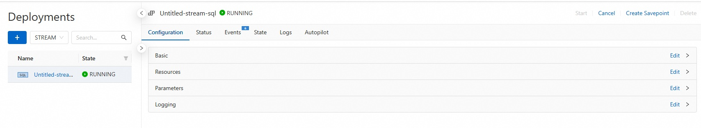

**Next steps**

To collapse the O&M interface, click the right-pointing arrow on the right side of the deployment list. To expand the O&M interface, click the left-pointing arrow.

<a id="section-1-2"></a>

## 1.2. Modify the status of a deployment

This topic describes how to modify the status of a deployment.

**Prerequisites**

You have created and deployed a draft.

**Procedure**

1. Log in to the Realtime Compute for Apache Flink console and go to the **Deployments** page.

2. On the **Deployments** page, click the name of the target deployment to enter the deployment details page by default.

3. Click one of the following buttons as needed to modify the deployment status.

   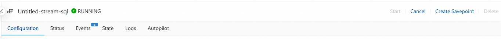

   The following table describes each button.

   | Operation | Description |
   | --- | --- |
   | Start | Start the deployment. |
   | Stop | Stop the deployment. |
   | Create Savepoint | Create a snapshot of the deployment at the current point in time. |
   | Delete | Delete the deployment. You can delete only deployments whose current status is not <strong>Running</strong>. |

<a id="section-1-3"></a>

## 1.3. Manage draft versions

This topic describes how to manage draft versions from four aspects: Compare deployment versions, Roll back a draft version, Lock a draft version, and Delete a draft version.

**Background information**

After you click **Deploy** on the draft development page to publish a draft, the system automatically generates a new version. You can compare the differences between the current editing version and historical versions to roll back draft information to a historical version.

**Compare deployment versions**

The system supports comparison only for SQL code and draft configuration content. Content with differences is marked.

1. Log in to the Realtime Compute for Apache Flink console.

   For more information, see the **Log in to the Realtime Compute for Apache Flink console** section in the ***Realtime Compute for Apache Flink User Guide***.

2. In the navigation pane on the left, click **SDL Editor**.

3. Double-click the name of the target draft.

4. In the right pane, click **Version Information**.

   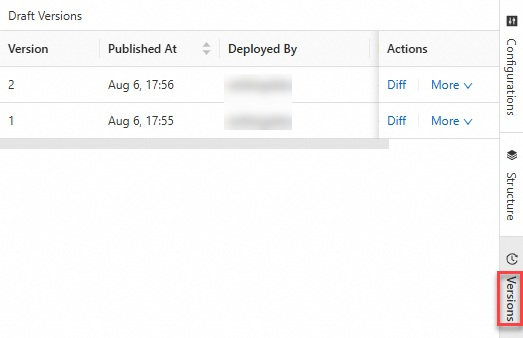

5. In the **Actions** column corresponding to the target version number, click **Compare**.

6. In the left **Select Editing Version**, select the target version for comparison.

   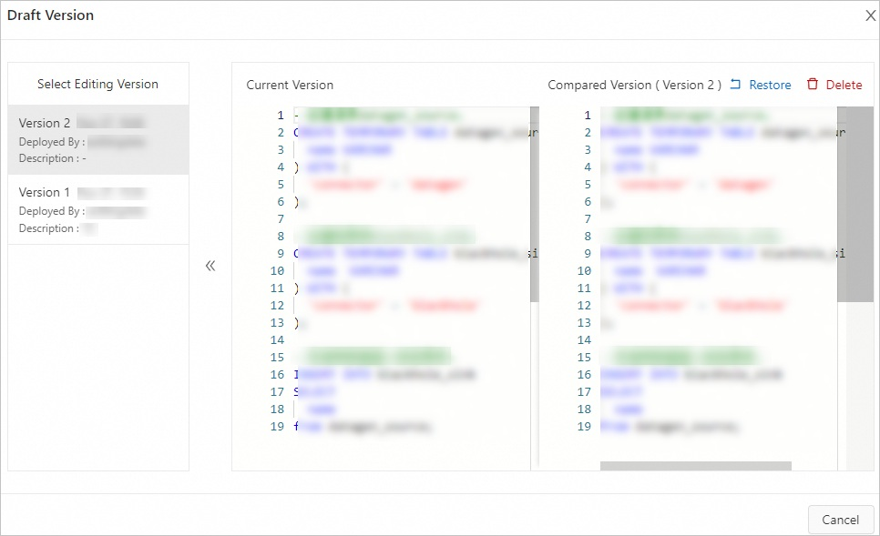

**Roll back a draft version**

You can roll back draft information from a target version generated after you **deploy** and publish a draft to the current editing version. The current editing version is the draft you are now editing.

1. Log in to the Realtime Compute for Apache Flink console.

   For more information, see the **Log in to the Realtime Compute for Apache Flink console** section in the ***Realtime Compute for Apache Flink User Guide***.

2. In the navigation pane on the left, click **SDL Editor**.

3. Double-click the name of the target draft.

4. In the right pane, click **Version Information**.

   

5. In the **Actions** column corresponding to the target version number, choose **More > Roll Back**.

6. In the pop-up dialog box, click **Roll Back**.

   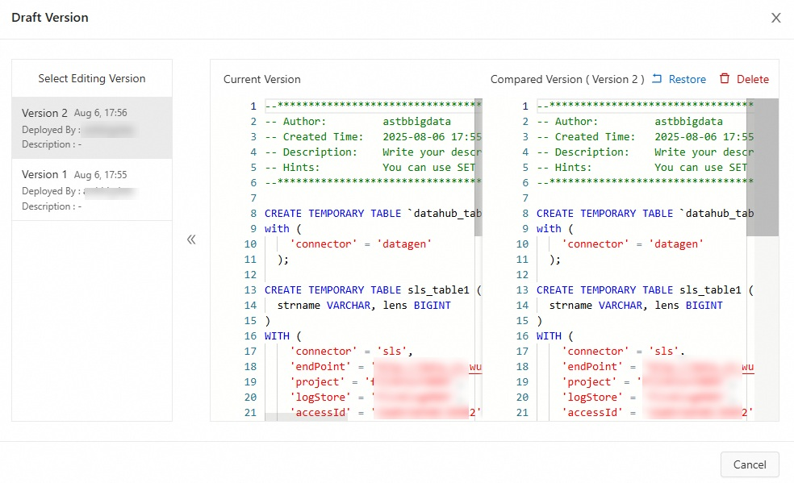

**Lock a draft version**

The system supports up to 50 draft versions. When the number exceeds 50, the system automatically deletes the oldest version. You can lock a specific version to prevent it from being automatically deleted.

1. Log in to the Realtime Compute for Apache Flink console.

   For more information, see the **Log in to the Realtime Compute for Apache Flink console** section in the ***Realtime Compute for Apache Flink User Guide***.

2. In the navigation pane on the left, click **SDL Editor**.

3. Double-click the name of the target draft.

4. In the right pane, click **Version Information**.

   

5. In the **Actions** column corresponding to the target version number, choose **More > Lock**.

   After you lock a version successfully, a success message appears at the top of the page,

   and the  icon appears before the draft version number.

   > **Note**
   >
   > You cannot delete a locked draft version, and must unlock it before deletion. To unlock a version, choose **More > Unlock**.

**Delete a draft version**

You can delete unnecessary draft versions.

1. Log in to the Realtime Compute for Apache Flink console.

   For more information, see the **Log in to the Realtime Compute for Apache Flink console** section in the ***Realtime Compute for Apache Flink User Guide***.

2. In the navigation pane on the left, click **SDL Editor**.

3. Double-click the name of the target draft.

4. In the right pane, click **Version Information**.

   

5. In the **Actions** column corresponding to the target version number, choose **More > Delete**.

6. In the pop-up dialog box, click **Delete**.

<a id="section-1-4"></a>

## 1.4. Status overview

This topic describes how to view the status of Realtime Compute jobs.

**Procedure**

1. Log in to the Realtime Compute for Apache Flink console and go to the **Deployments** page.

2. On the **Deployments** page, click the name of the target deployment to enter the deployment details page by default.

3. Click the **Status** tab.

   - **Current job**

     | Parameter | Description |
     | --- | --- |
     | Duration | The running time since the deployment started. |
     | Restart Times | The number of times the deployment restarted. |
     | Actions | • <strong>Job details</strong>: View draft configurations. The information is consistent with that on the <strong>Configuration</strong> page, including basic configuration, resource configuration, running parameter configuration, and logging configuration.<br>• <strong>Flink UI</strong>: Go to the Flink Dashboard. |
     | Used/Total Slots | The ratio of used task slots to total task slots. |
     | Start time | The time when the deployment started. |
     | End Time | The last time when the deployment was modified. |

   - **Execution graph**

     The execution graph represents the underlying computing logic of Realtime Compute. Each component represents a different task. Data streams resemble directed acyclic graphs (DAGs). Each data stream starts from one or more data sources and ends at one or more data result tables. To execute tasks more efficiently in a distributed environment, Realtime Compute links subtasks of operators together into tasks (Operator Chains) whenever possible. Each task runs in a single thread.

     Linking operators into tasks optimizes the following aspects:

     - Reduce thread switching.

     - Reduce message serialization and deserialization.

     - Reduce data exchange in buffers.

     - Reduce latency while increasing overall throughput.

     An operator represents a computing logic unit. A task represents a collection of multiple operators. To help you better understand this concept, we abstract the underlying computing logic into a visual representation, as shown in the following figure.

     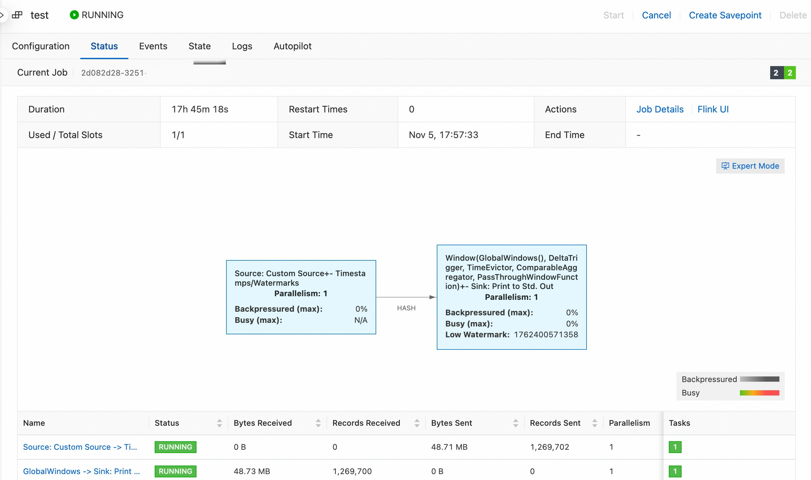

     You can switch between **Expert Mode** and **Standard Mode**. Professional mode displays Backpressured and Busy statuses.

   - **History jobs**

     View the creation time, stop time, and status information of instance.

     Deployment running statuses include:

     - RUNNING: Start the deployment according to its configuration.

     - CANCELLED: Stop any running deployment.

     - SUSPENDED: Create a savepoint for the currently running deployment and then stop the deployment.

     - FINISHED: The deployment completed successfully.

     - TRANSITIONING: The deployment is transitioning toward its desired state.

     - FAILED: The deployment failed to transition to its desired state and requires manual intervention.

<a id="section-1-5"></a>

## 1.5. Run events

This topic describes how to view job run events.

**Background information**

During the lifecycle of a deployment — including creation, running, failure, completion, scheduling, cancellation in progress, and canceled — the system generates corresponding event information. You can use this event information to preliminarily determine whether the deployment is running normally.

**Procedure**

1. Log in to the Realtime Compute for Apache Flink console and go to the **Deployments** page.

2. On the **Deployments** page, click the name of the target deployment to enter the deployment details page by default.

3. Click **Events**.

   By default, the Events page displays the time when each event occurred, the event content, and available actions. In the **Actions** column, you can perform the following operations:

   - **Copy Message**: Click **Copy Message** to copy a summary of the event.

   - **Job Details**: Select **More > Job Details** to view detailed information about the event generated by the deployment instance, including **Basic**, **Resources**, **Parameters**, and **Logging**.

   - **Filter Events for this Job**: Select **More > Filter Events for this Job** to display all events that occurred during the runtime of the deployment instance associated with the current event.

<a id="section-1-6"></a>

## 1.6. Status set management

The system refers to system checkpoints and deployment snapshots (savepoints) collectively as status sets. This topic describes how to manage deployment status sets, including how to create, view, delete, and restore from a specified status set.

**Background information**

| Concept | Details |
| --- | --- |
| System checkpoint<br>(corresponds to checkpoint in Apache Flink) | The Flink system fully manages the lifecycle of system checkpoints. You can configure the <strong>system checkpoint interval</strong>, <strong>system checkpoint</strong> <strong>timeout period</strong>, and <strong>minimum interval between two system</strong> <strong>checkpoints</strong>, and can also view their generation status. You cannot manually create or delete system checkpoints. By default, the job retains one system checkpoint as part of the selectable status set for job recovery. |
| Deployment snapshot<br>(corresponds to savepoint in Apache Flink) | Users fully manage the lifecycle of deployment snapshots. Specifically:<br>• Users trigger deployment snapshots during deployment execution or upon deployment completion, or use the VVP platform to trigger them once or on a schedule.<br>• Users manually delete deployment snapshots or use the VVP platform to trigger deletion once or on a schedule.<br>• When starting a deployment, you can restore the deployment status based on a specific deployment snapshot.<br>Note<br>When configured for scheduled generation or cleanup, the system follows user-defined rules. Therefore, this still falls under user management. |

**View the overview, history, and configuration information of a status set**

1. Log in to the Realtime Compute for Apache Flink console and go to the **Deployments** page.

2. On the **Deployments** page, click the name of the target deployment to enter the deployment details page by default.

3. Click the **State** tab.

4. You can perform the following operations.

   - Overview

     | Section | Overview information |
     | --- | --- |
     | Checkpoints | View checkpoint information, including the savepoint ID, completion time, and duration. |
     | Savepoints | View information about the last successful and failed deployment savepoints, including the savepoint ID, completion time, duration, or failure time. |

   - History

     | Section | Overview information |
     | --- | --- |
     | Checkpoints | View the generation history of system checkpoints, including checkpoint ID, status, creation time, duration, incremental storage size, and full storage size. |
     | Savepoint | View the generation history of savepoints, including savepoint ID, status, type, source and remarks, creation time, duration, and related actions (copy HDFS address, restore deployment from this savepoint, delete this savepoint). |

   - Configuration On this tab, configure rules for scheduled automatic creation of savepoints and automatic cleanup of savepoints.

     - Configure scheduled automatic creation of savepoints

       <ol type="a">

       <li>

       On the **Configuration** tab, turn on the **Automatic savepoint generation** switch.

       </li>

       <li>

       Click **Quick settings**, then select an appropriate time interval from the dropdown list as the period.

       > **Note**
       >
       > The minimum interval is 10 minutes. If the Cron expression you enter triggers less than every 10 minutes, the system defaults to triggering every 10 minutes.

       </li>

       </ol>

       <ol type="i" start="100">

       <li>

       Click **Save Changes**.

       </li>

       <li value="500">

       (Optional) To reset, click **Reset**. This action immediately turns off the **Automatic savepoint generation** feature.

       </li>

       </ol>

     - Configure automatic cleanup rules for savepoints

       > **Important**
       >
       > - The system cleans up savepoints based on either the number of savepoints or their retention duration. Meeting either condition triggers cleanup.
       >
       > - Savepoint cleanup does not include savepoints manually triggered by users. You must manually delete such savepoints on the savepoint viewing page.

       <ol type="a">

       <li>

       On the **Configuration** tab, turn on the **Automatic savepoint cleanup** switch.

       </li>

       <li>

       Configure **Number of historical savepoints to retain** and **Maximum retention time for historical savepoints (in hours)** as needed.

       </li>

       </ol>

       <ol type="i" start="100">

       <li>

       Click **Save Changes**.

       </li>

       <li value="500">

       (Optional) To reset, click **Reset**. This action immediately turns off the **Automatic savepoint cleanup** feature.

       </li>

       </ol>

**Manually create and delete a savepoint**

> **Note**
>
> The system supports manually creating savepoints only for **running** deployments.

1. Go to the savepoint creation interface.

   <ol type="i">

   <li>

   Log in to the Realtime Compute for Apache Flink console and go to the **Deployments** page.

   </li>

   <li>

   On the **Deployments** page, click the name of the target deployment to enter the

   </li>

   </ol>

   deployment details page by default.

   <ol type="i" start="3">

   <li>

   In the upper-right corner of the **Deployments** page, click **Create Savepoint**.

   </li>

   </ol>

2. Select a savepoint format and enter a savepoint description.

   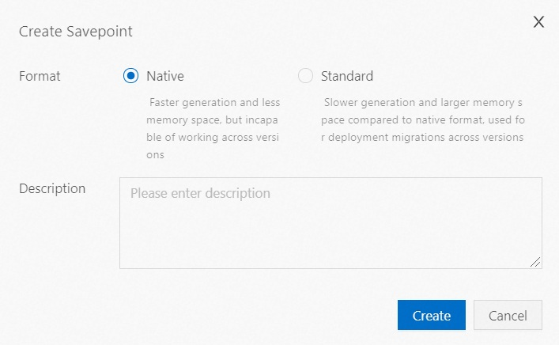

3. Click **Create**.

   On the **Deployments** page, select the **State > History** tab. Find your target savepoint in the **Savepoints** list. In the **Actions** column, select **More > Delete this savepoint**.

**Restore a deployment from a specified savepoint (from another deployment)**

> **Note**
>
> The system supports restoring a deployment from a specified savepoint only if the deployment is **CANCELLED**. If your job is **running**, cancel it first.

1. Locate the target savepoint.

   <ol type="i">

   <li>

   Log in to the Realtime Compute for Apache Flink console and go to the **Deployments** page.

   </li>

   <li>

   On the **Deployments** page, click the name of the target deployment to enter the

   </li>

   </ol>

   deployment details page by default.

   <ol type="i" start="3">

   <li>

   Select the **State > History** tab.

   </li>

   <li>

   In the **Savepoints** list, find the target snapshot.

   </li>

   </ol>

2. In the **Actions** column for the target savepoint, select **More > Restore job from this savepoint**.

3. In the **Start Job** configuration dialog box, select the **Other deployment state** option. Then select the deployment and savepoint to configure deployment startup information.

4. Click **Start**.

<a id="section-1-7"></a>

## 1.7. Deployment logs

<a id="section-1-7-1"></a>

### 1.7.1. View startup and running logs

When a deployment is running, you can view its startup and running logs. This topic describes how to view startup and running logs.

**Background information**

| Type | Description |
| --- | --- |
| Startup log | The logs generated after a Flink deployment starts, covering the period from Flink environment initialization until the Job Manager starts.<br>Note<br>Startup logs do not include scheduling logs. You must check the corresponding logs in the running events. For example, insufficient resources or insufficient switch IP addresses are scheduling-related issues. |
| Operational log | You can view the logs of the Flink Job Manager and Task Managers on the deployment log page or in the Flink UI. |

**Prerequisites**

The deployment is running.

**Notes**

Logs support pagination. Each page displays approximately 1 MB of data, which corresponds to about 8,000 to 9,000 lines. This amount is usually sufficient for troubleshooting. If you cannot locate the issue on the first page, switch to other pages.

**View startup logs**

1. Go to the **Deployment** page.

   <ol type="i">

   <li>

   Log in to the Realtime Compute for Apache Flink console and go to the **Deployments** page.

   </li>

   <li>

   On the **Deployments** page, click the name of the target deployment to enter the

   </li>

   </ol>

   deployment details page by default.

2. On the **Logs** tab, click **Startup Logs** on the left to view the startup logs.

   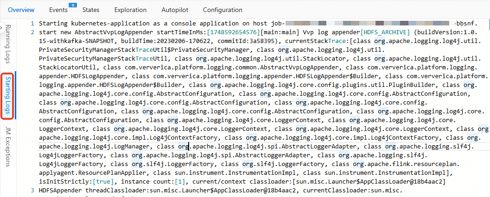

**View operational logs View operational logs on the job log page**

1. On the **Deployments** page, click the name of the target deployment to enter the deployment details page by default.

2. On the **Logs** page, go to the **Running Logs** tab. Click the drop-down list next to **Job** and select the running job.

   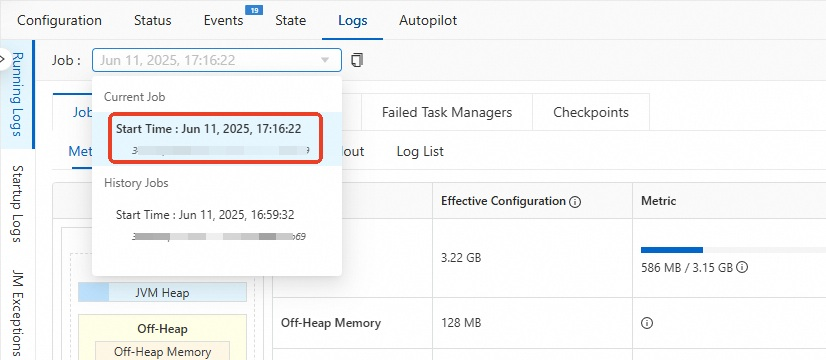

3. View the Job Manager and Task Managers logs.

   - View Job Manager logs

     On the **Job Manager** tab, click **Logs**.

     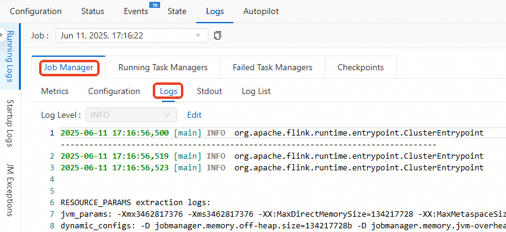

   - View Task Managers logs

     <ol type="a">

     <li>

     On the **Running Task Managers** tab, click **Path, ID**.

     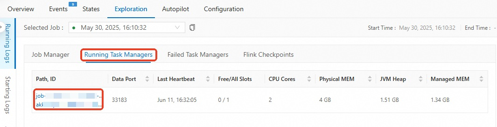

     </li>

     <li>

     Click **Logs**.

     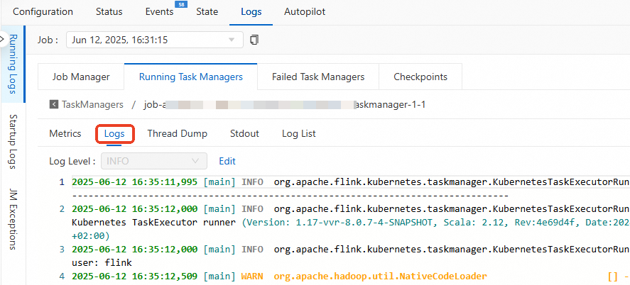

     </li>

     </ol>

**View running logs in the Flink UI**

1. On the **Deployments** page, click the name of the target deployment to enter the deployment details page by default.

2. In the **Actions** row of the **Status** tab, click **Flink UI** to enter the **Overview** page of **Apache Flink Dashboard**.

   > **Note**
   >
   > The **Flink UI** entry appears only when the deployment status is **RUNNING**.

3. In the left-side navigation pane, click **Task Managers** or **Job Manager**.

   - After you click **Task Managers**, click the target **Path, ID**. On the **Logs** tab, view the Task Manager logs of the deployment.

   - After you click **Job Manager**, on the **Logs** tab, view the Job Manager logs of the deployment.

<a id="section-1-7-2"></a>

### 1.7.2. View running exception logs

When a deployment fails to start or encounters a running exception, you can view the running exception logs to troubleshoot the issue. This topic describes how to view Job Manager exceptions, logs of failed Task Managers, and logs of Task Managers associated with slow checkpoints.

**Background information**

| Type | Description |
| --- | --- |
| Job Manager exception | If a deployment fails due to a failover, view the Job Manager exception.<br>Note<br>If the Job Manager fails to start, this is not classified as a Job Manager exception. Check the startup log instead. |
| Logs of failed Task Managers | For deployments running normally, no Task Managers fail. However, for high-risk deployments, some Task Managers may fail but restart automatically. In such cases, you can view archived logs of failed Task Managers to identify potential causes.<br>Note<br>You can view logs of failed Task Managers only if log archiving is enabled.You can view logs only within the retention period configured for log archiving. |
| Logs of Task Managers associated with slow checkpoints | During deployment execution, if a checkpoint takes an unusually long time to complete, you can view the logs of the associated Task Managers to determine the cause. |

**Prerequisites**

The deployment instance must be in the running state.

**Notes**

Logs support pagination. Each page displays 1 MB of data, approximately 8,000–9,000 lines, which is generally sufficient for troubleshooting. If you do not locate the issue on the first page, switch pages to view more logs.

**View Job Manager exceptions**

1. Go to the **Deployments** page.

   <ol type="i">

   <li>

   Log in to the Realtime Compute for Apache Flink console and go to the **Deployments** page.

   </li>

   <li>

   On the **Deployments** page, click the name of the target deployment to enter the

   </li>

   </ol>

   deployment details page by default.

2. On the **Logs** tab, select the **JM Exceptions** tab on the left to view Job Manager exceptions.

   > **Note**
   >
   > In the **Exception History** section, you can view exceptions generated in the last seven days and filter by exception type to review historical exceptions.

**View logs of failed Task Managers**

1. On the **Deployments** page, click the name of the target deployment to enter the deployment details page by default.

2. On the **Logs** tab, select **Running Logs**, then select the running job instance.

3. Click the **Failed Task Managers** tab to view logs of failed Task Managers.

**Locate slow checkpoints and view logs of corresponding Task Manager logs**

1. On the **Deployments** page, click the name of the target deployment to enter the deployment details page by default.

2. View slow checkpoint log information.

   <ol type="i">

   <li>

   On the **Logs** tab, click the **Checkpoints** tab, then click **Checkpoints History**.

   </li>

   <li>

   Check values in the **End to End Duration** column to identify the ID of the slow

   </li>

   </ol>

   checkpoint.

   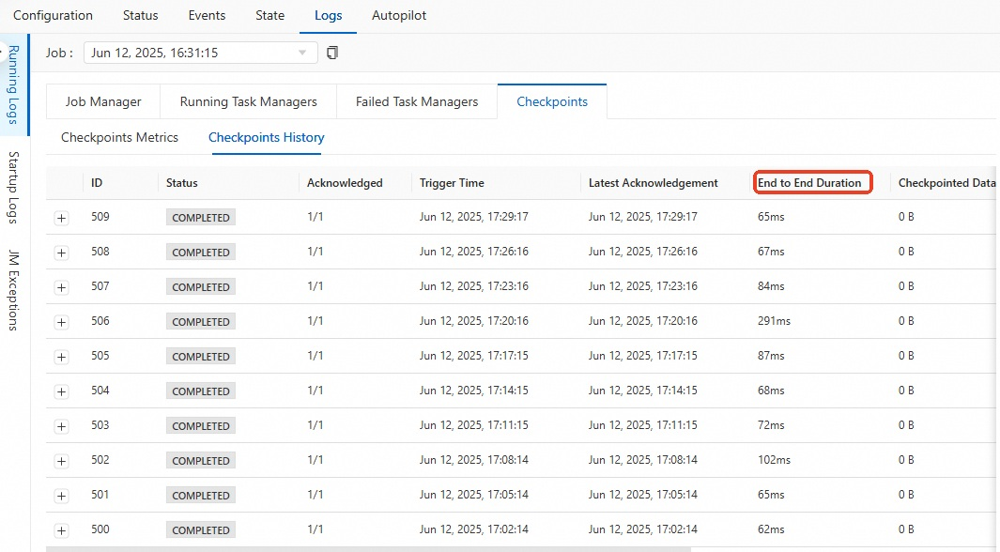

   <ol type="i" start="3">

   <li>

   Click  to the left of the slow checkpoint ID to identify the Operators node associated

   </li>

   </ol>

   with the slow checkpoint.

   <ol type="i" start="4">

   <li>

   Click  to the left of the Operators node to expand and view the status of each

   SubTask.

   </li>

   <li>

   Click the **ID** of the SubTask associated with the slow checkpoint.

   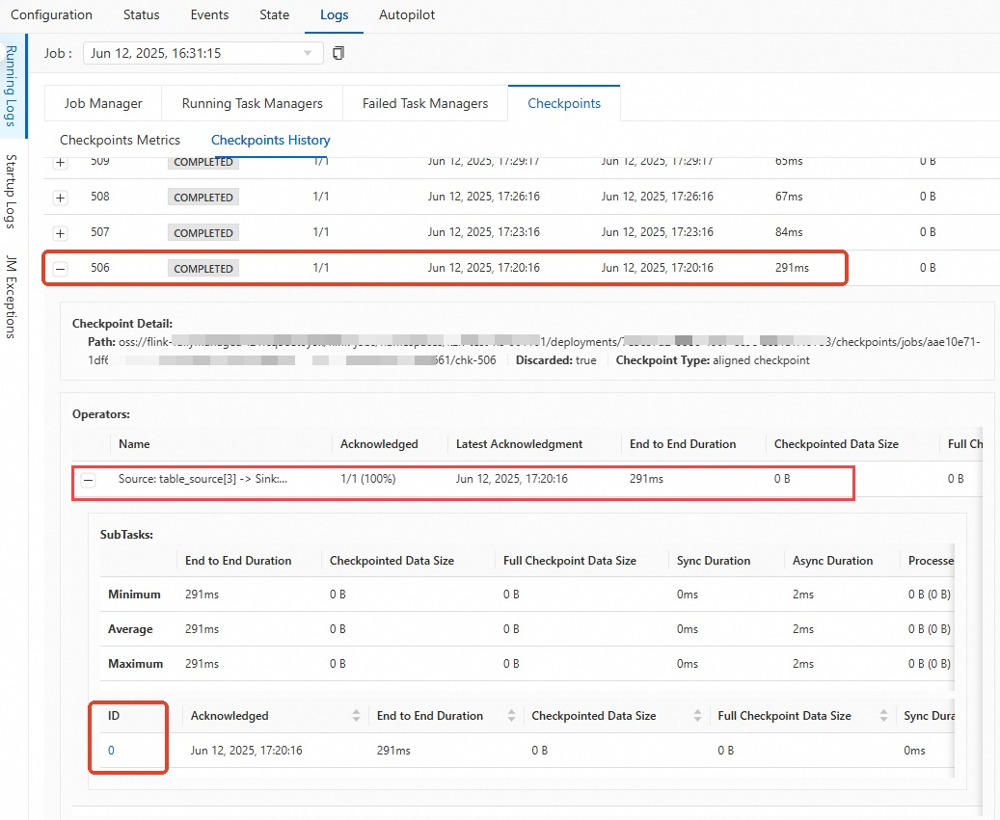

   </li>

   <li>

   On the redirected page, go to the **Running Task Managers > Logs** tab to view the slow checkpoint log information.

   </li>

   </ol>

<a id="section-1-7-3"></a>

### 1.7.3. View historical deployment instance logs

When the Flink UI is inaccessible or you need to analyze running issues with historical deployments, view the historical deployment instance logs to locate the problem. This topic describes how to view historical deployment instance logs on the deployment log page.

**Background information**

You need to view the logs of historical deployment instances in the following scenarios:

- You need to view, search, and analyze running logs of historical deployment instances. By default, the system retains the most recent 5 MB of running logs.

- The Flink UI is inaccessible, and you need to view JobManager logs to locate the issue.

**Prerequisites**

To view historical deployment instance logs, you must enable log archiving in the log configuration. The system enables log archiving by default, and retains archived logs for seven days.

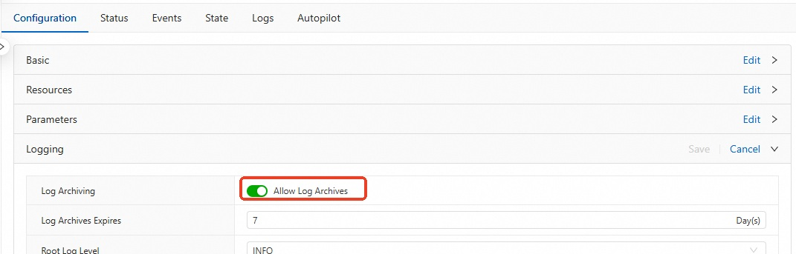

**Notes**

- When a log file reaches the specified size, the system automatically archives the log by default and periodically deletes log files that exceed the archive retention period. After a deployment stops, uncleaned archived logs are retained and not automatically deleted. If you delete a deployment, its corresponding logs are also deleted.

- By default, the log configuration retains two files, each 5 MB in size. We recommend that you do not modify this value.

  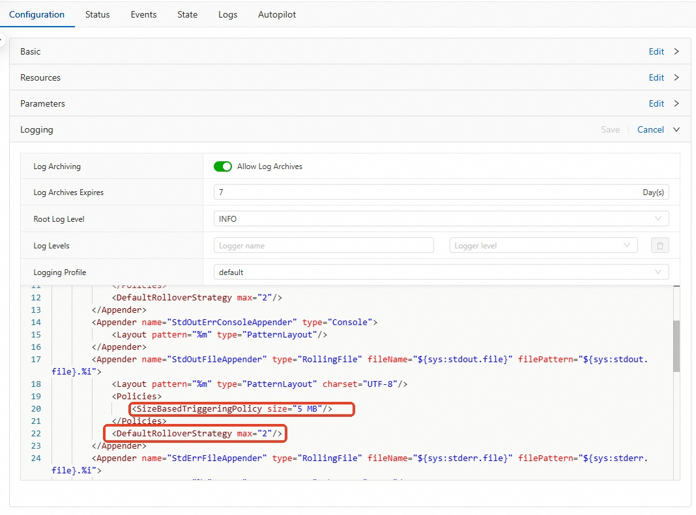

  > **Note**
  >
  > The number of files shown in the image does not include the file currently being written. For example, if you configure this parameter as 1, the system saves up to two files: one in memory and one on your local disk.

**View logs on the deployment log page**

1. Go to the **Deployments** page.

   <ol type="i">

   <li>

   Log in to the Realtime Compute for Apache Flink console and go to the **Deployments** page.

   </li>

   <li>

   On the **Deployments** page, click the name of the target deployment to enter the

   </li>

   </ol>

   deployment details page by default.

2. On the **Logs** tab, click **Running Logs** on the left.

3. Click the drop-down list next to **Job** and select a historical job.

   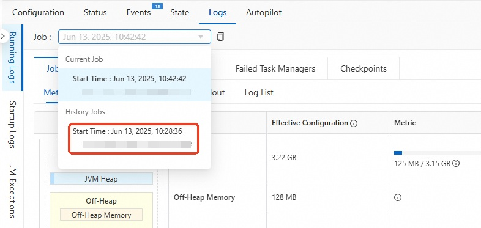

4. View the Job Manager and Task Managers logs.

   On the **Job Manager** or **Task Managers** tab, click the corresponding log name to view it.

<a id="section-1-7-4"></a>

### 1.7.4. Modify the log level of a running deployment

When logs at the INFO level cannot meet your troubleshooting needs, you can change the log level to DEBUG. This topic describes how to dynamically modify the log level, and provides usage limits and notes.

**Background information**

The system supports log levels in ascending order, as listed in the following table.

| Level | Details |
| --- | --- |
| DEBUG | Logs that record the system running status. |
| INFO | Logs about important or interesting information. |

**Limits**

- You can set the log level only to INFO or DEBUG, and cannot set it to other levels to avoid failure to locate root causes due to excessively high log levels.

- You can modify the log level for the entire JobManager (JM).

- You can modify the log level for a single TaskManager (TM), but not for all TMs at once. To modify the log level for all TMs, you must configure each TM separately.

**Precautions**

- After you change the log level to DEBUG, the system prints logs at the DEBUG, INFO, WARN, and ERROR levels.

- After you change the log level to INFO, the system prints logs only at the INFO, WARN, and ERROR levels.

- Changing the log level affects only newly generated logs. Previously generated logs remain unchanged.

- Enabling DEBUG logs slightly affects deployment performance. We recommend that you set the log level to INFO unless you need to troubleshoot issues.

**Procedure**

1. Go to the **Deployments** page.

   <ol type="i">

   <li>

   Log in to the Realtime Compute for Apache Flink console and go to the **Deployments** page.

   </li>

   <li>

   On the **Deployments** page, click the name of the target deployment to enter the

   </li>

   </ol>

   deployment details page by default.

2. On the **Logs** tab, click **Running Logs** on the left side, and then select a running job instance.

3. Modify the log level for the Job Manager or Task Managers.

   - **Modify the log level for Job Manager**

     <ol type="a">

     <li>

     On the **Job Manager** tab, click **Logs**.

     </li>

     <li>

     Click **Edit** next to **Log Level**.

     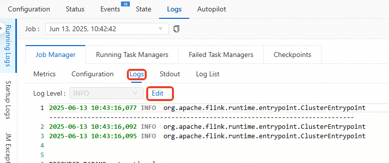

     </li>

     </ol>

     <ol type="i" start="100">

     <li>

     Click **OK**.

     </li>

     <li value="500">

     Select the target log level from the drop-down list.

     </li>

     </ol>

     <ol type="a" start="5">

     <li>

     Click **Confirm**.

     </li>

     </ol>

   - **Modify the log level for Task Managers**

     <ol type="a">

     <li>

     On the **Running Task Managers** tab, click **Path, ID**.

     </li>

     <li>

     Click **Logs**.

     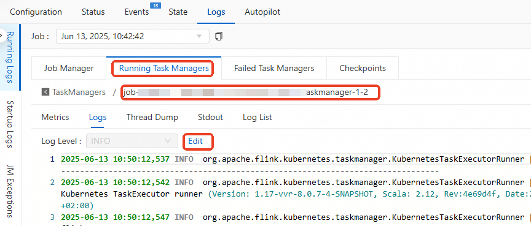

     </li>

     </ol>

     <ol type="i" start="100">

     <li>

     Click **Edit** next to **Log Level**.

     </li>

     <li value="500">

     Click **OK**.

     </li>

     </ol>

     <ol type="a" start="5">

     <li>

     Select the target log level from the drop-down list.

     </li>

     <li>

     After you modify the log level, click **Confirm**.

     </li>

     </ol>

<a id="section-1-8"></a>

## 1.8. Job optimization

<a id="section-1-8-1"></a>

### 1.8.1. Configure autopilot

Flink supports two tuning modes: intelligent tuning and scheduled tuning. This topic describes how to configure intelligent tuning and scheduled tuning, and the precautions for the configuration.

**Background information**

You usually need to spend a large amount of time on job tuning. For example, when publishing a new draft, you must consider how to configure resources, concurrency, the number of Task Managers, and the size of each Task Manager for the draft. In addition, during deployment running, you must consider how to adjust deployment resources to achieve the highest resource utilization. When backpressure occurs or latency increases, you must consider how to adjust deployment configurations. You can select an appropriate tuning mode based on the following information.

**Tuning**

**Applicable scenario**

**Benefits**

**References**

**mode**

You can directly use resource suggestions in the unversioned state to manually adjust deployment resources.

You do not configure

The resource tuning system

Unversi

intelligent tuning or

generates resource

oned

scheduled tuning but want

None.

adjustment suggestions

(default)

to simply optimize

based on job running status

deployment resources.

but does not automatically apply the optimization suggestions. You must manually handle the suggestions based on your business requirements.

A deployment X uses 30 CUs. After the deployment runs stably for a period of time, you find that CPU and memory usage is sometimes low when no

- For more information

source latency or

about the default

backpressure occurs.

behavior of intelligent tuning, see Default

If you do not want to

behavior of intelligent

manually adjust resources

Intellige

tuning.

and require the system to

nt

automatically adjust

tuning

- For more information

resources, you can use the

about how to enable the

intelligent tuning feature.

intelligent tuning feature,

The system automatically

see Enable and configure

reduces resource

intelligent tuning.

configurations when resource usage is low and increases resource configurations when

- Helps you adjust Degree

resource usage reaches a

of Parallelism (DOP) and

specific threshold.

resource configurations more reasonably for a deployment.

- Globally optimizes your deployments to resolve

A deployment Y has

various performance

obvious time interval

tuning issues such as

characteristics based on

insufficient throughput,

business features. For

end-to-end backpressure,

example, from 09:00 to

and resource waste.

19:00 every day is the business peak, and from 19:00 to 09:00 the next day is the business off-peak.

For more information about

In this case, you can use

Schedul

how to configure a

the scheduled tuning

ed

scheduled tuning policy,

feature to use 30 CUs

tuning

see Enable and configure

during peak hours and 10

scheduled tuning.

CUs during off-peak hours.

> **Note**
>
> You must clearly understand resource usage in different time periods.

**Limits**

- While enabling unaligned checkpoint, you cannot adjust concurrency.

- Intelligent tuning does not support jobs deployed in session clusters.

- Intelligent tuning cannot resolve all performance bottlenecks of streaming jobs.

  The performance of streaming jobs is determined by both upstream and downstream systems. If Flink becomes a bottleneck, you can resolve the issue by tuning Flink resources. However, tuning policies are based on specific assumptions about job processing modes. For example, traffic changes smoothly, no data skew exists, and the throughput of each operator can be linearly scaled with the increase of DOP. When business logic significantly deviates from these assumptions, exceptions may occur in deployments. Examples:

  - Failure to trigger DOP modification, failure to reach a normal deployment state, and continuous deployment restarts.

  - Performance issues of user-defined scalar functions (UDFs), user-defined aggregate functions (UDAFs), or user-defined table-valued functions (UDTFs).

- Intelligent tuning cannot identify issues of external systems. You must resolve external system issues on your own.

  When external system failure or slow access occurs, job DOP increases, which further increases pressure on external systems and may cause external system avalanches. Common external system issues include:

  - Insufficient DataHub partitions or insufficient Message Queue (MQ) throughput.

  - Sink performance issues.

  - Deadlocks in ApsaraDB RDS.

**Precautions**

- After intelligent tuning is triggered, the system must restart the jobs, causing jobs to temporarily stop processing data.

- The interval between two consecutive triggers of intelligent tuning is 10 minutes. You can use the cooldown.minutes parameter to adjust the interval.

- If you use DataStream jobs or SQL custom connectors, make sure that you do not configure job DOP in job code. Otherwise, intelligent tuning cannot adjust job resources, and the intelligent tuning configuration does not take effect.

- The interval between the trigger time of a new policy and the trigger time of an existing policy cannot be within half an hour. Otherwise, you cannot create the new policy.

**Default behavior of intelligent tuning**

If you enable intelligent tuning, the system performs intelligent tuning for you from the perspectives of DOP and memory by default:

- Intelligent tuning adjusts job DOP to meet the throughput required for traffic changes of jobs. Intelligent tuning monitors the latency change of consumed source data, actual CPU usage of TaskManagers (TMs), and data processing capabilities of operators to adjust job DOP. Details:

  - If the job latency metric is normal (not exceeding 60 seconds), the system does not modify the current job DOP.

  - If the job latency metric exceeds the default threshold of 60 seconds, the system adjusts DOP in the following two cases:

    - If latency is decreasing, the system does not adjust DOP.

    - If latency increases and continues to rise for 3 minutes (default value), the system adjusts job DOP to twice the current actual TPS, but does not exceed the configured maximum resources (default value: 64 CUs).

  - No latency metrics exist for the job.

    - If the actual data processing time of a VERTEX node continuously exceeds 80% for 6 minutes, the system increases job DOP to reduce SLOT usage to 50%, but does not exceed the configured maximum resources (default value: 64 CUs).

    - If the average CPU usage of all TMs continuously exceeds 80% for 6 minutes, the system increases DOP to reduce CPU usage of TMs to 50%.

  - If the maximum CPU usage of all TMs is lower than 20% and the actual data processing time of VERTEX is lower than 20% for 24 consecutive hours, the system decreases job DOP to increase CPU usage and the actual data processing time of VERTEX to 50%.

- Intelligent tuning also monitors memory usage and failover of jobs to adjust memory configurations of jobs. Details:

  - If JobManager experiences frequent GC or OutOfMemory (OOM) exceptions, the system increases JM memory. The maximum memory is adjusted to 16 GiB by default.

  - If TM experiences frequent GC or OOM or HeartBeatTimeout exceptions, the system increases TM memory. The maximum memory is adjusted to 16 GiB by default.

  - If TM memory usage exceeds 95%, the system increases TM memory.

  - If the actual TM memory usage is lower than 30% for 24 consecutive hours, the system decreases TM memory configuration. The minimum memory is adjusted to 1.6 GiB by default.

**Enable and configure intelligent tuning**

1. Go to the **Deployments** page.

   <ol type="i">

   <li>

   Log in to the Realtime Compute for Apache Flink console and go to the **Deployments** page.

   </li>

   <li>

   On the **Deployments** page, click the name of the target deployment to enter the

   </li>

   </ol>

   deployment details page by default.

2. Turn on intelligent tuning mode.

   <ol type="i">

   <li>

   On the **Autopilot** tab, click **Configuration**.

   </li>

   <li>

   Click **Edit** next to **Current autopilot mode**.

   </li>

   <li>

   In the drop-down list of **Current autopilot mode**, select **Autopilot**.

   </li>

   <li>

   Click **Save**.

   After you enable this feature, the SQL icon on the left side of the deployment name

   changes to  .

   If you want to disable intelligent tuning, go to **Autopilot > Current autopilot mode**, select **Disabled**, and then click **Save**.

   </li>

   </ol>

3. Configure parameters related to intelligent tuning.

   <ol type="i">

   <li>

   On the **Autopilot Settings** tab, click **Edit**.

   </li>

   <li>

   Enter the intelligent tuning configuration information.

   </li>

   </ol>

   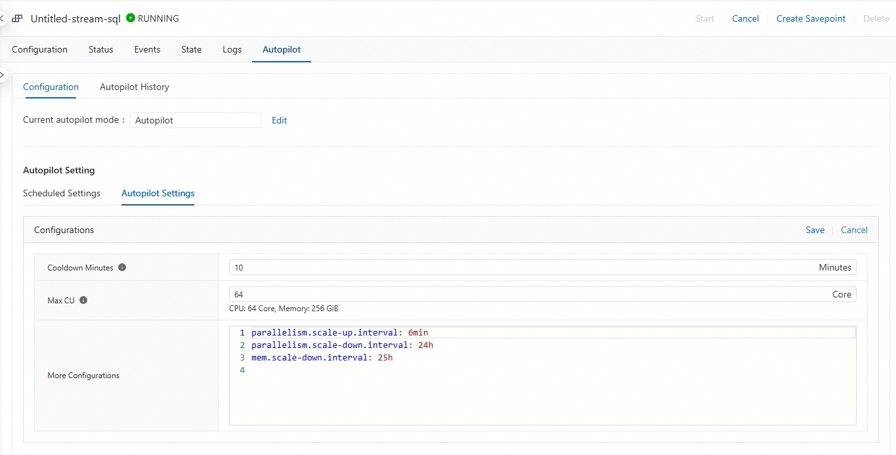

   The following table describes the parameters.

   | Parameter | Description |
   | --- | --- |
   | Cooldown Minutes | The time interval before the system performs the next tuning after a job is restarted by autopilot. |
   | Max CU | The upper limit for automatic resource scaling. Unit: CU. |

   <table>
     <tr>
       <td>More Configurations</td>
       <td>You can configure the following parameters:<br>• <strong>parallelism.scale-up.interval </strong>: The minimum interval between two upward DOP adjustments. Default value: 6 minutes.<br>• <strong>parallelism.scale-down.interval </strong>: The minimum interval between two downward DOP adjustments. Default value: 24 hours.<br>• <strong>mem.scale-down.interval</strong>: The minimum trigger interval for reducing memory.<br>Default value: 25 hours. If memory usage remains below the threshold within 25 hours, the system reduces memory or suggests a reduction.<br>• <strong>parallelism.scale.max</strong>: The maximum DOP when increasing concurrency.<br>Default value: -1, which indicates no limit on maximum DOP.<br>• <strong>parallelism.scale.min</strong>: The minimum DOP when decreasing concurrency.<br>Default value: 1, which indicates the minimum DOP is 1.<br>• <strong>delay-detector.scale-up.threshold</strong>: The maximum tolerable latency threshold. This measures job throughput capability based on source consumption latency.<br>Default value: 1 minute. If processing capacity is insufficient and latency exceeds 1 minute, the system increases throughput by scaling up, such as increasing DOP or splitting chains, or suggests scaling up.<br>• <strong>slot-usage-detector.scale-up.threshold</strong>: Triggers an increase in DOP when the proportion of time VERTEX spends processing data exceeds this value.<br>Default value: 0.8. Monitors idle time of data processing nodes (excluding Source nodes). When idle time consistently exceeds 0.8, the system reduces DOP to lower resource usage or suggests scaling up.<br>• <strong>slot-usage-detector.scale-down.threshold</strong>: Triggers a decrease in DOP when the proportion of time VERTEX spends processing data exceeds this value.<br>Default value: 0.2. Monitors idle time of data processing nodes (excluding Source nodes). When idle time consistently falls below 0.2, the system increases DOP to improve processing capacity or suggests scaling down.<br>• <strong>slot-usage-detector.scale-up.sample-interval</strong>: The sampling interval for monitoring slot idle metrics to calculate the average over that interval.<br>Default value: 3 minutes. Used together with <strong>slot-usage-detector.scale-</strong><strong>up.threshold</strong> and <strong>slot-usage-detector.scale-down.threshold</strong>. If the average idle time over 3 minutes exceeds 0.8 or falls below 0.2, the system scales up or down accordingly.<br>• <strong>resources.memory-scale-up.max</strong>: The maximum value to which the system can adjust the memory of a single Task Manager or Job Manager.<br>Default value: 16 GiB. During intelligent tuning or DOP scaling, the memory upper limit for TM and JM is 16 GiB.</td>
     </tr>
   </table>

   <ol type="i" start="3">

   <li>

   Click **Save**.

   </li>

   </ol>

**Enable and configure scheduled tuning**

1. Go to the **Deployments** page.

   <ol type="i">

   <li>

   Log in to the Realtime Compute for Apache Flink console and go to the **Deployments** page.

   </li>

   <li>

   On the **Deployments** page, click the name of the target deployment to enter the

   </li>

   </ol>

   deployment details page by default.

2. Turn on scheduled tuning mode.

   <ol type="i">

   <li>

   On the **Autopilot** tab, click **Configuration**.

   </li>

   <li>

   Click **Edit** next to **Current autopilot mode**.

   </li>

   <li>

   In the drop-down list of **Current autopilot mode**, select **Scheduled**.

   </li>

   <li>

   Click **Save**.

   </li>

   </ol>

3. Click **Create Policy**.

   <ol type="i">

   <li>

   On the **Scheduled Settings** tab, click **Create Policy**.

   </li>

   <li>

   Enter basic configuration information.

   </li>

   </ol>

   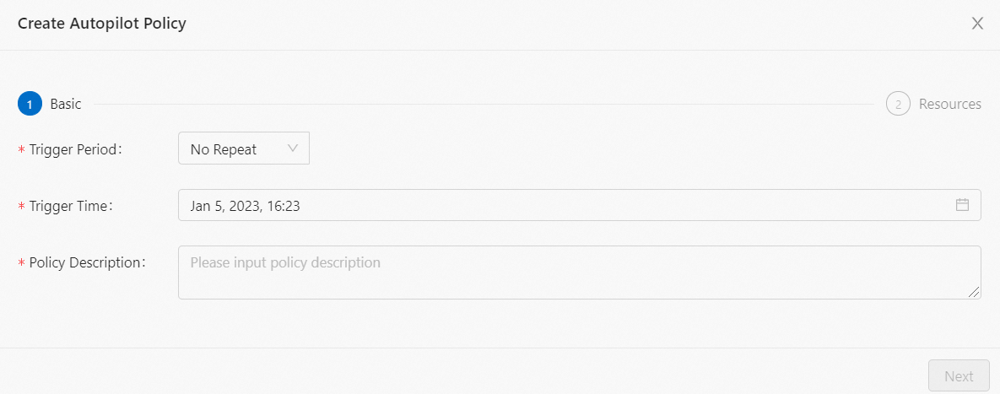

   The following table describes the parameters.

   | Configuration item | Description |
   | --- | --- |
   | Trigger Period | You can select no repeat, every day, every week or every month. When you select every week or every month, you must also specify the effective date range. |
   | Trigger time | Select the specific effective time. |
   | Policy Description | Enter a description for the policy. |

   <ol type="i" start="3">

   <li>

   Click **Next**.

   </li>

   </ol>

4. Configure resource settings.

   You can click **Load from history jobs** in the upper-right corner of the dialog box to obtain historical resource configurations, or customize resource configurations. For more information, see Configure job resources.

5. Click **OK**.

   After you create the policy, it takes effect at the trigger time. You can edit, delete, or disable the policy in the **Actions** column corresponding to the policy.

   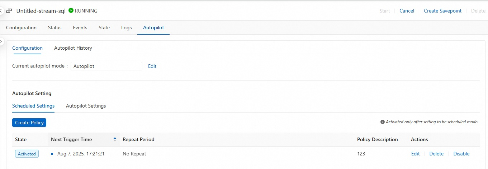

<a id="section-1-8-2"></a>

### 1.8.2. Configure job resources

Before starting a deployment or after publishing it, you can configure and modify its resources. This topic describes how to configure and modify deployment resources.

**Limits**

Only SQL drafts support expert mode configuration.

**Procedure**

1. Go to the resource configuration page.

   <ol type="i">

   <li>

   Log in to the Realtime Compute for Apache Flink console and go to the **Deployments** page.

   </li>

   <li>

   On the **Deployments** page, click the name of the target deployment to enter the

   </li>

   </ol>

   deployment details page by default.

   <ol type="i" start="3">

   <li>

   On the **Configuration** tab, click **Edit** next to the **Resources** section.

   </li>

   </ol>

2. Modify deployment resource settings.

   **Basic mode (coarse-grained)**

   Coarse-grained allocation is a static resource assignment method. You only need to specify the total CPU and JVM memory required to start each Task Manager. The system evenly distributes all resources based on the value of taskmanager.numberOfTaskSlots. For most simple deployments, coarse-grained allocation meets requirements.

   | Configuration item | Description |
   | --- | --- |
   | Concurrency | The global concurrency of the job. |
   | Job Manager CPU | According to Flink best practices, allocate at least 0.25 core and 1 GiB of memory per Job Manager to ensure stable deployment running. |
   | Job Manager Memory | Unit: GiB. Example: 4 GiB. Minimum value: 1 GiB. |
   | Task Manager CPU | According to Flink best practices, allocate at least 1 core and 4 GiB of memory per Task Manager to ensure stable deployment running. |
   | Task Manager Memory | Unit: GiB. Example: 4 GiB. Minimum value: 1 GiB. |
   | TaskManager Slots | Enter the number of slots for the Task Manager. |

   **Expert mode (fine-grained)**

   > **Note**
   >
   > Only SQL drafts support expert mode configuration.

   Fine-grained allocation is a dynamic resource assignment method. You can configure the resources required by each task or even each operator. Flink calculates the resource specification needed per slot and dynamically requests Task Managers and slots that exactly match from the available resource pool. For complex deployments, coarse-grained allocation may lead to low resource utilization. Fine-grained allocation allows precise control over resources per operator, improving resource usage and meeting deployment throughput requirements.

   For more information about concepts such as TM, JM, TASK, or SLOT, see Flink architecture.

   | Configuration item | Description |
   | --- | --- |
   | Job Manager CPU | According to Flink best practices, allocate at least 0.25 core and 1 GiB of memory per Job Manager to ensure stable deployment running. |
   | Job Manager Memory | Unit: GiB. Example: 4 GiB. Minimum value: 1 GiB. |
   | Configuration plan | A configuration plan defines slot resources. Follow these steps:<br>i. Click <strong>Get now</strong>.ii. Click theicon on the slot box to modify slot configuration.<br>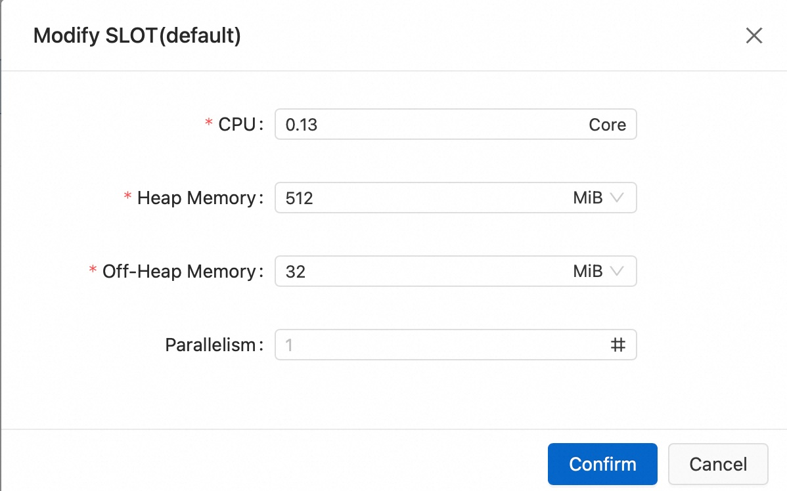<br>The parallelism set here applies globally to the entire deployment. After you set it, the system automatically performs the following actions:<br>• The system assigns the same parallelism to each VERTEX.<br>• The system automatically generates the required memory for Statebackend, Python, and operators based on the deployment's computational logic. You do not need to configure this manually.<br>• By default, the system calculates the CPU required per slot at a 1:4 ratio of the total memory (sum of Heap Memory, Off-heap Memory, Statebackend, Python, and Operator memory).<br>Note<br>We recommend adjusting Heap Memory and Off-heap Memory sizes only when you encounter specific exceptions or requirements, such as OOM errors or severe GC issues. Under normal deployment running, adjusting these values does not significantly affect deployment throughput.<br>iii. Click theicon on the VERTEX box to set parallelism for a<br>specific VERTEX as needed.iv. Modify operator parallelism and chain policy. |

   Chain policy descriptions:

3. Click **Save**.

   - ALWAYS: The operator can always chain with upstream and downstream operators.

<a id="section-1-8-3"></a>

### 1.8.3. High-performance Flink SQL optimization tips

- HEAD: The current operator serves as the head of the chain. It breaks chaining with upstream operators but remains chained with downstream operators.

- NEVER: The current operator does not chain with upstream or

This topic describes how to improve the performance of Flink SQL deployments from two

downstream operators.

aspects: deployment configuration and Flink SQL optimization.

> **Note**

**Deployment configuration optimization recommendations**

> - We recommend setting the parallelism of source nodes proportional to the number of partitions —

- Resource optimization tips

  > specifically, choose a parallelism that evenly divides

  VVP limits the actual CPU usage of JobManager and TaskManager. The system can use only

  > the partition count. For example, if Kafka has 16

  the number of CPUs that you configure. When you optimize resources, we recommend that

  > partitions, set parallelism to 16, 8, or 4 to avoid data skew. Also, avoid setting source node parallelism too

  you perform the following operations:

  > low, which could cause one source to read excessive

  - When a deployment has high parallelism: Increase the resources of the JobManager by

    > data and create an input bottleneck affecting

    scaling up the CPU and memory in the **Resources** of the deployment. For example:

    > deployment throughput.

    - Set Job Manager CPU to 4.

      > - Configure parallelism for non-source nodes according to traffic volume: set higher parallelism for high-

    - Set Job Manager Memory to 8 GiB.

      > traffic nodes and lower parallelism for low-traffic nodes.

  - When the deployment topology is complex: Increase the resources of the TaskManager by scaling up the CPU and memory in **Resources** of the deployment. For example:

    <ol type="i" start="5">

    <li>

    Click **OK**.

    </li>

    </ol>

    - Set Task Manager CPU to 2.

    - Set Task Manager Memory to 4 GiB.

  - We do not recommend that you modify taskmanager.numberOfTaskSlots. Keep the default value 1.

- Recommended configurations for improving throughput and resolving data hotspots

  Add the following code to **Advanced Configuration** > **Additional Flink Configuration** of the deployment. For more information, see Group Aggregate optimization tips.

  ```text
  execution.checkpointing.interval: 180s
  state.backend: com.alibaba.flink.statebackend.GeminiStateBackendFactory
  table.exec.state.ttl: 129600000
  table.exec.mini-batch.enabled: true
  table.exec.mini-batch.allow-latency: 5s
  table.optimizer.distinct-agg.split.enabled: true
  env.java.opts.taskmanager: -Xms4096m -XX:+UseParNewGC -
  XX:+UseCMSInitiatingOccupancyOnly -XX:CMSInitiatingOccupancyFraction=70 -verbose:gc -
  XX:+HeapDumpOnOutOfMemoryError -XX:+UseConcMarkSweepGC -
  XX:+UseCMSCompactAtFullCollection -XX:CMSMaxAbortablePrecleanTime=1000 -XX:+CMSClassUnloadingEnabled -XX:+PrintGCDetails -XX:+PrintGCDateStamps -XX:SurvivorRatio=5 -XX:ParallelGCThreads=4
  ```

  The following table describes the parameters.

  | Parameter | Description |
  | --- | --- |
  | execution.checkpointing.interv al | The interval at which checkpoints are triggered. Unit: milliseconds. |
  | state.backend | The state backend configuration. |
  | table.exec.state.ttl | The time-to-live (TTL) of state data. Unit: milliseconds. |
  | table.exec.mini-batch.enabled | Specifies whether to enable mini-batch processing. |
  | table.exec.mini-batch.allow-latency | The time interval at which data is output in batches. |
  | table.optimizer.distinct-agg.split.enabled | Specifies whether to enable PartialFinal optimization to resolve the hotspot issue of COUNT DISTINCT. |
  | env.java.opts.taskmanager | The Java startup option.<br>Note<br>If the source table is SLS, do not set this parameter.Otherwise, a performance bottleneck occurs. |

**Group Aggregate optimization tips**

- Enable MiniBatch (improve throughput)

  MiniBatch caches a batch of data before triggering processing. This reduces access to state, thereby improving throughput and reducing output data volume.

  MiniBatch primarily triggers micro-batch processing based on event messages. The system inserts event messages at intervals you specify at the source.

  - Applicable scenarios

    Micro-batch processing trades increased latency for higher throughput. If you require ultra-low latency, we do not recommend enabling micro-batch processing. For most aggregation scenarios, micro-batch processing significantly improves system performance. We recommend that you enable it.

  - Enable method

    By default, MiniBatch is disabled. You must add the following code in **Advanced Configuration** > **Additional Flink Configuration** of your deployment.

    ```text
    table.exec.mini-batch.enabled: true
    table.exec.mini-batch.allow-latency: 5s
    ```

    The following table describes the parameters.

    | Parameter | Description |
    | --- | --- |
    | table.exec.mini-batch.enabled | Specifies whether to enable mini-batch processing. |
    | table.exec.mini-batch.allow-latency | The time interval at which data is output in batches. |

- Enable LocalGlobal (resolve common data hotspot issues)

  LocalGlobal can filter out some skewed data through LocalAgg aggregation, thereby reducing hotspots in GlobalAgg and improving performance. You can refer to the following figure to understand how LocalGlobal resolves data skew.

  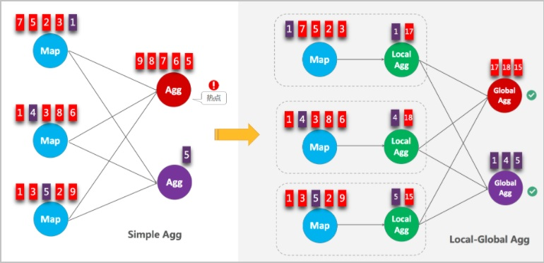

  The LocalGlobal optimization splits the original Aggregate into two stages: Local and Global aggregation. This corresponds to the Combine and Reduce stages in the MapReduce model. In the first stage, upstream nodes locally accumulate a batch of data for aggregation (localAgg) and output the incremental value (Accumulator) of this micro-batch. In the second stage, the system merges the received Accumulators (Merge) to produce the final result (GlobalAgg).

  - Applicable scenarios

    Improve performance for standard aggregations (such as SUM, COUNT, MAX, MIN, and AVG) and resolve data hotspot issues in these scenarios.

  - Usage limits

    LocalGlobal is enabled by default, but has the following limits:

    - It takes effect only when minibatch is enabled.

    - You must implement Merge using AggregateFunction.

  - Verify effectiveness

    Check whether node names in the final generated topology contain GlobalGroupAggregate or LocalGroupAggregate.

- Enable PartialFinal (resolve COUNT DISTINCT hotspot issues)

  To resolve COUNT DISTINCT hotspot issues, you typically need to manually rewrite the query into two-stage aggregation (adding a shuffling layer based on modulo operations on the Distinct Key). Realtime Compute now provides automatic shuffling for COUNT DISTINCT, known as PartialFinal optimization. You no longer need to manually rewrite queries into two-stage aggregation. For a comparison of the principles between PartialFinal and LocalGlobal, see the following figure.

  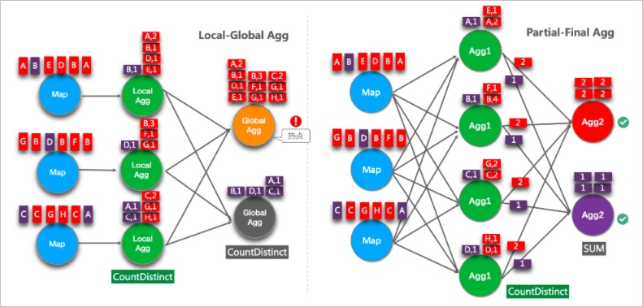

  LocalGlobal optimization works well for standard aggregations (such as SUM, COUNT, MAX, MIN, and AVG), but offers limited improvement for COUNT DISTINCT. This is because the deduplication rate for DISTINCT KEY during Local aggregation is low, causing hotspot issues to persist at the Global node.

  - Applicable scenarios

    Use COUNT DISTINCT when performance requirements for aggregation nodes cannot be met.

    > **Note**
    >
    > - Do not use the PartialFinal optimization method in Flink SQL that contains UDAF.
    >
    > - We do not recommend using the PartialFinal optimization method when data volume is small, as it wastes resources. PartialFinal optimization automatically shuffles data into two-stage aggregation, introducing additional network Shuffle overhead.

  - Enable method

    By default, this feature is disabled. To enable it, add the following code in **Advanced Configuration** > **Additional Flink Configuration** of your deployment.

    ```text
    table.optimizer.distinct-agg.split.enabled: true
    ```

  - Verify effectiveness

    Check whether the final generated topology changes from single-stage aggregation to two-stage aggregation.

- Rewrite AGG WITH CASE WHEN as AGG WITH FILTER syntax (improve performance in scenarios with numerous COUNT DISTINCT operations)

  Statistical jobs often need to calculate UVs across various dimensions, such as total network UV, UV from mobile clients, and UV from PCs. We recommend using the standard AGG WITH FILTER syntax instead of CASE WHEN to implement multi-dimensional statistics. The current SQL editor in Realtime Compute can analyze the Filter parameter. This allows different COUNT DISTINCT calculations on the same field under different conditions to share State, reducing read and write operations on State. Performance tests show that using AGG WITH FILTER syntax instead of CASE WHEN can double performance.

  - Applicable scenarios

    Significant performance improvement occurs when calculating COUNT DISTINCT results under different conditions on the same field.

  - Original syntax

    ```text
    COUNT(distinct visitor_id) as UV1 , COUNT(distinct case when is_wireless='y' then visitor_id else null end) as UV2
    ```

  - Optimized syntax

    ```text
    COUNT(distinct visitor_id) as UV1 , COUNT(distinct visitor_id) filter (where is_wireless='y') as UV2
    ```

**Recommended Flink SQL optimization solutions**

- TopN optimization tips

- Efficient deduplication solutions

- Efficient built-in functions

**TopN optimization tips**

- TopN algorithm

  When the input of TopN is an append-only stream (for example, a Source), TopN uses only one algorithm: AppendRank. When the input of TopN is an update stream (for example, after AGG or JOIN computation), TopN has three algorithms. Listed from highest to lowest performance, they are: UpdateFastRank, UnaryUpdateRank, and RetractRank. The algorithm name appears on the node name of the topology diagram.

  - UpdateFastRank: The optimal algorithm.

    To use this algorithm, you must meet two conditions:

    - The input stream contains PK (Primary Key) information, for example, ORDER BY AVG.

    - The update of the sort field is monotonic, and its monotonic direction is opposite to the sort direction. For example, ORDER BY COUNT/COUNT_DISTINCT/SUM (positive numbers) DESC.

      To obtain the optimized plan, when you use ORDER BY SUM DESC, add a filter condition to ensure that **total_fee** is positive.

      ```text
      insert
        into print_test
      SELECT
        cate_id,
        seller_id,
        stat_date,
        pay_ord_amt  -- Do not output the rownum field to reduce the output volume of the result table.
      FROM (
          SELECT
            *,
            ROW_NUMBER () OVER (
              PARTITION BY cate_id,
              stat_date  -- Include a time field. Otherwise, State expiration may cause 
      data corruption.
              ORDER
                BY pay_ord_amt DESC
            ) as rownum  -- Sort based on the upstream sum result.
          FROM (
              SELECT
                cate_id,
                seller_id,
                stat_date,
                -- Key point. Declare that all parameters of Sum are positive, so the Sum result is monotonically increasing. Therefore, TopN can use the optimized algorithm to fetch only the top 100 records.
                sum (total_fee) filter (
                  where
                    total_fee >= 0
                ) as pay_ord_amt
              FROM
                random_test
              WHERE
                total_fee >= 0
              GROUP
                BY cate_name,
                seller_id,
                stat_date,
                cate_id
            ) a
          ) WHERE
            rownum <= 100;                           
      ```

  - UnaryUpdateRank: The algorithm with performance second only to UpdateFastRank. To use this algorithm, the input stream must contain PK information.

  - RetractRank: A standard algorithm with the worst performance. We do not recommend using this algorithm in production environments. Check whether the input stream contains PK information. If it does, use the UnaryUpdateRank or UpdateFastRank algorithm for optimization.

- TopN optimization methods

  - Rank-free optimization

    The TopN output result does not need to display the rownum value. Perform sorting only once during final frontend display, which can greatly reduce the data volume written to the result table. For more information about rank-free optimization, see Top-N.

  - Increase the TopN cache size

    TopN has a State Cache layer to improve performance by enhancing State access efficiency. The formula for calculating the TopN cache hit rate is as follows.

    ```text
    cache_hit = cache_size*parallelism/top_n/partition_key_num
    ```

    For example, if Top100 configures a cache of 10,000 entries with parallelism of 50, and the dimension of the PatitionBy key is large (for example, at the level of 100,000), the cache hit rate is only **10000\*50/100/100000=5%**. The low hit rate causes most requests to hit State (disk), significantly degrading performance. Therefore, when the dimension of the PartitionBy key is particularly large, appropriately increase the TopN cache size. We also recommend appropriately increasing the Heap Memory of the TopN node.

    ```text
    blink.topn.cache.size: 200000
    ```

    The default value is 10,000 entries. After adjusting the TopN cache to 200,000, the theoretical hit rate reaches **200000\*50/100/100000 = 100%**.

  - Include a time-based field in the PartitionBy fields

    For example, for daily rankings, include the Day field. Otherwise, the final TopN result may become corrupted due to State TTL.

**Efficient deduplication solutions**

Source data in Realtime Compute sometimes contains duplicate records in certain scenarios. Deduplication is a frequently requested feature by users. Realtime Compute provides two deduplication solutions: keep the first row (Deduplicate Keep FirstRow) and keep the last row (Deduplicate Keep LastRow).

- Syntax

  Since SQL does not directly support deduplication syntax and requires flexible retention of either the first or last row, we use the SQL ROW_NUMBER OVER WINDOW function to implement deduplication syntax. Deduplication is essentially a special type of TopN.

  ```text
  SELECT *
  FROM (
     SELECT *,
      ROW_NUMBER() OVER (PARTITION BY col1[, col2..]
       ORDER BY timeAttributeCol [asc|desc]) AS rownum
     FROM table_name)
  WHERE rownum = 1
  ```

  | Parameter | Description |
  | --- | --- |
  | ROW_NUMBER() | An OVER window function that calculates row numbers. Row numbering starts from 1. |
  | PARTITION BY col1\[, col2..\] | Optional. Specifies the columns for partitioning, which are the deduplication KEYS. |
  | ORDER BY timeAttributeCol \[asc\|desc\]) | Specifies the column for sorting. It must be a time attribute field (Proctime or Rowtime). You can specify ascending order (Keep FirstRow) or descending order (Keep LastRow). |
  | rownum | Supports only <code> rownum=1 </code> or <code> rownum&lt;=1 </code>. |

  As shown in the preceding syntax, deduplication requires two layers of queries:

  <ol type="i">

  <li>

  Use the  `ROW_NUMBER()`  window function to sort data based on the time attribute column and assign a rank.

  - When the sort field is a Proctime column, Flink deduplicates based on system time, and the result of each run is non-deterministic.

  - When the sort field is a Rowtime column, Flink deduplicates based on business time, and the result of each run is deterministic.

  </li>

  <li>

  Filter the ranks and retain only the first row to achieve deduplication.

  </li>

  </ol>

  The sort direction can be ascending or descending based on the time column:

  - Deduplicate Keep FirstRow: Sort in ascending order and retain the first row.

  - Deduplicate Keep LastRow: Sort in descending order and retain the first row.

- Deduplicate Keep FirstRow

  The strategy for keeping the first row retains the first record that appears under a KEY and discards subsequent records under the same KEY. Since STATE stores only KEY data, this strategy offers better performance. The following is an example.

  ```text
  SELECT *
  FROM (
    SELECT *,
      ROW_NUMBER() OVER (PARTITION BY b ORDER BY proctime) as rowNum
    FROM T
  )
  WHERE rowNum = 1
  ```

  In this example, table T is deduplicated based on field b, retaining the first record according to system time. Here, proctime is a field in source table T with Processing Time attribute. If you deduplicate based on system time, you can simplify the proctime field to a proctime() function call, omitting the declaration of the proctime field.

- Deduplicate Keep LastRow

  The strategy for keeping the last row retains the last record that appears under a KEY. This strategy offers slightly better performance than the LAST_VALUE function. The following is an example.

  ```text
  SELECT *
  FROM (
    SELECT *,
      ROW_NUMBER() OVER (PARTITION BY b, d ORDER BY rowtime DESC) as rowNum
    FROM T
  )
  WHERE rowNum = 1
  ```

  In this example, table T is deduplicated based on fields b and d, retaining the last record according to business time. Here, rowtime is a field in source table T with Event Time attribute.

**Efficient built-in functions**

When you use built-in functions, note the following points:

- Replace user-defined functions with built-in functions.

  Realtime Compute continuously optimizes its built-in functions. Use built-in functions instead of user-defined functions whenever possible. Realtime Compute has optimized built-in functions in the following ways:

  - Optimize the time consumed by data serialization and deserialization.

  - Add features that directly operate on byte units.

- Use single-character delimiters for KEY VALUE functions.

  Signature of KEY VALUE:  `KEYVALUE(content, keyValueSplit, keySplit, keyName)` . When keyValueSplit and KeySplit are single characters, such as a colon (:) or comma (,), the system uses an optimized algorithm to directly search for the required keyName value on binary data without splitting the entire content. This improves performance by approximately 30%.

- Notes on LIKE operations.

  - To perform a StartWith operation, use  `LIKE 'xxx%'` .

  - To perform an EndWith operation, use  `LIKE '%xxx'` .

  - To perform a Contains operation, use  `LIKE '%xxx%'` .

  - To perform an Equals operation, use  `LIKE 'xxx'` , which is equivalent to  `str = 'xxx'` .

  - To match an underscore (_), escape it properly:  `LIKE '%seller/_id%' ESCAPE '/'` . In SQL, the underscore (_) is a single-character wildcard that matches any character. If you declare   `LIKE '%seller_id%'` , it matches not only  `seller_id`  but also  `seller#id` ,  `sellerxid` , or  `seller1id` , leading to incorrect results.

- Use regular expression functions (REGEXP) with caution.

  Regular expressions are very time-consuming operations, typically incurring performance overhead hundreds of times greater than addition, subtraction, multiplication, or division. In some extreme cases, regular expressions may enter infinite loops, causing job blocking. For specific situations, see Regex execution is too slow. Therefore, we recommend using LIKE.

<a id="section-2"></a>

# 2.Flink application O&M

The Apsara Infrastructure Management Console allows you to view details of Flink application product instances. This topic describes how to view details of Flink application product instances.

**View Flink application product instances**

1. Log in to the Apsara Infrastructure Management Console.

   <ol type="i">

   <li>

   Open your browser.

   </li>

   <li>

   Log in to the Apsara Uni-manager Operations Console.

   </li>

   </ol>

   In the address bar, enter the access address of the Apsara Uni-manager Operations Console and press Enter. Then, enter your correct username and password, and click **Log In**.

   > **Note**
   >
   > Obtain the username and password for logging in to the Apsara Uni-manager Operations Console from your deployment personnel or administrator.

   <ol type="i" start="3">

   <li>

   In the top navigation bar, click **Platform Operation > Apsara Infrastructure**

   </li>

   </ol>

   **Management > Resource Management**.

2. View details of Flink product instances.

   <ol type="i">

   <li>

   In the left-side navigation pane, select **Resource Management > Product & Cluster O&M**.

   </li>

   <li>

   In the search box labeled **Product|Cluster** under **Products**, search for the keyword

   </li>

   </ol>

   **realtime-compute-flinkonoss**. Then, click **Cluster Details** in the **Actions** column for your target cluster.

   <ol type="i" start="3">

   <li>

   On the **Services** tab, click **Details** in the **Actions** column.

   </li>

   <li>

   Under **Components**, click the name of the target component. You can then view detailed information about the component in the right-side panel. See the following example figure:

   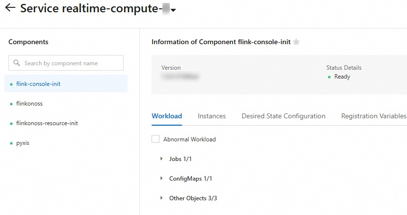

   </li>

   </ol>

<a id="section-3"></a>

# 3.Deep inspection for Realtime Compute for Apache Flink

Deep inspection covers and aggregates monitoring and alerting, resource usage, and key metrics for Realtime Compute for Apache Flink. This feature gives you a visual overview of the platform health status to avoid unexpected risks before they cause major issues or failures, thus ensuring stability.

**Background information**

This topic introduces deep inspection for Realtime Compute for Apache Flink from the following aspects.

<table>
  <tr>
    <th colspan="2">Inspection item</th>
    <th>Description</th>
    <th>Related topics</th>
  </tr>
  <tr>
    <td colspan="2">Cluster inspection</td>
    <td>Perform routine maintenance and critical project assurance. Check whether control components are in normal state and whether the product has reached its desired state.</td>
    <td>Cluster inspection</td>
  </tr>
  <tr>
    <td colspan="2">Cluster component status check</td>
    <td>Check whether cluster components have started and are running normally.</td>
    <td>Cluster component status inspection</td>
  </tr>
  <tr>
    <td colspan="2">Flink resource usage</td>
    <td>Check whether cluster resource utilization is within the normal range.</td>
    <td>Flink resource usage</td>
  </tr>
  <tr>
    <td rowspan="2">Stream task health check</td>
    <td>Session and job pod health check</td>
    <td>Check whether stream tasks are running healthily and whether failures have occurred.</td>
    <td>Session and job pod health check</td>
  </tr>
  <tr>
    <td>Verify that tasks are processing data normally</td>
    <td>Check whether stream tasks are producing data and whether failures have occurred.</td>
    <td>Verify that tasks are processing data normally</td>
  </tr>
</table>

**Notes**

Deep inspection covers, but is not limited to, platform systems, hardware, inventory, user instance usage in the cloud platform, business data volume, and business request pressure.

**Cluster inspection**

1. Log in to Apsara Infrastructure Management.

   <ol type="i">

   <li>

   Open your browser.

   </li>

   <li>

   Log in to the Apsara Uni-manager Operations Console.

   </li>

   </ol>

   In the address bar, enter the endpoint of the Apsara Uni-manager Operations Console and press Enter. Then, enter the correct username and password and click **Log In**.

   > **Note**
   >
   > Obtain the username and password for logging in to the Apsara Uni-manager Operations Console from the deployment personnel or administrator.

   <ol type="i" start="3">

   <li>

   In the top navigation bar, click **Platform Operation**.

   </li>

   <li>

   Select **Apsara Infrastructure Management > Resource Management**.

   </li>

   </ol>

2. Check whether the Flink cluster is in the **Ready** status.

   <ol type="i">

   <li>

   In the left-side navigation pane, click **Product & Cluster O&M**.

   </li>

   <li>

   In the search box labeled **Product | Cluster** under **Products**, search for **realtime-**

   </li>

   </ol>

   **compute-flinkonoss**.

   <ol type="i" start="3">

   <li>

   View the status of the target cluster.

   </li>

   </ol>

3. Verify that the inspection result meets requirements.

   Inspection requirements:

   - **Ready** status: The realtime-compute-flinkonoss cluster must be free of exceptions and available for normal use.

   - **Not Ready** status: If the realtime-compute-flinkonoss cluster is abnormal, investigate why pods in the workspace failed to start.

**Cluster component status inspection**

1. Log in to the OPS1 host.

2. Run the following Kubernetes command to view the status of cluster components.

   ```bash
   kubectl get appinstance -nark-system -lproduct=realtime-compute | grep -v hdfs | grep-v sre-flink |grep -v ververica
   ```

   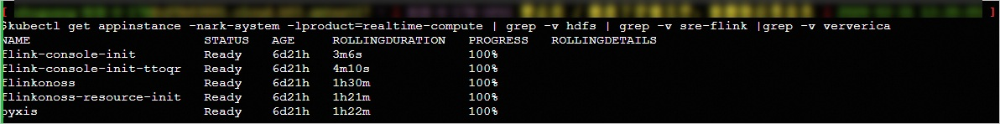

3. Verify that the inspection result meets requirements.

   Inspection requirement: All app instances in the query result must be in the Ready status.

**Flink resource usage**

1. Log in to the OPS1 host.

2. Run the following Kubernetes command to view Flink resource usage.

   ```bash
   kubectl top node -l flinkonoss=true
   ```

   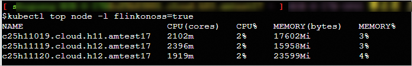

3. Verify that the inspection result meets requirements.

   Inspection requirement: CPU% and MEMORY% must not exceed 90%.

**Session and job pod health check**

1. Log in to the Realtime Compute for Apache Flink development console by using your user account.

   For more information, see the **Realtime Compute for Apache Flink (Compute-Storage Separation Edition) User Guide > Log in to the Realtime Compute for Apache Flink development console** section.

2. Obtain and record the name of the target namespace and the workspace ID.

   - How to obtain the namespace name

     In **Workspaces**, find the name of the target namespace.

     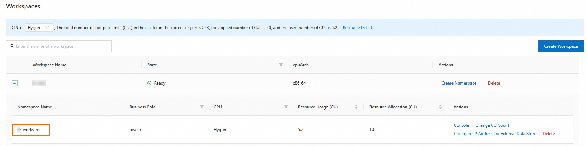

   - How to obtain the workspace ID

     Click **Console** in the **Actions** column corresponding to the target namespace to go to the Realtime Compute for Apache Flink development console. In the address bar at the top, obtain the ID that follows workspaces.

3. Log in to the OPS1 host.

4. Run the following Kubernetes commands in sequence to view the health information of session and job pods.

   <ol type="i">

   <li>

   Run the following command to confirm the information that contains both the target workspace ID and namespace name.

   ```bash
   kubectl get ns | grep $<Workspace ID> | grep $<Namespace>
   ```

   > **Note**
   >
   > `$<Workspace ID>`  and  `$<Namespace>`  must be replaced based on the results obtained in Step 2.

   The system returns a result similar to the following:

   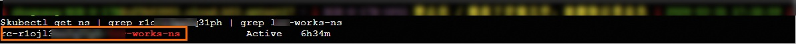

   </li>

   <li>

   Run the following command to view the health information of session and job pods.

   </li>

   </ol>

   ```bash
   kubectl get po -n $<works-ns> |egrep  "^job|^session"     
   ```

   > **Note**
   >
   > `$<works-ns>`  must be replaced based on the query result in Step a.

   The system returns a result similar to the following:

   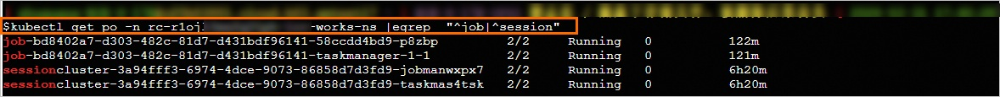

5. Verify that the inspection result meets requirements.

   Inspection requirements:

   - All pods are pods that provide actual services for stream tasks.

   - The STATUS must be Running.

   - No recent RESTARTS have occurred.

   - The AGE must exceed 5 minutes.

**Verify that tasks are processing data normally**

1. Log in to the Realtime Compute for Apache Flink development console by using your user account.

   For more information, see the **Realtime Compute for Apache Flink (Compute-Storage Separation Edition) User Guide > Log in to the Realtime Compute for Apache Flink development console** section.

2. In the left-side navigation pane, click **Deployments**.

3. Click the name of the target deployment.

4. Click the **Status** tab and follow the steps to verify the following items.

   - If data is available at the source, verify that the amount of data processed by the task steadily increases.

     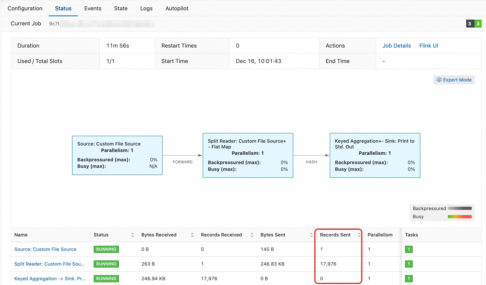

   - Verify that all tasks are not backpressured, except for tasks currently catching up with data.

     Click the name of the target running status to expand the details tab and click **BackPressure**.

     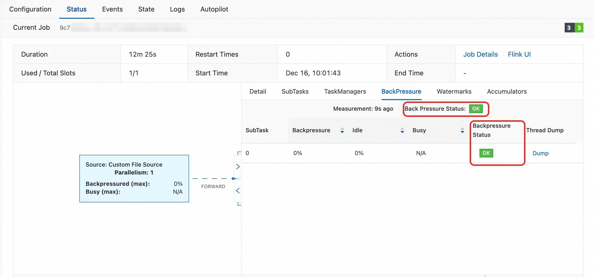

   - Verify that no exception information has occurred within the last 30 minutes.

     Click the **Logs** tab and then click **JM Exceptions**.

     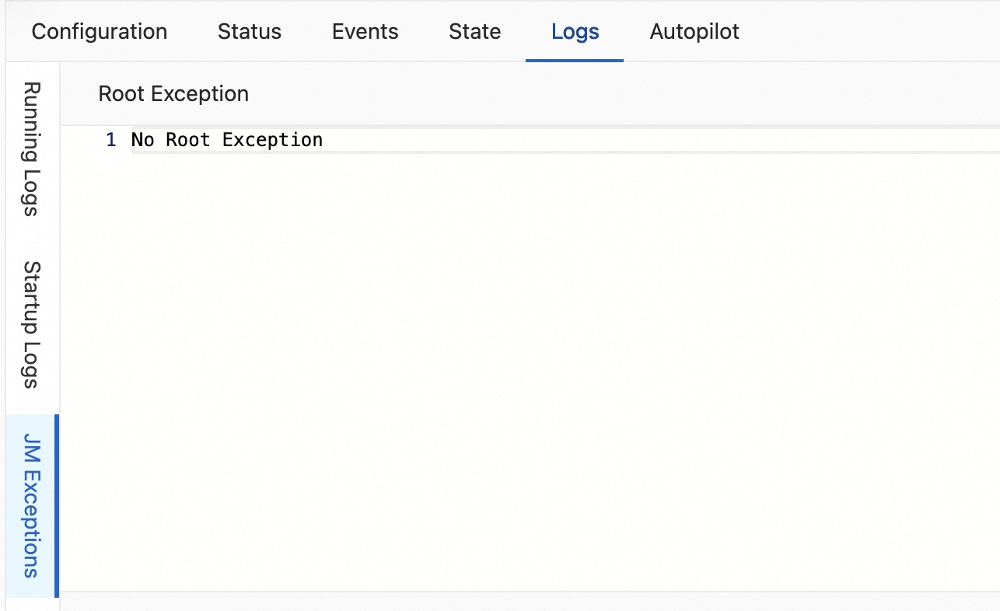

5. Verify that the inspection result meets requirements.

   Inspection requirements:

   - All tasks must be in the CANCELLED or RUNNING state. Tasks that remain in other states for a long time are considered abnormal.

   - The Records sent metric for the source node increases upon each refresh.

   - The BackPressure status of all subtasks in operators is OK. No jobs are in the HIGH status.

   - No exception information has occurred within the last 30 minutes, and no frequent exceptions have occurred within the last 24 hours.

<a id="section-4"></a>

# 4.FAQs

This topic describes FAQs about Alibaba Cloud Realtime Compute for Apache Flink.

**The Flink deployment does not start for a long time. How do I troubleshoot this issue?**

To troubleshoot the issue where a deployment does not start for a long time in Alibaba Cloud Apsara Stack Realtime Compute for Apache Flink, follow this structured approach. The process combines key dimensions such as job status, cluster mode, resource scheduling, network connectivity, and platform dependencies.

**Console-based troubleshooting**

**Check the current deployment status**

1. Log in to the Realtime Compute for Apache Flink development console.

2. In the left-side navigation pane, click **Deployments**.

3. On the **Deployments** page, confirm the current deployment status.

   The following table describes deployment statuses:

   - TRANSITIONING: The deployment is starting (intermediate state). Possible causes include slow resource scheduling, dependency wait, or JM/TM (Job Manager/Task Manager) startup delay.

   - FAILED: The deployment failed to start. Check logs to locate the specific error.

   - ClusterUnreachable: VVP cannot connect to JobManager. This indicates that JM is not running properly or the network is unreachable.

   If the status remains TRANSITIONING for a long time, focus on checking resources and JM/TM startup. If the status is ClusterUnreachable, prioritize checking whether the JM pod is ready and reviewing network policies.

**Confirm deployment mode and resource availability**

- Session cluster mode

  - Check the Session cluster status

    You must manually start the session cluster in advance. If not started, find the target session cluster, click **Start** in the **Actions** column to set its status to **RUNNING**.

  - Check resource configuration

    If resources are insufficient, new deployments will be stuck in the scheduling phase. Ensure that the session cluster has sufficient resource allocation. Perform the following steps:

    <ol type="a">

    <li>

    Find the target session cluster, and click **Edit** under the **Actions** column.

    </li>

    <li>

    In the **Configure Session Cluster** page, modify resource information in the **Configuration** section.

    > **Note**
    >
    > You cannot modify resource information for a session cluster whose status is **RUNNING**. Stop the cluster first if modification is required.

    </li>

    </ol>

- Per-Job cluster mode The system dynamically requests resources when you submit a deployment. Insufficient resources, image pull failures, or quota limits can prevent cluster creation. Example error message:

  ```text
  quota：k8s-xxx，requested： cpu=1， used：cpu=150，limited： cpu=150
  ```

  Check whether CPU or memory quotas in the target namespace have reached their upper limits. If so, evaluate whether you need to expand resources.

**CLI-based troubleshooting**

**Session deployment fails to start**

> **Important**
>
> Because the JobManager in a session cluster is shared, any JobManager failure causes all deployments in that cluster to fail. Do not use session clusters in production environments.

Log in to the Realtime Compute for Apache Flink development console. Go to the session cluster page. Find the target session cluster where the deployment failed to start. Click the cluster name to go to its details page.

**Session resource issues**

Deplolyment scheduling fails if the number of Task Managers or slots is insufficient. We recommend that you first check the following resource issues:

- Check whether the resources allocated to the Job Manager and Task Manager in the current session are sufficient.

- On the **Overview** page of the session cluster, check whether the number of slots available for running deployments in the current session cluster is sufficient.

  > **Note**
  >
  > By default, the number of slots is 1, and each Task Manager has only one slot. If you set the default number of Task Managers to 1 and the number of slots to greater than 1, each Task Manager allocates four slots for running tasks.

**Locate deployment startup exception logs**

On the details page of the target session cluster, go to the Job Manager or Task Manager details page. Check the logs of the Job Manager and Task Manager to identify the specific cause.

**Per-Job deployment fails to start**

Follow these steps to troubleshoot a Per-Job deployment that fails to start:

1. On the **Operations** page, find the deployment that failed to start. Click the deployment name to go to its details page.

2. Check the current status of the deployment. It is usually  `TRANSITIONING`  or  `FAILED` .

   - If the status is  `FAILED` , try viewing events to analyze the specific cause of failure.

     > **Note**
     >
     > Once the deployment enters the FAILED state, the control system forcibly destroys the JobManager and TaskManager pods.

   - If the status is  `TRANSITIONING` , the deployment is being scheduled. In this state, go to the deployment details page and check the JobManager and TaskManager.

     > **Note**
     >
     > First, check whether the JM/TM pods have been started. If the JM pod has started, prioritize checking the JM startup logs and container logs. If both JM and TM pods have started, prioritize checking the TM logs.

**Typical cases**

The following are common symptoms of deployments that fail to be scheduled for a long time and troubleshooting methods.

**TaskManager fails to register with JobManager**

After Flink pulls up the TaskManager pod, the pod attempts to register with the JobManager. If this registration cannot be completed, the deployment fails to start.

> **Note**
>
> In Realtime Compute for Apache Flink Compute-Storage Separation Edition, the system changes the status of a deployment instance to RUNNING after the JobManager is started. However, in Realtime Compute for Apache Flink Enterprise Edition, the system changes the status of a deployment instance to RUNNING only after both the JobManager and TaskManager are started and all TaskManagers register themselves with the JobManager.

Typical scenarios:

- Network fluctuations cause TaskManager requests to time out when they attempt to connect to the JobManager. If network fluctuations are the cause, the process may take slightly longer than expected but will not last 5 to 10 minutes.

- An exception occurs on the JobManager, causing the JobManager to fail to process registration requests from TaskManagers for an extended period. As a result, TaskManager registration requests time out.

Note that in the second scenario, you cannot view TaskManager details in the VVP console. However, you can query and find TaskManager pods in the tenant namespace from OPS.

When you cannot view TaskManager details in the VVP console, perform the following operations:

1. Run the following command on OPS to query pod information in the tenant namespace:

   ```bash
   # Query pods in the tenant namespace for Enterprise Edition.
   # k8s- is a fixed prefix.
   # Replace namespace with the name of your self-managed namespace.
   kubectl get pods -n k8s-${namespace}

   # Query pods in the tenant namespace for compute-storage separation edition.
   # rc- is a fixed prefix.
   # Replace workspaceId with the ID of the workspace created by the tenant.
   # Replace namespace with the name of your self-managed namespace.
   kubectl get pods -n rc-${workspaceId}-${namespace}
   ```

2. After you obtain the pods, filter them based on the deployment ID on the deployment details page in the VVP console.

   If many deployment instances exist in the current namespace, append  `| grep ${jobId}` to the preceding command. Replace  `${jobId}`  with the deployment ID copied from the VVP console. The following figure shows an example:

   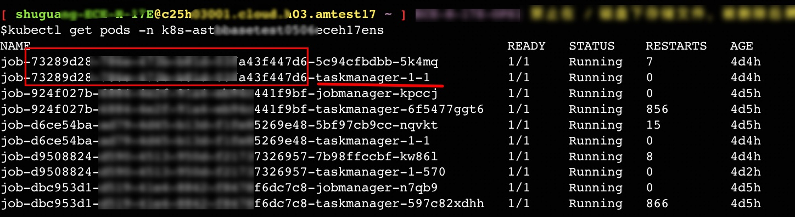

   - If TaskManager pods exist, the issue is likely related to TaskManager registration with the JobManager. Check the exception stack in the JobManager logs of the VVP console. After you resolve the exception, TaskManagers can typically complete registration.

   - If TaskManager pods do not exist, the JobManager likely failed to request the underlying Kubernetes cluster to pull up TaskManager pods. In this case, check the logs of the VVP control component agent.

     ```bash
     # Obtain the Flink Enterprise Edition control pod.
     kubectl get pods -n ververica | grep ververica
     # Obtain the tenant agent component for compute-storage separation edition.
     kubectl get pods -n rc-${workspaceId}-vvp-deploy

     # For Enterprise Edition, check appmanager logs because the agent is part of appmanager.
     kubectl logs ververica-ververica-xxxx -n ververica -c appmanager
     # For compute-storage separation edition, the agent is independently deployed. We recommend that you check both agent and appmanager logs.
     kubectl get pods -n flinkonoss | grep appmanager
     kubectl logs appmanager-xxx -n flinkonoss
     kubectl logs appagent-appagent-xxxs -n rc-${workspaceId}-vvp-deploy
     ```

     Use keywords such as JobId to filter the logs from the preceding queries. If no results are found, enter the appmanager container interactively and export the  `/vvp/logs/appmanager.log`  file for log analysis.

**Slow response from the underlying apiserver causes VVP deployment scheduling requests to time out and interrupt**

- Symptoms

  The deployment remains in the starting state for a long time, and no JobManager or TaskManager is created in the tenant namespace.

- Troubleshooting method

  Locate the issue around the appmanager logs.

- Procedure

  Run the following commands to query appmanager logs:

  ```bash
  # Obtain the appmanager control node.
  # For Flink Enterprise Edition:
  kubectl get pods -n ververica | grep ververica
  # For Flink compute-storage separation edition:
  kubectl get pods -n flinkonoss | grep appmanager

  # Query logs. Replace the placeholders.
  # For Flink Enterprise Edition:
  kubectl logs ${ververica-ververica-xxx-xxx} -n ververica -c appmanager [--since=5m] |grep ${JobId}
  # For Flink compute-storage separation edition:
  kubectl logs ${vvp-appmanager-xxx-xxx} -n flinkonoss [--since=5m] | grep "${JobId}"
  ```

  > **Note**
  >
  > `--since=5m`  is optional and limits log queries to the last 5 minutes, helping you locate recent logs.

  Note: Because appmanager handles deployment scheduling and state machine maintenance, its logs are extensive. When using the  `kubectl`  command, you may not find the desired logs due to the large volume. In this case, enter the appmanager container interactively to view the raw log files.

  ```bash
  # For Flink Enterprise Edition:
  kubectl exec -it ${ververica-ververica-xxx-xxx} -n ververica -c appmanager bash
  # For Flink compute-storage separation edition:
  kubectl exec -it ${vvp-appmanager-xxx-xxx} -n flinkonoss bash

  # Log path:
  cd /vvp/logs
  ls
  ```

  You can then query the log files and archived logs. For example, run the  `cat appmanager.log | grep "xxx"`  command.

  Typically, you can find relevant logs by using the JobId. Find the requestId in the log header and use it with grep to retrieve the complete request trace logs. If you find fields such as  `timeout`  in the appmanager deplolyment scheduling logs, it generally indicates that the underlying apiserver response time is too long.

**External storage IP addresses are not allowlisted, causing connection failures and deployment failures**

- Background In Flink for Apsara Stack v3.18.6, security restrictions require Flink to use network policies for network isolation. By default, external storage components cannot be accessed except for business network segments and essential underlying components (such as apiserver and coredns). You must use the VVP console to allowlist IP addresses for the current namespace to enable access.

- Symptoms

  The JobManager of a Flink deployment fails to start for a long time. Logs show errors such as  `connection timeout`  or  `SocketTimeOut` , typically caused by missing IP allowlisting.

- Verification method

  <ol type="i">

  <li>

  Log in to the Realtime Compute for Apache Flink management console.

  </li>

  <li>

  Find the target namespace and click **Operation** > **Configure an external storage IP**

  </li>

  </ol>

  **address**.

  <ol type="i" start="3">

  <li>

  Check whether the IP address corresponding to the timed-out domain name is allowlisted

  </li>

  </ol>

  here. If not, add the IP address to the allowlist.

**Slow network policy enforcement or low Rama IP allocation efficiency causes deployment startup timeouts**

- Background

  - In Apsara Stack v3.18.6, after enabling network policy allowlists, the underlying network components use iptables for network isolation by default. In some customer environments, a large number of allowlisted IP addresses in a single namespace caused long delays in network policy enforcement during each deployment startup.

  - During Flink deployment scheduling, after JobManager and TaskManager pods are pulled up, they perform network isolation detection (waiting for network policy enforcement). If the deployment does not run within a certain period after the JobManager pod is successfully created (typically 5 minutes by default), the JobManager considers the deplpyment unstartable and forcibly enters a failed state.

  - After successful network policy detection, JobManager and TaskManager pods request IP addresses from the underlying container network component Rama.

- Symptom identification

  First, determine whether the JobManager and TaskManager pods being pulled up have Init Containers.

  ```bash
  # k8s- is a fixed prefix. Replace the placeholder.
  kubectl get pods -n k8s-${namespace}
  # rc- is a fixed prefix. Replace the placeholder.
  kubectl get pods -n rc-${workspaceId}-${namespace}
  ```

  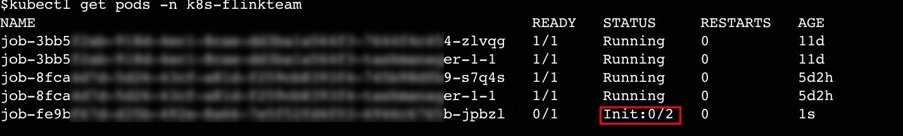

  If the Init Container runs for minutes, network policy detection is slowing down the overall deployment startup. Consider upgrading to version sp006 or later to use the optimized network plug-in solution. If excessive IP allowlisting is the cause, contact Alibaba Cloud technical support.

  When a large number of deployments start simultaneously, each pod creation requests an IP address from Rama. If the volume is too high, Rama's internal queue may become overwhelmed, causing slow Rama responses.

  ```bash
  # For Flink Enterprise Edition:
  kubectl get pods -n k8s-${namespace}
  kubectl describe pod ${xxxx} -n k8s-${namespace}
  # For Flink compute-storage separation edition:
  kubectl get pods -n -${workspaceId}-${namespace}
  kubectl describe pod ${xxxx} -n -${workspaceId}-${namespace}
  ```

  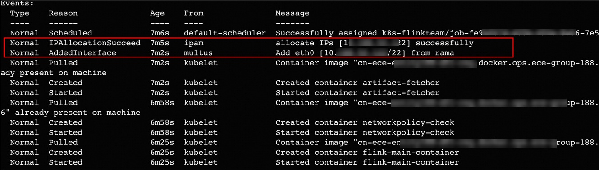

  Check whether this result shows prolonged retries due to failures. When this issue overlaps with slow network policy enforcement, deployment scheduling and startup processes easily time out, causing JobManager forced termination and eventual deployment failure.
