Alibaba Cloud  
Apsara Stack  
Realtime Compute  
Realtime Compute for Apache  
Flink (Compute-Storage  
Separation Edition) User  
Guide  
Product Version: v3.18.6-2607  
Document Version: 20260831

**Table of Contents**

- [1.What is Realtime Compute for Apache Flink?](#section-1)
- [2.Preparations](#section-2)
    - [2.1. Log in to the Realtime Compute for Apache Flink development console](#section-2-1)
    - [2.2. Go to the overview page](#section-2-2)
    - [2.3. Create a workspace](#section-2-3)
    - [2.4. Create a namespace](#section-2-4)
- [3.Getting started](#section-3)
    - [3.1. Quick start with Flink SQL jobs](#section-3-1)
    - [3.2. Quick start for Flink JAR jobs](#section-3-2)
- [4.Data development](#section-4)
    - [4.1. Flink CDC data ingestion](#section-4-1)
        - [4.1.1. Sync data from MySQL to Paimon](#section-4-1-1)
    - [4.2. Develop a deployment](#section-4-2)
        - [4.2.1. Sample center](#section-4-2-1)
            - [4.2.1.1. Data synchronization template](#section-4-2-1-1)
            - [4.2.1.2. Code templates](#section-4-2-1-2)
        - [4.2.2. SQL job development](#section-4-2-2)
        - [4.2.3. Develop a JAR draft](#section-4-2-3)
        - [4.2.4. Python job development](#section-4-2-4)
            - [4.2.4.1. Python dependencies](#section-4-2-4-1)
        - [4.2.5. Debug a deployment](#section-4-2-5)
- [5.O&M center](#section-5)
    - [5.1. Deployment O&M](#section-5-1)
        - [5.1.1. Job deployment](#section-5-1-1)
        - [5.1.2. Start a deployment](#section-5-1-2)
        - [5.1.3. Stop a deployment](#section-5-1-3)
        - [5.1.4. Tune a deployment](#section-5-1-4)
            - [5.1.4.1. Configure auto-tuning](#section-5-1-4-1)
            - [5.1.4.2. Configure job resources](#section-5-1-4-2)
        - [5.1.5. Dynamic parameter update](#section-5-1-5)
    - [5.2. Configure session clusters](#section-5-2)
    - [5.3. Default deployment configurations](#section-5-3)
- [6.Manage data](#section-6)
    - [6.1. Manage user-defined functions (UDFs)](#section-6-1)
    - [6.2. Manage Paimon catalogs](#section-6-2)
    - [6.3. Manage Hologres catalogs](#section-6-3)
- [7.Manage custom connectors](#section-7)
- [8.Manage artifacts](#section-8)
- [9.Security services](#section-9)
    - [9.1. Access security](#section-9-1)
    - [9.2. Manage variables](#section-9-2)
    - [9.3. Manage permissions](#section-9-3)
        - [9.3.1. Authorization guidelines](#section-9-3-1)
        - [9.3.2. Authorization policies in the management console](#section-9-3-2)
        - [9.3.3. Authorization policies in the development console](#section-9-3-3)
    - [9.4. Configure the IP address of external storage](#section-9-4)
- [10.Job migration](#section-10)
- [11.Flink MCP Server](#section-11)
- [12.FAQ](#section-12)

<a id="section-1"></a>

# 1.What is Realtime Compute for Apache Flink?

Realtime Compute for Apache Flink is an end-to-end, high-performance platform to process big data in real time based on Apache Flink. It is widely used in various scenarios, such as streaming data processing and offline data processing.

**Features**

- Powerful real-time computing

  Realtime Compute for Apache Flink helps simplify the development process by integrating with various features.

  - Realtime Compute for Apache Flink uses a powerful engine that provides the following benefits:

    - Provides Flink SQL that enables automatic data recovery from failures. This ensures accurate data processing when failures occur.

    - Supports various built-in functions, such as string, date, and aggregate functions.

    - Enables accurate control over computing resources. This ensures strict isolation of jobs of different tenants.

  - Realtime Compute for Apache Flink outperforms Apache Flink by three to four times when measured by key performance indicators. For example, in Realtime Compute for Apache Flink, the data processing latency is reduced to seconds or even to sub-seconds. The throughput of a job can reach millions of data records per second. A cluster can consist of thousands of nodes.

  - Realtime Compute for Apache Flink is deeply integrated with various cloud-based data storage systems.

- Managed real-time computing

  Unlike open source or self-managed stream processing services, Realtime Compute for Apache Flink is a fully managed stream computing engine. You can query streaming data without the need to deploy or manage any infrastructure. Realtime Compute for Apache Flink allows you to use streaming data processing services with a few clicks. Realtime Compute for Apache Flink is integrated with various services such as data storage, data development, data O&M, monitoring, and alerting. This allows you to use cost-effective streaming data services for trial and migrate your data for deployment. Realtime Compute for Apache Flink also enables complete isolation between tenants. The isolation and protection extend from the top application layer to the underlying infrastructure layer. This helps ensure the security and privacy of your data.

- Low costs on labors and compute clusters

  A large number of improvements are made to the SQL execution engine. This allows you to create jobs that are more cost-effective than Flink jobs in a more efficient manner. Realtime Compute for Apache Flink is more cost-effective than open source stream frameworks in both development and production costs.

<a id="section-2"></a>

# 2.Preparations

<a id="section-2-1"></a>

## 2.1. Log in to the Realtime Compute for Apache Flink development console

You can manage workspaces and projects in the Realtime Compute for Apache Flink management console, and also develop jobs and perform O&M management in the Realtime Compute for Apache Flink development console. This topic describes how to log in to the Realtime Compute for Apache Flink management console and the Realtime Compute for Apache Flink development console.

**Prerequisites**

- You have obtained the service domain name for the Apsara Uni-manager Management Console from the deployment personnel.

- Use the Google Chrome browser.

**Log in to the Realtime Compute for Apache Flink management console**

1. Enter the URL of the Apsara Uni-manager Management Console in the address bar and press the Enter key.

   

   > **Note**
   >
   > - You can click the current language in the upper-right corner to switch to another language.

2. Enter your username and password.

   > **Note**
   >
   > - You can obtain the username and logon password from an operations administrator.
   >
   > - If this is your first time logging on to the Apsara Uni-manager Management Console, you must change your password. For security, the password must be 10 to 32 characters long and contain uppercase letters, lowercase letters, digits, and special characters. The supported special characters are: !, @, #, $, and %.

3. Select **I Have Read And Agree To The Product Service Agreement, Privacy Agreement, And User Agreement**.

   > **Note**
   >
   > - The link text on the logon page is the title of the agreement document. You can click the link to view the details of the agreement.
   >
   > - The **Product Service Agreement**, **Privacy Agreement**, and **User Agreement** are displayed only if they have been published. If none of these agreements are published, you can skip this step.

4. Click **Account Logon** or **Authorized Logon**.

   > **Note**
   >
   > The Authorized Logon button is displayed only if the global IdP setting for third-party authentication is enabled. This display name can be customized. The default name is "Authorized Logon".

5. If multi-factor authentication (MFA) is enabled for your account, follow the steps for one of the following scenarios:

   > **Note**
   >
   > When you log on from the Internet, multi-factor authentication (MFA) is mandatory by default.

   - **First logon after MFA is enabled**

     <ol type="a">

     <li>

     After you log on with your username and password, the Bind Virtual MFA Device page appears.

     </li>

     <li>

     On the Bind Virtual MFA Device page, follow the on-screen instructions to bind a virtual MFA device.

     </li>

     </ol>

     <ol type="i" start="100">

     <li>

     You have logged in to the console.

     </li>

     </ol>

   - **MFA is already enabled and a device is bound**

     Enter the six-digit MFA code and click **Authenticate**.

6. In the top navigation bar, move the pointer over **Products**, and select **Big Data Computing > Realtime Compute for Apache Flink**.

7. In the lower-right corner, click the  icon to expand or collapse the floating menu as needed.

   <ol type="i">

   <li>

    : Pricing. Click this icon to go to the **Price Calculator** page.

   </li>

   <li>

    : Shopping cart. Click this icon to go to the **CPQ** page.

   </li>

   <li>

    : Apsara Copilot. Click this icon to open the Apsara Copilot dialog box and ask questions in natural

   language for help.

   </li>

   </ol>

**Log in to the Realtime Compute for Apache Flink development console**

1. In the left-side navigation pane, click **Workspace Management** to open the **Workspaces** page.

2. In the target workspace, find the target namespace, and click **Console** in the **Actions** column to open the Realtime Compute for Apache Flink development console.

<a id="section-2-2"></a>

## 2.2. Go to the overview page

The Overview page in the management console of Realtime Compute for Apache Flink displays the number of namespaces in a workspace.

**Procedure**

1. Log in to the Realtime Compute for Apache Flink development console.

2. In the left-side navigation pane, choose **Flink (Compute-Storage Separation Edition) > Overview**.

3. In the **Instance Overview** section, view the number of namespaces in the current workspace.

<a id="section-2-3"></a>

## 2.3. Create a workspace

This topic describes how to create a Flink workspace.

**Prerequisites**

You have created the organization and resource set to which the user belongs, and granted the required permissions to the user.

> **Important**
>
> Complete Authorization policies in the management console first to configure user workspace access permissions. The user must have at least the permissions to create and view Realtime Compute for Apache Flink workspaces.

**Procedure**

1. Log in to the Realtime Compute for Apache Flink management console.

2. In the left-side navigation pane, choose **Flink (Compute-Storage Separation Edition) > Workspace Management**.

3. On the **Workspace List** page, click **Create Workspace**.

4. On the **Create Flink Workspace** page<strong>,</strong> configure the following parameters.

   <table>
     <tr>
       <th colspan="2">Parameter</th>
       <th>Description</th>
     </tr>
     <tr>
       <td rowspan="3">Region</td>
       <td>Organization</td>
       <td>Select the target organization. The organization must be the same as the organization of the created user identity.</td>
     </tr>
     <tr>
       <td>Resource Set</td>
       <td>Select the target resource set.</td>
     </tr>
     <tr>
       <td>Region</td>
       <td>Select a region.</td>
     </tr>
     <tr>
       <td rowspan="3">Basic Informatio n</td>
       <td>Name</td>
       <td>The name of the Flink workspace. You can specify a custom name that meets the following requirements:<br>• The name can contain lowercase letters, digits, hyphens (-), and periods (.). It must start and end with a lowercase letter or a digit.<br>• The name must be unique within the same region.</td>
     </tr>
     <tr>
       <td>Processor Architecture Type</td>
       <td>Select an option as prompted on the interface.</td>
     </tr>
     <tr>
       <td>Username</td>
       <td>The system displays the username of the current logon user by default.</td>
     </tr>
   </table>

5. Confirm and submit the configuration.

   - If you have already created a cloud resource for the **Realtime Compute for Apache Flink** service in Service Management: Verify the preceding parameters and click **Confirm Order**.

   - If you have not created a cloud resource for the **Realtime Compute for Apache Flink** service in Service Management: Verify the preceding parameters and click **Submit**.

     For more information about Service Management, see the **Service Management** chapter in **Apsara Uni-Manager Management Console User Guide**.

   After you submit the configuration, the new workspace appears on the **Workspace List** page. When the status changes from **Configuring** to **Available**, the workspace is created. To delete a workspace, click **Delete** in the Actions column.

<a id="section-2-4"></a>

## 2.4. Create a namespace

This topic describes how to create and manage namespaces in the management console of Realtime Compute for Apache Flink, including permission configuration, procedures, and solutions to common issues.

**Prerequisites**

The target organization and resource set have been created, and the corresponding permissions have been granted to the target user.

> **Important**
>
> The access permissions to target namespaces are configured for the user. For more information about the configuration method, see Authorization policies in the management console. The user must have at least the permissions to create and view the workspaces and namespaces in the management console of Realtime Compute for Apache Flink.

**Procedure**

1. Log in to the Realtime Compute for Apache Flink management console.

2. Create a namespace.

   <ol type="i">

   <li>

   In the left-side navigation pane, choose **Flink (Compute-Storage Separation Edition) > Workspace Management**.

   </li>

   <li>

   Find the workspace that you want to manage, and click **Create Namespace** in the **Actions** column.

   </li>

   <li>

   (Optional) Select a service catalog.

   </li>

   </ol>

   > **Note**
   >
   > - Flink (Compute-storage Decoupled Edition) supports integration with service catalog for operations control. After you create a service catalog, you can customize the relevant parameters, and perform inquiries and workflow review.
   >
   > - After a service catalog is created, the **Billing Method** parameter is displayed when you create a Flink namespace. Currently, only **Pay-as-you-go** is supported.
   >
   > - If you have not created a service catalog, skip this step.

   <ol type="a">

   <li>

   If two or more service catalogs are created, select a service catalog on the page that appears. For more information about how to create a service catalog, see Appendix: Create a service catalog of this topic.

   > **Note**
   >
   > - If only one service catalog exists, it is selected by default and the system automatically navigates to the **Select a Service Directory** interface.
   >
   > - If multiple service catalogs exist, click **Create Namespace** and the system navigates to the **Select Service Catalog** page.

   </li>

   <li>

   After you select the target service catalog, click **Activate service** to go to the **Create Namespace** page<strong>.</strong>

   </li>

   </ol>

   <ol type="i" start="4">

   <li>

   On the **Create Namespace** page, specify the parameters in the **Section** and **Basic Information** sections.

   - **Section**

     | Parameter | Description |
     | --- | --- |
     | Organization | Select the organization to which the user belongs. |
     | Resource Set | Select the target resource set. |
     | Region | Select a region. |

   - **Basic Information**

     | Parameter | Description |
     | --- | --- |
     | Workspace | The current workspace is automatically selected and cannot be changed. |
     | Namespace name | Enter a name for the namespace. The name must meet the following naming conventions:<br>• The name can contain lowercase letters, digits, hyphens (-), and periods (.). It must start and end with a lowercase letter or a digit.<br>• The name must be unique within the same region.<br>• The name can be up to 40 characters in length. |
     | CPU Architecture | Select a chip architecture. |
     | Deployment Mode | Select a deployment mode. Valid values:<br>• Single-zone instance<br>• Example of Disaster Recovery in the Same City |
     | Availability Zone | Select a zone. |
     | CU Resources | Specify the number of CUs based on your business requirements. The number of CUs cannot exceed the remaining number of CUs in the workspace. |
     | User Name | Select a user that has permissions in the current organization as the owner of this namespace. |

   </li>

   </ol>

3. Click **Submit**.

4. Refresh the page after creation. In the target workspace, you can view the information of the created namespace .

**Related operations**

- Go to the development console of Realtime Compute for Apache Flink

  Find the namespace that you want to manage, and click **Console** in the **Operation** column to go to the development console of Realtime Compute for Apache Flink.

- Modify the number of CUs

  > **Note**
  >
  > If service catalogs have been created, you can perform operations control when you change the number of CUs. For more information about how to create a service catalog, see Appendix: Create a service catalog of this topic.

  Find the namespace that you want to manage, click Modify CU quantity in the **Operation** column to adjust the CU quantity, and then click **Confirm Order**.

  > **Important**
  >
  > Reducing the CU quantity may prevent Flink from recovering after a restart. Check the CU usage of the namespace and proceed with caution.

- Configure the IP address of external storage

  Find the namespace that you want to manage, and click **Configure the external storage IP address.** in the **Operation** column to add an IP address or CIDR block. The IP address indicates the virtual IP address (VIP) of the storage domain name. For more information, see Configure the IP address of external storage.

- Delete a namespace

  To delete a namespace, click **Delete** in the **Operation** column.

- View the information about a namespace

  In the search box on the **Workspaces** page, you can search for a workspace by keyword and view the information about the target namespaces.

**Appendix: Create a service catalog**

1. In the top navigation bar, choose **Operations > Service Operations**.

2. In the left-side navigation pane, choose **Service Catalog > Service Management**.

3. Click **Create a service** to go to the **Create a service** page.

4. On the **Create a service** page, select a product and resource for the **Product** parameter.

5. Specify other parameters as prompted, such as **Service name** and **Authorization type**.

   > **Note**
   >
   > For more information about parameters, see the **Apsara Uni-manager Management Console User Guide > Operations Center > Service Operations > Service Catalog** section on the Alibaba Cloud Apsara Stack official website.

6. Click **Submit** to create the service catalog. You can create namespaces for the catalog and manage the **Modify CU quantity** parameter.

**FAQ**

- Problem: Why isn't the target Namespace listed, even though my account has the necessary permissions?

  Cause: This can happen for one of two reasons:

  - The resource set that contains the Namespace does not include your account.

  - Your account is not in the same organization as the UID used to create the Namespace.

- Problem: When I go to the Workspace List page, why are some action buttons missing or grayed out?

  Cause:

  - Your resource management role lacks the permissions to create or delete workspaces or projects. Contact your administrator to configure the required access permissions. For more information, see Console authorization.

  - You cannot access the development console because you do not have an assigned business role in the project where the **Console** button is grayed out. Contact the resource owner to assign a business role.

- Problem: Why do I receive a "permission denied" error when I try to create, modify, or delete a project?

  Cause: As shown in the figure, your current role is not authorized to perform these operations. Contact your administrator to configure project access permissions. For more information, see Console authorization.

<a id="section-3"></a>

# 3.Getting started

<a id="section-3-1"></a>

## 3.1. Quick start with Flink SQL jobs

Flink allows you to edit and run jobs by using SQL code. This topic guides you through the process of creating and publishing a Flink SQL job.

**Procedure**

1. Step 1: Create an SQL job and write business code

   On the **Data Development > ETL** page, create a streaming job of the SQL type and write the DDL and DML code.

2. Step 2: Start the job and view the Flink compute results

   On the job O&M page, start the job and check the job running status.

**Step 1: Create an SQL job and write business code**

1. Create an SQL job.

2. Copy the following job code to the job code editing area.

   Create a datagen source table that generates random data and insert the data from the name field of the datagen source table into the blackhole result table. The following code provides an example.

   ```sql
   CREATE TEMPORARY TABLE datagen_source(
     randstr VARCHAR
   ) WITH (
     'connector' = 'datagen'
   );

   CREATE TEMPORARY TABLE print_table(
     randstr  VARCHAR
   ) WITH (
     'connector' = 'print',
     'logger' = 'true'
   );

   INSERT INTO print_table
   SELECT SUBSTRING(randstr,0,8) from datagen_source;
   ```

3. Click **Deep Inspection** to check the syntax.

4. After the deep inspection passes, click **Deployment**.

5. Click **OK**.

**Step 2: Start the job and view the Flink compute results**

1. In the left-side navigation pane, choose **O&M > Deployments**.

2. Click **Start** in the **Actions** column of the target job name.

3. Select **Stateless Start** and click **Start**. For more information, see Start a deployment.

   If the job status changes from the current state to **Running**, the job runs normally.

   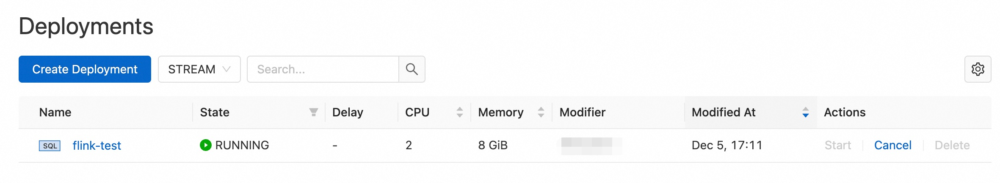

4. View the Flink compute results.

   <ol type="i">

   <li>

   On the **Job O&M** page, click the target job name. The **Deployment Details** page expands by default.

   </li>

   <li>

   On the **Job Log > Operational Log > Running Task Managers** tab, click **Path, ID**.

   </li>

   </ol>

   > **Note**
   >
   > On the **Operational Log** tab, click the drop-down list on the right side of **Job** to select a running job. By default, the system selects the currently running job.

   <ol type="i" start="3">

   <li>

   Select the **Log** tab to view the Flink compute results.

   </li>

   </ol>

   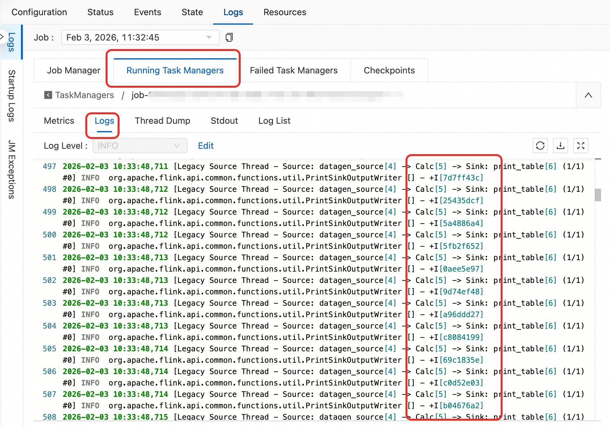

   You can also view the compute results on the **Flink UI** page. For more information, see View startup and operational logs.

<a id="section-3-2"></a>

## 3.2. Quick start for Flink JAR jobs

Flink allows you to create, deploy, and start JAR streaming and batch jobs. This topic guides you through the workflow for Flink JAR jobs.

**Workflow**

Step 1: Develop a JAR package.

Step 2: Upload the test JAR package and data files.

Step 3: Deploy a JAR job and configure job information.

Step 4: View the Flink compute results after you start the job.

**Step 1: Develop a JAR package**

The Realtime Compute development platform does not provide a development environment for JAR packages. You must develop, compile, and package the JAR package on your on-premises machine. For more information, see Develop a JAR draft.

**Step 2: Upload the test JAR package and data files**

1. Log in to the Realtime Compute for Apache Flink development console.

2. In the left-side navigation pane, click **File Management**.

3. Click **Upload Resource** to upload the JAR package and data files that you want to deploy.

   You can download the test files directly for use in subsequent steps.

   - Click FlinkQuickStart-1.0-SNAPSHOT.jar to download the test JAR package.

   - Click Shakespeare to download the Shakespeare input data file.

**Step 3: Deploy a JAR job and configure job information**

**Streaming jobs**

1. In the left-side navigation pane, choose **O&M > Deployments**.

2. Click **Deploy Job** and select **JAR Job**.

3. In the **Deploy JAR Job** dialog box, enter the deployment information.

   | Parameter | Description | Example |
   | --- | --- | --- |
   | Deployment mode | Select Streaming mode. | Streaming mode |
   | Deployment name | Enter the name of the corresponding JAR job. | flink-streaming-test-jar |
   | Engine version | The Flink engine version of the current job.<br>Select a version with the <strong>Recommended</strong> tag.These versions provide higher reliability and better performance. | vvr-11.5.0-flink-1.20 |
   | JAR URI | Select a file from Resource Management in<br>the drop-down list, or click theicon on the<br>right to select and upload a JAR package. | - |
   | Entry Point Class | The entry class of the program. If your JAR package does not specify a main class, enter the standard path of the Entry Point Class here.<br>Note<br>The test JAR package in this topic contains both streaming job code and batch job code. Therefore, you must specify the program entry for the streaming job here. | org.example.WordCountStreaming |
   | Entry Point Main Arguments | Enter the OSS path of the input data file. You can view and copy the path in Manage artifacts.<br>Note<br>In this topic, the input data file and the test JAR package share the same storage path. | --input oss://flink-fullymanaged-&lt;Workspace ID&gt;/artifacts/namespaces/&lt;Project Name&gt;/Shakespeare |

   For more information about configuration parameters, see Job deployment.

4. Click **Deploy**.

**Batch jobs**

1. In the left-side navigation pane, choose **O&M > Deployments**.

2. Click **Deploy Job** and select **JAR Job**.

3. In the **Deploy JAR Job** dialog box, enter the deployment information.

   | Parameter | Description | Example |
   | --- | --- | --- |
   | Deployment Mode | Select Batch mode. | Batch mode |
   | Deployment name | Enter the name of the corresponding JAR job.<br>Note<br>The job name must be unique within the current project. | flink-batch-test-jar |
   | Engine Version | The Flink engine version of the current job.<br>Select a version with the <strong>Recommended</strong> tag.These versions provide higher reliability and better performance. | vvr-11.5.0-flink-1.20 |
   | JAR URI | Select a file from Resource Management in the<br>drop-down list, or click theicon on the right<br>to select and upload a JAR package. | - |
   | Entry Point Class | The entry class of the program. If your JAR package does not specify a main class, enter the standard path of the Entry Point Class here.<br>Note<br>The test JAR package in this topic contains both streaming job code and batch job code. Therefore, you must specify the program entry for the batch job here. | org.example.WordCountBatch |
   | Entry Point Main Arguments | Enter the OSS path of the input data file. You can view and copy the path in Manage artifacts.<br>Note<br>In this topic, the input data file, output file, and test JAR package share the same storage path. | --input oss://flink-fullymanaged-&lt;Workspace ID&gt;/artifacts/namespaces/&lt;Project Name&gt;/Shakespeare<br>--output oss://flink-fullymanaged-&lt;Workspace ID&gt;/artifacts/namespaces/&lt;Project Name&gt;/batch-quickstart-test-output.txt |

   For more information about configuration parameters, see Job deployment.

4. Click **Deploy**.

**Step 4: View the Flink compute results after you start the job**

**Streaming job**

1. After the deployment succeeds, the system redirects to the **Job O&M** page of the job. Find the target job and click **Start** in the **Actions** column.

2. Select **Stateless start** and click **Start**. For more information, see Start a deployment.

3. After the job status changes to **Running**, view the Flink compute results.

   <ol type="i">

   <li>

   On the **Job O&M** page, click the name of the target job. The **Deployment details** page expands by default.

   </li>

   <li>

   On the **Job log > Operational log > Running Task Managers** tab, click **Path, ID**.

   </li>

   </ol>

   > **Note**
   >
   > On the **Operational log** tab, click the drop-down list on the right side of **Job** to select a running job. The system selects the currently running job by default.

   <ol type="i" start="3">

   <li>

   Click **Log list**. In the log file with the **.out** suffix, search for shakespeare to view the Flink compute

   </li>

   </ol>

   results.

   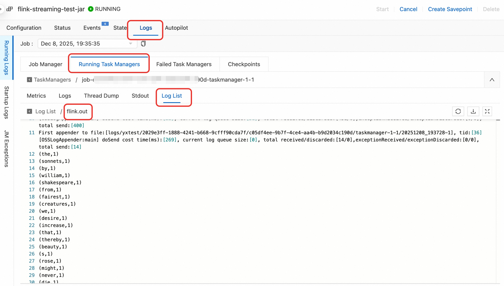

   You can also view the compute results on the **Flink UI** page. For more information, see View startup and operational logs.

**Batch job**

1. After the deployment succeeds, the system redirects to the **Job O&M** page of the job. Find the target job and click **Start** in the **Actions** column.

2. In the **Start job** dialog box, click **Start**.

3. After the job status changes to **Running**, view the Flink compute results.

   <ol type="i">

   <li>

   In the left-side navigation pane, click **Object management**.

   </li>

   <li>

   Click **Download** in the **Actions** column of the batch-quickstart-test-output.txt file to view the file on

   </li>

   </ol>

   your local machine.

   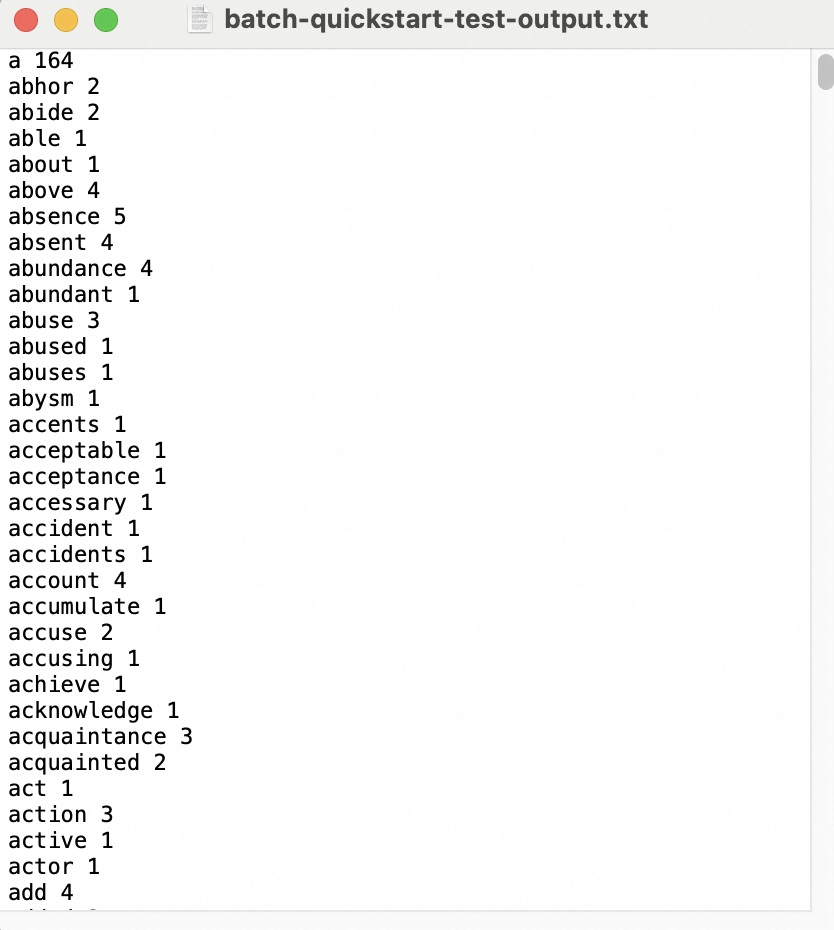

<a id="section-4"></a>

# 4.Data development

Data development provides ETL and data ingestion features. You can develop SQL, JAR, and Python deployments in ETL, and use YAML to configure Flink CDC tasks in data ingestion.

<a id="section-4-1"></a>

## 4.1. Flink CDC data ingestion

<a id="section-4-1-1"></a>

### 4.1.1. Sync data from MySQL to Paimon

Real-time Compute for Apache Flink lets you configure Flink Change Data Capture (CDC) tasks using YAML jobs to ingest data from a source to a sink. This topic describes how to build a Flink CDC data ingestion job to synchronize data from a MySQL database to Paimon.

**Background**

Using YAML jobs with Flink CDC is an effective way to ingest data from a source to a sink. YAML configurations allow you to define complex ETL pipelines that Flink automatically converts into operational logic. Unlike CTAS and CDAS, this data ingestion method also supports ETL processing, WHERE clause filtering, column pruning, and computed columns. This greatly simplifies the data integration process and improves its efficiency and reliability.

Real-time Compute for Apache Flink supports synchronizing data from a MySQL data source to a Paimon data lakehouse by using a YAML configuration. The process involves the following steps:

1. Step 1: Prepare test data and configure an allowlist.

2. Step 2: Develop a Flink CDC data ingestion job.

3. Step 3: Start the Flink CDC ingestion job.

4. Step 4: Verify synchronization.

**Prerequisites**

- You have created a Flink workspace. For more information, see Create a workspace.

- Source and sink storage:

  - An ApsaraDB RDS for MySQL instance is created. For more information, see **Quick Start > Create an instance** in the ApsaraDB RDS for MySQL User Guide.

  - You have created a bucket and a Paimon directory in OSS. For more information, see **Buckets > Create Bucket** and **Objects (Files) > Create Directory** in the Object Storage Service User Guide.

**Step 1: Prepare test data and configure an allowlist**

1. Create an account and a database.

   Create a standard account with database read and write permissions and a database for the target instance. For more information, see **Quick Start > Initial Settings** in the ApsaraDB for RDS User Guide (RDS for MySQL).

2. Log on to the RDS database using Data Management Service (DMS).

   For more information, see **Database Connection > Log on to an RDS database by using DMS** in the ApsaraDB RDS for MySQL User Guide.

3. Create a source table and insert data.

   In the SQL window, enter the following commands to generate test data in the ApsaraDB RDS for MySQL instance, and then click **Execute**.

   ```sql
   CREATE TABLE flink_user (
       id INT AUTO_INCREMENT PRIMARY KEY,
       name VARCHAR(255),
       age INT,
       gender VARCHAR(10)
   );
   INSERT INTO flink_user (name,age,gender) VALUES
     ('zhangsan',18,'M'),
     ('lisi',19,'F'),
     ('wangwu',20,'M');
   ```

4. Log in to the Realtime Compute for Apache Flink console.

5. On the **Workspace List** page, find the target workspace and click **Configure IP Address for External Storage** in the **Actions** column.

6. Click **+IP Address**, enter the IP address information, and then click **OK**.

   <ol type="i">

   <li>

   Obtain the IP address of the ApsaraDB RDS for MySQL instance.

   > **Note**
   >
   > You can log on to the OPS machine and run the  `ping`  command to view the IP address of the endpoint.

   </li>

   <li>

   Add the IP address to the network access allowlist of the current Flink workspace. For more information,

   </li>

   </ol>

   see Configure IP Address for External Storage.

**Step 2: Develop a Flink CDC data ingestion job**

1. Log in to the development console.

2. In the left-side navigation pane, choose **Data Development > Data Ingestion**.

3. Click  and then click **Create Data Ingestion Draft**.

   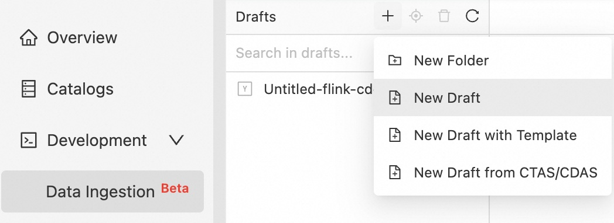

4. Enter a **File Name**, select an **Engine Version**, and then click **Create**.

5. Enter the YAML task configuration.

   This task uses all tables in an RDS MySQL database as the source and an OSS-based Paimon as the sink, synchronizing the source tables to the  `flink`  database. The following code provides an example.

   ```text
   source:
     type: mysql
     # name: Database A to Data warehouse             # Optional. Specify a custom name.
     hostname: rm-1b3r****.mysql.rds.intra.env35.shuguang.com
     port: 3306
     username: ${secret_values.mysqlusername}
     password: ${secret_values.mysqlpassword}
     tables: flink.\.*
     # scan.binlog.newly-added-table.enabled: true    # Enables dynamic discovery of new tables.

   sink:
     type: paimon
     name: Paimon Sink
     catalog.properties.metastore: filesystem
     catalog.properties.warehouse: oss://paimon-test/test/
     catalog.properties.fs.oss.endpoint: oss-cn-****.inter.env35.shuguang.com
     catalog.properties.fs.oss.region: cn-wulan-env35****
     catalog.properties.fs.oss.accessKeyId: ****
     catalog.properties.fs.oss.accessKeySecret: ****
     catalog.properties.fs.oss.signer.version: 1
   ```

**Step 3: Start the Flink CDC ingestion job**

1. On the **Data Ingestion** page, click **Precheck**.

2. Click **Deploy**, and then click **OK** in the dialog box that appears.

3. On the **O&M Center > Job O&M** page, find the target YAML job and click **Start** in the **Actions** column.

4. Select a start mode by clicking **Start without State** or **Start with State**, and then click **Start**.

5. After the job status becomes  `Running` , view the table directory with a  `.db`  suffix in the corresponding OSS Bucket.

**Step 4: Verify synchronization**

1. In the left-side navigation pane, click **Data Development > ETL**. By default, the **Job Drafts** tab is selected.

2. Click the  icon, and then click **Create Stream Job**.

3. Enter the following SQL statement to read Paimon data and verify the sync results.

   ```sql
   CREATE CATALOG paimon_catalog WITH (
     'type' = 'paimon',
     'metastore' = 'filesystem',
     'warehouse' = 'oss://paimon-test/test/',
     'fs.oss.endpoint' = 'oss-cn-wulan-env35-****.inter.env35.shuguang.com',
     'fs.oss.accessKeyId' = '****',
     'fs.oss.accessKeySecret' = '****',
     'fs.oss.signer.version' = '1'
   );

   USE CATALOG paimon_catalog;

   SELECT * FROM flink.flink_user;
   ```

4. In the upper-right corner of the page, click **Run**. The output is shown in the following figure.

   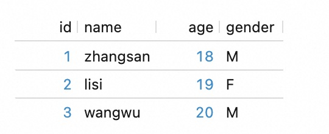

<a id="section-4-2"></a>

## 4.2. Develop a deployment

ETL allows you to develop and debug SQL, JAR, and Python deployments, and quickly create a deployment from the template center.

<a id="section-4-2-1"></a>

### 4.2.1. Sample center

<a id="section-4-2-1-1"></a>

#### 4.2.1.1. Data synchronization template

Flink CDC supports real-time data synchronization and automatically synchronizes table schema changes. You can use a data synchronization template to quickly generate Flink SQL job code for data synchronization. This topic describes how to use the multi-database and multi-table synchronization template or the sharded database and table merge template to synchronize data.

**Background information**

Realtime Compute for Apache Flink supports two data synchronization methods: multi-database and multi-table synchronization and sharded database and table merge. The following table describes the differences between the two methods.

| Synchronization method | Details |
| --- | --- |
| Multi-database and multi-table synchronization | Use the multi-database and multi-table synchronization template when you need to replicate one or more business tables from one or more databases to another database in real time. Flink CDC automatically synchronizes both full and incremental data of the entire database and replicates schema changes, such as column additions, from each source table to the corresponding destination table in real time. The multi-database and multi-table synchronization template converts your parameters into CDAS statements. |
| Sharded database and table merge | Use the sharded database and table merge template when the same business data is distributed across multiple databases or tables. This template merges data from sharded databases and tables with similar schemas into a single destination table. Flink CDC automatically synchronizes both full and incremental data of all sharded databases and tables in the source, including new tables that match the specified regular expression, and replicates schema changes, such as column additions, from each source table to the corresponding destination table in real time. The sharded database and table merge template converts your parameters into CTAS statements. |

**Usage limits**

Data synchronization is supported only from MySQL to Hologres.

**Precautions**

When you synchronize data from MySQL to Hologres, Flink also synchronizes table schema changes. Note the following points:

- You do not need to manually create tables in Hologres.

  Flink automatically creates tables in Hologres. If the corresponding table already exists in Hologres, Flink maps the data based on the destination database and table information that you selected when you created the plan.

- Hologres does not support changes to column data types.

  If the data type of a field in the source table differs from the data type of the corresponding field in the downstream Hologres table, the write operation fails. You must modify the column data type and resynchronize the data.

**Procedure**

**Configure the storage IP addresses for MySQL and Hologres**

1. Log on to the MySQL and Hologres instances to obtain the domain name information of the instances.

2. Log on to the OPS machine and run the  `ping`  command to obtain the IP addresses for the MySQL and Hologres domain names.

3. Configure the storage IP addresses for MySQL and Hologres. For more information, see Configure the IP address of external storage.

**Create MySQL and Hologres catalogs**

1. Log in to the Realtime Compute for Apache Flink development console.

2. In the left-side navigation pane, click **Data Management** to open the **Catalog List** page, and then click **Create Catalog**.

3. In the **Create Catalog** dialog box, select **MySQL** and click **Next** to configure the catalog information.

   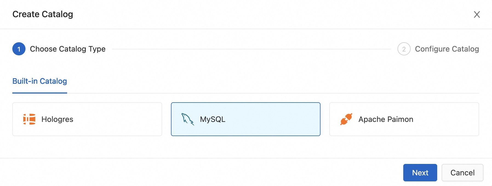

   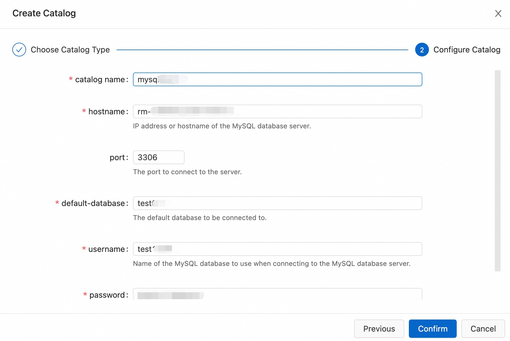

   | Parameter | Description |
   | --- | --- |
   | catalog name | The custom name of the catalog. |
   | hostname | The IP address or hostname of the MySQL database server. |
   | port | The port for connecting to the server. The default value is 3306. |
   | default-database | The name of the default database. |
   | username | The username for connecting to the MySQL database server. |
   | password | The password for connecting to the MySQL database server. |

4. Repeat the preceding steps, select **Hologres**, and then click **Next** to configure the catalog information.

   | Parameter | Description |
   | --- | --- |
   | catalog name | The custom name of the catalog. |
   | endpoint | The connection address of Hologres in the <strong>&lt;host&gt;:&lt;port&gt;</strong> format. |
   | username | The username that matches the dbname parameter. This value is the AccessKey ID of the organization where Hologres resides. |
   | password | The password that matches the dbname parameter. This value is the AccessKey Secret of the organization where Hologres resides. |
   | dbname | The name of the default database that you access in Hologres. |

**Data synchronization**

1. In the left-side navigation pane, click **Development > ETL** to open the **Drafts** tab.

2. Click  and select **Create from template**.

3. On the **Data synchronization template** tab, click the **MySQL to Hologres data synchronization** template name, and then click **Next**.

4. Configure the data synchronization settings.

   <ol type="i">

   <li>

   Configure the source and destination, fill in the **MySQL configuration items**, and then click **Next**.

   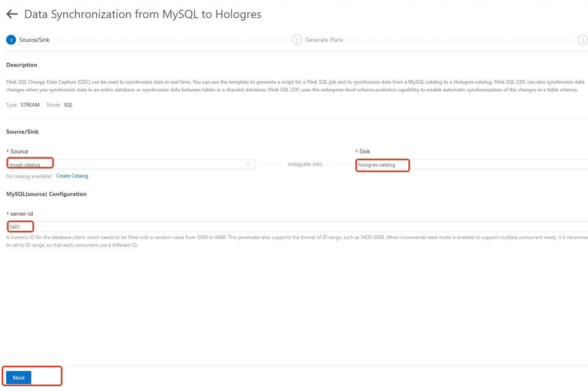

   <table>
     <tr>
       <th>Category</th>
       <th>Configuration item</th>
       <th>Details</th>
     </tr>
     <tr>
       <td rowspan="2">Source</td>
       <td>MySQL Catalog</td>
       <td>You can directly select an existing MySQL Catalog. If you have not created a source MySQL Catalog in advance, click <strong>Create</strong> <strong>Catalog</strong> to create one.</td>
     </tr>
     <tr>
       <td>MySQL server-id</td>
       <td>The unique ID for each MySQL database client. Valid values: 5400 to 6400. This parameter also supports an ID range format, such as 5400-5408. When you enable the incremental read mode with multiple concurrent threads, set this parameter to an ID range so that each concurrent thread uses a different ID.<br>Important<br>Do not use the same server ID as other jobs or services that access the database.</td>
     </tr>
     <tr>
       <td>Destination</td>
       <td>Hologres Catalog</td>
       <td>You can directly select an existing destination Hologres Catalog. If you have not created a destination Hologres Catalog in advance, click <strong>Create Catalog</strong> to create one.</td>
     </tr>
   </table>

   </li>

   <li>

   Create a plan.

   - Multi-database and multi-table synchronization

     <ol type="a">

     <li>

     On the **Multi-database and multi-table synchronization** tab, select the source databases and table names for the destination.

     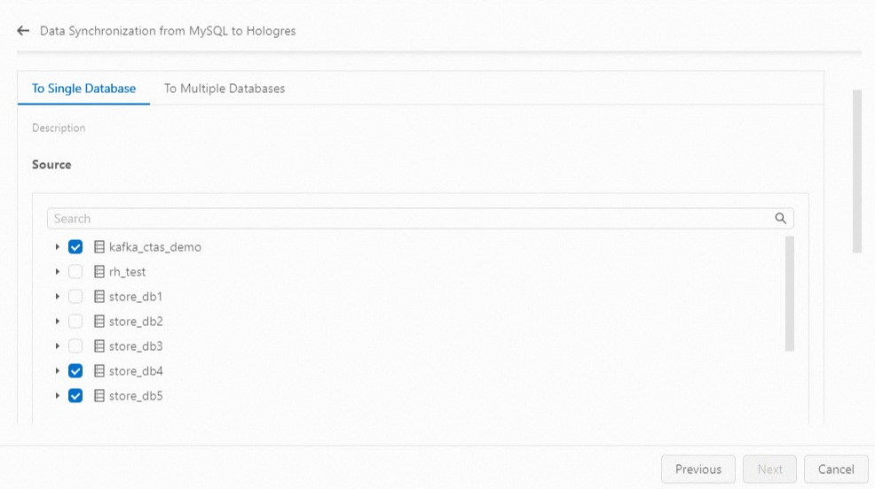

     </li>

     <li>

     Click **Save plan**, and then click **Next**.

     </li>

     </ol>

     <ol type="i" start="100">

     <li>

     Review the SQL code that the system generates based on the destination databases and tables you selected, and then click **OK**.

     You can modify the **File name**, **Storage location**, or **Engine version** as needed.

     </li>

     </ol>

   - Sharded database and table merging

     <ol type="a">

     <li>

     On the **Sharded database and table merging** tab, select the source databases and table names for the destination, or directly enter the destination database and table names you created.

     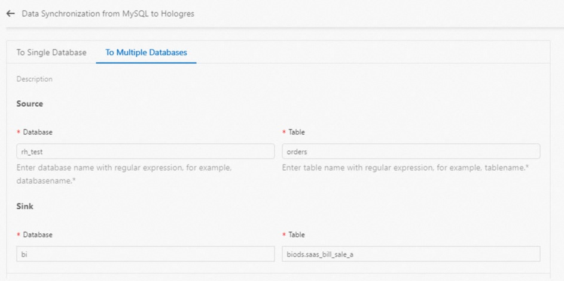

     > **Note**
     >
     > We recommend that you use regular expressions to specify the source database and source table information.

     </li>

     <li>

     Click **Save plan**, and then click **Next**.

     In a single job, you can create multiple plans for multi-database and multi-table synchronization and sharded database and table merging at the same time.

     </li>

     </ol>

     <ol type="i" start="100">

     <li>

     Review the SQL code that the system generates based on the destination databases and tables you selected, and then click **OK**.

     You can modify the **File name**, **Storage location**, or **Engine version** as needed.

     </li>

     </ol>

   </li>

   </ol>

5. Click **Create**.

   After the job is created, the system navigates to the SQL job development page. The subsequent operations are identical to those of standard job development. For parameter configuration details and subsequent operations, see SQL job development and Start a deployment.

<a id="section-4-2-1-2"></a>

#### 4.2.1.2. Code templates

Realtime Compute for Apache Flink provides various code templates. Each code template provides use scenarios, code samples, and instructions. Code templates can help you quickly understand the features and syntax of Realtime Compute for Apache Flink and implement your own business logic. This topic describes the use scenarios for code templates and how to use a code template.

**Usage notes**

If a code template that is used for a draft does not contain the INSERT INTO statement, you cannot deploy the draft.

**Supported code templates**

The following table describes the code templates that are provided by Realtime Compute for Apache Flink and the applicable scenario of each code template. You can view the supported code templates in the Realtime Compute for Apache Flink console.

**Category**

**Template name**

**Applicable scenario**

If you want to create a table and save the table in a catalog, you can

Create Table

execute the CREATE TABLE statement. The operation on a table is similar to the operation on a database.

If you want to use a table only in the current session or an SQL script, you

Create Temporary

can execute the CREATE TEMPORARY TABLE statement to create a

Table

temporary table.

If you want to reuse code, create a long query, or write an SQL script to

Create Temporary

simplify draft development when you develop a Flink SQL draft, you can

View

execute the CREATE TEMPORARY VIEW statement to create a temporary view.

Basic templates

If you want to write query results to a table in a downstream storage

INSERT INTO

system, you can execute the INSERT INTO statement.

If you want to write query results to two or more downstream storage

STATEMENT SET

systems, you can use the STATEMENT SET syntax.

If you want Realtime Compute for Apache Flink to correctly process out-of-order data, you can use the WATERMARK clause in DDL statements. You can use the WATERMARK clause in a CREATE TABLE DDL statement to

Watermark

create a watermark. This clause defines an expression to generate watermarks based on an existing field and marks the field as a time attribute field. For more information, see Event Time and Watermarks.

If you want to aggregate and analyze data in real time, you can use the

GROUP BY

GROUP BY clause.

Tumble Window

If you want to group time series data and aggregate and analyze the data

Aggregation

in each group, you can use the TUMBLE function.

Hop Window

If you want to update data in a window at a specified interval, you can use

Aggregation

the HOP function.

If you want to view the calculation results of a window in advance, such as viewing the latest result of the window at an interval of one minute, you can use the CUMULATE function.

> **Note**

Aggregation and

Cumulate Window

> The CUMULATE function cannot be used to aggregate Change Data

analysis templates

Aggregation

> Capture (CDC) data. If you use the CUMULATE function to aggregate CDC data, the error message
>
> ```text
>  "org.apache.flink.table.api.TableException: Not 
> ```
>
> ```text
> supported window type: CUMULATE(max_size=[xxx ms], step=
> ```
>
> `[xxx min])"`  appears.

Session Window

If you want to collect the statistics of data in an active session in real

Aggregation

time, you can use a SESSION function.

Over Window

If you want to perform statistical analysis on each element in a window,

Aggregation

you can use an OVER window.

If you want to aggregate data of the same stream in different time

Chained Window

dimensions, such as 1 minute, 5 minutes, 30 minutes, or 1 hour, you can

Aggregation

use cascading windows.

Deduplication

If you want to remove duplicate data from a data stream, you can use the

Deduplication

templates

deduplication syntax.

If you want to sort the computing results in ascending or descending

Top-N

order based on your business requirements and obtain the first N data records, you can use the Top-N syntax.

Top-N templates

If you want to sort the computing results in ascending or descending

Window Top-N

order and obtain the first N data records in a specified time range, you can use the window Top-N syntax.

Complex event

Pattern

If you want to search for a set of event patterns in data streams, you can

processing (CEP)

Recognizing

use the MATCH_RECOGNIZE syntax.

templates

If you want to perform a join query on data of a table and a stream table,

Regular Join

you can use a regular join.

If you want to perform a join query on data of a table and a stream table

Interval Join

in a specified period of time, you can use an interval join.

JOIN templates

If you want to perform a join query on data of a stream table and the

Temporal Join

related time version data in another table, you can use a temporal join.

If you want to perform a join query on data of a static dimension table

Look-up Join

and a stream table, you can use a look-up join.

**Procedure**

This procedure describes how to use a code template. In this example, the **Create Table** template is used.

1. Log on to the Realtime Compute for Apache Flink Console.

2. In the left-side navigation pane, click **Namespaces**.

3. Find the namespace that you want to manage and click **Console** in the **Actions** column.

4. In the left-side navigation pane, click **Sample Center**.

5. On the **SQL Scripts** tab, click the name of the template that you want to manage. In the lower-left corner of the page, click **Next**.

   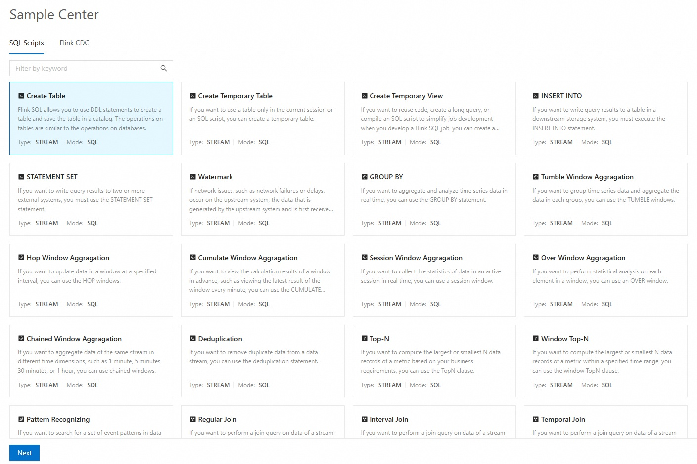

6. Modify **Name**, **Deployment Target**, **Location**, and the SQL code based on your business requirements.

   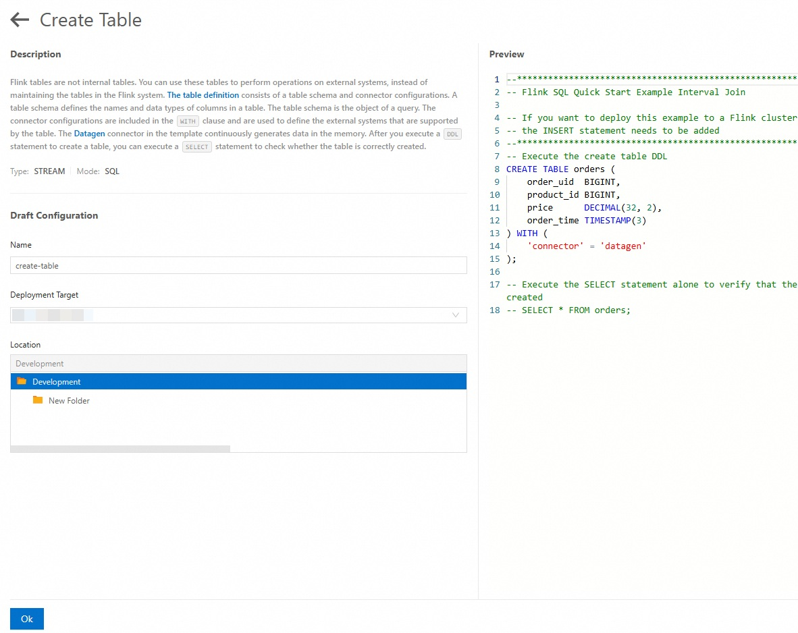

7. Click **Ok**.

   After you click **Ok**, the SQL Editor page appears. The subsequent operations are the same as the operations that are used to develop a common draft. For more information about the parameter configurations and subsequent operations, see Data development and Start a deployment.

<a id="section-4-2-2"></a>

### 4.2.2. SQL job development

This topic describes the procedure for developing Flink SQL streaming jobs, including creating a job, editing code, checking semantics, debugging, and deploying the job.

**Procedure**

1. Create an SQL streaming job.

2. Write DDL and DML code.

   > **Note**
   >
   > The metadata management capability allows you to reuse table schemas across different jobs. When you edit an SQL job in the Flink development console, the system automatically completes field and table names after you enter a few characters.

   The following code provides an example.

   ```sql
   -- Create the source table datagen_source.
   CREATE TEMPORARY TABLE datagen_source(
     name VARCHAR
   ) WITH (
     'connector' = 'datagen'
   );

   -- Create the result table blackhole_sink.
   CREATE TEMPORARY TABLE blackhole_sink(
     name  VARCHAR
   ) WITH (
     'connector' = 'blackhole'
   );

   -- Insert data from the source table into the result table.
   INSERT INTO blackhole_sink
   SELECT
     name
   from datagen_source;
   ```

3. On the right-side tab of the **ETL** page, view or enter the configuration information.

   | Tab | Description |
   | --- | --- |
   | More configurati ons | • <strong>Engine version</strong>: We recommend that you use the recommended or stable version. The engine version labels have the following meanings:<br>• Recommend: The latest minor version under the current latest major version.<br>• EOS: A version that has exceeded the product service period.<br>• <strong>Additional dependency files</strong>: Additional dependencies required by the job, such as temporary functions.<br>• <strong>Kerberos authentication</strong>: You can enable the Kerberos authentication switch. When you enable Kerberos authentication, you must also configure the <strong>Kerberos cluster</strong> and <strong>Principal</strong> parameters. |
   | Code structure | • <strong>Data direction diagram</strong>: The data direction diagram allows you to quickly view the data direction.<br>• <strong>Tree structure diagram</strong>: The tree structure diagram allows you to quickly view the data origin. |
   | Version Informatio n | You can view the job version information here. |

4. Click **Deep Check**.

   This operation checks the SQL semantics of the job and the metadata information of the tables that the job uses.

5. **Optional:** Click **Debug**.

   The job debugging feature allows you to simulate job execution and check output results to verify the correctness of SELECT or INSERT business logic, improve development efficiency, and reduce data quality risks. For more information, see Debug a deployment.

6. Click **Deploy**.

   After you complete job development and deep check, you can deploy the job to publish data to the production environment.

7. In the **Deploy New Version** dialog box, enter the remarks, select whether to **Submit to Session Cluster** as needed, and then click **OK**.

<a id="section-4-2-3"></a>

### 4.2.3. Develop a JAR draft

Flink JAR provides more flexible programming models and APIs, allowing you to customize data transformations, operations, and operators to meet complex business logic and data processing requirements. This topic describes how to develop and debug a JAR draft in the Realtime Compute for Apache Flink console.

**Limits**

Realtime Compute for Apache Flink is subject to deployment environments and network environments. Therefore, when you develop a Jar draft, take note of the following limits:

- Submit and run drafts only in JAR format. The system supports one primary JAR package and multiple additional dependency JAR packages.

- Do not read local configurations in the Main function.

- Workspaces on x86 CPUs support only JDK 8. Workspaces on Advanced RISC Machine (ARM) CPUs support JDK 8 and JDK 11.

- Open-source Scala V2.12 is supported.

**Notes**

- Parameters configured in the Realtime Compute for Apache Flink console have lower priority than those in deployment code. To ensure normal deployment operation, configure Checkpoint-related parameters in the Realtime Compute for Apache Flink console. Do not configure Checkpoint-related parameters in deployment code.

- If the upstream or downstream storage that DataStream deployments access provides an allowlist mechanism, configure the allowlist.

- To avoid conflicts between JAR package dependencies, note the following points:

  - Use the same version of the Apache Flink dependency library in your Pom file as the Flink version selected on the draft development page.

  - For Flink-related dependencies, set scope to provided, that is, add  `<scope>provided</scope>` . Flink-related dependencies mainly include non-connector dependencies that start with  `flink-`  in the  `org.apache.flink`  group, such as flink-streaming-java, flink-streaming-java_2.11, flink-java, and flink-runtime.

    > **Note**
    >
    > Configure dependencies before draft development to avoid Flink dependency conflicts.

  - Package other third-party dependencies by using Shade. For more information about Shade packaging, see Apache Maven Shade Plugin.

  - Only methods explicitly marked with @Public or @PublicEvolving in the source code of Apache Flink are publicly available for user calls. Alibaba Cloud Realtime Compute for Apache Flink only guarantees product compatibility with these methods.

  - For DataStream APIs supported by built-in Flink service Connectors, use their built-in dependencies.

**Draft development**

> **Note**
>
> You must develop JAR drafts offline, then deploy and run the drafts in the Realtime Compute for Apache Flink development console.

**References**

- For an introduction to Apache Flink, including its architecture, applications, and features, see Introduction to Apache Flink.

- For Apache Flink V1.17 business code development, see Flink DataStream API development guide and Flink Table API & SQL development guide.

- For guidelines on Apache Flink coding, Java, Scala, components, and formats, see Code style and quality guidelines.

- For source code project configuration of Apache Flink deployments, see Project Configuration.

- For Flink DataStream connector dependencies of Realtime Compute for Apache Flink, see Connector dependencies.

- For problems encountered during Apache Flink coding and their solutions, see FAQ.

**Write business code**

1. Integrate external data sources into data stream programs of Realtime Compute for Apache Flink.

   `Watermark`  is a time semantics-based computation strategy in Realtime Compute for Apache Flink, often used together with timestamps. This example does not use watermark strategy. For more information, see Watermark strategies.

   ```text
            // Integrate external data sources into the flink data stream program
           // WatermarkStrategy.noWatermarks() indicates no watermark strategy is used
           DataStreamSource<String> stream = env.fromSource(kafkaSource, 
   WatermarkStrategy.noWatermarks(), "kafka Source");
   ```

2. Convert operators.

   This example converts  `DataStream<String>`  into  `DataStream<Student>` . For more information on how to convert and process complex operators, see Flink operators.

   ```text
             // Operator that transforms data structure into student
             DataStream<student> source = stream
                   .map(new MapFunction<String, student>() {
                       @Override
                       public student map(String s) throws Exception {
                           // Data is separated by commas
                           String[] data = s.split(",");
                           return new student(Integer.parseInt(data[0]), data[1], 
   Integer.parseInt(data[2]));
                       }
                   }).filter(student -> student.score >=60); // Filter data with scores greater than or
   equal to 60
   ```

**Package the draft**

Package the draft by using the maven-shade-plugin.

> **Important**
>
> - If you choose to introduce connectors as additional dependencies, confirm that the scope of connector-related dependencies is  `provided`  when packaging the draft.
>
> - If you choose to package connectors together as dependencies, simply use the default scope (compile).

Configuration of maven-shade-plugin for reference

```xml
<build>
        <plugins>
            <!-- Java compiler-->
            <plugin>
                <groupId>org.apache.maven.plugins</groupId>
                <artifactId>maven-compiler-plugin</artifactId>
                <version>3.11.0</version>
                <configuration>
                    <source>${target.java.version}</source>
                    <target>${target.java.version}</target>
                </configuration>
            </plugin>

            <!-- We use maven-shade-plugin to create a fat jar containing all required dependencies --
>
            <!-- Modify the value of <mainClass>. If your program entry point changes -->
            <plugin>
                <groupId>org.apache.maven.plugins</groupId>
                <artifactId>maven-shade-plugin</artifactId>
                <version>3.2.0</version>
                <executions>
                    <execution>
                        <phase>package</phase>
                        <goals>
                            <goal>shade</goal>
                        </goals>
                        <!-- Remove some unnecessary dependencies -->
                        <configuration>
                            <artifactSet>
                                <excludes>
                                    <exclude>org.apache.flink:force-shading</exclude>
                                    <exclude>com.google.code.findbugs:jsr305</exclude>
                                    <exclude>org.slf4j:*</exclude>
                                    <exclude>org.apache.logging.log4j:*</exclude>
                                </excludes>
                            </artifactSet>
                            <filters>
                                <filter>
                                    <!-- Do not copy signatures in the META-INF folder. Otherwise, secu
rity exceptions may occur when using the JAR file -->
                                    <artifact>*:*</artifact>
                                    <excludes>
                                        <exclude>META-INF/*.SF</exclude>
                                        <exclude>META-INF/*.DSA</exclude>
                                        <exclude>META-INF/*.RSA</exclude>
                                    </excludes>
                                </filter>
                            </filters>
                            <transformers>
                                <transformer
                                        
implementation="org.apache.maven.plugins.shade.resource.ManifestResourceTransformer">
                                    <mainClass>com.aliyun.FlinkDemo</mainClass>
                                </transformer>
                            </transformers>
                        </configuration>
                    </execution>
                </executions>
            </plugin>
        </plugins>
    </build>
```

**Test and deploy the draft**

- Realtime Compute for Apache Flink cannot access the Internet by default. Your code may fail direct local testing. We recommend that you perform unit testing separately.

- For JAR draft deployment, see Job deployment.

  > **Note**
  >
  > - If you select method 1 to deploy a draft packaged with connectors, remember to upload the related JAR package of the connector.
  >
  > - If you need to read configuration files, also upload them as additional dependencies.

**Complete sample code**

This sample code processes data from a Kafka data source and writes the results to MySQL. This example is for reference only. For more guidelines on code style and quality, see Code style and quality guidelines.

> **Note**
>
> This example does not include configurations of runtime parameters such as checkpoints, time-to-live (TTL), or restart policy. You can customize these configurations on the **Configuration** page after deploying the draft. Because configuration items set in code take higher precedence, we recommend that you perform custom configuration after draft deployment to facilitate subsequent modifications and application.

**FlinkDemo.java**

```java
package com.aliyun;

import org.apache.flink.api.common.eventtime.WatermarkStrategy;
import org.apache.flink.api.common.functions.MapFunction;
import org.apache.flink.connector.jdbc.JdbcConnectionOptions;
import org.apache.flink.connector.jdbc.JdbcExecutionOptions;
import org.apache.flink.connector.jdbc.JdbcSink;
import org.apache.flink.connector.jdbc.JdbcStatementBuilder;
import org.apache.flink.connector.kafka.source.KafkaSource;
import org.apache.flink.connector.kafka.source.enumerator.initializer.OffsetsInitializer;
import org.apache.flink.connector.kafka.source.reader.deserializer.KafkaRecordDeserializationSchema;
import org.apache.flink.kafka.shaded.org.apache.kafka.common.serialization.StringDeserializer;
import org.apache.flink.streaming.api.datastream.DataStream;
import org.apache.flink.streaming.api.datastream.DataStreamSource;
import org.apache.flink.streaming.api.environment.StreamExecutionEnvironment;
import java.io.FileInputStream;
import java.io.IOException;
import java.io.InputStream;
import java.sql.PreparedStatement;
import java.sql.SQLException;
import java.util.HashMap;
import java.util.Map;
import java.util.Properties;

public class FlinkDemo {
    // Define the data structure.
    public static class Student {
        public int id;
        public String name;
        public int score;

        public Student(int id, String name, int score) {
            this.id = id;
            this.name = name;
            this.score = score;
        }
    }

    public static void main(String[] args) throws Exception {
        // Create a Flink execution environment.
        final StreamExecutionEnvironment env = StreamExecutionEnvironment.getExecutionEnvironment();

        Properties properties = new Properties();
        Map<String,String> configMap = new HashMap<>();

        try (InputStream input = new FileInputStream("/flink/usrlib/config.properties")) {
            // Load the properties file.
            properties.load(input);
            // Retrieve property values.
            configMap.put("bootstrapServers",properties.getProperty("bootstrapServers")) ;
            configMap.put("inputTopic",properties.getProperty("inputTopic"));
            configMap.put("groupId",properties.getProperty("groupId"));
            configMap.put("url",properties.getProperty("database.url")) ;
            configMap.put("username",properties.getProperty("database.username"));
            configMap.put("password",properties.getProperty("database.password"));
        } catch (IOException ex) {
            ex.printStackTrace();
        }

        // Build the Kafka source.
        KafkaSource<String> kafkaSource = KafkaSource.<String>builder()
                        .setBootstrapServers(configMap.get("bootstrapServers"))
                        .setTopics(configMap.get("inputTopic"))
                        .setStartingOffsets(OffsetsInitializer.latest())
                        .setGroupId(configMap.get("groupId"))
                        
.setDeserializer(KafkaRecordDeserializationSchema.valueOnly(StringDeserializer.class))
                        .build();

        // Integrate the external data source into the Flink data stream program.
        // WatermarkStrategy.noWatermarks() indicates that no watermark strategy is used.
        DataStreamSource<String> stream = env.fromSource(kafkaSource, 
WatermarkStrategy.noWatermarks(), "kafka Source");

        // Filter data where the score is greater than or equal to 60.
        DataStream<Student> source = stream
                .map(new MapFunction<String, Student>() {
                    @Override
                    public Student map(String s) throws Exception {
                        String[] data = s.split(",");
                        return new Student(Integer.parseInt(data[0]), data[1], 
Integer.parseInt(data[2]));
                    }
                }).filter(Student -> Student.score >=60);

        source.addSink(JdbcSink.sink("INSERT IGNORE INTO student (id, username, score) VALUES (?, ?, ?
)",
                new JdbcStatementBuilder<Student>() {
                    public void accept(PreparedStatement ps, Student data) {
                        try {
                            ps.setInt(1, data.id);
                            ps.setString(2, data.name);
                            ps.setInt(3, data.score);
                        } catch (SQLException e) {
                            throw new RuntimeException(e);
                        }
                    }
                },
                new JdbcExecutionOptions.Builder()
                        .withBatchSize(5) // Number of records to write in each batch.
                        .withBatchIntervalMs(2000) // Maximum delay time in milliseconds during 
retries.
                        .build(),
                new JdbcConnectionOptions.JdbcConnectionOptionsBuilder()
                        .withUrl(configMap.get("url"))
                        .withDriverName("com.mysql.cj.jdbc.Driver")
                        .withUsername(configMap.get("username"))
                        .withPassword(configMap.get("password"))
                        .build()
        )).name("Sink MySQL");

        env.execute("Flink Demo");
    }
}
```

**pom.xml**

```xml
<project xmlns="http://maven.apache.org/POM/4.0.0" xmlns:xsi="http://www.w3.org/2001/XMLSchema-
instance"
  xsi:schemaLocation="http://maven.apache.org/POM/4.0.0 http://maven.apache.org/maven-v4_0_0.xsd">
    <modelVersion>4.0.0</modelVersion>
    <groupId>com.aliyun</groupId>
    <artifactId>FlinkDemo</artifactId>
    <version>1.0-SNAPSHOT</version>
    <name>FlinkDemo</name>
    <packaging>jar</packaging>

    <properties>
        <project.build.sourceEncoding>UTF-8</project.build.sourceEncoding>
        <flink.version>1.17.1</flink.version>
        <vvr.version>1.17-vvr-8.0.4-1</vvr.version>
        <target.java.version>1.8</target.java.version>
        <maven.compiler.source>${target.java.version}</maven.compiler.source>
        <maven.compiler.target>${target.java.version}</maven.compiler.target>
        <log4j.version>2.14.1</log4j.version>
    </properties>
    <dependencies>
        <!-- Apache Flink dependencies -->
        <!-- These dependencies are provided because they should not be packaged into the JAR file. -->
        <dependency>
            <groupId>org.apache.flink</groupId>
            <artifactId>flink-java</artifactId>
            <version>${flink.version}</version>
            <scope>provided</scope>
        </dependency>
        <dependency>
            <groupId>org.apache.flink</groupId>
            <artifactId>flink-streaming-java</artifactId>
            <version>${flink.version}</version>
            <scope>provided</scope>
        </dependency>
        <dependency>
            <groupId>org.apache.flink</groupId>
            <artifactId>flink-clients</artifactId>
            <version>${flink.version}</version>
            <scope>provided</scope>
        </dependency>

        <!-- Add connector dependencies here. They must be in the default scope (compile). -->
        <dependency>
            <groupId>com.alibaba.ververica</groupId>
            <artifactId>ververica-connector-kafka</artifactId>
            <version>${vvr.version}</version>
        </dependency>

        <dependency>
            <groupId>com.alibaba.ververica</groupId>
            <artifactId>ververica-connector-mysql</artifactId>
            <version>${vvr.version}</version>
        </dependency>

        <!-- Add logging framework to generate console output at runtime -->
        <!-- By default, exclude these dependencies from the application JAR -->
        <dependency>
            <groupId>org.apache.logging.log4j</groupId>
            <artifactId>log4j-slf4j-impl</artifactId>
            <version>${log4j.version}</version>
            <scope>runtime</scope>
        </dependency>
        <dependency>
            <groupId>org.apache.logging.log4j</groupId>
            <artifactId>log4j-api</artifactId>
            <version>${log4j.version}</version>
            <scope>runtime</scope>
        </dependency>
        <dependency>
            <groupId>org.apache.logging.log4j</groupId>
            <artifactId>log4j-core</artifactId>
            <version>${log4j.version}</version>
            <scope>runtime</scope>
        </dependency>
    </dependencies>

    <build>
        <plugins>
            <!-- Java compiler -->
            <plugin>
                <groupId>org.apache.maven.plugins</groupId>
                <artifactId>maven-compiler-plugin</artifactId>
                <version>3.11.0</version>
                <configuration>
                    <source>${target.java.version}</source>
                    <target>${target.java.version}</target>
                </configuration>
            </plugin>

            <!-- Use maven-shade-plugin to create a fat JAR that includes all required dependencies --
>
            <!-- Modify the value of <mainClass> if your program entry point changes -->
            <plugin>
                <groupId>org.apache.maven.plugins</groupId>
                <artifactId>maven-shade-plugin</artifactId>
                <version>3.2.0</version>
                <executions>
                    <execution>
                        <phase>package</phase>
                        <goals>
                            <goal>shade</goal>
                        </goals>
                        <!-- Remove some unnecessary dependencies -->
                        <configuration>
                            <artifactSet>
                                <excludes>
                                    <exclude>org.apache.flink:force-shading</exclude>
                                    <exclude>com.google.code.findbugs:jsr305</exclude>
                                    <exclude>org.slf4j:*</exclude>
                                    <exclude>org.apache.logging.log4j:*</exclude>
                                </excludes>
                            </artifactSet>
                            <filters>
                                <filter>
                                    <!-- Do not copy signatures from the META-INF folder. Otherwise, se
curity exceptions may occur when using the JAR file. -->
                                    <artifact>*:*</artifact>
                                    <excludes>
                                        <exclude>META-INF/*.SF</exclude>
                                        <exclude>META-INF/*.DSA</exclude>
                                        <exclude>META-INF/*.RSA</exclude>
                                    </excludes>
                                </filter>
                            </filters>
                            <transformers>
                                <transformer
                                        
implementation="org.apache.maven.plugins.shade.resource.ManifestResourceTransformer">
                                    <mainClass>com.aliyun.FlinkDemo</mainClass>
                                </transformer>
                            </transformers>
                        </configuration>
                    </execution>
                </executions>
            </plugin>
        </plugins>
    </build>

</project>
```

<a id="section-4-2-4"></a>

### 4.2.4. Python job development

This topic describes the background, usage limits, development methods, debugging methods, and connector usage for Flink Python API job development.

**Background information**

You must develop Flink Python jobs locally and then deploy and start them on the Flink development console to view the business results. For more information about the overall procedure, see Quick start for Flink Python jobs.

The Flink workspace includes the following software packages.

| Package | Version |
| --- | --- |
| apache-beam | 2.23.0 |
| avro-python3 | 1.9.1 |
| certifi | 2020.12.5 |
| cloudpickle | 1.2.2 |
| crcmod | 1.7 |
| cython | 0.29.16 |
| dill | 0.3.1.1 |
| docopt | 0.6.2 |
| fastavro | 0.23.6 |
| future | 0.18.2 |
| grpcio | 1.29.0 |
| hdfs | 2.6.0 |
| httplib2 | 0.17.4 |
| idna | 2.10 |
| jsonpickle | 1.2 |
| mock | 2.0.0 |
| numpy | 1.19.5 |
| oauth2client | 3.0.0 |
| pandas | 0.25.3 |
| pbr | 5.5.1 |
| pip | 20.1.1 |
| protobuf | 3.15.3 |
| py4j | 0.10.8.1 |
| pyarrow | 0.17.1 |
| pyasn1-modules | 0.2.8 |
| pyasn1 | 0.4.8 |
| pydot | 1.4.2 |
| pymongo | 3.11.3 |
| pyparsing | 2.4.7 |
| python-dateutil | 2.8.0 |
| pytz | 2021.1 |
| requests | 2.25.1 |
| rsa | 4.7.2 |
| setuptools | 47.1.0 |
| six | 1.15.0 |
| typing-extensions | 3.7.4.3 |
| urllib3 | 1.26.3 |
| wheel | 0.36.2 |

**Usage limits**

Flink is affected by factors such as the deployment environment and network environment. When you develop Python jobs, note the following limits:

- Arm environments support Python jobs only in VVR 8.0.7 or later.

- The Flink workspace comes with Python 3.7.9 preinstalled, and the Python environment includes common Python libraries such as Pandas, NumPy, and PyArrow. Therefore, you must develop your code in Python 3.7.

- x86 workspaces support only JDK 8, while Arm workspaces support both JDK 8 and JDK 11.

- Only the open source Scala V2.11 version is supported. If your Python job depends on third-party JAR packages, make sure that you use the JAR package dependencies built for Scala V2.11.

**Job development**

You can refer to the following documents to develop Flink business code on your local machine:

- To develop business code for Apache Flink V1.17, see Flink Python API development guide.

- For issues and solutions that you encounter during Apache Flink coding, see FAQ.

**Job debugging**

You can use the logging module in the code implementation of Python user-defined functions to output log information for troubleshooting. The following example shows how to do this.

```python
@udf(result_type=DataTypes.BIGINT())
def add(i, j):    
  logging.info("hello world")    
  return i + j
```

After the logs are generated, you can view them in the TaskManager log files.

**Use Python dependencies**

You can use custom Python virtual environments, third-party Python packages, JAR packages, and data files in Flink Python jobs. For more information, see Python dependencies.

<a id="section-4-2-4-1"></a>

#### 4.2.4.1. Python dependencies

You can use custom Python virtual environments, third-party Python packages, JAR packages, and data files in your Flink Python jobs. This topic describes how to use these dependencies.

**Background information**

This topic describes how to use Python dependencies in the following scenarios:

- Use a custom Python virtual environment

- Use third-party Python packages

- Use JAR packages

- Use data files

**Custom Python virtual environment**

Currently, only Python 3.7 virtual environments are supported. This section describes how to prepare one.

1. Prepare a virtual environment for Python 3.7.

   <ol type="i">

   <li>

   On your local machine, create a **build.sh** script with the following content.

   ```bash
   #!/bin/bash
   set -e -x
   yum install -y zip wget

   cd /root/
   bash /build/setup-pyflink-virtual-env.sh
   mv venv.zip /build/
   ```

   </li>

   <li>

   Prepare the **setup-pyflink-virtual-env.sh** script on your local machine with the following content.

   </li>

   </ol>

   ```bash
   set -e
   # Download the miniconda.sh script for Python 3.7.
   wget "https://repo.continuum.io/miniconda/Miniconda3-py37_4.9.2-Linux-x86_64.sh" -O 
   "miniconda.sh"

   # Grant execute permission on the miniconda.sh script for Python 3.7.
   chmod +x miniconda.sh

   # Create a Python virtual environment.
   ./miniconda.sh -b -p venv

   # Activate the Conda Python virtual environment.
   source venv/bin/activate ""

   # Install PyFlink dependencies.
   # Update the PyFlink version if needed
   pip install "apache-flink==1.12.1"

   # Deactivate the Conda Python virtual environment.
   conda deactivate

   # Remove cached packages.
   rm -rf venv/pkgs

   # Package the prepared Conda Python virtual environment.
   zip -r venv.zip venv
   ```

   <ol type="i" start="3">

   <li>

   In the Command Prompt, run the following command.

   </li>

   </ol>

   ```bash
   docker run -it --rm -v $PWD:/build  -w /build quay.io/pypa/manylinux2014_x86_64 ./build.sh
   ```

   After the command is executed, a file named **venv.zip** is generated. This file is the virtual environment for **Python 3.7**.

   You can also modify the preceding scripts to install other required third-party Python packages in the virtual environment.

2. Use a **Python 3.7** virtual environment in Python jobs.

   <ol type="i">

   <li>

   Log in to the Realtime Compute for Apache Flink development console.

   <ol type="i" start="2">

   <li>

   In the left navigation bar, click **File Management** and upload the **venv.zip** file.

   </li>

   </ol>

   > **Note**
   >
   > The file upload size limit in the Realtime Compute for Apache Flink development console is 200 MB. Because a Python virtual environment usually exceeds this limit, you need to upload the file through the OSS management console. For more information, see **Object Storage Service User Guide > Objects (Files) > Upload files**.

   <ol type="i" start="3">

   <li>

   In **O&M Center > Job O&M**, click **Deploy Job**, and in the **Python Archives** setting, select the

   </li>

   </ol>

   **venv.zip** file.

   </li>

   <li value="4">

   Click **Advanced Settings** on the right, and in the **More Flink Configurations** section, add configuration information.

   ```text
   python.executable: venv.zip/venv/bin/python
   ```

   </li>

   <li>

   Click **Save**.

   </li>

   </ol>

**Third-party Python packages**

This section describes how to use third-party Python packages in the following two scenarios:

- Use a third-party Python package that can be directly imported

  If your third-party Python package is Zip Safe, you can use it directly in a Python job without installation. Follow these steps:

  <ol type="i">

  <li>

  Download a third-party Python package that can be directly imported.

  <ol type="a">

  <li>

  Open the PyPI page in your browser.

  </li>

  <li>

  In the search box, enter the name of the target third-party Python package, for example, **apache-flink 1.12.2**.

  </li>

  </ol>

  <ol type="i" start="100">

  <li>

  In the search results, click the name of the target package.

  </li>

  <li value="500">

  In the left-side navigation pane, click Download files.

  </li>

  </ol>

  <ol type="a" start="5">

  <li>

  Click the package name that contains **cp37-cp37m-manylinux1** to download.

  </li>

  </ol>

  </li>

  <li>

  Log in to the Realtime Compute for Apache Flink development console.

  <ol type="i" start="3">

  <li>

  In the left-side navigation pane, click **File Management** and upload the third-party Python package.

  </li>

  </ol>

  </li>

  <li value="4">

  On the **O&M Center > Job O&M** page, click **Deploy Job**, and in the **Python Libraries** configuration item, select the uploaded third-party Python package.

  </li>

  <li>

  Click **Save**.

  </li>

  </ol>

- Use a third-party Python package that requires compilation

  If your third-party Python package is a **tar.gz** archive or a source code package with a **setup.py** file in its root directory, the package usually needs to be compiled before it can be used. You must compile the package in an environment that is compatible with Flink before you can call it in a Python job.

  We recommend that you use the **quay.io/pypa/manylinux2014_x86_64** container's **Python 3.7** to compile third-party Python packages. Packages compiled in this container are compatible with most Linux environments. For more information, see manylinux.

  > **Note**
  >
  > The installation path for **Python 3.7** is **/opt/python/cp37-cp37m/bin/python3**.

  This topic uses the **opencv-python-headless** third-party Python package as an example to describe how to compile and use it.

  <ol type="i">

  <li>

  Compile the third-party Python package.

  <ol type="a">

  <li>

  Prepare the **build.sh** script on your local machine. The content is as follows.

  ```bash
  #!/bin/bash
  set -e -x
  yum install -y zip

  PYBIN=/opt/python/cp37-cp37m/bin

  "${PYBIN}/pip" install --target __pypackages__ -r requirements.txt --no-deps
  cd __pypackages__ && zip -r deps.zip . && mv deps.zip ../ && cd ..
  rm -rf __pypackages__
  ```

  </li>

  <li>

  Prepare a **requirements.txt** file locally with the following content.

  ```text
  opencv-python-headless
  ```

  </li>

  </ol>

  <ol type="i" start="100">

  <li>

  Run the following command in your CLI.

  ```bash
  docker run -it --rm -v $PWD:/build  -w /build quay.io/pypa/manylinux2014_x86_64 /bin/bash 
  build.sh
  ```

  After the command is executed, a file named **deps.zip** is generated. This file is the compiled third-party Python package.

  You can also modify **requirements.txt** to install other required third-party Python packages. In addition, you can specify multiple Python dependencies in the **requirements.txt** file.

  </li>

  </ol>

  </li>

  <li>

  Use the third-party Python package **deps.zip** in a Python job.

  <ol type="a">

  <li>

  Log in to the Realtime Compute for Apache Flink development console.

  </li>

  <li>

  In the left navigation bar, click **File Management** and upload **deps.zip**.

  > **Note**
  >
  > Realtime Compute for Apache Flink limits the maximum file upload size to 200 MB. Because a Python virtual environment is typically larger than this limit, you need to upload the file by using the Object Storage Service (OSS) management console. For more information, see **Object Storage Service User Guide > Objects > Upload files**.

  </li>

  </ol>

  <ol type="i" start="100">

  <li>

  On the **O&M Center > Job O&M** page, click **Deploy Job**, and in the **Python Libraries** setting, select **deps.zip**.

  </li>

  <li value="500">

  Click **Save**.

  </li>

  </ol>

  </li>

  </ol>

**JAR packages**

If your Flink Python job uses Java classes, such as a connector or a Java user-defined function, follow these steps to specify the required JAR package.

1. Log in to the Realtime Compute for Apache Flink development console.

2. In the left navigation bar, click **File Management** and upload the required JAR package.

3. On the **O&M Center > Job O&M** page, click **Deploy Job**, and in the **additional dependencies** section, select the required JAR package.

4. Click the name of the deployed job. On the **Deployment Details** tab, in the **Runtime Parameter Configuration** section, click **Edit**. In the **Other Configurations** section, add the relevant configuration.

   If you need to depend on multiple JAR packages, for example, **jar1.jar** and **jar2.jar**, the configuration is as follows.

   ```text
   pipeline.classpaths: 'file:///flink/usrlib/jar1.jar;file:///flink/usrlib/jar2.jar'
   ```

5. Click **Save**.

**Connectors**

1. Log in to the Realtime Compute for Apache Flink development console.

2. In the left-side navigation pane, click **File Management**.

3. Click **Upload Resource** and select the JAR package for your target connector.

   You can upload a connector that you developed or one provided by Flink. For the official download links for Flink connector JARs, see Connectors.

4. On the **Job O&M** page, click **Deploy Job**. In the **additional dependencies** field, select the JAR package for the target connector.

5. Click the name of the deployed job. On the **Deployment Details** tab, in the **Runtime Parameter Configuration** section, click **Edit**. In the **Other Configurations** section, add the relevant configuration.

   For example, if your job depends on multiple connector JARs, such as  `connector-1.jar`  and  `connector-2.jar` , add the following configuration.

   ```text
   pipeline.classpaths: 'file:///flink/usrlib/connector-1.jar;file:///flink/usrlib/connector-2.jar'
   ```

**Data files**

This section describes how to use data files in the following two scenarios:

- Use the Python Archives option

  To use a large number of data files in a Python job, package them into a ZIP archive and follow these steps:

  <ol type="i">

  <li>

  Log in to the Realtime Compute for Apache Flink development console.

  <ol type="i" start="2">

  <li>

  In the left-side navigation pane, click **File Management** and upload the ZIP archive of your data files.

  </li>

  <li>

  On the development page for the target job, in the **Python Archives** field, select the ZIP archive of your

  </li>

  </ol>

  data files.

  </li>

  <li value="4">

  In a Python user-defined function, you can access data files as follows. Suppose the compressed archive that contains the data file is named **mydata.zip**.

  ```python
  def map():
      with open("mydata.zip/mydata/data.txt") as f:
      ...
  ```

  </li>

  </ol>

- Use the additional dependencies option

  To use a small number of data files in a Python job, follow these steps:

  <ol type="i">

  <li>

  Log in to the Realtime Compute for Apache Flink development console.

  <ol type="i" start="2">

  <li>

  In the left-side navigation pane, click **File Management** and upload the required data file or files.

  </li>

  <li>

  On the development page for the target job, select the required data file in the **additional**

  </li>

  </ol>

  **dependencies** field.

  </li>

  <li value="4">

  In a Python user-defined function, you can access a data file in the following way. Suppose the data file is named **data.txt**.

  ```python
  def map():
      with open("/flink/usrlib/data.txt") as f:
      ...
  ```

  </li>

  </ol>

<a id="section-4-2-5"></a>

### 4.2.5. Debug a deployment

You can enable the debugging feature to simulate deployment running, check outputs, and verify the business logic of SELECT and INSERT statements. This feature improves development efficiency and reduces the risks of poor data quality. This topic describes how to debug a deployment.

**Usage limits**

- You can debug only SQL deployments by clicking Debug on the SQL Editor page in the Realtime Compute for Apache Flink console.

- By default, Realtime Compute for Apache Flink reads a maximum of 1,000 data records. If the number of data records that are read by Realtime Compute for Apache Flink reaches the upper limit, Realtime Compute for Apache Flink stops reading data.

- Metrics of deployments that are deployed in session clusters cannot be displayed. Session clusters do not support the monitoring and alerting feature and the automatic tuning feature.

**Procedure**

1. Develop an SQL draft. For more information about how to develop an SQL draft, see SQL job development.

2. Log in to the Realtime Compute for Apache Flink development console.

3. In the left-side navigation pane, choose **Development > ETL**, and click **Debug** in the upper-right corner of the page.

4. Select a cluster from the **Session Cluster** drop-down list and click **Next**.

   If no session cluster is available, you can create and start one. For more information, seeConfigure session clusters.

5. Configure debugging data.

   - If you use online data, click **Confirm**.

   - If you use mock data, click **Download mock data template**, enter your mock data in the template, and then click Upload mock data to upload the template.

     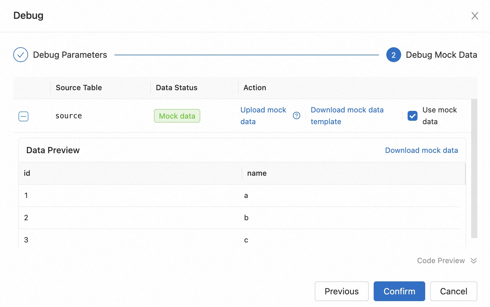

     The following table describes the parameters in this step.

     | Parameter | Description |
     | --- | --- |
     | Download mock data template | The template is adapted to the schema of the source table. |
     | Upload mock data | If you need to debug a deployment by using mock data, you can download the mock data template, upload the data after you edit the template, and then select <strong>Use mock data</strong>.<br>Limits on using a mock data file:<br>• Only CSV files can be uploaded.<br>• A CSV file must contain a table header, such as id(INT).<br>• A CSV file can contain a maximum of 1,000 data records but cannot be greater than 1 MB. |
     | Data Preview | After you upload mock data, click theicon on the left side of the source table name to<br>preview the data and download the mock data. |
     | Code Preview | The debugging feature automatically modifies the DDL statements of source and result tables. However, it does not change the draft code. You can preview code details in the lower part of Code Preview. |

6. After you confirm the debugging data, click **Confirm**.

   After you click **Confirm**, the debugging result appears in the lower part of the SQL script editor.

   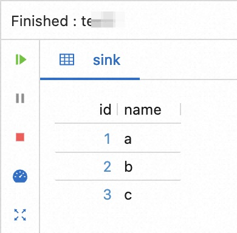

<a id="section-5"></a>

# 5.O&M center

The O&M center provides job O&M, session management, and configuration management features. This allows you to deploy, start, stop, and tune jobs, manage session clusters, and configure default job parameters.

<a id="section-5-1"></a>

## 5.1. Deployment O&M

On the Deployments page in the console, you can deploy, start, stop, and delete a deployment, and view the details, runtime events, checkpoints, logs, and autopilot tuning information of a deployment for lifecycle management.

<a id="section-5-1-1"></a>

### 5.1.1. Job deployment

After you develop a job, you must deploy it before you can start and run it. This topic describes how to deploy SQL jobs, JAR jobs, and Python jobs.

**Procedure**

**Deploy an SQL job**

1. Log in to the Realtime Compute for Apache Flink development console.

2. On the **SQL Development** page, develop an SQL job. For more information, see SQL job development.

3. After you complete the SQL job development, click **Deploy**.

4. Configure the following parameters.

   | Parameter | Description |
   | --- | --- |
   | Description | Optional. Enter remarks. |
   | Submit to Session Cluster | We do not recommend this option for production environments.<br>If you select this option, you must select a target session cluster from the drop-down list. For more information about how to create a session cluster, see Configure session clusters. |
   | Skip Deep Check Before Deployment | If you select this option, the system skips the deep check before deployment. |

5. Click **OK**.

**Deploy a JAR job**

Before you deploy a JAR job, you must complete Develop a JAR draft.

1. Log in to the Realtime Compute for Apache Flink development console.

2. On the **Operations Center > Job O&M** page, click **Deploy Job** and select **JAR Job**.

3. Configure the following parameters.

   | Parameter | Description |
   | --- | --- |
   | Deployment Mode | Select Streaming Mode or Batch Mode for the deployment. |
   | Deployment Name | Enter the name of the JAR job. |
   | Engine Version | We recommend that you use a recommended or stable version. The version labels have the following meanings:<br>• Recommended version: The latest minor version under the current latest major version.<br>• Stable version: The latest minor version under a major version that is still within the product service period, with defects from previous versions fixed.<br>• Standard version: Other minor versions that are still within the product service period.<br>• EOS version: A version that has exceeded the product service period. |
   | JAR URI | Select a file or manually upload a new file. You can drag a file to this area or click theicon on<br>the right to select a file for upload.<br>Note<br>If your job uses the Python API type, you must specify the official PyFlink JAR package. For the download addresses of the official JAR packages, see PyFlink V1.11 and PyFlink V1.12. |
   | Entry Point Class | The entry class of the program. If your JAR package does not specify a main class, enter the standard path of your <strong>Entry Point Class</strong> here.<br>Note<br>If your job uses the Python API type, set Entry Point Class to org.apache.flink.client.python.PythonDriver. |
   | Entry Point Main Arguments | You can pass parameters here and call them in the main method.<br>Note<br>• The parameter length must not exceed 1,024 characters. We do not recommend using this field for complex parameters, which include parameters containing line breaks, spaces, or other special characters. If you need to pass complex parameters, use additional dependency files instead.<br>• If your job uses the Python API type, you must upload your Python job file first. After upload, the system saves the Python job file to the /flink/usrlib/ directory on the job execution node by default.<br>For example, if your Python job file is named word_count.py, set this parameter to <code> -</code><code>py /flink/usrlib/word_count.py </code>.<br>You must specify the full path for the Python job file. The /flink/usrlib/ prefix is required and cannot be changed. |

   <table>
     <tr>
       <td>Additional Dependency Files</td>
       <td>• (Recommended) Select a target additional dependency file that you have already uploaded.<br>You must upload additional dependency files in advance through <strong>Resource Management</strong> on<br>the left side of the fully managed Flink development console or by clicking theicon next to<br><strong>Additional Dependency Files</strong> when deploying a job. The system saves uploaded additional dependency files to the oss://ossBucketName/artifacts/namespaces/namespaceName/&lt;file&gt; directory.<br>• Enter the OSS path of the target additional dependency file.<br>You must upload the additional dependency file to the OSS bucket associated with the current instance in advance. The OSS bucket must be the one you selected when you activated fully managed Flink.<br>• Enter the URL of the target additional dependency file. Currently, only URLs that end with a file name are supported, such as http://xxxxxx/&lt;file&gt;.<br>You must upload the additional dependency file to a publicly accessible HTTP service in advance.<br>Note<br>• The system also downloads additional dependency files uploaded through any of the preceding three methods to the target machine and loads them into the /flink/usrlib directory of the pods where the JobManager and TaskManager run.<br>• If you select the option to submit the job to a session cluster, the job does not support configuring additional dependency file paths.</td>
     </tr>
     <tr>
       <td>Description</td>
       <td>Optional. Enter remarks.</td>
     </tr>
     <tr>
       <td>More Settings</td>
       <td>Turn on the <strong>Enable Kerberos</strong> switch. After you enable this switch, configure the following information:<br>• <strong>Kerberos Cluster</strong>: Select a Kerberos cluster that you have created from the drop-down list on the left.<br>• <strong>principal</strong>: A Kerberos principal identifies a unique entity in the Kerberos encryption system.The principal can be a user or a service.</td>
     </tr>
   </table>

4. Click **Deploy**.

**Deploy a Python job**

Before you deploy a Python job, you must complete Python job development.

1. Log in to the Realtime Compute for Apache Flink development console.

2. On the **Job O&M** page, click **Deploy Job** and select **Python Job**.

3. Configure the following parameters.

   | Parameter | Description |
   | --- | --- |
   | Deployment mode | Select streaming mode or batch mode for the deployment. |
   | Deployment name | Enter the name of the Python job. |
   | Engine version | We recommend that you use a recommended or stable version. The version labels have the following meanings:<br>• Recommended version: The latest minor version under the current latest major version.<br>• EOS version: A version that has exceeded the product service period. |
   | Python file URL | Select a Python job file. The Python file can be a .py file or a .zip file. |
   | Entry Module | The entry class of the program. If the Python job file is a .py file, you do not need to specify this parameter. If the Python job file is a .zip file, enter your Entry Module here, such as example.word_count. |
   | Entry Point Main Arguments | The job parameters. |
   | Python Libraries | Third-party Python packages. The system adds third-party Python packages to the PYTHONPATH of Python worker processes so that Python UDFs can directly access them.<br>For more information, see Python dependencies. |
   | Python Archives | Archive files. Currently, only ZIP format files are supported, such as .zip, .jar, .whl, and .egg files.For more information, see Python dependencies.<br>The system extracts archive files to the working directory of Python worker processes. If the archive file resides in a compressed package named mydata.zip, you can write the following code in a Python UDF to access the mydata.zip archive file.<br><code>def map():</code><br><code>with open("mydata.zip/mydata/data.txt") as f:</code><br><code>...</code> |
   | Additional dependency files | Select your Python job file and the required data files. For more information about Python dependencies, see Python dependencies. The system downloads uploaded dependency files to the /flink/usrlib/ directory on the job execution node by default.<br>Note<br>Session clusters do not support additional dependency files. Only per-job clusters support additional dependency files. |
   | Deployment target | Select the target cluster from the drop-down list.<br>Note<br>You can select a <strong>session cluster</strong> or a <strong>per-job cluster</strong>. Jobs that are not deployed to a session cluster use a per-job cluster by default. |
   | Description | Optional. Enter remarks. |
   | More settings | After you turn on this switch, configure the following information:<br>• <strong>Kerberos cluster</strong>: Select a Kerberos cluster that you have created from the drop-down list on the left.<br>• <strong>principal</strong>: A Kerberos principal identifies a unique entity in the Kerberos encryption system.The principal can be a user or a service. |

4. Click **Deploy**.

**Related documentation**

After deployment, you must start the job on the **Operations Center > Job O&M** page. For more information about the startup steps, see Start a deployment.

<a id="section-5-1-2"></a>

### 5.1.2. Start a deployment

After you develop a draft and deploy the draft as a deployment, you must start the deployment on the Deployments page to run the deployment. If you want to resume a deployment that is canceled or make the parameter configuration take effect after you modify the parameter configuration, you must also start the deployment.

**Usage limits**

- You can specify startup options for only streaming deployments.

- Only the Simple Log Service (SLS) and ApsaraMQ for Kafka source table connectors allow you to configure the Specify source's start time (SLS/Kafka) parameter in the Start Job dialog box.

  The Specify source's start time (SLS/Kafka) parameter that is configured in the Start Job dialog box takes precedence over the startTime parameter that is configured in the DDL code of a draft. If you configure the Specify source's start time (SLS/Kafka) parameter in the Start Job dialog box and the startTime parameter in the DDL code, the configuration of the Specify source's start time (SLS/Kafka) parameter takes effect.

  > **Note**
  >
  > - Not all connector types support the startTime parameter. For more information about whether the parameters in the WITH clause for each type of connector include the startTime parameter, see the related topic of the specific type of connector.
  >
  > - The startTime parameter takes effect only if a new deployment is started and the startTime parameter is configured. If you start a deployment based on a checkpoint or savepoint, the startTime parameter does not take effect even if this parameter is configured.

**Precautions**

If you select Latest State or Specific State when you start a deployment, the system performs a state data compatibility check.

**Procedure**

1. Log in to the Realtime Compute for Apache Flink development console.

2. In the left-side navigation pane, choose **O&M > Deployments**, and select **STREAM** or **BATCH** from the drop-down list.

   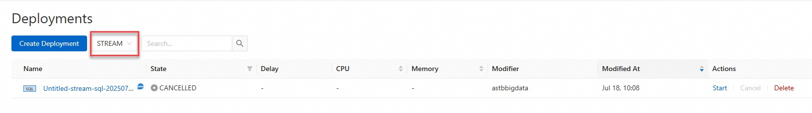

3. Find the deployment that you want to manage, and click **Start** in the **Actions** column.

4. Optional. In the Start Job dialog box, configure the startup parameters. This step is required only for streaming deployments.

   - **Initial Mode**: If you start a deployment for the first time without the need to reuse states or if a deployment cannot reuse states, select this option. If you select this option, you need to determine whether to enable automatic tuning based on your business requirements.

     | Policy | Description |
     | --- | --- |
     | Specify source's start time (SLS/Kafka) | If you select Initial Mode, you can select <strong>Specify source's start time (SLS/Kafka)</strong> to specify the start time for reading data.<br>The Specify source's start time (SLS/Kafka) parameter that is configured in the Start Job dialog box takes precedence over the <strong>startTime </strong>parameter that is configured in the DDL code of a draft.<br>Note<br>• Kafka versions earlier than 0.11 are not guaranteed to be supported due to potential incompatibility with the Kafka client used by the connector. We recommend that you upgrade your Kafka version.<br>• Not all connectors support the configuration of the <strong>startTime</strong> parameter. You can view the parameters in the WITH clause of each type of connector to check whether the connector type supports the configuration of the <strong>startTime </strong>parameter.<br>• The <strong>startTime </strong>parameter<strong> </strong>takes effect only if a new deployment is started and the <strong>startTime </strong>parameter is configured. If you start a deployment based on a checkpoint or savepoint, the <strong>startTime</strong> parameter does not take effect even if this parameter is configured. |
     | Configure Autopilot | If you turn on this switch, you must select a tuning mode:<br>• Autopilot Mode: When the resource usage is low, the system automatically downgrades the resource configuration. When the resource usage reaches a specific threshold, the system automatically upgrades the resource configuration.<br>• Scheduled Mode: If you set the Resource Tuning Mode parameter to Scheduled Mode, you must select a scheduled plan from the Existing scheduled plan drop-down list. A plan can contain the mappings between multiple groups of resources and time points. You can configure resources based on the resource usage during each time period. |

   - **Resume Mode**: You can select a startup policy and determine whether to enable automatic tuning based on your business requirements.

     | Policy | Description |
     | --- | --- |
     | Latest State | If you want to resume a deployment from the latest state of a savepoint or a checkpoint, select this option. If you select this option to start a deployment, the system performs a state data compatibility check. |
     | Specific State | Select a savepoint. |
     | Other deployment state | If you select this option, you must specify a savepoint of another deployment to resume the current deployment. Savepoints can be shared between deployments, but only when the deployments are compatible with the states saved in the savepoints. |
     | Allow Non-restored StateStartCancel<br>Note<br>SQL jobs do not support this option. | By default, the Flink system attempts to match all savepoints with the deployment that is being published. If the status of an operator changes due to the modification of the deployment, the tasks of the deployment may not be restored. If you turn on this switch, the Flink system skips the states that do not match the deployment and allows the deployment to start. For more information about Allow Non-Restored State, see Allow None-Restored State. |
     | Configure Autopilot | If you turn on this switch, you need to configure the Resource Tuning Mode parameter. Valid values:<br>• Autopilot Mode: When the resource usage is low, the system automatically downgrades the resource configuration. When the resource usage reaches a specific threshold, the system automatically upgrades the resource configuration.<br>• Scheduled Mode: If you set the Resource Tuning Mode parameter to Scheduled Mode, you must select a scheduled plan from the Existing scheduled plan drop-down list. A plan can contain the mappings between multiple groups of resources and time points. You can configure resources based on the resource usage during each time period. |

5. Click **Start**.

   In the left-side navigation pane, choose **O&M > Deployments**, and check the status of the depolyments.

<a id="section-5-1-3"></a>

### 5.1.3. Stop a deployment

After you change the SQL logic, deployment version, WITH parameters, or deployment parameters, you must stop and restart the deployment for the changes to take effect. This topic describes how to stop a running deployment.

**Precautions**

When you restart a stopped deployment, you can choose to start it from scratch (stateless) and specify a data read timestamp, or restore the deployment from a selected savepoint. For more information, see Start a deployment.

> **Note**
>
> If you modify the SQL or other logic, which results in state incompatibility, you can only start the deployment from scratch (stateless).

**Procedure**

1. Log in to the Realtime Compute for Apache Flink development console.

2. In the left-side navigation pane, choose O&M > Deployments. On the **Deployments** page, select **STREAM** or **BATCH** from the drop-down list.

   

3. Click **Cancel** in the **Actions** column of the job that you want to stop.

4. Click **OK**.

   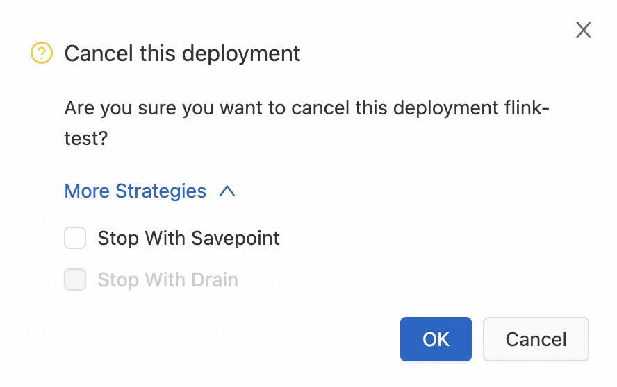

   The options for More Strategies are described as follows:

   - **Stop With Savepoint**: To create a savepoint before stopping a deployment, click **More Strategies** and select **Stop With Savepoint**. If **Stop With Savepoint** is selected, the system creates a savepoint before stopping the deployment. If **Stop With Savepoint** is not selected, the deployment stops immediately.

   - **Stop With Drain**: This option permanently terminates a deployment.

     Do not select this option if you want to restart the deployment later. This is because restoring deployments may cause errors.

<a id="section-5-1-4"></a>

### 5.1.4. Tune a deployment

Deployment tuning provides the automatic tuning capability in two modes: autopilot tuning and scheduled tuning, to help you automatically adjust resource configuration based on deployment execution status.

<a id="section-5-1-4-1"></a>

#### 5.1.4.1. Configure auto-tuning

Flink jobs support two auto-tuning modes: intelligent tuning and scheduled tuning. This topic describes how to configure intelligent and scheduled tuning, and provides considerations for the configuration process.

**Background information**

Typically, you spend a significant amount of time on job tuning. For example, when you publish a new job, you must determine how to configure the resources, concurrency, and the number and size of Task Managers for the job. During job runtime, you must also consider how to adjust job resources to achieve the highest resource utilization, and how to modify job configurations when backpressure or increased latency occurs. Realtime Compute for Apache Flink provides an auto-tuning feature with the following benefits:

- Helps you adjust job concurrency and resource configuration more effectively.

- Optimizes your jobs globally to resolve various performance tuning issues such as insufficient job throughput, end-to-end backpressure, and resource waste.

You can select an appropriate tuning mode based on the following information.

| Tuning mode | Applicable scenario | Related documentation |
| --- | --- | --- |
| Intelligent tuning | A job uses 30 CUs of resources. After the job runs stably for a period of time following its release, you find that the CPU and memory utilization of the job is sometimes low even when no latency or backpressure exists at the source.<br>If you do not want to adjust resources manually and need the system to complete resource adjustment automatically, you can use the intelligent tuning mode. The system automatically reduces the resource configuration when the resource usage is low, and automatically increases the resource configuration when the resource usage rises to a specific threshold. | To enable the intelligent tuning feature, see Enable and configure intelligent tuning. |
| Scheduled tuning | A scheduled tuning plan describes the mapping between resources and points in time. A single scheduled tuning plan can contain multiple sets of resource-to-time mappings.<br>When you use a scheduled tuning plan, you must clearly understand the resource usage in each time period and configure the corresponding resources based on the characteristics of your business time intervals.<br>For example, a business experiences peak traffic from 09:00 to 19:00 every day and off-peak traffic from 19:00 to 09:00 the next day. In this case, you can use the scheduled tuning feature to allocate 30 CUs during peak hours and 10 CUs during off-peak hours. | To configure a scheduled tuning policy, see Configure and apply a scheduled tuning plan. |

**Usage limits**

- You can create up to 20 resource plans.

- When you enable unaligned checkpoints, the system does not support concurrency adjustment.

- Intelligent tuning does not support jobs deployed in session clusters.

- YAML jobs do not support auto-tuning configuration.

- Tuning modes are mutually exclusive. You must stop the active mode before you apply another mode.

  - The scheduled tuning and intelligent tuning modes are mutually exclusive. If you apply either tuning mode, you cannot apply the other. To apply a different tuning mode, you must first stop the active tuning mode.

  - Scheduled plans within scheduled tuning are mutually exclusive. If you apply a scheduled plan, you cannot apply other scheduled tuning plans. To apply a different scheduled tuning plan, you must first stop the active scheduled tuning plan.

**Considerations**

- When any tuning mode restarts a job, the job temporarily stops consuming data.

  > **Note**
  >
  > In VVR 8.0.1 and later, the Flink system first attempts to restart the job by using dynamic parameter updates, and then attempts a full job restart. Dynamic parameter updates reduce business interruption time by 30% to 98% compared with a full job restart, depending on the job status and logic. Currently, this method supports only concurrency modifications. For more information, see Dynamic parameter update.

- If you use DataStream jobs or custom SQL connectors, make sure that the job code does not configure job concurrency. Otherwise, intelligent tuning and scheduled tuning cannot adjust job resources, which means the auto-tuning configuration does not take effect.

- Intelligent tuning cannot resolve all performance bottlenecks of streaming jobs.

  Streaming job performance depends on both upstream and downstream systems. If a bottleneck occurs in Flink, you can resolve it through Flink resource tuning. However, tuning policies process jobs based on specific assumptions, such as smooth traffic changes, no data skew, and linear throughput scaling with increased concurrency for each operator. When the business logic significantly deviates from these assumptions, the job may encounter exceptions. Examples include:

  - The system cannot trigger concurrency modification operations, the job cannot reach a normal state, or the job restarts continuously.

  - Performance issues occur in user-defined scalar functions (UDFs), user-defined aggregate functions (UDAFs), or user-defined table-valued functions (UDTFs).

- Intelligent tuning cannot identify issues in external systems. If external system issues occur, you must resolve them on your own.

  When an external system fails or responds slowly, the job concurrency increases, which adds pressure to the external system and may cause a cascading failure. Common external system issues include:

  - Insufficient partitions in DataHub or insufficient throughput in Message Queue for Apache RocketMQ.

  - Sink performance issues.

  - Deadlocks in ApsaraDB RDS.

- During resource adjustment, the system compares resources and determines the adjustment method.

  If the resource plan to apply changes the CPU or memory compared with the current online configuration, the job uses a stop-and-start method for resource adjustment. This may cause business interruption, data replay latency, and startup failures due to insufficient resources. If only the concurrency changes, the system adjusts resources directly through the dynamic scaling path to reduce stream interruption time. For more information, see Dynamic parameter update.

**Enable and configure intelligent tuning**

**Tuning policies**

| Policy | Applicable scenario | Purpose and benefits |
| --- | --- | --- |
| (Recomme nded) Adaptive policy | This policy applies to scenarios that involve significant resource demand fluctuations, high latency sensitivity, concurrent tasks, data skew, uneven load distribution, and long-running jobs. | After you apply this policy, the system dynamically modifies the resource configuration based on real-time job resources and metrics, prioritizing the latency and resource usage of the current job. The system also optimizes resource adaptation more quickly based on metric changes, which enables the system to respond to job requirements more promptly and improves the efficiency and adaptability of the resource configuration. |
| Stable policy | This policy applies to scenarios that involve periodic tasks, scheduled jobs, and long-running jobs with relatively stable resource demands, high start-and-stop costs, and high stability requirements. | When you apply this policy, the system searches for fixed resources or scheduled plans that suit the entire runtime cycle and adjusts job resources based on job execution throughout the cycle. This approach reduces the impact of start-and-stop operations on the job, stabilizes job execution, minimizes unnecessary changes and fluctuations, and ultimately achieves convergence.<br>Note<br>• The system dynamically adjusts resources only when it finds a more suitable resource configuration for the entire cycle; otherwise, it does not modify existing resources. After the job reaches a stable state, the system outputs a resource adjustment plan. You can save and apply this plan. For more information, see Save resource adjustment plans.<br>• Restarting the job or performing a hot update disrupts the stable state and triggers retuning. |

**Procedure**

1. Go to the page to enable and configure intelligent tuning.

   <ol type="i">

   <li>

   Log in to the Realtime Compute for Apache Flink development console.

   <ol type="i" start="2">

   <li>

   In the left-side navigation pane, choose **O&M > Deployments**, click the name of the target job, and the

   </li>

   </ol>

   job details page is displayed by default.

   <ol type="i" start="3">

   <li>

   On the **Auto Tuning** tab, click **Intelligent Tuning Mode**.

   </li>

   </ol>

   </li>

   </ol>

2. Turn on the **Auto Tuning** switch.

   After you turn on the switch, **Intelligent Tuning in Progress** appears at the top of the Auto Tuning tab. To disable intelligent tuning, click **Disable Intelligent Tuning** or turn off the switch next to **Auto Tuning**.

3. Click **Edit** next to **Tuning Configuration**, select a tuning policy, and modify the parameters for intelligent tuning.

   **(Recommended) Adaptive policy**

   | Parameter | Description |
   | --- | --- |
   | Maximum CPU limit | The maximum CPU limit to which the system can scale out resources for the job. The default value is 64 vCPUs. |
   | Maximum memory limit | The maximum memory limit to which the system can scale out resources for the job. The default value is 256 GiB. |
   | Maximum concurrency | The maximum concurrency that you can set for auto tuning. The default value is 1024.<br>Note<br>For message queue products such as Kafka, Message Queue, and SLS, the number of partitions limits the concurrency adjustment of auto tuning. If you set the maximum concurrency to a value that exceeds the number of partitions, the system automatically adjusts the concurrency to match the number of partitions. |
   | Minimum concurrency | The minimum concurrency that you can set for auto tuning. The default value is 1. |
   | Scale-out policy | The system triggers a scale-out when any of the following conditions is met. If a parameter does not apply to your business scenario, click the <strong>Disable</strong> button on the right to turn it off.<br>• The latency of the job exceeds a specified threshold and the condition persists for a specified duration.<br>• The average busy percentage of a single operator in the job exceeds a specified threshold and the condition persists for a specified duration.<br>• The memory utilization of a single TaskManager (TM) in the job exceeds a specified threshold.<br>• An OutOfMemory (OOM) exception occurs in the job.<br>• The percentage of time spent on garbage collection (GC) per second by a TaskManager (TM) or JobManager (JM) in the job exceeds a specified threshold and the condition persists for a specified duration.<br>Note<br>• You can set thresholds based on historical runtime data or use the default values. If no reference data is available, start with a relatively loose threshold, observe the system for a period, and then adjust the threshold. The threshold unit is percentage, and the valid range is 0% to 100%.<br>• The duration filters out transient fluctuations and prevents frequent scale-outs caused by brief anomalies. A properly configured duration improves the accuracy of scale-outs.You can select the time unit as needed.<br>• For the OOM exception condition, you do not need to specify a value. You only need to enable or disable this condition. |
   | Scale-in policy | The system triggers a scale-in when any of the following conditions is met. If a parameter does not apply to your business scenario, click the <strong>Disable</strong> button on the right to turn it off. The threshold unit is percentage, and you can select the time unit as needed.<br>• The average busy percentage of a single operator is below a specified threshold (in percentage) and the condition persists for a specified duration.<br>• The memory utilization of a single TaskManager (TM) is below a specified threshold. |
   | Advanced parameter configuratio n | Some rules are still in the testing phase and are not yet fully available. Contact us for support if you have related requirements. |

   **Stable policy**

   | Parameter | Description |
   | --- | --- |
   | Adjustment interval (minutes) | The time interval before the next tuning takes effect after a job tuning restart. The default value is 10 minutes. |
   | Maximum CPU limit | The maximum CPU limit to which the system can scale out resources for the job. The default value is 16 vCPUs. |
   | Maximum memory limit | The maximum memory limit to which the system can scale out resources for the job. The default value is 64 GiB. |
   | Maximum acceptable latency | The maximum latency threshold that the system can tolerate. The default value is 1 minute. |
   | More parameter configurations | You can configure the following parameters:<br>• <code> mem.scale-down.interval </code>: The minimum trigger interval for scaling down memory.<br>The default value is 4 hours. Within 4 hours, if the system detects that the memory utilization is below the specified threshold, it adjusts the memory allocation or recommends reducing the memory allocation to optimize resource utilization.<br>• <code> parallelism.scale.max </code>: The maximum concurrency limit when the system scales up the concurrency.<br>The default value is -1, which indicates no limit on the maximum concurrency.<br>Note<br>For message queue products such as Kafka, Message Queue, and SLS, the number of partitions limits the concurrency adjustment of auto tuning. If you set the maximum concurrency to a value that exceeds the number of partitions, the system automatically adjusts the concurrency to match the number of partitions.<br>• <code> parallelism.scale.min </code>: The minimum concurrency limit when the system scales down the concurrency.<br>The default value is 1, which indicates that the minimum concurrency is 1.<br>• <code> delay-detector.scale-up.threshold </code>: The maximum latency threshold that the system can tolerate. The system measures the job throughput capability based on the latency of the source data consumption.<br>The default value is 1 minute. When insufficient data processing capability causes the latency to exceed 1 minute, the system uses scale-up to improve the job throughput. Scale-up methods include increasing concurrency, splitting chains, or recommending a scale-up.<br>• <code> slot-usage-detector.scale-up.threshold </code>: The compute or I/O resource utilization threshold for processing nodes (excluding Source nodes). When the proportion of time that a node spends processing data consistently exceeds this value, the system increases the concurrency. The default value is 0.8.<br>• <code> slot-usage-detector.scale-down.threshold </code>: The compute or I/O resource utilization threshold for processing nodes (excluding Source nodes). When the proportion of time that a node spends processing data consistently falls below this value, the system decreases the concurrency. The default value is 0.2.<br>• <code> slot-usage-detector.scale-up.sample-interval </code>: The time span over which the system samples the utilization of processing nodes. The system calculates the average utilization within this period and compares it with the two thresholds above to determine whether to perform a scale-up or scale-down. The default value is 3 minutes.<br>• <code> resources.memory-scale-up.max </code>: The maximum memory value to which the system can adjust a single TaskManager and JobManager.<br>The default value is 16 GiB. When the system performs intelligent tuning or increases concurrency for a TM or JM, the memory upper limit is 16 GiB. |

4. Click **Save**.

**Save resource adjustment plans**

After the **Smooth policy** stabilizes job execution, the system automatically generates a fixed resource plan or a scheduled plan for you to choose from. You can manually view, analyze, save, or apply the resource adjustment plan. The following table describes the recommended plans.

| Recommende d plan | Description | Remarks |
| --- | --- | --- |
| Fixed resources | The system outputs a single resource configuration without a time dimension.<br>On the <strong>Auto Scaling</strong> page, click <strong>View</strong> <strong>Details</strong>, select <strong>Fixed resources</strong>, click <strong>Save</strong>, and then click <strong>OK</strong>. | After you click <strong>OK</strong>, the estimated resource configuration replaces the current resource configuration of the job deployment and takes effect the next time the job starts. |
| Scheduled plan | The system outputs time periods and the resource configuration for each time period.<br>You can save the scheduled plan generated by the system and then apply it. For more information, see Save and apply a scheduled plan. | After you apply the scheduled plan in intelligent tuning mode, the tuning mode automatically switches from intelligent tuning to scheduled tuning. The system no longer adjusts resources after the job reaches a stable state. |

**Configure and apply a scheduled tuning plan**

**Procedure**

**Create and apply a scheduled tuning plan**

1. Go to the page where you enable and configure scheduled tuning.

   <ol type="i">

   <li>

   Log in to the Realtime Compute for Apache Flink development console.

   <ol type="i" start="2">

   <li>

   In the left-side navigation pane, choose **O&M > Deployments**, click the name of the target job, and the

   </li>

   </ol>

   job details page is displayed by default.

   <ol type="i" start="3">

   <li>

   On the **Auto Scaling** tab, click **Scheduled Tuning Mode**.

   </li>

   </ol>

   </li>

   </ol>

2. Click **Create Scheduled Plan**.

3. In the **Resource Configurations** section, fill in the resource configuration information.

   - **Trigger cycle**: You can select one-time, daily, weekly, or monthly. If you select weekly or monthly, you must also specify the effective date range.

   - **Effective time**: Select the specific effective time.

   - **Resource mode**: The system supports basic mode and expert mode.

   - **Runtime parameters**: For parameter configuration details, see Starting Parameters.

4. (Optional) Click **Add Resource Configuration Period** and then configure the effective time and resource configuration.

   You can configure resource tuning plans for multiple time periods in the same scheduled plan.

   > **Important**
   >
   > In the same scheduled plan, the trigger time of an **Add Resource Configuration Period** entry must be more than 30 minutes apart from the trigger time of any existing resource configuration. Otherwise, you cannot save the new resource configuration.

5. Click **OK** to save the scheduled plan.

6. Click **Apply** in the **Actions** column next to the name of the target scheduled resource plan.

**Save and apply a scheduled plan**

After the job runs stabilize, the **Smooth Change** policy automatically generates a scheduled plan for you to review, analyze, save, and apply.

1. Go to the auto scaling page.

   <ol type="i">

   <li>

   Log in to the Realtime Compute for Apache Flink development console.

   <ol type="i" start="2">

   <li>

   In the left-side navigation pane, choose **O&M > Deployments**, click the name of the target job, and the

   </li>

   </ol>

   job details page is displayed by default.

   <ol type="i" start="3">

   <li>

   Click the **Auto Scaling** tab.

   </li>

   </ol>

   </li>

   </ol>

2. Click **View details** and then select **Scheduled Plan** under **Recommended Plan**.

3. Configure the scheduled plan.

   | Action | Description | Remarks |
   | --- | --- | --- |
   | 1. Set the maximum number of changes. | Specify the maximum number of changes that the scheduled plan can include. | The minimum value is 2 and the maximum value is 5. |
   | 2. Click <strong>Merge Time</strong> <strong>Periods</strong>. | The system merges time periods based on the maximum number of changes that you specified. | During the merge, the system considers whether to scale out or scale in resources in advance to meet the policy requirements. |

4. Review and modify the merged resource configuration.

5. Click **Save** in the lower-left corner of the page.

6. Enter a **Scheduled Plan Name**, or select **Apply This Plan**, and then click **OK**.

   After you apply this scheduled plan in intelligent tuning, the tuning mode automatically switches from intelligent tuning to scheduled tuning. The system no longer adjusts resources after the job runs stabilize.

**Configuration example**

A traffic spike occurs from 09:00 to 19:00 every day, and the job uses 30 CUs during this peak period. The off-peak period lasts from 19:00 to 09:00 the next day, during which the job uses 10 CUs. The following figure shows the tuning policy configuration for this scenario.

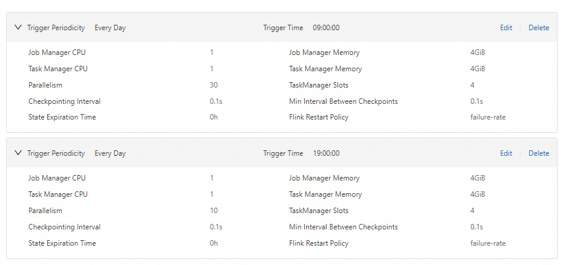

<a id="section-5-1-4-2"></a>

#### 5.1.4.2. Configure job resources

You can configure job resources before starting a job or modify them after deploying the job. The system supports two resource modes: basic mode (coarse-grained) and expert mode (fine-grained). This topic describes how to configure job resources and provides parameter information for both resource modes.

**Background information**

Realtime Compute for Apache Flink supports two resource configuration modes: basic mode (coarse-grained) and expert mode (fine-grained).

| Resource mode | Description |
| --- | --- |
| Basic mode | Basic mode uses static resource allocation. You only need to specify the total resources (CPU and total JVM memory) required for each Task Manager startup. The system then evenly distributes all resources based on the number of slots per Task Manager, which corresponds to the taskmanager.numberOfTaskSlots parameter in the Flink configuration.For most simple jobs, coarse-grained allocation meets the requirements.<br>For more information, see Configure job resources. |
| Expert mode | Expert mode uses dynamic resource allocation. You can configure the resources required for each Slot Sharing Group (SSG). Flink then calculates the resource specifications for each slot and dynamically requests Task Managers and slots that exactly match the requirements from the available resource pool. For complex jobs, coarse-grained allocation may result in low resource utilization. Fine-grained resource control allows you to precisely manage resources for each operator, thereby improving resource usage and meeting job throughput requirements.<br>For more information, see Configure job resources. |

For more information about concepts such as Task Manager, Job Manager, Task, and Slot, see Apache Flink Architecture.

**Usage limits**

Only SQL jobs support expert mode configuration.

**Precautions**

After you configure resources, you must restart the job for the changes to take effect.

**Procedure**

1. Go to the **Job O&M** page.

   <ol type="i">

   <li>

   Log in to the Realtime Compute for Apache Flink development console.

   <ol type="i" start="2">

   <li>

   In the left-side navigation pane, choose **O&M > Deployments**, click the name of the target job, and the

   </li>

   </ol>

   job details page is displayed by default.

   </li>

   </ol>

2. On the **Deployment Details** tab, click **Edit** on the right side of the **Resource Configurations** section.

3. Modify the job resource information.

   **Basic mode (coarse-grained) configuration item description**

   | Configuration item | Description |
   | --- | --- |
   | Concurrency | The global concurrency of the job. |
   | JobManager CPU | Based on the Flink best practice, a single JM requires at least 0.5 Core and 2 GiB of memory to ensure stable job operation. We recommend that you configure 1 Core and 4 GiB. The maximum value is 16 Cores. |
   | JobManager Memory | The unit is GiB. The minimum value is 2 GiB, and the maximum value is 64 GiB. |
   | TaskManager CPU | Based on the Flink best practice, a single TM requires at least 0.5 Core and 2 GiB of memory to ensure stable job operation. We recommend that you configure 1 Core and 4 GiB. The maximum value is 16 Cores. |
   | TaskManager Memory | The unit is GiB. The minimum value is 2 GiB, and the maximum value is 64 GiB. |
   | Slots per TaskManager | Enter the number of slots for each TM. |

   You can use the following formulas for calculation:

   - **Configured CUs for the job** = **MAX (Total CPU of JM and TM, Total memory of JM and TM/4).**

   - **Actual number of TMs (when the configured TM CPU or memory is less than or equal to the default maximum value) = Configured concurrency/Configured slots per TaskManager.**

   - **Actual number of TMs (when the configured TM CPU or memory exceeds the default maximum value) = MAX (**⌈**Total TM CPU/16 Cores**⌉**,**⌈**Total TM memory/64 GiB**⌉**)**.

     - Total TM CPU = Configured concurrency/Configured slots per TaskManager × Configured CPU per TM.

     - Total TM memory = Configured concurrency/Configured slots per TaskManager × Configured memory per TM.

     - The default maximum TM CPU is 16 Cores.

     - The default maximum TM memory is 64 GiB.

   - **Actual number of slots allocatable per TM** = **⌈Configured concurrency/Actual number of TMs⌉.**

   > **Note**
   >
   > - Round up each calculated ratio to the nearest integer.
   >
   > - You can also set the numberOfTaskSlots parameter in the **Other configurations** section of the **Runtime parameter configuration** area on the **Deployment details** tab. This parameter has the same function as the **Slots per TaskManager** setting in the console, but takes higher priority.

   **Expert mode (fine-grained) configuration item description**

   > **Note**
   >
   > - Only SQL jobs support expert mode configuration.
   >
   > - After you deploy a job, if you modify the SQL or resource configuration, you must regenerate the resource plan to ensure that the job starts properly.

   **Configure basic resources**

   | Configuration item | Description |
   | --- | --- |
   | JobManager CPU | Based on the Flink best practice, a single JM requires at least 0.25 Core and 1 GiB of memory to ensure stable job operation. The maximum value is 16 Cores. |
   | JobManager Memory | The unit is GiB, for example, 4 GiB. The minimum value is 1 GiB, and the maximum value is 64 GiB. |
   | Slots per TaskManager | None. |

   **Configure slot resources**

   <ol type="i">

   <li>

   In **Expert Mode**, click **Get Now** to obtain the resource plan.

   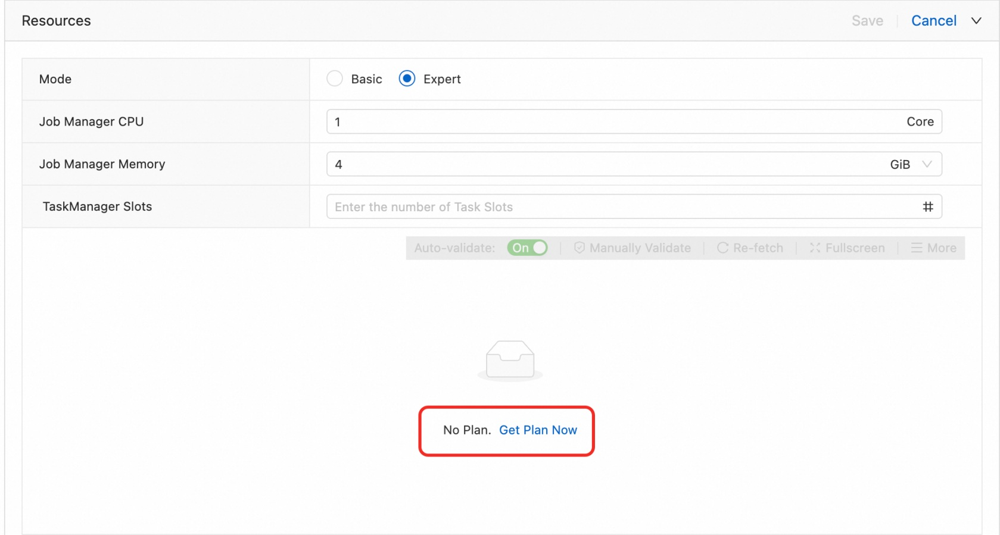

   </li>

   <li>

   Click the  icon on the **SLOT** box.

   </li>

   </ol>

   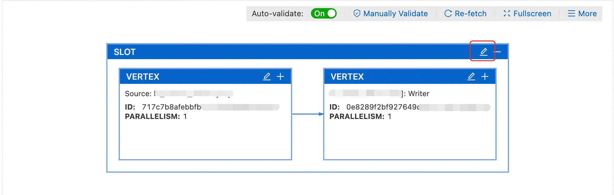

   <ol type="i" start="3">

   <li>

   **Modify the SLOT** configuration.

   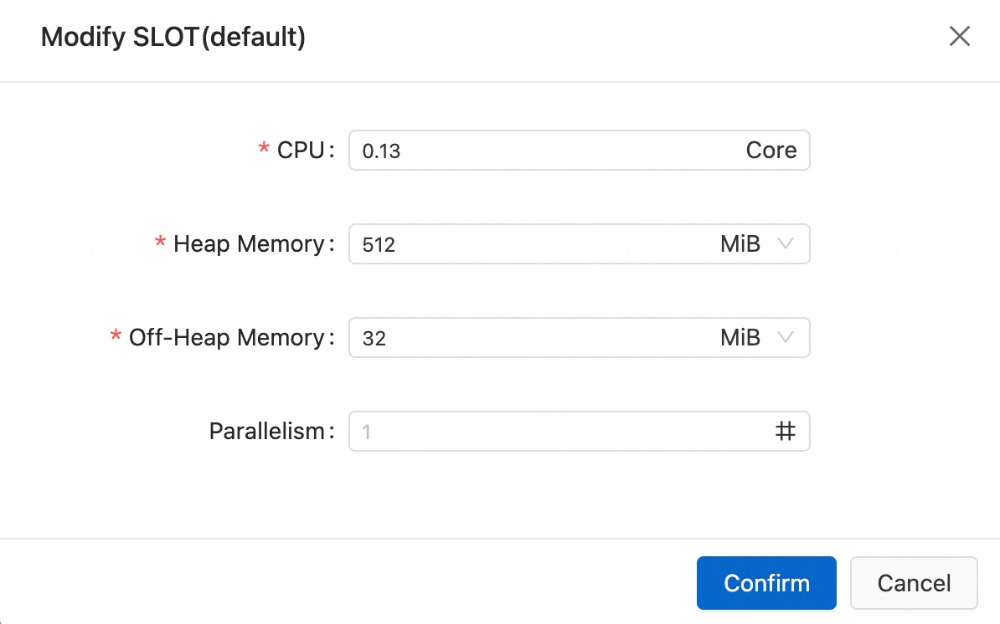

   The concurrency value that you set here applies uniformly to all operators in the slot sharing group. After you complete the configuration, the system automatically performs the following operations:

   - The system automatically generates the memory required by Statebackend, Python, and operators based on the computing logic of the job. You do not need to configure the memory manually.

     > **Note**
     >
     > We recommend that you adjust the Heap Memory and Off-Heap Memory sizes only when a specific exception or requirement occurs, such as an OOM error or severe GC in the job. During normal job operation, adjusting the Heap Memory and Off-Heap Memory sizes does not significantly change the job throughput.

   </li>

   <li>

   Click **OK**.

   </li>

   </ol>

   **Configure operator concurrency and chaining policies**

   <ol type="i">

   <li>

   Modify the VERTEX concurrency.

   Click the  icon on the target VERTEX to batch set the concurrency of operators under the

   corresponding VERTEX.

   </li>

   <li>

   Click  on the target VERTEX box to expand the VERTEX.

   </li>

   </ol>

   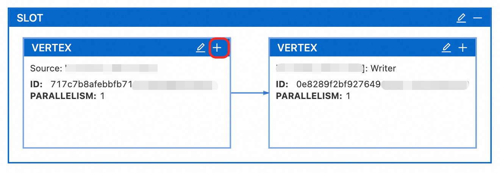

   <ol type="i" start="3">

   <li>

   Click the  icon of the operator to configure operator resources.

   </li>

   </ol>

   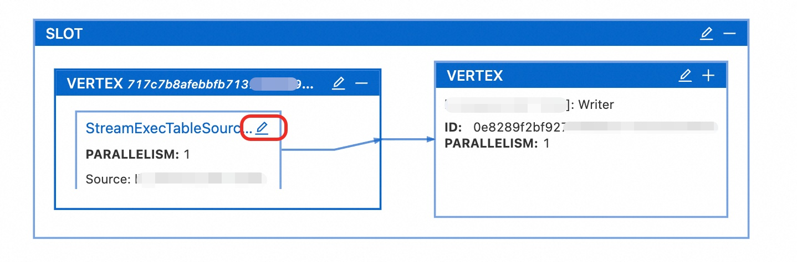

   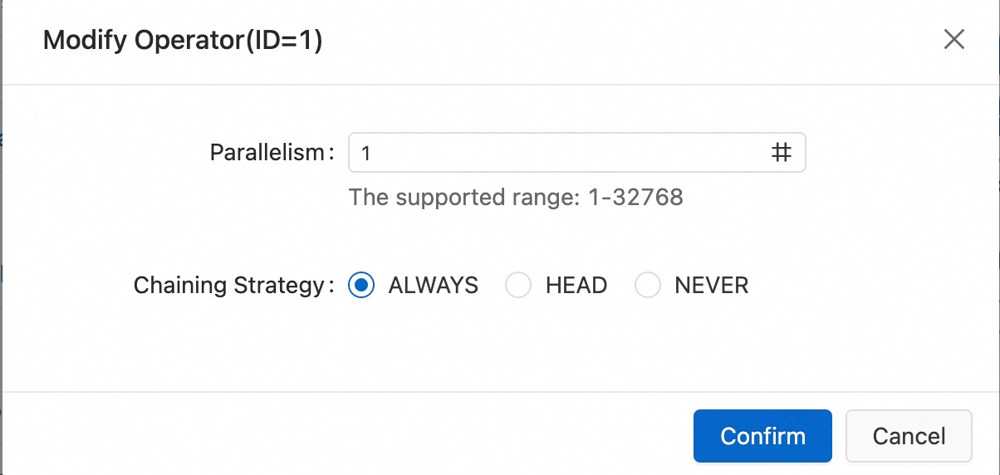

   The following table describes the parameters.

   | Parameter | Description |
   | --- | --- |
   | Concurrency | The concurrency of the corresponding operator. |
   | Chaining policy | A chain is a logical computing chain formed by connecting multiple operators. Chaining improves job execution efficiency and performance and reduces data transmission and serialization overhead between operators. However, you may need to break a chain to better control the job execution flow and performance. The following chaining policies are supported:<br>• ALWAYS (default): The operator can always chain with upstream and downstream operators.<br>• HEAD: The current operator serves as the head node of the chain. It breaks the chain only with upstream operators, while downstream nodes remain chained with the current operator.<br>• NEVER: The current operator does not chain with any upstream or downstream operators. |

   > **Note**
   >
   > - We recommend that you set the concurrency of source nodes proportional to the number of partitions, so that the concurrency value evenly divides the partition count. For example, if Kafka has 16 partitions, set the concurrency to 16, 8, or 4 to avoid data skew. Also, do not set the concurrency of source nodes too low, because a single source that reads excessive data may cause an ingress bottleneck and reduce job throughput.
   >
   > - We recommend that you configure the concurrency of non-source nodes based on your needs. Set higher concurrency for nodes with heavy traffic and lower concurrency for nodes with light traffic.

   <ol type="i" start="4">

   <li>

   Click **OK**.

   </li>

   </ol>

4. Click **Save**.

5. Restart the job.

   After you configure job resources, you must restart the job to apply the changes.

**Related documentation**

- If you do not want to scale resources manually, you can use automatic tuning to let the system scale resources automatically.

- For more information about the basic configuration, runtime parameter configuration, and log configuration of a job, see Default deployment configurations.

<a id="section-5-1-5"></a>

### 5.1.5. Dynamic parameter update

Dynamic update of the parameter configuration of a Flink deployment can make the parameter configuration take effect more quickly. This helps reduce the service interruption time caused by deployment startup and cancellation and facilitates dynamic scaling of TaskManagers and checkpoint-based troubleshooting. This topic describes the method for dynamically updating parameters.

**Background**

If you use the traditional parameter update method for a deployment, you must restart the deployment. Issues, such as service interruption, delay in data backtracking, and resource consumption spikes, may occur. This prolongs the deployment cancellation time, which may affect business continuity.

When you use the dynamic parameter update feature, a REST request is sent to a deployment that is running. This feature allows a deployment to reuse existing JobManager and TaskManagers and enables the system to update parameter configurations of the deployment by performing in-place restarts or even update parameter configurations without restarting the deployment. This reduces the cost caused by deployment restart. The dynamic parameter update feature is used together with the resource pre-application and state lazy loading capabilities to accelerate the startup of the deployment after the parameter configurations of the deployment are updated. This reduces the service interruption time caused by parameter update from minutes to seconds. For example, if you perform dynamic scaling for a deployment that performs data read, map, and write operations, you can use the dynamic parameter update feature to significantly reduce the service interruption time. The following figure shows the comparison of the service interruption time between dynamic parameter update and traditional parameter update.

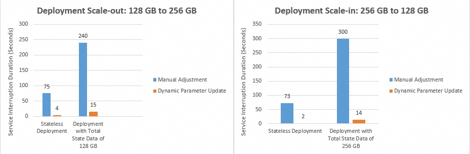

> **Note**
>
> You can dynamically change the value of the Parallelism parameter to perform dynamic scaling of TaskManagers.

**Usage limits**

- Only Realtime Compute for Apache Flink that uses Ververica Runtime (VVR)-11.5.0-flink-1.20 supports the dynamic parameter update feature.

- The Parallelism parameter cannot be dynamically updated in expert mode (fine-grained resource configuration).

**Precautions**

- Dynamic parameter update is an experimental feature. Services may be interrupted when the parameter configuration is dynamically updated. Compared with the traditional parameter update method, dynamic parameter update can significantly shorten the service interruption time. The service interruption time is affected by factors such as the deployment topology and state size. In most cases, the service interruption time is between 5 seconds and 1 minute.

- You can dynamically change the values of parameters and make the parameter configuration take effect only for a deployment that is running.

- You can only dynamically change the parallelism of a node whose parallelism is not specified. If the parallelism of a node is specified, the manual configuration of the parallelism is skipped in Realtime Compute for Apache Flink. This is because the parallelism of a node has special requirements in specific scenarios. For example, the parallelism of the global operator must be 1 and cannot be changed. You must explicitly specify the parallelism for the Kafka source node to prevent the parallelism from exceeding the number of partitions. If you want the node parallelism to be dynamically updated, we recommend that you do not specify the operator parallelism by using the DataStream#setParallelism method or configuring the parallelism parameter of the source or sink operator.

- Only the **parallelism**, **checkpoint interval**, **checkpoint timeout**, and **minimum pause between checkpoints** parameters support dynamic updates. When you change the value of a supported parameter, the **Dynamic Update** button appears. Click the button to apply your changes. If you also modify parameters that do not support dynamic updates, you must restart the job to apply those changes.

**Procedure**

1. Go to the **Deployments** page.

   <ol type="i">

   <li>

   Log in to the development console.

   <ol type="i" start="2">

   <li>

   In the left-side navigation pane, choose **O&M Center > Job O&M**, click the name of the target job to

   </li>

   </ol>

   open its details page.

   </li>

   </ol>

2. On the **Configuration** tab, click **Edit** on the right side of the **Resources** or **Parameters** section.

3. Modify the values of parameters that support dynamic updates, and then click **Save**.

   > **Important**
   >
   > Only the **parallelism**, **checkpoint interval**, **checkpoint timeout**, and **minimum pause between checkpoints** parameters support dynamic updates. When you change the value of a supported parameter, the **Dynamic Update** button appears. Click the button to apply your changes. If you also modify parameters that do not support dynamic updates, you must restart the job to apply those changes.

4. Click **Hot-update** in the upper-right corner of the page.

   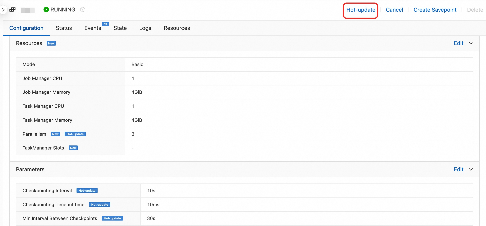

5. In the dialog box that appears, review the prompt information and click **OK**.

   After you click **OK**, an icon that indicates dynamic parameter update appears.

   

**References**

- If you want to make the change to the configuration of a parameter that cannot be dynamically updated take effect for a deployment, you can modify the parameter configuration on the **Configuration** tab of the Deployments page for the deployment and then restart the deployment. For more information, see Default deployment configurations and Start a deployment.

- The automatic tuning feature helps you adjust the deployment parallelism and resource configurations to resolve performance tuning issues.

<a id="section-5-2"></a>

## 5.2. Configure session clusters

You can use the session cluster mode to deploy or debug jobs, improving Job Manager (JM) resource utilization and accelerating job startup. This topic describes usage recommendations and the creation procedure for session clusters in Realtime Compute for Apache Flink.

> **Important**
>
> Session clusters share a single JobManager across all jobs. A JobManager failure causes all jobs in the cluster to fail. Do not use session clusters in production environments.

**Background information**

Realtime Compute for Apache Flink supports two cluster modes: per-job clusters and session clusters. The two cluster modes have the following differences:

- Per-job cluster (default): Resources are isolated between jobs, and each job requires a dedicated JM. Small jobs have low JM resource utilization. Therefore, per-job clusters are suitable for jobs that consume large amounts of resources or run continuously and stably.

- Session cluster: Multiple jobs can share the same JM, which improves JM resource utilization. Therefore, session clusters are suitable for jobs that consume fewer resources or start and stop frequently, effectively reducing resource costs.

  > **Note**
  >
  > - Session clusters do not support the auto-tuning feature.
  >
  > - Creating a session cluster consumes cluster resources regardless of whether you use the session cluster. The amount of consumed resources depends on the resource configuration that you select when you create the cluster.

**Usage limits**

Session clusters have the following limits:

- You cannot change the Flink engine version after you suspend a session cluster.

- You cannot scale down the number or resources of TaskManagers after you suspend a session cluster.

- Data curves are not displayed.

- The monitoring and alerting feature is not available.

- Realtime Compute for Apache Flink with storage and computing separation does not support disaster recovery.

**Precautions**

- Do not use session clusters in production environments. You can use session clusters as development and testing environments. Debugging jobs in a session cluster improves JM resource utilization. In production environments, the JM sharing mechanism negatively affects job stability. The details are as follows:

  - A single point of failure of the JobManager affects all jobs in the cluster.

  - A single point of failure of a TaskManager affects all jobs that run tasks on that TaskManager.

  - Without process isolation, different tasks within the same TaskManager may affect each other.

- If a session cluster uses the default configuration, follow these recommendations:

  - For small jobs with single parallelism, keep the total number of jobs in the cluster below 100.

  - For complex jobs, keep the maximum parallelism of a single job below 512, and keep the number of medium-scale jobs with 64 parallelism below 32 per cluster. Otherwise, issues such as heartbeat timeouts may occur and affect cluster stability. In this case, increase the heartbeat interval and heartbeat timeout.

  - If you need to run more jobs simultaneously, increase the resource configuration of the session cluster.

- Do not run jobs in a session cluster with SQL Preview enabled. If a new version of the product is released later, you must stop the session cluster and manually adapt the Flink engine. Otherwise, local debugging returns errors.

**Create a session cluster**

1. Go to the **Session Management** page.

   <ol type="i">

   <li>

   Log in to the Realtime Compute for Apache Flink development console.

   <ol type="i" start="2">

   <li>

   In the left-side navigation pane, choose **Operations Center > Session Management**.

   </li>

   </ol>

   </li>

   </ol>

2. Click **Create Session Cluster** and configure the parameters.

   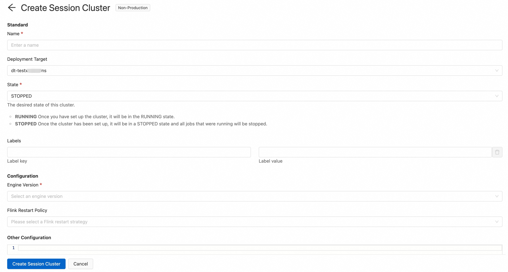

   The following table describes the parameters.

   **Section**

   **Parameter**

   **Description**

   Name

   The name of the cluster.

   Select the target cluster from the drop-down list.

   Deployment

   > **Note**

   target

   > You can select a **Session Cluster** or a **Per-Job Cluster**. Jobs that are not deployed to a session cluster use a per-job cluster by default.

   Set the expected running status of the cluster:

   Basic settings

   - STOPPED: The cluster remains stopped after configuration is complete, and all

   Status

   running jobs also stop.

   - RUNNING: The cluster remains running after configuration is complete.

   You can add job labels in the label options to quickly locate jobs on the overview

   Label name

   page.

   Label value

   None.

   The Flink engine version that the current job uses. We recommend that you use a recommended or stable version. The engine version labels have the following meanings:

   Engine version

   - **Recommended**: The latest minor version under the current major version.

   - **EOS**: A version that has exceeded the product service period.

   This parameter has the following valid values:

   - Failure Rate: Restarts based on the failure rate. After you select this option, you must also specify the failure rate detection interval, the maximum number

   Configura

   of failures within the interval, and the delay between restarts.

   tion

   - Fixed Delay: Restarts at fixed intervals. After you select this option, you must also specify the number of restart attempts and the delay between restarts.

   Flink restart policy

   - No Restarts: The system does not restart the job when a task fails.

   configuration

   > **Note**
   >
   > If you do not configure this parameter, the system applies the default Apache Flink restart policy. When a task fails and checkpointing is disabled, the JobManager process does not restart. When checkpointing is enabled, the JobManager process restarts.

   Configure additional Flink settings here, such as

   Other settings

   `taskmanager.numberOfTaskSlots: 1` .

   Number of

   The default value equals the parallelism.

   TaskManagers

   JobManager CPU

   The default value is 1.

   Cores

   Recommended value: 4 GiB. Minimum value: 1 GiB. The unit is GiB, for example, 1 GiB or 1.5 GiB.

   The recommended JobManager configuration includes JobManager resources and heartbeat-related parameters. The details are as follows:

   - The JobManager handles TaskManager heartbeats, job task serialization, and resource scheduling. Therefore, we recommend that you allocate at least the

   JobManager

   default resources to the JobManager and adjust the allocation based on the

   Memory

   cluster load.

   - To ensure cluster stability and prevent heartbeat timeouts caused by a busy JobManager main thread, set the heartbeat interval (heartbeat.interval) to at least 10 seconds and the heartbeat timeout (heartbeat.timeout) to at least 50 seconds. Increase these values as the number of TaskManagers and jobs grows.

   TaskManager CPU

   The default value is 2.

   Cores

   Resource configurat ion

   Recommended value: 8 GiB. Minimum value: 1 GiB. The unit is GiB, for example, 1 GiB or 1.5 GiB.

   The recommended TaskManager configuration includes the number of slots per TaskManager (taskmanager.numberOfTaskSlots) and the TaskManager resource size. The details are as follows:

   - For small jobs with single parallelism, set the CPU-to-memory ratio per slot to 1:4 and allocate at least 1 vCPU and 2 GiB of memory.

   - For complex jobs, allocate at least 1 vCPU and 4 GiB of memory per slot. With the default resource configuration, you can configure 2 slots per TaskManager.

   - Do not allocate too few or too many resources to a TaskManager. Use the

   TaskManager

   default resource configuration and set the number of slots to 2.

   Memory

   > **Note**
   >
   > - If a single TaskManager has too few resources, job stability may degrade. Additionally, the limited number of slots cannot effectively distribute the TaskManager overhead, which reduces resource utilization.
   >
   > - If a single TaskManager has too many resources, it runs a large number of jobs. A single point of failure on that TaskManager then affects a wide range of jobs.

   The log levels in ascending order of severity are as follows:

   - TRACE: Provides more granular information than DEBUG.

   - DEBUG: Provides information about the system running status.

   Root log level

   - INFO: Provides important or relevant information.

   - WARN: Provides information about potential errors in the system.

   - ERROR: Provides information about system errors and exceptions.

   Log configurat ion

   Class log name

   Enter the log name.

   Class log level

   Enter the log level.

   The log template. You can select a system template or a custom template.

   Log template

4. Click **Create Session Cluster**.

   After you create the session cluster, click **Start**. You can then select this cluster as the deployment target when you create a job.

<a id="section-5-3"></a>

## 5.3. Default deployment configurations

This topic describes how to manage the default configurations for streaming and batch deployments, including runtime parameters, Flink restart policies, and logging settings. You can modify these settings as needed.

**Default configurations for streaming deployments**

1. Log in to the Realtime Compute for Apache Flink development console.

2. In the left-side navigation pane, click **Configurations**.

3. On the **Deployment Defaults** tab, click **Defaults for Stream**.

4. Modify the parameters.

   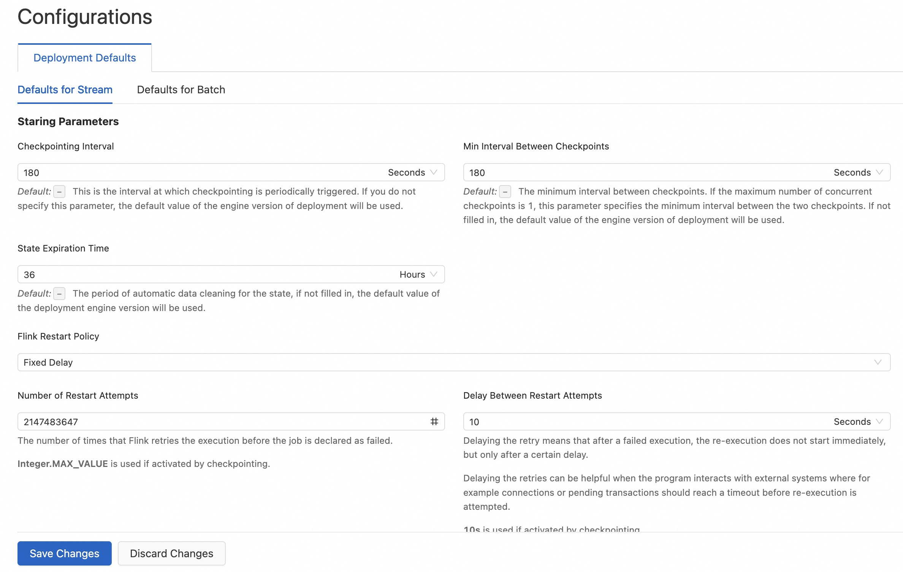

   **Parameter**

   **Description**

   The interval at which checkpoints are scheduled. If you do not

   **Checkpointing Interval**

   specify this parameter, the default value of the job engine version is used. The default interval is 180 seconds.

   The minimum time interval between two system checkpoints. If the maximum parallelism of checkpoints is 1, this configuration

   **Min Interval Between**

   ensures a minimum time interval between two checkpoints. If you

   **Checkpoints**

   do not specify this parameter, the default value of the job engine version is used. The default interval is 180 seconds.

   Default value:  `-` . The timeout period for system checkpoints.

   **Checkpointing Timeout**

   The default value is 10 minutes. If a checkpoint is not generated

   **time**

   within the time specified by this parameter, the checkpoint generation fails.

   The time-to-live (TTL) of the Flink state. The state service clears

   **State Expiration Time**

   the current state every time the specified time duration ends. The default time duration is 36 hours.

   **Starting**

   Supported policies:

   **Parameters**

   - Failure Rate: The deployment is restarted if the number of failures within the specified interval exceeds the upper limit. If you select this option, you must configure the Failure Rate Interval, Max failures per interval, and Delay Between Restart Attempts parameters.

   **Flink Restart Policy**

   - Fixed Delay: Deployments are restarted at a fixed interval. If you select this option, you must also configure the Number of Restart Attempts and Delay Between Restart Attempts parameters.

   - No Restarts: Deployments are not restarted if the task fails.

   The number of retries that Realtime Compute for Apache Flink

   **Number of Restart**

   performs before it declares a deployment failure. If checkpointing

   **Attempts**

   is enabled, the value of the Integer.MAX_VALUE parameter applies. The default value is 2147483647.

   After a deployment fails, retries are not immediately performed,

   **Delay Between Restart**

   but are performed after the specified delay. Default value: 10

   **Attempts**

   Seconds.

   Configure other Flink settings, such

   **Other**

   /

   as  `taskmanager.numberOfTaskSlots: 1` .

   **Configuration**

   **Root Log Level**

   Valid values: TRACE, DEBUG, INFO, WARN, and ERROR.

   **Log Levels**

   The log name and log level.

   **Logging**

   Both system templates and user-defined templates are supported.

   **Logging Profile**

   The default value is default, which specifies system templates.

5. Click **Save Changes**.

   If you can click **Discard Changes** before you save the changes, the changes are discarded.

**Default configurations for batch deployments**

1. Log in to the Realtime Compute for Apache Flink development console.

2. In the left-side navigation pane, click **Configurations**.

3. On the **Deployment Defaults** tab, click **Defaults for Batch**.

4. Modify the parameters.

   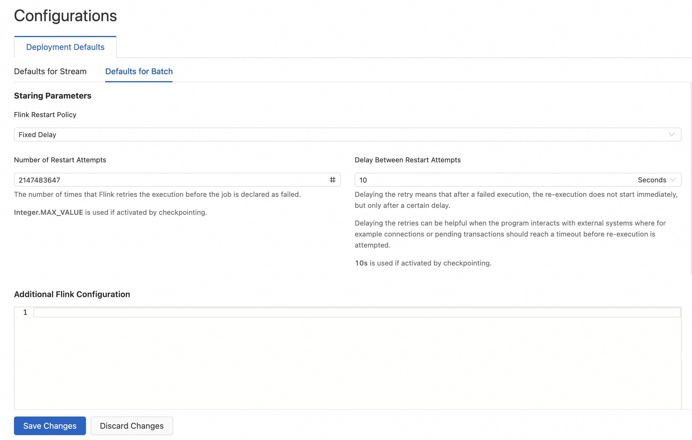

   <table>
     <tr>
       <th colspan="2">Parameter</th>
       <th>Description</th>
     </tr>
     <tr>
       <td rowspan="3">Starting Parameters</td>
       <td>Flink Restart Policy</td>
       <td>Supported policies:<br>• Failure Rate: The deployment is restarted if the number of failures within the specified interval exceeds the upper limit.If you select this option, you must configure the Failure Rate Interval, Max failures per interval, and Delay Between Restart Attempts parameters.<br>• Fixed Delay: Deployments are restarted at a fixed interval. If you select this option, you must also configure the Number of Restart Attempts and Delay Between Restart Attempts parameters.<br>• No Restarts: Deployments are not restarted if the task fails.</td>
     </tr>
     <tr>
       <td>Number of Restart Attempts</td>
       <td>The number of retries that Realtime Compute for Apache Flink performs before it declares a deployment failure. If checkpointing is enabled, the value of the Integer.MAX_VALUE parameter applies. The default value is 2147483647.</td>
     </tr>
     <tr>
       <td>Delay Between Restart Attempts</td>
       <td>After a deployment fails, retries are not immediately performed, but are performed after the specified delay. Default value: 10 Seconds.</td>
     </tr>
     <tr>
       <td>Other Configuration</td>
       <td>/</td>
       <td>Configure other Flink settings, such as <code> taskmanager.numberOfTaskSlots: 1 </code>.</td>
     </tr>
     <tr>
       <td rowspan="3">Logging</td>
       <td>Root Log Level</td>
       <td>Valid values: TRACE, DEBUG, INFO, WARN, and ERROR.</td>
     </tr>
     <tr>
       <td>Log Levels</td>
       <td>The log name and log level.</td>
     </tr>
     <tr>
       <td>Logging Profile</td>
       <td>The log template. You can use the system template or configure a user-defined template.</td>
     </tr>
   </table>

5. Click **Save Changes**.

   If you click **Discard Changes** before you save the changes, the changes are discarded.

<a id="section-6"></a>

# 6.Manage data

You can manage data by using the Catalogs function. This allows you to create, view, and delete Hologres, MySQL, or Apache Paimon catalogs, which enables you to directly reference metadata in job development.

<a id="section-6-1"></a>

## 6.1. Manage user-defined functions (UDFs)

To use a user-defined function (UDF) in a SQL job, you must register it. This topic describes how to register, update, and delete UDFs.

**Usage notes**

To avoid JAR file dependency conflicts:

- Ensure that the version of the Flink image is consistent with the Flink version specified as a dependency in your  `pom.xml`  file.

- Do not upload runtime-level JAR files. To exclude them, add  `<scope>provided</scope>`  to the dependency declaration.

- For other third-party dependencies, package them into your JAR file by using the Apache Maven Shade Plugin.

**Register a user-defined function**

You must register a UDF before using it in a SQL job.

1. Log on to the Realtime Compute for Apache Flink console.

2. In the left-side navigation pane, click **SQL Development**.

3. On the **Functions** tab, click **Register UDF**. You can also click the  icon in the upper-right corner.

   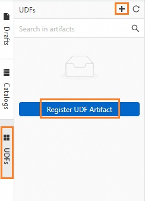

4. Upload the UDF JAR file and click **Confirm**.

   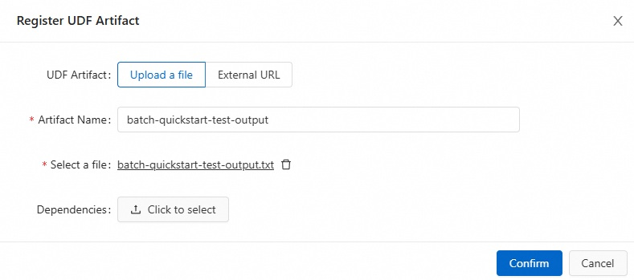

   You can upload the UDF JAR file in one of the following ways:

   - **Upload File**: Next to the **Select File** option, click **Select File** and select the UDF artifact file. If there are dependency files, click **Select File** next to the **Dependency File** option and select the dependency files.

   - **External URL**: Enter the external URL of the file.

   - The Realtime Compute for Apache Flink console parses your JAR file, automatically detects classes that implement Flink UDF, UDAF, and UDTF interfaces, and fills the Function Name field with the class names.

   - For Java UDFs, you can package dependencies into the UDF JAR file or upload them separately as a dependency file. For Python UDFs, we recommend uploading dependencies as a separate dependency file.

   - When a custom function's artifact file or its dependency files are large, you can upload them by using an external URL. Note that if the external URL is an OSS bucket address, the dependency files must be located in the  `sql-artifacts/namespaces/{namespace}`  directory.

     > **Note**
     >
     > The bucket must have at least public read access. The URL must use the HTTP protocol and cannot contain encoded characters.

5. In the **Manage Functions** dialog box, verify the function information and click **Create Function**.

   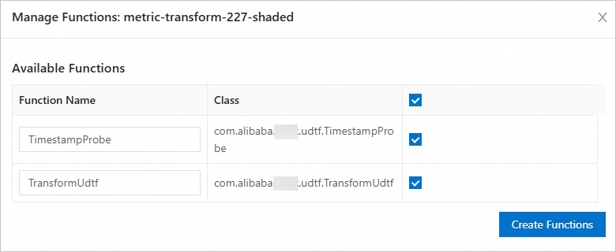

   After the function is registered, the dialog box displays information about the **Registered Functions**. You can then remove any unnecessary functions.

   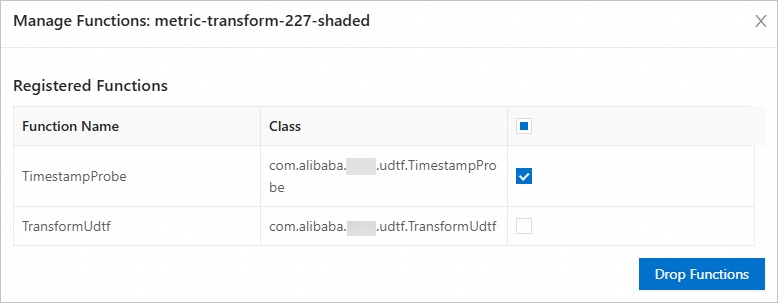

   After you remove functions, the dialog box appears as shown. Verify the function details, and then close the dialog box.

   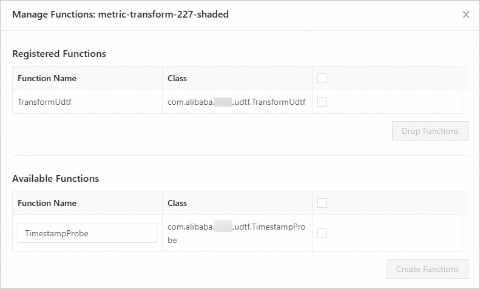

6. In the **Functions** list on the left of the SQL editor, you can view all registered UDFs.

**Manage user-defined functions**

If you need to add or remove functions from a registered UDF JAR file, follow these steps.

1. On the **Functions** tab, hover over the name of the target JAR file and click the  icon.

2. Add or remove functions.

   

**Update a user-defined function**

If you add new functions to a JAR file or modify the code of existing registered functions, you can update the JAR file.

1. On the **Function** tab, hover over the name of the target custom function and click the  icon.

2. Update the JAR file.

   You can upload the updated JAR file in one of the following ways:

   - **Upload File**: Next to the **Select File** option, click **Select File** and select the UDF artifact file. If there are dependency files, click **Select File** next to the **Dependency File** option and select the dependency files.

   - **External URL**: Enter the external URL of the file.

   > **Important**
   >
   > - The new JAR file that you upload must contain the classes for all currently registered UDFs. You cannot remove the class of a UDF during an update.
   >
   > - The new UDF JAR file takes effect only when you restart a job or submit a new one. Running jobs continue to use the old JAR file until they are restarted.

3. Click **Modify**.

**Delete a user-defined function**

If a JAR file is no longer needed, you can delete it.

1. In the left-side navigation pane, click **SQL Development**.

2. On the **Functions** tab, hover over the name of the target JAR file and click the  icon.

   > **Note**
   >
   > Before you delete a JAR file, make sure that no jobs or SQL files reference any UDFs registered from it.

3. Select the **Delete the associated file** checkbox.

   Deleting the UDF JAR file also deletes all UDFs registered from it. This action is required to prevent orphaned data and references.

4. Click **OK**.

<a id="section-6-2"></a>

## 6.2. Manage Paimon catalogs

After you configure a Paimon catalog, you can use Realtime Compute for Apache Flink to directly access Paimon tables in Alibaba Cloud Object Storage Service. This topic describes how to create, view, and delete Paimon catalogs, and manage Paimon databases and tables in the Realtime Compute development console.

**Create a Paimon filesystem catalog**

1. Go to the Data Management page.

   <ol type="i">

   <li>

   Log in to the Realtime Compute for Apache Flink development console.

   <ol type="i" start="2">

   <li>

   In the left-side navigation pane, click **Data Management**. The system expands the **Catalog List** page

   </li>

   </ol>

   by default.

   </li>

   </ol>

2. Click **Create Catalog**, select **Apache Paimon**, and then click **Next**.

3. Configure the parameters.

   <table>
     <tr>
       <th>Configuration Item</th>
       <th>Description</th>
       <th>Require d</th>
       <th>Remarks</th>
     </tr>
     <tr>
       <td>catalog name</td>
       <td>The name of the Paimon catalog.</td>
       <td>Yes</td>
       <td>Enter a custom English name.</td>
     </tr>
     <tr>
       <td>metastore</td>
       <td>The data storage type.</td>
       <td>Yes</td>
       <td>Set this parameter to Filesystem.</td>
     </tr>
     <tr>
       <td>warehouse</td>
       <td>The data warehouse directory in OSS.</td>
       <td>Yes</td>
       <td>Use the format oss://&lt;bucket&gt;/&lt;object&gt;, where:<br>• bucket: the name of the OSS bucket that you created.<br>• object: the path where you store data.</td>
     </tr>
     <tr>
       <td>fs.oss.endpoint</td>
       <td>The endpoint of OSS.</td>
       <td>Yes</td>
       <td>Example: oss-cn-hangzhou.aliyuncs.com.</td>
     </tr>
     <tr>
       <td>fs.oss.accessKeyId</td>
       <td>The AccessKey ID for accessing OSS.</td>
       <td>Yes</td>
       <td rowspan="2">None</td>
     </tr>
     <tr>
       <td>fs.oss.accessKeySecr et</td>
       <td>The AccessKey Secret for accessing OSS.</td>
       <td>Yes</td>
     </tr>
     <tr>
       <td>fs.oss.signer.version</td>
       <td>The OSS signature version.</td>
       <td>No</td>
       <td>None</td>
     </tr>
   </table>

4. Click **OK**.

**Manage Paimon databases**

Enter the following commands in the SQL development text editor, select the code, and then click **Run**.

- **Create a database**

  After you create a Paimon catalog, the system automatically creates a database named  `default`  in the catalog.

  ```sql
  -- Replace my-catalog with the name of the Paimon catalog that you created.
  USE CATALOG `my-catalog`;

  -- Replace my_db with a custom database name in English.
  CREATE DATABASE `my_db`;
  ```

- **Delete a database**

  > **Important**
  >
  > You cannot delete the default database in DLF, MaxCompute, or Sync catalogs. You can delete the default database only in Filesystem catalogs.

  ```text
  -- Replace my-catalog with the name of the Paimon catalog that you created.
  USE CATALOG `my-catalog`;

  -- Replace my_db with the name of the database that you want to delete.
  DROP DATABASE `my_db`; -- Deletes only databases that contain no tables.
  DROP DATABASE `my_db` CASCADE; -- Deletes the database and all tables in the database.
  ```

**View or delete a Paimon catalog**

On the **Data Management** page, view or delete a Paimon catalog.

- View: On the **Catalog List** page, view the **Catalog Name** and **Type**. To view the databases and tables in a catalog, click **View**.

- Delete: On the **Catalog List** page, click **Delete** in the **Actions** column of the target catalog.

  You can also enter  `DROP CATALOG <catalog name>;`  in the SQL development text editor, select the code, and then click **Run**.

  > **Note**
  >
  > Deleting a Paimon catalog removes only the record from Data Management in the Realtime Compute for Apache Flink project. This operation does not affect the data files of Paimon tables. After you delete a catalog, you can recreate the Paimon catalog to reuse the Paimon tables in the catalog.

<a id="section-6-3"></a>

## 6.3. Manage Hologres catalogs

After you configure a Hologres catalog, you can read Hologres metadata directly from the fully managed Flink console. This eliminates the need to manually register Hologres tables, improves job development efficiency, and ensures data accuracy. This topic describes how to configure, view, and delete a Hologres catalog in fully managed Flink.

**Background information**

A catalog provides metadata, such as databases, tables, partitions, views, and functions and information in databases or other external systems. For more information, see Catalogs.

This topic describes how to manage a Hologres catalog in the following aspects:

- Create a Hologres catalog

- View a Hologres catalog

- Use a Hologres catalog

- Delete a Hologres catalog

**Usage limits**

- Only Flink 1.13 and later versions support configuring a Hologres catalog.

- You cannot modify catalog DDL.

**Create a Hologres catalog**

**Use the UI**

1. Log in to the Realtime Compute for Apache Flink development console.

2. In the left-side navigation pane, click **DMS**. By default, the system displays the **Catalog list** page.

3. Click **Create Catalog**, select **Hologres**, and then click **Next**.

4. Configure the parameters.

   | Parameter | Description | Required |
   | --- | --- | --- |
   | catalogname | The custom name of the Hologres catalog.<br>The name supports only lowercase letters (a-z) and digits (0-9). It does not support uppercase letters or special characters such as hyphens (-) and underscores (_). | Yes |
   | endpoint | The endpoint of Hologres, in the <strong>&lt;host&gt;:&lt;port&gt;</strong> format. | Yes |
   | username | The username that matches the dbname parameter.Set this parameter to the AccessKey ID of the organization to which Hologres belongs. | Yes |
   | password | The password that matches the dbname parameter.Set this parameter to the AccessKey secret of the organization to which Hologres belongs. | Yes |
   | dbname | The name of the Hologres database.<br>You must create the database in the destination Hologres instance. Otherwise, an error occurs when you create the catalog. | Yes |

5. Click **OK**.

6. Click the  icon to refresh the page and view the new Hologres catalog.

   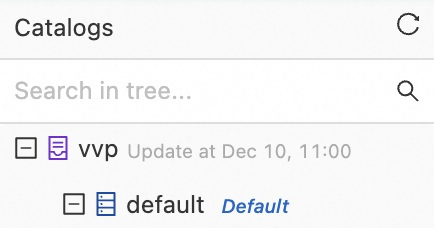

**SQL method**

1. Create an SQL streaming job.

2. In the text editor, enter the command to configure a Hologres catalog.

   ```text
   CREATE CATALOG <catalogname> WITH (
     'type' = 'hologres',
     'endpoint' = '<endpoint>', 
     'username' = '<AccessKey>',
     'password' = '<AccessSecret>',
     'dbname' = '<dbname>'
   );
   ```

   | Parameter | Description | Required |
   | --- | --- | --- |
   | &lt;catalogname&gt; | The custom name of the Hologres catalog. The name supports only lowercase letters (a-z) and digits (0-9). It does not support uppercase letters or special characters such as hyphens (-) and underscores (_). | Yes |
   | type | The type. Set this parameter to hologres. | Yes |
   | endpoint | The endpoint of Hologres, in the <strong>&lt;host&gt;:&lt;port&gt;</strong> format. | Yes |
   | username | The username that matches the dbname parameter. Set this parameter to the AccessKey ID of the organization to which Hologres belongs. | Yes |
   | password | The password that matches the dbname parameter. Set this parameter to the AccessKey secret of the organization to which Hologres belongs. | Yes |
   | dbname | The name of the default Hologres database that you access. | Yes |

3. Click **Deployment**.

   After the execution, the system displays the "Query has been executed" message. To delete a Hologres catalog, see Delete a Hologres catalog.

4. On the left side, click the **Metadata** tab and click the  icon to refresh the page and view the new

   Hologres catalog.

   

**View a Hologres catalog**

After you configure a Hologres catalog, you can view Hologres metadata by performing the following steps.

1. In the left-side navigation pane, click **DMS**. The system expands the **Catalog list** page by default.

2. From the drop-down list in the top menu bar, switch to the target Hologres catalog. This topic uses holo as an example.

   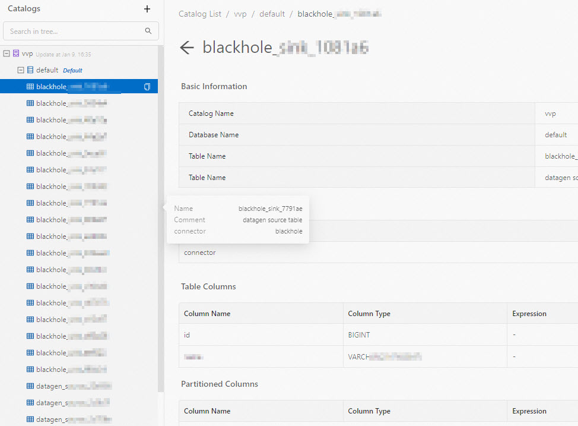

3. View information about databases, tables, and functions in different Hologres catalogs.

   > **Note**
   >
   > If the schema is public, the system omits the schema prefix from the table name and directly displays tableName.

**Use a Hologres catalog**

**Create a Hologres table**

**UI method**

1. Go to the DMS page.

2. Go to the destination database.

   <ol type="i">

   <li>

   Click **View** in the **Actions** column of the target catalog.

   </li>

   <li>

   Click **View** in the **Actions** column of the target database.

   </li>

   </ol>

3. Create a Hologres table.

   <ol type="i">

   <li>

   Click **Create Table**.

   </li>

   <li>

   On the **Connect with built-in connector** tab, select the Hologres connector and click **Next**.

   </li>

   <li>

   Enter the table statement and configure the related parameters. The following code provides an

   </li>

   </ol>

   example.

   ```sql
   CREATE TABLE `${catalog_name}`.`${db_name}`.`${table_name}` (
    ...
   ) WITH (
    'connector' = 'hologres'
   );
   ```

   <ol type="i" start="4">

   <li>

   Click **OK**.

   </li>

   </ol>

**SQL method**

Use the  `USE CATALOG HoloName`  command to directly reference the Hologres data service.

```sql
USE CATALOG ${catalog_name};
CREATE TABLE `${db_name}`.`${schema_name.table_name}`(
  ...
 ) WITH (
   'connector' = 'hologres'
 );
```

For more information about the USE syntax, see USE statement.

Directly reference the Hologres data service information in the DDL statement.

```sql
CREATE TABLE `${catalog_name}`.`${db_name}`.`${schema_name.table_name}` (
  ...
) WITH (
  'connector' = 'hologres'
);
```

> **Note**
>
> - When you create a table under a registered Hologres data service, the connector parameter in the WITH clause is required and must be set to hologres. You can omit other parameters such as endpoint.
>
> - You cannot directly add or modify WITH parameters in a Hologres table. Instead, you can add or modify WITH parameters in an INSERT statement by using SQL hints.

**Read data from a Hologres table**

```sql
INSERT INTO ${other_sink_table}
SELECT ...
FROM `${catalog_name}`.`${db_name}`.`${schema_name.table_name}`
```

**Write result data to a Hologres table**

```sql
INSERT INTO `${catalog_name}`.`${db_name}`.`${schema_name.table_name}`
SELECT ... 
FROM ${other_source_table}
```

> **Note**
>
> If the schema is public, you can omit the schema name prefix when you enter **${schema_name.table_name}** and directly specify the table name, which is ${table_name}.

**Delete a Hologres catalog**

1. Create an SQL streaming job.

2. In the text editor, enter the following command.

   ```text
   DROP CATALOG ${catalog_name}
   ```

   Replace ${catalog_name} with the name of the Hologres catalog that you want to delete from the Realtime Compute for Apache Flink console.

   > **Note**
   >
   > Deleting a Hologres catalog does not affect running jobs, but it affects jobs that are not published or jobs that require pause and recovery. Proceed with caution.

3. Click **Deploy**.

4. On the left side, click the **Metadata** tab.

5. Click the  icon to refresh and verify whether the Hologres catalog is deleted.

   

<a id="section-7"></a>

# 7.Manage custom connectors

This topic describes how to manage custom connectors. For example, you can create, update, and delete a custom connector.

**Background**

When you use Flink SQL to develop drafts, you must use SQL connectors to access your source tables, sink tables, and dimension tables. Flink supports multiple connector types that are commonly used on the cloud. However, these connector types are a small portion of the commonly used big data technology stacks. To support more connector types, Flink allows you to develop custom connectors. To use a custom connector, you must upload the JAR file of the connector. When you use custom connectors, take note of the following items:

- To allow Flink to identify and use your custom connector, you must develop your custom connector based on the connector standards that are defined by the Apache Flink community. Therefore, you must obtain the .meta file of the custom connector that you want to develop and declare the factory class. For more information about how to develop custom connectors, see User-defined Sources & Sinks.

- You can upload the JAR file of connectors of the same type only once.

To prevent conflicts between JAR package dependencies, take note of the following items:

- Make sure that the version of the Flink image is the same as the Flink version in the Project Object Model (POM) dependencies.

- Do not upload JAR packages at the runtime layer. This indicates that you must add  `<scope>provided</scope>`  to the dependencies.

- Use the Shade plug-in to package other third-party dependencies. For more information, see Apache Maven Shade Plugin.

**Create a custom connector**

1. Log in to the Realtime Compute for Apache Flink development console.

2. In the left-side navigation pane, click **Connectors**.

3. On the **Connectors** page, click the **Custom Connectors** tab.

4. Click **Create Custom Connector** in the upper-right corner of the page. In the **Create custom connector** dialog box, perform the following operations:

   <ol type="i">

   <li>

   **Provide JAR**

   Select the JAR file to upload (this topic uses lindorm-connector-1.0-SNAPSHOT.jar as an example), and click **Next**.

   </li>

   <li>

   **View Connector**

   In the **Create custom connector** dialog box, configure the parameters.

   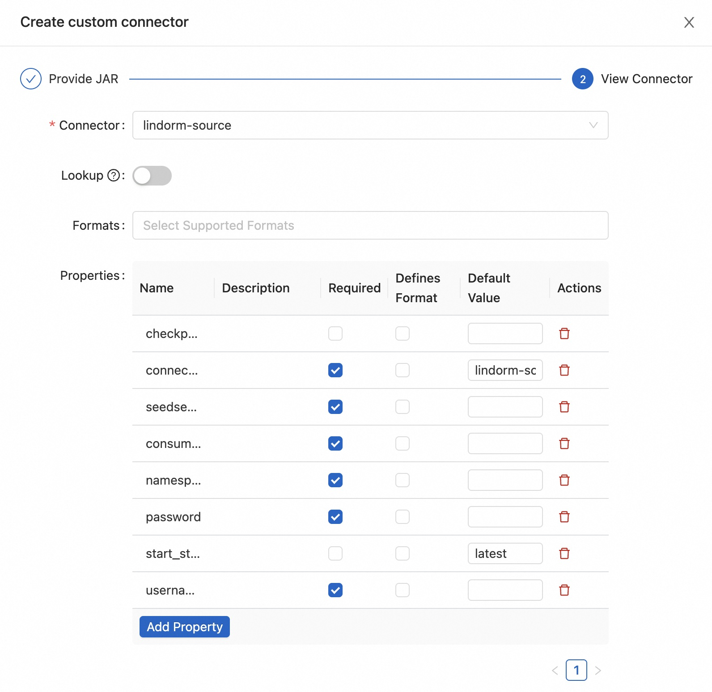

   | Parameter | Description |
   | --- | --- |
   | Connector | The connector name. |
   | Lookup | Whether it can be used as a lookup table. Configure this parameter based on your business requirements. |
   | Formats | Click the drop-down list to select a supported format. |
   | Properties | Configure the attributes of the connector based on your business requirements. |

   </li>

   </ol>

5. Click **Finish**.

**Update a custom connector**

1. On the Custom Connectors tab, find the connector that you want to update and click **Edit** on the right side.

   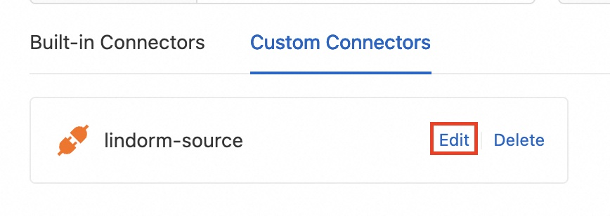

2. You can upload a new JAR package as needed. You can also select **Skip** to modify the attributes of an existing connector.

3. Click **Finish**.

**Delete a custom connector**

If you no longer use a custom connector, perform the following steps to delete it:

1. On the Custom Connectors tab, find the connector that you want to delete and click **Delete** on the right side.

2. In the Delete connector dialog box that appears, click **Confirm**.

<a id="section-8"></a>

# 8.Manage artifacts

Realtime Compute for Apache Flink supports uploading deployment artifacts (such as system checkpoints, deployment snapshots, logs, and JAR files) for storage. This topic describes artifact management operations such as uploading, downloading, deleting, and copying paths.

**Procedure**

1. Log in to the Realtime Compute for Apache Flink development console.

2. In the left-side navigation pane, click **Artifacts**.

3. Manage artifacts on the Artifacts page.

   | Operation | Description |
   | --- | --- |
   | Upload an artifact | Click <strong>Upload Artifact</strong> and select an on-premises file that you want to upload. Alternatively, drag the file that you want to upload to the artifact list.<br>After the file is uploaded, it is stored in the <code> oss://flink-fullymanaged-&lt;Workspace </code> <code>ID&gt;/artifacts/namespaces/&lt;Project name&gt;/&lt;File name&gt; </code> directory. |
   | Download an artifact | Click <strong>Download</strong> in the <strong>Actions</strong> column to download the file to your on-premises machine. |
   | Delete an artifact | Click <strong>Delete</strong> in the <strong>Actions</strong> column to delete the file. |
   | Copy the path | Move the pointer over the name of an artifact and a copy icon appears on the right. Click the icon to copy the path. |

<a id="section-9"></a>

# 9.Security services

Security services include access security, variable management, and permission management. You can configure Hive Kerberos in access security, use variable management for key hosting, and configure role and member permissions to ensure data and operational security.

<a id="section-9-1"></a>

## 9.1. Access security

To enable your Flink job to access external services with Kerberos authentication, such as HBase or Kafka, first register the Kerberos cluster in the Flink console. Then, configure the job with this cluster information to ensure secure access.

**Overview**

This feature allows the compute-storage separated edition of Flink to access external Kerberos-enabled services, such as a self-managed Kafka or HBase cluster. You can preregister Kerberos cluster information, including the krb5.conf file, principal, and keytab file, in the Flink console and reference it in your job configuration. The Flink runtime uses this information to handle authentication, ensuring the job has valid access permissions throughout its lifecycle. By centrally managing credentials, the platform eliminates the need to hardcode them in your code and helps meet enterprise-level security and compliance requirements.

**Limitations**

- Only the VVR 11.5.0 engine supports Kerberos authentication.

- ApsaraMQ for Kafka does not support Kerberos authentication. Flink jobs can only access self-managed Kafka clusters with Kerberos enabled.

- Flink jobs can only access self-managed HBase clusters with Kerberos enabled.

**Prerequisites**

- Create a workspace and create a namespace.

- Obtain the Kerberos client configuration file,  `krb5.conf` .

  > **Note**
  >
  > This file is typically located in the  `/etc/krb5.conf`  directory on the Key Distribution Center (KDC) server.

- Contact your Kerberos administrator to obtain the Flink client principal and its corresponding keytab file.

  > **Note**
  >
  > A principal name typically has the format  `flink@YOUR-REALM.COM` . In this format,  `flink`  is a custom username, and  `YOUR-REALM.COM`  is the Kerberos Realm for the cluster. The realm must be in uppercase.

**Enable Kerberos authentication**

1. Register a Kerberos cluster.

   <ol type="i">

   <li>

   Log on to the Realtime Compute for Apache Flink console.

   <ol type="i" start="2">

   <li>

   In the left-side navigation pane, choose **Security Service > Access Security**.

   </li>

   <li>

   Click **Add Kerberos** and configure the following parameters:

   </li>

   </ol>

   | Parameter | Description |
   | --- | --- |
   | Kerberos cluster name | The name of the Kerberos cluster. The name must be unique within the current namespace and cannot be changed after creation. |
   | Kerberos krb5.conf | Upload the <code> krb5.conf </code> client configuration file mentioned in the Prerequisites section. |
   | Kerberos user information | Provide the Flink client principal and keytab file mentioned in the Prerequisites section. |

   </li>

   <li value="4">

   Click **OK**.

   </li>

   </ol>

2. In the left-side navigation pane, choose **Data Development > ETL**.

3. In the job draft, click the  icon, select **New Streaming Job**, and in the **New Streaming Job** dialog box,

   set **Engine Version** to  `vvr-11.5.0-flink-1.2.0` .

4. Click **Create**.

5. After you configure the job settings, click More Configurations on the right and set the following parameters to enable Kerberos authentication.

   <table>
     <tr>
       <th>Parameter</th>
       <th>Description</th>
     </tr>
     <tr>
       <td>Additional dependencies</td>
       <td>Upload the <code> krb5.conf </code> file and the keytab file mentioned in the Prerequisites section.</td>
     </tr>
     <tr>
       <td>Kerberos authentication</td>
       <td>Turn on the <strong>Kerberos Authentication</strong> switch.</td>
     </tr>
     <tr>
       <td>Kerberos cluster</td>
       <td rowspan="2">After you turn on the <strong>Kerberos Authentication</strong> switch, select the <strong>Cluster Name</strong> and <strong>Principal</strong> of the registered Kerberos cluster.</td>
     </tr>
     <tr>
       <td>Principal</td>
     </tr>
   </table>

**Next steps**

After the job is configured, perform thorough testing, debugging, and deployment. For more information, see job development.

<a id="section-9-2"></a>

## 9.2. Manage variables

Using variables helps mitigate security risks associated with plaintext AccessKeys and passwords. It also facilitates configuration management by allowing you to reuse values, thereby eliminating redundant code. Flink (Compute-Storage Separation Edition) supports key hosting for JAR and Python deployments. This topic describes how to create and use variables.

**Add a variable**

1. Log in to the Realtime Compute for Apache Flink development console.

2. In the left-side navigation pane, choose **Security > Variables**, and then click **Add Variable**.

   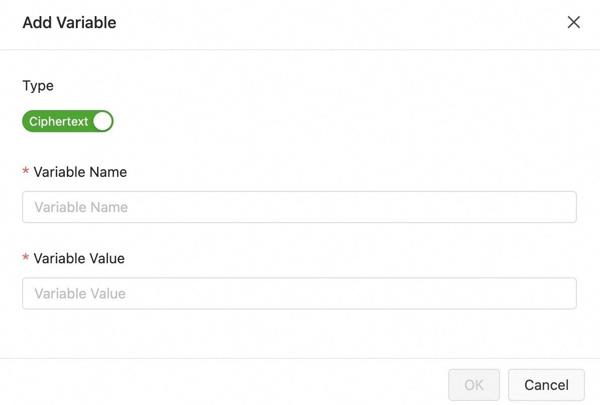

   | Parameter | Description |
   | --- | --- |
   | Type (Plaintext/Ciphertext) | Variable types cannot be modified after creation.<br>• Plaintext: You can view the variable value on the Variables page.<br>• Ciphertext: You cannot view the variable value. |
   | Variable Name | Variable names must be unique in the same namespace and cannot be modified after creation.<br>Note<br>Do not use keywords as variable names. |
   | Variable Value | Variable values are case-sensitive. Pay attention to the case when you enter letters in a variable value. You can change the value of a variable after creation.<br>Note<br>You cannot configure multiple values for a variable name. |

3. Click **OK**.

   To delete a created key, click **Delete** in the **Actions** column.

**Use a variable**

Flink (Compute-Storage Separation Edition) supports key hosting for JAR and Python deployments. You can use variables as the input parameters in the Main function of a JAR or Python deployment.

After a variable is added, you can use it in the  `${secret_values.variable_name}`  format. To use it, simply replace the variable name while keeping the rest of the format unchanged. The following examples show how to use a variable.

**Key hosting for JAR deployments**

1. Log in to the Realtime Compute for Apache Flink development console.

2. In the left-side navigation pane, choose **O&M > Deployments**, and then click **Create Deployment > JAR Deployment**.

3. In the **Entry Point Main Arguments** field, enter the variable name in the  `--Variable name in code ${secret_values.Variable name in Variable Management}`  format. Example:

   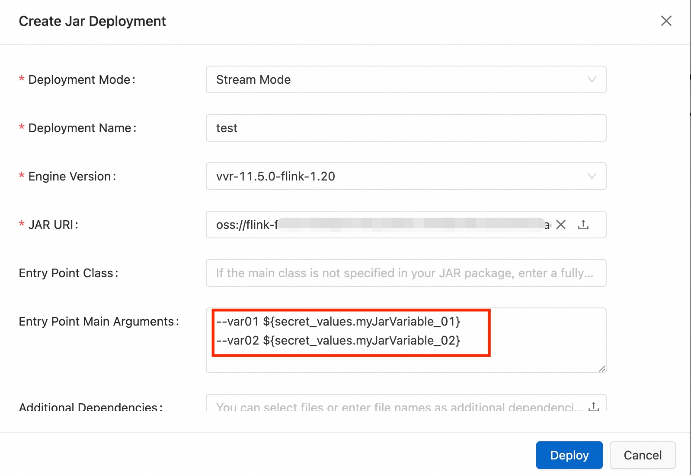

4. For more information about other deployment parameters, see Job deployment.

5. Click **Deploy**.

**Key hosting for Python deployments**

1. Log in to the Realtime Compute for Apache Flink development console.

2. In the left-side navigation pane, choose **O&M > Deployments**, and then click **Create Deployment > Python Deployment**.

3. In the **Entry Point Main Arguments** field, enter the variable name in the  `--Variable name in code ${secret_values.Variable name in Variable Management}`  format. Example:

   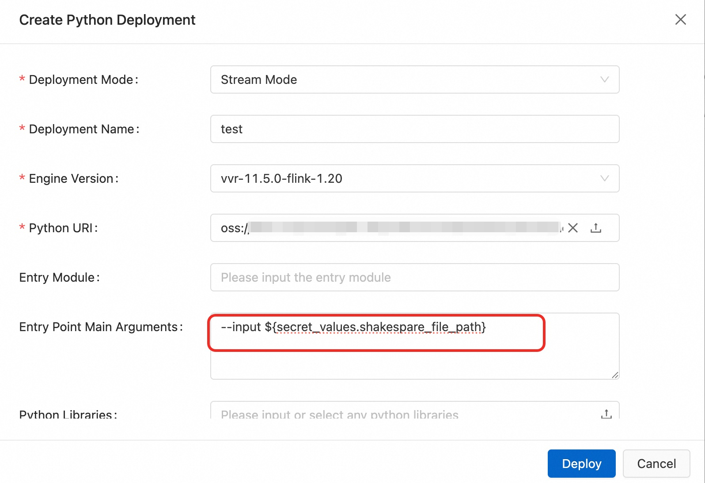

4. For more information about other deployment parameters, see Job deployment.

5. Click **Deploy**.

<a id="section-9-3"></a>

## 9.3. Manage permissions

You can manage members and roles by managing permissions. You can add, edit, and delete namespace members, or view and maintain role permissions.

<a id="section-9-3-1"></a>

### 9.3.1. Authorization guidelines

This topic describes the permission categories and their relationship with the management console of Realtime Compute for Apache Flink and the development console of Realtime Compute for Apache Flink. Please read carefully before granting permissions.

With product evolution and the need for on-site metering, the management of Flink namespaces has been migrated from Apsara Big Data Manager (ABM) to the Apsara Uni-manager Management Console. This migration provides a more familiar resource creation experience for users.

Flink permissions fall into two categories: resource management and business roles.

| Permission Category | Description |
| --- | --- |
| Resource management | Applicable to the management console of Realtime Compute for Apache Flink.<br>Grants the permissions to manage (create, modify, delete, and query) workspaces and namespaces. Accounts with this permission category can manage workspaces and namespaces in the management console of Realtime Compute for Apache Flink. |
| Business role | Applicable to the development console of Realtime Compute for Apache Flink.<br>To manage namespace operation permissions, the system provides three built-in roles: owner, editor, and viewer (read-only). In actual business scenarios, users assigned to these business roles can log in to the development console of Realtime Compute for Apache Flink through the management console of Realtime Compute for Apache Flink to perform tasks such as deployment development, O&amp;M, and member management. |

<a id="section-9-3-2"></a>

### 9.3.2. Authorization policies in the management console

Users need to configure access permissions for workspaces and namespaces to create and manage the resources in the workspaces and namespaces. This topic describes how to create a user and configure workspace and namespace access permissions in the management console of Realtime Compute for Apache Flink.

**Procedure**

1. Create an organization.

   For more information, see **Enterprise > Resource management > Organization management > Create organizations** in Apsara Uni-manager Management Console User Guide.

2. Create a resource set. If you create an organization, the system creates a resource set for the organization by default. You can also create a resource set based on your business requirements.

   For more information, see **Enterprise > Resource management > Manage resource sets > Create a resource set** in Apsara Uni-manager Management Console User Guide.

3. Create a user.

   For more information, see **Enterprise > User management > User management > Create a user** in Apsara Uni-manager Management Console User Guide, and assign a role with appropriate permissions to the user.

   > **Note**
   >
   > We recommend that you select the resource set administrator or a preset role by the organization administrator. The preset roles are configured with permissions to create, modify, delete, and view workspaces and namespaces.
   >
   > Users assigned with the preset Resource User role can view and modify workspaces and namespaces.
   >
   > To view role permissions or create a custom role, see **Enterprise Center > Access Control > Role authorization** in Apsara Uni-manager Management Console User Guide.

4. Add the user to the resource set.

   For more information, see **Enterprise > Resource management > Manage resource sets > Manage resource set members** in Apsara Uni-manager Management Console User Guide, and add the user to the corresponding resource set.

5. Optional. Assign additional roles to the user.

   For more information, see **Enterprise > User management > Users > User Role authorization** in Apsara Uni-manager Management Console User Guide, and assign additional roles with corresponding permissions to allow the user to manage workspace and namespace resources.

**What to do next**

If you need to assign an operational role (such as the R&D role or O&M role) to the user, log in to the management console of Realtime Compute for Apache Flink as a user with the owner role and navigate to the development console of Realtime Compute for Apache Flink.

<a id="section-9-3-3"></a>

### 9.3.3. Authorization policies in the development console

When multiple users in the same namespace in Flink require varied permissions for operations such as deployment development and O&M, you can use the role and member management feature in the development console of Realtime Compute for Apache Flink for fine-grained authorization. This topic describes the authorization scenarios, role types, custom roles, and how to bind roles to members.

**Authorization scenarios**

Scenario 1: You cannot access a namespace.

This issue indicates that you do not have permissions on the namespace. Contact a member who has the owner role or a user who has member management permissions in the namespace to assign you the viewer role or a higher-level role. After the authorization, refresh the page to access the namespace.

Scenario 2: You cannot use a feature or perform an operation.

This issue indicates that your account does not have the required permissions for the operation. Contact a member who has the owner role or a user who has role management permissions to add the permissions required for your operation to a custom role and bind the role to your account.

**Role types**

A role is a collection of multiple permissions. Roles in the development console of Realtime Compute for Apache Flink fall into two types: system roles and custom roles. The following table describes the differences between the two types:

| Role Type | Description | Limits |
| --- | --- | --- |
| System role | The Flink system provides three predefined system roles: owner, editor, and viewer. For more information about the permissions of each role, see Fine-grained permission list. | • You cannot modify the permissions of system roles or delete system roles. |
| Custom role | If the system roles cannot meet fine-grained authorization requirements, you can create custom roles. You can quickly add required permissions based on the viewer or editor role. | • The permissions of a custom role must include and surpass the permissions of the viewer role.<br>• Only users who have the owner role or role management permissions can create, edit, or delete custom roles.<br>• You can create up to 10 custom roles in a namespace. |

**Procedure**

**Step 1: Optional. Create a custom role.**

Create a custom role and grant permissions to the role as needed. If you want to use a default role in the system, skip this step.

1. Log in to the Realtime Compute for Apache Flink development console.

   > **Note**
   >
   > Log in with a member account that has the owner role or role management permissions.

2. In the left-side navigation pane, choose **Security > Permissions**, and then click the **Role Management** tab.

3. Click **Add Role** and specify the parameters.

   | Parameter | Description |
   | --- | --- |
   | Role Name | The name of the custom role. The name can be up to 64 characters in length and can contain digits, letters, and hyphens (-). The name must start with a letter. |
   | Role Notes | A description of the role that provides supplementary information to help administrators or other members understand the purpose and permissions of the role. The description can be up to 256 characters in length. |
   | Role Permission s | When you add a permission, the associated permissions are automatically selected to ensure the integrity of access control. For information about the associated permissions of a specific permission, see Fine-grained permission list of this topic. |

4. Click **OK**. You can then view, edit, and delete the added custom role.

   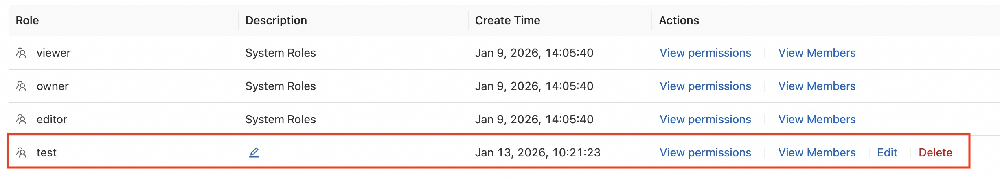

   - **View permissions:** View the permissions that the role has.

   - **View Members:** View the members that are bound to the role.

   - **Edit:** Members who have role editing permission can add or remove permissions as needed.

   - **Delete**: Before you delete a role, consider the security risks. You must remove all members bound to the role or reassign them to other roles. A member who has the role deletion permission can delete a custom role only if the role has no bound members.

**Step 2: Bind a role to a member.**

Bind a role to a member to grant permissions.

1. Log in to the Realtime Compute for Apache Flink development console.

   > **Note**
   >
   > Log in with a member account that has the owner role or role management permissions.
   >
   > The owner role can grant business access permissions (editor or view) to RAM users in the same organization. You are not allowed to grant permissions to users in a different level-1 organization. Even if a permission is successfully granted to a user in a different level-1 organization, the permission is not displayed in the list after the user logs in.

2. In the left-side navigation pane, choose **Security > Permissions**, and then click the **Members** tab.

3. Click **Add Member** to add a member and configure the **Role** parameter for the member.

   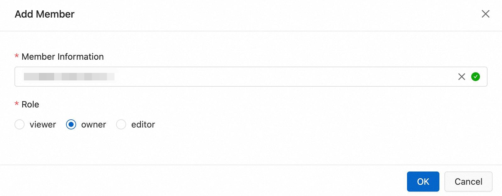

   Parameter description:

   - **Member Information**: In the upper-right corner of the Apsara Uni-manager Management Console, click the profile picture of the current user to view the **UID** information.

     > **Important**
     >
     > You cannot add a member that already exists.

   - **Role**: Both system roles and custom roles can be selected. Move the pointer over a role to view the role description.

5. Click **OK**.

**Fine-grained permission list**

**Level-1**

**Level-2**

**Owner**

**Editor**

**Viewer**

**Permission**

**Permission**

**Create and modify**

√

**SQL/YAML drafts**

**Debug SQL drafts**

√

√

**Delete SQL/YAML**

√

√

**drafts**

**Deploy SQL/YAML**

**ETL/Data Ingestion**

√

√

**drafts**

**Validate**

√

√

**SQL/YAML drafts**

**View SQL/YAML**

√

√

√

**drafts Create JAR and Python**

√

√

**deployments**

**Delete**

√

√

**deployments**

**Deployments**

**View deployments**

√

√

√

**Update deployment**

√

√

**configurations**

**Start/Stop jobs**

√

√

**Create Materialized**

√

√

**Tables**

**Delete Materialized**

√

√

**Tables**

**Catalogs**

**View Materialized**

√

√

√

**Table List**

**Update Materialized**

√

√

**Tables**

**Delete artifacts**

√

√

**Download**

√

√

**artifacts**

**Artifacts**

**View artifacts**

√

√

√

**Upload artifacts**

√

√

**Create session**

√

√

**clusters**

**Delete session**

√

√

**clusters**

**View session**

√

√

√

**clusters**

**Session Clusteres**

**Update session cluster**

√

√

**configurations Start/Stop session**

√

√

**clusters**

**Create roles**

√

**Create variables**

√

√

**Create members**

√

**Delete roles**

√

**Delete variables**

√

√

**Security**

**Delete members**

√

**View roles**

√

√

√

**View variables**

√

√

√

**View members**

√

√

√

**Modify roles**

√

**Modify members**

√

**View job**

√

√

√

**templates**

**Configurations**

**Modify job**

√

√

**templates**

<a id="section-9-4"></a>

## 9.4. Configure the IP address of external storage

By default, all outbound traffic from jobs is blocked. You must configure an IP whitelist to allow access. This topic describes how to configure the IP address of external storage to enable outbound traffic for jobs.

**Background**

To address security vulnerabilities of compute escape, the platform enables the Network Policy feature. This feature blocks all outbound traffic from jobs by default. To allow outbound traffic, you must configure the IP address of external storage to add the IP to an whitelist.

The default rules for the Network Policy feature are as follows:

- All outbound access is blocked by default.

- Mutual access between pods within the same namespace is allowed.

- Access to HDFS in the Ververica namespace is allowed.

- Access to the API server is allowed.

- Access to CoreDNS is allowed.

- Access to the CMS endpoint for metrics reporting is allowed.

**Precautions**

When you upgrade from an earlier version to version 3.18.1 or later, or perform a fresh deployment with version 3.18.1 or later, the Network Policy feature is enabled for all namespaces by default. Therefore, you must configure the IP addresses of external storage to allow outbound traffic.

**Usage limits**

- After a namespace is created, the **Configure External Storage IP** button appears under the namespace. This button has the same permissions as the **Change CU Count** button, which means that the buttons are only available to users with the edit permission for the namespace. Otherwise, the buttons are unavailable.

- The IP address or Classless Inter-Domain Routing (CIDR) block added to the whitelist must not overlap with the CIDR blocks in the blacklist. Otherwise, an error message is displayed.

**Procedure**

1. Log in to the Realtime Compute for Apache Flink development console.

2. On the **Workspaces** page, find the namespace that you want to manage, click the plus sign (+) of the namespace, and click **Configure IP Address for External Data Stor** in the **Actions** column.

3. Click **+IP Address** in the dialog box that appears, enter the IP address, and click **OK**.

   The IP address refers to the VIP that corresponds to the storage domain name. You can add a single IP address or a CIDR block, for example,  `192.168.0.1`  or  `192.168.0.1/24` .

   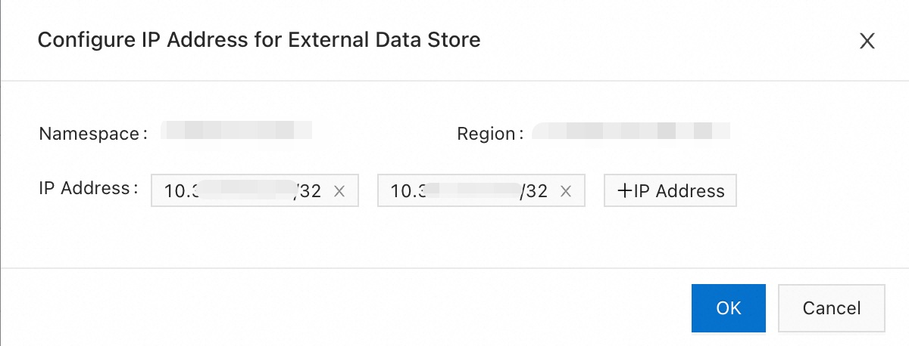

   If the format is incorrect, an error is reported:

   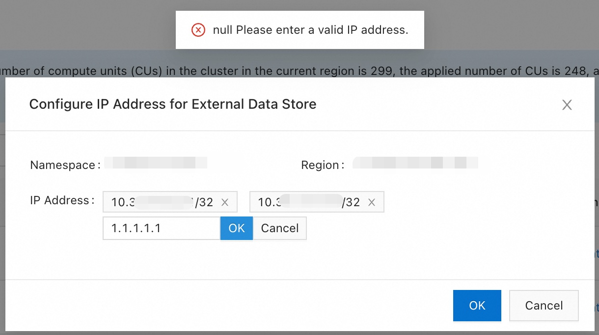

4. Click **OK**.

<a id="section-10"></a>

# 10.Job migration

This topic describes how to migrate jobs from a Flink Enterprise Edition project to a Flink Compute-Storage Separation Edition project.

**Prerequisites**

- Make sure that you have activated a Flink Compute-Storage Separation Edition cluster under your Enterprise Edition account and created the corresponding workspace and project.

- Your account has the migration permission. If your account does not have the migration permission, the organization to which the project belongs must add the AliyunStreamTransferRole policy to your account on the configuration page.

  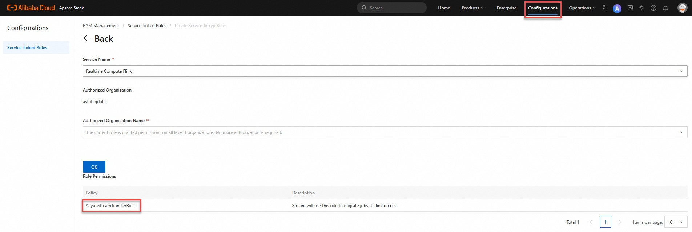

**Precautions**

- You do not need to manually migrate resources in a project. After you create a migration task, select the relevant jobs, and click **Start Migration**, the system automatically migrates all resources in the project to the destination project. We recommend that you use the same migration task for jobs that you migrate to the same project.

- Before you migrate jobs, stop the jobs by using the **Create Snapshot Before Stopping** method. Otherwise, if the Flink system detects running jobs, it prompts you to cancel the migration task or force the migration.

- The system does not support migration of Session clusters. If you migrate jobs that run on Session clusters, the system migrates them as Per-Job type jobs.

- You can run the same task multiple times. The system does not migrate resources that have already been migrated successfully.

**Procedure**

1. Log on to the Realtime Compute development console of Flink Enterprise Edition.

2. On the **System Management > Job Migration** page, click **Create Migration Task**.

3. Configure the migration task information and click **OK**.

   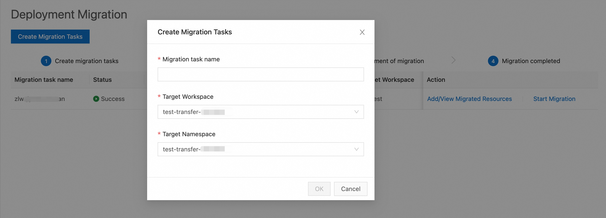

   | Configuration item | Description |
   | --- | --- |
   | Migration task name | Specify a custom name for the migration task. |
   | Destination workspace | Select a workspace of Flink Compute-Storage Separation Edition. |
   | Destination project | Select a project of Flink Compute-Storage Separation Edition. |

4. In the **Actions** column, click **Add/View Migrated** Resource.

5. Select the jobs to migrate.

   <ol type="i">

   <li>

   On the **Job Resources** tab, click **Streaming Job Management** or **Batch Job Management**.

   </li>

   <li>

   Select the jobs and job snapshots to migrate, click the right arrow, and then click **OK**.

   

   </li>

   </ol>

   You can select only jobs to migrate, or select both jobs and a status snapshot of each job. Click

   on

   the left to view the snapshot information of the jobs.

   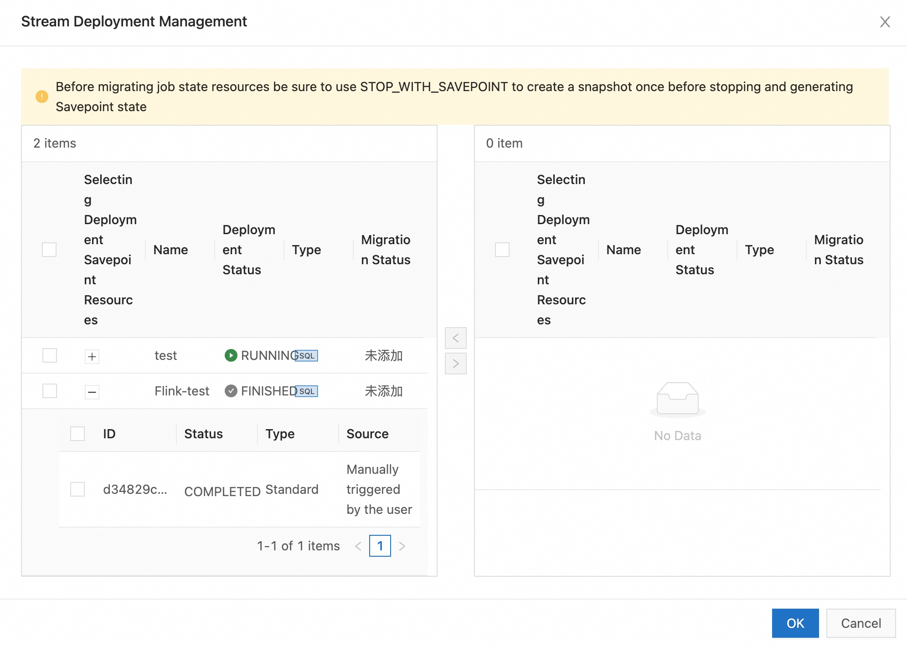

   <ol type="i" start="3">

   <li>

   On the right side, select the job status resources and click **OK**.

   </li>

   </ol>

6. Click **Start Migration**.

   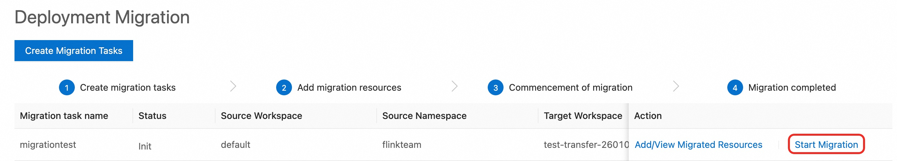

   After the migration completes, check the resource migration status and error messages to determine whether you need to adjust the migrated resources and run the migration again. After the migration completes, you can view the migrated jobs in the destination project of Flink Compute-Storage Separation Edition.

<a id="section-11"></a>

# 11.Flink MCP Server

Based on the MCP Protocol, Flink supports API calls through the Apsara Copilot hosting mode to retrieve information such as namespaces and jobs. You can also deploy an MCP Server to perform queries. These capabilities help you build a natural language-driven data query agent and implement an intelligent data processing workflow from questioning to visualization. This topic describes how to use the Apsara Copilot hosting mode and how to deploy an MCP Server.

**Supported MCP modes**

- Apsara Copilot hosting mode

  The Apsara Copilot hosting mode is an out-of-the-box feature that requires no configuration and provides direct access through LLMs.

- Deploy an MCP Server

  You can deploy the MCP Server in applications, agents, or AI systems.

**Apsara Copilot hosting mode**

> **Note**
>
> Before you use the Apsara Copilot hosting mode, refer to the **Apsara Uni-manager Management Console > Apsara Copilot User Guide** to enable Apsara Copilot.

1. Log in to the Realtime Compute for Apache Flink management console.

2. View the preset MCP list.

   <ol type="i">

   <li>

   In the left-side navigation pane, choose **AI Column > AI Native API MCP Service**.

   </li>

   <li>

   In the **MCP List > Flink Management MCP** section, click the  icon to go to the **MCP Details** page.

   </li>

   <li>

   Click **Tools** to view the preset MCP list. The following table describes the current preset tools.

   </li>

   </ol>

   | Tool name | API | Description |
   | --- | --- | --- |
   | Engine version list query | ListFlinkVersions | Lists the supported Flink engine versions in a specified namespace to help you select an appropriate engine for creating and running jobs. |
   | Workspace list query | DescribeWorkspacesFlinkOn Oss | Queries the workspace list of the current user to help you manage workspaces and optimize resource management. |
   | Namespace list query by workspace | ListNamespacesByWorkspac eIdFlinkOnOss | Queries the namespace list under a specified workspace to help you manage namespaces and optimize resource allocation and management. |
   | Full namespace list query by user | DescribeNamespacesFlinkOn Oss | Queries the full namespace list under a specified user to help you manage namespaces and optimize resource allocation and management. |
   | Job list query | ListJobs | Queries the job list by a specified namespace name to help you manage jobs and optimize job resources and execution plans. |
   | Job deployment list query | ListDeployments | Queries the list of deployed jobs by a specified namespace name to help you manage jobs and optimize job resources and execution plans. |
   | User resource query | ListArtifacts | Lists user resources in a specified namespace and workspace to help you manage jobs and optimize job resource management. |

3. Use Apsara Copilot to call preset tools.

   <ol type="i">

   <li>

   Click the  icon in the toolbar at the top of the page to go to the **Apsara Copilot** page.

   </li>

   <li>

   Click the  icon at the bottom of the dialog box to turn on the **MCP** switch, and then click the  icon to

   </li>

   </ol>

   go to the **Select MCP** page.

   <ol type="i" start="3">

   <li>

   Select the existing Flink MCP.

   </li>

   <li>

   Click **OK** to return to the dialog box, and then describe the query content in natural language, for example, "Query the workspace list of the current user".

   </li>

   <li>

   Click the  icon on the right side to send and execute the command.

   </li>

   <li>

   Wait for the task to complete, and then view the returned results.

   </li>

   </ol>

**Deploy an MCP Server**

1. Download the MCP service package.

2. Deploy the MCP Server on an ECS instance, in a container, or on an on-premises server.

3. Integrate the MCP Server into applications or agents: Embed MCP as a backend service in AI applications, agents, or RPA workflows.

4. Call MCP features through RESTful APIs.

<a id="section-12"></a>

# 12.FAQ

This topic describes common issues and solutions when using Flink (Compute-Storage Separation Edition), including FAQs on creating namespaces and viewing Flink audit events.

**FAQs on creating namespaces**

- Problem: Why isn't the target Namespace listed, even though my account has the necessary permissions?

  Cause: This can happen for one of two reasons:

  - The resource set that contains the Namespace does not include your account.

  - Your account is not in the same organization as the UID used to create the Namespace.

- Problem: When I go to the Workspace List page, why are some action buttons missing or grayed out?

  Cause:

  - Your resource management role lacks the permissions to create or delete workspaces or projects. Contact your administrator to configure the required access permissions. For more information, see Console authorization.

  - You cannot access the development console because you do not have an assigned business role in the project where the **Console** button is grayed out. Contact the resource owner to assign a business role.

- Problem: Why do I receive a "permission denied" error when I try to create, modify, or delete a project?

  Cause: As shown in the figure, your current role is not authorized to perform these operations. Contact your administrator to configure project access permissions. For more information, see Console authorization.

**FAQ on viewing Flink audit events**

- Problem: Why are the raw logs empty after I open the audit page?

  Cause: This can happen for one of two reasons:

  - You performed no operations on the VVP platform during the selected time range.

  - You performed operations on the VVP platform, but the platform failed to report the logs. Contact Alibaba Cloud technical support for assistance.

- Problem: Why do I see raw logs on the audit page but no audit data?

  Cause: This can happen for one of two reasons:

  - You performed no high-risk operations during the selected time range.

  - You performed high-risk operations, but Cloud Shield has reached the daily limit for log audit events. Contact the Cloud Shield team to increase the daily audit limit.
