Alibaba Cloud  
Apsara Stack Enterprise  
apsara base  
Apsara Uni-manager  
Management Console User  
Guide  
Product Version: V3.14.0  
Document Version: 20221008

**Table of Contents**

- [1.What is the Apsara Uni-manager Management Console?](#section-1)
- [2.User roles and permissions](#section-2)
- [3.Log on to the Apsara Uni-manager Management Console](#section-3)
- [4.Web page introduction](#section-4)
- [5.Initial configuration](#section-5)
    - [5.1. Configuration description](#section-5-1)
    - [5.2. Configuration process](#section-5-2)
- [6.Monitoring](#section-6)
    - [6.1. View the workbench](#section-6-1)
    - [6.2. CloudMonitor](#section-6-2)
        - [6.2.1. Cloud Monitor overview](#section-6-2-1)
        - [6.2.2. Metrics](#section-6-2-2)
        - [6.2.3. View monitoring charts](#section-6-2-3)
    - [6.3. Alerts](#section-6-3)
        - [6.3.1. View alert overview](#section-6-3-1)
        - [6.3.2. Enable or disable alert notification](#section-6-3-2)
        - [6.3.3. View alert logs](#section-6-3-3)
        - [6.3.4. Alarm rules](#section-6-3-4)
            - [6.3.4.1. View alert rules](#section-6-3-4-1)
            - [6.3.4.2. Create an alert rule](#section-6-3-4-2)
            - [6.3.4.3. Disable an alert rule](#section-6-3-4-3)
            - [6.3.4.4. Enable an alert rule](#section-6-3-4-4)
            - [6.3.4.5. Delete an alert rule](#section-6-3-4-5)
- [7.VMware Cloud on Alibaba Cloud](#section-7)
    - [7.1. VMware Cloud on Alibaba Cloud](#section-7-1)
        - [7.1.1. Log on to the VMware Cloud on Alibaba Cloud console](#section-7-1-1)
        - [7.1.2. Bind a VMware Cloud on Alibaba Cloud region](#section-7-1-2)
        - [7.1.3. Instructions](#section-7-1-3)
            - [7.1.3.1. Limits](#section-7-1-3-1)
            - [7.1.3.2. Suggestions](#section-7-1-3-2)
        - [7.1.4. Instances](#section-7-1-4)
            - [7.1.4.1. Create a VMware Cloud on Alibaba Cloud instance](#section-7-1-4-1)
            - [7.1.4.2. View instance information](#section-7-1-4-2)
            - [7.1.4.3. Modify an instance](#section-7-1-4-3)
            - [7.1.4.4. Remotely connect to an instance](#section-7-1-4-4)
            - [7.1.4.5. Stop an instance](#section-7-1-4-5)
            - [7.1.4.6. Start an instance](#section-7-1-4-6)
            - [7.1.4.7. Restart an instance](#section-7-1-4-7)
            - [7.1.4.8. Delete an instance](#section-7-1-4-8)
            - [7.1.4.9. Change the instance type of an instance](#section-7-1-4-9)
        - [7.1.5. Images](#section-7-1-5)
            - [7.1.5.1. Create a custom image](#section-7-1-5-1)
            - [7.1.5.2. View images](#section-7-1-5-2)
        - [7.1.6. Snapshots](#section-7-1-6)
            - [7.1.6.1. Create a snapshot](#section-7-1-6-1)
            - [7.1.6.2. Delete a snapshot](#section-7-1-6-2)
            - [7.1.6.3. View snapshots](#section-7-1-6-3)
        - [7.1.7. Disks](#section-7-1-7)
            - [7.1.7.1. Create a disk](#section-7-1-7-1)
            - [7.1.7.2. View disks](#section-7-1-7-2)
            - [7.1.7.3. Detach a data disk](#section-7-1-7-3)
        - [7.1.8. ENIs](#section-7-1-8)
            - [7.1.8.1. Create an ENI](#section-7-1-8-1)
            - [7.1.8.2. View ENIs](#section-7-1-8-2)
            - [7.1.8.3. Delete an ENI](#section-7-1-8-3)
- [8.Enterprise](#section-8)
    - [8.1. Organizations](#section-8-1)
        - [8.1.1. Create an organization](#section-8-1-1)
        - [8.1.2. Query an organization](#section-8-1-2)
        - [8.1.3. View organization information](#section-8-1-3)
        - [8.1.4. Modify the name of an organization](#section-8-1-4)
        - [8.1.5. Change organization ownership](#section-8-1-5)
        - [8.1.6. Obtain the AccessKey pair of an organization](#section-8-1-6)
        - [8.1.7. Delete an organization](#section-8-1-7)
    - [8.2. Resource sets](#section-8-2)
        - [8.2.1. Create a resource set](#section-8-2-1)
        - [8.2.2. View the details of a resource set](#section-8-2-2)
        - [8.2.3. Modify the name of a resource set](#section-8-2-3)
        - [8.2.4. Add a member to a resource set](#section-8-2-4)
        - [8.2.5. Add or remove a user group of a resource set](#section-8-2-5)
        - [8.2.6. Delete a resource set](#section-8-2-6)
    - [8.3. Roles](#section-8-3)
        - [8.3.1. Create a custom role](#section-8-3-1)
        - [8.3.2. View the details of a role](#section-8-3-2)
        - [8.3.3. Modify custom role information](#section-8-3-3)
        - [8.3.4. Copy a role](#section-8-3-4)
        - [8.3.5. Disable a role](#section-8-3-5)
        - [8.3.6. Enable a role](#section-8-3-6)
        - [8.3.7. Delete a custom role](#section-8-3-7)
    - [8.4. Users](#section-8-4)
        - [8.4.1. System users](#section-8-4-1)
            - [8.4.1.1. Create a user](#section-8-4-1-1)
            - [8.4.1.2. Query a user](#section-8-4-1-2)
            - [8.4.1.3. Modify user information](#section-8-4-1-3)
            - [8.4.1.4. Change user roles](#section-8-4-1-4)
            - [8.4.1.5. Modify the information of a user group](#section-8-4-1-5)
            - [8.4.1.6. Modify a user logon policy](#section-8-4-1-6)
            - [8.4.1.7. View the initial password of a user](#section-8-4-1-7)
            - [8.4.1.8. Reset the password of a user](#section-8-4-1-8)
            - [8.4.1.9. Disable or enable a user account](#section-8-4-1-9)
            - [8.4.1.10. Delete a user](#section-8-4-1-10)
        - [8.4.2. Historical users](#section-8-4-2)
            - [8.4.2.1. Query historical users](#section-8-4-2-1)
            - [8.4.2.2. Restore historical users](#section-8-4-2-2)
    - [8.5. Logon policies](#section-8-5)
        - [8.5.1. Create a logon policy](#section-8-5-1)
        - [8.5.2. Query a logon policy](#section-8-5-2)
        - [8.5.3. Modify a logon policy](#section-8-5-3)
        - [8.5.4. Disable a logon policy](#section-8-5-4)
        - [8.5.5. Enable a logon policy](#section-8-5-5)
        - [8.5.6. Delete a logon policy](#section-8-5-6)
    - [8.6. User groups](#section-8-6)
        - [8.6.1. Create a user group](#section-8-6-1)
        - [8.6.2. Add users to a user group](#section-8-6-2)
        - [8.6.3. Delete users from a user group](#section-8-6-3)
        - [8.6.4. Add a role](#section-8-6-4)
        - [8.6.5. Delete a role](#section-8-6-5)
        - [8.6.6. Modify the name of a user group](#section-8-6-6)
        - [8.6.7. Delete a user group](#section-8-6-7)
    - [8.7. Resource pools](#section-8-7)
        - [8.7.1. Update associations](#section-8-7-1)
    - [8.8. Change the ownership of an instance](#section-8-8)
    - [8.9. Cloud instances](#section-8-9)
        - [8.9.1. Manage Apsara Stack cloud instances](#section-8-9-1)
            - [8.9.1.1. Export data of the current cloud](#section-8-9-1-1)
            - [8.9.1.2. Add a secondary Apsara Stack node](#section-8-9-1-2)
            - [8.9.1.3. View managed cloud instances](#section-8-9-1-3)
            - [8.9.1.4. Modify a cloud instance](#section-8-9-1-4)
            - [8.9.1.5. Manage cloud instances](#section-8-9-1-5)
        - [8.9.2. Manage VMware nodes](#section-8-9-2)
            - [8.9.2.1. Add a VMware node](#section-8-9-2-1)
            - [8.9.2.2. Modify a VMware node](#section-8-9-2-2)
            - [8.9.2.3. Test VMware node connectivity](#section-8-9-2-3)
    - [8.10. Data permissions](#section-8-10)
        - [8.10.1. Overview](#section-8-10-1)
        - [8.10.2. Set the data permissions of resource instances](#section-8-10-2)
        - [8.10.3. Edit user permissions](#section-8-10-3)
        - [8.10.4. View the permissions of a user](#section-8-10-4)
- [9.Configurations](#section-9)
    - [9.1. Security policies](#section-9-1)
        - [9.1.1. Configure password policies](#section-9-1-1)
        - [9.1.2. Configure logon control](#section-9-1-2)
    - [9.2. Menus](#section-9-2)
        - [9.2.1. Create a menu](#section-9-2-1)
        - [9.2.2. Modify a menu](#section-9-2-2)
        - [9.2.3. Delete a menu](#section-9-2-3)
        - [9.2.4. Show or hide menus](#section-9-2-4)
    - [9.3. Specifications](#section-9-3)
        - [9.3.1. Specification parameters](#section-9-3-1)
        - [9.3.2. Create specifications](#section-9-3-2)
        - [9.3.3. View specifications](#section-9-3-3)
        - [9.3.4. Disable specifications](#section-9-3-4)
        - [9.3.5. Export specifications](#section-9-3-5)
        - [9.3.6. View specifications of each resource type in previous versions](#section-9-3-6)
    - [9.4. Message center](#section-9-4)
        - [9.4.1. View internal messages](#section-9-4-1)
        - [9.4.2. Mark messages as read](#section-9-4-2)
        - [9.4.3. Delete a message](#section-9-4-3)
    - [9.5. Resource pool management](#section-9-5)
    - [9.6. Custom configurations](#section-9-6)
        - [9.6.1. Configure brands](#section-9-6-1)
- [10.Operations](#section-10)
    - [10.1. Quotas](#section-10-1)
        - [10.1.1. Quota parameters](#section-10-1-1)
        - [10.1.2. Set quotas for a cloud service](#section-10-1-2)
        - [10.1.3. Modify quotas](#section-10-1-3)
        - [10.1.4. Reset quotas](#section-10-1-4)
    - [10.2. Usage statistics](#section-10-2)
        - [10.2.1. View the usage statistics of cloud resources](#section-10-2-1)
    - [10.3. Statistical analysis](#section-10-3)
        - [10.3.1. View reports of current data](#section-10-3-1)
        - [10.3.2. Export reports of current data](#section-10-3-2)
        - [10.3.3. Download reports of historical data](#section-10-3-3)
- [11.Security](#section-11)
    - [11.1. View operation logs](#section-11-1)
- [12.RAM](#section-12)
    - [12.1. RAM introduction](#section-12-1)
    - [12.2. Permission policy structure and syntax](#section-12-2)
    - [12.3. RAM roles](#section-12-3)
        - [12.3.1. View basic information about a RAM role](#section-12-3-1)
        - [12.3.2. Create a RAM role](#section-12-3-2)
        - [12.3.3. Create a policy](#section-12-3-3)
        - [12.3.4. Modify the content of a RAM policy](#section-12-3-4)
        - [12.3.5. Modify the name of a RAM policy](#section-12-3-5)
        - [12.3.6. Add a RAM role to a user group](#section-12-3-6)
        - [12.3.7. Grant permissions to a RAM role](#section-12-3-7)
        - [12.3.8. Remove permissions from a RAM role](#section-12-3-8)
        - [12.3.9. Modify a RAM role name](#section-12-3-9)
        - [12.3.10. Delete a RAM role](#section-12-3-10)
    - [12.4. RAM authorization policies](#section-12-4)
        - [12.4.1. Create a service-linked role](#section-12-4-1)
        - [12.4.2. View the details of a service-linked role](#section-12-4-2)
        - [12.4.3. View RAM authorization policies](#section-12-4-3)
- [13.Personal information management](#section-13)
    - [13.1. Modify personal information](#section-13-1)
    - [13.2. Change the logon password](#section-13-2)
    - [13.3. Switch the current role](#section-13-3)
    - [13.4. View the AccessKey pair of your Apsara Stack tenant account](#section-13-4)
    - [13.5. Create an AccessKey pair](#section-13-5)
    - [13.6. Delete an AccessKey pair](#section-13-6)
    - [13.7. Disable an AccessKey pair](#section-13-7)
    - [13.8. Enable an AccessKey pair](#section-13-8)
    - [13.9. MFA](#section-13-9)
        - [13.9.1. Overview](#section-13-9-1)
        - [13.9.2. Bind a virtual MFA device to enable MFA](#section-13-9-2)
        - [13.9.3. Unbind a virtual MFA device to disable MFA](#section-13-9-3)
        - [13.9.4. Forcibly enable MFA](#section-13-9-4)
        - [13.9.5. Reset MFA](#section-13-9-5)

<a id="section-1"></a>

# 1.What is the Apsara Uni-manager Management Console?

The Apsara Uni-manager Management Console is a service capability platform based on the Alibaba Cloud Apsara Stack platform and designed for government and enterprise customers. This platform improves IT management and troubleshooting and is dedicated to providing a leading service capability platform of the cloud computing industry. It provides large-scale and cost-efficient end-to-end cloud computing and big data services for customers in industries such as government, education, healthcare, finance, and enterprise.

Overview

The Apsara Uni-manager Management Console simplifies the management and deployment of physical and virtual resources by building an Apsara Stack platform that supports various business types of government and enterprise customers. The console helps you build your business systems in a simple and quick manner, fully improve resource utilization, and reduce O&M costs. This allows you to shift your focus from O&M to business. The console brings the Internet economy model to government and enterprise customers, and builds a new ecosystem chain based on cloud computing.

Workflow

Operations in the Apsara Uni-manager Management Console are divided into the following parts:

- System initialization: This part is designed to complete basic system configurations, such as creating organizations, resource sets, and users, creating basic resources such as VPCs, and creating contacts and contact groups in Cloud Monitor.

- Cloud resource creation: This part is designed to create resources.

- Cloud resource management: This part is designed to complete resource management operations, such as starting, using, and releasing resources, and changing resource configurations and resource quotas.

<a id="section-2"></a>

# 2.User roles and permissions

This topic describes roles and their permissions.

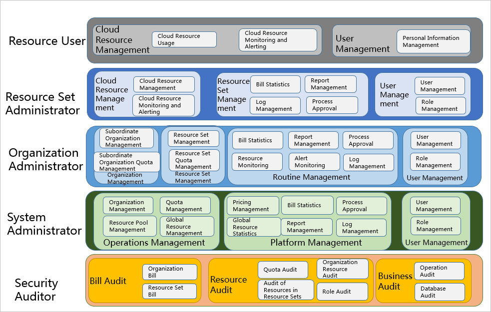

Roles and permissions

| Role | Role permission |
| --- | --- |
| Resource user | This role has the permissions to view and modify resources in a resource set and create alert rules. |
| Resource set administrator | This role has the permissions to create, modify, and delete resources in a resource set and manage the users of the resource set. |
| Organization administrator | This role has the permissions to manage an organization and its subordinate organizations, create, modify, and delete the resources of organizations, create and view alert rules for resources, and export reports. |
| Operations administrator | This role has read and write permissions on all resources. |
| Security auditor | This role performs security audit on the Apsara Uni-manager Management Console and has the read-only permissions on operation logs of the Apsara Uni-manager Management Console. |
| Platform administrator | This role has the permissions to initialize the system and create operations administrators. |
| Resource auditor | This role has the read-only permissions on all resources in the Apsara Uni-manager Management Console. |
| Organization security administrator | This role manages the security of an organization, including the security of hosts, applications, and networks. This role has the read-only permissions on operation logs of the Apsara Uni-manager Management Console and read and write permissions on ApsaraDB RDS, ECS, and Apsara Stack Security. |
| Security system configuration administrator | This role configures system security features such as the upgrade center and global configurations. This role has read and write permissions on the upgrade, protection, and configuration features of Apsara Stack Security. |
| Global organization security administrator | This role manages the security of global tenants by using Cloud Security Operation Center (SOC). This role has read and write permissions on all features of Apsara Stack Security. |
| Platform security administrator | This role manages the security of the Apsara Uni-manager Management Console by using SOC. |
| Global organization security auditor | This role checks the security conditions of all organizations by using SOC. This role has the read-only permissions on operation logs of the Apsara Uni-manager Management Console and all features of Apsara Stack Security. |
| Platform security auditor | This role checks the security conditions of the Apsara Uni-manager Management Console by using SOC. This role has the read-only permissions on operation logs of the Apsara Uni-manager Management Console, Server Guard, Cloud Firewall, Sensitive Data Discovery and Protection, SOC, system configurations, and Web Application Firewall (WAF) configurations as well as read and write permissions on Anti-DDoS, Threat Detection, and Update Center of Apsara Stack Security. |
| Platform security configuration administrator | This role configures and has read and write permissions on security services in the Apsara Uni-manager Management Console, such as Server Guard and WAF. |
| Organization resource auditor | This role has the read-only permissions on all resources in an organization to which it belongs. |

Roles and permissions

<a id="section-3"></a>

# 3.Log on to the Apsara Uni-manager Management Console

This topic describes how to log on to the Apsara Uni-manager Management Console.

Prerequisites

- The URL of the Apsara Uni-manager Management Console is obtained from the deployment personnel before you log on to the Apsara Uni-manager Management Console.

- A browser is available. We recommend that you use the Google Chrome browser.

Procedure

1. In the address bar, enter the URL of the Apsara Uni-manager Management Console. Press the Enter key.

2. Enter your username and password.

   Obtain the username and password that you can use to log on to the console from the operations administrator.

   Note

   When you log on to the Apsara Uni-manager Management Console for the first

   time, you must change the password of your username. Your password must meet complexity requirements. The password must be 8 to 20 characters in length and must contain at least two of the following character types:

   - Uppercase or lowercase letters

   - Digits

   - Special characters, which include ! @ # $ %

3. Click Login.

<a id="section-4"></a>

# 4.Web page introduction

The web page of the Apsara Uni-manager Management Console consists of the search box, top navigation bar, information section of the current logon user, and operation section.

Apsara Uni-manager Management Console page

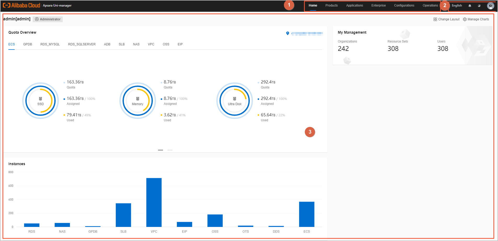

Functional sections of the web page

<table>
  <tr>
    <th colspan="2">Section</th>
    <th>Description</th>
  </tr>
  <tr>
    <td>1</td>
    <td>Top naviga tion bar</td>
    <td>This section includes the following modules:<br>• Home: uses charts to show the usage and monitoring data of existing system resources in each region.<br>• Products: manages all types of basic cloud services and resources.<br>• Applications: manages cloud apps of enterprises.<br>• Enterprise: manages organizations, resource sets, roles, users, logon policies, user groups, ownership, and resource pools.<br>• Configurations: manages resource pools, password policies, specifications, menus, and Resource Access Management (RAM) roles.<br>• Operations: manages the daily operations of cloud resources, including usage statistics and quotas.<br>• Security: provides operation and system logs.</td>
  </tr>
  <tr>
    <td>2</td>
    <td>Inform ation section of the current logon user</td>
    <td><br>: allows you to switch between English, simplified Chinese, and traditional<br>Chinese.<br>: provides message notifications.<br>: allows you to switch between day and night modes.<br><br>• User Information: When you click the icon of the current logon user, the User<br>Information, View Version, and Exit menu items are displayed.<br>If you click User Information, you can perform the following operations on the User Information page:<br>• View basic information.<br>• Modify personal information.<br>• Change the logon password.<br>• View the AccessKey pair of your Apsara Stack tenant account.<br>• Switch the current role.<br>• Enable or disable alert notification.</td>
  </tr>
  <tr>
    <td>3</td>
    <td>Operat ion section</td>
    <td>Operation section: shows the information and operations.</td>
  </tr>
</table>

<a id="section-5"></a>

# 5.Initial configuration

<a id="section-5-1"></a>

## 5.1. Configuration description

Before you use the Apsara Uni-manager Management Console, you must complete a series of basic configuration operations as an administrator, such as creating organizations, resource sets, users, and roles and initializing resources. This is the initial system configuration.

The Apsara Uni-manager Management Console manages the organizations, resource sets, users, and roles of cloud data centers in a centralized and service-oriented manner to grant different resource access permissions to different users.

- Organization

  After the Apsara Uni-manager Management Console is deployed, a root organization is automatically generated. You can create other organizations under the root organization.

  Organizations are displayed in a hierarchical structure. You can create subordinate organizations under each organization level.

- Resource Set

  A resource set is a container used to store resources. Each resource must belong to a resource set.

- User

  A user is a resource manager and user.

- Role

  A role is a set of access permissions. You can assign different roles to different users to implement system access control to meet a variety of different requirements.

The following table describes the relationships among organizations, resource sets, users, roles, and cloud resources.

| Relationship between two items | Relationship type | Description |
| --- | --- | --- |
| Organization and resource set | One-to-many | An organization can have multiple resource sets, but each resource set can belong to only a single organization. |
| Organization and user | One-to-many | An organization can have multiple users, but each user can belong to only a single organization. |
| Resource set and user | Many-to-many | A user can have multiple resource sets, and a resource set can be assigned to multiple users under the same level-1 organization. |
| User and role | Many-to-many | A user can have multiple roles, and a role can be assigned to multiple users. |
| Resource set and resource | One-to-many | A resource set can have multiple resources, but each cloud resource can belong to only a single resource set. |

<a id="section-5-2"></a>

## 5.2. Configuration process

This topic describes the initial configuration process.

Before you use the Apsara Uni-manager Management Console, you must complete the initial system configurations as an administrator based on the process shown in the following figure.

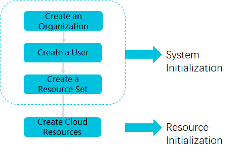

1. Create an organization

   Create an organization to store resource sets and their resources.

2. Create a user

   Create a user and assign the user different roles to meet different requirements for system access control.

3. Create a resource set

   Create a resource set before you apply for resources.

4. Create cloud resources

   Create instances in each service console based on project requirements. For more information about how to create cloud service instances, see the user guide of each cloud service.

<a id="section-6"></a>

# 6.Monitoring

<a id="section-6-1"></a>

## 6.1. View the workbench

The Apsara Uni-manager Management Console uses charts to keep you up to date on the current usage and monitoring information of resources.

Context

The resource types displayed may vary with region types. See your dashboard for available resource types.

Procedure

1. Log on to the Apsara Uni-manager Management Console.

   By default, the workbench page appears when you log on to the Apsara Uni-manager Management Console. To return to the workbench page from other pages, click Home in the top navigation bar.

   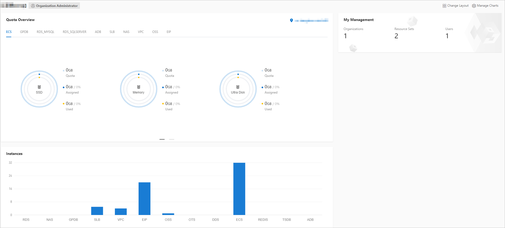

2. On the workbench page, you can view the instance summary information for all regions of the Apsara Stack environment.

   You can click Manage Charts in the upper-right corner of the page to select all or individual modules to view relevant information. You can also click Change Layout in the upper-right corner of the page and drag a specific module to the desired location.

   - Quota Overview

     Shows the usage and quotas of Elastic Compute Service (ECS), ApsaraDB RDS, Object Storage Service (OSS), and Server Load Balancer (SLB) resources.

   - Instances

     Shows the numbers of ECS instances, ApsaraDB RDS instances, OSS buckets, and SLB instances in each region.

   - Instance Trends Shows the numbers of recent ECS instances, ApsaraDB RDS instances, OSS buckets, and SLB instances.

   - Resource Load

     Shows the top five ECS and ApsaraDB RDS instances in terms of disk usage, CPU utilization, and memory usage.

   - Alert Rules

     Shows the number of alerts and details of the alerts.

   - My Management

     Shows the numbers of organizations, resource sets, and users.

   - Multi-cloud Regions

     Shows the information of all primary and secondary nodes in Apsara Stack. The network connection status and related alerts are displayed for each secondary node.

   - Multi-cloud Resources

     Shows the cloud services and the number of instances in each secondary node.

<a id="section-6-2"></a>

## 6.2. CloudMonitor

<a id="section-6-2-1"></a>

### 6.2.1. Cloud Monitor overview

Cloud Monitor provides real-time monitoring, alerting, and notification services for resources to protect your services and businesses.

Cloud Monitor can monitor metrics for a variety of services such as ECS, ApsaraDB for RDS, SLB, OSS, KVStore for Redis, VPN Gateway, AnalyticDB for PostgreSQL, ApsaraDB for MongoDB, EIP, and API Gateway.

You can use the metrics of cloud services to configure alert rules and notification policies. This way, you can stay up to date on the running status and performance of your service instances and scale resources in a timely manner when resources are insufficient.

<a id="section-6-2-2"></a>

### 6.2.2. Metrics

This topic describes the metrics available for each service.

CloudMonitor checks the availability of services based on their metrics. You can configure alert rules and notification policies for these metrics to stay up to date on the running status and performance of monitored service instances.

CloudMonitor can monitor resources of other services, including Elastic Compute Service (ECS), ApsaraDB RDS, Server Load Balancer (SLB), Object Storage Service (OSS), KVStore for Redis, VPN Gateway, AnalyticDB for PostgreSQL, ApsaraDB for MongoDB, Elastic IP Address (EIP), and API Gateway. The following tables list the metrics for each service.

Operating system metrics for ECS

<table>
  <tr>
    <td>Metric</td>
    <td>Description</td>
    <td>Unit</td>
  </tr>
</table>

| Metric | Description | Unit |
| --- | --- | --- |
| Host.cpu.total | The total CPU utilization of an ECS instance. | % |
| Host.mem.usedutilization | The memory usage of an ECS instance. | % |
| Host.load1 | The system loads over the last 1 minute. This metric is unavailable for Windows operating systems. | N/A |
| Host.load5 | The system loads over the last 5 minutes. This metric is unavailable for Windows operating systems. | N/A |
| Host.load15 | The system loads over the last 15 minutes. This metric is unavailable for Windows operating systems. | N/A |
| Host.disk.utilization | The disk usage of an ECS instance. | % |
| Host.disk.readbytes | The number of bytes read from the disk per second. | byte/s |
| Host.disk.writebytes | The number of bytes written to the disk per second. | byte/s |
| Host.disk.readIops | The number of read requests received by the disk per second. | count/s |
| Host.disk.writeIops | The number of write requests received by the disk per second. | count/s |
| Host.fs.inode | The inode usage. | % |

Basic metrics for ECS

| Metric | Description | Unit |
| --- | --- | --- |
| CPU utilization | The CPU utilization of an ECS instance. | % |
| Inbound bandwidth to the Internet | The average rate of inbound traffic to the Internet. | bit/s |
| Inbound bandwidth to the internal network | The average rate of inbound traffic to the internal network. | bit/s |
| Outbound bandwidth from the Internet | The average rate of outbound traffic from the Internet. | bit/s |
| Outbound bandwidth from the internal network | The average rate of outbound bandwidth from the internal network. | bit/s |
| System disk BPS | The number of bytes read from and written to the system disk per second. | byte/s |
| System disk IOPS | The number of reads from and writes to the system disk per second. | count/s |
| Advance CPU credits | The changes in advance CPU credits. Advance CPU credits can be used only when the unlimited mode is enabled. | N/A |
| CPU credit consumption | The changes in CPU credit consumption. Consumption trends are consistent with CPU utilization. | N/A |
| Overdrawn CPU credits | The changes in overdrawn CPU credits. Overdrawn CPU credits can be used only when the unlimited mode is enabled. | N/A |
| CPU credit balance | The changes in CPU credit balance. The CPU credit balance is used to maintain CPU credit usage. | N/A |

Note

For ECS instances, you must install a monitoring plug-in to collect metric data at the operating system level.

Installation method: On the Cloud Monitor page, select the instance that you want to monitor from the ECS instance list and click Batch Install in the lower part of the page.

Metric data is displayed in the monitoring chart within 5 to 10 minutes after the monitoring plug-in is installed.

Metrics for ApsaraDB RDS for PostgreSQL

<table>
  <tr>
    <td>Metric</td>
    <td>Description</td>
    <td>Apsara Stack service</td>
    <td>Formula</td>
  </tr>
</table>

| Metric | Description | Apsara Stack service | Formula |
| --- | --- | --- | --- |
| CPU utilization | The CPU utilization of an ApsaraDB RDS for PostgreSQL instance. Unit: %. | ApsaraDB RDS for PostgreSQL | Used CPU cores of an ApsaraDB RDS for PostgreSQL instance/Total CPU cores of the ApsaraDB RDS for PostgreSQL instance |
| Memory usage | The memory usage of an ApsaraDB RDS for PostgreSQL instance. Unit: %. | ApsaraDB RDS for PostgreSQL | Used memory of an ApsaraDB RDS for PostgreSQL instance/Total memory of the ApsaraDB RDS for PostgreSQL instance |
| Disk usage | The disk usage of an ApsaraDB RDS for PostgreSQL instance. Unit: %. | ApsaraDB RDS for PostgreSQL | None |
| IOPS usage | The number of I/O requests for an ApsaraDB RDS for PostgreSQL instance per second. Unit: %. | ApsaraDB RDS for PostgreSQL | Number of I/O requests for an ApsaraDB RDS for PostgreSQL instance/Statistical period |
| Connectio n usage | The number of connections between an application and an ApsaraDB RDS for PostgreSQL instance per second.Unit: %. | ApsaraDB RDS for PostgreSQL | Number of connections between an application and an ApsaraDB RDS for PostgreSQL instance/Statistical period |

Metrics for ApsaraDB RDS for MySQL

| Metric | Description | Apsara Stack service | Formula |
| --- | --- | --- | --- |
| CPU utilization | The CPU utilization of an ApsaraDB RDS for MySQL instance. Unit: %. | ApsaraDB RDS for MySQL | Used CPU cores of an ApsaraDB RDS for MySQL instance/Total CPU cores of the ApsaraDB RDS for MySQL instance |
| Memory usage | The memory usage of an ApsaraDB RDS for MySQL instance. Unit: %. | ApsaraDB RDS for MySQL | Used memory of an ApsaraDB RDS for MySQL instance/Total memory of the ApsaraDB RDS for MySQL instance |
| Disk usage | The disk usage of an ApsaraDB RDS for MySQL instance. Unit: %. | ApsaraDB RDS for MySQL | None |
| IOPS usage | The number of I/O requests for an ApsaraDB RDS for MySQL instance per second. Unit: %. | ApsaraDB RDS for MySQL | Number of I/O requests for an ApsaraDB RDS for MySQL instance/Statistical period |
| Connectio n usage | The number of connections between an application and an ApsaraDB RDS for MySQL instance per second. Unit: %. | ApsaraDB RDS for MySQL | Number of connections between an application and an ApsaraDB RDS for MySQL instance/Statistical period |
| Inbound bandwidth to ApsaraDB RDS for MySQL | The inbound traffic to an ApsaraDB RDS for MySQL instance per second. | ApsaraDB RDS for MySQL | None |
| Outbound bandwidth from ApsaraDB RDS for MySQL | The outbound traffic from an ApsaraDB RDS for MySQL instance per second. | ApsaraDB RDS for MySQL | None |

Metrics for ApsaraDB RDS for SQL Server

| Metric | Description | Apsara Stack service | Formula |
| --- | --- | --- | --- |
| CPU utilization | The CPU utilization of an ApsaraDB RDS for SQL Server instance. Unit: %. | ApsaraDB RDS for SQL Server | Used CPU cores of an ApsaraDB RDS for SQL Server instance/Total CPU cores of the ApsaraDB RDS for SQL Server instance |
| Memory usage | The memory usage of an ApsaraDB RDS for SQL Server instance. Unit: %. | ApsaraDB RDS for SQL Server | Used memory of an ApsaraDB RDS for SQL Server instance/Total memory of the ApsaraDB RDS for SQL Server instance |
| Disk usage | The disk usage of an ApsaraDB RDS for SQL Server instance. Unit: %. | ApsaraDB RDS for SQL Server | None |
| IOPS usage | The number of I/O requests for an ApsaraDB RDS for SQL Server instance per second. Unit: %. | ApsaraDB RDS for SQL Server | Number of I/O requests for an ApsaraDB RDS for SQL Server instance/Statistical period |
| Connectio n usage | The number of connections between an application and an ApsaraDB RDS for SQL Server instance per second.Unit: %. | ApsaraDB RDS for SQL Server | Number of connections between an application and an ApsaraDB RDS for SQL Server instance/Statistical period |
| Inbound bandwidth to ApsaraDB RDS for SQL Server | The inbound traffic to an ApsaraDB RDS for SQL Server instance per second. | ApsaraDB RDS for SQL Server | None |
| Outbound bandwidth from ApsaraDB RDS for SQL Server | The outbound traffic from an ApsaraDB RDS for SQL Server instance per second. | ApsaraDB RDS for SQL Server | None |

Metrics for PolarDB

| Metric | Description | Apsara Stack service | Formula |
| --- | --- | --- | --- |
| CPU utilization | The CPU utilization of a PolarDB instance. Unit: %. | PolarDB | Used CPU cores of a PolarDB instance/Total CPU cores of the PolarDB instance |
| Memory usage | The memory usage of a PolarDB instance. Unit: %. | PolarDB | Used memory of a PolarDB instance/Total memory of the PolarDB instance |
| Disk usage | The disk usage of a PolarDB instance.Unit: %. | PolarDB | None |
| IOPS usage | The number of I/O requests for a PolarDB instance per second. Unit: %. | PolarDB | Number of I/O requests for a PolarDB instance/Statistical period |
| Connectio n usage | The number of connections between an application and a PolarDB instance per second. Unit: %. | PolarDB | Number of connections between an application and a PolarDB instance/Statistical period |

Metrics for SLB

| Metric | Description | Unit |
| --- | --- | --- |
| Inbound bandwidth on a port | The average rate of inbound traffic on a port. | bit/s |
| Outbound bandwidth on a port | The average rate of outbound traffic on a port. | bit/s |
| Number of new connections on a port | The average number of new TCP connections established between clients and SLB instances in a statistical period. | N/A |
| Number of inbound packets received on a port | The number of packets received by an SLB instance per second. | count/s |
| Number of outbound packets sent on a port | The number of packets sent by an SLB instance per second. | count/s |
| Number of active connections on a port | The number of TCP connections in the ESTABLISHED state. If persistent connections are used, a connection can transfer multiple file requests at one time. | N/A |
| Number of inactive connections on a port | The number of TCP connections that are not in the ESTABLISHED state. You can run the netstat -an command to view the connections for both Windows and Linux instances. | N/A |
| Number of concurrent connections on a port | The number of established TCP connections. | count/s |
| Number of dropped connections on a port | The number of connections dropped per second. | count/s |
| Number of dropped inbound packets on a port | The number of inbound packets dropped per second. | count/s |
| Number of dropped outbound packets on a port | The number of outbound packets dropped per second. | count/s |
| Dropped inbound bandwidth on a port | The amount of inbound traffic dropped per second. | bit/s |
| Dropped outbound bandwidth on a port | The amount of outbound traffic dropped per second. | bit/s |

Metrics for monitoring service overview of OSS

| Metric | Description | Unit |
| --- | --- | --- |
| Availability | The metric that describes the system availability of OSS. You can obtain the metric value based on the following formula: Metric value = <code> 1 - Server</code> <code>error requests with the</code><br><code>returned HTTP status code</code> <code>5xx/All requests </code>. | % |
| Valid request percentage | The percentage of valid requests out of all requests. | % |
| Total number of requests | The total number of requests that are received and processed by the OSS server. | N/A |
| Number of valid requests | The total number of requests with HTTP status codes 2xx and 3xx returned. | N/A |
| Outbound traffic from the Internet | The amount of outbound traffic from the Internet. | byte |
| Inbound traffic to the Internet | The amount of inbound traffic to the Internet. | byte |
| Outbound traffic from the internal network | The amount of outbound traffic from the internal network. | byte |
| Inbound traffic to the internal network | The amount of inbound traffic to the internal network. | byte |
| CDN outbound traffic | The amount of outbound traffic sent over CDN after CDN is activated. Such outbound traffic over CDN is back-to-origin traffic. | byte |
| CDN inbound traffic | The amount of inbound traffic received over CDN after CDN is activated. | byte |
| Outbound traffic of cross-region replication | The amount of outbound traffic generated during data replication after cross-region replication is enabled. | byte |
| Inbound traffic of cross-region replication | The amount of inbound traffic generated during data replication after cross-region replication is enabled. | byte |
| Storage size | The amount of total storage occupied by the buckets of a specified user before the statistics collection deadline. | byte |
| Number of PUT requests | The total number of PUT requests made by the user between 00:00:00 on the first day of the current month and the statistics collection deadline. | N/A |
| Number of GET requests | The total number of GET requests made by the user between 00:00:00 on the first day of the current month and the statistics collection deadline. | N/A |

Metrics for request status details of OSS

| Metric | Description | Unit |
| --- | --- | --- |
| Number of requests with server-side errors | The total number of system-level error requests with the returned HTTP status code 5xx. | N/A |
| Percentage of requests with server-side errors | The percentage of requests with server-side errors out of all requests. | % |
| Number of requests with network errors | The total number of requests with the returned HTTP status code 499. | N/A |
| Percentage of requests with network errors | The percentage of requests with network errors out of all requests. | % |
| Number of requests with client-side authorization errors | The total number of requests with the returned HTTP status code 403. | N/A |
| Percentage of requests with client-side authorization errors | The percentage of requests with authorization errors out of all requests. | % |
| Number of requests with client-side errors indicating resources not found | The total number of requests with the returned HTTP status code 404. | N/A |
| Percentage of requests with client-side errors indicating resources not found | The percentage of requests with errors indicating resources not found out of all requests. | % |
| Number of requests with client-side timeout errors | The total number of requests with the returned HTTP status code 408 or OSS error code RequestTimeout. | N/A |
| Percentage of requests with client-side timeout errors | The percentage of requests with client-side timeout errors out of all requests. | % |
| Number of requests with other client-side errors | The total number of requests other than the foregoing client-side error requests with the returned HTTP status code 4xx. | N/A |
| Percentage of requests with other client-side errors | The percentage of requests with other client-side errors out of all requests. | % |
| Number of successful requests | The total number of requests with the returned HTTP status code 2xx. | N/A |
| Percentage of successful requests | The percentage of successful requests out of all requests. | % |
| Number of redirected requests | The total number of requests with the returned HTTP status code 3xx. | N/A |
| Percentage of redirected requests | The percentage of redirected requests out of all requests. | % |

Metrics for maximum latency of OSS

| Metric | Description | Unit |
| --- | --- | --- |
| Maximum end-to-end latency of GetObject requests | The maximum end-to-end latency of successful GetObject requests. | ms |
| Maximum server latency of GetObject requests | The maximum server latency of successful GetObject requests. | ms |
| Maximum end-to-end latency of HeadObject requests | The maximum end-to-end latency of successful HeadObject requests. | ms |
| Maximum server latency of HeadObject requests | The maximum server latency of successful HeadObject requests. | ms |
| Maximum end-to-end latency of PutObject requests | The maximum end-to-end latency of successful PutObject requests. | ms |
| Maximum server latency of PutObject requests | The maximum server latency of successful PutObject requests. | ms |
| Maximum end-to-end latency of PostObject requests | The maximum end-to-end latency of successful PostObject requests. | ms |
| Maximum server latency of PostObject requests | The maximum server latency of successful PostObject requests. | ms |
| Maximum end-to-end latency of AppendObject requests | The maximum end-to-end latency of successful AppendObject requests. | ms |
| Maximum server latency of AppendObject requests | The maximum server latency of successful AppendObject requests. | ms |
| Maximum end-to-end latency of UploadPart requests | The maximum end-to-end latency of successful UploadPart requests. | ms |
| Maximum server latency of UploadPart requests | The maximum server latency of successful UploadPart requests. | ms |
| Maximum end-to-end latency of UploadPartCopy requests | The maximum end-to-end latency of successful UploadPartCopy requests. | ms |
| Maximum server latency of UploadPartCopy requests | The maximum server latency of successful UploadPartCopy requests. | ms |

Metrics for successful request category of OSS

| Metric | Description | Unit |
| --- | --- | --- |
| Number of successful GetObject requests | The number of successful GetObject requests. | N/A |
| Number of successful HeadObject requests | The number of successful HeadObject requests. | N/A |
| Number of successful PostObject requests | The number of successful PostObject requests. | N/A |
| Number of successful AppendObject requests | The number of successful AppendObject requests. | N/A |
| Number of successful UploadPart requests | The number of successful UploadPart requests. | N/A |
| Number of successful UploadPartCopy requests | The number of successful UploadPartCopy requests. | N/A |
| Number of successful DeleteObject requests | The number of successful DeleteObject requests. | N/A |
| Number of successful DeleteObjects requests | The number of successful DeleteObjects requests. | N/A |

Metrics for KVStore for Redis

| Metric | Description | Apsara Stack service | Unit |
| --- | --- | --- | --- |
| CPU utilization | The CPU utilization of a KVStore for Redis instance. | KVStore for Redis | % |
| Memory usage | The percentage of memory that is in use. | KVStore for Redis | % |
| Used memory | The amount of memory that is in use. | KVStore for Redis | byte |
| Number of used connections | The total number of client connections that are in use. | KVStore for Redis | N/A |
| Percentage of used connections | The percentage of connections that are in use. | KVStore for Redis | % |
| Write bandwidth | The write traffic per second. | KVStore for Redis | byte/s |
| Read bandwidth | The read traffic per second. | KVStore for Redis | byte/s |
| Number of failed operations per second | The number of failed operations on a KVStore for Redis instance per second. | KVStore for Redis | count/s |
| Write bandwidth usage | The percentage of total bandwidth used by write operations. | KVStore for Redis | % |
| Read bandwidth usage | The percentage of total bandwidth used by read operations. | KVStore for Redis | % |
| Used QPS | The number of queries per second (QPS). | KVStore for Redis | count/s |
| QPS usage | The QPS usage. | KVStore for Redis | % |
| Average response time | The average response time. | KVStore for Redis | ms |
| Maximum response time | The maximum response time. | KVStore for Redis | ms |
| Number of failed commands | The number of failed commands. | KVStore for Redis | N/A |
| Hit rate | The current hit rate. | KVStore for Redis | % |
| Inbound traffic | The inbound traffic to a KVStore for Redis instance. | KVStore for Redis | byte |
| Inbound bandwidth usage | The inbound bandwidth usage of a KVStore for Redis instance. | KVStore for Redis | % |
| Outbound traffic | The outbound traffic from a KVStore for Redis instance. | KVStore for Redis | byte |
| Outbound bandwidth usage | The outbound bandwidth usage of a KVStore for Redis instance. | KVStore for Redis | % |

Metrics for VPN Gateway

| Metric | Dimension | Monitoring period | Unit |
| --- | --- | --- | --- |
| Number of inbound packets in a connection per second | User and instance | 1 minute | pps |
| Number of outbound packets in a connection per second | User and instance | 1 minute | pps |
| Inbound bandwidth of a connection | User and instance | 1 minute | bit/s |
| Outbound bandwidth of a connection | User and instance | 1 minute | bit/s |
| Number of connections | User and instance | 1 minute | N/A |

Metrics for AnalyticDB for PostgreSQL

| Metric | Description | Unit |
| --- | --- | --- |
| Connection usage | The number of connections between an application and an AnalyticDB for PostgreSQL instance per second. | % |
| CPU utilization | The CPU utilization of an AnalyticDB for PostgreSQL instance. | % |
| Disk usage | The disk usage of an AnalyticDB for PostgreSQL instance. | % |
| IOPS usage | The number of I/O requests for an AnalyticDB for PostgreSQL instance per second. | % |
| Memory usage | The memory usage of an AnalyticDB for PostgreSQL instance. | % |

Metrics for ApsaraDB for MongoDB

Tab

Metric

Description

Unit

The CPU utilization of

CPU utilization

an ApsaraDB for

%

MongoDB instance.

The memory usage of

Memory usage

an ApsaraDB for

%

MongoDB instance.

The disk usage of an

Disk usage

ApsaraDB for MongoDB

%

instance.

The percentage of the IOPS used by an ApsaraDB for MongoDB

IOPS usage

%

instance out of the

Basic metric

maximum available IOPS.

The number of connections between

Connection usage

an application and an

%

ApsaraDB for MongoDB instance per second.

The number of queries

QPS

N/A

per second.

The number of current

Number of used

connections to an

N/A

connections

ApsaraDB for MongoDB instance.

Disk space occupied by

The total used space.

byte

an instance

Disk space occupied by

The disk space occupied

Disk capacity

byte

data

by data.

Disk space occupied by

The disk space occupied

byte

logs

by logs.

Inbound traffic to the

The inbound traffic.

byte

internal network

Tab

Metric

Description

Unit

Network request

Outbound traffic from

The outbound traffic.

byte

the internal network

The number of

Number of requests

N/A

processed requests.

Number of Insert

None

N/A

operations

Number of Query

None

N/A

operations

Number of Update

None

N/A

operations

Number of operations

Number of Delete

None

N/A

operations

Number of Getmore

None

N/A

operations

Number of Command

None

N/A

operations

Metrics for EIP

| Metric | Description | Dimension | Monitoring period | Unit |
| --- | --- | --- | --- | --- |
| Inbound bandwidth | The traffic that passes through EIP to ECS per second. | Instance | 1 minute | bit/s |
| Outbound bandwidth | The traffic that passes through EIP from ECS per second. | Instance | 1 minute | bit/s |
| Number of inbound packets per second | The number of packets that pass through EIP to ECS per second. | Instance | 1 minute | pps |
| Number of outbound packets per second | The number of packets that pass through EIP from ECS per second. | Instance | 1 minute | pps |
| Packet loss rate due to throttling | The packet loss rate when the actually used bandwidth exceeds the configured upper limit. | Instance | 1 minute | pps |

Metrics for API Gateway

| Metric | Description | Dimension | Unit | Monitoring period |
| --- | --- | --- | --- | --- |
| Error distribution | The number of 2xx, 4xx, and 5xx status codes returned for an API in the monitoring period. | User and API | N/A | 1 minute |
| Inbound traffic | The total traffic of requests received by an API in the monitoring period. | User and API | byte | 1 minute |
| Outbound traffic | The total traffic of responses sent by an API in the monitoring period. | User and API | byte | 1 minute |
| Response time | The latency between the time when API Gateway calls the backend service of an API and the time when the result is received from the backend service in the monitoring period. | User and API | s | 1 minute |
| Number of total requests | The total number of requests received by an API in the monitoring period. | User and API | N/A | 1 minute |

<a id="section-6-2-3"></a>

### 6.2.3. View monitoring charts

You can view monitoring charts to obtain up-to-date information about each instance.

Procedure

1. Log on to the Apsara Uni-manager Management Console as an administrator.

2. In the top navigation bar, choose Products > Monitoring and O&M > CloudMonitor.

3. In the left-side navigation pane of the CloudMonitor page, click Cloud Service Monitoring.

4. Click a cloud service.

5. Click Monitoring Charts in the Actions column corresponding to an instance.

   On the Monitoring Charts page that appears, you can select a date and time to view the monitoring data of each metric.

<a id="section-6-3"></a>

## 6.3. Alerts

<a id="section-6-3-1"></a>

### 6.3.1. View alert overview

On the Overview page in Cloud Monitor, you can view the alert status statistics and alert logs.

Procedure

1. Log on to the Apsara Uni-manager Management Console as an administrator.

2. In the top navigation bar, choose Products > Monitoring and O&M > CloudMonitor.

3. In the left-side navigation pane of the Cloud Monitor page, click Overview.

4. On the Overview page, view the alert status statistics and alert logs that are generated in the last 24 hours.

<a id="section-6-3-2"></a>

### 6.3.2. Enable or disable alert notification

You can choose whether to enable alert notification by SMS, email, or DingTalk.

Prerequisites

Valid contact information is specified when you create a user. If your contact information is changed, you must modify personal information. For more information, see Modify personal information.

Procedure

1. Log on to the Apsara Uni-manager Management Console.

2. In the upper-right corner of the homepage, move the pointer over the profile picture and click User Information.

3. In the Messages section, select Email or DingTalk to enable alert notification.

   To disable alert notification, clear the corresponding check box.

<a id="section-6-3-3"></a>

### 6.3.3. View alert logs

You can view alert information to stay up to date on the running status of Elastic Compute Service (ECS), ApsaraDB RDS, Server Load Balancer (SLB), KVStore for Redis, VPN Gateway, AnalyticDB for PostgreSQL, ApsaraDB for MongoDB, Elastic IP Address (EIP), API Gateway, and Object Storage Service (OSS).

Context

Alert information contains information for all items that do not comply with your configured alert rules.

Note

- The system can retain up to one million alert items generated within the last three months.

- This topic describes how to view alert information for ECS. You can view the alert information for other cloud resources in a similar manner.

Procedure

1. Log on to the Apsara Uni-manager Management Console as an administrator.

2. In the top navigation bar, choose Products > Monitoring and O&M > Cloud Monitor.

3. In the left-side navigation pane of the Cloud Monitor page, choose Alerts > Alert History.

4. On the Alert Rule History List page, filter alert information by rule ID, rule name, service, and date.

   The following table describes the fields in the query result.

   Alert information fields

   | Parameter | Description |
   | --- | --- |
   | Product | The service for which the alert was triggered. |
   | Fault Instance | The instance for which the alert was triggered. |
   | Occurred At | The time when the alert was triggered. |
   | Rule Name | The name of the alert rule. |
   | Status | The status of the alert rule. |
   | Notification Contact | The recipient of the alert notification. |

<a id="section-6-3-4"></a>

### 6.3.4. Alarm rules

<a id="section-6-3-4-1"></a>

#### 6.3.4.1. View alert rules

After you create alert rules, you can view your alert rules on the Alert Rules page.

Procedure

1. Log on to the Apsara Uni-manager Management Console.

2. In the top navigation bar, choose Products > Monitoring and O&M > CloudMonitor.

3. In the left-side navigation pane of the Cloud Monitor page, click Cloud Service Monitoring.

4. Click a cloud service.

5. Click Alert Rules in the Actions column corresponding to an instance to go to its Alert Rules page.

   On the Alert Rules page, view the detailed information of alert rules.

<a id="section-6-3-4-2"></a>

#### 6.3.4.2. Create an alert rule

You can create an alert rule to monitor an instance.

Prerequisites

For Elastic Compute Service (ECS) instances, you must install a monitoring plug-in to collect metric data at the operating system level.

You can use the following method to install a monitoring plug-in:

1. Log on to the Apsara Uni-manager Management Console as an administrator.

2. In the top navigation bar, choose Products > Monitoring and O&M > Cloud Monitor.

3. In the left-side navigation pane, choose Cloud Service Monitoring > ECS.

4. In the ECS instance list, select the instances that you want to monitor and click Batch Install.

   Note

The monitoring chart displays monitoring data 5 to 10 minutes after the monitoring plug-in is installed.

Procedure

1. Log on to the Apsara Uni-manager Management Console as an administrator.

2. In the top navigation bar, choose Products > Monitoring and O&M > Cloud Monitor.

3. In the left-side navigation pane of the Cloud Monitor page, click Cloud Service Monitoring.

4. Click a cloud service.

5. Click Alert Rules in the Actions column corresponding to an instance.

   Note

   You can also use the search feature to query specific instances for which you want

   to create alert rules.

6. On the Alert Rules page, click Create Alert Rule.

   Parameters for creating an alert rule

   | Parameter | Description |
   | --- | --- |
   | Product | The monitored cloud service. |
   | Resource Range | The range of resources that is associated with the alert rule. |
   | Rule Description | The description of the alert rule. |
   | Add Rule Description | Click Add Rule Description to go to the rule configuration panel. For more information, see . |
   | Effective Time | Only a single alert is sent during each mute duration, even if the metric value exceeds the alert rule threshold several times in a row. |
   | Effective Period | An alert is sent only when the threshold is crossed during the effective period. |
   | HTTP CallBack | The callback URL when the alert conditions are met. |
   | Alert Contact Group | The group to which alerts are sent. |

   Parameters for adding rule description

   | Parameter | Description |
   | --- | --- |
   | Rule Name | The name of the alert rule. The name must be 1 to 64 characters in length and can contain letters and digits. |
   | Metric Name | Different products have different monitoring metrics. For more information, see Metrics. |
   | Comparison | The comparison between thresholds and observed values. The comparison operators include &gt;, &gt;=, &lt;, and &lt;=. When the comparison rule is satisfied, an alert rule is triggered. |
   | Threshold and Alert Level | Different metrics have different reference thresholds. |

7. Click OK.

<a id="section-6-3-4-3"></a>

#### 6.3.4.3. Disable an alert rule

You can disable one or more alert rules.

Procedure

1. Log on to the Apsara Uni-manager Management Console as an administrator.

2. In the top navigation bar, choose Products > Monitoring and O&M > CloudMonitor.

3. In the left-side navigation pane of the Cloud Monitor page, click Cloud Service Monitoring.

4. Click a cloud service.

5. Click Alert Rules in the Actions column corresponding to an instance.

6. On the Alert Rules page, choose More > Disable in the Actions column corresponding to the alert rule to be disabled.

7. In the Disable Alert Rule message, click Confirm.

<a id="section-6-3-4-4"></a>

#### 6.3.4.4. Enable an alert rule

After an alert rule is disabled, you can re-enable it

Procedure

1. Log on to the Apsara Uni-manager Management Console as an administrator.

2. In the top navigation bar, choose Products > Monitoring and O&M > CloudMonitor.

3. In the left-side navigation pane of the Cloud Monitor page, click Cloud Service Monitoring.

4. Click a cloud service.

5. Click Alert Rules in the Actions column corresponding to an instance.

6. On the Alert Rules page, choose More > Enable in the Actions column corresponding to the alert rule to be enabled.

7. In the Enable Alert Rule message, click Confirm.

<a id="section-6-3-4-5"></a>

#### 6.3.4.5. Delete an alert rule

You can delete alert rules that are no longer needed.

Procedure

1. Log on to the Apsara Uni-manager Management Console as an administrator.

2. In the top navigation bar, choose Products > Monitoring and O&M > CloudMonitor.

3. In the left-side navigation pane of the Cloud Monitor page, click Cloud Service Monitoring.

4. Click a cloud service.

5. Click Alert Rules in the Actions column corresponding to an instance.

6. On the Alert Rules page, click Delete in the Actions column corresponding to the alert rule to be deleted.

7. In the Delete Alert message, click Confirm.

<a id="section-7"></a>

# 7.VMware Cloud on Alibaba Cloud

<a id="section-7-1"></a>

## 7.1. VMware Cloud on Alibaba Cloud

<a id="section-7-1-1"></a>

### 7.1.1. Log on to the VMware Cloud on Alibaba Cloud console

This topic describes how to log on to the VMware Cloud on Alibaba Cloud console.

Prerequisites

- Before you log on to the Apsara Uni-manager Management Console, you must obtain the endpoint of the console from the deployment personnel.

- A browser is available. We recommend that you use Google Chrome.

Procedure

1. Enter the URL of the Apsara Uni-manager Management Console in the address bar and press the Enter key.

2. Enter your username and password.

   Obtain the username and password that you use to log on to the Apsara Uni-manager Management Console from the operations administrator.

   Note

   The first time that you log on to the Apsara Uni-manager Management Console,

   you must change the password of your account. For security purposes, your password must meet the minimum complexity requirements. The password must be 10 to 32 characters in length and must contain at least two of the following character types:

   - Uppercase or lowercase letters

   - Digits

   - Special characters, including exclamation points (!), at signs (@), number signs (#), dollar signs ($), and percent signs (%)

3. Click Log On.

4. In the top navigation bar, choose Products > Elastic Computing > VMware Cloud on Alibaba Cloud.

<a id="section-7-1-2"></a>

### 7.1.2. Bind a VMware Cloud on Alibaba Cloud region

Before you use VMware Cloud on Alibaba Cloud, you must bind a VMware Cloud on Alibaba Cloud region to an organization.

Prerequisites

A VMware Cloud on Alibaba Cloud region is managed. For more information, see Add a VMware node.

Procedure

1. Log on to the Apsara Uni-manager Management Console.

2. In the top navigation bar, click Enterprise.

3. In the left-side navigation pane, click Resource Pools.

4. In the organization navigation tree, click an organization. In the Regions section, select the region that you want to bind.

5. Click Update Association.

<a id="section-7-1-3"></a>

### 7.1.3. Instructions

<a id="section-7-1-3-1"></a>

#### 7.1.3.1. Limits

Before you use VMware Cloud on Alibaba Cloud virtual machine (VM) templates, you must familiarize yourself with the limits of instances.

General limits

- You must select appropriate operating systems for VMware Cloud on Alibaba Cloud VM templates.

  The following operating systems are verified to be available in the Apsara Uni-manager Management Console:

  - CentOS8.2.2004

  - CentOS7.2003

  - CentOS6.10

  - Ubuntu-20.04.1

  - Ubuntu-18.04.5

  - Ubuntu-16.04.7

  - Windows Server 2016

  - Windows Server 2019

- The Apsara Uni-manager Management Console supports VMware vSphere 6.x. Other versions of VMware vSphere, such as 5.x or 7.x, can in theory be supported. However, the specific support depends on the compatibility of the VMware Cloud on Alibaba Cloud API and must be evaluated by the R&D team of the Apsara Uni-manager Management Console.

- You must install VMware Tools.

  For more information, see the VMware documentation. Select Full Installation in the installation process.

- You must modify network interface controller configurations in the operating system of the VM.

  When you create a VM in the Apsara Uni-manager Management Console, you can specify the IP address of the operating system. This feature is supported by valid network interface controller configurations.

  Operating systems of VM templates must be in DHCP mode. Information such as the MAC address and universally unique identifier (UUID) in the network interface controller configurations must be removed. The following information can be retained.

  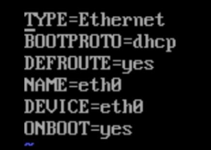

  Note

  Some configurations are required for the following operating systems:

  - CentOS 6: You must clear the content in the network interface controller configuration file named 70-persistent-net.rules. The file is stored in the /etc/udev/rules.d/ directory.

  - CentOS 7: The system generates the name for a network interface controller, such as ifcfg-ens160. You must modify the name to ifcfg-eth0 to make the name take effect.

  - Ubuntu18.04, 20.04, and later: You must run the  `sudo rm /etc/netplan/*.yaml`

    command to remove the network interface controller configurations.

<a id="section-7-1-3-2"></a>

#### 7.1.3.2. Suggestions

Consider the following operation suggestions to make more efficient use of VMware Cloud on Alibaba Cloud virtual machine (VM) templates.

- Select the latest version of VM hardware.

- Select thin provision for VM disks.

  Disk replication is required when you create VMs based on templates. Files of disks of the thin provision type are small in size. This can help accelerate the creation of VMs.

  Note

  Large sizes of disk files in VM templates or slow storage write speeds may cause VM creation to time out and fail. The maximum timeout period supported by the Apsara Uni-manager Management Console is 10 minutes.

<a id="section-7-1-4"></a>

### 7.1.4. Instances

<a id="section-7-1-4-1"></a>

#### 7.1.4.1. Create a VMware Cloud on Alibaba Cloud instance

A VMware Cloud on Alibaba Cloud instance is a virtual machine (VM) that contains the basic computing components of a server, such as CPU, memory, operating system, network, and disks.

Prerequisites

- The region where VMware Cloud on Alibaba Cloud is deployed is managed. For more information, see Add a VMware node.

- The region where VMware Cloud on Alibaba Cloud is deployed is bound to an organization. For more information, see Bind a VMware Cloud on Alibaba Cloud region.

Procedure

1. Log on to the VMware Cloud on Alibaba Cloud console.

2. In the left-side navigation pane, click Instances.

3. In the top navigation bar, move the pointer over Region and select the region where VMware Cloud on Alibaba Cloud is deployed.

4. Click Create Instance in the upper-right corner.

5. Configure parameters listed in the following table to create an instance.

   Section

   Parameter

   Required

   Description

   The organization in which to

   Organization

   Yes

   create the instance.

   Basic Settings

   The resource set in which to

   Resource Set

   Yes

   create the instance.

   The region in which to create

   Region

   Yes

   the instance.

   Region

   The zone in which to create the

   Zone

   Yes

   instance.

   The VPC in which to create the

   VPC

   Yes

   instance.

   Section

   Parameter

   Required

   Description

   Select the vSwitch to which the instance belongs.

   The vSwitch corresponds to the

   vSwitch

   Yes

   port group of a VMware ESXi host or a distributed switch, and maps to the VLAN of a physical switch.

   The private IPv4 address of the instance.

   The private IPv4 address must be within the CIDR block of the

   Private IP Address

   Yes

   vSwitch.

   The private subnet mask. Example: 255.255.255.0. The

   Private Subnet Mask

   Yes

   specified subnet mask must be within the CIDR block of the selected vSwitch.

   The private IP address of the gateway. Example:

   Private IP Address of

   Yes

   192.168.100.1. The IP address

   Gateway

   must be within the CIDR block of the selected vSwitch.

   The private IP address of the DNS server. Example:

   Private IP Address of DNS

   No

   114.114.114.114. The IP address

   Server

   must be within the CIDR block of the selected vSwitch.

   The instance family of the instance. Valid values:

   - Memory Optimized

   Instance Family

   No

   - Compute Optimized

   - General Purpose

   Instance

   Section

   Parameter

   Required

   Description

   The instance type of the

   Instance Type

   Yes

   instance. You can specify the vCPUs and memory.

   The type of the image. Default

   Image Type

   No

   value: Public Image.

   Image

   The public image of the

   Public image

   Yes

   instance.

   The system disk to which the operating system is installed.

   You can configure different storage types for the disk. Valid values:

   - Shared Storage: All: The system selects an available shared storage. We recommend that you select this type.

   - Shared Storage: storageA: The storage named storageA of the

   System Disk (GB)

   No

   VMware Cloud on Alibaba Cloud instance is used. Administrators must make sure the storage is appropriate. If the storage capacity is insufficient, the instance fails to be created.

   Section

   Parameter

   Required

   Description

   Storage

   You can also add data disks after the instance is created.

   You can configure different storage types for the disk. Valid values:

   - Shared Storage: All: The system selects an available shared storage. We recommend that you select this type.

   - Shared Storage: storageA: The storage named storageA of the VMware Cloud on Alibaba Cloud instance is used. Administrators must make sure the storage is appropriate. If the storage capacity is insufficient, the instance fails to be created.

   Data Disk (GB)

   No

   You must also specify the provision type when you create the instance. Valid values:

   - Thin Provision: Storage space increases with the use of the disk.

   - Thick Provision Lazy Zeroed: Storage space is equal to the size of the disk and does not increase. The disk is formatted when data is written.

   - Thick Provision Eager Zeroed: Storage space is equal to the size of the disk and does not increase. The storage of the disk is immediately formatted when the disk is created.

   Password

   Password Setting

   No

   Select Set after Purchase.

   | Section | Parameter | Required | Description |
   | --- | --- | --- | --- |
   | Instance Name | Instance Name | Yes | The name of the instance.<br>The name must be 2 to 128 characters in length and can contain letters, periods (.), underscores (_), hyphens (-), and colons (:). It must start with a letter and cannot start with http:// or https://. |

6. Click Submit.

<a id="section-7-1-4-2"></a>

#### 7.1.4.2. View instance information

You can view the list of created instances as well as details of individual instances, such as their basic configurations, disks, and elastic network interfaces (ENIs).

Procedure

1. Log on to the VMware Cloud on Alibaba Cloud console.

2. In the left-side navigation pane, click Instances.

3. In the top navigation bar, move the pointer over Region and select the region where VMware Cloud on Alibaba Cloud is deployed.

   You can view the list of VMware Cloud on Alibaba Cloud instances that are deployed in the current region.

4. Use one of the following methods to go to the details page of an instance:

   - In the Instance ID/Name column, click the instance ID.

   - Click Manage in the Actions column corresponding to the instance.

   - Choose More > Show Details in the Actions column corresponding to the instance.

<a id="section-7-1-4-3"></a>

#### 7.1.4.3. Modify an instance

You can modify the name and description of a created VMware Cloud on Alibaba Cloud instance.

Procedure

1. Log on to the VMware Cloud on Alibaba Cloud console.

2. In the left-side navigation pane, click Instances.

3. In the top navigation bar, move the pointer over Region and select the region where VMware Cloud on Alibaba Cloud is deployed.

4. Find the instance that you want to modify and choose More > Modify in the Actions column.

5. Modify the name and description of the instance.

6. Click OK.

<a id="section-7-1-4-4"></a>

#### 7.1.4.4. Remotely connect to an instance

You can remotely connect to and manage added VMware Cloud on Alibaba Cloud instances.

Procedure

1. Log on to the VMware Cloud on Alibaba Cloud console.

2. In the left-side navigation pane, click Instances.

3. In the top navigation bar, move the pointer over Region and select the region where VMware Cloud on Alibaba Cloud is deployed.

4. Find the instance that you want to manage and click Remote Connection in the Actions column.

5. Enter the username and password.

   - For a Linux instance, enter the username *root* and the logon password.

     Note

     When you log on to the Linux instance, the password is not displayed as you enter it. Press the Enter key after you enter the password.

   - For a Windows instance, to use a key combination such as Ctrl+Alt+Delete, click the List icon in the upper-right corner of the page and select the corresponding composite key from the drop-down list.

     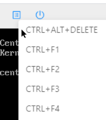

     Enter the username and password, and click the Log On icon.

<a id="section-7-1-4-5"></a>

#### 7.1.4.5. Stop an instance

You can stop VMware Cloud on Alibaba Cloud instances that are not in use. The stop operation interrupts services that are running on the instances. Exercise caution when you perform this operation.

Prerequisites

The instance is in the Running state.

Procedure

1. Log on to the VMware Cloud on Alibaba Cloud console.

2. In the left-side navigation pane, click Instances.

3. In the top navigation bar, move the pointer over Region and select the region where VMware Cloud on Alibaba Cloud is deployed.

4. Use one of the following methods to stop instances:

   - To stop a single instance, find the instance and choose More > Instance Status > Stop in the Actions column.

   - To stop one or more instances at a time, select the instances and click Stop in the lower part of the Instances page.

5. Click OK.

Execution results

When the instance is being stopped, its state in the Status column changes from Running to Stopping. After the instance is stopped, its state changes to Stopped.

<a id="section-7-1-4-6"></a>

#### 7.1.4.6. Start an instance

You can start a stopped instance.

Prerequisites

The instance is in the Stopped state.

Procedure

1. Log on to the VMware Cloud on Alibaba Cloud console.

2. In the left-side navigation pane, click Instances.

3. In the top navigation bar, move the pointer over Region and select the region where VMware Cloud on Alibaba Cloud is deployed.

4. Use one of the following methods to start instances:

   - To start a single instance, find the instance and choose More > Instance Status > Start in the Actions column.

   - To start one or more instances at a time, select the instances and click Start in the lower part of the Instances page.

5. Click OK.

Execution results

When the instance is being started, its state in the Status column changes from Stopped to Starting. After the instance is started, its state changes to Running.

<a id="section-7-1-4-7"></a>

#### 7.1.4.7. Restart an instance

After you change the logon password of an instance or install system updates, you must restart the instance. The restart operation stops the instances for a short period of time and interrupts services that are running on the instance. Exercise caution when you perform this operation.

Prerequisites

The instance is in the Running state.

Procedure

1. Log on to the VMware Cloud on Alibaba Cloud console.

2. In the left-side navigation pane, click Instances.

3. In the top navigation bar, move the pointer over Region and select the region where VMware Cloud on Alibaba Cloud is deployed.

4. Use one of the following methods to restart the instance:

   - To restart a single instance, find the instance and choose More > Instance Status > Restart in the Actions column.

   - To restart one or more instances at a time, select the instances and click Restart in the lower part of the Instances page.

5. In the Restart Instance dialog box, select a restart mode.

   - Restart: restarts the instance normally.

   - Force Restart: forces the instance to restart. This may result in the loss of unsaved data.

6. Click OK.

<a id="section-7-1-4-8"></a>

#### 7.1.4.8. Delete an instance

You can delete instances that are no longer needed to release their resources. Deleted instances cannot be recovered. We recommend that you back up data before you delete an instance. If data disks are released with the instances, the disk data cannot be recovered.

Prerequisites

The instance is in the Stopped state.

Procedure

1. Log on to the VMware Cloud on Alibaba Cloud console.

2. In the left-side navigation pane, click Instances.

3. In the top navigation bar, move the pointer over Region and select the region where VMware Cloud on Alibaba Cloud is deployed.

4. Select the instance and click Delete in the lower part of the Instances page.

5. Click OK.

<a id="section-7-1-4-9"></a>

#### 7.1.4.9. Change the instance type of an instance

You can change the instance types of instances to suit your business needs. This eliminates the need to create VMware Cloud on Alibaba Cloud instances.

Prerequisites

The instance is in the Stopped state.

Procedure

1. Log on to the VMware Cloud on Alibaba Cloud console.

2. In the left-side navigation pane, click Instances.

3. In the top navigation bar, select an organization, a resource set, and a region.

4. Find the instance whose instance type you want to change and click Upgrade/Downgrade in the Actions column.

5. On the page that appears, select a new instance type and click Submit.

   The page that appears shows the instance types available for selection.

6. Start the instance to make the new instance type take effect.

   For more information, see Start an instance.

<a id="section-7-1-5"></a>

### 7.1.5. Images

<a id="section-7-1-5-1"></a>

#### 7.1.5.1. Create a custom image

You can create a custom image and use it to create identical instances or replace the system disks of existing instances. This way, you can configure many instances that have identical operating systems and data environments.

Create a custom image from an instance

You can create a custom image from an instance to replicate the data of all system and data disks on the instance.

Note

To avoid data security risks, we recommend that you delete sensitive data from an instance before you use the instance to create a custom image.

1. Log on to the VMware Cloud on Alibaba Cloud console.

2. In the left-side navigation pane, click Instances.

3. In the top navigation bar, move the pointer over Region and select the region where VMware Cloud on Alibaba Cloud is deployed.

4. Find the instance from which you want to create a custom image and choose More > Create Custom Image in the Actions column.

5. Set the name, sharing scope, and description for the custom image, and click OK.

   The name must be 2 to 128 characters in length and can contain letters, digits, periods (.), underscores (_), hyphens (-), and colons (:). It cannot start with a special character or digit.

   You can set the sharing scope to the permission scope of the image.

   The description must be 2 to 256 characters in length and cannot start with http:// or https://.

<a id="section-7-1-5-2"></a>

#### 7.1.5.2. View images

You can view the list of created images.

Procedure

1. Log on to the VMware Cloud on Alibaba Cloud console.

2. In the left-side navigation pane, choose Images > Images.

3. In the top navigation bar, move the pointer over Region and select the region where the image is created.

4. Select a filter option, enter the corresponding information in the search box, and then click Search.

   You can select multiple filter options to narrow down search results.

   | Parameter | Description |
   | --- | --- |
   | Image Name | The image name used to search for the image. |
   | Image ID | The image ID used to search for the image. |

<a id="section-7-1-6"></a>

### 7.1.6. Snapshots

<a id="section-7-1-6-1"></a>

#### 7.1.6.1. Create a snapshot

You can manually create a snapshot for a disk to back up disk data.

Prerequisites

- The instance to which the disk is attached is in the Running or Stopped state.

- The disk is in the Running state.

Background information

A snapshot of a disk can be used to roll back data of the disk.

When you create a snapshot, take note of the following items:

- For each disk, the first snapshot taken is a full snapshot and subsequent snapshots are incremental snapshots. It takes longer to create the first full snapshot than it does subsequent incremental snapshots. The amount of taken time depends on the amount of data that has been changed since the previous snapshot. The more data that has been changed, the longer it takes to create an incremental snapshot.

- Avoid creating snapshots during peak hours.

Procedure

1. Log on to the VMware Cloud on Alibaba Cloud console.

2. In the left-side navigation pane, click Instances.

3. In the top navigation bar, move the pointer over Region and select the region where VMware Cloud on Alibaba Cloud is deployed.

4. Click the instance from which you want to create a snapshot. On the page that appears, click the Snapshots tab.

5. Click Create and Bind Snapshot.

6. Set the name, type, and description for the snapshot, and click Submit.

   | Parameter | Description |
   | --- | --- |
   | Snapshot Name | The name of the snapshot. |
   | Snapshot Type | The snapshot type. Valid values:<br>• Disk Snapshot: stores information in disks.<br>• Memory Snapshot: stores information in memory. |
   | Snapshot Description | The description of the snapshot. |

<a id="section-7-1-6-2"></a>

#### 7.1.6.2. Delete a snapshot

You can delete a snapshot that is no longer needed. After the snapshot is deleted, it cannot be recovered.

Procedure

1. Log on to the VMware Cloud on Alibaba Cloud console.

2. In the left-side navigation pane, click Instances.

3. In the top navigation bar, move the pointer over Region and select the region where VMware Cloud on Alibaba Cloud is deployed.

4. Find the instance whose snapshot is to be deleted and click the Snapshots tab.

5. Use one of the following methods to delete the snapshot:

   - To delete a single snapshot, find the snapshot and click Delete in the Actions column.

   - To delete one or more snapshots at a time, select the snapshots and click Delete in the lower part of the Snapshots tab.

6. Click OK.

<a id="section-7-1-6-3"></a>

#### 7.1.6.3. View snapshots

You can view the list of created snapshots.

Procedure

1. Log on to the VMware Cloud on Alibaba Cloud console.

2. In the left-side navigation pane, click Instances.

3. In the top navigation bar, move the pointer over Region and select the region where VMware Cloud on Alibaba Cloud is deployed.

4. Find the instance in which you want to view snapshots and click the Snapshots tab.

5. Select a filter option, enter the corresponding information in the search box, and then click Search.

   You can select multiple filter options to narrow down search results.

   | Parameter | Description |
   | --- | --- |
   | Snapshot Name | The snapshot name used to search for the snapshot. |
   | Snapshot ID | The snapshot ID used to search for the snapshot. |

<a id="section-7-1-7"></a>

### 7.1.7. Disks

<a id="section-7-1-7-1"></a>

#### 7.1.7.1. Create a disk

To increase the storage space of VMware Cloud on Alibaba Cloud instances, you can create standalone data disks and then attach them to the instances. This topic describes how to create an empty data disk. You cannot create standalone system disks.

Procedure

1. Log on to the VMware Cloud on Alibaba Cloud console.

2. In the left-side navigation pane, click Instances.

3. In the top navigation bar, move the pointer over Region and select the region where VMware Cloud on Alibaba Cloud is deployed.

4. Find the instance for which you want to create a disk and click the Disks tab.

5. Click Create and Attach Disk.

6. Configure parameters listed in the following table to create a disk.

   Section

   Parameter

   Required

   Description

   The zone in which to

   Region

   Zone

   Yes

   create the disk.

   The disk category and

   Specifications

   Yes

   the disk size.

   Section

   Parameter

   Required

   Description

   The provision type. Valid values:

   - Thin Provision: Storage space increases with the

   Basic Settings

   use of the disk.

   - Thick Provision Lazy Zeroed: Storage space is equal to the size of the disk and does not increase. The disk is

   Provision Type

   Yes

   formatted when data is written.

   - Thick Provision Eager Zeroed: Storage space is equal to the size of the disk and does not increase. The storage of the disk is immediately formatted when the disk is created.

7. Click Submit.

Execution results

The created disk is displayed in the disk list and in the Running state.

<a id="section-7-1-7-2"></a>

#### 7.1.7.2. View disks

You can view the list of created disks and the details of individual disks.

Procedure

1. Log on to the VMware Cloud on Alibaba Cloud console.

2. In the left-side navigation pane, click Instances.

3. In the top navigation bar, move the pointer over Region and select the region where VMware Cloud on Alibaba Cloud is deployed.

4. Click the instance for which you want to view disks. On the page that appears, click the Disks tab.

5. Select a filter option from the drop-down list, enter the relevant information in the search box, and then click Search.

   You can select multiple filter options to narrow down search results.

   | Parameter | Description |
   | --- | --- |
   | Disk Name | The disk name used to search for the disk. |
   | Disk ID | The disk ID used to search for the disk. |
   | Disk Properties | The disk type used to search for disks of that type. Valid values:<br>• All<br>• System Disk<br>• Data Disk |

<a id="section-7-1-7-3"></a>

#### 7.1.7.3. Detach a data disk

You can detach data disks. System disks cannot be detached.

Procedure

Warning

Resources are released after disks are detached. Make sure that the data of a disk is backed up before you detach it.

1. Log on to the VMware Cloud on Alibaba Cloud console.

2. In the left-side navigation pane, click Instances.

3. In the top navigation bar, move the pointer over Region and select the region where VMware Cloud on Alibaba Cloud is deployed.

4. Click the instance from which you want to detach a data disk. On the page that appears, click the Disks tab.

5. Find the data disk that you want to detach and choose More > Detach in the Actions column.

6. Click OK.

<a id="section-7-1-8"></a>

### 7.1.8. ENIs

<a id="section-7-1-8-1"></a>

#### 7.1.8.1. Create an ENI

You can create and bind elastic network interfaces (ENIs) to VMware Cloud on Alibaba Cloud instances.

Prerequisites

A virtual private cloud (VPC) and a vSwitch are created. For more information, see Create a VPC and Create a vSwitch in *Apsara Stack VPC User Guide*.

Background information

ENIs are classified into primary and secondary ENIs.

A primary ENI is created by default when an instance is created in a VPC. This primary ENI has the same lifecycle as the instance and cannot be unbound from the instance.

ENIs that are separately created are secondary ENIs. This topic describes how to create a secondary ENI.

Procedure

1. Log on to the VMware Cloud on Alibaba Cloud console.

2. In the left-side navigation pane, click Instances.

3. In the top navigation bar, move the pointer over Region and select the region where VMware Cloud on Alibaba Cloud is deployed.

4. Click the instance for which you want to create an ENI. On the page that appears, click the ENIs tab.

5. Click Create and Bind ENI.

6. Configure parameters listed in the following table to create an ENI.

   Section

   Parameter

   Required

   Description

   The organization in which to create the

   Organization

   Yes

   ENI.

   The resource set in which to create the

   Resource Set

   Yes

   ENI.

   Region

   Region

   Yes

   The region in which to create the ENI.

   Zone

   Yes

   The zone in which to create the ENI.

   The VPC in which to create the ENI. The secondary ENI can be bound only to an instance in the same VPC.

   VPC

   Yes

   Note

   After an ENI is created, you cannot change its VPC.

   Basic Settings

   Section

   Parameter

   Required

   Description

   The vSwitch in which to create the ENI. The secondary ENI can be bound only to an instance in the same VPC. Select a vSwitch that is deployed within the same zone as the instance to which the ENI is bound. The vSwitch of the ENI can be different from that of the

   vSwitch

   Yes

   instance.

   Note

   After an ENI is created, you cannot change its vSwitch.

7. Click Submit.

Execution results

The created ENI is displayed on the ENIs page and is in the Bound state.

<a id="section-7-1-8-2"></a>

#### 7.1.8.2. View ENIs

You can view the list of created elastic network interfaces (ENIs).

Procedure

1. Log on to the VMware Cloud on Alibaba Cloud console.

2. In the left-side navigation pane, click Instances.

3. In the top navigation bar, move the pointer over Region and select the region where VMware Cloud on Alibaba Cloud is deployed.

4. Click the instance for which you want to view ENIs. On the page that appears, click the ENIs tab.

5. Select a filter option, enter the corresponding information in the search box, and then click Search.

   You can select multiple filter options to narrow down search results.

   | Parameter | Description |
   | --- | --- |
   | ENI Name | The ENI name used to search for the ENI. |
   | ENI ID | The ENI ID used to search for the ENI. |
   | VSwitch ID | The vSwitch ID used to search for the ENIs that are associated with the vSwitch. |

<a id="section-7-1-8-3"></a>

#### 7.1.8.3. Delete an ENI

You can delete secondary elastic network interfaces (ENIs) that are no longer needed.

Background information

Only secondary ENIs can be deleted. Primary ENIs share the same lifecycle as instances and cannot be deleted.

Procedure

1. Log on to the VMware Cloud on Alibaba Cloud console.

2. In the left-side navigation pane, click Instances.

3. In the top navigation bar, move the pointer over Region and select the region where VMware Cloud on Alibaba Cloud is deployed.

4. Find the instance whose secondary ENI is to be deleted and click the ENIs tab.

5. Find the secondary ENI and click Delete in the Actions column.

6. Click OK.

<a id="section-8"></a>

# 8.Enterprise

<a id="section-8-1"></a>

## 8.1. Organizations

<a id="section-8-1-1"></a>

### 8.1.1. Create an organization

You can create organizations to store resource sets and their resources.

Procedure

1. Log on to the Apsara Uni-manager Management Console as an administrator.

2. In the top navigation bar, click Enterprise.

3. In the left-side navigation pane of the Enterprise page, click Organizations.

4. In the organization navigation tree, click a parent organization. In the Current Organization section, click Add Organization.

5. In the Add Organization dialog box, enter an organization name and click OK.

6. (Optional)If the primary node has enabled the multi-cloud management feature, the Synchronously Create Multi-cloud Organization check box is displayed after you click OK.

   Select Synchronously Create Multi-cloud Organization, select clouds where the organization is synchronously created, and then click OK.

<a id="section-8-1-2"></a>

### 8.1.2. Query an organization

You can query an organization by name to view its resource sets, users, and user groups.

Procedure

1. Log on to the Apsara Uni-manager Management Console as an administrator.

2. In the top navigation bar, click Enterprise.

3. In the left-side navigation pane of the Enterprise page, click Organizations.

4. In the search box below Organizations, enter an organization name.

   You can view the information about the corresponding organization.

<a id="section-8-1-3"></a>

### 8.1.3. View organization information

You can view information about an organization on the Organizations page.

Procedure

1. Log on to the Apsara Uni-manager Management Console as an administrator.

2. In the top navigation bar, click Enterprise.

3. In the left-side navigation pane of the Enterprise page, click Organizations.

4. On the Organizations page, click an organization in the organization list.

5. In the right-side area, view the organization information.

   - In the Resource Sets section, you can view information such as the name, creation time, and creator of each resource set in the organization. Click the name of a resource set to view its details.

   - In the Users section, you can view information such as the name, status, and role of each user in the organization. Click a username to view the user details.

   - In the User Groups section, you can view the name, organization, role, members, and creation time of each user group in the organization.

<a id="section-8-1-4"></a>

### 8.1.4. Modify the name of an organization

Users that have operation permissions on an organization can modify the name of the organization.

Procedure

1. Log on to the Apsara Uni-manager Management Console.

2. In the top navigation bar, click Enterprise.

3. In the left-side navigation pane of the Enterprise page, click Organizations.

4. In the organization navigation tree, click an organization name.

5. In the Current Organization section, click Edit Organization.

6. In the Edit Organization dialog box, modify the organization name.

   If you want to synchronously modify the name of a multi-cloud organization in other clouds, select Synchronously Modify Multi-cloud Organization.

7. Click OK.

<a id="section-8-1-5"></a>

### 8.1.5. Change organization ownership

Users that have operation permissions on organizations can change the ownership of organizations.

Prerequisites

- Make sure that each organization under the organization that you want to change the ownership has a unique name.

- The ownership of an organization cannot be changed cross level-1 organizations.

Context

Users can change the ownership of an organization cross parent organizations. This way, the ownership of subordinate organizations, users, and resources are also changed in a cascading manner.

Procedure

1. Log on to the Apsara Uni-manager Management Console as an administrator.

2. In the top navigation bar, click Enterprise.

3. In the left-side navigation pane of the Enterprise page, click Resource Sets.

4. On the Change Ownership page, select an organization and click Change Organization in the upper-right corner.

5. In the Change Organization dialog box, select the destination organization and click OK to change the ownership of the organization along with that of its resources sets and users.

<a id="section-8-1-6"></a>

### 8.1.6. Obtain the AccessKey pair of an organization

An AccessKey pair consists of an AccessKey ID and an AccessKey secret. The AccessKey pair is used to implement symmetric encryption to verify the identity of the requester. The AccessKey ID is used to identify a user. The AccessKey secret is used to encrypt the signature string. This topic describes how to obtain the AccessKey pair of an organization.

Prerequisites

Only operations administrators and level-1 organization administrators can obtain the AccessKey pair of an organization.

Procedure

1. Log on to the Apsara Uni-manager Management Console.

2. In the top navigation bar, click Enterprise.

3. In the left-side navigation pane, click Organizations.

4. In the organization navigation tree, click an organization name.

5. In the Current Organization section, click Obtain AccessKey Pair.

6. In the AccessKey message, view the AccessKey pair of the organization.

<a id="section-8-1-7"></a>

### 8.1.7. Delete an organization

Administrators can delete organizations that are no longer needed.

Prerequisites

Before you delete an organization, make sure that the organization does not contain users, resource sets, or subordinate organizations. Otherwise, the organization cannot be deleted.

Procedure

1. Log on to the Apsara Uni-manager Management Console as an administrator.

2. In the top navigation bar, click Enterprise.

3. In the left-side navigation pane of the Enterprise page, click Organizations.

4. In the organization navigation tree, click an organization name. In the Current Organization section, click Delete Organization.

5. In the Confirm message, click OK.

<a id="section-8-2"></a>

## 8.2. Resource sets

<a id="section-8-2-1"></a>

### 8.2.1. Create a resource set

You must create a resource set before you apply for resources.

Procedure

1. Log on to the Apsara Uni-manager Management Console as an administrator.

2. In the top navigation bar, click Enterprise.

3. In the left-side navigation pane of the Enterprise page, click Resource Sets.

4. In the upper-left corner of the Resource Sets page, click Create Resource Set.

5. In the Create Resource Set dialog box, set Name and Organization.

6. Click OK.

<a id="section-8-2-2"></a>

### 8.2.2. View the details of a resource set

When you want to use a cloud resource in your organization, you can view the details of the resource set that contains the resource, including all resource instances and users of the resource set.

Procedure

1. Log on to the Apsara Uni-manager Management Console as an administrator.

2. In the top navigation bar, click Enterprise.

3. In the left-side navigation pane of the Enterprise page, click Resource Sets.

4. Select an organization from the drop-down list, or enter a resource set name in the search bar, and then click Search.

5. Click the name of the target resource set.

6. On the Resource Set Details page, click the Resources and Members tabs to view information about all resource instances and users of the resource set.

7. On the Resources tab, click the number of a service to go to the instance list page of the service. The list is automatically filtered and displayed based on the organization and resource set.

<a id="section-8-2-3"></a>

### 8.2.3. Modify the name of a resource set

An administrator can modify the name of a resource set to keep it up-to-date.

Procedure

1. Log on to the Apsara Uni-manager Management Console as an administrator.

2. In the top navigation bar, click Enterprise.

3. In the left-side navigation pane of the Enterprise page, click Resource Sets.

4. Click More in the Actions column corresponding to a resource set, and choose Edit Name from the shortcut menu.

5. In the dialog box that appears, enter the new name.

6. Click OK.

<a id="section-8-2-4"></a>

### 8.2.4. Add a member to a resource set

You can add a member to a resource set so that the member can use the resources in the resource set.

Prerequisites

Before adding a member, make sure that the following prerequisites are met:

- A resource set is created. For more information, see Create a resource set.

- A user is created. For more information, see Create a user.

Context

Members of a resource set have the permissions to use resources in the resource set.

Deleting resources from a resource set does not affect the members of the resource set. Similarly, deleting members from a resource set does not affect the resources in the resource set.

You can delete a member that is no longer in use in a resource set. After the member is deleted, it will no longer be able to access the resource set.

Procedure

1. Log on to the Apsara Uni-manager Management Console as an administrator.

2. In the top navigation bar, click Enterprise.

3. In the left-side navigation pane of the Enterprise page, click Resource Sets.

4. Click More in the Actions column corresponding to a resource set, and choose Add Member from the shortcut menu.

5. In the dialog box that appears, select a username.

6. Click OK.

<a id="section-8-2-5"></a>

### 8.2.5. Add or remove a user group of a resource set

You can add or remove a user group of a resource set to manage user group access to resources in the resource set.

Prerequisites

- A resource set is created. For more information, see Create a resource set.

- A user group is created. For more information, see Create a user group.

Context

User groups in a resource set have the permissions to use resources in the resource set.

Deleting resources from a resource set does not affect user groups of the resource set. Similarly, deleting user groups from a resource set does not affect the resources in the resource set.

You can delete a user group that is no longer in use in a resource set. After the user group is deleted, it will no longer be able to access the resource set.

Procedure

1. Log on to the Apsara Uni-manager Management Console as an administrator.

2. In the top navigation bar, click Enterprise.

3. In the left-side navigation pane of the Enterprise page, click Resource Sets.

4. Click More in the Actions column corresponding to the target resource set.

5. Add or remove a user group.

   - Select Add User Group. In the dialog box that appears, select a user group. Click OK to add the user group.

   - Select Delete User Group. In the dialog box that appears, select a user group. Click OK to remove the user group.

<a id="section-8-2-6"></a>

### 8.2.6. Delete a resource set

You can delete resource sets that are not needed as an administrator.

Prerequisites

Ensure that the resource set to be deleted does not contain resources, users, or user groups.

Notice

A resource set cannot be deleted if it contains resources, users, or user groups.

Procedure

1. Log on to the Apsara Uni-manager Management Console as an administrator.

2. In the top navigation bar, click Enterprise.

3. In the left-side navigation pane of the Enterprise page, click Resource Sets.

4. Click More in the Actions column corresponding to the target resource set, and select Delete.

5. In the message that appears, click OK.

<a id="section-8-3"></a>

## 8.3. Roles

<a id="section-8-3-1"></a>

### 8.3.1. Create a custom role

You can create custom roles in the Apsara Uni-manager Management Console to more efficiently grant permissions to users so that different personnel can work with different features.

Context

A role is a set of access permissions. Each role has a range of permissions. A user can have multiple roles, which means that the user is granted all of the permissions defined for each role. A role can be used to grant the same set of permissions to a group of users.

The total number of custom and default roles cannot exceed 20.

Procedure

1. Log on to the Apsara Uni-manager Management Console as an administrator.

2. In the top navigation bar, click Enterprise.

3. In the left-side navigation pane of the Enterprise page, click Roles.

4. In the upper-right corner of the page, click Create Custom Role.

5. On the Roles page, set the role name and management permissions.

   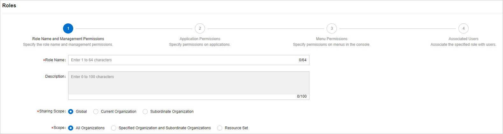

   The following table describes the role parameters.

   Role parameters

   | Parameter | Description |
   | --- | --- |
   | Role Name | The name of the RAM role. The name can be up to 15 characters in length and can contain only letters and digits. |
   | Descripti on | Optional. The description of the role. The description can be up to 100 characters in length and can contain letters, digits, commas (,), semicolons (;), and underscores (_). |
   | Sharing Scope | • Global<br>The role is visible and valid to all organizations involved. The default value is Global.<br>• Current Organization<br>The role is visible and valid to the organization to which the user belongs.<br>• Subordinate Organization<br>The role is visible and valid to the organization to which the user belongs and its subordinate organizations. |
   | Scope | • All Organizations<br>The permissions apply to all organizations involved.<br>• Specified Organization and Subordinate Organizations<br>The permissions apply to the organization to which the user belongs and its subordinate organizations.<br>• Resource Sets<br>The permissions apply to the resource sets that are assigned to the user. |

6. Select the operation permissions that this role has and click Next.

7. In the Application Permissions step, select the operation permissions that this role has on the cloud services, and click Next.

8. In the Menu Permissions step, select the operation permissions that this role has on the menus and the homepage template corresponding to the role, and click Create Role.

9. In the Associated Users step, select the users associated with the role from the drop-down list. The associated users are granted the permissions of the role.

<a id="section-8-3-2"></a>

### 8.3.2. View the details of a role

If you are uncertain about the specific permissions of a role, you can go to the Roles page to view the role permissions.

Procedure

1. Log on to the Apsara Uni-manager Management Console as an administrator.

2. In the top navigation bar, click Enterprise.

3. In the left-side navigation pane of the Enterprise page, click Roles.

4. Click the name of the role that you want to view. On the Roles page, view the information of the role.

<a id="section-8-3-3"></a>

### 8.3.3. Modify custom role information

You can modify the name and permissions of a custom role as an administrator.

Context

Information about preset roles cannot be modified.

Procedure

1. Log on to the Apsara Uni-manager Management Console as an administrator.

2. In the top navigation bar, click Enterprise.

3. In the left-side navigation pane of the Enterprise page, click Roles.

4. In the role name list, click More in the Actions column corresponding to the target custom role, and select Modify.

5. On the Roles page, modify the custom role name, permissions, and associated users or user groups.

   - Modify role name: Enter a new role name in the Role Name field.

   - Modify permissions: Click the Management Permissions, Application Permissions, or Menu Permissions tab, select or clear related permissions from the corresponding tab, and then click Update.

   - Bind a user to a role: Click the Associated Users tab and select a user from the Select one or more users drop-down list to add the user. To unbind the user from the role, click Remove in the Actions column.

   - Manage user groups: Click the User Groups tab, click Add User Group, select a user group from the drop-down list, and then click OK to bind the user group. To unbind the user group from the role, click Remove in the Actions column.

<a id="section-8-3-4"></a>

### 8.3.4. Copy a role

You can copy a preset role or a custom role to create a role that has the same permissions.

Context

Operations on the Roles page are the same as those for creating a custom role. You can add, modify, and remove the role permissions in the copied role. By default, if you do not modify the role permissions, the sharing scope, management permissions, application permissions, menu permissions, and associated users of the copied role are all the same as those of the source role.

Procedure

1. Log on to the Apsara Uni-manager Management Console as an administrator.

2. In the top navigation bar, click Enterprise.

3. In the left-side navigation pane of the Enterprise page, click Roles.

4. In the role list, choose More > Copy in the Actions column corresponding to a role.

5. On the Roles page, set the new role name, sharing scope, and management permissions.

   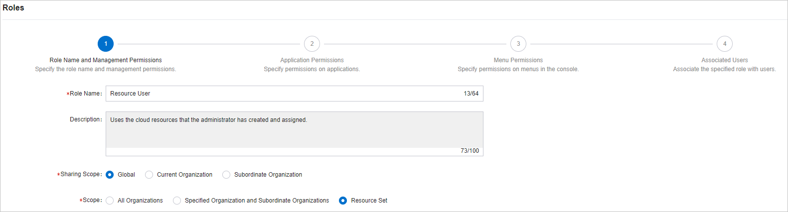

   Note

   The role name must be unique.

6. Select the operation permissions that this role has and click Next.

7. In the Application Permissions step, select the operation permissions that this role has on the cloud services and click Next.

8. In the Menu Permissions step, select the operation permissions that this role has on the menus and click Create Role.

9. In the Associated Users step, select the users that are associated with the role from the drop-down list. The associated users are granted the permissions of the role.

<a id="section-8-3-5"></a>

### 8.3.5. Disable a role

When you disable a role, the permissions of the role are disabled.

Procedure

1. Log on to the Apsara Uni-manager Management Console as an administrator.

2. In the top navigation bar, click Enterprise.

3. In the left-side navigation pane of the Enterprise page, click Roles.

4. In the role list, click More in the Actions column corresponding to a role and choose Disable from the shortcut menu.

<a id="section-8-3-6"></a>

### 8.3.6. Enable a role

When you enable a disabled role, the permissions of the role are restored.

Procedure

1. Log on to the Apsara Uni-manager Management Console as an administrator.

2. In the top navigation bar, click Enterprise.

3. In the left-side navigation pane of the Enterprise page, click Roles.

4. In the role list, click More in the Actions column corresponding to a disabled role and choose Enable from the shortcut menu.

<a id="section-8-3-7"></a>

### 8.3.7. Delete a custom role

You can delete a custom role that is no longer needed.

Prerequisites

- Default or preset roles cannot be deleted.

- To delete a role, you must unbind all user groups from the role.

Procedure

1. Log on to the Apsara Uni-manager Management Console as an administrator.

2. In the top navigation bar, click Enterprise.

3. In the left-side navigation pane of the Enterprise page, click Roles.

4. Choose More > Delete in the Actions column corresponding to a role.

5. In the Confirm message, click OK.

<a id="section-8-4"></a>

## 8.4. Users

<a id="section-8-4-1"></a>

### 8.4.1. System users

<a id="section-8-4-1-1"></a>

#### 8.4.1.1. Create a user

You can create a user and assign the user different roles as an administrator to meet different requirements for system access control.

Procedure

1. Log on to the Apsara Uni-manager Management Console as an administrator.

2. In the top navigation bar, click Enterprise.

3. Use one of the following methods to open the Create User window:

   - In the left-side navigation pane of the Enterprise page, click Organizations. In the Users section of the Organizations page, click Create User.

   - In the left-side navigation pane of the Enterprise page, click Users. On the System Users tab of the Users page, click Create.

4. In the Create User dialog box, configure the parameters.

   | Parameter | Description |
   | --- | --- |
   | Username | The Apsara Stack account name of the user. The name must be 1 to 64 characters in length and can contain letters, digits, hyphens (-), underscores (_), periods (.), and at signs (@). It must start with a letter or digit. |
   | Display Name | The display name of the user. The name must be 1 to 128 characters in length and can contain letters, digits, hyphens (-), underscores (_), periods (.), and at signs (@). |
   | Roles | The role to be assigned to the user.<br>Note You can enter role names in the field. Fuzzy match is supported. |
   | Organization | The organization to which the user belongs. |
   | Logon Policy | The logon policy that restricts the logon time and IP addresses of the user.The default policy is automatically bound to new users.<br>Note The default policy does not restrict the time period and IP addresses for users to log on. To restrict the allowed logon time and IP addresses of a user, you can modify the logon policy of the user or create a logon policy for the user. For more information, see Create a logon policy. |
   | Mobile Number | The mobile phone number of the user. This mobile number is used by the system to notify users of resource application and usage. Make sure that this mobile number is valid.<br>Note If the user mobile number changes, update it on the system in a timely manner. |
   | Landline Number | Optional. The landline number of the user. The landline number must be 4 to 20 characters in length and can contain only digits and hyphens (-). |
   | Email | The email address of the user. Emails about the usage and requests for resources are sent to this email address. Make sure that this email address is valid.<br>Note If the user email address changes, update it on the system in a timely manner. |
   | DingTalk Key | The key of the chatbot for the DingTalk group where the user is a member.For more information about how to configure the key, see DingTalk development documentation. |
   | Notify User by Email | After this option is selected, the Apsara Uni-manager Management Console informs the user configured as the alert contact by email whenever an alert is generated.<br>Note You must configure an email server to receive an email each time an alert is triggered. For more information, contact on-site O&amp;M engineers. |
   | Notify User by DingTalk | After this option is selected, the Apsara Uni-manager Management Console informs the user configured as the alert contact by DingTalk whenever an alert is generated. |

5. Click OK.

<a id="section-8-4-1-2"></a>

#### 8.4.1.2. Query a user

You can view user information such as name, organization, mobile number, email address, role, logon time, and initial password.

Procedure

1. Log on to the Apsara Uni-manager Management Console as an administrator.

2. In the top navigation bar, click Enterprise.

3. In the left-side navigation pane of the Enterprise page, click Users.

4. Click the System Users tab.

5. Set Username, Organization, or Role, and then click Search.

6. Click More in the Actions column corresponding to a user, and choose User Information from the shortcut menu to view basic information about the user.

<a id="section-8-4-1-3"></a>

#### 8.4.1.3. Modify user information

You can modify user information such as display name, mobile number, and email address to keep it up to date.

Procedure

1. Log on to the Apsara Uni-manager Management Console as an administrator.

2. In the top navigation bar, click Enterprise.

3. In the left-side navigation pane of the Enterprise page, click Users.

4. Click the System Users tab.

5. Find the user that you want to modify and choose More > Edit in the Actions column.

6. In the Modify User Information dialog box, enter the relevant information and click OK.

<a id="section-8-4-1-4"></a>

#### 8.4.1.4. Change user roles

You can add, change, and delete roles for a user.

Change user roles by using user management

1. Log on to the Apsara Uni-manager Management Console as an administrator.

2. In the top navigation bar, click Enterprise.

3. In the left-side navigation pane of the Enterprise page, click Users.

4. Click the System Users tab.

5. Find the user that you want to modify and choose More > Authorize in the Actions column.

6. In the Role field, add, delete, or change user roles.

   You can enter role names in the field. Fuzzy match is supported.

7. Click OK.

Change user roles by changing ownership

1. Log on to the Apsara Uni-manager Management Console as an administrator.

2. In the top navigation bar, click Enterprise.

3. In the left-side navigation pane of the Enterprise page, click Change Ownership.

4. Click the  icon to the left of an organization and click Users.

5. In the Users section on the right, set Logon Policy and Role or Username, and click Search to query the user that you want to modify

6. Find the user and click Change in the Actions column.

7. In the Organization to Change dialog box, select the destination or original organization and select the role to be added or removed from the Assigned Roles drop-down list.

   Note

   - If you change only roles without changing the organization, select the original organization.

   - Blue role names are the roles that are selected, and black role names are the roles that are not selected.

8. Click OK.

<a id="section-8-4-1-5"></a>

#### 8.4.1.5. Modify the information of a user group

On the Users page, you can view the user group information and modify the ownership of users in user groups.

Procedure

1. Log on to the Apsara Uni-manager Management Console as an administrator.

2. In the top navigation bar, click Enterprise.

3. In the left-side navigation pane, click Users.

4. Click the System Users tab, select the user that you want to modify, and then click More in the Actions column.

   - Select Add to User Group. In the dialog box that appears, select a user group and click OK to add the user to the user group.

   - Select Remove from User Group. In the dialog box that appears, select a user group and click OK to remove the user from the user group.

<a id="section-8-4-1-6"></a>

#### 8.4.1.6. Modify a user logon policy

An administrator can modify a user logon policy to restrict the permitted logon time and IP addresses of the user.

Prerequisites

A new logon policy is created. For more information about how to create a logon policy, see Create a logon policy.

Modify the logon policy of a single user

1. Log on to the Apsara Uni-manager Management Console as an administrator.

2. In the top navigation bar, click Enterprise.

3. In the left-side navigation pane of the Enterprise page, click Users.

4. Click the System Users tab.

5. Find the user that you want to modify and choose More > Logon Policy in the Actions column.

6. In the Assign Logon Policy dialog box, select a logon policy and click OK.

Modify multiple user logon policies at a time

1. Log on to the Apsara Uni-manager Management Console as an administrator.

2. In the top navigation bar, click Enterprise.

3. In the left-side navigation pane of the Enterprise page, click Users.

4. Click the System Users tab.

5. Select users that you want to modify.

6. In the upper-right corner of the page, click Change Logon Policy.

7. In the Batch Assign Logon Policy dialog box, select a logon policy and click OK.

<a id="section-8-4-1-7"></a>

#### 8.4.1.7. View the initial password of a user

After a user is created, the system generates an initial password for the user.

Context

Organization administrators can view the initial passwords of all users in the organizations they manage.

Procedure

1. Log on to the Apsara Uni-manager Management Console as an administrator.

2. In the top navigation bar, click Enterprise.

3. Use one of the following methods to view the initial password of a user on the Enterprise page:

   - In the left-side navigation pane, click Users. On the System Users tab of the Users page, select a username.

     - Click View Initial Password in the upper-right corner of the Users page to view the initial password.

     - Choose More > User Information in the Actions column corresponding to the user. On the user information page, click View Password to view the initial password.

   - In the left-side navigation pane, click Organizations. In the organization navigation tree on the Organizations page, click an organization name. In the Users section, click a username. On the user information page, click View Password to view the initial password.

<a id="section-8-4-1-8"></a>

#### 8.4.1.8. Reset the password of a user

If users forget their logon passwords, the system administrator can reset the logon passwords for them.

Prerequisites

Only organization administrators can reset the password of a user.

Procedure

1. Log on to the Apsara Uni-manager Management Console as an administrator.

2. In the top navigation bar, click Enterprise.

3. Use one of the following methods to go to the User Information page:

   - In the left-side navigation pane of the Enterprise page, click Users. On the System Users tab of the Users page, click a username.

   - In the left-side navigation pane of the Enterprise page, click Organizations. On the Organizations page, click a username in the Users section.

4. Click Reset Password.

   After the password is reset, a message is displayed, which indicates that the password has been reset. If you want to view the initial password after password reset, click View Password.

<a id="section-8-4-1-9"></a>

#### 8.4.1.9. Disable or enable a user account

You can disable a user account to prevent the user account from logging on to the Apsara Uni-manager Management Console. User accounts that are disabled must be re-enabled before they can be used to log on to the Apsara Uni-manager Management Console again.

Context

By default, user accounts are enabled when they are created.

Procedure

1. Log on to the Apsara Uni-manager Management Console as an administrator.

2. In the top navigation bar, click Enterprise.

3. In the left-side navigation pane of the Enterprise page, click Users.

4. Click the System Users tab.

5. Perform the following operations on the current tab:

   - Select a user account whose Status is Enabled, choose More > Disable in the Actions column to disable the user account.

   - Select a user whose Status is Disabled, choose More > Enable in the Actions column to enable the user account.

<a id="section-8-4-1-10"></a>

#### 8.4.1.10. Delete a user

You can delete a specific user as an administrator.

Procedure

1. Log on to the Apsara Uni-manager Management Console as an administrator.

2. In the top navigation bar, click Enterprise.

3. On the Enterprise page, use one of the following methods to delete a user:

   - In the left-side navigation pane of the Enterprise page, click Users. On the page that appears, click the System Users tab. Click More in the Actions column corresponding to the target user, and select Delete.

   - In the left-side navigation pane of the Enterprise page, click Organizations. On the page that appears, find the Users section. Find the target user, click More in the Actions column, and then select Delete.

4. Click OK.

<a id="section-8-4-2"></a>

### 8.4.2. Historical users

<a id="section-8-4-2-1"></a>

#### 8.4.2.1. Query historical users

You can check whether a user has been deleted and restore a user that has been deleted.

Procedure

1. Log on to the Apsara Uni-manager Management Console as an administrator.

2. In the top navigation bar, click Enterprise.

3. In the left-side navigation pane of the Enterprise page, click Users.

4. Click the Historical Users tab.

5. Enter the username that you want to query in the Username search box.

   Note

   You can search for usernames by fuzzy match.

6. Click Search.

<a id="section-8-4-2-2"></a>

#### 8.4.2.2. Restore historical users

An administrator can restore a deleted user account from the Historical Users tab.

Context

The basic information such as logon password of a restored user is the same as it was before the user was deleted, except for the organization and role.

Procedure

1. Log on to the Apsara Uni-manager Management Console as an administrator.

2. In the top navigation bar, click Enterprise.

3. In the left-side navigation pane of the Enterprise page, click Users.

4. Click the Historical Users tab.

5. Find the user that you want to restore and click Restore in the Actions column.

6. In the Restore User dialog box, select an organization and a role.

7. Click OK.

<a id="section-8-5"></a>

## 8.5. Logon policies

<a id="section-8-5-1"></a>

### 8.5.1. Create a logon policy

To improve the security of the Apsara Uni-manager Management Console, you can create a logon policy as an administrator to control logon access based on the logon time and user IP address.

Context

Logon policies are used to control the time period and IP addresses for users to log on. After a user is bound to a logon policy, user logons are restricted based on the logon time and IP addresses specified in the policy.

A default policy without limits on logon time and IP addresses is automatically generated in the Apsara Uni-manager Management Console. The default policy cannot be deleted.

Procedure

1. Log on to the Apsara Uni-manager Management Console as an administrator.

2. In the top navigation bar, click Enterprise.

3. In the left-side navigation pane of the Enterprise page, click Logon Policies.

4. In the upper-right corner of the page, click Create.

5. In the Create Logon Policy dialog box, set Name, Sharing Scope, Policy Properties, Time Period, and IP Address.

   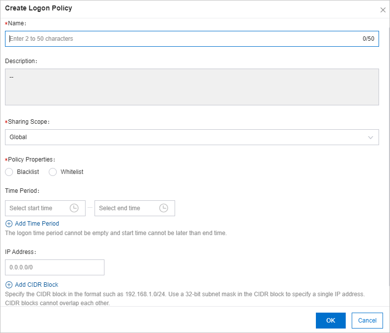

   Parameters for creating a logon policy

   | Parameter | Description |
   | --- | --- |
   | Name | The name of the logon policy. The name must be 2 to 50 characters in length and can contain only letters and digits. The name must be unique in the system. |
   | Description | The description of the logon policy. |
   | Sharing Scope | The scope in which the role is visible.<br>• Global: The role is globally visible. The default value is Global.<br>• Current Organization: The role is visible only in the current organization and is invisible in subordinate organizations.<br>• Subordinate Organization: The role is visible in the current organization and all its subordinate organizations. |
   | Policy Properties | The authentication method of the logon policy.<br>• Whitelist: Logon is allowed if the parameter settings are met.<br>• Blacklist: Logon is denied if the parameter settings are met. |
   | Time Period | The permitted logon time period. When this policy is configured, users can log on to the Apsara Uni-manager Management Console only during the configured period. Specify the time in minutes in a 24-hour clock. Example: <code> 1</code> <code>6:32 </code>.<br>Note When the Policy Properties parameter is set to Whitelist, you can select No Time Limit. |
   | IP Address | The permitted CIDR block.<br>• If the Policy Properties parameter is set to Whitelist, IP addresses within this CIDR block are allowed to log on to the Apsara Uni-manager Management Console.<br>• If the Policy Properties parameter is set to Blacklist, IP addresses within this CIDR block are not allowed to log on to the Apsara Uni-manager Management Console.<br>Note When the Policy Properties parameter is set to Whitelist, you can select No CIDR Block Limit. |

<a id="section-8-5-2"></a>

### 8.5.2. Query a logon policy

You can query the detailed information of a logon policy in the Apsara Uni-manager Management Console.

Context

When the Apsara Uni-manager Management Console provides services, it automatically generates a default policy without limits on the logon time and IP addresses.

Procedure

1. Log on to the Apsara Uni-manager Management Console as an administrator.

2. In the top navigation bar, click Enterprise.

3. In the left-side navigation pane of the Enterprise page, click Logon Policies.

4. Enter the name of the policy that you want to view and click Search.

5. View the logon policy, including the permitted logon time and IP addresses.

<a id="section-8-5-3"></a>

### 8.5.3. Modify a logon policy

You can modify the policy name, policy properties, permitted logon time period, and IP addresses of a logon policy.

Procedure

1. Log on to the Apsara Uni-manager Management Console as an administrator.

2. In the top navigation bar, click Enterprise.

3. In the left-side navigation pane of the Enterprise page, click Logon Policies.

4. Find the logon policy that you want to modify and choose More > Modify in the Actions column.

5. In the Modify Logon Policy dialog box, modify the logon policy information.

6. Click OK.

<a id="section-8-5-4"></a>

### 8.5.4. Disable a logon policy

You can disable logon policies that are no longer needed.

Procedure

1. Log on to the Apsara Uni-manager Management Console.

2. In the top navigation bar, click Enterprise.

3. In the left-side navigation pane of the Enterprise page, click Logon Policies.

4. Find the logon policy that you want to disable and choose More > Disable in the Actions column.

<a id="section-8-5-5"></a>

### 8.5.5. Enable a logon policy

You can re-enable disabled logon policies.

Procedure

1. Log on to the Apsara Uni-manager Management Console.

2. In the top navigation bar, click Enterprise.

3. In the left-side navigation pane of the Enterprise page, click Logon Policies.

4. Click More in the Actions column corresponding to a policy, and choose Enable from the shortcut menu.

<a id="section-8-5-6"></a>

### 8.5.6. Delete a logon policy

You can delete logon policies that are no longer needed.

Prerequisites

The logon policy to be deleted is not bound to any users. If a logon policy is bound to a user, the logon policy cannot be deleted.

Context

Note

The default policy cannot be deleted.

Procedure

1. Log on to the Apsara Uni-manager Management Console as an administrator.

2. In the top navigation bar, click Enterprise.

3. In the left-side navigation pane of the Enterprise page, click Logon Policies.

4. Click More in the Actions column corresponding to a policy, and choose Delete from the shortcut menu.

5. In the message that appears, click OK.

<a id="section-8-6"></a>

## 8.6. User groups

<a id="section-8-6-1"></a>

### 8.6.1. Create a user group

You can create a user group in a selected organization and grant batch authorizations to users in the group.

Prerequisites

Before creating a user group, you must create an organization. For more information, see Create an organization.

Context

Relationship between user groups and users:

- A user group can contain zero or more users.

- You can add users to user groups as needed.

- You can add a user to multiple user groups.

Relationship between user groups and organizations:

- A user group can only belong to a single organization.

- You can create multiple user groups in an organization.

Relationship between user groups and roles:

- A user group can only be bound to a single role.

- A role can be associated with multiple user groups.

- When a role is associated with a user group, the role permissions are automatically granted to users in the user group.

Relationship between user groups and resource sets:

- You can add zero or more user groups to a resource set.

- A user group can be added to multiple resource sets.

Procedure

1. Log on to the Apsara Uni-manager Management Console as an administrator.

2. In the top navigation bar, click Enterprise.

3. In the left-side navigation pane of the Enterprise page, click User Groups.

4. In the upper-right corner of the page, click Create User Group.

5. In the dialog box that appears, set User Group Name and Organization.

   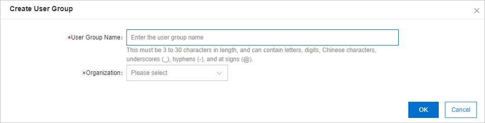

6. Click OK.

<a id="section-8-6-2"></a>

### 8.6.2. Add users to a user group

You can add users to a user group.

Procedure

1. Log on to the Apsara Uni-manager Management Console as an administrator.

2. In the top navigation bar, click Enterprise.

3. In the left-side navigation pane of the Enterprise page, click User Groups.

4. Click Add User in the Actions column corresponding to a user group.

5. Select the names of users to be added from the left list, and click the right arrow to move them to the right list.

   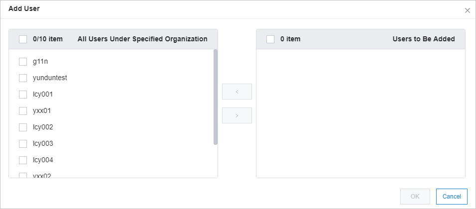

6. Click OK.

<a id="section-8-6-3"></a>

### 8.6.3. Delete users from a user group

You can delete users from a user group.

Procedure

1. Log on to the Apsara Uni-manager Management Console as an administrator.

2. In the top navigation bar, click Enterprise.

3. In the left-side navigation pane of the Enterprise page, click User Groups.

4. Click Delete User in the Actions column corresponding to a user group.

5. Select the names of users to be deleted from the Users Under Specified User Group list, and click the right arrow to move them to the Users to Be Deleted list.

   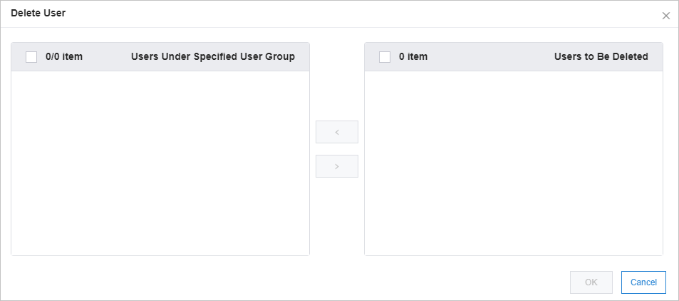

6. Click OK.

<a id="section-8-6-4"></a>

### 8.6.4. Add a role

You can add a role to a user group and assign the role to all users in the group.

Context

Note

You can add only one role to a user group.

Procedure

1. Log on to the Apsara Uni-manager Management Console as an administrator.

2. In the top navigation bar, click Enterprise.

3. In the left-side navigation pane of the Enterprise page, click User Groups.

4. Click Add Role in the Actions column corresponding to a user group.

5. In the dialog box that appears, select a role.

6. Click OK.

<a id="section-8-6-5"></a>

### 8.6.5. Delete a role

You can delete existing roles.

Procedure

1. Log on to the Apsara Uni-manager Management Console as an administrator.

2. In the top navigation bar, click Enterprise.

3. In the left-side navigation pane of the Enterprise page, click User Groups.

4. Find the user group from which you want to delete a role and click Delete Role in the Actions column.

5. In the Confirm message, click OK.

<a id="section-8-6-6"></a>

### 8.6.6. Modify the name of a user group

You can modify the names of user groups.

Procedure

1. Log on to the Apsara Uni-manager Management Console as an administrator.

2. In the top navigation bar, click Enterprise.

3. In the left-side navigation pane of the Enterprise page, click User Groups.

4. Click Edit User Group in the Actions column corresponding to a user group.

5. In the dialog box that appears, enter the new name.

6. Click OK.

<a id="section-8-6-7"></a>

### 8.6.7. Delete a user group

You can delete user groups that are no longer needed.

Prerequisites

The user group to be deleted is unbound from all roles. If a user group is bound to a role, the user group cannot be deleted.

Procedure

1. Log on to the Apsara Uni-manager Management Console as an administrator.

2. In the top navigation bar, click Enterprise.

3. In the left-side navigation pane of the Enterprise page, click User Groups.

4. Find the user group that you want to delete and click Delete User Group in the Actions column.

5. In the Confirm message, click OK.

<a id="section-8-7"></a>

## 8.7. Resource pools

<a id="section-8-7-1"></a>

### 8.7.1. Update associations

You can deploy the Apsara Uni-manager Management Console in multiple regions. You can update the associations between organizations and regions.

Procedure

1. Log on to the Apsara Uni-manager Management Console as an administrator.

2. In the top navigation bar, click Enterprise.

3. In the left-side navigation pane of the Enterprise page, click Resource Pools.

4. In the left-side organization navigation tree, click the name of the organization that you want to update.

5. In the corresponding region list, select the names of regions to be associated.

6. Click Update Association.

<a id="section-8-8"></a>

## 8.8. Change the ownership of an instance

You can change the ownership of an instance from one resource set to another.

Change the ownership of an instance

1. Log on to the Apsara Uni-manager Management Console as an administrator.

2. In the top navigation bar, click Enterprise.

3. In the left-side navigation pane of the Enterprise page, click Change Ownership.

4. Click the  icon to the left of an organization and click a resource set.

5. In the resource list on the right side of the page, set a service type and a resource type, enter an instance ID, and then click Search to query the instance.

6. Click Change Ownership in the Actions column corresponding to the instance to change the ownership of the instance to another resource set.

7. Click Change Sharing Scope in the Actions column corresponding to the instance to change the sharing scope of the instance.

   - Current Organization and Subordinate Organizations: The instance can be shared by the organization that contains the resource set to which the instance belongs and by subordinate organizations.

   - Current Resource Set: The instance can be shared by the resource set to which the instance belongs.

   - Current Organization: The instance can be shared by the organization that contains the resource set to which the instance belongs.

8. In the Change Resource Set dialog box, select a resource set and click OK.

<a id="section-8-9"></a>

## 8.9. Cloud instances

<a id="section-8-9-1"></a>

### 8.9.1. Manage Apsara Stack cloud instances

<a id="section-8-9-1-1"></a>

#### 8.9.1.1. Export data of the current cloud

You can export the data of secondary Apsara Stack nodes to a configuration file. This can be used by the primary node to manage nodes in a centralized manner.

Procedure:

1. Log on to the Apsara Uni-manager Management Console.

2. In the top navigation bar, click Enterprise.

3. In the left-side navigation pane of the Enterprise page, click Cloud Instances.

4. Click the Apsara Stack Management tab.

5. Click Collect Data of Current Cloud to collect the deployment information of the current cloud.

6. Click Export to export the information in the JSON format.

<a id="section-8-9-1-2"></a>

#### 8.9.1.2. Add a secondary Apsara Stack node

You can add the configuration information of secondary Apsara Stack nodes to the multi-cloud configuration of the primary Apsara Stack node for centralized management.

Procedure:

1. Log on to the Apsara Uni-manager Management Console.

2. In the top navigation bar, click Enterprise.

3. In the left-side navigation pane of the Enterprise page, click Cloud Instances.

4. Click the Apsara Stack Management tab.

5. Click Import.

6. In the Create Apsara Stack Secondary Node dialog box, enter the configuration information of a secondary node and click OK.

   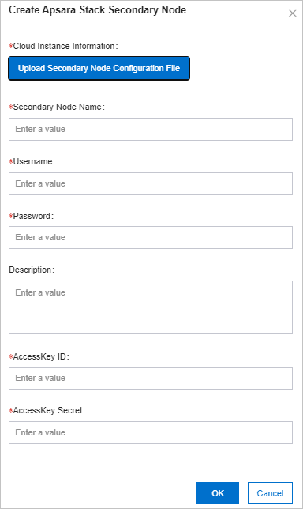

   | Parameter | Description |
   | --- | --- |
   | Cloud Instance Information | The configuration file of the secondary node. For more information, see Export data of the current cloud. |
   | Secondary Node Name | The name of the secondary node. |
   | Username | The username of the operations administrator that manages the secondary node. |
   | Password | The password of the operations administrator that manages the secondary node. |
   | Description | The description of the secondary node. |
   | AccessKey ID | The AccessKey ID of the operations administrator that manages the secondary node. For more information, see View the AccessKey pair of your Apsara Stack tenant account. |
   | AccessKey Secret | The AccessKey secret of the operations administrator that manages the secondary node.For more information, see View the AccessKey pair of your Apsara Stack tenant account. |

   Notice

   You must create an operations administrator account in the secondary node. This account is for dedicated use by the primary node and cannot be the default operations administrator account.

<a id="section-8-9-1-3"></a>

#### 8.9.1.3. View managed cloud instances

You can use the multi-cloud management feature to view the details of all managed cloud instances.

Procedure

1. Log on to the Apsara Uni-manager Management Console.

2. In the top navigation bar, click Enterprise.

3. In the left-side navigation pane of the Enterprise page, click Cloud Instances.

4. Click the Apsara Stack Management tab.

   You can view the name, description, cloud type, cloud role, and address of all managed cloud instances.

5. Enter a cloud instance name in the search box and click Search to search for the cloud instance.

6. Click View Details in the Actions column corresponding to the cloud instance.

   In the Manage Cloud Instance message, you can view the version, Apsara Stack API (ASAPI) address, and region of the cloud.

<a id="section-8-9-1-4"></a>

#### 8.9.1.4. Modify a cloud instance

If you want to change the information of a cloud instance for more efficient management, you can modify it in the Apsara Uni-manager Management Console.

Procedure

1. Log on to the Apsara Uni-manager Management Console.

2. In the top navigation bar, click Enterprise. In the left-side navigation pane of the Enterprise page, click Cloud Instances.

3. Click the Apsara Stack Management tab.

4. Enter the name of a cloud instance that you want to modify in the search box and click Search to search for the cloud instance.

5. Click Edit in the Actions column corresponding to the cloud instance.

6. In the Edit Cloud Instance dialog box, set Cloud Name, Username, Password, Description, AccessKey ID, AccessKey Secret, Longitude, and Latitude, and click OK.

<a id="section-8-9-1-5"></a>

#### 8.9.1.5. Manage cloud instances

You can manage Apsara Stack cloud instances to check whether they can be connected.

Procedure

1. Log on to the Apsara Uni-manager Management Console.

2. In the top navigation bar, click Enterprise.

3. In the left-side navigation pane of the Enterprise page, click Cloud Instances.

4. Click the Apsara Stack Management tab.

5. Enter a cloud instance name in the search box and click Search to search for the cloud instance.

6. Click Manage in the Actions column corresponding to the cloud instance.

7. In the Manage Cloud Instance dialog box, click Test Connectivity.

<a id="section-8-9-2"></a>

### 8.9.2. Manage VMware nodes

<a id="section-8-9-2-1"></a>

#### 8.9.2.1. Add a VMware node

You can add the configuration information of VMware nodes to the Apsara Stack VMware management configuration for centralized management.

Prerequisites

- The configuration file of a VMware node is obtained from the deployment personnel.

- The VMware node is configured.

Procedure:

1. Log on to the Apsara Uni-manager Management Console.

2. In the top navigation bar, click Enterprise.

3. In the left-side navigation pane of the Enterprise page, click Cloud Instances.

4. Click the VMware Management tab.

5. Click Create VMware Node.

6. In the Create VMware Node dialog box, enter the configuration information of a VMware node and click OK.

   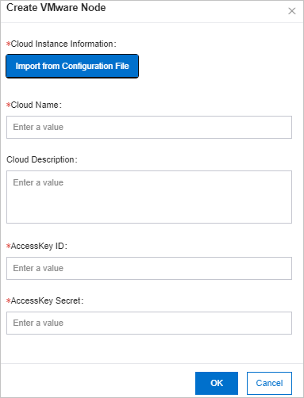

   | Parameter | Description |
   | --- | --- |
   | Cloud Instance Information | The configuration file of the VMware node. |
   | Cloud Name | The name of the VMware node. |
   | Cloud Description | The description of the VMware node. |
   | AccessKey ID | The AccessKey ID in the configuration file of the VMware node. |
   | AccessKey Secret | The AccessKey secret in the configuration file of the VMware node. |

<a id="section-8-9-2-2"></a>

#### 8.9.2.2. Modify a VMware node

If you want to change the information of a VMware node for more efficient management, you can modify it in the Apsara Uni-manager Management Console.

Procedure

1. Log on to the Apsara Uni-manager Management Console.

2. In the top navigation bar, click Enterprise.

3. In the left-side navigation pane of the Enterprise page, click Cloud Instances.

4. Click the VMware Management tab.

5. Enter the name of the VMware node that you want to modify in the search box and click Search to search for the VMware node.

6. Click Edit in the Actions column corresponding to the VMware node.

7. In the Edit Cloud Instance dialog box, set Cloud Name, Cloud Description, AccessKey ID, and AccessKey Secret, and click OK.

<a id="section-8-9-2-3"></a>

#### 8.9.2.3. Test VMware node connectivity

You can manage VMware nodes to check whether they can be connected.

Procedure

1. Log on to the Apsara Uni-manager Management Console.

2. In the top navigation bar, click Enterprise.

3. In the left-side navigation pane of the Enterprise page, click Cloud Instances.

4. Click the VMware Management tab.

5. Enter a VMware node name in the search box and click Search to search for the VMware node.

6. Click Manage in the Actions column corresponding to the VMware node.

7. In the Manage Cloud Instance dialog box, click Test Connectivity.

<a id="section-8-10"></a>

## 8.10. Data permissions

<a id="section-8-10-1"></a>

### 8.10.1. Overview

Data permission management allows you to specify which users can access instances of a specific service, grant data access permissions to the users, and view and modify the data permissions in all the RAM policies attached to specified users.

Apsara Stack controls users and permissions by managing their visibility and operability in the Apsara Uni-manager Management Console. Many Apsara Stack cloud services are directly used by calling their API operations or SDKs instead of in the console. In this case, data access permissions must be controlled by RAM permission verification provided by the cloud services.

RAM policies are configured for such cloud service instances for access control. Automatic judgment is used when personnel are added to or removed from resource sets. However, this judgement method can affect performance and has a high error rate in complex scenarios. To solve this problem, the authorization of cloud services that require data access permissions is separately managed. Organization administrators can configure the data permissions granted to related personnel on the data authorization page.

<a id="section-8-10-2"></a>

### 8.10.2. Set the data permissions of resource instances

Organization administrators can set the data permissions of resource instances to allow or prohibit access to and operations on cloud services in the Apsara Uni-manager Management Console.

Prerequisites

The cloud services that support data authorization include Message Queue (MQ), Object Storage Service (OSS), Log Service, DataHub, and Container Service.

Procedure

1. Log on to the Apsara Uni-manager Management Console.

2. In the top navigation bar, click Enterprise.

3. In the left-side navigation pane of the Enterprise page, click Data Permissions.

4. Click a resource set and click a product type on the right side of the page.

5. Click Authorize in the Actions column corresponding to the instance that you want to manage.

6. In the Data Authorization dialog box, select a user on the left side.

7. Turn on or off the data permission switches in the Actions column on the right side.

   You can also turn on or off the Select All switch to manage permissions in batches.

   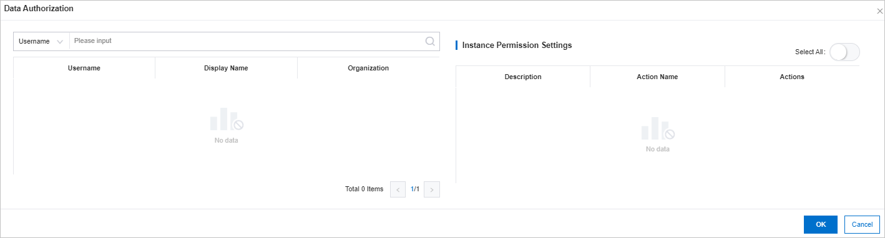

8. Click OK.

<a id="section-8-10-3"></a>

### 8.10.3. Edit user permissions

You can use JSON statements to edit user permissions.

Procedure

1. Log on to the Apsara Uni-manager Management Console.

2. In the top navigation bar, click Enterprise.

3. In the left-side navigation pane of the Enterprise page, click Data Permissions.

4. In the organization navigation tree, click the  icon to the left of the organization that contains

   the user you want to manage.

5. Click Users.

6. Enter the username in the search box and click Search.

7. Click Edit Permissions in the Actions column corresponding to the user.

8. In the Edit Permissions dialog box, select a data permission on the left side and click OK.

   If no permissions are available, specify a policy in the text editor. For more information about the syntax and structure of a policy, see Permission policy structure and syntax.

<a id="section-8-10-4"></a>

### 8.10.4. View the permissions of a user

You can view the existing policies of a user.

Procedure

1. Log on to the Apsara Uni-manager Management Console.

2. In the top navigation bar, click Enterprise.

3. In the left-side navigation pane of the Enterprise page, click Data Permissions.

4. In the organization navigation tree, find the organization that contains the user you want to

   manage and click the  icon.

5. Click Users.

6. Enter the username in the search box and click Search.

7. Click View Permissions in the Actions column corresponding to the user.

<a id="section-9"></a>

# 9.Configurations

<a id="section-9-1"></a>

## 9.1. Security policies

<a id="section-9-1-1"></a>

### 9.1.1. Configure password policies

You can configure password policies for user logons.

Procedure

1. Log on to the Apsara Uni-manager Management Console as a platform administrator.

2. In the top navigation bar, click Configurations.

3. In the left-side navigation pane of the Configurations page, click Security Policies.

4. Click the Password Policy tab.

5. On the Password Policy tab, set the password policy parameters.

   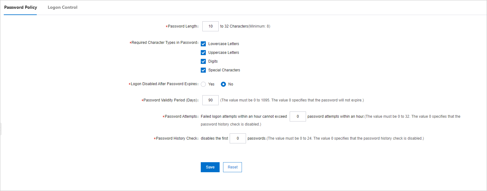

   To restore to the default password policy, click Reset.

<a id="section-9-1-2"></a>

### 9.1.2. Configure logon control

You can limit the access from multiple clients of users.

1. Log on to the Apsara Uni-manager Management Console as a platform administrator.

2. In the top navigation bar, click Configurations.

3. In the left-side navigation pane, click Security Policies.

4. Click the Logon Control tab.

5. Perform the following operations:

   - Select Single Session. A single session means that a user is allowed to log on only by using a single client at the same time.

   - Select Multi-session. A multi-session means that a user is allowed to log on by using multiple clients at the same time.

<a id="section-9-2"></a>

## 9.2. Menus

<a id="section-9-2-1"></a>

### 9.2.1. Create a menu

You can create a menu and add its URL to the Apsara Uni-manager Management Console for quick access.

Procedure

1. Log on to the Apsara Uni-manager Management Console as a platform administrator.

2. In the top navigation bar, click Configurations.

3. In the left-side navigation pane of the Configurations page, click Menu Settings.

4. On the Main Menu page, click Create in the upper-right corner.

5. In the Create dialog box, configure the menu parameters.

   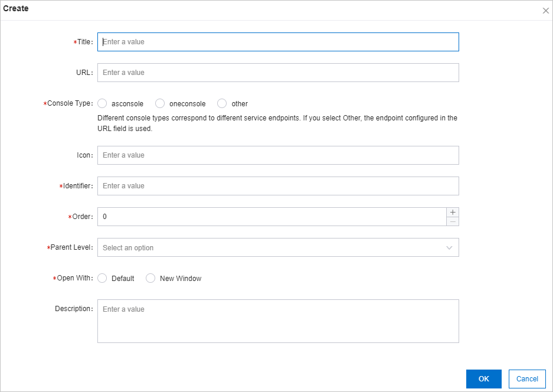

   Menu parameters

   | Parameter | Description |
   | --- | --- |
   | Title | The display name of the menu. |
   | URL | The URL of the menu. |
   | Console Type | Different console types correspond to different domain names.<br>• oneconsole: You need only to enter the path in the URL field. The domain name is automatically matched.<br>• asconsole: You need only to enter the path in the URL field. The domain name is automatically matched.<br>• other: You must enter the domain name in the URL field. |
   | Icon | The icon displayed in the left-side navigation pane. The icon cannot be changed. |
   | Identifier | The unique identifier of the menu in the system. This identifier can be used to indicate whether the menu is selected in the navigation bar. The identifier cannot be changed. |
   | Order | The display order among the same-level menus. The larger the value, the lower the display order. Leave the Order field empty. |
   | Parent Level | The displayed tree structure. |
   | Open With | Specifies whether to open the menu in the current window or in a new window. |
   | Description | The description of the menu. |

<a id="section-9-2-2"></a>

### 9.2.2. Modify a menu

You can modify an existing menu, including the menu name, URL, icon, and menu order.

Prerequisites

Default menus cannot be modified.

Procedure

1. Log on to the Apsara Uni-manager Management Console as a platform administrator.

2. In the top navigation bar, click Configurations.

3. In the left-side navigation pane of the Configurations page, click Menu Settings.

4. Click Edit in the Actions column corresponding to a menu.

5. In the Edit dialog box, modify the relevant information of the menu.

   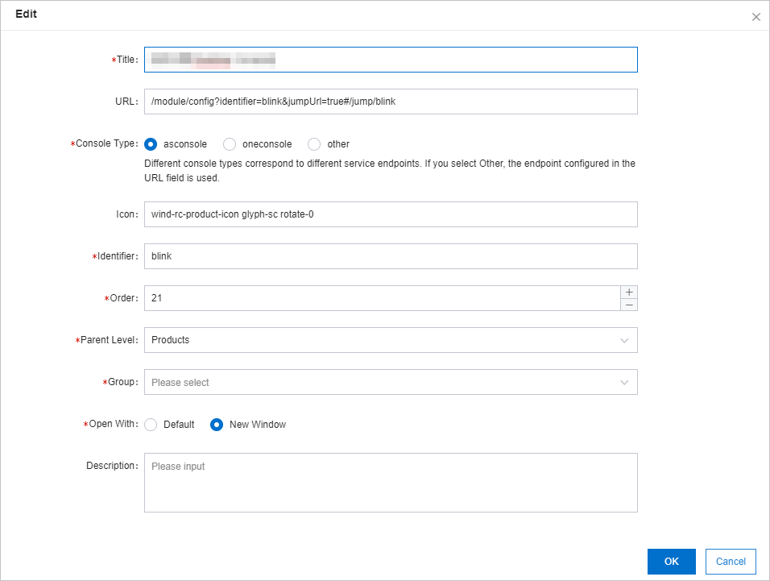

6. Click OK.

<a id="section-9-2-3"></a>

### 9.2.3. Delete a menu

You can delete menus that are no longer needed.

Prerequisites

Default menus cannot be deleted.

Procedure

1. Log on to the Apsara Uni-manager Management Console as a platform administrator.

2. In the top navigation bar, click Configurations.

3. In the left-side navigation pane of the Configurations page, click Menu Settings.

4. Find the menu that you want to delete and click Delete in the Actions column.

5. In the message that appears, click OK.

<a id="section-9-2-4"></a>

### 9.2.4. Show or hide menus

You can perform the following operations to show or hide menus:

Procedure

1. Log on to the Apsara Uni-manager Management Console as a platform administrator.

2. In the top navigation bar, click Configurations.

3. In the left-side navigation pane of the Configurations page, click Menu Settings.

4. Select or clear the check box in the Displayed column corresponding to a menu.

<a id="section-9-3"></a>

## 9.3. Specifications

<a id="section-9-3-1"></a>

### 9.3.1. Specification parameters

This topic describes the specification parameters of each resource type.

NAT Gateway

| Parameter | Description |
| --- | --- |
| Specifications | The specifications that can be configured for NAT Gateway. |
| Specifications Description | The description of the specifications that can be configured for NAT Gateway. |

AnalyticDB for PostgreSQL

| Parameter | Description |
| --- | --- |
| Specifications | The specifications that can be configured for AnalyticDB for PostgreSQL. |
| Specifications Name | The name of the instance type that can be configured for AnalyticDB for PostgreSQL. |
| CPU | The total number of CPU cores that can be configured for AnalyticDB for PostgreSQL. |
| Memory | The memory size that can be configured for AnalyticDB for PostgreSQL. |
| Storage Space | The total storage size that can be configured for AnalyticDB for PostgreSQL. |
| Version | The version number of AnalyticDB for PostgreSQL. |
| Node | The number of nodes that can be configured for AnalyticDB for PostgreSQL. |

SLB

| Parameter | Description |
| --- | --- |
| Specifications | The instance type that can be configured for Server Load Balancer (SLB). |
| Specifications Name | The name of the instance type that can be configured for SLB. |
| Maximum Connections | The maximum number of connections that can be configured for SLB. |
| New Connections | The number of new connections that can be configured for SLB. |
| QPS | The queries per second (QPS) that can be configured for SLB. |
| Description | The description of the specifications that can be configured for SLB. |

ApsaraDB RDS

| Parameter | Description |
| --- | --- |
| Engine Type | The engine type that can be configured for ApsaraDB RDS. |
| Minimum Storage (GB) | The minimum amount of storage space that can be configured for ApsaraDB RDS. |
| Maximum Storage (GB) | The maximum amount of storage space that can be configured for ApsaraDB RDS. |
| Specifications Name | The name of the instance type that can be configured for ApsaraDB RDS. |
| Version | The version number of ApsaraDB RDS. |
| CPUs | The number of CPU cores that can be configured for ApsaraDB RDS. |
| Maximum Connections | The maximum number of connections that can be configured for ApsaraDB RDS. |
| Memory (GB) | The memory size that can be configured for ApsaraDB RDS. |
| Share Type | The share type that can be configured for ApsaraDB RDS. |

PolarDB-X

| Parameter | Description |
| --- | --- |
| Instance Type | The instance type that can be configured for PolarDB-X. |
| Instance Type Name | The name of the instance type that can be configured for PolarDB-X. |
| Specifications | The specifications that can be configured for PolarDB-X. |
| Specifications Name | The name of the specifications that can be configured for PolarDB-X. |

ECS

| Parameter | Description |
| --- | --- |
| Instance Family | The instance family that is divided into different instance types based on the scenarios for which they are suitable. |
| Specifications Level | The level of the instance type that can be configured for Elastic Compute Service (ECS). |
| vCPUs | The maximum number of vCPUs that can be configured for ECS. |
| Memory (GB) | The memory size that can be configured for ECS. |
| Instance Specifications | The instance type that can be configured for ECS. |
| GPU Type | The GPU type that can be configured for ECS. |
| GPUs | The number of GPUs that can be configured for ECS. |
| Supported ENIs | The number of elastic network interface (ENIs) that can be configured for ECS. |
| Number Of Private IP Addresses | The number of private IP addresses that can be configured for ECS. |

KVStore for Redis

| Parameter | Description |
| --- | --- |
| Specifications Name | The name of the specifications that can be configured for KVStore for Redis. |
| Instance Specifications | The instance type that can be configured for KVStore for Redis. |
| Maximum Connections | The maximum number of connections that can be configured for KVStore for Redis. |
| Maximum Bandwidth | The maximum bandwidth that can be configured for KVStore for Redis. |
| CPUs | The number of CPU cores that can be configured for KVStore for Redis. |
| Version | The version number of KVStore for Redis. |
| Architecture | The architecture of KVStore for Redis. |
| Node Type | The node type of KVStore for Redis. |
| Service Plan | The service plan that can be configured for KVStore for Redis. |

ApsaraDB for MongoDB

| Parameter | Description |
| --- | --- |
| Specifications | The instance type that can be configured for ApsaraDB for MongoDB. |
| Instance Specifications | The name of the specifications that can be configured for ApsaraDB for MongoDB. |
| Engine Type | The engine type that can be configured for ApsaraDB for MongoDB. |
| Version | The version number of ApsaraDB for MongoDB. |
| Serial Number | The serial number of ApsaraDB for MongoDB. |
| Sequence Description | The description of the serial number of ApsaraDB for MongoDB. |
| Maximum Connections | The maximum number of connections that can be configured for ApsaraDB for MongoDB. |
| IOPS | The IOPS of ApsaraDB for MongoDB. |
| Storage Space | The amount of storage space that can be configured for ApsaraDB for MongoDB. |
| Minimum Storage | The minimum amount of storage space that can be configured for ApsaraDB for MongoDB. |
| Maximum Storage | The maximum amount of storage space that can be configured for ApsaraDB for MongoDB. |

<a id="section-9-3-2"></a>

### 9.3.2. Create specifications

You can customize specifications for each resource type.

Procedure

1. Log on to the Apsara Uni-manager Management Console as a platform administrator.

2. In the top navigation bar, click Configurations.

3. In the left-side navigation pane of the Configurations page, click Specifications.

4. Select the resource type for which you want to create specifications and click the Resource Specifications tab.

5. On the Resource Specifications tab, click Create Specifications in the upper-right corner.

6. In the dialog box that appears, configure the specifications parameters.

   For more information about specification parameters, see Specification parameters.

7. Click OK.

<a id="section-9-3-3"></a>

### 9.3.3. View specifications

You can view the specifications of each resource type.

Procedure

1. Log on to the Apsara Uni-manager Management Console as a platform administrator.

2. In the top navigation bar, click Configurations.

3. In the left-side navigation pane of the Configurations page, click Specifications.

4. Click the resource type for which you want to view specifications.

5. On the Resource Specifications tab, set a region, column, and value. The corresponding information is displayed in the specifications list.

6. Click the Existing Specifications tab and view the existing specifications and their quantity.

<a id="section-9-3-4"></a>

### 9.3.4. Disable specifications

By default, newly created specifications are in the Enabled state.

Procedure

1. Log on to the Apsara Uni-manager Management Console as a platform administrator.

2. In the top navigation bar, click Configurations.

3. In the left-side navigation pane of the Configurations page, click Specifications.

4. Select the resource type for which you want to disable specifications.

5. Click Disable in the Actions column corresponding to the specifications that you want to disable.

6. In the message that appears, click OK.

<a id="section-9-3-5"></a>

### 9.3.5. Export specifications

You can export specifications that you want to view and share.

Procedure

1. Log on to the Apsara Uni-manager Management Console as a platform administrator.

2. In the top navigation bar, click Configurations.

3. In the left-side navigation pane of the Configurations page, click Specifications.

4. Click the resource type for which you want to export specifications.

5. Click the Resource Specifications tab and click Export in the upper-right corner to export the file to your PC.

<a id="section-9-3-6"></a>

### 9.3.6. View specifications of each resource type in previous versions

You can view specifications of each resource type in previous versions.

Procedure

1. Log on to the Apsara Uni-manager Management Console as an administrator.

2. In the top navigation bar, click Configurations.

3. In the left-side navigation pane of the Configurations page, click Specifications.

4. On the Specifications page, click the resource type for which you want to view specifications.

5. Click the Specifications History tab. View the detailed information in the specifications list.

<a id="section-9-4"></a>

## 9.4. Message center

<a id="section-9-4-1"></a>

### 9.4.1. View internal messages

You can view all internal messages, including read and unread messages.

Context

When changes are made to or alerts are generated for an instance in a resource, all users that have read and operation permissions on this resource receive corresponding messages.

Procedure

1. Log on to the Apsara Uni-manager Management Console.

2. In the top navigation bar, move the pointer over the  icon and click More.

3. In the left-side navigation pane of the Message Center page, click the target message scope.

   - Choose Internal Messages > All Messages to view all messages, including unread and read messages.

   - Choose Internal Messages > Unread Messages to view unread messages.

   - Choose Internal Messages > Read Messages to view read messages.

<a id="section-9-4-2"></a>

### 9.4.2. Mark messages as read

You can mark unread messages as read messages to facilitate message management.

Procedure

1. Log on to the Apsara Uni-manager Management Console.

2. In the top navigation bar, move the pointer over the  icon and click More.

3. In the left-side navigation pane of the Message Center page, choose Internal Messages > Unread Messages.

   In the upper part of the Unread Messages page, click different message types to filter messages.

4. On the Unread Messages page, find the message that you want to mark as read and click Mark as Read in the Actions column.

   You can also select the check boxes to the left of messages and click Batch Read in the upper-left corner of the page.

5. In the Mark as Read message, click OK.

<a id="section-9-4-3"></a>

### 9.4.3. Delete a message

You can delete messages that are no longer needed.

Procedure

1. Log on to the Apsara Uni-manager Management Console.

2. In the top navigation bar, move the pointer over the  icon and click More.

3. In the left-side navigation pane of the Message Center page, choose Internal Messages > All Messages.

4. Find the message that you want to delete on the All Messages tab or other tabs and click Delete.

   You can also select the check boxes to the left of messages and click Batch Delete in the upper-left corner of the page.

<a id="section-9-5"></a>

## 9.5. Resource pool management

You can modify the maximum usage of each resource.

Prerequisites

- If the physical inventory is unlimited, the logical inventory cannot be less than the used inventory.

- If the physical inventory is limited, the logical inventory cannot be less than the used inventory or greater than the physical inventory.

Procedure

1. Log on to the Apsara Uni-manager Management Console as an administrator.

2. In the top navigation bar, click Configurations.

3. In the left-side navigation pane of the Configurations page, click Resource Pool Management.

4. On the Resource Pools page, click the  icon in the module that you want to modify and

   modify the number of resources.

   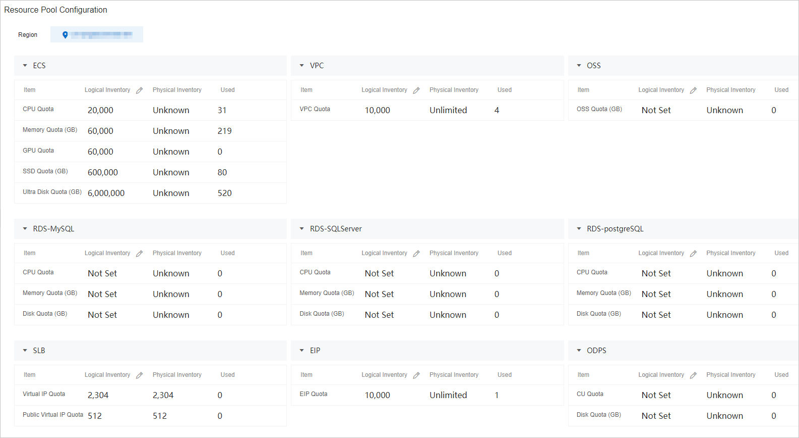

5. Click the  icon to complete modification.

<a id="section-9-6"></a>

## 9.6. Custom configurations

<a id="section-9-6-1"></a>

### 9.6.1. Configure brands

You can customize the icon, platform name, and logon page of the Apsara Uni-manager Management Console logon interface.

Procedure

1. Log on to the Apsara Uni-manager Management Console as a platform administrator.

2. In the top navigation bar, click Configurations.

3. In the left-side navigation pane, click Custom Configurations.

4. In the Brand Settings section, click a language tab of the page that you want to modify.

5. Configure the following parameters and click OK.

   | Parameter | Description |
   | --- | --- |
   | Icon | You can click Upload Image, select an image file, and then click Open.<br>The recommended resolution of an image is 160 × 36 pixels, and the recommended formats are PNG and JPG.<br>After the image is uploaded, you can click theicon to preview it.<br>Before you replace the image, you must click theicon to delete<br>the current image. |
   | Platform Name | You can customize a platform name.<br>The name can be up to 8 characters in length. |
   | Logon Page | You can click + Add Screen or theicon after screens to increase<br>or decrease the number of scrolling screens.<br>The number of scrolling screens on the logon page must be in the range of one to three.<br>After you click the tab of a screen, you can perform the following operations:<br>• Background Image: Click Upload Image, select a background image file, and then click Open.<br>The recommended resolution of an image is 1,880 × 1,600 pixels, and the recommended formats are PNG and JPG.<br>After the image is uploaded, you can click theicon to preview<br>it.<br>Before you replace the image, you must click theicon to<br>delete the current image.<br>• Image Copywriting: Customize the image copywriting.<br>The image copywriting can be up to 40 characters in length. |
   | Copyright Notice | You can customize the information of the copyright notice. |

<a id="section-10"></a>

# 10.Operations

<a id="section-10-1"></a>

## 10.1. Quotas

<a id="section-10-1-1"></a>

### 10.1.1. Quota parameters

This topic describes the quota parameters of each service.

An organization administrator can set resource quotas and create resources within the allowed quotas for the organization. When the quotas for the organization are used up, the system does not allow the organization administrator to create more resources for the organization. To create more resources, you must first increase the quotas for the organization.

If no quotas are set, you can create an unlimited amount of resources.

ECS

| Parameter | Description |
| --- | --- |
| CPU Quota (Cores) | The total number of CPU cores that you can configure for Elastic Compute Service (ECS) and the number of used cores. |
| Memory Quota (GB) | The total memory size that you can configure for ECS. |
| GPU Quota (Cores) | The total number of GPU cores that you can configure for ECS. |
| SSD Quota (GB) | The total SSD capacity that you can configure for ECS. |
| Ultra Disk Quota (GB) | The total number of disks that you can configure for an ECS instance. |

VPC

| Parameter | Description |
| --- | --- |
| VPC Quota | The maximum number of virtual private clouds (VPCs) that you can configure. |

OSS

| Parameter | Description |
| --- | --- |
| OSS Quota (GB) | The maximum capacity that you can allocate for Object Storage Service (OSS). |

ApsaraDB RDS for MySQL

| Parameter | Description |
| --- | --- |
| CPU Quota (Cores) | The total number of CPU cores that you can configure for ApsaraDB RDS for MySQL and the number of used cores. |
| Memory Quota (GB) | The total memory size that you can configure for ApsaraDB RDS for MySQL. |
| Disk Quota (GB) | The total storage size that you can configure for ApsaraDB RDS for MySQL. |

PolarDB

| Parameter | Description |
| --- | --- |
| CPU Quota (Cores) | The total number of CPU cores that you can configure for PolarDB and the number of used cores. |
| Memory Quota (GB) | The total memory size that you can configure for PolarDB. |
| Disk Quota (GB) | The total storage size that you can configure for PolarDB. |

ApsaraDB RDS for SQL Server

| Parameter | Description |
| --- | --- |
| CPU Quota (Cores) | The total number of CPU cores that you can configure for ApsaraDB RDS for SQL Server and the number of used cores. |
| Memory Quota (GB) | The total memory size that you can configure for ApsaraDB RDS for SQL Server. |
| Disk Quota (GB) | The total storage size that you can configure for ApsaraDB RDS for SQL Server. |

ApsaraDB RDS for PostgreSQL

| Parameter | Description |
| --- | --- |
| CPU Quota (Cores) | The total number of CPU cores that you can configure for ApsaraDB RDS for PostgreSQL and the number of used cores. |
| Memory Quota (GB) | The total memory size that you can configure for ApsaraDB RDS for PostgreSQL. |
| Disk Quota (GB) | The total storage size that you can configure for ApsaraDB RDS for PostgreSQL. |

SLB

| Parameter | Description |
| --- | --- |
| Virtual IP Quota (a) | The maximum number of internal IP addresses that you can configure for Server Load Balancer (SLB). |
| Public Virtual IP Quota | The maximum number of public IP addresses that you can configure for SLB. |

EIP

| Parameter | Description |
| --- | --- |
| EIP Quota | The maximum number of elastic IP addresses (EIPs) that you can configure. |

MaxCompute

| Parameter | Description |
| --- | --- |
| CU Quota (a) | The total number of capacity units (CUs) that you can configure for MaxCompute. |
| Disk Quota (GB) | The total storage size that you can configure for MaxCompute. |

KVStore for Redis

| Parameter | Description |
| --- | --- |
| Memory Quota (GB) | The total memory size that you can configure for KVStore for Redis. |

PolarDB-X

| Parameter | Description |
| --- | --- |
| CPU Quota (Cores) | The total number of CPUs that you can configure for PolarDB-X. |

AnalyticDB for PostgreSQL

| Parameter | Description |
| --- | --- |
| CPU Quota (Cores) | The total number of CPU cores that you can configure for AnalyticDB for PostgreSQL and the number of used cores. |
| Memory Quota (GB) | The total memory size that you can configure for AnalyticDB for PostgreSQL. |
| Disk Quota (GB) | The total storage size that you can configure for AnalyticDB for PostgreSQL. |

ApsaraDB for MongoDB

| Parameter | Description |
| --- | --- |
| CPU Quota (Cores) | The total number of CPU cores that you can configure for ApsaraDB for MongoDB and the number of used cores. |
| Memory Quota (GB) | The total memory size that you can configure for ApsaraDB for MongoDB. |
| Disk Quota (GB) | The total storage size that you can configure for ApsaraDB for MongoDB. |

<a id="section-10-1-2"></a>

### 10.1.2. Set quotas for a cloud service

The Apsara Uni-manager Management Console allows you to set quotas to properly allocate resources among organizations.

Prerequisites

You must set quotas for a parent organization before you can set quotas for its subordinate organizations.

Context

If the parent organization has quotas (except when the parent organization is a level-1 organization), the available quotas for a subordinate organization are equal to the quotas for the parent organization minus the quotas for other subordinate organizations.

This topic describes how to modify quotas for Elastic Compute Service (ECS). You can modify quotas for other cloud resources in a similar manner.

Procedure

1. Log on to the Apsara Uni-manager Management Console as an organization administrator.

2. In the top navigation bar, click Operations.

3. In the left-side navigation pane of the Operations page, click Quotas.

4. In the left-side navigation tree, click the name of the organization for which you want to create cloud resources.

5. Select the cloud service for which you want to set quotas. In this example, ECS is selected.

6. In the upper-right corner of the quota section, click Set Quota.

7. Set the total quotas and click Save.

   For more information about quota parameters, see Quota parameters.

<a id="section-10-1-3"></a>

### 10.1.3. Modify quotas

Administrators can adjust quotas for cloud resources based on organizational requirements.

Context

This topic describes how to modify quotas for ECS. You can modify quotas for other cloud resources in a similar manner.

Procedure

1. Log on to the Apsara Uni-manager Management Console as an administrator.

2. In the top navigation bar, click Operations.

3. In the left-side navigation pane of the Operations page, click Quotas.

4. In the left-side navigation tree, click the name of the organization for which you want to create cloud resources.

5. Select the Apsara Stack service for which you want to modify quotas. For this example, ECS is selected.

6. In the upper-right corner of the quota area, click Modify.

7. Set the total quotas and click Save.

   For more information about quota parameters, see Quota parameters.

<a id="section-10-1-4"></a>

### 10.1.4. Reset quotas

Administrators can reset quotas as needed.

Prerequisites

Before deleting a quota for an organization, make sure that no subordinate organizations have any quotas.

Procedure

1. Log on to the Apsara Uni-manager Management Console as an administrator.

2. In the top navigation bar, click Operations.

3. In the left-side navigation pane of the Operations page, click Quotas.

4. In the left-side organization navigation tree, click the name of the target organization.

5. Select the cloud service for which you want to reset quotas. For this example, ECS is selected.

6. In the upper-right corner of the quota section, click Reset.

7. In the message that appears, click OK.

<a id="section-10-2"></a>

## 10.2. Usage statistics

<a id="section-10-2-1"></a>

### 10.2.1. View the usage statistics of cloud resources

The Apsara Uni-manager Management Console shows the number of resource instances that run in the Apsara Stack environment by time, organization, resource set, and region. You can also export statistical reports from the Apsara Uni-manager Management Console.

Context

The cloud resources that can be metered include Elastic Compute Service (ECS), Virtual Private Cloud (VPC), Server Load Balancer (SLB), Object Storage Service (OSS), ApsaraDB RDS for MySQL, Elastic IP Address (EIP), Tablestore, PolarDB-X, KVStore for Redis, AnalyticDB for PostgreSQL, ApsaraDB for MongoDB, ApsaraDB RDS for PostgreSQL, ApsaraDB RDS for SQL Server, Log Service, ECS disks, ECS snapshots, scaling group rules, API gateways, and Key Management Service (KMS).

This topic describes how to create quotas for ECS. You can set quotas for other cloud resources in a similar manner.

Procedure

1. Log on to the Apsara Uni-manager Management Console.

2. In the top navigation bar, click Operations.

3. In the left-side navigation pane of the Operations page, click Usage Statistics.

4. In the Resource Type section, click Elastic Compute Service ECS.

5. In the Search Conditions section, set Time Period, Organization, Resource Set, Region, and Instance ID to filter resources.

   You can view the statistics in the console or click Export in the upper-right corner to export the statistics to your PC as an XLS file.

   Note

   In the console, you can view or export up to 1,000 statistical records to an Excel

   file. Use the statistics query API to obtain more statistical data.

   The exported file is named *&lt;Resource type name>.xls*. Find the downloaded file from the download path of the browser.

<a id="section-10-3"></a>

## 10.3. Statistical analysis

<a id="section-10-3-1"></a>

### 10.3.1. View reports of current data

You can use reports to view the most recent data of each service.

Procedure

1. Log on to the Apsara Uni-manager Management Console.

2. In the top navigation bar, click Operations.

3. In the left-side navigation pane of the Operations page, choose Statistical Analysis > Reports.

4. Click the tab that you want to view.

   You can click the Resource Reports, Quota Reports, or CloudMonitor Reports tab.

5. (Optional) Set Organizations and Resource Sets and Region and click Search.

6. Click the tab of the service that you want to view.

   View the most recent data of the service.

<a id="section-10-3-2"></a>

### 10.3.2. Export reports of current data

You can batch export data that you want to view by cloud service.

Procedure

1. Log on to the Apsara Uni-manager Management Console.

2. In the top navigation bar, click Operations.

3. In the left-side navigation pane of the Operations page, choose Statistical Analysis > Reports.

4. Click the tab that you want to view.

   You can click the Resource Reports, Quota Reports, or CloudMonitor Reports tab.

5. (Optional) Set Organizations and Resource Sets and Region for which you want to view data and click Search.

   Click Reset to clear all filter properties.

6. Use one of the following methods to export data:

   - Export data by service.

     <ol type="a">

     <li>

     Click Export Reports on the right side of the page.

     </li>

     <li>

     In the Select Products to Export dialog box, select the service that you want to view and click OK.

     You can also select Select All in the lower-left corner and click OK.

     </li>

     </ol>

   - Export data by instance.

     <ol type="a">

     <li>

     Click the tab of the service that you want to view.

     </li>

     <li>

     Select the instance that you want to view and click Export Selected Reports in the lower-left corner of the page.

     </li>

     </ol>

<a id="section-10-3-3"></a>

### 10.3.3. Download reports of historical data

You can download data reports of cloud services within the specified period of time, resource set, and region by creating download tasks.

Procedure

1. Log on to the Apsara Uni-manager Management Console.

2. In the top navigation bar, click Operations.

3. In the left-side navigation pane of the Operations page, choose Statistical Analysis > Download Center.

4. In the upper-right corner of the page, click Create Download Task.

5. Enter the information of the download task.

   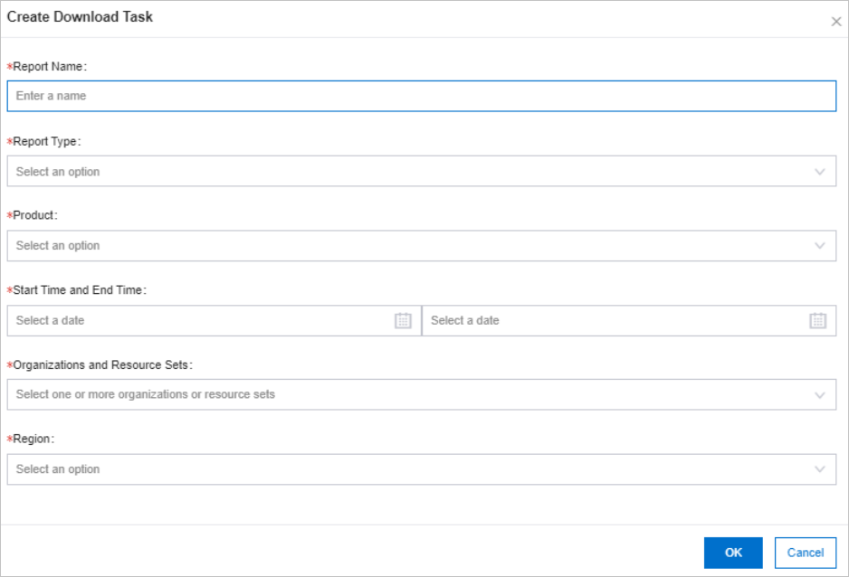

   | Parameter | Description |
   | --- | --- |
   | Report Name | The name of the report. |
   | Report Type | The type of the report. Valid values:<br>• Resource Reports<br>• CloudMonitor Reports |
   | Product | The cloud service for which you want to download reports. You can select multiple cloud services. |
   | Start Time and End Time | The start and end time of the data. |
   | Organizations and Resource Sets | The organization to which the data belongs. You can select multiple organizations. |
   | Region | The region of the data. You can select multiple regions. |

6. Click OK.

7. After the Created message appears, the Download Center page appears. Enter the information of the created report in the search box and click Search to search for the created download task.

8. After In Progress changes to Completed in the Status column, click Download Report in the Actions column.

<a id="section-11"></a>

# 11.Security

<a id="section-11-1"></a>

## 11.1. View operation logs

You can view operation logs to obtain up-to-date information for various resources and functional modules in the Apsara Uni-manager Management Console. You can also export operation logs to your PC.

Procedure

1. Log on to the Apsara Uni-manager Management Console as a security administrator.

2. In the top navigation bar, click Security.

3. You can filter logs by username, resource type, resource ID, product, organization, keyword, source IP address, start time, and end time.

   The following table describes the fields in the query result.

   Fields in the query result

   | Log field | Description |
   | --- | --- |
   | Organizati on | The organization of the object on which operations are performed. |
   | Resource Set | The resource set of the object on which operations are performed. |
   | Resource Type | The resource type of the object on which operations are performed. |
   | Resource ID | The ID of the object on which operations are performed. |
   | Status | The current status of the operation. |
   | User | The name of the operator. |
   | Event Type | The operation performed on an Apsara Stack service. The operations include creating, modifying, deleting, querying, updating, binding, unbinding, enabling and disabling service instances, applying for and releasing service instances, and changing the ownership of service instances. |
   | Source IP | The IP address of the operator. |
   | Details | A brief introduction of the operation. |
   | Start Time | The time when the operation started. |
   | End Time | The time when the operation ended. |
   | Region | The region of the object on which operations are performed. |
   | Level | The level of logs. |

   Note

   Click the

   icon. In the Show/Hide Columns dialog box, select fields that

   

   you want to show in the query result.

4. (Optional)Click Download to download the logs displayed on the current page to your PC as an XLS file.

   The exported log file is named *log.xls* and stored in the *C:\\Users\\Username\\Downloads* directory.

<a id="section-12"></a>

# 12.RAM

<a id="section-12-1"></a>

## 12.1. RAM introduction

Resource Access Management (RAM) is a resource access control service provided by Apsara Stack.

You can use RAM to manage users and control which resources are accessible to employees, systems, and applications.

RAM provides the following features:

- RAM role

  To authorize a cloud service in a level-1 organization to use other resources in the organization, you must create a RAM role. This role specifies the operations that the cloud service can perform on resources.

  Only system administrators and level-1 organization administrators can create RAM roles.

- User group

  You can create multiple users within an organization and grant them different operation permissions on cloud resources.

  You can create RAM user groups to classify and authorize RAM users within your Apsara Stack tenant account. This simplifies the management of RAM users and their permissions.

  You can create RAM permission policies to grant different operation permissions to different user groups.

<a id="section-12-2"></a>

## 12.2. Permission policy structure and syntax

This topic describes the structure and syntax used to create or update permission policies in Resource Access Management (RAM).

Policy characters and usage rules

- Characters in a policy

  - The following characters are JSON tokens and are included in policies:  `{ } [ ] " , :` .

  - The following characters are special characters in the syntax and are not included in policies:  `= < > ( ) |` .

- Use of characters

  - If an element can have more than one value, you can perform the following operations:

    - Separate multiple values by using commas (,) as delimiters between each value and use an ellipsis (...) to describe the remaining values. Example:  `[ <action_string>, <action_string>, ...]` .

    - Include only one value. Examples:  `"Action": [<action_string>]`  and  `"Action": <action_st ring>` .

  - A question mark (?) following an element indicates that the element is optional. Example:  `<condi tion_block? >` .

  - A vertical bar ( `|` ) between elements indicates multiple options. Example:  `("Allow" | "Deny")` .

  - Elements that must be text strings are enclosed in double quotation marks (""). Example:  `<versio n_block> = "Version" : ("1")` .

Policy structure

The policy structure includes the following components:

- The version number.

- A list of statements. Each statement contains the following elements: Effect, Action, Resource, and Condition. The Condition element is optional.

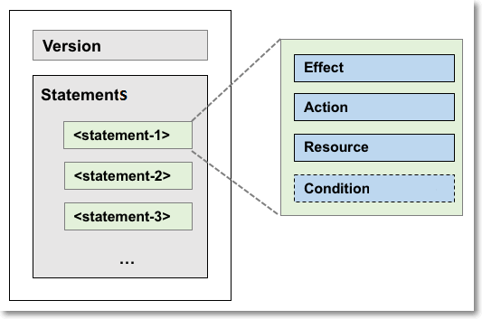

Policy syntax

```xml
policy  = {
     <version_block>,
     <statement_block>
}
<version_block> = "Version" : ("1")
<statement_block> = "Statement" : [ <statement>, <statement>, ... ]
<statement> = { 
    <effect_block>,
    <action_block>,
    <resource_block>,
    <condition_block? >
}
<effect_block> = "Effect" : ("Allow" | "Deny")  
<action_block> = ("Action" | "NotAction") : 
    ("*" | [<action_string>, <action_string>, ...])
<resource_block> = ("Resource" | "NotResource") : 
    ("*" | [<resource_string>, <resource_string>, ...])
<condition_block> = "Condition" : <condition_map>
<condition_map> = {
  <condition_type_string> : { 
      <condition_key_string> : <condition_value_list>,
      <condition_key_string> : <condition_value_list>,
      ...
  },
  <condition_type_string> : {
      <condition_key_string> : <condition_value_list>,
      <condition_key_string> : <condition_value_list>,
      ...
  }, ...
}  
<condition_value_list> = [<condition_value>, <condition_value>, ...]
<condition_value> = ("String" | "Number" | "Boolean")
```

Description:

- The current policy version is 1.

- The policy can have multiple statements.

  - The effect of each statement can be either  `Allow`  or  `Deny` .

    Note

    In a statement, both the Action and Resource elements can have multiple values.

  - Each statement can have its own conditions.

    Note

    A condition block can contain multiple conditions with different operators and

    logical combinations of these conditions.

- You can attach multiple policies to a RAM user. If policies that apply to a request include an  `Allow` statement and a  `Deny`  statement, the Deny statement overrides the Allow statement.

- Element value:

  - If an element value is a number or Boolean value, it must be enclosed in double quotation marks ("") in the same way as strings.

  - If an element value is a string, characters such as the asterisk ( `*` ) and question mark ( `?` ) can be used for fuzzy matching.

    - The asterisk ( `*` ) indicates any number (including zero) of allowed characters. For example,  `ec s:Describe*`  indicates all ECS API operations that start with  `Describe` .

    - `The question mark (?)`  indicates an allowed character.

Policy format check

Policies are stored in RAM as JSON documents. When you create or update a policy, RAM first checks whether the JSON format is valid.

- For more information about JSON syntax standards, see RFC 7159.

- We recommend that you use tools such as JSON validators and editors to check whether the policies meet JSON syntax standards.

<a id="section-12-3"></a>

## 12.3. RAM roles

<a id="section-12-3-1"></a>

### 12.3.1. View basic information about a RAM role

You can view basic information about a RAM role, including its user groups and existing permission policies.

Procedure

1. Log on to the Apsara Uni-manager Management Console as an administrator.

2. In the top navigation bar, click Enterprise.

3. In the left-side navigation pane of the Enterprise page, click Roles.

4. On the Roles page, click the name of the target RAM role.

5. In the basic information section, click the User Groups and Permissions tabs to view relevant information.

<a id="section-12-3-2"></a>

### 12.3.2. Create a RAM role

To authorize a cloud service in a level-1 organization to use other resources in the organization, you must create a RAM role. This role contains the operations that the cloud service can perform on resources.

Procedure

1. Log on to the Apsara Uni-manager Management Console as an administrator.

2. In the top navigation bar, click Enterprise.

3. In the left-side navigation pane of the Enterprise page, click Roles.

4. In the upper-right corner of the page, click Create RAM Role.

5. On the Roles - Create RAM Role page, set Role Name, Description, and Sharing Scope.

   Valid values of the Sharing Scope parameter:

   - Global

   - Global

     The role is visible and valid to all organizations involved. The default value is Global.

   - Current Organization

     The role is visible and valid to the organization to which the user belongs.

   - Subordinate Organization

     The role is visible and valid to the organization to which the user belongs and its subordinate organizations.

6. Click Create.

<a id="section-12-3-3"></a>

### 12.3.3. Create a policy

To use a cloud service to access other cloud resources, you must create a policy and attach it to a user group.

Procedure

1. Log on to the Apsara Uni-manager Management Console as an administrator.

2. In the top navigation bar, click Enterprise.

3. In the left-side navigation pane of the Enterprise page, click Roles.

4. In the role name list, find the RAM role that you want to modify and choose More > Modify in the Actions column to go to the Roles page.

5. Click the Permissions tab.

6. Click Add Permission Policy.

7. In the Add Permission Policy dialog box, enter information of the policy.

   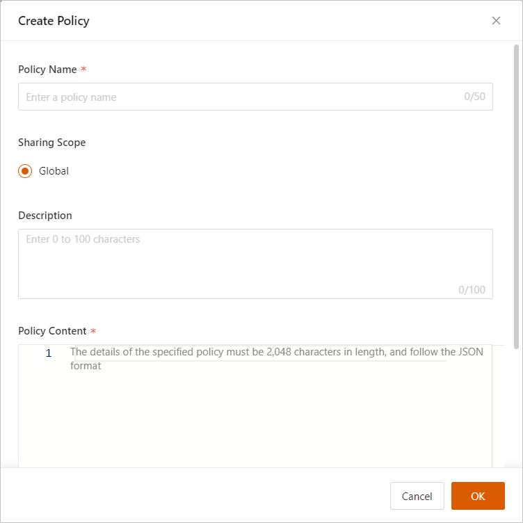

   For more information about how to enter the policy content, see Permission policy structure and syntax.

<a id="section-12-3-4"></a>

### 12.3.4. Modify the content of a RAM policy

You can modify the content of a RAM policy.

Procedure

1. Log on to the Apsara Uni-manager Management Console as an administrator.

2. In the top navigation bar, click Enterprise.

3. In the left-side navigation pane of the Enterprise page, click Roles.

4. In the role list, find the RAM role that you want to modify and choose More > Modify in the Actions column to go to the Roles page.

5. Click the Permissions tab.

6. Click the name of a policy in the Permission Policy Name column.

7. In the Modify Permission Policy dialog box, modify the relevant information and click OK.

   For more information about how to modify the policy content, see Permission policy structure and syntax.

<a id="section-12-3-5"></a>

### 12.3.5. Modify the name of a RAM policy

You can modify the name of a RAM policy.

Procedure

1. Log on to the Apsara Uni-manager Management Console as an administrator.

2. In the top navigation bar, click Enterprise.

3. In the left-side navigation pane of the Enterprise page, click Roles.

4. In the role name list, find the RAM role that you want to modify and choose More > Modify in the Actions column to go to the Roles page.

5. Click the Permissions tab. Click the name of that policy that you want to modify in the Permission Policy Name column.

6. In the Modify Permission Policy dialog box, modify the policy name.

<a id="section-12-3-6"></a>

### 12.3.6. Add a RAM role to a user group

You can bind RAM roles to user groups.

Prerequisites

You must create a user group before RAM roles can be added. For more information, see Add a role.

Procedure

1. Log on to the Apsara Uni-manager Management Console as an administrator.

2. In the top navigation bar, click Enterprise.

3. In the left-side navigation pane of the Enterprise page, click Roles.

4. In the role name list, find the RAM role that you want to modify and choose More > Modify in the Actions column to go to the Roles page.

5. Click the User Groups tab.

6. Click Add User Group. In the Add User Group dialog box, select a user group.

7. Click OK.

<a id="section-12-3-7"></a>

### 12.3.7. Grant permissions to a RAM role

When you grant permissions to a RAM role, all users in the user groups that are assigned this role share the granted permissions.

Procedure

1. Log on to the Apsara Uni-manager Management Console as an administrator.

2. In the top navigation bar, click Enterprise.

3. In the left-side navigation pane of the Enterprise page, click Roles.

4. In the role list, find the RAM role that you want to modify and choose More > Modify in the Actions column to go to the Roles page.

5. Click the Permissions tab.

6. Click Select Existing Permission Policy.

7. In the dialog box that appears, select a RAM policy and click OK.

   If no RAM policies are available, see Add a permission policy.

<a id="section-12-3-8"></a>

### 12.3.8. Remove permissions from a RAM role

You can remove permissions that are no longer needed from RAM roles.

Procedure

1. Log on to the Apsara Uni-manager Management Console as an administrator.

2. In the top navigation bar, click Enterprise.

3. In the left-side navigation pane of the Enterprise page, click Roles.

4. In the role list, find the RAM role that you want to modify and choose More > Modify in the Actions column to go to the Roles page.

5. Click the Permissions tab.

6. Find the policy that you want to remove and click Remove in the Actions column.

<a id="section-12-3-9"></a>

### 12.3.9. Modify a RAM role name

Administrators can modify the names of RAM roles.

Context

The name of a preset role cannot be modified.

Procedure

1. Log on to the Apsara Uni-manager Management Console as an administrator.

2. In the top navigation bar, click Enterprise.

3. In the left-side navigation pane of the Enterprise page, click Roles.

4. In the role name list, find the RAM role that you want to modify and choose More > Modify in the Actions column to go to the Roles page.

5. Move the pointer over the role name and click the  icon to enter a new role name.

<a id="section-12-3-10"></a>

### 12.3.10. Delete a RAM role

This topic describes how to delete a RAM user.

Prerequisites

Before you delete a RAM role, make sure that no policies are attached to the RAM role.

Procedure

1. Log on to the Apsara Uni-manager Management Console as an administrator.

2. In the top navigation bar, click Enterprise.

3. In the left-side navigation pane of the Enterprise page, click Roles.

4. In the role name list, click More in the Actions column corresponding to a RAM role, and choose Delete from the shortcut menu.

5. In the message that appears, click OK.

<a id="section-12-4"></a>

## 12.4. RAM authorization policies

<a id="section-12-4-1"></a>

### 12.4.1. Create a service-linked role

You can create authorization policies and grant them to organizations.

Procedure

1. Log on to the Apsara Uni-manager Management Console as an administrator.

2. In the top navigation bar, click Configurations.

3. In the left-side navigation pane of the Configurations page, click Service-linked Roles.

4. In the upper-right corner of the page, click Create RAM Role.

5. On the Create RAM Role page, set Organization Name and Service Name.

6. Click OK.

<a id="section-12-4-2"></a>

### 12.4.2. View the details of a service-linked role

You can view the details of a Resource Access Management (RAM) role, including its role name, creation time, description, and Alibaba Cloud Resource Name (ARN).

Procedure

1. Log on to the Apsara Uni-manager Management Console as an administrator.

2. In the top navigation bar, click Configurations.

3. In the left-side navigation pane of the Configurations page, click Service-linked Roles.

4. On the Service-linked Roles page, set Role Name, Service Name, or Organization Name, and click Search in the upper-right corner.

   To perform another search, click Clear.

5. Find the service-linked role that you want to view and click Details in the Actions column.

<a id="section-12-4-3"></a>

### 12.4.3. View RAM authorization policies

You can view the details of a Resource Access Management (RAM) authorization policy, including its policy name, policy type, default version, description, association time, and policy content.

Prerequisites

A RAM authorization policy is created. For more information, see Create a RAM role.

Procedure

1. Log on to the Apsara Uni-manager Management Console as an administrator.

2. In the top navigation bar, click Configurations.

3. In the left-side navigation pane of the Configurations page, click Service-linked Roles.

4. On the RAM Roles page, set Role Name or Service Name and click Search in the upper-right corner.

   To perform another search, click Clear.

5. Find the service-linked role that you want to view and click Details in the Actions column.

6. Click the Role Policy tab to view the information of the role authorization policy. Click Details in the Actions column to view the policy details.

<a id="section-13"></a>

# 13.Personal information management

<a id="section-13-1"></a>

## 13.1. Modify personal information

You can modify your personal information to keep it up to date.

Procedure

1. Log on to the Apsara Uni-manager Management Console.

2. In the upper-right corner of the homepage, move the pointer over the profile picture and choose User Information from the shortcut menu.

   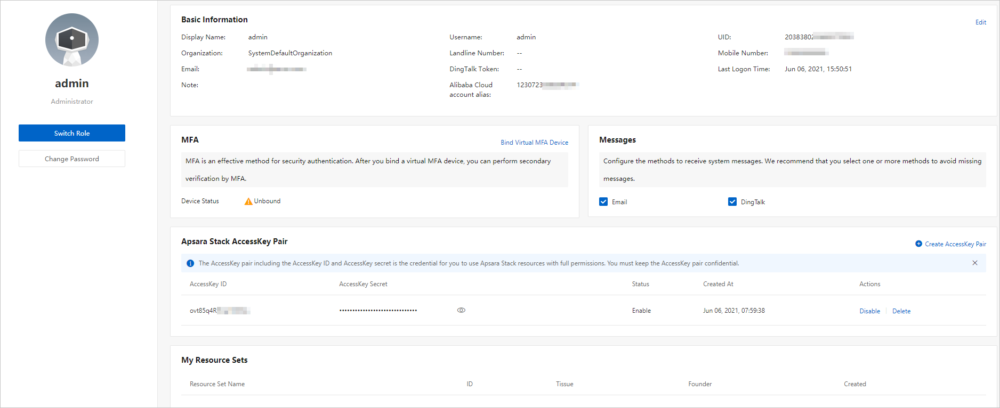

3. In the upper-right corner of the Basic Information section, click Edit.

4. In the Modify User Information dialog box, modify the personal information.

5. Click OK.

<a id="section-13-2"></a>

## 13.2. Change the logon password

To improve security, you must change your logon password in a timely manner. This topic describes how to change your logon password.

Procedure

1. Log on to the Apsara Uni-manager Management Console.

2. In the upper-right corner of the homepage, move the pointer over the profile picture and choose User Information from the shortcut menu.

   

3. Click Change Password.

4. In the Change Password dialog box, set Current Password, New Password, and Confirm New Password.

   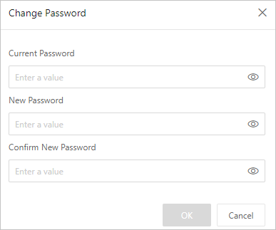

5. Click OK.

<a id="section-13-3"></a>

## 13.3. Switch the current role

You can switch the scope of your current role.

Procedure

1. Log on to the Apsara Uni-manager Management Console as an administrator.

2. In the upper-right corner of the homepage, move the pointer over the user profile picture and choose User Information from the shortcut menu.

3. Click Switch Role.

4. In the Switch Role dialog box that appears, select the role that you want to switch to.

   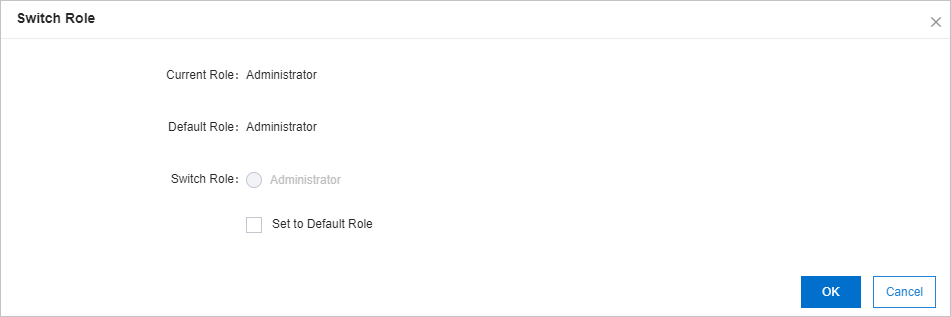

   You can also switch back to the default role.

<a id="section-13-4"></a>

## 13.4. View the AccessKey pair of your Apsara Stack tenant account

To ensure the security of cloud resources, the system must verify the identity of visitors and ensure that they have the relevant permissions. You must obtain the AccessKey ID and AccessKey secret of your Apsara Stack tenant to access cloud resources.

Procedure

1. Log on to the Apsara Uni-manager Management Console.

2. In the upper-right corner of the homepage, move the pointer over the profile picture and choose User Information from the shortcut menu.

3. In the Apsara Stack AccessKey Pair section, view your AccessKey pair.

   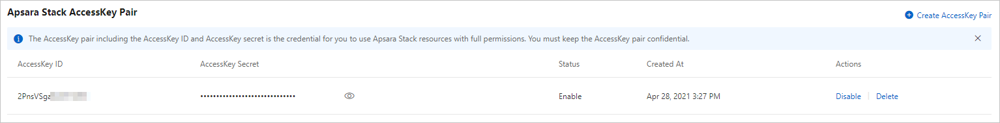

   Note

   The AccessKey pair consists of an AccessKey ID and an AccessKey secret. These

   credentials provide you with full permissions on Apsara Stack resources. You must keep the AccessKey pair confidential.

<a id="section-13-5"></a>

## 13.5. Create an AccessKey pair

You can delete your old AccessKey pairs and create new ones to implement the rotation of your AccessKey pairs.

Procedure

1. Log on to the Apsara Uni-manager Management Console.

2. In the upper-right corner of the homepage, move the pointer over the profile picture and choose User Information from the shortcut menu.

3. In the upper-right corner of the Apsara Stack AccessKey Pair section, click Create AccessKey Pair.

   Note

Each user can have up to two AccessKey pairs.

<a id="section-13-6"></a>

## 13.6. Delete an AccessKey pair

You can delete AccessKey pairs that are no longer needed.

Prerequisites

- Each user can delete only its own AccessKey pairs. The administrator cannot delete the AccessKey pairs of users.

- Each user retains at least one AccessKey pair.

Procedure

1. Log on to the Apsara Uni-manager Management Console.

2. In the upper-right corner of the homepage, move the pointer over the profile picture and choose User Information from the shortcut menu.

3. In the Apsara Stack AccessKey Pair section, find the AccessKey pair that you want to delete and click Delete in the Actions column.

4. In the message that appears, click OK.

<a id="section-13-7"></a>

## 13.7. Disable an AccessKey pair

You can disable AccessKey pairs that are no longer needed. Newly created AccessKey pairs are in the Enable state by default.

Procedure

1. Log on to the Apsara Uni-manager Management Console.

2. In the upper-right corner of the homepage, move the pointer over the profile picture and choose User Information from the shortcut menu.

3. In the Apsara Stack AccessKey Pair section, find the AccessKey pair that you want to disable and click Disable in the Actions column.

   Each user can disable only its own AccessKey pairs. The administrator cannot disable the AccessKey pairs of users.

4. In the message that appears, click OK.

   Note

Make sure that at least one AccessKey pair is in the Enable state.

<a id="section-13-8"></a>

## 13.8. Enable an AccessKey pair

Disabled AccessKey pairs must be re-enabled before you can continue to use them. Newly created AccessKey pairs are in the Enable state by default.

Procedure

1. Log on to the Apsara Uni-manager Management Console.

2. In the upper-right corner of the homepage, move the pointer over the profile picture and choose User Information from the shortcut menu.

3. In the Apsara Stack AccessKey Pair section, find the AccessKey pair that you want to enable and click Enable in the Actions column.

4. In the message that appears, click OK.

   Note

Make sure that at least one AccessKey pair is in the Enable state.

<a id="section-13-9"></a>

## 13.9. MFA

<a id="section-13-9-1"></a>

### 13.9.1. Overview

Multi-factor authentication (MFA) is an identity authentication method in computer systems. It requires users to provide two or more verification factors to gain access to a resource. This topic introduces the principles and use scenarios of MFA.

Introduction to MFA

When MFA is enabled, you must enter your username and password (first security factor) and then a variable verification code (second security factor) from an MFA device when you log on to the Apsara Uni-manager Management Console. Two-factor authentication enhances security for your account.

MFA devices use the Time-based One-time Password (TOTP) algorithm to generate time-dependent 6-digit dynamic verification codes. The Apsara Uni-manager Management Console supports software-based virtual MFA devices. You can install software such as the Alibaba Cloud app that supports MFA on your mobile device such as your mobile phone to act as a virtual MFA device.

Limits

The TOTP algorithm requires that the time of the system clock of the Apsara Uni-manager Management Console remain consistent with the standard time on the Internet. Otherwise, discrepancies in time can lead to inconsistent MFA verification codes and leave you unable to log on to the Apsara Uni-manager Management Console.

<a id="section-13-9-2"></a>

### 13.9.2. Bind a virtual MFA device to enable MFA

Multi-factor authentication (MFA) is automatically enabled after you bind an MFA device. This topic describes how to bind a virtual MFA device.

1. Log on to the Apsara Uni-manager Management Console.

2. In the upper-right corner of the homepage, move the pointer over the profile picture and choose User Information from the shortcut menu.

3. In the upper-right corner of the MFA section, click Bind Virtual MFA Device.

4. On the Bind Virtual MFA Device page, follow the instructions to bind an MFA device.

   The following figure shows the MFA section after the MFA device is bound.

   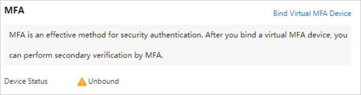

Results

After a virtual MFA device is bound, you must enter a 6-digit MFA verification code in addition to your username and password before you can log on to the Apsara Uni-manager Management Console.

<a id="section-13-9-3"></a>

### 13.9.3. Unbind a virtual MFA device to disable MFA

To disable multi-factor authentication (MFA), you must disable the MFA device that is bound. This topic describes how to unbind a virtual MFA device to disable MFA.

1. Log on to the Apsara Uni-manager Management Console.

2. In the upper-right corner of the homepage, move the pointer over the profile picture and choose User Information from the shortcut menu.

3. In the upper-right corner of the MFA section, click Disable Virtual MFA Device.

4. In the dialog box that appears, click Disable Virtual MFA Device.

   After you disable MFA, you need only to enter your username and password the next time you log on to the Apsara Uni-manager Management Console.

<a id="section-13-9-4"></a>

### 13.9.4. Forcibly enable MFA

Administrators including the platform administrator, operations administrator, and organization administrator can check whether their users have multi-factor authentication (MFA) enabled. If MFA is disabled for the users, the administrators can forcibly enable MFA for the users.

1. Log on to the Apsara Uni-manager Management Console as an administrator.

2. In the top navigation bar, click Enterprise.

3. In the left-side navigation pane, choose Users > Users.

4. Click the System Users tab.

5. Find the user for whom you want to forcibly enable MFA and choose More > View MFA Status in the Actions column.

   You can search for the user by username, organization, or role.

6. In the MFA Status Prompt message, click OK.

   Note

   - After MFA is forcibly enabled for a user, the user must go to the Bind Virtual MFA Device page to bind a virtual MFA device before the user can log on to the Apsara Uni-manager Management Console.

   - MFA can be forcibly enabled for users, but cannot be forcibly disabled. Before MFA is enabled, the MFA status of the user is Not Enabled.

   - After MFA is enabled, the MFA status of the user is Enabled but Not Bound.

<a id="section-13-9-5"></a>

### 13.9.5. Reset MFA

If you lose your multi-factor authentication (MFA) key, you must have the administrator reset the key. The MFA key is automatically reset while the password is reset.

1. Log on to the Apsara Uni-manager Management Console as an administrator.

2. In the top navigation bar, click Enterprise.

3. In the left-side navigation pane, choose Users > Users.

4. Click the System Users tab.

5. Find the user for whom you want to reset MFA and click the username.

   You can search for the user by username, organization, or role.

6. In the user details panel, click Reset password.
