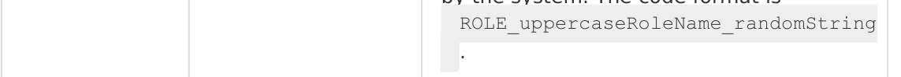
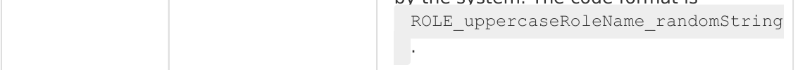
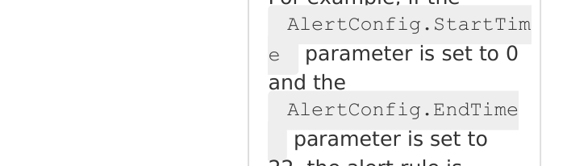
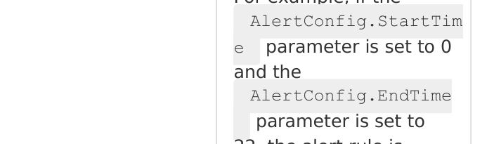

Alibaba Cloud  
Apsara Stack  
Apsara Uni-manager  
Management Console  
Developer Guide  
Product Version: V3.18.2  
Document Version: 20251106

**Table of Contents**

- [1.Preparations](#section-1)
    - [1.1. Obtain API information](#section-1-1)
    - [1.2. Obtain AccessKey credentials](#section-1-2)
    - [1.3. Obtain the values of common request headers](#section-1-3)
- [2.Use POP to make API calls](#section-2)
    - [2.1. Obtain the endpoint of the Apsara Uni-manager Management Console](#section-2-1)
    - [2.2. Obtain an SDK of the Apsara Uni-manager Management Console](#section-2-2)
    - [2.3. SDK for Java](#section-2-3)
    - [2.4. SDK for Python](#section-2-4)
    - [2.5. SDK for Go](#section-2-5)
- [3.API reference](#section-3)
    - [3.1. List of operations by function](#section-3-1)
        - [3.1.1. Enterprise](#section-3-1-1)
            - [3.1.1.1. Organizations](#section-3-1-1-1)
                - [3.1.1.1.1. CreateOrganization](#section-3-1-1-1-1)
                - [3.1.1.1.2. GetOrganization](#section-3-1-1-1-2)
                - [3.1.1.1.3. GetOrganizationList](#section-3-1-1-1-3)
                - [3.1.1.1.4. GetPrivateCloudAccountByOrganizationId](#section-3-1-1-1-4)
                - [3.1.1.1.5. RemoveOrganization](#section-3-1-1-1-5)
                - [3.1.1.1.6. UpdateOrganization](#section-3-1-1-1-6)
                - [3.1.1.1.7. UpdateSupportRegionsForOrg](#section-3-1-1-1-7)
            - [3.1.1.2. Resource sets](#section-3-1-1-2)
                - [3.1.1.2.1. CreateResourceGroup](#section-3-1-1-2-1)
                - [3.1.1.2.2. BindAscmUserAndResourceGroup](#section-3-1-1-2-2)
                - [3.1.1.2.3. ListAscmUsersInsideResourceGroup](#section-3-1-1-2-3)
                - [3.1.1.2.4. ListMembersInsideResourceSet](#section-3-1-1-2-4)
                - [3.1.1.2.5. ListResourceGroup](#section-3-1-1-2-5)
                - [3.1.1.2.6. ListResourceGroupByAscmUserId](#section-3-1-1-2-6)
                - [3.1.1.2.7. ListResourceGroupByOrgId](#section-3-1-1-2-7)
                - [3.1.1.2.8. RemoveResourceGroup](#section-3-1-1-2-8)
                - [3.1.1.2.9. UnbindAscmUserAndResourceGroup](#section-3-1-1-2-9)
                - [3.1.1.2.10. UpdateResourceGroup](#section-3-1-1-2-10)
            - [3.1.1.3. Roles](#section-3-1-1-3)
                - [3.1.1.3.1. AddRoleToUser](#section-3-1-1-3-1)
                - [3.1.1.3.2. ListActiveRoles](#section-3-1-1-3-2)
                - [3.1.1.3.3. ListRoles](#section-3-1-1-3-3)
                - [3.1.1.3.4. LockRole](#section-3-1-1-3-4)
                - [3.1.1.3.5. RelateSystemWithRole](#section-3-1-1-3-5)
                - [3.1.1.3.6. SetDefaultRole](#section-3-1-1-3-6)
                - [3.1.1.3.7. UnLockRole](#section-3-1-1-3-7)
            - [3.1.1.4. Users](#section-3-1-1-4)
                - [3.1.1.4.1. ActivateUser](#section-3-1-1-4-1)
                - [3.1.1.4.2. AddUser](#section-3-1-1-4-2)
                - [3.1.1.4.3. DeactivateUser](#section-3-1-1-4-3)
                - [3.1.1.4.4. GetUserInfo](#section-3-1-1-4-4)
                - [3.1.1.4.5. ListAccessKeysForManagedUsers](#section-3-1-1-4-5)
                - [3.1.1.4.6. ListAvailableUsersByRoleId](#section-3-1-1-4-6)
                - [3.1.1.4.7. ListDeletedUsers](#section-3-1-1-4-7)
                - [3.1.1.4.8. ListUsers](#section-3-1-1-4-8)
                - [3.1.1.4.9. ListUsersInsideRole](#section-3-1-1-4-9)
                - [3.1.1.4.10. LockUser](#section-3-1-1-4-10)
                - [3.1.1.4.11. ModifyUserInformation](#section-3-1-1-4-11)
                - [3.1.1.4.12. RecoverUserByLoginName](#section-3-1-1-4-12)
                - [3.1.1.4.13. RelateSystemWithUser](#section-3-1-1-4-13)
                - [3.1.1.4.14. RemoveRoleFromUser](#section-3-1-1-4-14)
                - [3.1.1.4.15. RemoveUserByLoginName](#section-3-1-1-4-15)
                - [3.1.1.4.16. ResetPasswordByLoginName](#section-3-1-1-4-16)
                - [3.1.1.4.17. UnLockUser](#section-3-1-1-4-17)
                - [3.1.1.4.18. UpdatePassword](#section-3-1-1-4-18)
            - [3.1.1.5. User groups](#section-3-1-1-5)
                - [3.1.1.5.1. AddResourceSetToUserGroup](#section-3-1-1-5-1)
                - [3.1.1.5.2. AddRoleToUserGroup](#section-3-1-1-5-2)
                - [3.1.1.5.3. AddUsersToUserGroup](#section-3-1-1-5-3)
                - [3.1.1.5.4. CreateUserGroup](#section-3-1-1-5-4)
                - [3.1.1.5.5. DeleteUserGroup](#section-3-1-1-5-5)
                - [3.1.1.5.6. ListUserGroups](#section-3-1-1-5-6)
                - [3.1.1.5.7. ListUsersInUserGroup](#section-3-1-1-5-7)
                - [3.1.1.5.8. RemoveResourceSetFromUserGroup](#section-3-1-1-5-8)
                - [3.1.1.5.9. RemoveRoleFromUserGroup](#section-3-1-1-5-9)
                - [3.1.1.5.10. RemoveUsersFromUserGroup](#section-3-1-1-5-10)
            - [3.1.1.6. Logon policies](#section-3-1-1-6)
                - [3.1.1.6.1. AddLoginPolicy](#section-3-1-1-6-1)
                - [3.1.1.6.2. CheckLoginPolicy](#section-3-1-1-6-2)
                - [3.1.1.6.3. GetLoginPolicyById](#section-3-1-1-6-3)
                - [3.1.1.6.4. GetLoginPolicyByLoginName](#section-3-1-1-6-4)
                - [3.1.1.6.5. ListLoginPolicies](#section-3-1-1-6-5)
                - [3.1.1.6.6. ModifyLoginPolicy](#section-3-1-1-6-6)
        - [3.1.2. Operations](#section-3-1-2)
            - [3.1.2.1. AddCommonSpec](#section-3-1-2-1)
            - [3.1.2.2. CreateQuota](#section-3-1-2-2)
            - [3.1.2.3. DeleteQuota](#section-3-1-2-3)
            - [3.1.2.4. DescribeGpdbModifiableInstanceType](#section-3-1-2-4)
            - [3.1.2.5. GetEnterpriseCenterQuota](#section-3-1-2-5)
            - [3.1.2.6. GetEnterpriseCenterQuotaDetail](#section-3-1-2-6)
            - [3.1.2.7. GetQuota](#section-3-1-2-7)
            - [3.1.2.8. MeteringQuery](#section-3-1-2-8)
            - [3.1.2.9. SelectCommonSpec](#section-3-1-2-9)
            - [3.1.2.10. UpdateCommonSpecStatus](#section-3-1-2-10)
            - [3.1.2.11. UpdateQuota](#section-3-1-2-11)
        - [3.1.3. Cloud services](#section-3-1-3)
            - [3.1.3.1. DescribeInstanceTypeFamilies](#section-3-1-3-1)
            - [3.1.3.2. DescribeModifiableInstanceType](#section-3-1-3-2)
            - [3.1.3.3. DescribeSeriesIdFamilies](#section-3-1-3-3)
            - [3.1.3.4. GetRegionsByProduct](#section-3-1-3-4)
            - [3.1.3.5. GroupCommonSpec](#section-3-1-3-5)
            - [3.1.3.6. InitFromOnline](#section-3-1-3-6)
            - [3.1.3.7. UpdateInstanceBelong](#section-3-1-3-7)
        - [3.1.4. Configurations](#section-3-1-4)
            - [3.1.4.1. BatchCreateRAMServiceRole](#section-3-1-4-1)
            - [3.1.4.2. GetPasswordPolicy](#section-3-1-4-2)
            - [3.1.4.3. ListRAMPolicies](#section-3-1-4-3)
            - [3.1.4.4. ListRAMPoliciesForUser](#section-3-1-4-4)
            - [3.1.4.5. ListRAMServiceRoles](#section-3-1-4-5)
            - [3.1.4.6. RemoveLoginPolicyById](#section-3-1-4-6)
            - [3.1.4.7. RemoveLoginPolicyByName](#section-3-1-4-7)
            - [3.1.4.8. ResetPasswordPolicy](#section-3-1-4-8)
            - [3.1.4.9. SetPasswordPolicy](#section-3-1-4-9)
        - [3.1.5. Parameters related to the MeteringQuery operation](#section-3-1-5)
            - [3.1.5.1. Computing](#section-3-1-5-1)
                - [3.1.5.1.1. E-HPC](#section-3-1-5-1-1)
                - [3.1.5.1.2. Bare-metal Management Service](#section-3-1-5-1-2)
                - [3.1.5.1.3. Intelligent Computing Lingjun](#section-3-1-5-1-3)
                - [3.1.5.1.4. Container Registry](#section-3-1-5-1-4)
                - [3.1.5.1.5. ACK](#section-3-1-5-1-5)
                - [3.1.5.1.6. Dedicated Host](#section-3-1-5-1-6)
                - [3.1.5.1.7. Auto Scaling](#section-3-1-5-1-7)
                - [3.1.5.1.8. EBS](#section-3-1-5-1-8)
                - [3.1.5.1.9. Snapshots](#section-3-1-5-1-9)
                - [3.1.5.1.10. ECS](#section-3-1-5-1-10)
            - [3.1.5.2. Storage](#section-3-1-5-2)
                - [3.1.5.2.1. Tablestore](#section-3-1-5-2-1)
                - [3.1.5.2.2. OSS](#section-3-1-5-2-2)
                - [3.1.5.2.3. Log Service](#section-3-1-5-2-3)
            - [3.1.5.3. Networking](#section-3-1-5-3)
                - [3.1.5.3.1. HAVIP](#section-3-1-5-3-1)
                - [3.1.5.3.2. Express Connect](#section-3-1-5-3-2)
                - [3.1.5.3.3. NAT Gateway](#section-3-1-5-3-3)
                - [3.1.5.3.4. IPv6 Gateway](#section-3-1-5-3-4)
                - [3.1.5.3.5. VPN Gateway](#section-3-1-5-3-5)
                - [3.1.5.3.6. VPC](#section-3-1-5-3-6)
                - [3.1.5.3.7. EIP](#section-3-1-5-3-7)
                - [3.1.5.3.8. SLB](#section-3-1-5-3-8)
                - [3.1.5.3.9. Authoritative zones](#section-3-1-5-3-9)
            - [3.1.5.4. Analytics computing](#section-3-1-5-4)
                - [3.1.5.4.1. MaxCompute](#section-3-1-5-4-1)
                - [3.1.5.4.2. DataHub](#section-3-1-5-4-2)
                - [3.1.5.4.3. Realtime Compute](#section-3-1-5-4-3)
                - [3.1.5.4.4. Realtime Compute for Apache Flink](#section-3-1-5-4-4)
            - [3.1.5.5. Middleware](#section-3-1-5-5)
                - [3.1.5.5.1. Message Queue for Apache RocketMQ](#section-3-1-5-5-1)
            - [3.1.5.6. Database](#section-3-1-5-6)
                - [3.1.5.6.1. PolarDB](#section-3-1-5-6-1)
                - [3.1.5.6.2. DTS](#section-3-1-5-6-2)
                - [3.1.5.6.3. DMS](#section-3-1-5-6-3)
                - [3.1.5.6.4. ApsaraDB RDS for SQL Server](#section-3-1-5-6-4)
                - [3.1.5.6.5. ApsaraDB RDS for PostgreSQL](#section-3-1-5-6-5)
                - [3.1.5.6.6. ApsaraDB for MongoDB](#section-3-1-5-6-6)
                - [3.1.5.6.7. What is KVStore for Redis?](#section-3-1-5-6-7)
                - [3.1.5.6.8. PolarDB-X](#section-3-1-5-6-8)
                - [3.1.5.6.9. ApsaraDB RDS for MySQL](#section-3-1-5-6-9)
            - [3.1.5.7. Application services](#section-3-1-5-7)
                - [3.1.5.7.1. API Gateway](#section-3-1-5-7-1)
            - [3.1.5.8. Security](#section-3-1-5-8)
                - [3.1.5.8.1. SOC](#section-3-1-5-8-1)
                - [3.1.5.8.2. Traffic Detection and Response](#section-3-1-5-8-2)
                - [3.1.5.8.3. Network Detection and Response](#section-3-1-5-8-3)
                - [3.1.5.8.4. Server Guard](#section-3-1-5-8-4)
                - [3.1.5.8.5. WAF](#section-3-1-5-8-5)
                - [3.1.5.8.6. Threat Detection Service](#section-3-1-5-8-6)
                - [3.1.5.8.7. Bastionhost](#section-3-1-5-8-7)
                - [3.1.5.8.8. KMS](#section-3-1-5-8-8)
- [4.Cloud Monitor Service API Reference](#section-4)
    - [4.1. API Reference](#section-4-1)
        - [4.1.1. Monitoring data on time series metrics of cloud services](#section-4-1-1)
            - [4.1.1.1. DescribeMetricLast](#section-4-1-1-1)
            - [4.1.1.2. DescribeMetricList](#section-4-1-1-2)
            - [4.1.1.3. DescribeMetricMetaList](#section-4-1-1-3)
            - [4.1.1.4. DescribeProjectMeta](#section-4-1-1-4)
            - [4.1.1.5. DescribeMetricData](#section-4-1-1-5)
            - [4.1.1.6. DescribeMetricTop](#section-4-1-1-6)
        - [4.1.2. Custom monitoring](#section-4-1-2)
            - [4.1.2.1. PutCustomMetric](#section-4-1-2-1)
            - [4.1.2.2. DescribeCustomMetricList](#section-4-1-2-2)
            - [4.1.2.3. DeleteCustomMetric](#section-4-1-2-3)
        - [4.1.3. Host monitoring](#section-4-1-3)
            - [4.1.3.1. DescribeMonitoringAgentStatuses](#section-4-1-3-1)
            - [4.1.3.2. DescribeMonitoringAgentHosts](#section-4-1-3-2)
            - [4.1.3.3. InstallMonitoringAgent](#section-4-1-3-3)
            - [4.1.3.4. DescribeMonitoringAgentProcesses](#section-4-1-3-4)
            - [4.1.3.5. PutMonitoringConfig](#section-4-1-3-5)
            - [4.1.3.6. DeleteMonitoringAgentProcess](#section-4-1-3-6)
            - [4.1.3.7. CreateMonitoringAgentProcess](#section-4-1-3-7)
            - [4.1.3.8. DescribeMonitoringConfig](#section-4-1-3-8)
            - [4.1.3.9. DescribeMonitoringAgentAccessKey](#section-4-1-3-9)
            - [4.1.3.10. UninstallMonitoringAgent](#section-4-1-3-10)
        - [4.1.4. Alert service](#section-4-1-4)
            - [4.1.4.1. DescribeMetricRuleList](#section-4-1-4-1)
            - [4.1.4.2. PutResourceMetricRule](#section-4-1-4-2)
            - [4.1.4.3. DescribeMetricRuleCount](#section-4-1-4-3)
            - [4.1.4.4. DeleteMetricRules](#section-4-1-4-4)
            - [4.1.4.5. DisableMetricRules](#section-4-1-4-5)
            - [4.1.4.6. DescribeAlertingMetricRuleResources](#section-4-1-4-6)
            - [4.1.4.7. DeleteMetricRuleResources](#section-4-1-4-7)
            - [4.1.4.8. EnableMetricRules](#section-4-1-4-8)
            - [4.1.4.9. DeleteContact](#section-4-1-4-9)
            - [4.1.4.10. DescribeMetricRuleTargets](#section-4-1-4-10)
            - [4.1.4.11. DescribeEventRuleList](#section-4-1-4-11)
            - [4.1.4.12. DescribeMetricRuleTemplateList](#section-4-1-4-12)
            - [4.1.4.13. DescribeContactList](#section-4-1-4-13)
            - [4.1.4.14. ApplyMetricRuleTemplate](#section-4-1-4-14)
            - [4.1.4.15. DescribeEventRuleTargetList](#section-4-1-4-15)
            - [4.1.4.16. DescribeMetricRuleTemplateAttribute](#section-4-1-4-16)
            - [4.1.4.17. DescribeEventRuleAttribute](#section-4-1-4-17)
            - [4.1.4.18. DescribeContactListByContactGroup](#section-4-1-4-18)
            - [4.1.4.19. PutContact](#section-4-1-4-19)
            - [4.1.4.20. PutContactGroup](#section-4-1-4-20)
            - [4.1.4.21. PutGroupMetricRule](#section-4-1-4-21)
            - [4.1.4.22. CreateMetricRuleResources](#section-4-1-4-22)
            - [4.1.4.23. DescribeContactGroupList](#section-4-1-4-23)
            - [4.1.4.24. DeleteMetricRuleTemplate](#section-4-1-4-24)
            - [4.1.4.25. PutEventRuleTargets](#section-4-1-4-25)
            - [4.1.4.26. CreateMetricRuleTemplate](#section-4-1-4-26)
            - [4.1.4.27. CreateGroupMetricRules](#section-4-1-4-27)
            - [4.1.4.28. PutResourceMetricRules](#section-4-1-4-28)
            - [4.1.4.29. DeleteEventRules](#section-4-1-4-29)
            - [4.1.4.30. ModifyMetricRuleTemplate](#section-4-1-4-30)
            - [4.1.4.31. PutMetricRuleTargets](#section-4-1-4-31)
        - [4.1.5. Event monitoring](#section-4-1-5)
            - [4.1.5.1. DescribeSystemEventHistogram](#section-4-1-5-1)
            - [4.1.5.2. DescribeSystemEventAttribute](#section-4-1-5-2)
            - [4.1.5.3. DescribeSystemEventCount](#section-4-1-5-3)
            - [4.1.5.4. SendDryRunSystemEvent](#section-4-1-5-4)
            - [4.1.5.5. PutCustomEvent](#section-4-1-5-5)
            - [4.1.5.6. DescribeSystemEventMetaList](#section-4-1-5-6)
            - [4.1.5.7. DescribeCustomEventCount](#section-4-1-5-7)
            - [4.1.5.8. DescribeCustomEventAttribute](#section-4-1-5-8)
        - [4.1.6. Application group](#section-4-1-6)
            - [4.1.6.1. DescribeMonitorGroups](#section-4-1-6-1)
            - [4.1.6.2. DescribeMonitorGroupInstances](#section-4-1-6-2)
            - [4.1.6.3. CreateMonitorGroupInstances](#section-4-1-6-3)
            - [4.1.6.4. DescribeUnhealthyHostAvailability](#section-4-1-6-4)
            - [4.1.6.5. DeleteMonitorGroupInstances](#section-4-1-6-5)
            - [4.1.6.6. DescribeMonitorGroupInstanceAttribute](#section-4-1-6-6)
            - [4.1.6.7. DescribeHostAvailabilityList](#section-4-1-6-7)
            - [4.1.6.8. CreateMonitorGroup](#section-4-1-6-8)
            - [4.1.6.9. DeleteMonitorGroup](#section-4-1-6-9)
            - [4.1.6.10. CreateHostAvailability](#section-4-1-6-10)
            - [4.1.6.11. CreateMonitorGroupNotifyPolicy](#section-4-1-6-11)
            - [4.1.6.12. DeleteHostAvailability](#section-4-1-6-12)
            - [4.1.6.13. DescribeMonitorGroupCategories](#section-4-1-6-13)
            - [4.1.6.14. ModifyMonitorGroupInstances](#section-4-1-6-14)
            - [4.1.6.15. ModifyHostAvailability](#section-4-1-6-15)
            - [4.1.6.16. PutMonitorGroupDynamicRule](#section-4-1-6-16)
            - [4.1.6.17. ModifyMonitorGroup](#section-4-1-6-17)
            - [4.1.6.18. DeleteMonitorGroupDynamicRule](#section-4-1-6-18)
            - [4.1.6.19. DeleteMonitorGroupNotifyPolicy](#section-4-1-6-19)
            - [4.1.6.20. DescribeMonitorGroupNotifyPolicyList](#section-4-1-6-20)
        - [4.1.7. Site monitoring](#section-4-1-7)
            - [4.1.7.1. DescribeSiteMonitorData](#section-4-1-7-1)
            - [4.1.7.2. DescribeSiteMonitorStatistics](#section-4-1-7-2)
            - [4.1.7.3. DescribeSiteMonitorList](#section-4-1-7-3)
            - [4.1.7.4. DescribeSiteMonitorISPCityList](#section-4-1-7-4)
            - [4.1.7.5. CreateSiteMonitor](#section-4-1-7-5)
            - [4.1.7.6. DescribeSiteMonitorAttribute](#section-4-1-7-6)
            - [4.1.7.7. DisableSiteMonitors](#section-4-1-7-7)
            - [4.1.7.8. EnableSiteMonitors](#section-4-1-7-8)
            - [4.1.7.9. DeleteSiteMonitors](#section-4-1-7-9)
            - [4.1.7.10. ModifySiteMonitor](#section-4-1-7-10)
    - [4.2. Metrics for Apsara Stack services](#section-4-2)
- [5.STS API reference](#section-5)
    - [5.1. AssumeRole](#section-5-1)
    - [5.2. GetCallerIdentity](#section-5-2)

<a id="section-1"></a>

# 1.Preparations

<a id="section-1-1"></a>

## 1.1. Obtain API information

To call API operations by using an SDK, you must obtain information that includes the service code, API operation name, and API version.

**Background information**

The information on the API directory page of the Apsara Uni-manager Management Console is for reference only. For more information about how to call API operations, see the developer guides of cloud services. If the information on the API directory page is different from that in the developer guide of a cloud service, the information in the developer guide prevails.

**Procedure**

1. Log on to the Apsara Uni-manager Management Console.

2. In the top navigation bar, choose **Products** > **Application Services** > **OpenAPI Explorer**.

3. On the **OpenAPI Explorer** page, choose **API Integration** > **API Debugging**.

   

4. In the left-side navigation pane, select the cloud service.

5. Select an API version from the **Version** drop-down list.

6. In the API list, you can view all API operations of the current version.

<a id="section-1-2"></a>

## 1.2. Obtain AccessKey credentials

AccessKey credentials are assigned by Resource Access Management (RAM) or Security Token Service (STS). You can use one of the preceding types of AccessKey credentials for authentication when you call API operations.

**Background information**

An AccessKey pair is used to verify the identity of a request sender based on symmetric encryption. An AccessKey pair consists of an AccessKey ID and an AccessKey secret. The AccessKey ID is used to identify a user. The AccessKey secret is used to encrypt the signature string.

AccessKey credentials can be assigned by RAM or STS:

- An AccessKey pair that is assigned by RAM to a third party consists of an AccessKey ID and an AccessKey secret.

- An AccessKey 3-tuple that is assigned by STS to a third party consists of an AccessKey ID, an AccessKey secret, and a security token.

**Obtain an AccessKey pair**

The Apsara Uni-manager Management Console provides two types of AccessKey pairs: those for personal accounts and those for organization accounts. We recommend that you use AccessKey pairs for personal accounts to call the API operations of the Apsara Uni-manager Management Console and cloud services.

> **Note**
>
> Only operations administrators and level-1 organization administrators can obtain AccessKey pairs for organization accounts.

**Obtain the AccessKey pair of a personal account**

To use AccessKey pairs for personal accounts, you must configure the header parameters that are described in the following table for access control. Otherwise, an error that indicates insufficient permissions may occur.

| Parameter | Description |
| --- | --- |
| x-acs-regionid | The ID of the region to which the instance that you want to access belongs. Example: cn-qingdao-\*\*\*\*-\*\*\*\*. |
| x-acs-organizationid | The ID of the organization to which the instance that you want to access belongs. For information about how to obtain the ID, see the "Obtain an organization ID" section of the Obtain the values of common request headers topic. |
| x-acs-resourcegroupid | The ID of the resource set to which the instance that you want to access belongs. For information about how to obtain the ID, see the "Obtain a resource set ID" section of the Obtain the values of common request headers topic. |
| x-acs-instanceid | The ID of the instance that you want to access.For example, you can view the ID of an Elastic Compute Service (ECS) instance in the ECS instance list. |

1. Log on to the Apsara Uni-manager Management Console.

2. In the upper-right corner of the homepage, click the profile picture and then click **User Information**.

3. In the **AccessKey Pair** section, view the AccessKey pair of the personal account.

   

   > **Note**
   >
   > The AccessKey pair provides full access to cloud resources within your Alibaba Cloud account. You must keep the AccessKey pair confidential.

**Obtain the AccessKey pair of an organization**

> **Warning**
>
> The AccessKey pair of a personal account is managed by the permission system of the Apsara Uni-manager Management Console. If you need to obtain the AccessKey pair of an organization, make sure that your operation is allowed by an administrator. This ensures security.

1. Log on to the Apsara Uni-manager Management Console as an administrator.

2. In the top navigation bar, click **Enterprise**.

3. In the left-side navigation pane, choose **Resources > Organizations**.

4. In the organization list, click the name of the level-1 organization whose AccessKey pair you want to obtain.

5. On the right side of the page that appears, click **Management AccessKey**.

6. In the dialog box that appears, view the AccessKey pair of the organization.

**Obtain an STS AccessKey 3-tuple**

STS allows you to use temporary credentials to access Apsara Stack resources. To call API operations in Apsara Stack by using STS, you must obtain an AccessKey ID, an AccessKey secret, and a security token assigned by STS.

1. Obtain the RAM role.

   <ol type="i">

   <li>

   Log on to the Apsara Uni-manager Operations Console.

   </li>

   <li>

   Click the profile picture in the upper-right corner of the page and then click User

   </li>

   </ol>

   Information.

   <ol type="i" start="3">

   <li>

   Click View Current Role Policy.

   </li>

   <li>

   In the View Policies of Current Role dialog box, view your RAM role.

   </li>

   </ol>

2. Obtain the endpoint of STS.

   <ol type="i">

   <li>

   Log on to the Apsara Infrastructure Management console.

   </li>

   <li>

   In the left-side navigation pane, click **Project & Cluster O&M**.

   </li>

   <li>

   In the **Products | Cluster** search box, enter **ascm-A**.

   </li>

   <li>

   Find the cluster and click **Cluster Details** in the **Actions** column.

   </li>

   <li>

   On the cluster details page, click the **Desired State Configuration** tab.

   </li>

   <li>

   In the list of files displayed on the left, click **kv.conf**. Then, click **Show Content** on the right. Press Ctrl+F and search for  `region`  and  `internet-domain`  to obtain their values.

   </li>

   <li>

   Then splice  `sts-vpc.${global:region}.${global:internet-domain}` . Replace  `${global:region}`  with the  `region`  value and replace  `${global:internet-domain}`

   </li>

   </ol>

   with the  `internet-domain`  value.

   > **Note**
   >
   > Delete ${global:} in the final endpoint.

3. Call the AssumeRole operation of STS to obtain the AccessKey 3-tuple. The following example shows how to call the operation by using STS SDK for Java.

   > **Note**
   >
   > Replace  `<yourRegionID>` ,  `<yourAccessKeyID>` ,  `<yourAccessKeySecret>` ,  `<yourRoleSessionName>` ,  `<yourRoleArn>` , and  `<sts.aliyuns.com>`  with the actual values. Delete angle brackets (<>) in your code.

   ```xml
   public static void main(String[] args) {
       // Create and initialize a DefaultAcsClient instance. 
       // Specify your actual region ID, AccessKey ID, and AccessKey secret. 
       DefaultProfile profile = DefaultProfile.getProfile("<yourRegionID>", "
   <yourAccessKeyID>", "<yourAccessKeySecret>");
       HttpClientConfig clientConfig = HttpClientConfig.getDefault();
       clientConfig.setIgnoreSSLCerts(true);
       clientConfig.setProtocolType(ProtocolType.HTTPS);
       profile.setHttpClientConfig(clientConfig);
       IAcsClient client = new DefaultAcsClient(profile);
       String assumeRole = callAssumeRole(client);
       if (StringUtils.isEmpty(assumeRole)) return;
       JSONObject assumeRoleJson = JSONObject.parseObject(assumeRole);
       JSONObject credentials = assumeRoleJson.getJSONObject("Credentials");
       // Obtain the STS AccessKey 3-tuple. 
       String stsAK = credentials.getString("AccessKeyId");
       String stsSK = credentials.getString("AccessKeySecret");
       String stsToken = credentials.getString("SecurityToken");
   }

   private static String callAssumeRole(IAcsClient client) {
       CommonRequest request = new CommonRequest();
       // Replace "sts.aliyuns.com" with the endpoint of STS. The format of an endpoint is sts-vpc.${global:region}.${global:internet-domain}. 
       request.setSysDomain("<sts.aliyuns.com>");
       request.setSysProduct("Sts");
       request.setSysAction("AssumeRole");
       request.setSysVersion("2015-04-01");
       request.setSysMethod(MethodType.POST);
       request.setHttpContentType(FormatType.FORM);
       // The name of the role session. You can specify this parameter based on your business requirements. This parameter is usually set to the identity of the user who calls the API operation, such as the username. Replace "<yourRoleSessionName>" with yourcustom value. 
       request.putQueryParameter("RoleSessionName", "<yourRoleSessionName>");
       // The ARN of the RAM role. This role is a RAM role whose trusted entity is an AS
   CM user. Replace "<yourRoleArn>" with the actual RAM role obtained in the first step.

       request.putQueryParameter("RoleArn", "<yourRoleArn>");
       try {
           CommonResponse response = client.getCommonResponse(request);
           return response.getData();
       } catch (ServerException e) {
           System.out.println(e.getErrCode());
           System.out.println(e.getErrMsg());
       } catch (ClientException e) {
           System.out.println(e.getErrCode());
           System.out.println(e.getErrMsg());
       }
       return null;
   }
   ```

4. Use the obtained AccessKey 3-tuple to call API operations of cloud services. The following example shows how to use STS SDK for Java to call the DescribeZones operation of ECS.

   > **Note**
   >
   > Replace  `<yourRegionID>` ,  `<yourStsAccesskeyID>` ,  `<yourStsAccessKeySecret>` ,  `<yourStsToken>` ,  `<yourResourceGroupID>` , and  `<yourOrganizationID>`  with the actual values. Delete angle brackets (<>) in your code.

   ```xml
   public static void main(String[] args) {
       // Replace "<yourRegionID>" with the ID of the region to which the instance to beaccessed belongs. 
       // Replace "<yourStsAccessKeyID>" and "<yourStsAccessKeySecret>" with the AccessKey ID and AccessKey secret of the 3-tuple obtained in the previous step. 
       DefaultProfile profile = DefaultProfile.getProfile("<yourRegionID>", "
   <yourStsAccesskey>", "<yourStsAccessSecret>");
       HttpClientConfig clientConfig = HttpClientConfig.getDefault();
       clientConfig.setIgnoreSSLCerts(true);
       clientConfig.setProtocolType(ProtocolType.HTTPS);
       profile.setHttpClientConfig(clientConfig);
       IAcsClient client = new DefaultAcsClient(profile);
       CommonRequest request = new CommonRequest();
       request.setSysDomain("ecs.aliyuns.com");
       request.setSysProduct("Ecs");
       request.setSysAction("DescribeZones");
       request.setSysVersion("2014-05-26");
       request.setSysMethod(MethodType.POST);
       request.setHttpContentType(FormatType.FORM);
       // Replace "<yourRegionID>" with the ID of the region to which the instance to beaccessed belongs. 
       request.putHeadParameter("x-acs-regionid", "<yourRegionID>");
       // Replace "<yourStsToken>" with the security token of the 3-tuple obtained in the previous step. 
       request.putQueryParameter("SecurityToken", "<yourStsToken>");
       // Optional. Replace it with the ID of the resource set to which the instance to be accessed belongs. 
       // request.putHeadParameter("x-acs-resourcegroupid", "<yourResourceGroupID>");
       // Required. Replace it with the ID of the organization to which the instance to be accessed belongs. 
       request.putHeadParameter("x-acs-organizationid", "<yourOrganizationID>");
       try {
           CommonResponse response = client.getCommonResponse(request);
           System.out.println(response.getData());
       } catch (ServerException e) {
           System.out.println(e.getErrCode());
           System.out.println(e.getErrMsg());
       } catch (ClientException e) {
           System.out.println(e.getErrCode());
           System.out.println(e.getErrMsg());
       }
   }
   ```

<a id="section-1-3"></a>

## 1.3. Obtain the values of common request headers

When you call Apsara Stack API operations, you must specify multiple common request headers. Then, common response parameters are returned in the results.

**Common request parameters**

You must specify the values of the common request parameters in the code to call Apsara Stack API operations.

For example, you must replace  `<yourResourceGroupID>`  with the actual resource set ID in  `request.putHeadParameter("x-acs-resourcegroupid", "<yourResourceGroupID>")`  when you use the SDK for Java to call API operations.

| Parameter | Description |
| --- | --- |
| x-acs-regionid | The region ID of the instance resource on which you want to perform operations. For more information, see Obtain a region ID. |
| x-acs-organizationid | The ID of the organization to which the instance resource belongs. For more information, see Obtain an organization ID. |
| x-acs-resourcegroupid | The ID of the resource set to which the instance resource belongs. For more information, see Obtain a resource set ID. |
| x-acs-instanceid | The ID of the instance to which the resource belongs. For more information, see Obtain an instance ID. |

> **Note**
>
> - When you call API operations of the Apsara Uni-manager Management Console, you do not need to use the  `x-acs-organizationid` ,  `x-acs-resourcegroupid` , and  `x-acs-instanceid`  parameters.
>
> - When you call API operations of other cloud services in Apsara Stack, you must use  `<x-acs-organizationid>`  to add the organization ID to the request header. Otherwise, the call fails and an error message indicating that you do not have permissions to initiate calls is returned.
>
> - When you call API operations of other cloud services in Apsara Stack, we recommend that you use  `<x-acs-resourcegroupid>`  to add the resource set ID to the request header. After you specify the organization ID and the resource set ID, you can narrow down the query scope when you query instance resources. If you do not use  `<x-acs-resourcegroupid>`  to specify the resource set ID, the default resource set of the organization to which the user belongs is obtained.

**Obtain a region ID**

You can view the region IDs of resources in the Apsara Uni-manager Management Console.

1. Log on to the Apsara Uni-manager Management Console as an administrator.

2. In the top navigation bar, click **Enterprise**.

3. In the left-side navigation pane, choose **Resources** > **Regions**.

4. Click the name of the organization that you want to view.

5. In the **Regions** list, obtain the region ID from the **Region Name** column.

**Obtain an organization ID**

You must call a specific API operation to obtain the organization ID. You can obtain the organization ID by using the online debugging feature in the Apsara Uni-manager Management Console.

1. Log on to the Apsara Uni-manager Management Console as an administrator.

2. In the top navigation bar, choose **Products** > **Application Services** > **OpenAPI Explorer**.

3. On the **OpenAPI Explorer** page, choose **API Integration** > **API Debugging**.

4. Click the  icon, choose **Platform** > **Apsara Uni-manager**, and then select the **2019-**

   **05-10** version.

5. Enter  `GetOrganizationList`  in the field to debug the operation online. Obtain the organization ID from the **id** parameter in the **returned results**. For more information, see GetOrganizationList.

**Obtain a resource set ID**

You must call a specific API operation to obtain the resource set ID. You can obtain the resource set ID by using the online debugging feature in the Apsara Uni-manager Management Console.

1. Log on to the Apsara Uni-manager Management Console as an administrator.

2. In the top navigation bar, choose **Products** > **Application Services** > **OpenAPI Explorer**.

3. On the **OpenAPI Explorer** page, choose **API Integration** > **API Debugging**.

4. Click the  icon, choose **Platform** > **Apsara Uni-manager**, and then select the **2019-**

   **05-10** version.

5. Enter  `ListResourceGroup`  in the field to debug the operation online. Obtain the resource set ID from the **id** parameter in the **returned results**. For interface information, see ListResourceGroup.

**Obtain an instance ID**

You can obtain the ID of an instance in the cloud service console of the Apsara Uni-manager Management Console. For example, you can view instance IDs in the ECS console.

1. Log on to the Apsara Uni-manager Management Console.

2. In the top navigation bar, choose **Products** > **Elastic Computing** > **Elastic Compute Service**.

3. In the left-side navigation pane, choose **Instances & Images** > **Instances**.

4. In the instance list that appears, view the instance IDs in the **Instance ID/Name** column.

**Common response parameters**

The following table describes the common response parameters that are returned by default when you call API operations to query the instances of cloud services.

| Parameter | Description |
| --- | --- |
| ResourceGroupName | The name of a resource set. |
| ResourceGroup | The ID of a resource set. |
| DepartmentName | The name of an organization. |
| Department | The ID of an organization. |

<a id="section-2"></a>

# 2.Use POP to make API calls

<a id="section-2-1"></a>

## 2.1. Obtain the endpoint of the Apsara Uni-manager Management Console

To obtain the endpoint of the Apsara Uni-manager Management Console, you can obtain the values of required variables in the Apsara Infrastructure Management console based on the configuration format of the endpoint and then concatenate the values. You can also search for the endpoint in the Apsara Infrastructure Management console.

**Background information**

To use the Portable OpenAPI Proxy (POP) gateway to call API operations in Apsara Stack, you must obtain required service endpoints. You can obtain service endpoints from Apsara Stack onsite O&M engineers or by using one of the following methods.

**Method 1: Concatenate variable values to generate an endpoint**

You can obtain the values of required variables and concatenate the values based on the configuration format of the endpoint of the Apsara Uni-manager Management Console.

- Configuration format of the endpoint in the central region:  `ascm.${global:internet-`

  ```text
  domain} 
  ```

- Configuration format of the endpoint in the general region:

  ```text
   ascm.${global:region}.${global:internet-domain} 
  ```

> **Note**
>
> `${global:internet-domain}`  and  `${global:region}`  are variables and need to be replaced with the actual values that you obtained.  `${global:}`  is not included in the final endpoint.

**Obtain actual values of variables**

1. Log on to the Apsara Uni-manager Operations Console.

2. In the top navigation bar, choose **Platform O&M** > **Apsara Infrastructure Management** > **Resources**. The **Product & Cluster O&M** page appears.

3. Enter  `ascm-A`  in the **Product | Cluster** search box on the **Product & Cluster O&M** page, find the ascm-A-xxx cluster, and then click **Cluster Details** in the Actions column.

4. On the **cluster details** page, click the **Desired State Configuration** tab.

5. In the list of files displayed on the left, click **kv.conf** and click Display Content on the right. Press Ctrl+F to search for  `region`  and  `internet-domain` .

   Replace  `${global:region}`  with the  `region`  value and  `${global:internet-domain}` with the  `internet-domain`  value.

**Method 2: Search for the endpoint in the Apsara Infrastructure Management console Procedure**

1. Enter  `ascm-A`  in the **Product | Cluster** search box on the **Product & Cluster O&M** page, find the ascm-A-xxx cluster, and then click **Cluster Details** in the Actions column.

2. n the Services tab of the cluster details page, enter  `ascm-brm`  in the Service search box, find the ascm-brm service, and then click **Details** in the Actions column.

3. On the service details page, click **Manage#** in the Components section. Then, click the **Resources** tab in the Information of Component Manage# section.

4. Search for the resource named  `ascm-aliyun-com-dns` , click the icon in the **Resource Application Parameters** column to display detailed parameter settings, and then view the value of **domain**.

<a id="section-2-2"></a>

## 2.2. Obtain an SDK of the Apsara Uni-manager Management Console

To call API operations by using the Portable OpenAPI Proxy (POP) gateway in the Apsara Uni-manager Management Console, you must use an SDK.

You can go to the page of Apsara Stack SDKs and download the package of the desired **SDK core library** based on the programming language.

> **Note**
>
> We recommend that you use an SDK for Java, Python, or Go. If you use SDKs for other programming languages, the SDKs may be incompatible with your system.

<a id="section-2-3"></a>

## 2.3. SDK for Java

After you install Alibaba Cloud SDK for Java, you can write code to use Alibaba Cloud SDK for Java to access the Alibaba Cloud Portable OpenAPI Proxy (POP) gateway and call API operations of the Apsara Uni-manager Management Console.

**Prerequisites**

- An AccessKey pair or a Security Token Service (STS) AccessKey pair is obtained. For more information, see Obtain AccessKey credentials.

- The endpoint of the Apsara Uni-manager Management Console is obtained. For information about how to obtain the endpoint, see Obtain service endpoints.

- Java Development Kit (JDK) 1.8 or later is installed.

**Install the SDK for Java**

Add the core library of Alibaba Cloud SDK for Java to the pom.xml file in your Maven project.

```xml
<!-- https://mvnrepository.com/artifact/com.aliyun/aliyun-java-sdk-core -->
<dependency>
    <groupId>com.aliyun</groupId>
    <artifactId>aliyun-java-sdk-core</artifactId>
    <version>4.5.30</version>
</dependency>
```

> **Note**
>
> SDK packages are frequently updated. We recommend that you visit the Alibaba Cloud SDK Center to obtain dependencies of the latest version.

**Configure identity verification**

When you use Apsara Stack SDKs to access Apsara Stack services, you must provide an Apsara Stack tenant account for identity verification. The SDK for Java supports identity verification based on an AccessKey pair or an STS AccessKey pair.

> **Important**
>
> Keep code that contains your AccessKey pair or STS AccessKey pair confidential. For example, do not commit the code to public GitHub projects. Otherwise, your account may be compromised.

```xml
DefaultProfile profile = DefaultProfile.getProfile(
    "<yourRegionID>",          // Replace it with your region ID. 
    "<yourAccessKeyID>",      // Replace it with your AccessKey ID. 
    "<yourAccessKeySecret>",  // Replace it with your AccessKey secret. 
    "<yourSecurityToken>"   
    // If you use an STS AccessKey pair for identity verification, replace 
<yourSecurityToken> with your security token. 
    // If you use an AccessKey pair for identity verification, <yourSecurityToken> is null. 
);
```

> **Note**
>
> In the preceding sample code, the  `<yourRegionID>` ,  `<yourAccessKeyID>` ,  `<yourAccessKeySecret>` , and  `<yourSecurityToken>`  parameters are all variable parameters and need to be replaced with actual values. The angle brackets <> are not retained in the final code.

**Create and configure a request connection**

You can write the following code to configure the HttpClientConfig object. You can configure the parameters in the code based on your business requirements.

```text
// Obtain the HttpClientConfig object. 
HttpClientConfig clientConfig = HttpClientConfig.getDefault();
// Specify whether to ignore certificates. true: Ignore certificates. false: Do not ignore certificates. 
clientConfig.setIgnoreSSLCerts(true);
// (Optional) Specify the connection timeout period. Unit: milliseconds. 
clientConfig.setConnectionTimeoutMillis(<connectionTimeout>);
// (Optional) Specify the read timeout period. Unit: milliseconds. 
clientConfig.setReadTimeoutMillis(<readTimeout>);
/** (Optional) Determine whether to configure a proxy based on your business 
requirements. You can configure a proxy in the following code. Replace 
192.168.XX.XX:33XX with the IP address and port of your proxy. 
clientConfig.setHttpProxy("<http://192.168.XX.XX:33XX>");
clientConfig.setHttpsProxy("<https://192.168.XX.XX:33XX>");
*/
profile.setHttpClientConfig(clientConfig);
IAcsClient client = new DefaultAcsClient(profile);
```

> **Note**
>
> In the preceding sample code, the  `<connectionTimeout>` ,  `<readTimeout>` , and  `<http://192.168.XX.XX:33XX>`  parameters are all variable parameters and need to be replaced with actual values. The angle brackets <> are not retained in the final code.

**Create a request named CommonRequest**

CommonRequest supports all API operations.

```text
// Create an API request and configure the request parameters. 
CommonRequest request = new CommonRequest();
// The parameters related to API operations of the Apsara Uni-manager Management Console. 
request.setSysProduct("ascm");
request.setSysVersion("2019-05-10");
request.setSysUriPattern("<yourCallUriPattern>");
// The endpoint of the Apsara Uni-manager Management Console. 
request.setSysDomain("<ascmEndpoint>");
// Specify the request method. 
request.setSysMethod(MethodType.POST);
// Configure Header parameters. 
// Configure the identifier of the requester to identify the source of the call. This parameter is required and used only for identification. You can set this parameter to a random value. 
request.putHeadParameter("x-acs-caller-sdk-source","<yourCallerSdkSource>");
// Configure business parameters for the API operation. 
...
// Configure the Content-Type parameter. 
request.setHttpContentType(FormatType.JSON);
```

> **Note**
>
> In the preceding sample code, the  `<yourCallUriPattern>` ,  `<ascmEndpoint>` , and  `<yourCallerSdkSource>`  parameters are all variable parameters and need to be replaced with actual values. The angle brackets <> are not retained in the final code.

**Configure the parameters related to the core library of Alibaba Cloud SDK**

When you use the core library of Alibaba Cloud SDK to initiate an API request, you can configure four types of parameters: Path, Query, Body, and Header. When you call a specific API operation, specify the parameter type based on the parameter position that is marked in the developer guide.

| Paramet er type | Description | Example |
| --- | --- | --- |
| Path | Path parameters are used to replace the variables in UriPattern specified in the request.<br>For example, the <code> [ClusterId] </code> in <code>"/clusters/[ClusterId]</code> <code>" </code> is replaced by <code> cluster1 </code> based on Path parameters.<br>The Uniform Resource Identifier (URI) that is ultimately used to initiate the HTTP request is <code>"/clusters/clusterId01</code> <code>" </code>. | <code>CommonRequest request = new CommonRequest();</code><br><code>request.setSysUriPattern("/clusters/[ClusterId]</code><br><code>");</code><br><code>request.putPathParameter("ClusterId",</code><br><code>"clusterId01");</code> |
| Query | Query parameters are used to configure the URL parameters in the request.Query parameters are used for GET requests in most cases.<br>Example: "http://aliyun.com/api/? ClusterId=clusterId01&amp;Clu sterName=clusterName01 ". | <code>CommonRequest request = new CommonRequest();</code><br><code>request.putQueryParameter("ClusterId",</code><br><code>"clusterId01");</code><br><code>request.putQueryParameter("ClusterName",</code><br><code>"clusterName01");</code> |
| Body | Body parameters are used to specify the content in the HTTP request. Body parameters are used for POST and PUT requests in most cases.<br>The following two formats are supported:<br>• application/json<br>• application/x-www-form-urlencoded<br>Note<br>When you configure a Body parameter, you must also configure the Content-Type parameter. | • Configure a Body parameter in the key-value format and configure the Content-Type parameter:<br><code>CommonRequest request = new</code><br><code>CommonRequest();</code><br><code>request.putBodyParameter("ClusterId",</code><br><code>"clusterId01");</code><br><code>request.putBodyParameter("ClusterName",</code><br><code>"clusterName01");</code><br><code>// If you set Content-Type to</code><br><code>application/x-www-form-urlencoded, the</code><br><code>content in the request is a string in the</code><br><code>"ClusterId=clusterId01&amp;ClusterName=clusterNam</code><br><code>e01" format.</code><br><code>request.setHttpContentType(FormatType.FORM);</code><br><code>// If you set Content-Type to</code><br><code>application/json, the content in the</code><br><code>request is a JSON string in the "</code><br><code>{\"ClusterId\":\"clusterId01\",\"ClusterName\</code><br><code>":\"clusterName01\"}" format.</code><br><code>request.setHttpContentType(FormatType.JSON);</code><br>• Construct custom HTTP content and configure the HttpContent parameter:<br><code>CommonRequest request = new</code><br><code>CommonRequest();</code><br><code>// Specify the HTTP content in the</code><br><code>application/json format.</code><br><code>String body = "{\"ClusterId\":</code><br><code>\"clusterId01\", \"ClusterName\":</code><br><code>\"clusterName01\"}";</code><br><code>request.setHttpContent(body.getBytes(),</code><br><code>"utf-8", FormatType.JSON);</code><br><code>// Specify the HTTP content in the</code><br><code>application/x-www-form-urlencoded format.</code><br><code>String body =</code><br><code>"ClusterId=clusterId01&amp;ClusterName=clusterNam</code><br><code>e01";</code><br><code>request.setHttpContent(body.getBytes(),</code><br><code>"utf-8", FormatType.FORM);</code> |
| Header | Header parameters are used to configure HTTP headers in the request. | <code>CommonRequest request = new CommonRequest();</code><br><code>request.putHeadParameter("x-acs-</code><br><code>organizationid", "3");</code><br><code>request.putHeadParameter("x-acs-</code><br><code>resourcegroupid", "2");</code> |

**Initiate the request and process the response**

You can refer to the following code to initiate the request and process the response.

```java
try {
    // Initiate the request and obtain the response. 
    CommonResponse response = client.getCommonResponse(request);
    System.out.println(response.getData());
} catch (ServerException e) {
    e.printStackTrace();
} catch (ClientException e) {
    System.out.println("ErrCode:" + e.getErrCode());
    System.out.println("ErrMsg:" + e.getErrMsg());
    System.out.println("RequestId:" + e.getRequestId());
}
```

**Handle errors**

If an error occurs on the server or SDK when you use the SDK for Java, an error response is returned. The error response contains an error code and an error message.

In most cases, you do not need to handle the errors returned by the SDK for Java. You need to only handle the errors returned by the server based on error messages.

- **`ServerException`**  indicates a server error.

- **`ClientException`**  indicates an SDK error.

The following error indicates that the AccessKey ID is invalid. You must specify a valid AccessKey ID.

```text
com.aliyuncs.exceptions.ClientException: InvalidAccessKeyId.NotFound : Specified accesskey is not found.
```

If you want to handle the SDK errors returned by the SDK, refer to the following example to write your code:

```java
try {
    AcsResponse response = client.getAcsResponse(request);
    // Process the response. 
    // ...
}catch (ServerException e){
    // Add your own computing logic for handling errors here. 
    // For example, you can obtain the error information. 
    System.out.println("ErrorCode=" + e.getErrCode());
    System.out.println("ErrorMessage=" + e.getErrMsg());
    // If you are unable to fix the error, submit a ticket and provide the request ID to Alibaba Cloud technical support. 
    System.out.println("ResponseId=" + e.getRequestId());
}catch (ClientException e){
    // Add your own computing logic for handling errors here. 
    // For example, you can obtain the error information. 
    System.out.println("ErrorCode=" + e.getErrCode());
    System.out.println("ErrorMessage=" + e.getErrMsg());
}
```

**Example**

The following code provides an example on how to call the  `GetOrganizationList`  operation of the Apsara Uni-manager Management Console to query the organization list:

```java
import com.aliyuncs.CommonRequest;
import com.aliyuncs.CommonResponse;
import com.aliyuncs.DefaultAcsClient;
import com.aliyuncs.IAcsClient;
import com.aliyuncs.exceptions.ClientException;
import com.aliyuncs.exceptions.ServerException;
import com.aliyuncs.http.FormatType;
import com.aliyuncs.http.HttpClientConfig;
import com.aliyuncs.http.MethodType;
import com.aliyuncs.http.ProtocolType;
import com.aliyuncs.profile.DefaultProfile;

public class Demo {
    /**
     * The example provided in this topic is for reference only. For more information, see Getting Started in the developer guide. 
     */
    public static void main(String[] args) {
        // Create and initialize a DefaultAcsClient instance. 
        DefaultProfile profile = DefaultProfile.getProfile(
                "<yourRegionID>",         // Replace it with your region ID. 
                "<yourAccessKeyID>",      // Replace it with your AccessKey ID. 
                "<yourAccessKeySecret>",  // Replace it with your AccessKey secret. 
                null);
        HttpClientConfig clientConfig = HttpClientConfig.getDefault();
        clientConfig.setProtocolType(ProtocolType.HTTP);
        /**
        Determine whether to configure an HTTP proxy based on your business 
requirements. You can configure a proxy in the following code. Replace 
192.168.XX.XX:33XX with the IP address and port of your proxy. 
        clientConfig.setHttpProxy("<http://192.168.XX.XX:33XX>");
        */
        // Specify the connection timeout period. Unit: milliseconds. 
        // clientConfig.setConnectionTimeoutMillis(1000L);
        // Specify the read timeout period. Unit: milliseconds. 
        // clientConfig.setReadTimeoutMillis(10000L);
        profile.setHttpClientConfig(clientConfig);
        IAcsClient client = new DefaultAcsClient(profile);
        // Create an API request and configure the request parameters. 
        CommonRequest request = new CommonRequest();
        // The parameters related to API operations of the Apsara Uni-manager 
Management Console. 
        request.setSysProduct("ascm");
        request.setSysVersion("2019-05-10");
        request.setSysUriPattern("/ascm/auth/organization/queryList");
        // The endpoint of the Apsara Uni-manager Management Console. 
        request.setSysDomain("<ascmEndpoint>");
        // Specify the request method. 
        request.setSysMethod(MethodType.POST);
        // Configure Header parameters. 
        // Configure the identifier of the requester to identify the source of the call. This parameter is required and used only for identification. You can set this parameter to a random value. 
        request.putHeadParameter("x-acs-caller-sdk-source","<yourCallerSdkSource>");
        # When you call an API operation in Apsara Stack, you must configure multiple common Header parameters, such as x-acs-regionid, x-acs-organizationid, x-acs-resourcegroupid, and x-acs-instanceid. For more information, see Obtain the value of common Header parameters in the developer guide. 
        
        // Configure business parameters for the API operation. 
        request.putBodyParameter("id","1");
        request.setHttpContentType(FormatType.JSON);
        try {
            // Initiate the request and obtain the response. 
            CommonResponse response = client.getCommonResponse(request);
            System.out.println(response.getData());
        } catch (ServerException e) {
            e.printStackTrace();
        } catch (ClientException e) {
            System.out.println("ErrCode:" + e.getErrCode());
            System.out.println("ErrMsg:" + e.getErrMsg());
            System.out.println("RequestId:" + e.getRequestId());
        }
    }
}
```

> **Note**
>
> In the preceding sample code, the  `<yourRegionID>` ,  `<yourAccessKeyID>` ,  `<yourAccessKeySecret>` ,  `<http://192.168.XX.XX:33XX>` ,  `<ascmEndpoint>` , and  `<yourCallerSdkSource>`  parameters are all variable parameters and need to be replaced with actual values. The angle brackets <> are not retained in the final code.

<a id="section-2-4"></a>

## 2.4. SDK for Python

After you install Alibaba Cloud SDK for Python, you can write code to use Alibaba Cloud SDK for Python to access the Alibaba Cloud Portable OpenAPI Proxy (POP) gateway and call API operations of the Apsara Uni-manager Management Console.

**Prerequisites**

- An AccessKey pair or a Security Token Service (STS) AccessKey pair is obtained. For more information, see Obtain AccessKey credentials.

- The endpoint of the Apsara Uni-manager Management Console is obtained. For information about how to obtain the endpoint, see Obtain service endpoints.

**Install the SDK for Python and dependencies**

**Install the SDK for Python**

Alibaba Cloud SDK for Python supports Python 2.6.x, Python 2.7.x, and Python 3.x or later. You can install Alibaba Cloud SDK for Python by using pip.

> **Note**
>
> We recommend that you use Python 3.x.

- Install the SDK for Python 3.x:

  ```bash
  # Install the core library of Alibaba Cloud SDK. 
  pip3 install aliyun-python-sdk-core-v3
  ```

- Install the SDK for Python 2.x:

  ```bash
  # Install the core library of Alibaba Cloud SDK. 
  pip install aliyun-python-sdk-core
  ```

**Import dependencies**

Run the following commands to import the dependencies of the SDK for Python:

```python
from aliyunsdkcore.client import AcsClient
from aliyunsdkcore.request import CommonRequest
from aliyunsdkcore.auth.credentials import AccessKeyCredential
from aliyunsdkcore.auth.credentials import StsTokenCredential
```

**Configure identity verification**

The SDK for Python supports identity verification based on an AccessKey pair or an STS AccessKey pair.

> **Important**
>
> Keep code that contains your AccessKey pair or STS AccessKey pair confidential. For example, do not commit the code to public GitHub projects. Otherwise, your account may be compromised.

```xml
credentials = StsTokenCredential(
    '<yourAccessKeyID>', # Replace it with your AccessKey ID. 
    '<yourAccessKeySecret>', # Replace it with your AccessKey secret. 
    '<yourSecurityToken>'
    # If you use an STS AccessKey pair for identity verification, replace 
<yourSecurityToken> with your security token. 
    # If you use an AccessKey pair for identity verification, set <yourSecurityToken> to None. 
)
```

> **Note**
>
> In the preceding sample code, the  `<yourAccessKeyID>` ,  `<yourAccessKeySecret>` , and  `<yourSecurityToken>`  parameters are all variable parameters and need to be replaced with actual values. The angle brackets <> are not retained in the final code.

**Create and configure a request connection**

You can write the following code to configure an HttpClientConfig object. Configure the parameters in the code based on your business requirements.

```text
client = AcsClient(region_id='<your-region-id>',
                   credential=credentials,
                   # (Optional) Specify the connection timeout period. Unit: millisecond
s. 
                   connect_timeout=<connectionTimeout>,
                   # (Optional) Specify the read timeout period. Unit: milliseconds. 
                   read_timeout=<readTimeout>,
                   # (Optional) Determine whether to configure a proxy based on your bus
iness requirements. You can configure a proxy in the following code:
                   # proxy={
                   #     "http":"<http://192.168.XX.XX:33XX>",
                   #     "https":"<http://192.168.XX.XX:33XX>"
                   # }
                   )
```

> **Note**
>
> In the preceding sample code, the  `<connectionTimeout>` ,  `<readTimeout>` , and  `<http://192.168.XX.XX:33XX>`  parameters are all variable parameters and need to be replaced with actual values. The angle brackets <> are not retained in the final code.

**Create a request named CommonRequest**

CommonRequest supports all API operations.

```text
# Create an API request and configure the request parameters. 
request = CommonRequest()
# Configure the parameters related to API operations of a product. 
request.set_product("ascm")
request.set_version('2019-05-10')
request.set_uri_pattern("<yourCallUriPattern>")
# Specify the endpoint of the Apsara Uni-manager Management Console. 
request.set_domain('<ascmEndpoint>')
# Specify the request method. 
request.set_method('POST')
# Specify the request protocol. Valid values: HTTP and HTTPS. 
request.set_protocol_type('https')
# Configure Header parameters. 
# Configure the identifier of the requester to identify the source of the call. This parameter is required and used only for identification. You can set this parameter to a random value. 
request.add_header("x-acs-caller-sdk-source", "<yourCallerSdkSource>")
# Configure business parameters for the API operation. 
...
# Configure the Content-Type parameter. 
request.set_content_type('application/json')
```

> **Note**
>
> In the preceding sample code, the  `<yourCallUriPattern>` ,  `<ascmEndpoint>` , and  `<yourCallerSdkSource>`  parameters are all variable parameters and need to be replaced with actual values. The angle brackets <> are not retained in the final code.

**Configure the parameters related to the core library of Alibaba Cloud SDK**

When you use the core library of Alibaba Cloud SDK to initiate an API request, you can configure four types of parameters: Path, Query, Body, and Header. When you call a specific API operation, specify the parameter type based on the parameter position that is marked in the development documentation.

| Parameter type | Description | Example |
| --- | --- | --- |

<table>
  <tr>
    <td>Path</td>
    <td>Path parameters are used to replace the variables in UriPattern specified in the request.<br>For example, the <code> [ClusterId] </code> in <code>"/clusters/[ClusterId]</code> <code>" </code> is replaced by <code> cluster1 </code> based on Path parameters.<br>The Uniform Resource Identifier (URI) that is ultimately used to initiate the HTTP request is <code>"/clusters/clusterId01</code> <code>" </code>.</td>
    <td><code>request = CommonRequest()</code><br><code>request.set_uri_pattern("/clusters/[ClusterId]"</code><br><code>)</code><br><code>request.add_path_param("ClusterId",</code><br><code>"clusterId01")</code></td>
  </tr>
  <tr>
    <td>Query</td>
    <td>Query parameters are used to configure the URL parameters in the request.Query parameters are used for GET requests in most cases.<br>Example: "http://aliyun.com/api/? ClusterId=clusterId01&amp;Clu sterName=clusterName01 ".</td>
    <td><code>request = CommonRequest()</code><br><code>request.add_query_param("ClusterId",</code><br><code>"clusterId01");</code><br><code>request.add_query_param("ClusterName", "");</code></td>
  </tr>
  <tr>
    <td>Body</td>
    <td>Body parameters are used to specify the content in the HTTP request. Body parameters are used for POST and PUT requests in most cases.<br>The following two formats are supported:<br>• application/json<br>• application/x-www-form-urlencoded<br>Note<br>When you configure a Body parameter, you must also configure the Content-Type parameter.</td>
    <td>• Configure a Body parameter in the key-value format and configure the Content-Type parameter:<br><code>request = CommonRequest()</code><br><code>request.add_body_params("ClusterId",</code><br><code>"clusterId01");</code><br><code>request.add_body_params("ClusterName",</code><br><code>"clusterName01");</code><br><code>// If you set Content-Type to</code><br><code>application/x-www-form-urlencoded, the</code><br><code>content in the request is a string in the</code><br><code>"ClusterId=clusterId01&amp;ClusterName=clusterNam</code><br><code>e01" format.</code><br><code>request.set_content_type("application/x-</code><br><code>www-form-urlencoded");</code><br><code>// If you set Content-Type to</code><br><code>application/json, the content in the</code><br><code>request is a JSON string in the "</code><br><code>{\"ClusterId\":\"clusterId01\",\"ClusterName\</code><br><code>":\"clusterName01\"}" format.</code><br><code>request.set_content_type("application/json");</code><br>• Construct custom HTTP content and configure the HttpContent parameter: <code>request = CommonRequest()</code><br><code>// Specify the HTTP content in the</code><br><code>application/json format.</code><br><code>body = '''{"ClusterId": "clusterId01",</code><br><code>"ClusterName": "clusterName01"}''';</code><br><code>request.set_content(body.encode("utf-8"));</code><br><code>request.set_content_type("application/json");</code><br><code>// Specify the HTTP content in the</code><br><code>application/x-www-form-urlencoded format.</code><br><code>body =</code><br><code>'''ClusterId=clusterId01&amp;ClusterName=clusterN</code><br><code>ame01''';</code><br><code>request.set_content(body.encode("utf-8"));</code><br><code>request.set_content_type("application/x-</code><br><code>www-form-urlencoded");</code></td>
  </tr>
  <tr>
    <td>Header</td>
    <td>Header parameters are used to configure HTTP headers in the request.</td>
    <td><code>request = CommonRequest()</code><br><code>request.add_header("x-acs-organizationid",</code><br><code>"3")</code><br><code>request.add_header("x-acs-resourcegroupid",</code><br><code>"2")</code></td>
  </tr>
</table>

**Initiate the request and process the response**

```text
# Initiate the request and obtain the response. 
response = client.do_action_with_exception(request)
# python2:  print(response)
print(str(response, encoding='utf-8'))
```

**Handle errors**

If an error occurs on the server or SDK when you use the SDK for Python, an error response is returned. The error response contains an error code and an error message.

In most cases, you do not need to handle the errors returned by the SDK for Python. You need to only handle the errors returned by the server based on error messages.

- `ServerException`  indicates a server error.

- `ClientException`  indicates an SDK error.

The following error indicates that the AccessKey ID is invalid. You must specify a valid AccessKey ID.

```text
aliyunsdkcore.acs\_exception.exceptions.ServerException: HTTP Status: 404 
Error:InvalidAccessKeyId.NotFound Specified access keey is not found.
```

If you want to handle the SDK errors returned by the SDK, refer to the following example to write your code:

```text
try:
    response = client.do_action_with_exception(request)
except ServerException as e:
    # Add your own computing logic for handling errors here. 
    # For example, you can obtain and display the error information. 
    print e.get_http_status()
    print e.get_error_code()
    print e.get_error_msg()
```

**Example**

The following code provides an example on how to call the  `GetOrganizationList`  operation of the Apsara Uni-manager Management Console to query the organization list:

```python
# coding=utf-8
# Import dependencies. 
from aliyunsdkcore.client import AcsClient
from aliyunsdkcore.request import CommonRequest
from aliyunsdkcore.auth.credentials import AccessKeyCredential
from aliyunsdkcore.auth.credentials import StsTokenCredential

# The example provided in this topic is for reference only. For more information, see Getting Started in the developer guide. 
credentials = AccessKeyCredential('<yourAccessKeyID>', '<yourAccessKeySecret>')
client = AcsClient(region_id='<yourRegionID>', credential=credentials)
# Create an API request and configure the required parameters. 
request = CommonRequest()
# Configure the parameters related to API operations of the Apsara Uni-manager Management Console. 
request.set_product("ascm")
request.set_version('2019-05-10')
request.set_uri_pattern("/ascm/auth/organization/queryList")
# Specify the endpoint of the Apsara Uni-manager Management Console. 
request.set_domain('<ascmEndpoint>')
# Specify the request method. 
request.set_method('POST')
# Specify the request protocol. 
request.set_protocol_type('http')
# Configure Header parameters.
# Configure the identifier of the requester to identify the source of the call. This parameter is required and used only for identification. You can set this parameter to a random value. 
request.add_header("x-acs-caller-sdk-source", "<yourCallerSdkSource>")
# When you call an API operation in Apsara Stack, you must configure multiple common Header parameters, such as x-acs-regionid, x-acs-organizationid, x-acs-resourcegroupid, and x-acs-instanceid. For more information, see Obtain the value of common Header parameters in the developer guide. 

# Configure business parameters for the API operation. 
request.add_body_params("id", "1")
request.set_content_type('application/json')
# Initiate the request and obtain the response. 
response = client.do_action_with_exception(request)
# python2:  print(response)
print(str(response, encoding='utf-8'))
```

> **Note**
>
> In the preceding sample code, the  `<yourRegionID>` ,  `<yourAccessKeyID>` ,  `<yourAccessKeySecret>` ,  `<ascmEndpoint>` , and  `<yourCallerSdkSource>`  parameters are all variable parameters and need to be replaced with actual values. The angle brackets <> are not retained in the final code.

<a id="section-2-5"></a>

## 2.5. SDK for Go

After you install Alibaba Cloud SDK for Go, you can write code to use Alibaba Cloud SDK for Go to access the Alibaba Cloud Portable OpenAPI Proxy (POP) gateway and call API operations of the Apsara Uni-manager Management Console.

**Prerequisites**

- An AccessKey pair or a Security Token Service (STS) AccessKey pair is obtained. For more information, see Obtain AccessKey credentials.

- The endpoint of the Apsara Uni-manager Management Console is obtained. For information about how to obtain the endpoint, see Obtain service endpoints.

**Install the SDK for Go**

Alibaba Cloud SDK for Go supports Go 1.10.x or later. You can run the following command to download and install the core library of Alibaba Cloud SDK for Go:

```text
go get -u github.com/aliyun/alibaba-cloud-sdk-go/sdk
```

If a network error occurs, you can use one of the following methods to download the core library of Alibaba Cloud SDK for Go:

- Use the official download method.

  ```text
  GOPROXY=https://goproxy.cn,direct  go get -u github.com/aliyun/alibaba-cloud-sdk-go/sdk
  ```

- Use a proxy server.

  ```text
  go env -W GOPROXY='https://goproxy.cn,direct'
  ```

**Configure identity verification**

The SDK for Go supports identity verification based on an AccessKey pair or an STS AccessKey pair.

> **Important**
>
> Keep code that contains your AccessKey pair or STS AccessKey pair confidential. For example, do not commit the code to public GitHub projects. Otherwise, your account may be compromised.

```xml
credential := credentials.NewStsTokenCredential(
    "<yourAccessKeyID>",  // Replace it with your AccessKey ID. 
    "<yourAccessKeySecret>", // Replace it with your AccessKey secret. 
    "<yourStsToken>", 
    // If you use an STS AccessKey pair for identity verification, replace 
<yourStsToken> with your security token. 
    // If you use an AccessKey pair for identity verification, <yourStsToken> is "". 
)
```

> **Note**
>
> In the preceding sample code, the  `<yourAccessKeyID>` ,  `<yourAccessKeySecret>` , and  `<yourSecurityToken>`  parameters are all variable parameters and need to be replaced with actual values. The angle brackets <> are not retained in the final code.

**Create and configure a request connection**

You can write the following code to configure the HttpClientConfig object. You can configure the parameters in the code based on your business requirements.

```text
client, err := sdk.NewClientWithOptions("<your-region-id>", sdk.NewConfig(), credential
)
if err != nil {
    panic(err)
}
// Specify whether to ignore certificates. true: Ignore certificates. false: Do not ignore certificates. 
client.SetHTTPSInsecure(true)
// (Optional) Specify the connection timeout period. Unit: nanoseconds. Formula: x seconds × time.Second = x × 1,000,000,000 nanoseconds
client.SetConnectTimeout(1 * time.Second)
// (Optional) Specify the read timeout period. Unit: nanoseconds. Formula: x seconds × time.Second = x × 1,000,000,000 nanoseconds
client.SetReadTimeout(10 * time.Second)
/** (Optional) Determine whether to configure a proxy based on your business 
requirements. You can configure a proxy in the following code. Replace 
192.168.XX.XX:33XX with the IP address and port of your proxy. 
client.SetHttpProxy("<http://192.168.XX.XX:33XX>")
client.SetHttpsProxy("<https://192.168.XX.XX:33XX>")
*/
```

> **Note**
>
> In the preceding sample code, the  `<connectionTimeout>` ,  `<readTimeout>` , and  `<http://192.168.XX.XX:33XX>`  parameters are all variable parameters and need to be replaced with actual values. The angle brackets <> are not retained in the final code.

**Create a request named CommonRequest**

CommonRequest supports all API operations.

```text
// Create an API request and configure the request parameters. 
request := requests.NewCommonRequest()
// The parameters related to API operations of the Apsara Uni-manager Management Console. 
request.Product ="ascm"
request.Version = "2019-05-10"
// The RESTful path of the API operation that you called. For example, the RESTful pathof the GetOrganizationList operation is /ascm/auth/organization/queryList. For the RESTful paths of other API operations, see the related API references. 
request.PathPattern = "<yourCallUriPattern>"
// The endpoint of the Apsara Uni-manager Management Console.
request.Domain = "<ascmEndpoint>"
// Specify the request method. 
request.Method = "POST"
// Specify the request protocol. Valid values: http and https. 
request.Scheme = "https"
// Configure Header parameters. 
// Configure the identifier of the requester to identify the source of the call. This parameter is required and used only for identification. You can set this parameter to a random value. 
request.Headers["x-acs-caller-sdk-source"] = "<yourCallerSdkSource>"
// Configure business parameters for the API operation. 
...
// Configure the Content-Type parameter. 
request.SetContentType("application/json")
```

> **Note**
>
> In the preceding sample code, the  `<yourCallUriPattern>` ,  `<ascmEndpoint>` , and  `<yourCallerSdkSource>`  parameters are all variable parameters and need to be replaced with actual values. The angle brackets <> are not retained in the final code.

**Configure the parameters related to the core library of Alibaba Cloud SDK**

When you use the core library of Alibaba Cloud SDK to initiate an API request, you can configure four types of parameters: Path, Query, Body, and Header. When you call a specific API operation, specify the parameter type based on the parameter position that is marked in the developer guide.

| Parameter type | Description | Example |
| --- | --- | --- |
| Path | Path parameters are used to replace the variables in UriPattern specified in the request.<br>For example, the <code> [ClusterId] </code> in <code>"/clusters/[ClusterId]</code> <code>" </code> is replaced by <code> cluster1 </code> based on Path parameters.<br>The Uniform Resource Identifier (URI) that is ultimately used to initiate the HTTP request is <code>"/clusters/clusterId01</code> <code>" </code>. | <code>request := requests.NewCommonRequest()</code><br><code>request.PathPattern = "/clusters/[ClusterId]"</code><br><code>request.PathParams["ClusterId"] =</code><br><code>"clusterId01"</code> |
| Query | Query parameters are used to configure the URL parameters in the request.Query parameters are used for GET requests in most cases.<br>Example: "http://aliyun.com/api/? ClusterId=clusterId01&amp;Clu sterName=clusterName01 ". | <code>request := requests.NewCommonRequest()</code><br><code>request.QueryParams["ClusterId"] =</code><br><code>"clusterId01"</code><br><code>request.QueryParams["ClusterName"] =</code><br><code>"clusterName01"</code> |
| Body | Body parameters are used to specify the content in the HTTP request. Body parameters are used for POST and PUT requests in most cases.<br>The following two formats are supported:<br>• application/json<br>• application/x-www-form-urlencoded<br>Note<br>When you configure a Body parameter, you must also configure the Content-Type parameter. | Construct custom HTTP content and configure the HttpContent parameter:<br><code>request := requests.NewCommonRequest()</code><br><code>// Specify the HTTP content in the</code><br><code>application/json format.</code><br><code>body :=</code><br><code>`{"ClusterId":"clusterId01","ClusterName":"clus</code><br><code>terName01"}`</code><br><code>request.Content = []byte(body)</code><br><code>request.SetContentType(requests.Json)</code><br><code>// Specify the HTTP content in the</code><br><code>application/x-www-form-urlencoded format.</code><br><code>body :=</code><br><code>`ClusterId=clusterId01&amp;ClusterName=clusterName0</code><br><code>1`</code><br><code>request.Content = []byte(body)</code><br><code>request.SetContentType(requests.Form)</code> |
| Header | Header parameters are used to configure HTTP headers in the request. | <code>request := requests.NewCommonRequest()</code><br><code>request.Headers["x-acs-organizationid"] = "3"</code><br><code>request.Headers["x-acs-resourcegroupid"] =</code><br><code>"2"</code> |

**Initiate the request and process the response**

You can refer to the following code to initiate the request and process the response.

```text
response, err := client.ProcessCommonRequest(request)
if err != nil {
   panic(err)
}
fmt.Print(response.GetHttpContentString())
```

**Handle errors**

When you use the SDK for Go, a ClientError or a ServerError is returned if an error occurs on the server or SDK. Both error types are included in sdk.errors. The errors conform to the standard Go error interface and can be handled in a similar manner as standard Go errors.

**Error handling**

You can use the following code to handle errors:

```text
response,err  := ecsClient.DescribeInstances(request)
if err != nil {
    // Obtain the error information.
   err.Error()
}
```

**ClientError**

When you send a request, if an error occurs on the SDK and cannot be automatically handled, the SDK returns a **ClientError**. The following code shows how to identify and obtain the error message in the ClientError:

> **Important**
>
> When you use a specific error struct, you must add the error package  `github.com/aliyun/alibaba-cloud-sdk-go/sdk/errors`  by using the following code:
>
> ```go
> package main
> import (
>     "github.com/aliyun/alibaba-cloud-sdk-go/sdk/requests"
>     // The error package that you want to add. 
>     "github.com/aliyun/alibaba-cloud-sdk-go/sdk/errors"
>     "fmt"
> )
> ```

```text
response, err := client.ProcessCommonRequest(request)
if clientError, ok := err.(*errors.ClientError); ok{
    // Obtain the error code. 
    clientError.ErrorCode()
    // Obtain the error message. 
    clientError.Message()
    // Obtain the original error. The return value may be nil. 
    clientError.OriginError()
}
```

**ServerError**

When the server returns an error message, the SDK wraps the message into a ServerError and returns it to the client. In this case, you can still obtain the original HTTP response from the response. The following code shows how to identify and obtain the error message in the ServerError and response:

> **Important**
>
> When you use a specific error struct, you must add the error package  `github.com/aliyun/alibaba-cloud-sdk-go/sdk/errors`  by using the following code:
>
> ```go
> package main
> import (
>     "github.com/aliyun/alibaba-cloud-sdk-go/sdk/requests"
>     // The error package that you want to add. 
>     "github.com/aliyun/alibaba-cloud-sdk-go/sdk/errors"
>     "fmt"
> )
> ```

```text
response, err := client.ProcessCommonRequest(request) 
if serverError, ok := err.(*errors.ServerError); ok{
    // Obtain the error code. 
    serverError.ErrorCode()
    // Obtain the error message. 
    serverError.Message()
    // Obtain the original HTTP response. 
    response.GetOriginHttpResponse()
}
```

**Example**

The following code provides an example on how to call the  `GetOrganizationList`  operation of the Apsara Uni-manager Management Console to query the organization list:

```go
package main

import (
 "fmt"
 "time"
 "github.com/aliyun/alibaba-cloud-sdk-go/sdk"
 "github.com/aliyun/alibaba-cloud-sdk-go/sdk/auth/credentials"
 "github.com/aliyun/alibaba-cloud-sdk-go/sdk/errors"
 "github.com/aliyun/alibaba-cloud-sdk-go/sdk/requests"
)

func main() {
 credential := credentials.NewStsTokenCredential(
  "<yourAccessKeyID>",     // Replace it with your AccessKey ID. 
  "<yourAccessKeySecret>", // Replace it with your AccessKey secret. 
  "<yourStsToken>",        // Replace it with your security token. If you do not use an
STS AccessKey pair for identity verification, replace it with "". 
 )
 client, err := sdk.NewClientWithOptions("<yourRegionID>", sdk.NewConfig(), credential)
 if err != nil {
  panic(err)
 }
 // Specify whether to ignore certificates. 
 client.SetHTTPSInsecure(true)
 // (Optional) Specify the connection timeout period. 
 client.SetConnectTimeout(1 * time.Second)
 // (Optional) Specify the read timeout period. 
 client.SetReadTimeout(10 * time.Second)
 /** (Optional) Determine whether to configure a proxy based on your business requirements. You can configure a proxy in the following code. Replace 192.168.XX.XX:33XX with the IP address and port of your proxy. 
 client.SetHttpProxy("<http://192.168.XX.XX:33XX>")
 client.SetHttpsProxy("<https://192.168.XX.XX:33XX>")
 */
 request := requests.NewCommonRequest()
 request.Product = "ascm"
 request.Version = "2019-05-10"
 // The RESTful path of the API operation that you called. For example, the RESTful path of the GetOrganizationList operation is /ascm/auth/organization/queryList. For the RE
STful paths of other API operations, see the related API references. 
 request.PathPattern = "/ascm/auth/organization/queryList"
 request.Domain = "<ascmEndpoint>"
 request.Method = "POST"
 request.Scheme = "https" // https | http
 request.Headers["Content-Type"] = "application/json"
 request.Headers["x-acs-caller-sdk-source"] = "<yourCallerSdkSource>"
 request.SetContentType("application/json")
 body := `{"id": "1"}`
 request.Content = []byte(body)

 response, err := client.ProcessCommonRequest(request)
 if err != nil {
  if clientError, ok := err.(*errors.ClientError); ok {
   // Obtain the error code. 
   fmt.Println(clientError.ErrorCode())
   // Obtain the error message. 
   fmt.Println(clientError.Message())
   // Obtain the original error. The return value may be nil. 
   fmt.Println(clientError.OriginError())
   return
  } else if serverError, ok := err.(*errors.ServerError); ok {
   // Obtain the error code. 
   fmt.Println(serverError.ErrorCode())
   // Obtain the error message. 
   fmt.Println(serverError.Message())
   // Obtain the original HTTP response. 
   fmt.Println(response.GetOriginHttpResponse())
   return
  } else {
   fmt.Println(err.Error())
   return
  }
 }
 fmt.Print(response.GetHttpContentString())
}
```

> **Note**
>
> In the preceding sample code, the  `<yourRegionID>` ,  `<yourAccessKeyID>` ,  `<yourAccessKeySecret>` ,  `<http://192.168.XX.XX:33XX>` ,  `<ascmEndpoint>` , and  `<yourCallerSdkSource>`  parameters are all variable parameters and need to be replaced with actual values. The angle brackets <> are not retained in the final code.

<a id="section-3"></a>

# 3.API reference

<a id="section-3-1"></a>

## 3.1. List of operations by function

<a id="section-3-1-1"></a>

### 3.1.1. Enterprise

<a id="section-3-1-1-1"></a>

#### 3.1.1.1. Organizations

<a id="section-3-1-1-1-1"></a>

##### 3.1.1.1.1. CreateOrganization

Creates an organization.

**Request headers**

This operation uses only common request headers and does not have operation-specific request headers. For more information, see the "Common request parameters" section of the "Common parameters" topic.

**Request syntax**

```http
POST /ascm/auth/organization/add HTTP/1.1
```

**Request parameters**

| Parameter | Type | Posit ion | Requir ed | Example | Description |
| --- | --- | --- | --- | --- | --- |
| name | String | Body | Yes | ascm-test | The name of the organization. |
| parentId | Integer | Body | No | 1 | The parent organization ID. You can call the GetOrganizationList operation to query the ID.<br>Note<br>• The ID of the root organization is 1.<br>• This parameter is required. |
| orgParentUuid | String | Body | No | org-101bbf866a93 0ae6\*\*\*\*\*\*\*\* | The parent organization UUID. |
| orgUuid | String | Body | No | org-101bbf866a93 0ae6\*\*\*\*\*\*\*\* | The organization UUID. The system automatically generates a value for this parameter. |
| multiCloudStat us | String | Body | No | null | The multi-cloud status of the organization. Default value: null.Valid values:<br>• master: The organization is a primary-cloud organization.<br>• slave: The organization is a secondary-cloud organization.<br>• null. |
| extraInfo | String | Body | No | null | The additional information. |

**Response parameters**

| Parameter | Type | Example | Description |
| --- | --- | --- | --- |
| code | String | 200 | The status code.<br>• 200: The call is successful.<br>• 400:<br>• The organization name is left empty.<br>• The ID of the parent organization is left empty.<br>• The parent organization does not exist.<br>• The AccessKey pair is invalid.<br>• One or more parameters are invalid.<br>• 403: You do not have permissions.<br>• 500:<br>• A remote call error occurred.<br>• An internal error occurred. |
| cost | Integer | 10000 | The time consumed by the operation.Unit: millisecond.<br>Note If the time consumed from the request to the response of an operation called by using ASAPI exceeds 10s, the operation times out. |
| data | Struct |  | The data returned. |
| alias | String | test | The alias of the organization. The system automatically generates an alias that is the same name as the organization name. |
| ctime | Long | 1606791494471 | The time when the organization was created. |
| cuserId | String | admin | The username of the user who created the organization. |
| extraInfo | String | null | The additional information. |
| id | Integer | 1 | The organization ID. |
| internal | Boolean | false | Indicates whether the organization is a preset organization.<br>Note The system automatically generates a preset organization, which is also named the default organization. |
| level | String | 0.1 | The level of the organization.<br>Note The level of the root organization is 0, and the levels of level-1 organizations are 0.1. 1 in 0.1 indicates that the ID of the parent organization of level-1 organizations is 1. In this case, the parent organization is the root organization.All levels follow the same rule. For example, if the ID of a level-1 organization is 3, the level of its subordinate organization is 0.1.3. |
| mtime | Long | 1606791494471 | The time when the organization was last modified.<br>Note In the scenario in which you create an organization, the system returns the same value for the mtime and ctime parameters. |
| multiCloudStat us | String | master | Indicates whether the organization is a multi-cloud organization.<br>• master: The organization is a primary-cloud organization.<br>• slave: The organization is a secondary-cloud organization.<br>This parameter is returned only in multi-cloud scenarios. |
| muserId | String | admin | The username of the user who modified the organization. |
| name | String | test | The name of the organization. |
| parentId | Integer | 1 | The parent organization ID.<br>Note The ID of the root organization is 1. |
| supportRegion List | List | \["cn-qingdao-env17-d01"\] | The list of available regions.<br>Note This parameter takes effect only for level-1 organizations. If a level-1 organization is created, the ID of the central region is returned for this parameter. If a level-2 organization or its subordinate organization is created, no value is returned for this parameter. |
| supportRegion s | String | cn-qingdao-\*\*\*\*-d01 | The available regions. |
| uuid | String | 1231 | The organization UUID. |
| message | String | success | The returned message. Examples:<br>• success: The call is successful.<br>• Can't find user by specified accessKey: No user is found by using the AccessKey pair.<br>• Caller is not the parent of user: xxx: You do not have sufficient permissions.<br>• Calling manage returns empty body: No results are returned for the call. |
| pureListData | Boolean | true | Indicates whether only data is returned.<br>Note This parameter is deprecated. |
| redirect | Boolean | true | Indicates whether the request is redirected. Valid values:<br>• true<br>• false |
| requestId | String | 16d09b14-8a59-\*\*\*\*-\*\*\*\*-7536fe897b66 | The request ID. |
| success | Boolean | true | Indicates whether the request was successful. Valid values:<br>• true<br>• false |

**Examples**

Sample requests

```http
POST /ascm/auth/organization/add HTTP/1.1
Common request headers
{
    "name": "ascm-test",
    "parentId":1
}
```

Sample success responses

`XML`  format

```xml
<redirect>true</redirect>
<cost>10000</cost>
<code>200</code>
<data>
    <muserId>admin</muserId>
    <internal>true</internal>
    <level>0.1</level>
    <supportRegions>cn-qingdao-****-d01</supportRegions>
    <mtime>1606791494471</mtime>
    <uuid>1231</uuid>
    <parentId>1</parentId>
    <multiCloudStatus>master</multiCloudStatus>
    <supportRegionList>["cn-qingdao-****-d01"]</supportRegionList>
    <name>test</name>
    <ctime>1606791494471</ctime>
    <alias>test</alias>
    <id>1</id>
    <cuserId>admin</cuserId>
</data>
<success>true</success>
<requestId>16d09b14-8a59-****-****-7536fe897b66</requestId>
<pureListData>true</pureListData>
<message>success</message>
```

`JSON`  format

```json
{
    "redirect": "true",
    "cost": "10000",
    "code": "200",
    "data": {
        "muserId": "admin",
        "internal": "true",
        "level": "0.1",
        "supportRegions": "cn-qingdao-****-d01",
        "mtime": "1606791494471",
        "uuid": "1231",
        "parentId": "1",
        "multiCloudStatus": "master",
        "supportRegionList": "[\"cn-qingdao-****-d01\"]",
        "name": "test",
        "ctime": "1606791494471",
        "alias": "test",
        "id": "1",
        "cuserId": "admin"
    },
    "success": "true",
    "requestId": "16d09b14-8a59-****-****-7536fe897b66",
    "pureListData": "true",
    "message": "success"
}
```

<a id="section-3-1-1-1-2"></a>

##### 3.1.1.1.2. GetOrganization

Queries the information about an organization.

**Request headers**

This operation uses only common request headers and does not have operation-specific request headers. For more information, see the "Common request parameters" section of the "Common parameters" topic.

**Request syntax**

```http
POST /ascm/auth/organization/query HTTP/1.1
```

**Request parameters**

| Parameter | Type | Posit ion | Requir ed | Example | Description |
| --- | --- | --- | --- | --- | --- |
| id | Integer | Body | No | 32 | The organization ID. You can call the GetOrganizationList operation to query the organization ID.<br>Note The ID of the root organization is 1. |
| orgUuid | String | Body | No | org-101\*\*\*\*0b6a7 0ae6086\*\*\*\*\* | The organization UUID.<br>Note If you configure both the id parameter and the orgUuid parameter, the value of the id parameter is used. If you do not configure the id and orgUuid parameters, the response is empty. |
| requestId | String | Body | No | 0a1a\*\*\*\*1655 45803068829 70d\*\*\*\* | The request ID.<br>Note In most cases, you do not need to configure this parameter. The system automatically generates a value for this parameter. |

**Response parameters**

| Parameter | Type | Example | Description |
| --- | --- | --- | --- |
| code | String | 200 | The status code.<br>• 200: The call is successful.<br>• 400: One or more parameters are invalid or required request parameters are not configured for the operation.<br>• 403: You do not have permissions.<br>• 404: The user does not exist.<br>• 500: An internal error occurred. |
| cost | Integer | 10000 | The time consumed by the operation.Unit: millisecond.<br>Note If the time consumed from the request to the response of an operation called by using ASAPI exceeds 10s, the operation times out. |
| data | Struct |  | The data returned. |
| alias | String | test | The alias of the organization. The system automatically generates an alias that is the same name as the organization name. |
| ctime | Long | 1606791494471 | The time when the organization was created. |
| cuserId | String | admin | The username of the user who created the organization. |
| extraInfo | String | null | The external information that maps to organization information. |
| id | Integer | 1 | The organization ID.<br>Note The ID of the root organization is 1. |
| internal | Boolean | true | Indicates whether the organization is a preset organization.<br>Note The system automatically generates a preset organization, which is also named the default organization. |
| level | String | 0.1 | The level of the organization.<br>Note The level of the root organization is 0, and the levels of level-1 organizations are 0.1. 1 in 0.1 indicates that the ID of the parent organization of level-1 organizations is 1. In this case, the parent organization is the root organization.All levels follow the same rule. For example, if the ID of a level-1 organization is 3, the level of its subordinate organization is 0.1.3. |
| mtime | Long | 1607512443989 | The time when the organization was last modified. |
| multiCloudStat us | String | master | Indicates whether the organization is a multi-cloud organization.<br>• master: The organization is a primary-cloud organization.<br>• slave: The organization is a secondary-cloud organization.<br>Note This parameter is returned only in multi-cloud scenarios. |
| muserId | String | admin | The username of the user who last modified the organization. |
| name | String | test | The name of the organization. |
| parentId | Integer | 1 | The parent organization ID.<br>Note The ID of the root organization is 1. |
| supportRegion List | List | \["cn-qingdao-\*\*\*\*-d01"\] | The list of zones. |
| supportRegion s | String | cn-qingdao-\*\*\*\*-d01 | The zones. |
| uuid | String | 1231 | The organization UUID. |
| message | String | success | The returned message. Examples:<br>• success: The call is successful.<br>• MissingParams: Required request parameters are not configured. |
| pureListData | Boolean | true | Indicates whether only data is returned.<br>Note This parameter is deprecated. |
| redirect | Boolean | true | Indicates whether the request is redirected. Valid values:<br>• true<br>• false |
| requestId | String | 16d09b14-8a59-\*\*\*\*-\*\*\*\*-7536fe897b66 | The request ID. |
| success | Boolean | true | Indicates whether the request was successful. Valid values:<br>• true<br>• false |

**Examples**

Sample requests

```http
POST /ascm/auth/organization/query HTTP/1.1
Common request headers
{
    "id": 32
}
```

Sample success responses

`XML`  format

```xml
<redirect>true</redirect>
<cost>10000</cost>
<code>200</code>
<data>
    <muserId>admin</muserId>
    <internal>true</internal>
    <level>0.1</level>
    <supportRegions>cn-qingdao-****-d01</supportRegions>
    <mtime>1607512443989</mtime>
    <uuid>1231</uuid>
    <parentId>1</parentId>
    <multiCloudStatus>master</multiCloudStatus>
    <supportRegionList>["cn-qingdao-****-d01"]</supportRegionList>
    <name>test</name>
    <ctime>1606791494471</ctime>
    <alias>test</alias>
    <id>1</id>
    <cuserId>admin</cuserId>
</data>
<success>true</success>
<requestId>16d09b14-8a59-****-****-7536fe897b66</requestId>
<pureListData>true</pureListData>
<message>success</message>
```

`JSON`  format

```json
{
    "redirect": "true",
    "cost": "10000",
    "code": "200",
    "data": {
        "muserId": "admin",
        "internal": "true",
        "level": "0.1",
        "supportRegions": "cn-qingdao-****-d01",
        "mtime": "1607512443989",
        "uuid": "1231",
        "parentId": "1",
        "multiCloudStatus": "master",
        "supportRegionList": "[\"cn-qingdao-****-d01\"]",
        "name": "test",
        "ctime": "1606791494471",
        "alias": "test",
        "id": "1",
        "cuserId": "admin"
    },
    "success": "true",
    "requestId": "16d09b14-8a59-****-****-7536fe897b66",
    "pureListData": "true",
    "message": "success"
}
```

<a id="section-3-1-1-1-3"></a>

##### 3.1.1.1.3. GetOrganizationList

Queries a list of subordinate organizations of a specified organization.

**Request headers**

This operation uses only common request headers and does not have operation-specific request headers. For more information, see the "Common request parameters" section of the "Common parameters" topic.

**Request syntax**

```http
POST /ascm/auth/organization/queryList HTTP/1.1
```

**Request parameters**

| Parameter | Type | Posit ion | Requir ed | Example | Description |
| --- | --- | --- | --- | --- | --- |
| id | Integer | Body | No | 1 | The organization ID.<br>Note The ID of the root organization is 1. |
| name | String | Body | No | test | The name of the organization.<br>Note<br>• If you configure the id and name request parameters, the system returns the IDs of subordinate organizations of the organization whose ID is specified by using the id request parameter.<br>• If you configure only the name request parameter, the system returns the IDs of subordinate organizations of the organization whose name is specified by using the name request parameter.<br>• If you do not configure the id and name request parameters, the response is empty. |

**Response parameters**

| Parameter | Type | Example | Description |
| --- | --- | --- | --- |
| code | String | 200 | The status code.<br>• 200: The call is successful.<br>• 403: You do not have permissions. |
| cost | Integer | 10000 | The time consumed by the operation.Unit: millisecond.<br>Note If the time consumed from the request to the response of an operation called by using ASAPI exceeds 10s, the operation times out. |
| data | Array of dataItem |  | The data returned. |
| alias | String | test | The alias of the organization. |
| ctime | Long | 1606791494471 | The time when the organization was created. |
| cuserId | String | admin | The username of the user who created the organization. |
| extraInfo | String | null | The external information that maps to organization information. |
| id | Integer | 1 | The organization ID.<br>Note If only the id or name request parameter is configured, the IDs of subordinate organizations of the organization whose ID is specified by using the id request parameter or of the organization whose name is specified by using the name request parameter are returned. |
| internal | Boolean | true | Indicates whether the organization is a preset organization.<br>Note The system automatically generates a preset organization, which is also named the default organization. |
| level | String | 0.1 | The level of the organization.<br>Note The level of the root organization is 0, and the levels of level-1 organizations are 0.1. 1 in 0.1 indicates that the ID of the parent organization of level-1 organizations is 1. In this case, the parent organization is the root organization.All levels follow the same rule. For example, if the ID of a level-1 organization is 3, the level of its subordinate organization is 0.1.3. |
| mtime | Long | 1607512443989 | The time when the organization was last modified. |
| multiCloudStat us | String | master | Indicates whether the organization is a multi-cloud organization.<br>• master: The organization is a primary-cloud organization.<br>• master: The organization is a secondary-cloud organization.<br>Note This parameter is returned only in multi-cloud scenarios. |
| muserId | String | admin | The username of the user who last modified the organization. |
| name | String | test | The name of the organization.<br>Note If only the id request parameter is configured, the name of the organization whose ID is specified by using the id request parameter is returned. |
| parentId | Integer | 0 | The parent organization ID. |
| supportRegion List | List | \["cn-qingdao-\*\*\*\*-d01"\] | The list of zones. |
| supportRegion s | String | cn-qingdao-\*\*\*\*-d01 | The zones. |
| uuid | String | 1231 | The organization UUID. |
| message | String | success | The returned message.<br>• The value success indicates that the call is successful.<br>• The call fails in the following scenarios:<br>• The signature fails to be verified.<br>• The AccessKey pair is invalid. |
| pureListData | Boolean | true | Indicates whether only data is returned.<br>Note This parameter is deprecated. |
| redirect | Boolean | true | Indicates whether the request is redirected. Valid values:<br>• true<br>• false |
| requestId | String | 16d09b14-8a59-\*\*\*\*-\*\*\*\*-7536fe897b66 | The request ID. |
| success | Boolean | true | Indicates whether the request was successful. Valid values:<br>• true<br>• false |

**Examples**

Sample requests

```http
POST /ascm/auth/organization/queryList HTTP/1.1
Common request headers
{
    "id": 1,
    "name": "test"
}
```

Sample success responses

`XML`  format

```xml
<redirect>true</redirect>
<cost>10000</cost>
<code>200</code>
<data>
    <muserId>admin</muserId>
    <internal>true</internal>
    <level>0.1</level>
    <supportRegions>cn-qingdao-****-d01</supportRegions>
    <mtime>1607512443989</mtime>
    <uuid>1231</uuid>
    <parentId>0</parentId>
    <multiCloudStatus>master</multiCloudStatus>
    <name>test</name>
    <ctime>1606791494471</ctime>
    <alias>test</alias>
    <id>1</id>
    <cuserId>admin</cuserId>
</data>
<data>
    <supportRegionList>["cn-qingdao-****-d01"]</supportRegionList>
</data>
<success>true</success>
<requestId>1</requestId>
<message>200</message>
```

`JSON`  format

```json
{
    "redirect": true,
    "cost": 10000,
    "code": 200,
    "data": [
        {
            "muserId": "admin",
            "internal": true,
            "level": 0.1,
            "supportRegions": "cn-qingdao-****-d01",
            "mtime": 1607512443989,
            "uuid": 1231,
            "parentId": 0,
            "multiCloudStatus": "master",
            "name": "test",
            "ctime": 1606791494471,
            "alias": "test",
            "id": 1,
            "cuserId": "admin"
        },
        {
            "supportRegionList": "[\"cn-qingdao-****-d01\"]"
        }
    ],
    "success": true,
    "requestId": 1,
    "message": 200
}
```

<a id="section-3-1-1-1-4"></a>

##### 3.1.1.1.4. GetPrivateCloudAccountByOrganizationId

Queries an Apsara Stack tenant account with which a level-1 organization is associated.

**Request headers**

This operation uses only common request headers and does not have operation-specific request headers. For more information, see the "Common request parameters" section of the "Common parameters" topic.

**Request syntax**

```http
POST /ascm/auth/user/getPrivateCloudAccountByOrganizationId HTTP/1.1
```

**Request parameters**

| Parameter | Type | Posit ion | Requir ed | Example | Description |
| --- | --- | --- | --- | --- | --- |
| OrganizationId | Integer | Body | Yes | 1 | The ID of the organization. |

**Response parameters**

| Parameter | Type | Example | Description |
| --- | --- | --- | --- |
| code | String | 200 | The HTTP status code. |
| cost | Integer | 1000 | The amount of time consumed by the operation. |
| data | Struct |  | The response data. |
| aliyunid | String | 1 | The ID of the Apsara Stack tenant account. |
| primaryKey | String | 212530506704030 466 | The primary key of the RAM user. |
| message | String | success | The message. |
| pureListData | Boolean | true | Indicates whether only data is returned. |
| redirect | Boolean | false | Indicates whether the request is redirected. |
| success | Boolean | true | Indicates whether the call is successful. |

**Examples**

Sample requests

```http
POST /ascm/auth/user/getPrivateCloudAccountByOrganizationId HTTP/1.1
Common request headers
{
"OrganizationId": "1"
}
```

Sample success responses

`XML`  format

```xml
<redirect>false</redirect>
<cost>1000</cost>
<code>200</code>
<data>
    <aliyunid>1</aliyunid>
    <primaryKey>212530506704030466</primaryKey>
</data>
<success>true</success>
<pureListData>true</pureListData>
<message>success</message>
```

`JSON`  format

```json
{"redirect":"false","cost":"1000","code":"200","data":
{"aliyunid":"1","primaryKey":"212530506704030466"},"success":"true","pureListData":"true"
message":"success"}
```

<a id="section-3-1-1-1-5"></a>

##### 3.1.1.1.5. RemoveOrganization

Deletes an organization.

**Request headers**

This operation uses only common request headers and does not have operation-specific request headers. For more information, see the "Common request parameters" section of the "Common parameters" topic.

**Request syntax**

```http
POST /ascm/auth/organization/delete HTTP/1.1
```

**Request parameters**

| Parameter | Type | Posit ion | Requir ed | Example | Description |
| --- | --- | --- | --- | --- | --- |

<table>
  <tr>
    <td>orgUuid</td>
    <td>String</td>
    <td>Body</td>
    <td>No</td>
    <td>org-101bbf866a93 0ae6********</td>
    <td>The organization UUID.<br>Note When you call the RemoveOrganization operation, you must configure at least one request parameter. You can call the GetOrganization or GetOrganizationList operation to query the organization UUID.</td>
  </tr>
  <tr>
    <td>id</td>
    <td>String</td>
    <td>Body</td>
    <td>No</td>
    <td>39</td>
    <td>The ID of the organization that you want to delete.<br>Note When you call the RemoveOrganization operation, you must configure at least one request parameter. You can call the GetOrganizationList operation to query the organization ID.</td>
  </tr>
</table>

**Response parameters**

| Parameter | Type | Example | Description |
| --- | --- | --- | --- |

<table>
  <tr>
    <td>code</td>
    <td>String</td>
    <td>200</td>
    <td>The status code.<br>• 200: The call is successful.<br>• 400:<br>• The organization ID is left empty.<br>• The organization does not exist.<br>• The AccessKey pair is invalid.<br>• One or more parameters are invalid.<br>• The operation is not supported by the Apsara Stack tenant account.<br>• 403: You do not have permissions.<br>• 404:<br>• The AccessKey pair does not exist.<br>• The role does not exist.<br>• The user does not exist.<br>• The role does not belong to your account.<br>• 500:<br>• An internal error occurred.<br>• Before you delete a resource set, you must delete all cloud resources in the resource set.<br>• The organization fails to be deleted.Before you delete the organization, you must delete users in the organization.<br>• The organization fails to be deleted.Before you delete the organization, you must delete user groups in the organization.<br>• The organization fails to be deleted.Before you delete the organization, you must delete roles in the organization.<br>• The organization fails to be deleted.Before you delete the organization, you must delete policies associated with the organization.<br>• The organization fails to be deleted.Before you delete the organization, you must delete logon policies associated with the organization.</td>
  </tr>
  <tr>
    <td>cost</td>
    <td>Integer</td>
    <td>10000</td>
    <td>The time consumed by the operation.Unit: millisecond.<br>Note If the time consumed from the request to the response of an operation called by using ASAPI exceeds 10s, the operation times out.</td>
  </tr>
  <tr>
    <td>message</td>
    <td>String</td>
    <td>success</td>
    <td>The returned message.<br>• success: The call is successful.<br>• Calling manage returns empty body: No results are returned for the call.<br>• CheckResourceEmpty throws exception: One or more resource sets exist in the organization.</td>
  </tr>
  <tr>
    <td>pureListData</td>
    <td>Boolean</td>
    <td>true</td>
    <td>Indicates whether only data is returned.<br>Note This parameter is deprecated.</td>
  </tr>
  <tr>
    <td>redirect</td>
    <td>Boolean</td>
    <td>false</td>
    <td>Indicates whether the request is redirected. Valid values:<br>• true<br>• false</td>
  </tr>
  <tr>
    <td>requestId</td>
    <td>String</td>
    <td>16d09b14-8a59-****-****-7536fe897b66</td>
    <td>The request ID.</td>
  </tr>
  <tr>
    <td>success</td>
    <td>Boolean</td>
    <td>true</td>
    <td>Indicates whether the request was successful. Valid values:<br>• true<br>• false</td>
  </tr>
</table>

**Examples**

Sample requests

```http
POST /ascm/auth/organization/delete HTTP/1.1
Common request headers
{
    "id": 39
}
```

Sample success responses

`XML`  format

```xml
<redirect>false</redirect>
<cost>10000</cost>
<code>200</code>
<success>true</success>
<requestId>16d09b14-8a59-****-****-7536fe897b66</requestId>
<pureListData>true</pureListData>
<message>success</message>
```

`JSON`  format

```json
{
    "redirect": "false",
    "cost": "10000",
    "code": "200",
    "success": "true",
    "requestId": "16d09b14-8a59-****-****-7536fe897b66",
    "pureListData": "true",
    "message": "success"
}
```

<a id="section-3-1-1-1-6"></a>

##### 3.1.1.1.6. UpdateOrganization

Updates an organization.

**Request headers**

This operation uses only common request headers and does not have operation-specific request headers. For more information, see the "Common request parameters" section of the "Common parameters" topic.

**Request syntax**

```http
POST /ascm/auth/organization/update HTTP/1.1
```

**Request parameters**

| Parameter | Type | Posit ion | Requir ed | Example | Description |
| --- | --- | --- | --- | --- | --- |
| id | String | Body | Yes | 23 | The organization ID. You can call the GetOrganizationList operation to query the organization ID. |
| name | String | Body | Yes | org-test | The name of the organization that you want to update. |
| orgUuid | String | Body | No | org-101\*\*\*\*e53b4 0ae6086\*\*\*\*m | The organization UUID. You can call the GetOrganization or GetOrganizationList operation to query the organization UUID.<br>Note The organization UUID cannot be updated by using API operations. |
| parentId | String | Body | No | 1 | The parent organization ID. You can call the GetOrganizationList operation to query the organization ID.<br>Note The ID of the root organization is 1. |
| level | String | Body | No | 0.1.3 | The level of the organization.<br>Note The level of the root organization is 0, and the levels of level-1 organizations are 0.1. 1 in 0.1 indicates that the ID of the parent organization of level-1 organizations is 1. In this case, the parent organization is the root organization. All levels follow the same rule. For example, if the ID of a level-1 organization is 3, the level of its subordinate organization is 0.1.3. |
| personNum | String | Body | No | 10 | The maximum number of users.The value of this parameter must be a positive integer. |
| resourceGroup Num | String | Body | No | 10 | The maximum number of resource sets. The value of this parameter must be a positive integer. |
| alias | String | Body | No | org-test | The alias of the organization. The system automatically generates an alias that is the same name as the organization name. |
| multiCloudStat us | String | Body | No | null | The multi-cloud status of the organization. Default value: null.<br>• master: The organization is a primary-cloud organization.<br>• slaver: The organization is a secondary-cloud organization.<br>• null: The organization is not a multi-cloud organization. |

**Response parameters**

| Parameter | Type | Example | Description |
| --- | --- | --- | --- |
| code | String | 200 | The status code.<br>• 200: The call is successful.<br>• 400:<br>• The organization ID is left empty.<br>• The organization name is duplicated.<br>• One or more parameters are invalid.<br>• One or more request parameters are not configured in the operation.<br>• 403: You do not have permissions.<br>• 404: The user does not exist.<br>• 500: An internal error occurred. |
| cost | Integer | 10000 | The time consumed by the operation.Unit: millisecond.<br>Note If the time consumed from the request to the response of an operation called by using ASAPI exceeds 10s, the operation times out. |
| data | Struct |  | The data returned. |
| alias | String | org-test | The alias of the organization. The system automatically generates an alias that is the same name as the organization name. |
| ctime | Long | 1607512443989 | The time when the organization was created. |
| cuserId | String | 5003 | The username of the user who created the organization. |
| id | Integer | 1 | The organization ID.<br>Note The ID of the root organization is 1. |
| internal | Boolean | true | Indicates whether the organization is a preset organization.<br>Note The system automatically generates a preset organization, which is also named the default organization. |
| level | String | 0.1 | The level of the organization.<br>Note The level of the root organization is 0, and the levels of level-1 organizations are 0.1. 1 in 0.1 indicates that the ID of the parent organization of level-1 organizations is 1. In this case, the parent organization is the root organization.All levels follow the same rule. For example, if the ID of a level-1 organization is 3, the level of its subordinate organization is 0.1.3. |
| mtime | Long | 1606791494471 | The time when the organization was last modified. |
| multiCloudStat us | String | master | Indicates whether the organization is a multi-cloud organization.<br>• master: The organization is a primary-cloud organization.<br>• slave: The organization is a secondary-cloud organization.<br>Note This parameter is returned only in multi-cloud scenarios. |
| muserId | String | admin | The username of the user who last modified the organization. |
| name | String | org-test | The name of the modified organization.The name is the same as the value that is specified for the name request parameter. |
| parentId | Integer | 0 | The parent organization ID.<br>Note The ID of the root organization is 1. |
| supportRegion List | List | \["cn-qingdao-\*\*\*\*-d01"\] | The list of zones. |
| supportRegion s | String | cn-qingdao-\*\*\*\*-d01 | The zones. |
| uuid | String | 1231 | The organization UUID. |
| message | String | 200 | The returned message. Examples:<br>• OrgNameExist: The organization name is duplicated.<br>• missing uuid or id: The UUID or ID of the organization is not contained in request parameters. |
| pureListData | Boolean | true | Indicates whether only data is returned.<br>Note This parameter is deprecated. |
| redirect | Boolean | false | Indicates whether the request is redirected. Valid values:<br>• true<br>• false |
| requestId | String | 1 | The request ID. |
| success | Boolean | true | Indicates whether the request was successful. Valid values:<br>• true<br>• false |

**Examples**

Sample requests

```http
POST /ascm/auth/organization/update HTTP/1.1
Common request headers
{
    "id": 23,
    "name": "org-test"
}
```

Sample success responses

`XML`  format

```xml
<redirect>false</redirect>
<cost>10000</cost>
<code>200</code>
<data>
    <muserId>admin</muserId>
    <internal>true</internal>
    <level>0.1</level>
    <supportRegions>cn-qingdao-****-d01</supportRegions>
    <mtime>1606791494471</mtime>
    <uuid>1231</uuid>
    <parentId>0</parentId>
    <multiCloudStatus>master</multiCloudStatus>
    <supportRegionList>["cn-qingdao-****-d01"]</supportRegionList>
    <name>org-test</name>
    <ctime>1607512443989</ctime>
    <alias>org-test</alias>
    <id>1</id>
    <cuserId>admin</cuserId>
</data>
<success>true</success>
<requestId>1</requestId>
<pureListData>true</pureListData>
<message>200</message>
```

`JSON`  format

```json
{
    "redirect": false,
    "cost": 10000,
    "code": 200,
    "data": {
        "muserId": "admin",
        "internal": true,
        "level": 0.1,
        "supportRegions": "cn-qingdao-****-d01",
        "mtime": 1606791494471,
        "uuid": 1231,
        "parentId": 0,
        "multiCloudStatus": "master",
        "supportRegionList": "[\"cn-qingdao-****-d01\"]",
        "name": "org-test",
        "ctime": 1607512443989,
        "alias": "org-test",
        "id": 1,
        "cuserId": "admin"
    },
    "success": true,
    "requestId": 1,
    "pureListData": true,
    "message": 200
}
```

<a id="section-3-1-1-1-7"></a>

##### 3.1.1.1.7. UpdateSupportRegionsForOrg

Updates a list of zones in an organization.

**Request headers**

This operation uses only common request headers and does not have operation-specific request headers. For more information, see the "Common request parameters" section of the "Common parameters" topic.

**Request syntax**

```http
POST /ascm/auth/organization/updateSupportRegionsForOrg HTTP/1.1
```

**Request parameters**

| Parameter | Type | Posit ion | Requir ed | Example | Description |
| --- | --- | --- | --- | --- | --- |
| supportRegion s | String | Body | No | RegionId1,Reg ionId2 | The list of zones that you want to update. Separate multiple zone IDs with commas (,). |
| organizationId | Integer | Body | No | 5 | The organization ID. You can call the GetOrganizationList operation to query the organization ID.<br>Note The ID of the root organization is 1. |

**Response parameters**

| Parameter | Type | Example | Description |
| --- | --- | --- | --- |
| code | String | 200 | The status code.<br>• 200: The call is successful.<br>• 400: One or more parameters are invalid or the AccessKey pair is disabled.<br>• 403: You do not have permissions.<br>• 404: The entity does not exist, the user does not exist, or the AccessKey pair does not exist. |
| cost | Integer | 32 | The time consumed by the operation.Unit: millisecond.<br>Note If the time consumed from the request to the response of an operation called by using ASAPI exceeds 10s, the operation times out. |
| message | String | success | The returned message. Examples:<br>• Empty securityToken: The security token is empty.<br>• The ram role mapping is not exist: The RAM role mapping does not exist.<br>• Can't find user by specified ascm user id: xxx: No user is found by using the user ID. |
| pureListData | Boolean | false | Indicates whether only data is returned.Valid values:<br>• true<br>• false |
| redirect | Boolean | false | Indicates whether the request is redirected. |
| success | Boolean | true | Indicates whether the request was successful. |

**Examples**

Sample requests

```http
POST null HTTP/1.1
Common request headers
{
    "organizationId": 5,
    "supportRegions": "RegionId1,RegionId2"
}
```

Sample success responses

`XML`  format

```xml
<redirect>false</redirect>
<cost>32</cost>
<code>200</code>
<success>true</success>
<pureListData>false</pureListData>
<message>success</message>
```

`JSON`  format

```json
{
    "redirect": "false",
    "cost": "32",
    "code": "200",
    "success": "true",
    "pureListData": "false",
    "message": "success"
}
```

<a id="section-3-1-1-2"></a>

#### 3.1.1.2. Resource sets

<a id="section-3-1-1-2-1"></a>

##### 3.1.1.2.1. CreateResourceGroup

Creates a resource set.

**Request headers**

This operation uses only common request headers and does not have operation-specific request headers. For more information, see the "Common request parameters" section of the "Common parameters" topic.

**Request syntax**

```http
POST /ascm/auth/resource_group/create_resource_group HTTP/1.1
```

**Request parameters**

| Parameter | Type | Posit ion | Requir ed | Example | Description |
| --- | --- | --- | --- | --- | --- |
| organization_i d | Integer | Body | Yes | 3 | The ID of the organization. You can call the GetOrganizationList operation to query organization IDs. |
| resource_grou p_name | String | Body | Yes | testrs | The name of the resource set.The name must be 2 to 50 characters in length. |

**Response parameters**

| Parameter | Type | Example | Description |
| --- | --- | --- | --- |
| code | String | 200 | The HTTP status code.<br>• 200: The request was successful.<br>• 400:<br>• The name of the resource set is empty.<br>• The ID of the organization is empty.<br>• The resource set cannot be created in a root organization.<br>• The organization does not exist.<br>• The AccessKey pair is invalid.<br>• One or more parameters are invalid.<br>• 403: You do not have permissions.<br>• 404:<br>• The AccessKey pair does not exist.<br>• The organization does not exist.<br>• The user does not exist.<br>• The AccessKey pair of the organization does not exist.<br>• 500:<br>• A remote call error occurred.<br>• An internal error occurred. |
| cost | Integer | 10000 | The time consumed by the operation.Unit: milliseconds.<br>Note If the time consumed from the request to the response of an operation called by using ASAPI exceeds 10 seconds, the operation times out. |
| data | Struct |  | The data returned. |
| creator | String | admin | The username of the user who created the resource set. |
| gmtCreated | Long | 1607512443989 | The time when the resource set was created. |
| id | Integer | 1 | The ID of the resource set. |
| organizationID | Integer | 1 | The ID of the organization to which the resource set belongs.<br>Note The ID of the root organization is 1. |
| resourceGroup Name | String | test | The name of the resource set. The value is the same as the value of the resource_group_name request parameter. |
| rsId | String | rs-1010e71e5e520aa b\*\*\*\*\*\*\*\* | The UUID of the resource set. |
| message | String | 200 | The message. Examples:<br>• Can't find user by specified accessKey: The AccessKey pair does not exist.<br>• Caller is not the parent of user: xxx: You do not have sufficient permissions.<br>• Calling manage returns empty body: No results are returned for the call. |
| pureListData | Boolean | true | Indicates whether only data is returned.<br>Note This parameter is deprecated. |
| redirect | Boolean | true | Indicates whether the request was redirected.<br>• true<br>• false |
| requestId | String | 16d09b14-8a59-\*\*\*\*-\*\*\*\*-7536fe897b66 | The request ID. |
| success | Boolean | true | Indicates whether the request was successful.<br>• true<br>• false |

**Examples**

Sample requests

```http
POST /ascm/auth/resource_group/create_resource_group HTTP/1.1
Common request headers
{
    "organization_id": 3,
    "resource_group_name": "testrs"
}
```

Sample success responses

`XML`  format

```xml
<redirect>true</redirect>
<cost>10000</cost>
<code>200</code>
<data>
    <organizationID>1</organizationID>
    <resourceGroupName>test</resourceGroupName>
    <gmtCreated>1607512443989</gmtCreated>
    <rsId>rs-1010e71e5e520aab********</rsId>
    <id>1</id>
</data>
<success>true</success>
<requestId>16d09b14-8a59-****-****-7536fe897b66</requestId>
<message>200</message>
```

`JSON`  format

```json
{
    "redirect": "true",
    "cost": "10000",
    "code": "200",
    "data": {
        "organizationID": "1",
        "resourceGroupName": "test",
        "gmtCreated": "1607512443989",
        "rsId": "rs-1010e71e5e520aab********",
        "id": "1"
    },
    "success": "true",
    "requestId": "16d09b14-8a59-****-****-7536fe897b66",
    "message": "200"
}
```

<a id="section-3-1-1-2-2"></a>

##### 3.1.1.2.2. BindAscmUserAndResourceGroup

Binds users to a resource set.

**Request headers**

This operation uses only common request headers and does not have operation-specific request headers. For more information, see the "Common request parameters" section of the "Common parameters" topic.

**Request syntax**

```http
POST /ascm/auth/resource_group/add_ascm_users HTTP/1.1
```

**Request parameters**

| Parameter | Type | Posit ion | Requir ed | Example | Description |
| --- | --- | --- | --- | --- | --- |
| resource_grou p_id | Integer | Body | No | 7 | The ID of the resource set. You can call the ListResourceGroup operation to query resource set IDs.<br>Note If you leave the resource_group_id and ascm_role_id parameters empty or specify only one of the parameters, an error is reported. |
| ascm_user_ids | String | Body | No | "\[5017,5023\]" | The IDs of the users that you want to bind. Separate multiple user IDs with commas (,). You can call the ListUsers operation to query user IDs. |
| ascm_role_id | Integer | Body | No | 1 | The ID of the role. You can call the ListActiveRoles operation to query role IDs. |

**Response parameters**

| Parameter | Type | Example | Description |
| --- | --- | --- | --- |

<table>
  <tr>
    <td>code</td>
    <td>String</td>
    <td>200</td>
    <td>The HTTP status code.<br>• 200: The request was successful.<br>• 400:<br>• The maximum number of users that can be bound to the resource set at a time is exceeded.<br>• The maximum number of resource sets to which a user can be bound is exceeded.<br>• One or more parameters are invalid.<br>• The operation is not supported by RAM roles.<br>• 403:<br>• You do not have permissions.<br>• You do not have the permissions to manage the resource set.<br>• You cannot call the operation on your account.<br>• 404:<br>• The resource set does not exist.<br>• The AccessKey pair does not exist.<br>• The user do not have the specified role.<br>• The user does not exist.<br>• The role does not exist.<br>• 500: An internal error occurred.<br>• 511: The maximum number of users that can be bound to a resource set is exceeded.</td>
  </tr>
  <tr>
    <td>cost</td>
    <td>Integer</td>
    <td>10000</td>
    <td>The time consumed by the operation.Unit: milliseconds.<br>Note If the time consumed from the request to the response of an operation called by using ASAPI exceeds 10 seconds, the operation times out.</td>
  </tr>
  <tr>
    <td>message</td>
    <td>String</td>
    <td>success</td>
    <td>The message. Examples:<br>• success: The request was successful.<br>• An internal error occurred.<br>• User and resource set must be in the same top organization: The user and the role are not in the same level-1 organization.<br>• invalid ascmRoleId or ascmUserId: The ID of the role or user is invalid.<br>• the role is not exist: xxx: The role does not exist.</td>
  </tr>
  <tr>
    <td>pureListData</td>
    <td>Integer</td>
    <td>0</td>
    <td>Indicates whether only data is returned.<br>Note This parameter is deprecated.</td>
  </tr>
  <tr>
    <td>redirect</td>
    <td>Boolean</td>
    <td>true</td>
    <td>Indicates whether the request was redirected.<br>• true<br>• false</td>
  </tr>
  <tr>
    <td>success</td>
    <td>Boolean</td>
    <td>true</td>
    <td>Indicates whether the request was successful.<br>• true<br>• false</td>
  </tr>
</table>

**Examples**

Sample requests

```http
POST /ascm/auth/resource_group/add_ascm_users HTTP/1.1
Common request headers
{
    "ascm_user_ids": "[5017,5023]",
    "resource_group_id": 7
}
```

Sample success responses

`XML`  format

```xml
<redirect>true</redirect>
<cost>10000</cost>
<code>200</code>
<success>true</success>
<message>success</message>
```

`JSON`  format

```json
{
    "redirect": "true",
    "cost": "10000",
    "code": "200",
    "success": "true",
    "message": "success"
}
```

<a id="section-3-1-1-2-3"></a>

##### 3.1.1.2.3. ListAscmUsersInsideResourceGroup

Queries the list of users in a resource set.

**Request headers**

This operation uses only common request headers and does not have operation-specific request headers. For more information, see the "Common request parameters" section of the "Common parameters" topic.

**Request syntax**

```http
POST /ascm/auth/resource_group/list_ascm_users HTTP/1.1
```

**Request parameters**

| Parameter | Type | Posit ion | Requir ed | Example | Description |
| --- | --- | --- | --- | --- | --- |
| resourceGroup Id | Integer | Body | No | 7 | The ID of the resource set. You can call the ListResourceGroup operation to query resource set IDs. If you do not configure this parameter, an empty response is returned. |
| currentPage | Integer | Body | No | 1 | The page number. Default value: 1. |
| pageSize | Integer | Body | No | 10 | The number of entries per page. |
| loginName | String | Body | No | admin | The logon name of the user. |

**Response parameters**

| Parameter | Type | Example | Description |
| --- | --- | --- | --- |
| code | String | 200 | The HTTP status code.<br>• 200: The request was successful.<br>• 400: One or more parameters are invalid.<br>• 403: You do not have permissions.<br>• 404:<br>• The AccessKey pair does not exist.<br>• The user does not exist.<br>• 500: An internal error occurred. |
| cost | Integer | 10000 | The time consumed by the operation.Unit: milliseconds.<br>Note If the time consumed from the request to the response of an operation called by using ASAPI exceeds 10 seconds, the operation times out. |
| data | Array of dataItem |  | The data returned. |
| accessKeys | Array of accessKey |  | The AccessKey pairs. |
| accesskeyId | String | JGdgSN2p\*\*\*\*\*\*\*\* | The AccessKey ID of the user. |
| ctime | Long | 1606675230000 | The time when the AccessKey pair was created. |
| cuserId | String | 1 | The ID of the user who created the AccessKey pair. |
| id | Integer | 1 | The primary key of the AccessKey pair. |
| region | String | cn-qingdao-\*\*\*\*-d01 | The region in which the AccessKey pair available. |
| status | String | ACTIVE | The status of the AccessKey pair.<br>• active<br>• deactive |
| cellphoneNum | String | 18888888888 | The mobile number of the user. |
| default | Boolean | false | Indicates whether the user is a preset user.<br>• true<br>• false<br>Note Preset users are automatically created by the system. |
| defaultRole | Struct |  | The roles. |
| active | Boolean | true | Indicates whether the role is active.<br>Note This parameter is deprecated. |
| arId | String | 111 | The UUID of the role. |
| code | String | ROLE_RESOURCE_USER | The code of the role. |
| default | Boolean | true | Indicates whether the role is a preset role. |
| description | String | defaultRole.operati onAdmin.descriptio n | The description of the role. |
| enable | Boolean | true | Indicates whether the role is disabled.<br>• true<br>• false |
| id | Integer | 1 | The ID of the role. |
| muserId | String | admin | The username of the user who created the role. |
| organizationVi sibility | String | organizationVisibili ty.global | The sharing scope of the role. A value of organizationVisibility.global indicates that the role is globally shared. |
| ownerOrganiz ationId | Integer | 1 | The ID of the organization. |
| rAMRole | Boolean | false | Indicates whether the role is a RAM role. |
| roleLevel | Integer | 11321 | The level of the role.<br>Note This parameter is deprecated. |
| roleName | String | role_test | The name of the role. |
| roleRange | String | roleRange.orgAndS ubOrgs | The management permissions of the role.<br>• roleRange.orgAndSubOrgs: The role has management permissions on the organization and its subordinate organizations.<br>• roleRange.allOrganizations: The role has management permissions on all organizations. |
| roleType | String | ROLETYPE_ASCM | The type of the role.<br>• ROLETYPE_RAM: a RAM role.<br>• ROLETYPE_ASCM: a preset or custom role.<br>• ROLETYPE_RAMROLEAUTHORIZATION: RAM role authorization. |
| deleted | Boolean | false | Indicates whether the user is deleted. |
| displayName | String | test | The display name of the user. |
| email | String | test@163.com | The email address of the user. |
| enableDingTal k | Boolean | false | Indicates whether DingTalk-based notifications are enabled. |
| enableEmail | Boolean | false | Indicates whether email-based notifications are enabled. |
| enableShortM essage | Boolean | false | Indicates whether text message notifications are enabled. |
| id | Integer | 1 | The ID of the user. |
| loginName | String | test | The username. |
| loginPolicy | Struct |  | The logon policy. |
| cuserId | String | admin | The username of the user who created the logon policy. |
| default | Boolean | true | Indicates whether the logon policy is the default one. |
| enable | Boolean | true | Indicates whether the logon policy is enabled. |
| id | Integer | 1 | The ID of the logon policy. |
| ipRanges | Array of ipRange |  | The CIDR blocks that are defined in the logon policy. |
| ipRange | String | 0.0.0.0/0 | The CIDR block. |
| loginPolicyId | Integer | 1 | The ID of the logon policy. |
| protocol | String | IPv4 | The protocol.<br>Note Only IPv4 is supported. |
| lpId | String | 111 | The UUID of the logon policy. |
| muserId | String | admin | The username of the user who created the logon policy. |
| name | String | deafult.loginpolicy | The name of the logon policy. |
| organizationVi sibility | String | organizationVisibili ty.global | The sharing scope of the logon policy.<br>• organizationVisibility.global: The logon policy is globally shared.<br>• organizationVisibility.organization: The logon policy is shared within the same organization.<br>• organizationVisibility.orgAndSubOrgs: The logon policy is shared with the organization and its subordinate organizations. |
| ownerOrganiz ationId | Integer | 1 | The ID of the organization. |
| rule | String | ALLOW | The type of the logon policy.<br>• Allow: whitelist.<br>• Deny: blacklist. |
| timeRanges | Array of timeRange |  | The logon time ranges that are defined in the logon policy. |
| endTime | String | 24:00 | The end of the time range. |
| loginPolicyId | Integer | 1 | The ID of the logon policy. |
| startTime | String | 00:00 | The beginning of the time range. |
| mobileNationC ode | String | 86 | The country code. |
| organization | Struct |  | The information about the organization. |
| alias | String | test | The alias of the organization. The alias of an organization is automatically generated. In most cases, the alias of an organization is the name of the organization. |
| ctime | Long | 1606791494471 | The time when the organization was created. |
| cuserId | String | admin | The username of the user who created the organization. |
| id | Integer | 1 | The ID of the organization to which the user belongs. |
| internal | Boolean | false | Indicates whether the organization is a preset organization.<br>Note A preset organization is an organization that is automatically generated. A preset organization is also the default organization. |
| level | String | 0.1 | The level of the organization.<br>Note The level of the root organization is 0, and the level of level-1 organizations is 0.1. 1 in 0.1 indicates that the ID of the parent organization of level-1 organizations is 1. In this case, the parent organization is the root organization.All levels follow the same rule. For example, if the ID of a level-1 organization is 3, the level of its subordinate organization is 0.1.3. |
| mtime | Long | 1606791494472 | The time when the organization was last modified. |
| multiCloudStat us | String | master | The multi-cloud status of the organization.<br>• master: The organization is a primary-cloud organization.<br>• slave: The organization is a secondary-cloud organization.<br>Note This parameter is returned only in multi-cloud scenarios. |
| muserId | String | admin | The username of the user who modified the organization. |
| name | String | test | The name of the organization. |
| parentId | Integer | 0 | The ID of the parent organization of the organization. |
| supportRegion List | List | \["cn-\*\*\*\*-\*\*\*-d01"\] | The IDs of the regions. |
| supportRegion s | String | cn-\*\*\*\*-\*\*\*\*-d01 | The IDs of the regions. |
| uuid | String | 1231 | The UUID of the organization. |
| parentPk | String | 1689406703\*\*\*\*\*\* | The primary key of the Apsara Stack tenant account. The primary key is used as the UID of the account.<br>Note The primary key is the same as the UID of the Apsara Stack tenant account on the Users page in the Apsara Uni-manager Management Console. |
| primaryKey | String | 212530506704\*\*\*\* \*\* | The primary key of the RAM user. The primary key is used as the UID of the RAM user.<br>Note The primary key is the same as the RAM user on the Users page in the Apsara Uni-manager Management Console. |
| roles | Array of role |  | The roles. |
| active | Boolean | true | Indicates whether the role is valid.<br>Note This parameter is deprecated. |
| arId | String | 111 | The UUID of the role. |
| code | String | ROLE_RESOURCE_USER | The code of the role. |
| default | Boolean | true | Indicates whether the role is a preset role.Preset roles are automatically created by the system.<br>• true<br>• false |
| description | String | test | The description of the role. |
| enable | Boolean | true | Indicates whether the role is disabled.<br>• true<br>• false |
| id | Integer | 1 | The ID of the role. |
| muserId | String | admin | The username of the user who created the role. |
| organizationVi sibility | String | organizationVisibili ty.global | The sharing scope of the role. A value of organizationVisibility.global indicates that the role is globally shared. |
| ownerOrganiz ationId | Integer | 1 | The ID of the organization. |
| rAMRole | Boolean | false | Indicates whether the role is a RAM role. |
| roleLevel | Integer | 11321 | The level of the role.<br>Note This parameter is deprecated. |
| roleName | String | role_test | The name of the role. |
| roleRange | String | roleRange.orgAndS ubOrgs | The management permissions of the role.<br>• roleRange.orgAndSubOrgs: The role has management permissions on the organization and its subordinate organizations.<br>• roleRange.allOrganizations: The role has management permissions on all organizations. |
| roleType | String | ROLETYPE_ASCM | The type of the role.<br>• ROLETYPE_RAM: a RAM role.<br>• ROLETYPE_ASCM: a preset or custom role.<br>• ROLETYPE_RAMROLEAUTHORIZATION: RAM role authorization. |
| status | String | active | The status of the AccessKey pair.<br>• active<br>• deactive |
| userGroupRole s | List | admin | The roles of the user group. |
| userGroups | List | admin | The user groups. |
| userRoles | Array of userRole |  | The roles of the user. |
| active | Boolean | true | Indicates whether the role is active.<br>Note This parameter is deprecated. |
| arId | String | 1121 | The UUID of the role. |
| code | String | ROLE_RESOURCE_USER | The code of the role. |
| cuserId | String | admin | The username of the user who created the role. |
| default | Boolean | true | Indicates whether the role is a preset role. |
| description | String | role_test | The description of the role. |
| enable | Boolean | true | Indicates whether the role is active. |
| id | Integer | 1 | The ID of the role. |
| muserId | String | admin | The username of the user who last modified the role. |
| organizationVi sibility | String | organizationVisibili ty.global | The sharing scope of the role. A value of organizationVisibility.global indicates that the role is globally shared. |
| ownerOrganiz ationId | Integer | 1 | The ID of the organization to which the role belongs. |
| rAMRole | Boolean | false | Indicates whether the role is a RAM role. |
| roleLevel | Integer | 1123 | The level of the role.<br>Note This parameter is deprecated. |
| roleName | String | defaultRole.resourc eUser.name | The name of the role. The name can be up to 64 characters in length. |
| roleRange | String | roleRange.orgAndS ubOrgs | The management permissions of the role.<br>• roleRange.orgAndSubOrgs: The role has management permissions on the organization and its subordinate organizations.<br>• roleRange.allOrganizations: The role has management permissions on all organizations. |
| roleType | String | ROLETYPE_ASCM | The type of the role.<br>• ROLETYPE_RAM: a RAM role.<br>• ROLETYPE_ASCM: a preset or custom role.<br>• ROLETYPE_RAMROLEAUTHORIZATION: RAM role authorization. |
| message | String | success | The message.<br>• success: The request was successful.<br>• User has no permission to access the resource set: The user does not have permissions to access the resource set. |
| pageInfo | Struct |  | The pagination information. |
| currentPage | Integer | 1 | The page number. |
| pageSize | Integer | 10 | The number of entries per page. |
| total | Integer | 10 | The total number of entries returned. |
| totalPage | Integer | 10 | The total number of pages returned. |
| pureListData | Integer | 0 | Indicates whether only data is returned.<br>Note This parameter is deprecated. |
| redirect | Boolean | false | Indicates whether the request was redirected.<br>• true<br>• false |
| requestId | String | 0ba87292-fd63-\*\*\*\*-\*\*\*\*-c4f975b84cd0 | The request ID. |
| success | Boolean | true | Indicates whether the request was successful.<br>• true<br>• false |

**Examples**

Sample requests

```http
POST /ascm/auth/resource_group/list_ascm_users HTTP/1.1
Common request headers
{
    "ResourceGroupId": 7
}
```

Sample success responses

`XML`  format

```xml
<redirect>false</redirect>
<code>200</code>
<cost>49</cost>
<data>
    <cellphoneNum>13813800138</cellphoneNum>
    <defaultRole>
        <roleRange>roleRange.resourceSet</roleRange>
        <muserId/>
        <rAMRole>false</rAMRole>
        <code>ROLE_RESOURCE_SET_ADMIN</code>
        <active>true</active>
        <description>defaultRole.resourceSetAdmin.description</description>
        <roleType>ROLETYPE_ASCM</roleType>
        <default>true</default>
        <ownerOrganizationId>1</ownerOrganizationId>
        <enable>true</enable>
        <roleName>defaultRole.resourceSetAdmin.name</roleName>
        <id>5</id>
        <roleLevel>2147483647</roleLevel>
        <cuserId/>
        <organizationVisibility>organizationVisibility.global</organizationVisibility>
    </defaultRole>
    <displayName>asapibaixue1</displayName>
    <enableDingTalk>true</enableDingTalk>
    <roles>
        <roleRange>roleRange.resourceSet</roleRange>
        <rAMRole>false</rAMRole>
        <code>ROLE_RESOURCE_SET_ADMIN</code>
        <active>true</active>
        <description>defaultRole.resourceSetAdmin.description</description>
        <roleType>ROLETYPE_ASCM</roleType>
        <default>true</default>
        <ownerOrganizationId>1</ownerOrganizationId>
        <enable>true</enable>
        <roleName>defaultRole.resourceSetAdmin.name</roleName>
        <id>5</id>
        <roleLevel>2147483647</roleLevel>
        <organizationVisibility>organizationVisibility.global</organizationVisibility>
    </roles>
    <roles>
        <roleRange>roleRange.orgAndSubOrgs</roleRange>
        <rAMRole>false</rAMRole>
        <code>ROLE_ORGANIZATION_ADMIN</code>
        <active>true</active>
        <description>defaultRole.organizationAdmin.description</description>
        <roleType>ROLETYPE_ASCM</roleType>
        <default>true</default>
        <ownerOrganizationId>1</ownerOrganizationId>
        <enable>true</enable>
        <roleName>defaultRole.organizationAdmin.name</roleName>
        <id>4</id>
        <roleLevel>2147483647</roleLevel>
        <organizationVisibility>organizationVisibility.global</organizationVisibility>
    </roles>
    <roles>
        <roleRange>roleRange.resourceSet</roleRange>
        <rAMRole>false</rAMRole>
        <code>ROLE_RESOURCE_USER</code>
        <active>true</active>
        <description>defaultRole.resourceUser.description</description>
        <roleType>ROLETYPE_ASCM</roleType>
        <default>true</default>
        <ownerOrganizationId>1</ownerOrganizationId>
        <enable>true</enable>
        <roleName>defaultRole.resourceUser.name</roleName>
        <id>2</id>
        <roleLevel>2147483647</roleLevel>
        <organizationVisibility>organizationVisibility.global</organizationVisibility>
    </roles>
    <loginPolicy>
        <ipRanges>
            <protocol>IPv4</protocol>
            <ipRange>0.0.0.0/0</ipRange>
            <loginPolicyId>1</loginPolicyId>
        </ipRanges>
        <muserId/>
        <default>true</default>
        <ownerOrganizationId>1</ownerOrganizationId>
        <timeRanges>
            <loginPolicyId>1</loginPolicyId>
            <startTime>00:00</startTime>
            <endTime>24:00</endTime>
        </timeRanges>
        <enable>true</enable>
        <name>defaultLoginPolicy.name</name>
        <rule>ALLOW</rule>
        <id>1</id>
        <cuserId/>
        <organizationVisibility>organizationVisibility.global</organizationVisibility>
    </loginPolicy>
    <parentPk>1824191931******</parentPk>
    <lastLoginTime>1592232390657</lastLoginTime>
    <userRoles>
        <roleRange>roleRange.resourceSet</roleRange>
        <muserId/>
        <rAMRole>false</rAMRole>
        <code>ROLE_RESOURCE_USER</code>
        <active>true</active>
        <description>defaultRole.resourceUser.description</description>
        <roleType>ROLETYPE_ASCM</roleType>
        <default>true</default>
        <ownerOrganizationId>1</ownerOrganizationId>
        <enable>true</enable>
        <roleName>defaultRole.resourceUser.name</roleName>
        <id>2</id>
        <roleLevel>2147483647</roleLevel>
        <cuserId/>
        <organizationVisibility>organizationVisibility.global</organizationVisibility>
    </userRoles>
    <userRoles>
        <roleRange>roleRange.orgAndSubOrgs</roleRange>
        <muserId/>
        <rAMRole>false</rAMRole>
        <code>ROLE_ORGANIZATION_ADMIN</code>
        <active>true</active>
        <description>defaultRole.organizationAdmin.description</description>
        <roleType>ROLETYPE_ASCM</roleType>
        <default>true</default>
        <ownerOrganizationId>1</ownerOrganizationId>
        <enable>true</enable>
        <roleName>defaultRole.organizationAdmin.name</roleName>
        <id>4</id>
        <roleLevel>2147483647</roleLevel>
        <cuserId/>
        <organizationVisibility>organizationVisibility.global</organizationVisibility>
    </userRoles>
    <userRoles>
        <roleRange>roleRange.resourceSet</roleRange>
        <muserId/>
        <rAMRole>false</rAMRole>
        <code>ROLE_RESOURCE_SET_ADMIN</code>
        <active>true</active>
        <description>defaultRole.resourceSetAdmin.description</description>
        <roleType>ROLETYPE_ASCM</roleType>
        <default>true</default>
        <ownerOrganizationId>1</ownerOrganizationId>
        <enable>true</enable>
        <roleName>defaultRole.resourceSetAdmin.name</roleName>
        <id>5</id>
        <roleLevel>2147483647</roleLevel>
        <cuserId/>
        <organizationVisibility>organizationVisibility.global</organizationVisibility>
    </userRoles>
    <accessKeys>
        <ctime>1591931519000</ctime>
        <id>609</id>
        <region>cn-qingdao-****-d01</region>
        <accesskeyId>1KAjDIqCGM******</accesskeyId>
        <status>ACTIVE</status>
    </accessKeys>
    <default>false</default>
    <deleted>false</deleted>
    <loginName>asapibaixue1</loginName>
    <organization>
        <muserId/>
        <internal>false</internal>
        <multiCloudStatus/>
        <supportRegionList>cn-qingdao-****-d01</supportRegionList>
        <level>0.1</level>
        <name>asapi_test</name>
        <alias>asapi_test</alias>
        <supportRegions>cn-qingdao-****-d01</supportRegions>
        <id>353</id>
        <cuserId/>
        <uuid>null</uuid>
        <parentId>1</parentId>
    </organization>
    <id>5617</id>
    <mobileNationCode>86</mobileNationCode>
    <enableEmail>true</enableEmail>
    <email>mail@example.com</email>
    <enableShortMessage>true</enableShortMessage>
    <primaryKey>261424091942******</primaryKey>
    <status>ACTIVE</status>
</data>
<data>
    <cellphoneNum>18999999999</cellphoneNum>
    <defaultRole>
        <roleRange>roleRange.orgAndSubOrgs</roleRange>
        <muserId/>
        <rAMRole>false</rAMRole>
        <code>ROLE_YUNDUN_ORG_SEC_ADMIN</code>
        <active>true</active>
        <description>defaultRole.yundunOrgSecAdmin.description</description>
        <roleType>ROLETYPE_ASCM</roleType>
        <default>true</default>
        <ownerOrganizationId>1</ownerOrganizationId>
        <enable>true</enable>
        <roleName>defaultRole.yundunOrgSecAdmin.name</roleName>
        <id>8</id>
        <roleLevel>2147483647</roleLevel>
        <cuserId/>
        <organizationVisibility>organizationVisibility.global</organizationVisibility>
    </defaultRole>
    <displayName>asapitest</displayName>
    <enableDingTalk>true</enableDingTalk>
    <roles>
        <roleRange>roleRange.orgAndSubOrgs</roleRange>
        <rAMRole>false</rAMRole>
        <code>ROLE_YUNDUN_ORG_SEC_ADMIN</code>
        <active>true</active>
        <description>defaultRole.yundunOrgSecAdmin.description</description>
        <roleType>ROLETYPE_ASCM</roleType>
        <default>true</default>
        <ownerOrganizationId>1</ownerOrganizationId>
        <enable>true</enable>
        <roleName>defaultRole.yundunOrgSecAdmin.name</roleName>
        <id>8</id>
        <roleLevel>2147483647</roleLevel>
        <organizationVisibility>organizationVisibility.global</organizationVisibility>
    </roles>
    <loginPolicy>
        <ipRanges>
            <protocol>IPV4</protocol>
            <ipRange>0.0.0.0/0</ipRange>
            <loginPolicyId>1</loginPolicyId>
        </ipRanges>
        <muserId/>
        <default>true</default>
        <ownerOrganizationId>1</ownerOrganizationId>
        <timeRanges>
            <loginPolicyId>1</loginPolicyId>
            <startTime>00:00</startTime>
            <endTime>24:00</endTime>
        </timeRanges>
        <enable>true</enable>
        <name>defaultLoginPolicy.name</name>
        <rule>ALLOW</rule>
        <id>1</id>
        <cuserId/>
        <organizationVisibility>organizationVisibility.global</organizationVisibility>
    </loginPolicy>
    <parentPk>1824191931******</parentPk>
    <userRoles>
        <roleRange>roleRange.orgAndSubOrgs</roleRange>
        <muserId/>
        <rAMRole>false</rAMRole>
        <code>ROLE_YUNDUN_ORG_SEC_ADMIN</code>
        <active>true</active>
        <description>defaultRole.yundunOrgSecAdmin.description</description>
        <roleType>ROLETYPE_ASCM</roleType>
        <default>true</default>
        <ownerOrganizationId>1</ownerOrganizationId>
        <enable>true</enable>
        <roleName>defaultRole.yundunOrgSecAdmin.name</roleName>
        <id>8</id>
        <roleLevel>2147483647</roleLevel>
        <cuserId/>
        <organizationVisibility>organizationVisibility.global</organizationVisibility>
    </userRoles>
    <accessKeys>
        <ctime>1591930977000</ctime>
        <id>607</id>
        <region>cn-qingdao-****-d01</region>
        <cuserId>admin</cuserId>
        <accesskeyId>o4LEJ8SoW******</accesskeyId>
        <status>ACTIVE</status>
    </accessKeys>
    <default>false</default>
    <deleted>false</deleted>
    <loginName>asapitest</loginName>
    <organization>
        <muserId/>
        <internal>false</internal>
        <multiCloudStatus/>
        <supportRegionList>cn-qingdao-****-d01</supportRegionList>
        <level>0.1</level>
        <name>asapi_test</name>
        <alias>asapi_test</alias>
        <supportRegions>cn-qingdao-****-d01</supportRegions>
        <id>353</id>
        <cuserId/>
        <uuid>null</uuid>
        <parentId>1</parentId>
    </organization>
    <id>5615</id>
    <mobileNationCode>86</mobileNationCode>
    <enableEmail>true</enableEmail>
    <email>mail@example.com</email>
    <enableShortMessage>true</enableShortMessage>
    <primaryKey>250944791941*****</primaryKey>
    <status>ACTIVE</status>
</data>
<data>
    <cellphoneNum>13813813800</cellphoneNum>
    <displayName>asapibaixue</displayName>
    <enableDingTalk>false</enableDingTalk>
    <loginPolicy>
        <ipRanges>
            <protocol>IPV4</protocol>
            <ipRange>0.0.0.0/0</ipRange>
            <loginPolicyId>1</loginPolicyId>
        </ipRanges>
        <muserId/>
        <default>true</default>
        <ownerOrganizationId>1</ownerOrganizationId>
        <timeRanges>
            <loginPolicyId>1</loginPolicyId>
            <startTime>00:00</startTime>
            <endTime>24:00</endTime>
        </timeRanges>
        <enable>true</enable>
        <name>defaultLoginPolicy.name</name>
        <rule>ALLOW</rule>
        <id>1</id>
        <cuserId/>
        <organizationVisibility>organizationVisibility.global</organizationVisibility>
    </loginPolicy>
    <parentPk>1824191931******</parentPk>
    <accessKeys>
        <ctime>1591931388000</ctime>
        <id>608</id>
        <region>cn-qingdao-****-d01</region>
        <accesskeyId>cNaeitV1RB******</accesskeyId>
        <status>ACTIVE</status>
    </accessKeys>
    <default>false</default>
    <deleted>false</deleted>
    <loginName>asapibaixue</loginName>
    <organization>
        <muserId/>
        <internal>false</internal>
        <multiCloudStatus/>
        <supportRegionList>cn-qingdao-****-d01</supportRegionList>
        <level>0.1</level>
        <name>asapi_test</name>
        <alias>asapi_test</alias>
        <supportRegions>cn-qingdao-****-d01</supportRegions>
        <id>353</id>
        <cuserId/>
        <uuid>null</uuid>
        <parentId>1</parentId>
    </organization>
    <id>5616</id>
    <mobileNationCode>86</mobileNationCode>
    <enableEmail>false</enableEmail>
    <email>mail@example.com</email>
    <enableShortMessage>false</enableShortMessage>
    <primaryKey>221543391942******</primaryKey>
    <status>ACTIVE</status>
</data>
<success>true</success>
<pageInfo>
    <total>3</total>
    <totalPage>1</totalPage>
    <pageSize>10</pageSize>
    <currentPage>1</currentPage>
</pageInfo>
<pureListData>false</pureListData>
<message>success</message>
```

`JSON`  format

```json
{
    "redirect": false,
    "code": "200",
    "cost": 49,
    "data": [
      {
        "cellphoneNum": "13813800138",
        "defaultRole": {
          "roleRange": "roleRange.resourceSet",
          "muserId": "",
          "rAMRole": false,
          "code": "ROLE_RESOURCE_SET_ADMIN",
          "active": true,
          "description": "defaultRole.resourceSetAdmin.description",
          "roleType": "ROLETYPE_ASCM",
          "default": true,
          "ownerOrganizationId": 1,
          "enable": true,
          "roleName": "defaultRole.resourceSetAdmin.name",
          "id": 5,
          "roleLevel": 2147483647,
          "cuserId": "",
          "organizationVisibility": "organizationVisibility.global"
        },
        "displayName": "asapibaixue1",
        "enableDingTalk": true,
        "roles": [
          {
            "roleRange": "roleRange.resourceSet",
            "rAMRole": false,
            "code": "ROLE_RESOURCE_SET_ADMIN",
            "active": true,
            "description": "defaultRole.resourceSetAdmin.description",
            "roleType": "ROLETYPE_ASCM",
            "default": true,
            "ownerOrganizationId": 1,
            "enable": true,
            "roleName": "defaultRole.resourceSetAdmin.name",
            "id": 5,
            "roleLevel": 2147483647,
            "organizationVisibility": "organizationVisibility.global"
          },
          {
            "roleRange": "roleRange.orgAndSubOrgs",
            "rAMRole": false,
            "code": "ROLE_ORGANIZATION_ADMIN",
            "active": true,
            "description": "defaultRole.organizationAdmin.description",
            "roleType": "ROLETYPE_ASCM",
            "default": true,
            "ownerOrganizationId": 1,
            "enable": true,
            "roleName": "defaultRole.organizationAdmin.name",
            "id": 4,
            "roleLevel": 2147483647,
            "organizationVisibility": "organizationVisibility.global"
          },
          {
            "roleRange": "roleRange.resourceSet",
            "rAMRole": false,
            "code": "ROLE_RESOURCE_USER",
            "active": true,
            "description": "defaultRole.resourceUser.description",
            "roleType": "ROLETYPE_ASCM",
            "default": true,
            "ownerOrganizationId": 1,
            "enable": true,
            "roleName": "defaultRole.resourceUser.name",
            "id": 2,
            "roleLevel": 2147483647,
            "organizationVisibility": "organizationVisibility.global"
          }
        ],
        "loginPolicy": {
          "ipRanges": [
            {
              "protocol": "IPv4",
              "ipRange": "0.0.0.0/0",
              "loginPolicyId": 1
            }
          ],
          "muserId": "",
          "default": true,
          "ownerOrganizationId": 1,
          "timeRanges": [
            {
              "loginPolicyId": 1,
              "startTime": "00:00",
              "endTime": "24:00"
            }
          ],
          "enable": true,
          "name": "defaultLoginPolicy.name",
          "rule": "ALLOW",
          "id": 1,
          "cuserId": "",
          "organizationVisibility": "organizationVisibility.global"
        },
        "parentPk": "1824191931******",
        "lastLoginTime": 1592232390657,
        "userGroups": [],
        "userRoles": [
          {
            "roleRange": "roleRange.resourceSet",
            "muserId": "",
            "rAMRole": false,
            "code": "ROLE_RESOURCE_USER",
            "active": true,
            "description": "defaultRole.resourceUser.description",
            "roleType": "ROLETYPE_ASCM",
            "default": true,
            "ownerOrganizationId": 1,
            "enable": true,
            "roleName": "defaultRole.resourceUser.name",
            "id": 2,
            "roleLevel": 2147483647,
            "cuserId": "",
            "organizationVisibility": "organizationVisibility.global"
          },
          {
            "roleRange": "roleRange.orgAndSubOrgs",
            "muserId": "",
            "rAMRole": false,
            "code": "ROLE_ORGANIZATION_ADMIN",
            "active": true,
            "description": "defaultRole.organizationAdmin.description",
            "roleType": "ROLETYPE_ASCM",
            "default": true,
            "ownerOrganizationId": 1,
            "enable": true,
            "roleName": "defaultRole.organizationAdmin.name",
            "id": 4,
            "roleLevel": 2147483647,
            "cuserId": "",
            "organizationVisibility": "organizationVisibility.global"
          },
          {
            "roleRange": "roleRange.resourceSet",
            "muserId": "",
            "rAMRole": false,
            "code": "ROLE_RESOURCE_SET_ADMIN",
            "active": true,
            description: defaultRole.resourceSetAdmin.description,
            "roleType": "ROLETYPE_ASCM",
            "default": true,
            "ownerOrganizationId": 1,
            "enable": true,
            "roleName": "defaultRole.resourceSetAdmin.name",
            "id": 5,
            "roleLevel": 2147483647,
            "cuserId": "",
            "organizationVisibility": "organizationVisibility.global"
          }
        ],
        "accessKeys": [
          {
            "ctime": 1591931519000,
            "id": 609,
            "region": "cn-qingdao-****-d01",
            "accesskeyId": "1KAjDIqCGM******",
            "status": "ACTIVE"
          }
        ],
        "default": false,
        "deleted": false,
        "loginName": "asapibaixue1",
        "organization": {
          "muserId": "",
          "internal": false,
          "multiCloudStatus": "",
          "supportRegionList": [
            "cn-qingdao-****-d01"
          ],
          "level": "0.1",
          "name": "asapi_test",
          "alias": "asapi_test",
          "supportRegions": "cn-qingdao-****-d01",
          "id": 353,
          "cuserId": "",
          "uuid": "null",
          "parentId": 1
        },
        "userGroupRoles": [],
        "id": 5617,
        "mobileNationCode": "86",
        "enableEmail": true,
        "email": "mail@example.com",
        "enableShortMessage": true,
        "primaryKey": "261424091942******",
        "status": "ACTIVE"
      },
      {
        "cellphoneNum": "18999999999",
        "defaultRole": {
          "roleRange": "roleRange.orgAndSubOrgs",
          "muserId": "",
          "rAMRole": false,
          "code": "ROLE_YUNDUN_ORG_SEC_ADMIN",
          "active": true,
          "description": "defaultRole.yundunOrgSecAdmin.description",
          "roleType": "ROLETYPE_ASCM",
          "default": true,
          "ownerOrganizationId": 1,
          "enable": true,
          "roleName": "defaultRole.yundunOrgSecAdmin.name",
          "id": 8,
          "roleLevel": 2147483647,
          "cuserId": "",
          "organizationVisibility": "organizationVisibility.global"
        },
        "displayName": "asapitest",
        "enableDingTalk": true,
        "roles": [
          {
            "roleRange": "roleRange.orgAndSubOrgs",
            "rAMRole": false,
            "code": "ROLE_YUNDUN_ORG_SEC_ADMIN",
            "active": true,
            "description": "defaultRole.yundunOrgSecAdmin.description",
            "roleType": "ROLETYPE_ASCM",
            "default": true,
            "ownerOrganizationId": 1,
            "enable": true,
            "roleName": "defaultRole.yundunOrgSecAdmin.name",
            "id": 8,
            "roleLevel": 2147483647,
            "organizationVisibility": "organizationVisibility.global"
          }
        ],
        "loginPolicy": {
          "ipRanges": [
            {
              "protocol": "IPV4",
              "ipRange": "0.0.0.0/0",
              "loginPolicyId": 1
            }
          ],
          "muserId": "",
          "default": true,
          "ownerOrganizationId": 1,
          "timeRanges": [
            {
              "loginPolicyId": 1,
              "startTime": "00:00",
              "endTime": "24:00"
            }
          ],
          "enable": true,
          "name": "defaultLoginPolicy.name",
          "rule": "ALLOW",
          "id": 1,
          "cuserId": "",
          "organizationVisibility": "organizationVisibility.global"
        },
        "parentPk": "1824191931******",
        "userGroups": [],
        "userRoles": [
          {
            "roleRange": "roleRange.orgAndSubOrgs",
            "muserId": "",
            "rAMRole": false,
            "code": "ROLE_YUNDUN_ORG_SEC_ADMIN",
            "active": true,
            "description": "defaultRole.yundunOrgSecAdmin.description",
            "roleType": "ROLETYPE_ASCM",
            "default": true,
            "ownerOrganizationId": 1,
            "enable": true,
            "roleName": "defaultRole.yundunOrgSecAdmin.name",
            "id": 8,
            "roleLevel": 2147483647,
            "cuserId": "",
            "organizationVisibility": "organizationVisibility.global"
          }
        ],
        "accessKeys": [
          {
            "ctime": 1591930977000,
            "id": 607,
            "region": "cn-qingdao-****-d01",
            "cuserId": "admin",
            "accesskeyId": "o4LEJ8SoW******",
            "status": "ACTIVE"
          }
        ],
        "default": false,
        "deleted": false,
        "loginName": "asapitest",
        "organization": {
          "muserId": "",
          "internal": false,
          "multiCloudStatus": "",
          "supportRegionList": [
            "cn-qingdao-****-d01"
          ],
          "level": "0.1",
          "name": "asapi_test",
          "alias": "asapi_test",
          "supportRegions": "cn-qingdao-****-d01",
          "id": 353,
          "cuserId": "",
          "uuid": "null",
          "parentId": 1
        },
        "userGroupRoles": [],
        "id": 5615,
        "mobileNationCode": "86",
        "enableEmail": true,
        "email": "mail@example.com",
        "enableShortMessage": true,
        "primaryKey": "250944791941*****",
        "status": "ACTIVE"
      },
      {
        "cellphoneNum": "13813813800",
        "displayName": "asapibaixue",
        "enableDingTalk": false,
        "loginPolicy": {
          "ipRanges": [
            {
              "protocol": "IPV4",
              "ipRange": "0.0.0.0/0",
              "loginPolicyId": 1
            }
          ],
          "muserId": "",
          "default": true,
          "ownerOrganizationId": 1,
          "timeRanges": [
            {
              "loginPolicyId": 1,
              "startTime": "00:00",
              "endTime": "24:00"
            }
          ],
          "enable": true,
          "name": "defaultLoginPolicy.name",
          "rule": "ALLOW",
          "id": 1,
          "cuserId": "",
          "organizationVisibility": "organizationVisibility.global"
        },
        "parentPk": "1824191931******",
        "userGroups": [],
        "userRoles": [],
        "accessKeys": [
          {
            "ctime": 1591931388000,
            "id": 608,
            "region": "cn-qingdao-****-d01",
            "accesskeyId": "cNaeitV1RB******",
            "status": "ACTIVE"
          }
        ],
        "default": false,
        "deleted": false,
        "loginName": "asapibaixue",
        "organization": {
          "muserId": "",
          "internal": false,
          "multiCloudStatus": "",
          "supportRegionList": [
            "cn-qingdao-****-d01"
          ],
          "level": "0.1",
          "name": "asapi_test",
          "alias": "asapi_test",
          "supportRegions": "cn-qingdao-****-d01",
          "id": 353,
          "cuserId": "",
          "uuid": "null",
          "parentId": 1
        },
        "userGroupRoles": [],
        "id": 5616,
        "mobileNationCode": "86",
        "enableEmail": false,
        "email": "mail@example.com",
        "enableShortMessage": false,
        "primaryKey": "221543391942******",
        "status": "ACTIVE"
      }
    ],
    "success": true,
    "pageInfo": {
      "total": 3,
      "totalPage": 1,
      "pageSize": 10,
      "currentPage": 1
    },
    "pureListData": false,
    "message": "success"
  }
```

<a id="section-3-1-1-2-4"></a>

##### 3.1.1.2.4. ListMembersInsideResourceSet

Queries users or user groups in a resource set.

**Request headers**

This operation uses only common request headers and does not have operation-specific request headers. For more information, see the "Common request headers" section of the Common parameters topic.

**Request syntax**

```http
POST /ascm/auth/user/listMembersInsideResourceGroup HTTP/1.1
```

**Request parameters**

| Parameter | Type | Posit ion | Requir ed | Example | Description |
| --- | --- | --- | --- | --- | --- |
| resourceSetId | Integer | Body | Yes | 4 | The ID of the resource set. |
| currentPage | Integer | Body | No | 1 | The page number. Default value: 1. |
| pageSize | Integer | Body | No | 10 | The number of entries per page. |
| condition | String | Body | No | test | The filter condition.<br>Note The condition parameter specifies that the operation returns users whose names contain the specified string. The value of the condition parameter is not case-sensitive. If you do not specify this parameter, the operation returns all users in the resource set. |

**Response parameters**

| Parameter | Type | Example | Description |
| --- | --- | --- | --- |
| action | String | ListMembersInside ResourceSet | The operation. |

<table>
  <tr>
    <td>code</td>
    <td>String</td>
    <td>200</td>
    <td>The HTTP status code.<br>• 200: The request was successful.<br>• 401: The user is not authenticated.<br>• 400: One or more parameters are invalid.<br>• 402: The cookie is invalid.<br>• 403: Access to a resource is prohibited.<br>• 404: The requested resource does not exist.<br>• 406: The account is not activated.<br>• 409: The resource already exists.<br>• 418: Code-based verification failed.<br>• 419: Third-party service authentication failed.<br>• 420: Signature verification failed.<br>• 421: Certificate verification failed.<br>• 425: The service does not exist.<br>• 426: The certificate does not exist.<br>• 427: The AccessKey ID does not have permissions to perform this operation.<br>• 428: The AccessKey ID does not exist or is in an abnormal state.<br>• 500: An internal service error occurred.<br>• 511: The value of a parameter exceeds the defined threshold.<br>• 512: The security token issued by STS has become invalid.<br>• 513: The dependent service is abnormal.</td>
  </tr>
  <tr>
    <td>cost</td>
    <td>Long</td>
    <td>22</td>
    <td>The amount of time consumed by the operation. Unit: milliseconds.<br>Note If the time consumed from the request to the response of an operation called by using ASAPI exceeds 10 seconds, the operation times out.</td>
  </tr>
  <tr>
    <td>data</td>
    <td>Array of resourceSetMe mber</td>
    <td></td>
    <td>The users or user groups in the resource set.</td>
  </tr>
</table>

<table>
  <tr>
    <td>authorizedAlia s</td>
    <td>String</td>
    <td>multi-role-user-3</td>
    <td>The alias of the user or user group.<br>Note If the authorized principal is a user, the value of this parameter is the name of the user. If the authorized principal is a user group, the value of this parameter is the name of the user group.</td>
  </tr>
  <tr>
    <td>authorizedId</td>
    <td>Integer</td>
    <td>5039</td>
    <td>The ID of the user or user group.<br>Note If the authorized principal is a user, the value of this parameter is the ID of the user. If the authorized principal is a user group, the value of this parameter is the ID of the user group.</td>
  </tr>
  <tr>
    <td>authorizedNa me</td>
    <td>String</td>
    <td>lsq-3</td>
    <td>The name of the authorized principal.<br>Note If the authorized principal is a user, the value of this parameter is the name of the user. If the authorized principal is a user group, the value of this parameter is the name of the user group.</td>
  </tr>
  <tr>
    <td>authorizedRol eId</td>
    <td>Integer</td>
    <td>2</td>
    <td>The ID of the role assigned.</td>
  </tr>
  <tr>
    <td>authorizedRol eName</td>
    <td>String</td>
    <td>defaultRole.resourc eUser.name</td>
    <td>The name of the role assigned.</td>
  </tr>
  <tr>
    <td>authorizedTim e</td>
    <td>Long</td>
    <td>1657763863217</td>
    <td>The authorization time.</td>
  </tr>
  <tr>
    <td>authorizedTyp e</td>
    <td>String</td>
    <td>User</td>
    <td>The authorization type.<br>• UserGroup<br>• User</td>
  </tr>
  <tr>
    <td>domain</td>
    <td>String</td>
    <td>ascm.aliyun.com</td>
    <td>The domain name of the service that returned the error.<br>Note This parameter is returned, regardless of whether an error is reported for the request.</td>
  </tr>
  <tr>
    <td>errorKey</td>
    <td>String</td>
    <td>ascm.auth.InvalidP arameter</td>
    <td>The error code.<br>• ascm.auth.ServerUnknownException<br>• ascm.auth.InternalError<br>• ascm.auth.InvalidParameter<br>• ascm.auth.SystemEncodeException<br>• ascm.auth.NetIOException<br>• ascm.auth.CallBackendServiceReturnE mptyException<br>• ascm.auth.ForbidCallTheInterface<br>• ascm.auth.NoPermission<br>• ascm.auth.CallTairException<br>• ascm.auth.EntityNotExist.Organization<br>• ascm.auth.EntityNotExist.UserGroup<br>• ascm.auth.account.notLoggedIn<br>• ascm.auth.EntityNotExist.User<br>• ascm.auth.exceeded.userUserGroup<br>• ascm.auth.UnknownException<br>• ascm.auth.CallDataBaseException<br>• ascm.auth.PageSizeBeyondQuota<br>• ascm.auth.internalServerError<br>• ascm.auth.EntityNotExist</td>
  </tr>
  <tr>
    <td>extraMessage</td>
    <td>String</td>
    <td>success</td>
    <td>Supplementary information about the error message.<br>Note This parameter is returned only when an exception occurs.</td>
  </tr>
  <tr>
    <td>message</td>
    <td>String</td>
    <td>success</td>
    <td>The message.<br>Note This parameter is returned, regardless of whether the request was successful. If the request was successful, success is returned as the value of this parameter. If the request failed, a custom error message or an error message in the error stack is returned.</td>
  </tr>
  <tr>
    <td>pageInfo</td>
    <td>Struct</td>
    <td></td>
    <td>The pagination information.</td>
  </tr>
  <tr>
    <td>currentPage</td>
    <td>Integer</td>
    <td>1</td>
    <td>The page number.</td>
  </tr>
  <tr>
    <td>pageSize</td>
    <td>Integer</td>
    <td>10</td>
    <td>The number of entries per page.</td>
  </tr>
  <tr>
    <td>total</td>
    <td>Integer</td>
    <td>10</td>
    <td>The total number of entries returned.</td>
  </tr>
  <tr>
    <td>totalPage</td>
    <td>Integer</td>
    <td>1</td>
    <td>The total number of pages.</td>
  </tr>
  <tr>
    <td>requestId</td>
    <td>String</td>
    <td>5FE0023D-73C3-481E-926D-17A2******</td>
    <td>The request ID.</td>
  </tr>
  <tr>
    <td>serverRole</td>
    <td>String</td>
    <td>unimanager-base.IdentityServic e#</td>
    <td>The service role name.</td>
  </tr>
  <tr>
    <td>successRespo nse</td>
    <td>Boolean</td>
    <td>true</td>
    <td>Indicates whether the request was successful.<br>• true<br>• false</td>
  </tr>
</table>

**Examples**

Sample requests

```http
POST /ascm/auth/user/listMembersInsideResourceGroup HTTP/1.1
Common request headers
{
"ResourceSetId": "4"
}
```

Sample success responses

`XML`  format

```xml
<serverRole>unimanager-base.IdentityService#</serverRole>
<successResponse>true</successResponse>
<errorKey>ascm.auth.InvalidParamete</errorKey>
<cost>22</cost>
<code>200</code>
<data>
    <authorizedId>5039</authorizedId>
    <authorizedName>lsq-3</authorizedName>
    <authorizedTime>1657763863217</authorizedTime>
    <authorizedRoleName>defaultRole.resourceUser.name</authorizedRoleName>
    <authorizedAlias>multi-role-user-3</authorizedAlias>
    <authorizedRoleId>2</authorizedRoleId>
    <authorizedType>User</authorizedType>
</data>
<requestId>5FE0023D-73C3-481E-926D-17A2******</requestId>
<domain>ascm.aliyun.com</domain>
<extraMessage>success</extraMessage>
<pageInfo>
    <total>10</total>
    <totalPage>1</totalPage>
    <pageSize>10</pageSize>
    <currentPage>1</currentPage>
</pageInfo>
<action>ListMembersInsideResourceSet</action>
<message>success</message>
```

`JSON`  format

```json
{"serverRole":"unimanager-
base.IdentityService#","successResponse":"true","errorKey":"ascm.auth.InvalidParamete","c
t":"22","code":"200","data":[{"authorizedId":"5039","authorizedName":"lsq-
3","authorizedTime":"1657763863217","authorizedRoleName":"defaultRole.resourceUser.name",
uthorizedAlias":"multi-role-user-
3","authorizedRoleId":"2","authorizedType":"User"}],"requestId":"5FE0023D-73C3-481E-926
D-17A2******","domain":"ascm.aliyun.com","extraMessage":"success","pageInfo":{"total":"10","totalPage":"1","pageSize":"10","currentPage":"1"},"action":"ListMembersInsideResourc
et","message":"success"}
```

<a id="section-3-1-1-2-5"></a>

##### 3.1.1.2.5. ListResourceGroup

Queries the list of resource sets that are visible to your account.

**Request headers**

This operation uses only common request headers and does not have operation-specific request headers. For more information, see the "Common request parameters" section of the "Common parameters" topic.

**Request syntax**

```http
POST /ascm/auth/resource_group/list_resource_group HTTP/1.1
```

**Request parameters**

| Parameter | Type | Posit ion | Requir ed | Example | Description |
| --- | --- | --- | --- | --- | --- |
| resourceGroup Name | String | Body | No | test | The name of the resource set that you want to query.<br>• If you specify only the organizationId parameter, the system returns resource sets that belong to the organization and are visible to your account.<br>• If you specify only the resourceGroupName parameter, the system returns resource sets whose names contain the specified value and that are visible to your account. |
| organizationId | Integer | Body | No | 1 | The organization ID. You can call the GetOrganizationList operation to query organization IDs.<br>Note<br>• Only resource sets in the specified organization are returned. Resource sets in the subordinate organizations of the specified organization are not returned.<br>• If you leave this parameter empty or set this parameter to 1, the system returns all resource sets that are visible to your account. |
| pageNumber | Integer | Body | No | 1 | The page number. Default value: 1. |
| pageSize | Integer | Body | No | 10 | The number of entries per page.Default value: 10. |

**Response parameters**

| Parameter | Type | Example | Description |
| --- | --- | --- | --- |
| PageInfo | Struct |  | The pagination information. |
| CurrentPage | Integer | 1 | The page number. |
| PageSize | Integer | 10 | The number of entries per page. |
| Total | Integer | 10 | The total number of entries returned. |
| TotalPage | Integer | 1 | The total number of pages returned. |
| code | String | 200 | The HTTP status code.<br>• 200: The request was successful.<br>• 403: You do not have permissions. |
| cost | Integer | 10000 | The time consumed by the operation.Unit: milliseconds.<br>Note If the time consumed from the request to the response of an operation called by using ASAPI exceeds 10 seconds, the operation times out. |
| data | Array of dataItem |  | The data returned. |
| creator | String | admin | The username of the user who created the resource set. |
| gmtCreated | Float | 1606719003858 | The time when the resource set was created. |
| id | Integer | 1 | The ID of the resource set. |
| organizationID | Integer | 1 | The ID of the organization to which the resource set belongs. |
| organizationN ame | String | test | The name of the organization to which the resource set belongs. |
| resourceGroup Name | String | test | The name of the resource set. |
| rsId | String | rs-1010e71e5e520aa b\*\*\*\*\*\*\*\* | The UUID of the resource set. |
| message | String | success | The message.<br>• success: The request was successful.<br>• The caller is not organization account: You do not have permissions. |
| pureListData | Boolean | true | Indicates whether only data is returned.<br>Note This parameter is deprecated. |
| redirect | Boolean | true | Indicates whether the request was redirected.<br>• true<br>• false |
| success | Boolean | true | Indicates whether the request was successful.<br>• true<br>• false |

**Examples**

Sample requests

```http
POST /ascm/auth/resource_group/list_resource_group HTTP/1.1
Common request headers
{
    "resourceGroupName": "test"
}
```

Sample success responses

`XML`  format

```xml
<redirect>true</redirect>
<PageInfo>
    <TotalPage>1</TotalPage>
    <PageSize>10</PageSize>
    <CurrentPage>1</CurrentPage>
    <Total>10</Total>
</PageInfo>
<cost>10000</cost>
<code>200</code>
<data>
    <organizationID>1</organizationID>
    <creator>admin</creator>
    <resourceGroupName>test</resourceGroupName>
    <organizationName>test</organizationName>
    <gmtCreated>1606719003858</gmtCreated>
    <rsId>rs-1010e71e5e520aab********</rsId>
    <id>1</id>
</data>
<success>true</success>
<message>success</message>
```

`JSON`  format

```json
{
    "redirect": "true",
    "PageInfo": {
        "TotalPage": "1",
        "PageSize": "10",
        "CurrentPage": "1",
        "Total": "10"
    },
    "cost": "10000",
    "code": "200",
    "data": [
        {
            "organizationID": "1",
            "creator": "admin",
            "resourceGroupName": "test",
            "organizationName": "test",
            "gmtCreated": "1606719003858",
            "rsId": "rs-1010e71e5e520aab********",
            "id": "1"
        }
    ],
    "success": "true",
    "message": "success"
}
```

<a id="section-3-1-1-2-6"></a>

##### 3.1.1.2.6. ListResourceGroupByAscmUserId

Queries the resource sets that are bound to a user.

**Request headers**

This operation does not have operation-specific request headers and uses only common request headers. For more information, see the "Common request parameters" section of the "Common parameters" topic.

**Request syntax**

```http
POST /ascm/auth/resource_group/list_resource_group_by_ascmuser_id HTTP/1.1
```

**Request parameters**

| Parameter | Type | Posit ion | Requir ed | Example | Description |
| --- | --- | --- | --- | --- | --- |
| ascmuser_id | Integer | Body | Yes | 5 | The user ID. You can call the ListUsers operation to query user IDs. |
| ascmRoleId | Integer | Body | No | 2 | The role ID. You can call the ListActiveRoles operation to query role IDs. If you specify this parameter, this operation returns the resource sets that are bound to the specified role of the user. If you do not specify this parameter, this operation returns the resource sets that are bound to all roles of the user. |
| pageNumber | Integer | Body | No | 1 | The page number. Default value: 1. |
| pageSize | Integer | Body | No | 10 | The number of entries per page.If you do not specify this parameter, all matching entries are returned on one page. |

**Response parameters**

| Parameter | Type | Example | Description |
| --- | --- | --- | --- |
| code | String | 200 | The HTTP status code.<br>• 200: The request was successful.<br>• 400: One or more parameters are invalid.<br>• 403: You do not have permissions.<br>• 404: The user does not exist.<br>• 500: An internal error occurred. |
| cost | Integer | 10000 | The time consumed by the operation.Unit: milliseconds.<br>Note If the time consumed from the request to the response of an operation called by using ASAPI exceeds 10 seconds, the operation times out. |
| data | Array of dataItem |  | The data returned. |
| creator | String | admin | The username of the user who created the resource set. |
| gmtCreated | Long | 1606791494471 | The time when the resource set was created. |
| gmtModified | Long | 1606791494472 | The time when the resource set was last modified. |
| id | Integer | 1 | The ID of the resource set. |
| organizationID | Integer | 1 | The ID of the organization to which the resource set belongs. |
| resourceGroup Name | String | test | The name of the resource set. |
| resourceGroup Type | Integer | 1 | The type of the resource set.<br>• 1: The resource set is the default resource set. A default resource set is automatically created by the system during organization creation.<br>• null: The resource set is a non-default resource set. |
| rsId | String | rs-123144 | The UUID of the resource set. |
| message | String | success | The message.<br>• success: The request was successful.<br>• InvalidParameter: One or more parameters are invalid.<br>• Forbidden: You do not have permissions.<br>• NotExist: The user does not exist.<br>• InternalServerError: An internal error occurred. |
| pureListData | Boolean | false | Indicates whether only data is returned.<br>Note This parameter is deprecated. |
| redirect | Boolean | false | Indicates whether the request was redirected.<br>• true<br>• false |
| success | Boolean | true | Indicates whether the request was successful.<br>• true<br>• false |

**Examples**

Sample requests

```http
POST /ascm/auth/resource_group/list_resource_group_by_ascmuser_id HTTP/1.1
Common request headers
{ 
    "ascmuser_id": 5,
    "ascmRoleId": 2, 
    "pageNumber": 1,
    "pageSize": 10  
}
```

Sample success responses

`XML`  format

```xml
<redirect>false</redirect>
<cost>10000</cost>
<code>200</code>
<data>
    <organizationID>1</organizationID>
    <gmtModified>1606791494472</gmtModified>
    <creator>admin</creator>
    <resourceGroupName>test</resourceGroupName>
    <gmtCreated>1606791494471</gmtCreated>
    <rsId>rs-123144</rsId>
    <resourceGroupType>1</resourceGroupType>
    <id>1</id>
</data>
<success>true</success>
<message>success</message>
```

`JSON`  format

```json
{
    "redirect": false,
    "cost": 10000,
    "code": 200,
    "data": {
        "organizationID": 1,
        "gmtModified": 1606791494472,
        "creator": "admin",
        "resourceGroupName": "test",
        "gmtCreated": 1606791494471,
        "rsId": "rs-123144",
        "resourceGroupType": 1,
        "id": 1
    },
    "success": true,
    "message": "success"
}
```

<a id="section-3-1-1-2-7"></a>

##### 3.1.1.2.7. ListResourceGroupByOrgId

Queries a list of resource sets in an organization.

**Request headers**

This operation uses only common request headers and does not have operation-specific request headers. For more information, see the "Common request parameters" section of the "Common parameters" topic.

**Request syntax**

```http
POST /ascm/auth/organization/resourceGroupList HTTP/1.1
```

**Request parameters**

| Parameter | Type | Posit ion | Requir ed | Example | Description |
| --- | --- | --- | --- | --- | --- |
| id | String | Body | No | 34 | The organization ID. You can call the GetOrganizationList operation to query the organization ID.<br>Note This parameter is required when you call the operation. Otherwise, the response is empty. |
| resource_grou p_name | String | Body | No | testrs | The name of the resource set.<br>Note This parameter is deprecated. |
| default | String | Body | No | 1 | The type of the resource set.<br>• 1: The resource set is the default resource set.<br>• 0: The resource set is not the default resource set. |

**Response parameters**

| Parameter | Type | Example | Description |
| --- | --- | --- | --- |

<table>
  <tr>
    <td>code</td>
    <td>String</td>
    <td>200</td>
    <td>The status code.<br>• 200: The call is successful.<br>• 400:<br>• The organization ID is left empty.<br>• The organization does not exist.<br>• The AccessKey pair is invalid.<br>• One or more parameters are invalid.<br>• The operation is not supported by the Apsara Stack tenant account.<br>• 403:<br>• You do not have permissions.<br>• The operation fails to be called because the role of your account is disabled. Try again after the administrator enables the role.<br>• 404:<br>• The AccessKey pair does not exist.<br>• The role does not exist.<br>• The user does not exist.<br>• The role does not belong to your account.<br>• 500:<br>• A remote call error occurred.<br>• An internal error occurred.</td>
  </tr>
  <tr>
    <td>cost</td>
    <td>Integer</td>
    <td>10000</td>
    <td>The time consumed by the operation.Unit: millisecond.<br>Note If the time consumed from the request to the response of an operation called by using ASAPI exceeds 10s, the operation times out.</td>
  </tr>
  <tr>
    <td>data</td>
    <td>Array of dataItem</td>
    <td></td>
    <td>The data returned.</td>
  </tr>
  <tr>
    <td>creator</td>
    <td>String</td>
    <td>admin</td>
    <td>The username of the user who created the organization.</td>
  </tr>
  <tr>
    <td>gmtCreated</td>
    <td>Float</td>
    <td>1607512443989</td>
    <td>The time when the resource set was created.</td>
  </tr>
  <tr>
    <td>gmtModified</td>
    <td>Float</td>
    <td>1607512443999</td>
    <td>The time when the resource set was last modified.</td>
  </tr>
  <tr>
    <td>id</td>
    <td>Integer</td>
    <td>1</td>
    <td>The resource set ID.</td>
  </tr>
  <tr>
    <td>organizationID</td>
    <td>Integer</td>
    <td>1</td>
    <td>The organization ID.</td>
  </tr>
  <tr>
    <td>organizationN ame</td>
    <td>String</td>
    <td>admin-org</td>
    <td>The name of the organization.</td>
  </tr>
  <tr>
    <td>resourceGroup Name</td>
    <td>String</td>
    <td>resg-test</td>
    <td>The name of the resource set.</td>
  </tr>
  <tr>
    <td>resourceGroup Type</td>
    <td>Integer</td>
    <td>1</td>
    <td>The type of the resource set.<br>• 1: The resource set is the default resource set.<br>• 0: The resource set is not the default resource set.</td>
  </tr>
  <tr>
    <td>message</td>
    <td>String</td>
    <td>200</td>
    <td>The returned message. Examples:<br>• The caller is not organization account: You do not have the permissions to view the organization that is specified in the request.<br>• User and access-key not matched: Your account does not match the AccessKey pair.</td>
  </tr>
  <tr>
    <td>pageInfo</td>
    <td>Struct</td>
    <td></td>
    <td>The pagination information.</td>
  </tr>
  <tr>
    <td>currentPage</td>
    <td>Integer</td>
    <td>1</td>
    <td>The page number.</td>
  </tr>
  <tr>
    <td>pageSize</td>
    <td>Integer</td>
    <td>10</td>
    <td>The number of entries per page.</td>
  </tr>
  <tr>
    <td>total</td>
    <td>Integer</td>
    <td>100</td>
    <td>The total number of entries returned.</td>
  </tr>
  <tr>
    <td>totalPage</td>
    <td>Integer</td>
    <td>10</td>
    <td>The total number of pages returned.</td>
  </tr>
  <tr>
    <td>pureListData</td>
    <td>Boolean</td>
    <td>true</td>
    <td>Indicates whether only data is returned.<br>Note This parameter is deprecated.</td>
  </tr>
  <tr>
    <td>redirect</td>
    <td>Boolean</td>
    <td>true</td>
    <td>Indicates whether the request is redirected. Valid values:<br>• true<br>• false</td>
  </tr>
  <tr>
    <td>success</td>
    <td>Boolean</td>
    <td>true</td>
    <td>Indicates whether the request was successful. Valid values:<br>• true<br>• false</td>
  </tr>
</table>

**Examples**

Sample requests

```http
POST /ascm/auth/organization/resourceGroupList HTTP/1.1
Common request headers
{
    "id": 34
}
```

Sample success responses

`XML`  format

```xml
<redirect>true</redirect>
<cost>10000</cost>
<code>200</code>
<data>
    <organizationID>1</organizationID>
    <gmtModified>1607512443999</gmtModified>
    <creator>admin</creator>
    <resourceGroupName>test</resourceGroupName>
    <organizationName>admin</organizationName>
    <gmtCreated>1607512443989</gmtCreated>
    <resourceGroupType>1</resourceGroupType>
    <id>1</id>
</data>
<success>true</success>
<pageInfo>
    <total>100</total>
    <totalPage>10</totalPage>
    <pageSize>10</pageSize>
    <currentPage>1</currentPage>
</pageInfo>
<pureListData>true</pureListData>
<message> 200</message>
```

`JSON`  format

```json
{
    "redirect": "true",
    "cost": "10000",
    "code": "200",
    "data": [
        {
            "organizationID": "1",
            "gmtModified": "1607512443999",
            "creator": "admin",
            "resourceGroupName": "test",
            "organizationName": "admin",
            "gmtCreated": "1607512443989",
            "resourceGroupType": "1",
            "id": "1"
        }
    ],
    "success": "true",
    "pageInfo": {
        "total": "100",
        "totalPage": "10",
        "pageSize": "10",
        "currentPage": "1"
    },
    "pureListData": "true",
    "message": " 200"
}
```

<a id="section-3-1-1-2-8"></a>

##### 3.1.1.2.8. RemoveResourceGroup

Deletes a resource set.

**Request headers**

This operation uses only common request headers and does not have operation-specific request headers. For more information, see the "Common request parameters" section of the "Common parameters" topic.

**Request syntax**

```http
POST /ascm/auth/resource_group/delete_resource_group HTTP/1.1
```

**Request parameters**

| Parameter | Type | Posit ion | Requir ed | Example | Description |
| --- | --- | --- | --- | --- | --- |
| resource_grou p_id | Integer | Body | No | 5 | The ID of the resource set that you want to delete. You can call the ListResourceGroup operation to query resource set IDs. If you do not specify a resource set ID in the request, the response is empty. |

**Response parameters**

| Parameter | Type | Example | Description |
| --- | --- | --- | --- |
| code | String | 200 | The HTTP status code.<br>• 200: The request was successful.<br>• 400:<br>• The AccessKey pair is invalid.<br>• You cannot call the operation on the default resource set.<br>• Before you delete a resource set, you must unbind all user groups from the resource set.<br>• Before you delete a resource set, you must delete all cloud resources from the resource set.<br>• Before you delete a resource set, you must unbind all users from the resource set.<br>• One or more parameters are invalid.<br>• 403: You do not have permissions.<br>• 404:<br>• The AccessKey pair does not exist.<br>• The organization does not exist.<br>• The user does not exist.<br>• The AccessKey pair of the organization does not exist.<br>• 500:<br>• A remote call error occurred.<br>• An internal error occurred. |
| cost | Integer | 10000 | The time consumed by the operation.Unit: milliseconds.<br>Note If the time consumed from the request to the response of an operation called by using ASAPI exceeds 10 seconds, the operation times out. |
| message | String | success | The message. Example values:<br>• success<br>• Can't find user by specified accessKey<br>• Caller is not the parent of user: xxx<br>• Calling manage returns empty body |
| pureListData | Integer | 0 | Indicates whether only data is returned and other parameters are not returned.<br>Note This parameter is deprecated. |
| redirect | Boolean | true | Indicates whether the request was redirected.<br>• true<br>• false |
| requestId | String | 16d09b14-8a59-\*\*\*\*-\*\*\*\*-7536fe897b66 | The request ID. |
| success | Boolean | true | Indicates whether the request was successful.<br>• true<br>• false |

**Examples**

Sample requests

```http
POST /ascm/auth/resource_group/delete_resource_group HTTP/1.1
Common request headers
{
    "resource_group_id": 5
}
```

Sample success responses

`XML`  format

```xml
<redirect>true</redirect>
<cost>10000</cost>
<code>200</code>
<success>true</success>
<requestId>16d09b14-8a59-****-****-7536fe897b66</requestId>
<message>success</message>
```

`JSON`  format

```json
{
    "redirect": "true",
    "cost": "10000",
    "code": "200",
    "success": "true",
    "requestId": "16d09b14-8a59-****-****-7536fe897b66",
    "message": "success"
}
```

<a id="section-3-1-1-2-9"></a>

##### 3.1.1.2.9. UnbindAscmUserAndResourceGroup

Unbinds one or more users from a resource set.

**Request headers**

This operation uses only common request headers and does not have operation-specific request headers. For more information, see the "Common request parameters" section of the "Common parameters" topic.

**Request syntax**

```http
POST /ascm/auth/resource_group/remove_ascm_users HTTP/1.1
```

**Request parameters**

| Parameter | Type | Posit ion | Requir ed | Example | Description |
| --- | --- | --- | --- | --- | --- |
| resource_grou p_id | Integer | Body | Yes | 7 | The ID of the resource set. You can call the ListResourceGroup operation to query resource set IDs. |
| ascm_user_ids | String | Body | Yes | "\[5017,5023\]" | The IDs of the users that you want to unbind from the resource set. Separate multiple user IDs with commas (,). You can call the ListUsers operation to query user IDs. |

**Response parameters**

| Parameter | Type | Example | Description |
| --- | --- | --- | --- |

<table>
  <tr>
    <td>code</td>
    <td>String</td>
    <td>200</td>
    <td>The HTTP status code.<br>• 200: The request was successful.<br>• 400:<br>• One or more parameters are invalid.<br>• The operation is not supported for RAM-based authorization.<br>• 403:<br>• You do not have permissions.<br>• You do not have the permissions to manage the resource set.<br>• You cannot call the operation to unbind your account from the resource set.<br>• 404: The resource set does not exist.<br>• The AccessKey pair does not exist.<br>• The role does not belong to your account.<br>• The user does not exist.<br>• The role does not exist.<br>• 500: An internal error occurred.</td>
  </tr>
  <tr>
    <td>cost</td>
    <td>Integer</td>
    <td>10000</td>
    <td>The time consumed by the operation.Unit: milliseconds.<br>Note If the time consumed from the request to the response of an operation called by using ASAPI exceeds 10 seconds, the operation times out.</td>
  </tr>
  <tr>
    <td>message</td>
    <td>String</td>
    <td>200</td>
    <td>The message. Examples:<br>• An internal error occurred.<br>• User and resource set must be in the same top organization<br>• Invalid ascmRoleId or ascmUserId<br>• The role is not exist: xxx</td>
  </tr>
  <tr>
    <td>pureListData</td>
    <td>Boolean</td>
    <td>true</td>
    <td>Indicates whether only data is returned.<br>Note This parameter is deprecated.</td>
  </tr>
  <tr>
    <td>redirect</td>
    <td>Boolean</td>
    <td>true</td>
    <td>Indicates whether the request was redirected.<br>• true<br>• false</td>
  </tr>
  <tr>
    <td>success</td>
    <td>Boolean</td>
    <td>true</td>
    <td>Indicates whether the request was successful.<br>• true<br>• false</td>
  </tr>
</table>

**Examples**

Sample requests

```http
POST /ascm/auth/resource_group/remove_ascm_users HTTP/1.1
Common request headers
{
    "resource_group_id": 7,
    "ascm_user_ids": "[5017,5023]"
}
```

Sample success responses

`XML`  format

```xml
<redirect>true</redirect>
<cost>10000</cost>
<code>200</code>
<success>true</success>
<message>200</message>
```

`JSON`  format

```json
{
    "redirect": "true",
    "cost": "10000",
    "code": "200",
    "success": "true",
    "message": "200"
}
```

<a id="section-3-1-1-2-10"></a>

##### 3.1.1.2.10. UpdateResourceGroup

Updates a resource set.

**Request headers**

This operation uses only common request headers and does not have operation-specific request headers. For more information, see the "Common request parameters" section of the "Common parameters" topic.

**Request syntax**

```http
POST /ascm/auth/resource_group/update_resource_group HTTP/1.1
```

**Request parameters**

| Parameter | Type | Posit ion | Requir ed | Example | Description |
| --- | --- | --- | --- | --- | --- |
| id | String | Body | Yes | 16 | The ID of the resource set that you want to update. You can call the ListResourceGroup operation to query resource sets. |
| resourceGroup Name | String | Body | Yes | new_res | The new name of the resource set that you want to update. The name must be 2 to 50 characters in length. |

**Response parameters**

| Parameter | Type | Example | Description |
| --- | --- | --- | --- |
| code | String | 200 | The HTTP status code.<br>• 200: The request was successful.<br>• 400:<br>• The AccessKey pair is invalid.<br>• You cannot call the operation on a default resource set.<br>• Before you delete a resource set, you must unbind all user groups from the resource set.<br>• Before you delete a resource set, you must delete all cloud resources from the resource set.<br>• Before you delete a resource set, you must unbind all users from the resource set.<br>• One or more parameters are invalid.<br>• 403: You do not have permissions.<br>• 404:<br>• The AccessKey pair does not exist.<br>• The organization does not exist.<br>• The user does not exist.<br>• The AccessKey pair of the organization does not exist.<br>• 500:<br>• A remote call error occurred.<br>• An internal error occurred. |
| cost | Integer | 10000 | The time consumed by the operation.Unit: milliseconds.<br>Note If the time consumed from the request to the response of an operation called by using ASAPI exceeds 10 seconds, the operation times out. |
| data | Struct |  | The data returned. |
| creator | String | admin | The username of the user who created the resource set. |
| gmtCreated | Float | 1653485365361 | The time when the resource set was created. |
| gmtModified | Float | 1653485365362 | The time when the resource set was last updated. |
| id | Integer | 3 | The ID of the resource set. The ID is the same as the value that is specified for the id request parameter. |
| organizationID | Integer | 2 | The ID of the organization to which the resource set belongs. |
| organizationN ame | String | ascm-test | The name of the organization to which the resource set belongs. |
| resourceGroup Name | String | new_res | The name of the resource set after you update the resource set. The name is the same as the value that is specified for the resourceGroupName request parameter. |
| resourceGroup Type | Integer | 1 | The type of the resource set.<br>• 0: The resource set is not the default resource set.<br>• 1: The resource set is the default resource set. |
| message | String | success | The message. Example values:<br>• success<br>• Can't find user by specified accessKey<br>• Caller is not the parent of user: xxx<br>• Calling manage returns empty body |
| pureListData | Boolean | true | Indicates whether only data is returned.<br>Note This parameter is deprecated. |
| redirect | Boolean | true | Indicates whether the request was redirected.<br>• true<br>• false |
| success | Boolean | true | Indicates whether the request was successful.<br>• true<br>• false |

**Examples**

Sample requests

```http
POST /ascm/auth/resource_group/update_resource_group HTTP/1.1
Common request headers
{
    "id": 16,
    "resourceGroupName": "new_res"
}
```

Sample success responses

`XML`  format

```xml
<redirect>true</redirect>
<cost>10000</cost>
<code>200</code>
<success>true</success>
<pageInfo>
    <gmtModified>1606791494471</gmtModified>
    <resourceGroupName>new_res</resourceGroupName>
    <id>1</id>
</pageInfo>
<message>success</message>
```

`JSON`  format

```json
{
    "redirect": "true",
    "cost": "10000",
    "code": "200",
    "success": "true",
    "pageInfo": {
        "gmtModified": "1606791494471",
        "resourceGroupName": "new_res",
        "id": "1"
    },
    "message": "success"
}
```

<a id="section-3-1-1-3"></a>

#### 3.1.1.3. Roles

<a id="section-3-1-1-3-1"></a>

##### 3.1.1.3.1. AddRoleToUser

Binds a role to users.

**Request headers**

This operation does not have operation-specific request headers and uses only common request headers. For more information, see the "Common request parameters" section of the "Common parameters" topic.

**Request syntax**

```http
POST /ascm/auth/role/addRoleToUser HTTP/1.1
```

**Request parameters**

| Parameter | Type | Posit ion | Requir ed | Example | Description |
| --- | --- | --- | --- | --- | --- |
| loginName | String | Body | No | testu | The logon name of the user. |
| loginNameList | Json | Body | No | \["testu1","test u2"\] | The logon names of the users to which you want to assign the role.<br>Note If both loginName and loginNameList are configured, only loginNameList takes effect. If loginNameList is not configured, loginName takes effect. If none of the parameters are configured, an exception is returned. |
| roleId | Integer | Body | No | 2 | The role ID. You can call the ListActiveRoles operation to query role IDs.<br>Note If both roleName and roleId are configured, roleName takes effect If roleId is configured and roleName is not configured, roleId takes effect. If none of the parameters are configured, an exception is returned. |
| roleName | String | Body | No | testr | The name of the role. |

**Response parameters**

| Parameter | Type | Example | Description |
| --- | --- | --- | --- |
| code | String | 200 | The HTTP status code.<br>• 200: The request was successful.<br>• 400:<br>• One or more parameters are invalid.<br>• One or more parameters are not specified.<br>• The number of specified users exceeds the number of users that can be bound to the role at a time.<br>• You cannot perform the operation on the default user.<br>• 403: You do not have permissions.<br>• 404:<br>• The user does not exist.<br>• The role does not exist.<br>• 500: An internal error occurred. |
| cost | Integer | 10000 | The time consumed by the operation.Unit: milliseconds.<br>Note If the time consumed from the request to the response of an operation called by using ASAPI exceeds 10 seconds, the operation times out. |
| message | String | success | The message.<br>• success: The request was successful.<br>• InvalidParameter:<br>• One or more parameters are invalid.<br>• One or more parameters are not specified.<br>• The number of specified users exceeds the number of users that can be bound to the role at a time.<br>• You cannot perform the operation on the default user.<br>• Forbidden: You do not have permissions.<br>• NotExist:<br>• The user does not exist.<br>• The role does not exist.<br>• InternalServerError: An internal error occurred. |
| pureListData | Boolean | false | Indicates whether only data is returned.<br>Note This parameter is deprecated. |
| redirect | Boolean | false | Indicates whether the request was redirected.<br>• true<br>• false |
| success | Boolean | true | Indicates whether the request was successful.<br>• true<br>• false |

**Examples**

Sample requests

```http
POST /ascm/auth/role/addRoleToUser HTTP/1.1
Common request headers   
{ 
  "loginName": "testu" ,
  "loginNameList":["testu1","testu2"] ,
  "roleName":"testr",
  "roleId": 2
}
```

Sample success responses

`XML`  format

```xml
<redirect>false</redirect>
<cost>10000</cost>
<code>200</code>
<success>true</success>
<message>success</message>
```

`JSON`  format

```json
{
    "redirect": false,
    "cost": 10000,
    "code": 200,
    "success": true,
    "message": "success"
}
```

<a id="section-3-1-1-3-2"></a>

##### 3.1.1.3.2. ListActiveRoles

Queries roles with which users can associate.

**Request header**

This operation uses only common request headers. For more information, see Common request headers.

**Request syntax**

```http
POST /ascm/auth/role/listActiveRoles HTTP/1.1
```

**Request parameters**

| Parameter | Type | Posit ion | Requir ed | Example | Description |
| --- | --- | --- | --- | --- | --- |
| includeRAMRol es | Boolea n | Body | No | true | Specifies whether to include RAM roles. Default value: true. If this parameter is not specified, all roles with which users can associate are returned. |

**Response parameters**

| Parameter | Type | Example | Description |
| --- | --- | --- | --- |
| code | String | 200 | The status code returned.<br>• 200: The call was successful.<br>• 403: You did not have permissions. |
| cost | Integer | 10000 | The amount of time consumed by the operation. Unit: milliseconds.<br>Note If the time consumed from the request to the response of an operation called by using ASAPI exceeds 10 seconds, the operation times out. |
| data | Array of dataItem |  | The data returned. |
| active | Boolean | true | Indicates whether the role was valid.<br>Note This parameter is deprecated. For information about the role status, view the enable parameter. |
| arId | String | ar-9999\*\*\*\*\*\* | The UUID of the role. |
| code | String | 200 ROLE_RESOURCE_USER | The code of the role.<br>Note The code is automatically generated by the system. Each role has a unique code.The code of a preset role is a fixed value. |

<table>
  <tr>
    <td>default</td>
    <td>Boolean</td>
    <td>true</td>
    <td>Indicates whether the role was a preset role.<br>Note The preset roles are automatically created by the system, including resource user, organization administrator, resource set administrator, resource inspector, organization security administrator, security auditor, security system configuration administrator, global organization security administrator, platform security administrator, global organization security inspector, platform security inspector, platform security configuration administrator, and organization resource inspector.</td>
  </tr>
  <tr>
    <td>description</td>
    <td>String</td>
    <td>defaultRole.resourc eUser.description</td>
    <td>The description of the role.</td>
  </tr>
  <tr>
    <td>enable</td>
    <td>Boolean</td>
    <td>true</td>
    <td>Indicates whether the role was enabled.<br>• true: The role was enabled.<br>• false: The role was not enabled.</td>
  </tr>
  <tr>
    <td>id</td>
    <td>Integer</td>
    <td>1</td>
    <td>The role ID.</td>
  </tr>
  <tr>
    <td>organizationVi sibility</td>
    <td>String</td>
    <td>organizationVisibili ty.global</td>
    <td>The sharing scope of the role.<br>• organizationVisibility.global: The role was globally shared.<br>• organizationVisibility.organization: The role was shared within the same organization.<br>• organizationVisibility.orgAndSubOrgs: The role was shared with subordinate organizations.</td>
  </tr>
  <tr>
    <td>ownerOrganiz ationId</td>
    <td>Integer</td>
    <td>1</td>
    <td>The ID of the organization to which the role belongs.</td>
  </tr>
  <tr>
    <td>rAMRole</td>
    <td>Boolean</td>
    <td>false</td>
    <td>Indicates whether the role was a RAM role.<br>Note This parameter will be removed in the future. We recommend that you do not reference the return value of this parameter.</td>
  </tr>
  <tr>
    <td>roleLevel</td>
    <td>Integer</td>
    <td>2147483647</td>
    <td>The level of the role.<br>Note This parameter has no actual meaning.</td>
  </tr>
  <tr>
    <td>roleName</td>
    <td>String</td>
    <td>defaultRole.resourc eUser.name</td>
    <td>The name of the role.</td>
  </tr>
  <tr>
    <td>roleRange</td>
    <td>String</td>
    <td>roleRange.orgAndS ubOrgs</td>
    <td>The management permissions of the role.<br>• oleRange.allOrganizations: The role had management permissions on all organizations.<br>• roleRange.orgAndSubOrgs: The role had management permissions on the organization and its subordinate organizations.<br>• roleRange.resourceSet: The role had management permissions on the resource set.<br>• roleRange.userGroup: The role had management permissions on the user group to which the RAM role belongs.</td>
  </tr>
  <tr>
    <td>roleType</td>
    <td>String</td>
    <td>ROLETYPE_ASCM</td>
    <td>The type of the role.<br>• ROLETYPE_RAM: RAM-based authorization. RAM-based authorization is performed based on a template that contains a group of RAM permissions.You can grant RAM permissions to a RAM user based on the related template.<br>• ROLETYPE_ASCM: system roles in the Apsara Uni-manager Management Console, including preset roles and custom roles. A preset or custom role is an assembly of permissions that are defined in the Apsara Uni-manager Management Console. The permissions are resource-level instead of instance-level permissions.<br>• ROLETYPE_RAMROLEAUTHORIZATION: RAM role-based authorization. RAM role-based authorization is performed based on a RAM role template. Before you use RAM role-based authorization, you must specify a policy by using AssumeRolePolicyDocument and a group of RAM permissions. After a specified level-1 organization, such as an Apsara Stack tenant account, is instantiated, a RAM role is generated.</td>
  </tr>
  <tr>
    <td>userCount</td>
    <td>Integer</td>
    <td>12</td>
    <td>The number of users who are assigned the role.</td>
  </tr>
  <tr>
    <td>message</td>
    <td>String</td>
    <td>success</td>
    <td>The message.<br>• success: The call was successful.<br>• Forbidden: You did not have permissions.</td>
  </tr>
  <tr>
    <td>pageInfo</td>
    <td>Struct</td>
    <td></td>
    <td>The pagination details.</td>
  </tr>
  <tr>
    <td>currentPage</td>
    <td>Integer</td>
    <td>1</td>
    <td>The page number.</td>
  </tr>
  <tr>
    <td>pageSize</td>
    <td>Integer</td>
    <td>20</td>
    <td>The number of entries per page.</td>
  </tr>
  <tr>
    <td>total</td>
    <td>Integer</td>
    <td>780</td>
    <td>The total number of entries returned.</td>
  </tr>
  <tr>
    <td>totalPage</td>
    <td>Integer</td>
    <td>39</td>
    <td>The total number of pages returned.</td>
  </tr>
  <tr>
    <td>pureListData</td>
    <td>Boolean</td>
    <td>false</td>
    <td>Indicates whether only data was returned.<br>Note This parameter is deprecated.</td>
  </tr>
  <tr>
    <td>redirect</td>
    <td>Boolean</td>
    <td>false</td>
    <td>Indicates whether the request was redirected.<br>• true: The request was redirected.<br>• false: The request was not redirected.</td>
  </tr>
  <tr>
    <td>success</td>
    <td>Boolean</td>
    <td>true</td>
    <td>Indicates whether the call was successful.<br>• true: The call was successful.<br>• false: The call failed.</td>
  </tr>
</table>

**Examples**

Sample requests

```http
POST /ascm/auth/role/listActiveRoles HTTP/1.1 Common request headers
{ 
    "includeRAMRole": true
}
```

Sample success responses

`XML`  format

```xml
<redirect>false</redirect>
<cost>10000</cost>
<code>200</code>
<data>
    <roleRange>roleRange.orgAndSubOrgs</roleRange>
    <rAMRole>false</rAMRole>
    <arId>ar-9999******</arId>
    <code>200 ROLE_RESOURCE_USER</code>
    <description>defaultRole.resourceUser.description</description>
    <active>true</active>
    <roleType>ROLETYPE_ASCM</roleType>
    <default>true</default>
    <userCount>12</userCount>
    <ownerOrganizationId>1</ownerOrganizationId>
    <enable>true</enable>
    <roleName>defaultRole.resourceUser.name</roleName>
    <roleLevel>2147483647</roleLevel>
    <id>1</id>
    <organizationVisibility>organizationVisibility.global</organizationVisibility>
</data>
<success>true</success>
<pageInfo>
    <total>780</total>
    <totalPage>39</totalPage>
    <pageSize>20</pageSize>
    <currentPage>1</currentPage>
</pageInfo>
<message>success</message>
```

`JSON`  format

```json
{
    "redirect": false,
    "cost": 10000,
    "code": 200,
    "data": {
        "roleRange": "roleRange.orgAndSubOrgs",
        "rAMRole": false,
        "arId": "ar-9999******",
        "code": "200 ROLE_RESOURCE_USER",
        "description": "defaultRole.resourceUser.description",
        "active": true,
        "roleType": "ROLETYPE_ASCM",
        "default": true,
        "userCount": 12,
        "ownerOrganizationId": 1,
        "enable": true,
        "roleName": "defaultRole.resourceUser.name",
        "roleLevel": 2147483647,
        "id": 1,
        "organizationVisibility": "organizationVisibility.global"
    },
    "success": true,
    "pageInfo": {
        "total": 780,
        "totalPage": 39,
        "pageSize": 20,
        "currentPage": 1
    },
    "message": "success"
}
```

<a id="section-3-1-1-3-3"></a>

##### 3.1.1.3.3. ListRoles

Queries roles that are visible to users.

**Request header**

This operation uses only common request headers. For more information, see Common request headers.

**Request syntax**

```http
POST /ascm/auth/role/listRoles HTTP/1.1
```

**Request parameters**

| Parameter | Type | Posit ion | Requir ed | Example | Description |
| --- | --- | --- | --- | --- | --- |
| currentPage | Integer | Body | No | 1 | The page number. Default value: 1. |
| pageSize | Integer | Body | No | 10 | The number of entries per page.Default value: 10. |
| isDefault | Boolea n | Body | No | false | Specifies whether the role is a preset role.<br>Note The preset roles are automatically created by the system, including resource user, organization administrator, resource set administrator, resource inspector, organization security administrator, security auditor, security system configuration administrator, global organization security administrator, platform security administrator, global organization security inspector, platform security inspector, platform security configuration administrator, and organization resource inspector. |

<table>
  <tr>
    <td>roleType</td>
    <td>String</td>
    <td>Body</td>
    <td>No</td>
    <td>ROLETYPE_AS CM</td>
    <td>The type of the role.<br>• ROLETYPE_RAM: RAM-based authorization. RAM-based authorization is performed based on a template that contains a group of RAM permissions. You can grant RAM permissions to a RAM user based on the related template.<br>• ROLETYPE_ASCM: system roles in the Apsara Uni-manager Management Console, including preset roles and custom roles. A preset or custom role is an assembly of permissions that are defined in the Apsara Uni-manager Management Console. The permissions are resource-level instead of instance-level permissions.<br>• ROLETYPE_RAMROLEAUTHORIZ ATION: RAM role-based authorization. RAM role-based authorization is performed based on a RAM role template.Before you use RAM role-based authorization, you must specify the AssumeRolePolicyDocument policy and a group of RAM permissions. After a specified level-1 organization, such as an Apsara Stack tenant account, is instantiated, a RAM role is generated.</td>
  </tr>
  <tr>
    <td>roleName</td>
    <td>String</td>
    <td>Body</td>
    <td>No</td>
    <td>testr</td>
    <td>The name of the role.</td>
  </tr>
</table>

**Response parameters**

| Parameter | Type | Example | Description |
| --- | --- | --- | --- |
| code | String | 200 | The status code returned.<br>• 200: The call is successful.<br>• 403: You do not have permissions.<br>• 500: An internal error occurred. |
| cost | Integer | 10000 | The amount of time consumed by the operation. Unit: milliseconds.<br>Note If the time consumed from the request to the response of an operation called by using ASAPI exceeds 10 seconds, the operation times out. |
| data | Array of dataItem |  | The data returned. |
| active | Boolean | true | Indicates whether the role is valid.<br>Note This parameter is deprecated. |
| arId | String | ar-9999999902 | The UUID of the role. |
| code | String | ROLE_RESOURCE_USER | The code of the role.<br>Note The code is automatically generated by the system. Each role has a unique code.The code of a preset role is a fixed value. |
| default | Boolean | true | Indicates whether the role is a preset role.The preset roles are automatically created by the system, including resource user, organization administrator, resource set administrator, resource inspector, organization security administrator, security auditor, security system configuration administrator, global organization security administrator, platform security administrator, global organization security inspector, platform security inspector, platform security configuration administrator, and organization resource inspector. |
| description | String | defaultRole.resourc eUser.description | The description of the role. |
| enable | Boolean | true | Indicates whether the role is enabled.Valid values: true and false.<br>Note true indicates that the role is enabled. false indicates that the role is disabled. The original active parameter is deprecated. This parameter can be used instead. |
| id | Integer | 1 | The role ID. |
| muserId | String | admin | The username of the user who last modified the role. |
| organizationVi sibility | String | organizationVisibili ty.global | The sharing scope of the role.<br>• organizationVisibility.global: The role is globally shared.<br>• organizationVisibility.organization: The role is shared within the same organization.<br>• organizationVisibility.orgAndSubOrgs: The role is shared with subordinate organizations. |
| ownerOrganiz ationId | Integer | 1 | The ID of the organization to which the role belongs. |
| rAMRole | Boolean | false | Indicates whether the role is a RAM role.<br>Note This parameter will be deprecated in the future. We recommend that you do not reference the return value of this parameter. |
| roleLevel | Integer | 2147483647 | The level of the role.<br>Note This parameter has no actual meaning. |
| roleName | String | defaultRole.resourc eUser.name | The name of the role. |
| roleRange | String | roleRange.orgAndS ubOrgs | The management permissions of the role.<br>• roleRange.allOrganizations: The role has management permissions on all organizations.<br>• roleRange.orgAndSubOrgs: The role has management permissions on the organization and its subordinate organizations.<br>• roleRange.resourceSet: The role has management permissions on the resource set.<br>• roleRange.userGroup: The role has management permissions on the user group to which the RAM role belongs. |

<table>
  <tr>
    <td>roleType</td>
    <td>String</td>
    <td>ROLETYPE_ASCM</td>
    <td>The type of the role.<br>• ROLETYPE_RAM: RAM-based authorization. RAM-based authorization is performed based on a template that contains a group of RAM permissions.You can grant RAM permissions to a RAM user based on the related template.<br>• ROLETYPE_ASCM: system roles in the Apsara Uni-manager Management Console, including preset roles and custom roles. A preset or custom role is an assembly of permissions that are defined in the Apsara Uni-manager Management Console. The permissions are resource-level instead of instance-level permissions.<br>• ROLETYPE_RAMROLEAUTHORIZATION: RAM role-based authorization. RAM role-based authorization is performed based on a RAM role template. Before you use RAM role-based authorization, you must specify the AssumeRolePolicyDocument policy and a group of RAM permissions.After a specified level-1 organization, such as an Apsara Stack tenant account, is instantiated, a RAM role is generated.</td>
  </tr>
  <tr>
    <td>userCount</td>
    <td>Integer</td>
    <td>12</td>
    <td>The number of users who are assigned the role.</td>
  </tr>
  <tr>
    <td>message</td>
    <td>String</td>
    <td>success</td>
    <td>The error message.<br>• success: The call is successful.<br>• Forbidden: You do not have permissions.<br>• InternalServerError: An internal error occurred.</td>
  </tr>
  <tr>
    <td>pageInfo</td>
    <td>Struct</td>
    <td></td>
    <td>The pagination details.</td>
  </tr>
  <tr>
    <td>currentPage</td>
    <td>Integer</td>
    <td>1</td>
    <td>The page number.</td>
  </tr>
  <tr>
    <td>pageSize</td>
    <td>Integer</td>
    <td>20</td>
    <td>The number of entries per page.</td>
  </tr>
  <tr>
    <td>total</td>
    <td>Integer</td>
    <td>790</td>
    <td>The total number of entries returned.</td>
  </tr>
  <tr>
    <td>totalPage</td>
    <td>Integer</td>
    <td>39</td>
    <td>The total number of pages returned.</td>
  </tr>
  <tr>
    <td>pureListData</td>
    <td>Boolean</td>
    <td>false</td>
    <td>Indicates whether only data is returned.<br>Note This parameter is deprecated.</td>
  </tr>
  <tr>
    <td>redirect</td>
    <td>Boolean</td>
    <td>false</td>
    <td>Indicates whether the request is redirected.<br>• true: The request is redirected.<br>• false: The request is not redirected.</td>
  </tr>
  <tr>
    <td>success</td>
    <td>Boolean</td>
    <td>true</td>
    <td>Indicates whether the request was successful.<br>• true<br>• false</td>
  </tr>
</table>

**Examples**

Sample requests

```http
POST /ascm/auth/role/listRoles HTTP/1.1 
Common request header
{
    "currentPage": 1,
    "pageSize": 10,
    "isDefault": false,
    "roleType" :"ROLETYPE_ASCM",
    "roleName":"testr"
}
```

Sample success responses

`XML`  format

```xml
<redirect>false</redirect>
<cost>10000</cost>
<code>200</code>
<data>
    <roleRange>roleRange.orgAndSubOrgs</roleRange>
    <rAMRole>false</rAMRole>
    <muserId>admin</muserId>
    <arId>ar-9999999902</arId>
    <code>ROLE_RESOURCE_USER</code>
    <description>defaultRole.resourceUser.description</description>
    <active>true</active>
    <roleType>ROLETYPE_ASCM</roleType>
    <default>true</default>
    <userCount>12</userCount>
    <ownerOrganizationId>1</ownerOrganizationId>
    <enable>true</enable>
    <roleName>defaultRole.resourceUser.name</roleName>
    <roleLevel>2147483647</roleLevel>
    <id>1</id>
    <organizationVisibility>organizationVisibility.global</organizationVisibility>
</data>
<success>true</success>
<pageInfo>
    <total>790</total>
    <totalPage>39</totalPage>
    <pageSize>20</pageSize>
    <currentPage>1</currentPage>
</pageInfo>
<message>success</message>
```

`JSON`  format

```json
{
    "redirect": false,
    "cost": 10000,
    "code": 200,
    "data": {
        "roleRange": "roleRange.orgAndSubOrgs",
        "rAMRole": false,
        "muserId": "admin",
        "arId": "ar-9999999902",
        "code": "ROLE_RESOURCE_USER",
        "description": "defaultRole.resourceUser.description",
        "active": true,
        "roleType": "ROLETYPE_ASCM",
        "default": true,
        "userCount": 12,
        "ownerOrganizationId": 1,
        "enable": true,
        "roleName": "defaultRole.resourceUser.name",
        "roleLevel": 2147483647,
        "id": 1,
        "organizationVisibility": "organizationVisibility.global"
    },
    "success": true,
    "pageInfo": {
        "total": 790,
        "totalPage": 39,
        "pageSize": 20,
        "currentPage": 1
    },
    "message": "success"
}
```

<a id="section-3-1-1-3-4"></a>

##### 3.1.1.3.4. LockRole

Locks the specified role. After a role is locked, the attributes of the role cannot be modified.

**Request headers**

This operation does not have operation-specific request headers and uses only common request headers. For more information, see the "Common request parameters" section of the "Common parameters" topic.

**Request syntax**

```http
POST /ascm/auth/role/lockRole HTTP/1.1
```

**Request parameters**

| Parame ter | Typ e | Positi on | Require d | Example | Description |
| --- | --- | --- | --- | --- | --- |
| roleId | Integ er | Body | No | 3 | The ID of the role that you want to lock.<br>This parameter must be specified in the request. |

**Response parameters**

| Parameter | Type | Example | Description |
| --- | --- | --- | --- |
| code | String | 200 | The returned HTTP status code. |
| cost | Integer | 1000 | The amount of time consumed by the operation. Unit: milliseconds. |
| message | String | success | The returned message. |
| success | Boolean | true | Indicates whether the request was successful. |

**Examples**

Sample requests

```http
POST /ascm/auth/role/lockRole HTTP/1.1
{
    "roleId": 3 
}
```

Sample success responses

`JSON`  format

```json
{
 "code":"200",
 "cost":1000,
 "success":true,
 "message":"success"
}
```

`XML`  format

```xml
<code>200</code>
<cost>1000</cost>
<success>true</success>
<message>success</message>
```

<a id="section-3-1-1-3-5"></a>

##### 3.1.1.3.5. RelateSystemWithRole

Associates a role with an external system.

**Request headers**

This operation does not have operation-specific request headers and uses only common request headers. For more information, see the "Common request parameters" section of the "Common parameters" topic.

**Request syntax**

```http
POST /ascm/auth/role/relateSystemWithRole HTTP/1.1
```

**Request parameters**

| Parame ter | Typ e | Positi on | Require d | Example | Description |
| --- | --- | --- | --- | --- | --- |
| roleId | Integ er | Body | Yes | 3 | The ID of the role that you want to associate with the external system.<br>This parameter is required. |
| relativeSy stem | Strin g | Body | No | cmp | The name of the external system that you want to associate with.<br>If you do not specify this parameter in a RelateSystemWithRole request, all association records of the user with external systems are cleared. |

**Response parameters**

| Parameter | Type | Example | Description |
| --- | --- | --- | --- |
| code | String | 200 | The HTTP status code. |
| cost | Integer | 1000 | The amount of time that is consumed by the operation. Unit: milliseconds. |
| message | String | success | The returned message. |
| success | Boolean | true | Indicates whether the request was successful. |

**Examples**

Sample requests

```http
POST /ascm/auth/role/relateSystemWithRole HTTP/1.1
{
    "roleId": 3,
    "relativeSystem":"cmp"
}
```

Sample success responses

`JSON`  format

```json
{
 "code":"200",
 "cost":1000,
 "success":true,
 "message":"success"
}
```

`XML`  format

```xml
<code>200</code>
<cost>1000</cost>
<success>true</success>
<message>success</message>
```

<a id="section-3-1-1-3-6"></a>

##### 3.1.1.3.6. SetDefaultRole

Sets a default role for a user.

A user can have multiple roles. If a default role is set for a user, the default role is automatically used in the next logon of the user to the Apsara Uni-manager Management Console. After logon, the user can switch to a different role on the User Information page or the Home page.

**Request headers**

This operation does not have operation-specific request headers and uses only common request headers. For more information, see the "Common request parameters" section of the "Common parameters" topic.

**Request syntax**

```http
POST /ascm/auth/role/setDefaultRole HTTP/1.1
```

**Request parameters**

| Parameter | Type | Posit ion | Requir ed | Example | Description |
| --- | --- | --- | --- | --- | --- |
| loginName | String | Body | No | testu | The logon name of the user.<br>Note If this parameter is left empty, your logon name is used by default. |
| roleId | Integer | Body | Yes | 2 | The ID of the role. You can call the ListActiveRoles operation to query role IDs. |

**Response parameters**

| Parameter | Type | Example | Description |
| --- | --- | --- | --- |
| code | String | 200 | The HTTP status code.<br>• 200: The request was successful.<br>• 403: You do not have permissions.<br>• 404:<br>• The user does not exist.<br>• The role does not exist.<br>• The user do not have the specified role.<br>• 500: An internal error occurred. |
| cost | Integer | 10000 | The time consumed by the operation.Unit: milliseconds.<br>Note If the time consumed from the request to the response of an operation called by using ASAPI exceeds 10 seconds, the operation times out. |
| message | String | success | The message.<br>• success: The request was successful.<br>• Forbidden: You do not have permissions.<br>• NotExist:<br>• The user does not exist.<br>• The role does not exist.<br>• The user do not have the specified role.<br>• InternalServerError: An internal error occurred. |
| pureListData | Boolean | false | Indicates whether only data is returned.<br>Note This parameter is deprecated. |
| redirect | Boolean | false | Indicates whether the request was redirected.<br>• true<br>• false |
| success | Boolean | true | Indicates whether the request was successful.<br>• true<br>• false |

**Examples**

Sample requests

```http
POST /ascm/auth/role/setDefaultRole HTTP/1.1
{
    "loginName": "testu",
    "roleId": 2
}
```

Sample success responses

`XML`  format

```xml
<redirect>false</redirect>
<cost>10000</cost>
<code>200</code>
<success>true</success>
<message>success</message>
```

`JSON`  format

```json
{
    "redirect": false,
    "cost": 10000,
    "code": 200,
    "success": true,
    "message": "success"
}
```

<a id="section-3-1-1-3-7"></a>

##### 3.1.1.3.7. UnLockRole

Unlocks the specified locked role.

**Request headers**

This operation does not have operation-specific request headers and uses only common request headers. For more information, see the "Common request parameters" section of the "Common parameters" topic.

**Request syntax**

```http
POST /ascm/auth/role/unLockRole HTTP/1.1
```

**Request parameters**

| Parame ter | Typ e | Positi on | Require d | Example | Description |
| --- | --- | --- | --- | --- | --- |
| roleId | Integ er | Body | No | 3 | The ID of the role that you want to unlock.<br>This parameter must be specified in a request. |

**Response parameters**

| Parameter | Type | Example | Description |
| --- | --- | --- | --- |
| code | String | 200 | The returned HTTP status code. |
| cost | Integer | 1000 | The amount of time consumed by the operation. Unit: milliseconds. |
| message | String | success | The returned message. |
| success | Boolean | true | Indicates whether the request was successful. |

**Examples**

Sample requests

```http
POST /ascm/auth/role/unLockRole HTTP/1.1
{
    "roleId": 3
}
```

Sample success responses

`JSON`  format

```json
{
 "code":"200",
 "cost":1000,
 "success":true,
 "message":"success"
}
```

`XML`  format

```xml
<code>200</code>
<cost>1000</cost>
<success>true</success>
<message>success</message>
```

<a id="section-3-1-1-4"></a>

#### 3.1.1.4. Users

<a id="section-3-1-1-4-1"></a>

##### 3.1.1.4.1. ActivateUser

Activates a user.

When you call this operation to activate a user, all AccessKey pairs of the user are automatically activated. Apsara Stack Enterprise Edition V3.12.0 SP016 or later supports this operation. Apsara Stack Enterprise Edition V3.14.0 SP013 or later supports this operation.

**Request headers**

This operation does not have operation-specific request headers and uses only common request headers. For more information, see the "Common request parameters" section of the "Common parameters" topic.

**Request syntax**

```http
POST /ascm/auth/user/activateUser HTTP/1.1
```

**Request parameters**

| Parameter | Type | Posit ion | Requir ed | Example | Description |
| --- | --- | --- | --- | --- | --- |
| loginName | String | Body | Yes | testuser | The logon name of the user that you want to activate. |

**Response parameters**

| Parameter | Type | Example | Description |
| --- | --- | --- | --- |
| code | String | 200 | The HTTP status code.<br>• 200: The request was successful.<br>• 401: The user is not authenticated.<br>• 400: One or more parameters are invalid.<br>• 402: The cookie is invalid.<br>• 403: Access to a resource is prohibited.<br>• 404: The requested resource does not exist.<br>• 406: The account is not activated.<br>• 409: The resource already exists.<br>• 418: Code-based verification failed.<br>• 419: Third-party service authentication failed.<br>• 420: Signature verification failed.<br>• 421: Certificate verification failed.<br>• 425: The service does not exist.<br>• 426: The certificate does not exist.<br>• 427: The AccessKey ID does not have permissions to perform this operation.<br>• 428: The AccessKey ID does not exist or is in an abnormal state.<br>• 500: An internal service error occurred.<br>• 511: The value of a parameter exceeds the defined threshold.<br>• 512: The security token issued by STS has become invalid.<br>• 513: The dependent service is abnormal. |
| cost | Integer | 114 | The amount of time consumed by the operation. Unit: milliseconds.<br>Note If the time consumed from the request to the response of an operation called by using ASAPI exceeds 10 seconds, the operation times out. |
| data | Struct |  | The information about the user. |
| accessKeys | Array of accessKey |  | The AccessKey pairs. |
| accessKey |  |  |  |
| accesskeyId | String | tCr5mJhpjo\*\*\*\*\*\* | The AccessKey ID. |
| ctime | Long | 1606675230000 | The time when the AccessKey pair was created. |
| cuserId | String | admin | The username of the user who created the AccessKey pair. |
| id | Integer | 1 | The primary key of the AccessKey pair.<br>Note This parameter is deprecated. |
| region | String | cn-qingdao-\*\*\*\*-d01 | The region in which the AccessKey pair is available. |
| status | String | ACTIVE | The status of the AccessKey pair.<br>• ACTIVE<br>• INACTIVE |
| cellphoneNum | String | 188\*\*\*\*8888 | The mobile number of the user. |
| default | Boolean | false | Indicates whether the user is a preset user.<br>Note A user that is automatically created during initialization is a preset user. If the user is a custom user, the value of this parameter is false. |
| defaultRole | Struct |  | The default role.<br>Note The default role is automatically selected as the current role after the user logs on. |
| active | Boolean | true | Indicates whether the role is active.<br>Note This parameter is deprecated. The role status is determined by the enable parameter. |
| arId | String | ar-999999\*\*\* | The UUID of the role. |
| code | String | ROLE_ORGANIZATI ON_ADMIN | The role code. During permission verification, the code is used to determine the role type and determine whether the role has the corresponding permissions.<br>Note The code for a preset role is fixed.<br>The code for a custom role is generated by the system. The code format is <code>ROLE_uppercaseRoleName_randomString</code><code> </code>. |
| default | Boolean | true | Indicates whether the role is a preset role.The preset roles are automatically created by the system, including resource user, organization administrator, resource set administrator, resource inspector, organization security administrator, security auditor, security system configuration administrator, global organization security administrator, platform security administrator, global organization security inspector, platform security inspector, platform security configuration administrator, and organization resource inspector. |
| description | String | defaultRole.organiz ationAdmin.descrip tion | The description of the role. |
| enable | Boolean | true | Indicates whether the role is active.<br>• true<br>• false |
| id | Integer | 4 | The ID of the role. |
| muserId | String | 3 | The ID of the user who last modified the role. |
| organizationVi sibility | String | organizationVisibili ty.global | The sharing scope of the role.<br>• organizationVisibility.global: The role is globally shared.<br>• organizationVisibility.organization: The role is shared within the same organization.<br>• organizationVisibility.orgAndSubOrgs: The role is shared within the organization and its subordinate organizations. |



<table>
  <tr>
    <td>ownerOrganiz ationId</td>
    <td>Integer</td>
    <td>1</td>
    <td>The ID of the organization to which the role belongs.</td>
  </tr>
  <tr>
    <td>rAMRole</td>
    <td>Boolean</td>
    <td>false</td>
    <td>Indicates whether the role is a RAM role.</td>
  </tr>
  <tr>
    <td>roleLevel</td>
    <td>Integer</td>
    <td>2147483647</td>
    <td>The level of the role.<br>Note This parameter has no practical effect.</td>
  </tr>
  <tr>
    <td>roleName</td>
    <td>String</td>
    <td>defaultRole.organiz ationAdmin.name</td>
    <td>The name of the role.</td>
  </tr>
  <tr>
    <td>roleRange</td>
    <td>String</td>
    <td>roleRange.orgAndS ubOrgs</td>
    <td>The management permissions of the role.<br>• roleRange.allOrganizations: The role has management permissions on all organizations.<br>• roleRange.orgAndSubOrgs: The role has management permissions on the organization and its subordinate organizations.<br>• roleRange.resourceSet: The role has management permissions on the resource set.<br>• roleRange.userGroup: The role has management permissions on the user group to which the RAM role belongs.</td>
  </tr>
  <tr>
    <td>roleType</td>
    <td>String</td>
    <td>ROLETYPE_ASCM</td>
    <td>The type of the role.<br>• ROLETYPE_RAM: a RAM role.<br>• ROLETYPE_ASCM: system roles in the Apsara Uni-manager Management Console, including preset roles and custom roles.<br>• ROLETYPE_RAMROLEAUTHORIZATION: RAM role authorization. This type of role is used to create a RAM role template and instantiated as a RAM role when you bind the Apsara Stack account of a level-1 organization.</td>
  </tr>
  <tr>
    <td>deleted</td>
    <td>Boolean</td>
    <td>false</td>
    <td>Indicates whether the user is deleted. A deleted user is a historical user.<br>• true<br>• false</td>
  </tr>
  <tr>
    <td>displayName</td>
    <td>String</td>
    <td>testuser20220907 1758</td>
    <td>The display name of the user.</td>
  </tr>
  <tr>
    <td>email</td>
    <td>String</td>
    <td>test@test.com</td>
    <td>The email address of the user.</td>
  </tr>
  <tr>
    <td>enableDingTal k</td>
    <td>Boolean</td>
    <td>true</td>
    <td>Indicates whether DingTalk-based notifications are enabled.</td>
  </tr>
  <tr>
    <td>enableEmail</td>
    <td>Boolean</td>
    <td>true</td>
    <td>Indicates whether email-based notifications are enabled.</td>
  </tr>
  <tr>
    <td>enableShortM essage</td>
    <td>Boolean</td>
    <td>true</td>
    <td>Indicates whether text message notifications are enabled.</td>
  </tr>
  <tr>
    <td>id</td>
    <td>Integer</td>
    <td>5817</td>
    <td>The ID of the user.</td>
  </tr>
  <tr>
    <td>lastLoginTime</td>
    <td>Long</td>
    <td>1657608949009</td>
    <td>The last logon time of the user.<br>Note This parameter is deprecated.</td>
  </tr>
  <tr>
    <td>loginName</td>
    <td>String</td>
    <td>testuser20220907 1758</td>
    <td>The logon name of the user.</td>
  </tr>
  <tr>
    <td>loginPolicy</td>
    <td>Struct</td>
    <td></td>
    <td>The logon policy that is bound to the user.</td>
  </tr>
  <tr>
    <td>cuserId</td>
    <td>String</td>
    <td>test</td>
    <td>The username of the user who created the logon policy.<br>Note This parameter is deprecated.</td>
  </tr>
  <tr>
    <td>default</td>
    <td>Boolean</td>
    <td>false</td>
    <td>Indicates whether the logon policy is the default one.</td>
  </tr>
  <tr>
    <td>enable</td>
    <td>Boolean</td>
    <td>true</td>
    <td>Indicates whether the logon policy is enabled.</td>
  </tr>
  <tr>
    <td>id</td>
    <td>Integer</td>
    <td>1084</td>
    <td>The ID of the logon policy.</td>
  </tr>
  <tr>
    <td>ipRanges</td>
    <td>Array of ipRange</td>
    <td></td>
    <td>The CIDR blocks that are defined in the logon policy.</td>
  </tr>
  <tr>
    <td>ipRange</td>
    <td></td>
    <td></td>
    <td></td>
  </tr>
  <tr>
    <td>ipRange</td>
    <td>String</td>
    <td>10.48.16.1/24</td>
    <td>The CIDR block that is defined in the logon policy.</td>
  </tr>
  <tr>
    <td>loginPolicyId</td>
    <td>Integer</td>
    <td>1084</td>
    <td>The ID of the logon policy.</td>
  </tr>
  <tr>
    <td>protocol</td>
    <td>String</td>
    <td>IPV4</td>
    <td>The protocol used by the logon policy.Only IPv4 is supported.</td>
  </tr>
  <tr>
    <td>lpId</td>
    <td>String</td>
    <td>lp-101de13d33320a4 20d******</td>
    <td>The UUID of the logon policy.</td>
  </tr>
  <tr>
    <td>muserId</td>
    <td>String</td>
    <td>admin</td>
    <td>The username of the user who last modified the logon policy.</td>
  </tr>
  <tr>
    <td>name</td>
    <td>String</td>
    <td>mytest</td>
    <td>The name of the logon policy.</td>
  </tr>
  <tr>
    <td>organizationVi sibility</td>
    <td>String</td>
    <td>organizationVisibili ty.global</td>
    <td>The sharing scope of the logon policy.<br>• organizationVisibility.global: The logon policy is globally shared.<br>• organizationVisibility.organization: The logon policy is shared within the same organization.<br>• organizationVisibility.orgAndSubOrgs: The role is shared within the organization and its subordinate organizations.</td>
  </tr>
  <tr>
    <td>ownerOrganiz ationId</td>
    <td>Integer</td>
    <td>1</td>
    <td>The ID of the organization to which the logon policy belongs.</td>
  </tr>
  <tr>
    <td>rule</td>
    <td>String</td>
    <td>DENY</td>
    <td>The type of the logon policy.<br>• ALLOW: whitelist.<br>• DENY: blacklist.</td>
  </tr>
  <tr>
    <td>timeRanges</td>
    <td>Array of timeRange</td>
    <td></td>
    <td>The time ranges defined in the logon policy.</td>
  </tr>
  <tr>
    <td>timeRange</td>
    <td></td>
    <td></td>
    <td></td>
  </tr>
  <tr>
    <td>endTime</td>
    <td>String</td>
    <td>18:00</td>
    <td>The end of the time range.</td>
  </tr>
  <tr>
    <td>loginPolicyId</td>
    <td>Integer</td>
    <td>1084</td>
    <td>The ID of the logon policy.</td>
  </tr>
  <tr>
    <td>startTime</td>
    <td>String</td>
    <td>08:00</td>
    <td>The beginning of the time range.</td>
  </tr>
  <tr>
    <td>mobileNationC ode</td>
    <td>String</td>
    <td>86</td>
    <td>The country code.</td>
  </tr>
  <tr>
    <td>organization</td>
    <td>Struct</td>
    <td></td>
    <td>The organization to which the user belongs.</td>
  </tr>
  <tr>
    <td>alias</td>
    <td>String</td>
    <td>sub-org-1</td>
    <td>The alias of the organization.</td>
  </tr>
  <tr>
    <td>ctime</td>
    <td>Long</td>
    <td>1657608949009</td>
    <td>The time when the organization was created.</td>
  </tr>
  <tr>
    <td>cuserId</td>
    <td>String</td>
    <td>admin</td>
    <td>The username of the user who created the organization.</td>
  </tr>
  <tr>
    <td>id</td>
    <td>Integer</td>
    <td>25</td>
    <td>The ID of the organization.</td>
  </tr>
  <tr>
    <td>internal</td>
    <td>Boolean</td>
    <td>false</td>
    <td>Indicates whether the organization is a preset organization.</td>
  </tr>
  <tr>
    <td>level</td>
    <td>String</td>
    <td>0.1.24</td>
    <td>The level of the organization.<br>Note The level of the root organization is 0, and the level of level-1 organizations is 0.1. 1 in 0.1 indicates that the ID of the parent organization of level-1 organizations is 1. In this case, the parent organization is the root organization.All levels follow the same rule. For example, if the ID of a level-1 organization is 3, the level of its subordinate organization is 0.1.3.</td>
  </tr>
  <tr>
    <td>mtime</td>
    <td>Long</td>
    <td>1657608949009</td>
    <td>The time when the organization was last modified.</td>
  </tr>
  <tr>
    <td>multiCloudStat us</td>
    <td>String</td>
    <td>master</td>
    <td>The multi-cloud status of the organization.<br>• master: The organization is a primary-cloud organization.<br>• slave: The organization is a secondary-cloud organization.<br>Note This parameter is returned only in multi-cloud scenarios.</td>
  </tr>
  <tr>
    <td>muserId</td>
    <td>String</td>
    <td>admin</td>
    <td>The username of the user who last modified the organization.</td>
  </tr>
  <tr>
    <td>name</td>
    <td>String</td>
    <td>sub-org-1</td>
    <td>The name of the organization.</td>
  </tr>
  <tr>
    <td>parentId</td>
    <td>Integer</td>
    <td>24</td>
    <td>The ID of the parent organization.</td>
  </tr>
  <tr>
    <td>supportRegion List</td>
    <td>List</td>
    <td>["cn-***-d01"]</td>
    <td>The IDs of the regions.</td>
  </tr>
  <tr>
    <td>supportRegion s</td>
    <td>String</td>
    <td>cn-***-d01</td>
    <td>The IDs of the regions.<br>Note This parameter is deprecated.</td>
  </tr>
  <tr>
    <td>uuid</td>
    <td>String</td>
    <td>org-101cc0654e910a4 20927000w</td>
    <td>The UUID of the organization.</td>
  </tr>
  <tr>
    <td>parentPk</td>
    <td>String</td>
    <td>1127157608******</td>
    <td>The primary key of the Apsara Stack tenant account. The primary key is used as the UID of the account.<br>Note The primary key is the same as the UID of the Apsara Stack tenant account on the Users page in the Apsara Uni-manager Management Console.</td>
  </tr>
  <tr>
    <td>primaryKey</td>
    <td>String</td>
    <td>259258662544**** **</td>
    <td>The primary key of the RAM user. The primary key is used as the UID of the RAM user.<br>Note The primary key is the same as the RAM user on the Users page in the Apsara Uni-manager Management Console.</td>
  </tr>
  <tr>
    <td>roles</td>
    <td>Array of role</td>
    <td></td>
    <td>The roles.</td>
  </tr>
  <tr>
    <td>role</td>
    <td></td>
    <td></td>
    <td></td>
  </tr>
  <tr>
    <td>active</td>
    <td>Boolean</td>
    <td>true</td>
    <td>Indicates whether the role is active.<br>Note This parameter is deprecated. The role status is determined by the enable parameter.</td>
  </tr>
  <tr>
    <td>arId</td>
    <td>String</td>
    <td>ar-9999******</td>
    <td>The UUID of the role.</td>
  </tr>
  <tr>
    <td>code</td>
    <td>String</td>
    <td>ROLE_ORGANIZATI ON_ADMIN</td>
    <td>The role code. During permission verification, the code is used to determine the role type and determine whether the role has the corresponding permissions.<br>Note The code for a preset role is fixed.<br>The code for a custom role is generated by the system. The code format is <code>ROLE_uppercaseRoleName_randomString</code><code> </code>.</td>
  </tr>
  <tr>
    <td>cuserId</td>
    <td>String</td>
    <td>admin</td>
    <td>The username of the user who created the role.</td>
  </tr>
  <tr>
    <td>default</td>
    <td>Boolean</td>
    <td>false</td>
    <td>Indicates whether the role is a preset role.</td>
  </tr>
  <tr>
    <td>description</td>
    <td>String</td>
    <td>defaultRole.organiz ationAdmin.descrip tion</td>
    <td>The description of the role. The preset roles are automatically created by the system, including resource user, organization administrator, resource set administrator, resource inspector, organization security administrator, security auditor, security system configuration administrator, global organization security administrator, platform security administrator, global organization security inspector, platform security inspector, platform security configuration administrator, and organization resource inspector.</td>
  </tr>
  <tr>
    <td>enable</td>
    <td>Boolean</td>
    <td>false</td>
    <td>Indicates whether the role is active.</td>
  </tr>
  <tr>
    <td>id</td>
    <td>Integer</td>
    <td>4</td>
    <td>The ID of the role.</td>
  </tr>
  <tr>
    <td>muserId</td>
    <td>String</td>
    <td>admin</td>
    <td>The username of the user who last modified the role.</td>
  </tr>
  <tr>
    <td>organizationVi sibility</td>
    <td>String</td>
    <td>organizationVisibili ty.global</td>
    <td>The sharing scope of the role.<br>• organizationVisibility.global: The role is globally shared.<br>• organizationVisibility.organization: The role is shared within the same organization.<br>• organizationVisibility.orgAndSubOrgs: The role is shared within the organization and its subordinate organizations.</td>
  </tr>
</table>


<table>
  <tr>
    <td>ownerOrganiz ationId</td>
    <td>Integer</td>
    <td>1</td>
    <td>The ID of the organization to which the role belongs.</td>
  </tr>
  <tr>
    <td>rAMRole</td>
    <td>Boolean</td>
    <td>false</td>
    <td>Indicates whether the role is a RAM role.</td>
  </tr>
  <tr>
    <td>roleLevel</td>
    <td>Integer</td>
    <td>2147483647</td>
    <td>The level of the role.<br>Note This parameter has no practical effect.</td>
  </tr>
  <tr>
    <td>roleName</td>
    <td>String</td>
    <td>defaultRole.organiz ationAdmin.name</td>
    <td>The name of the role.</td>
  </tr>
  <tr>
    <td>roleRange</td>
    <td>String</td>
    <td>roleRange.orgAndS ubOrgs</td>
    <td>The management permissions of the role.<br>• roleRange.allOrganizations: The role has management permissions on all organizations.<br>• roleRange.orgAndSubOrgs: The role has management permissions on the organization and its subordinate organizations.<br>• roleRange.resourceSet: The role has management permissions on the resource set.<br>• roleRange.userGroup: The role has management permissions on the user group to which the RAM role belongs.</td>
  </tr>
  <tr>
    <td>roleType</td>
    <td>String</td>
    <td>ROLETYPE_ASCM</td>
    <td>The type of the role.<br>• ROLETYPE_RAM: a RAM role.<br>• ROLETYPE_ASCM: system roles in the Apsara Uni-manager Management Console, including preset roles and custom roles.<br>• ROLETYPE_RAMROLEAUTHORIZATION: RAM role authorization. This type of role is used to create a RAM role template and instantiated as a RAM role when you bind the Apsara Stack account of a level-1 organization.</td>
  </tr>
  <tr>
    <td>status</td>
    <td>String</td>
    <td>ACTIVE</td>
    <td>The status of the user.<br>• active<br>• inactive<br>Note After a user is created, the user is active by default.</td>
  </tr>
  <tr>
    <td>userGroupRole s</td>
    <td>Array of userGroupRole</td>
    <td></td>
    <td>The roles owned by the user group to which the user belongs.<br>Note You can call the AddUsersToUserGroup operation to add a user to a user group.</td>
  </tr>
  <tr>
    <td>userGroupRole</td>
    <td></td>
    <td></td>
    <td></td>
  </tr>
  <tr>
    <td>active</td>
    <td>Boolean</td>
    <td>true</td>
    <td>Indicates whether the role is active.<br>Note This parameter is deprecated. The role status is determined by the enable parameter.</td>
  </tr>
  <tr>
    <td>arId</td>
    <td>String</td>
    <td>ar-9999******</td>
    <td>The UUID of the role.</td>
  </tr>
  <tr>
    <td>code</td>
    <td>String</td>
    <td>ROLE_RESOURCE_USER</td>
    <td>The role code. During permission verification, the code is used to determine the role type and determine whether the role has the corresponding permissions.<br>Note The code for a preset role is fixed.<br>The code for a custom role is generated by the system. The code format is <code>ROLE_uppercaseRoleName_randomString</code><code> </code>.</td>
  </tr>
  <tr>
    <td>cuserId</td>
    <td>String</td>
    <td>admin</td>
    <td>The username of the user who created the role.</td>
  </tr>
  <tr>
    <td>default</td>
    <td>Boolean</td>
    <td>true</td>
    <td>Indicates whether the role is a preset role.The preset roles are automatically created by the system, including resource user, organization administrator, resource set administrator, resource inspector, organization security administrator, security auditor, security system configuration administrator, global organization security administrator, platform security administrator, global organization security inspector, platform security inspector, platform security configuration administrator, and organization resource inspector.</td>
  </tr>
  <tr>
    <td>description</td>
    <td>String</td>
    <td>defaultRole.resourc eUser.description</td>
    <td>The description of the role.</td>
  </tr>
</table>



<table>
  <tr>
    <td>enable</td>
    <td>Boolean</td>
    <td>true</td>
    <td>Indicates whether the role is active.</td>
  </tr>
  <tr>
    <td>id</td>
    <td>Integer</td>
    <td>2</td>
    <td>The ID of the role.</td>
  </tr>
  <tr>
    <td>muserId</td>
    <td>String</td>
    <td>admin</td>
    <td>The username of the user who last modified the role.</td>
  </tr>
  <tr>
    <td>organizationVi sibility</td>
    <td>String</td>
    <td>organizationVisibili ty.global</td>
    <td>The sharing scope of the role.<br>• organizationVisibility.global: The role is globally shared.<br>• organizationVisibility.organization: The role is shared within the same organization.<br>• organizationVisibility.orgAndSubOrgs: The role is shared within the organization and its subordinate organizations.</td>
  </tr>
  <tr>
    <td>ownerOrganiz ationId</td>
    <td>Integer</td>
    <td>1</td>
    <td>The ID of the organization to which the role belongs.</td>
  </tr>
  <tr>
    <td>rAMRole</td>
    <td>Boolean</td>
    <td>false</td>
    <td>Indicates whether the role is a RAM role.</td>
  </tr>
  <tr>
    <td>roleLevel</td>
    <td>Integer</td>
    <td>2147483647</td>
    <td>The level of the role.<br>Note This parameter has no practical effect.</td>
  </tr>
  <tr>
    <td>roleName</td>
    <td>String</td>
    <td>defaultRole.resourc eUser.name</td>
    <td>The name of the role.</td>
  </tr>
  <tr>
    <td>roleRange</td>
    <td>String</td>
    <td>roleRange.resource Set</td>
    <td>The management permissions of the role.<br>• roleRange.allOrganizations: The role has management permissions on all organizations.<br>• roleRange.orgAndSubOrgs: The role has management permissions on the organization and its subordinate organizations.<br>• roleRange.resourceSet: The role has management permissions on the resource set.<br>• roleRange.userGroup: The role has management permissions on the user group to which the RAM role belongs.</td>
  </tr>
  <tr>
    <td>roleType</td>
    <td>String</td>
    <td>ROLETYPE_ASCM</td>
    <td>The multi-cloud status of the organization.<br>• master: The organization is a primary-cloud organization.<br>• slave: The organization is a secondary-cloud organization.<br>Note This parameter is returned only in multi-cloud scenarios.</td>
  </tr>
  <tr>
    <td>userGroups</td>
    <td>Array of userGroup</td>
    <td></td>
    <td>The user groups to which the user belongs.<br>Note You can call the AddUsersToUserGroup operation to add a user to a user group.</td>
  </tr>
  <tr>
    <td>userGroup</td>
    <td></td>
    <td></td>
    <td></td>
  </tr>
  <tr>
    <td>augId</td>
    <td>String</td>
    <td>aug-101de696afc90a42 0d******</td>
    <td>The UUID of the user group.</td>
  </tr>
  <tr>
    <td>createTimeSta mp</td>
    <td>Long</td>
    <td>1657608949009</td>
    <td>The time when the user group was created.<br>Note This parameter is deprecated.</td>
  </tr>
  <tr>
    <td>groupName</td>
    <td>String</td>
    <td>testUserGroup01</td>
    <td>The name of the user group.</td>
  </tr>
  <tr>
    <td>id</td>
    <td>Integer</td>
    <td>145</td>
    <td>The ID of the user group.</td>
  </tr>
  <tr>
    <td>organization</td>
    <td>Struct</td>
    <td></td>
    <td>The information about the organization to which the user belongs.<br>Note This parameter is deprecated. You can call the GetOrganization operation to obtain the details of an organization.</td>
  </tr>
  <tr>
    <td>alias</td>
    <td>String</td>
    <td>sub-org-1</td>
    <td>The alias of the organization.</td>
  </tr>
  <tr>
    <td>ctime</td>
    <td>Long</td>
    <td>1657608949009</td>
    <td>The time when the organization was created.</td>
  </tr>
  <tr>
    <td>cuserId</td>
    <td>String</td>
    <td>admin</td>
    <td>The username of the user who created the organization.</td>
  </tr>
  <tr>
    <td>id</td>
    <td>Integer</td>
    <td>25</td>
    <td>The ID of the organization.</td>
  </tr>
  <tr>
    <td>internal</td>
    <td>Boolean</td>
    <td>false</td>
    <td>Indicates whether the organization is a preset organization.</td>
  </tr>
  <tr>
    <td>level</td>
    <td>String</td>
    <td>0.1.24</td>
    <td>The level of the organization.</td>
  </tr>
  <tr>
    <td>mtime</td>
    <td>Long</td>
    <td>1657608949009</td>
    <td>The time when the organization was last modified.</td>
  </tr>
  <tr>
    <td>multiCloudStat us</td>
    <td>String</td>
    <td>master</td>
    <td>The multi-cloud status of the organization.<br>• master: The organization is a primary-cloud organization.<br>• slave: The organization is a secondary-cloud organization.<br>Note This parameter is returned only in multi-cloud scenarios.</td>
  </tr>
  <tr>
    <td>muserId</td>
    <td>String</td>
    <td>admin</td>
    <td>The username of the user who last modified the organization.</td>
  </tr>
  <tr>
    <td>name</td>
    <td>String</td>
    <td>sub-org-1</td>
    <td>The name of the organization.</td>
  </tr>
  <tr>
    <td>parentId</td>
    <td>Integer</td>
    <td>24</td>
    <td>The ID of the parent organization.</td>
  </tr>
  <tr>
    <td>supportRegion List</td>
    <td>List</td>
    <td>["cn-***-d01"]</td>
    <td>The IDs of the regions.<br>Note This parameter is deprecated.</td>
  </tr>
  <tr>
    <td>supportRegion s</td>
    <td>String</td>
    <td>cn-***-d01</td>
    <td>The IDs of the regions.<br>Note This parameter is deprecated.</td>
  </tr>
  <tr>
    <td>uuid</td>
    <td>String</td>
    <td>org-101cc0654e910a4 20927000w</td>
    <td>The UUID of the organization.</td>
  </tr>
  <tr>
    <td>organizationId</td>
    <td>Integer</td>
    <td>24</td>
    <td>The ID of the organization to which the user group belongs.</td>
  </tr>
  <tr>
    <td>resourceSets</td>
    <td>Array of resourceSet</td>
    <td></td>
    <td>The resource sets.<br>Note This parameter is deprecated.</td>
  </tr>
  <tr>
    <td>resourceSet</td>
    <td></td>
    <td></td>
    <td></td>
  </tr>
  <tr>
    <td>creator</td>
    <td>String</td>
    <td>admin</td>
    <td>The username of the user who created the resource set.</td>
  </tr>
  <tr>
    <td>gmtCreated</td>
    <td>Long</td>
    <td>1606791494471</td>
    <td>The time when the resource set was created.</td>
  </tr>
  <tr>
    <td>id</td>
    <td>Integer</td>
    <td>2</td>
    <td>The ID of the resource set.</td>
  </tr>
  <tr>
    <td>organizationID</td>
    <td>Integer</td>
    <td>1</td>
    <td>The ID of the organization to which the resource set belongs.</td>
  </tr>
  <tr>
    <td>resourceGroup Name</td>
    <td>String</td>
    <td>resource_test</td>
    <td>The name of the resource set.</td>
  </tr>
  <tr>
    <td>rsId</td>
    <td>String</td>
    <td>123456</td>
    <td>The UUID of the resource set.</td>
  </tr>
  <tr>
    <td>roles</td>
    <td>Array of role</td>
    <td></td>
    <td>The roles for the user group.<br>Note This parameter is deprecated.</td>
  </tr>
  <tr>
    <td>role</td>
    <td></td>
    <td></td>
    <td></td>
  </tr>
  <tr>
    <td>active</td>
    <td>Boolean</td>
    <td>true</td>
    <td>Indicates whether the role is active.<br>Note This parameter is deprecated. The role status is determined by the enable parameter.</td>
  </tr>
  <tr>
    <td>arId</td>
    <td>String</td>
    <td>ar-9999******</td>
    <td>The UUID of the role.</td>
  </tr>
  <tr>
    <td>code</td>
    <td>String</td>
    <td>ROLE_RESOURCE_S ET_ADMIN</td>
    <td>The role code.</td>
  </tr>
  <tr>
    <td>cuserId</td>
    <td>String</td>
    <td>admin</td>
    <td>The user who created the role.</td>
  </tr>
  <tr>
    <td>default</td>
    <td>Boolean</td>
    <td>true</td>
    <td>Indicates whether the role is a preset role.The preset roles are automatically created by the system, including resource user, organization administrator, resource set administrator, resource inspector, organization security administrator, security auditor, security system configuration administrator, global organization security administrator, platform security administrator, global organization security inspector, platform security inspector, platform security configuration administrator, and organization resource inspector.</td>
  </tr>
  <tr>
    <td>description</td>
    <td>String</td>
    <td>defaultRole.resourc eSetAdmin.descript ion</td>
    <td>The description of the role.</td>
  </tr>
  <tr>
    <td>enable</td>
    <td>Boolean</td>
    <td>true</td>
    <td>Indicates whether the role is active.</td>
  </tr>
  <tr>
    <td>id</td>
    <td>Integer</td>
    <td>5</td>
    <td>The ID of the role.</td>
  </tr>
  <tr>
    <td>muserId</td>
    <td>String</td>
    <td>admin</td>
    <td>The username of the user who last modified the role.</td>
  </tr>
  <tr>
    <td>organizationVi sibility</td>
    <td>String</td>
    <td>organizationVisibili ty.global</td>
    <td>The sharing scope of the role.<br>• organizationVisibility.global: The role is globally shared.<br>• organizationVisibility.organization: The role is shared within the same organization.<br>• organizationVisibility.orgAndSubOrgs: The role is shared within the organization and its subordinate organizations.</td>
  </tr>
  <tr>
    <td>ownerOrganiz ationId</td>
    <td>Integer</td>
    <td>1</td>
    <td>The ID of the organization.</td>
  </tr>
  <tr>
    <td>rAMRole</td>
    <td>Boolean</td>
    <td>false</td>
    <td>Indicates whether the role is a RAM role.</td>
  </tr>
  <tr>
    <td>roleLevel</td>
    <td>Integer</td>
    <td>2147483647</td>
    <td>The level of the role.<br>Note This is a reserved parameter.</td>
  </tr>
  <tr>
    <td>roleName</td>
    <td>String</td>
    <td>defaultRole.resourc eSetAdmin.name</td>
    <td>The name of the role.</td>
  </tr>
  <tr>
    <td>roleRange</td>
    <td>String</td>
    <td>roleRange.resource Set</td>
    <td>The management permissions of the role.<br>• roleRange.allOrganizations: The role has management permissions on all organizations.<br>• roleRange.orgAndSubOrgs: The role has management permissions on the organization and its subordinate organizations.<br>• roleRange.resourceSet: The role has management permissions on the resource set.<br>• roleRange.userGroup: The role has management permissions on the user group to which the RAM role belongs.</td>
  </tr>
  <tr>
    <td>roleType</td>
    <td>String</td>
    <td>ROLETYPE_ASCM</td>
    <td>The type of the role.<br>• ROLETYPE_RAM: a RAM role.<br>• ROLETYPE_ASCM: system roles in the Apsara Uni-manager Management Console, including preset roles and custom roles.<br>• ROLETYPE_RAMROLEAUTHORIZATION: RAM role authorization. This type of role is used to create a RAM role template and instantiated as a RAM role when you bind the Apsara Stack account of a level-1 organization.</td>
  </tr>
  <tr>
    <td>users</td>
    <td>Array of user</td>
    <td></td>
    <td>The list of users.<br>Note This parameter is deprecated. You can call the ListUsersInUserGroup operation to query users in a user group.</td>
  </tr>
  <tr>
    <td>user</td>
    <td></td>
    <td></td>
    <td></td>
  </tr>
  <tr>
    <td>accountType</td>
    <td>Integer</td>
    <td>1</td>
    <td>The type of the account.<br>Note This parameter is deprecated.</td>
  </tr>
  <tr>
    <td>active</td>
    <td>Boolean</td>
    <td>true</td>
    <td>Indicates whether the user is enabled.</td>
  </tr>
  <tr>
    <td>aliyunUser</td>
    <td>Boolean</td>
    <td>false</td>
    <td>Indicates whether the account is an Apsara Stack tenant account.</td>
  </tr>
  <tr>
    <td>backendAccou ntType</td>
    <td>String</td>
    <td>RamUser</td>
    <td>The type of the account that is mapped in the backend.<br>• AscmUser: the user who is visible to customers in the Apsara Uni-manager Management Console.<br>• AliyunUser: the Apsara Stack tenant account.<br>• RamUser: the RAM user.</td>
  </tr>
  <tr>
    <td>cellphoneNum</td>
    <td>String</td>
    <td>188****8888</td>
    <td>The mobile number of the user.</td>
  </tr>
  <tr>
    <td>ctime</td>
    <td>Long</td>
    <td>1606791494471</td>
    <td>The time when the user was created.</td>
  </tr>
  <tr>
    <td>default</td>
    <td>Boolean</td>
    <td>false</td>
    <td>Indices whether the user is a preset user.</td>
  </tr>
  <tr>
    <td>defaultRoleId</td>
    <td>Integer</td>
    <td>2</td>
    <td>The ID of the default role.</td>
  </tr>
  <tr>
    <td>deleted</td>
    <td>Boolean</td>
    <td>false</td>
    <td>Indicates whether the user is deleted.</td>
  </tr>
  <tr>
    <td>email</td>
    <td>String</td>
    <td>test@test.com</td>
    <td>The email address of the user.</td>
  </tr>
  <tr>
    <td>enableDingTal k</td>
    <td>Boolean</td>
    <td>true</td>
    <td>Indicates whether DingTalk-based notifications are enabled.</td>
  </tr>
  <tr>
    <td>enableEmail</td>
    <td>Boolean</td>
    <td>true</td>
    <td>The email address of the user.</td>
  </tr>
  <tr>
    <td>enableShortM essage</td>
    <td>Boolean</td>
    <td>true</td>
    <td>Indicates whether text message notifications are enabled.</td>
  </tr>
  <tr>
    <td>id</td>
    <td>Integer</td>
    <td>5817</td>
    <td>The ID of the user.</td>
  </tr>
  <tr>
    <td>loginName</td>
    <td>String</td>
    <td>testuser20220907 1758</td>
    <td>The logon name of the user.</td>
  </tr>
  <tr>
    <td>loginTime</td>
    <td>Long</td>
    <td>1657608949009</td>
    <td>The time when the user logged on.</td>
  </tr>
  <tr>
    <td>mobileNationC ode</td>
    <td>String</td>
    <td>86</td>
    <td>The country code.</td>
  </tr>
  <tr>
    <td>mtime</td>
    <td>Long</td>
    <td>1657608949009</td>
    <td>The time when information about the user was last modified.</td>
  </tr>
  <tr>
    <td>muserId</td>
    <td>String</td>
    <td>admin</td>
    <td>The username of the modifier who last modified the information about the user.</td>
  </tr>
  <tr>
    <td>organizationId</td>
    <td>Integer</td>
    <td>25</td>
    <td>The ID of the organization to which the user belongs.</td>
  </tr>
  <tr>
    <td>password</td>
    <td>String</td>
    <td>1A*******zZ</td>
    <td>The password.</td>
  </tr>
  <tr>
    <td>ramUser</td>
    <td>Boolean</td>
    <td>false</td>
    <td>Indicates whether the account is a RAM user.</td>
  </tr>
  <tr>
    <td>userLoginCtrlI d</td>
    <td>Integer</td>
    <td>1</td>
    <td>The ID of the logon policy.</td>
  </tr>
  <tr>
    <td>username</td>
    <td>String</td>
    <td>testuser20220907 1758</td>
    <td>The display name of the user.</td>
  </tr>
  <tr>
    <td>userRoles</td>
    <td>Array of userRole</td>
    <td></td>
    <td>The roles associated with the user.</td>
  </tr>
  <tr>
    <td>userRole</td>
    <td></td>
    <td></td>
    <td></td>
  </tr>
  <tr>
    <td>active</td>
    <td>Boolean</td>
    <td>true</td>
    <td>Indicates whether the role is active.<br>Note This parameter is deprecated. The role status is determined by the enable parameter.</td>
  </tr>
  <tr>
    <td>arId</td>
    <td>String</td>
    <td>ar-9999999902</td>
    <td>The UUID of the role.</td>
  </tr>
  <tr>
    <td>code</td>
    <td>String</td>
    <td>ROLE_RESOURCE_USER</td>
    <td>The role code. During permission verification, the code is used to determine the role type and determine whether the role has the corresponding permissions.<br>Note The code for a preset role is fixed.<br>The code for a custom role is generated by the system. The code format is <code>ROLE_uppercaseRoleName_randomString</code><code> </code>.</td>
  </tr>
  <tr>
    <td>cuserId</td>
    <td>String</td>
    <td>admin</td>
    <td>The username of the user who created the role.<br>Note This parameter is deprecated.</td>
  </tr>
</table>


<table>
  <tr>
    <td>default</td>
    <td>Boolean</td>
    <td>true</td>
    <td>Indicates whether the role is a preset role.The preset roles are automatically created by the system, including resource user, organization administrator, resource set administrator, resource inspector, organization security administrator, security auditor, security system configuration administrator, global organization security administrator, platform security administrator, global organization security inspector, platform security inspector, platform security configuration administrator, and organization resource inspector.</td>
  </tr>
  <tr>
    <td>description</td>
    <td>String</td>
    <td>defaultRole.resourc eUser.description</td>
    <td>The description of the role.</td>
  </tr>
  <tr>
    <td>enable</td>
    <td>Boolean</td>
    <td>true</td>
    <td>Indicates whether the role is active.</td>
  </tr>
  <tr>
    <td>id</td>
    <td>Integer</td>
    <td>2</td>
    <td>The ID of the role.</td>
  </tr>
  <tr>
    <td>muserId</td>
    <td>String</td>
    <td>admin</td>
    <td>The username of the user who last modified the role.</td>
  </tr>
  <tr>
    <td>organizationVi sibility</td>
    <td>String</td>
    <td>organizationVisibili ty.global</td>
    <td>The sharing scope of the role.<br>• organizationVisibility.global: The role is globally shared.<br>• organizationVisibility.organization: The role is shared within the same organization.<br>• organizationVisibility.orgAndSubOrgs: The role is shared within the organization and its subordinate organizations.</td>
  </tr>
  <tr>
    <td>ownerOrganiz ationId</td>
    <td>Integer</td>
    <td>1</td>
    <td>The ID of the organization.</td>
  </tr>
  <tr>
    <td>rAMRole</td>
    <td>Boolean</td>
    <td>false</td>
    <td>Indicates whether the role is a RAM role.</td>
  </tr>
  <tr>
    <td>roleLevel</td>
    <td>Integer</td>
    <td>2147483647</td>
    <td>The level of the role.<br>Note This is a reserved parameter.</td>
  </tr>
  <tr>
    <td>roleName</td>
    <td>String</td>
    <td>defaultRole.resourc eUser.name</td>
    <td>The name of the role.</td>
  </tr>
  <tr>
    <td>roleRange</td>
    <td>String</td>
    <td>roleRange.resource Set</td>
    <td>The management permissions of the role.<br>• roleRange.allOrganizations: The role has management permissions on all organizations.<br>• roleRange.orgAndSubOrgs: The role has management permissions on the organization and its subordinate organizations.<br>• roleRange.resourceSet: The role has management permissions on the resource set.<br>• roleRange.userGroup: The role has management permissions on the user group to which the RAM role belongs.</td>
  </tr>
  <tr>
    <td>roleType</td>
    <td>String</td>
    <td>ROLETYPE_ASCM</td>
    <td>The type of the role.<br>• ROLETYPE_RAM: a RAM role.<br>• ROLETYPE_ASCM: system roles in the Apsara Uni-manager Management Console, including preset roles and custom roles.<br>• ROLETYPE_RAMROLEAUTHORIZATION: RAM role authorization. This type of role is used to create a RAM role template and instantiated as a RAM role when you bind the Apsara Stack account of a level-1 organization.</td>
  </tr>
  <tr>
    <td>message</td>
    <td>String</td>
    <td>success</td>
    <td>The message.<br>Note This parameter is returned, regardless of whether the request was successful. If the request was successful, success is returned as the value of this parameter. If the request failed, a custom error message or an error message in the error stack is returned.</td>
  </tr>
  <tr>
    <td>pureListData</td>
    <td>Boolean</td>
    <td>false</td>
    <td>Indicates whether only data is returned.<br>Note This parameter is deprecated.</td>
  </tr>
  <tr>
    <td>redirect</td>
    <td>Boolean</td>
    <td>true</td>
    <td>Indicates whether the request was redirected.<br>Note This parameter is deprecated.<br>• true<br>• false</td>
  </tr>
  <tr>
    <td>success</td>
    <td>Boolean</td>
    <td>true</td>
    <td>Indicates whether the request was successful.<br>• true<br>• false</td>
  </tr>
</table>

**Examples**

Sample requests

```xml
POST /ascm/auth/user/activateUser HTTP/1.1
<Common request headers>
{
    "loginName":"testuser"
}
```

Sample success responses

`XML`  format

```xml
<redirect>true</redirect>
<cost>114</cost>
<code>200</code>
<data>
    <cellphoneNum>188****8888</cellphoneNum>
    <enableDingTalk>true</enableDingTalk>
    <displayName>testuser202209071758</displayName>
    <parentPk>1127157608******</parentPk>
    <lastLoginTime>1657608949009</lastLoginTime>
    <default>false</default>
    <deleted>false</deleted>
    <loginName>testuser202209071758</loginName>
    <mobileNationCode>86</mobileNationCode>
    <id>5817</id>
    <enableEmail>true</enableEmail>
    <enableShortMessage>true</enableShortMessage>
    <email>test@test.com</email>
    <status>ACTIVE</status>
    <primaryKey>259258662544******</primaryKey>
    <userGroupRoles>
        <roleRange>roleRange.resourceSet</roleRange>
        <rAMRole>false</rAMRole>
        <muserId>admin</muserId>
        <arId>ar-9999******</arId>
        <code>ROLE_RESOURCE_USER</code>
        <description>defaultRole.resourceUser.description</description>
        <active>true</active>
        <roleType>ROLETYPE_ASCM</roleType>
        <default>true</default>
        <ownerOrganizationId>1</ownerOrganizationId>
        <enable>true</enable>
        <roleName>defaultRole.resourceUser.name</roleName>
        <roleLevel>2147483647</roleLevel>
        <id>2</id>
        <organizationVisibility>organizationVisibility.global</organizationVisibility>
        <cuserId>admin</cuserId>
    </userGroupRoles>
    <userGroups>
        <organizationId>24</organizationId>
        <groupName>testUserGroup01</groupName>
        <augId>aug-101de696afc90a420d******</augId>
        <createTimeStamp>1657608949009</createTimeStamp>
        <id>145</id>
        <resourceSets>
            <organizationID>1</organizationID>
            <creator>admin</creator>
            <resourceGroupName>resource_test</resourceGroupName>
            <gmtCreated>1606791494471</gmtCreated>
            <rsId>123456</rsId>
            <id>2</id>
        </resourceSets>
        <users>
            <cellphoneNum>188****8888</cellphoneNum>
            <muserId>admin</muserId>
            <aliyunUser>false</aliyunUser>
            <backendAccountType>RamUser</backendAccountType>
            <enableDingTalk>true</enableDingTalk>
            <accountType>1</accountType>
            <active>true</active>
            <mtime>1657608949009</mtime>
            <organizationId>25</organizationId>
            <password>1A*******zZ</password>
            <default>false</default>
            <loginTime>1657608949009</loginTime>
            <deleted>false</deleted>
            <userLoginCtrlId>1</userLoginCtrlId>
            <loginName>testuser202209071758</loginName>
            <ctime>1606791494471</ctime>
            <mobileNationCode>86</mobileNationCode>
            <id>5817</id>
            <ramUser>false</ramUser>
            <enableEmail>true</enableEmail>
            <enableShortMessage>true</enableShortMessage>
            <email>test@test.com</email>
            <defaultRoleId>2</defaultRoleId>
            <username>testuser202209071758</username>
        </users>
        <roles>
            <roleRange>roleRange.resourceSet</roleRange>
            <rAMRole>false</rAMRole>
            <muserId>admin</muserId>
            <arId>ar-9999******</arId>
            <code>ROLE_RESOURCE_SET_ADMIN</code>
            <description>defaultRole.resourceSetAdmin.description</description>
            <active>true</active>
            <roleType>ROLETYPE_ASCM</roleType>
            <default>true</default>
            <ownerOrganizationId>1</ownerOrganizationId>
            <enable>true</enable>
            <roleName>defaultRole.resourceSetAdmin.name</roleName>
            <roleLevel>2147483647</roleLevel>
            <id>5</id>
            
<organizationVisibility>organizationVisibility.global</organizationVisibility>
            <cuserId>admin</cuserId>
        </roles>
        <organization>
            <muserId>admin</muserId>
            <internal>false</internal>
            <multiCloudStatus>master</multiCloudStatus>
            <level>0.1.24</level>
            <name>sub-org-1</name>
            <supportRegions>cn-***-d01</supportRegions>
            <ctime>1657608949009</ctime>
            <alias>sub-org-1</alias>
            <id>25</id>
            <mtime>1657608949009</mtime>
            <uuid>org-101cc0654e910a420927000w</uuid>
            <cuserId>admin</cuserId>
            <parentId>24</parentId>
            <supportRegionList>["cn-***-d01"]</supportRegionList>
        </organization>
    </userGroups>
    <userRoles>
        <roleRange>roleRange.resourceSet</roleRange>
        <rAMRole>false</rAMRole>
        <muserId>admin</muserId>
        <arId>ar-9999999902</arId>
        <code>ROLE_RESOURCE_USER</code>
        <description>defaultRole.resourceUser.description</description>
        <active>true</active>
        <roleType>ROLETYPE_ASCM</roleType>
        <default>true</default>
        <ownerOrganizationId>1</ownerOrganizationId>
        <enable>true</enable>
        <roleName>defaultRole.resourceUser.name</roleName>
        <roleLevel>2147483647</roleLevel>
        <id>2</id>
        <organizationVisibility>organizationVisibility.global</organizationVisibility>
        <cuserId>admin</cuserId>
    </userRoles>
    <accessKeys>
        <ctime>1606675230000</ctime>
        <id>1</id>
        <region>cn-qingdao-****-d01</region>
        <cuserId>admin</cuserId>
        <status>ACTIVE</status>
        <accesskeyId>tCr5mJhpjo******</accesskeyId>
    </accessKeys>
    <roles>
        <roleRange>roleRange.orgAndSubOrgs</roleRange>
        <rAMRole>false</rAMRole>
        <muserId>admin</muserId>
        <arId>ar-9999******</arId>
        <code>ROLE_ORGANIZATION_ADMIN</code>
        <description>defaultRole.organizationAdmin.description</description>
        <active>true</active>
        <roleType>ROLETYPE_ASCM</roleType>
        <default>false</default>
        <ownerOrganizationId>1</ownerOrganizationId>
        <enable>false</enable>
        <roleName>defaultRole.organizationAdmin.name</roleName>
        <roleLevel>2147483647</roleLevel>
        <id>4</id>
        <organizationVisibility>organizationVisibility.global</organizationVisibility>
        <cuserId>admin</cuserId>
    </roles>
    <defaultRole>
        <roleRange>roleRange.orgAndSubOrgs</roleRange>
        <rAMRole>false</rAMRole>
        <muserId>3</muserId>
        <arId>ar-999999***</arId>
        <code>ROLE_ORGANIZATION_ADMIN</code>
        <description>defaultRole.organizationAdmin.description</description>
        <active>true</active>
        <roleType>ROLETYPE_ASCM</roleType>
        <default>true</default>
        <ownerOrganizationId>1</ownerOrganizationId>
        <enable>true</enable>
        <roleName>defaultRole.organizationAdmin.name</roleName>
        <roleLevel>2147483647</roleLevel>
        <id>4</id>
        <organizationVisibility>organizationVisibility.global</organizationVisibility>
    </defaultRole>
    <loginPolicy>
        <muserId>admin</muserId>
        <default>false</default>
        <ownerOrganizationId>1</ownerOrganizationId>
        <enable>true</enable>
        <name>mytest</name>
        <rule>DENY</rule>
        <id>1084</id>
        <organizationVisibility>organizationVisibility.global</organizationVisibility>
        <lpId>lp-101de13d33320a420d******</lpId>
        <cuserId>test</cuserId>
        <ipRanges>
            <protocol>IPV4</protocol>
            <ipRange>10.48.16.1/24</ipRange>
            <loginPolicyId>1084</loginPolicyId>
        </ipRanges>
        <timeRanges>
            <startTime>08:00</startTime>
            <loginPolicyId>1084</loginPolicyId>
            <endTime>18:00</endTime>
        </timeRanges>
    </loginPolicy>
    <organization>
        <muserId>admin</muserId>
        <internal>false</internal>
        <multiCloudStatus>master</multiCloudStatus>
        <level>0.1.24</level>
        <name>sub-org-1</name>
        <supportRegions>cn-***-d01</supportRegions>
        <ctime>1657608949009</ctime>
        <alias>sub-org-1</alias>
        <id>25</id>
        <mtime>1657608949009</mtime>
        <uuid>org-101cc0654e910a420927000w</uuid>
        <cuserId>admin</cuserId>
        <parentId>24</parentId>
        <supportRegionList>["cn-***-d01"]</supportRegionList>
    </organization>
</data>
<success>true</success>
<message>success</message>
```

`JSON`  format

```json
{
    "redirect": true,
    "cost": 114,
    "code": 200,
    "data": {
        "cellphoneNum": "188****8888",
        "enableDingTalk": true,
        "displayName": "testuser202209071758",
        "parentPk": "1127157608******",
        "lastLoginTime": 1657608949009,
        "default": false,
        "deleted": false,
        "loginName": "testuser202209071758",
        "mobileNationCode": 86,
        "id": 5817,
        "enableEmail": true,
        "enableShortMessage": true,
        "email": "test@test.com",
        "status": "ACTIVE",
        "primaryKey": "259258662544******",
        "userGroupRoles": {
            "roleRange": "roleRange.resourceSet",
            "rAMRole": false,
            "muserId": "admin",
            "arId": "ar-9999******",
            "code": "ROLE_RESOURCE_USER",
            "description": "defaultRole.resourceUser.description",
            "active": true,
            "roleType": "ROLETYPE_ASCM",
            "default": true,
            "ownerOrganizationId": 1,
            "enable": true,
            roleName: defaultRole.resourceUser.name,
            "roleLevel": 2147483647,
            "id": 2,
            "organizationVisibility": "organizationVisibility.global",
            "cuserId": "admin"
        },
        "userGroups": {
            "organizationId": 24,
            "groupName": "testUserGroup01",
            "augId": "aug-101de696afc90a420d******",
            "createTimeStamp": 1657608949009,
            "id": 145,
            "resourceSets": {
                "organizationID": 1,
                "creator": "admin",
                "resourceGroupName": "resource_test",
                "gmtCreated": 1606791494471,
                "rsId": 123456,
                "id": 2
            },
            "users": {
                "cellphoneNum": "188****8888",
                "muserId": "admin",
                "aliyunUser": false,
                "backendAccountType": "RamUser",
                "enableDingTalk": true,
                "accountType": 1,
                "active": true,
                "mtime": 1657608949009,
                "organizationId": 25,
                "password": "1A*******zZ",
                "default": false,
                "loginTime": 1657608949009,
                "deleted": false,
                "userLoginCtrlId": 1,
                "loginName": "testuser202209071758",
                "ctime": 1606791494471,
                "mobileNationCode": 86,
                "id": 5817,
                "ramUser": false,
                "enableEmail": true,
                "enableShortMessage": true,
                "email": "test@test.com",
                "defaultRoleId": 2,
                "username": "testuser202209071758"
            },
            "roles": {
                "roleRange": "roleRange.resourceSet",
                "rAMRole": false,
                "muserId": "admin",
                "arId": "ar-9999******",
                "code": "ROLE_RESOURCE_SET_ADMIN",
                "description": "defaultRole.resourceSetAdmin.description",
                "active": true,
                "roleType": "ROLETYPE_ASCM",
                "default": true,
                "ownerOrganizationId": 1,
                "enable": true,
                "roleName": "defaultRole.resourceSetAdmin.name",
                "roleLevel": 2147483647,
                "id": 5,
                "organizationVisibility": "organizationVisibility.global",
                "cuserId": "admin"
            },
            "organization": {
                "muserId": "admin",
                "internal": false,
                "multiCloudStatus": "master",
                "level": "0.1.24",
                "name": "sub-org-1",
                "supportRegions": "cn-***-d01",
                "ctime": 1657608949009,
                "alias": "sub-org-1",
                "id": 25,
                "mtime": 1657608949009,
                "uuid": "org-101cc0654e910a420927000w",
                "cuserId": "admin",
                "parentId": 24,
                "supportRegionList": "[\"cn-***-d01\"]"
            }
        },
        "userRoles": {
            "roleRange": "roleRange.resourceSet",
            "rAMRole": false,
            "muserId": "admin",
            "arId": "ar-9999999902",
            "code": "ROLE_RESOURCE_USER",
            "description": "defaultRole.resourceUser.description",
            "active": true,
            "roleType": "ROLETYPE_ASCM",
            "default": true,
            "ownerOrganizationId": 1,
            "enable": true,
            "roleName": "defaultRole.resourceUser.name",
            "roleLevel": 2147483647,
            "id": 2,
            "organizationVisibility": "organizationVisibility.global",
            "cuserId": "admin"
        },
        "accessKeys": {
            "ctime": 1606675230000,
            "id": 1,
            "region": "cn-qingdao-****-d01",
            "cuserId": "admin",
            "status": "ACTIVE",
            "accesskeyId": "tCr5mJhpjo******"
        },
        "roles": {
            "roleRange": "roleRange.orgAndSubOrgs",
            "rAMRole": false,
            "muserId": "admin",
            "arId": "ar-9999******",
            "code": "ROLE_ORGANIZATION_ADMIN",
            "description": "defaultRole.organizationAdmin.description",
            "active": true,
            "roleType": "ROLETYPE_ASCM",
            "default": false,
            "ownerOrganizationId": 1,
            "enable": false,
            "roleName": "defaultRole.organizationAdmin.name",
            "roleLevel": 2147483647,
            "id": 4,
            "organizationVisibility": "organizationVisibility.global",
            "cuserId": "admin"
        },
        "defaultRole": {
            "roleRange": "roleRange.orgAndSubOrgs",
            "rAMRole": false,
            "muserId": 3,
            "arId": "ar-999999***",
            "code": "ROLE_ORGANIZATION_ADMIN",
            "description": "defaultRole.organizationAdmin.description",
            "active": true,
            "roleType": "ROLETYPE_ASCM",
            "default": true,
            "ownerOrganizationId": 1,
            "enable": true,
            "roleName": "defaultRole.organizationAdmin.name",
            "roleLevel": 2147483647,
            "id": 4,
            "organizationVisibility": "organizationVisibility.global"
        },
        "loginPolicy": {
            "muserId": "admin",
            "default": false,
            "ownerOrganizationId": 1,
            "enable": true,
            "name": "mytest",
            "rule": "DENY",
            "id": 1084,
            "organizationVisibility": "organizationVisibility.global",
            "lpId": "lp-101de13d33320a420d******",
            "cuserId": "test",
            "ipRanges": {
                "protocol": "IPV4",
                "ipRange": "10.48.16.1/24",
                "loginPolicyId": 1084
            },
            "timeRanges": {
                "startTime": "08:00",
                "loginPolicyId": 1084,
                "endTime": "18:00"
            }
        },
        "organization": {
            "muserId": "admin",
            "internal": false,
            "multiCloudStatus": "master",
            "level": "0.1.24",
            "name": "sub-org-1",
            "supportRegions": "cn-***-d01",
            "ctime": 1657608949009,
            "alias": "sub-org-1",
            "id": 25,
            "mtime": 1657608949009,
            "uuid": "org-101cc0654e910a420927000w",
            "cuserId": "admin",
            "parentId": 24,
            "supportRegionList": "[\"cn-***-d01\"]"
        }
    },
    "success": true,
    "message": "success"
}
```

<a id="section-3-1-1-4-2"></a>

##### 3.1.1.4.2. AddUser

Creates a user.

**Request headers**

This operation does not have operation-specific request headers and uses only common request headers. For more information, see the "Common request parameters" section of the "Common parameters" topic.

**Request syntax**

```http
POST /ascm/auth/user/addUser HTTP/1.1
```

**Request parameters**

| Parameter | Type | Posi tion | Requir ed | Example | Description |
| --- | --- | --- | --- | --- | --- |
| loginName | String | Body | Yes | testuser2022 | The logon name of the user. It must be 2 to 64 characters in length and can contain letters, digits, underscores (_), hyphens (-), and periods (.)<br>Note<br>This parameter is required. |
| displayName | String | Body | Yes | testuser2022 | The display name of the user. It must be 1 to 128 characters in length and can contain letters, digits, hyphens (-), periods (.), and at signs (@).<br>Note<br>This parameter is required. |
| email | String | Body | Yes | test@example.com | The email address of the user.<br>Note<br>This parameter is required. |
| loginPolicyId | Integer | Body | No | 1 | The ID of the logon policy that needs to be used for the user.You can call the ListLoginPolicies operation to query the ID of the logon policy.<br>Note<br>If you do not specify this parameter, the default policy is used. |
| organizationId | Integer | Body | Yes | 60 | The ID of the organization to which the user belongs. You can call the GetOrganizationList operation to query the organization ID.<br>Note<br>This parameter is required. |
| mobileNationC ode | String | Body | Yes | 86 | The country code that is added to the mobile phone number of the user.<br>Note<br>This parameter is required. |
| cellphoneNum | String | Body | Yes | 188\*\*\*\*8888 | The mobile number of the user.<br>Note<br>This parameter is required. |
| roleIdList | Repeat List | Body | No | \[2,4\] | The IDs of roles. You can call the ListActiveRoles operation to query the IDs of roles.<br>Note<br>If you do not specify a role when you create a user, the resource user role is assigned to the user by default. |
| organizationUu id | String | Body | No | lg-123456789 | The UUID of the organization. You can call the GetOrganization operation to query the UUID of the organization. |
| telephoneNum | String | Body | No | 11111111 | The landline number of the user. |
| dingTalkToken | String | Body | No | zxcvbnm | The DingTalk key.<br>Note<br>It is the signature key of the DingTalk chatbot that you specify when you create the user. |
| enableDingTal k | Boolea n | Body | No | false | Specifies whether to enable notification by using DingTalk. |
| enableShortMe ssage | Boolea n | Body | No | false | Specifies whether to enable notification by using text messages. |
| enableEmail | Boolea n | Body | No | false | Specifies whether to enable notification by using emails. |
| multiCloudStat us | String | Body | No | null | Specifies whether the user is a multi-cloud user. Default value: null. Valid values:<br>• master<br>• slave<br>• null |

**Response parameters**

| Parameter | Type | Example | Description |
| --- | --- | --- | --- |
| code | String | 200 | The returned HTTP status code.<br>• 200: The call is successful.<br>• 401: The user is not authenticated.<br>• 400: One or more parameters are invalid.<br>• 402: The cookie is invalid.<br>• 403: The operation is prohibited. Access to a specific resource is prohibited.<br>• 404: The resource that you want to access does not exist.<br>• 406: The account is not activated.<br>• 409: The resource that you want to save or add already exists.<br>• 418: The verification based on a verification code failed.<br>• 419: The third-party service authentication failed.<br>• 420: The signature verification failed.<br>• 421: The certificate verification failed.<br>• 425: The service does not exist.<br>• 426: The certificate does not exist.<br>• 427: The AccessKey pair is valid.However, the user to whom the AccessKey pair belongs cannot perform this operation.<br>• 428: The AccessKey pair is invalid, does not exist, or is in an abnormal state.<br>• 500: An internal error occurred. This code is returned if an unidentified exception occurred.<br>• 511: The parameter value exceeds the defined threshold.<br>• 512: The security token issued by STS has become invalid.<br>• 513: The dependent service is abnormal. |
| cost | Integer | 594 | The amount of time consumed by the operation. Unit: milliseconds.<br>Note<br>If the time consumed from the request to the response of an operation called by using ASAPI exceeds 10s, the operation times out. |
| data | Struct |  | The user information. |
| accessKeys | Array of accessKey |  | The AccessKey pairs.<br>Note<br>Only the platform administrator can obtain the AccessKey IDs and AccessKey secrets of preset users in the system. |
| accesskeyId | String | tCr5mJhpjo\*\*\*\*\*\* | The AccessKey ID. |
| ctime | Long | 1606675230000 | The time when the AccessKey pair was created.<br>Note<br>This parameter is deprecated. |
| id | Integer | 1 | The primary key of the AccessKey pair.<br>Note<br>This parameter is deprecated. |
| region | String | cn-qingdao-\*\*\*\*-d01 | The region in which the AccessKey pair is available. |
| status | String | ACTIVE | Indicates whether the AccessKey pair is enabled. Valid values:<br>• ACTIVE<br>• INACTIVE |
| cellphoneNum | String | 188\*\*\*\*8888 | The mobile number of the user. |
| default | Boolean | false | Indicates whether the user is a preset user.<br>Note<br>Preset users are automatically created by the system. The parameter is set to false by default if a user is created. |
| deleted | Boolean | false | Indicates whether the user is deleted. A deleted user is a historical user.<br>• true<br>• false |
| displayName | String | testuser2022 | The display name of the user. |
| email | String | test@example.com | The email address of the user. |
| enableDingTal k | Boolean | false | Indicates whether notification by using DingTalk is enabled. |
| enableEmail | Boolean | false | Indicates whether notification by using emails is enabled. |
| enableShortM essage | Boolean | false | Indicates whether notification by using text messages is enabled. |
| id | Integer | 5797 | The user ID. |
| loginName | String | testuser2022 | The logon name of the user. |
| loginPolicy | Struct |  | The logon policy. |
| cuserId | String | admin | The user who created the logon policy.<br>Note<br>This parameter is deprecated. |
| default | Boolean | true | Indicates whether the logon policy is the default one. |
| enable | Boolean | true | Indicates whether the logon policy is enabled. |
| id | Integer | 1 | The logon policy ID. |
| ipRanges | Array of ipRange |  | The CIDR blocks that are defined in the logon policy. |
| ipRange | String | 0.0.0.0/0 | The range of IP addresses that are defined in the logon policy. |
| loginPolicyId | Integer | 1 | The ID of the logon policy. |
| protocol | String | IPV4 | The IP protocol that is used by the logon policy. Only IPv4 is supported. |
| lpId | String | lp-9999\*\*\*\*\*\* | The UUID of the logon policy. |
| muserId | String | admin | The user who created the logon policy. |
| name | String | deafult.loginpolicy | The name of the logon policy. |
| organizationVi sibility | String | organizationVisibili ty.global | The sharing scope of the logon policy.<br>• organizationVisibility.global: The logon policy is globally shared.<br>• organizationVisibility.organization: The logon policy is shared within the same organization.<br>• organizationVisibility.orgAndSubOrgs: The logon policy is shared within the organization and its subordinate organizations. |
| ownerOrganiz ationId | Integer | 1 | The ID of the organization. |
| rule | String | ALLOW | The property of the logon policy. Valid values:<br>• ALLOW: whitelist.<br>• DENY: blacklist. |
| timeRanges | Array of timeRange |  | The logon time ranges that are defined in the logon policy. |
| endTime | String | 24:00 | The end of the time range. |
| loginPolicyId | Integer | 1 | The ID of the logon policy. |
| startTime | String | 00:00 | The start time of the inspection. |
| parentPk | String | 149595785389314 8 | The primary key of the Apsara Stack tenant account. The primary key is used as the UID of the account.<br>Note<br>The primary key is the same as the UID of the Apsara Stack tenant account on the Users page in the Apsara Uni-manager Management Console. |
| primaryKey | String | 273650162461434 920 | The primary key of the RAM user. The primary key is used as the UID of the RAM user.<br>Note<br>The primary key is the same as the RAM user on the Users page in the Apsara Uni-manager Management Console. |
| roles | Array of role |  | The roles.<br>Note<br>The request parameter roleIdList specifies the IDs of roles. |
| active | Boolean | true | Indicates whether the role is active.<br>Note<br>This parameter is deprecated. The role status is determined by the enable parameter. |
| arId | String | ar-9999\*\*\*\*\*\* | The UUID of the role. |

<table>
  <tr>
    <td>code</td>
    <td>String</td>
    <td>ROLE_ORGANIZATI ON_ADMIN</td>
    <td>The role code. During permission verification, the code is used to determine the role type and determine whether the role has the related permissions.<br>Note<br>• The code of a built-in role is fixed.<br>• The code of a custom role is generated by the system. The code is in the <code> ROLE_Role </code> <code>name in uppercase</code><br><code>letters_Random string</code> format.</td>
  </tr>
  <tr>
    <td>cuserId</td>
    <td>String</td>
    <td>admin</td>
    <td>The user who created the role.<br>Note<br>This parameter is deprecated.</td>
  </tr>
  <tr>
    <td>default</td>
    <td>Boolean</td>
    <td>true</td>
    <td>Indicates whether the role is a preset role.Preset roles are automatically created by the system, including resource user, organization administrator, resource set administrator, resource inspector, organization security administrator, security auditor, security system configuration administrator, global organization security administrator, platform security administrator, global organization security inspector, platform security inspector, platform security configuration administrator, and organization resource inspector.</td>
  </tr>
  <tr>
    <td>description</td>
    <td>String</td>
    <td>defaultRole.organiz ationAdmin.descrip tion</td>
    <td>The description of the role.</td>
  </tr>
  <tr>
    <td>enable</td>
    <td>Boolean</td>
    <td>true</td>
    <td>Indicates whether the role is valid. Valid values:<br>• true: valid<br>• false: invalid</td>
  </tr>
  <tr>
    <td>id</td>
    <td>Integer</td>
    <td>2</td>
    <td>The ID of the role.</td>
  </tr>
  <tr>
    <td>muserId</td>
    <td>String</td>
    <td>admin</td>
    <td>The username of the user who last modified the role.</td>
  </tr>
  <tr>
    <td>organizationVi sibility</td>
    <td>String</td>
    <td>organizationVisibili ty.global</td>
    <td>The sharing scope of the role.<br>• organizationVisibility.global: The role is globally shared.<br>• organizationVisibility.organization: The logon policy is shared within the same organization.<br>• organizationVisibility.orgAndSubOrgs: The logon policy is shared within the organization and its subordinate organizations.</td>
  </tr>
  <tr>
    <td>ownerOrganiz ationId</td>
    <td>Integer</td>
    <td>1</td>
    <td>The ID of the organization.</td>
  </tr>
  <tr>
    <td>rAMRole</td>
    <td>Boolean</td>
    <td>false</td>
    <td>Indicates whether the role is a RAM role.</td>
  </tr>
  <tr>
    <td>roleLevel</td>
    <td>Integer</td>
    <td>2147483647</td>
    <td>The level of the role.<br>Note<br>This parameter has no practical effect.</td>
  </tr>
  <tr>
    <td>roleName</td>
    <td>String</td>
    <td>defaultRole.organiz ationAdmin.nam</td>
    <td>The name of the role.</td>
  </tr>
</table>

<table>
  <tr>
    <td>roleRange</td>
    <td>String</td>
    <td>roleRange.orgAndS ubOrgs</td>
    <td>The management permissions of the role.<br>• roleRange.allOrganizations: The role has management permissions on all organizations.<br>• roleRange.orgAndSubOrgs: The role has management permissions on the organization and its subordinate organizations.<br>• roleRange.resourceSet: The role has management permissions on the resource set.<br>• roleRange.userGroup: The role has management permissions on the user group to which the RAM role belongs.<br>• roleRange.userGroup: The role has management permissions on the RAM roles that are created under RAM role authorization.</td>
  </tr>
  <tr>
    <td>roleType</td>
    <td>String</td>
    <td>ROLETYPE_ASCM</td>
    <td>The type of the role. Valid values:<br>• ROLETYPE_RAM: a RAM role.<br>• ROLETYPE_ASCM: system roles in the Apsara Uni-manager Management Console, including preset roles and custom roles.<br>• ROLETYPE_RAMROLEAUTHORIZATION: RAM role authorization. This type of role is used to create a RAM role template and instantiated as a RAM role when you bind the Apsara Stack account of a level-1 organization.</td>
  </tr>
  <tr>
    <td>status</td>
    <td>String</td>
    <td>active</td>
    <td>The status of the user. Valid values:<br>• active: activated<br>• inactive: disabled<br>Note<br>By default, the value of this parameter is active for the user that you create.</td>
  </tr>
  <tr>
    <td>userGroupRole s</td>
    <td>Array of userGroupRole</td>
    <td></td>
    <td>The roles owned by the user group to which the user belongs.</td>
  </tr>
  <tr>
    <td>active</td>
    <td>Boolean</td>
    <td>true</td>
    <td>Indicates whether the role is active.<br>Note<br>This parameter is deprecated. The status of a role is subject to the value of the enable parameter.</td>
  </tr>
  <tr>
    <td>arId</td>
    <td>String</td>
    <td>ar-9999******</td>
    <td>The UUID of the role.</td>
  </tr>
  <tr>
    <td>code</td>
    <td>String</td>
    <td>ROLE_RESOURCE_S ET_ADMIN</td>
    <td>The role code. During permission verification, the code is used to determine the role type and determine whether the role has the related permissions.<br>Note<br>• The code of a built-in role is fixed.<br>• The code for a custom role is generated by the system. The code is in the <code> ROLE_Role </code> <code>name in uppercase</code><br><code>letters_Random string</code> format.</td>
  </tr>
  <tr>
    <td>cuserId</td>
    <td>String</td>
    <td>admin</td>
    <td>The username of the user who created the role.<br>Note<br>This parameter is deprecated.</td>
  </tr>
  <tr>
    <td>default</td>
    <td>Boolean</td>
    <td>true</td>
    <td>Indicates whether the role is a preset role.Preset roles are automatically created by the system, including resource user, organization administrator, resource set administrator, resource inspector, organization security administrator, security auditor, security system configuration administrator, global organization security administrator, platform security administrator, global organization security inspector, platform security inspector, platform security configuration administrator, and organization resource inspector.</td>
  </tr>
  <tr>
    <td>description</td>
    <td>String</td>
    <td>defaultRole.resourc eSetAdmin.descript ion</td>
    <td>The description of the role.</td>
  </tr>
  <tr>
    <td>enable</td>
    <td>Boolean</td>
    <td>true</td>
    <td>Indicates whether the role is active.</td>
  </tr>
  <tr>
    <td>id</td>
    <td>Integer</td>
    <td>5</td>
    <td>The ID of the role.</td>
  </tr>
  <tr>
    <td>muserId</td>
    <td>String</td>
    <td>admin</td>
    <td>The username of the user who last modified the role.</td>
  </tr>
  <tr>
    <td>organizationVi sibility</td>
    <td>String</td>
    <td>organizationVisibili ty.global</td>
    <td>The sharing scope of the role.<br>• organizationVisibility.global: The role is globally shared.<br>• organizationVisibility.organization: The logon policy is shared within the same organization.<br>• organizationVisibility.orgAndSubOrgs: The logon policy is shared within the organization and its subordinate organizations.</td>
  </tr>
  <tr>
    <td>ownerOrganiz ationId</td>
    <td>Integer</td>
    <td>1</td>
    <td>The ID of the organization to which the role belongs.</td>
  </tr>
  <tr>
    <td>rAMRole</td>
    <td>Boolean</td>
    <td>false</td>
    <td>Indicates whether the role is a RAM role.</td>
  </tr>
  <tr>
    <td>roleLevel</td>
    <td>Integer</td>
    <td>2147483647</td>
    <td>The level of the role.<br>Note<br>This parameter has no practical effect.</td>
  </tr>
  <tr>
    <td>roleName</td>
    <td>String</td>
    <td>defaultRole.resourc eSetAdmin.name</td>
    <td>The name of the role.</td>
  </tr>
</table>

<table>
  <tr>
    <td>roleRange</td>
    <td>String</td>
    <td>roleRange.resource Set</td>
    <td>The management permissions of the role.<br>• roleRange.allOrganizations: The role has management permissions on all organizations.<br>• roleRange.orgAndSubOrgs: The role has management permissions on the organization and its subordinate organizations.<br>• roleRange.resourceSet: The role has management permissions on the resource set.<br>• roleRange.userGroup: The role has management permissions on the user group to which the RAM role belongs.<br>• roleRange.userGroup: The role has management permissions on the RAM roles that are created under RAM role authorization.</td>
  </tr>
  <tr>
    <td>roleType</td>
    <td>String</td>
    <td>ROLETYPE_ASCM</td>
    <td>The type of the role. Valid values:<br>• ROLETYPE_RAM: a RAM role.<br>• ROLETYPE_ASCM: system roles in the Apsara Uni-manager Management Console, including preset roles and custom roles.<br>• ROLETYPE_RAMROLEAUTHORIZATION: RAM role authorization. This type of role is used to create a RAM role template and instantiated as a RAM role when you bind the Apsara Stack account of a level-1 organization.</td>
  </tr>
  <tr>
    <td>userGroups</td>
    <td>Array of userGroup</td>
    <td></td>
    <td>The user groups to which the user belongs.<br>Note<br>You can call the AddUsersToUserGroup operation to add a user to a user group.</td>
  </tr>
  <tr>
    <td>augId</td>
    <td>String</td>
    <td>aug-101de5c6c0e20a4 20******</td>
    <td>The UUID of the user group.</td>
  </tr>
  <tr>
    <td>createTimeSta mp</td>
    <td>Long</td>
    <td>1606791494471</td>
    <td>The time when the user group was created.<br>Note<br>This parameter is deprecated.</td>
  </tr>
  <tr>
    <td>groupName</td>
    <td>String</td>
    <td>testUserGroup</td>
    <td>The name of the user group.</td>
  </tr>
  <tr>
    <td>id</td>
    <td>Integer</td>
    <td>136</td>
    <td>The ID of the user group.</td>
  </tr>
  <tr>
    <td>organization</td>
    <td>Struct</td>
    <td></td>
    <td>The information about the organization to which the user belongs.<br>Note<br>This parameter is deprecated. To query the details of the organization to which a user group belongs, call the GetOrganization operation based on the organizationId field.</td>
  </tr>
  <tr>
    <td>alias</td>
    <td>String</td>
    <td>sub-org-1</td>
    <td>The alias of the organization. The alias of an organization is automatically generated. In most cases, the alias of an organization is the name of the organization.</td>
  </tr>
  <tr>
    <td>ctime</td>
    <td>Long</td>
    <td>1657608949009</td>
    <td>The time when the organization was created.</td>
  </tr>
  <tr>
    <td>cuserId</td>
    <td>String</td>
    <td>admin</td>
    <td>The username of the user who created the organization.</td>
  </tr>
  <tr>
    <td>id</td>
    <td>Integer</td>
    <td>25</td>
    <td>The ID of the organization.</td>
  </tr>
  <tr>
    <td>internal</td>
    <td>Boolean</td>
    <td>false</td>
    <td>Indicates whether the organization is a preset organization.</td>
  </tr>
  <tr>
    <td>level</td>
    <td>String</td>
    <td>0.1.24</td>
    <td>The level of the organization.</td>
  </tr>
  <tr>
    <td>mtime</td>
    <td>Long</td>
    <td>1606791494471</td>
    <td>The time when the organization was modified.</td>
  </tr>
  <tr>
    <td>multiCloudStat us</td>
    <td>String</td>
    <td>master</td>
    <td>Indicates whether the organization is a multi-cloud organization. Valid values:<br>• master: The organization is a primary-cloud organization.<br>• slave: The organization is a secondary-cloud organization.<br>Note<br>The value of this parameter is returned only in the multi-cloud scenario.</td>
  </tr>
  <tr>
    <td>muserId</td>
    <td>String</td>
    <td>admin</td>
    <td>The username of the user who modified the organization.</td>
  </tr>
  <tr>
    <td>name</td>
    <td>String</td>
    <td>sub-org-1</td>
    <td>The name of the organizational unit.</td>
  </tr>
  <tr>
    <td>parentId</td>
    <td>Integer</td>
    <td>24</td>
    <td>The ID of the parent organization.</td>
  </tr>
  <tr>
    <td>supportRegion List</td>
    <td>List</td>
    <td>["cn-qingdao-****-d01"]</td>
    <td>The IDs of the regions.</td>
  </tr>
  <tr>
    <td>supportRegion s</td>
    <td>String</td>
    <td>cn-qingdao-****-d01</td>
    <td>The IDs of the regions.<br>Note<br>This parameter is deprecated.</td>
  </tr>
  <tr>
    <td>uuid</td>
    <td>String</td>
    <td>org-101cc0654e910a4 20927000w</td>
    <td>The UUID of the organization.</td>
  </tr>
  <tr>
    <td>organizationId</td>
    <td>Integer</td>
    <td>24</td>
    <td>The ID of the organization.</td>
  </tr>
  <tr>
    <td>resourceSets</td>
    <td>Array of resourceSet</td>
    <td></td>
    <td>The resource sets.<br>Note<br>This parameter is deprecated.</td>
  </tr>
  <tr>
    <td>creator</td>
    <td>String</td>
    <td>admin</td>
    <td>The username of the user who created the resource set.</td>
  </tr>
  <tr>
    <td>gmtCreated</td>
    <td>Long</td>
    <td>1606791494471</td>
    <td>The time when the resource set was created.</td>
  </tr>
  <tr>
    <td>id</td>
    <td>Integer</td>
    <td>1</td>
    <td>The resource set ID.</td>
  </tr>
  <tr>
    <td>organizationID</td>
    <td>Integer</td>
    <td>1</td>
    <td>The ID of the organization to which the resource set belongs.</td>
  </tr>
  <tr>
    <td>resourceGroup Name</td>
    <td>String</td>
    <td>res_test</td>
    <td>The name of a resource set.</td>
  </tr>
  <tr>
    <td>rsId</td>
    <td>String</td>
    <td>12312a</td>
    <td>The UUID of the resource set.</td>
  </tr>
  <tr>
    <td>roles</td>
    <td>Array of role</td>
    <td></td>
    <td>The roles.<br>Note<br>This parameter is deprecated.</td>
  </tr>
  <tr>
    <td>active</td>
    <td>Boolean</td>
    <td>true</td>
    <td>Indicates whether the role is active.<br>Note<br>This parameter is deprecated. The role status is determined by the enable parameter.</td>
  </tr>
  <tr>
    <td>arId</td>
    <td>String</td>
    <td>1231</td>
    <td>The UUID of the role.</td>
  </tr>
  <tr>
    <td>code</td>
    <td>String</td>
    <td>ROLE_RESOURCE_USER</td>
    <td>The role code. During permission verification, the code is used to determine the role type and determine whether the role has the related permissions.<br>Note<br>• The code of a built-in role is fixed.<br>• The code for a custom role is generated by the system. The code is in the <code> ROLE_Role </code> <code>name in uppercase</code><br><code>letters_Random string</code> format.</td>
  </tr>
  <tr>
    <td>cuserId</td>
    <td>String</td>
    <td>admin</td>
    <td>The user who created the role.</td>
  </tr>
  <tr>
    <td>default</td>
    <td>Boolean</td>
    <td>true</td>
    <td>Indicates whether the role is a preset role.Preset roles are automatically created by the system, including resource user, organization administrator, resource set administrator, resource inspector, organization security administrator, security auditor, security system configuration administrator, global organization security administrator, platform security administrator, global organization security inspector, platform security inspector, platform security configuration administrator, and organization resource inspector.</td>
  </tr>
  <tr>
    <td>description</td>
    <td>String</td>
    <td>role_test</td>
    <td>The description of the role.</td>
  </tr>
  <tr>
    <td>enable</td>
    <td>Boolean</td>
    <td>true</td>
    <td>Indicates whether the role is active.</td>
  </tr>
  <tr>
    <td>id</td>
    <td>Integer</td>
    <td>1</td>
    <td>The ID of the role.</td>
  </tr>
  <tr>
    <td>muserId</td>
    <td>String</td>
    <td>admin</td>
    <td>The username of the user who last modified the role.</td>
  </tr>
  <tr>
    <td>organizationVi sibility</td>
    <td>String</td>
    <td>organizationVisibili ty.global</td>
    <td>The sharing scope of the role.<br>• organizationVisibility.global: The role is globally shared.<br>• organizationVisibility.organization: The logon policy is shared within the same organization.<br>• organizationVisibility.orgAndSubOrgs: The logon policy is shared within the organization and its subordinate organizations.</td>
  </tr>
  <tr>
    <td>ownerOrganiz ationId</td>
    <td>Integer</td>
    <td>1</td>
    <td>The ID of the organization to which the role belongs.</td>
  </tr>
  <tr>
    <td>rAMRole</td>
    <td>Boolean</td>
    <td>false</td>
    <td>Indicates whether the role is a RAM role.</td>
  </tr>
  <tr>
    <td>roleLevel</td>
    <td>Integer</td>
    <td>1231</td>
    <td>The level of the role.<br>Note<br>This parameter is a reserved parameter and has no practical effect.</td>
  </tr>
  <tr>
    <td>roleName</td>
    <td>String</td>
    <td>defaultRole.resourc eUser.name</td>
    <td>The name of the role.</td>
  </tr>
  <tr>
    <td>roleRange</td>
    <td>String</td>
    <td>roleRange.orgAndS ubOrgs</td>
    <td>The management permissions of the role.<br>• roleRange.allOrganizations: The role has management permissions on all organizations.<br>• roleRange.orgAndSubOrgs: The role has management permissions on the organization and its subordinate organizations.<br>• roleRange.resourceSet: The role has management permissions on the resource set.<br>• roleRange.userGroup: The role has management permissions on the user group to which the RAM role belongs.</td>
  </tr>
  <tr>
    <td>roleType</td>
    <td>String</td>
    <td>ROLETYPE_ASCM</td>
    <td>The type of the role. Valid values:<br>• ROLETYPE_RAM: a RAM role.<br>• ROLETYPE_ASCM: system roles in the Apsara Uni-manager Management Console, including preset roles and custom roles.<br>• ROLETYPE_RAMROLEAUTHORIZATION: RAM role authorization. This type of role is used to create a RAM role template and instantiated as a RAM role when you bind the Apsara Stack account of a level-1 organization.</td>
  </tr>
  <tr>
    <td>users</td>
    <td>Array of user</td>
    <td></td>
    <td>The users.<br>Note<br>This parameter is deprecated. You can call the ListUsersInUserGroup operation to query all users in a user group.</td>
  </tr>
  <tr>
    <td>accountType</td>
    <td>Integer</td>
    <td>1</td>
    <td>Indicates the type of an instance account.Valid values:<br>Note<br>This parameter is deprecated.</td>
  </tr>
  <tr>
    <td>active</td>
    <td>Boolean</td>
    <td>true</td>
    <td>Indicates whether the user is valid.</td>
  </tr>
  <tr>
    <td>aliyunUser</td>
    <td>Boolean</td>
    <td>false</td>
    <td>Indicates whether the account is an Apsara Stack tenant account.</td>
  </tr>
  <tr>
    <td>backendAccou ntType</td>
    <td>String</td>
    <td>RamUser</td>
    <td>The type of the account that is mapped in the backend. Valid values:<br>• AscmUser: the user who is visible to customers in the Apsara Uni-manager Management Console<br>• AliyunUser: the Apsara Stack tenant account<br>• RamUser: the RAM user</td>
  </tr>
  <tr>
    <td>cellphoneNum</td>
    <td>String</td>
    <td>1888888****</td>
    <td>The mobile number of the user.</td>
  </tr>
  <tr>
    <td>ctime</td>
    <td>Long</td>
    <td>1606791494471</td>
    <td>The time when the user was created.</td>
  </tr>
  <tr>
    <td>default</td>
    <td>Boolean</td>
    <td>false</td>
    <td>Indicates whether the user is a preset user.<br>Note<br>The parameter is set to false by default if a user is created.</td>
  </tr>
  <tr>
    <td>defaultRoleId</td>
    <td>Integer</td>
    <td>1</td>
    <td>The ID of the default role.</td>
  </tr>
  <tr>
    <td>deleted</td>
    <td>Boolean</td>
    <td>false</td>
    <td>Indicates whether the user is deleted.</td>
  </tr>
  <tr>
    <td>email</td>
    <td>String</td>
    <td>te**@163.com</td>
    <td>The email address of the user.</td>
  </tr>
  <tr>
    <td>enableDingTal k</td>
    <td>Boolean</td>
    <td>false</td>
    <td>Indicates whether notification by using DingTalk is enabled.</td>
  </tr>
  <tr>
    <td>enableEmail</td>
    <td>Boolean</td>
    <td>false</td>
    <td>Indicates whether notification by using emails is enabled.</td>
  </tr>
  <tr>
    <td>enableShortM essage</td>
    <td>Boolean</td>
    <td>false</td>
    <td>Indicates whether notification by using text messages is enabled.</td>
  </tr>
  <tr>
    <td>id</td>
    <td>Integer</td>
    <td>1</td>
    <td>The user ID.</td>
  </tr>
  <tr>
    <td>loginName</td>
    <td>String</td>
    <td>test</td>
    <td>The logon name of the user.</td>
  </tr>
  <tr>
    <td>loginTime</td>
    <td>Long</td>
    <td>1606791494471</td>
    <td>The time when the user logged on.</td>
  </tr>
  <tr>
    <td>mobileNationC ode</td>
    <td>String</td>
    <td>86</td>
    <td>The country code that is added to the mobile phone number of the user.</td>
  </tr>
  <tr>
    <td>mtime</td>
    <td>Long</td>
    <td>1606791494471</td>
    <td>The time when the user was last modified.<br>Note<br>In the creation scenario, the system returns the same value for the mtime and ctime parameters.</td>
  </tr>
  <tr>
    <td>muserId</td>
    <td>String</td>
    <td>admin</td>
    <td>The username of the user who last modified a specific user.<br>Note<br>In the creation scenario, the system returns the same value for the muserId and cuserId parameters.</td>
  </tr>
  <tr>
    <td>organizationId</td>
    <td>Integer</td>
    <td>1</td>
    <td>The ID of the organization to which the user belongs.</td>
  </tr>
  <tr>
    <td>password</td>
    <td>String</td>
    <td>H2xWNY8oitAhxM WLhtyjs********</td>
    <td>The initial password that is automatically generated by the system.<br>Note<br>You need to change the initial password for the first logon.</td>
  </tr>
  <tr>
    <td>ramUser</td>
    <td>Boolean</td>
    <td>true</td>
    <td>Indicates whether the user a RAM user.</td>
  </tr>
  <tr>
    <td>userLoginCtrlI d</td>
    <td>Integer</td>
    <td>34</td>
    <td>The ID of the logon policy used by the user.</td>
  </tr>
  <tr>
    <td>username</td>
    <td>String</td>
    <td>test</td>
    <td>The display name of the user.</td>
  </tr>
  <tr>
    <td>userRoles</td>
    <td>Array of userRole</td>
    <td></td>
    <td>The roles for the user. The IDs of roles are specified by the request parameter roleIdList.</td>
  </tr>
  <tr>
    <td>active</td>
    <td>Boolean</td>
    <td>true</td>
    <td>Indicates whether the role is active.<br>Note<br>This parameter is deprecated. The status of a role is subject to the value of the enable parameter.</td>
  </tr>
  <tr>
    <td>arId</td>
    <td>String</td>
    <td>ar-9999******</td>
    <td>The UUID of the role.</td>
  </tr>
  <tr>
    <td>code</td>
    <td>String</td>
    <td>ROLE_RESOURCE_USER</td>
    <td>The role code. During permission verification, the code is used to determine the role type and determine whether the role has the related permissions.<br>Note<br>• The code of a built-in role is fixed.<br>• The code for a custom role is generated by the system. The code is in the <code> ROLE_Role </code> <code>name in uppercase</code><br><code>letters_Random string</code> format.</td>
  </tr>
  <tr>
    <td>cuserId</td>
    <td>String</td>
    <td>admin</td>
    <td>The user who created the role.<br>Note<br>This parameter is deprecated.</td>
  </tr>
  <tr>
    <td>default</td>
    <td>Boolean</td>
    <td>true</td>
    <td>Indicates whether the role is a preset role.Preset roles are automatically created by the system, including resource user, organization administrator, resource set administrator, resource inspector, organization security administrator, security auditor, security system configuration administrator, global organization security administrator, platform security administrator, global organization security inspector, platform security inspector, platform security configuration administrator, and organization resource inspector.</td>
  </tr>
  <tr>
    <td>description</td>
    <td>String</td>
    <td>role_test</td>
    <td>The description of the role.</td>
  </tr>
  <tr>
    <td>enable</td>
    <td>Boolean</td>
    <td>true</td>
    <td>Indicates whether the role is active.</td>
  </tr>
  <tr>
    <td>id</td>
    <td>Integer</td>
    <td>2</td>
    <td>The ID of the role.</td>
  </tr>
  <tr>
    <td>muserId</td>
    <td>String</td>
    <td>admin</td>
    <td>The username of the user who last modified the role.<br>Note<br>This parameter is deprecated.</td>
  </tr>
  <tr>
    <td>organizationVi sibility</td>
    <td>String</td>
    <td>defaultRole.resourc eUser.description</td>
    <td>The sharing scope of the role.<br>• organizationVisibility.global: The role is globally shared.<br>• organizationVisibility.organization: The logon policy is shared within the same organization.<br>• organizationVisibility.orgAndSubOrgs: The logon policy is shared within the organization and its subordinate organizations.</td>
  </tr>
  <tr>
    <td>ownerOrganiz ationId</td>
    <td>Integer</td>
    <td>1</td>
    <td>The ID of the organization to which the role belongs.</td>
  </tr>
  <tr>
    <td>rAMRole</td>
    <td>Boolean</td>
    <td>false</td>
    <td>Indicates whether the role is a RAM role.</td>
  </tr>
  <tr>
    <td>roleLevel</td>
    <td>Integer</td>
    <td>2147483647</td>
    <td>The level of the role.<br>Note<br>This parameter has no practical effect.</td>
  </tr>
  <tr>
    <td>roleName</td>
    <td>String</td>
    <td>defaultRole.resourc eUser.name</td>
    <td>The name of the role.</td>
  </tr>
</table>

<table>
  <tr>
    <td>roleRange</td>
    <td>String</td>
    <td>roleRange.orgAndS ubOrgs</td>
    <td>The management permissions of the role.<br>• roleRange.allOrganizations: The role has management permissions on all organizations.<br>• roleRange.orgAndSubOrgs: The role has management permissions on the organization and its subordinate organizations.<br>• roleRange.resourceSet: The role has management permissions on the resource set.<br>• roleRange.userGroup: The role has management permissions on the user group to which the RAM role belongs.<br>• roleRange.userGroup: The role has management permissions on the RAM roles that are created under RAM role authorization.</td>
  </tr>
  <tr>
    <td>roleType</td>
    <td>String</td>
    <td>ROLETYPE_ASCM</td>
    <td>The type of the role. Valid values:<br>• ROLETYPE_RAM: a RAM role.<br>• ROLETYPE_ASCM: system roles in the Apsara Uni-manager Management Console, including preset roles and custom roles.<br>• ROLETYPE_RAMROLEAUTHORIZATION: RAM role authorization. This type of role is used to create a RAM role template and instantiated as a RAM role when you bind the Apsara Stack account of a level-1 organization.</td>
  </tr>
  <tr>
    <td>message</td>
    <td>String</td>
    <td>success</td>
    <td>The message.<br>Note<br>This parameter is returned, regardless of whether the request was successful. If the request was successful, success is returned as the value of this parameter. If the request failed, a custom error message or an error message in the error stack is returned.</td>
  </tr>
  <tr>
    <td>pureListData</td>
    <td>Boolean</td>
    <td>false</td>
    <td>Indicates whether only data was returned.<br>Note<br>This parameter is deprecated.</td>
  </tr>
  <tr>
    <td>redirect</td>
    <td>Boolean</td>
    <td>false</td>
    <td>Indicates whether the request was redirected. Valid values:<br>Note<br>This parameter is deprecated.<br>• true: The request is redirected.<br>• false: The request is not redirected.</td>
  </tr>
  <tr>
    <td>success</td>
    <td>Boolean</td>
    <td>true</td>
    <td>Indicates whether the request was successful. Valid values:<br>• true<br>• false</td>
  </tr>
</table>

**Examples**

Sample requests

```xml
POST /ascm/auth/user/addUser HTTP/1.1
<Common request headers>
{
    "loginName":"testuser2022",
    "displayName":"testuser2022",
    "email":"test@example.com",
    "loginPolicyId":1,
    "organizationId":60,
    "mobileNationCode":"86",
    "cellphoneNum":"188****8888"
}
```

Sample success responses

`XML`  format

```xml
<redirect>false</redirect>
<cost>594</cost>
<code>200</code>
<data>
    <cellphoneNum>188****8888</cellphoneNum>
    <default>false</default>
    <deleted>false</deleted>
    <enableDingTalk>false</enableDingTalk>
    <displayName>testuser2022</displayName>
    <loginName>testuser2022</loginName>
    <id>5797</id>
    <enableEmail>false</enableEmail>
    <parentPk>1495957853893148</parentPk>
    <enableShortMessage>false</enableShortMessage>
    <email>test@example.com</email>
    <status>active</status>
    <primaryKey>273650162461434900</primaryKey>
    <userGroupRoles>
        <roleRange>roleRange.resourceSet</roleRange>
        <rAMRole>false</rAMRole>
        <muserId>admin</muserId>
        <arId>ar-9999******</arId>
        <code>ROLE_RESOURCE_SET_ADMIN</code>
        <description>defaultRole.resourceSetAd1888888****tion</description>
        <active>true</active>
        <roleType>ROLETYPE_ASCM</roleType>
        <default>true</default>
        <ownerOrganizationId>1</ownerOrganizationId>
        <enable>true</enable>
        <roleName>defaultRole.resourceSetAdmin.name</roleName>
        <roleLevel>2147483647</roleLevel>
        <id>5</id>
        <organizationVisibility>organizationVisibility.global</organizate**@163.comty>
        <cuserId>admin</cuserId>
    </userGroupRoles>
    <userGroups>
        <organizationId>24</organizationId>
        <groupName>testUserGroup</groupName>
        <augId>aug-101de5c6c0e20a420******</augId>
        <createTimeStamp>1606791494471</createTimeStamp>
        <id>136</id>
        <resourceSets>
            <organizationID>1</organizationID>
            <creator>admin</creator>
            <resourceGroupName>res_test</resourceGroupName>
            <gmtCreated>1606791494471</gmtCreated>
            <rsId>12312a</rsId>
            <id>1</id>
        </resourceSets>
        <users>
            <cellphoneNum>18888888888</cellphoneNum>
            <muserId>admin</muserId>
            <aliyunUser>false</aliyunUser>
            <backendAccountType>RamUser</backendAccountType>
            <enableDingTalk>false</enableDingTalk>
            <accountType>1</accountType>
            <active>true</active>
            <mtime>1606791494471</mtime>
            <organizationId>1</organizationId>
            <password>H2xWNY8oitAhxMWLhtyjs********</password>
            <default>false</default>
            <loginTime>1606791494471</loginTime>
            <deleted>false</deleted>
            <userLoginCtrlId>34</userLoginCtrlId>
            <loginName>test</loginName>
            <ctime>1606791494471</ctime>
            <mobileNationCode>86</mobileNationCode>
            <id>1</id>
            <ramUser>true</ramUser>
            <enableEmail>false</enableEmail>
            <enableShortMessage>false</enableShortMessage>
            <email>test@163.com</email>
            <defaultRoleId>1</defaultRoleId>
            <username>test</username>
        </users>
        <roles>
            <roleRange>roleRange.orgAndSubOrgs</roleRange>
            <rAMRole>false</rAMRole>
            <muserId>admin</muserId>
            <arId>1231</arId>
            <code>ROLE_RESOURCE_USER</code>
            <description>role_test</description>
            <active>true</active>
            <roleType>ROLETYPE_ASCM</roleType>
            <default>true</default>
            <ownerOrganizationId>1</ownerOrganizationId>
            <enable>true</enable>
            <roleName>defaultRole.resourceUser.name</roleName>
            <roleLevel>1231</roleLevel>
            <id>1</id>
            
<organizationVisibility>organizationVisibility.global</organizationVisibility>
            <cuserId>admin</cuserId>
        </roles>
        <organization>
            <muserId>admin</muserId>
            <internal>false</internal>
            <multiCloudStatus>master</multiCloudStatus>
            <level>0.1.24</level>
            <name>sub-org-1</name>
            <supportRegions>cn-qingdao-****-d01</supportRegions>
            <ctime>1657608949009</ctime>
            <alias>sub-org-1</alias>
            <id>25</id>
            <mtime>1606791494471</mtime>
            <uuid>org-101cc0654e910a420927000w</uuid>
            <cuserId>admin</cuserId>
            <parentId>24</parentId>
            <supportRegionList>["cn-qingdao-****-d01"]</supportRegionList>
        </organization>
    </userGroups>
    <userRoles>
        <roleRange>roleRange.orgAndSubOrgs</roleRange>
        <rAMRole>false</rAMRole>
        <muserId>admin</muserId>
        <arId>ar-9999******</arId>
        <code>ROLE_RESOURCE_USER</code>
        <description>role_test</description>
        <active>true</active>
        <roleType>ROLETYPE_ASCM</roleType>
        <default>true</default>
        <ownerOrganizationId>1</ownerOrganizationId>
        <enable>true</enable>
        <roleName>defaultRole.resourceUser.name</roleName>
        <roleLevel>2147483647</roleLevel>
        <id>2</id>
        
<organizationVisibility>defaultRole.resourceUser.description</organizationVisibility>
        <cuserId>admin</cuserId>
    </userRoles>
    <accessKeys>
        <ctime>1606675230000</ctime>
        <id>1</id>
        <region>cn-qingdao-****-d01</region>
        <status>ACTIVE</status>
        <accesskeyId>tCr5mJhpjo******</accesskeyId>
    </accessKeys>
    <roles>
        <roleRange>roleRange.orgAndSubOrgs</roleRange>
        <rAMRole>false</rAMRole>
        <muserId>admin</muserId>
        <arId>ar-9999******</arId>
        <code>ROLE_ORGANIZATION_ADMIN</code>
        <description>defaultRole.organizationAdmin.description</description>
        <active>true</active>
        <roleType>ROLETYPE_ASCM</roleType>
        <default>true</default>
        <ownerOrganizationId>1</ownerOrganizationId>
        <enable>true</enable>
        <roleName>defaultRole.organizationAdmin.nam</roleName>
        <roleLevel>2147483647</roleLevel>
        <id>2</id>
        <organizationVisibility>organizationVisibility.global</organizationVisibility>
        <cuserId>admin</cuserId>
    </roles>
    <loginPolicy>
        <muserId>admin</muserId>
        <default>true</default>
        <ownerOrganizationId>1</ownerOrganizationId>
        <enable>true</enable>
        <name>deafult.loginpolicy</name>
        <rule>ALLOW</rule>
        <id>1</id>
        <organizationVisibility>organizationVisibility.global</organizationVisibility>
        <lpId>lp-9999******</lpId>
        <cuserId>admin</cuserId>
        <ipRanges>
            <protocol>IPV4</protocol>
            <ipRange>0.0.0.0/0</ipRange>
            <loginPolicyId>1</loginPolicyId>
        </ipRanges>
        <timeRanges>
            <startTime>00:00</startTime>
            <loginPolicyId>1</loginPolicyId>
            <endTime>24:00</endTime>
        </timeRanges>
    </loginPolicy>
</data>
<success>true</success>
<message>success</message>
```

`JSON`  format

```json
{
    "redirect": false,
    "cost": 594,
    "code": 200,
    "data": {
        "cellphoneNum": "188****8888",
        "default": false,
        "deleted": false,
        "enableDingTalk": false,
        "displayName": "testuser2022",
        "loginName": "testuser2022",
        "id": 5797,
        "enableEmail": false,
        "parentPk": 1495957853893148,
        "enableShortMessage": false,
        "email": "test@example.com",
        "status": "active",
        "primaryKey": 273650162461434900,
        "userGroupRoles": {
            "roleRange": "roleRange.resourceSet",
            "rAMRole": false,
            "muserId": "admin",
            "arId": "ar-9999******",
            "code": "ROLE_RESOURCE_SET_ADMIN",
            "description": "defaultRole.resourceSetAdmin.description",
            "active": true,
            "roleType": "ROLETYPE_ASCM",
            "default": true,
            "ownerOrganizationId": 1,
            "enable": true,
            "roleName": "defaultRole.resourceSetAdmin.name",
            "roleLevel": 2147483647,
            "id": 5,
            "organizationVisibility": "organizationVisibility.global",
            "cuserId": "admin"
        },
        "userGroups": {
            "organizationId": 24,
            "groupName": "testUserGroup",
            "augId": "aug-101de5c6c0e20a420******",
            "createTimeStamp": 1606791494471,
            "id": 136,
            "resourceSets": {
                "organizationID": 1,
                "creator": "admin",
                "resourceGroupName": "res_test",
                "gmtCreated": 1606791494471,
                "rsId": "12312a",
                "id": 1
            },
            users: {
                "cellphoneNum": 1888888****,
                "muserId": "admin",
                "aliyunUser": false,
                "backendAccountType": "RamUser",
                "enableDingTalk": false,
                "accountType": 1,
                "active": true,
                "mtime": 1606791494471,
                "organizationId": 1,
                "password": "H2xWNY8oitAhxMWLhtyjs********",
                "default": false,
                "loginTime": 1606791494471,
                "deleted": false,
                "userLoginCtrlId": 34,
                "loginName": "test",
                "ctime": 1606791494471,
                "mobileNationCode": 86,
                "id": 1,
                "ramUser": true,
                "enableEmail": false,
                "enableShortMessage": false,
                "email": "te**@163.com",
                "defaultRoleId": 1,
                "username": "test"
            },
            "roles": {
                "roleRange": "roleRange.orgAndSubOrgs",
                "rAMRole": false,
                "muserId": "admin",
                "arId": 1231,
                "code": "ROLE_RESOURCE_USER",
                "description": "role_test",
                "active": true,
                "roleType": "ROLETYPE_ASCM",
                "default": true,
                "ownerOrganizationId": 1,
                "enable": true,
                "roleName": "defaultRole.resourceUser.name",
                "roleLevel": 1231,
                "id": 1,
                "organizationVisibility": "organizationVisibility.global",
                "cuserId": "admin"
            },
            "organization": {
                "muserId": "admin",
                "internal": false,
                "multiCloudStatus": "master",
                "level": "0.1.24",
                "name": "sub-org-1",
                "supportRegions": "cn-qingdao-****-d01",
                "ctime": 1657608949009,
                "alias": "sub-org-1",
                "id": 25,
                "mtime": 1606791494471,
                "uuid": "org-101cc0654e910a420927000w",
                "cuserId": "admin",
                "parentId": 24,
                "supportRegionList": "[\"cn-qingdao-****-d01\"]"
            }
        },
        "userRoles": {
            "roleRange": "roleRange.orgAndSubOrgs",
            "rAMRole": false,
            "muserId": "admin",
            "arId": "ar-9999******",
            "code": "ROLE_RESOURCE_USER",
            "description": "role_test",
            "active": true,
            "roleType": "ROLETYPE_ASCM",
            "default": true,
            "ownerOrganizationId": 1,
            "enable": true,
            "roleName": "defaultRole.resourceUser.name",
            "roleLevel": 2147483647,
            "id": 2,
            "organizationVisibility": "defaultRole.resourceUser.description",
            "cuserId": "admin"
        },
        "accessKeys": {
            "ctime": 1606675230000,
            "id": 1,
            "region": "cn-qingdao-****-d01",
            "status": "ACTIVE",
            "accesskeyId": "tCr5mJhpjo******"
        },
        "roles": {
            "roleRange": "roleRange.orgAndSubOrgs",
            "rAMRole": false,
            "muserId": "admin",
            "arId": "ar-9999******",
            "code": "ROLE_ORGANIZATION_ADMIN",
            "description": "defaultRole.organizationAdmin.description",
            "active": true,
            "roleType": "ROLETYPE_ASCM",
            "default": true,
            "ownerOrganizationId": 1,
            "enable": true,
            "roleName": "defaultRole.organizationAdmin.nam",
            "roleLevel": 2147483647,
            "id": 2,
            "organizationVisibility": "organizationVisibility.global",
            "cuserId": "admin"
        },
        "loginPolicy": {
            "muserId": "admin",
            "default": true,
            "ownerOrganizationId": 1,
            "enable": true,
            "name": "deafult.loginpolicy",
            "rule": "ALLOW",
            "id": 1,
            "organizationVisibility": "organizationVisibility.global",
            "lpId": "lp-9999******",
            "cuserId": "admin",
            "ipRanges": {
                "protocol": "IPV4",
                "ipRange": "0.0.0.0/0",
                "loginPolicyId": 1
            },
            "timeRanges": {
                "startTime": "00:00",
                "loginPolicyId": 1,
                "endTime": "24:00"
            }
        }
    },
    "success": true,
    "message": "success"
}
```

<a id="section-3-1-1-4-3"></a>

##### 3.1.1.4.3. DeactivateUser

Deactivates a user.

If you deactivate a user, all AccessKey pairs of the user are automatically disabled. Apsara Stack Enterprise Edition V3.12.0 SP016 or later supports this operation. Apsara Stack Enterprise Edition V3.14.0 SP013 or later supports this operation.

**Request headers**

This operation does not have operation-specific request headers and uses only common request headers. For more information, see the "Common request parameters" section of the "Common parameters" topic.

**Request syntax**

```http
POST /ascm/auth/user/deactivateUser HTTP/1.1
```

**Request parameters**

| Parameter | Type | Posit ion | Requir ed | Example | Description |
| --- | --- | --- | --- | --- | --- |
| loginName | String | Body | Yes | testuser2022 | The logon name of the user. |

**Response parameters**

| Parameter | Type | Example | Description |
| --- | --- | --- | --- |
| code | String | 200 | The HTTP status code.<br>• 200: The request was successful.<br>• 401: The user is not authenticated.<br>• 400: One or more parameters are invalid.<br>• 402: The cookie is invalid.<br>• 403: Access to a resource is prohibited.<br>• 404: The requested resource does not exist.<br>• 406: The account is not activated.<br>• 409: The resource already exists.<br>• 418: Code-based verification failed.<br>• 419: Third-party service authentication failed.<br>• 420: Signature verification failed.<br>• 421: Certificate verification failed.<br>• 425: The service does not exist.<br>• 426: The certificate does not exist.<br>• 427: The AccessKey ID does not have permissions to perform this operation.<br>• 428: The AccessKey ID does not exist or is in an abnormal state.<br>• 500: An internal service error occurred.<br>• 511: The value of a parameter exceeds the defined threshold.<br>• 512: The security token issued by STS has become invalid.<br>• 513: The dependent service is abnormal. |
| cost | Integer | 118 | The amount of time consumed by the operation. Unit: milliseconds.<br>Note If the time consumed from the request to the response of an operation called by using ASAPI exceeds 10 seconds, the operation times out. |
| data | Struct |  | The information about the user. |
| accessKeys | Array of accessKey |  | The AccessKey pairs.<br>Note Only the administrator can obtain the AccessKey pairs of a preset user. |
| accessKey |  |  |  |
| accesskeyId | String | tCr5mJhpjo\*\*\*\*\*\* | The AccessKey ID. |
| ctime | Long | 1606675230000 | The time when the AccessKey pair was created.<br>Note This parameter is deprecated. |
| cuserId | String | admin | The ID of the user who created the AccessKey pair.<br>Note This parameter is deprecated. |
| id | Integer | 1 | The primary key of the AccessKey pair.<br>Note This parameter is deprecated. |
| region | String | cn-qingdao-\*\*\*\*-d01 | The region in which the AccessKey pair is available. |
| status | String | ACTIVE | The status of the AccessKey pair.<br>• ACTIVE: The AccessKey pair is enabled.<br>• INACTIVE: The AccessKey pair is disabled. |
| cellphoneNum | String | 188\*\*\*\*8888 | The mobile number of the user. |
| default | Boolean | false | Indicates whether the user is a preset user.<br>Note A user that is automatically created during initialization is a preset user. If the user is a custom user, the value of this field is false. |
| defaultRole | Struct |  | The default role.<br>Note The default role is automatically selected as the current role after the user logs on. |
| active | Boolean | true | Indicates whether the role is active.<br>Note This parameter is deprecated. The role status is determined by the enable parameter. |
| arId | String | ar-9999999904 | The UUID of the role. |
| code | String | ROLE_ORGANIZATI ON_ADMIN | The code of the role.<br>Note The code for a preset role is fixed. The code for a custom role is generated by the system. The code format is ROLE_uppercaseRoleName_randomSt ring. During permission verification, the code is used to determine the role type and determine whether the role has the corresponding permissions. |
| default | Boolean | true | Indicates whether the role is a preset role.Preset roles are automatically created by the system, including resource user, organization administrator, resource set administrator, resource inspector, organization security administrator, security auditor, security system configuration administrator, global organization security administrator, platform security administrator, global organization security inspector, platform security inspector, platform security configuration administrator, and organization resource inspector. |
| description | String | defaultRole.organiz ationAdmin.descrip tion | The description of the role. |
| enable | Boolean | true | Indicates whether the role is active. |
| id | Integer | 4 | The ID of the role. |
| muserId | String | admin | The username of the user who last modified the role.<br>Note This parameter is deprecated. |

<table>
  <tr>
    <td>organizationVi sibility</td>
    <td>String</td>
    <td>organizationVisibili ty.global</td>
    <td>The sharing scope of the role.<br>• organizationVisibility.global: The role is globally shared.<br>• organizationVisibility.organization: The role is shared within the same organization.<br>• organizationVisibility.orgAndSubOrgs: The role is shared within the organization and its subordinate organizations.</td>
  </tr>
  <tr>
    <td>ownerOrganiz ationId</td>
    <td>Integer</td>
    <td>1</td>
    <td>The ID of the organization to which the role belongs.</td>
  </tr>
  <tr>
    <td>rAMRole</td>
    <td>Boolean</td>
    <td>false</td>
    <td>Indicates whether the role is a RAM role.</td>
  </tr>
  <tr>
    <td>roleLevel</td>
    <td>Integer</td>
    <td>2147483647</td>
    <td>The level of the role.<br>Note This parameter has no practical effect.</td>
  </tr>
  <tr>
    <td>roleName</td>
    <td>String</td>
    <td>defaultRole.organiz ationAdmin.name</td>
    <td>The name of the role.</td>
  </tr>
  <tr>
    <td>roleRange</td>
    <td>String</td>
    <td>roleRange.orgAndS ubOrgs</td>
    <td>The management permissions of the role.<br>• roleRange.allOrganizations: The role has management permissions on all organizations.<br>• roleRange.orgAndSubOrgs: The role has management permissions on the organization and its subordinate organizations.<br>• roleRange.resourceSet: The role has management permissions on the resource set.<br>• roleRange.userGroup: The role has management permissions on the user group to which the RAM role belongs.</td>
  </tr>
  <tr>
    <td>roleType</td>
    <td>String</td>
    <td>ROLETYPE_ASCM</td>
    <td>The type of the role.<br>• ROLETYPE_RAM: a RAM role.<br>• ROLETYPE_ASCM: system roles in the Apsara Uni-manager Management Console, including preset roles and custom roles.<br>• ROLETYPE_RAMROLEAUTHORIZATION: RAM role authorization. This type of role is used to create a RAM role template and instantiated as a RAM role when you bind the Apsara Stack account of a level-1 organization.</td>
  </tr>
  <tr>
    <td>deleted</td>
    <td>Boolean</td>
    <td>false</td>
    <td>Indicates whether the user is deleted. A deleted user is a historical user.<br>• true<br>• false</td>
  </tr>
  <tr>
    <td>displayName</td>
    <td>String</td>
    <td>testuser2022</td>
    <td>The display name of the user.</td>
  </tr>
  <tr>
    <td>email</td>
    <td>String</td>
    <td>test@example.com</td>
    <td>The email address of the user.</td>
  </tr>
  <tr>
    <td>enableDingTal k</td>
    <td>Boolean</td>
    <td>true</td>
    <td>Indicates whether DingTalk-based notifications are enabled.</td>
  </tr>
  <tr>
    <td>enableEmail</td>
    <td>Boolean</td>
    <td>true</td>
    <td>Indicates whether email-based notifications are enabled.</td>
  </tr>
  <tr>
    <td>enableShortM essage</td>
    <td>Boolean</td>
    <td>true</td>
    <td>Indicates whether text message notifications are enabled.</td>
  </tr>
  <tr>
    <td>id</td>
    <td>Integer</td>
    <td>5817</td>
    <td>The ID of the user.</td>
  </tr>
  <tr>
    <td>lastLoginTime</td>
    <td>Long</td>
    <td>1657608949009</td>
    <td>The time when the user last logged on.<br>Note This parameter is deprecated.</td>
  </tr>
  <tr>
    <td>loginName</td>
    <td>String</td>
    <td>testuser20220907 1758</td>
    <td>The logon name of the user.</td>
  </tr>
  <tr>
    <td>loginPolicy</td>
    <td>Struct</td>
    <td></td>
    <td>The logon policy that is bound to the user.</td>
  </tr>
  <tr>
    <td>cuserId</td>
    <td>String</td>
    <td>admin</td>
    <td>The username of the user who created the logon policy.<br>Note This parameter is deprecated.</td>
  </tr>
  <tr>
    <td>default</td>
    <td>Boolean</td>
    <td>false</td>
    <td>Indicates whether the logon policy is the default one.</td>
  </tr>
  <tr>
    <td>enable</td>
    <td>Boolean</td>
    <td>true</td>
    <td>Indicates whether the logon policy is active.</td>
  </tr>
  <tr>
    <td>id</td>
    <td>Integer</td>
    <td>1084</td>
    <td>The ID of the logon policy.</td>
  </tr>
  <tr>
    <td>ipRanges</td>
    <td>Array of ipRange</td>
    <td></td>
    <td>The CIDR blocks that are defined in the logon policy.</td>
  </tr>
  <tr>
    <td>ipRange</td>
    <td></td>
    <td></td>
    <td></td>
  </tr>
  <tr>
    <td>ipRange</td>
    <td>String</td>
    <td>192.168.0.1/24</td>
    <td>The CIDR block that is defined in the logon policy.</td>
  </tr>
  <tr>
    <td>loginPolicyId</td>
    <td>Integer</td>
    <td>1084</td>
    <td>The ID of the logon policy.</td>
  </tr>
  <tr>
    <td>protocol</td>
    <td>String</td>
    <td>IPV4</td>
    <td>The protocol used by the logon policy.Only IPv4 is supported.</td>
  </tr>
  <tr>
    <td>lpId</td>
    <td>String</td>
    <td>lp-101de13d33320a4 20d******</td>
    <td>The UUID of the logon policy.</td>
  </tr>
  <tr>
    <td>muserId</td>
    <td>String</td>
    <td>admin</td>
    <td>The username of the user who last modified the logon policy.</td>
  </tr>
  <tr>
    <td>name</td>
    <td>String</td>
    <td>mytest</td>
    <td>The name of the logon policy.</td>
  </tr>
  <tr>
    <td>organizationVi sibility</td>
    <td>String</td>
    <td>organizationVisibili ty.global</td>
    <td>The sharing scope of the logon policy.<br>• organizationVisibility.global: The logon policy is globally shared.<br>• organizationVisibility.organization: The logon policy is shared within the same organization.<br>• organizationVisibility.orgAndSubOrgs: The logon policy is shared within the organization and its subordinate organizations.</td>
  </tr>
  <tr>
    <td>ownerOrganiz ationId</td>
    <td>Integer</td>
    <td>1</td>
    <td>The ID of the organization.</td>
  </tr>
  <tr>
    <td>rule</td>
    <td>String</td>
    <td>DENY</td>
    <td>The type of the logon policy.<br>• ALLOW: whitelist.<br>• DENY: blacklist.</td>
  </tr>
  <tr>
    <td>timeRanges</td>
    <td>Array of timeRange</td>
    <td></td>
    <td>The time ranges defined in the logon policy.</td>
  </tr>
  <tr>
    <td>timeRange</td>
    <td></td>
    <td></td>
    <td></td>
  </tr>
  <tr>
    <td>endTime</td>
    <td>String</td>
    <td>18:00</td>
    <td>The end of the time range.</td>
  </tr>
  <tr>
    <td>loginPolicyId</td>
    <td>Integer</td>
    <td>1084</td>
    <td>The ID of the logon policy.</td>
  </tr>
  <tr>
    <td>startTime</td>
    <td>String</td>
    <td>08:00</td>
    <td>The beginning of the time range.</td>
  </tr>
  <tr>
    <td>mobileNationC ode</td>
    <td>String</td>
    <td>86</td>
    <td>The country code.</td>
  </tr>
  <tr>
    <td>organization</td>
    <td>Struct</td>
    <td></td>
    <td>The organization to which the user belongs.</td>
  </tr>
  <tr>
    <td>alias</td>
    <td>String</td>
    <td>sub-org-1</td>
    <td>The alias of the organization.</td>
  </tr>
  <tr>
    <td>ctime</td>
    <td>Long</td>
    <td>1657608949009</td>
    <td>The time when the organization was created.</td>
  </tr>
  <tr>
    <td>cuserId</td>
    <td>String</td>
    <td>admin</td>
    <td>The username of the user who created the organization.<br>Note This parameter is deprecated.</td>
  </tr>
  <tr>
    <td>id</td>
    <td>Integer</td>
    <td>25</td>
    <td>The ID of the organization.</td>
  </tr>
  <tr>
    <td>internal</td>
    <td>Boolean</td>
    <td>false</td>
    <td>Indicates whether the organization is a preset organization.<br>Note A preset organization is an organization that is automatically generated. A preset organization is also the default organization.</td>
  </tr>
  <tr>
    <td>level</td>
    <td>String</td>
    <td>0.1.24</td>
    <td>The level of the organization.<br>Note The level of the root organization is 0, and the level of level-1 organizations is 0.1. 1 in 0.1 indicates that the ID of the parent organization of level-1 organizations is 1. In this case, the parent organization is the root organization.All levels follow the same rule. For example, if the ID of a level-1 organization is 3, the level of its subordinate organization is 0.1.3.</td>
  </tr>
  <tr>
    <td>mtime</td>
    <td>Long</td>
    <td>1657608949009</td>
    <td>The time when the organization was last modified.</td>
  </tr>
  <tr>
    <td>multiCloudStat us</td>
    <td>String</td>
    <td>master</td>
    <td>The multi-cloud status of the organization.<br>• master: The organization is a primary-cloud organization.<br>• slave: The organization is a secondary-cloud organization.<br>Note This parameter is returned only in multi-cloud scenarios.</td>
  </tr>
  <tr>
    <td>muserId</td>
    <td>String</td>
    <td>admin</td>
    <td>The username of the user who last modified the organization.</td>
  </tr>
  <tr>
    <td>name</td>
    <td>String</td>
    <td>sub-org-1</td>
    <td>The name of the organization.</td>
  </tr>
  <tr>
    <td>parentId</td>
    <td>Integer</td>
    <td>24</td>
    <td>The ID of the parent organization.</td>
  </tr>
  <tr>
    <td>supportRegion List</td>
    <td>List</td>
    <td>cn-***-d01</td>
    <td>The IDs of the regions.</td>
  </tr>
  <tr>
    <td>supportRegion s</td>
    <td>String</td>
    <td>["cn-***-d01"]</td>
    <td>The IDs of the regions.<br>Note This parameter is deprecated.</td>
  </tr>
  <tr>
    <td>uuid</td>
    <td>String</td>
    <td>org-101cc0654e910a4 209******</td>
    <td>The UUID of the organization.</td>
  </tr>
  <tr>
    <td>parentPk</td>
    <td>String</td>
    <td>112715760893456 3</td>
    <td>The primary key of the Apsara Stack tenant account. The primary key is used as the UID of the account.<br>Note The primary key is the same as the UID of the Apsara Stack tenant account on the Users page in the Apsara Uni-manager Management Console.</td>
  </tr>
  <tr>
    <td>primaryKey</td>
    <td>String</td>
    <td>259258662544685 329</td>
    <td>The primary key of the RAM user. The primary key is used as the UID of the RAM user.<br>Note The primary key is the same as the RAM user on the Users page in the Apsara Uni-manager Management Console.</td>
  </tr>
  <tr>
    <td>roles</td>
    <td>Array of role</td>
    <td></td>
    <td>The roles.</td>
  </tr>
  <tr>
    <td>role</td>
    <td></td>
    <td></td>
    <td></td>
  </tr>
  <tr>
    <td>active</td>
    <td>Boolean</td>
    <td>true</td>
    <td>Indicates whether the role is active.<br>Note This parameter is deprecated. The role status is determined by the enable parameter.</td>
  </tr>
  <tr>
    <td>arId</td>
    <td>String</td>
    <td>ar-9999******</td>
    <td>The UUID of the role.</td>
  </tr>
  <tr>
    <td>code</td>
    <td>String</td>
    <td>ROLE_ORGANIZATI ON_ADMIN</td>
    <td>The code of the role. During permission verification, the code is used to determine the role type and determine whether the role has the corresponding permissions.<br>Note<br>• The code for a preset role is fixed.<br>• The code for a custom role is generated by the system. The code format is <code>ROLE_uppercaseRoleName_ra</code> <code>ndomString </code>.</td>
  </tr>
  <tr>
    <td>cuserId</td>
    <td>String</td>
    <td>adimin</td>
    <td>The user who created the role.<br>Note This parameter is deprecated.</td>
  </tr>
  <tr>
    <td>default</td>
    <td>Boolean</td>
    <td>true</td>
    <td>Indicates whether the role is a preset role.Preset roles are automatically created by the system, including resource user, organization administrator, resource set administrator, resource inspector, organization security administrator, security auditor, security system configuration administrator, global organization security administrator, platform security administrator, global organization security inspector, platform security inspector, platform security configuration administrator, and organization resource inspector.</td>
  </tr>
  <tr>
    <td>description</td>
    <td>String</td>
    <td>defaultRole.organiz ationAdmin.descrip tion</td>
    <td>The description of the role.</td>
  </tr>
  <tr>
    <td>enable</td>
    <td>Boolean</td>
    <td>true</td>
    <td>Indicates whether the role is active.</td>
  </tr>
  <tr>
    <td>id</td>
    <td>Integer</td>
    <td>4</td>
    <td>The ID of the role.</td>
  </tr>
  <tr>
    <td>muserId</td>
    <td>String</td>
    <td>admin</td>
    <td>The username of the user who last modified the role.</td>
  </tr>
  <tr>
    <td>organizationVi sibility</td>
    <td>String</td>
    <td>organizationVisibili ty.global</td>
    <td>The sharing scope of the role.<br>• organizationVisibility.global: The role is globally shared.<br>• organizationVisibility.organization: The role is shared within the same organization.<br>• organizationVisibility.orgAndSubOrgs: The role is shared within the organization and its subordinate organizations.</td>
  </tr>
  <tr>
    <td>ownerOrganiz ationId</td>
    <td>Integer</td>
    <td>1</td>
    <td>The ID of the organization.</td>
  </tr>
  <tr>
    <td>rAMRole</td>
    <td>Boolean</td>
    <td>false</td>
    <td>Indicates whether the role is a RAM role.</td>
  </tr>
  <tr>
    <td>roleLevel</td>
    <td>Integer</td>
    <td>2147483647</td>
    <td>The level of the role.<br>Note This parameter has no practical effect.</td>
  </tr>
  <tr>
    <td>roleName</td>
    <td>String</td>
    <td>defaultRole.organiz ationAdmin.name</td>
    <td>The name of the role.</td>
  </tr>
  <tr>
    <td>roleRange</td>
    <td>String</td>
    <td>roleRange.orgAndS ubOrgs</td>
    <td>The management permissions of the role.<br>• roleRange.allOrganizations: The role has management permissions on all organizations.<br>• roleRange.orgAndSubOrgs: The role has management permissions on the organization and its subordinate organizations.<br>• roleRange.resourceSet: The role has management permissions on the resource set.<br>• roleRange.userGroup: The role has management permissions on the user group to which the RAM role belongs.</td>
  </tr>
</table>

<table>
  <tr>
    <td>roleType</td>
    <td>String</td>
    <td>ROLETYPE_ASCM</td>
    <td>The type of the role.<br>• ROLETYPE_RAM: a RAM role.<br>• ROLETYPE_ASCM: system roles in the Apsara Uni-manager Management Console, including preset roles and custom roles.<br>• ROLETYPE_RAMROLEAUTHORIZATION: RAM role authorization. This type of role is used to create a RAM role template and instantiated as a RAM role when you bind the Apsara Stack account of a level-1 organization.</td>
  </tr>
  <tr>
    <td>status</td>
    <td>String</td>
    <td>INACTIVE</td>
    <td>The status of the user.<br>Note After a user is created, the user is in the active state by default.<br>• active<br>• inactive</td>
  </tr>
  <tr>
    <td>userGroupRole s</td>
    <td>Array of userGroupRole</td>
    <td></td>
    <td>The roles owned by the user group to which the user belongs.<br>Note You can call the AddUsersToUserGroup operation to add users to a user group.</td>
  </tr>
  <tr>
    <td>userGroupRole</td>
    <td></td>
    <td></td>
    <td></td>
  </tr>
  <tr>
    <td>active</td>
    <td>Boolean</td>
    <td>true</td>
    <td>Indicates whether the role is active.<br>Note This parameter is deprecated. The role status is determined by the enable parameter.</td>
  </tr>
  <tr>
    <td>arId</td>
    <td>String</td>
    <td>ar-9999******</td>
    <td>The UUID of the role.</td>
  </tr>
  <tr>
    <td>code</td>
    <td>String</td>
    <td>ROLE_RESOURCE_USER</td>
    <td>The code of the role. During permission verification, the code is used to determine the role type and determine whether the role has the corresponding permissions.<br>Note<br>• The code for a preset role is fixed.<br>• The code for a custom role is generated by the system. The code format is <code>ROLE_uppercaseRoleName_ra</code> <code>ndomString </code>.</td>
  </tr>
  <tr>
    <td>cuserId</td>
    <td>String</td>
    <td>admin</td>
    <td>The username of the user who created the role.</td>
  </tr>
  <tr>
    <td>default</td>
    <td>Boolean</td>
    <td>true</td>
    <td>Indicates whether the role is a preset role.Preset roles are automatically created by the system, including resource user, organization administrator, resource set administrator, resource inspector, organization security administrator, security auditor, security system configuration administrator, global organization security administrator,<br>platform security administrator, global organization security inspector, platform security inspector, platform security configuration administrator, and organization resource inspector.</td>
  </tr>
  <tr>
    <td>description</td>
    <td>String</td>
    <td>defaultRole.resourc eUser.description</td>
    <td>The description of the role.</td>
  </tr>
  <tr>
    <td>enable</td>
    <td>Boolean</td>
    <td>true</td>
    <td>Indicates whether the role is active.</td>
  </tr>
  <tr>
    <td>id</td>
    <td>Integer</td>
    <td>2</td>
    <td>The ID of the role.</td>
  </tr>
  <tr>
    <td>muserId</td>
    <td>String</td>
    <td>admin</td>
    <td>The username of the user who last modified the role.<br>Note This parameter is deprecated.</td>
  </tr>
  <tr>
    <td>organizationVi sibility</td>
    <td>String</td>
    <td>organizationVisibili ty.global</td>
    <td>organizationVisibility<br>The sharing scope of the role.<br>• organizationVisibility.global: The role is globally shared.<br>• organizationVisibility.organization: The role is shared within the same organization.<br>• organizationVisibility.orgAndSubOrgs: The role is shared within the organization and its subordinate organizations.</td>
  </tr>
  <tr>
    <td>ownerOrganiz ationId</td>
    <td>Integer</td>
    <td>1</td>
    <td>The ID of the organization to which the role belongs.</td>
  </tr>
  <tr>
    <td>rAMRole</td>
    <td>Boolean</td>
    <td>false</td>
    <td>Indices whether the role is a RAM role.</td>
  </tr>
  <tr>
    <td>roleLevel</td>
    <td>Integer</td>
    <td>2147483647</td>
    <td>The level of the role.<br>Note This parameter is reserved.</td>
  </tr>
  <tr>
    <td>roleName</td>
    <td>String</td>
    <td>defaultRole.resourc eUser.name</td>
    <td>The name of the role.</td>
  </tr>
  <tr>
    <td>roleRange</td>
    <td>String</td>
    <td>roleRange.resource Set</td>
    <td>The management permissions of the role.<br>• roleRange.allOrganizations: The role has management permissions on all organizations.<br>• roleRange.orgAndSubOrgs: The role has management permissions on the organization and its subordinate organizations.<br>• roleRange.resourceSet: The role has management permissions on the resource set.<br>• roleRange.userGroup: The role has management permissions on the user group to which the RAM role belongs.</td>
  </tr>
</table>

<table>
  <tr>
    <td>roleType</td>
    <td>String</td>
    <td>ROLETYPE_ASCM</td>
    <td>The type of the role.<br>• ROLETYPE_RAM: a RAM role.<br>• ROLETYPE_ASCM: system roles in the Apsara Uni-manager Management Console, including preset roles and custom roles.<br>• ROLETYPE_RAMROLEAUTHORIZATION: RAM role authorization. This type of role is used to create a RAM role template and instantiated as a RAM role when you bind the Apsara Stack account of a level-1 organization.</td>
  </tr>
  <tr>
    <td>userGroups</td>
    <td>Array of userGroup</td>
    <td></td>
    <td>The user groups to which the user belongs.<br>Note You can call the AddUsersToUserGroup operation to add users to a user group.</td>
  </tr>
  <tr>
    <td>userGroup</td>
    <td></td>
    <td></td>
    <td></td>
  </tr>
  <tr>
    <td>augId</td>
    <td>String</td>
    <td>aug-101de696afc90a42 0d******</td>
    <td>The UUID of the user group.</td>
  </tr>
  <tr>
    <td>createTimeSta mp</td>
    <td>Long</td>
    <td>1606791494471</td>
    <td>The time when the user group was created.</td>
  </tr>
  <tr>
    <td>groupName</td>
    <td>String</td>
    <td>testUserGroup01</td>
    <td>The name of the user group.</td>
  </tr>
  <tr>
    <td>id</td>
    <td>Integer</td>
    <td>24</td>
    <td>The ID of the user group.</td>
  </tr>
  <tr>
    <td>organization</td>
    <td>Struct</td>
    <td></td>
    <td>The information about the organization to which the user belongs.<br>Note This parameter is deprecated. You can call the GetOrganization operation to query information about a specific organization.</td>
  </tr>
  <tr>
    <td>alias</td>
    <td>String</td>
    <td>test</td>
    <td>The alias of the organization. The alias of an organization is automatically generated. In most cases, the alias of an organization is the name of the organization.</td>
  </tr>
  <tr>
    <td>ctime</td>
    <td>Long</td>
    <td>1606791494471</td>
    <td>The time when the organization was created.</td>
  </tr>
  <tr>
    <td>cuserId</td>
    <td>String</td>
    <td>admin</td>
    <td>The username of the creator.</td>
  </tr>
  <tr>
    <td>id</td>
    <td>Integer</td>
    <td>1</td>
    <td>The ID of the organization.</td>
  </tr>
  <tr>
    <td>internal</td>
    <td>Boolean</td>
    <td>false</td>
    <td>Indicates whether the organization is a preset organization.<br>Note A preset organization is an organization that is automatically generated. A preset organization is also the default organization.</td>
  </tr>
  <tr>
    <td>level</td>
    <td>String</td>
    <td>2147483647</td>
    <td>The level of the organization.<br>Note The level of the root organization is 0, and the level of level-1 organizations is 0.1. 1 in 0.1 indicates that the ID of the parent organization of level-1 organizations is 1. In this case, the parent organization is the root organization.All levels follow the same rule. For example, if the ID of a level-1 organization is 3, the level of its subordinate organization is 0.1.3.</td>
  </tr>
  <tr>
    <td>mtime</td>
    <td>Long</td>
    <td>1606791494471</td>
    <td>The time when the organization was last modified.</td>
  </tr>
  <tr>
    <td>multiCloudStat us</td>
    <td>String</td>
    <td>master</td>
    <td>The multi-cloud status of the organization.<br>• master: The organization is a primary-cloud organization.<br>• slave: The organization is a secondary-cloud organization.<br>Note This parameter is returned only in multi-cloud scenarios.</td>
  </tr>
  <tr>
    <td>muserId</td>
    <td>String</td>
    <td>admin</td>
    <td>The time when the organization was last modified.</td>
  </tr>
  <tr>
    <td>name</td>
    <td>String</td>
    <td>test</td>
    <td>The name of the organization.</td>
  </tr>
  <tr>
    <td>parentId</td>
    <td>Integer</td>
    <td>1</td>
    <td>The ID of the parent organization.</td>
  </tr>
  <tr>
    <td>supportRegion List</td>
    <td>List</td>
    <td>["cn-qingdao-****-d01"]</td>
    <td>The IDs of the regions.</td>
  </tr>
  <tr>
    <td>supportRegion s</td>
    <td>String</td>
    <td>cn-qingdao-****-d01</td>
    <td>The IDs of the regions.<br>Note This parameter is deprecated.</td>
  </tr>
  <tr>
    <td>uuid</td>
    <td>String</td>
    <td>123456</td>
    <td>The UUID of the organization.</td>
  </tr>
  <tr>
    <td>organizationId</td>
    <td>Integer</td>
    <td>1</td>
    <td>The ID of the organization to which the user group belongs.</td>
  </tr>
  <tr>
    <td>resourceSets</td>
    <td>Array of resourceSet</td>
    <td></td>
    <td>The resource sets.<br>Note This parameter is deprecated.</td>
  </tr>
  <tr>
    <td>resourceSet</td>
    <td></td>
    <td></td>
    <td></td>
  </tr>
  <tr>
    <td>creator</td>
    <td>String</td>
    <td>admin</td>
    <td>The username of the user who created the resource set.</td>
  </tr>
  <tr>
    <td>gmtCreated</td>
    <td>Long</td>
    <td>1606791494471</td>
    <td>The time when the resource set was created.</td>
  </tr>
  <tr>
    <td>id</td>
    <td>Integer</td>
    <td>2</td>
    <td>The ID of the resource set.</td>
  </tr>
  <tr>
    <td>organizationID</td>
    <td>Integer</td>
    <td>1</td>
    <td>The ID of the organization to which the resource set belongs.</td>
  </tr>
  <tr>
    <td>resourceGroup Name</td>
    <td>String</td>
    <td>resource_test</td>
    <td>The name of the resource set.</td>
  </tr>
  <tr>
    <td>rsId</td>
    <td>String</td>
    <td>123456</td>
    <td>The UUID of the resource set.</td>
  </tr>
  <tr>
    <td>roles</td>
    <td>Array of role</td>
    <td></td>
    <td>The roles.<br>Note This parameter is deprecated.</td>
  </tr>
  <tr>
    <td>role</td>
    <td></td>
    <td></td>
    <td></td>
  </tr>
  <tr>
    <td>active</td>
    <td>Boolean</td>
    <td>true</td>
    <td>Indicates whether the role is active.<br>Note This parameter is deprecated. The role status is determined by the enable parameter.</td>
  </tr>
  <tr>
    <td>arId</td>
    <td>String</td>
    <td>123456</td>
    <td>The UUID of the role.</td>
  </tr>
  <tr>
    <td>code</td>
    <td>String</td>
    <td>ROLE_RESOURCE_USER</td>
    <td>The code of the role. During permission verification, the code is used to determine the role type and determine whether the role has the corresponding permissions.<br>Note<br>• The code for a preset role is fixed.<br>• The code for a custom role is generated by the system. The code format is <code>ROLE_uppercaseRoleName_ra</code> <code>ndomString </code>.</td>
  </tr>
  <tr>
    <td>cuserId</td>
    <td>String</td>
    <td>admin</td>
    <td>The username of the user who created the role.</td>
  </tr>
  <tr>
    <td>default</td>
    <td>Boolean</td>
    <td>false</td>
    <td>Indicates whether the role is a preset role.Preset roles are automatically created by the system, including resource user, organization administrator, resource set administrator, resource inspector, organization security administrator, security auditor, security system configuration administrator, global organization security administrator,<br>platform security administrator, global organization security inspector, platform security inspector, platform security configuration administrator, and organization resource inspector.</td>
  </tr>
  <tr>
    <td>description</td>
    <td>String</td>
    <td>test</td>
    <td>The description of the role.</td>
  </tr>
  <tr>
    <td>enable</td>
    <td>Boolean</td>
    <td>true</td>
    <td>Indicates whether the role is disabled.</td>
  </tr>
  <tr>
    <td>id</td>
    <td>Integer</td>
    <td>4</td>
    <td>The ID of the role.</td>
  </tr>
  <tr>
    <td>muserId</td>
    <td>String</td>
    <td>admin</td>
    <td>The username of the user who last modified the role.</td>
  </tr>
  <tr>
    <td>organizationVi sibility</td>
    <td>String</td>
    <td>organizationVisibili ty.global</td>
    <td>The sharing scope of the role.<br>• organizationVisibility.global: The role is globally shared.<br>• organizationVisibility.organization: The role is shared within the same organization.<br>• organizationVisibility.orgAndSubOrgs: The role is shared within the organization and its subordinate organizations.</td>
  </tr>
  <tr>
    <td>ownerOrganiz ationId</td>
    <td>Integer</td>
    <td>1</td>
    <td>The ID of the organization to which the role belongs.</td>
  </tr>
  <tr>
    <td>rAMRole</td>
    <td>Boolean</td>
    <td>false</td>
    <td>Indicates whether the role is a RAM role.</td>
  </tr>
  <tr>
    <td>roleLevel</td>
    <td>Integer</td>
    <td>2147483647</td>
    <td>The level of the role.<br>Note This parameter is reserved.</td>
  </tr>
  <tr>
    <td>roleName</td>
    <td>String</td>
    <td>test</td>
    <td>The name of the role.</td>
  </tr>
  <tr>
    <td>roleRange</td>
    <td>String</td>
    <td>roleRange.allOrgan izations</td>
    <td>The management permissions of the role.<br>• roleRange.allOrganizations: The role has management permissions on all organizations.<br>• roleRange.orgAndSubOrgs: The role has management permissions on the organization and its subordinate organizations.<br>• roleRange.resourceSet: The role has management permissions on the resource set.<br>• roleRange.userGroup: The role has management permissions on the user group to which the RAM role belongs.</td>
  </tr>
  <tr>
    <td>roleType</td>
    <td>String</td>
    <td>ROLETYPE_ASCM</td>
    <td>The type of the role.<br>• ROLETYPE_RAM: a RAM role.<br>• ROLETYPE_ASCM: system roles in the Apsara Uni-manager Management Console, including preset roles and custom roles.<br>• ROLETYPE_RAMROLEAUTHORIZATION: RAM role authorization. This type of role is used to create a RAM role template and instantiated as a RAM role when you bind the Apsara Stack account of a level-1 organization.</td>
  </tr>
  <tr>
    <td>users</td>
    <td>Array of user</td>
    <td></td>
    <td>The users.<br>Note This parameter is deprecated. You can call the ListUsersInUserGroup operation to query users in a user group.</td>
  </tr>
  <tr>
    <td>user</td>
    <td></td>
    <td></td>
    <td></td>
  </tr>
  <tr>
    <td>accountType</td>
    <td>Integer</td>
    <td>1</td>
    <td>The type of the account.<br>Note This parameter is deprecated.</td>
  </tr>
  <tr>
    <td>active</td>
    <td>Boolean</td>
    <td>true</td>
    <td>Indicates whether the user is active.<br>Note This parameter is deprecated.</td>
  </tr>
  <tr>
    <td>aliyunUser</td>
    <td>Boolean</td>
    <td>false</td>
    <td>Indicates whether the account is an Apsara Stack tenant account.</td>
  </tr>
  <tr>
    <td>backendAccou ntType</td>
    <td>String</td>
    <td>RamUser</td>
    <td>The type of the account that is mapped in the backend.<br>• AscmUser: the user who is visible to customers in the Apsara Uni-manager Management Console.<br>• AliyunUser: the Apsara Stack tenant account.<br>• RamUser: the RAM user.</td>
  </tr>
  <tr>
    <td>cellphoneNum</td>
    <td>String</td>
    <td>188****8888</td>
    <td>The mobile number of the user.</td>
  </tr>
  <tr>
    <td>ctime</td>
    <td>Long</td>
    <td>1606791494471</td>
    <td>The time when the user was created.</td>
  </tr>
  <tr>
    <td>default</td>
    <td>Boolean</td>
    <td>true</td>
    <td>Indices whether the user is the default user.</td>
  </tr>
  <tr>
    <td>defaultRoleId</td>
    <td>Integer</td>
    <td>1</td>
    <td>The ID of the default role.</td>
  </tr>
  <tr>
    <td>deleted</td>
    <td>Boolean</td>
    <td>false</td>
    <td>Indicates whether the user is deleted.</td>
  </tr>
  <tr>
    <td>email</td>
    <td>String</td>
    <td>test@example.com</td>
    <td>The email address of the user.</td>
  </tr>
  <tr>
    <td>enableDingTal k</td>
    <td>Boolean</td>
    <td>false</td>
    <td>Indicates whether DingTalk-based notifications are enabled.</td>
  </tr>
  <tr>
    <td>enableEmail</td>
    <td>Boolean</td>
    <td>false</td>
    <td>Indicates whether email-based notifications are enabled.</td>
  </tr>
  <tr>
    <td>enableShortM essage</td>
    <td>Boolean</td>
    <td>false</td>
    <td>Indicates whether text message notifications are enabled.</td>
  </tr>
  <tr>
    <td>id</td>
    <td>Integer</td>
    <td>5930</td>
    <td>The ID of the user.</td>
  </tr>
  <tr>
    <td>loginName</td>
    <td>String</td>
    <td>test</td>
    <td>The logon name of the user.</td>
  </tr>
  <tr>
    <td>loginTime</td>
    <td>Long</td>
    <td>1606791494471</td>
    <td>The time when the user logged on.</td>
  </tr>
  <tr>
    <td>mobileNationC ode</td>
    <td>String</td>
    <td>86</td>
    <td>The country code.</td>
  </tr>
  <tr>
    <td>mtime</td>
    <td>Long</td>
    <td>1606791494471</td>
    <td>The time when the user information was modified.</td>
  </tr>
  <tr>
    <td>muserId</td>
    <td>String</td>
    <td>admin</td>
    <td>The time when the user data was last updated.</td>
  </tr>
  <tr>
    <td>organizationId</td>
    <td>Integer</td>
    <td>6</td>
    <td>The ID of the organization to which the user belongs.</td>
  </tr>
  <tr>
    <td>password</td>
    <td>String</td>
    <td>******************</td>
    <td>The password of the user.<br>Note This parameter is deprecated.</td>
  </tr>
  <tr>
    <td>ramUser</td>
    <td>Boolean</td>
    <td>false</td>
    <td>Indices whether the user is a RAM user.</td>
  </tr>
  <tr>
    <td>userLoginCtrlI d</td>
    <td>Integer</td>
    <td>1</td>
    <td>The ID of the logon policy.</td>
  </tr>
  <tr>
    <td>username</td>
    <td>String</td>
    <td>test</td>
    <td>The display name of the user.</td>
  </tr>
  <tr>
    <td>userRoles</td>
    <td>Array of userRole</td>
    <td></td>
    <td>The roles that are associated with the user.</td>
  </tr>
  <tr>
    <td>userRole</td>
    <td></td>
    <td></td>
    <td></td>
  </tr>
  <tr>
    <td>active</td>
    <td>Boolean</td>
    <td>true</td>
    <td>Indicates whether the role is active.<br>Note This parameter is deprecated. The role status is determined by the enable parameter.</td>
  </tr>
  <tr>
    <td>arId</td>
    <td>String</td>
    <td>ar-9999******</td>
    <td>The UUID of the role.</td>
  </tr>
  <tr>
    <td>code</td>
    <td>String</td>
    <td>ROLE_RESOURCE_USER</td>
    <td>The code of the role. During permission verification, the code is used to determine the role type and determine whether the role has the corresponding permissions.<br>Note<br>• The code for a preset role is fixed.<br>• The code for a custom role is generated by the system. The code format is <code>ROLE_uppercaseRoleName_ra</code> <code>ndomString </code>.</td>
  </tr>
  <tr>
    <td>cuserId</td>
    <td>String</td>
    <td>admin</td>
    <td>The username of the user who created the role.</td>
  </tr>
  <tr>
    <td>default</td>
    <td>Boolean</td>
    <td>true</td>
    <td>Indicates whether the role is a preset role.Preset roles are automatically created by the system, including resource user, organization administrator, resource set administrator, resource inspector, organization security administrator, security auditor, security system configuration administrator, global organization security administrator, platform security administrator, global organization security inspector, platform security inspector, platform security configuration administrator, and organization resource inspector.</td>
  </tr>
  <tr>
    <td>description</td>
    <td>String</td>
    <td>defaultRole.resourc eUser.description</td>
    <td>The description of the role.</td>
  </tr>
  <tr>
    <td>enable</td>
    <td>Boolean</td>
    <td>true</td>
    <td>Indicates whether the role is active.</td>
  </tr>
  <tr>
    <td>id</td>
    <td>Integer</td>
    <td>2</td>
    <td>The ID of the role.</td>
  </tr>
  <tr>
    <td>muserId</td>
    <td>String</td>
    <td>admin</td>
    <td>The username of the user who last modified the role.</td>
  </tr>
  <tr>
    <td>organizationVi sibility</td>
    <td>String</td>
    <td>organizationVisibili ty.global</td>
    <td>The sharing scope of the role.<br>• organizationVisibility.global: The role is globally shared.<br>• organizationVisibility.organization: The role is shared within the same organization.<br>• organizationVisibility.orgAndSubOrgs: The role is shared within the organization and its subordinate organizations.</td>
  </tr>
  <tr>
    <td>ownerOrganiz ationId</td>
    <td>Integer</td>
    <td>1</td>
    <td>The ID of the organization.</td>
  </tr>
  <tr>
    <td>rAMRole</td>
    <td>Boolean</td>
    <td>false</td>
    <td>Indicates whether the role is a RAM role.</td>
  </tr>
  <tr>
    <td>roleLevel</td>
    <td>Integer</td>
    <td>2147483647</td>
    <td>The level of the role.<br>Note This parameter is reserved.</td>
  </tr>
  <tr>
    <td>roleName</td>
    <td>String</td>
    <td>defaultRole.resourc eUser.name</td>
    <td>The name of the role.</td>
  </tr>
  <tr>
    <td>roleRange</td>
    <td>String</td>
    <td>roleRange.resource Set</td>
    <td>The management permissions of the role.<br>• roleRange.allOrganizations: The role has management permissions on all organizations.<br>• roleRange.orgAndSubOrgs: The role has management permissions on the organization and its subordinate organizations.<br>• roleRange.resourceSet: The role has management permissions on the resource set.<br>• roleRange.userGroup: The role has management permissions on the user group to which the RAM role belongs.</td>
  </tr>
</table>

<table>
  <tr>
    <td>roleType</td>
    <td>String</td>
    <td>ROLETYPE_ASCM</td>
    <td>The type of the role.<br>• ROLETYPE_RAM: a RAM role.<br>• ROLETYPE_ASCM: system roles in the Apsara Uni-manager Management Console, including preset roles and custom roles.<br>• ROLETYPE_RAMROLEAUTHORIZATION: RAM role authorization. This type of role is used to create a RAM role template and instantiated as a RAM role when you bind the Apsara Stack account of a level-1 organization.</td>
  </tr>
  <tr>
    <td>message</td>
    <td>String</td>
    <td>success</td>
    <td>The message.<br>Note This parameter is returned, regardless of whether the request was successful. If the request was successful, success is returned as the value of this parameter. If the request failed, a custom error message or an error message in the error stack is returned.</td>
  </tr>
  <tr>
    <td>pureListData</td>
    <td>Boolean</td>
    <td>false</td>
    <td>Indicates whether only data is returned.<br>Note This parameter is deprecated.</td>
  </tr>
  <tr>
    <td>redirect</td>
    <td>Boolean</td>
    <td>false</td>
    <td>Indicates whether the request was redirected.<br>Note This parameter is deprecated.<br>• true<br>• false</td>
  </tr>
  <tr>
    <td>success</td>
    <td>Boolean</td>
    <td>true</td>
    <td>Indicates whether the request was successful.<br>• true<br>• false</td>
  </tr>
</table>

**Examples**

Sample requests

```xml
POST /ascm/auth/user/deactivateUser HTTP/1.1
<Common request headers>
```

Sample success responses `XML`  format

```xml
<redirect>false</redirect>
<cost>118</cost>
<code>200</code>
<data>
    <cellphoneNum>188****8888</cellphoneNum>
    <enableDingTalk>true</enableDingTalk>
    <displayName>testuser2022</displayName>
    <parentPk>1127157608934563</parentPk>
    <lastLoginTime>1657608949009</lastLoginTime>
    <default>false</default>
    <deleted>false</deleted>
    <loginName>testuser202209071758</loginName>
    <mobileNationCode>86</mobileNationCode>
    <id>5817</id>
    <enableEmail>true</enableEmail>
    <enableShortMessage>true</enableShortMessage>
    <email>test@example.com</email>
    <status>INACTIVE</status>
    <primaryKey>259258662544685340</primaryKey>
    <userGroupRoles>
        <roleRange>roleRange.resourceSet</roleRange>
        <rAMRole>false</rAMRole>
        <muserId>admin</muserId>
        <arId>ar-9999******</arId>
        <code>ROLE_RESOURCE_USER</code>
        <description>defaultRole.resourceUser.description</description>
        <active>true</active>
        <roleType>ROLETYPE_ASCM</roleType>
        <default>true</default>
        <ownerOrganizationId>1</ownerOrganizationId>
        <enable>true</enable>
        <roleName>defaultRole.resourceUser.name</roleName>
        <roleLevel>2147483647</roleLevel>
        <id>2</id>
        <organizationVisibility>organizationVisibility.global</organizationVisibility>
        <cuserId>admin</cuserId>
    </userGroupRoles>
    <userGroups>
        <organizationId>1</organizationId>
        <groupName>testUserGroup01</groupName>
        <augId>aug-101de696afc90a420d******</augId>
        <createTimeStamp>1606791494471</createTimeStamp>
        <id>24</id>
        <resourceSets>
            <organizationID>1</organizationID>
            <creator>admin</creator>
            <resourceGroupName>resource_test</resourceGroupName>
            <gmtCreated>1606791494471</gmtCreated>
            <rsId>123456</rsId>
            <id>2</id>
        </resourceSets>
        <users>
            <cellphoneNum>188****8888</cellphoneNum>
            <muserId>admin</muserId>
            <aliyunUser>false</aliyunUser>
            <backendAccountType>RamUser</backendAccountType>
            <enableDingTalk>false</enableDingTalk>
            <accountType>1</accountType>
            <active>true</active>
            <mtime>1606791494471</mtime>
            <organizationId>6</organizationId>
            <password>******************</password>
            <default>true</default>
            <loginTime>1606791494471</loginTime>
            <deleted>false</deleted>
            <userLoginCtrlId>1</userLoginCtrlId>
            <loginName>test</loginName>
            <ctime>1606791494471</ctime>
            <mobileNationCode>86</mobileNationCode>
            <id>5930</id>
            <ramUser>false</ramUser>
            <enableEmail>false</enableEmail>
            <enableShortMessage>false</enableShortMessage>
            <email>test@example.com</email>
            <defaultRoleId>1</defaultRoleId>
            <username>test</username>
        </users>
        <roles>
            <roleRange>roleRange.allOrganizations</roleRange>
            <rAMRole>false</rAMRole>
            <muserId>admin</muserId>
            <arId>123456</arId>
            <code>ROLE_RESOURCE_USER</code>
            <description>test</description>
            <active>true</active>
            <roleType>ROLETYPE_ASCM</roleType>
            <default>false</default>
            <ownerOrganizationId>1</ownerOrganizationId>
            <enable>true</enable>
            <roleName>test</roleName>
            <roleLevel>2147483647</roleLevel>
            <id>4</id>
            
<organizationVisibility>organizationVisibility.global</organizationVisibility>
            <cuserId>admin</cuserId>
        </roles>
        <organization>
            <muserId>admin</muserId>
            <internal>false</internal>
            <multiCloudStatus>master</multiCloudStatus>
            <level>2147483647</level>
            <name>test</name>
            <supportRegions>cn-qingdao-****-d01</supportRegions>
            <ctime>1606791494471</ctime>
            <alias>test</alias>
            <id>1</id>
            <mtime>1606791494471</mtime>
            <uuid>123456</uuid>
            <cuserId>admin</cuserId>
            <parentId>1</parentId>
            <supportRegionList>["cn-qingdao-****-d01"]</supportRegionList>
        </organization>
    </userGroups>
    <userRoles>
        <roleRange>roleRange.resourceSet</roleRange>
        <rAMRole>false</rAMRole>
        <muserId>admin</muserId>
        <arId>ar-9999******</arId>
        <code>ROLE_RESOURCE_USER</code>
        <description>defaultRole.resourceUser.description</description>
        <active>true</active>
        <roleType>ROLETYPE_ASCM</roleType>
        <default>true</default>
        <ownerOrganizationId>1</ownerOrganizationId>
        <enable>true</enable>
        <roleName>defaultRole.resourceUser.name</roleName>
        <roleLevel>2147483647</roleLevel>
        <id>2</id>
        <organizationVisibility>organizationVisibility.global</organizationVisibility>
        <cuserId>admin</cuserId>
    </userRoles>
    <accessKeys>
        <ctime>1606675230000</ctime>
        <id>1</id>
        <region>cn-qingdao-env66-d01</region>
        <cuserId>admin</cuserId>
        <status>ACTIVE</status>
        <accesskeyId>tCr5mJhpjo******</accesskeyId>
    </accessKeys>
    <roles>
        <roleRange>roleRange.orgAndSubOrgs</roleRange>
        <rAMRole>false</rAMRole>
        <muserId>admin</muserId>
        <arId>ar-9999******</arId>
        <code>ROLE_ORGANIZATION_ADMIN</code>
        <description>defaultRole.organizationAdmin.description</description>
        <active>true</active>
        <roleType>ROLETYPE_ASCM</roleType>
        <default>true</default>
        <ownerOrganizationId>1</ownerOrganizationId>
        <enable>true</enable>
        <roleName>defaultRole.organizationAdmin.name</roleName>
        <roleLevel>2147483647</roleLevel>
        <id>4</id>
        <organizationVisibility>organizationVisibility.global</organizationVisibility>
        <cuserId>adimin</cuserId>
    </roles>
    <defaultRole>
        <roleRange>roleRange.orgAndSubOrgs</roleRange>
        <rAMRole>false</rAMRole>
        <muserId>admin</muserId>
        <arId>ar-9999999904</arId>
        <code>ROLE_ORGANIZATION_ADMIN</code>
        <description>defaultRole.organizationAdmin.description</description>
        <active>true</active>
        <roleType>ROLETYPE_ASCM</roleType>
        <default>true</default>
        <ownerOrganizationId>1</ownerOrganizationId>
        <enable>true</enable>
        <roleName>defaultRole.organizationAdmin.name</roleName>
        <roleLevel>2147483647</roleLevel>
        <id>4</id>
        <organizationVisibility>organizationVisibility.global</organizationVisibility>
    </defaultRole>
    <loginPolicy>
        <muserId>admin</muserId>
        <default>false</default>
        <ownerOrganizationId>1</ownerOrganizationId>
        <enable>true</enable>
        <name>mytest</name>
        <rule>DENY</rule>
        <id>1084</id>
        <organizationVisibility>organizationVisibility.global</organizationVisibility>
        <lpId>lp-101de13d33320a420d******</lpId>
        <cuserId>admin</cuserId>
        <ipRanges>
            <protocol>IPV4</protocol>
            <ipRange>192.168.0.1/24</ipRange>
            <loginPolicyId>1084</loginPolicyId>
        </ipRanges>
        <timeRanges>
            <startTime>08:00</startTime>
            <loginPolicyId>1084</loginPolicyId>
            <endTime>18:00</endTime>
        </timeRanges>
    </loginPolicy>
    <organization>
        <muserId>admin</muserId>
        <internal>false</internal>
        <multiCloudStatus>master</multiCloudStatus>
        <level>0.1.24</level>
        <name>sub-org-1</name>
        <supportRegions>["cn-***-d01"]</supportRegions>
        <ctime>1657608949009</ctime>
        <alias>sub-org-1</alias>
        <id>25</id>
        <mtime>1657608949009</mtime>
        <uuid>org-101cc0654e910a4209******</uuid>
        <cuserId>admin</cuserId>
        <parentId>24</parentId>
        <supportRegionList>cn-***-d01</supportRegionList>
    </organization>
</data>
<success>true</success>
<message>success</message>
```

`JSON`  format

```json
{
    "redirect": false,
    "cost": 118,
    "code": 200,
    "data": {
        "cellphoneNum": "188****8888",
        "enableDingTalk": true,
        "displayName": "testuser2022",
        "parentPk": 1127157608934563,
        "lastLoginTime": 1657608949009,
        "default": false,
        "deleted": false,
        "loginName": "testuser202209071758",
        "mobileNationCode": 86,
        "id": 5817,
        "enableEmail": true,
        "enableShortMessage": true,
        "email": "test@example.com",
        "status": "INACTIVE",
        "primaryKey": 259258662544685340,
        "userGroupRoles": {
            "roleRange": "roleRange.resourceSet",
            "rAMRole": false,
            "muserId": "admin",
            "arId": "ar-9999******",
            "code": "ROLE_RESOURCE_USER",
            "description": "defaultRole.resourceUser.description",
            "active": true,
            "roleType": "ROLETYPE_ASCM",
            "default": true,
            "ownerOrganizationId": 1,
            "enable": true,
            "roleName": "defaultRole.resourceUser.name",
            "roleLevel": 2147483647,
            "id": 2,
            "organizationVisibility": "organizationVisibility.global",
            "cuserId": "admin"
        },
        "userGroups": {
            "organizationId": 1,
            "groupName": "testUserGroup01",
            "augId": "aug-101de696afc90a420d******",
            "createTimeStamp": 1606791494471,
            "id": 24,
            "resourceSets": {
                "organizationID": 1,
                "creator": "admin",
                "resourceGroupName": "resource_test",
                "gmtCreated": 1606791494471,
                "rsId": 123456,
                "id": 2
            },
            "users": {
                "cellphoneNum": "188****8888",
                "muserId": "admin",
                "aliyunUser": false,
                "backendAccountType": "RamUser",
                "enableDingTalk": false,
                "accountType": 1,
                "active": true,
                "mtime": 1606791494471,
                "organizationId": 6,
                "password": "******************",
                "default": true,
                "loginTime": 1606791494471,
                "deleted": false,
                "userLoginCtrlId": 1,
                "loginName": "test",
                "ctime": 1606791494471,
                "mobileNationCode": 86,
                "id": 5930,
                "ramUser": false,
                "enableEmail": false,
                "enableShortMessage": false,
                "email": "test@example.com",
                "defaultRoleId": 1,
                "username": "test"
            },
            "roles": {
                "roleRange": "roleRange.allOrganizations",
                "rAMRole": false,
                "muserId": "admin",
                "arId": 123456,
                "code": "ROLE_RESOURCE_USER",
                "description": "test",
                "active": true,
                "roleType": "ROLETYPE_ASCM",
                "default": false,
                "ownerOrganizationId": 1,
                "enable": true,
                "roleName": "test",
                "roleLevel": 2147483647,
                "id": 4,
                "organizationVisibility": "organizationVisibility.global",
                "cuserId": "admin"
            },
            "organization": {
                "muserId": "admin",
                "internal": false,
                "multiCloudStatus": "master",
                "level": 2147483647,
                "name": "test",
                "supportRegions": "cn-qingdao-****-d01",
                "ctime": 1606791494471,
                "alias": "test",
                "id": 1,
                "mtime": 1606791494471,
                "uuid": 123456,
                "cuserId": "admin",
                "parentId": 1,
                "supportRegionList": "[\"cn-qingdao-****-d01\"]"
            }
        },
        "userRoles": {
            "roleRange": "roleRange.resourceSet",
            "rAMRole": false,
            "muserId": "admin",
            "arId": "ar-9999******",
            "code": "ROLE_RESOURCE_USER",
            "description": "defaultRole.resourceUser.description",
            "active": true,
            "roleType": "ROLETYPE_ASCM",
            "default": true,
            "ownerOrganizationId": 1,
            "enable": true,
            "roleName": "defaultRole.resourceUser.name",
            "roleLevel": 2147483647,
            "id": 2,
            "organizationVisibility": "organizationVisibility.global",
            "cuserId": "admin"
        },
        "accessKeys": {
            "ctime": 1606675230000,
            "id": 1,
            "region": "cn-qingdao-env66-d01",
            "cuserId": "admin",
            "status": "ACTIVE",
            "accesskeyId": "tCr5mJhpjo******"
        },
        "roles": {
            "roleRange": "roleRange.orgAndSubOrgs",
            "rAMRole": false,
            "muserId": "admin",
            "arId": "ar-9999******",
            "code": "ROLE_ORGANIZATION_ADMIN",
            "description": "defaultRole.organizationAdmin.description",
            "active": true,
            "roleType": "ROLETYPE_ASCM",
            "default": true,
            "ownerOrganizationId": 1,
            "enable": true,
            "roleName": "defaultRole.organizationAdmin.name",
            "roleLevel": 2147483647,
            "id": 4,
            "organizationVisibility": "organizationVisibility.global",
            "cuserId": "adimin"
        },
        "defaultRole": {
            "roleRange": "roleRange.orgAndSubOrgs",
            "rAMRole": false,
            "muserId": "admin",
            "arId": "ar-9999999904",
            "code": "ROLE_ORGANIZATION_ADMIN",
            "description": "defaultRole.organizationAdmin.description",
            "active": true,
            "roleType": "ROLETYPE_ASCM",
            "default": true,
            "ownerOrganizationId": 1,
            "enable": true,
            "roleName": "defaultRole.organizationAdmin.name",
            "roleLevel": 2147483647,
            "id": 4,
            "organizationVisibility": "organizationVisibility.global"
        },
        "loginPolicy": {
            "muserId": "admin",
            "default": false,
            "ownerOrganizationId": 1,
            "enable": true,
            "name": "mytest",
            "rule": "DENY",
            "id": 1084,
            "organizationVisibility": "organizationVisibility.global",
            "lpId": "lp-101de13d33320a420d******",
            "cuserId": "admin",
            "ipRanges": {
                "protocol": "IPV4",
                "ipRange": "192.168.0.1/24",
                "loginPolicyId": 1084
            },
            "timeRanges": {
                "startTime": "08:00",
                "loginPolicyId": 1084,
                "endTime": "18:00"
            }
        },
        "organization": {
            "muserId": "admin",
            "internal": false,
            "multiCloudStatus": "master",
            "level": "0.1.24",
            "name": "sub-org-1",
            "supportRegions": "[\"cn-***-d01\"]",
            "ctime": 1657608949009,
            "alias": "sub-org-1",
            "id": 25,
            "mtime": 1657608949009,
            "uuid": "org-101cc0654e910a4209******",
            "cuserId": "admin",
            "parentId": 24,
            "supportRegionList": "cn-***-d01"
        }
    },
    "success": true,
    "message": "success"
}
```

<a id="section-3-1-1-4-4"></a>

##### 3.1.1.4.4. GetUserInfo

Queries user information.

**Request headers**

This operation does not have operation-specific request headers and uses only common request headers. For more information, see the "Common request parameters" section of the "Common parameters" topic.

**Request syntax**

```http
POST /ascm/auth/user/getUserInfo HTTP/1.1
```

**Request parameters**

| Parameter | Type | Posit ion | Requir ed | Example | Description |
| --- | --- | --- | --- | --- | --- |
| loginName | String | Body | No | testuser2022 | The logon name of the user.<br>Note The loginName parameter takes precedence over the userAccessKeyId and pk parameters. If you specify a logon name that does not exist, the system returns an error that indicates the user does not exist. |
| userAccessKey Id | String | Body | No | UyAna7V7RG\* \*\*\*\*\* | The AccessKey ID of the user.<br>Note If you do not specify the loginName parameter, you can leave the loginName parameter empty. If neither of the longinName and userAccessKeyId parameters is specified, the operation is performed based on the pk parameter. |
| pk | String | Body | No | 25925866254 4\*\*\*\*\*\* | The primary key of the account.<br>Note If only the pk parameter is specified, the operation is performed based on the pk parameter.If the loginName or userAccessKeyId parameter is specified, you can leave the pk parameter empty. If none of the request parameters are specified, an error is returned. |

**Response parameters**

| Parameter | Type | Example | Description |
| --- | --- | --- | --- |

<table>
  <tr>
    <td>code</td>
    <td>String</td>
    <td>200</td>
    <td>The HTTP status code.<br>• 200: The request was successful.<br>• 401: The user is not authenticated.<br>• 400: One or more parameters are invalid.<br>• 402: The cookie is invalid.<br>• 403: Access to a resource is prohibited.<br>• 404: The requested resource does not exist.<br>• 406: The account is not activated.<br>• 409: The resource already exists.<br>• 418: Code-based verification failed.<br>• 419: Third-party service authentication failed.<br>• 420: Signature verification failed.<br>• 421: Certificate verification failed.<br>• 425: The service does not exist.<br>• 426: The certificate does not exist.<br>• 427: The AccessKey ID does not have permissions to perform this operation.<br>• 428: The AccessKey ID does not exist or is in an abnormal state.<br>• 500: An internal service error occurred.<br>• 511: The value of a parameter exceeds the defined threshold.<br>• 512: The security token issued by STS has become invalid.<br>• 513: The dependent service is abnormal.</td>
  </tr>
  <tr>
    <td>cost</td>
    <td>Integer</td>
    <td>121</td>
    <td>The time consumed by the operation.Unit: milliseconds.<br>Note If the time consumed from the request to the response of an operation called by using ASAPI exceeds 10 seconds, the operation times out.</td>
  </tr>
  <tr>
    <td>data</td>
    <td>Struct</td>
    <td></td>
    <td>The data returned.</td>
  </tr>
  <tr>
    <td>cellphoneNum</td>
    <td>String</td>
    <td>188****8888</td>
    <td>The mobile number of the user.</td>
  </tr>
  <tr>
    <td>default</td>
    <td>Boolean</td>
    <td>false</td>
    <td>Indicates whether the user is a preset user.<br>Note Preset users are automatically created by the system.If the user is a custom user, the value of this parameter is false.</td>
  </tr>
  <tr>
    <td>defaultRole</td>
    <td>Struct</td>
    <td></td>
    <td>The default role.<br>Note The default role is automatically selected as the current role after the user logs on.</td>
  </tr>
  <tr>
    <td>active</td>
    <td>Boolean</td>
    <td>true</td>
    <td>Indicates whether the default role is active.<br>Note This parameter is deprecated. The role status is determined by the enable parameter.</td>
  </tr>
  <tr>
    <td>arId</td>
    <td>String</td>
    <td>ar-9999******</td>
    <td>The UUID of the default role.</td>
  </tr>
  <tr>
    <td>code</td>
    <td>String</td>
    <td>ROLE_ORGANIZATI ON_ADMIN</td>
    <td>The code of the default role. During permission verification, the code is used to determine the role type and determine whether the role has the corresponding permissions.<br>Note<br>• The code for a preset role is fixed.<br>• The code for the custom character is generated by the system. The code format is <code>ROLE_uppercaseRoleName_ra</code> <code>ndomString </code>.</td>
  </tr>
  <tr>
    <td>cuserId</td>
    <td>String</td>
    <td>admin</td>
    <td>The username of the user who created the default role.<br>Note This parameter is deprecated.</td>
  </tr>
  <tr>
    <td>default</td>
    <td>Boolean</td>
    <td>true</td>
    <td>Indicates whether the default role is a preset role. Preset roles are automatically created by the system, including resource user, organization administrator, resource set administrator, resource inspector, organization security administrator, security auditor, security system configuration administrator, global organization security administrator, platform security administrator, global organization security inspector, platform security inspector, platform security configuration administrator, and organization resource inspector.</td>
  </tr>
  <tr>
    <td>description</td>
    <td>String</td>
    <td>defaultRole.organiz ationAdmin.descrip tion</td>
    <td>The description of the default role.</td>
  </tr>
  <tr>
    <td>enable</td>
    <td>Boolean</td>
    <td>true</td>
    <td>Indicates whether the default role is active.</td>
  </tr>
  <tr>
    <td>id</td>
    <td>Integer</td>
    <td>4</td>
    <td>The ID of the default role.</td>
  </tr>
  <tr>
    <td>muserId</td>
    <td>String</td>
    <td>admin</td>
    <td>The username of the user who last modified the default role.<br>Note This parameter is deprecated.</td>
  </tr>
  <tr>
    <td>organizationVi sibility</td>
    <td>String</td>
    <td>organizationVisibili ty.global</td>
    <td>The sharing scope of the default role.<br>• organizationVisibility.global: The role is globally shared.<br>• organizationVisibility.organization: The role is shared within the same organization.<br>• organizationVisibility.orgAndSubOrgs: The role is shared within the organization and its subordinate organizations.</td>
  </tr>
  <tr>
    <td>ownerOrganiz ationId</td>
    <td>Integer</td>
    <td>1</td>
    <td>The ID of the organization to which the default role belongs.</td>
  </tr>
  <tr>
    <td>rAMRole</td>
    <td>Boolean</td>
    <td>false</td>
    <td>Indicates whether the default role is a RAM role.</td>
  </tr>
  <tr>
    <td>roleLevel</td>
    <td>Integer</td>
    <td>2147483647</td>
    <td>The level of the default role.<br>Note This parameter is deprecated.</td>
  </tr>
  <tr>
    <td>roleName</td>
    <td>String</td>
    <td>defaultRole.organiz ationAdmin.name</td>
    <td>The name of the default role.</td>
  </tr>
  <tr>
    <td>roleRange</td>
    <td>String</td>
    <td>roleRange.orgAndS ubOrgs</td>
    <td>The management permissions of the default role.<br>• roleRange.allOrganizations: The role has management permissions on all organizations.<br>• roleRange.orgAndSubOrgs: The role has management permissions on the organization and its subordinate organizations.<br>• roleRange.resourceSet: The role has management permissions on the resource set.<br>• roleRange.userGroup: The role has management permissions on the user group to which the RAM role belongs.<br>• roleRange.userGroup: The role has management permissions on the RAM roles that are created under RAM role authorization.</td>
  </tr>
  <tr>
    <td>roleType</td>
    <td>String</td>
    <td>ROLETYPE_ASCM</td>
    <td>The type of the default role.<br>• ROLETYPE_RAM: a RAM role.<br>• ROLETYPE_ASCM: system roles in the Apsara Uni-manager Management Console, including preset roles and custom roles.<br>• ROLETYPE_RAMROLEAUTHORIZATION: RAM role authorization. This type of role is used to create a RAM role template and instantiated as a RAM role when you bind the Apsara Stack account of a level-1 organization.</td>
  </tr>
  <tr>
    <td>deleted</td>
    <td>Boolean</td>
    <td>false</td>
    <td>Indicates whether the user is deleted. A deleted user is a historical user.<br>• true<br>• false</td>
  </tr>
  <tr>
    <td>displayName</td>
    <td>String</td>
    <td>testuser20220906 1850</td>
    <td>The display name of the user.</td>
  </tr>
  <tr>
    <td>email</td>
    <td>String</td>
    <td>test@admin.com</td>
    <td>The email address of the user.</td>
  </tr>
  <tr>
    <td>enableDingTal k</td>
    <td>Boolean</td>
    <td>false</td>
    <td>Indicates whether DingTalk-based notifications are enabled.</td>
  </tr>
  <tr>
    <td>enableEmail</td>
    <td>Boolean</td>
    <td>false</td>
    <td>Indicates whether email-based notifications are enabled.</td>
  </tr>
  <tr>
    <td>enableShortM essage</td>
    <td>Boolean</td>
    <td>false</td>
    <td>Indicates whether text message notifications are enabled.</td>
  </tr>
  <tr>
    <td>id</td>
    <td>Integer</td>
    <td>5797</td>
    <td>The ID of the user.</td>
  </tr>
  <tr>
    <td>lastLoginTime</td>
    <td>Long</td>
    <td>1132111</td>
    <td>The last logon time of the user.<br>Note This parameter is deprecated.</td>
  </tr>
  <tr>
    <td>loginName</td>
    <td>String</td>
    <td>testuser2022</td>
    <td>The logon name of the user.</td>
  </tr>
  <tr>
    <td>loginPolicy</td>
    <td>Struct</td>
    <td></td>
    <td>The logon policy used by the user.</td>
  </tr>
  <tr>
    <td>cuserId</td>
    <td>String</td>
    <td>admin</td>
    <td>The user who created the logon policy.<br>Note This parameter is deprecated.</td>
  </tr>
  <tr>
    <td>default</td>
    <td>Boolean</td>
    <td>true</td>
    <td>Indicates whether the logon policy is the default one.</td>
  </tr>
  <tr>
    <td>enable</td>
    <td>Boolean</td>
    <td>true</td>
    <td>Indicates whether the logon policy is enabled.</td>
  </tr>
  <tr>
    <td>id</td>
    <td>Integer</td>
    <td>1</td>
    <td>The ID of the logon policy.</td>
  </tr>
  <tr>
    <td>ipRanges</td>
    <td>Array of ipRange</td>
    <td></td>
    <td>The CIDR blocks that are defined in the logon policy.</td>
  </tr>
  <tr>
    <td>ipRange</td>
    <td>String</td>
    <td>0.0.0.0/0</td>
    <td>The CIDR block.</td>
  </tr>
  <tr>
    <td>loginPolicyId</td>
    <td>Integer</td>
    <td>1</td>
    <td>The ID of the logon policy.</td>
  </tr>
  <tr>
    <td>protocol</td>
    <td>String</td>
    <td>IPV4</td>
    <td>The protocol used by the logon policy.Only IPv4 is supported.</td>
  </tr>
  <tr>
    <td>lpId</td>
    <td>String</td>
    <td>lp-9999999999</td>
    <td>The UUID of the logon policy.</td>
  </tr>
  <tr>
    <td>muserId</td>
    <td>String</td>
    <td>admin</td>
    <td>The username of the user who last modified the logon policy.<br>Note This parameter is deprecated.</td>
  </tr>
  <tr>
    <td>name</td>
    <td>String</td>
    <td>defaultLoginPolicy.name</td>
    <td>The name of the logon policy.</td>
  </tr>
  <tr>
    <td>organizationVi sibility</td>
    <td>String</td>
    <td>organizationVisibili ty.global</td>
    <td>The sharing scope of the logon policy.<br>• organizationVisibility.global: The logon policy is globally shared.<br>• organizationVisibility.organization: The logon policy is shared within the same organization.<br>• organizationVisibility.orgAndSubOrgs: The logon policy is shared within the organization and its subordinate organizations.</td>
  </tr>
  <tr>
    <td>ownerOrganiz ationId</td>
    <td>Integer</td>
    <td>1</td>
    <td>The ID of the organization.</td>
  </tr>
  <tr>
    <td>rule</td>
    <td>String</td>
    <td>ALLOW</td>
    <td>The type of the logon policy.<br>• ALLOW: whitelist.<br>• DENY: blacklist.</td>
  </tr>
  <tr>
    <td>timeRanges</td>
    <td>Array of timeRange</td>
    <td></td>
    <td>The time ranges defined in the logon policy.</td>
  </tr>
  <tr>
    <td>endTime</td>
    <td>String</td>
    <td>24:00</td>
    <td>The end of the time range.</td>
  </tr>
  <tr>
    <td>loginPolicyId</td>
    <td>Integer</td>
    <td>1</td>
    <td>The ID of the logon policy.</td>
  </tr>
  <tr>
    <td>startTime</td>
    <td>String</td>
    <td>00:00</td>
    <td>The beginning of the time range.</td>
  </tr>
  <tr>
    <td>mobileNationC ode</td>
    <td>String</td>
    <td>86</td>
    <td>The country code for the mobile number.</td>
  </tr>
  <tr>
    <td>organization</td>
    <td>Struct</td>
    <td></td>
    <td>The information about the organization to which the user belongs.</td>
  </tr>
  <tr>
    <td>alias</td>
    <td>String</td>
    <td>sub-org-1</td>
    <td>The alias of the organization. The system automatically generates an alias that has the same name as the organization name.</td>
  </tr>
  <tr>
    <td>ctime</td>
    <td>Long</td>
    <td>1622311</td>
    <td>The time when the organization was created.</td>
  </tr>
  <tr>
    <td>cuserId</td>
    <td>String</td>
    <td>admin</td>
    <td>The username of the user who created the organization.<br>Note This parameter is deprecated.</td>
  </tr>
  <tr>
    <td>id</td>
    <td>Integer</td>
    <td>25</td>
    <td>The ID of the organization.</td>
  </tr>
  <tr>
    <td>internal</td>
    <td>Boolean</td>
    <td>false</td>
    <td>Indicates whether the organization is a preset organization.<br>Note A preset organization is an organization that is automatically generated. A preset organization is also the default organization.</td>
  </tr>
  <tr>
    <td>level</td>
    <td>String</td>
    <td>0.1</td>
    <td>The level of the organization.<br>Note The level of the root organization is 0, and the level of level-1 organizations is 0.1. 1 in 0.1 indicates that the ID of the parent organization of level-1 organizations is 1. In this case, the parent organization is the root organization.All levels follow the same rule. For example, if the ID of a level-1 organization is 3, the level of its subordinate organization is 0.1.3.</td>
  </tr>
  <tr>
    <td>mtime</td>
    <td>Long</td>
    <td>15123222</td>
    <td>The time when the organization was last modified.</td>
  </tr>
  <tr>
    <td>multiCloudStat us</td>
    <td>String</td>
    <td>master</td>
    <td>The multi-cloud status of the organization.<br>• master: The organization is a primary-cloud organization.<br>• slave: The organization is a secondary-cloud organization.<br>Note This parameter is returned only in multi-cloud scenarios.</td>
  </tr>
  <tr>
    <td>muserId</td>
    <td>String</td>
    <td>admin</td>
    <td>The username of the user who last modified the organization.<br>Note This parameter is deprecated.</td>
  </tr>
  <tr>
    <td>name</td>
    <td>String</td>
    <td>sub-org-1</td>
    <td>The name of the organization.</td>
  </tr>
  <tr>
    <td>parentId</td>
    <td>Integer</td>
    <td>24</td>
    <td>The ID of the parent organization of the organization.</td>
  </tr>
  <tr>
    <td>supportRegion List</td>
    <td>List</td>
    <td>["cn-qingdao-****-d01"]</td>
    <td>The region of the organization.</td>
  </tr>
  <tr>
    <td>supportRegion s</td>
    <td>String</td>
    <td>cn-qingdao-****-d01</td>
    <td>The region of the organization.</td>
  </tr>
  <tr>
    <td>uuid</td>
    <td>String</td>
    <td>org-101cc0654e910a4 20927000w</td>
    <td>The UUID of the organization.</td>
  </tr>
  <tr>
    <td>parentPk</td>
    <td>String</td>
    <td>112715760893456 3</td>
    <td>The primary key of the Apsara Stack tenant account. The primary key is used as the UID of the account.<br>Note The primary key is the same as the UID of the Apsara Stack tenant account on the Users page in the Apsara Uni-manager Management Console.</td>
  </tr>
  <tr>
    <td>primaryKey</td>
    <td>String</td>
    <td>259258662544685 329</td>
    <td>The primary key of the RAM user. The primary key is used as the UID of the RAM user.<br>Note The primary key is the same as the RAM user on the Users page in the Apsara Uni-manager Management Console.</td>
  </tr>
  <tr>
    <td>roles</td>
    <td>Array of role</td>
    <td></td>
    <td>The roles of the role.</td>
  </tr>
  <tr>
    <td>active</td>
    <td>Boolean</td>
    <td>true</td>
    <td>Indicates whether the role is active.<br>Note This parameter is deprecated. The role status is determined by the enable parameter.</td>
  </tr>
  <tr>
    <td>arId</td>
    <td>String</td>
    <td>ar-9999******</td>
    <td>The UUID of the role.</td>
  </tr>
  <tr>
    <td>code</td>
    <td>String</td>
    <td>ROLE_GLOBAL_RES OURCE_AUDITOR</td>
    <td>The code of the role. During permission verification, the code is used to determine the role type and determine whether the role has the corresponding permissions.<br>Note<br>• The code for a preset role is fixed.<br>• The code for the custom character is generated by the system. The code format is <code>ROLE_uppercaseRoleName_ra</code> <code>ndomString </code>.</td>
  </tr>
  <tr>
    <td>cuserId</td>
    <td>String</td>
    <td>admin</td>
    <td>The username of the user who created the role.<br>Note This parameter is deprecated.</td>
  </tr>
  <tr>
    <td>default</td>
    <td>Boolean</td>
    <td>true</td>
    <td>Indicates whether the role is a preset role.Preset roles are automatically created by the system, including resource user, organization administrator, resource set administrator, resource inspector, organization security administrator, security auditor, security system configuration administrator, global organization security administrator, platform security administrator, global organization security inspector, platform security inspector, platform security configuration administrator, and organization resource inspector.</td>
  </tr>
  <tr>
    <td>description</td>
    <td>String</td>
    <td>defaultRole.globalR esourceAuditor.des cription</td>
    <td>The description of the role.</td>
  </tr>
  <tr>
    <td>enable</td>
    <td>Boolean</td>
    <td>true</td>
    <td>Indicates whether the role is active.</td>
  </tr>
  <tr>
    <td>id</td>
    <td>Integer</td>
    <td>6</td>
    <td>The ID of the role.</td>
  </tr>
  <tr>
    <td>muserId</td>
    <td>String</td>
    <td>admin</td>
    <td>The username of the user who last modified the role.<br>Note This parameter is deprecated.</td>
  </tr>
  <tr>
    <td>organizationVi sibility</td>
    <td>String</td>
    <td>organizationVisibili ty.global</td>
    <td>The management permissions of the role.<br>• roleRange.allOrganizations: The role has management permissions on all organizations.<br>• roleRange.orgAndSubOrgs: The role has management permissions on the organization and its subordinate organizations.<br>• roleRange.resourceSet: The role has management permissions on the resource set.<br>• roleRange.userGroup: The role has management permissions on the user group to which the RAM role belongs.<br>• roleRange.userGroup: The role has management permissions on the RAM roles that are created under RAM role authorization.</td>
  </tr>
  <tr>
    <td>ownerOrganiz ationId</td>
    <td>Integer</td>
    <td>1</td>
    <td>The ID of the organization to which the role belongs.</td>
  </tr>
  <tr>
    <td>rAMRole</td>
    <td>Boolean</td>
    <td>false</td>
    <td>Indicates whether the role is a RAM role.</td>
  </tr>
  <tr>
    <td>roleLevel</td>
    <td>Integer</td>
    <td>2147483647</td>
    <td>The level of the role.<br>Note This parameter is deprecated.</td>
  </tr>
  <tr>
    <td>roleName</td>
    <td>String</td>
    <td>defaultRole.globalR esourceAuditor.na me</td>
    <td>The name of the role.</td>
  </tr>
  <tr>
    <td>roleRange</td>
    <td>String</td>
    <td>roleRange.allOrgan izations</td>
    <td>The management permissions of the role.<br>• roleRange.allOrganizations: The role has management permissions on all organizations.<br>• roleRange.orgAndSubOrgs: The role has management permissions on the organization and its subordinate organizations.<br>• roleRange.resourceSet: The role has management permissions on the resource set.<br>• roleRange.userGroup: The role has management permissions on the user group to which the RAM role belongs.</td>
  </tr>
  <tr>
    <td>roleType</td>
    <td>String</td>
    <td>ROLETYPE_ASCM</td>
    <td>The type of the role.<br>• ROLETYPE_RAM: a RAM role.<br>• ROLETYPE_ASCM: system roles in the Apsara Uni-manager Management Console, including preset roles and custom roles.<br>• ROLETYPE_RAMROLEAUTHORIZATION: RAM role authorization. This type of role is used to create a RAM role template and instantiated as a RAM role when you bind the Apsara Stack account of a level-1 organization.</td>
  </tr>
  <tr>
    <td>status</td>
    <td>String</td>
    <td>ACTIVE</td>
    <td>The status of the user.<br>• ACTIVE<br>• INACTIVE</td>
  </tr>
  <tr>
    <td>userGroupRole s</td>
    <td>Array of userGroupRole</td>
    <td></td>
    <td>The roles of the user group.</td>
  </tr>
  <tr>
    <td>active</td>
    <td>Boolean</td>
    <td>true</td>
    <td>Indicates whether the role is active.<br>Note This parameter is deprecated. The role status is determined by the enable parameter.</td>
  </tr>
  <tr>
    <td>arId</td>
    <td>String</td>
    <td>ar-9999******</td>
    <td>The UUID of the role.</td>
  </tr>
  <tr>
    <td>code</td>
    <td>String</td>
    <td>ROLE_RESOURCE_S ET_ADMIN</td>
    <td>The code of the role. During permission verification, the code is used to determine the role type and determine whether the role has the corresponding permissions.<br>Note<br>• The code for a preset role is fixed.<br>• The code for the custom character is generated by the system. The code format is <code>ROLE_uppercaseRoleName_ra</code> <code>ndomString </code>.</td>
  </tr>
  <tr>
    <td>cuserId</td>
    <td>String</td>
    <td>admin</td>
    <td>The username of the user who created the role.<br>Note This parameter is deprecated.</td>
  </tr>
  <tr>
    <td>default</td>
    <td>Boolean</td>
    <td>true</td>
    <td>Indicates whether the role is a preset role.Preset roles are automatically created by the system, including resource user, organization administrator, resource set administrator, resource inspector, organization security administrator, security auditor, security system configuration administrator, global organization security administrator, platform security administrator, global organization security inspector, platform security inspector, platform security configuration administrator, and organization resource inspector.</td>
  </tr>
  <tr>
    <td>description</td>
    <td>String</td>
    <td>defaultRole.resourc eSetAdmin.descript ion</td>
    <td>The description of the role.</td>
  </tr>
  <tr>
    <td>enable</td>
    <td>Boolean</td>
    <td>true</td>
    <td>Indicates whether the role is active.</td>
  </tr>
  <tr>
    <td>id</td>
    <td>Integer</td>
    <td>5</td>
    <td>The ID of the role.</td>
  </tr>
  <tr>
    <td>muserId</td>
    <td>String</td>
    <td>admin</td>
    <td>The username of the user who last modified the role.</td>
  </tr>
  <tr>
    <td>organizationVi sibility</td>
    <td>String</td>
    <td>organizationVisibili ty.global</td>
    <td>The sharing scope of the role.<br>• organizationVisibility.global: The role is globally shared.<br>• organizationVisibility.organization: The role is shared within the same organization.<br>• organizationVisibility.orgAndSubOrgs: The role is shared within the organization and its subordinate organizations.</td>
  </tr>
  <tr>
    <td>ownerOrganiz ationId</td>
    <td>Integer</td>
    <td>1</td>
    <td>The ID of the organization.</td>
  </tr>
  <tr>
    <td>rAMRole</td>
    <td>Boolean</td>
    <td>false</td>
    <td>Indicates whether the role is a RAM role.</td>
  </tr>
  <tr>
    <td>roleLevel</td>
    <td>Integer</td>
    <td>2147483647</td>
    <td>The level of the role.<br>Note This parameter is deprecated.</td>
  </tr>
  <tr>
    <td>roleName</td>
    <td>String</td>
    <td>defaultRole.resourc eSetAdmin.name</td>
    <td>The name of the role.</td>
  </tr>
  <tr>
    <td>roleRange</td>
    <td>String</td>
    <td>roleRange.resource Set</td>
    <td>The management permissions of the role.<br>• roleRange.allOrganizations: The role has management permissions on all organizations.<br>• roleRange.orgAndSubOrgs: The role has management permissions on the organization and its subordinate organizations.<br>• roleRange.resourceSet: The role has management permissions on the resource set.<br>• roleRange.userGroup: The role has management permissions on the user group to which the RAM role belongs.</td>
  </tr>
  <tr>
    <td>roleType</td>
    <td>String</td>
    <td>ROLETYPE_ASCM</td>
    <td>The type of the role.<br>• ROLETYPE_RAM: a RAM role.<br>• ROLETYPE_ASCM: system roles in the Apsara Uni-manager Management Console, including preset roles and custom roles.<br>• ROLETYPE_RAMROLEAUTHORIZATION: RAM role authorization. This type of role is used to create a RAM role template and instantiated as a RAM role when you bind the Apsara Stack account of a level-1 organization.</td>
  </tr>
  <tr>
    <td>userGroups</td>
    <td>Array of userGroup</td>
    <td></td>
    <td>The user groups.</td>
  </tr>
  <tr>
    <td>augId</td>
    <td>String</td>
    <td>aug-101de696afc90a42 0d******</td>
    <td>The UUID of the user group.</td>
  </tr>
  <tr>
    <td>createTimeSta mp</td>
    <td>Long</td>
    <td>1606791494471</td>
    <td>The time when the user group was created.</td>
  </tr>
  <tr>
    <td>groupName</td>
    <td>String</td>
    <td>testUserGroup01</td>
    <td>The name of the user group.</td>
  </tr>
  <tr>
    <td>id</td>
    <td>Integer</td>
    <td>145</td>
    <td>The ID of the user group.</td>
  </tr>
  <tr>
    <td>organization</td>
    <td>Struct</td>
    <td></td>
    <td>The information about the organization to which the user belongs.<br>Note This parameter is deprecated. You can call the GetOrganization operation to query information about a specific organization.</td>
  </tr>
  <tr>
    <td>alias</td>
    <td>String</td>
    <td>test</td>
    <td>The alias of the organization. The system automatically generates an alias that has the same name as the organization name.</td>
  </tr>
  <tr>
    <td>ctime</td>
    <td>Long</td>
    <td>1606791494471</td>
    <td>The time when the organization was created.</td>
  </tr>
  <tr>
    <td>cuserId</td>
    <td>String</td>
    <td>admin</td>
    <td>The username of the user who created the organization.</td>
  </tr>
  <tr>
    <td>id</td>
    <td>Integer</td>
    <td>1</td>
    <td>The organization ID.</td>
  </tr>
  <tr>
    <td>internal</td>
    <td>Boolean</td>
    <td>false</td>
    <td>Indicates whether the organization is a preset organization.<br>Note A preset organization is an organization that is automatically generated. A preset organization is also the default organization.</td>
  </tr>
  <tr>
    <td>level</td>
    <td>String</td>
    <td>0.1</td>
    <td>The level of the organization.<br>Note The level of the root organization is 0, and the level of level-1 organizations is 0.1. 1 in 0.1 indicates that the ID of the parent organization of level-1 organizations is 1. In this case, the parent organization is the root organization.All levels follow the same rule. For example, if the ID of a level-1 organization is 3, the level of its subordinate organization is 0.1.3.</td>
  </tr>
  <tr>
    <td>mtime</td>
    <td>Long</td>
    <td>1606791494471</td>
    <td>The time when the organization was last updated.</td>
  </tr>
  <tr>
    <td>multiCloudStat us</td>
    <td>String</td>
    <td>master</td>
    <td>The multi-cloud status of the organization.<br>• master: The organization is a primary-cloud organization.<br>• slave: The organization is a secondary-cloud organization.<br>Note This parameter is returned only in multi-cloud scenarios.</td>
  </tr>
  <tr>
    <td>muserId</td>
    <td>String</td>
    <td>admin</td>
    <td>The username of the user who last modified the organization.</td>
  </tr>
  <tr>
    <td>name</td>
    <td>String</td>
    <td>test</td>
    <td>The name of the organization.</td>
  </tr>
  <tr>
    <td>parentId</td>
    <td>Integer</td>
    <td>0</td>
    <td>The ID of the parent organization.</td>
  </tr>
  <tr>
    <td>supportRegion List</td>
    <td>List</td>
    <td>["cn-qingdao-****-d01"]</td>
    <td>The IDs of the regions.</td>
  </tr>
  <tr>
    <td>supportRegion s</td>
    <td>String</td>
    <td>cn-qingdao-****-d01</td>
    <td>The IDs of the regions.</td>
  </tr>
  <tr>
    <td>uuid</td>
    <td>String</td>
    <td>1231</td>
    <td>The UUID of the organization.</td>
  </tr>
  <tr>
    <td>organizationId</td>
    <td>Integer</td>
    <td>24</td>
    <td>The ID of the organization.</td>
  </tr>
  <tr>
    <td>resourceSets</td>
    <td>Array of resourceSet</td>
    <td></td>
    <td>The resource sets.<br>Note This parameter is deprecated.</td>
  </tr>
  <tr>
    <td>creator</td>
    <td>String</td>
    <td>admin</td>
    <td>The username of the user who created the resource set.</td>
  </tr>
  <tr>
    <td>gmtCreated</td>
    <td>Long</td>
    <td>1606791494471</td>
    <td>The time when the resource set was created.</td>
  </tr>
  <tr>
    <td>id</td>
    <td>Integer</td>
    <td>1</td>
    <td>The ID of the resource set.</td>
  </tr>
  <tr>
    <td>organizationID</td>
    <td>Integer</td>
    <td>1</td>
    <td>The ID of the organization.</td>
  </tr>
  <tr>
    <td>resourceGroup Name</td>
    <td>String</td>
    <td>res_test</td>
    <td>The name of the resource set.</td>
  </tr>
  <tr>
    <td>rsId</td>
    <td>String</td>
    <td>123121a</td>
    <td>The UUID of the resource set.</td>
  </tr>
  <tr>
    <td>roles</td>
    <td>Array of role</td>
    <td></td>
    <td>The roles.<br>Note This parameter is deprecated.</td>
  </tr>
  <tr>
    <td>active</td>
    <td>Boolean</td>
    <td>true</td>
    <td>Indicates whether the role is active.</td>
  </tr>
  <tr>
    <td>arId</td>
    <td>String</td>
    <td>1231</td>
    <td>The UUID of the role.</td>
  </tr>
  <tr>
    <td>code</td>
    <td>String</td>
    <td>ROLE_RESOURCE_USER</td>
    <td>The code of the role. During permission verification, the code is used to determine the role type and determine whether the role has the corresponding permissions.<br>Note<br>• The code for a preset role is fixed.<br>• The code for the custom character is generated by the system. The code format is <code>ROLE_uppercaseRoleName_ra</code> <code>ndomString </code>.</td>
  </tr>
  <tr>
    <td>cuserId</td>
    <td>String</td>
    <td>admin</td>
    <td>The user who created the role.</td>
  </tr>
  <tr>
    <td>default</td>
    <td>Boolean</td>
    <td>true</td>
    <td>Indicates whether the role is a preset role.</td>
  </tr>
  <tr>
    <td>description</td>
    <td>String</td>
    <td>role_test</td>
    <td>The description of the role.</td>
  </tr>
  <tr>
    <td>enable</td>
    <td>Boolean</td>
    <td>true</td>
    <td>Indicates whether the role is active.</td>
  </tr>
  <tr>
    <td>id</td>
    <td>Integer</td>
    <td>1</td>
    <td>The ID of the role.</td>
  </tr>
  <tr>
    <td>muserId</td>
    <td>String</td>
    <td>admin</td>
    <td>The username of the user who last modified the role.</td>
  </tr>
  <tr>
    <td>organizationVi sibility</td>
    <td>String</td>
    <td>organizationVisibili ty.global</td>
    <td>The sharing scope of the role.<br>• organizationVisibility.global: The role is globally shared.<br>• organizationVisibility.organization: The role is shared within the same organization.<br>• organizationVisibility.orgAndSubOrgs: The role is shared within the organization and its subordinate organizations.</td>
  </tr>
  <tr>
    <td>ownerOrganiz ationId</td>
    <td>Integer</td>
    <td>1</td>
    <td>The ID of the organization.</td>
  </tr>
  <tr>
    <td>rAMRole</td>
    <td>Boolean</td>
    <td>false</td>
    <td>Indicates whether the role is a RAM role.</td>
  </tr>
  <tr>
    <td>roleLevel</td>
    <td>Integer</td>
    <td>1231</td>
    <td>The level of the role.<br>Note This parameter has no practical effect.</td>
  </tr>
  <tr>
    <td>roleName</td>
    <td>String</td>
    <td>role_test</td>
    <td>The name of the role.</td>
  </tr>
  <tr>
    <td>roleRange</td>
    <td>String</td>
    <td>roleRange.orgAndS ubOrgs</td>
    <td>The management permissions of the role.<br>• roleRange.allOrganizations: The role has management permissions on all organizations.<br>• roleRange.orgAndSubOrgs: The role has management permissions on the organization and its subordinate organizations.<br>• roleRange.resourceSet: The role has management permissions on the resource set.<br>• roleRange.userGroup: The role has management permissions on the user group to which the RAM role belongs.</td>
  </tr>
  <tr>
    <td>roleType</td>
    <td>String</td>
    <td>ROLETYPE_ASCM</td>
    <td>The type of the role.<br>• ROLETYPE_RAM: a RAM role.<br>• ROLETYPE_ASCM: system roles in the Apsara Uni-manager Management Console, including preset roles and custom roles.<br>• ROLETYPE_RAMROLEAUTHORIZATION: RAM role authorization. This type of role is used to create a RAM role template and instantiated as a RAM role when you bind the Apsara Stack account of a level-1 organization.</td>
  </tr>
  <tr>
    <td>users</td>
    <td>Array of user</td>
    <td></td>
    <td>The users.<br>Note This parameter is deprecated. You can call the ListUsersInUserGroup operation to query users in a user group.</td>
  </tr>
  <tr>
    <td>accountType</td>
    <td>Integer</td>
    <td>1</td>
    <td>The type of the account.<br>Note This parameter is deprecated.</td>
  </tr>
  <tr>
    <td>active</td>
    <td>Boolean</td>
    <td>true</td>
    <td>Indicates whether the user is active.<br>Note This parameter is deprecated. The role status is determined by the enable parameter.</td>
  </tr>
  <tr>
    <td>aliyunUser</td>
    <td>Boolean</td>
    <td>false</td>
    <td>Indicates whether the account is an Apsara Stack tenant account.</td>
  </tr>
  <tr>
    <td>backendAccou ntType</td>
    <td>String</td>
    <td>RamUser</td>
    <td>The type of the account that is mapped in the backend.<br>• AscmUser: the user who is visible to customers in the Apsara Uni-manager Management Console.<br>• AliyunUser: the Apsara Stack tenant account.<br>• RamUser: the RAM user.</td>
  </tr>
  <tr>
    <td>cellphoneNum</td>
    <td>String</td>
    <td>188****8888</td>
    <td>The mobile number of the user.</td>
  </tr>
  <tr>
    <td>ctime</td>
    <td>Long</td>
    <td>1606791494471</td>
    <td>The time when the user was created.</td>
  </tr>
  <tr>
    <td>default</td>
    <td>Boolean</td>
    <td>false</td>
    <td>Indicates whether the role is a preset role.Preset roles are automatically created by the system, including resource user, organization administrator, resource set administrator, resource inspector, organization security administrator, security auditor, security system configuration administrator, global organization security administrator, platform security administrator, global organization security inspector, platform security inspector, platform security configuration administrator, and organization resource inspector.</td>
  </tr>
  <tr>
    <td>defaultRoleId</td>
    <td>Integer</td>
    <td>1</td>
    <td>The ID of the default role.</td>
  </tr>
  <tr>
    <td>deleted</td>
    <td>Boolean</td>
    <td>false</td>
    <td>Indicates whether the user is deleted.</td>
  </tr>
  <tr>
    <td>email</td>
    <td>String</td>
    <td>test@163.com</td>
    <td>The email address of the user.</td>
  </tr>
  <tr>
    <td>enableDingTal k</td>
    <td>Boolean</td>
    <td>false</td>
    <td>Indicates whether DingTalk-based notifications are enabled.</td>
  </tr>
  <tr>
    <td>enableEmail</td>
    <td>Boolean</td>
    <td>false</td>
    <td>Indicates whether email-based notifications are enabled.</td>
  </tr>
  <tr>
    <td>enableShortM essage</td>
    <td>Boolean</td>
    <td>false</td>
    <td>Indicates whether text message notifications are enabled.</td>
  </tr>
  <tr>
    <td>id</td>
    <td>Integer</td>
    <td>1</td>
    <td>The ID of the user.</td>
  </tr>
  <tr>
    <td>loginName</td>
    <td>String</td>
    <td>test</td>
    <td>The logon name of the user.</td>
  </tr>
  <tr>
    <td>loginTime</td>
    <td>Long</td>
    <td>1606791494471</td>
    <td>The time when the user logged on.</td>
  </tr>
  <tr>
    <td>mobileNationC ode</td>
    <td>String</td>
    <td>86</td>
    <td>The country code.</td>
  </tr>
  <tr>
    <td>mtime</td>
    <td>Long</td>
    <td>1606791494471</td>
    <td>The time when the information about the user was last modified.</td>
  </tr>
  <tr>
    <td>muserId</td>
    <td>String</td>
    <td>admin</td>
    <td>The username of the modifier who last modified the information about the user.</td>
  </tr>
  <tr>
    <td>organizationId</td>
    <td>Integer</td>
    <td>1</td>
    <td>The ID of the organization.</td>
  </tr>
  <tr>
    <td>password</td>
    <td>String</td>
    <td>H2xWNY8oitAhxM WLhtyjsO1fR******</td>
    <td>The user password.</td>
  </tr>
  <tr>
    <td>ramUser</td>
    <td>Boolean</td>
    <td>true</td>
    <td>Indicates whether the user a RAM user.</td>
  </tr>
  <tr>
    <td>userLoginCtrlI d</td>
    <td>Integer</td>
    <td>34</td>
    <td>The ID of the logon control.</td>
  </tr>
  <tr>
    <td>username</td>
    <td>String</td>
    <td>test</td>
    <td>The display name of the user.</td>
  </tr>
  <tr>
    <td>userRoles</td>
    <td>Array of userRole</td>
    <td></td>
    <td>The roles of the user.</td>
  </tr>
  <tr>
    <td>active</td>
    <td>Boolean</td>
    <td>true</td>
    <td>Indicates whether the role is active.<br>Note This parameter is deprecated. The role status is determined by the enable parameter.</td>
  </tr>
  <tr>
    <td>arId</td>
    <td>String</td>
    <td>ar-9999999902</td>
    <td>The UUID of the role.</td>
  </tr>
  <tr>
    <td>code</td>
    <td>String</td>
    <td>ROLE_RESOURCE_USER</td>
    <td>The code of the role. During permission verification, the code is used to determine the role type and determine whether the role has the corresponding permissions.<br>Note<br>• The code for a preset role is fixed.<br>• The code for the custom character is generated by the system. The code format is <code>ROLE_uppercaseRoleName_ra</code> <code>ndomString </code>.</td>
  </tr>
  <tr>
    <td>cuserId</td>
    <td>String</td>
    <td>admin</td>
    <td>The username of the user who created the role.</td>
  </tr>
  <tr>
    <td>default</td>
    <td>Boolean</td>
    <td>true</td>
    <td>Indicates whether the role is a preset role.Preset roles are automatically created by the system, including resource user, organization administrator, resource set administrator, resource inspector, organization security administrator, security auditor, security system configuration administrator, global organization security administrator, platform security administrator, global organization security inspector, platform security inspector, platform security configuration administrator, and organization resource inspector.</td>
  </tr>
  <tr>
    <td>description</td>
    <td>String</td>
    <td>defaultRole.resourc eUser.description</td>
    <td>The description of the role.</td>
  </tr>
  <tr>
    <td>enable</td>
    <td>Boolean</td>
    <td>true</td>
    <td>Indicates whether the role is active.</td>
  </tr>
  <tr>
    <td>id</td>
    <td>Integer</td>
    <td>2</td>
    <td>The ID of the role.</td>
  </tr>
  <tr>
    <td>muserId</td>
    <td>String</td>
    <td>admin</td>
    <td>The username of the user who last modified the role.</td>
  </tr>
  <tr>
    <td>organizationVi sibility</td>
    <td>String</td>
    <td>defaultRole.resourc eUser.description</td>
    <td>The sharing scope of the role:<br>• organizationVisibility.global: The role is globally shared.<br>• organizationVisibility.organization: The role is shared within the same organization.<br>• organizationVisibility.orgAndSubOrgs: The role is shared within the organization and its subordinate organizations.</td>
  </tr>
  <tr>
    <td>ownerOrganiz ationId</td>
    <td>Integer</td>
    <td>1</td>
    <td>The ID of the organization to which the role belongs.</td>
  </tr>
  <tr>
    <td>rAMRole</td>
    <td>Boolean</td>
    <td>false</td>
    <td>Indicates whether the role is a RAM role.</td>
  </tr>
  <tr>
    <td>roleLevel</td>
    <td>Integer</td>
    <td>1123</td>
    <td>The level of the role.<br>Note This parameter is deprecated.</td>
  </tr>
  <tr>
    <td>roleName</td>
    <td>String</td>
    <td>defaultRole.resourc eUser.name</td>
    <td>The name of the role.</td>
  </tr>
  <tr>
    <td>roleRange</td>
    <td>String</td>
    <td>roleRange.resource Set</td>
    <td>The management permissions of the role.<br>• roleRange.allOrganizations: The role has management permissions on all organizations.<br>• roleRange.orgAndSubOrgs: The role has management permissions on the organization and its subordinate organizations.<br>• roleRange.resourceSet: The role has management permissions on the resource set.<br>• roleRange.userGroup: The role has management permissions on the user group to which the RAM role belongs.<br>• roleRange.userGroup: The role has management permissions on the RAM roles that are created under RAM role authorization.</td>
  </tr>
  <tr>
    <td>roleType</td>
    <td>String</td>
    <td>ROLETYPE_ASCM</td>
    <td>The type of the role.<br>• ROLETYPE_RAM: a RAM role.<br>• ROLETYPE_ASCM: system roles in the Apsara Uni-manager Management Console, including preset roles and custom roles.<br>• ROLETYPE_RAMROLEAUTHORIZATION: RAM role authorization. This type of role is used to create a RAM role template and instantiated as a RAM role when you bind the Apsara Stack account of a level-1 organization.</td>
  </tr>
  <tr>
    <td>message</td>
    <td>String</td>
    <td>success</td>
    <td>The message.<br>Note This parameter is returned, regardless of whether the request was successful. If the request was successful, success is returned as the value of this parameter. If the request failed, a custom error message or an error message in the error stack is returned.</td>
  </tr>
  <tr>
    <td>pureListData</td>
    <td>Boolean</td>
    <td>false</td>
    <td>Indicates whether only data is returned.<br>Note This parameter is deprecated.</td>
  </tr>
  <tr>
    <td>redirect</td>
    <td>Boolean</td>
    <td>false</td>
    <td>Indicates whether the request was redirected.<br>Note This parameter is deprecated.<br>• true<br>• false</td>
  </tr>
  <tr>
    <td>success</td>
    <td>Boolean</td>
    <td>true</td>
    <td>Indicates whether the request was successful.<br>• true<br>• false</td>
  </tr>
</table>

**Examples**

Sample requests

```http
POST /ascm/auth/user/getUserInfo HTTP/1.1
Common request headers
{
    "loginName":"testuser2022"
}
```

Sample success responses

`XML`  format

```xml
<redirect>false</redirect>
<cost>121</cost>
<code>200</code>
<data>
    <cellphoneNum>188****8888</cellphoneNum>
    <enableDingTalk>false</enableDingTalk>
    <displayName>testuser202209061850</displayName>
    <parentPk>1127157608934563</parentPk>
    <lastLoginTime>1132111</lastLoginTime>
    <default>false</default>
    <deleted>false</deleted>
    <loginName>testuser2022</loginName>
    <mobileNationCode>86</mobileNationCode>
    <id>5797</id>
    <enableEmail>false</enableEmail>
    <enableShortMessage>false</enableShortMessage>
    <email>test@admin.com</email>
    <status>ACTIVE</status>
    <primaryKey>259258662544685340</primaryKey>
    <userGroupRoles>
        <roleRange>roleRange.resourceSet</roleRange>
        <rAMRole>false</rAMRole>
        <muserId>admin</muserId>
        <arId>ar-9999******</arId>
        <code>ROLE_RESOURCE_SET_ADMIN</code>
        <description>defaultRole.resourceSetAdmin.description</description>
        <active>true</active>
        <roleType>ROLETYPE_ASCM</roleType>
        <default>true</default>
        <ownerOrganizationId>1</ownerOrganizationId>
        <enable>true</enable>
        <roleName>defaultRole.resourceSetAdmin.name</roleName>
        <roleLevel>2147483647</roleLevel>
        <id>5</id>
        <organizationVisibility>organizationVisibility.global</organizationVisibility>
        <cuserId>admin</cuserId>
    </userGroupRoles>
    <userGroups>
        <organizationId>24</organizationId>
        <groupName>testUserGroup01</groupName>
        <augId>aug-101de696afc90a420d******</augId>
        <createTimeStamp>1606791494471</createTimeStamp>
        <id>145</id>
        <resourceSets>
            <organizationID>1</organizationID>
            <creator>admin</creator>
            <resourceGroupName>res_test</resourceGroupName>
            <gmtCreated>1606791494471</gmtCreated>
            <rsId>123121a</rsId>
            <id>1</id>
        </resourceSets>
        <users>
            <cellphoneNum>188****8888</cellphoneNum>
            <muserId>admin</muserId>
            <aliyunUser>false</aliyunUser>
            <backendAccountType>RamUser</backendAccountType>
            <enableDingTalk>false</enableDingTalk>
            <accountType>1</accountType>
            <active>true</active>
            <mtime>1606791494471</mtime>
            <organizationId>1</organizationId>
            <password>H2xWNY8oitAhxMWLhtyjsO1fR******</password>
            <default>false</default>
            <loginTime>1606791494471</loginTime>
            <deleted>false</deleted>
            <userLoginCtrlId>34</userLoginCtrlId>
            <loginName>test</loginName>
            <ctime>1606791494471</ctime>
            <mobileNationCode>86</mobileNationCode>
            <id>1</id>
            <ramUser>true</ramUser>
            <enableEmail>false</enableEmail>
            <enableShortMessage>false</enableShortMessage>
            <email>test@163.com</email>
            <defaultRoleId>1</defaultRoleId>
            <username>test</username>
        </users>
        <roles>
            <roleRange>roleRange.orgAndSubOrgs</roleRange>
            <rAMRole>false</rAMRole>
            <muserId>admin</muserId>
            <arId>1231</arId>
            <code>ROLE_RESOURCE_USER</code>
            <description>role_test</description>
            <active>true</active>
            <roleType>ROLETYPE_ASCM</roleType>
            <default>true</default>
            <ownerOrganizationId>1</ownerOrganizationId>
            <enable>true</enable>
            <roleName>role_test</roleName>
            <roleLevel>1231</roleLevel>
            <id>1</id>
            
<organizationVisibility>organizationVisibility.global</organizationVisibility>
            <cuserId>admin</cuserId>
        </roles>
        <organization>
            <muserId>admin</muserId>
            <internal>false</internal>
            <multiCloudStatus>master</multiCloudStatus>
            <level>0.1</level>
            <name>test</name>
            <supportRegions>cn-qingdao-****-d01</supportRegions>
            <ctime>1606791494471</ctime>
            <alias>test</alias>
            <id>1</id>
            <mtime>1606791494471</mtime>
            <uuid>1231</uuid>
            <cuserId>admin</cuserId>
            <parentId>0</parentId>
            <supportRegionList>["cn-qingdao-****-d01"]</supportRegionList>
        </organization>
    </userGroups>
    <userRoles>
        <roleRange>roleRange.resourceSet</roleRange>
        <rAMRole>false</rAMRole>
        <muserId>admin</muserId>
        <arId>ar-9999999902</arId>
        <code>ROLE_RESOURCE_USER</code>
        <description>defaultRole.resourceUser.description</description>
        <active>true</active>
        <roleType>ROLETYPE_ASCM</roleType>
        <default>true</default>
        <ownerOrganizationId>1</ownerOrganizationId>
        <enable>true</enable>
        <roleName>defaultRole.resourceUser.name</roleName>
        <roleLevel>1123</roleLevel>
        <id>2</id>
        
<organizationVisibility>defaultRole.resourceUser.description</organizationVisibility>
        <cuserId>admin</cuserId>
    </userRoles>
    <roles>
        <roleRange>roleRange.allOrganizations</roleRange>
        <rAMRole>false</rAMRole>
        <muserId>admin</muserId>
        <arId>ar-9999******</arId>
        <code>ROLE_GLOBAL_RESOURCE_AUDITOR</code>
        <description>defaultRole.globalResourceAuditor.description</description>
        <active>true</active>
        <roleType>ROLETYPE_ASCM</roleType>
        <default>true</default>
        <ownerOrganizationId>1</ownerOrganizationId>
        <enable>true</enable>
        <roleName>defaultRole.globalResourceAuditor.name</roleName>
        <roleLevel>2147483647</roleLevel>
        <id>6</id>
        <organizationVisibility>organizationVisibility.global</organizationVisibility>
        <cuserId>admin</cuserId>
    </roles>
    <defaultRole>
        <roleRange>roleRange.orgAndSubOrgs</roleRange>
        <rAMRole>false</rAMRole>
        <muserId>admin</muserId>
        <arId>ar-9999******</arId>
        <code>ROLE_ORGANIZATION_ADMIN</code>
        <description>defaultRole.organizationAdmin.description</description>
        <active>true</active>
        <roleType>ROLETYPE_ASCM</roleType>
        <default>true</default>
        <ownerOrganizationId>1</ownerOrganizationId>
        <enable>true</enable>
        <roleName>defaultRole.organizationAdmin.name</roleName>
        <roleLevel>2147483647</roleLevel>
        <id>4</id>
        <organizationVisibility>organizationVisibility.global</organizationVisibility>
        <cuserId>admin</cuserId>
    </defaultRole>
    <loginPolicy>
        <muserId>admin</muserId>
        <default>true</default>
        <ownerOrganizationId>1</ownerOrganizationId>
        <enable>true</enable>
        <name>defaultLoginPolicy.name</name>
        <rule>ALLOW</rule>
        <id>1</id>
        <organizationVisibility>organizationVisibility.global</organizationVisibility>
        <lpId>lp-9999999999</lpId>
        <cuserId>admin</cuserId>
        <ipRanges>
            <protocol>IPV4</protocol>
            <ipRange>0.0.0.0/0</ipRange>
            <loginPolicyId>1</loginPolicyId>
        </ipRanges>
        <timeRanges>
            <startTime>00:00</startTime>
            <loginPolicyId>1</loginPolicyId>
            <endTime>24:00</endTime>
        </timeRanges>
    </loginPolicy>
    <organization>
        <muserId>admin</muserId>
        <internal>false</internal>
        <multiCloudStatus>master</multiCloudStatus>
        <level>0.1</level>
        <name>sub-org-1</name>
        <supportRegions>cn-qingdao-****-d01</supportRegions>
        <ctime>1622311</ctime>
        <alias>sub-org-1</alias>
        <id>25</id>
        <mtime>15123222</mtime>
        <uuid>org-101cc0654e910a420927000w</uuid>
        <cuserId>admin</cuserId>
        <parentId>24</parentId>
        <supportRegionList>["cn-qingdao-****-d01"]</supportRegionList>
    </organization>
</data>
<success>true</success>
<message>success</message>
```

`JSON`  format

```json
{
    "redirect": false,
    "cost": 121,
    "code": 200,
    "data": {
        "cellphoneNum": "188****8888",
        "enableDingTalk": false,
        "displayName": "testuser202209061850",
        "parentPk": 1127157608934563,
        "lastLoginTime": 1132111,
        "default": false,
        "deleted": false,
        "loginName": "testuser2022",
        "mobileNationCode": 86,
        "id": 5797,
        "enableEmail": false,
        "enableShortMessage": false,
        "email": "test@admin.com",
        "status": "ACTIVE",
        "primaryKey": 259258662544685340,
        "userGroupRoles": {
            "roleRange": "roleRange.resourceSet",
            "rAMRole": false,
            "muserId": "admin",
            "arId": "ar-9999******",
            "code": "ROLE_RESOURCE_SET_ADMIN",
            "description": "defaultRole.resourceSetAdmin.description",
            "active": true,
            "roleType": "ROLETYPE_ASCM",
            "default": true,
            "ownerOrganizationId": 1,
            "enable": true,
            "roleName": "defaultRole.resourceSetAdmin.name",
            "roleLevel": 2147483647,
            "id": 5,
            "organizationVisibility": "organizationVisibility.global",
            "cuserId": "admin"
        },
        "userGroups": {
            "organizationId": 24,
            "groupName": "testUserGroup01",
            "augId": "aug-101de696afc90a420d******",
            "createTimeStamp": 1606791494471,
            "id": 145,
            "resourceSets": {
                "organizationID": 1,
                "creator": "admin",
                "resourceGroupName": "res_test",
                "gmtCreated": 1606791494471,
                "rsId": "123121a",
                "id": 1
            },
            "users": {
                "cellphoneNum": "188****8888",
                "muserId": "admin",
                "aliyunUser": false,
                "backendAccountType": "RamUser",
                "enableDingTalk": false,
                "accountType": 1,
                "active": true,
                "mtime": 1606791494471,
                "organizationId": 1,
                "password": "H2xWNY8oitAhxMWLhtyjsO1fR******",
                "default": false,
                "loginTime": 1606791494471,
                "deleted": false,
                "userLoginCtrlId": 34,
                "loginName": "test",
                "ctime": 1606791494471,
                "mobileNationCode": 86,
                "id": 1,
                "ramUser": true,
                "enableEmail": false,
                "enableShortMessage": false,
                "email": "test@163.com",
                "defaultRoleId": 1,
                "username": "test"
            },
            "roles": {
                "roleRange": "roleRange.orgAndSubOrgs",
                "rAMRole": false,
                "muserId": "admin",
                "arId": 1231,
                "code": "ROLE_RESOURCE_USER",
                "description": "role_test",
                "active": true,
                "roleType": "ROLETYPE_ASCM",
                "default": true,
                "ownerOrganizationId": 1,
                "enable": true,
                "roleName": "role_test",
                "roleLevel": 1231,
                "id": 1,
                "organizationVisibility": "organizationVisibility.global",
                "cuserId": "admin"
            },
            "organization": {
                "muserId": "admin",
                "internal": false,
                "multiCloudStatus": "master",
                "level": 0.1,
                "name": "test",
                "supportRegions": "cn-qingdao-****-d01",
                "ctime": 1606791494471,
                "alias": "test",
                "id": 1,
                "mtime": 1606791494471,
                "uuid": 1231,
                "cuserId": "admin",
                "parentId": 0,
                "supportRegionList": "[\"cn-qingdao-****-d01\"]"
            }
        },
        "userRoles": {
            "roleRange": "roleRange.resourceSet",
            "rAMRole": false,
            "muserId": "admin",
            "arId": "ar-9999999902",
            "code": "ROLE_RESOURCE_USER",
            "description": "defaultRole.resourceUser.description",
            "active": true,
            "roleType": "ROLETYPE_ASCM",
            "default": true,
            "ownerOrganizationId": 1,
            "enable": true,
            "roleName": "defaultRole.resourceUser.name",
            "roleLevel": 1123,
            "id": 2,
            "organizationVisibility": "defaultRole.resourceUser.description",
            "cuserId": "admin"
        },
        "roles": {
            "roleRange": "roleRange.allOrganizations",
            "rAMRole": false,
            "muserId": "admin",
            "arId": "ar-9999******",
            "code": "ROLE_GLOBAL_RESOURCE_AUDITOR",
            "description": "defaultRole.globalResourceAuditor.description",
            "active": true,
            "roleType": "ROLETYPE_ASCM",
            "default": true,
            "ownerOrganizationId": 1,
            "enable": true,
            "roleName": "defaultRole.globalResourceAuditor.name",
            "roleLevel": 2147483647,
            "id": 6,
            "organizationVisibility": "organizationVisibility.global",
            "cuserId": "admin"
        },
        "defaultRole": {
            "roleRange": "roleRange.orgAndSubOrgs",
            "rAMRole": false,
            "muserId": "admin",
            "arId": "ar-9999******",
            "code": "ROLE_ORGANIZATION_ADMIN",
            "description": "defaultRole.organizationAdmin.description",
            "active": true,
            "roleType": "ROLETYPE_ASCM",
            "default": true,
            "ownerOrganizationId": 1,
            "enable": true,
            "roleName": "defaultRole.organizationAdmin.name",
            "roleLevel": 2147483647,
            "id": 4,
            "organizationVisibility": "organizationVisibility.global",
            "cuserId": "admin"
        },
        "loginPolicy": {
            "muserId": "admin",
            "default": true,
            "ownerOrganizationId": 1,
            "enable": true,
            "name": "defaultLoginPolicy.name",
            "rule": "ALLOW",
            "id": 1,
            organizationVisibility: organizationVisibility.global,
            "lpId": "lp-9999999999",
            "cuserId": "admin",
            "ipRanges": {
                "protocol": "IPV4",
                "ipRange": "0.0.0.0/0",
                "loginPolicyId": 1
            },
            "timeRanges": {
                "startTime": "00:00",
                "loginPolicyId": 1,
                "endTime": "24:00"
            }
        },
        "organization": {
            "muserId": "admin",
            "internal": false,
            "multiCloudStatus": "master",
            "level": 0.1,
            "name": "sub-org-1",
            "supportRegions": "cn-qingdao-****-d01",
            "ctime": 1622311,
            "alias": "sub-org-1",
            "id": 25,
            "mtime": 15123222,
            "uuid": "org-101cc0654e910a420927000w",
            "cuserId": "admin",
            "parentId": 24,
            "supportRegionList": "[\"cn-qingdao-****-d01\"]"
        }
    },
    "success": true,
    "message": "success"
}
```

<a id="section-3-1-1-4-5"></a>

##### 3.1.1.4.5. ListAccessKeysForManagedUsers

Queries AccessKey information of all users that are managed by the current user.

You can use the OrganizationId and LoginName parameters to specify the organization and users that you want to query. If you do not configure the parameters, the AccessKey information of all users that are managed by the user who calls this operation is returned.

If you specify the organization and users, users whose AccessKey information is returned are also managed by the user who calls this operation.

**Request headers**

This operation does not have operation-specific request headers and uses only common request headers. For more information, see the "Common request parameters" section of the "Common parameters" topic.

**Request syntax**

```http
POST /user/accesskey/listAccessKeysForManagedUsers HTTP/1.1
```

**Request parameters**

| Parame ter | Typ e | Positi on | Require d | Example | Description |
| --- | --- | --- | --- | --- | --- |
| Organizati onId | Integ er | Body | No | 1 | The ID of the organization. You can call the GetOrganizationList operation to obtain the ID of an organization. |
| LoginNam e | Strin g | Body | No | test | The username. |
| PageNum | Integ er | Body | No | 1 | The page number.Default value: 1. Pages start from page 1. |
| PageSize | Integ er | Body | No | 10 | The number of entries per page. Default value:<br>10. Maximum value: 100. |

**Response parameters**

| Parameter | Type | Example | Description |
| --- | --- | --- | --- |
| data | Array |  | The returned AccessKey information. |
| -accessKeys | Array |  | The list of AccessKey pairs that are owned by the current user. |
| --accesskeyId | String | tCr5mJhpjo\*\*\*\* | The AccessKey ID. |
| --createTime | String | 1606675230000 | The timestamp when the AccessKey pair was created. |
| --status | String | ACTIVE | The status of the AccessKey pair.<br>• ACTIVE: The AccessKey pair is enabled.<br>• INACTIVE: The AccessKey pair is disabled. |
| -loginName | String | testuser | The logon name of the user. |
| -primaryKey | String | 25925468\*\*\*\* | The primary key of the Resource Access Management (RAM) user, which is used as the unique identifier of the account. |
| code | String | 200 | The HTTP status code.<br>• 200: The request was successful.<br>• 403: You do not have permissions.<br>• 500: An internal error occurred. |
| cost | Integer | 188 | The amount of time that is consumed by the operation. Unit: milliseconds. |
| message | String | success | The returned message.<br>• success: The request was successful.<br>• NoPermission: You do not have permissions.<br>• InternalError: An internal error occurred. |
| pureListData | Boolean | false | Indicates whether only the list data is returned. |
| redirect | Boolean | false | Indicates whether the request was redirected. |
| success | Boolean | true | Indicates whether the request was successful. |
| pageInfo | Struct |  | The pagination information. |
| -currentPage | Integer | 1 | The page number. |
| -pageSize | Integer | 10 | The number of entries per page. |
| -total | Integer | 1 | The total number of entries returned. |
| -totalPage | Integer | 1 | The total number of pages returned. |

**Examples**

Sample requests

```http
POST /user/accesskey/listAccessKeysForManagedUsers HTTP/1.1
{
    "OrganizationId":1,
    "LoginName":"test"
}
```

Sample success responses

`JSON`  format

```json
{
 "redirect":false,
 "code":"200",
 "cost":188,
 "data":{
  "loginName":"testuser",
  "-accessKeys":{
   "createTime":"1606675230000",
   "accesskeyId":"tCr5mJhpjo****",
   "status":"ACTIVE"
  },
  "primaryKey":"25925468****"
 },
 "success":true,
 "pageInfo":{
  "total":1,
  "totalPage":1,
  "pageSize":10,
  "currentPage":1
 },
 "pureListData":false,
 "message":"success"
}
```

`XML`  format

```xml
<redirect>false</redirect>
<code>200</code>
<cost>188</cost>
<data>
 <loginName>testuser</loginName>
 <-accessKeys>
  <createTime>1606675230000</createTime>
  <accesskeyId>tCr5mJhpjo****</accesskeyId>
  <status>ACTIVE</status>
 </-accessKeys>
 <primaryKey>25925468****</primaryKey>
</data>
<success>true</success>
<pageInfo>
 <total>1</total>
 <totalPage>1</totalPage>
 <pageSize>10</pageSize>
 <currentPage>1</currentPage>
</pageInfo>
<pureListData>false</pureListData>
<message>success</message>
```

<a id="section-3-1-1-4-6"></a>

##### 3.1.1.4.6. ListAvailableUsersByRoleId

Queries users that are not associated with a specific role.

**Request headers**

This operation does not have operation-specific request headers and uses only common request headers. For more information, see the "Common request parameters" section of the "Common parameters" topic.

**Request syntax**

```http
POST /ascm/auth/user/listAvailableUsersByRoleId HTTP/1.1
```

**Request parameters**

| Parameter | Type | Posit ion | Requir ed | Example | Description |
| --- | --- | --- | --- | --- | --- |
| organizationId | Integer | Body | No | 3 | The organization ID. You can call the GetOrganizationList operation to query organization IDs.<br>Note If you specify a value for the organizationId parameter, only users that belong to the organization and are not associated with the role are returned. You can leave this parameter empty. |
| currentPage | Integer | Body | No | 1 | The page number. Default value: 1. |
| pageSize | Integer | Body | No | 10 | The number of entries per page. |
| loginName | String | Body | No | test | The SQL regular expression for logon names of the users.<br>Note If you specify this parameter, users that are not associated with the role and meet the specified regular expression condition are returned. If you do not specify this parameter, all users that are not associated with the role are returned. |
| roleId | Integer | Body | Yes | 1 | The ID of the role. You can call the ListRoles operation to query role IDs. |

**Response parameters**

| Parameter | Type | Example | Description |
| --- | --- | --- | --- |
| action | String | ListAvailableUsersB yRoleId | The operation performed. |
| code | String | 200 | The HTTP status code.<br>• 200: The request was successful.<br>• 401: The user is not authenticated.<br>• 400: One or more parameters are invalid.<br>• 402: The cookie is invalid.<br>• 403: Access to a resource is prohibited.<br>• 404: The requested resource does not exist.<br>• 406: The account is not activated.<br>• 409: The resource already exists.<br>• 418: Code-based verification failed.<br>• 419: Third-party service authentication failed.<br>• 420: Signature verification failed.<br>• 421: Certificate verification failed.<br>• 425: The service does not exist.<br>• 426: The certificate does not exist.<br>• 427: The AccessKey ID does not have permissions to perform this operation.<br>• 428: The AccessKey ID does not exist or is in an abnormal state.<br>• 500: An internal service error occurred.<br>• 511: The value of a parameter exceeds the defined threshold.<br>• 512: The security token issued by STS has become invalid.<br>• 513: The dependent service is abnormal. |
| cost | Long | 22 | The time consumed by the operation.Unit: milliseconds.<br>Note If the time consumed from the request to the response of an operation called by using ASAPI exceeds 10 seconds, the operation times out. |
| data | Array of userKeyInfo |  | The user information returned. |
| displayName | String | admin | The display name of the user. |
| id | Integer | 5003 | The user ID. |
| loginName | String | admin | The logon name of the user. |
| organizationId | Integer | 3 | The ID of the organization to which the user belongs. |
| organizationN ame | String | test | The name of the organization to which the user belongs. |
| status | String | ACTIVE | The status of the user.<br>• ACTIVE<br>• INACTIVE |
| domain | String | ascm.aliyun.com | The domain name of the service that reported the error.<br>Note This parameter is returned, regardless of whether an error is reported for the request. |

<table>
  <tr>
    <td>errorKey</td>
    <td>String</td>
    <td>ascm.auth.InvalidP arameter</td>
    <td>The error message.<br>• ascm.auth.ServerUnknownException: An internal exception occurred.<br>• ascm.auth.InternalError: An internal error occurred.<br>• ascm.auth.InternalError: One or more parameters are invalid.<br>• ascm.auth.SystemEncodeException: An encoding error occurred.<br>• ascm.auth.NetIOException: A network exception occurred.<br>• ascm.auth.CallBackendServiceReturnE mptyException: An empty response was returned while calling the backend service.<br>• ascm.auth.ForbidCallTheInterface: This operation has been discontinued.<br>• ascm.auth.NoPermission: You do not have permissions.<br>• ascm.auth.CallTairException: An error occurred while calling the Tair service.<br>• ascm.auth.EntityNotExist.Organization: The organization does not exist.<br>• ascm.auth.EntityNotExist.UserGroup: The user group does not exist.<br>• ascm.auth.account.notLoggedIn: The user is not logged on or logon has expired.<br>• ascm.auth.EntityNotExist.User: The user does not exist.<br>• ascm.auth.exceeded.userUserGroup: The number of user groups to which the user is added exceeds the limit.<br>• ascm.auth.ServerUnknownException: An unknown exception occurred.<br>• ascm.auth.CallDataBaseException: An exception occurred while accessing the database.<br>• ascm.auth.PageSizeBeyondQuota: The value of the PageSize parameter cannot exceed the upper limit.<br>• ascm.auth.internalServerError: An internal server error occurred.<br>• ascm.auth.EntityNotExist.User: The entity does not exist.</td>
  </tr>
  <tr>
    <td>extraMessage</td>
    <td>String</td>
    <td>success</td>
    <td>Supplementary information about the error message.<br>Note This parameter is returned only when an exception occurs.</td>
  </tr>
  <tr>
    <td>message</td>
    <td>String</td>
    <td>success</td>
    <td>The message.<br>Note This parameter is returned, regardless of whether the request was successful. If the request was successful, success is returned as the value of this parameter. If the request failed, a custom error message or an error message in the error stack is returned.</td>
  </tr>
  <tr>
    <td>pageInfo</td>
    <td>Struct</td>
    <td></td>
    <td>The pagination information.</td>
  </tr>
  <tr>
    <td>currentPage</td>
    <td>Integer</td>
    <td>1</td>
    <td>The page number.</td>
  </tr>
  <tr>
    <td>pageSize</td>
    <td>Integer</td>
    <td>10</td>
    <td>The number of entries per page.</td>
  </tr>
  <tr>
    <td>total</td>
    <td>Integer</td>
    <td>10</td>
    <td>The total number of entries returned.</td>
  </tr>
  <tr>
    <td>totalPage</td>
    <td>Integer</td>
    <td>1</td>
    <td>The total number of pages returned.</td>
  </tr>
  <tr>
    <td>requestId</td>
    <td>String</td>
    <td>5FE0023D-73C3-481E-926D-17A2CF******</td>
    <td>The request ID.</td>
  </tr>
  <tr>
    <td>serverRole</td>
    <td>String</td>
    <td>unimanager-base.IdentityServic e#</td>
    <td>The service role of the service to which the operation belongs.</td>
  </tr>
  <tr>
    <td>successRespo nse</td>
    <td>Boolean</td>
    <td>true</td>
    <td>Indicates whether the request was successful.<br>• true<br>• false</td>
  </tr>
</table>

**Examples**

Sample requests

```http
POST /ascm/auth/user/listAvailableUsersByRoleId HTTP/1.1
Common request headers
{
"RoleId": "1"
}
```

Sample success responses

`XML`  format

```xml
<ServerRole>unimanager-base.IdentityService#</ServerRole>
<Action>ListAvailableUsersByRoleId</Action>
<SuccessResponse>true</SuccessResponse>
<PageInfo>
    <TotalPage>1</TotalPage>
    <PageSize>10</PageSize>
    <CurrentPage>1</CurrentPage>
    <Total>10</Total>
</PageInfo>
<RequestId>5FE0023D-73C3-481E-926D-17A2CF******</RequestId>
<Message>success</Message>
<ErrorKey>ascm.auth.InvalidParamete</ErrorKey>
<Data>
    <OrganizationName>Test</OrganizationName>
    <Status>ACTIVE</Status>
    <LoginName>admin</LoginName>
    <DisplayName>admin</DisplayName>
    <OrganizationId>3</OrganizationId>
    <Id>5002</Id>
</Data>
<Domain>ascm.aliyun.com</Domain>
<ExtraMessage>success</ExtraMessage>
<Cost>22</Cost>
<Code>200</Code>
```

`JSON`  format

```json
{
    "ServerRole": "unimanager-base.IdentityService#",
    "Action": "ListAvailableUsersByRoleId",
    "SuccessResponse": true,
    "PageInfo": {
        "TotalPage": 1,
        "PageSize": 10,
        "CurrentPage": 1,
        "Total": 10
    },
    "RequestId": "5FE0023D-73C3-481E-926D-17A2CF******",
    "Message": "success",
    "ErrorKey": "ascm.auth.InvalidParamete",
    "Data": {
        "OrganizationName": "Test",
        "Status": "ACTIVE",
        "LoginName": "admin",
        "DisplayName": "admin",
        "OrganizationId": 3,
        "Id": 5002
    },
    "Domain": "ascm.aliyun.com",
    "ExtraMessage": "success",
    "Cost": 22,
    "Code": 200
}
```

<a id="section-3-1-1-4-7"></a>

##### 3.1.1.4.7. ListDeletedUsers

Queries the list of deleted users.

**Request parameters**

| Parameter | Type | Requir ed | Example | Description |
| --- | --- | --- | --- | --- |
| Action | String | Yes | ListDeletedUsers | The operation that you want to perform. Set the value to ListDeletedUsers. |
| LoginName | String | No | testu | The logon name of the user. |
| CurrentPage | Integer | No | 1 | The number of the page to return. |
| PageSize | Integer | No | 10 | The number of entries to return on each page. |

**Response parameters**

| Parameter | Type | Example | Description |
| --- | --- | --- | --- |
| code | String | 200 | The HTTP status code. |
| cost | Integer | 1000 | The amount of time taken to perform the operation. |
| data | Array of dataItem |  | The response. |
| dataItem |  |  |  |
| cellphoneNum | String | 00000000000 | The mobile number of the user. |
| default | Boolean | false | Indicates whether the user is a preset user. |
| deleted | Boolean | true | Indicates whether the user is deleted. |
| displayName | String | test | The display name of the user. |
| email | String | test@163.com | The email address of the user. |
| enableDingTal k | Boolean | false | Indicates whether to use DingTalk to send notifications. |
| enableEmail | Boolean | false | Indicates whether to use emails to send notifications. |
| enableShortM essage | Boolean | false | Indicates whether to use SMS to send notifications. |
| id | Integer | 1 | The ID of the user. |
| lastLoginTime | Long | 1231212 | The most recent logon time. |
| loginName | String | test | The logon name of the user. |
| mobileNationC ode | String | 86 | The country code. |
| status | String | ACTIVE | The status of the user. Valid values: active and inactive. |
| message | String | success | The error message. |
| pageInfo | Struct |  | The page information. |
| currentPage | Integer | 1 | The page number of the returned page. |
| pageSize | Integer | 20 | The number of entries returned per page. |
| total | Integer | 2 | The total number of entries returned. |
| totalPage | Integer | 39 | The total number of pages. |
| pureListData | Boolean | false | Indicates whether only data is returned and other parameters are not returned. |
| redirect | Boolean | false | Indicates whether redirections are performed. |
| success | Boolean | true | Indicates whether the call is successful. |

**Examples**

Sample requests

```text
http(s)://[Endpoint]/?Action=ListDeletedUsers
&<Common request parameters>
```

Sample success responses

`XML`  format

```xml
<redirect>false</redirect>
<cost>1000</cost>
<code>200</code>
<data>
    <cellphoneNum>00000000000</cellphoneNum>
    <enableDingTalk>false</enableDingTalk>
    <displayName>test</displayName>
    <lastLoginTime>1231212</lastLoginTime>
    <default>false</default>
    <deleted>true</deleted>
    <loginName>test</loginName>
    <mobileNationCode>86</mobileNationCode>
    <id>1</id>
    <enableEmail>false</enableEmail>
    <enableShortMessage>false</enableShortMessage>
    <email>test@163.com</email>
    <status>ACTIVE</status>
</data>
<success>true</success>
<pageInfo>
    <total>2</total>
    <totalPage>39</totalPage>
    <pageSize>20</pageSize>
    <currentPage>1</currentPage>
</pageInfo>
<pureListData>false</pureListData>
<message>success</message>
```

`JSON`  format

```json
{
    "redirect": "false",
    "cost": "1000",
    "code": "200",
    "data": [
        {
            "cellphoneNum": "00000000000",
            "enableDingTalk": "false",
            "displayName": "test",
            "lastLoginTime": "1231212",
            "default": "false",
            "deleted": "true",
            "loginName": "test",
            "mobileNationCode": "86",
            "id": "1",
            "enableEmail": "false",
            "enableShortMessage": "false",
            "email": "test@163.com",
            "status": "ACTIVE"
        }
    ],
    "success": "true",
    "pageInfo": {
        "total": "2",
        "totalPage": "39",
        "pageSize": "20",
        "currentPage": "1"
    },
    "pureListData": "false",
    "message": "success"
}
```

<a id="section-3-1-1-4-8"></a>

##### 3.1.1.4.8. ListUsers

Queries users that are visible to you.

**Request headers**

This operation does not have operation-specific request headers and uses only common request headers. For more information, see the "Common request parameters" section of the "Common parameters" topic.

**Request parameters**

| Parameter | Type | Posit ion | Requir ed | Example | Description |
| --- | --- | --- | --- | --- | --- |
| loginName | String | Body | No | testuser | The logon name of the user. The logon name must be 2 to 64 characters in length and can contain letters, digits, underscores (_), hyphens (-), and periods (.).<br>Note If this parameter is configured, a fuzzy operation is performed based on the specified logon name. If none of the parameters are configured, all users that are visible to the operation caller are returned. |
| roleId | Integer | Body | No | 6 | The ID of the role. You can call the ListActiveRoles operation to query role IDs.<br>Note If this parameter is configured, this operation returns users that are visible to the operation caller and bound to the specified role. |
| loginPolicyId | Integer | Body | No | 1084 | The ID of the logon policy. You can call the ListLoginPolicies operation to query role IDs.<br>Note If this parameter is configured, this operation returns users that are visible to the operation caller and bound to the specified role. |
| organizationId | Integer | Body | No | 25 | The ID of the organization. You can call the GetOrganizationList operation to query role IDs.<br>Note If this parameter is configured, this operation returns users that are visible to the operation caller and belong to the specified organization. |
| currentPage | Integer | Body | No | 1 | The page number. Default value: 1. |
| pageSize | Integer | Body | No | 10 | The number of entries per page.Default value: 10. |
| status | String | Body | No | active | The user status.<br>• active<br>• inactive |

**Response parameters**

| Parameter | Type | Example | Description |
| --- | --- | --- | --- |
| cost | Integer | 24 | The time consumed by the operation.Unit: milliseconds.<br>Note If the time consumed from the request to the response of an operation called by using ASAPI exceeds 10 seconds, the operation times out. |
| code | String | 200 | The HTTP status code.<br>• 200: The request was successful.<br>• 401: The user is not authenticated.<br>• 400: One or more parameters are invalid.<br>• 402: The cookie is invalid.<br>• 403: Access to a resource is prohibited.<br>• 404: The requested resource does not exist.<br>• 406: The account is not activated.<br>• 409: The resource already exists.<br>• 418: Code-based verification failed.<br>• 419: Third-party service authentication failed.<br>• 420: Signature verification failed.<br>• 421: Certificate verification failed.<br>• 425: The service does not exist.<br>• 426: The certificate does not exist.<br>• 427: The AccessKey ID does not have permissions to perform this operation.<br>• 428: The AccessKey ID does not exist or is in an abnormal state.<br>• 500: An internal service error occurred.<br>• 511: The value of a parameter exceeds the defined threshold.<br>• 512: The security token issued by STS has become invalid.<br>• 513: The dependent service is abnormal. |
| data | Array of dataItem |  | The data returned. |
| cellphoneNum | String | 188\*\*\*\*8888 | The mobile number of the user. |
| default | Boolean | false | Indicates whether the user is a preset user.<br>Note A user that is automatically created during initialization is a preset user. If the user is a custom user, the value of this parameter is false. |
| defaultRole | Struct |  | The default role of the user. |
| active | Boolean | true | Indicates whether the default role is active.<br>Note This parameter is deprecated. The role status is determined by the enable parameter. |
| arId | String | ar-99999\*\*\*\*\*\* | The UUID of the default role. |
| code | String | ROLE_ORGANIZATI ON_ADMIN | The code of the default role. During permission verification, the code is used to determine the role type and determine whether the role has the corresponding permissions.<br>Note<br>• The code for a preset role is fixed.<br>• The code for a custom role is generated by the system. The code format is <code>ROLE_uppercaseRoleName_ra</code> <code>ndomString </code>. |

<table>
  <tr>
    <td>default</td>
    <td>Boolean</td>
    <td>true</td>
    <td>Indicates whether the default role is a preset role. Preset roles are automatically created by the system, including resource user, organization administrator, resource set administrator, resource inspector, organization security administrator, security auditor, security system configuration administrator, global organization security administrator, platform security administrator, global organization security inspector, platform security inspector, platform security configuration administrator, and organization resource inspector.</td>
  </tr>
  <tr>
    <td>description</td>
    <td>String</td>
    <td>defaultRole.organiz ationAdmin.descrip tion</td>
    <td>The description of the default role.</td>
  </tr>
  <tr>
    <td>enable</td>
    <td>Boolean</td>
    <td>true</td>
    <td>Indicates whether the default role is active.</td>
  </tr>
  <tr>
    <td>id</td>
    <td>Integer</td>
    <td>4</td>
    <td>The ID of the default role.</td>
  </tr>
  <tr>
    <td>muserId</td>
    <td>String</td>
    <td>admin</td>
    <td>The username of the user who last modified the default role.</td>
  </tr>
  <tr>
    <td>organizationVi sibility</td>
    <td>String</td>
    <td>organizationVisibili ty.global</td>
    <td>The sharing scope of the default role.<br>• organizationVisibility.global: The role is globally shared.<br>• organizationVisibility.organization: The role is shared within the same organization.<br>• organizationVisibility.orgAndSubOrgs: The role is shared within the organization and its subordinate organizations.</td>
  </tr>
  <tr>
    <td>ownerOrganiz ationId</td>
    <td>Integer</td>
    <td>1</td>
    <td>The ID of the organization to which the default role belongs.</td>
  </tr>
  <tr>
    <td>rAMRole</td>
    <td>Boolean</td>
    <td>false</td>
    <td>Indicates whether the default role is a RAM role.</td>
  </tr>
  <tr>
    <td>roleLevel</td>
    <td>Integer</td>
    <td>2147483647</td>
    <td>The level of the default role.<br>Note This parameter has no practical effect.</td>
  </tr>
  <tr>
    <td>roleName</td>
    <td>String</td>
    <td>defaultRole.organiz ationAdmin.name</td>
    <td>The name of the default role.</td>
  </tr>
  <tr>
    <td>roleRange</td>
    <td>String</td>
    <td>roleRange.orgAndS ubOrgs</td>
    <td>The management permissions of the default role:<br>• roleRange.allOrganizations: The role has management permissions on all organizations.<br>• roleRange.orgAndSubOrgs: The role has management permissions on the organization and its subordinate organizations.<br>• roleRange.resourceSet: The role has management permissions on the resource set.<br>• roleRange.userGroup: The role has management permissions on the user group to which the RAM role belongs.</td>
  </tr>
  <tr>
    <td>roleType</td>
    <td>String</td>
    <td>ROLETYPE_ASCM</td>
    <td>The type of the default role.<br>• ROLETYPE_RAM: a RAM role.<br>• ROLETYPE_ASCM: system roles in the Apsara Uni-manager Management Console, including preset roles and custom roles.<br>• ROLETYPE_RAMROLEAUTHORIZATION: RAM role authorization. This type of role is used to create a RAM role template and instantiated as a RAM role when you bind the Apsara Stack account of a level-1 organization.</td>
  </tr>
  <tr>
    <td>deleted</td>
    <td>Boolean</td>
    <td>false</td>
    <td>Indicates whether the default role is deleted.</td>
  </tr>
  <tr>
    <td>displayName</td>
    <td>String</td>
    <td>testuser2022</td>
    <td>The display name of the user.</td>
  </tr>
  <tr>
    <td>email</td>
    <td>String</td>
    <td>test@example.com</td>
    <td>The email address of the user.</td>
  </tr>
  <tr>
    <td>enableDingTal k</td>
    <td>Boolean</td>
    <td>true</td>
    <td>Indicates whether DingTalk-based notifications are enabled.</td>
  </tr>
  <tr>
    <td>enableEmail</td>
    <td>Boolean</td>
    <td>true</td>
    <td>Indicates whether email-based notifications are enabled.</td>
  </tr>
  <tr>
    <td>enableShortM essage</td>
    <td>Boolean</td>
    <td>true</td>
    <td>Indicates whether text message notifications are enabled.</td>
  </tr>
  <tr>
    <td>id</td>
    <td>Integer</td>
    <td>5817</td>
    <td>The ID of the user.</td>
  </tr>
  <tr>
    <td>lastLoginTime</td>
    <td>Long</td>
    <td>1606675230000</td>
    <td>The time when the user last logged on.<br>Note This parameter is deprecated.</td>
  </tr>
  <tr>
    <td>loginName</td>
    <td>String</td>
    <td>testuser2022</td>
    <td>The logon name of the user.</td>
  </tr>
  <tr>
    <td>loginPolicy</td>
    <td>Struct</td>
    <td></td>
    <td>The logon policy that is bound to the user.</td>
  </tr>
  <tr>
    <td>cuserId</td>
    <td>String</td>
    <td>admin</td>
    <td>The username of the user who created the logon policy.</td>
  </tr>
  <tr>
    <td>default</td>
    <td>Boolean</td>
    <td>false</td>
    <td>Indicates whether the logon policy is the default one.</td>
  </tr>
  <tr>
    <td>enable</td>
    <td>Boolean</td>
    <td>true</td>
    <td>Indicates whether the logon policy is enabled.</td>
  </tr>
  <tr>
    <td>id</td>
    <td>Integer</td>
    <td>1084</td>
    <td>The ID of the logon policy.</td>
  </tr>
  <tr>
    <td>ipRanges</td>
    <td>Array of ipRange</td>
    <td></td>
    <td>The CIDR blocks that are defined in the logon policy.</td>
  </tr>
  <tr>
    <td>ipRange</td>
    <td>String</td>
    <td>192.168.0.1/24</td>
    <td>The CIDR block.</td>
  </tr>
  <tr>
    <td>loginPolicyId</td>
    <td>Integer</td>
    <td>1084</td>
    <td>The ID of the logon policy.</td>
  </tr>
  <tr>
    <td>protocol</td>
    <td>String</td>
    <td>IPV4</td>
    <td>The protocol used by the logon policy.Only IPv4 is supported.</td>
  </tr>
  <tr>
    <td>lpId</td>
    <td>String</td>
    <td>lp-101de13d33320a4 20d27000p</td>
    <td>The UUID of the logon policy.</td>
  </tr>
  <tr>
    <td>muserId</td>
    <td>String</td>
    <td>admin</td>
    <td>The username of the user who last modified the logon policy.</td>
  </tr>
  <tr>
    <td>name</td>
    <td>String</td>
    <td>mytest</td>
    <td>The name of the logon policy.</td>
  </tr>
  <tr>
    <td>organizationVi sibility</td>
    <td>String</td>
    <td>organizationVisibili ty.global</td>
    <td>The sharing scope of the logon policy.<br>• organizationVisibility.global: The logon policy is globally shared.<br>• organizationVisibility.organization: The logon policy is shared within the same organization.<br>• organizationVisibility.orgAndSubOrgs: The logon policy is shared within the organization and its subordinate organizations.</td>
  </tr>
  <tr>
    <td>ownerOrganiz ationId</td>
    <td>Integer</td>
    <td>1</td>
    <td>The ID of the organization.</td>
  </tr>
  <tr>
    <td>rule</td>
    <td>String</td>
    <td>DENY</td>
    <td>The type of the logon policy.<br>• ALLOW: whitelist.<br>• DENY: blacklist.</td>
  </tr>
  <tr>
    <td>timeRanges</td>
    <td>Array of timeRange</td>
    <td></td>
    <td>The time ranges defined in the logon policy.</td>
  </tr>
  <tr>
    <td>endTime</td>
    <td>String</td>
    <td>18:00</td>
    <td>The end of the time range.</td>
  </tr>
  <tr>
    <td>loginPolicyId</td>
    <td>Integer</td>
    <td>1084</td>
    <td>The ID of the logon policy.</td>
  </tr>
  <tr>
    <td>startTime</td>
    <td>String</td>
    <td>08:00</td>
    <td>The beginning of the time range.</td>
  </tr>
  <tr>
    <td>mobileNationC ode</td>
    <td>String</td>
    <td>86</td>
    <td>The country code for the mobile number.</td>
  </tr>
  <tr>
    <td>organization</td>
    <td>Struct</td>
    <td></td>
    <td>The name of the organization to which the user belongs.</td>
  </tr>
  <tr>
    <td>alias</td>
    <td>String</td>
    <td>sub-org-1</td>
    <td>The alias of the organization. The alias of an organization is automatically generated. In most cases, the alias of an organization is the name of the organization.</td>
  </tr>
  <tr>
    <td>ctime</td>
    <td>Long</td>
    <td>1657608949009</td>
    <td>The time when the organization was created.</td>
  </tr>
  <tr>
    <td>cuserId</td>
    <td>String</td>
    <td>admin</td>
    <td>The username of the user who created the organization.</td>
  </tr>
  <tr>
    <td>id</td>
    <td>Integer</td>
    <td>25</td>
    <td>The ID of the organization.</td>
  </tr>
  <tr>
    <td>internal</td>
    <td>Boolean</td>
    <td>false</td>
    <td>Indicates whether the organization is a preset organization.<br>Note The system automatically generates a preset organization. A preset organization is also called the default organization.</td>
  </tr>
  <tr>
    <td>level</td>
    <td>String</td>
    <td>0.1.24</td>
    <td>The level of the organization.<br>Note The level of the root organization is 0, and the level of level-1 organizations is 0.1. 1 in 0.1 indicates that the ID of the parent organization of level-1 organizations is 1. In this case, the parent organization is the root organization.All levels follow the same rule. For example, if the ID of a level-1 organization is 3, the level of its subordinate organization is 0.1.3.</td>
  </tr>
  <tr>
    <td>mtime</td>
    <td>Long</td>
    <td>1657608949009</td>
    <td>The time when the organization was last modified.</td>
  </tr>
  <tr>
    <td>multiCloudStat us</td>
    <td>String</td>
    <td>master</td>
    <td>The multi-cloud status of the organization.<br>• master: The organization is a primary-cloud organization.<br>• slave: The organization is a secondary-cloud organization.<br>Note This parameter is returned only in multi-cloud scenarios.</td>
  </tr>
  <tr>
    <td>muserId</td>
    <td>String</td>
    <td>admin</td>
    <td>The username of the user who last modified the organization.</td>
  </tr>
  <tr>
    <td>name</td>
    <td>String</td>
    <td>sub-org-1</td>
    <td>The name of the organization.</td>
  </tr>
  <tr>
    <td>parentId</td>
    <td>Integer</td>
    <td>24</td>
    <td>The ID of the parent organization of the organization.</td>
  </tr>
  <tr>
    <td>supportRegion List</td>
    <td>List</td>
    <td>cn-***-d01</td>
    <td>The region of the organization</td>
  </tr>
  <tr>
    <td>supportRegion s</td>
    <td>String</td>
    <td>["cn-***-d01"]</td>
    <td>The region of the organization<br>Note This parameter is deprecated.</td>
  </tr>
  <tr>
    <td>uuid</td>
    <td>String</td>
    <td>org-101cc0654e910a4 20927000w</td>
    <td>The UUID of the organization.</td>
  </tr>
  <tr>
    <td>parentPk</td>
    <td>String</td>
    <td>112715760893456 3</td>
    <td>The primary key of the Apsara Stack tenant account. The primary key is used as the UID of the account.<br>Note The primary key is the same as the UID of the Apsara Stack tenant account on the Users page in the Apsara Uni-manager Management Console.</td>
  </tr>
  <tr>
    <td>primaryKey</td>
    <td>String</td>
    <td>259258662544685 329</td>
    <td>The primary key of the RAM user. The primary key is used as the UID of the RAM user.<br>Note The primary key is the same as the RAM user on the Users page in the Apsara Uni-manager Management Console.</td>
  </tr>
  <tr>
    <td>roles</td>
    <td>Array of role</td>
    <td></td>
    <td>The roles that are bound to the user.</td>
  </tr>
  <tr>
    <td>active</td>
    <td>Boolean</td>
    <td>true</td>
    <td>Indicates whether the role is active.<br>Note This parameter is deprecated. The role status is determined by the enable parameter.</td>
  </tr>
  <tr>
    <td>arId</td>
    <td>String</td>
    <td>ar-99999******</td>
    <td>The UUID of the role.</td>
  </tr>
  <tr>
    <td>code</td>
    <td>String</td>
    <td>ROLE_GLOBAL_RES OURCE_AUDITOR</td>
    <td>The code of the role. During permission verification, the code is used to determine the role type and determine whether the role has the corresponding permissions.<br>Note<br>• The code for a preset role is fixed.<br>• The code for a custom role is generated by the system. The code format is <code>ROLE_uppercaseRoleName_ra</code> <code>ndomString </code>.</td>
  </tr>
  <tr>
    <td>cuserId</td>
    <td>String</td>
    <td>admin</td>
    <td>The username of the user who created the role.</td>
  </tr>
  <tr>
    <td>default</td>
    <td>Boolean</td>
    <td>true</td>
    <td>Indicates whether the role is a preset role.Preset roles are automatically created by the system, including resource user, organization administrator, resource set administrator, resource inspector, organization security administrator, security auditor, security system configuration administrator, global organization security administrator, platform security administrator, global organization security inspector, platform security inspector, platform security configuration administrator, and organization resource inspector.</td>
  </tr>
  <tr>
    <td>description</td>
    <td>String</td>
    <td>defaultRole.globalR esourceAuditor.des cription</td>
    <td>The description of the role.</td>
  </tr>
  <tr>
    <td>enable</td>
    <td>Boolean</td>
    <td>true</td>
    <td>Indicates whether the role is active.</td>
  </tr>
  <tr>
    <td>id</td>
    <td>Integer</td>
    <td>6</td>
    <td>The ID of the role.</td>
  </tr>
  <tr>
    <td>muserId</td>
    <td>String</td>
    <td>admin</td>
    <td>The username of the user who last modified the role.</td>
  </tr>
  <tr>
    <td>organizationVi sibility</td>
    <td>String</td>
    <td>organizationVisibili ty.global</td>
    <td>The sharing scope of the role.<br>• organizationVisibility.global: The role is globally shared.<br>• organizationVisibility.organization: The role is shared within the same organization.<br>• organizationVisibility.orgAndSubOrgs: The role is shared within the organization and its subordinate organizations.</td>
  </tr>
  <tr>
    <td>ownerOrganiz ationId</td>
    <td>Integer</td>
    <td>1</td>
    <td>The ID of the organization to which the role belongs.</td>
  </tr>
  <tr>
    <td>rAMRole</td>
    <td>Boolean</td>
    <td>false</td>
    <td>Indicates whether the role is a RAM role.</td>
  </tr>
  <tr>
    <td>roleLevel</td>
    <td>Integer</td>
    <td>2147483647</td>
    <td>The level of the role.<br>Note This parameter has no practical effect.</td>
  </tr>
  <tr>
    <td>roleName</td>
    <td>String</td>
    <td>defaultRole.globalR esourceAuditor.na me</td>
    <td>The name of the role.</td>
  </tr>
  <tr>
    <td>roleRange</td>
    <td>String</td>
    <td>roleRange.allOrgan izations</td>
    <td>The management permissions of the role.<br>• roleRange.allOrganizations: The role has management permissions on all organizations.<br>• roleRange.orgAndSubOrgs: The role has management permissions on the organization and its subordinate organizations.<br>• roleRange.resourceSet: The role has management permissions on the resource set.<br>• roleRange.userGroup: The role has management permissions on the user group to which the RAM role belongs.</td>
  </tr>
  <tr>
    <td>roleType</td>
    <td>String</td>
    <td>ROLETYPE_ASCM</td>
    <td>The type of the role.<br>• ROLETYPE_RAM: a RAM role.<br>• ROLETYPE_ASCM: system roles in the Apsara Uni-manager Management Console, including preset roles and custom roles.<br>• ROLETYPE_RAMROLEAUTHORIZATION: RAM role authorization. This type of role is used to create a RAM role template and instantiated as a RAM role when you bind the Apsara Stack account of a level-1 organization.</td>
  </tr>
  <tr>
    <td>status</td>
    <td>String</td>
    <td>active</td>
    <td>The status of the user.<br>• active<br>• inactive</td>
  </tr>
  <tr>
    <td>userGroupRole s</td>
    <td>Array of userGroupRole</td>
    <td></td>
    <td>The roles that are bound to the user group to which the user belongs.</td>
  </tr>
  <tr>
    <td>active</td>
    <td>Boolean</td>
    <td>true</td>
    <td>Indicates whether the role is active.<br>Note This parameter is deprecated. The role status is determined by the enable parameter.</td>
  </tr>
  <tr>
    <td>arId</td>
    <td>String</td>
    <td>ar-99999******</td>
    <td>The UUID of the role.</td>
  </tr>
  <tr>
    <td>code</td>
    <td>String</td>
    <td>ROLE_RESOURCE_S ET_ADMIN</td>
    <td>The code of the role bound to the user group. During permission verification, the code is used to determine the role type and determine whether the role has the corresponding permissions.<br>Note<br>• The code for a preset role is fixed.<br>• The code for a custom role is generated by the system. The code format is <code>ROLE_uppercaseRoleName_ra</code> <code>ndomString </code>.</td>
  </tr>
  <tr>
    <td>cuserId</td>
    <td>String</td>
    <td>admin</td>
    <td>The username of the user who created the role.</td>
  </tr>
  <tr>
    <td>default</td>
    <td>Boolean</td>
    <td>true</td>
    <td>Indicates whether the role is a preset role.Preset roles are automatically created by the system, including resource user, organization administrator, resource set administrator, resource inspector, organization security administrator, security auditor, security system configuration administrator, global organization security administrator, platform security administrator, global organization security inspector, platform security inspector, platform security configuration administrator, and organization resource inspector.</td>
  </tr>
  <tr>
    <td>description</td>
    <td>String</td>
    <td>defaultRole.resourc eSetAdmin.descript ion</td>
    <td>The description of the role.</td>
  </tr>
  <tr>
    <td>enable</td>
    <td>Boolean</td>
    <td>true</td>
    <td>Indicates whether the role is active.</td>
  </tr>
  <tr>
    <td>id</td>
    <td>Integer</td>
    <td>5</td>
    <td>The ID of the role.</td>
  </tr>
  <tr>
    <td>muserId</td>
    <td>String</td>
    <td>admin</td>
    <td>The username of the user who last modified the role.</td>
  </tr>
  <tr>
    <td>organizationVi sibility</td>
    <td>String</td>
    <td>organizationVisibili ty.global</td>
    <td>The sharing scope of the role.<br>• organizationVisibility.global: The role is globally shared.<br>• organizationVisibility.organization: The role is shared within the same organization.<br>• organizationVisibility.orgAndSubOrgs: The role is shared within the organization and its subordinate organizations.</td>
  </tr>
  <tr>
    <td>ownerOrganiz ationId</td>
    <td>Integer</td>
    <td>1</td>
    <td>The ID of the organization to which the role belongs.</td>
  </tr>
  <tr>
    <td>rAMRole</td>
    <td>Boolean</td>
    <td>false</td>
    <td>Indicates whether the role is a RAM role.</td>
  </tr>
  <tr>
    <td>roleLevel</td>
    <td>Integer</td>
    <td>2147483647</td>
    <td>The level of the role.<br>Note This is a reserved parameter.</td>
  </tr>
  <tr>
    <td>roleName</td>
    <td>String</td>
    <td>defaultRole.resourc eSetAdmin.name</td>
    <td>The name of the role.</td>
  </tr>
  <tr>
    <td>roleRange</td>
    <td>String</td>
    <td>roleRange.resource Set</td>
    <td>The management permissions of the role.<br>• roleRange.allOrganizations: The role has management permissions on all organizations.<br>• roleRange.orgAndSubOrgs: The role has management permissions on the organization and its subordinate organizations.<br>• roleRange.resourceSet: The role has management permissions on the resource set.<br>• roleRange.userGroup: The role has management permissions on the user group to which the RAM role belongs.</td>
  </tr>
  <tr>
    <td>roleType</td>
    <td>String</td>
    <td>ROLETYPE_ASCM</td>
    <td>The type of the role.<br>• ROLETYPE_RAM: a RAM role.<br>• ROLETYPE_ASCM: a custom role.<br>• ROLETYPE_RAMROLEAUTHORIZATION: RAM role authorization. This type of role is used to create a RAM role template and instantiated as a RAM role when you bind the Apsara Stack account of a level-1 organization.</td>
  </tr>
  <tr>
    <td>userGroups</td>
    <td>Array of userGroup</td>
    <td></td>
    <td>The user groups to which the user belongs.<br>Note You can call the AddUsersToUserGroup operation to add a user to a user group.</td>
  </tr>
  <tr>
    <td>augId</td>
    <td>String</td>
    <td>aug-101de696afc90a42 0d******</td>
    <td>The UUID of the user group.</td>
  </tr>
  <tr>
    <td>createTimeSta mp</td>
    <td>Long</td>
    <td>1606791494471</td>
    <td>The time when the user group was created.</td>
  </tr>
  <tr>
    <td>groupName</td>
    <td>String</td>
    <td>testUserGroup01</td>
    <td>The name of the user group.</td>
  </tr>
  <tr>
    <td>id</td>
    <td>Integer</td>
    <td>24</td>
    <td>The ID of the user group.</td>
  </tr>
  <tr>
    <td>organization</td>
    <td>Struct</td>
    <td></td>
    <td>The information about organization.<br>Note This parameter is deprecated. You can call the GetOrganization operation to obtain the details of an organization.</td>
  </tr>
  <tr>
    <td>alias</td>
    <td>String</td>
    <td>test</td>
    <td>The alias of the organization. The alias of an organization is automatically generated. In most cases, the alias of an organization is the name of the organization.</td>
  </tr>
  <tr>
    <td>ctime</td>
    <td>Long</td>
    <td>1606791494471</td>
    <td>The time when the organization was created.</td>
  </tr>
  <tr>
    <td>cuserId</td>
    <td>String</td>
    <td>admin</td>
    <td>The username of the user who created the organization.</td>
  </tr>
  <tr>
    <td>id</td>
    <td>Integer</td>
    <td>1</td>
    <td>The ID of the organization.</td>
  </tr>
  <tr>
    <td>internal</td>
    <td>Boolean</td>
    <td>true</td>
    <td>Indicates whether the organization is a preset organization.<br>Note A preset organization is an organization that is automatically generated. A preset organization is also the default organization.</td>
  </tr>
  <tr>
    <td>level</td>
    <td>String</td>
    <td>123</td>
    <td>The level of the organization.<br>Note The level of the root organization is 0, and the level of level-1 organizations is 0.1. 1 in 0.1 indicates that the ID of the parent organization of level-1 organizations is 1. In this case, the parent organization is the root organization.All levels follow the same rule. For example, if the ID of a level-1 organization is 3, the level of its subordinate organization is 0.1.3.</td>
  </tr>
  <tr>
    <td>mtime</td>
    <td>Long</td>
    <td>1606791494471</td>
    <td>The time when the organization was last modified.</td>
  </tr>
  <tr>
    <td>multiCloudStat us</td>
    <td>String</td>
    <td>master</td>
    <td>The multi-cloud status of the organization.<br>• master: The organization is a primary-cloud organization.<br>• slave: The organization is a secondary-cloud organization.<br>Note This parameter is returned only in multi-cloud scenarios.</td>
  </tr>
  <tr>
    <td>muserId</td>
    <td>String</td>
    <td>admin</td>
    <td>The username of the user who last modified the organization.</td>
  </tr>
  <tr>
    <td>name</td>
    <td>String</td>
    <td>test</td>
    <td>The name of the organization.</td>
  </tr>
  <tr>
    <td>parentId</td>
    <td>Integer</td>
    <td>1</td>
    <td>The ID of the parent organization of the organization.</td>
  </tr>
  <tr>
    <td>supportRegion List</td>
    <td>List</td>
    <td>["cn-qingdao-****-d01"]</td>
    <td>The IDs of the regions.</td>
  </tr>
  <tr>
    <td>supportRegion s</td>
    <td>String</td>
    <td>cn-qingdao-****-d01</td>
    <td>The IDs of the regions.</td>
  </tr>
  <tr>
    <td>uuid</td>
    <td>String</td>
    <td>123456</td>
    <td>The UUID of the organization.</td>
  </tr>
  <tr>
    <td>organizationId</td>
    <td>Integer</td>
    <td>1</td>
    <td>The ID of the organization to which the user group belongs.</td>
  </tr>
  <tr>
    <td>resourceSets</td>
    <td>Array of resourceSet</td>
    <td></td>
    <td>The resource sets.<br>Note This parameter is deprecated.</td>
  </tr>
  <tr>
    <td>creator</td>
    <td>String</td>
    <td>admin</td>
    <td>The username of the user who created the resource set.</td>
  </tr>
  <tr>
    <td>gmtCreated</td>
    <td>Long</td>
    <td>1606791494471</td>
    <td>The time when the resource set was created.</td>
  </tr>
  <tr>
    <td>id</td>
    <td>Integer</td>
    <td>1</td>
    <td>The ID of the resource set.</td>
  </tr>
  <tr>
    <td>organizationID</td>
    <td>Integer</td>
    <td>2</td>
    <td>The ID of the organization to which the resource set belongs.</td>
  </tr>
  <tr>
    <td>resourceGroup Name</td>
    <td>String</td>
    <td>resource_test</td>
    <td>The name of the resource set.</td>
  </tr>
  <tr>
    <td>rsId</td>
    <td>String</td>
    <td>123456</td>
    <td>The UUID of the resource set.</td>
  </tr>
  <tr>
    <td>roles</td>
    <td>Array of role</td>
    <td></td>
    <td>The roles that are bound to the user group.<br>Note This parameter is deprecated.</td>
  </tr>
  <tr>
    <td>active</td>
    <td>Boolean</td>
    <td>true</td>
    <td>Indicates whether the role is active.<br>Note This parameter is deprecated. The role status is determined by the enable parameter.</td>
  </tr>
  <tr>
    <td>arId</td>
    <td>String</td>
    <td>123456</td>
    <td>The UUID of the role.</td>
  </tr>
</table>

<table>
  <tr>
    <td>code</td>
    <td>String</td>
    <td>ROLE_RESOURCE_USER</td>
    <td>The code of the role. During permission verification, the code is used to determine the role type and determine whether the role has the corresponding permissions.<br>Note<br>• The code for a preset role is fixed.<br>• The code for a custom role is generated by the system. The code format is <code>ROLE_uppercaseRoleName_ra</code> <code>ndomString </code>.</td>
  </tr>
  <tr>
    <td>cuserId</td>
    <td>String</td>
    <td>admin</td>
    <td>The user who created the role.</td>
  </tr>
  <tr>
    <td>default</td>
    <td>Boolean</td>
    <td>true</td>
    <td>Indicates whether the role is a preset role.Preset roles are automatically created by the system, including resource user, organization administrator, resource set administrator, resource inspector, organization security administrator, security auditor, security system configuration administrator, global organization security administrator, platform security administrator, global organization security inspector, platform security inspector, platform security configuration administrator, and organization resource inspector.</td>
  </tr>
  <tr>
    <td>description</td>
    <td>String</td>
    <td>test</td>
    <td>The description of the role.</td>
  </tr>
  <tr>
    <td>enable</td>
    <td>Boolean</td>
    <td>true</td>
    <td>Indicates whether the role is active.</td>
  </tr>
  <tr>
    <td>id</td>
    <td>Integer</td>
    <td>1</td>
    <td>The ID of the role.</td>
  </tr>
  <tr>
    <td>muserId</td>
    <td>String</td>
    <td>admin</td>
    <td>The username of the user who last modified the role.</td>
  </tr>
  <tr>
    <td>organizationVi sibility</td>
    <td>String</td>
    <td>organizationVisibili ty.global</td>
    <td>The sharing scope of the role.<br>• organizationVisibility.global: The role is globally shared.<br>• organizationVisibility.organization: The role is shared within the same organization.<br>• organizationVisibility.orgAndSubOrgs: The role is shared within the organization and its subordinate organizations.</td>
  </tr>
  <tr>
    <td>ownerOrganiz ationId</td>
    <td>Integer</td>
    <td>1</td>
    <td>The ID of the organization.</td>
  </tr>
  <tr>
    <td>rAMRole</td>
    <td>Boolean</td>
    <td>false</td>
    <td>Indicates whether the role is a RAM role.</td>
  </tr>
  <tr>
    <td>roleLevel</td>
    <td>Integer</td>
    <td>1231</td>
    <td>The level of the role.<br>Note This parameter has no practical significance.</td>
  </tr>
  <tr>
    <td>roleName</td>
    <td>String</td>
    <td>defaultRole.resourc eUser.name</td>
    <td>The name of the role.</td>
  </tr>
  <tr>
    <td>roleRange</td>
    <td>String</td>
    <td>roleRange.orgAndS ubOrgs</td>
    <td>The management permissions of the role.<br>• roleRange.allOrganizations: The role has management permissions on all organizations.<br>• roleRange.orgAndSubOrgs: The role has management permissions on the organization and its subordinate organizations.<br>• roleRange.resourceSet: The role has management permissions on the resource set.<br>• roleRange.userGroup: The role has management permissions on the user group to which the RAM role belongs.</td>
  </tr>
  <tr>
    <td>roleType</td>
    <td>String</td>
    <td>ROLETYPE_ASCM</td>
    <td>The type of the role.<br>• ROLETYPE_RAM: a RAM role.<br>• ROLETYPE_ASCM: system roles in the Apsara Uni-manager Management Console, including preset roles and custom roles.<br>• ROLETYPE_RAMROLEAUTHORIZATION: RAM role authorization. This type of role is used to create a RAM role template and instantiated as a RAM role when you bind the Apsara Stack account of a level-1 organization.</td>
  </tr>
  <tr>
    <td>users</td>
    <td>Array of user</td>
    <td></td>
    <td>The users.<br>Note This parameter is deprecated. You can call the ListUsersInUserGroup operation to query users in a user group.</td>
  </tr>
  <tr>
    <td>accountType</td>
    <td>Integer</td>
    <td>1</td>
    <td>The type of the account.<br>Note This parameter is deprecated.</td>
  </tr>
  <tr>
    <td>active</td>
    <td>Boolean</td>
    <td>true</td>
    <td>Indicates whether the user is active.</td>
  </tr>
  <tr>
    <td>aliyunUser</td>
    <td>Boolean</td>
    <td>false</td>
    <td>Indicates whether the account is an Apsara Stack tenant account.</td>
  </tr>
  <tr>
    <td>backendAccou ntType</td>
    <td>String</td>
    <td>RamUser</td>
    <td>The type of the account that is mapped in the backend.<br>• AscmUser: the user who is visible to customers in the Apsara Uni-manager Management Console.<br>• AliyunUser: the Apsara Stack tenant account.<br>• RamUser: the RAM user.</td>
  </tr>
  <tr>
    <td>cellphoneNum</td>
    <td>String</td>
    <td>188****8888</td>
    <td>The mobile number of the user.</td>
  </tr>
  <tr>
    <td>ctime</td>
    <td>Long</td>
    <td>1606791494471</td>
    <td>The time when the user was created.</td>
  </tr>
  <tr>
    <td>default</td>
    <td>Boolean</td>
    <td>true</td>
    <td>Indicates whether the user is a preset user.</td>
  </tr>
  <tr>
    <td>defaultRoleId</td>
    <td>Integer</td>
    <td>1</td>
    <td>The ID of the default role.</td>
  </tr>
  <tr>
    <td>deleted</td>
    <td>Boolean</td>
    <td>false</td>
    <td>Indicates whether the user is deleted.</td>
  </tr>
  <tr>
    <td>email</td>
    <td>String</td>
    <td>test@example.com</td>
    <td>The email address of the user.</td>
  </tr>
  <tr>
    <td>enableDingTal k</td>
    <td>Boolean</td>
    <td>false</td>
    <td>Indicates whether DingTalk-based notifications are enabled.</td>
  </tr>
  <tr>
    <td>enableEmail</td>
    <td>Boolean</td>
    <td>false</td>
    <td>Indicates whether email-based notifications are enabled.</td>
  </tr>
  <tr>
    <td>enableShortM essage</td>
    <td>Boolean</td>
    <td>false</td>
    <td>Indicates whether text message notifications are enabled.</td>
  </tr>
  <tr>
    <td>id</td>
    <td>Integer</td>
    <td>1</td>
    <td>The ID of the user.</td>
  </tr>
  <tr>
    <td>loginName</td>
    <td>String</td>
    <td>test</td>
    <td>The logon name of the user.</td>
  </tr>
  <tr>
    <td>loginTime</td>
    <td>Long</td>
    <td>1606791494471</td>
    <td>The time when the user logged on.</td>
  </tr>
  <tr>
    <td>mobileNationC ode</td>
    <td>String</td>
    <td>86</td>
    <td>The country code for the mobile number.</td>
  </tr>
  <tr>
    <td>mtime</td>
    <td>Long</td>
    <td>1606791494471</td>
    <td>The time when the organization was last modified.</td>
  </tr>
  <tr>
    <td>muserId</td>
    <td>String</td>
    <td>admin</td>
    <td>The username of the modifier who last modified the information about the user.</td>
  </tr>
  <tr>
    <td>organizationId</td>
    <td>Integer</td>
    <td>1</td>
    <td>The ID of the organization.</td>
  </tr>
  <tr>
    <td>password</td>
    <td>String</td>
    <td>H2xWN******</td>
    <td>The password.</td>
  </tr>
  <tr>
    <td>ramUser</td>
    <td>Boolean</td>
    <td>true</td>
    <td>Indicates whether the user is a RAM user.</td>
  </tr>
  <tr>
    <td>userLoginCtrlI d</td>
    <td>Integer</td>
    <td>34</td>
    <td>The ID of the logon policy.</td>
  </tr>
  <tr>
    <td>username</td>
    <td>String</td>
    <td>test</td>
    <td>The display name of the user.</td>
  </tr>
  <tr>
    <td>userRoles</td>
    <td>Array of userRole</td>
    <td></td>
    <td>The roles to which the user is bound.</td>
  </tr>
  <tr>
    <td>active</td>
    <td>Boolean</td>
    <td>true</td>
    <td>Indicates whether the role is active.<br>Note This parameter is deprecated. The role status is determined by the enable parameter.</td>
  </tr>
  <tr>
    <td>arId</td>
    <td>String</td>
    <td>ar-9999******</td>
    <td>The UUID of the role.</td>
  </tr>
</table>

<table>
  <tr>
    <td>code</td>
    <td>String</td>
    <td>ROLE_RESOURCE_USER</td>
    <td>The code of the role. During permission verification, the code is used to determine the role type and determine whether the role has the corresponding permissions.<br>Note<br>• The code for a preset role is fixed.<br>• The code for a custom role is generated by the system. The code format is <code>ROLE_uppercaseRoleName_ra</code> <code>ndomString </code>.</td>
  </tr>
  <tr>
    <td>cuserId</td>
    <td>String</td>
    <td>admin</td>
    <td>The username of the user who created the role.</td>
  </tr>
  <tr>
    <td>default</td>
    <td>Boolean</td>
    <td>true</td>
    <td>Indicates whether the role is a preset role.Preset roles are automatically created by the system, including resource user, organization administrator, resource set administrator, resource inspector, organization security administrator, security auditor, security system configuration administrator, global organization security administrator, platform security administrator, global organization security inspector, platform security inspector, platform security configuration administrator, and organization resource inspector.</td>
  </tr>
  <tr>
    <td>description</td>
    <td>String</td>
    <td>defaultRole.resourc eUser.description</td>
    <td>The description of the role.</td>
  </tr>
  <tr>
    <td>enable</td>
    <td>Boolean</td>
    <td>true</td>
    <td>Indicates whether the role is active.</td>
  </tr>
  <tr>
    <td>id</td>
    <td>Integer</td>
    <td>2</td>
    <td>The ID of the role.</td>
  </tr>
  <tr>
    <td>muserId</td>
    <td>String</td>
    <td>admin</td>
    <td>The username of the user who last modified the role.</td>
  </tr>
  <tr>
    <td>organizationVi sibility</td>
    <td>String</td>
    <td>organizationVisibili ty.global</td>
    <td>The sharing scope of the role.<br>• organizationVisibility.global: The role is globally shared.<br>• organizationVisibility.organization: The role is shared within the same organization.<br>• organizationVisibility.orgAndSubOrgs: The role is shared within the organization and its subordinate organizations.</td>
  </tr>
  <tr>
    <td>ownerOrganiz ationId</td>
    <td>Integer</td>
    <td>1</td>
    <td>The ID of the organization to which the role belongs.</td>
  </tr>
  <tr>
    <td>rAMRole</td>
    <td>Boolean</td>
    <td>false</td>
    <td>Indicates whether the role is a RAM role.</td>
  </tr>
  <tr>
    <td>roleLevel</td>
    <td>Integer</td>
    <td>2147483647</td>
    <td>The level of the role.<br>Note This is a reserved parameter.</td>
  </tr>
  <tr>
    <td>roleName</td>
    <td>String</td>
    <td>defaultRole.resourc eUser.name</td>
    <td>The name of the role.</td>
  </tr>
  <tr>
    <td>roleRange</td>
    <td>String</td>
    <td>roleRange.resource Set</td>
    <td>The management permissions of the role.<br>• roleRange.allOrganizations: The role has management permissions on all organizations.<br>• roleRange.orgAndSubOrgs: The role has management permissions on the organization and its subordinate organizations.<br>• roleRange.resourceSet: The role has management permissions on the resource set.<br>• roleRange.userGroup: The role has management permissions on the user group to which the RAM role belongs.</td>
  </tr>
  <tr>
    <td>roleType</td>
    <td>String</td>
    <td>ROLETYPE_ASCM</td>
    <td>The type of the role.<br>• ROLETYPE_RAM: a RAM role.<br>• ROLETYPE_ASCM: system roles in the Apsara Uni-manager Management Console, including preset roles and custom roles.<br>• ROLETYPE_RAMROLEAUTHORIZATION: RAM role authorization. This type of role is used to create a RAM role template and instantiated as a RAM role when you bind the Apsara Stack account of a level-1 organization.</td>
  </tr>
  <tr>
    <td>message</td>
    <td>String</td>
    <td>success</td>
    <td>The message.<br>Note This parameter is returned, regardless of whether the request was successful. If the request was successful, success is returned as the value of this parameter. If the request failed, a custom error message or an error message in the error stack is returned.</td>
  </tr>
  <tr>
    <td>pageInfo</td>
    <td>Struct</td>
    <td></td>
    <td>The pagination information.</td>
  </tr>
  <tr>
    <td>currentPage</td>
    <td>Integer</td>
    <td>1</td>
    <td>The page number.</td>
  </tr>
  <tr>
    <td>pageSize</td>
    <td>Integer</td>
    <td>10</td>
    <td>The number of entries per page.</td>
  </tr>
  <tr>
    <td>total</td>
    <td>Integer</td>
    <td>1</td>
    <td>The total number of entries returned.</td>
  </tr>
  <tr>
    <td>totalPage</td>
    <td>Integer</td>
    <td>1</td>
    <td>The total number of pages returned.</td>
  </tr>
  <tr>
    <td>pureListData</td>
    <td>Boolean</td>
    <td>false</td>
    <td>Indicates whether only data is returned.<br>Note This parameter is deprecated.</td>
  </tr>
  <tr>
    <td>redirect</td>
    <td>Boolean</td>
    <td>false</td>
    <td>Indicates whether the request was redirected.<br>Note This parameter is deprecated.<br>• true<br>• false</td>
  </tr>
  <tr>
    <td>success</td>
    <td>Boolean</td>
    <td>true</td>
    <td>Indicates whether the request was successful.<br>• true<br>• false</td>
  </tr>
</table>

**Examples**

Sample requests

```http
POST /ascm/auth/user/listUsers HTTP/1.1
Common request headers
{
    "loginName": "testuser",
    "roleId": 6
}
```

Sample success responses

`XML`  format

```xml
<redirect>false</redirect>
<cost>188</cost>
<code>200</code>
<data>
    <cellphoneNum>188*****188</cellphoneNum>
    <enableDingTalk>false</enableDingTalk>
    <displayName>user_test</displayName>
    <parentPk>1689406703302188</parentPk>
    <lastLoginTime>1606675230000</lastLoginTime>
    <default>false</default>
    <deleted>false</deleted>
    <loginName>user_test</loginName>
    <mobileNationCode>86</mobileNationCode>
    <id>1</id>
    <enableEmail>false</enableEmail>
    <enableShortMessage>false</enableShortMessage>
    <email>xxx@alibaba-inc.com</email>
    <status>ACTIVE</status>
    <primaryKey>212530506704030466</primaryKey>
</data>
<data>
    <userGroupRoles>
        <roleRange>roleRange.orgAndSubOrgs</roleRange>
        <rAMRole>false</rAMRole>
        <muserId>admin</muserId>
        <arId>111</arId>
        <code>ROLE_RESOURCE_USER</code>
        <description>test</description>
        <active>true</active>
        <roleType>ROLETYPE_ASCM</roleType>
        <default>true</default>
        <ownerOrganizationId>1</ownerOrganizationId>
        <enable>true</enable>
        <roleName>role_test</roleName>
        <roleLevel>111</roleLevel>
        <id>1</id>
        <organizationVisibility>organizationVisibility.global</organizationVisibility>
        <cuserId>admin</cuserId>
    </userGroupRoles>
    <userGroups>
        <organizationId>1</organizationId>
        <createTimeStamp>1606791494471</createTimeStamp>
        <groupName>ack-user-old</groupName>
        <augId>1111</augId>
        <id>1</id>
    </userGroups>
    <userGroups>
        <resourceSets>
            <organizationID>1</organizationID>
            <creator>admin</creator>
            <resourceGroupName>resource_test</resourceGroupName>
            <gmtCreated>1606791494471</gmtCreated>
            <rsId>123456</rsId>
            <id>1</id>
        </resourceSets>
        <users>
            <muserId>admin</muserId>
            <backendAccountType>RamUser</backendAccountType>
            <enableDingTalk>false</enableDingTalk>
            <mtime>1606791494471</mtime>
            <organizationId>1</organizationId>
            <password>H2xWN******</password>
            <default>true</default>
            <loginTime>1606791494471</loginTime>
            <userLoginCtrlId>34</userLoginCtrlId>
            <loginName>test</loginName>
            <ctime>1606791494471</ctime>
            <id>1</id>
            <enableShortMessage>false</enableShortMessage>
            <email>xxx@alibaba-inc.com</email>
            <defaultRoleId>1</defaultRoleId>
            <cellphoneNum>00000000000</cellphoneNum>
            <aliyunUser>false</aliyunUser>
            <accountType>1</accountType>
            <active>true</active>
            <deleted>false</deleted>
            <mobileNationCode>86</mobileNationCode>
            <ramUser>true</ramUser>
            <enableEmail>false</enableEmail>
            <username>test</username>
        </users>
        <roles>
            <roleRange>roleRange.orgAndSubOrgs</roleRange>
            <rAMRole>false</rAMRole>
            <muserId>admin</muserId>
            <arId>123456</arId>
            <code>ROLE_RESOURCE_USER</code>
            <description>test</description>
            <active>true</active>
            <roleType>ROLETYPE_ASCM</roleType>
            <default>true</default>
            <ownerOrganizationId>1</ownerOrganizationId>
            <enable>true</enable>
            <roleName>defaultRole.resourceUser.name</roleName>
            <roleLevel>1231</roleLevel>
            <id>1</id>
            
<organizationVisibility>organizationVisibility.global</organizationVisibility>
            <cuserId>admin</cuserId>
        </roles>
    </userGroups>
    <userGroups>
        <organization>
            <muserId>admin</muserId>
            <internal>true</internal>
            <level>123</level>
            <supportRegions>["cn-**-d01"]</supportRegions>
            <mtime>1606791494471</mtime>
            <uuid>123456</uuid>
            <parentId>1</parentId>
            <multiCloudStatus>master</multiCloudStatus>
            <supportRegionList>cn-**-d01</supportRegionList>
            <name>test</name>
            <ctime>1606791494471</ctime>
            <alias>test</alias>
            <id>1</id>
            <cuserId>admin</cuserId>
        </organization>
    </userGroups>
    <userRoles>
        <roleRange>roleRange.orgAndSubOrgs</roleRange>
        <rAMRole>false</rAMRole>
        <muserId>admin</muserId>
        <arId>1111</arId>
        <code>ROLE_RESOURCE_USER</code>
        <description>test</description>
        <active>true</active>
        <roleType>ROLETYPE_ASCM</roleType>
        <default>true</default>
        <ownerOrganizationId>1</ownerOrganizationId>
        <enable>true</enable>
        <roleName>defaultRole.resourceUser.name</roleName>
        <roleLevel>123</roleLevel>
        <id>1</id>
        
<organizationVisibility>defaultRole.resourceUser.description</organizationVisibility>
        <cuserId>admin</cuserId>
    </userRoles>
    <accessKeys>
        <ctime>1606675230000</ctime>
        <id>1</id>
        <region>cn-**-d01</region>
        <cuserId>5013</cuserId>
        <status>ACTIVE</status>
        <accesskeyId>JGdgSN2p******</accesskeyId>
    </accessKeys>
    <roles>
        <roleRange>roleRange.orgAndSubOrgs</roleRange>
        <rAMRole>false</rAMRole>
        <muserId>admin</muserId>
        <arId>111</arId>
        <code>ROLE_RESOURCE_USER</code>
        <description>test</description>
        <active>true</active>
        <roleType>ROLETYPE_ASCM</roleType>
        <default>true</default>
        <ownerOrganizationId>1</ownerOrganizationId>
        <enable>true</enable>
        <roleName>role_test</roleName>
        <roleLevel>111</roleLevel>
        <id>1</id>
        <organizationVisibility>organizationVisibility.global</organizationVisibility>
        <cuserId>admin</cuserId>
    </roles>
</data>
<data>
    <defaultRole>
        <roleRange>roleRange.orgAndSubOrgs</roleRange>
        <rAMRole>false</rAMRole>
        <muserId>admin</muserId>
        <arId>111</arId>
        <code>ROLE_RESOURCE_USER</code>
        <description>test</description>
        <active>true</active>
        <roleType>ROLETYPE_ASCM</roleType>
        <default>true</default>
        <ownerOrganizationId>1</ownerOrganizationId>
        <enable>true</enable>
        <roleName>role_test</roleName>
        <roleLevel>1</roleLevel>
        <id>1</id>
        <organizationVisibility>organizationVisibility.global</organizationVisibility>
    </defaultRole>
    <loginPolicy>
        <ipRanges>
            <ipRange>0.0.0.0</ipRange>
            <protocol>IPV4</protocol>
            <loginPolicyId>1</loginPolicyId>
        </ipRanges>
        <muserId>admin</muserId>
        <default>false</default>
        <ownerOrganizationId>1</ownerOrganizationId>
        <timeRanges>
            <startTime>00.00</startTime>
            <loginPolicyId>1</loginPolicyId>
            <endTime>24:00</endTime>
        </timeRanges>
        <enable>true</enable>
        <name>policy_test</name>
        <rule>ALLOW</rule>
        <id>1</id>
        <organizationVisibility>organizationVisibility.global</organizationVisibility>
        <lpId>111</lpId>
        <cuserId>admin</cuserId>
    </loginPolicy>
    <organization>
        <muserId>admin</muserId>
        <internal>true</internal>
        <level>0.1</level>
        <supportRegions>["cn-***-d01"]</supportRegions>
        <mtime>1606791494471</mtime>
        <uuid>123456</uuid>
        <parentId>1</parentId>
        <multiCloudStatus>master</multiCloudStatus>
        <supportRegionList>cn-***-d01</supportRegionList>
        <name>test</name>
        <ctime>1607512443989</ctime>
        <alias>test</alias>
        <id>1</id>
        <cuserId>admin</cuserId>
    </organization>
</data>
<success>true</success>
<pageInfo>
    <total>40</total>
    <totalPage>2</totalPage>
    <pageSize>20</pageSize>
    <currentPage>1</currentPage>
</pageInfo>
<message>success</message>
```

`JSON`  format

```json
{
    "redirect": false,
    "cost": 188,
    "code": 200,
    "data": [
        {
            "cellphoneNum": "188*****188",
            "enableDingTalk": false,
            "displayName": "user_test",
            "parentPk": 1689406703302188,
            "lastLoginTime": 1606675230000,
            "default": false,
            "deleted": false,
            "loginName": "user_test",
            "mobileNationCode": 86,
            "id": 1,
            "enableEmail": false,
            "enableShortMessage": false,
            "email": "xxx@alibaba-inc.com",
            "status": "ACTIVE",
            "primaryKey": 212530506704030460
        },
        {
            "userGroupRoles": {
                "roleRange": "roleRange.orgAndSubOrgs",
                "rAMRole": false,
                "muserId": "admin",
                "arId": 111,
                "code": "ROLE_RESOURCE_USER",
                "description": "test",
                "active": true,
                "roleType": "ROLETYPE_ASCM",
                "default": true,
                "ownerOrganizationId": 1,
                "enable": true,
                "roleName": "role_test",
                "roleLevel": 111,
                "id": 1,
                "organizationVisibility": "organizationVisibility.global",
                "cuserId": "admin"
            },
            "userGroups": [
                {
                    "organizationId": 1,
                    "createTimeStamp": 1606791494471,
                    "groupName": "ack-user-old",
                    "augId": 1111,
                    "id": 1
                },
                {
                    "resourceSets": {
                        "organizationID": 1,
                        "creator": "admin",
                        "resourceGroupName": "resource_test",
                        "gmtCreated": 1606791494471,
                        "rsId": 123456,
                        "id": 1
                    },
                    "users": {
                        "muserId": "admin",
                        "backendAccountType": "RamUser",
                        "enableDingTalk": false,
                        "mtime": 1606791494471,
                        "organizationId": 1,
                        "password": "H2xWN******",
                        "default": true,
                        "loginTime": 1606791494471,
                        "userLoginCtrlId": 34,
                        "loginName": "test",
                        "ctime": 1606791494471,
                        "id": 1,
                        "enableShortMessage": false,
                        "email": "xxx@alibaba-inc.com",
                        "defaultRoleId": 1,
                        "cellphoneNum": 0,
                        "aliyunUser": false,
                        "accountType": 1,
                        "active": true,
                        "deleted": false,
                        "mobileNationCode": 86,
                        "ramUser": true,
                        "enableEmail": false,
                        "username": "test"
                    },
                    "roles": {
                        "roleRange": "roleRange.orgAndSubOrgs",
                        "rAMRole": false,
                        "muserId": "admin",
                        "arId": 123456,
                        "code": "ROLE_RESOURCE_USER",
                        "description": "test",
                        "active": true,
                        "roleType": "ROLETYPE_ASCM",
                        "default": true,
                        "ownerOrganizationId": 1,
                        "enable": true,
                        "roleName": "defaultRole.resourceUser.name",
                        "roleLevel": 1231,
                        "id": 1,
                        "organizationVisibility": "organizationVisibility.global",
                        "cuserId": "admin"
                    }
                },
                {
                    "organization": {
                        "muserId": "admin",
                        "internal": true,
                        "level": 123,
                        "supportRegions": "[\"cn-**-d01\"]",
                        "mtime": 1606791494471,
                        "uuid": 123456,
                        "parentId": 1,
                        "multiCloudStatus": "master",
                        "supportRegionList": "cn-**-d01",
                        "name": "test",
                        "ctime": 1606791494471,
                        "alias": "test",
                        "id": 1,
                        "cuserId": "admin"
                    }
                }
            ],
            "userRoles": {
                "roleRange": "roleRange.orgAndSubOrgs",
                "rAMRole": false,
                "muserId": "admin",
                "arId": 1111,
                "code": "ROLE_RESOURCE_USER",
                "description": "test",
                "active": true,
                "roleType": "ROLETYPE_ASCM",
                "default": true,
                "ownerOrganizationId": 1,
                "enable": true,
                roleName: defaultRole.resourceUser.name,
                "roleLevel": 123,
                "id": 1,
                "organizationVisibility": "defaultRole.resourceUser.description",
                "cuserId": "admin"
            },
            "accessKeys": {
                "ctime": 1606675230000,
                "id": 1,
                "region": "cn-**-d01",
                "cuserId": 5013,
                "status": "ACTIVE",
                "accesskeyId": "JGdgSN2p******"
            },
            "roles": {
                "roleRange": "roleRange.orgAndSubOrgs",
                "rAMRole": false,
                "muserId": "admin",
                "arId": 111,
                "code": "ROLE_RESOURCE_USER",
                "description": "test",
                "active": true,
                "roleType": "ROLETYPE_ASCM",
                "default": true,
                "ownerOrganizationId": 1,
                "enable": true,
                "roleName": "role_test",
                "roleLevel": 111,
                "id": 1,
                "organizationVisibility": "organizationVisibility.global",
                "cuserId": "admin"
            }
        },
        {
            "defaultRole": {
                "roleRange": "roleRange.orgAndSubOrgs",
                "rAMRole": false,
                "muserId": "admin",
                "arId": 111,
                "code": "ROLE_RESOURCE_USER",
                "description": "test",
                "active": true,
                "roleType": "ROLETYPE_ASCM",
                "default": true,
                "ownerOrganizationId": 1,
                "enable": true,
                "roleName": "role_test",
                "roleLevel": 1,
                "id": 1,
                "organizationVisibility": "organizationVisibility.global"
            },
            "loginPolicy": {
                "ipRanges": {
                    "ipRange": "0.0.0.0",
                    "protocol": "IPV4",
                    "loginPolicyId": 1
                },
                "muserId": "admin",
                "default": false,
                "ownerOrganizationId": 1,
                "timeRanges": {
                    "startTime": 0,
                    "loginPolicyId": 1,
                    "endTime": "24:00"
                },
                "enable": true,
                "name": "policy_test",
                "rule": "ALLOW",
                "id": 1,
                "organizationVisibility": "organizationVisibility.global",
                "lpId": 111,
                "cuserId": "admin"
            },
            "organization": {
                "muserId": "admin",
                "internal": true,
                "level": 0.1,
                "supportRegions": "[\"cn-***-d01\"]",
                "mtime": 1606791494471,
                "uuid": 123456,
                "parentId": 1,
                "multiCloudStatus": "master",
                "supportRegionList": "cn-***-d01",
                "name": "test",
                "ctime": 1607512443989,
                "alias": "test",
                "id": 1,
                "cuserId": "admin"
            }
        }
    ],
    "success": true,
    "pageInfo": {
        "total": 40,
        "totalPage": 2,
        "pageSize": 20,
        "currentPage": 1
    },
    "message": "success"
}
```

<a id="section-3-1-1-4-9"></a>

##### 3.1.1.4.9. ListUsersInsideRole

Queries all users that are associated with a role.

**Request headers**

This operation does not have operation-specific request headers and uses only common request headers. For more information, see the "Common request parameters" section of the "Common parameters" topic.

**Request syntax**

```http
POST /ascm/auth/user/listUsersInsideRole HTTP/1.1
```

**Request parameters**

| Parameter | Type | Posit ion | Requir ed | Example | Description |
| --- | --- | --- | --- | --- | --- |
| organizationId | Integer | Body | No | 3 | The ID of the organization under which you want to query users that are associated with a role.You can call the GetOrganizationList operation to query organization IDs.<br>Note You can ignore this parameter. |
| currentPage | Integer | Body | No | 1 | The page number. Default value: 1. |
| pageSize | Integer | Body | No | 10 | The number of entries per page. |
| loginName | String | Body | No | test | The SQL regular expression for logon names of the users.<br>Note If you specify this parameter, users that are associated with the role and meet the specified regular expression condition are returned. If you do not specify this parameter, all users that are associated with the role are returned. |
| roleId | Integer | Body | Yes | 1 | The ID of the role. You can call the ListRoles operation to query role IDs. |

**Response parameters**

| Parameter | Type | Example | Description |
| --- | --- | --- | --- |
| action | String | ListUsersInsideRole |  |
| code | String | 200 | The HTTP status code.<br>• 200: The request was successful.<br>• 401: The user is not authenticated.<br>• 400: One or more parameters are invalid.<br>• 402: The cookie is invalid.<br>• 403: Access to a resource is prohibited.<br>• 404: The requested resource does not exist.<br>• 406: The account is not activated.<br>• 409: The resource already exists.<br>• 418: Code-based verification failed.<br>• 419: Third-party service authentication failed.<br>• 420: Signature verification failed.<br>• 421: Certificate verification failed.<br>• 425: The service does not exist.<br>• 426: The certificate does not exist.<br>• 427: The AccessKey ID does not have permissions to perform this operation.<br>• 428: The AccessKey ID does not exist or is in an abnormal state.<br>• 500: An internal service error occurred.<br>• 511: The value of a parameter exceeds the defined threshold.<br>• 512: The security token issued by STS has become invalid.<br>• 513: The dependent service is abnormal. |
| cost | Long | 22 | The amount of time consumed by the operation. Unit: milliseconds.<br>Note If the time consumed from the request to the response of an operation called by using ASAPI exceeds 10 seconds, the operation times out. |
| data | Array of userKeyInfo |  | The user information returned. |
| Id | Integer | 5003 | The ID of the user. |
| displayName | String | admin | The display name of the user. |
| loginName | String | admin | The username. |
| organizationId | Integer | 3 | The ID of the organization to which the user belongs. |
| organizationN ame | String | test | The name of the organization to which the user belongs. |
| status | String | ACTIVE | The current status of the user.<br>• ACTIVE<br>• INACTIVE |
| domain | String | ascm.aliyun.com | The domain name of service that reported the error.<br>Note This parameter is returned, regardless of whether an error is reported for the request. |

<table>
  <tr>
    <td>errorKey</td>
    <td>String</td>
    <td>ascm.auth.InvalidP arameter</td>
    <td>The error message.<br>• ascm.auth.ServerUnknownException: An internal exception occurred.<br>• ascm.auth.InternalError: An internal error occurred.<br>• ascm.auth.InternalError: One or more parameters are invalid.<br>• ascm.auth.SystemEncodeException: An encoding error occurred.<br>• ascm.auth.NetIOException: A network exception occurred.<br>• ascm.auth.CallBackendServiceReturnE mptyException: An empty response was returned.<br>• ascm.auth.ForbidCallTheInterface: This operation has been discontinued.<br>• ascm.auth.NoPermission: You do not have permissions.<br>• ascm.auth.CallTairException: An error occurred while calling the Tair service.<br>• ascm.auth.EntityNotExist.Organization: The organization does not exist.<br>• ascm.auth.EntityNotExist.UserGroup: The user group does not exist.<br>• ascm.auth.account.notLoggedIn: The user is not logged on or logon has expired.<br>• ascm.auth.EntityNotExist.User: The user does not exist.<br>• ascm.auth.exceeded.userUserGroup: The number of user groups to which the user is added exceeds the limit.<br>• ascm.auth.ServerUnknownException: An unknown exception occurred.<br>• ascm.auth.CallDataBaseException: An exception occurred while accessing the database.<br>• ascm.auth.PageSizeBeyondQuota: The value of the PageSize parameter cannot exceed the upper limit.<br>• ascm.auth.internalServerError: An internal server error occurred.<br>• ascm.auth.EntityNotExist.User: The entity does not exist.</td>
  </tr>
  <tr>
    <td>extraMessage</td>
    <td>String</td>
    <td>success</td>
    <td>Supplementary information about the error message.<br>Note This parameter is returned only when an exception occurs.</td>
  </tr>
  <tr>
    <td>message</td>
    <td>String</td>
    <td>success</td>
    <td>The message.<br>Note This parameter is returned, regardless of whether the request was successful. If the request was successful, success is returned as the value of this parameter. If the request failed, a custom error message or an error message in the error stack is returned.</td>
  </tr>
  <tr>
    <td>pageInfo</td>
    <td>Struct</td>
    <td></td>
    <td>The pagination information.</td>
  </tr>
  <tr>
    <td>currentPage</td>
    <td>Integer</td>
    <td>1</td>
    <td>The page number.</td>
  </tr>
  <tr>
    <td>pageSize</td>
    <td>Integer</td>
    <td>10</td>
    <td>The number of entries per page.</td>
  </tr>
  <tr>
    <td>total</td>
    <td>Integer</td>
    <td>10</td>
    <td>The total number of entries returned.</td>
  </tr>
  <tr>
    <td>totalPage</td>
    <td>Integer</td>
    <td>1</td>
    <td>The total number of pages returned.</td>
  </tr>
  <tr>
    <td>requestId</td>
    <td>String</td>
    <td>5FE0023D-73C3-481E-926D-17A2CF******</td>
    <td>The request ID.</td>
  </tr>
  <tr>
    <td>serverRole</td>
    <td>String</td>
    <td>unimanager-base.IdentityServic e#</td>
    <td>The service role of the service to which the operation belongs.</td>
  </tr>
  <tr>
    <td>successRespo nse</td>
    <td>Boolean</td>
    <td>true</td>
    <td>Indicates whether the request was successful.<br>• true<br>• false</td>
  </tr>
</table>

**Examples**

Sample requests

```http
POST /ascm/auth/user/listUsersInsideRole HTTP/1.1
Common request headers
{
"RoleId": "1"
}
```

Sample success responses

`XML`  format

```xml
<ServerRole>unimanager-base.IdentityService#</ServerRole>
<Action> ListUsersInsideRole</Action>
<SuccessResponse>true</SuccessResponse>
<PageInfo>
    <TotalPage>1</TotalPage>
    <PageSize>10</PageSize>
    <CurrentPage>1</CurrentPage>
    <Total>10</Total>
</PageInfo>
<RequestId>5FE0023D-73C3-481E-926D-17A2CF******</RequestId>
<Message>success</Message>
<ErrorKey>ascm.auth.InvalidParamete</ErrorKey>
<Data>
    <OrganizationName>test</OrganizationName>
    <Status>ACTIVE</Status>
    <LoginName>admin</LoginName>
    <DisplayName>admin</DisplayName>
    <OrganizationId>3</OrganizationId>
    <Id>5003</Id>
</Data>
<Domain>ascm.aliyun.com</Domain>
<ExtraMessage>success</ExtraMessage>
<Cost>22</Cost>
<Code>200</Code>
```

`JSON`  format

```json
{
    "ServerRole": "unimanager-base.IdentityService#",
    "Action": "ListUsersInsideRole",
    "SuccessResponse": true,
    "PageInfo": {
        "TotalPage": 1,
        "PageSize": 10,
        "CurrentPage": 1,
        "Total": 10
    },
    "RequestId": "5FE0023D-73C3-481E-926D-17A2CF******",
    "Message": "success",
    "ErrorKey": "ascm.auth.InvalidParamete",
    "Data": {
        "OrganizationName": "test",
        "Status": "ACTIVE",
        "LoginName": "admin",
        "DisplayName": "admin",
        "OrganizationId": 3,
        "Id": 5003
    },
    "Domain": "ascm.aliyun.com",
    "ExtraMessage": "success",
    "Cost": 22,
    "Code": 200
}
```

<a id="section-3-1-1-4-10"></a>

##### 3.1.1.4.10. LockUser

Locks a specific user. After you lock a user, you cannot modify the attributes of the user.

**Request headers**

This operation does not have operation-specific request headers and uses only common request headers. For more information, see the "Common request parameters" section of the "Common parameters" topic.

**Request syntax**

```http
POST /ascm/auth/user/lockUser HTTP/1.1
```

**Request parameters**

| Parame ter | Typ e | Positi on | Require d | Example | Description |
| --- | --- | --- | --- | --- | --- |
| id | Integ er | Body | No | 3 | The user ID.<br>You need to configure either loginName or id to specify the user that you want to lock. |
| loginNam e | Strin g | Body | No | testuser | The logon name of the user.<br>You need to configure either loginName or id to specify the user that you want to lock. |

**Response parameters**

| Parameter | Type | Example | Description |
| --- | --- | --- | --- |
| code | String | 200 | The HTTP status code. |
| cost | Integer | 1000 | The amount of time that is consumed by the operation. Unit: milliseconds. |
| message | String | success | The returned message. |
| success | Boolean | true | Indicates whether the request was successful. |

**Examples**

Sample requests

```http
POST /ascm/auth/user/lockUser HTTP/1.1
{
    "loginName": "testuser"
}
```

Sample success responses

`JSON`  format

```json
{
 "code":"200",
 "cost":1000,
 "success":true,
 "message":"success"
}
```

`XML`  format

```xml
<code>200</code>
<cost>1000</cost>
<success>true</success>
<message>success</message>
```

<a id="section-3-1-1-4-11"></a>

##### 3.1.1.4.11. ModifyUserInformation

Modifies the information about a specified system or historical user.

**Request headers**

This operation does not have operation-specific request headers and uses only common request headers. For more information, see the "Common request parameters" section of the Common parameters topic.

**Request syntax**

```http
POST /ascm/auth/user/modifyUserInformation HTTP/1.1
```

**Request parameters**

| Parameter | Type | Posi tion | Requir ed | Example | Description |
| --- | --- | --- | --- | --- | --- |
| id | Integer | Body | No | 5817 | The user ID. If you specify loginName, this parameter is optional.<br>Note<br>If both id and loginName are specified, the id parameter has a higher priority.<br>• You can call the ListUsers operation to query the ID of a system user.<br>• You can call the ListDeletedUsers operation to query the ID of a historical user. |
| loginName | String | Body | No | testuser2022 | The new name of the user. If you specify id, this parameter is optional.<br>Note<br>If both id and loginName are specified, the id parameter has a higher priority. |
| displayName | String | Body | No | testuser2022 | The new display name of the user. It must be 1 to 128 characters in length and can contain letters, digits, hyphens (-), periods (.), and at signs (@). |
| loginPolicyId | Integer | Body | No | 1084 | The ID of the new logon policy with which the user is associated.You can call the ListLoginPolicies operation to query the ID of the logon policy. |
| mobileNationC ode | String | Body | No | 86 | The new country code that is added to the mobile phone number of the user. |
| cellphoneNum | String | Body | No | 188\*\*\*\*8888 | The new mobile phone number of the user. |
| telephoneNum | String | Body | No | 12345678 | The new landline number of the user. |
| email | String | Body | No | test@example.com | The new email address of the user. |
| description | String | Body | No | test data | The new description of the user. |
| dingTalkToken | String | Body | No | 17762sdsa | The new DingTalk key.<br>Note<br>It is the signature key of the DingTalk chatbot that you specify when you create the user. |
| enableDingTal k | Boolea n | Body | No | true | Specifies whether notifications by using DingTalk are enabled. |
| enableShortMe ssage | Boolea n | Body | No | true | Specifies whether notifications by using text messages are enabled. |
| enableEmail | Boolea n | Body | No | true | Specifies whether notifications by using emails are enabled. |
| multiCloudStat us | String | Body | No | slave | The multi-cloud synchronization status of the user. Default value: null. Valid values:<br>• master<br>• slave<br>• null |

**Response parameters**

| Parameter | Type | Example | Description |
| --- | --- | --- | --- |
| code | String | 200 | The returned HTTP status code.<br>• 200: The call is successful.<br>• 401: The user is not authenticated.<br>• 400: One or more parameters are invalid.<br>• 402: The cookie is invalid.<br>• 403: The operation is prohibited. Access to a specific resource is prohibited.<br>• 404: The resource that you want to access does not exist.<br>• 406: The account is not activated.<br>• 409: The resource that you want to save or add already exists.<br>• 418: The verification based on a verification code failed.<br>• 419: The third-party service authentication failed.<br>• 420: The signature verification failed.<br>• 421: The certificate verification failed.<br>• 425: The service does not exist.<br>• 426: The certificate does not exist.<br>• 427: The AccessKey pair is valid.However, the user to whom the AccessKey pair belongs cannot perform this operation.<br>• 428: The AccessKey pair is invalid, does not exist, or is in an abnormal state.<br>• 500: An internal error occurred. This code is returned if an unidentified exception occurred.<br>• 511: The parameter value exceeds the defined threshold.<br>• 512: The security token issued by STS has become invalid.<br>• 513: The dependent service is abnormal. |
| cost | Integer | 89 | The time consumed by the operation.Unit: millisecond.<br>Note<br>If the time consumed from the request to the response of an operation called by using ASAPI exceeds 10 seconds, the operation times out. |

<table>
  <tr>
    <td>data</td>
    <td>Struct</td>
    <td></td>
    <td>The information about the user after the modification.</td>
  </tr>
  <tr>
    <td>accessKeys</td>
    <td>Array of accessKey</td>
    <td></td>
    <td>The list of AccessKey pairs.<br>Note<br>Only the super administrator can obtain the AccessKey IDs and AccessKey secrets of preset users.</td>
  </tr>
  <tr>
    <td>accesskeyId</td>
    <td>String</td>
    <td>JGdgSN2pVY******</td>
    <td>The AccessKey ID.</td>
  </tr>
  <tr>
    <td>ctime</td>
    <td>Long</td>
    <td>1606675230000</td>
    <td>The time when the AccessKey pair was created.</td>
  </tr>
  <tr>
    <td>cuserId</td>
    <td>String</td>
    <td>admin</td>
    <td>The username of the AccessKey pair creator.</td>
  </tr>
  <tr>
    <td>id</td>
    <td>Integer</td>
    <td>1</td>
    <td>The primary key of the AccessKey pair.</td>
  </tr>
  <tr>
    <td>region</td>
    <td>String</td>
    <td>cn-qingdao-****-d01</td>
    <td>The region in which the AccessKey pair is available.</td>
  </tr>
  <tr>
    <td>status</td>
    <td>String</td>
    <td>active</td>
    <td>The state of the AccessKey pair. Valid values:<br>• active<br>• inactive</td>
  </tr>
  <tr>
    <td>cellphoneNum</td>
    <td>String</td>
    <td>188****8888</td>
    <td>The mobile number of the user.</td>
  </tr>
  <tr>
    <td>default</td>
    <td>Boolean</td>
    <td>false</td>
    <td>Indicates whether the user is a preset user.<br>Note<br>A user that is automatically created during initialization is a preset user. If the user is a custom user, the value of this parameter is false.</td>
  </tr>
  <tr>
    <td>defaultRole</td>
    <td>Struct</td>
    <td></td>
    <td>The default role.</td>
  </tr>
  <tr>
    <td>active</td>
    <td>Boolean</td>
    <td>true</td>
    <td>Indicates whether the role is active.<br>Note<br>This parameter is deprecated. The status of a role is subject to the value of the enable parameter.</td>
  </tr>
  <tr>
    <td>arId</td>
    <td>String</td>
    <td>ar-9999******</td>
    <td>The UUID of the role.</td>
  </tr>
  <tr>
    <td>code</td>
    <td>String</td>
    <td>ROLE_ORGANIZATI ON_ADMIN</td>
    <td>The role code. During permission verification, the code is used to determine the role type and determine whether the role has the corresponding permissions.<br>Note<br>• The code of a built-in role is fixed.<br>• The code for a custom role is generated by the system. The code is in the <code> ROLE_Role </code> <code>name in uppercase</code><br><code>letters_Random string</code> format.</td>
  </tr>
</table>

<table>
  <tr>
    <td>default</td>
    <td>Boolean</td>
    <td>true</td>
    <td>Indicates whether the role is a preset role.Preset roles are automatically created by the system, including resource user, organization administrator, resource set administrator, resource inspector, organization security administrator, security auditor, security system configuration administrator, global organization security administrator, platform security administrator, global organization security inspector, platform security inspector, platform security configuration administrator, and organization resource inspector.</td>
  </tr>
  <tr>
    <td>description</td>
    <td>String</td>
    <td>defaultRole.organiz ationAdmin.descrip tion</td>
    <td>The description of the role.</td>
  </tr>
  <tr>
    <td>enable</td>
    <td>Boolean</td>
    <td>true</td>
    <td>Indicates whether the role is active.</td>
  </tr>
  <tr>
    <td>id</td>
    <td>Integer</td>
    <td>4</td>
    <td>The ID of the role.</td>
  </tr>
  <tr>
    <td>muserId</td>
    <td>String</td>
    <td>admin</td>
    <td>The username of the user who last modified the role.<br>Note<br>This parameter is deprecated.</td>
  </tr>
  <tr>
    <td>organizationVi sibility</td>
    <td>String</td>
    <td>organizationVisibili ty.global</td>
    <td>The sharing scope of the role.<br>• organizationVisibility.global: The role is globally shared.<br>• organizationVisibility.organization: The logon policy is shared within the same organization.<br>• organizationVisibility.orgAndSubOrgs: The logon policy is shared within the organization and its subordinate organizations.</td>
  </tr>
  <tr>
    <td>ownerOrganiz ationId</td>
    <td>Integer</td>
    <td>1</td>
    <td>The ID of the organization to which the role belongs.</td>
  </tr>
  <tr>
    <td>rAMRole</td>
    <td>Boolean</td>
    <td>false</td>
    <td>Indicates whether the role is a RAM role.</td>
  </tr>
  <tr>
    <td>roleLevel</td>
    <td>Integer</td>
    <td>2147483647</td>
    <td>The level of the role.<br>Note<br>This parameter is reserved.</td>
  </tr>
  <tr>
    <td>roleName</td>
    <td>String</td>
    <td>defaultRole.organiz ationAdmin.name</td>
    <td>The name of the role.</td>
  </tr>
  <tr>
    <td>roleRange</td>
    <td>String</td>
    <td>roleRange.orgAndS ubOrgs</td>
    <td>The management permissions of the role.<br>• roleRange.allOrganizations: The role has management permissions on all organizations.<br>• roleRange.orgAndSubOrgs: The role has management permissions on the organization and its subordinate organizations.<br>• roleRange.resourceSet: The role has management permissions on the resource set.<br>• roleRange.userGroup: The role has management permissions on the user group to which the RAM role belongs.</td>
  </tr>
  <tr>
    <td>roleType</td>
    <td>String</td>
    <td>ROLETYPE_ASCM</td>
    <td>The type of the role. Valid values:<br>• ROLETYPE_RAM: a RAM role.<br>• ROLETYPE_ASCM: system roles in the Apsara Uni-manager Management Console, including preset roles and custom roles.<br>• ROLETYPE_RAMROLEAUTHORIZATION: RAM role authorization. This type of role is used to create a RAM role template and instantiated as a RAM role when you bind the Apsara Stack account of a level-1 organization.</td>
  </tr>
  <tr>
    <td>deleted</td>
    <td>Boolean</td>
    <td>false</td>
    <td>Indicates whether the user is deleted.Deleted users are historical users.Historical users can be modified.<br>• true<br>• false</td>
  </tr>
  <tr>
    <td>displayName</td>
    <td>String</td>
    <td>testuser2022</td>
    <td>The display name of the user.</td>
  </tr>
  <tr>
    <td>email</td>
    <td>String</td>
    <td>1776236****17762 364***@alibaba-inc.com</td>
    <td>The email address of the user.</td>
  </tr>
  <tr>
    <td>enableDingTal k</td>
    <td>Boolean</td>
    <td>true</td>
    <td>Indicates whether notifications by using DingTalk are enabled.</td>
  </tr>
  <tr>
    <td>enableEmail</td>
    <td>Boolean</td>
    <td>true</td>
    <td>Indicates whether notifications by using emails are enabled.</td>
  </tr>
  <tr>
    <td>enableShortM essage</td>
    <td>Boolean</td>
    <td>true</td>
    <td>Indicates whether notifications by using text messages are enabled.</td>
  </tr>
  <tr>
    <td>id</td>
    <td>Integer</td>
    <td>5817</td>
    <td>The ID of the Alibaba Cloud user.</td>
  </tr>
  <tr>
    <td>lastLoginTime</td>
    <td>Long</td>
    <td>1606675230000</td>
    <td>The time when the user last logged on.</td>
  </tr>
  <tr>
    <td>loginName</td>
    <td>String</td>
    <td>testuser20220907 1758</td>
    <td>The logon name of the user.</td>
  </tr>
  <tr>
    <td>loginPolicy</td>
    <td>Struct</td>
    <td></td>
    <td>The logon policy.</td>
  </tr>
  <tr>
    <td>cuserId</td>
    <td>String</td>
    <td>admin</td>
    <td>The user who created the logon policy.</td>
  </tr>
  <tr>
    <td>default</td>
    <td>Boolean</td>
    <td>false</td>
    <td>Indicates whether the logon policy is the default one.</td>
  </tr>
  <tr>
    <td>enable</td>
    <td>Boolean</td>
    <td>true</td>
    <td>Indicates whether the logon policy is enabled.</td>
  </tr>
  <tr>
    <td>id</td>
    <td>Integer</td>
    <td>1084</td>
    <td>The ID of the logon policy.</td>
  </tr>
  <tr>
    <td>ipRanges</td>
    <td>Array of ipRange</td>
    <td></td>
    <td>The list of CIDR blocks.</td>
  </tr>
  <tr>
    <td>ipRange</td>
    <td>String</td>
    <td>10.48.16.1/24</td>
    <td>The range of IP addresses that are defined in the logon policy.</td>
  </tr>
  <tr>
    <td>loginPolicyId</td>
    <td>Integer</td>
    <td>1084</td>
    <td>The ID of the logon policy.</td>
  </tr>
  <tr>
    <td>protocol</td>
    <td>String</td>
    <td>IPV4</td>
    <td>The IP protocol that is used by the logon policy. Only IPv4 is supported.</td>
  </tr>
  <tr>
    <td>lpId</td>
    <td>String</td>
    <td>lp-101de13d33320a4 20d27000p</td>
    <td>The UUID of the logon policy.</td>
  </tr>
  <tr>
    <td>muserId</td>
    <td>String</td>
    <td>admin</td>
    <td>The username of the user who last modified the logon policy.</td>
  </tr>
  <tr>
    <td>name</td>
    <td>String</td>
    <td>mytest</td>
    <td>The name of the logon policy.</td>
  </tr>
  <tr>
    <td>organizationVi sibility</td>
    <td>String</td>
    <td>organizationVisibili ty.global</td>
    <td>The sharing scope of the logon policy.<br>• organizationVisibility.global: The logon policy is globally shared.<br>• organizationVisibility.organization: The logon policy is shared within the same organization.<br>• organizationVisibility.orgAndSubOrgs: The logon policy is shared with subordinate organizations.</td>
  </tr>
  <tr>
    <td>ownerOrganiz ationId</td>
    <td>Integer</td>
    <td>1</td>
    <td>The ID of the organization to which the logon policy belongs.</td>
  </tr>
  <tr>
    <td>rule</td>
    <td>String</td>
    <td>DENY</td>
    <td>The type of the logon policy.<br>• ALLOW: whitelist.<br>• DENY: blacklist.</td>
  </tr>
  <tr>
    <td>timeRanges</td>
    <td>Array of timeRange</td>
    <td></td>
    <td>The logon time ranges that are defined in the logon policy.</td>
  </tr>
  <tr>
    <td>endTime</td>
    <td>String</td>
    <td>18:00</td>
    <td>The end of the time range.</td>
  </tr>
  <tr>
    <td>loginPolicyId</td>
    <td>Integer</td>
    <td>1084</td>
    <td>The ID of the logon policy.</td>
  </tr>
  <tr>
    <td>startTime</td>
    <td>String</td>
    <td>08:00</td>
    <td>The beginning of the time range.</td>
  </tr>
  <tr>
    <td>mobileNationC ode</td>
    <td>String</td>
    <td>86</td>
    <td>The country code.</td>
  </tr>
  <tr>
    <td>organization</td>
    <td>Struct</td>
    <td></td>
    <td>The information about the organization.</td>
  </tr>
  <tr>
    <td>alias</td>
    <td>String</td>
    <td>sub-org-1</td>
    <td>The alias of the organization. The alias of an organization is automatically generated. In most cases, the alias of an organization is the name of the organization.</td>
  </tr>
  <tr>
    <td>ctime</td>
    <td>Long</td>
    <td>1606791494471</td>
    <td>The time when the organization was created.</td>
  </tr>
  <tr>
    <td>cuserId</td>
    <td>String</td>
    <td>admin</td>
    <td>The username of the user who created the organization.</td>
  </tr>
  <tr>
    <td>id</td>
    <td>Integer</td>
    <td>25</td>
    <td>The organization ID.</td>
  </tr>
  <tr>
    <td>internal</td>
    <td>Boolean</td>
    <td>false</td>
    <td>Indicates whether the organization is a preset organization.<br>Note<br>The system automatically generates a preset organization, which is also named the default organization.</td>
  </tr>
  <tr>
    <td>level</td>
    <td>String</td>
    <td>0.1.24</td>
    <td>The level of the organization.<br>Note<br>The level of the root organization is 0, and the levels of level-1 organizations are 0.1. 1 in 0.1 indicates that the ID of the parent organization of level-1 organizations is 1. In this case, the parent organization is the root organization. All levels follow the same rule. For example, if the ID of a level-1 organization is 3, the level of its subordinate organization is 0.1.3.</td>
  </tr>
  <tr>
    <td>mtime</td>
    <td>Long</td>
    <td>1606791494472</td>
    <td>The time when the organization was last modified.</td>
  </tr>
  <tr>
    <td>multiCloudStat us</td>
    <td>String</td>
    <td>slave</td>
    <td>Indicates whether the organization is a multi-cloud organization.<br>• master<br>• slave<br>Note<br>This parameter is returned only in multi-cloud scenarios.</td>
  </tr>
  <tr>
    <td>muserId</td>
    <td>String</td>
    <td>admin</td>
    <td>The username of the user who last modified the organization.</td>
  </tr>
  <tr>
    <td>name</td>
    <td>String</td>
    <td>sub-org-1</td>
    <td>The name of the organizational unit.</td>
  </tr>
  <tr>
    <td>parentId</td>
    <td>Integer</td>
    <td>24</td>
    <td>The ID of the parent organization.</td>
  </tr>
  <tr>
    <td>supportRegion List</td>
    <td>List</td>
    <td>["cn-qingdao-****-d01"]</td>
    <td>The IDs of the regions.</td>
  </tr>
  <tr>
    <td>supportRegion s</td>
    <td>String</td>
    <td>cn-qingdao-****-d01</td>
    <td>The IDs of the regions.<br>Note<br>This parameter is deprecated.</td>
  </tr>
  <tr>
    <td>uuid</td>
    <td>String</td>
    <td>org-101cc0654e910a4 20927000w</td>
    <td>The UUID of the organization.</td>
  </tr>
  <tr>
    <td>parentPk</td>
    <td>String</td>
    <td>112715760893456 3</td>
    <td>The primary key of the Apsara Stack tenant account. The primary key is used as the UID of the account.<br>Note<br>The primary key is the same as the UID of the Apsara Stack tenant account on the Users page in the Apsara Uni-manager Management Console.</td>
  </tr>
  <tr>
    <td>primaryKey</td>
    <td>String</td>
    <td>259258662544685 329</td>
    <td>The primary key of the RAM user. The primary key is used as the UID of the RAM user.<br>Note<br>The primary key is the same as the RAM user on the Users page in the Apsara Uni-manager Management Console.</td>
  </tr>
  <tr>
    <td>roles</td>
    <td>Array of role</td>
    <td></td>
    <td>The roles.</td>
  </tr>
  <tr>
    <td>active</td>
    <td>Boolean</td>
    <td>true</td>
    <td>Indicates whether the role is active.<br>Note<br>This parameter is deprecated. The status of a role is subject to the value of the enable parameter.</td>
  </tr>
  <tr>
    <td>arId</td>
    <td>String</td>
    <td>ar-9999******</td>
    <td>The UUID of the role.</td>
  </tr>
  <tr>
    <td>code</td>
    <td>String</td>
    <td>ROLE_GLOBAL_RES OURCE_AUDITOR</td>
    <td>The role code. During permission verification, the code is used to determine the role type and determine whether the role has the corresponding permissions.<br>Note<br>• The code for a preset role is fixed.<br>• The code for a custom role is generated by the system. The code is in the <code> ROLE_Role </code> <code>name in uppercase</code><br><code>letters_Random string</code> format.</td>
  </tr>
  <tr>
    <td>cuserId</td>
    <td>String</td>
    <td>admin</td>
    <td>The username of the user who created the role.</td>
  </tr>
  <tr>
    <td>default</td>
    <td>Boolean</td>
    <td>true</td>
    <td>Indicates whether the role is a preset role.Preset roles are automatically created by the system, including resource user, organization administrator, resource set administrator, resource inspector, organization security administrator, security auditor, security system configuration administrator, global organization security administrator, platform security administrator, global organization security inspector, platform security inspector, platform security configuration administrator, and organization resource inspector.</td>
  </tr>
  <tr>
    <td>description</td>
    <td>String</td>
    <td>defaultRole.globalR esourceAuditor.des cription</td>
    <td>The description of the role.</td>
  </tr>
  <tr>
    <td>enable</td>
    <td>Boolean</td>
    <td>true</td>
    <td>Indicates whether the role is active.</td>
  </tr>
  <tr>
    <td>id</td>
    <td>Integer</td>
    <td>6</td>
    <td>The ID of the role.</td>
  </tr>
  <tr>
    <td>muserId</td>
    <td>String</td>
    <td>admmin</td>
    <td>The username of the user who last modified the role.</td>
  </tr>
  <tr>
    <td>organizationVi sibility</td>
    <td>String</td>
    <td>organizationVisibili ty.global</td>
    <td>The sharing scope of the role.<br>• organizationVisibility.global: The role is globally shared.<br>• organizationVisibility.organization: The logon policy is shared within the same organization.<br>• organizationVisibility.orgAndSubOrgs: The logon policy is shared within the organization and its subordinate organizations.</td>
  </tr>
  <tr>
    <td>ownerOrganiz ationId</td>
    <td>Integer</td>
    <td>1</td>
    <td>The ID of the organization.</td>
  </tr>
  <tr>
    <td>rAMRole</td>
    <td>Boolean</td>
    <td>false</td>
    <td>Indicates whether the role is a RAM role.</td>
  </tr>
  <tr>
    <td>roleLevel</td>
    <td>Integer</td>
    <td>11231</td>
    <td>The level of the role.<br>Note<br>This parameter is reserved.</td>
  </tr>
  <tr>
    <td>roleName</td>
    <td>String</td>
    <td>defaultRole.globalR esourceAuditor.na me</td>
    <td>The name of the role.</td>
  </tr>
  <tr>
    <td>roleRange</td>
    <td>String</td>
    <td>roleRange.allOrgan izations</td>
    <td>The management permissions of the role.<br>• roleRange.allOrganizations: The role has management permissions on all organizations.<br>• roleRange.orgAndSubOrgs: The role has management permissions on the organization and its subordinate organizations.<br>• roleRange.resourceSet: The role has management permissions on the resource set.<br>• roleRange.userGroup: The role has management permissions on the user group to which the RAM role belongs.</td>
  </tr>
</table>

<table>
  <tr>
    <td>roleType</td>
    <td>String</td>
    <td>ROLETYPE_ASCM</td>
    <td>The type of the role. Valid values:<br>• ROLETYPE_RAM: a RAM role.<br>• ROLETYPE_ASCM: system roles in the Apsara Uni-manager Management Console, including preset roles and custom roles.<br>• ROLETYPE_RAMROLEAUTHORIZATION: RAM role authorization. This type of role is used to create a RAM role template and instantiated as a RAM role when you bind the Apsara Stack account of a level-1 organization.</td>
  </tr>
  <tr>
    <td>status</td>
    <td>String</td>
    <td>active</td>
    <td>The status of the user. Valid values:<br>• active<br>• inactive</td>
  </tr>
  <tr>
    <td>userGroupRole s</td>
    <td>Array of userGroupRole</td>
    <td></td>
    <td>The roles of the user group.</td>
  </tr>
  <tr>
    <td>active</td>
    <td>Boolean</td>
    <td>true</td>
    <td>Indicates whether the role is active.<br>Note<br>This parameter is deprecated. The role status is determined by the enable parameter.</td>
  </tr>
  <tr>
    <td>arId</td>
    <td>String</td>
    <td>ar-9999******</td>
    <td>The UUID of the role.</td>
  </tr>
  <tr>
    <td>code</td>
    <td>String</td>
    <td>ROLE_RESOURCE_S ET_ADMIN</td>
    <td>The role code. During permission verification, the code is used to determine the role type and determine whether the role has the corresponding permissions.<br>Note<br>• The code for a preset role is fixed.<br>• The code for a custom role is generated by the system. The code is in the <code> ROLE_Role </code> <code>name in uppercase</code><br><code>letters_Random string</code> format.</td>
  </tr>
  <tr>
    <td>cuserId</td>
    <td>String</td>
    <td>admin</td>
    <td>The username of the user who created the role.<br>Note<br>This parameter is deprecated.</td>
  </tr>
  <tr>
    <td>default</td>
    <td>Boolean</td>
    <td>true</td>
    <td>Indicates whether the role is a preset role.Preset roles are automatically created by the system, including resource user, organization administrator, resource set administrator, resource inspector, organization security administrator, security auditor, security system configuration administrator, global organization security administrator, platform security administrator, global organization security inspector, platform security inspector, platform security configuration administrator, and organization resource inspector.</td>
  </tr>
  <tr>
    <td>description</td>
    <td>String</td>
    <td>defaultRole.resourc eSetAdmin.descript ion</td>
    <td>The description of the role.</td>
  </tr>
  <tr>
    <td>enable</td>
    <td>Boolean</td>
    <td>true</td>
    <td>Indicates whether the role is active.</td>
  </tr>
  <tr>
    <td>id</td>
    <td>Integer</td>
    <td>1</td>
    <td>The ID of the role.</td>
  </tr>
  <tr>
    <td>muserId</td>
    <td>String</td>
    <td>admin</td>
    <td>The username of the user who last modified the role.<br>Note<br>This parameter is deprecated.</td>
  </tr>
  <tr>
    <td>organizationVi sibility</td>
    <td>String</td>
    <td>organizationVisibili ty.global</td>
    <td>The sharing scope of the role.<br>• organizationVisibility.global: The role is globally shared.<br>• organizationVisibility.organization: The logon policy is shared within the same organization.<br>• organizationVisibility.orgAndSubOrgs: The logon policy is shared within the organization and its subordinate organizations.</td>
  </tr>
  <tr>
    <td>ownerOrganiz ationId</td>
    <td>Integer</td>
    <td>1</td>
    <td>The ID of the organization.</td>
  </tr>
  <tr>
    <td>rAMRole</td>
    <td>Boolean</td>
    <td>false</td>
    <td>Indicates whether the role is a RAM role.</td>
  </tr>
  <tr>
    <td>roleLevel</td>
    <td>Integer</td>
    <td>2147483647</td>
    <td>The level of the role.<br>Note<br>This parameter has no practical effect.</td>
  </tr>
  <tr>
    <td>roleName</td>
    <td>String</td>
    <td>defaultRole.resourc eSetAdmin.name</td>
    <td>The name of the role.</td>
  </tr>
  <tr>
    <td>roleRange</td>
    <td>String</td>
    <td>roleRange.resource Set</td>
    <td>The management permissions of the role.<br>• roleRange.allOrganizations: The role has management permissions on all organizations.<br>• roleRange.orgAndSubOrgs: The role has management permissions on the organization and its subordinate organizations.<br>• roleRange.resourceSet: The role has management permissions on the resource set.<br>• roleRange.userGroup: The role has management permissions on the user group to which the RAM role belongs.</td>
  </tr>
  <tr>
    <td>roleType</td>
    <td>String</td>
    <td>ROLETYPE_ASCM</td>
    <td>The type of the role. Valid values:<br>• ROLETYPE_RAM: a RAM role.<br>• ROLETYPE_ASCM: system roles in the Apsara Uni-manager Management Console, including preset roles and custom roles.<br>• ROLETYPE_RAMROLEAUTHORIZATION: RAM role authorization. This type of role is used to create a RAM role template and instantiated as a RAM role when you bind the Apsara Stack account of a level-1 organization.</td>
  </tr>
  <tr>
    <td>userGroups</td>
    <td>Array of userGroup</td>
    <td></td>
    <td>The user groups.</td>
  </tr>
  <tr>
    <td>augId</td>
    <td>String</td>
    <td>11231</td>
    <td>The UUID of the user group.</td>
  </tr>
  <tr>
    <td>createTimeSta mp</td>
    <td>Long</td>
    <td>1606675230000</td>
    <td>The time when the user group was created.</td>
  </tr>
  <tr>
    <td>groupName</td>
    <td>String</td>
    <td>group_test</td>
    <td>The name of the user group.</td>
  </tr>
  <tr>
    <td>id</td>
    <td>Integer</td>
    <td>145</td>
    <td>The ID of the user group.</td>
  </tr>
  <tr>
    <td>organization</td>
    <td>Struct</td>
    <td></td>
    <td>The information about the organization to which the user belongs.<br>Note<br>This parameter is deprecated. You can call the GetOrganization operation to query information about a specific organization.</td>
  </tr>
  <tr>
    <td>alias</td>
    <td>String</td>
    <td>test</td>
    <td>The alias of the organization. The alias of an organization is automatically generated. In most cases, the alias of an organization is the name of the organization.</td>
  </tr>
  <tr>
    <td>ctime</td>
    <td>Long</td>
    <td>1606675230000</td>
    <td>The time when the organization was created.</td>
  </tr>
  <tr>
    <td>cuserId</td>
    <td>String</td>
    <td>admin</td>
    <td>The username of the user who created the organization.</td>
  </tr>
  <tr>
    <td>id</td>
    <td>Integer</td>
    <td>1</td>
    <td>The organization ID.</td>
  </tr>
  <tr>
    <td>internal</td>
    <td>Boolean</td>
    <td>false</td>
    <td>Indicates whether the organization is a preset organization.<br>Note<br>The system automatically generates a preset organization, which is also named the default organization.</td>
  </tr>
  <tr>
    <td>level</td>
    <td>String</td>
    <td>0.1</td>
    <td>The level of the organization.<br>Note<br>The level of the root organization is 0, and the levels of level-1 organizations are 0.1. 1 in 0.1 indicates that the ID of the parent organization of level-1 organizations is 1. In this case, the parent organization is the root organization. All levels follow the same rule. For example, if the ID of a level-1 organization is 3, the level of its subordinate organization is 0.1.3.</td>
  </tr>
  <tr>
    <td>mtime</td>
    <td>Long</td>
    <td>1606675230001</td>
    <td>The time when the organization was last modified.</td>
  </tr>
  <tr>
    <td>multiCloudStat us</td>
    <td>String</td>
    <td>master</td>
    <td>Indicates whether the organization is a multi-cloud organization.<br>• master<br>• slave<br>Note<br>This parameter is returned only in multi-cloud scenarios.</td>
  </tr>
  <tr>
    <td>muserId</td>
    <td>String</td>
    <td>admin</td>
    <td>The username of the user who last modified the organization.</td>
  </tr>
  <tr>
    <td>name</td>
    <td>String</td>
    <td>test</td>
    <td>The name of the organizational unit.</td>
  </tr>
  <tr>
    <td>parentId</td>
    <td>Integer</td>
    <td>0</td>
    <td>The ID of the parent organization.</td>
  </tr>
  <tr>
    <td>supportRegion List</td>
    <td>List</td>
    <td>["cn-qingdao-****-d01"]</td>
    <td>The IDs of the regions.</td>
  </tr>
  <tr>
    <td>supportRegion s</td>
    <td>String</td>
    <td>cn-qingdao-****-d01</td>
    <td>The IDs of the regions.</td>
  </tr>
  <tr>
    <td>uuid</td>
    <td>String</td>
    <td>11231</td>
    <td>The UUID of the organization.</td>
  </tr>
  <tr>
    <td>organizationId</td>
    <td>Integer</td>
    <td>24</td>
    <td>The ID of the organization.</td>
  </tr>
  <tr>
    <td>resourceSets</td>
    <td>Array of resourceSet</td>
    <td></td>
    <td>The resource sets.<br>Note<br>This parameter is deprecated.</td>
  </tr>
  <tr>
    <td>creator</td>
    <td>String</td>
    <td>admin</td>
    <td>The username of the user who created the resource set.</td>
  </tr>
  <tr>
    <td>gmtCreated</td>
    <td>Long</td>
    <td>1606675230000</td>
    <td>The time when the resource set was created.</td>
  </tr>
  <tr>
    <td>id</td>
    <td>Integer</td>
    <td>1</td>
    <td>The resource set ID.</td>
  </tr>
  <tr>
    <td>organizationID</td>
    <td>Integer</td>
    <td>1</td>
    <td>The ID of the organization to which the resource set belongs.</td>
  </tr>
  <tr>
    <td>resourceGroup Name</td>
    <td>String</td>
    <td>res_test</td>
    <td>The name of a resource set.</td>
  </tr>
  <tr>
    <td>rsId</td>
    <td>String</td>
    <td>11231a</td>
    <td>The UUID of the resource set.</td>
  </tr>
  <tr>
    <td>roles</td>
    <td>Array of role</td>
    <td></td>
    <td>The roles.<br>Note<br>This parameter is deprecated.</td>
  </tr>
  <tr>
    <td>active</td>
    <td>Boolean</td>
    <td>true</td>
    <td>Indicates whether the role is active.</td>
  </tr>
  <tr>
    <td>arId</td>
    <td>String</td>
    <td>11231</td>
    <td>The UUID of the role.</td>
  </tr>
</table>

<table>
  <tr>
    <td>code</td>
    <td>String</td>
    <td>ROLE_RESOURCE_USER</td>
    <td>The role code. During permission verification, the code is used to determine the role type and determine whether the role has the corresponding permissions.<br>Note<br>• The code for a preset role is fixed.<br>• The code for a custom role is generated by the system. The code is in the <code> ROLE_Role </code> <code>name in uppercase</code><br><code>letters_Random string</code> format.</td>
  </tr>
  <tr>
    <td>cuserId</td>
    <td>String</td>
    <td>admin</td>
    <td>The username of the user who created the role.</td>
  </tr>
  <tr>
    <td>default</td>
    <td>Boolean</td>
    <td>false</td>
    <td>Indicates whether the role is a preset role.Preset roles are automatically created by the system, including resource user, organization administrator, resource set administrator, resource inspector, organization security administrator, security auditor, security system configuration administrator, global organization security administrator, platform security administrator, global organization security inspector, platform security inspector, platform security configuration administrator, and organization resource inspector.</td>
  </tr>
  <tr>
    <td>description</td>
    <td>String</td>
    <td>role_test</td>
    <td>The description of the role.</td>
  </tr>
  <tr>
    <td>enable</td>
    <td>Boolean</td>
    <td>true</td>
    <td>Indicates whether the role is active.</td>
  </tr>
  <tr>
    <td>id</td>
    <td>Integer</td>
    <td>1</td>
    <td>The ID of the role.</td>
  </tr>
  <tr>
    <td>muserId</td>
    <td>String</td>
    <td>admin</td>
    <td>The username of the user who last modified the role.</td>
  </tr>
  <tr>
    <td>organizationVi sibility</td>
    <td>String</td>
    <td>organizationVisibili ty.global</td>
    <td>The sharing scope of the role.<br>• organizationVisibility.global: The role is globally shared.<br>• organizationVisibility.organization: The logon policy is shared within the same organization.<br>• organizationVisibility.orgAndSubOrgs: The logon policy is shared within the organization and its subordinate organizations.</td>
  </tr>
  <tr>
    <td>ownerOrganiz ationId</td>
    <td>Integer</td>
    <td>1</td>
    <td>The ID of the organization.</td>
  </tr>
  <tr>
    <td>rAMRole</td>
    <td>Boolean</td>
    <td>false</td>
    <td>Indicates whether the role is a RAM role.</td>
  </tr>
  <tr>
    <td>roleLevel</td>
    <td>Integer</td>
    <td>11231</td>
    <td>The level of the role.<br>Note<br>This parameter has no practical effect.</td>
  </tr>
  <tr>
    <td>roleName</td>
    <td>String</td>
    <td>role_test</td>
    <td>The name of the role.</td>
  </tr>
  <tr>
    <td>roleRange</td>
    <td>String</td>
    <td>roleRange.orgAndS ubOrgs</td>
    <td>The management permissions of the role.<br>• roleRange.allOrganizations: The role has management permissions on all organizations.<br>• roleRange.orgAndSubOrgs: The role has management permissions on the organization and its subordinate organizations.<br>• roleRange.resourceSet: The role has management permissions on the resource set.<br>• roleRange.userGroup: The role has management permissions on the user group to which the RAM role belongs.</td>
  </tr>
</table>

<table>
  <tr>
    <td>roleType</td>
    <td>String</td>
    <td>ROLETYPE_ASCM</td>
    <td>The type of the role. Valid values:<br>• ROLETYPE_RAM: a RAM role.<br>• ROLETYPE_ASCM: system roles in the Apsara Uni-manager Management Console, including preset roles and custom roles.<br>• ROLETYPE_RAMROLEAUTHORIZATION: RAM role authorization. This type of role is used to create a RAM role template and instantiated as a RAM role when you bind the Apsara Stack account of a level-1 organization.</td>
  </tr>
  <tr>
    <td>users</td>
    <td>Array of user</td>
    <td></td>
    <td>The users.<br>Note<br>This parameter is deprecated. You can call the ListUsersInUserGroup operation to query all users in a user group.</td>
  </tr>
  <tr>
    <td>accountType</td>
    <td>Integer</td>
    <td>1</td>
    <td>Indicates the type of an instance account.Valid values:<br>Note<br>This parameter is deprecated.</td>
  </tr>
  <tr>
    <td>active</td>
    <td>Boolean</td>
    <td>true</td>
    <td>Indicates whether the user is valid.</td>
  </tr>
  <tr>
    <td>aliyunUser</td>
    <td>Boolean</td>
    <td>false</td>
    <td>Indicates whether the account is an Apsara Stack tenant account.</td>
  </tr>
  <tr>
    <td>backendAccou ntType</td>
    <td>String</td>
    <td>1</td>
    <td>The type of the account that is mapped in the backend.<br>• AscmUser: the user who is visible to customers in the Apsara Uni-manager Management Console.<br>• AliyunUser: the Apsara Stack tenant account.<br>• RamUser: the RAM user.</td>
  </tr>
  <tr>
    <td>cellphoneNum</td>
    <td>String</td>
    <td>1888888****</td>
    <td>The mobile number of the user.</td>
  </tr>
  <tr>
    <td>ctime</td>
    <td>Long</td>
    <td>1606675230000</td>
    <td>The time when the user was created.</td>
  </tr>
  <tr>
    <td>default</td>
    <td>Boolean</td>
    <td>false</td>
    <td>Indicates whether the user is a preset user.</td>
  </tr>
  <tr>
    <td>defaultRoleId</td>
    <td>Integer</td>
    <td>1</td>
    <td>The ID of the default role.</td>
  </tr>
  <tr>
    <td>deleted</td>
    <td>Boolean</td>
    <td>false</td>
    <td>Indicates whether the user is deleted.</td>
  </tr>
  <tr>
    <td>email</td>
    <td>String</td>
    <td>test@example.com</td>
    <td>The email address of the user.</td>
  </tr>
  <tr>
    <td>enableDingTal k</td>
    <td>Boolean</td>
    <td>false</td>
    <td>Indicates whether notification by using DingTalk is enabled.</td>
  </tr>
  <tr>
    <td>enableEmail</td>
    <td>Boolean</td>
    <td>false</td>
    <td>Indicates whether notification by using emails is enabled.</td>
  </tr>
  <tr>
    <td>enableShortM essage</td>
    <td>Boolean</td>
    <td>false</td>
    <td>Indicates whether notification by using text messages is enabled.</td>
  </tr>
  <tr>
    <td>id</td>
    <td>Integer</td>
    <td>1</td>
    <td>The ID of the Alibaba Cloud user.</td>
  </tr>
  <tr>
    <td>loginName</td>
    <td>String</td>
    <td>test</td>
    <td>The logon name of the user.</td>
  </tr>
  <tr>
    <td>loginTime</td>
    <td>Long</td>
    <td>1606675230000</td>
    <td>The time when the user last logged on.</td>
  </tr>
  <tr>
    <td>mobileNationC ode</td>
    <td>String</td>
    <td>86</td>
    <td>The country code.</td>
  </tr>
  <tr>
    <td>mtime</td>
    <td>Long</td>
    <td>1606675230000</td>
    <td>The time when the information about the user was last modified.</td>
  </tr>
  <tr>
    <td>muserId</td>
    <td>String</td>
    <td>admin</td>
    <td>The username of the modifier who last modified the information about the user.</td>
  </tr>
  <tr>
    <td>organizationId</td>
    <td>Integer</td>
    <td>1</td>
    <td>The ID of the organization.</td>
  </tr>
  <tr>
    <td>password</td>
    <td>String</td>
    <td>H2xWNY8oitAhxM WLhtyjsO******</td>
    <td>The password of the user.</td>
  </tr>
  <tr>
    <td>ramUser</td>
    <td>Boolean</td>
    <td>false</td>
    <td>Indicates whether the user a RAM user.</td>
  </tr>
  <tr>
    <td>userLoginCtrlI d</td>
    <td>Integer</td>
    <td>34</td>
    <td>The ID of the logon policy.</td>
  </tr>
  <tr>
    <td>username</td>
    <td>String</td>
    <td>test</td>
    <td>The display name of the user.</td>
  </tr>
  <tr>
    <td>userRoles</td>
    <td>Array of userRole</td>
    <td></td>
    <td>The roles of the user.</td>
  </tr>
  <tr>
    <td>active</td>
    <td>Boolean</td>
    <td>true</td>
    <td>Indicates whether the role is active.<br>Note<br>This parameter is deprecated. The status of a role is subject to the value of the enable parameter.</td>
  </tr>
  <tr>
    <td>arId</td>
    <td>String</td>
    <td>ar-9999******</td>
    <td>The UUID of the role.</td>
  </tr>
  <tr>
    <td>code</td>
    <td>String</td>
    <td>ROLE_RESOURCE_USER</td>
    <td>The role code. During permission verification, the code is used to determine the role type and determine whether the role has the corresponding permissions.<br>Note<br>• The code for a preset role is fixed.<br>• The code for a custom role is generated by the system. The code is in the <code> ROLE_Role </code> <code>name in uppercase</code><br><code>letters_Random string</code> format.</td>
  </tr>
  <tr>
    <td>cuserId</td>
    <td>String</td>
    <td>admin</td>
    <td>The username of the user who created the role.<br>Note<br>This parameter is deprecated.</td>
  </tr>
  <tr>
    <td>default</td>
    <td>Boolean</td>
    <td>true</td>
    <td>Indicates whether the role is a preset role.Preset roles are automatically created by the system, including resource user, organization administrator, resource set administrator, resource inspector, organization security administrator, security auditor, security system configuration administrator, global organization security administrator, platform security administrator, global organization security inspector, platform security inspector, platform security configuration administrator, and organization resource inspector.</td>
  </tr>
  <tr>
    <td>description</td>
    <td>String</td>
    <td>defaultRole.resourc eUser.description</td>
    <td>The description of the role.</td>
  </tr>
  <tr>
    <td>enable</td>
    <td>Boolean</td>
    <td>true</td>
    <td>Indicates whether the role is active.</td>
  </tr>
  <tr>
    <td>id</td>
    <td>Integer</td>
    <td>2</td>
    <td>The ID of the role.</td>
  </tr>
  <tr>
    <td>muserId</td>
    <td>String</td>
    <td>admin</td>
    <td>The username of the user who last modified the role.<br>Note<br>This parameter is deprecated.</td>
  </tr>
  <tr>
    <td>organizationVi sibility</td>
    <td>String</td>
    <td>organizationVisibili ty.global</td>
    <td>The sharing scope.<br>• organizationVisibility.global: The logon policy is globally shared.<br>• organizationVisibility.organization: The logon policy is shared within the same organization.<br>• organizationVisibility.orgAndSubOrgs: The logon policy is shared within the organization and its subordinate organizations.</td>
  </tr>
  <tr>
    <td>ownerOrganiz ationId</td>
    <td>Integer</td>
    <td>1</td>
    <td>The ID of the organization.</td>
  </tr>
  <tr>
    <td>rAMRole</td>
    <td>Boolean</td>
    <td>false</td>
    <td>Indicates whether the role is a RAM role.</td>
  </tr>
  <tr>
    <td>roleLevel</td>
    <td>Integer</td>
    <td>2147483647</td>
    <td>The level of the role.<br>Note<br>This parameter has no practical effect.</td>
  </tr>
  <tr>
    <td>roleName</td>
    <td>String</td>
    <td>defaultRole.resourc eUser.name</td>
    <td>The name of the role.</td>
  </tr>
  <tr>
    <td>roleRange</td>
    <td>String</td>
    <td>roleRange.orgAndS ubOrgs</td>
    <td>The management permissions of the role.<br>• roleRange.allOrganizations: The role has management permissions on all organizations.<br>• roleRange.orgAndSubOrgs: The role has management permissions on the organization and its subordinate organizations.<br>• roleRange.resourceSet: The role has management permissions on the resource set.<br>• roleRange.userGroup: The role has management permissions on the user group to which the RAM role belongs.</td>
  </tr>
  <tr>
    <td>roleType</td>
    <td>String</td>
    <td>ROLETYPE_ASCM</td>
    <td>The type of the role. Valid values:<br>• ROLETYPE_RAM: a RAM role.<br>• ROLETYPE_ASCM: system roles in the Apsara Uni-manager Management Console, including preset roles and custom roles.<br>• ROLETYPE_RAMROLEAUTHORIZATION: RAM role authorization. This type of role is used to create a RAM role template and instantiated as a RAM role when you bind the Apsara Stack account of a level-1 organization.</td>
  </tr>
</table>

<table>
  <tr>
    <td>message</td>
    <td>String</td>
    <td>success</td>
    <td>The message.<br>Note<br>This parameter is returned, regardless of whether the request was successful. If the request was successful, success is returned as the value of this parameter. If the request failed, a custom error message or an error message in the error stack is returned.</td>
  </tr>
  <tr>
    <td>pureListData</td>
    <td>Boolean</td>
    <td>false</td>
    <td>Indicates whether only data was returned.<br>Note<br>This parameter is deprecated.</td>
  </tr>
  <tr>
    <td>redirect</td>
    <td>Boolean</td>
    <td>false</td>
    <td>Indicates whether the request was redirected. Valid values:<br>Note<br>This parameter is deprecated.<br>• true: The request is redirected.<br>• false: The request is not redirected.</td>
  </tr>
  <tr>
    <td>success</td>
    <td>Boolean</td>
    <td>true</td>
    <td>Indicates whether the request was successful. Valid values:<br>• true<br>• false</td>
  </tr>
</table>

**Examples**

Sample requests

```xml
POST /ascm/auth/user/modifyUserInformation HTTP/1.1
<Common request headers>
{
    "id":5817,
    "loginName":"testuser2022"
}
```

Sample success responses

`XML`  format

```xml
<redirect>false<1888888*********>1000te**@163.com.com00</code>
<data>
    <cellphoneNum>18888888888</cellphoneNum>
    <enableDingTalk>false</enableDingTalk>te**@163.comte**@163.cte**@163.come>
    <parentPk>1689406703******</parentPk>
    <lastLoginTime>1606675230000</lastLoginTime>
    <default>false</default>
    <deleted>false</deleted>
    <loginName>test</loginName>
    <mobileNationCode>86</mobileNationCode>
    <id>1</id>
    <enableEmail>false</enableEmail>
    <enableShortMessage>false</enableShortMessage>
    <email>test@163.com</email>
    <status>active</status>
    <primaryKey>212530506704******</primaryKey>
    <userGroupRoles>
        <roleRange>roleRange.orgAndSubOrgs</roleRange>
        <rAMRole>false</rAMRole>
        <muserId>admin</muserId>
        <arId>11231</arId>
        <code>ROLE_RESOURCE_USER</code>
        <description>role_test</description>
        <active>true</active>
        <roleType>ROLETYPE_ASCM</roleType>
        <default>true</default>
        <ownerOrganizationId>1</ownerOrganizationId>
        <enable>true</enable>
        <roleName>role_test</roleName>
        <roleLevel>11231</roleLevel>
        <id>1</id>
        <organizationVisibility>organizationVisibility.global</organizationVisibility>
        <cuserId>admin</cuserId>
    </userGroupRoles>
    <userGroups>
        <organizationId>1</organizationId>
        <groupName>group_test</groupName>
        <augId>11231</augId>
        <createTimeStamp>1606675230000</createTimeStamp>
        <id>1</id>
        <resourceSets>
            <organizationID>1</organizationID>
            <creator>admin</creator>
            <resourceGroupName>res_test</resourceGroupName>
            <gmtCreated>1606675230000</gmtCreated>
            <rsId>11231a</rsId>
            <id>1</id>
        </resourceSets>
        <users>
            <cellphoneNum>18888888888</cellphoneNum>
            <muserId>admin</muserId>
            <aliyunUser>false</aliyunUser>
            <backendAccountType>1</backendAccountType>
            <enableDingTalk>false</enableDingTalk>
            <accountType>1</accountType>
            <active>true</active>
            <mtime>1606675230000</mtime>
            <organizationId>1</organizationId>
            <password>H2xWNY8oitAhxMWLhtyjsO******</password>
            <default>false</default>
            <loginTime>1606675230000</loginTime>
            <deleted>false</deleted>
            <userLoginCtrlId>34</userLoginCtrlId>
            <loginName>test</loginName>
            <ctime>1606675230000</ctime>
            <mobileNationCode>86</mobileNationCode>
            <id>1</id>
            <ramUser>false</ramUser>
            <enableEmail>false</enableEmail>
            <enableShortMessage>false</enableShortMessage>
            <email>test@163.com</email>
            <defaultRoleId>1</defaultRoleId>
            <username>test</username>
        </users>
        <roles>
            <roleRange>roleRange.orgAndSubOrgs</roleRange>
            <rAMRole>false</rAMRole>
            <muserId>admin</muserId>
            <arId>11231</arId>
            <code>ROLE_RESOURCE_USER</code>
            <description>role_test</description>
            <active>true</active>
            <roleType>ROLETYPE_ASCM</roleType>
            <default>false</default>
            <ownerOrganizationId>1</ownerOrganizationId>
            <enable>true</enable>
            <roleName>role_test</roleName>
            <roleLevel>11231</roleLevel>
            <id>1</id>
            
<organizationVisibility>organizationVisibility.global</organizationVisibility>
            <cuserId>admin</cuserId>
        </roles>
        <organization>
            <muserId>admin</muserId>
            <internal>false</internal>
            <multiCloudStatus>master</multiCloudStatus>
            <level>0.1</level>
            <name>test</name>
            <supportRegions>cn-qingdao-env17-d01</supportRegions>
            <ctime>1606675230000</ctime>
            <alias>test</alias>
            <id>1</id>
            <mtime>1606675230001</mtime>
            <uuid>11231</uuid>
            <cuserId>admin</cuserId>
            <parentId>0</parentId>
            <supportRegionList>["cn-qingdao-env17-d01"]</supportRegionList>
        </organization>
    </userGroups>
    <userRoles>
        <roleRange>roleRange.orgAndSubOrgs</roleRange>
        <rAMRole>false</rAMRole>
        <muserId>admin</muserId>
        <arId>11231</arId>
        <code>ROLE_RESOURCE_USER</code>
        <description>role_test</description>
        <active>true</active>
        <roleType>ROLETYPE_ASCM</roleType>
        <default>true</default>
        <ownerOrganizationId>1</ownerOrganizationId>
        <enable>true</enable>
        <roleName>role_test</roleName>
        <roleLevel>11231</roleLevel>
        <id>1</id>
        <organizationVisibility>organizationVisibility.global</organizationVisibility>
        <cuserId>admin</cuserId>
    </userRoles>
    <accessKeys>
        <ctime>1606675230000</ctime>
        <id>1</id>
        <region>cn-qingdao-****-d01</region>
        <cuserId>admin</cuserId>
        <status>active</status>
        <accesskeyId>JGdgSN2pVY******</accesskeyId>
    </accessKeys>
    <roles>
        <roleRange>roleRange.orgAndSubOrgs</roleRange>
        <rAMRole>false</rAMRole>
        <muserId>admmin</muserId>
        <arId>11231</arId>
        <code>ROLE_RESOURCE_USER</code>
        <description>role_test</description>
        <active>true</active>
        <roleType>ROLETYPE_ASCM</roleType>
        <default>true</default>
        <ownerOrganizationId>1</ownerOrganizationId>
        <enable>true</enable>
        <roleName>role_test</roleName>
        <roleLevel>11231</roleLevel>
        <id>1</id>
        <organizationVisibility>organizationVisibility.global</organizationVisibility>
        <cuserId>admin</cuserId>
    </roles>
    <defaultRole>
        <roleRange>roleRange.orgAndSubOrgs</roleRange>
        <rAMRole>false</rAMRole>
        <muserId>admin</muserId>
        <arId>111</arId>
        <code>ROLE_RESOURCE_USER</code>
        <description>test</description>
        <active>true</active>
        <roleType>ROLETYPE_ASCM</roleType>
        <default>true</default>
        <ownerOrganizationId>1</ownerOrganizationId>
        <enable>true</enable>
        <roleName>role_test</roleName>
        <roleLevel>11231</roleLevel>
        <id>1</id>
        <organizationVisibility>organizationVisibility.global</organizationVisibility>
    </defaultRole>
    <loginPolicy>
        <muserId>admin</muserId>
        <default>true</default>
        <ownerOrganizationId>1</ownerOrganizationId>
        <enable>true</enable>
        <name>default.loginpolicy</name>
        <rule>Allow</rule>
        <id>1</id>
        <organizationVisibility>organizationVisibility.global</organizationVisibility>
        <lpId>11213</lpId>
        <cuserId>admin</cuserId>
        <ipRanges>
            <protocol>IPV4</protocol>
            <ipRange>0.0.0.0/0</ipRange>
            <loginPolicyId>1</loginPolicyId>
        </ipRanges>
        <timeRanges>
            <startTime>00:00</startTime>
            <loginPolicyId>1</loginPolicyId>
            <endTime>24:00</endTime>
        </timeRanges>
    </loginPolicy>
    <organization>
        <muserId>admin</muserId>
        <internal>false</internal>
        <multiCloudStatus>master</multiCloudStatus>
        <level>0.1</level>
        <name>test</name>
        <supportRegions>cn-qingdao-env17-d01</supportRegions>
        <ctime>1606791494471</ctime>
        <alias>test</alias>
        <id>1</id>
        <mtime>1606791494472</mtime>
        <uuid>11231</uuid>
        <cuserId>admin</cuserId>
        <parentId>0</parentId>
        <supportRegionList>["cn-qingdao-env17-d01"]</supportRegionList>
    </organization>
</data>
<success>true</success>
<pureListData>false</pureListData>
<message>success</message>
```

`JSON`  format

```json
{
    "code": "200",
    "cost": 89,
    "data": {
        "cellphoneNum": "1857361****",
        "default": false,
        "defaultRole": {
            "active": true,
            "arId": "ar-9999999904",
            "code": "ROLE_ORGANIZATION_ADMIN",
            "default": true,
            "description": "defaultRole.organizationAdmin.description",
            "enable": true,
            "id": 4,
            "muserId": "",
            "organizationVisibility": "organizationVisibility.global",
            "ownerOrganizationId": 1,
            "rAMRole": false,
            "roleLevel": 2147483647,
            "roleName": "defaultRole.organizationAdmin.name",
            "roleRange": "roleRange.orgAndSubOrgs",
            "roleType": "ROLETYPE_ASCM"
        },
        "deleted": false,
        "displayName": "testuser202209071758",
        "email": "17762364***@alibaba-inc.com",
        "enableDingTalk": true,
        "enableEmail": true,
        "enableShortMessage": true,
        "id": 5817,
        "loginName": "testuser202209071758",
        "loginPolicy": {
            "default": false,
            "enable": true,
            "id": 1084,
            "ipRanges": [
                {
                    "ipRange": "10.48.16.1/24",
                    "loginPolicyId": 1084,
                    "protocol": "IPV4"
                }
            ],
            "lpId": "lp-101de13d33320a420d27000p",
            "muserId": "admin",
            "name": "mytest",
            "organizationVisibility": "organizationVisibility.global",
            "ownerOrganizationId": 1,
            "rule": "DENY",
            "timeRanges": [
                {
                    "endTime": "18:00",
                    "loginPolicyId": 1084,
                    "startTime": "08:00"
                }
            ]
        },
        "mobileNationCode": "86",
        "organization": {
            "alias": "sub-org-1",
            "ctime": 1657608949009,
            "id": 25,
            "internal": false,
            "level": "0.1.24",
            "mtime": 1657608949009,
            "multiCloudStatus": "",
            "name": "sub-org-1",
            "parentId": 24,
            "supportRegionList": [],
            "uuid": "org-101cc0654e910a420927000w"
        },
        "parentPk": "1127157608934563",
        "primaryKey": "259258662544685329",
        "roles": [
            {
                "active": true,
                "arId": "ar-9999999906",
                "code": "ROLE_GLOBAL_RESOURCE_AUDITOR",
                "default": true,
                "description": "defaultRole.globalResourceAuditor.description",
                "enable": true,
                "id": 6,
                "organizationVisibility": "organizationVisibility.global",
                "ownerOrganizationId": 1,
                "rAMRole": false,
                "roleLevel": 2147483647,
                "roleName": "defaultRole.globalResourceAuditor.name",
                "roleRange": "roleRange.allOrganizations",
                "roleType": "ROLETYPE_ASCM"
            },
            {
                "active": true,
                "arId": "ar-9999999905",
                "code": "ROLE_RESOURCE_SET_ADMIN",
                "default": true,
                "description": "defaultRole.resourceSetAdmin.description",
                "enable": true,
                "id": 5,
                "organizationVisibility": "organizationVisibility.global",
                "ownerOrganizationId": 1,
                "rAMRole": false,
                "roleLevel": 2147483647,
                "roleName": "defaultRole.resourceSetAdmin.name",
                "roleRange": "roleRange.resourceSet",
                "roleType": "ROLETYPE_ASCM"
            },
            {
                "active": true,
                "arId": "ar-9999999904",
                "code": "ROLE_ORGANIZATION_ADMIN",
                "default": true,
                "description": "defaultRole.organizationAdmin.description",
                "enable": true,
                "id": 4,
                "organizationVisibility": "organizationVisibility.global",
                "ownerOrganizationId": 1,
                "rAMRole": false,
                "roleLevel": 2147483647,
                "roleName": "defaultRole.organizationAdmin.name",
                "roleRange": "roleRange.orgAndSubOrgs",
                "roleType": "ROLETYPE_ASCM"
            },
            {
                "active": true,
                "arId": "ar-9999999902",
                "code": "ROLE_RESOURCE_USER",
                "default": true,
                "description": "defaultRole.resourceUser.description",
                "enable": true,
                "id": 2,
                "organizationVisibility": "organizationVisibility.global",
                "ownerOrganizationId": 1,
                "rAMRole": false,
                "roleLevel": 2147483647,
                "roleName": "defaultRole.resourceUser.name",
                "roleRange": "roleRange.resourceSet",
                "roleType": "ROLETYPE_ASCM"
            }
        ],
        "status": "ACTIVE",
        "userGroupRoles": [
            {
                "active": true,
                "arId": "ar-9999999905",
                "code": "ROLE_RESOURCE_SET_ADMIN",
                "default": true,
                "description": "defaultRole.resourceSetAdmin.description",
                "enable": true,
                "id": 5,
                "organizationVisibility": "organizationVisibility.global",
                "ownerOrganizationId": 1,
                "rAMRole": false,
                "roleLevel": 2147483647,
                "roleName": "defaultRole.resourceSetAdmin.name",
                "roleRange": "roleRange.resourceSet",
                "roleType": "ROLETYPE_ASCM"
            },
            {
                "active": true,
                "arId": "ar-9999999906",
                "code": "ROLE_GLOBAL_RESOURCE_AUDITOR",
                default: true,
                "description": "defaultRole.globalResourceAuditor.description",
                "enable": true,
                "id": 6,
                "organizationVisibility": "organizationVisibility.global",
                "ownerOrganizationId": 1,
                "rAMRole": false,
                "roleLevel": 2147483647,
                "roleName": "defaultRole.globalResourceAuditor.name",
                "roleRange": "roleRange.allOrganizations",
                "roleType": "ROLETYPE_ASCM"
            }
        ],
        "userGroups": [
            {
                "augId": "aug-101de696afc90a420d270003",
                "groupName": "testUserGroup01",
                "id": 145,
                "organization": {},
                "organizationId": 24
            }
        ],
        "userRoles": [
            {
                "active": true,
                "arId": "ar-9999999902",
                "code": "ROLE_RESOURCE_USER",
                "default": true,
                "description": "defaultRole.resourceUser.description",
                "enable": true,
                "id": 2,
                "organizationVisibility": "organizationVisibility.global",
                "ownerOrganizationId": 1,
                "rAMRole": false,
                "roleLevel": 2147483647,
                "roleName": "defaultRole.resourceUser.name",
                "roleRange": "roleRange.resourceSet",
                "roleType": "ROLETYPE_ASCM"
            },
            {
                "active": true,
                "arId": "ar-9999999904",
                "code": "ROLE_ORGANIZATION_ADMIN",
                "default": true,
                "description": "defaultRole.organizationAdmin.description",
                "enable": true,
                "id": 4,
                "organizationVisibility": "organizationVisibility.global",
                "ownerOrganizationId": 1,
                "rAMRole": false,
                "roleLevel": 2147483647,
                "roleName": "defaultRole.organizationAdmin.name",
                "roleRange": "roleRange.orgAndSubOrgs",
                "roleType": "ROLETYPE_ASCM"
            }
        ]
    },
    "message": "success",
    "success": true
}
```

<a id="section-3-1-1-4-12"></a>

##### 3.1.1.4.12. RecoverUserByLoginName

Recover a deleted user.

**Request parameters**

| Parameter | Type | Requir ed | Example | Description |
| --- | --- | --- | --- | --- |
| Action | String | Yes | RecoverUserByL oginName | The operation that you want to perform. Set the value to RecoverUserByLoginName. |
| LoginName | String | Yes | testtest | The logon name of the user. |
| OrganizationId | Integer | Yes | 5 | The organization ID. |
| roleIdList | Json | No | {"RoleIdList": \["5", "6", "8" \]} | The roles. |

**Response parameters**

| Parameter | Type | Example | Description |
| --- | --- | --- | --- |
| code | String | 200 | The HTTP status code. |
| cost | Integer | 1000 | The amount of time consumed by the operation. |
| data | Struct |  | The data returned. |
| accessKeys | Array of accessKey |  | The AccessKey pairs. |
| accesskeyId | String | JGdgSN2p\*\*\*\*\*\* | The AccessKey ID. |
| ctime | Long | 1606675230000 | The time when the AccessKey pair was created. |
| cuserId | String | admin | The user who created the AccessKey pair. |
| id | Integer | 1 | The AccessKey ID. |
| region | String | cn-qingdao-env17-d01 | The region where the AccessKey pair is available. |
| status | String | ACTIVE | The status of the AccessKey pair. This parameter has one of the following values: active and inactive. |
| cellphoneNum | String | 00000000000 | The mobile number of the user. |
| default | Boolean | false | Indicates whether the user is a preset user. |
| defaultRole | Struct |  | The default role. |
| active | Boolean | true | Indicates whether the role is active. |
| arId | String | 111 | The UUID of the role. |
| code | String | ROLE_RESOURCE_USER | The code of the role. |
| default | Boolean | true | Indicates whether the role is a preset role. |
| description | String | test | The description of the role. |
| enable | Boolean | true | Indicates whether the role is active. |
| id | Integer | 1 | The role ID. |
| muserId | String | admin | The user who modified the role. |
| organizationVi sibility | String | organizationVisibili ty.global | The sharing scope of the role.organizationVisibility.global indicates that the role is globally shared.organizationVisibility.organization indicates that the role is shared within the organization.organizationVisibility.orgAndSubOrgs indicates that the role is shared within the organization and its subordinate organizations. |
| ownerOrganiz ationId | Integer | 1 | The ID of the organization. |
| rAMRole | Boolean | false | Indicates whether the role is a RAM role. |
| roleLevel | Integer | 11321 | The level of the role. |
| roleName | String | role_test | The name of the role. |
| roleRange | String | roleRange.orgAndS ubOrgs | The management permissions of the role.roleRange.allOrganizations indicates that the role has management permissions on all organizations.roleRange.orgAndSubOrgs indicates that the role has management permissions on the organization and its subordinate organizations. roleRange.resourceSet indicates that the role has management permissions on the resource set.roleRange.userGroup indicates that the role has management permissions on the user group to which the RAM role belongs. |
| roleType | String | ROLETYPE_ASCM | The type of the role. ROLETYPE_RAM indicates that the role is a RAM role.ROLETYPE_ASCM indicates that the role is a custom role. |
| deleted | Boolean | false | Indicates whether the user is deleted. |
| displayName | String | test | The display name of the user. |
| email | String | test@163.com | The email address of the user. |
| enableDingTal k | Boolean | false | Indicates whether DingTalk-based notifications are enabled. |
| enableEmail | Boolean | false | Indicates whether email-based notifications are enabled. |
| enableShortM essage | Boolean | false | Indicates whether text message notifications are enabled. |
| id | Integer | 1 | The ID of the user. |
| lastLoginTime | Long | 1606675230000 | The time when the user last logged on. |
| loginName | String | test | The logon name of the user. |
| loginPolicy | Struct |  | The logon policy. |
| cuserId | String | admin | The user who created the logon policy. |
| default | Boolean | true | Indicates whether the logon policy is the default one. |
| enable | Boolean | true | Indicates whether the logon policy is enabled. |
| id | Integer | 1 | The ID of the logon policy. |
| ipRanges | Array of ipRang |  | The CIDR blocks. |
| ipRange | String | 0.0.0.0/0 | The CIDR block. |
| loginPolicyId | Integer | 1 | The ID of the logon policy. |
| protocol | String | IPV4 | The protocol. |
| lpId | String | 11231 | The UUID of the logon policy. |
| muserId | String | admin | The user who modified the logon policy. |
| name | String | default.loginpolicy | The name of the logon policy. |
| organizationVi sibility | String | organizationVisibili ty.global | The sharing scope of the logon policy.organizationVisibility.global indicates that the logon policy is globally shared.organizationVisibility.organization indicates that the logon policy is shared within the organization.organizationVisibility.orgAndSubOrgs indicates that the logon policy is shared within the organization and its subordinate organizations. |
| ownerOrganiz ationId | Integer | 1 | The ID of the organization. |
| rule | String | ALLOW | The type of the logon policy. This parameter has one of the following values: Allow and Deny. |
| timeRanges | Array of timeRang |  | The time ranges. |
| endTime | String | 24:00 | The end of the time range. |
| loginPolicyId | Integer | 1 | The ID of the logon policy. |
| startTime | String | 00:00 | The beginning of the time range. |
| mobileNationC ode | String | 86 | The country code. |
| organization | Struct |  | The information about the organization. |
| alias | String | test | The alias of the organization. |
| ctime | Long | 1606791494471 | The time when the organization was created. |
| cuserId | String | admin | The user who created the organization. |
| id | Integer | 1 | The organization ID. |
| internal | Boolean | false | Indicates whether the organization is a preset organization. |
| level | String | 0.1 | The level of the organization. |
| mtime | Long | 1606791494471 | The time when the organization was modified. |
| multiCloudStat us | String | master | The multi-cloud type of the organization.master indicates that the organization is a primary-cloud organization. slave indicates that the organization is a secondary-cloud organization. |
| muserId | String | admin | The user who modified the organization. |
| name | String | test | The name of the organization. |
| parentId | Integer | 0 | The parent organization ID. |
| supportRegion List | List | \["cn-qingdao-\*\*\*\*-d01"\] | The zones. |
| supportRegion s | String | cn-qingdao-\*\*\*\*-d01 | The zones. |
| uuid | String | 11231 | The UUID of the organization. |
| parentPk | String | 168940670330218 8 | The primary key of the Apsara Stack tenant account. |
| primaryKey | String | 212530506704030 466 | The primary key of the RAM user. |
| roles | Array of role |  | The roles. |
| active | Boolean | true | Indicates whether the role is active. |
| arId | String | 112311 | The UUID of the role. |
| code | String | ROLE_RESOURCE_USER | The code of the role. |
| cuserId | String | admin | The user who created the role. |
| default | Boolean | true | Indicates whether the role is a preset role. |
| description | String | role_test | The description of the role. |
| enable | Boolean | true | Indicates whether the role is active. |
| id | Integer | 1 | The role ID. |
| muserId | String | admin | The user who modified the role. |
| organizationVi sibility | String | organizationVisibili ty.global | The sharing scope of the role.organizationVisibility.global indicates that the role is globally shared.organizationVisibility.organization indicates that the role is shared within the organization.organizationVisibility.orgAndSubOrgs indicates that the role is shared within the organization and its subordinate organizations. |
| ownerOrganiz ationId | Integer | 1 | The ID of the organization. |
| rAMRole | Boolean | false | Indicates whether the role is a RAM role. |
| roleLevel | Integer | 11231 | The level of the role. |
| roleName | String | role_test | The name of the role. |
| roleRange | String | roleRange.orgAndS ubOrgs | The management permissions of the role.roleRange.allOrganizations indicates that the role has management permissions on all organizations.roleRange.orgAndSubOrgs indicates that the role has management permissions on the organization and its subordinate organizations. roleRange.resourceSet indicates that the role has management permissions on the resource set.roleRange.userGroup indicates that the role has management permissions on the user group to which the RAM role belongs. |
| roleType | String | ROLETYPE_ASCM | The type of the role. ROLETYPE_RAM indicates that the role is a RAM role.ROLETYPE_ASCM indicates that the role is a custom role. |
| status | String | ACTIVE | The status of the user. This parameter has one of the following values: active and inactive. |
| userGroupRole s | Array of userGroupRole |  | The roles of the user group. |
| active | Boolean | true | Indicates whether the role is active. |
| arId | String | 11231 | The UUID of the role. |
| code | String | ROLE_RESOURCE_USER | The code of the role. |
| cuserId | String | admin | The user who created the role. |
| default | Boolean | true | Indicates whether the role is a preset role. |
| description | String | test | The description of the role. |
| enable | Boolean | true | Indicates whether the role is active. |
| id | Integer | 1 | The role ID. |
| muserId | String | admin | The user who modified the role. |
| organizationVi sibility | String | organizationVisibili ty.global | The sharing scope of the role.organizationVisibility.global indicates that the role is globally shared.organizationVisibility.organization indicates that the role is shared within the organization.organizationVisibility.orgAndSubOrgs indicates that the role is shared within the organization and its subordinate organizations. |
| ownerOrganiz ationId | Integer | 1 | The ID of the organization. |
| rAMRole | Boolean | false | Indicates whether the role is a RAM role. |
| roleLevel | Integer | 11231 | The level of the role. |
| roleName | String | role_test | The name of the role. |
| roleRange | String | roleRange.orgAndS ubOrgs | The management permissions of the role.roleRange.allOrganizations indicates that the role has management permissions on all organizations.roleRange.orgAndSubOrgs indicates that the role has management permissions on the organization and its subordinate organizations. roleRange.resourceSet indicates that the role has management permissions on the resource set.roleRange.userGroup indicates that the role has management permissions on the user group to which the RAM role belongs. |
| roleType | String | ROLETYPE_ASCM | The type of the role. ROLETYPE_RAM indicates that the role is a RAM role.ROLETYPE_ASCM indicates that the role is a custom role. |
| userGroups | Array of userGroups |  | The user groups. |
| augId | String | 11231 | The UUID of the user group. |
| createTimeSta mp | Long | 1606675230000 | The time when the user group was created. |
| groupName | String | group_test | The name of the user group. |
| id | Integer | 1 | The ID of the user group. |
| organization | Struct |  | The information about the organization. |
| alias | String | test | The alias of the organization. |
| ctime | Long | 1606675230000 | The time when the organization was created. |
| cuserId | String | admin | The user who created the organization. |
| id | Integer | 1 | The organization ID. |
| internal | Boolean | false | Indicates whether the organization is a preset organization. |
| level | String | 0.1 | The level of the organization. |
| mtime | Long | 1606675230000 | The time when the organization was modified. |
| multiCloudStat us | String | master | The multi-cloud type of the organization.master indicates that the organization is a primary-cloud organization. slave indicates that the organization is a secondary-cloud organization. |
| muserId | String | admin | The user who modified the organization. |
| name | String | test | The name of the organization. |
| parentId | Integer | 0 | The parent organization ID. |
| supportRegion List | List | \["cn-qingdao-\*\*\*\*-d01"\] | The zones. |
| supportRegion s | String | cn-qingdao-\*\*\*\*-d01 | The zones. |
| uuid | String | 11231 | The UUID of the organization. |
| organizationId | Integer | 1 | The ID of the organization. |
| resourceSets | Array of resourceSet |  | The resource sets. |
| creator | String | admin | The user who created the resource set. |
| gmtCreated | Long | 1606675230000 | The time when the resource set was created. |
| id | Integer | 1 | The ID of the resource set. |
| organizationID | Integer | 1 | The ID of the organization. |
| resourceGroup Name | String | res_test | The name of the resource set. |
| rsId | String | 11231 | The UUID of the resource set. |
| roles | Array of role |  | The roles. |
| active | Boolean | true | Indicates whether the role is active. |
| arId | String | 11231 | The UUID of the role. |
| code | String | ROLE_RESOURCE_USER | The code of the role. |
| cuserId | String | admin | The user who created the role. |
| default | Boolean | true | Indicates whether the role is a preset role. |
| description | String | test | The description of the role. |
| enable | Boolean | true | Indicates whether the role is active. |
| id | Integer | 1 | The role ID. |
| muserId | String | admin | The user who modified the role. |
| organizationVi sibility | String | organizationVisibili ty.global | The sharing scope of the role.organizationVisibility.global indicates that the role is globally shared.organizationVisibility.organization indicates that the role is shared within the organization.organizationVisibility.orgAndSubOrgs indicates that the role is shared within the organization and its subordinate organizations. |
| ownerOrganiz ationId | Integer | 1 | The ID of the organization. |
| rAMRole | Boolean | false | Indicates whether the role is a RAM role. |
| roleLevel | Integer | 11231 | The level of the role. |
| roleName | String | role_test | The name of the role. |
| roleRange | String | roleRange.orgAndS ubOrgs | The management permissions of the role.roleRange.allOrganizations indicates that the role has management permissions on all organizations.roleRange.orgAndSubOrgs indicates that the role has management permissions on the organization and its subordinate organizations. roleRange.resourceSet indicates that the role has management permissions on the resource set.roleRange.userGroup indicates that the role has management permissions on the user group to which the RAM role belongs. |
| roleType | String | ROLETYPE_ASCM | The type of the role. ROLETYPE_RAM indicates that the role is a RAM role.ROLETYPE_ASCM indicates that the role is a custom role. |
| users | Array of user |  | The users. |
| accountType | Integer | 1 | The type of the account. This parameter is deprecated. |
| active | Boolean | true | Indicates whether the user is active. |
| aliyunUser | Boolean | false | Indicates whether the account is an Apsara Stack tenant account. |
| backendAccou ntType | String | 1 | The type of the account that is mapped in the backend. AscmUser indicates a user account who is visible to customers in the Apsara Uni-manager Management Console. AliyunUser indicates an Apsara Stack tenant account. RamUser indicates a RAM user. |
| cellphoneNum | String | 00000000000 | The mobile number of the user. |
| ctime | Long | 1606675230000 | The time when the user was created. |
| default | Boolean | false | Indicates whether the user is a preset user. |
| defaultRoleId | Integer | 1 | The ID of the default role. |
| deleted | Boolean | false | Indicates whether the user is deleted. |
| email | String | test@163.com | The email address of the user. |
| enableDingTal k | Boolean | false | Indicates whether DingTalk-based notifications are enabled. |
| enableEmail | Boolean | false | Indicates whether email-based notifications are enabled. |
| enableShortM essage | Boolean | false | Indicates whether text message notifications are enabled. |
| id | Integer | 1 | The ID of the user. |
| loginName | String | test | The logon name of the user. |
| loginTime | Long | 1606675230000 | The time when the user logged on. |
| mobileNationC ode | String | 86 | The country code. |
| mtime | Long | 1606675230000 | The time when the user was modified. |
| muserId | String | admin | The modifier of the user. |
| organizationId | Integer | 1 | The ID of the organization. |
| password | String | H2xWN\*\*\*\*\*\* | The user password. |
| ramUser | Boolean | true | Indicates whether the account is a RAM user. |
| userLoginCtrlI d | Integer | 34 | The ID of the logon control. |
| username | String | test | The display name of the user. |
| userRoles | Array of userRole |  | The roles of the user. |
| active | Boolean | true | Indicates whether the role is active. |
| arId | String | 11321 | The UUID of the role. |
| code | String | ROLE_RESOURCE_USER | The code of the role. |
| cuserId | String | admin | The user who created the role. |
| default | Boolean | true | Indicates whether the role is a preset role. |
| description | String | test | The description of the role. |
| enable | Boolean | true | Indicates whether the role is active. |
| id | Integer | 1 | The role ID. |
| muserId | String | admin | The user who modified the role. |
| organizationVi sibility | String | organizationVisibili ty.global | The sharing scope of the role.<br>• organizationVisibility.global: The role is globally shared.<br>• organizationVisibility.organization: The role is shared within the same organization.<br>• organizationVisibility.orgAndSubOrgs: The role is shared within the organization and its subordinate organizations. |
| ownerOrganiz ationId | Integer | 1 | The ID of the organization. |
| rAMRole | Boolean | false | Indicates whether the role is a RAM role. |
| roleLevel | Integer | 11231 | The level of the role. |
| roleName | String | role_test | The name of the role. |
| roleRange | String | roleRange.orgAndS ubOrgs | The management permissions of the role.roleRange.allOrganizations indicates that the role has management permissions on all organizations.roleRange.orgAndSubOrgs indicates that the role has management permissions on the organization and its subordinate organizations. roleRange.resourceSet indicates that the role has management permissions on the resource set.roleRange.userGroup indicates that the role has management permissions on the user group to which the RAM role belongs. |
| roleType | String | ROLETYPE_ASCM | The type of the role. ROLETYPE_RAM indicates that the role is a RAM role.ROLETYPE_ASCM indicates that the role is a custom role. |
| message | String | success | The message. |
| pureListData | Boolean | false | Indicates whether only data is returned and other parameters are not returned. |
| redirect | Boolean | false | Indicates whether the request was redirected. |
| success | Boolean | true | Indicates whether the request was successful. |

**Examples**

Sample requests

```text
http(s)://[Endpoint]/?Action=RecoverUserByLoginName
&LoginName=testtest
&OrganizationId=5
&<Common request parameters>
```

Sample success responses

`XML`  format

```xml
<redirect>false</redirect>
<code>200</code>
<cost>746</cost>
<data>
    <cellphoneNum>13311111111</cellphoneNum>
    <displayName>fengyueSubOrgAdmin2</displayName>
    <enableDingTalk>true</enableDingTalk>
    <roles>
        <roleRange>roleRange.orgAndSubOrgs</roleRange>
        <rAMRole>false</rAMRole>
        <code>ROLE_ORGANIZATION_ADMIN</code>
        <active>true</active>
        <description>defaultRole.organizationAdmin.description</description>
        <roleType>ROLETYPE_ASCM</roleType>
        <default>true</default>
        <ownerOrganizationId>1</ownerOrganizationId>
        <enable>true</enable>
        <roleName>defaultRole.organizationAdmin.name</roleName>
        <id>4</id>
        <roleLevel>2147483647</roleLevel>
        <organizationVisibility>organizationVisibility.global</organizationVisibility>
    </roles>
    <loginPolicy>
        <ipRanges>
            <protocol>IPV4</protocol>
            <ipRange>0.0.0.0/0</ipRange>
            <loginPolicyId>1</loginPolicyId>
        </ipRanges>
        <muserId/>
        <default>true</default>
        <ownerOrganizationId>1</ownerOrganizationId>
        <timeRanges>
            <loginPolicyId>1</loginPolicyId>
            <startTime>00:00</startTime>
            <endTime>24:00</endTime>
        </timeRanges>
        <enable>true</enable>
        <name>defaultLoginPolicy.name</name>
        <rule>ALLOW</rule>
        <id>1</id>
        <cuserId/>
        <organizationVisibility>organizationVisibility.global</organizationVisibility>
    </loginPolicy>
    <parentPk>1809392454221726</parentPk>
    <lastLoginTime>1592465207953</lastLoginTime>
    <userRoles>
        <roleRange>roleRange.orgAndSubOrgs</roleRange>
        <muserId/>
        <rAMRole>false</rAMRole>
        <code>ROLE_ORGANIZATION_ADMIN</code>
        <active>true</active>
        <description>defaultRole.organizationAdmin.description</description>
        <roleType>ROLETYPE_ASCM</roleType>
        <default>true</default>
        <ownerOrganizationId>1</ownerOrganizationId>
        <enable>true</enable>
        <roleName>defaultRole.organizationAdmin.name</roleName>
        <id>4</id>
        <roleLevel>2147483647</roleLevel>
        <cuserId/>
        <organizationVisibility>organizationVisibility.global</organizationVisibility>
    </userRoles>
    <accessKeys>
        <ctime>1592454572000</ctime>
        <id>673</id>
        <region>cn-qingdao-env17-d01</region>
        <cuserId>admin</cuserId>
        <accesskeyId>0qZ6FBm******</accesskeyId>
        <status>ACTIVE</status>
    </accessKeys>
    <default>false</default>
    <deleted>false</deleted>
    <loginName>admin</loginName>
    <organization>
        <muserId/>
        <internal>false</internal>
        <multiCloudStatus/>
        <level>0.1.377</level>
        <name>suborg</name>
        <alias>suborg</alias>
        <id>379</id>
        <cuserId/>
        <uuid>null</uuid>
        <parentId>377</parentId>
    </organization>
    <id>5679</id>
    <mobileNationCode>86</mobileNationCode>
    <enableEmail>true</enableEmail>
    <email>1@1.com</email>
    <enableShortMessage>true</enableShortMessage>
    <primaryKey>228648192465372091</primaryKey>
    <status>ACTIVE</status>
</data>
<success>true</success>
<pureListData>false</pureListData>
<message>success</message>
```

`JSON`  format

```json
{
    "redirect": "false",
    "cost": "1000",
    "code": "200",
    "data": {
        "cellphoneNum": "00000000000",
        "defaultRole": {
            "roleRange": "roleRange.orgAndSubOrgs",
            "rAMRole": "false",
            "muserId": "admin",
            "arId": "111",
            "code": "ROLE_RESOURCE_USER",
            "description": "test",
            "active": "true",
            "roleType": "ROLETYPE_ASCM",
            "default": "true",
            "ownerOrganizationId": "1",
            "enable": "true",
            "roleName": "role_test",
            "roleLevel": "11321",
            "id": "1",
            "organizationVisibility": "organizationVisibility.global"
        },
        "enableDingTalk": "false",
        "displayName": "test",
        "roles": [
            {
                "roleRange": "roleRange.orgAndSubOrgs",
                "rAMRole": "false",
                "muserId": "admin",
                "arId": "112311",
                "code": "ROLE_RESOURCE_USER",
                "description": "role_test",
                "active": "true",
                "roleType": "ROLETYPE_ASCM",
                "default": "true",
                "ownerOrganizationId": "1",
                "enable": "true",
                "roleName": "role_test",
                "roleLevel": "11231",
                "id": "1",
                "organizationVisibility": "organizationVisibility.global",
                "cuserId": "admin"
            }
        ],
        "loginPolicy": {
            "ipRanges": [
                {
                    "ipRange": "0.0.0.0/0",
                    "protocol": "IPV4",
                    "loginPolicyId": "1"
                }
            ],
            "muserId": "admin",
            "default": "true",
            "ownerOrganizationId": "1",
            "timeRanges": [
                {
                    "startTime": "00:00",
                    "loginPolicyId": "1",
                    "endTime": "24:00"
                }
            ],
            "enable": "true",
            "name": "default.loginpolicy",
            "rule": "ALLOW",
            "id": "1",
            "organizationVisibility": "organizationVisibility.global",
            "lpId": "11231",
            "cuserId": "admin"
        },
        "parentPk": "1689406703302188",
        "lastLoginTime": "1606675230000",
        "userGroups": [
            {
                "organizationId": "1",
                "createTimeStamp": "1606675230000",
                "groupName": "group_test",
                "augId": "11231",
                "id": "1"
            },
            {
                "resourceSets": [
                    {
                        "organizationID": "1",
                        "creator": "admin",
                        "resourceGroupName": "res_test",
                        "gmtCreated": "1606675230000",
                        "rsId": "11231",
                        "id": "1"
                    }
                ],
                "users": [
                    {
                        "muserId": "admin",
                        "backendAccountType": "1",
                        "enableDingTalk": "false",
                        "mtime": "1606675230000",
                        "organizationId": "1",
                        "password": "H2xWN******",
                        "default": "false",
                        "loginTime": "1606675230000",
                        "userLoginCtrlId": "34",
                        "loginName": "test",
                        "ctime": "1606675230000",
                        "id": "1",
                        "enableShortMessage": "false",
                        "email": "test@163.com",
                        "defaultRoleId": "1",
                        "cellphoneNum": "00000000000",
                        "aliyunUser": "false",
                        "accountType": "1",
                        "active": "true",
                        "deleted": "false",
                        "mobileNationCode": "86",
                        "ramUser": "true",
                        "enableEmail": "false",
                        "username": "test"
                    }
                ],
                "roles": [
                    {
                        "roleRange": "roleRange.orgAndSubOrgs",
                        "rAMRole": "false",
                        "muserId": "admin",
                        "arId": "11231",
                        "code": "ROLE_RESOURCE_USER",
                        "description": "test",
                        "active": "true",
                        "roleType": "ROLETYPE_ASCM",
                        "default": "true",
                        "ownerOrganizationId": "1",
                        "enable": "true",
                        "roleName": "role_test",
                        "roleLevel": "11231",
                        "id": "1",
                        "organizationVisibility": "organizationVisibility.global",
                        "cuserId": "admin"
                    }
                ]
            },
            {
                "organization": {
                    "muserId": "admin",
                    "internal": "false",
                    "level": "0.1",
                    "supportRegions": "cn-qingdao-env17-d01",
                    "mtime": "1606675230000",
                    "uuid": "11231",
                    "parentId": "0",
                    "multiCloudStatus": "master",
                    "supportRegionList": "[\"cn-qingdao-****-d01\"]",
                    "name": "test",
                    "ctime": "1606675230000",
                    "alias": "test",
                    "id": "1",
                    "cuserId": "admin"
                }
            }
        ],
        "userRoles": [
            {
                "roleRange": "roleRange.orgAndSubOrgs",
                "rAMRole": "false",
                "muserId": "admin",
                "arId": "11321",
                "code": "ROLE_RESOURCE_USER",
                "description": "test",
                "active": "true",
                "roleType": "ROLETYPE_ASCM",
                "default": "true",
                "ownerOrganizationId": "1",
                "enable": "true",
                "roleName": "role_test",
                "roleLevel": "11231",
                "id": "1",
                "organizationVisibility": "organizationVisibility.global",
                "cuserId": "admin"
            }
        ],
        "default": "false",
        "accessKeys": [
            {
                "ctime": "1606675230000",
                "id": "1",
                "region": "cn-qingdao-env17-d01",
                "cuserId": "admin",
                "status": "ACTIVE",
                "accesskeyId": "JGdgSN2p******"
            }
        ],
        "deleted": "false",
        "loginName": "test",
        "organization": {
            "muserId": "admin",
            "internal": "false",
            "level": "0.1",
            "supportRegions": "cn-qingdao-env17-d01",
            "mtime": "1606791494471",
            "uuid": "11231",
            "parentId": "0",
            "multiCloudStatus": "master",
            "supportRegionList": "[\"cn-qingdao-****-d01\"]",
            "name": "test",
            "ctime": "1606791494471",
            "alias": "test",
            "id": "1",
            "cuserId": "admin"
        },
        "userGroupRoles": [
            {
                "roleRange": "roleRange.orgAndSubOrgs",
                "rAMRole": "false",
                "muserId": "admin",
                "arId": "11231",
                "code": "ROLE_RESOURCE_USER",
                "description": "test",
                "active": "true",
                "roleType": "ROLETYPE_ASCM",
                "default": "true",
                "ownerOrganizationId": "1",
                "enable": "true",
                "roleName": "role_test",
                "roleLevel": "11231",
                "id": "1",
                "organizationVisibility": "organizationVisibility.global",
                "cuserId": "admin"
            }
        ],
        "mobileNationCode": "86",
        "id": "1",
        "enableEmail": "false",
        "enableShortMessage": "false",
        "email": "test@163.com",
        "status": "ACTIVE",
        "primaryKey": "212530506704030466"
    },
    "success": "true",
    "pureListData": "false",
    "message": "success"
}
```

<a id="section-3-1-1-4-13"></a>

##### 3.1.1.4.13. RelateSystemWithUser

Associates the specified user with an external system.

**Request headers**

This operation does not have operation-specific request headers and uses only common request headers. For more information, see the "Common request parameters" section of the "Common parameters" topic.

**Request syntax**

```http
POST /ascm/auth/user/relateSystemWithUser HTTP/1.1
```

**Request parameters**

| Parame ter | Typ e | Positi on | Require d | Example | Description |
| --- | --- | --- | --- | --- | --- |
| id | Integ er | Body | No | 3 | The ID of the user.<br>You must specify the user that you want to associate with the external system by configuring one of the id and loginName parameters in the request. |
| loginNam e | Strin g | Body | No | testuser | The logon name of the user.<br>You must specify the user that you want to associate with the external system by configuring one of the id and loginName parameters in the request. |
| relativeSy stem | Strin g | Body | No | cmp | The name of the external system with which you want to associate the user.<br>If you do not specify this parameter in a RelateSystemWithUser request, all association records of the user with external systems are cleared. |

**Response parameters**

| Parameter | Type | Example | Description |
| --- | --- | --- | --- |
| code | String | 200 | The returned HTTP status code. |
| cost | Integer | 1000 | The amount of time consumed by the operation. Unit: milliseconds. |
| message | String | success | The returned message. |
| success | Boolean | true | Indicates whether the request was successful. |

**Examples**

Sample requests

```http
POST /ascm/auth/user/relateSystemWithUser HTTP/1.1
{
    "id":3,
    "relativeSystem": "cmp"
}
```

Sample success responses

`JSON`  format

```json
{
 "code":"200",
 "cost":1000,
 "success":true,
 "message":"success"
}
```

`XML`  format

```xml
<code>200</code>
<cost>1000</cost>
<success>true</success>
<message>success</message>
```

<a id="section-3-1-1-4-14"></a>

##### 3.1.1.4.14. RemoveRoleFromUser

Removes a role from the specified user.

**Request headers**

This operation does not have operation-specific request headers and uses only common request headers. For more information, see the "Common request parameters" section of the "Common parameters" topic.

**Request syntax**

```http
POST /ascm/auth/role/removeRoleFromUser HTTP/1.1
```

**Request parameters**

| Parame ter | Typ e | Positi on | Require d | Example | Description |
| --- | --- | --- | --- | --- | --- |
| loginNam e | Strin g | Body | No | testuser | The logon name of the user from which you want to remove a role.<br>This parameter must be specified in the request. |
| roleId | Integ er | Body | No | 6 | The ID of the role that you want to remove from the user.<br>This parameter must be specified in the request. |

**Response parameters**

| Parameter | Type | Example | Description |
| --- | --- | --- | --- |
| code | String | 200 | The returned HTTP status code. Valid values:<br>• 200: The request was successful.<br>• 401: The user is not authenticated.<br>• 400: One or more parameters are invalid.<br>• 402: The cookie is invalid.<br>• 403: The operation is prohibited. Access to a specific resource is prohibited.<br>• 404: The resource that you want to access does not exist.<br>• 406: The account is not activated.<br>• 409: The resource that you want to save or add already exists.<br>• 418: The verification based on a verification code failed.<br>• 419: The third-party service authentication failed.<br>• 420: The signature verification failed.<br>• 421: The certificate verification failed.<br>• 425: The service does not exist.<br>• 426: The certificate does not exist.<br>• 427: The AccessKey pair is valid.However, the user to whom the AccessKey pair belongs cannot perform this operation.<br>• 428: The AccessKey pair is invalid, does not exist, or is in an abnormal state.<br>• 500: An internal error occurred. This code is returned if an unidentified exception occurred.<br>• 511: The parameter value exceeds the defined threshold.<br>• 512: The security token issued by STS becomes invalid.<br>• 513: The dependent service is abnormal. |
| cost | Integer | 1022 | The amount of time consumed by the operation. Unit: milliseconds. |
| message | String | success | The returned message. |
| pureListData | Boolean | false | Indicates whether only the list data is returned.<br>This parameter is no longer used. |
| redirect | Boolean | false | Indicates whether the request was redirected. |
| success | Boolean | true | Indicates whether the request was successful. |

**Examples**

Sample requests

```http
POST /ascm/auth/role/removeRoleFromUser HTTP/1.1
{
    "roleId":6,
    "loginName":"testuser"
}
```

Sample success responses

`JSON`  format

```json
{
 "redirect":false,
 "code":"200",
 "cost":1022,
 "success":true,
 "message":"success"
}
```

`XML`  format

```xml
<redirect>false</redirect>
<code>200</code>
<cost>1022</cost>
<success>true</success>
<message>success</message>
```

<a id="section-3-1-1-4-15"></a>

##### 3.1.1.4.15. RemoveUserByLoginName

Deletes a user.

A deleted user is added to the user history. You can call the RecoverUserByLoginName operation to recover a deleted user.

**Request headers**

This operation uses only common request headers and does not have operation-specific request headers. For more information, see the "Common request headers" section of the Common parameters topic.

**Request syntax**

```http
POST /ascm/auth/user/removeUserByLoginName HTTP/1.1
```

**Request parameters**

| Parameter | Type | Posit ion | Requir ed | Example | Description |
| --- | --- | --- | --- | --- | --- |
| loginName | String | Body | Yes | testuser2022 | The logon name of the user. The name must be 2 to 64 characters in length and can contain letters, digits, underscores (_), hyphens (-), and periods (.). The logon name identifies the user that you want to delete. |
| multiCloudStat us | String | Body | No | master | The multi-cloud synchronization status of the user. Default value: null. Valid values:<br>• master<br>• slave<br>• null |

**Response parameters**

| Parameter | Type | Example | Description |
| --- | --- | --- | --- |

<table>
  <tr>
    <td>code</td>
    <td>String</td>
    <td>200</td>
    <td>The HTTP status code.<br>• 200: The request was successful.<br>• 401: The user is not authenticated.<br>• 400: One or more parameters are invalid.<br>• 402: The cookie is invalid.<br>• 403: Access to a resource is prohibited.<br>• 404: The requested resource does not exist.<br>• 406: The account is not activated.<br>• 409: The resource already exists.<br>• 418: Code-based verification failed.<br>• 419: Third-party service authentication failed.<br>• 420: Signature verification failed.<br>• 421: Certificate verification failed.<br>• 425: The service does not exist.<br>• 426: The certificate does not exist.<br>• 427: The AccessKey ID does not have permissions to perform this operation.<br>• 428: The AccessKey ID does not exist or is in an abnormal state.<br>• 500: An internal service error occurred.<br>• 511: The value of a parameter exceeds the defined threshold.<br>• 512: The security token issued by STS has become invalid.<br>• 513: The dependent service is abnormal.</td>
  </tr>
  <tr>
    <td>cost</td>
    <td>Integer</td>
    <td>371</td>
    <td>The amount of time consumed by the operation. Unit: milliseconds.<br>Note If the time consumed from the request to the response of an operation called by using ASAPI exceeds 10 seconds, the operation times out.</td>
  </tr>
  <tr>
    <td>message</td>
    <td>String</td>
    <td>success</td>
    <td>The message.<br>Note This parameter is returned, regardless of whether the request was successful. If the request was successful, success is returned as the value of this parameter. If the request failed, a custom error message or an error message in the error stack is returned.</td>
  </tr>
  <tr>
    <td>pureListData</td>
    <td>Boolean</td>
    <td>false</td>
    <td>Indicates whether only data is returned.<br>Note This parameter is deprecated.</td>
  </tr>
  <tr>
    <td>redirect</td>
    <td>Boolean</td>
    <td>false</td>
    <td>Indicates whether the request was redirected.<br>• true<br>• false</td>
  </tr>
  <tr>
    <td>success</td>
    <td>Boolean</td>
    <td>true</td>
    <td>Indicates whether the request was successful.<br>• true<br>• false</td>
  </tr>
</table>

**Examples**

Sample requests

```http
POST /ascm/auth/user/removeUserByLoginName HTTP/1.1
Common request headers
{
    "loginName":"testuser2022"
}
```

Sample success responses

`XML`  format

```xml
<code>200</code>
<cost>371</cost>
<success>true</success>
<message>success</message>
```

`JSON`  format

```json
{
    "code": "200",
    "cost": 371,
    "success": true,
    "message": "success"
}
```

<a id="section-3-1-1-4-16"></a>

##### 3.1.1.4.16. ResetPasswordByLoginName

Resets the password of a user.

- Only administrators of an organization can reset the password of a user in the organization.

- The ResetPasswordByLoginName operation resets the password of a user to a random password. You can perform the following steps to view the random password in the Apsara Uni-manager Management Console: Click Enterprise in the top navigation bar. In the left-side navigation pane, choose Users > Users. Find the user whose password you have reset, and choose ... > View User Information in the Actions column. Click the eye icon next to the Password field. When the user uses the random password to log on for the first time, the user is required to change the random password.

- If you use Enterprise Edition v3.17.0 or later, we recommend that you use ResetUserPasswordByLoginName instead of ResetPasswordByLoginName.

**Request headers**

This operation uses only common request headers and does not have operation-specific request headers. For more information, see the "Common request headers" section of the Common parameters topic.

**Request syntax**

```http
POST /ascm/auth/user/resetPasswordByLoginName HTTP/1.1
```

**Request parameters**

| Parameter | Type | Posit ion | Requir ed | Example | Description |
| --- | --- | --- | --- | --- | --- |
| loginName | String | Body | Yes | testu | The logon name of the user. |

**Response parameters**

| Parameter | Type | Example | Description |
| --- | --- | --- | --- |
| code | String | 200 | The HTTP status code.<br>• 200: The request was successful.<br>• 403: You do not have permissions.<br>• 404: The user does not exist.<br>• 500: An internal error occurred. |
| cost | Integer | 10000 | The time consumed by the operation.Unit: milliseconds.<br>Note If the time consumed from the request to the response of an operation called by using ASAPI exceeds 10 seconds, the operation times out. |
| message | String | success | The message.<br>• success: The request was successful.<br>• Forbidden: You do not have permissions.<br>• NotExist: The user does not exist.<br>• InternalServerError: An internal error occurred. |
| pureListData | Boolean | false | Indicates whether only data is returned.<br>Note This parameter is deprecated. |
| redirect | Boolean | false | Indicates whether the request was redirected.<br>• true<br>• false |
| success | Boolean | true | Indicates whether the request was successful.<br>• true<br>• false |

**Examples**

Sample requests

```text
POST /ascm/auth/user/resetPasswordByLoginName  HTTP/1.1 
Common request headers
{
    "loginName": "testu" 
}
```

Sample success responses

`XML`  format

```xml
<redirect>false</redirect>
<cost>10000</cost>
<code>200</code>
<success>true</success>
<message>success</message>
```

`JSON`  format

```json
{
    "redirect": false,
    "cost": 10000,
    "code": 200,
    "success": true,
    "message": "success"
}
```

<a id="section-3-1-1-4-17"></a>

##### 3.1.1.4.17. UnLockUser

Unlocks a specific user.

**Request headers**

This operation does not have operation-specific request headers and uses only common request headers. For more information, see the "Common request parameters" section of the "Common parameters" topic.

**Request syntax**

```http
POST /ascm/auth/user/unLockUser HTTP/1.1
```

**Request parameters**

| Parame ter | Typ e | Positi on | Require d | Example | Description |
| --- | --- | --- | --- | --- | --- |
| id | Integ er | Body | No | 3 | The user ID.<br>You need to configure either loginName or id to specify the user that you want to unlock. |
| loginNam e | Strin g | Body | No | testuser | The logon name of the user.<br>You need to configure either loginName or id to specify the user that you want to unlock. |

**Response parameters**

| Parameter | Type | Example | Description |
| --- | --- | --- | --- |
| code | String | 200 | The HTTP status code. |
| cost | Integer | 1000 | The amount of time that is consumed by the operation. Unit: milliseconds. |
| message | String | success | The returned message. |
| success | Boolean | true | Indicates whether the request was successful. |

**Examples**

Sample requests

```http
POST /ascm/auth/user/unLockUser HTTP/1.1
{
    "id":3
}
```

Sample success responses `JSON`  format

```json
{
 "code":"200",
 "cost":1000,
 "success":true,
 "message":"success"
}
```

`XML`  format

```xml
<code>200</code>
<cost>1000</cost>
<success>true</success>
<message>success</message>
```

<a id="section-3-1-1-4-18"></a>

##### 3.1.1.4.18. UpdatePassword

Changes the password of a user.

**Request headers**

This operation uses only common request headers and does not have operation-specific request headers. For more information, see the "Common request headers" section of the Common parameters topic.

**Request syntax**

```http
POST /ascm/auth/user/updatePassword HTTP/1.1
```

**Request parameters**

| Parameter | Type | Posit ion | Requir ed | Example | Description |
| --- | --- | --- | --- | --- | --- |
| oldPassword | String | Body | Yes | 123456 | The old password of the user. |
| newPassword | String | Body | Yes | 999999 | The new password of the user.The new password must meet the password policy requirements of the Apsara Uni-manager Management Console. |

**Response parameters**

| Parameter | Type | Example | Description |
| --- | --- | --- | --- |
| code | String | 200 | The HTTP status code.<br>• 200: The request was successful.<br>• 400:<br>• One or more parameters are invalid.<br>• The operation is not supported by the Apsara Stack tenant account.<br>• 404: The user does not exist.<br>• 500: An internal error occurred. |
| cost | Integer | 10000 | The time consumed by the operation.Unit: milliseconds.<br>Note If the time consumed from the request to the response of an operation called by using ASAPI exceeds 10 seconds, the operation times out. |
| message | String | success | The message.<br>• success: The request was successful.<br>• InvalidParameter:<br>• One or more parameters are invalid.<br>• The operation is not supported by the Apsara Stack tenant account.<br>• Forbidden: You do not have permissions.<br>• NotExist: The user does not exist.<br>• InternalServerError: An internal error occurred. |
| pureListData | Boolean | false | Indicates whether only data is returned.<br>Note This parameter is deprecated. |
| redirect | Boolean | false | Indicates whether the request was redirected.<br>• true<br>• false |
| success | Boolean | true | Indicates whether the request was successful.<br>• true<br>• false |

**Examples**

Sample requests

```http
POST /ascm/auth/user/updatePassword HTTP/1.1
Common request headers 
{
    "oldPassword": "123456" ,
    "newPassword":"999999"
}
```

Sample success responses

`XML`  format

```xml
<redirect>false</redirect>
<cost>10000</cost>
<code>200</code>
<success>true</success>
<message>success</message>
```

`JSON`  format

```json
{
    "redirect": false,
    "cost": 10000,
    "code": 200,
    "success": true,
    "message": "success"
}
```

<a id="section-3-1-1-5"></a>

#### 3.1.1.5. User groups

<a id="section-3-1-1-5-1"></a>

##### 3.1.1.5.1. AddResourceSetToUserGroup

Binds a resource set to a user group.

**Request headers**

This operation does not have operation-specific request headers and uses only common request headers. For more information, see the "Common request parameters" section of the "Common parameters" topic.

**Request syntax**

```http
POST /ascm/auth/user/addResourceSetToUserGroup HTTP/1.1
```

**Request parameters**

| Parameter | Type | Posit ion | Requir ed | Example | Description |
| --- | --- | --- | --- | --- | --- |
| userGroupId | Integer | Body | No | 1 | The ID of the user group. You can call the ListUserGroups operation to query user group IDs.<br>Note You must specify at least one of the userGroupId and userGroupIdList parameters.If you specify both userGroupId and userGroupIdList, only userGroupIdList takes effect.If you do not specify userGroupId and userGroupIdList, an error is returned. |
| resourceSetId | Integer | Body | No | 1 | The ID of the resource set. You can call the ListResourceGroup operation to query resource set IDs. |

**Response parameters**

| Parameter | Type | Example | Description |
| --- | --- | --- | --- |
| code | String | 200 | The HTTP status code.<br>• 200: The request was successful.<br>• 400:<br>• One or more parameters are not specified.<br>• The maximum number of user groups that can be bound to the resource set at a time is exceeded.<br>• 403: You do not have permissions.<br>• 404: The user group, role, or resource set does not exist.<br>• 500: An internal error occurred. |
| cost | Integer | 10000 | The time consumed by the operation.Unit: milliseconds.<br>Note If the time consumed from the request to the response of an operation called by using ASAPI exceeds 10 seconds, the operation times out. |
| message | String | success | The message.<br>• success: The call was successful.<br>• InvalidParameter:<br>• One or more parameters are not specified.<br>• The maximum number of user groups that can be bound to the resource set at a time is exceeded.<br>• Forbidden: You do not have permissions.<br>• NotExist: The user group, role, or resource set does not exist.<br>• InternalServerError: An internal error occurred. |
| pureListData | Boolean | false | Indicates whether only data is returned.<br>Note This parameter is deprecated. |
| redirect | Boolean | false | Indicates whether the request was redirected.<br>• true<br>• false |
| success | Boolean | true | Indicates whether the request was successful.<br>• true<br>• false |

**Examples**

Sample requests

```http
POST /ascm/auth/user/addResourceSetToUserGroup HTTP/1.1
Common request headers
{
    "resourceSetId": 1,
    "userGroupId": 1,
}
```

Sample success responses

`XML`  format

```xml
<redirect>false</redirect>
<cost>10000</cost>
<code>200</code>
<success>true</success>
<message>success</message>
```

`JSON`  format

```json
{
    "redirect": false,
    "cost": 10000,
    "code": 200,
    "success": true,
    "message": "success"
}
```

<a id="section-3-1-1-5-2"></a>

##### 3.1.1.5.2. AddRoleToUserGroup

Assigns a role to a user group.

**Request headers**

This operation uses only common request headers and does not have operation-specific request headers. For more information, see the "Common request parameters" section of the "Common parameters" topic.

**Request syntax**

```http
POST /ascm/auth/user/addRoleToUserGroup HTTP/1.1
```

**Request parameters**

| Parameter | Type | Posit ion | Requir ed | Example | Description |
| --- | --- | --- | --- | --- | --- |
| userGroupId | Integer | Body | No | 4 | The ID of the user group. You can call the ListUserGroups operation to query user group IDs.<br>Note You can specify only one user group ID as the value of this parameter. You must specify at least one of the userGroupId and userGroupIdList parameters.If you specify both userGroupId and userGroupIdList, only userGroupIdList takes effect.If you do not specify userGroupId and userGroupIdList, an error is returned. |
| userGroupIdLis t.N | Repeat List | Body | No | 4 | The IDs of the user groups.<br>Note This parameter is used to specify multiple user group IDs. The type of this parameter is List&lt;Integer&gt;. Separate multiple user group IDs with commas (,). Example: <code> [4,5,6] </code>. |
| roleId | Integer | Body | No | 2 | The ID of the role. You can call the ListActiveRoles operation to query roles. |

**Response parameters**

| Parameter | Type | Example | Description |
| --- | --- | --- | --- |
| code | String | 200 | The HTTP status code.<br>• 200: The request was successful.<br>• 400:<br>• One or more required parameters are not specified.<br>• The number of specified user groups exceeds the number of user groups to which the role can be assigned at a time.<br>• 403: You do not have permissions.<br>• 404: The user group or role does not exist.<br>• 500: An internal error occurred. |
| cost | Integer | 10000 | The time consumed by the operation.Unit: milliseconds.<br>Note If the time consumed from the request to the response of an operation called by using ASAPI exceeds 10 seconds, the operation times out. |
| message | String | success | The message.<br>• success: The request was successful.<br>• InvalidParameter:<br>• One or more required parameters are not specified.<br>• The number of specified user groups exceeds the number of user groups to which the role can be assigned at a time.<br>• Forbidden: You do not have permissions.<br>• NotExist: The user group or role does not exist.<br>• InternalServerError: An internal error occurred. |
| pureListData | Boolean | false | Indicates whether only data is returned.<br>Note This parameter is deprecated. |
| redirect | Boolean | false | Indicates whether the request was redirected.<br>• true<br>• false |
| success | Boolean | true | Indicates whether the request was successful.<br>• true<br>• false |

**Examples**

Sample requests

```http
POST /ascm/auth/user/addRoleToUserGroup HTTP/1.1
Common request headers
{
    "roleId":2
    "userGroupId": 1,
}
```

Sample success responses

`XML`  format

```xml
<redirect>false</redirect>
<cost>10000</cost>
<code>200</code>
<success>true</success>
<message>success</message>
```

`JSON`  format

```json
{
    "redirect": false,
    "cost": 10000,
    "code": 200,
    "success": true,
    "message": "success"
}
```

<a id="section-3-1-1-5-3"></a>

##### 3.1.1.5.3. AddUsersToUserGroup

Adds users to a user group.

**Request headers**

This operation uses only common request headers and does not have operation-specific request headers. For more information, see the "Common request parameters" section of the "Common parameters" topic.

**Request syntax**

```http
POST /ascm/auth/user/addUsersToUserGroup HTTP/1.1
```

**Request parameters**

| Parameter | Type | Posit ion | Requir ed | Example | Description |
| --- | --- | --- | --- | --- | --- |
| userGroupId | Integer | Body | Yes | 186 | The ID of the user group to which you want to add the users. You can call the ListUserGroups operation to query user group IDs. |
| loginNameList.N | Repeat List | Body | Yes | \["test"\] | The names of the users that you want to add. The username can contain letters, digits, underscores (_), hyphens (-), and periods (.). The name must be 2 to 64 characters in length. If you specify multiple usernames, separate them with commas (,). |

**Response parameters**

| Parameter | Type | Example | Description |
| --- | --- | --- | --- |
| code | String | 200 | The HTTP status code.<br>• 200: The request was successful.<br>• 401: The user is not authenticated.<br>• 400: One or more parameters are invalid.<br>• 402: The cookie is invalid.<br>• 403: Access to a resource is prohibited.<br>• 404: The requested resource does not exist.<br>• 406: The account is not activated.<br>• 409: The resource already exists.<br>• 418: Code-based verification failed.<br>• 419: Third-party service authentication failed.<br>• 420: Signature verification failed.<br>• 421: Certificate verification failed.<br>• 425: The service does not exist.<br>• 426: The certificate does not exist.<br>• 427: The AccessKey ID does not have permissions to perform this operation.<br>• 428: The AccessKey ID does not exist or is in an abnormal state.<br>• 500: An internal service error occurred.<br>• 511: The value of a parameter exceeds the defined threshold.<br>• 512: The security token issued by STS has become invalid.<br>• 513: The dependent service is abnormal. |
| cost | Integer | 264 | The time consumed by the operation.Unit: milliseconds.<br>Note If the time consumed from the request to the response of an operation called by using ASAPI exceeds 10 seconds, the operation times out. |
| message | String | success | The message.<br>Note This parameter is returned, regardless of whether the request was successful. If the request was successful, success is returned as the value of this parameter. If the request failed, a custom error message or an error message in the error stack is returned. |
| pureListData | Boolean | false | Indicates whether only data is returned.<br>Note This parameter is deprecated. |
| redirect | Boolean | false | Indicates whether the request was redirected.<br>Note This parameter is deprecated.<br>• true<br>• false |
| success | Boolean | true | Indicates whether the request was successful.<br>• true<br>• false |

**Examples**

Sample requests

```http
POST /ascm/auth/user/addUsersToUserGroup HTTP/1.1
Common request headers
{
    "loginNameList": "["test"]",
    "userGroupId": "186"
}
```

Sample success responses

`XML`  format

```xml
<code>200</code>
<cost>264</cost>
<success>true</success>
<message>success</message>
```

`JSON`  format

```json
{
    "code": "200",
    "cost": 264,
    "success": true,
    "message": "success"
}
```

<a id="section-3-1-1-5-4"></a>

##### 3.1.1.5.4. CreateUserGroup

Creates a user group.

**Request headers**

This operation does not have operation-specific request headers and uses only common request headers. For more information, see the "Common request parameters" section of the "Common parameters" topic.

**Request syntax**

```http
POST /ascm/auth/user/createUserGroup HTTP/1.1
```

**Request parameters**

| Parameter | Type | Posit ion | Requir ed | Example | Description |
| --- | --- | --- | --- | --- | --- |
| groupName | String | Body | Yes | testUserGroup 01 | The name of the user group. |
| description | String | Body | No | test | The description of the user group.If this parameter is not specified, null is returned. |
| organizationId | Integer | Body | Yes | 24 | The ID of the organization. You can call the GetOrganizationList operation to query organization IDs.<br>Note<br>• You cannot specify a root organization ID as the value of this parameter. A user group cannot be created for a root organization. The ID of a root organization is 1. |

<table>
  <tr>
    <td>roleIdList.N</td>
    <td>Repeat List</td>
    <td>Body</td>
    <td>No</td>
    <td>["5","6"]</td>
    <td>The roles. A user group can be associated with multiple roles. If you do not specify this parameter, no roles are associated with the user group.You can call the ListActiveRoles operation to query role IDs.<br>Note If you specify a value for this parameter, follow the <code> ["&lt;role ID </code> <code>1&gt;",''&lt;role ID 2&gt;",..."</code> <code>&lt;role ID N&gt;"] </code> format.</td>
  </tr>
</table>

**Response parameters**

| Parameter | Type | Example | Description |
| --- | --- | --- | --- |
| cost | Integer | 121 | The time consumed by the operation.Unit: milliseconds.<br>Note If the time consumed from the request to the response of an operation called by using ASAPI exceeds 10 seconds, the operation times out. |

<table>
  <tr>
    <td>code</td>
    <td>String</td>
    <td>200</td>
    <td>The HTTP status code.<br>• 200: The request was successful.<br>• 401: The user is not authenticated.<br>• 400: One or more parameters are invalid.<br>• 402: The cookie is invalid.<br>• 403: Access to a resource is prohibited.<br>• 404: The requested resource does not exist.<br>• 406: The account is not activated.<br>• 409: The resource already exists.<br>• 418: Code-based verification failed.<br>• 419: Third-party service authentication failed.<br>• 420: Signature verification failed.<br>• 421: Certificate verification failed.<br>• 425: The service does not exist.<br>• 426: The certificate does not exist.<br>• 427: The AccessKey ID does not have permissions to perform this operation.<br>• 428: The AccessKey ID does not exist or is in an abnormal state.<br>• 500: An internal service error occurred.<br>• 511: The value of a parameter exceeds the defined threshold.<br>• 512: The security token issued by STS has become invalid.<br>• 513: The dependent service is abnormal.</td>
  </tr>
  <tr>
    <td>data</td>
    <td>Struct</td>
    <td></td>
    <td>The data returned.</td>
  </tr>
  <tr>
    <td>augId</td>
    <td>String</td>
    <td>aug-101e08e2202d0a4 209******</td>
    <td>The UUID of the user group.</td>
  </tr>
  <tr>
    <td>groupName</td>
    <td>String</td>
    <td>testUserGroup01</td>
    <td>The name of the user group.</td>
  </tr>
  <tr>
    <td>id</td>
    <td>String</td>
    <td>186</td>
    <td>The ID of the user group.</td>
  </tr>
  <tr>
    <td>organizationId</td>
    <td>Integer</td>
    <td>24</td>
    <td>The ID of the organization to which the user group belongs.</td>
  </tr>
  <tr>
    <td>message</td>
    <td>String</td>
    <td>success</td>
    <td>The message.<br>Note This parameter is returned, regardless of whether the request was successful. If the request was successful, success is returned as the value of this parameter. If the request failed, a custom error message or an error message in the error stack is returned.</td>
  </tr>
  <tr>
    <td>pureListData</td>
    <td>Boolean</td>
    <td>false</td>
    <td>Indicates whether only data is returned.<br>Note This parameter is deprecated.</td>
  </tr>
  <tr>
    <td>redirect</td>
    <td>Boolean</td>
    <td>false</td>
    <td>Indicates whether the request was redirected.<br>Note This parameter is deprecated.<br>• true<br>• false</td>
  </tr>
  <tr>
    <td>success</td>
    <td>Boolean</td>
    <td>true</td>
    <td>Indicates whether the request was successful.<br>• true<br>• false</td>
  </tr>
</table>

**Examples**

Sample requests

```http
POST /ascm/auth/user/createUserGroup HTTP/1.1
Common request headers
{
    "groupName": "testUserGroup01",
    "organizationId": 24
}
```

Sample success responses

`XML`  format

```xml
<redirect>false</redirect>
<cost>121</cost>
<code>200</code>
<data>
    <organizationId>24</organizationId>
    <groupName>testUserGroup01</groupName>
    <augId>aug-101e08e2202d0a4209******</augId>
    <id>186</id>
</data>
<success>true</success>
<message>success</message>
```

`JSON`  format

```json
{
    "redirect": false,
    "cost": 121,
    "code": 200,
    "data": {
        "organizationId": 24,
        "groupName": "testUserGroup01",
        "augId": "aug-101e08e2202d0a4209******",
        "id": 186
    },
    "success": true,
    "message": "success"
}
```

<a id="section-3-1-1-5-5"></a>

##### 3.1.1.5.5. DeleteUserGroup

Deletes a user group.

> **Note**
>
> When you delete a user group, the system automatically unbind resources
>
> such as roles, users, and resource sets from the user group.

**Request headers**

This operation uses only common request headers and does not have operation-specific request headers. For more information, see the "Common request parameters" section of the "Common parameters" topic.

**Request syntax**

```http
POST /ascm/auth/user/deleteUserGroup HTTP/1.1
```

**Request parameters**

| Parameter | Type | Posit ion | Requir ed | Example | Description |
| --- | --- | --- | --- | --- | --- |
| userGroupId | Integer | Body | Yes | 190 | The ID of the user group. You can call the ListUserGroups operation to query user group IDs. |

**Response parameters**

| Parameter | Type | Example | Description |
| --- | --- | --- | --- |
| code | String | 200 | The HTTP status code.<br>• 200: The request was successful.<br>• 401: The user is not authenticated.<br>• 400: One or more parameters are invalid.<br>• 402: The cookie is invalid.<br>• 403: Access to a resource is prohibited.<br>• 404: The requested resource does not exist.<br>• 406: The account is not activated.<br>• 409: The resource already exists.<br>• 418: Code-based verification failed.<br>• 419: Third-party service authentication failed.<br>• 420: Signature verification failed.<br>• 421: Certificate verification failed.<br>• 425: The service does not exist.<br>• 426: The certificate does not exist.<br>• 427: The AccessKey ID does not have permissions to perform this operation.<br>• 428: The AccessKey ID does not exist or is in an abnormal state.<br>• 500: An internal service error occurred.<br>• 511: The value of a parameter exceeds the defined threshold.<br>• 512: The security token issued by STS has become invalid.<br>• 513: The dependent service is abnormal. |
| cost | Integer | 104 | The time consumed by the operation.Unit: milliseconds.<br>Note If the time consumed from the request to the response of an operation called by using ASAPI exceeds 10 seconds, the operation times out. |
| message | String | success | The message.<br>Note This parameter is returned, regardless of whether the request was successful. If the request was successful, success is returned as the value of this parameter. If the request failed, a custom error message or an error message in the error stack is returned. |
| pureListData | Boolean | false | Indicates whether only data is returned.<br>Note This parameter is deprecated. |
| redirect | Boolean | false | Indicates whether the request was redirected.<br>Note This parameter is deprecated.<br>• true<br>• false |
| success | Boolean | true | Indicates whether the request was successful.<br>• true<br>• false |

**Examples**

Sample requests

```http
POST /ascm/auth/user/deleteUserGroup HTTP/1.1
Common request headers
{
    "userGroupId": "190"
}
```

Sample success responses

`XML`  format

```xml
<code>200</code>
<cost>104</cost>
<success>true</success>
<message>success</message>
```

`JSON`  format

```json
{
    "code": "200",
    "cost": 104,
    "success": true,
    "message": "success"
}
```

<a id="section-3-1-1-5-6"></a>

##### 3.1.1.5.6. ListUserGroups

Queries user groups.

**Request headers**

This operation does not have operation-specific request headers and uses only common request headers. For more information, see the "Common request parameters" section of the "Common parameters" topic.

**Request syntax**

```http
POST /ascm/auth/user/listUserGroups HTTP/1.1
```

**Request parameters**

| Parameter | Type | Posit ion | Requir ed | Example | Description |
| --- | --- | --- | --- | --- | --- |
| loginName | String | Body | No | testuser2022 | The logon name of the user. The logon name must be 2 to 64 characters in length. It can contain letters, digits, underscores (_), hyphens (-), and periods (.).<br>Note If you specify this parameter, a fuzzy query is performed based on the logon name. If none of the request parameters are specified, information about all user groups is returned. |

<table>
  <tr>
    <td>userGroupNam e</td>
    <td>String</td>
    <td>Body</td>
    <td>No</td>
    <td>testUserGroup 01</td>
    <td>The name of the user group. The name must be 3 to 255 characters in length. It can contain letters, digits, underscores (_), hyphens (-), periods (.), and at signs (@).<br>Note If you specify this parameter, a fuzzy query is performed based on the user group name.</td>
  </tr>
  <tr>
    <td>roleId</td>
    <td>Integer</td>
    <td>Body</td>
    <td>No</td>
    <td>2</td>
    <td>The role ID. You can call the ListRoles operation to query role IDs.<br>Note If you specify this parameter, all user groups to which the role is bound are returned.</td>
  </tr>
  <tr>
    <td>resourceSetId</td>
    <td>Integer</td>
    <td>Body</td>
    <td>No</td>
    <td>447</td>
    <td>The ID of the resource set. You can call the ListResourceGroup operation to query resource set IDs.<br>Note If you specify this parameter, all user groups to which the resource set is bound are returned.</td>
  </tr>
  <tr>
    <td>organizationId</td>
    <td>Integer</td>
    <td>Body</td>
    <td>No</td>
    <td>25</td>
    <td>The ID of the organization. You can call the GetOrganizationList operation to query organization IDs.<br>Note If you specify this parameter, all user groups that belong to the organization are returned.</td>
  </tr>
  <tr>
    <td>currentPage</td>
    <td>Integer</td>
    <td>Body</td>
    <td>No</td>
    <td>1</td>
    <td>The page number. Default value: 1.</td>
  </tr>
  <tr>
    <td>pageSize</td>
    <td>Integer</td>
    <td>Body</td>
    <td>No</td>
    <td>10</td>
    <td>The number of entries per page.Default value: 10.</td>
  </tr>
</table>

**Response parameters**

| Parameter | Type | Example | Description |
| --- | --- | --- | --- |
| code | String | 200 | The HTTP status code.<br>• 200: The request was successful.<br>• 401: The user is not authenticated.<br>• 400: One or more parameters are invalid.<br>• 402: The cookie is invalid.<br>• 403: Access to a resource is prohibited.<br>• 404: The requested resource does not exist.<br>• 406: The account is not activated.<br>• 409: The resource already exists.<br>• 418: Code-based verification failed.<br>• 419: Third-party service authentication failed.<br>• 420: Signature verification failed.<br>• 421: Certificate verification failed.<br>• 425: The service does not exist.<br>• 426: The certificate does not exist.<br>• 427: The AccessKey ID does not have permissions to perform this operation.<br>• 428: The AccessKey ID does not exist or is in an abnormal state.<br>• 500: An internal service error occurred.<br>• 511: The value of a parameter exceeds the defined threshold.<br>• 512: The security token issued by STS has become invalid.<br>• 513: The dependent service is abnormal. |
| cost | Integer | 10000 | The time consumed by the operation.Unit: milliseconds.<br>Note If the time consumed from the request to the response of an operation called by using ASAPI exceeds 10 seconds, the operation times out. |
| data | Array of itemData |  | The data returned. |
| augId | String | aug-101e09e801fe0a42 0\*\*\*\*\*\* | The UUID of the user group. |
| createTimeSta mp | Long | 1606791494471 | The time when the user group was created. |
| groupName | String | testUserGroup01 | The name of the user group. |
| id | Integer | 190 | The ID of the user group. |
| organization | Struct |  | The information about the organization to which the user group belongs. |
| alias | String | ascm-tester | The alias of the organization. The alias of an organization is automatically generated. In most cases, the alias of an organization is the name of the organization. |
| ctime | Long | 1657608934419 | The time when the organization was created. |
| cuserId | String | admin | The username of the user who created the organization.<br>Note This parameter is deprecated. |
| id | Integer | 24 | The ID of the organization. |
| internal | Boolean | false | Indicates whether the organization is a preset organization.<br>Note The system automatically generates a preset organization. A preset organization is also called the default organization. |
| level | String | 0.1 | The level of the organization.<br>Note The level of the root organization is 0, and the levels of level-1 organizations are 0.1. 1 in 0.1 indicates that the ID of the parent organization of level-1 organizations is 1. In this case, the parent organization is the root organization.All levels follow the same rule. For example, if the ID of a level-1 organization is 3, the level of its subordinate organization is 0.1.3. |
| mtime | Long | 1662542569753 | The time when the organization was last modified. |
| multiCloudStat us | String | master | The multi-cloud status of the organization.<br>• master: The organization is a primary-cloud organization.<br>• slave: The organization is a secondary-cloud organization.<br>Note This parameter is returned only in multi-cloud scenarios. |
| muserId | String | admin | The username of the user who last modified the organization. |
| name | String | ascm-tester | The name of the organization. |
| parentId | Integer | 1 | The ID of the parent organization of the organization. |
| supportRegion List | List | \[ "cn-qingdao-\*\*\*\*-d01" \] | The IDs of the regions. |
| supportRegion s | String | cn-qingdao-\*\*\*\*-d01 | The IDs of the regions. |
| uuid | String | org-101cc06515930a4 209\*\*\*\*\*\* | The UUID of the organization. |
| organizationId | Integer | 24 | The ID of the organization. |
| resourceSets | Array of resourceSet |  | The resource sets. |
| creator | String | admin | The user who created the resource set. |
| gmtCreated | Long | 1662531985752 | The time when the resource set was created. |
| id | Integer | 447 | The ID of the resource set. |
| organizationID | Integer | 24 | The ID of the organization to which the resource set belongs. |
| resourceGroup Name | String | ascm_test_resourc eset | The name of the resource set. |
| rsId | String | rs-101de5d4e2d80a4 209\*\*\*\*\*\*\* | The UUID of the resource set. |
| roles | Array of role |  | The roles. |
| active | Boolean | true | Indicates whether the role is active.<br>Note This parameter is deprecated. The role status is determined by the enable parameter. |
| arId | String | ar-9999\*\*\*\*\*\* | The UUID of the role. |
| code | String | ROLE_RESOURCE_S ET_ADMIN | The role code. During permission verification, the code is used to determine the role type and determine whether the role has the related permissions.<br>Note<br>• The code for a preset role is fixed.<br>• The code for a custom role is generated by the system. The code format is <code>ROLE_uppercaseRoleName_ra</code> <code>ndomString </code>. |
| cuserId | String | admin | The username of the user who created the role. |
| default | Boolean | true | Indicates whether the role is a preset role.The preset roles are automatically created by the system, including resource user, organization administrator, resource set administrator, resource inspector, organization security administrator, security auditor, security system configuration administrator, global organization security administrator, platform security administrator, global organization security inspector, platform security inspector, platform security configuration administrator, and organization resource inspector. |
| description | String | defaultRole.resourc eSetAdmin.descript ion | The description of the role. |
| enable | Boolean | true | Indicates whether the role is active. |
| id | Integer | 5 | The role ID. |
| muserId | String | admin | The username of the user who last modified the role.<br>Note This parameter is deprecated. |
| organizationVi sibility | String | organizationVisibili ty.global | The sharing scope of the role.<br>• organizationVisibility.global: The role is globally shared.<br>• organizationVisibility.organization: The role is shared within the same organization.<br>• organizationVisibility.orgAndSubOrgs: The role is shared within the organization and its subordinate organizations. |
| ownerOrganiz ationId | Integer | 1 | The ID of the organization. |
| rAMRole | Boolean | false | Indicates whether the role is a RAM role. |
| roleLevel | Integer | 2147483647 | The level of the role.<br>Note This parameter has no practical effect. |
| roleName | String | defaultRole.resourc eSetAdmin.name | The name of the role. |
| roleRange | String | roleRange.resource Set | The management permissions of the role.<br>• roleRange.allOrganizations: The role has management permissions on all organizations.<br>• roleRange.orgAndSubOrgs: The role has management permissions on the organization and its subordinate organizations.<br>• roleRange.resourceSet: The role has management permissions on the resource set.<br>• roleRange.userGroup: The role has management permissions on the user group to which the RAM role belongs. |
| roleType | String | ROLETYPE_ASCM | The type of the role.<br>• ROLETYPE_RAM: a RAM role.<br>• ROLETYPE_ASCM: system roles in the Apsara Uni-manager Management Console, including preset roles and custom roles.<br>• ROLETYPE_RAMROLEAUTHORIZATION: RAM role authorization. This type of role is used to create a RAM role template and instantiated as a RAM role when you bind the Apsara Stack account of a level-1 organization. |
| users | Array of user |  | The users. |
| accountType | Integer | 1 | The type of the account.<br>Note This parameter is deprecated. |
| active | Boolean | true | Indicates whether the user is active. |
| aliyunUser | Boolean | false | Indicates whether the account is an Apsara Stack tenant account. |
| backendAccou ntType | String | RamUser | The type of the account that is mapped in the backend.<br>• AscmUser: the user who is visible to customers in the Apsara Uni-manager Management Console.<br>• AliyunUser: the Apsara Stack tenant account.<br>• RamUser: the RAM user. |
| cellphoneNum | String | 188\*\*\*\*8888 | The mobile phone number of the user. |
| ctime | Long | 1663137217142 | The time when the user was created. |
| default | Boolean | false | Indicates whether the user is a preset user.<br>Note The preset user is generated by the initialization service during deployment. The created user deploys the preset user. |
| defaultRoleId | Integer | 4 | The ID of the default role. |
| deleted | Boolean | false | Indicates whether the user is deleted. |
| email | String | test@example.com | The email address of the user. |
| enableDingTal k | Boolean | true | Indicates whether DingTalk-based notifications are enabled. |
| enableEmail | Boolean | true | Indicates whether email-based notifications are enabled. |
| enableShortM essage | Boolean | true | Indicates whether text message notifications are enabled. |
| id | Integer | 6002 | The user ID. |
| loginName | String | testuser2022 | The logon name of the user. |
| loginTime | Long | 1606791494471 | The last logon time of the user. |
| mobileNationC ode | String | 86 | The country code of the mobile phone number. |
| mtime | Long | 1606791494471 | The time when information about the user was last modified. |
| muserId | String | admin | The username of the modifier who last modified information about the user. |
| organizationId | Integer | 25 | The ID of the organization to which the user belongs. |
| password | String | H2xWNY8oitAhxM W\*\*\*\*\*\* | The user password. |
| ramUser | Boolean | true | Indicates whether the user is a RAM user. |
| userLoginCtrlI d | Integer | 647 | The ID of the logon control. |
| username | String | testuser2022 | The display name of the user. |
| message | String | success | The message.<br>Note This parameter is returned, regardless of whether the request was successful. If the request was successful, success is returned as the value of this parameter. If the request failed, a custom error message or an error message in the error stack is returned. |
| pageInfo | Struct |  | The pagination information. |
| currentPage | Integer | 1 | The page number. |
| pageSize | Integer | 10 | The number of entries per page. |
| total | Integer | 1 | The total number of entries returned. |
| totalPage | Integer | 1 | The total number of pages returned. |
| pureListData | Boolean | false | Indicates whether only data is returned.<br>Note This parameter is deprecated. |
| redirect | Boolean | false | Indicates whether the request was redirected.<br>Note This parameter is deprecated.<br>• true<br>• false |
| success | Boolean | true | Indicates whether the request was successful.<br>• true<br>• false |

**Examples**

Sample requests

```xml
POST /ascm/auth/user/listUserGroups HTTP/1.1
<Common request headers>
{
    "loginName":"testuser2022",
    "userGroupName":"testUserGroup01",
    "roleId":2
}
```

Sample success responses

`XML`  format

```xml
<redirect>false</redirect>
<cost>10000</cost>
<code>200</code>
<data>
    <organizationId>24</organizationId>
    <groupName>testUserGroup01</groupName>
    <augId>aug-101e09e801fe0a420******</augId>
    <createTimeStamp>1606791494471</createTimeStamp>
    <id>190</id>
    <resourceSets>
        <organizationID>24</organizationID>
        <creator>admin</creator>
        <resourceGroupName>ascm_test_resourceset</resourceGroupName>
        <gmtCreated>1662531985752</gmtCreated>
        <rsId>rs-101de5d4e2d80a4209*******</rsId>
        <id>447</id>
    </resourceSets>
    <users>
        <cellphoneNum>188****8888</cellphoneNum>
        <muserId>admin</muserId>
        <aliyunUser>false</aliyunUser>
        <backendAccountType>RamUser</backendAccountType>
        <enableDingTalk>true</enableDingTalk>
        <accountType>1</accountType>
        <active>true</active>
        <mtime>1606791494471</mtime>
        <organizationId>25</organizationId>
        <password>H2xWNY8oitAhxMW******</password>
        <default>false</default>
        <loginTime>1606791494471</loginTime>
        <deleted>false</deleted>
        <userLoginCtrlId>647</userLoginCtrlId>
        <loginName>testuser2022</loginName>
        <ctime>1663137217142</ctime>
        <mobileNationCode>86</mobileNationCode>
        <id>6002</id>
        <ramUser>true</ramUser>
        <enableEmail>true</enableEmail>
        <enableShortMessage>true</enableShortMessage>
        <email>test@example.com</email>
        <defaultRoleId>4</defaultRoleId>
        <username>testuser2022</username>
    </users>
    <roles>
        <roleRange>roleRange.resourceSet</roleRange>
        <rAMRole>false</rAMRole>
        <muserId>admin</muserId>
        <arId>ar-9999******</arId>
        <code>ROLE_RESOURCE_SET_ADMIN</code>
        <description>defaultRole.resourceSetAdmin.description</description>
        <active>true</active>
        <roleType>ROLETYPE_ASCM</roleType>
        <default>true</default>
        <ownerOrganizationId>1</ownerOrganizationId>
        <enable>true</enable>
        <roleName>defaultRole.resourceSetAdmin.name</roleName>
        <roleLevel>2147483647</roleLevel>
        <id>5</id>
        <organizationVisibility>organizationVisibility.global</organizationVisibility>
        <cuserId>admin</cuserId>
    </roles>
    <organization>
        <muserId>admin</muserId>
        <internal>false</internal>
        <multiCloudStatus>master</multiCloudStatus>
        <level>0.1</level>
        <name>ascm-tester</name>
        <supportRegions>cn-qingdao-****-d01</supportRegions>
        <ctime>1657608934419</ctime>
        <alias>ascm-tester</alias>
        <id>24</id>
        <mtime>1662542569753</mtime>
        <uuid>org-101cc06515930a4209******</uuid>
        <cuserId>admin</cuserId>
        <parentId>1</parentId>
        <supportRegionList>[ "cn-qingdao-****-d01" ]</supportRegionList>
    </organization>
</data>
<success>true</success>
<pageInfo>
    <total>1</total>
    <totalPage>1</totalPage>
    <pageSize>10</pageSize>
    <currentPage>1</currentPage>
</pageInfo>
<pureListData>false</pureListData>
<message>success</message>
```

`JSON`  format

```json
{
    "redirect": false,
    "cost": 10000,
    "code": 200,
    "data": {
        "organizationId": 24,
        "groupName": "testUserGroup01",
        "augId": "aug-101e09e801fe0a420******",
        "createTimeStamp": 1606791494471,
        "id": 190,
        "resourceSets": {
            "organizationID": 24,
            "creator": "admin",
            "resourceGroupName": "ascm_test_resourceset",
            "gmtCreated": 1662531985752,
            "rsId": "rs-101de5d4e2d80a4209*******",
            "id": 447
        },
        "users": {
            "cellphoneNum": "188****8888",
            "muserId": "admin",
            "aliyunUser": false,
            "backendAccountType": "RamUser",
            "enableDingTalk": true,
            "accountType": 1,
            "active": true,
            "mtime": 1606791494471,
            "organizationId": 25,
            "password": "H2xWNY8oitAhxMW******",
            "default": false,
            "loginTime": 1606791494471,
            "deleted": false,
            "userLoginCtrlId": 647,
            "loginName": "testuser2022",
            "ctime": 1663137217142,
            "mobileNationCode": 86,
            "id": 6002,
            "ramUser": true,
            "enableEmail": true,
            "enableShortMessage": true,
            "email": "17762364361@alibaba-inc.com",
            "defaultRoleId": 4,
            "username": "testuser2022"
        },
        "roles": {
            "roleRange": "roleRange.resourceSet",
            "rAMRole": false,
            "muserId": "admin",
            "arId": "ar-9999******",
            "code": "ROLE_RESOURCE_SET_ADMIN",
            "description": "defaultRole.resourceSetAdmin.description",
            "active": true,
            "roleType": "ROLETYPE_ASCM",
            "default": true,
            "ownerOrganizationId": 1,
            "enable": true,
            "roleName": "defaultRole.resourceSetAdmin.name",
            "roleLevel": 2147483647,
            "id": 5,
            "organizationVisibility": "organizationVisibility.global",
            "cuserId": "admin"
        },
        "organization": {
            "muserId": "admin",
            "internal": false,
            "multiCloudStatus": "master",
            "level": 0.1,
            "name": "ascm-tester",
            "supportRegions": "cn-qingdao-****-d01",
            "ctime": 1657608934419,
            "alias": "ascm-tester",
            "id": 24,
            "mtime": 1662542569753,
            "uuid": "org-101cc06515930a4209******",
            "cuserId": "admin",
            "parentId": 1,
            "supportRegionList": "[ \"cn-qingdao-****-d01\" ]"
        }
    },
    "success": true,
    "pageInfo": {
        "total": 1,
        "totalPage": 1,
        "pageSize": 10,
        "currentPage": 1
    },
    "pureListData": false,
    "message": "success"
}
```

<a id="section-3-1-1-5-7"></a>

##### 3.1.1.5.7. ListUsersInUserGroup

Queries users in a user group.

**Request headers**

This operation does not have operation-specific request headers and uses only common request headers. For more information, see the "Common request parameters" section of the "Common parameters" topic.

**Request syntax**

```http
POST /ascm/auth/user/listUsersInUserGroup HTTP/1.1
```

**Request parameters**

| Parameter | Type | Posit ion | Requir ed | Example | Description |
| --- | --- | --- | --- | --- | --- |
| userGroupId | Integer | Body | Yes | 145 | The ID of the user group. You can call the ListUserGroups operation to query the ID of a user group. |

**Response parameters**

| Parameter | Type | Example | Description |
| --- | --- | --- | --- |
| code | String | 200 | The HTTP status code.<br>• 200: The request was successful.<br>• 401: The user is not authenticated.<br>• 400: One or more parameters are invalid.<br>• 402: The cookie is invalid.<br>• 403: Access to a resource is prohibited.<br>• 404: The requested resource does not exist.<br>• 406: The account is not activated.<br>• 409: The resource already exists.<br>• 418: Code-based verification failed.<br>• 419: Third-party service authentication failed.<br>• 420: Signature verification failed.<br>• 421: Certificate verification failed.<br>• 425: The service does not exist.<br>• 426: The certificate does not exist.<br>• 427: The AccessKey ID does not have permissions to perform this operation.<br>• 428: The AccessKey ID does not exist or is in an abnormal state.<br>• 500: An internal service error occurred.<br>• 511: The value of a parameter exceeds the defined threshold.<br>• 512: The security token issued by STS has become invalid.<br>• 513: The dependent service is abnormal. |
| cost | Integer | 24 | The time consumed by the operation.Unit: milliseconds.<br>Note If the time consumed from the request to the response of an operation called by using ASAPI exceeds 10 seconds, the operation times out. |
| data | Array of itemData |  | The data returned. |
| accessKeys | Array of accessKey |  | The AccessKey pairs.<br>Note Only a super administrator can obtain the AccessKey pair of a preset user. |
| accesskeyId | String | tCr5mJh\*\*\*\*\*\* | The AccessKey ID. |
| ctime | Long | 1606675230000 | The time when the AccessKey pair was created.<br>Note This parameter is deprecated. |
| cuserId | String | admin | The username of the user who created the AccessKey pair.<br>Note This parameter is deprecated. |
| id | Integer | 1 | The primary key of the AccessKey pair.<br>Note This parameter is deprecated. |
| region | String | cn-qingdao-\*\*\*\*-d01 | The region in which the AccessKey pair is available. |
| status | String | ACTIVE | The status of the AccessKey pair.<br>• ACTIVE<br>• INACTIVE |
| cellphoneNum | String | 188\*\*\*\*8888 | The mobile number of the user. |
| default | Boolean | false | Indicates whether the user is a preset user.<br>Note A user that is automatically created during initialization is a preset user. If the user is a custom user, the value of this parameter is false. |
| defaultRole | Struct |  | The default role.<br>Note The default role is automatically selected as the current role after the user logs on. |
| active | Boolean | true | Indicates whether the default role is active.<br>Note This parameter is deprecated. The role status is determined by the enable parameter. |
| arId | String | ar-99999\*\*\*\*\*\* | The UUID of the default role. |
| code | String | ROLE_ORGANIZATI ON_ADMIN | The code of the default role. During permission verification, the code is used to determine the role type and determine whether the role has the corresponding permissions.<br>Note<br>• The code for a preset role is fixed.<br>• The code for a custom role is generated by the system. The code format is <code>ROLE_uppercaseRoleName_ra</code> <code>ndomString </code>. |
| default | Boolean | true | Indicates whether the default role is a preset role. Preset roles are automatically created by the system, including resource user, organization administrator, resource set administrator, resource inspector, organization security administrator, security auditor, security system configuration administrator, global organization security administrator, platform security administrator, global organization security inspector, platform security inspector, platform security configuration administrator, and organization resource inspector. |
| description | String | defaultRole.organiz ationAdmin.descrip tion | The description of the default role. |
| enable | Boolean | true | Indicates whether the default role is active. |
| id | Integer | 4 | The ID of the default role. |
| muserId | String | admin | The username of the user who last modified the default role.<br>Note This parameter is deprecated. |
| organizationVi sibility | String | organizationVisibili ty.global | The sharing scope of the default role.<br>• organizationVisibility.global: The role is globally shared.<br>• organizationVisibility.organization: The role is shared within the same organization.<br>• organizationVisibility.orgAndSubOrgs: The role is shared within the organization and its subordinate organizations. |
| ownerOrganiz ationId | Integer | 1 | The ID of the organization to which the default role belongs. |
| rAMRole | Boolean | false | Indicates whether the default role is a RAM role. |
| roleLevel | Integer | 2147483647 | The level of the default role.<br>Note This parameter has no practical effect. |
| roleName | String | defaultRole.organiz ationAdmin.name | The name of the default role. |
| roleRange | String | roleRange.orgAndS ubOrgs | The management permissions of the default role.<br>• roleRange.allOrganizations: The role has management permissions on all organizations.<br>• roleRange.orgAndSubOrgs: The role has management permissions on the organization and its subordinate organizations.<br>• roleRange.resourceSet: The role has management permissions on the resource set.<br>• roleRange.userGroup: The role has management permissions on the user group to which the RAM role belongs. |
| roleType | String | ROLETYPE_ASCM | The type of the default role.<br>• ROLETYPE_RAM: a RAM role.<br>• ROLETYPE_ASCM: system roles in the Apsara Uni-manager Management Console, including preset roles and custom roles.<br>• ROLETYPE_RAMROLEAUTHORIZATION: RAM role authorization. This type of role is used to create a RAM role template and instantiated as a RAM role when you bind the Apsara Stack account of a level-1 organization. |
| deleted | Boolean | true | Indicates whether the user is deleted. A deleted user is a historical user.<br>• true<br>• false |
| displayName | String | testuser2022 | The display name of the user. |
| email | String | tets@example.com | The email address of the user. |
| enableDingTal k | Boolean | true | Indicates whether DingTalk-based notifications are enabled. |
| enableEmail | Boolean | true | Indicates whether email-based notifications are enabled. |
| enableShortM essage | Boolean | true | Indicates whether text message notifications are enabled. |
| id | Integer | 5817 | The ID of the user. |
| lastLoginTime | Long | 1657608949009 | The time when the user last logged on.<br>Note This parameter is deprecated. |
| loginName | String | testuser2022 | The logon name of the user. |
| loginPolicy | Struct |  | The logon policy that is bound to the user. |
| cuserId | String | admin | The user who created the logon policy.<br>Note This parameter is deprecated. |
| default | Boolean | false | Indicates whether the logon policy is the default one. |
| enable | Boolean | true | Indicates whether the logon policy is enabled. |
| id | Integer | 1084 | The ID of the logon policy. |
| ipRanges | Array of itemIpRange |  | The CIDR blocks that are defined in the logon policy. |
| ipRange | String | 192.168.0.1/24 | The CIDR block. |
| loginPolicyId | Integer | 1084 | The ID of the logon policy. |
| protocol | String | IPV4 | The IP protocol. Only IPv4 is supported. |
| lpId | String | lp-101de13d33320a4 20d27000p | The UUID of the logon policy. |
| muserId | String | admin | The user who created the logon policy. |
| name | String | mytest | The name of the logon policy. |
| organizationVi sibility | String | organizationVisibili ty.global | The sharing scope of the logon policy.<br>• organizationVisibility.global: The logon policy is globally shared.<br>• organizationVisibility.organization: The logon policy is shared within the same organization.<br>• organizationVisibility.orgAndSubOrgs: The logon policy is shared within the organization and its subordinate organizations. |
| ownerOrganiz ationId | Integer | 1 | The ID of the organization. |
| rule | String | DENY | The type of the logon policy.<br>• ALLOW: whitelist.<br>• DENY: blacklist. |
| timeRanges | Array of itemTimeRang e |  | The time ranges defined in the logon policy. |
| endTime | String | 18:00 | The end of the time range. |
| loginPolicyId | Integer | 1084 | The ID of the logon policy. |
| startTime | String | 08:00 | The beginning of the time range. |
| mobileNationC ode | String | 86 | The country code for the mobile number of the user. |
| organization | Struct |  | The organization to which the user belongs. |
| alias | String | sub-org-1 | The alias of the organization. The alias of an organization is automatically generated. In most cases, the alias of an organization is the name of the organization. |
| ctime | Long | 1657608949009 | The time when the organization was created.<br>Note This parameter is deprecated. |
| cuserId | String | admin | The username of the user who created the organization.<br>Note This parameter is deprecated. |
| id | Integer | 25 | The ID of the organization. |
| internal | Boolean | false | Indicates whether the organization is a preset organization.<br>Note The system automatically generates a preset organization. A preset organization is also called the default organization. |
| level | String | 0.1.24 | The level of the organization.<br>Note The level of the root organization is 0, and the level of level-1 organizations is 0.1. 1 in 0.1 indicates that the ID of the parent organization of level-1 organizations is 1. In this case, the parent organization is the root organization.All levels follow the same rule. For example, if the ID of a level-1 organization is 3, the level of its subordinate organization is 0.1.3. |
| mtime | Long | 1657608949009 | The time when the organization was last modified. |
| multiCloudStat us | String | 86 | The multi-cloud status of the organization.<br>• master: The organization is a primary-cloud organization.<br>• slave: The organization is a secondary-cloud organization.<br>Note This parameter is returned only in multi-cloud scenarios. |
| muserId | String | admin | The username of the user who last modified the organization.<br>Note This parameter is deprecated. |
| name | String | sub-org-1 | The name of the organization. |
| parentId | Integer | 24 | The ID of the parent organization of the organization. |
| supportRegion List | List | \["cn-\*\*\*-d01"\] | The IDs of the regions. |
| supportRegion s | String | \["cn-\*\*\*-d01"\] | The IDs of the regions.<br>Note This parameter is deprecated. |
| uuid | String | org-101cc0654e910a4 20927000w | The ID of the organization. |
| parentPk | String | 112715760893456 3 | The primary key of the Apsara Stack tenant account. The primary key is used as the UID of the account.<br>Note The primary key is the same as the UID of the Apsara Stack tenant account on the Users page in the Apsara Uni-manager Management Console. |
| primaryKey | String | 259258662544685 329 | The primary key of the RAM user. The primary key is used as the UID of the RAM user.<br>Note The primary key is the same as the RAM user on the Users page in the Apsara Uni-manager Management Console. |
| roles | Array of itemRole |  | The roles of the user. |
| active | Boolean | true | Indicates whether the role is active.<br>Note This parameter is deprecated. The role status is determined by the enable parameter. |
| arId | String | ar-9999\*\*\*\*\*\* | The UUID of the role. |

<table>
  <tr>
    <td>code</td>
    <td>String</td>
    <td>ROLE_GLOBAL_RES OURCE_AUDITOR</td>
    <td>The code of the role. During permission verification, the code is used to determine the role type and determine whether the role has the corresponding permissions.<br>Note<br>• The code for a preset role is fixed.<br>• The code for a custom role is generated by the system. The code format is <code>ROLE_uppercaseRoleName_ra</code> <code>ndomString </code>.</td>
  </tr>
  <tr>
    <td>cuserId</td>
    <td>String</td>
    <td>admin</td>
    <td>The username of the user who created the role.<br>Note This parameter is deprecated.</td>
  </tr>
  <tr>
    <td>default</td>
    <td>Boolean</td>
    <td>true</td>
    <td>Indicates whether the role is a preset role.Preset roles are automatically created by the system, including resource user, organization administrator, resource set administrator, resource inspector, organization security administrator, security auditor, security system configuration administrator, global organization security administrator, platform security administrator, global organization security inspector, platform security inspector, platform security configuration administrator, and organization resource inspector.</td>
  </tr>
  <tr>
    <td>description</td>
    <td>String</td>
    <td>defaultRole.globalR esourceAuditor.des cription</td>
    <td>The description of the role.</td>
  </tr>
  <tr>
    <td>enable</td>
    <td>Boolean</td>
    <td>true</td>
    <td>Indicates whether the role is active.</td>
  </tr>
  <tr>
    <td>id</td>
    <td>Integer</td>
    <td>6</td>
    <td>The ID of the role.</td>
  </tr>
  <tr>
    <td>muserId</td>
    <td>String</td>
    <td>admin</td>
    <td>The username of the user who last modified the role.<br>Note This parameter is deprecated.</td>
  </tr>
  <tr>
    <td>organizationVi sibility</td>
    <td>String</td>
    <td>organizationVisibili ty.global</td>
    <td>The sharing scope of the role.<br>• organizationVisibility.global: The role is globally shared.<br>• organizationVisibility.organization: The role is shared within the same organization.<br>• organizationVisibility.orgAndSubOrgs: The role is shared within the organization and its subordinate organizations.</td>
  </tr>
  <tr>
    <td>ownerOrganiz ationId</td>
    <td>Integer</td>
    <td>1</td>
    <td>The ID of the organization.</td>
  </tr>
  <tr>
    <td>rAMRole</td>
    <td>Boolean</td>
    <td>false</td>
    <td>Indicates whether the role is a RAM role.</td>
  </tr>
  <tr>
    <td>roleLevel</td>
    <td>Integer</td>
    <td>2147483647</td>
    <td>The level of the role.<br>Note This parameter has no practical effect.</td>
  </tr>
  <tr>
    <td>roleName</td>
    <td>String</td>
    <td>defaultRole.globalR esourceAuditor.na me</td>
    <td>The name of the role.</td>
  </tr>
  <tr>
    <td>roleRange</td>
    <td>String</td>
    <td>roleRange.allOrgan izations</td>
    <td>The management permissions of the role.<br>• roleRange.allOrganizations: The role has management permissions on all organizations.<br>• roleRange.orgAndSubOrgs: The role has management permissions on the organization and its subordinate organizations.<br>• roleRange.resourceSet: The role has management permissions on the resource set.<br>• roleRange.userGroup: The role has management permissions on the user group to which the RAM role belongs.</td>
  </tr>
  <tr>
    <td>roleType</td>
    <td>String</td>
    <td>ROLETYPE_ASCM</td>
    <td>The type of the role.<br>• ROLETYPE_RAM: a RAM role.<br>• ROLETYPE_ASCM: system roles in the Apsara Uni-manager Management Console, including preset roles and custom roles.<br>• ROLETYPE_RAMROLEAUTHORIZATION: RAM role authorization. This type of role is used to create a RAM role template and instantiated as a RAM role when you bind the Apsara Stack account of a level-1 organization.</td>
  </tr>
  <tr>
    <td>status</td>
    <td>String</td>
    <td>ACTIVE</td>
    <td>The status of the user.<br>Note After a user is created, the status of the user is active.<br>• active<br>• inactive</td>
  </tr>
  <tr>
    <td>userGroupRole s</td>
    <td>Array of itemUserGrou pRole</td>
    <td></td>
    <td>The roles of the user group to which the user belongs.<br>Note You can call the AddUsersToUserGroup operation to add a user to a user group.</td>
  </tr>
  <tr>
    <td>active</td>
    <td>Boolean</td>
    <td>true</td>
    <td>Indicates whether the role is active.<br>Note This parameter is deprecated. The role status is determined by the enable parameter.</td>
  </tr>
  <tr>
    <td>arId</td>
    <td>String</td>
    <td>ar-9999******</td>
    <td>The UUID of the role.</td>
  </tr>
  <tr>
    <td>code</td>
    <td>String</td>
    <td>ROLE_RESOURCE_S ET_ADMIN</td>
    <td>Indicates whether the role is a preset role.Preset roles are automatically created by the system, including resource user, organization administrator, resource set administrator, resource inspector, organization security administrator, security auditor, security system configuration administrator, global organization security administrator, platform security administrator, global organization security inspector, platform security inspector, platform security configuration administrator, and organization resource inspector.</td>
  </tr>
  <tr>
    <td>cuserId</td>
    <td>String</td>
    <td>admin</td>
    <td>The ID of the user who created the role.<br>Note This parameter is deprecated.</td>
  </tr>
</table>

<table>
  <tr>
    <td>default</td>
    <td>Boolean</td>
    <td>true</td>
    <td>Indicates whether the role is a preset role.Preset roles are automatically created by the system, including resource user, organization administrator, resource set administrator, resource inspector, organization security administrator, security auditor, security system configuration administrator, global organization security administrator, platform security administrator, global organization security inspector, platform security inspector, platform security configuration administrator, and organization resource inspector.</td>
  </tr>
  <tr>
    <td>description</td>
    <td>String</td>
    <td>defaultRole.resourc eSetAdmin.descript ion</td>
    <td>The description of the role.</td>
  </tr>
  <tr>
    <td>enable</td>
    <td>Boolean</td>
    <td>true</td>
    <td>Indicates whether the role is active.</td>
  </tr>
  <tr>
    <td>id</td>
    <td>Integer</td>
    <td>5</td>
    <td>The ID of the role.</td>
  </tr>
  <tr>
    <td>muserId</td>
    <td>String</td>
    <td>admin</td>
    <td>The username of the user who last modified the role.<br>Note This parameter is deprecated.</td>
  </tr>
  <tr>
    <td>organizationVi sibility</td>
    <td>String</td>
    <td>organizationVisibili ty.global</td>
    <td>The sharing scope of the role:<br>• organizationVisibility.global: The role is globally shared.<br>• organizationVisibility.organization: The role is shared within the same organization.<br>• organizationVisibility.orgAndSubOrgs: The role is shared within the organization and its subordinate organizations.</td>
  </tr>
  <tr>
    <td>ownerOrganiz ationId</td>
    <td>Integer</td>
    <td>1</td>
    <td>The ID of the organization to which the role belongs.</td>
  </tr>
  <tr>
    <td>rAMRole</td>
    <td>Boolean</td>
    <td>false</td>
    <td>Indicates whether the role is a RAM role.</td>
  </tr>
  <tr>
    <td>roleLevel</td>
    <td>Integer</td>
    <td>2147483647</td>
    <td>The level of the role.<br>Note This parameter has no practical effect.</td>
  </tr>
  <tr>
    <td>roleName</td>
    <td>String</td>
    <td>defaultRole.resourc eSetAdmin.name</td>
    <td>The name of the role.</td>
  </tr>
  <tr>
    <td>roleRange</td>
    <td>String</td>
    <td>roleRange.resource Set</td>
    <td>The management permissions of the role:<br>• roleRange.allOrganizations: The role has management permissions on all organizations.<br>• roleRange.orgAndSubOrgs: The role has management permissions on the organization and its subordinate organizations.<br>• roleRange.resourceSet: The role has management permissions on the resource set.<br>• roleRange.userGroup: The role has management permissions on the user group to which the RAM role belongs.</td>
  </tr>
  <tr>
    <td>roleType</td>
    <td>String</td>
    <td>ROLETYPE_ASCM</td>
    <td>The type of the role.<br>• ROLETYPE_RAM: a RAM role.<br>• ROLETYPE_ASCM: system roles in the Apsara Uni-manager Management Console, including preset roles and custom roles.<br>• ROLETYPE_RAMROLEAUTHORIZATION: RAM role authorization. This type of role is used to create a RAM role template and instantiated as a RAM role when you bind the Apsara Stack account of a level-1 organization.</td>
  </tr>
  <tr>
    <td>userGroups</td>
    <td>Array of itemUserGrou p</td>
    <td></td>
    <td>The user groups to which the user belongs.<br>Note You can call the AddUsersToUserGroup operation to add a user to a user group.</td>
  </tr>
  <tr>
    <td>augId</td>
    <td>String</td>
    <td>aug-101de696afc90a42 0d270003</td>
    <td>The UUID of the user group.</td>
  </tr>
  <tr>
    <td>createTimeSta mp</td>
    <td>Long</td>
    <td>1657608949009</td>
    <td>The time when the user group was created.</td>
  </tr>
  <tr>
    <td>groupName</td>
    <td>String</td>
    <td>testUserGroup01</td>
    <td>The name of the user group.</td>
  </tr>
  <tr>
    <td>id</td>
    <td>Integer</td>
    <td>145</td>
    <td>The ID of the user group.</td>
  </tr>
  <tr>
    <td>organization</td>
    <td>Struct</td>
    <td></td>
    <td>The information about the organization to which the user belongs.<br>Note This parameter is deprecated. You can call the GetOrganization operation to query information about a specific organization.</td>
  </tr>
  <tr>
    <td>alias</td>
    <td>String</td>
    <td>sub-org-1</td>
    <td>The alias of the organization.</td>
  </tr>
  <tr>
    <td>ctime</td>
    <td>Long</td>
    <td>1657608949009</td>
    <td>The time when the organization was created.</td>
  </tr>
  <tr>
    <td>cuserId</td>
    <td>String</td>
    <td>admin</td>
    <td>The username of the user who created the organization.</td>
  </tr>
  <tr>
    <td>id</td>
    <td>Integer</td>
    <td>25</td>
    <td>The ID of the organization.</td>
  </tr>
  <tr>
    <td>internal</td>
    <td>Boolean</td>
    <td>false</td>
    <td>Indicates whether the organization is a preset organization.</td>
  </tr>
  <tr>
    <td>level</td>
    <td>String</td>
    <td>0.1.24</td>
    <td>The level of the organization.</td>
  </tr>
  <tr>
    <td>mtime</td>
    <td>Long</td>
    <td>1657608949009</td>
    <td>The time when the organization was last modified.</td>
  </tr>
  <tr>
    <td>multiCloudStat us</td>
    <td>String</td>
    <td>master</td>
    <td>The multi-cloud status of the organization.</td>
  </tr>
  <tr>
    <td>muserId</td>
    <td>String</td>
    <td>admin</td>
    <td>The username of the user who last modified the organization.</td>
  </tr>
  <tr>
    <td>name</td>
    <td>String</td>
    <td>sub-org-1</td>
    <td>The name of the organization.</td>
  </tr>
  <tr>
    <td>parentId</td>
    <td>Integer</td>
    <td>24</td>
    <td>The ID of the parent organization of the organization.</td>
  </tr>
  <tr>
    <td>supportRegion List</td>
    <td>List</td>
    <td>[ "cn-qingdao-****-d01"]</td>
    <td>The IDs of the regions.</td>
  </tr>
  <tr>
    <td>supportRegion s</td>
    <td>String</td>
    <td>[ "cn-qingdao-****-d01"]</td>
    <td>The IDs of the regions.</td>
  </tr>
  <tr>
    <td>uuid</td>
    <td>String</td>
    <td>org-101cc0654e910a4 20927000w</td>
    <td>The UUID of the organization.</td>
  </tr>
  <tr>
    <td>organizationId</td>
    <td>Integer</td>
    <td>24</td>
    <td>The ID of the organization.</td>
  </tr>
  <tr>
    <td>resourceSets</td>
    <td>Array of itemResource Set</td>
    <td></td>
    <td>The resource sets.<br>Note This parameter is deprecated.</td>
  </tr>
  <tr>
    <td>creator</td>
    <td>String</td>
    <td>admin</td>
    <td>The username of the user who created the resource set.</td>
  </tr>
  <tr>
    <td>gmtCreated</td>
    <td>Long</td>
    <td>1657608949009</td>
    <td>The time when the resource set was created.</td>
  </tr>
  <tr>
    <td>id</td>
    <td>Integer</td>
    <td>6</td>
    <td>The ID of the resource set.</td>
  </tr>
  <tr>
    <td>organizationID</td>
    <td>Integer</td>
    <td>3</td>
    <td>The ID of the organization to which the resource set belongs.</td>
  </tr>
  <tr>
    <td>resourceGroup Name</td>
    <td>String</td>
    <td>test</td>
    <td>The name of the resource set.</td>
  </tr>
  <tr>
    <td>rsId</td>
    <td>String</td>
    <td>rs-9999******</td>
    <td>The UUID of the resource set.</td>
  </tr>
  <tr>
    <td>roles</td>
    <td>Array of itemRole</td>
    <td></td>
    <td>The resource sets.<br>Note This parameter is deprecated.</td>
  </tr>
  <tr>
    <td>active</td>
    <td>Boolean</td>
    <td>true</td>
    <td>Indicates whether the role is active.<br>Note This parameter is deprecated. The role status is determined by the enable parameter.</td>
  </tr>
  <tr>
    <td>arId</td>
    <td>String</td>
    <td>lp-101de13d33320a4 20d27000p</td>
    <td>The UUID of the role.</td>
  </tr>
  <tr>
    <td>code</td>
    <td>String</td>
    <td>ROLE_RESOURCE_USER</td>
    <td>The code of the role. During permission verification, the code is used to determine the role type and determine whether the role has the corresponding permissions.<br>Note<br>• The code for a preset role is fixed.<br>• The code for a custom role is generated by the system. The code format is <code>ROLE_uppercaseRoleName_ra</code> <code>ndomString </code>.</td>
  </tr>
  <tr>
    <td>cuserId</td>
    <td>String</td>
    <td>admin</td>
    <td>The user who created the role.</td>
  </tr>
  <tr>
    <td>default</td>
    <td>Boolean</td>
    <td>true</td>
    <td>Indicates whether the role is a preset role.Preset roles are automatically created by the system, including resource user, organization administrator, resource set administrator, resource inspector, organization security administrator, security auditor, security system configuration administrator, global organization security administrator, platform security administrator, global organization security inspector, platform security inspector, platform security configuration administrator, and organization resource inspector.</td>
  </tr>
  <tr>
    <td>description</td>
    <td>String</td>
    <td>defaultRole.resourc eUser.description</td>
    <td>The description of the role.</td>
  </tr>
  <tr>
    <td>enable</td>
    <td>Boolean</td>
    <td>true</td>
    <td>Indicates whether the role is active.</td>
  </tr>
  <tr>
    <td>id</td>
    <td>Integer</td>
    <td>2</td>
    <td>The ID of the role.</td>
  </tr>
  <tr>
    <td>muserId</td>
    <td>String</td>
    <td>admin</td>
    <td>The username of the user who last modified the role.</td>
  </tr>
  <tr>
    <td>organizationVi sibility</td>
    <td>String</td>
    <td>organizationVisibili ty.global</td>
    <td>The sharing scope of the role.<br>• organizationVisibility.global: The role is globally shared.<br>• organizationVisibility.organization: The role is shared within the same organization.<br>• organizationVisibility.orgAndSubOrgs: The role is shared within the organization and its subordinate organizations.</td>
  </tr>
  <tr>
    <td>ownerOrganiz ationId</td>
    <td>Integer</td>
    <td>1</td>
    <td>The ID of the organization.</td>
  </tr>
  <tr>
    <td>rAMRole</td>
    <td>Boolean</td>
    <td>false</td>
    <td>Indicates whether the role is a RAM role.</td>
  </tr>
  <tr>
    <td>roleLevel</td>
    <td>Integer</td>
    <td>2147483647</td>
    <td>The level of the role.<br>Note This is a reserved parameter.</td>
  </tr>
  <tr>
    <td>roleName</td>
    <td>String</td>
    <td>defaultRole.resourc eUser.name</td>
    <td>The name of the role.</td>
  </tr>
  <tr>
    <td>roleRange</td>
    <td>String</td>
    <td>roleRange.resource Set</td>
    <td>The management permissions of the role.<br>• roleRange.allOrganizations: The role has management permissions on all organizations.<br>• roleRange.orgAndSubOrgs: The role has management permissions on the organization and its subordinate organizations.<br>• roleRange.resourceSet: The role has management permissions on the resource set.<br>• roleRange.userGroup: The role has management permissions on the user group to which the RAM role belongs.</td>
  </tr>
  <tr>
    <td>roleType</td>
    <td>String</td>
    <td>ROLETYPE_ASCM</td>
    <td>The type of the role.<br>• ROLETYPE_RAM: a RAM role.<br>• ROLETYPE_ASCM: system roles in the Apsara Uni-manager Management Console, including preset roles and custom roles.<br>• ROLETYPE_RAMROLEAUTHORIZATION: RAM role authorization. This type of role is used to create a RAM role template and instantiated as a RAM role when you bind the Apsara Stack account of a level-1 organization.</td>
  </tr>
  <tr>
    <td>users</td>
    <td>Array of itemUser</td>
    <td></td>
    <td>The users.<br>Note This parameter is deprecated. You can call the ListUsersInUserGroup operation to query users in a user group.</td>
  </tr>
  <tr>
    <td>accountType</td>
    <td>Integer</td>
    <td>1</td>
    <td>The type of the account.<br>Note This parameter is deprecated.</td>
  </tr>
  <tr>
    <td>active</td>
    <td>Boolean</td>
    <td>true</td>
    <td>Indicates whether the user is active.</td>
  </tr>
  <tr>
    <td>aliyunUser</td>
    <td>Boolean</td>
    <td>false</td>
    <td>Indicates whether the account is an Apsara Stack tenant account.</td>
  </tr>
  <tr>
    <td>backendAccou ntType</td>
    <td>String</td>
    <td>AscmUser</td>
    <td>The type of the account that is mapped in the backend.<br>• AscmUser: the user who is visible to customers in the Apsara Uni-manager Management Console.<br>• AliyunUser: the Apsara Stack tenant account.<br>• RamUser: the RAM user.</td>
  </tr>
  <tr>
    <td>cellphoneNum</td>
    <td>String</td>
    <td>1606791494471</td>
    <td>The mobile number of the user.</td>
  </tr>
  <tr>
    <td>ctime</td>
    <td>Long</td>
    <td>1606791494471</td>
    <td>The time when the user was created.</td>
  </tr>
  <tr>
    <td>default</td>
    <td>Boolean</td>
    <td>false</td>
    <td>Indicates whether the user is a preset user.</td>
  </tr>
  <tr>
    <td>defaultRoleId</td>
    <td>Integer</td>
    <td>3</td>
    <td>The ID of the default role.</td>
  </tr>
  <tr>
    <td>deleted</td>
    <td>Boolean</td>
    <td>false</td>
    <td>Indicates whether the user is deleted.</td>
  </tr>
  <tr>
    <td>email</td>
    <td>String</td>
    <td>tets@example.com</td>
    <td>The email address of the user.</td>
  </tr>
  <tr>
    <td>enableDingTal k</td>
    <td>Boolean</td>
    <td>false</td>
    <td>Indicates whether DingTalk-based notifications are enabled.</td>
  </tr>
  <tr>
    <td>enableEmail</td>
    <td>Boolean</td>
    <td>false</td>
    <td>Indicates whether email-based notifications are enabled.</td>
  </tr>
  <tr>
    <td>enableShortM essage</td>
    <td>Boolean</td>
    <td>false</td>
    <td>Indicates whether text message notifications are enabled.</td>
  </tr>
  <tr>
    <td>id</td>
    <td>Integer</td>
    <td>5673</td>
    <td>The ID of the user.</td>
  </tr>
  <tr>
    <td>loginName</td>
    <td>String</td>
    <td>test</td>
    <td>The logon name of the user.</td>
  </tr>
  <tr>
    <td>loginTime</td>
    <td>Long</td>
    <td>1606791494471</td>
    <td>The time when the user logged on.</td>
  </tr>
  <tr>
    <td>mobileNationC ode</td>
    <td>String</td>
    <td>86</td>
    <td>The country code.</td>
  </tr>
  <tr>
    <td>mtime</td>
    <td>Long</td>
    <td>1606791494471</td>
    <td>The time when the information about the user was last modified.</td>
  </tr>
  <tr>
    <td>muserId</td>
    <td>String</td>
    <td>5002</td>
    <td>The username of the modifier who last modified the information about the user.</td>
  </tr>
  <tr>
    <td>organizationId</td>
    <td>Integer</td>
    <td>24</td>
    <td>The ID of the organization to which the user belongs.</td>
  </tr>
  <tr>
    <td>password</td>
    <td>String</td>
    <td>123456789</td>
    <td>The password.</td>
  </tr>
  <tr>
    <td>ramUser</td>
    <td>Boolean</td>
    <td>true</td>
    <td>Indicates whether the account is a RAM user.</td>
  </tr>
  <tr>
    <td>userLoginCtrlI d</td>
    <td>Integer</td>
    <td>1</td>
    <td>The ID of the logon policy.</td>
  </tr>
  <tr>
    <td>username</td>
    <td>String</td>
    <td>test</td>
    <td>The display name of the user.</td>
  </tr>
  <tr>
    <td>userRoles</td>
    <td>Array of itemUserRole</td>
    <td></td>
    <td>The roles that are associated with the user.</td>
  </tr>
  <tr>
    <td>active</td>
    <td>Boolean</td>
    <td>true</td>
    <td>Indicates whether the role is active.<br>Note This parameter is deprecated. The role status is determined by the enable parameter.</td>
  </tr>
  <tr>
    <td>arId</td>
    <td>String</td>
    <td>ar-9999******</td>
    <td>The UUID of the role.</td>
  </tr>
</table>

<table>
  <tr>
    <td>code</td>
    <td>String</td>
    <td>ROLE_RESOURCE_USER</td>
    <td>The code of the role. During permission verification, the code is used to determine the role type and determine whether the role has the corresponding permissions.<br>Note<br>• The code for a preset role is fixed.<br>• The code for a custom role is generated by the system. The code format is <code>ROLE_uppercaseRoleName_ra</code> <code>ndomString </code>.</td>
  </tr>
  <tr>
    <td>cuserId</td>
    <td>String</td>
    <td>admin</td>
    <td>The username of the user who created the role.<br>Note This parameter is deprecated.</td>
  </tr>
  <tr>
    <td>default</td>
    <td>Boolean</td>
    <td>true</td>
    <td>Indicates whether the role is a preset role.Preset roles are automatically created by the system, including resource user, organization administrator, resource set administrator, resource inspector, organization security administrator, security auditor, security system configuration administrator, global organization security administrator, platform security administrator, global organization security inspector, platform security inspector, platform security configuration administrator, and organization resource inspector.</td>
  </tr>
  <tr>
    <td>description</td>
    <td>String</td>
    <td>defaultRole.resourc eUser.description</td>
    <td>The description of the role.</td>
  </tr>
  <tr>
    <td>enable</td>
    <td>Boolean</td>
    <td>true</td>
    <td>Indicates whether the role is active.</td>
  </tr>
  <tr>
    <td>id</td>
    <td>Integer</td>
    <td>2</td>
    <td>The ID of the role.</td>
  </tr>
  <tr>
    <td>muserId</td>
    <td>String</td>
    <td>admin</td>
    <td>The username of the user who last modified the role.<br>Note This parameter is deprecated.</td>
  </tr>
  <tr>
    <td>organizationVi sibility</td>
    <td>String</td>
    <td>organizationVisibili ty.global</td>
    <td>The sharing scope of the role.<br>• organizationVisibility.global: The role is globally shared.<br>• organizationVisibility.organization: The role is shared within the same organization.<br>• organizationVisibility.orgAndSubOrgs: The role is shared within the organization and its subordinate organizations.</td>
  </tr>
  <tr>
    <td>ownerOrganiz ationId</td>
    <td>Integer</td>
    <td>1</td>
    <td>The ID of the organization to which the role belongs.</td>
  </tr>
  <tr>
    <td>rAMRole</td>
    <td>Boolean</td>
    <td>false</td>
    <td>Indicates whether the role is a RAM role.</td>
  </tr>
  <tr>
    <td>roleLevel</td>
    <td>Integer</td>
    <td>2147483647</td>
    <td>The level of the role.<br>Note This is a reserved parameter.</td>
  </tr>
  <tr>
    <td>roleName</td>
    <td>String</td>
    <td>defaultRole.resourc eUser.name</td>
    <td>The name of the role.</td>
  </tr>
  <tr>
    <td>roleRange</td>
    <td>String</td>
    <td>roleRange.resource Set</td>
    <td>The management permissions of the role.<br>• roleRange.allOrganizations: The role has management permissions on all organizations.<br>• roleRange.orgAndSubOrgs: The role has management permissions on the organization and its subordinate organizations.<br>• roleRange.resourceSet: The role has management permissions on the resource set.<br>• roleRange.userGroup: The role has management permissions on the user group to which the RAM role belongs.</td>
  </tr>
  <tr>
    <td>roleType</td>
    <td>String</td>
    <td>ROLETYPE_ASCM</td>
    <td>The type of the role.<br>• ROLETYPE_RAM: a RAM role.<br>• ROLETYPE_ASCM: system roles in the Apsara Uni-manager Management Console, including preset roles and custom roles.<br>• ROLETYPE_RAMROLEAUTHORIZATION: RAM role authorization. This type of role is used to create a RAM role template and instantiated as a RAM role when you bind the Apsara Stack account of a level-1 organization.</td>
  </tr>
  <tr>
    <td>message</td>
    <td>String</td>
    <td>success</td>
    <td>The message.<br>Note This parameter is returned, regardless of whether the request was successful. If the request was successful, success is returned as the value of this parameter. If the request failed, a custom error message or an error message in the error stack is returned.</td>
  </tr>
  <tr>
    <td>pureListData</td>
    <td>Boolean</td>
    <td>false</td>
    <td>Indicates whether only data is returned.<br>Note This parameter is deprecated.</td>
  </tr>
  <tr>
    <td>redirect</td>
    <td>Boolean</td>
    <td>false</td>
    <td>Indicates whether the request was redirected.<br>Note This parameter is deprecated.<br>• true<br>• false</td>
  </tr>
  <tr>
    <td>success</td>
    <td>Boolean</td>
    <td>true</td>
    <td>Indicates whether the request was successful.<br>• true<br>• false</td>
  </tr>
</table>

**Examples**

Sample requests

```http
POST /ascm/auth/user/listUsersInUserGroup HTTP/1.1
Common request headers
{
    "userGroupId": 145
}
```

Sample success responses

`XML`  format

```xml
<redirect>false</redirect>
<cost>24</cost>
<code>200</code>
<data>
    <cellphoneNum>188****8888</cellphoneNum>
    <enableDingTalk>true</enableDingTalk>
    <displayName>testuser2022</displayName>
    <parentPk>1127157608934563</parentPk>
    <lastLoginTime>1657608949009</lastLoginTime>
    <default>false</default>
    <deleted>true</deleted>
    <loginName>testuser2022</loginName>
    <mobileNationCode>86</mobileNationCode>
    <id>5817</id>
    <enableEmail>true</enableEmail>
    <enableShortMessage>true</enableShortMessage>
    <email>tets@example.com</email>
    <status>ACTIVE</status>
    <primaryKey>259258662544685340</primaryKey>
    <userGroupRoles>
        <roleRange>roleRange.resourceSet</roleRange>
        <rAMRole>false</rAMRole>
        <muserId>admin</muserId>
        <arId>ar-9999******</arId>
        <code>ROLE_RESOURCE_SET_ADMIN</code>
        <description>defaultRole.resourceSetAdmin.description</description>
        <active>true</active>
        <roleType>ROLETYPE_ASCM</roleType>
        <default>true</default>
        <ownerOrganizationId>1</ownerOrganizationId>
        <enable>true</enable>
        <roleName>defaultRole.resourceSetAdmin.name</roleName>
        <roleLevel>2147483647</roleLevel>
        <id>5</id>
        <organizationVisibility>organizationVisibility.global</organizationVisibility>
        <cuserId>admin</cuserId>
    </userGroupRoles>
    <userGroups>
        <organizationId>24</organizationId>
        <groupName>testUserGroup01</groupName>
        <augId>aug-101de696afc90a420d270003</augId>
        <createTimeStamp>1657608949009</createTimeStamp>
        <id>145</id>
        <resourceSets>
            <organizationID>3</organizationID>
            <creator>admin</creator>
            <resourceGroupName>test</resourceGroupName>
            <gmtCreated>1657608949009</gmtCreated>
            <rsId>rs-9999******</rsId>
            <id>6</id>
        </resourceSets>
        <users>
            <cellphoneNum>1606791494471</cellphoneNum>
            <muserId>5002</muserId>
            <aliyunUser>false</aliyunUser>
            <backendAccountType>AscmUser </backendAccountType>
            <enableDingTalk>false</enableDingTalk>
            <accountType>1</accountType>
            <active>true</active>
            <mtime>1606791494471</mtime>
            <organizationId>24</organizationId>
            <password>123456789</password>
            <default>false</default>
            <loginTime>1606791494471</loginTime>
            <deleted>false</deleted>
            <userLoginCtrlId>1</userLoginCtrlId>
            <loginName>test</loginName>
            <ctime>1606791494471</ctime>
            <mobileNationCode>86</mobileNationCode>
            <id>5673</id>
            <ramUser>true</ramUser>
            <enableEmail>false</enableEmail>
            <enableShortMessage>false</enableShortMessage>
            <email>tets@example.com</email>
            <defaultRoleId>3</defaultRoleId>
            <username>test</username>
        </users>
        <roles>
            <roleRange>roleRange.resourceSet</roleRange>
            <rAMRole>false</rAMRole>
            <muserId>admin</muserId>
            <arId>lp-101de13d33320a420d27000p</arId>
            <code>ROLE_RESOURCE_USER</code>
            <description>defaultRole.resourceUser.description</description>
            <active>true</active>
            <roleType>ROLETYPE_ASCM</roleType>
            <default>true</default>
            <ownerOrganizationId>1</ownerOrganizationId>
            <enable>true</enable>
            <roleName>defaultRole.resourceUser.name</roleName>
            <roleLevel>2147483647</roleLevel>
            <id>2</id>
            
<organizationVisibility>organizationVisibility.global</organizationVisibility>
            <cuserId>admin</cuserId>
        </roles>
        <organization>
            <muserId>admin</muserId>
            <internal>false</internal>
            <multiCloudStatus>master</multiCloudStatus>
            <level>0.1.24</level>
            <name>sub-org-1</name>
            <supportRegions>[ "cn-qingdao-****-d01"]</supportRegions>
            <ctime>1657608949009</ctime>
            <alias>sub-org-1</alias>
            <id>25</id>
            <mtime>1657608949009</mtime>
            <uuid>org-101cc0654e910a420927000w</uuid>
            <cuserId>admin</cuserId>
            <parentId>24</parentId>
            <supportRegionList>[ "cn-qingdao-****-d01"]</supportRegionList>
        </organization>
    </userGroups>
    <userRoles>
        <roleRange>roleRange.resourceSet</roleRange>
        <rAMRole>false</rAMRole>
        <muserId>admin</muserId>
        <arId>ar-9999******</arId>
        <code>ROLE_RESOURCE_USER</code>
        <description>defaultRole.resourceUser.description</description>
        <active>true</active>
        <roleType>ROLETYPE_ASCM</roleType>
        <default>true</default>
        <ownerOrganizationId>1</ownerOrganizationId>
        <enable>true</enable>
        <roleName>defaultRole.resourceUser.name</roleName>
        <roleLevel>2147483647</roleLevel>
        <id>2</id>
        <organizationVisibility>organizationVisibility.global</organizationVisibility>
        <cuserId>admin</cuserId>
    </userRoles>
    <accessKeys>
        <ctime>1606675230000</ctime>
        <id>1</id>
        <region>cn-qingdao-****-d01</region>
        <cuserId>admin</cuserId>
        <status>ACTIVE</status>
        <accesskeyId>tCr5mJh******</accesskeyId>
    </accessKeys>
    <roles>
        <roleRange>roleRange.allOrganizations</roleRange>
        <rAMRole>false</rAMRole>
        <muserId>admin</muserId>
        <arId>ar-9999******</arId>
        <code>ROLE_GLOBAL_RESOURCE_AUDITOR</code>
        <description>defaultRole.globalResourceAuditor.description</description>
        <active>true</active>
        <roleType>ROLETYPE_ASCM</roleType>
        <default>true</default>
        <ownerOrganizationId>1</ownerOrganizationId>
        <enable>true</enable>
        <roleName>defaultRole.globalResourceAuditor.name</roleName>
        <roleLevel>2147483647</roleLevel>
        <id>6</id>
        <organizationVisibility>organizationVisibility.global</organizationVisibility>
        <cuserId>admin</cuserId>
    </roles>
    <defaultRole>
        <roleRange>roleRange.orgAndSubOrgs</roleRange>
        <rAMRole>false</rAMRole>
        <muserId>admin</muserId>
        <arId>ar-99999******</arId>
        <code>ROLE_ORGANIZATION_ADMIN</code>
        <description>defaultRole.organizationAdmin.description</description>
        <active>true</active>
        <roleType>ROLETYPE_ASCM</roleType>
        <default>true</default>
        <ownerOrganizationId>1</ownerOrganizationId>
        <enable>true</enable>
        <roleName>defaultRole.organizationAdmin.name</roleName>
        <roleLevel>2147483647</roleLevel>
        <id>4</id>
        <organizationVisibility>organizationVisibility.global</organizationVisibility>
    </defaultRole>
    <loginPolicy>
        <muserId>admin</muserId>
        <default>false</default>
        <ownerOrganizationId>1</ownerOrganizationId>
        <enable>true</enable>
        <name>mytest</name>
        <rule>DENY</rule>
        <id>1084</id>
        <organizationVisibility>organizationVisibility.global</organizationVisibility>
        <lpId>lp-101de13d33320a420d27000p</lpId>
        <cuserId>admin</cuserId>
        <ipRanges>
            <protocol>IPV4</protocol>
            <ipRange>192.168.0.1/24</ipRange>
            <loginPolicyId>1084</loginPolicyId>
        </ipRanges>
        <timeRanges>
            <startTime>08:00</startTime>
            <loginPolicyId>1084</loginPolicyId>
            <endTime>18:00</endTime>
        </timeRanges>
    </loginPolicy>
    <organization>
        <muserId>admin</muserId>
        <internal>false</internal>
        <multiCloudStatus>86</multiCloudStatus>
        <level>0.1.24</level>
        <name>sub-org-1</name>
        <supportRegions>["cn-***-d01"]</supportRegions>
        <ctime>1657608949009</ctime>
        <alias>sub-org-1</alias>
        <id>25</id>
        <mtime>1657608949009</mtime>
        <uuid>org-101cc0654e910a420927000w</uuid>
        <cuserId>admin</cuserId>
        <parentId>24</parentId>
        <supportRegionList>["cn-***-d01"]</supportRegionList>
    </organization>
</data>
<success>true</success>
<message>success</message>
```

`JSON`  format

```json
{
    "redirect": false,
    "cost": 24,
    "code": 200,
    "data": {
        "cellphoneNum": "188****8888",
        "enableDingTalk": true,
        "displayName": "testuser2022",
        "parentPk": 1127157608934563,
        "lastLoginTime": 1657608949009,
        "default": false,
        "deleted": true,
        "loginName": "testuser2022",
        "mobileNationCode": 86,
        "id": 5817,
        "enableEmail": true,
        "enableShortMessage": true,
        "email": "tets@example.com",
        "status": "ACTIVE",
        "primaryKey": 259258662544685340,
        "userGroupRoles": {
            "roleRange": "roleRange.resourceSet",
            "rAMRole": false,
            "muserId": "admin",
            "arId": "ar-9999******",
            "code": "ROLE_RESOURCE_SET_ADMIN",
            "description": "defaultRole.resourceSetAdmin.description",
            "active": true,
            "roleType": "ROLETYPE_ASCM",
            "default": true,
            "ownerOrganizationId": 1,
            "enable": true,
            "roleName": "defaultRole.resourceSetAdmin.name",
            "roleLevel": 2147483647,
            "id": 5,
            "organizationVisibility": "organizationVisibility.global",
            "cuserId": "admin"
        },
        "userGroups": {
            "organizationId": 24,
            "groupName": "testUserGroup01",
            "augId": "aug-101de696afc90a420d270003",
            "createTimeStamp": 1657608949009,
            "id": 145,
            "resourceSets": {
                "organizationID": 3,
                "creator": "admin",
                "resourceGroupName": "test",
                "gmtCreated": 1657608949009,
                "rsId": "rs-9999******",
                "id": 6
            },
            "users": {
                "cellphoneNum": 1606791494471,
                "muserId": 5002,
                "aliyunUser": false,
                "backendAccountType": "AscmUser",
                "enableDingTalk": false,
                "accountType": 1,
                "active": true,
                "mtime": 1606791494471,
                "organizationId": 24,
                "password": 123456789,
                "default": false,
                "loginTime": 1606791494471,
                "deleted": false,
                "userLoginCtrlId": 1,
                "loginName": "test",
                "ctime": 1606791494471,
                "mobileNationCode": 86,
                "id": 5673,
                "ramUser": true,
                "enableEmail": false,
                "enableShortMessage": false,
                "email": "tets@example.com",
                "defaultRoleId": 3,
                "username": "test"
            },
            "roles": {
                "roleRange": "roleRange.resourceSet",
                "rAMRole": false,
                "muserId": "admin",
                "arId": "lp-101de13d33320a420d27000p",
                "code": "ROLE_RESOURCE_USER",
                "description": "defaultRole.resourceUser.description",
                "active": true,
                "roleType": "ROLETYPE_ASCM",
                "default": true,
                "ownerOrganizationId": 1,
                "enable": true,
                "roleName": "defaultRole.resourceUser.name",
                "roleLevel": 2147483647,
                "id": 2,
                "organizationVisibility": "organizationVisibility.global",
                "cuserId": "admin"
            },
            "organization": {
                "muserId": "admin",
                "internal": false,
                "multiCloudStatus": "master",
                "level": "0.1.24",
                "name": "sub-org-1",
                "supportRegions": "[ \"cn-qingdao-****-d01\"]",
                "ctime": 1657608949009,
                "alias": "sub-org-1",
                "id": 25,
                "mtime": 1657608949009,
                "uuid": "org-101cc0654e910a420927000w",
                "cuserId": "admin",
                "parentId": 24,
                "supportRegionList": "[ \"cn-qingdao-****-d01\"]"
            }
        },
        "userRoles": {
            "roleRange": "roleRange.resourceSet",
            "rAMRole": false,
            "muserId": "admin",
            "arId": "ar-9999******",
            "code": "ROLE_RESOURCE_USER",
            "description": "defaultRole.resourceUser.description",
            "active": true,
            "roleType": "ROLETYPE_ASCM",
            "default": true,
            "ownerOrganizationId": 1,
            "enable": true,
            "roleName": "defaultRole.resourceUser.name",
            "roleLevel": 2147483647,
            "id": 2,
            "organizationVisibility": "organizationVisibility.global",
            "cuserId": "admin"
        },
        "accessKeys": {
            "ctime": 1606675230000,
            "id": 1,
            "region": "cn-qingdao-****-d01",
            "cuserId": "admin",
            "status": "ACTIVE",
            "accesskeyId": "tCr5mJ******"
        },
        "roles": {
            "roleRange": "roleRange.allOrganizations",
            "rAMRole": false,
            "muserId": "admin",
            "arId": "ar-9999******",
            "code": "ROLE_GLOBAL_RESOURCE_AUDITOR",
            "description": "defaultRole.globalResourceAuditor.description",
            "active": true,
            "roleType": "ROLETYPE_ASCM",
            "default": true,
            "ownerOrganizationId": 1,
            "enable": true,
            "roleName": "defaultRole.globalResourceAuditor.name",
            "roleLevel": 2147483647,
            "id": 6,
            "organizationVisibility": "organizationVisibility.global",
            "cuserId": "admin"
        },
        "defaultRole": {
            "roleRange": "roleRange.orgAndSubOrgs",
            "rAMRole": false,
            "muserId": "admin",
            "arId": "ar-99999******",
            "code": "ROLE_ORGANIZATION_ADMIN",
            "description": "defaultRole.organizationAdmin.description",
            "active": true,
            "roleType": "ROLETYPE_ASCM",
            "default": true,
            "ownerOrganizationId": 1,
            "enable": true,
            roleName: defaultRole.organizationAdmin.name,
            "roleLevel": 2147483647,
            "id": 4,
            "organizationVisibility": "organizationVisibility.global"
        },
        "loginPolicy": {
            "muserId": "admin",
            "default": false,
            "ownerOrganizationId": 1,
            "enable": true,
            "name": "mytest",
            "rule": "DENY",
            "id": 1084,
            "organizationVisibility": "organizationVisibility.global",
            "lpId": "lp-101de13d33320a420d27000p",
            "cuserId": "admin",
            "ipRanges": {
                "protocol": "IPV4",
                "ipRange": "192.168.0.1/24",
                "loginPolicyId": 1084
            },
            "timeRanges": {
                "startTime": "08:00",
                "loginPolicyId": 1084,
                "endTime": "18:00"
            }
        },
        "organization": {
            "muserId": "admin",
            "internal": false,
            "multiCloudStatus": 86,
            "level": "0.1.24",
            "name": "sub-org-1",
            "supportRegions": "[\"cn-***-d01\"]",
            "ctime": 1657608949009,
            "alias": "sub-org-1",
            "id": 25,
            "mtime": 1657608949009,
            "uuid": "org-101cc0654e910a420927000w",
            "cuserId": "admin",
            "parentId": 24,
            "supportRegionList": "[\"cn-***-d01\"]"
        }
    },
    "success": true,
    "message": "success"
}
```

<a id="section-3-1-1-5-8"></a>

##### 3.1.1.5.8. RemoveResourceSetFromUserGroup

Deletes a resource set from a user group.

**Request headers**

This operation uses only common request headers and does not have operation-specific request headers. For more information, see the "Common request parameters" section of the "Common parameters" topic.

**Request syntax**

```http
POST /ascm/auth/user/removeResourceSetFromUserGroup HTTP/1.1
```

**Request parameters**

| Parameter | Type | Posit ion | Requir ed | Example | Description |
| --- | --- | --- | --- | --- | --- |
| userGroupId | Integer | Body | Yes | 1 | The user group ID. You can call the ListUserGroups operation to query user group IDs. |
| resourceSetId | Integer | Body | Yes | 1 | The resource set ID. You can call the ListResourceGroup operation to query resource set IDs. |

**Response parameters**

| Parameter | Type | Example | Description |
| --- | --- | --- | --- |
| code | String | 200 | The HTTP status code.<br>• 200: The request was successful.<br>• 400: One or more parameters are not specified.<br>• 403: You do not have permissions.<br>• 404: The user group or resource set does not exist.<br>• 500: An internal error occurred. |
| cost | Integer | 10000 | The time consumed by the operation.Unit: milliseconds.<br>Note If the time consumed from the request to the response of an operation called by using ASAPI exceeds 10 seconds, the operation times out. |

<table>
  <tr>
    <td>message</td>
    <td>String</td>
    <td>success</td>
    <td>The message.<br>• success: The request was successful.<br>• InvalidParameter: One or more parameters are not specified.<br>• Forbidden: You do not have permissions.<br>• NotExist: The user group or resource set does not exist.<br>• InternalServerError: An internal error occurred.</td>
  </tr>
  <tr>
    <td>pureListData</td>
    <td>Boolean</td>
    <td>false</td>
    <td>Indicates whether only data is returned.<br>Note This parameter is deprecated.</td>
  </tr>
  <tr>
    <td>redirect</td>
    <td>Boolean</td>
    <td>false</td>
    <td>Indicates whether the request was redirected.<br>• true<br>• false</td>
  </tr>
  <tr>
    <td>success</td>
    <td>Boolean</td>
    <td>true</td>
    <td>Indicates whether the request was successful.<br>• true<br>• false</td>
  </tr>
</table>

**Examples**

Sample requests

```http
POST /ascm/auth/user/removeResourceSetFromUserGroup HTTP/1.1
Common request headers
{
    "resourceSetId": 1,
    "userGroupId": 1
}
```

Sample success responses

`XML`  format

```xml
<redirect>false</redirect>
<cost>10000</cost>
<code>200</code>
<success>true</success>
<message>success</message>
```

`JSON`  format

```json
{
    "redirect": false,
    "cost": 10000,
    "code": 200,
    "success": true,
    "message": "success"
}
```

<a id="section-3-1-1-5-9"></a>

##### 3.1.1.5.9. RemoveRoleFromUserGroup

Removes a role from a user group.

**Request headers**

This operation uses only common request headers and does not have operation-specific request headers. For more information, see the "Common request parameters" section of the "Common parameters" topic.

**Request syntax**

```http
POST /ascm/auth/user/removeRoleFromUserGroup HTTP/1.1
```

**Request parameters**

| Parameter | Type | Posit ion | Requir ed | Example | Description |
| --- | --- | --- | --- | --- | --- |
| userGroupId | Integer | Body | Yes | 1 | The ID of the user group. You can call the ListUserGroups operation to query user group IDs. |
| roleId | Integer | Body | Yes | 2 | The ID of the role. You can call the ListActiveRoles operation to query the role ID. |

**Response parameters**

| Parameter | Type | Example | Description |
| --- | --- | --- | --- |

<table>
  <tr>
    <td>code</td>
    <td>String</td>
    <td>200</td>
    <td>The HTTP status code.<br>• 200: The request was successful.<br>• 400:<br>• One or more parameters are invalid.<br>• One or more required parameters are not specified.<br>• 403: You do not have permissions.<br>• 404:<br>• The user group does not exist.<br>• The role does not exist.<br>• 500: An internal error occurred.</td>
  </tr>
  <tr>
    <td>cost</td>
    <td>Integer</td>
    <td>10000</td>
    <td>The time consumed by the operation.Unit: milliseconds.<br>Note If the time consumed from the request to the response of an operation called by using ASAPI exceeds 10 seconds, the operation times out.</td>
  </tr>
  <tr>
    <td>message</td>
    <td>String</td>
    <td>success</td>
    <td>The message.<br>• success: The request was successful.<br>• InvalidParameter:<br>• One or more parameters are invalid.<br>• One or more required parameters are not specified.<br>• Forbidden: You do not have permissions.<br>• NotExist:<br>• The user group does not exist.<br>• The role does not exist.<br>• InternalServerError: An internal error occurred.</td>
  </tr>
  <tr>
    <td>pureListData</td>
    <td>Boolean</td>
    <td>false</td>
    <td>Indicates whether only data is returned.<br>Note This parameter is deprecated.</td>
  </tr>
  <tr>
    <td>redirect</td>
    <td>Boolean</td>
    <td>false</td>
    <td>Indicates whether the request was redirected.<br>• true<br>• false</td>
  </tr>
  <tr>
    <td>success</td>
    <td>Boolean</td>
    <td>true</td>
    <td>Indicates whether the request was successful.<br>• true<br>• false</td>
  </tr>
</table>

**Examples**

Sample requests

```http
POST /ascm/auth/user/removeRoleFromUserGroup HTTP/1.1
Common request headers
{
    "roleId": "1",
    "userGroupId": "2"
}
```

Sample success responses

`XML`  format

```xml
<redirect>false</redirect>
<cost>10000</cost>
<code>200</code>
<success>true</success>
<message>success</message>
```

`JSON`  format

```json
{
    "redirect": false,
    "cost": 10000,
    "code": 200,
    "success": true,
    "message": "success"
}
```

<a id="section-3-1-1-5-10"></a>

##### 3.1.1.5.10. RemoveUsersFromUserGroup

Removes users from a user group.

**Request headers**

This operation uses only common request headers and does not have operation-specific request headers. For more information, see the "Common request parameters" section of the "Common parameters" topic.

**Request syntax**

```http
POST /ascm/auth/user/removeUsersFromUserGroup HTTP/1.1
```

**Request parameters**

| Parameter | Type | Posit ion | Requir ed | Example | Description |
| --- | --- | --- | --- | --- | --- |
| userGroupId | Integer | Body | Yes | 190 | The user group ID. You can call the ListUserGroups operation to query user group IDs. |
| loginNameList.N | Repeat List | Body | Yes | \["testuser2022 "\] | The logon names of the users.The logon name must be 2 to 64 characters in length and can contain letters, digits, underscores (_), hyphens (-), and periods (.). If you specify multiple logon names in the request, separate them with commas (,). |

**Response parameters**

| Parameter | Type | Example | Description |
| --- | --- | --- | --- |
| code | String | 200 | The HTTP status code.<br>• 200: The request was successful.<br>• 401: The user is not authenticated.<br>• 400: One or more parameters are invalid.<br>• 402: The cookie is invalid.<br>• 403: Access to a resource is prohibited.<br>• 404: The requested resource does not exist.<br>• 406: The account is not activated.<br>• 409: The resource already exists.<br>• 418: Code-based verification failed.<br>• 419: Third-party service authentication failed.<br>• 420: Signature verification failed.<br>• 421: Certificate verification failed.<br>• 425: The service does not exist.<br>• 426: The certificate does not exist.<br>• 427: The AccessKey ID does not have permissions to perform this operation.<br>• 428: The AccessKey ID does not exist or is in an abnormal state.<br>• 500: An internal service error occurred.<br>• 511: The value of a parameter exceeds the defined threshold.<br>• 512: The security token issued by STS has become invalid.<br>• 513: The dependent service is abnormal. |
| cost | Integer | 453 | The time consumed by the operation.Unit: milliseconds.<br>Note If the time consumed from the request to the response of an operation called by using ASAPI exceeds 10 seconds, the operation times out. |
| message | String | success | The message.<br>Note This parameter is returned, regardless of whether the request was successful. If the request was successful, success is returned as the value of this parameter. If the request failed, a custom error message or an error message in the error stack is returned. |
| pureListData | Boolean | false | Indicates whether only data is returned.<br>Note This parameter is deprecated. |
| redirect | Boolean | false | Indicates whether the request was redirected.<br>Note This parameter is deprecated.<br>• true<br>• false |
| success | Boolean | true | Indicates whether the request was successful.<br>• true<br>• false |

**Examples**

Sample requests

```http
POST /ascm/auth/user/removeUsersFromUserGroup HTTP/1.1
Common request headers
{
    "loginNameList": "["testuser2022"]",
    "userGroupId": 190
}
```

Sample success responses `XML`  format

```xml
<code>200</code>
<cost>453</cost>
<success>true</success>
<message>success</message>
```

`JSON`  format

```json
{
    "code": "200",
    "cost": 453,
    "success": true,
    "message": "success"
}
```

<a id="section-3-1-1-6"></a>

#### 3.1.1.6. Logon policies

<a id="section-3-1-1-6-1"></a>

##### 3.1.1.6.1. AddLoginPolicy

Creates a logon policy.

**Request headers**

This operation uses only common request headers and does not have operation-specific request headers. For more information, see the "Common request parameters" section of the "Common parameters" topic.

**Request syntax**

```http
POST /ascm/auth/loginPolicy/addLoginPolicy HTTP/1.1
```

**Request parameters**

| Parameter | Type | Posit ion | Requir ed | Example | Description |
| --- | --- | --- | --- | --- | --- |
| name | String | Body | Yes | mytest | The name of the logon policy. The name must be 2 to 50 characters in length. |
| description | String | Body | No | test | The description of the logon policy. |
| rule | String | Body | No | DENY | The type of the logon policy.Default value: ALLOW. Valid values:<br>• ALLOW: whitelist.<br>• DENY: blacklist. |
| ipRanges | Json | Body | No | \[{"protocol":"I PV4","ipRange ":"192.168.1.0/24"}\] | The CIDR blocks in the logon policy. If you do not specify a value for this parameter, no CIDR block is defined in the logon policy.<br>Note When you specify a value for this parameter, use the following format: <code> [{"protocol":"</code> <code>&lt;protocol of logon</code><br><code>policy&gt;","ipRange":"</code> <code>&lt;CIDR block&gt;"}] </code>.<br>• protocol: the protocol of the logon policy. Only IPv4 is supported.<br>• ipRange: the CIDR block.Specify a CIDR block such as 192.168.1.0/24. Use a 32-bit netmask in the CIDR block to refer to a single IP address.CIDR blocks cannot overlap each other. |
| timeRanges | Json | Body | No | \[{"startTime":" 00:00","endTi me":"24:00"}\] | The time ranges defined in the logon policy. If you do specify this parameter, this parameter is empty.<br>Note The format of the value for this parameter is <code> [{"startTime":"&lt;start </code> <code>time&gt;","endTime":"&lt;end</code> <code>time&gt;}] </code>.<br>• startTime: the start time of the time range. Example: 08:00.<br>• endTime: the end time of the time range. Example: 18:00. |
| enable | Boolea n | Body | No | true | Specifies whether the logon policy is enabled. Default value: true. |

<table>
  <tr>
    <td>organizationVi sibility</td>
    <td>String</td>
    <td>Body</td>
    <td>No</td>
    <td>organizationVi sibility.global</td>
    <td>The sharing scope of the logon policy. Default value: organizationVisibility.global. Valid values:<br>• organizationVisibility.global: The logon policy is globally shared.<br>• organizationVisibility.organizati on: The logon policy is shared within the same organization.<br>• organizationVisibility.orgAndSu bOrgs: The logon policy is shared within the organization and its subordinate organizations.</td>
  </tr>
</table>

**Response parameters**

| Parameter | Type | Example | Description |
| --- | --- | --- | --- |
| code | String | 200 | The HTTP status code.<br>• 200: The request was successful.<br>• 401: The user is not authenticated.<br>• 400: One or more parameters are invalid.<br>• 402: The cookie is invalid.<br>• 403: Access to a resource is prohibited.<br>• 404: The requested resource does not exist.<br>• 406: The account is not activated.<br>• 409: The resource already exists.<br>• 418: Code-based verification failed.<br>• 419: Third-party service authentication failed.<br>• 420: Signature verification failed.<br>• 421: Certificate verification failed.<br>• 425: The service does not exist.<br>• 426: The certificate does not exist.<br>• 427: The AccessKey ID does not have permissions to perform this operation.<br>• 428: The AccessKey ID does not exist or is in an abnormal state.<br>• 500: An internal service error occurred.<br>• 511: The value of a parameter exceeds the defined threshold.<br>• 512: The security token issued by STS has become invalid.<br>• 513: The dependent service is abnormal. |
| cost | Integer | 19 | The time consumed by the operation.Unit: milliseconds.<br>Note If the time consumed from the request to the response of an operation called by using ASAPI exceeds 10 seconds, the operation times out. |
| data | Struct |  | The information about the logon policy. |
| cuserId | String | admin | The username of the user who created the logon policy.<br>Note The parameter is deprecated. |
| default | Boolean | true | Indicates whether the logon policy is the default one.<br>• ture<br>• false<br>Note The default policy is automatically generated by the system and cannot be modified. |
| description | String | test | The description of the logon policy. |
| enable | Boolean | true | Indicates whether the logon policy is enabled.<br>• ture<br>• false |
| id | Integer | 1081 | The ID of the logon policy. |
| ipRanges | Array of ipRang |  | The CIDR blocks that are defined in the logon policy. |
| ipRange | String | 192.168.1.0/24 | The CIDR block that is defined in the logon policy. |
| loginPolicyId | Integer | 1081 | The ID of the logon policy. |
| protocol | String | IPV4 | The protocol used by the logon policy.Only IPv4 is supported. |
| lpId | String | lp-101de08b72030a4 20d\*\*\*\*\*\* | The UUID of the logon policy. |
| muserId | String | admin | The username of the user who last modified the logon policy.<br>Note This parameter is deprecated. |
| name | String | defaultLoginPolicy.name | The name of the logon policy. |
| organizationVi sibility | String | organizationVisibili ty.global | The sharing scope of the logon policy.<br>• organizationVisibility.global: The logon policy is globally shared.<br>• organizationVisibility.organization: The logon policy is shared within the same organization.<br>• organizationVisibility.orgAndSubOrgs: The logon policy is shared within the organization and its subordinate organizations. |
| ownerOrganiz ationId | Integer | 1 | The ID of the organization to which the logon policy belongs. |
| rule | String | DENY | The type of the logon policy.<br>• ALLOW: whitelist.<br>• DENY: blacklist. |
| timeRanges | Array of timeRang |  | The time ranges defined in the logon policy. |
| endTime | String | 24:00 | The end of the time range. |
| loginPolicyId | Integer | 1081 | The ID of the logon policy. |
| startTime | String | 00:00 | The beginning of the time range. |

<table>
  <tr>
    <td>message</td>
    <td>String</td>
    <td>success</td>
    <td>The message.<br>Note This parameter is returned, regardless of whether the request was successful. If the request was successful, success is returned as the value of this parameter. If the request failed, a custom error message or an error message in the error stack is returned.</td>
  </tr>
  <tr>
    <td>pureListData</td>
    <td>Boolean</td>
    <td>true</td>
    <td>Indicates whether only data is returned.<br>Note This parameter is deprecated.</td>
  </tr>
  <tr>
    <td>redirect</td>
    <td>Boolean</td>
    <td>false</td>
    <td>Indicates whether the request was redirected.<br>Note This parameter is deprecated.<br>• true<br>• false</td>
  </tr>
  <tr>
    <td>success</td>
    <td>Boolean</td>
    <td>true</td>
    <td>Indicates whether the request was successful.<br>• true<br>• false</td>
  </tr>
</table>

**Examples**

Sample requests

```http
POST /ascm/auth/loginPolicy/addLoginPolicy HTTP/1.1
Common request headers
{
    "name": "mytest",
    "rule": "DENY"
}
```

Sample success responses

`XML`  format

```xml
<code>200</code>
<cost>19</cost>
<data>
    <muserId/>
    <timeRanges>
        <loginPolicyId>1081</loginPolicyId>
        <startTime>00:00</startTime>
        <endTime>24:00</endTime>
    </timeRanges>
    <description>test</description>
    <rule>DENY</rule>
    <lpId>lp-101de08b72030a420d27000a</lpId>
    <ipRanges>
        <protocol>IPV4</protocol>
        <ipRange>192.168.1.0/24</ipRange>
        <loginPolicyId>1081</loginPolicyId>
    </ipRanges>
    <default>false</default>
    <ownerOrganizationId>1</ownerOrganizationId>
    <enable>true</enable>
    <name>mytest</name>
    <id>1081</id>
    <organizationVisibility>organizationVisibility.global</organizationVisibility>
</data>
<success>true</success>
<message>success</message>
```

`JSON`  format

```json
{
    "code": "200",
    "cost": 19,
    "data": {
        "muserId": "",
        "timeRanges": [
            {
                "loginPolicyId": 1081,
                "startTime": "00:00",
                "endTime": "24:00"
            }
        ],
        "description": "test",
        "rule": "DENY",
        "lpId": "lp-101de08b72030a420d27000a",
        "ipRanges": [
            {
                "protocol": "IPV4",
                "ipRange": "192.168.1.0/24",
                "loginPolicyId": 1081
            }
        ],
        "default": false,
        "ownerOrganizationId": 1,
        "enable": true,
        "name": "mytest",
        "id": 1081,
        "organizationVisibility": "organizationVisibility.global"
    },
    "success": true,
    "message": "success"
}
```

<a id="section-3-1-1-6-2"></a>

##### 3.1.1.6.2. CheckLoginPolicy

Checks whether the logon policy associated with a user is enabled during a simulated logon to the Apsara Uni-manager Management console.

**Request headers**

This operation uses only common request headers and does not have operation-specific request headers. For more information, see the "Common request headers" section of the Common parameters topic.

**Request syntax**

```http
POST /ascm/auth/loginPolicy/checkLoginPolicy HTTP/1.1
```

**Request parameters**

| Parameter | Type | Posit ion | Requir ed | Example | Description |
| --- | --- | --- | --- | --- | --- |
| loginName | String | Body | Yes | WFAdmin | The logon name of the user. |
| ip | String | Body | Yes | 192.168.1.0 | The logon IP address. An IP address can be associated with one of the following IP address-based logon policies: whitelist and blacklist. |
| time | Long | Body | No | 16624468634 45 | The logon timestamp. The default value is the current timestamp of the system. |

**Response parameters**

| Parameter | Type | Example | Description |
| --- | --- | --- | --- |
| code | String | 200 | The HTTP status code.<br>• 200: The request was successful.<br>• 401: The user is not authenticated.<br>• 400: One or more parameters are invalid.<br>• 402: The cookie is invalid.<br>• 403: Access to a resource is prohibited.<br>• 404: The requested resource does not exist.<br>• 406: The account is not activated.<br>• 409: The resource already exists.<br>• 418: Code-based verification failed.<br>• 419: Third-party service authentication failed.<br>• 420: Signature verification failed.<br>• 421: Certificate verification failed.<br>• 425: The service does not exist.<br>• 426: The certificate does not exist.<br>• 427: The AccessKey ID does not have permissions to perform this operation.<br>• 428: The AccessKey ID does not exist or is in an abnormal state.<br>• 500: An internal service error occurred.<br>• 511: The value of a parameter exceeds the defined threshold.<br>• 512: The security token issued by STS has become invalid.<br>• 513: The dependent service is abnormal. |
| cost | Integer | 7 | The time consumed by the operation.Unit: milliseconds.<br>Note If the time consumed from the request to the response of an operation called by using ASAPI exceeds 10 seconds, the operation times out. |
| data | Boolean | true | Indicates whether the user passed the logon policy check.<br>• true: The user passed the logon policy check. For example, if the user is associated with a logon IP address blacklist policy, and the logon IP address is not on the blacklist, the value of the data parameter is true.<br>• false: The user failed the logon policy check. For example, if the user is associated with a logon IP address blacklist policy, and the logon IP address is on the blacklist, the value of the data parameter is false. |
| message | String | success | The message.<br>Note This parameter is returned, regardless of whether the request was successful. If the request was successful, success is returned as the value of this parameter. If the request failed, a custom error message or an error message in the error stack is returned. |
| pureListData | Boolean | false | Indicates whether only data is returned.<br>Note This parameter is deprecated. |
| redirect | Boolean | false | Indicates whether the request was redirected.<br>Note This parameter is deprecated.<br>• true<br>• false |
| success | Boolean | true | Indicates whether the request was successful.<br>• true<br>• false |

**Examples**

Sample requests

```http
POST /ascm/auth/loginPolicy/checkLoginPolicy HTTP/1.1
Common request headers
{
    "loginName": "WFAdmin",
    "ip": "192.168.1.0"
}
```

Sample success responses

`XML`  format

```xml
<code>200</code>
<cost>7</cost>
<data>true</data>
<success>true</success>
<message>success</message>
```

`JSON`  format

```json
{
    "code": "200",
    "cost": 7,
    "data": true,
    "success": true,
    "message": "success"
}
```

<a id="section-3-1-1-6-3"></a>

##### 3.1.1.6.3. GetLoginPolicyById

Queries the information about a logon policy.

**Request headers**

This operation does not have operation-specific request headers and uses only common request headers. For more information, see the "Common request parameters" section of the "Common parameters" topic.

**Request syntax**

```http
POST /ascm/auth/loginPolicy/getLoginPolicyById HTTP/1.1
```

**Request parameters**

| Parameter | Type | Posit ion | Requir ed | Example | Description |
| --- | --- | --- | --- | --- | --- |
| id | Integer | Body | Yes | 1083 | The ID of the logon policy. You can call the ListLoginPolicies operation to query logon policy IDs. |

**Response parameters**

| Parameter | Type | Example | Description |
| --- | --- | --- | --- |
| code | String | 200 | The HTTP status code.<br>• 200: The request was successful.<br>• 401: The user is not authenticated.<br>• 400: One or more parameters are invalid.<br>• 402: The cookie is invalid.<br>• 403: Access to a resource is prohibited.<br>• 404: The requested resource does not exist.<br>• 406: The account is not activated.<br>• 409: The resource already exists.<br>• 418: Code-based verification failed.<br>• 419: Third-party service authentication failed.<br>• 420: Signature verification failed.<br>• 421: Certificate verification failed.<br>• 425: The service does not exist.<br>• 426: The certificate does not exist.<br>• 427: The AccessKey ID does not have permissions to perform this operation.<br>• 428: The AccessKey ID does not exist or is in an abnormal state.<br>• 500: An internal service error occurred.<br>• 511: The value of a parameter exceeds the defined threshold.<br>• 512: The security token issued by STS has become invalid.<br>• 513: The dependent service is abnormal. |
| cost | Integer | 14 | The time consumed by the operation.Unit: milliseconds.<br>Note If the time consumed from the request to the response of an operation called by using ASAPI exceeds 10 seconds, the operation times out. |
| data | Struct |  | The data returned. |
| cuserId | String | admin | The username of the user who created the logon policy.<br>Note This parameter is deprecated. |
| default | Boolean | false | Indicates whether the logon policy is the default one.<br>Note The default policy is automatically generated by the system and cannot be modified. |
| description | String | test | The description of the logon policy. |
| enable | Boolean | true | Indicates whether the logon policy is enabled.<br>• true<br>• false |
| id | Integer | 1083 | The ID of the logon policy. |
| ipRanges | Array of ipRange |  | The CIDR blocks that are defined in the logon policy. |
| ipRange | String | 192.168.1.0/24 | The CIDR block. |
| loginPolicyId | Integer | 1083 | The ID of the logon policy. |
| protocol | String | IPV4 | The protocol used by the logon policy.Only IPv4 is supported. |
| lpId | String | lp-101de0c1fa870a42 09\*\*\*\*\*\* | The UUID of the logon policy. |
| muserId | String | admin | The username of the user who last modified the logon policy. |
| name | String | mytest | The name of the logon policy. |
| organizationVi sibility | String | organizationVisibili ty.global | The sharing scope of the logon policy.<br>• organizationVisibility.global: The logon policy is globally shared.<br>• organizationVisibility.organization: The logon policy is shared within the same organization.<br>• organizationVisibility.orgAndSubOrgs: The logon policy is shared with the organization and its subordinate organizations. |
| ownerOrganiz ationId | Integer | 1 | The ID of the organization. |
| rule | String | ALLOW | The rule type of the logon policy.<br>• ALLOW: whitelist.<br>• DENY: blacklist. |
| timeRanges | Array of timeRange |  | The time ranges defined in the logon policy. |
| endTime | String | 24:00 | The end of the time range. |
| loginPolicyId | Integer | 1 | The ID of the logon policy. |
| startTime | String | 00:00 | The beginning of the time range. |
| message | String | success | The message.<br>Note This parameter is returned, regardless of whether the request was successful. If the request was successful, success is returned as the value of this parameter. If the request failed, a custom error message or an error message in the error stack is returned. |
| pureListData | Boolean | false | Indicates whether only data is returned.<br>Note This parameter is deprecated. |
| redirect | Boolean | false | Indicates whether the request was redirected.<br>Note This parameter is deprecated.<br>• true<br>• false |
| success | Boolean | true | Indicates whether the request was successful.<br>• true<br>• false |

**Examples**

Sample requests

```http
POST /ascm/auth/loginPolicy/getLoginPolicyById HTTP/1.1
Common request headers
{
    "id":"1083"
}
```

Sample success responses

`XML`  format

```xml
<redirect>false</redirect>
<cost>14</cost>
<code>200</code>
<data>
    <muserId>admin</muserId>
    <default>false</default>
    <ownerOrganizationId>1</ownerOrganizationId>
    <enable>true</enable>
    <name>mytest</name>
    <rule>ALLOW</rule>
    <description>test</description>
    <id>1083</id>
    <organizationVisibility>organizationVisibility.global</organizationVisibility>
    <lpId>lp-101de0c1fa870a4209******</lpId>
    <cuserId>admin</cuserId>
    <ipRanges>
        <protocol>IPV4</protocol>
        <ipRange>192.168.1.0/24</ipRange>
        <loginPolicyId>1083</loginPolicyId>
    </ipRanges>
    <timeRanges>
        <startTime>00:00</startTime>
        <loginPolicyId>1</loginPolicyId>
        <endTime>24:00</endTime>
    </timeRanges>
</data>
<success>true</success>
<message>success</message>
```

`JSON`  format

```json
{
    "redirect": false,
    "cost": 14,
    "code": 200,
    "data": {
        "muserId": "admin",
        "default": false,
        "ownerOrganizationId": 1,
        "enable": true,
        "name": "mytest",
        "rule": "ALLOW",
        "description": "test",
        "id": 1083,
        "organizationVisibility": "organizationVisibility.global",
        "lpId": "lp-101de0c1fa870a4209******",
        "cuserId": "admin",
        "ipRanges": {
            "protocol": "IPV4",
            "ipRange": "192.168.1.0/24",
            "loginPolicyId": 1083
        },
        "timeRanges": {
            "startTime": "00:00",
            "loginPolicyId": 1,
            "endTime": "24:00"
        }
    },
    "success": true,
    "message": "success"
}
```

<a id="section-3-1-1-6-4"></a>

##### 3.1.1.6.4. GetLoginPolicyByLoginName

Queries the logon policy that is bound to a user.

**Request headers**

This operation does not have operation-specific request headers and uses only common request headers. For more information, see the "Common request parameters" section of the "Common parameters" topic.

**Request syntax**

```http
POST /ascm/auth/loginPolicy/getLoginPolicyByLoginName HTTP/1.1
```

**Request parameters**

| Parameter | Type | Posit ion | Requir ed | Example | Description |
| --- | --- | --- | --- | --- | --- |
| loginName | String | Body | Yes | WFAdmin | The logon name of the user. |

**Response parameters**

| Parameter | Type | Example | Description |
| --- | --- | --- | --- |
| code | String | 200 | The HTTP status code.<br>• 200: The request was successful.<br>• 401: The user is not authenticated.<br>• 400: One or more parameters are invalid.<br>• 402: The cookie is invalid.<br>• 403: Access to a resource is prohibited.<br>• 404: The requested resource does not exist.<br>• 406: The account is not activated.<br>• 409: The resource already exists.<br>• 418: Code-based verification failed.<br>• 419: Third-party service authentication failed.<br>• 420: Signature verification failed.<br>• 421: Certificate verification failed.<br>• 425: The service does not exist.<br>• 426: The certificate does not exist.<br>• 427: The AccessKey ID does not have permissions to perform this operation.<br>• 428: The AccessKey ID does not exist or is in an abnormal state.<br>• 500: An internal service error occurred.<br>• 511: The value of a parameter exceeds the defined threshold.<br>• 512: The security token issued by STS has become invalid.<br>• 513: The dependent service is abnormal. |
| cost | Integer | 25 | The time consumed by the operation.Unit: milliseconds.<br>Note If the time consumed from the request to the response of an operation called by using ASAPI exceeds 10 seconds, the operation times out. |
| data | Struct |  | The data returned. |
| cuserId | String | admin | The username of the user who created the logon policy.<br>Note This parameter is deprecated. |
| default | Boolean | true | Indicates whether the logon policy is the default one.<br>Note The default policy is automatically generated by the system and cannot be modified. |
| description | String | test | The description of the logon policy. |
| enable | Boolean | true | Indicates whether the logon policy is enabled.<br>• true<br>• false |
| id | Integer | 1 | The ID of the logon policy. |
| ipRanges | Array of ipRange |  | The CIDR blocks that are defined in the logon policy. |
| ipRange | String | 0.0.0.0/0 | The CIDR block that is defined in the logon policy. |
| loginPolicyId | Integer | 1 | The ID of the logon policy. |
| protocol | String | IPV4 | The protocol used by the logon policy.Only IPv4 is supported. |
| lpId | String | lp-9999999999 | The UUID of the logon policy. |
| muserId | String | admin | The username of the user who last modified the logon policy. |
| name | String | defaultLoginPolicy.name | The name of the logon policy. |
| organizationVi sibility | String | organizationVisibili ty.global | The sharing scope of the logon policy.<br>• organizationVisibility.global: The logon policy is globally shared.<br>• organizationVisibility.organization: The logon policy is shared within the same organization.<br>• organizationVisibility.orgAndSubOrgs: The logon policy is shared within the organization and its subordinate organizations. |
| ownerOrganiz ationId | Integer | 1 | The ID of the organization to which the logon policy owner belongs. |
| rule | String | ALLOW | The type of the logon policy.<br>• ALLOW: whitelist.<br>• DENY: blacklist. |
| timeRanges | Array of timeRange |  | The time ranges defined in the logon policy. |
| endTime | String | 24:00 | The end of the time range. |
| loginPolicyId | Integer | 1081 | The ID of the logon policy. |
| startTime | String | 00:00 | The beginning of the time range. |
| message | String | success | The message.<br>Note This parameter is returned, regardless of whether the request was successful. If the request was successful, success is returned as the value of this parameter. If the request failed, a custom error message or an error message in the error stack is returned. |
| pureListData | Boolean | false | Indicates whether only data is returned.<br>Note This parameter is deprecated. |
| redirect | Boolean | false | Indicates whether the request was redirected.<br>• true<br>• false<br>Note This parameter is deprecated. |
| success | Boolean | true | Indicates whether the request was successful.<br>• true<br>• false |

**Examples**

Sample requests

```http
POST /ascm/auth/loginPolicy/getLoginPolicyByLoginName HTTP/1.1
Common request headers
{
    "loginName": "WFAdmin"
}
```

Sample success responses

`XML`  format

```xml
<redirect>false</redirect>
<cost>10000</cost>
<code>200</code>
<data>
    <ipRanges>
        <ipRange>0.0.0.0/0</ipRange>
        <protocol>IPV4</protocol>
        <loginPolicyId>1</loginPolicyId>
    </ipRanges>
    <muserId>admin</muserId>
    <default>true</default>
    <ownerOrganizationId>1</ownerOrganizationId>
    <timeRanges>
        <startTime>00:00</startTime>
        <loginPolicyId>1</loginPolicyId>
        <endTime>24:00</endTime>
    </timeRanges>
    <enable>true</enable>
    <name>defaultLoginPolicy.name</name>
    <rule>ALLOW</rule>
    <id>1</id>
    <organizationVisibility>organizationVisibility.global</organizationVisibility>
    <lpId>111</lpId>
    <cuserId>admin</cuserId>
</data>
<success>true</success>
<message>success</message>
```

`JSON`  format

```json
{
    "code": "200",
    "cost": 25,
    "data": {
        "muserId": "",
        "timeRanges": [
            {
                "loginPolicyId": 1,
                "startTime": "00:00",
                "endTime": "24:00"
            }
        ],
        "rule": "ALLOW",
        "lpId": "lp-9999999999",
        "ipRanges": [
            {
                "protocol": "IPV4",
                "ipRange": "0.0.0.0/0",
                "loginPolicyId": 1
            }
        ],
        "default": true,
        "ownerOrganizationId": 1,
        "enable": true,
        "name": "defaultLoginPolicy.name",
        "id": 1,
        "cuserId": "",
        "organizationVisibility": "organizationVisibility.global"
    },
    "success": true,
    "message": "success"
}
```

<a id="section-3-1-1-6-5"></a>

##### 3.1.1.6.5. ListLoginPolicies

Queries logon policies.

**Request headers**

This operation does not have operation-specific request headers and uses only common request headers. For more information, see the "Common request parameters" section of the "Common parameters" topic.

**Request syntax**

```http
POST /ascm/auth/loginPolicy/listLoginPolicies HTTP/1.1
```

**Request parameters**

| Parameter | Type | Posit ion | Requir ed | Example | Description |
| --- | --- | --- | --- | --- | --- |
| name | String | Body | No | mytest | The name of the logon policy. You can specify a logon name keyword to perform a fuzzy query. If you do not configure this parameter, this operation returns all logon policies available in the Apsara Uni-manager Management Console. |
| currentPage | Integer | Body | No | 1 | The page number. Default value: 1. |
| pageSize | Integer | Body | No | 10 | The number of entries per page.Default value: 10. |

**Response parameters**

| Parameter | Type | Example | Description |
| --- | --- | --- | --- |
| code | String | 200 | The HTTP status code.<br>• 200: The request was successful.<br>• 401: The user is not authenticated.<br>• 400: One or more parameters are invalid.<br>• 402: The cookie is invalid.<br>• 403: Access to a resource is prohibited.<br>• 404: The requested resource does not exist.<br>• 406: The account is not activated.<br>• 409: The resource already exists.<br>• 418: Code-based verification failed.<br>• 419: Third-party service authentication failed.<br>• 420: Signature verification failed.<br>• 421: Certificate verification failed.<br>• 425: The service does not exist.<br>• 426: The certificate does not exist.<br>• 427: The AccessKey ID does not have permissions to perform this operation.<br>• 428: The AccessKey ID does not exist or is in an abnormal state.<br>• 500: An internal service error occurred.<br>• 511: The value of a parameter exceeds the defined threshold.<br>• 512: The security token issued by STS has become invalid.<br>• 513: The dependent service is abnormal. |
| cost | Integer | 16 | The time consumed by the operation.Unit: milliseconds.<br>Note If the time consumed from the request to the response of an operation called by using ASAPI exceeds 10 seconds, the operation times out. |
| data | Array of dataItem |  | The logon policies. |
| cuserId | String | admin | The username of the user who created the logon policy. |
| default | Boolean | false | Indicates whether the logon policy is the default one. |
| description | String | test | The description of the logon policy. |
| enable | Boolean | true | Indicates whether the logon policy is enabled.<br>• true<br>• false |
| id | Integer | 1081 | The ID of the logon policy. |
| ipRanges | Array of ipRang |  | The CIDR blocks that are defined in the logon policy. |
| ipRange | String | 0.0.0.0/0 | The CIDR block that is defined in the logon policy. |
| loginPolicyId | Integer | 1081 | The ID of the logon policy. |
| protocol | String | IPv4 | The protocol used by the logon policy.Only IPv4 is supported. |
| lpId | String | lp-101de08b72030a4 20\*\*\*\*\*\* | The UUID of the logon policy. |
| muserId | String | admin | The username of the user who last modified the logon policy. |
| name | String | mytest | The name of the logon policy. |
| organizationVi sibility | String | organizationVisibili ty.global | The sharing scope of the logon policy.<br>• organizationVisibility.global: The logon policy is globally shared.<br>• organizationVisibility.organization: The logon policy is shared within the same organization.<br>• organizationVisibility.orgAndSubOrgs: The logon policy is shared within the organization and its subordinate organizations. |
| ownerOrganiz ationId | Integer | 1 | The ID of the organization. |
| rule | String | ALLOW | The type of the logon policy.<br>• ALLOW: whitelist.<br>• DENY: blacklist. |
| timeRanges | Array of timeRang |  | The time ranges defined in the logon policy. |
| endTime | String | 24:00 | The end of the time range. |
| loginPolicyId | Integer | 1081 | The ID of the logon policy. |
| startTime | String | 00:00 | The beginning of the time range. |
| userCount | Integer | 12 | The number of users that are assigned the logon policy. |
| message | String | success | The message.<br>Note This parameter is returned, regardless of whether the request was successful. If the request was successful, success is returned as the value of this parameter. If the request failed, a custom error message or an error message in the error stack is returned. |
| pageInfo | Struct |  | The pagination information. |
| currentPage | Integer | 1 | The page number. |
| pageSize | Integer | 10 | The number of entries per page. |
| total | Integer | 1 | The total number of entries returned. |
| totalPage | Integer | 1 | The total number of pages returned. |
| pureListData | Boolean | false | Indicates whether only data is returned.<br>Note This parameter is deprecated. |
| redirect | Boolean | false | Indicates whether the request was redirected.<br>Note This parameter is deprecated.<br>• true<br>• false |
| success | Boolean | true | Indicates whether the request was successful.<br>• true<br>• false |

**Examples**

Sample requests

```http
POST /ascm/auth/loginPolicy/listLoginPolicies HTTP/1.1
Common request headers
{
    "name": "mytest",
    "currentPage: 1,
    "pageSize": 10
}
```

Sample success responses

`XML`  format

```xml
<redirect>false</redirect>
<cost>16</cost>
<code>200</code>
<data>
    <muserId>admin</muserId>
    <default>false</default>
    <userCount>12</userCount>
    <ownerOrganizationId>1</ownerOrganizationId>
    <enable>true</enable>
    <name>mytest</name>
    <rule>ALLOW</rule>
    <description>test</description>
    <id>1081</id>
    <organizationVisibility>organizationVisibility.global</organizationVisibility>
    <lpId>lp-101de08b72030a420******</lpId>
    <cuserId>admin</cuserId>
    <ipRanges>
        <protocol>IPv4</protocol>
        <ipRange>0.0.0.0/0</ipRange>
        <loginPolicyId>1081</loginPolicyId>
    </ipRanges>
    <timeRanges>
        <startTime>00:00</startTime>
        <loginPolicyId>1081</loginPolicyId>
        <endTime>24:00</endTime>
    </timeRanges>
</data>
<success>true</success>
<pageInfo>
    <total>1</total>
    <totalPage>1</totalPage>
    <pageSize>10</pageSize>
    <currentPage>1</currentPage>
</pageInfo>
<message>success</message>
```

`JSON`  format

```json
{
    "redirect": false,
    "cost": 16,
    "code": 200,
    "data": {
        "muserId": "admin",
        "default": false,
        "userCount": 12,
        "ownerOrganizationId": 1,
        "enable": true,
        "name": "mytest",
        "rule": "ALLOW",
        "description": "test",
        "id": 1081,
        "organizationVisibility": "organizationVisibility.global",
        "lpId": "lp-101de08b72030a420******",
        "cuserId": "admin",
        "ipRanges": {
            "protocol": "IPv4",
            "ipRange": "0.0.0.0/0",
            "loginPolicyId": 1081
        },
        "timeRanges": {
            "startTime": "00:00",
            "loginPolicyId": 1081,
            "endTime": "24:00"
        }
    },
    "success": true,
    "pageInfo": {
        "total": 1,
        "totalPage": 1,
        "pageSize": 10,
        "currentPage": 1
    },
    "message": "success"
}
```

<a id="section-3-1-1-6-6"></a>

##### 3.1.1.6.6. ModifyLoginPolicy

Modifies a logon policy.

**Request headers**

This operation does not have operation-specific request headers and uses only common request headers. For more information, see the "Common request parameters" section of the "Common parameters" topic.

**Request syntax**

```http
POST /ascm/auth/loginPolicy/modifyLoginPolicy HTTP/1.1
```

**Request parameters**

| Parameter | Type | Posit ion | Requir ed | Example | Description |
| --- | --- | --- | --- | --- | --- |
| id | Integer | Body | Yes | 1083 | The ID of the logon policy. You can call the ListLoginPolicies operation to query logon policy IDs. |
| name | String | Body | No | mytest | The name of the logon policy after modification. If you do specify this parameter, the name of the logon policy is not modified. |
| description | String | Body | No | test | The description of the logon policy after modification. If you do specify this parameter, the description of the logon policy is not modified. |
| rule | String | Body | No | DENY | The type of the logon policy after modification.<br>• ALLOW: whitelist<br>• DENY: blacklist |

<table>
  <tr>
    <td>ipRanges</td>
    <td>Json</td>
    <td>Body</td>
    <td>No</td>
    <td>[{"ipRange":"1 0.48.16.1/24"," loginPolicyId": 1083,"protocol ":"IPV4"}]</td>
    <td>The CIDR blocks after modification. If you do not specify this parameter, the existing CIDR blocks are not modified.<br>Note If you specify this parameter, use the following format: <code>[{"ipRange":"&lt;CIDR</code><br><code>block&gt;","loginPolicyId":</code><br><code>&lt;logon policy</code><br><code>ID&gt;,"protocol":"</code><br><code>&lt;protocol&gt;"}]</code><br>• ipRange: the CIDR block that you want to specify. Specify a CIDR block such as 192.168.1.0/24. Use a 32-bit netmask in the CIDR block to refer to a single IP address.CIDR blocks cannot overlap each other.<br>• loginPolicyId: the ID of the logon policy that you want to modify. You can call the ListLoginPolicies operation to query logon policy IDs.<br>• protocol: the protocol for the logon policy. Only IPv4 is supported.</td>
  </tr>
  <tr>
    <td>timeRanges</td>
    <td>Json</td>
    <td>Body</td>
    <td>No</td>
    <td>[{"endTime":" 18:00","loginP olicyId":1083," startTime":"08:00"}]</td>
    <td>The time ranges. If this parameter is not specified, the existing time ranges are not modified.<br>Note If you specify this parameter, use the following format: <code>[{"endTime":"&lt;end</code><br><code>time&gt;","loginPolicyId":</code><br><code>&lt;logon policy</code><br><code>ID&gt;,"startTime":"&lt;start</code><br><code>time&gt;"}]</code><br>• endTime: the end of the time range. Example: 18:00.<br>• loginPolicyId: the ID of the logon policy that you want to modify. You can call the ListLoginPolicies operation to query logon policy IDs.<br>• startTime: the start of the time range. Example: 08:00.</td>
  </tr>
  <tr>
    <td>enable</td>
    <td>Boolea n</td>
    <td>Body</td>
    <td>No</td>
    <td>true</td>
    <td>Specifies whether to enable the logon policy.<br>• true<br>• false<br>Note If you set this parameter to false, the logon policy is disabled. If the logon policy is disabled, users bound to the logon policy cannot log on to the Apsara Uni-manager Management Console. If you do not specify this parameter, the existing status of the logon policy is not modified.</td>
  </tr>
</table>

**Response parameters**

| Parameter | Type | Example | Description |
| --- | --- | --- | --- |

<table>
  <tr>
    <td>code</td>
    <td>String</td>
    <td>200</td>
    <td>The HTTP status code.<br>• 200: The request was successful.<br>• 401: The user is not authenticated.<br>• 400: One or more parameters are invalid.<br>• 402: The cookie is invalid.<br>• 403: Access to a resource is prohibited.<br>• 404: The requested resource does not exist.<br>• 406: The account is not activated.<br>• 409: The resource already exists.<br>• 418: Code-based verification failed.<br>• 419: Third-party service authentication failed.<br>• 420: Signature verification failed.<br>• 421: Certificate verification failed.<br>• 425: The service does not exist.<br>• 426: The certificate does not exist.<br>• 427: The AccessKey ID does not have permissions to perform this operation.<br>• 428: The AccessKey ID does not exist or is in an abnormal state.<br>• 500: An internal service error occurred.<br>• 511: The value of a parameter exceeds the defined threshold.<br>• 512: The security token issued by STS has become invalid.<br>• 513: The dependent service is abnormal.</td>
  </tr>
  <tr>
    <td>cost</td>
    <td>Integer</td>
    <td>50</td>
    <td>The time consumed by the operation.Unit: milliseconds.<br>Note If the time consumed from the request to the response of an operation called by using ASAPI exceeds 10 seconds, the operation times out.</td>
  </tr>
  <tr>
    <td>data</td>
    <td>Struct</td>
    <td></td>
    <td>The data returned.</td>
  </tr>
  <tr>
    <td>cuserId</td>
    <td>String</td>
    <td>admin</td>
    <td>The username of the user who created the logon policy.<br>Note This parameter is deprecated.</td>
  </tr>
  <tr>
    <td>default</td>
    <td>Boolean</td>
    <td>false</td>
    <td>Indicates whether the logon policy is the default one.<br>Note The default policy is automatically generated by the system and cannot be modified.</td>
  </tr>
  <tr>
    <td>description</td>
    <td>String</td>
    <td>test</td>
    <td>The description of the logon policy.</td>
  </tr>
  <tr>
    <td>enable</td>
    <td>Boolean</td>
    <td>true</td>
    <td>Indicates whether the logon policy is enabled.<br>• true<br>• false<br>Note If the logon policy is disabled, users bound to the logon policy cannot log on to the Apsara Uni-manager Management Console.If you do not specify this parameter, the existing status of the logon policy is not modified.</td>
  </tr>
  <tr>
    <td>id</td>
    <td>Integer</td>
    <td>1083</td>
    <td>The ID of the logon policy.</td>
  </tr>
  <tr>
    <td>ipRanges</td>
    <td>Array of ipRang</td>
    <td></td>
    <td>The CIDR blocks that are defined in the logon policy.</td>
  </tr>
  <tr>
    <td>ipRange</td>
    <td>String</td>
    <td>192.168.0.1/24</td>
    <td>The CIDR block.</td>
  </tr>
  <tr>
    <td>loginPolicyId</td>
    <td>Integer</td>
    <td>1083</td>
    <td>The ID of the logon policy.</td>
  </tr>
  <tr>
    <td>protocol</td>
    <td>String</td>
    <td>IPV4</td>
    <td>The protocol used by the logon policy.Only IPv4 is supported.</td>
  </tr>
  <tr>
    <td>lpId</td>
    <td>String</td>
    <td>lp-101de0c1fa870a42 0927000x</td>
    <td>The UUID of the logon policy.</td>
  </tr>
  <tr>
    <td>mtime</td>
    <td>Long</td>
    <td>1608175299345</td>
    <td>The time when the logon policy was last modified.</td>
  </tr>
  <tr>
    <td>muserId</td>
    <td>String</td>
    <td>admin</td>
    <td>The username of the user who last modified the logon policy.</td>
  </tr>
  <tr>
    <td>name</td>
    <td>String</td>
    <td>mytest</td>
    <td>The name of the logon policy.</td>
  </tr>
  <tr>
    <td>organizationVi sibility</td>
    <td>String</td>
    <td>organizationVisibili ty.global</td>
    <td>The sharing scope of the logon policy.<br>• organizationVisibility.global: The logon policy is globally shared.<br>• organizationVisibility.organization: The logon policy is shared within the same organization.<br>• organizationVisibility.orgAndSubOrgs: The logon policy is shared within the organization and its subordinate organizations.</td>
  </tr>
  <tr>
    <td>ownerOrganiz ationId</td>
    <td>Integer</td>
    <td>1</td>
    <td>The ID of the organization to which the logon policy belongs.</td>
  </tr>
  <tr>
    <td>rule</td>
    <td>String</td>
    <td>ALLOW</td>
    <td>The type of the logon policy.<br>• ALLOW: whitelist<br>• DENY: blacklist</td>
  </tr>
  <tr>
    <td>timeRanges</td>
    <td>Array of timeRang</td>
    <td></td>
    <td>The time ranges defined in the logon policy.</td>
  </tr>
  <tr>
    <td>endTime</td>
    <td>String</td>
    <td>18:00</td>
    <td>The end of the time range.</td>
  </tr>
  <tr>
    <td>loginPolicyId</td>
    <td>Integer</td>
    <td>1083</td>
    <td>The ID of the logon policy.</td>
  </tr>
  <tr>
    <td>startTime</td>
    <td>String</td>
    <td>08:00</td>
    <td>The beginning of the time range.</td>
  </tr>
  <tr>
    <td>message</td>
    <td>String</td>
    <td>success</td>
    <td>The message.<br>Note This parameter is returned, regardless of whether the request was successful. If the request was successful, success is returned as the value of this parameter. If the request failed, a custom error message or an error message in the error stack is returned.</td>
  </tr>
  <tr>
    <td>pureListData</td>
    <td>Boolean</td>
    <td>false</td>
    <td>Indicates whether only data is returned.<br>Note This parameter is deprecated.</td>
  </tr>
  <tr>
    <td>redirect</td>
    <td>Boolean</td>
    <td>false</td>
    <td>Indicates whether the request was redirected.<br>Note This parameter is deprecated.<br>• true<br>• false</td>
  </tr>
  <tr>
    <td>success</td>
    <td>Boolean</td>
    <td>true</td>
    <td>Indicates whether the request was successful.<br>• true<br>• false</td>
  </tr>
</table>

**Examples**

Sample requests

```http
POST /ascm/auth/loginPolicy/modifyLoginPolicy HTTP/1.1
Common request headers
{
    "id": 2
}
```

Sample success responses

`XML`  format

```xml
<code>200</code>
<cost>50</cost>
<data>
    <muserId/>
    <timeRanges>
        <loginPolicyId>1083</loginPolicyId>
        <startTime>08:00</startTime>
        <endTime>18:00</endTime>
    </timeRanges>
    <description>test</description>
    <rule>DENY</rule>
    <mtime>1662446862771</mtime>
    <lpId>lp-101de0c1fa870a420927000x</lpId>
    <ipRanges>
        <protocol>IPV4</protocol>
        <ipRange>192.168.0.1/24</ipRange>
        <loginPolicyId>1083</loginPolicyId>
    </ipRanges>
    <default>false</default>
    <ownerOrganizationId>1</ownerOrganizationId>
    <enable>true</enable>
    <name>mytest</name>
    <id>1083</id>
    <organizationVisibility>organizationVisibility.global</organizationVisibility>
</data>
<success>true</success>
<message>success</message>
```

`JSON`  format

```json
{
    "code": "200",
    "cost": 50,
    "data": {
        "muserId": "",
        "timeRanges": [
            {
                "loginPolicyId": 1083,
                "startTime": "08:00",
                "endTime": "18:00"
            }
        ],
        "description": "test",
        "rule": "DENY",
        "mtime": 1662446862771,
        "lpId": "lp-101de0c1fa870a420927000x",
        "ipRanges": [
            {
                "protocol": "IPV4",
                "ipRange": "10.48.16.1/24",
                "loginPolicyId": 1083
            }
        ],
        "default": false,
        "ownerOrganizationId": 1,
        "enable": true,
        "name": "mytest",
        "id": 1083,
        "organizationVisibility": "organizationVisibility.global"
    },
    "success": true,
    "message": "success"
}
```

<a id="section-3-1-2"></a>

### 3.1.2. Operations

<a id="section-3-1-2-1"></a>

#### 3.1.2.1. AddCommonSpec

You can call this operation to add custom specifications of a service.

**Request parameters**

| Parameter | Type | Requir ed | Example | Description |
| --- | --- | --- | --- | --- |
| Action | String | Yes | AddCommonSpe c | The operation that you want to perform. Set the value to AddCommonSpec. |
| specName | String | Yes | Enhanced Enterprise Edition | The Chinese name of the specifications. |
| status | String | Yes | Available | The status. |

**Response parameters**

| Parameter | Type | Example | Description |
| --- | --- | --- | --- |
| data | Struct |  | The returned dataset. |
| success | Boolean | true | The success code. |
| validationInfo | String | "" | The verification code. |
| code | String | 200 | The HTTP status code. |
| httpOk | Boolean | true | The returned status code. |
| ip | String | "" | The IP address. |
| message | String | success | The error message. |
| requestId | String | 0a1ec3c21608775 9426241251d02bd | The ID of the request. |
| success | Boolean | true | The success code. |

**Examples**

Sample requests

```text
http(s)://[Endpoint]/? Action=AddCommonSpec
&resourceType=RDS
&specName=Enhanced Enterprise Edition
&status=Available
&<Common request parameters>
```

Sample success responses

`XML`  format

```xml
<code>200</code>
<data>
    <success>true</success>
    <validationInfo>""</validationInfo>
</data>
<httpOk>true</httpOk>
<requestId>0a1ec3c216087759426241251d02bd</requestId>
<success>true</success>
<ip>""</ip>
<message>success</message>
```

`JSON`  format

```json
{
    "code": "200",
    "data": {
        "success": "true",
        "validationInfo": """"
    },
    "httpOk": "true",
    "requestId": "0a1ec3c216087759426241251d02bd",
    "success": "true",
    "ip": """",
    "message": "success"
}
```

<a id="section-3-1-2-2"></a>

#### 3.1.2.2. CreateQuota

You can call this operation to create a quota.

- ECS

```json
    {"productName":"ECS",
    "quotaBody":{"totalCpu":100,"totalMem":100,"totalGpu":100,
    "totalDisk_cloud_ssd":100,"totalDisk_cloud_efficiency":100}}
            
```

- OSS

```json
{"productName":"OSS",
    "quotaBody":{"totalAmount":100}}
            
```

- VPC

  ```json
   {"productName":"VPC",
      "quotaBody":{"totalVPC":100}}
                      
  ```

- ApsaraDB RDS

  ```json
   {"productName":"RDS",
      "quotaBody":{"totalCpu":100,"totalMem":100,"totalDisk":100}}
                      
  ```

- SLB

  ```json
  {"productName":"SLB",
      "quotaBody":{"totalVipInternal":100,"totalVipPublic":100}}
                      
  ```

- MaxCompute (ODPS)

  ```json
  {"productName":"ODPS",
      "quotaBody":{"totalCu":100,"totalDisk":100}}
                      
  ```

- EIP

  ```json
  {"productName":"EIP",
      "quotaBody":{"totalEIP":100}}
                      
  ```

- AnalyticDB for MySQL (ADB)

  ```json
    {"productName": "ADB", 
         "quotaBody":{"totalCpu": 100, "totalMem": 100, "totalDisk":100}}
                      
  ```

- AnalyticDB for PostgreSQL (GPDB)

  ```json
  {"productName": "GPDB",
    "quotaBody":{"totalCpu": 100, "totalMem": 100, "totalDisk":100}}
                      
  ```

- KVStore for Redis (R-kvstore)

  ```json
   {"productName": "R-kvstore",       "quotaBody":{"totalMem": 100}}
                      
  ```

- PolarDB-X (DRDS)

  ```json
   {"productName": "DRDS", 
         "quotaBody":{"totalCpu": 100}}
                      
  ```

- Tablestore (OTS)

  ```json
     {"productName": "OTS",  
        "quotaBody":{"totalDisk": 100}} 
                      
  ```

- Apsara File Storage NAS

  ```json
   {"productName": "NAS", 
         "quotaBody":{"totalDisk": 100}} 
                      
  ```

- ApsaraDB for MongoDB (DDS)

  ```json
   {"productName": "DDS",
          "quotaBody":{"totalCpu": 100, "totalMem": 100, "totalDisk":100}}
                      
  ```

**Request parameters**

| Parameter | Type | Requir ed | Example | Description |
| --- | --- | --- | --- | --- |
| Action | String | Yes | CreateQuota | The operation that you want to perform. Set the value to CreateQuota. |
| ProductName | String | Yes | ECS | The name of the service. Valid values: ECS, OSS, VPC, RDS, SLB, ODPS, EIP, ADB, GPDB, R-kvstore, DRDS, OTS, NAS, and DDS. |

<table>
  <tr>
    <td>QuotaBody</td>
    <td>Json</td>
    <td>Yes</td>
    <td>{"totalCpu":100, "totalMem":100, "totalGpu":100, "totalDisk_cloud _ssd":100,"total Disk_cloud_effici ency":100}</td>
    <td>The parameters of the quota to update. The parameters vary with the specific service.<br><code>ECS:</code><br><code>{"totalCpu":100,"totalMem":10</code><br><code>0,"totalGpu":100,"totalDisk_c</code><br><code>loud_ssd":100,"totalDisk_clou</code><br><code>d_efficiency":100}</code><br><code>OSS: {"totalAmount":100}</code><br><code>VPC: {"totalVPC":100}</code><br><code>RDS:</code><br><code>{"totalCpu":100,"totalMem":10</code><br><code>0,"totalDisk":100}</code><br><code>SLB:</code><br><code>{"totalVipInternal":100,"tota</code><br><code>lVipPublic":100}</code><br><code>ODPS:</code><br><code>{"totalCu":100,"totalDisk":10</code><br><code>0}</code><br><code>EIP: {"totalEIP":100}</code></td>
  </tr>
  <tr>
    <td>QuotaType</td>
    <td>String</td>
    <td>Yes</td>
    <td>organization</td>
    <td>Valid values: <strong>organization</strong> and <strong>resourceGroup</strong>.</td>
  </tr>
  <tr>
    <td>QuotaTypeId</td>
    <td>Integer</td>
    <td>Yes</td>
    <td>1</td>
    <td>The ID of the quota type. Specify an organization ID when the QuotaType parameter is set to organization.Specify a resource set ID when the QuotaType parameter is set to resourceGroup.</td>
  </tr>
  <tr>
    <td>RegionName</td>
    <td>String</td>
    <td>Yes</td>
    <td>cn-******-****-d01</td>
    <td>The region name.</td>
  </tr>
  <tr>
    <td>RequestId</td>
    <td>String</td>
    <td>No</td>
    <td>d0c6ed24-45af-4703-866f-5103302b9a72</td>
    <td>The ID of the request.</td>
  </tr>
  <tr>
    <td>ClusterName</td>
    <td>String</td>
    <td>No</td>
    <td>""</td>
    <td>The name of the cluster. This reserved parameter is optional and can be left empty.</td>
  </tr>
  <tr>
    <td>TargetType</td>
    <td>String</td>
    <td>No</td>
    <td>MySQL</td>
    <td>To create a quota for ApsaraDB RDS, specify the name of the engine. Valid values: MySQL and SQLServer. This parameter is optional and can be left empty for other services.</td>
  </tr>
</table>

**Response parameters**

| Parameter | Type | Example | Description |
| --- | --- | --- | --- |
| code | String | 200 | The HTTP status code. |
| cost | Integer | 1000 | The time consumed by the operation. |
| data | Struct |  | The response. |
| allocateVPC | Integer | 1 | The number of allocated virtual private clouds (VPCs). |
| cluster | String | cn-qingdao-env17-d01 | The cluster. |
| ctime | Float | 1608519825999 | The creation time. |
| dtFlag | Boolean | false | The DTCenter flag. |
| id | Integer | 1 | The ID of the primary key. |
| quotaType | String | organization | The type of the quota. |
| quotaTypeId | Integer | 1 | The ID of the quota. |
| region | String | cn-qingdao-env17-d01 | The region. |
| targetType | String | mysql | The type of the cluster. |
| totalVPC | Integer | 10 | The total number of VPCs. |
| usedVPC | Integer | 1 | The number of used VPCs. |
| message | String | 200 | The message. |
| pureListData | Boolean | false | Indicates whether only data is returned. |
| redirect | Boolean | false | Indicates whether redirections are performed. |
| requestId | String | 111 | The ID of the request. |
| success | Boolean | true | Indicates whether the call was successful. |

**Examples**

Sample requests

```text
http(s)://[Endpoint]/? Action=CreateQuota
&ProductName=ECS
&QuotaBody={"totalCpu":100,"totalMem":100,"totalGpu":100, 
"totalDisk_cloud_ssd":100,"totalDisk_cloud_efficiency":100}
&QuotaType=organization
&QuotaTypeId=1
&<Common request parameters>
```

Sample success responses

`XML`  format

```xml
<redirect>false</redirect>
<cost>1000</cost>
<code>200</code>
<data>
    <quotaType>organization</quotaType>
    <cluster>cn-qingdao-env17-d01</cluster>
    <totalVPC>10</totalVPC>
    <dtFlag>false</dtFlag>
    <quotaTypeId>1</quotaTypeId>
    <usedVPC>1</usedVPC>
    <ctime>1608519825999</ctime>
    <allocateVPC>1</allocateVPC>
    <targetType>mysql</targetType>
    <id>1</id>
    <region>cn-qingdao-env17-d01</region>
</data>
<success>true</success>
<requestId>111</requestId>
<pureListData>false</pureListData>
<message>200</message>
```

`JSON`  format

```json
{
    "redirect": "false",
    "cost": "1000",
    "code": "200",
    "data": {
        "quotaType": "organization",
        "cluster": "cn-qingdao-env17-d01",
        "totalVPC": "10",
        "dtFlag": "false",
        "quotaTypeId": "1",
        "usedVPC": "1",
        "ctime": "1608519825999",
        "allocateVPC": "1",
        "targetType": "mysql",
        "id": "1",
        "region": "cn-qingdao-env17-d01"
    },
    "success": "true",
    "requestId": "111",
    "pureListData": "false",
    "message": "200"
}
```

<a id="section-3-1-2-3"></a>

#### 3.1.2.3. DeleteQuota

You can call this operation to delete a quota.

**Request parameters**

| Parameter | Type | Requir ed | Example | Description |
| --- | --- | --- | --- | --- |
| Action | String | Yes | DeleteQuota | The operation that you want to perform. Set the value to DeleteQuota. |

**Response parameters**

| Parameter | Type | Example | Description |
| --- | --- | --- | --- |
| code | String | 200 | The HTTP status code. |
| cost | Integer | 1000 | The time consumed by the operation. |
| message | String | 200 | The message. |
| pureListData | Boolean | false | Indicates whether only data is returned. |
| redirect | Boolean | false | Indicates whether redirections are performed. |
| requestId | String | 111 | The ID of the request. |
| success | Boolean | true | Indicates whether the call was successful. |

**Examples**

Sample requests

```text
http(s)://[Endpoint]/? Action=DeleteQuota
&<Common request parameters>
```

Sample success responses

`XML`  format

```xml
<redirect>false</redirect>
<cost>1000</cost>
<code>200</code>
<success>true</success>
<requestId>111</requestId>
<pureListData>false</pureListData>
<message>200</message>
```

`JSON`  format

```json
{
    "redirect": "false",
    "cost": "1000",
    "code": "200",
    "success": "true",
    "requestId": "111",
    "pureListData": "false",
    "message": "200"
}
```

<a id="section-3-1-2-4"></a>

#### 3.1.2.4. DescribeGpdbModifiableInstanceType

You can call this operation to query the AnalyticDB for PostgreSQL instance types that can be upgraded or downgraded.

**Request parameters**

| Parameter | Type | Requir ed | Example | Description |
| --- | --- | --- | --- | --- |
| Action | String | Yes | DescribeGpdbM odifiableInstanc eType | The operation that you want to perform. Set the value to DescribeGpdbModifiableInstanceTyp e. |
| instanceId | String | Yes | sdfsdfsdfsfdsdf | The ID of the instance. |

**Response parameters**

| Parameter | Type | Example | Description |
| --- | --- | --- | --- |
| data | Struct |  | The collection of results. |
| result | Array of dataItem |  | The collection of results. |
| baseVersion | String | 3.13 | The version of the instance type. |
| cpu | String | 1 | The number of vCPUs. |
| engineVersion | String | 5.6 | The engine version of the instance. |
| gmtCreate | String | 2020-12-23 19:08:15 | The creation time. |
| gmtModified | String | 2020-12-23 19:08:15 | The modification time. |
| label | String | "" | Indicates whether the field is internationalized. Valid values: true and false. |
| memory | String | 4 | The memory size. |
| node | String | "" | The node. |
| regionId | String | cn-qingdao-env66-d01 | The ID of the region. |
| resourceType | String | GDB | The resource type. |
| specFrom | String | system | The source of the instance type. |
| specification | String | gdb.r.13xlarge | The instance type. |
| status | String | Available | Indicates whether the instance type is available. |
| storage | String | 20 | The storage. |
| status | Integer | 200 | The returned status code. |
| success | String | true | The success code. |
| host | String | "" | The host address. |
| status | Integer | 200 | The returned status code. |

**Examples**

Sample requests

```text
http(s)://[Endpoint]/? Action=DescribeGpdbModifiableInstanceType
&instanceId=sdfsdfsdfsfdsdf
&<Common request parameters>
```

Sample success responses

`XML`  format

```xml
<data>
    <result>
        <engineVersion>5.6</engineVersion>
        <gmtModified>2020-12-23 19:08:15</gmtModified>
        <memory>4</memory>
        <baseVersion>3.13</baseVersion>
        <cpu>1</cpu>
        <specification>gdb.r.13xlarge</specification>
        <specFrom>system</specFrom>
        <storage>20</storage>
        <label>""</label>
        <gmtCreate>2020-12-23 19:08:15</gmtCreate>
        <node>""</node>
        <regionId>cn-qingdao-env66-d01</regionId>
        <status>Available</status>
        <resourceType>GDB</resourceType>
    </result>
    <success>true</success>
    <status>200</status>
</data>
<host>""</host>
<status>200</status>
```

`JSON`  format

```json
{
    "data": {
        "result": [
            {
                "engineVersion": "5.6",
                "gmtModified": "2020-12-23 19:08:15",
                "memory": "4",
                "baseVersion": "3.13",
                "cpu": "1",
                "specification": "gdb.r.13xlarge",
                "specFrom": "system",
                "storage": "20",
                "label": """",
                "gmtCreate": "2020-12-23 19:08:15",
                "node": """",
                "regionId": "cn-qingdao-env66-d01",
                "status": "Available",
                "resourceType": "GDB"
            }
        ],
        "success": "true",
        "status": "200"
    },
    "host": """",
    "status": "200"
}
```

<a id="section-3-1-2-5"></a>

#### 3.1.2.5. GetEnterpriseCenterQuota

Queries the quota limits in the enterprise center.

The enterprise center allows you to query 12 quota limits. After the call is successful, information about the quota limits and the maximum values of metrics on the cloud platform is returned.

- MaxResourceSetBindAscmUserLimit: the maximum number of users that can be associated with a resource set.

- MaxResourceSetBindAscmUserGroupLimit: the maximum number of user groups that can be associated with a resource set.

- MaxUserGroupCanJoinUserLimit: the maximum number of users that can be added to a user group.

- MaxUserAddUserGroupLimit: the maximum number of user groups that a user can be added to.

- MaxUserAddResourceSetLimit: the maximum number of resource sets that a role of a user can be added to.

- MaxUserGroupAddResourceLimit: the maximum number of resource sets that a user group can be added to.

- MaxRoleBindAscmUserLimit: the maximum number of roles that can be associated with a user.

- MaxRoleAuthorizationBindAscmUserLimit: the maximum number of RAM roles that can be associated with a user.

- MaxRoleBindAscmUserGroupLimit: the maximum number of roles that can be associated with a user group.

- MaxPolicyLimit: the maximum number of custom policies that can be created per Alibaba Cloud account.

- MaxRamGroupLimit: the maximum number of RAM groups that can be created per Alibaba Cloud account.

- MaxRamRoleLimit: the maximum number of RAM roles that can be created per Alibaba Cloud account.

**Request headers**

This operation does not have operation-specific request headers and uses only common request headers. For more information, see the "Common request parameters" section of the "Common parameters" topic.

**Request syntax**

```http
POST /ascm/auth/stat/enterpriseCenterQuota HTTP/1.1
```

This operation does not have operation-specific request parameters.

**Response parameters**

| Parameter | Type | Example | Description |
| --- | --- | --- | --- |
| data | Normal | \[{"current": 35,"displayName": "\\u8d44\\u6e90\\u96 c6\\u7ed1\\u5b9a\\u7 684\\u6700\\u5927\\ u7528\\u6237\\u4e2 a\\u6570","hasDetai l": true,"item": "MaxResourceSetBi ndAscmUserLimit", "quota": 10000,"updateTim e": 1692013092000}\] | 12 quota limits are returned in a list, which contains the following fields:<br>• item: the limit item.<br>• current: the actual maximum value of the current item.<br>• displayName: the display field.<br>• hasDetail: indicates whether details are shown.<br>• quota: the quota of the limit item.<br>• updateTime: the timestamp of the last update. |
| dynamicMessa ge | String | \[\] | The dynamic prompt information. |
| code | String | 200 | The HTTP status code. |
| cost | Integer | 150 | The amount of time that is consumed by the operation. Unit: milliseconds. |
| message | String | success | The returned message. |
| success | Boolean | true | Indicates whether the request was successful. |
| successRespo nse | Boolean | true | Indicates whether the response is successful. |

**Examples**

Sample requests

```http
POST /ascm/auth/stat/enterpriseCenterQuota HTTP/1.1
```

Sample success responses

`JSON`  format

```json
{
    "code": "200",
    "cost": 150,
    "data": [
        {
            "current": 35,
            "displayName": 
"\u8d44\u6e90\u96c6\u7ed1\u5b9a\u7684\u6700\u5927\u7528\u6237\u4e2a\u6570",
            "hasDetail": true,
            "item": "MaxResourceSetBindAscmUserLimit",
            "quota": 10000,
            "updateTime": 1692013092000
        },
        {
            "current": 53,
            "displayName": 
"\u8d44\u6e90\u96c6\u7ed1\u5b9a\u7684\u6700\u5927\u7528\u6237\u7ec4\u4e2a\u6570",
            "hasDetail": true,
            "item": "MaxResourceSetBindAscmUserGroupLimit",
            "quota": 500,
            "updateTime": 1692013092000
        },
        {
            "current": 9822,
            "displayName": 
"\u7528\u6237\u7ec4\u52a0\u5165\u7684\u6700\u5927\u7528\u6237\u4e2a\u6570",
            "hasDetail": true,
            "item": "MaxUserGroupCanJoinUserLimit",
            "quota": 20000,
            "updateTime": 1692013093000
        },
        {
            "current": 13,
            "displayName": 
"\u7528\u6237\u52a0\u5165\u7684\u6700\u5927\u7528\u6237\u7ec4\u4e2a\u6570",
            "hasDetail": true,
            "item": "MaxUserAddUserGroupLimit",
            "quota": 50,
            "updateTime": 1692013093000
        },
        {
            "current": 100,
            "displayName": 
"\u7528\u6237\u6307\u5b9a\u89d2\u8272\u52a0\u5165\u7684\u6700\u5927\u8d44\u6e90\u96c6\u4e
\u6570",
            "hasDetail": true,
            "item": "MaxUserAddResourceSetLimit",
            "quota": 200,
            "updateTime": 1692013093000
        },
        {
            "current": 30,
            "displayName": 
"\u7528\u6237\u7ec4\u52a0\u5165\u7684\u6700\u5927\u8d44\u6e90\u96c6\u4e2a\u6570",
            "hasDetail": true,
            "item": "MaxUserGroupAddResourceLimit",
            "quota": 50,
            "updateTime": 1692013093000
        },
        {
            "current": 28,
            "displayName": 
"\u7528\u6237\u7ed1\u5b9a\u7684\u6700\u5927\u89d2\u8272\u4e2a\u6570",
            "hasDetail": true,
            "item": "MaxRoleBindAscmUserLimit",
            "quota": 100,
            "updateTime": 1692013095000
        },
        {
            "current": 4,
            "displayName": 
"\u7528\u6237\u7ed1\u5b9a\u7684\u6700\u5927Ram\u6388\u6743\u7c7b\u578b\u89d2\u8272\u4e2a\
570",
            "hasDetail": true,
            "item": "MaxRoleAuthorizationBindAscmUserLimit",
            "quota": 50,
            "updateTime": 1692013095000
        },
        {
            "current": 20,
            "displayName": 
"\u7528\u6237\u7ec4\u7ed1\u5b9a\u7684\u6700\u5927\u89d2\u8272\u4e2a\u6570",
            "hasDetail": true,
            "item": "MaxRoleBindAscmUserGroupLimit",
            "quota": 20,
            "updateTime": 1692013095000
        },
        {
            "current": 731,
            "displayName": 
"\u4e00\u4e2a\u963f\u91cc\u4e91\u8d26\u53f7\u4e2d\u521b\u5efa\u7684\u6700\u5927\u81ea\u5b
\u4e49\u7b56\u7565\u4e2a\u6570",
            "hasDetail": true,
            "item": "MaxPolicyLimit",
            "quota": 50000,
            "updateTime": 1692013095000
        },
        {
            "current": 464,
            "displayName": 
"\u4e00\u4e2a\u963f\u91cc\u4e91\u8d26\u53f7\u4e2d\u521b\u5efa\u7684\u6700\u5927ram group\u4e2a\u6570",
            "hasDetail": true,
            "item": "MaxRamGroupLimit",
            "quota": 500,
            "updateTime": 1692013095000
        },
        {
            "current": 119823,
            "displayName": 
"\u4e00\u4e2a\u963f\u91cc\u4e91\u8d26\u53f7\u4e2d\u53ef\u521b\u5efa\u7684\u6700\u5927ram
role\u4e2a\u6570",
            "hasDetail": true,
            "item": "MaxRamRoleLimit",
            "quota": 10000,
            "updateTime": 1692013096000
        }
    ],
    "dynamicMessages": [],
    "message": "success",
    "success": true,
    "successResponse": true
}
```

`XML`  format

```xml
<code>200</code>
<cost>150</cost>
<data>
 <current>35</current>
 <displayName>The maximum number of users that can be associated with a resource set</displayName>
 <hasDetail>true</hasDetail>
 <item>MaxResourceSetBindAscmUserLimit</item>
 <quota>10000</quota>
 <updateTime>1692013092000</updateTime>
</data>
<data>
 <current>53</current>
 <displayName>The maximum number of user groups that can be associated with a resource set</displayName>
 <hasDetail>true</hasDetail>
 <item>MaxResourceSetBindAscmUserGroupLimit</item>
 <quota>500</quota>
 <updateTime>1692013092000</updateTime>
</data>
<data>
 <current>9822</current>
 <displayName>The maximum number of users that can be added to a user 
group</displayName>
 <hasDetail>true</hasDetail>
 <item>MaxUserGroupCanJoinUserLimit</item>
 <quota>20000</quota>
 <updateTime>1692013093000</updateTime>
</data>
<data>
 <current>13</current>
 <displayName>the maximum number of user groups that a user can be added 
to</displayName>
 <hasDetail>true</hasDetail>
 <item>MaxUserAddUserGroupLimit</item>
 <quota>50</quota>
 <updateTime>1692013093000</updateTime>
</data>
<data>
 <current>100</current>
 <displayName>The maximum number of resource sets that a role of a user can be added to
</displayName>
 <hasDetail>true</hasDetail>
 <item>MaxUserAddResourceSetLimit</item>
 <quota>200</quota>
 <updateTime>1692013093000</updateTime>
</data>
<data>
 <current>30</current>
 <displayName>The maximum number of resource sets that a user group can be added to</displayName>
 <hasDetail>true</hasDetail>
 <item>MaxUserGroupAddResourceLimit</item>
 <quota>50</quota>
 <updateTime>1692013093000</updateTime>
</data>
<data>
 <current>28</current>
 <displayName>The maximum number of roles that can be associated with a 
user</displayName>
 <hasDetail>true</hasDetail>
 <item>MaxRoleBindAscmUserLimit</item>
 <quota>100</quota>
 <updateTime>1692013095000</updateTime>
</data>
<data>
 <current>4</current>
 <displayName>The maximum number of RAM roles that can be associated with a user</displayName>
 <hasDetail>true</hasDetail>
 <item>MaxRoleAuthorizationBindAscmUserLimit</item>
 <quota>50</quota>
 <updateTime>1692013095000</updateTime>
</data>
<data>
 <current>20</current>
 <displayName>The maximum number of roles that can be associated with a user group</displayName>
 <hasDetail>true</hasDetail>
 <item>MaxRoleBindAscmUserGroupLimit</item>
 <quota>20</quota>
 <updateTime>1692013095000</updateTime>
</data>
<data>
 <current>731</current>
 <displayName>The maximum number of custom policies that can be created per Alibaba Cloud account</displayName>
 <hasDetail>true</hasDetail>
 <item>MaxPolicyLimit</item>
 <quota>50000</quota>
 <updateTime>1692013095000</updateTime>
</data>
<data>
 <current>464</current>
 <displayName>The maximum number of RAM groups that can be created per Alibaba Cloud account</displayName>
 <hasDetail>true</hasDetail>
 <item>MaxRamGroupLimit</item>
 <quota>500</quota>
 <updateTime>1692013095000</updateTime>
</data>
<data>
 <current>119823</current>
 <displayName>The maximum number of RAM roles that can be created per Alibaba Cloud account</displayName>
 <hasDetail>true</hasDetail>
 <item>MaxRamRoleLimit</item>
 <quota>10000</quota>
 <updateTime>1692013096000</updateTime>
</data>
<dynamicMessages  />
<message>success</message>
<success>true</success>
<successResponse>true</successResponse>
```

<a id="section-3-1-2-6"></a>

#### 3.1.2.6. GetEnterpriseCenterQuotaDetail

Queries the detailed information about the users, user groups, resource sets, or Apsara Stack tenant accounts that have exceeded the preset enterprise quota or the specified quantity limits.

You can call this operation to query the detailed information about the users, user groups, resource sets, or Apsara Stack tenant accounts that have exceeded the specified quota in the Enterprise module of Apsara Uni-manger or the quantity limits you specified in the request parameters.

**Request headers**

The SetIdPConfig operation does not have operation-specific request headers and uses only common request headers. For more information, see the "Common request parameters" section of the "Common parameters" topic.

**Request syntax**

```http
POST /ascm/auth/stat/enterpriseCenterQuotaDetail HTTP/1.1
```

**Request parameters**

| Parameter | Type | Posit ion | Required | Example | Description |
| --- | --- | --- | --- | --- | --- |
| type | Strin g | Body | No | MaxResourceSetBindAsc mUserLimit | The quota items in the Enterprise module of Apsara Uni-manger:<br>• MaxResourceSetBindAs cmUserLimit: the maximum number of users that can be bound to a resource set.<br>• MaxResourceSetBindAs cmUserGroupLimit: the maximum number of user groups that can be bound to a resource set.<br>• MaxUserGroupCanJoin UserLimit: the maximum number of users that can be added to a user group.<br>• MaxUserAddUserGroup Limit: the maximum number of user groups that a user can join.<br>• MaxUserAddResourceS etLimit: the maximum number of resource sets to which a user-specified role can be bound.<br>• MaxUserGroupAddReso urceLimit: the maximum number of resource sets to which a user group can be bound.<br>• MaxRoleBindAscmUser Limit: the maximum number of roles that can be bound to a user.<br>• MaxRoleAuthorizationB indAscmUserLimit: the maximum number of authorized RAM roles that can be bound to a user.<br>• MaxRoleBindAscmUser GroupLimit: the maximum number of roles that can be bound to a user group.<br>• MaxPolicyLimit: the maximum number of custom policies that can be created in an Apsara Stack tenant account.<br>• MaxRamGroupLimit: the maximum number of RAM groups that can be created in an Apsara Stack tenant account.<br>• MaxRamRoleLimit: the maximum number of RAM roles that can be created in an Apsara Stack tenant account. |
| limit | Integ er | Body | No | 100 | The quantity limits for the users, user groups, resource sets, or Apsara Stack tenant accounts that you want to query. If you leave this parameter empty, users, user groups, resource sets, or Apsara Stack tenant accounts that exceed the specified quota in the Enterprise module of Apsara Uni-manger will be returned. |
| currentPag e | Integ er | Body | No | 1 | The page number.Default value: 1. |
| pageSize | Integ er | Body | No | 10 | The number of entries per page. Valid values: 1 to 500. Default value: 10. |

**Response parameters**

| Parameter | Type | Example | Description |
| --- | --- | --- | --- |
| data | Normal | \[{"active":true,"co unt":13,"id":40617, "loginName":"ramu seriiiz","updateTim e":1692013097000,"username":"ramu seriiiz"}\] | The returned data based on the value you specified for the type parameter. For more information, see the "Supplementary details of the data parameter" section of this topic. |
| dynamicMessa ge | String | \[\] | The dynamic prompt information. |
| code | String | 200 | The response code. |
| cost | Integer | 17 | The amount of time consumed by the operation. Unit: milliseconds. |
| message | String | "success" | The returned message. |
| success | Boolean | true | Indicates whether the request was successful. Valid values: true and false. |
| successRespo nse | Boolean | true | Indicates whether the request was successful. Valid values: true and false. |
| pageInfo | Struct |  | The pagination information. |
| -currentPage | Integer | 1 | The page number. |
| -pageSize | Integer | 10 | The number of entries per page. |
| -total | Integer | 9629 | The total number of entries returned. |
| -totalPage | Integer | 963 | The total number of pages returned. |

**Supplementary details of the data parameter**

If you set the type parameter to MaxUserAddUserGroupLimit, MaxUserAddResourceSetLimit, MaxRoleBindAscmUserLimit, or MaxRoleAuthorizationBindAscmUserLimit, the details of the user (UserEntry) type are returned. The details contain the following fields:

| Parameter | Type | Description |
| --- | --- | --- |
| id | Integer | The user ID. |
| username | String | The display name of the user. |
| loginName | String | The logon name of the user. |
| isActive | Boolean | Indicates whether the user is active. |
| roleId | Integer | The default role ID. |
| roleName | String | The default role name. |
| count | Integer | The actual quantity of the item you queried. |
| updateTime | Timestamp | The time of the last update. The value is a UNIX timestamp. |

If you set the type parameter to MaxUserGroupCanJoinUserLimit, MaxUserGroupAddResourceLimit, or MaxRoleBindAscmUserGroupLimit, the details of the user group (UserGroupEntry) type are returned. The details include the following fields:

| Parameter | Type | Description |
| --- | --- | --- |
| id | Integer | The ID of the user group. |
| augId | String | The UUID of the user group. |
| groupName | String | The name of the user group. |
| organizationName | String | The name of the organization to which the user group belongs. |
| count | Integer | The actual quantity of the item you queried. |
| updateTime | Timestamp | The time of the last update. The value is a UNIX timestamp. |

If you set the type parameter to MaxResourceSetBindAscmUserLimit or MaxResourceSetBindAscmUserGroupLimit, the details of the resource set (ResourceSetEntry) type are returned. The details include the following fields:

| Parameter | Type | Description |
| --- | --- | --- |
| id | Integer | The ID of the resource set. |
| rsId | String | The UUID of the resource set. |
| resourceGroupName | String | The name of a resource set. |
| organizationName | String | The name of the organization to which the resource set belongs. |
| count | Integer | The actual quantity of the item you queried. |
| updateTime | Timestamp | The time of the last update. The value is a UNIX timestamp. |

If you set the type parameter to MaxPolicyLimit, MaxRamGroupLimit, or MaxRamRoleLimit, the details of the Apsara Stack tenant account (RamEntry) type are returned. The details include the following fields:

| Parameter | Type | Description |
| --- | --- | --- |
| aliyunId | Integer | The ID of the Apsara Stack tenant account. |
| accountKp | String | The primary key of the Apsara Stack tenant account. The primary key is used as the UID of the account. |
| organizationName | String | The name of the organization to which the Apsara Stack tenant account belongs. |
| count | Integer | The actual quantity of the item you queried. |
| updateTime | Timestamp | The time of the last update. The value is a UNIX timestamp. |

**Examples**

Sample requests

```http
POST /ascm/auth/stat/enterpriseCenterQuotaDetail HTTP/1.1
{
"type":"MaxResourceSetBindAscmUserLimit"
}
```

Sample success responses

`JSON`  format

```json
{
    "code": "200",
    "cost": 17,
    "data": [
        {
            "active": true,
            "count": 13,
            "id": 40617,
            "loginName": "ramuseriiiz",
            "updateTime": 1692013097000,
            "username": "ramuseriiiz"
        },
        {
            "active": true,
            "count": 13,
            "id": 40470,
            "loginName": "ramuserexyd",
            "updateTime": 1692013097000,
            "username": "ramuserexyd"
        },
        {
            "active": true,
            "count": 13,
            "id": 40454,
            "loginName": "ramuserbjyl",
            "updateTime": 1692013097000,
            "username": "ramuserbjyl"
        },
        {
            "active": true,
            "count": 13,
            "id": 40438,
            "loginName": "ramuserqfhl",
            "updateTime": 1692013097000,
            "username": "ramuserqfhl"
        },
        {
            "active": true,
            "count": 13,
            "id": 40422,
            "loginName": "ramuserquvq",
            "updateTime": 1692013097000,
            "username": "ramuserquvq"
        },
        {
            "active": true,
            "count": 13,
            "id": 40390,
            "loginName": "ramuserxccc",
            "updateTime": 1692013097000,
            "username": "ramuserxccc"
        },
        {
            "active": true,
            "count": 13,
            "id": 40374,
            "loginName": "ramuseracpt",
            updateTime: 1692013097000,
            "username": "ramuseracpt"
        },
        {
            "active": true,
            "count": 13,
            "id": 40357,
            "loginName": "ramusercvua",
            "updateTime": 1692013097000,
            "username": "ramusercvua"
        },
        {
            "active": true,
            "count": 13,
            "id": 40341,
            "loginName": "ramusernpqj",
            "updateTime": 1692013097000,
            "username": "ramusernpqj"
        },
        {
            "active": true,
            "count": 13,
            "id": 40325,
            "loginName": "ramuserqczc",
            "updateTime": 1692013097000,
            "username": "ramuserqczc"
        }
    ],
    "dynamicMessages": [],
    "message": "success",
    "pageInfo": {
        "currentPage": 1,
        "pageSize": 10,
        "total": 9629,
        "totalPage": 963
    },
    "success": true,
    "successResponse": true
}
```

`XML`  format

```xml
<code>200</code>
<cost>17</cost>
<data>
 <active>true</active>
 <count>13</count>
 <id>40617</id>
 <loginName>ramuseriiiz</loginName>
 <updateTime>1692013097000</updateTime>
 <username>ramuseriiiz</username>
</data>
<data>
 <active>true</active>
 <count>13</count>
 <id>40470</id>
 <loginName>ramuserexyd</loginName>
 <updateTime>1692013097000</updateTime>
 <username>ramuserexyd</username>
</data>
<data>
 <active>true</active>
 <count>13</count>
 <id>40454</id>
 <loginName>ramuserbjyl</loginName>
 <updateTime>1692013097000</updateTime>
 <username>ramuserbjyl</username>
</data>
<data>
 <active>true</active>
 <count>13</count>
 <id>40438</id>
 <loginName>ramuserqfhl</loginName>
 <updateTime>1692013097000</updateTime>
 <username>ramuserqfhl</username>
</data>
<data>
 <active>true</active>
 <count>13</count>
 <id>40422</id>
 <loginName>ramuserquvq</loginName>
 <updateTime>1692013097000</updateTime>
 <username>ramuserquvq</username>
</data>
<data>
 <active>true</active>
 <count>13</count>
 <id>40390</id>
 <loginName>ramuserxccc</loginName>
 <updateTime>1692013097000</updateTime>
 <username>ramuserxccc</username>
</data>
<data>
 <active>true</active>
 <count>13</count>
 <id>40374</id>
 <loginName>ramuseracpt</loginName>
 <updateTime>1692013097000</updateTime>
 <username>ramuseracpt</username>
</data>
<data>
 <active>true</active>
 <count>13</count>
 <id>40357</id>
 <loginName>ramusercvua</loginName>
 <updateTime>1692013097000</updateTime>
 <username>ramusercvua</username>
</data>
<data>
 <active>true</active>
 <count>13</count>
 <id>40341</id>
 <loginName>ramusernpqj</loginName>
 <updateTime>1692013097000</updateTime>
 <username>ramusernpqj</username>
</data>
<data>
 <active>true</active>
 <count>13</count>
 <id>40325</id>
 <loginName>ramuserqczc</loginName>
 <updateTime>1692013097000</updateTime>
 <username>ramuserqczc</username>
</data>
<dynamicMessages  />
<message>success</message>
<pageInfo>
 <currentPage>1</currentPage>
 <pageSize>10</pageSize>
 <total>9629</total>
 <totalPage>963</totalPage>
</pageInfo>
<success>true</success>
<successResponse>true</successResponse>
```

ascm

2019-05-10

GetEnterpriseCenterQuotaDetail

<a id="section-3-1-2-7"></a>

#### 3.1.2.7. GetQuota

You can call this operation to query a quota.

**Request parameters**

| Parameter | Type | Requir ed | Example | Description |
| --- | --- | --- | --- | --- |
| Action | String | Yes | GetQuota | The operation that you want to perform. Set the value to GetQuota. |

**Response parameters**

| Parameter | Type | Example | Description |
| --- | --- | --- | --- |
| code | String | 200 | The HTTP status code. |
| cost | Integer | 1000 | The time consumed by the operation. |
| data | Struct |  | The response. |
| allocateAmoun t | Integer | 1 | The number of allocated quotas. |
| cluster | String | cn-qingdao-env17-d01 | The cluster. |
| ctime | Float | 1608519825999 | The creation time. |
| cuserId | String | admin | The creator. |
| dtFlag | Boolean | false | The DTCenter flag. |
| id | Integer | 1 | The ID of the primary key. |
| muserId | String | admin | The modifier. |
| quotaType | String | organization | The type of the quota. |
| quotaTypeId | Integer | 1 | The ID of the quota. |
| region | String | cn-qingdao-env17-d01 | The region. |
| targetType | String | mysql | The type of the cluster. |
| totalAmount | Integer | 10 | The total number of quotas. |
| usedAmount | Integer | 1 | The number of used quotas. |
| message | String | 200 | The message. |
| pureListData | Boolean | false | Indicates whether only data is returned. |
| redirect | Boolean | false | Indicates whether redirections are performed. |
| requestId | String | 111 | The ID of the request. |
| success | Boolean | true | Indicates whether the call was successful. |

**Examples**

Sample requests

```text
http(s)://[Endpoint]/? Action=GetQuota
&ProductName=ECS
&QuotaType=organization
&QuotaTypeId=1
&<Common request parameters>
```

Sample success responses

`XML`  format

```xml
<redirect>false</redirect>
<cost>1000</cost>
<code>200</code>
<data>
    <muserId>admin</muserId>
    <cluster>cn-qingdao-env17-d01</cluster>
    <quotaTypeId>1</quotaTypeId>
    <usedAmount>1</usedAmount>
    <allocateAmount>1</allocateAmount>
    <targetType>mysql</targetType>
    <totalAmount>10</totalAmount>
    <quotaType>organization</quotaType>
    <dtFlag>false</dtFlag>
    <ctime>1608519825999</ctime>
    <id>1</id>
    <region>cn-qingdao-env17-d01</region>
    <cuserId>admin</cuserId>
</data>
<success>true</success>
<requestId>111</requestId>
<pureListData>false</pureListData>
<message>200</message>
```

`JSON`  format

```json
{
    "redirect": "false",
    "cost": "1000",
    "code": "200",
    "data": {
        "muserId": "admin",
        "cluster": "cn-qingdao-env17-d01",
        "quotaTypeId": "1",
        "usedAmount": "1",
        "allocateAmount": "1",
        "targetType": "mysql",
        "totalAmount": "10",
        "quotaType": "organization",
        "dtFlag": "false",
        "ctime": "1608519825999",
        "id": "1",
        "region": "cn-qingdao-env17-d01",
        "cuserId": "admin"
    },
    "success": "true",
    "requestId": "111",
    "pureListData": "false",
    "message": "200"
}
```

<a id="section-3-1-2-8"></a>

#### 3.1.2.8. MeteringQuery

Queries the metering data for a service within a given period of time.

**Request headers**

This operation does not have operation-specific request headers and uses only common request headers. For more information, see the "Common request parameters" section of the "Common parameters" topic.

**Request syntax**

```http
POST /ascm/metering/ots/query HTTP/1.1
```

**Request parameters**

| Parameter | Type | Posit ion | Requir ed | Example | Description |
| --- | --- | --- | --- | --- | --- |
| meteringprodu ctName | String | Body | Yes | ECS | The name of the service for which you want to query metering data. Valid values:<br>• ECS: Elastic Compute Service<br>• VPC: Virtual Private Cloud<br>• SLB: Server Load Balancer<br>• OSS: Object Storage Service<br>• RDS: ApsaraDB RDS for MySQL<br>• EIP: Elastic IP Address<br>• NAS: Apsara File Storage NAS<br>• OTS: Tablestore<br>• DRDS: PolarDB-X<br>• REDIS: ApsaraDB for Redis<br>• ADB: AnalyticDB for MySQL V3.0<br>• GPDB: AnalyticDB for PostgreSQL<br>• DDS: ApsaraDB for MongoDB<br>• ONS: ApsaraMQ<br>• RDS_POSTGRESQL: ApsaraDB RDS for PostgreSQL<br>• RDS_SQLSERVER: ApsaraDB RDS for SQL Server<br>• SLS: Log Service<br>• EBS: Elastic Block Storage<br>• SNAPSHOT: ECS Snapshot<br>• ESS: Auto Scaling<br>• HBASE: ApsaraDB for HBase<br>• CLOUDAPI: API Gateway<br>• KMS: Key Management Service<br>• ADS: AnalyticDB for MySQL V2.0<br>• TSDB: Time Series Database<br>• DDH: Dedicated Host<br>• OCEANBASE: ApsaraDB for OceanBase<br>• VPN: VPN Gateway<br>• IPV6: IPv6 Gateway<br>• NAT: NAT Gateway<br>• DATAHUB: DataHub<br>• GDB: Graph Database<br>• ExpressConnect: Express Connect<br>• ACK: Container Service for Kubernetes<br>• ODPS: MaxCompute<br>• CR: Container Registry<br>• BLINK: Realtime Compute<br>• BastionHost: Bastionhost (Early Version)<br>• BastionHostSfd: Cloud-native Bastionhost<br>• YundunCcfw: VPC Firewall<br>• YundunIcfw: Internet Firewall<br>• YundunAliguard: Anti-DDoS<br>• YundunBeaver: Network Traffic Monitoring System<br>• Semawaf: Web Application Firewall<br>• DedicatedSAS: Security Center<br>• DbAuditAhjh: DBAudit<br>• Aegis: Server Guard<br>• DMS: Data Management<br>• CSB: Cloud Service Bus<br>• EDASINSTANCES: Enterprise Distributed Application Service<br>• ELASTICSEARCHK8S: Elasticsearch on Kubernetes<br>• Hologres: Hologres<br>• HAVIP: High-availability Virtual IP Address<br>• KMS_CRYPTO: Crypto Service<br>• Gws: WUYING Workspace<br>• BMS: Bare Metal Server<br>• EHPC: Elastic High Performance Computing<br>• DATAV: DataV<br>• PAI_DSW: Data Science Workshop<br>• PAI_DLC: Deep Learning Containers<br>• PAI_EAS: Elastic Algorithm Service |
| startTime | String | Body | Yes | 2022-01-01T16:00:00Z | The beginning of the time range to query. The time must be in UTC. |
| endTime | String | Body | Yes | 2022-01-01T16:00:00Z | The end of the time range to query. The time must be in UTC.<br>Note The minimum time interval of metering is 1 hour. If you specify an interval that is less than 1 hour, no result is returned. |
| orgId | String | Body | Yes | 3 | The ID of the organization. You can call the GetOrganizationList operation to query organization IDs. |
| resourceGId | String | Body | No | 21 | The ID of the resource set. |
| region | String | Body | No | cn-wulan-env180-d01 | The region. We recommend that you do not specify this parameter unless necessary. |
| insId | String | Body | No | i-nn901czk0tky clwffvcp | The instance ID. We recommend that you do not specify this parameter unless necessary. |
| pageSize | Integer | Body | No | 50 | The number of entries per page.Default value: 20. Maximum value: 1000. |
| token | String | Body | No | {"InsId":"i-nn901lg2uex9 kk3gt9o3","Po s":"ECS_00000 00003_2022-11-01T01:00:00Z","ResourceGId ":"2415","Regi onId":"cn-wulan-env180-d01"} | The pagination token. If the number of entries exceeds the value of pageSize, a token is returned to allow you to retrieve results on the next page. |
| isParentId | Integer | Body | Yes | 1 | Specifies whether to query the metering data of all subordinate organizations of the organization.Default value: 0. Valid values:<br>• 0: does not query metering data of subordinate organizations of the organization. Only metering data of the organization is queried.<br>• 1: queries the metering data of the organization and its sub-organizations. |
| isFullResult | Integer | Body | No | 1 | Specifies whether to query all metering fields. Default value: 0.Valid values:<br>• 0: returns only the required metering fields.<br>• 1: returns all metering fields. |

**Response parameters**

| Parameter | Type | Example | Description |
| --- | --- | --- | --- |
| DataArray | Array of Data |  | The metering data returned. |
| CreateTime | String | 2022-09-21T05:38:00Z | The instance creation time. |
| EndTime | String | 2022-11-01T01:00:00Z | The end of the time range queried. |
| InsId | String | i-nn901gtz4gd1mfrp fvvt | The instance ID. |
| OrgName | String | astbbigdata | The name of the organization. |
| Pos | String | ECS_0000000003_2022-11-01T00:00:00Z | The primary key of the data, which consists of the service name, organization ID, and start time. |
| RegionId | String | cn-wulan-env180-d01 | The region. |
| ResourceGId | Integer | 2 | The ID of the resource set. |
| ResourceGNa me | String | ResourceSet(astbbi gdata) | The name of the resource set. |
| StartTime | String | 2022-11-01T00:00:00Z | The beginning of the time range queried. |
| code | String | 200 | The HTTP status code.<br>• 200: The request was successful.<br>• 400: Required permissions are missing or specified parameters are invalid.<br>• 500: An internal error occurred. |
| cost | Integer | 29 | The time consumed by the operation.Unit: milliseconds. |
| message | String | success | The message. |
| requestId | String | 0ab414231669025 9582686866d004a | The request ID. This parameter is deprecated. |
| success | Boolean | true | Indicates whether the request was successful. |
| token | String | {"InsId":"i-nn901lg2uex9kk3g t9o3","Pos":"ECS_0 000000003_2022-11-01T01:00:00Z","Re sourceGId":"2415", "RegionId":"cn-wulan-env180-d01"} | The pagination token. The token must be specified in the next request to retrieve a new page of results. |
| total | Integer | 15 | The total number of entries returned. |

**Examples**

Sample requests

```http
POST /ascm/metering/ots/query HTTP/1.1
Common request headers
```

Sample success responses

`JSON`  format

```json
{"total":"15","cost":"29","code":"200","success":"true","requestId":"","message":"success
"DataArray":[{"InsId":"i-nn901gtz4gd1mfrpfvvt","EndTime":"2022-11-
01T01:00:00Z","Pos":"ECS_0000000003_2022-11-01T00:00:00Z","CreateTime":"2022-09-21T05:38:00Z","StartTime":"2022-11-
01T00:00:00Z","ResourceGId":"2","OrgName":"astbbigdata","RegionId":"cn-wulan-env180-d01
","ResourceGName":"ResourceSet(astbbigdata)"}],"token":"{\"InsId\":\"i-
nn901lg2uex9kk3gt9o3\",\"Pos\":\"ECS_0000000003_2022-11-
01T01:00:00Z\",\"ResourceGId\":\"2415\",\"RegionId\":\"cn-wulan-env180-d01\"}"}
```

<a id="section-3-1-2-9"></a>

#### 3.1.2.9. SelectCommonSpec

You can call this operation to query the specifications of a service by condition.

**Request parameters**

| Parameter | Type | Requir ed | Example | Description |
| --- | --- | --- | --- | --- |
| Action | String | Yes | SelectCommonS pec | The operation that you want to perform. Set the value to SelectCommonSpec. |

**Response parameters**

| Parameter | Type | Example | Description |
| --- | --- | --- | --- |
| data | Struct |  | The dataset. |
| result | Array of dataItem |  | The collection of results. |
| baseVersion | String | 3.13 | The version of the specifications. |
| gmtCreate | String | 2019-10-27 17:47:27 | The creation time of the specifications. |
| gmtModified | String | 2019-10-27 17:47:27 | The modification time of the specifications. |
| pageOrder | String | 1 | The page order. |
| pageSize | Integer | 5 | The number of entries returned per page. |
| pageSort | String | null | The sorting of pages. |
| pageStart | Integer | 1 | The number of the page to query. Start from page 1. |
| regionId | String | cn-qingdao-env66-d01 | The ID of the region. |
| resourceType | String | RDS | The resource type. |
| specFrom | String | system | The source of the specifications. |
| status | String | Available | Indicates whether the specifications are available. |
| status | Integer | 200 | The returned status code. |
| success | String | true | The success code. |
| host | String | "" | The host address. |
| status | Integer | 200 | The returned status code. |

**Examples**

Sample requests

```text
http(s)://[Endpoint]/? Action=SelectCommonSpec
&<Common request parameters>
```

Sample success responses

`XML`  format

```xml
<data>
    <result>
        <gmtModified>2019-10-27 17:47:27</gmtModified>
        <pageOrder>1</pageOrder>
        <pageSort>null</pageSort>
        <regionId>cn-qingdao-env66-d01</regionId>
        <baseVersion>3.13</baseVersion>
        <pageStart>1</pageStart>
        <pageSize>5</pageSize>
        <specFrom>system</specFrom>
        <gmtCreate>2019-10-27 17:47:27</gmtCreate>
        <status>Available</status>
        <resourceType>RDS</resourceType>
    </result>
    <success>true</success>
    <status>200</status>
</data>
<host>""</host>
<status>200</status>
```

`JSON`  format

```json
{
    "data": {
        "result": [
            {
                "gmtModified": "2019-10-27 17:47:27",
                "pageOrder": "1",
                "pageSort": "null",
                "regionId": "cn-qingdao-env66-d01",
                "baseVersion": "3.13",
                "pageStart": "1",
                "pageSize": "5",
                "specFrom": "system",
                "gmtCreate": "2019-10-27 17:47:27",
                "status": "Available",
                "resourceType": "RDS"
            }
        ],
        "success": "true",
        "status": "200"
    },
    "host": "\"\"",
    "status": "200"
}
```

<a id="section-3-1-2-10"></a>

#### 3.1.2.10. UpdateCommonSpecStatus

You can call this operation to enable or disable specifications.

**Request parameters**

| Parameter | Type | Requir ed | Example | Description |
| --- | --- | --- | --- | --- |
| Action | String | Yes | UpdateCommon SpecStatus | The operation that you want to perform. Set the value to UpdateCommonSpecStatus. |
| ids | String | Yes | 1 | The IDs of the specifications. |
| status | String | Yes | Unavailable | The status. Valid values: <strong>Available</strong> and <strong>Unavailable.</strong> |

**Response parameters**

| Parameter | Type | Example | Description |
| --- | --- | --- | --- |
| code | String | 200 | The HTTP status code. |
| data | Integer | 200 | The collection of data. |
| message | String | success | The message. |
| success | Boolean | true | Indicates whether the call was successful. |

**Examples**

Sample requests

```text
http(s)://[Endpoint]/? Action=UpdateCommonSpecStatus
&ids=1
&status=Unavailable
&<Common request parameters>
```

Sample success responses

`XML`  format

```xml
<code>200</code>
<data>200</data>
<success>true</success>
<message>success</message>
```

`JSON`  format

```json
{
    "code": "200",
    "data": "200",
    "success": "true",
    "message": "success"
}
```

<a id="section-3-1-2-11"></a>

#### 3.1.2.11. UpdateQuota

You can call this operation to update a quota.

**Request parameters**

| Parameter | Type | Requir ed | Example | Description |
| --- | --- | --- | --- | --- |
| Action | String | Yes | UpdateQuota | The operation that you want to perform. Set the value to UpdateQuota. |
| ProductName | String | Yes | ECS | The name of the service. Valid values: <strong>ECS</strong>, <strong>OSS</strong>, <strong>VPC</strong>, <strong>RDS</strong>, <strong>SLB</strong>, <strong>ODPS</strong>, and <strong>EIP</strong>. |
| QuotaBody | Json | Yes | {"totalCpu":100, "totalMem":100, "totalGpu":100, "totalDisk_cloud _ssd":100,"total Disk_cloud_effici ency":100} | The parameters of the quota to update. The parameters vary with the specific service.<br><code>ECS:</code><br><code>{"totalCpu":100,"totalMem":10</code><br><code>0,"totalGpu":100,"totalDisk_c</code><br><code>loud_ssd":100,"totalDisk_clou</code><br><code>d_efficiency":100}</code><br><code>OSS: {"totalAmount":100}</code><br><code>VPC: {"totalVPC":100}</code><br><code>RDS:</code><br><code>{"totalCpu":100,"totalMem":10</code><br><code>0,"totalDisk":100}</code><br><code>SLB:</code><br><code>{"totalVipInternal":100,"tota</code><br><code>lVipPublic":100}</code><br><code>ODPS:</code><br><code>{"totalCu":100,"totalDisk":10</code><br><code>0}</code><br><code>EIP: {"totalEIP":100}</code> |
| QuotaType | String | Yes | organization | The type of the quota. Valid values: <strong>organization</strong> and <strong>resourceGroup</strong>. |
| QuotaTypeId | Integer | Yes | 1 | The ID of the quota type. Specify an organization ID when the QuotaType parameter is set to organization.Specify a resource set ID when the QuotaType parameter is set to resourceGroup. |
| RegionName | String | Yes | cn-\*\*\*\*\*\*\*-\*\*\*\*-d01 | The region name. |
| RequestId | String | No | 84319b92-835e-4aeb-9190-0c12c9\*\*\*\*\*\* | The ID of the request. |
| ClusterName | String | No | TEST | The name of the cluster. This reserved parameter is optional and can be left empty. |
| TargetType | String | No | MySQL |  |

**Response parameters**

| Parameter | Type | Example | Description |
| --- | --- | --- | --- |
| code | String | 200 | The HTTP status code. |
| cost | Integer | 1000 | The time consumed by the operation. |
| data | Struct |  | The response. |
| allocateVPC | Integer | 1 | The number of allocated virtual private clouds (VPCs). |
| cluster | String | cn-qingdao-env17-d01 | The cluster. |
| ctime | Float | 1608519825999 | The creation time. |
| dtFlag | Boolean | false | The DTCenter flag. |
| id | Integer | 1 | The ID of the primary key. |
| quotaType | String | organization | The type of the quota. |
| quotaTypeId | Integer | 1 | The ID of the quota. |
| region | String | cn-qingdao-env17-d01 | The region. |
| targetType | String | mysql | The type of the cluster. |
| totalVPC | Integer | 10 | The total number of VPCs. |
| usedVPC | Integer | 1 | The number of used VPCs. |
| message | String | 200 | The message. |
| pureListData | Boolean | false | Indicates whether only data is returned. |
| redirect | Boolean | false | Indicates whether redirections are performed. |
| requestId | String | 111 | The ID of the request. |
| success | Boolean | true | Indicates whether the call was successful. |

**Examples**

Sample requests

```text
http(s)://[Endpoint]/? Action=UpdateQuota
&ProductName=ECS
&QuotaBody={"totalCpu":100,"totalMem":100,"totalGpu":100, 
"totalDisk_cloud_ssd":100,"totalDisk_cloud_efficiency":100}
&QuotaType=organization
&QuotaTypeId=1
&<Common request parameters>
```

Sample success responses

`XML`  format

```xml
<redirect>false</redirect>
<cost>1000</cost>
<code>200</code>
<data>
    <quotaType>organization</quotaType>
    <cluster>cn-qingdao-env17-d01</cluster>
    <totalVPC>10</totalVPC>
    <dtFlag>false</dtFlag>
    <quotaTypeId>1</quotaTypeId>
    <usedVPC>1</usedVPC>
    <ctime>1608519825999</ctime>
    <allocateVPC>1</allocateVPC>
    <targetType>mysql</targetType>
    <id>1</id>
    <region>cn-qingdao-env17-d01</region>
</data>
<success>true</success>
<requestId>111</requestId>
<pureListData>false</pureListData>
<message>200</message>
```

`JSON`  format

```json
{
    "redirect": "false",
    "cost": "1000",
    "code": "200",
    "data": {
        "quotaType": "organization",
        "cluster": "cn-qingdao-env17-d01",
        "totalVPC": "10",
        "dtFlag": "false",
        "quotaTypeId": "1",
        "usedVPC": "1",
        "ctime": "1608519825999",
        "allocateVPC": "1",
        "targetType": "mysql",
        "id": "1",
        "region": "cn-qingdao-env17-d01"
    },
    "success": "true",
    "requestId": "111",
    "pureListData": "false",
    "message": "200"
}
```

<a id="section-3-1-3"></a>

### 3.1.3. Cloud services

<a id="section-3-1-3-1"></a>

#### 3.1.3.1. DescribeInstanceTypeFamilies

Queries instance families provided by Elastic Compute Service (ECS).

**Request header**

This operation uses only common request headers. For more information, see Common request headers.

**Request syntax**

```http
POST /ascm/manage/saleconf/ecsSpec/describeInstanceTypeFamilies HTTP/1.1
```

**Request parameters**

| Parameter | Type | Posit ion | Requir ed | Example | Description |
| --- | --- | --- | --- | --- | --- |
| resourceType | String | Body | No | ECS | The type of the resource. Default value: ECS. |
| status | String | Body | Yes | Available | The status of the resource.<br>• Available: enabled<br>• Unavailable: disabled |
| groupFiled | String | Body | No | "" | The field used for classification.<br>Note This parameter is deprecated. |
| zoneId | String | Body | Yes | cn-qingdao-\*\*\*\*d01 | The zone ID. |

<table>
  <tr>
    <td>deploymentSe tId</td>
    <td>String</td>
    <td>Body</td>
    <td>No</td>
    <td>1</td>
    <td>The deployment set ID. You can call the DescribeDeploymentSets operation of ECS to query the IDs of deployment sets.<br>Note If you specify this parameter, the system filters ECS instance families.If a specific instance family is found in the returned result of the DescribeDeploymentSetSupp ortedInstanceTypeFamily operation of ECS, the returned result of the DescribeInstanceTypeFamilie s operation can contain the instance family. If the instance family is not found in the returned result of the DescribeDeploymentSetSupp ortedInstanceTypeFamily operation, the returned result of the DescribeInstanceTypeFamilie s operation does not contain the instance family.</td>
  </tr>
  <tr>
    <td>specFrom</td>
    <td>String</td>
    <td>Body</td>
    <td>No</td>
    <td>system</td>
    <td>The source of the instance specifications.<br>• system: The instance specifications are automatically generated by the system.<br>• user: The instance specifications are created by users.<br>Note If this parameter is not specified, the default value is system.</td>
  </tr>
  <tr>
    <td>isReadOnlyRds</td>
    <td>String</td>
    <td>Body</td>
    <td>No</td>
    <td>true</td>
    <td>Specifies whether to filter read-only RDS instances.<br>Note This parameter is deprecated.</td>
  </tr>
  <tr>
    <td>label</td>
    <td>String</td>
    <td>Body</td>
    <td>No</td>
    <td>true</td>
    <td>Specifies whether to return the description of the instance specifications.<br>Note This parameter is deprecated.</td>
  </tr>
</table>

**Response parameters**

| Parameter | Type | Example | Description |
| --- | --- | --- | --- |
| data | Struct |  | The data returned. |
| instanceTypeF amilies | Array of instanceTypeF amilies |  | The information about the ECS instance family. |
| generation | String | "" | The process that the Apsara Uni-manager Management Console requests for calling the DescribeInstanceTypeFamilies operation of ECS.<br>Note This parameter has no actual meaning and the returned result is empty by default. |
| instanceTypeF amilyId | String | ecs.d1 | The ID of the ECS instance family. |
| status | Integer | 200 | The status code returned.<br>Note This parameter is deprecated. |
| success | String | true | Indicates whether the request was successful.<br>• true<br>• false |

**Examples**

Sample requests

```http
POST /ascm/manage/saleconf/ecsSpec/describeInstanceTypeFamilies HTTP/1.1
Common request header
{
    "resourceType":"ECS",
    "status":"Available ",
    "zoneId":"cn-qingdao-****d01"
}
```

Sample success responses

`XML`  format

```xml
<data>
    <instanceTypeFamilies>
        <generation>""</generation>
        <instanceTypeFamilyId>ecs.d1</instanceTypeFamilyId>
    </instanceTypeFamilies>
</data>
<success>true</success>
<status>200</status>
```

`JSON`  format

```json
{
    "data": {
        "instanceTypeFamilies": {
            "generation": "\"\"",
            "instanceTypeFamilyId": "ecs.d1"
        }
    },
    "success": true,
    "status": 200
}
```

<a id="section-3-1-3-2"></a>

#### 3.1.3.2. DescribeModifiableInstanceType

You can call this operation to query the Elastic Compute Service (ECS) instance types that can be upgraded or downgraded.

**Request parameters**

| Parameter | Type | Requir ed | Example | Description |
| --- | --- | --- | --- | --- |
| Action | String | Yes | DescribeModifia bleInstanceType | The operation that you want to perform. Set the value to DescribeModifiableInstanceType. |
| destinationReso urce | String | Yes | sfdsf | Set the value to instanceType. |
| instanceId | String | Yes | sfdsfsfdsfsfdsf | The ID of the instance. |

**Response parameters**

| Parameter | Type | Example | Description |
| --- | --- | --- | --- |
| data | Struct |  | The collection of results. |
| result | Array of dataItem |  | The collection of data. |
| baselineCredit | Integer | 1 | The baseline vCPU computing performance (overall computing performance of all vCPUs) of the t5 or t6 burstable instance family. |
| cpuCoreCount | Integer | 1 | The number of vCPUs. |
| eniPrivateIpAd dressQuantity | Integer | 2 | The maximum number of private IP addresses per elastic network interface (ENI). |
| eniQuantity | Integer | 2 | The maximum number of ENIs that can be bound to an instance. |
| gPUAmount | Integer | 0 | The number of GPUs. |
| gPUSpec | String | "" | The GPU specifications. |
| initialCredit | Integer | 1 | The initial vCPU credits of the t5 or t6 burstable instance family. |
| instanceBand widthRx | Integer | 1 | The maximum inbound internal bandwidth. Unit: Kbit/s. |
| instanceBand widthTx | Integer | 1 | The maximum outbound internal bandwidth. Unit: Kbit/s. |
| instanceFamil yLevel | String | EnterpriseLevel | The level of the instance family. |
| instancePpsRx | Long | 1 | The inbound packet forwarding rate over the internal network. Unit: pps. |
| instancePpsTx | Long | 1 | The outbound packet forwarding rate over the internal network. Unit: pps. |
| instanceTypeF amily | String | ecs.sn2.large | The instance family. |
| instanceTypeI d | String | ecs.sn2.large | The ID of the instance type. |
| localStorageA mount | Integer | 1 | The number of local disks attached per instance. |
| localStorageC apacity | Long | 2000 | The capacity of each local disk attached per instance. Unit: GiB. |
| localStorageC ategory | String | 2000 | The capacity of each local disk attached per instance. Unit: GiB. |
| memorySize | Integer | 4 | The amount of memory. Unit: GiB. |
| status | Integer | 200 | The returned status code. |
| success | String | true | The success code. |
| host | String | "" | The host address. |
| status | Integer | 200 | The returned status code. |

**Examples**

Sample requests

```text
http(s)://[Endpoint]/? Action=DescribeModifiableInstanceType
&destinationResource=sfdsf
&instanceId=sfdsfsfdsfsfdsf
&<Common request parameters>
```

Sample success responses

`XML`  format

```xml
<data>
    <result>
        <instancePpsTx>1</instancePpsTx>
        <instanceTypeFamily>ecs.sn2.large</instanceTypeFamily>
        <localStorageCapacity>2000</localStorageCapacity>
        <instanceTypeId>ecs.sn2.large</instanceTypeId>
        <instancePpsRx>1</instancePpsRx>
        <cpuCoreCount>1</cpuCoreCount>
        <initialCredit>1</initialCredit>
        <localStorageAmount>1</localStorageAmount>
        <gPUAmount>0</gPUAmount>
        <memorySize>4</memorySize>
        <instanceFamilyLevel>EnterpriseLevel</instanceFamilyLevel>
        <eniQuantity>2</eniQuantity>
        <instanceBandwidthRx>1</instanceBandwidthRx>
        <eniPrivateIpAddressQuantity>2</eniPrivateIpAddressQuantity>
        <localStorageCategory>2000</localStorageCategory>
        <instanceBandwidthTx>1</instanceBandwidthTx>
        <baselineCredit>1</baselineCredit>
        <gPUSpec>""</gPUSpec>
    </result>
    <success>true</success>
    <status>200</status>
</data>
<host>""</host>
<status>200</status>
```

`JSON`  format

```json
{
    "data": {
        "result": [
            {
                "instancePpsTx": "1",
                "instanceTypeFamily": "ecs.sn2.large",
                "localStorageCapacity": "2000",
                "instanceTypeId": "ecs.sn2.large",
                "instancePpsRx": "1",
                "cpuCoreCount": "1",
                "initialCredit": "1",
                "localStorageAmount": "1",
                "gPUAmount": "0",
                "memorySize": "4",
                "instanceFamilyLevel": "EnterpriseLevel",
                "eniQuantity": "2",
                "instanceBandwidthRx": "1",
                "eniPrivateIpAddressQuantity": "2",
                "localStorageCategory": "2000",
                "instanceBandwidthTx": "1",
                "baselineCredit": "1",
                "gPUSpec": """"
            }
        ],
        "success": "true",
        "status": "200"
    },
    "host": "\"\"",
    "status": "200"
}
```

<a id="section-3-1-3-3"></a>

#### 3.1.3.3. DescribeSeriesIdFamilies

Queries instance families of PolarDB-X 1.0.

**Request headers**

This operation does not have operation-specific request headers and uses only common request headers. For more information, see the "Common request parameters" section of the "Common parameters" topic.

**Request syntax**

```http
POST /ascm/manage/saleconf/drdsSpec/describeSeriesIdFamilies HTTP/1.1
```

**Request parameters**

| Parameter | Type | Posit ion | Requir ed | Example | Description |
| --- | --- | --- | --- | --- | --- |
| resourceType | String | Body | No | DRDS | The resource type. Set the value to DRDS.<br>Note This parameter is of the enumeration type and is case-sensitive. This parameter must be set to DRDS. If this parameter is set to another value, no data is returned. |
| status | String | Body | No | Available | The status of the instance specifications. Valid values:<br>• Available<br>• Unavailable If the status of a specification is Unavailable, you cannot create PolarDB-X instances of the specification. |
| label | String | Body | No | true | Specifies whether to return the name of the instance families.Default value: false. Valid values:<br>• true<br>• false |

> **Note**
>
> If none of these parameters are specified, all PolarDB-X 1.0 instance families
>
> are returned.

**Response parameters**

- **code**: the HTTP status code. Type: string.

  - 200: The request was successful.

  - 500: The request failed.

- **data**: the data returned. Type: string.

  - **creator**: the name of the user who created the instance. Type: string.

  - **gmtModified**: the time when the instance was created. Type: float.

  - **seriesName**: the name of the instance family. Type: string.

  - **modifier**: the user who last modified the instance. Type: string.

  - **orderBy**: the sorting order. By default, the results are sorted in ascending order by data

    <ol type="I" start="499">

    <li>

    This parameter can be ignored. Type: string.

    </li>

    </ol>

  - **pageSize**: the number of pages. Type: integer.

  - **gmtCreate**: the name of the user who created the instance family. This is a virtual parameter. This parameter can be ignored. Type: string.

  - **seriesId**: the ID of the instance family. Type: string.

  - **deleted**: indicates whether the specification is deleted. Type: boolean. Values:

    - false

    - true

  - **pageOrder**: the page sorting order. The results are arranged in ascending order. Type: string.

  - **isDeleted**: indicates whether the specification is deleted. Type: string. Values: N and Y. N indicates that the specification is not deleted. Y indicates that the specification is deleted.

  - **pageSort**: the sorting field. This parameter can be ignored. Type: string.

  - **pageStart**: the page number. Pages start from 0. Type: integer.

  - **seriesNameLabel**: the name of the instance family. Type: string.

  - **resourceType**: the resource type. The value of this parameter is DRDS. Type: string.

- **httpOk**: indicates whether an HTTP request is sent. The value of this parameter is false. Type: boolean.

- **success**: indicates whether the request was successful. Type: boolean.

  - true

  - false

- **message**: the message. If the request was successful, the value of this parameter is describeSeriesIdFamilies success. If the request failed, an error message is returned. Type: string.

**Examples**

Sample requests

```http
POST /ascm/manage/saleconf/drdsSpec/describeSeriesIdFamilies HTTP/1.1
Common request headers
{
    "resourceType":"DRDS",
    "status":"Available"
}
```

Sample success responses

`XML`  format

```xml
<code>200</code>
<data>
    <creator>deploy</creator>
    <gmtModified>1663266761567</gmtModified>
    <seriesName>drds.sn2.8c32g</seriesName>
    <modifier>deploy</modifier>
    <orderBy>
        <id>ASC</id>
    </orderBy>
    <pageSize>8</pageSize>
    <gmtCreate>1663266761567</gmtCreate>
    <seriesId>drds.sn2.8c32g</seriesId>
    <deleted>false</deleted>
    <pageOrder>ASC</pageOrder>
    <isDeleted>N</isDeleted>
    <pageSort>id</pageSort>
    <pageStart>0</pageStart>
    <seriesNameLabel>Standard Edition</seriesNameLabel>
    <resourceType>DRDS</resourceType>
</data>
<data>
    <creator>deploy</creator>
    <gmtModified>1663266761567</gmtModified>
    <seriesName>drds.sn2.16c64g</seriesName>
    <modifier>deploy</modifier>
    <orderBy>
        <id>ASC</id>
    </orderBy>
    <pageSize>8</pageSize>
    <gmtCreate>1663266761567</gmtCreate>
    <seriesId>drds.sn2.16c64g</seriesId>
    <deleted>false</deleted>
    <pageOrder>ASC</pageOrder>
    <isDeleted>N</isDeleted>
    <pageSort>id</pageSort>
    <pageStart>0</pageStart>
    <seriesNameLabel> Enterprise Edition</seriesNameLabel>
    <resourceType>DRDS</resourceType>
</data>
<httpOk>false</httpOk>
<success>true</success>
<message>describeSeriesIdFamilies success</message>
```

`JSON`  format

```json
{
    "code": 200,
    "data": [
        {
            "creator": "deploy",
            "gmtModified": 1663266761567,
            "seriesName": "drds.sn2.8c32g",
            "modifier": "deploy",
            "orderBy": {
                "id": "ASC"
            },
            "pageSize": 8,
            "gmtCreate": 1663266761567,
            "seriesId": "drds.sn2.8c32g",
            "deleted": false,
            "pageOrder": "ASC",
            "isDeleted": "N",
            "pageSort": "id",
            "pageStart": 0,
            "seriesNameLabel": "Standard Edition",
            "resourceType": "DRDS"
        },
        {
            "creator": "deploy",
            "gmtModified": 1663266761567,
            "seriesName": "drds.sn2.16c64g",
            "modifier": "deploy",
            "orderBy": {
                "id": "ASC"
            },
            "pageSize": 8,
            "gmtCreate": 1663266761567,
            "seriesId": "drds.sn2.16c64g",
            "deleted": false,
            "pageOrder": "ASC",
            "isDeleted": "N",
            "pageSort": "id",
            "pageStart": 0,
            "seriesNameLabel": "Enterprise Edition",
            "resourceType": "DRDS"
        }
    ],
    "httpOk": false,
    "success": true,
    "message": "describeSeriesIdFamilies success"
}
```

<a id="section-3-1-3-4"></a>

#### 3.1.3.4. GetRegionsByProduct

Queries regions that are supported by the product.

**Request header**

This operation uses only common request headers. For more information, see Common request headers.

**Request syntax**

```http
POST /ascm/basic/cmdb/region/product HTTP/1.1
```

**Request parameters**

| Parameter | Type | Posit ion | Requir ed | Example | Description |
| --- | --- | --- | --- | --- | --- |
| identifier | String | Body | No | ecs | The name of the product.<br>Note<br>• If this parameter is left empty, the current region is returned. If the value of this parameter is not empty and the product is not deployed in any region, the central region is returned by default.<br>• You can contact Apsara Stack service support personnel to obtain the value of this parameter. |
| organization | String | Body | No | 23 | The organization ID. You can call the GetOrganizationList operation to query the organization ID.<br>Note If this parameter is left empty, all regions of the product specified by the identifier parameter are returned. If this parameter is not left empty, all regions of the product specified by the identifier parameter that are associated with the current organization are returned. |

**Response parameters**

| Parameter | Type | Example | Description |
| --- | --- | --- | --- |
| body | Struct |  | The returned data. |
| RegionList | Array of Region |  | The regions returned. |
| RegionId | String | cn-qingdao-\*\*\*\*-d01 | The region ID. |
| RegionType | String | center | The type of the region.<br>• center: the central region.<br>• cell: a general region. |
| code | Integer | 200 | The status code returned.<br>• 200: The call is successful.<br>• 500: An internal error occurred. |
| message | String | success | The error message.<br>Note The error message is returned no matter whether the call is successful or failed. In most cases, success is returned if the call is successful, and a custom message or the error message of an exception is returned if the call failed. |
| successRespo nse | Boolean | true | Indicates whether the request was successful. |

**Examples**

Sample requests

```http
POST /ascm/basic/cmdb/region/product HTTP/1.1
Common request header
{
    "identifier": ecs,
    "organization": "23"
}
```

Sample success responses

`XML`  format

```xml
<successResponse>true</successResponse>
<code>200</code>
<body>
    <RegionList>
        <RegionType>center</RegionType>
        <RegionId>cn-qingdao-**** -d01</RegionId>
    </RegionList>
</body>
```

`JSON`  format

```json
{
    "successResponse": "true",
    "code": "200",
    "body": {
        "RegionList": [
            {
                "RegionType": "center",
                "RegionId": "cn-qingdao-**** -d01"
            }
        ]
    }
}
```

<a id="section-3-1-3-5"></a>

#### 3.1.3.5. GroupCommonSpec

You can call this operation to query the valid values of the specifications-specific fields.

**Request parameters**

| Parameter | Type | Requir ed | Example | Description |
| --- | --- | --- | --- | --- |
| Action | String | Yes | GroupCommonS pec | The operation that you want to perform. Set the value to GroupCommonSpec. |
| groupFiled | String | Yes | storageType | The field for which to query valid values. |
| resourceType | String | Yes | RDS | The resource type. |
| label | String | No | "" | The tag. |

**Response parameters**

| Parameter | Type | Example | Description |
| --- | --- | --- | --- |
| data | Struct |  | The dataset. |
| data | List | \[ {"storageType":"Aut oTest_Wn4MRxEkK K" }, {"storageType":"Aut oTest_UZOBAEDvil " }, {"storageType":"Aut oTest_8WqAc6rtpp " }, {"storageType":"Aut oTest_aCPiv2nIh3"}, {"storageType":"Sta ndard" }, {"storageType":"1"} \] | The collection of results. |
| status | Integer | 200 | The returned status code. |
| success | String | true | The success code. |
| host | String | "" | The host address. |
| status | Integer | 200 | The returned status code. |

**Examples**

Sample requests

```text
http(s)://[Endpoint]/? Action=GroupCommonSpec
&groupFiled=storageType
&resourceType=RDS
&<Common request parameters>
```

Sample success responses

`XML`  format

```xml
<data>
    <data>[         {             "storageType":"AutoTest_Wn4MRxEkKK"         },         
{             "storageType":"AutoTest_UZOBAEDvil"         },         {             "stora
geType":"AutoTest_8WqAc6rtpp"         },         {             
"storageType":"AutoTest_aCPiv2nIh3"         },         {             
"storageType":"Standard"         },         {             "storageType":"1"         }    
]</data>
    <success>true</success>
    <status>200</status>
</data>
<host>""</host>
<status>200</status>
```

`JSON`  format

```json
{
    "data": {
        "data": "[         {             \"storageType\":\"AutoTest_Wn4MRxEkKK\"         
},         {             \"storageType\":\"AutoTest_UZOBAEDvil\"         },         {    
\"storageType\":\"AutoTest_8WqAc6rtpp\"         },         {             
\"storageType\":\"AutoTest_aCPiv2nIh3\"         },         {             
\"storageType\":\"Standard\"         },         {             \"storageType\":\"1\"     
}     ]",
        "success": "true",
        "status": "200"
    },
    "host": "\"\"",
    "status": "200"
}
```

<a id="section-3-1-3-6"></a>

#### 3.1.3.6. InitFromOnline

Initializes resource specifications based on the specified value of resourceType.

You can call this operation to initialize the specifications of a resource based on the specified value of resourceType.

**Request headers**

This operation does not have operation-specific request headers and uses only common request headers. For more information, see the "Common request parameters" section of the Common parameters topic.

**Request syntax**

```http
POST /ascm/manage/saleconf/commonSpec/initFromOnline HTTP/1.1
```

**Request parameters**

| Parame ter | Typ e | Positi on | Require d | Example | Description |
| --- | --- | --- | --- | --- | --- |
| resourceT ype | Strin g | Body | No | ECS | The type of the resource. Valid values:<br>• ECS: Elastic Compute Service (ECS).<br>• ADB: AnalyticDB for MySQL 3.0.<br>• SLB: Server Load Balancer (SLB).<br>• DRDS: PolarDB for Xscale.<br><em>This parameter is</em> <em>required and is</em> <em>case-sensitive.</em> |

**Response parameters**

| Parameter | Type | Example | Description |
| --- | --- | --- | --- |
| data | String | exampledata | The response.<br>• If the request was successful, a null value is returned.<br>• If the request failed, the following error message is returned:<br>• resourceType is required.<br>• resourceType: rds not supported online init spec. |
| success | String | true | Indicates whether the request was successful. Valid values:<br>• true<br>• false |
| message | String | init ECS success | The returned message that indicates whether the synchronization task was successful.<br>• If the task was successful, the "init ECS success" message is returned.<br>• If the request failed, an error message is returned. |
| code | String | 200 | The response code.<br>• 200: The request was successful<br>• 500: The request failed. |

**Examples**

Sample requests

```http
POST /ascm/manage/belong/updateInstance HTTP/1.1
{
"resourceType":"ECS"
}
```

Sample success responses

`JSON`  format

```json
{
 "code":"200",
 "data":"exampledata",
 "success":"true",
 "message":"init ECS success"
}
```

`XML`  format

```xml
<code>200</code>
<data>exampledata</data>
<success>true</success>
<message>init ECS success</message>
```

<a id="section-3-1-3-7"></a>

#### 3.1.3.7. UpdateInstanceBelong

Changes the resource set of an instance.

- You cannot change the resource set of an instance across level-1 organizations.

- When you call this operation, the system checks whether the quota limits of resource sets and instances are reached. If so, the error code 510 is returned.

- The security groups of Elastic Compute Service (ECS) instances and the vSwitches in the virtual private clouds (VPCs) can be changed only within the sharing scope of the VPC to which they belong.

- If you change the resource set of an ECS instance, the disks, snapshots, and elastic network interfaces (ENIs) of the ECS instance are also changed.

- If you change the resource set of a VPC, the route tables in the VPC are also changed.

**Request headers**

This operation does not have operation-specific request headers and uses only common request headers. For more information, see the "Common request parameters" section of the Common parameters topic.

**Request syntax**

```http
POST /ascm/manage/belong/updateInstance HTTP/1.1
```

**Request parameters**

| Parameter | Type | Posit ion | Required | Example | Description |
| --- | --- | --- | --- | --- | --- |
| ResourceT ype | Strin g | Body | Yes | ecs_instance | The resource type. |
| InstanceId | Strin g | Body | Yes | i-0jp\*\*\*\*\*\*\* | The instance ID. |
| RegionNa me | Strin g | Body | Yes | cn-\*\*\*\*-d01 | The region ID of the instance. |
| TargetRes ourceSetId | Strin g | Body | No | 2 | The ID of the destination resource set. |

**Response parameters**

| Parameter | Type | Example | Description |
| --- | --- | --- | --- |
| Success | Boolean | true | Indicates whether the request was successful. Valid values:<br>• true<br>• false |
| Code | String | 200 | The response code.<br>• 200: The request was successful<br>• 400:<br>• The resource type is invalid.<br>• The specified resource set is not found.<br>• The specified instance ID is invalid.<br>• You cannot change the resource set of an instance across level-1 organizations.<br>• Change failed.<br>• 403: You do not have permissions.<br>• 510: The quota limit is reached. |
| Message | String | exampleerrmessag e | The response.<br>• If the request was successful, a null value is returned.<br>• If the request failed, an error message is returned. |
| RequestId | String | 530dxxx-dxx\*\*\*\*\*\*-x6b61axxxxx | The ID of the request to change the resource set of an instance. |
| ErrorKey | String | exampleErrKey | The error code. |
| Cost | Long | 934 | The amount of time consumed by the operation. Unit: milliseconds. |
| Path | String | examplepath | The request path. |
| Redirect | Boolean | false | Indicates whether the request was redirected. Valid values:<br>• true<br>• false |
| IsPureListData | Boolean | false | Indicates whether the relevant data was returned. |
| PureListDataSt ring | String | false | The returned data. |

**Examples**

Sample requests

```http
POST /ascm/manage/belong/updateInstance HTTP/1.1
{
"ResourceType":"ecs_instance",
"InstanceId":"i-0jp*******",
"RegionName":"cn-****-d01"
}
```

Sample success responses

`JSON`  format

```json
{
 "Path":"examplepath",
 "PureListDataString":"false",
 "Message":"exampleerrmessage",
 "RequestId":"530dxxx-dxx******-x6b61axxxxx",
 "IsPureListData":false,
 "ErrorKey":"exampleErrKey",
 "Redirect":false,
 "Code":"200",
 "Cost":934,
 "Success":true
}
```

`XML`  format

```xml
<Path>examplepath</Path>
<PureListDataString>false</PureListDataString>
<Message>exampleerrmessage</Message>
<RequestId>530dxxx-dxx******-x6b61axxxxx</RequestId>
<IsPureListData>false</IsPureListData>
<ErrorKey>exampleErrKey</ErrorKey>
<Redirect>false</Redirect>
<Code>200</Code>
<Cost>934</Cost>
<Success>true</Success>
```

ascm

2019-05-10

UpdateInstanceBelong

<a id="section-3-1-4"></a>

### 3.1.4. Configurations

<a id="section-3-1-4-1"></a>

#### 3.1.4.1. BatchCreateRAMServiceRole

Creates multiple service-linked roles at a time. You can call the ListRAMServiceRoles operation to query created service-linked roles.

A service-linked role is used by a trusted Alibaba Cloud service to access other Alibaba Cloud services or manage resources in other Alibaba Cloud services.

If you create an instance of an Alibaba Cloud service that needs access to another Alibaba Cloud service, a service-linked role is automatically created for the service in the level-1 organization of the organization in which you create the instance.

For example, an Elastic Compute Service (ECS) instance needs the permissions to create an Object Storage Service (OSS) bucket for image storage. The ECS instance needs to assume the corresponding service-linked role that is provided by OSS. This way, the ECS instance is granted permissions to manage OSS resources.

**Request headers**

This operation does not have operation-specific request headers and uses only common request headers. For more information, see the "Common request parameters" section of the "Common parameters" topic.

**Request syntax**

```http
POST /ascm/auth/ramServiceRole/batchCreateRAMServiceRole HTTP/1.1
```

**Request parameters**

| Parameter | Type | Posit ion | Requir ed | Example | Description |
| --- | --- | --- | --- | --- | --- |
| organizationId List.N | Repeat List | Body | Yes | \["14","18","19","21","23","24"\] | The organization IDs. Separate multiple organization IDs with commas (,). You can call the GetOrganizationTree operation to query organization IDs. |
| productName | String | Body | Yes | NAS | The name of the service. You can call the ListRAMServiceRoleProducts operation to query service names. |

**Response parameters**

| Parameter | Type | Example | Description |
| --- | --- | --- | --- |
| code | String | 200 | The HTTP status code.<br>• 200: The request was successful.<br>• 401: The user is not authenticated.<br>• 400: One or more parameters are invalid.<br>• 402: The cookie is invalid.<br>• 403: Access to a resource is prohibited.<br>• 404: The requested resource does not exist.<br>• 406: The account is not activated.<br>• 409: The resource already exists.<br>• 418: Code-based verification failed.<br>• 419: Third-party service authentication failed.<br>• 420: Signature verification failed.<br>• 421: Certificate verification failed.<br>• 425: The service does not exist.<br>• 426: The certificate does not exist.<br>• 427: The AccessKey ID does not have permissions to perform this operation.<br>• 428: The AccessKey ID does not exist or is in an abnormal state.<br>• 500: An internal service error occurred.<br>• 511: The value of a parameter exceeds the defined threshold.<br>• 512: The security token issued by STS has become invalid.<br>• 513: The dependent service is abnormal. |
| cost | Integer | 22 | The time consumed by the operation.Unit: milliseconds.<br>Note If the time consumed from the request to the response of an operation called by using ASAPI exceeds 10 seconds, the operation times out. |
| message | String | success | The message.<br>Note This parameter is returned, regardless of whether the request was successful. If the request was successful, success is returned as the value of this parameter. If the request failed, a custom error message or an error message in the error stack is returned. |
| pureListData | Boolean | false | Indicates whether only data is returned.<br>Note This parameter is deprecated. |
| redirect | Boolean | false | Indicates whether the request was redirected.<br>Note This parameter is deprecated.<br>• true<br>• false |
| success | Boolean | true | Indicates whether the request was successful.<br>• true<br>• false |

**Examples**

Sample requests

```http
POST /ascm/auth/ramServiceRole/batchCreateRAMServiceRole HTTP/1.1
Common request headers
{
    "organizationIdList.N":"["14","18","19","21","23","24"]",
    "productName":"NAS"
}
```

Sample success responses

`XML`  format

```xml
<code>200</code>
<cost>11</cost>
<success>true</success>
<message>success</message>
```

`JSON`  format

```json
{
    "code": "200",
    "cost": 11,
    "success": true,
    "message": "success"
}
```

<a id="section-3-1-4-2"></a>

#### 3.1.4.2. GetPasswordPolicy

Queries the password policy that is active in the Apsara Uni-manager Management Console.

**Request headers**

This operation does not have operation-specific request headers and uses only common request headers. For more information, see the "Common request parameters" section of the "Common parameters" topic.

**Request syntax**

```http
POST /ascm/auth/user/getPasswordPolicy HTTP/1.1
```

**Request parameters**

None

**Response parameters**

| Parameter | Type | Example | Description |
| --- | --- | --- | --- |
| code | String | 200 | The HTTP status code.<br>• 200: The request was successful.<br>• 500: An internal service error occurred. |
| cost | Integer | 5 | The time consumed by the operation.Unit: milliseconds.<br>Note If the time consumed from the request to the response of an operation called by using ASAPI exceeds 10 seconds, the operation times out. |
| data | Struct |  | The password policy data. |
| hardExpiry | Boolean | true | Indicates whether a password has expired.<br>• true: The password has expired. An expired password cannot be used to log on to the Apsara Uni-manager Management Console.<br>• false: The password has not expired.<br>Note The maxPasswordAge parameter indicates the validity period of a password. We recommend that you update your password before it expires. If your password expires, contact the operations manager or platform administrator to reset the password. |
| maxLoginAtte mps | Integer | 5 | The maximum number of logon attempts by using an incorrect password over the defined period of time.<br>Value range: 0 to 32. |
| maxPassword Age | Integer | 90 | The validity period of a password. Unit: days. A value of 0 indicates that no password expiration rule is used.<br>Value range: 0 to 1095. |
| minimumPass wordLength | Integer | 10 | The minimum password length.<br>Value range: 8 to 32. |
| passwordError CaptchaTime | Integer | 3 | The maximum number of failed logon attempts with incorrect passwords before human verification (CAPTCHA) appears. |
| passwordError LockPeriod | Integer | 30 | The duration of the account lockout. Unit: minutes.<br>Note If you reach the maximum number of failed logon attempts with incorrect passwords, your account is locked, and you cannot log on within the lockout period. Valid values: 0 to 1440. |
| passwordError TolerancePerio d | Integer | 60 | The period of time during which the maximum number of failed logon attempts are allowed. The default period of time is 60 minutes. You can check the maxLoginAttemps parameter to learn the maximum number of failed logon attempts within the defined period of time. |
| passwordReus ePrevention | Integer | 5 | The number of previous passwords that users are prevented from reusing. Default value: 0. The default value indicates that users can reuse any previous passwords.<br>Value range: 0 to 24. |
| requireLowerc aseCharacters | Boolean | true | Indicates whether lowercase letters are required in a password. |
| requireNumbe rs | Boolean | true | Indicates whether digits are required in a password. |
| requireSymbol s | Boolean | true | Indicates whether special characters are required in a password. |
| requireUpperc aseCharacters | Boolean | true | Indicates whether uppercase letters are required in a password. |
| message | String | success | The message.<br>Note This parameter is returned, regardless of whether the request was successful. If the request was successful, success is returned as the value of this parameter. If the request failed, a custom error message or an error message in the error stack is returned. |
| pureListData | Boolean | false | Indicates whether only data is returned.<br>Note This parameter is deprecated. |
| redirect | Boolean | false | Indicates whether the request was redirected.<br>• true<br>• false<br>Note This parameter is deprecated. |
| success | Boolean | true | Indicates whether the request was successful.<br>• true<br>• false |

**Examples**

Sample requests

```http
POST /ascm/auth/user/getPasswordPolicy HTTP/1.1
Common request headers
{
}
```

Sample success responses

`XML`  format

```xml
<code>200</code>
<cost>5</cost>
<data>
    <passwordErrorTolerancePeriod>60</passwordErrorTolerancePeriod>
    <passwordErrorCaptchaTime>3</passwordErrorCaptchaTime>
    <minimumPasswordLength>10</minimumPasswordLength>
    <requireSymbols>true</requireSymbols>
    <passwordErrorLockPeriod>30</passwordErrorLockPeriod>
    <passwordReusePrevention>5</passwordReusePrevention>
    <maxLoginAttemps>5</maxLoginAttemps>
    <requireLowercaseCharacters>true</requireLowercaseCharacters>
    <hardExpiry>true</hardExpiry>
    <requireNumbers>true</requireNumbers>
    <maxPasswordAge>90</maxPasswordAge>
    <requireUppercaseCharacters>true</requireUppercaseCharacters>
</data>
<success>true</success>
<message>success</message>
```

`JSON`  format

```json
{
    "code": "200",
    "cost": 5,
    "data": {
        "passwordErrorTolerancePeriod": 60,
        "passwordErrorCaptchaTime": 3,
        "minimumPasswordLength": 10,
        "requireSymbols": true,
        "passwordErrorLockPeriod": 30,
        "passwordReusePrevention": 5,
        "maxLoginAttemps": 5,
        "requireLowercaseCharacters": true,
        "hardExpiry": true,
        "requireNumbers": true,
        "maxPasswordAge": 90,
        "requireUppercaseCharacters": true
    },
    "success": true,
    "message": "success"
}
```

<a id="section-3-1-4-3"></a>

#### 3.1.4.3. ListRAMPolicies

Queries RAM policies.

**Request headers**

This operation does not have operation-specific request headers and uses only common request headers. For more information, see the "Common request parameters" section of the "Common parameters" topic.

**Request syntax**

```http
POST /ascm/auth/role/listRAMPolicies HTTP/1.1
```

**Request parameters**

| Parameter | Type | Posit ion | Requir ed | Example | Description |
| --- | --- | --- | --- | --- | --- |
| policyName | String | Body | No | testPolicy | The name of the RAM policy.<br>Note If you specify a value for this parameter, a fuzzy query based on the value is performed. If you do not specify a value for this parameter, all RAM policies are returned. |
| description | String | Body | No | test | The description of the RAM policy.<br>Note If you specify a value for this parameter, a fuzzy query based on the value is performed. If you do not specify a value for this parameter, results are not filtered based on this parameter. |
| roleId | Integer | Body | No | 2 | The ID of the role. You can call the ListRoles operation to query role IDs.<br>Note If this parameter is not specified, results are not filtered by role ID. |
| currentPage | Integer | Body | No | 1 | The page number. Default value: 1. |
| pageSize | Integer | Body | No | 10 | The number of entries per page.Default value: 10. |

**Response parameters**

| Parameter | Type | Example | Description |
| --- | --- | --- | --- |
| code | String | 200 | The HTTP status code.<br>• 200: The request was successful.<br>• 403: You do not have permissions.<br>• 404: The role does not exist.<br>• 500: An internal error occurred. |
| cost | Integer | 10000 | The time consumed by the operation.Unit: milliseconds.<br>Note If the time consumed from the request to the response of an operation called by using ASAPI exceeds 10 seconds, the operation times out. |
| data | Array of itemData |  | The data returned. |
| ctime | Long | 1607512443989 | The time when the RAM policy was created. |
| id | Integer | 1 | The ID of the RAM policy. |
| mtime | Long | 1607512443999 | The time when the RAM policy was last modified. |
| muserId | String | admin | The username of the user who last modified the RAM policy. |
| policyDocume nt | String | a | The content of the RAM policy. |
| policyName | String | test_policy | The name of the RAM policy. |
| region | String | cn-qingdao-\*\*\*\*-d01 | The region of the RAM policy. |
| message | String | success | The message.<br>• success: The request was successful.<br>• Forbidden: You do not have permissions.<br>• NotExist: The role does not exist.<br>• InternalServerError: An internal error occurred. |
| pageInfo | Struct |  | The pagination information. |
| currentPage | Integer | 1 | The page number. |
| pageSize | Integer | 5 | The number of entries per page. |
| total | Integer | 10 | The total number of entries returned. |
| totalPage | Integer | 2 | The total number of pages returned. |
| pureListData | Boolean | false | Indicates whether only data is returned.<br>Note This parameter is deprecated. |
| redirect | Boolean | false | Indicates whether the request was redirected.<br>• true<br>• false |
| success | Boolean | true | Indicates whether the request was successful.<br>• true<br>• false |

**Examples**

Sample requests

```http
POST /ascm/auth/role/listRAMPolicies HTTP/1.1
Common request headers
{
    "policyName":"testPolicy",
    "description":"test",
    "roleId":2,
    "currentPage":1,
    "pageSize":10
}
```

Sample success responses

`XML`  format

```xml
<redirect>false</redirect>
<cost>10000</cost>
<code>200</code>
<data>
    <policyDocument>a</policyDocument>
    <muserId>admin</muserId>
    <policyName>test_policy</policyName>
    <ctime>1607512443989</ctime>
    <id>1</id>
    <region>cn-qingdao-****-d01</region>
    <mtime>1607512443999</mtime>
</data>
<success>true</success>
<pageInfo>
    <total>10</total>
    <totalPage>2</totalPage>
    <pageSize>5</pageSize>
    <currentPage>1</currentPage>
</pageInfo>
<message>success</message>
```

`JSON`  format

```json
{
    "redirect": false,
    "cost": 10000,
    "code": 200,
    "data": {
        "policyDocument": "a",
        "muserId": "admin",
        "policyName": "test_policy",
        "ctime": 1607512443989,
        "id": 1,
        "region": "cn-qingdao-****-d01",
        "mtime": 1607512443999
    },
    "success": true,
    "pageInfo": {
        "total": 10,
        "totalPage": 2,
        "pageSize": 5,
        "currentPage": 1
    },
    "message": "success"
}
```

<a id="section-3-1-4-4"></a>

#### 3.1.4.4. ListRAMPoliciesForUser

Queries the RAM policies that are attached to users.

**Request headers**

This operation uses only common request headers and does not have operation-specific request headers. For more information, see the "Common request parameters" section of the "Common parameters" topic.

**Request syntax**

```http
POST /ascm/auth/dataPrivilege/listRAMPoliciesForUser HTTP/1.1
```

**Request parameters**

| Parameter | Type | Posit ion | Requir ed | Example | Description |
| --- | --- | --- | --- | --- | --- |
| loginName | String | Body | Yes | testu | The logon name of the user. You can use the logon name of a user to search for the RAM policies that are attached to the user. |

**Response parameters**

- **redirect**: Indicates whether the request is redirected. The values of this parameter are of the BOOLEAN type.

  - true: The request is redirected.

  - false: The request is not redirected.

- **cost**: The amount of time consumed by the operation. Unit: milliseconds. The values of this parameter are of the STRING type.

  > **Note**
  >
  > If the time consumed from the request to the response of an operation
  >
  > called by using ASAPI exceeds 10 seconds, the operation times out.

- **code**: The status code returned. The values of this parameter are of the STRING type.

  - 200: The call is successful.

  - 403: You do not have permissions.

  - 404: The role does not exist.

  - 500: An internal error occurred.

- **data**: The data returned. The values of this parameter are of an array of itemData.

  - **policyDocument**: The content of RAM policies. The values of this parameter are of the STRING type.

  - **policyName**: The name of a RAM policy. The values of this parameter are of the FLOAT type.

  - **attachDate**: The date when the RAM policy was attached to the user. The values of this parameter are of the STRING type.

  - **policyType**: The type of the RAM policy. The values of this parameter are of the STRING type.

  - **description**: the description of the RAM policy. The values of this parameter are of the STRING type.

  - **defaultVersion**: The default version of the RAM policy. The values of this parameter are of the STRING type.

- **success**: Indicates whether the request was successful. The values of this parameter are of the BOOLEAN type.

  - true

  - false

- **message**: The error message. The values of this parameter are of the STRING type.

  - success: The call is successful.

  - Forbidden: You do not have permissions.

  - NotExist: The role does not exist.

  - InternalServerError: An internal error occurred.

**Examples**

Sample requests

```http
POST /ascm/auth/dataPrivilege/listRAMPoliciesForUser HTTP/1.1
Common request header
{
    "loginName": "testu"
}
```

Sample success responses

`XML`  format

```xml
<redirect>false</redirect>
<cost>200</cost>
<code>200</code>
<data>
    <policyDocument>{ "Statement": [{ "Action": ["oss:*"], "Effect": "Allow", 
"Resource": ["acs:oss:*:*:*"]}], "Version": "1"}</policyDocument>
    <policyName>testp</policyName>
    <attachDate>1663312000943</attachDate>
    <policyType>Custom</policyType>
    <description>policy for oss</description>
    <defaultVersion>v1</defaultVersion>
</data>
<success>true</success>
<message>success</message>
```

`JSON`  format

```json
{
    "redirect": false,
    "cost": 200,
    "code": 200,
    "data": {
        "policyDocument": "{ \"Statement\": [{ \"Action\": [\"oss:*\"], \"Effect\": \"Allow\", \"Resource\": [\"acs:oss:*:*:*\"]}], \"Version\": \"1\"}",
        "policyName": "testp",
        "attachDate": 1663312000943,
        "policyType": "Custom",
        "description": "policy for oss",
        "defaultVersion": "v1"
    },
    "success": true,
    "message": "success"
}
```

<a id="section-3-1-4-5"></a>

#### 3.1.4.5. ListRAMServiceRoles

Queries RAM roles.

**Request headers**

This operation uses only common request headers and does not have operation-specific request headers. For more information, see the "Common request parameters" section of the "Common parameters" topic.

**Request syntax**

```http
POST /ascm/auth/role/listRAMServiceRoles HTTP/1.1
```

**Request parameters**

| Parameter | Type | Posit ion | Requir ed | Example | Description |
| --- | --- | --- | --- | --- | --- |
| regionName | String | Body | No | test-region | The region.<br>Note This parameter is deprecated. |
| productName | String | Body | No | ecs | The name of the service.<br>Note If you specify a service, RAM roles related to the service are returned. If none of the request parameters are specified, all RAM roles are returned. If you specify all request parameters, all matching RAM roles are returned. |
| roleName | String | Body | No | testr | The name of the RAM role.<br>Note If you specify a value for this parameter, RAM roles whose names contain the specified value are returned. |
| organizationId | Integer | Body | No | 3 | The ID of the organization to which the RAM role belongs. You can call the GetOrganizationList operation to query organization IDs.<br>Note If you specify this parameter, RAM roles that belong to the organization are returned. |
| currentPage | Integer | Body | No | 1 | The page number. Default value: 1. |
| pageSize | Integer | Body | No | 10 | The number of entries per page.Default value: 10. |

**Response parameters**

| Parameter | Type | Example | Description |
| --- | --- | --- | --- |
| code | String | 200 | The HTTP status code.<br>• 200: The request was successful.<br>• 403: You do not have permissions.<br>• 404: The user or organization does not exist.<br>• 500: An internal error occurred. |
| cost | Integer | 10000 | The time consumed by the operation.Unit: milliseconds.<br>Note If the time consumed from the request to the response of an operation called by using ASAPI exceeds 10 seconds, the operation times out. |
| data | Array of itemData |  | The data returned. |
| aliyunUserId | Integer | 12 | The ID of the Apsara Stack tenant account. |
| arn | String | acs:ram::12345678 9012\*\*\*\*:role/ECSA dmin | The Alibaba Cloud Resource Name (ARN) of the role. |
| assumeRolePo licyDocument | String | {"Statement": \[{"Action": "sts:testAction", "Effect": "Allow", "Principal": {"Service": \["\*\*\*.aliyuncs.com"\]}}\], "Version": "1"} | The trust policy of the RAM role.<br>Note The trust policy is in JSON format. |
| description | String | ECS administrator | The description of the RAM role. |
| id | Integer | 1 | The ID of the RAM role. |
| organizationId | Integer | 1 | The ID of the organization to which the RAM role belongs. |
| organizationN ame | String | organization_test | The name of the organization to which the RAM role belongs. |
| policies | Array of itemPolicy |  | The policy of the RAM role.<br>Note This node and its child nodes have been deprecated. |
| aliyunUserId | Integer | 1 | The ID of the Apsara Stack tenant account. |
| ascmRamPolic yId | Integer | 1 | The ID of the RAM policy. |
| attachDate | Long | 1607512443989 | The time when the policy was attached to the RAM role. |
| defaultVersion | String | 1.0 | The default policy version. |
| description | String | "" | The description of the policy. |
| id | Integer | 1 | The auto-increment ID of the policy. |
| policyDocume nt | String | "" | The content of the policy. |
| policyName | String | "" | The name of the policy. |
| policyType | String | "" | The policy type. |
| privilegeId | Integer | 1 | The permission ID. |
| ramGroupId | Integer | 1 | The ID of the RAM user group. |
| ramRoleId | Integer | 1 | The ID of the RAM role. |
| region | String | "" | The region ID. |
| resourceSetId | Integer | 1 | The ID of the resource set. |
| product | String | ecs | The service to which the RAM role is bound. |
| region | String | cn-qingdao-\*\*\*\*-d01 | The region where the RAM role is available. |
| roleId | String | 39405704233030\* \*\*\* | The ID of the RAM role.<br>Note The ID of the RAM role. |
| roleName | String | AliyunECS\*\*\*\*Defa ultRole | The name of the RAM role. |
| roleType | String | System | The type of the RAM role.<br>• System<br>• Custom |
| message | String | success | The message.<br>• success: The request was successful.<br>• Forbidden: You do not have permissions.<br>• NotExist: The user or organization does not exist.<br>• InternalServerError: An internal error occurred. |
| pageInfo | Struct |  | The pagination information. |
| currentPage | Integer | 1 | The page number. |
| pageSize | Integer | 5 | The number of entries per page. |
| total | Integer | 10 | The total number of entries returned. |
| totalPage | Integer | 2 | The total number of pages returned. |
| pureListData | Boolean | false | Indicates whether only data is returned.<br>Note This parameter is deprecated. |
| redirect | Boolean | false | Indicates whether the request was redirected.<br>• true<br>• false |
| success | Boolean | true | Indicates whether the request was successful.<br>• true<br>• false |

**Examples**

Sample requests

```xml
POST /ascm/auth/role/listRAMServiceRoles HTTP/1.1
<Common request headers>
{
    "regionName","test-region",
    "productName":"ecs",
    "roleName","testr",
    "organizationId":3,
    "currentPage":1,
    "pageSize": 10
}
```

Sample success responses

`XML`  format

```xml
<redirect>false</redirect>
<cost>10000</cost>
<code>200</code>
<data>
    <organizationId>1</organizationId>
    <aliyunUserId>12</aliyunUserId>
    <product>ecs</product>
    <organizationName>organization_test</organizationName>
    <assumeRolePolicyDocument>{"Statement": [{"Action": "sts:testAction", "Effect": "Allow", "Principal": {"Service": ["***.aliyuncs.com"]}}], "Version": "1"}
</assumeRolePolicyDocument>
    <roleId>39405704233030****</roleId>
    <roleName>AliyunECS****DefaultRole</roleName>
    <description>ECS administrator</description>
    <id>1</id>
    <roleType>System</roleType>
    <region>cn-qingdao-****-d01</region>
    <arn>acs:ram::123456789012****:role/ECSAdmin</arn>
</data>
<success>true</success>
<pageInfo>
    <total>10</total>
    <totalPage>2</totalPage>
    <pageSize>5</pageSize>
    <currentPage>1</currentPage>
</pageInfo>
<message>success</message>
```

`JSON`  format

```json
{
    "redirect": false,
    "cost": 10000,
    "code": 200,
    "data": {
        "organizationId": 1,
        "aliyunUserId": 12,
        "product": "ecs",
        "organizationName": "organization_test",
        "assumeRolePolicyDocument": "{\"Statement\": [{\"Action\": \"sts:testAction\", 
\"Effect\": \"Allow\", \"Principal\": {\"Service\": [\"***.aliyuncs.com\"]}}], \"Version\": \"1\"}",
        "roleId": "39405704233030****",
        "roleName": "AliyunECS****DefaultRole",
        "description": "ECS administrator",
        "id": 1,
        "roleType": "System",
        "region": "cn-qingdao-****-d01",
        "arn": "acs:ram::123456789012****:role/ECSAdmin"
    },
    "success": true,
    "pageInfo": {
        "total": 10,
        "totalPage": 2,
        "pageSize": 5,
        "currentPage": 1
    },
    "message": "success"
}
```

<a id="section-3-1-4-6"></a>

#### 3.1.4.6. RemoveLoginPolicyById

Deletes a logon policy.

Before you delete a logon policy, you must first unbind all users from the logon policy. You can call the ModifyUserInformation operation to modify logon policy settings for logon policy unbinding.

**Request headers**

This operation does not have operation-specific request headers and uses only common request headers. For more information, see the "Common request parameters" section of the "Common parameters" topic.

**Request syntax**

```http
POST /ascm/auth/loginPolicy/removeLoginPolicyById HTTP/1.1
```

**Request parameters**

| Parameter | Type | Posit ion | Requir ed | Example | Description |
| --- | --- | --- | --- | --- | --- |
| id | Integer | Body | Yes | 1083 | The ID of the logon policy to delete. You can call the ListLoginPolicies operation to obtain logon policy IDs. |

**Response parameters**

| Parameter | Type | Example | Description |
| --- | --- | --- | --- |
| code | String | 200 | The HTTP status code.<br>• 200: The request was successful.<br>• 401: The user is not authenticated.<br>• 400: One or more parameters are invalid.<br>• 402: The cookie is invalid.<br>• 403: Access to a resource is prohibited.<br>• 404: The requested resource does not exist.<br>• 406: The account is not activated.<br>• 409: The resource already exists.<br>• 418: Code-based verification failed.<br>• 419: Third-party service authentication failed.<br>• 420: Signature verification failed.<br>• 421: Certificate verification failed.<br>• 425: The service does not exist.<br>• 426: The certificate does not exist.<br>• 427: The AccessKey ID does not have permissions to perform this operation.<br>• 428: The AccessKey ID does not exist or is in an abnormal state.<br>• 500: An internal service error occurred.<br>• 511: The value of a parameter exceeds the defined threshold.<br>• 512: The security token issued by STS has become invalid.<br>• 513: The dependent service is abnormal. |
| cost | Integer | 19 | The time consumed by the operation.Unit: milliseconds.<br>Note If the time consumed from the request to the response of an operation called by using ASAPI exceeds 10 seconds, the operation times out. |
| message | String | success | The message.<br>Note This parameter is returned, regardless of whether the request was successful. If the request was successful, success is returned as the value of this parameter. If the request failed, a custom error message or an error message in the error stack is returned. |
| pureListData | Boolean | false | Indicates whether only data is returned and other parameters are not returned.<br>Note This parameter is deprecated. |
| redirect | Boolean | false | Indicates whether the request was redirected.<br>Note This parameter is deprecated. |
| success | Boolean | true | Indicates whether the request was successful. |

**Examples**

Sample requests

```http
POST /ascm/auth/loginPolicy/removeLoginPolicyById HTTP/1.1
Common request headers
{
    "id":1083
}
```

Sample success responses

`XML`  format

```xml
<code>200</code>
<cost>19</cost>
<success>true</success>
<message>success</message>
```

`JSON`  format

```json
{
    "code": "200",
    "cost": 19,
    "success": true,
    "message": "success"
}
```

<a id="section-3-1-4-7"></a>

#### 3.1.4.7. RemoveLoginPolicyByName

Deletes the logon policy with a specified name.

Before you delete a logon policy, you must disassociate it from users. You can call the ModifyUserInformation operation to change the logon policy that is associated with users to another logon policy.

**Request headers**

This operation uses only common request headers and does not have operation-specific request headers. For more information, see the "Common request parameters" section of the "Common parameters" topic.

**Request syntax**

```http
POST /ascm/auth/loginPolicy/removeLoginPolicyByName HTTP/1.1
```

**Request parameters**

| Parameter | Type | Posit ion | Requir ed | Example | Description |
| --- | --- | --- | --- | --- | --- |
| name | String | Body | Yes | test | The name of the logon policy. You can find the logon policy that you want to delete based on the name of the logon policy. |

**Response parameters**

| Parameter | Type | Example | Description |
| --- | --- | --- | --- |

<table>
  <tr>
    <td>code</td>
    <td>String</td>
    <td>200</td>
    <td>The status code returned.<br>• 200: The call is successful.<br>• 401: The user is not authenticated.<br>• 400: One or more parameters are invalid.<br>• 402: The cookie is invalid.<br>• 403: The operation is prohibited. Access to a specific resource is prohibited.<br>• 404: The resource that you want to access does not exist.<br>• 406: The account is not activated.<br>• 409: The data that needs to be saved or added already exists.<br>• 418: The verification based on a verification code failed.<br>• 419: The third-party service authentication failed.<br>• 420: The signature verification failed.<br>• 421: The certificate verification failed.<br>• 425: The service does not exist.<br>• 426: The certificate does not exist.<br>• 427: The AccessKey pair is valid. The user to whom the AccessKey pair belongs cannot perform this operation.<br>• 428: The AccessKey pair is invalid, does not exist, or is in an abnormal state.<br>• 500: An internal error occurred. 500 is returned if an unidentified exception occurred.<br>• 511: The parameter value exceeds the defined threshold.<br>• 512: The security token issued by STS becomes invalid.<br>• 513: The service on which the Apsara Uni-manager Management Console depends is abnormal.</td>
  </tr>
  <tr>
    <td>cost</td>
    <td>Integer</td>
    <td>1000</td>
    <td>The amount of time consumed by the operation. Unit: milliseconds.<br>Note If the time consumed from the request to the response of an operation called by using ASAPI exceeds 10 seconds, the operation times out.</td>
  </tr>
  <tr>
    <td>message</td>
    <td>String</td>
    <td>success</td>
    <td>The error message.<br>Note The error message is returned no matter whether the call is successful or failed. In most cases, success is returned if the call is successful, and a custom message or the error message of an exception stack is returned if the call failed.</td>
  </tr>
  <tr>
    <td>pureListData</td>
    <td>Boolean</td>
    <td>false</td>
    <td>Indicates whether only data is returned and other parameters are not returned.<br>Note This parameter is deprecated.</td>
  </tr>
  <tr>
    <td>redirect</td>
    <td>Boolean</td>
    <td>false</td>
    <td>Indicates whether the request is redirected.<br>Note This parameter is deprecated.</td>
  </tr>
  <tr>
    <td>success</td>
    <td>Boolean</td>
    <td>true</td>
    <td>Indicates whether the request was successful.<br>• true<br>• false</td>
  </tr>
</table>

**Examples**

Sample requests

```http
POST /ascm/auth/loginPolicy/removeLoginPolicyByName HTTP/1.1
Common request header
{
    "name": "test"
}
```

Sample success responses

`XML`  format

```xml
<redirect>false</redirect>
<cost>1000</cost>
<code>200</code>
<success>true</success>
<message>success</message>
```

`JSON`  format

```json
{
    "redirect": false,
    "cost": 1000,
    "code": 200,
    "success": true,
    "message": "success"
}
```

<a id="section-3-1-4-8"></a>

#### 3.1.4.8. ResetPasswordPolicy

Resets the current password policy of the Apsara Uni-manager Management Console.

After you call this operation, the password policy is reset to the default password policy of the Apsara Uni-manager Management Console. To modify the password policy of the Apsara Uni-manager Management Console, call the SetPasswordPolicy operation.

For information about the default password policy of the Apsara Uni-manager Management Console, see the response data.

**Request header**

This operation uses only common request headers. For more information, see Common request headers.

**Request syntax**

```http
POST /ascm/auth/user/resetPasswordPolicy HTTP/1.1
```

**Request parameters**

None

**Response parameters**

| Parameter | Type | Example | Description |
| --- | --- | --- | --- |
| code | String | 200 | The status code returned.<br>• 200: The call is successful.<br>• 500: An internal error occurred. 500 is returned if an unidentified exception occurred. |
| cost | Integer | 14 | The amount of time consumed by the operation. Unit: milliseconds.<br>Note If the time consumed from the request to the response of an operation called by using ASAPI exceeds 10 seconds, the operation times out. |
| data | Struct |  | The information about the password policy. |
| hardExpiry | Boolean | true | Indicates whether the password has a validity period.<br>• true: The password expires. After the expiration date, the user cannot log on to the Apsara Uni-manager Management Console.<br>• false: The password does not expire.<br>Note You can use the maxPasswordAge parameter to learn the password validity period.You need to update the password at the earliest opportunity before the validity period ends. If the password has expired, you need to contact the operations administrator or platform administrator to reset the password. |
| maxLoginAtte mps | Integer | 5 | The maximum number of logon attempts with an incorrect password during the password error tolerance period.<br>Note Valid values: 0 to 32. |
| maxPassword Age | Integer | 90 | The validity period of the password. Unit: days. 0 indicates that the password expiration policy is not enabled.<br>Note Valid values: 0 to 1095. |
| minimumPass wordLength | Integer | 10 | The minimum number of characters in a password.<br>Note Valid values: 8 to 32. |
| passwordError CaptchaTime | Integer | 3 | The number of logon attempts with an incorrect password for triggering CAPTCHA verification. |
| passwordError LockPeriod | Integer | 30 | The duration for which the account is frozen. Unit: minutes.<br>Note If the maximum number of attempts is reached, the account enters the frozen state. During this period, you cannot log on by using the account. Valid values: 0 to 1440. |
| passwordError TolerancePerio d | Integer | 5 | The password error tolerance period. The default value is 60 minutes. This indicates that N times of logon attempts with an incorrect password are allowed in 60 minutes. The maxLoginAttemps parameter specifies the maximum number of logon attempts with an incorrect password during the password error tolerance period. |
| passwordReus ePrevention | Integer | 5 | The number of previous passwords that a user is prevented from using. Default value: 0. The default value indicates that the user can use previous passwords.<br>Note Valid values: 0 to 24. |
| requireLowerc aseCharacters | Boolean | true | Indicates whether the password must contain lowercase letters. |
| requireNumbe rs | Boolean | true | Indicates whether the password must contain digits. |
| requireSymbol s | Boolean | true | Indicates whether the password must contain special characters. |
| requireUpperc aseCharacters | Boolean | true | Indicates whether the password must contain uppercase letters. |
| message | String | success | The error message.<br>Note The error message is returned no matter whether the call is successful or failed. In most cases, success is returned if the call is successful, and a custom message or the error message of an exception is returned if the call failed. |
| pureListData | Boolean | false | Indicates whether only data is returned.<br>Note This parameter is deprecated. |
| redirect | Boolean | false | Indicates whether the request is redirected.<br>• true: The request is redirected.<br>• false: The request is not redirected.<br>Note This parameter is deprecated. |
| success | Boolean | true | Indicates whether the request was successful.<br>• true<br>• false |

**Examples**

Sample requests

```http
POST /ascm/auth/user/resetPasswordPolicy HTTP/1.1
Common request header
{
}
```

Sample success responses

`XML`  format

```xml
<code>200</code>
<cost>14</cost>
<data>
    <passwordErrorTolerancePeriod>60</passwordErrorTolerancePeriod>
    <passwordErrorCaptchaTime>3</passwordErrorCaptchaTime>
    <minimumPasswordLength>10</minimumPasswordLength>
    <requireSymbols>true</requireSymbols>
    <passwordErrorLockPeriod>30</passwordErrorLockPeriod>
    <passwordReusePrevention>5</passwordReusePrevention>
    <maxLoginAttemps>5</maxLoginAttemps>
    <requireLowercaseCharacters>true</requireLowercaseCharacters>
    <hardExpiry>true</hardExpiry>
    <requireNumbers>true</requireNumbers>
    <maxPasswordAge>90</maxPasswordAge>
    <requireUppercaseCharacters>true</requireUppercaseCharacters>
</data>
<success>true</success>
<message>success</message>
```

`JSON`  format

```json
{
    "code": "200",
    "cost": 14,
    "data": {
        "passwordErrorTolerancePeriod": 60,
        "passwordErrorCaptchaTime": 3,
        "minimumPasswordLength": 10,
        "requireSymbols": true,
        "passwordErrorLockPeriod": 30,
        "passwordReusePrevention": 5,
        "maxLoginAttemps": 5,
        "requireLowercaseCharacters": true,
        "hardExpiry": true,
        "requireNumbers": true,
        "maxPasswordAge": 90,
        "requireUppercaseCharacters": true
    },
    "success": true,
    "message": "success"
}
```

<a id="section-3-1-4-9"></a>

#### 3.1.4.9. SetPasswordPolicy

Modifies the current password policy of the Apsara Uni-manager Management Console.

**Request header**

This operation uses only common request headers. For more information, see Common request headers.

**Request syntax**

```http
POST /ascm/auth/user/setPasswordPolicy HTTP/1.1
```

**Request parameters**

| Parameter | Type | Posit ion | Requir ed | Example | Description |
| --- | --- | --- | --- | --- | --- |

<table>
  <tr>
    <td>hardExpiry</td>
    <td>Boolea n</td>
    <td>Body</td>
    <td>No</td>
    <td>true</td>
    <td>Specifies whether the password expires.<br>• true: The password expires.After the expiration date, the user cannot log on to the Apsara Uni-manager Management Console.<br>• false: The password does not expire.<br>Note If all request parameters are not specified, the current password policy of the Apsara Uni-manager Management Console is returned.</td>
  </tr>
  <tr>
    <td>requireNumbe rs</td>
    <td>Boolea n</td>
    <td>Body</td>
    <td>No</td>
    <td>true</td>
    <td>Specifies whether the password must contain digits.</td>
  </tr>
  <tr>
    <td>requireSymbol s</td>
    <td>Boolea n</td>
    <td>Body</td>
    <td>No</td>
    <td>true</td>
    <td>Specifies whether the password must contain special characters.</td>
  </tr>
  <tr>
    <td>requireLowerc aseCharacters</td>
    <td>Boolea n</td>
    <td>Body</td>
    <td>No</td>
    <td>true</td>
    <td>Specifies whether the password must contain lowercase letters.</td>
  </tr>
  <tr>
    <td>requireUpperc aseCharacters</td>
    <td>Boolea n</td>
    <td>Body</td>
    <td>No</td>
    <td>true</td>
    <td>Specifies whether the password must contain uppercase letters.</td>
  </tr>
  <tr>
    <td>maxLoginAtte mps</td>
    <td>Integer</td>
    <td>Body</td>
    <td>No</td>
    <td>5</td>
    <td>The maximum number of logon attempts with an incorrect password during the password error tolerance period.<br>Note Valid values: 0 to 32.</td>
  </tr>
  <tr>
    <td>maxPasswordA ge</td>
    <td>Integer</td>
    <td>Body</td>
    <td>No</td>
    <td>90</td>
    <td>The validity period of the password. Unit: days. 0 indicates that the password expiration policy is not enabled.<br>Note Valid values: 0 to 1095.</td>
  </tr>
  <tr>
    <td>minimumPass wordLength</td>
    <td>Integer</td>
    <td>Body</td>
    <td>No</td>
    <td>10</td>
    <td>The minimum number of characters in a password.<br>Note Valid values: 8 to 32.</td>
  </tr>
  <tr>
    <td>passwordReus ePrevention</td>
    <td>Integer</td>
    <td>Body</td>
    <td>No</td>
    <td>5</td>
    <td>The number of previous passwords that a user is prevented from using. Default value: 0. The default value indicates that the user can use previous passwords.<br>Note Valid values: 0 to 24.</td>
  </tr>
</table>

**Response parameters**

| Parameter | Type | Example | Description |
| --- | --- | --- | --- |
| code | String | 200 | The status code returned.<br>• 200: The call is successful.<br>• 400: One or more parameters are invalid.<br>• 500: An internal error occurred. 500 is returned if an unidentified exception occurred. |
| cost | Integer | 20 | The amount of time consumed by the operation. Unit: milliseconds.<br>Note If the time consumed from the request to the response of an operation called by using ASAPI exceeds 10 seconds, the operation times out. |
| data | Struct |  | Password policy data. |

<table>
  <tr>
    <td>hardExpiry</td>
    <td>Boolean</td>
    <td>true</td>
    <td>Indicates whether the password expires.<br>• true: The password expires. After the expiration date, the user cannot log on to the Apsara Uni-manager Management Console.<br>• false: The password does not expire.<br>Note You can use the maxPasswordAge parameter to learn the password validity period.You need to update the password at the earliest opportunity before the validity period ends. If the password has expired, you need to contact the operations administrator or platform administrator to reset the password.</td>
  </tr>
  <tr>
    <td>maxLoginAtte mps</td>
    <td>Integer</td>
    <td>5</td>
    <td>The maximum number of logon attempts with an incorrect password during the password error tolerance period.<br>Note Valid values: 0 to 32.</td>
  </tr>
  <tr>
    <td>maxPassword Age</td>
    <td>Integer</td>
    <td>90</td>
    <td>The validity period of the password. Unit: days. 0 indicates that the password expiration policy is not enabled.<br>Note Valid values: 0 to 1095.</td>
  </tr>
  <tr>
    <td>minimumPass wordLength</td>
    <td>Integer</td>
    <td>10</td>
    <td>The minimum number of characters in a password.<br>Note Valid values: 8 to 32.</td>
  </tr>
  <tr>
    <td>passwordError CaptchaTime</td>
    <td>Integer</td>
    <td>3</td>
    <td>The number of logon attempts with an incorrect password for triggering CAPTCHA verification.</td>
  </tr>
  <tr>
    <td>passwordError LockPeriod</td>
    <td>Integer</td>
    <td>0</td>
    <td>The duration for which the account is frozen. Unit: minutes.<br>Note If the maximum number of attempts is reached, the account enters the frozen state. During this period, you cannot log on by using the account. Valid values: 0 to 1440.</td>
  </tr>
  <tr>
    <td>passwordError TolerancePerio d</td>
    <td>Integer</td>
    <td>60</td>
    <td>The password error tolerance period. The default value is 60 minutes. This indicates that N times of logon attempts with an incorrect password are allowed in 60 minutes. The maxLoginAttemps parameter specifies the maximum number of logon attempts with an incorrect password during the password error tolerance period.</td>
  </tr>
  <tr>
    <td>passwordReus ePrevention</td>
    <td>Integer</td>
    <td>5</td>
    <td>The number of previous passwords that a user is prevented from using. Default value: 0. The default value indicates that the user can use previous passwords.<br>Note Valid values: 0 to 24.</td>
  </tr>
  <tr>
    <td>requireLowerc aseCharacters</td>
    <td>Boolean</td>
    <td>true</td>
    <td>Indicates whether the password must contain lowercase letters.</td>
  </tr>
  <tr>
    <td>requireNumbe rs</td>
    <td>Boolean</td>
    <td>true</td>
    <td>Indicates whether the password must contain digits.</td>
  </tr>
  <tr>
    <td>requireSymbol s</td>
    <td>Boolean</td>
    <td>true</td>
    <td>Indicates whether the password must contain special characters.</td>
  </tr>
  <tr>
    <td>requireUpperc aseCharacters</td>
    <td>Boolean</td>
    <td>true</td>
    <td>Indicates whether the password must contain uppercase letters.</td>
  </tr>
  <tr>
    <td>message</td>
    <td>String</td>
    <td>success</td>
    <td>The error message.<br>Note The error message is returned no matter whether the call is successful or failed. In most cases, success is returned if the call is successful, and a custom message or the error message of an exception stack is returned if the call failed.</td>
  </tr>
  <tr>
    <td>pureListData</td>
    <td>Boolean</td>
    <td>false</td>
    <td>Indicates whether only data is returned.<br>Note This parameter is deprecated.</td>
  </tr>
  <tr>
    <td>redirect</td>
    <td>Boolean</td>
    <td>false</td>
    <td>Indicates whether the request is redirected.<br>• true: The request is redirected.<br>• false: The request is not redirected.<br>Note This parameter is deprecated.</td>
  </tr>
  <tr>
    <td>success</td>
    <td>Boolean</td>
    <td>true</td>
    <td>Indicates whether the request was successful.<br>• true<br>• false</td>
  </tr>
</table>

**Examples**

Sample requests

```http
POST /ascm/auth/user/setPasswordPolicy HTTP/1.1
Common request header
{
    "hardExpiry": true,
    "requireSymbols": true
}
```

Sample success responses

`XML`  format

```xml
<code>200</code>
<cost>20</cost>
<data>
    <passwordErrorTolerancePeriod>60</passwordErrorTolerancePeriod>
    <passwordErrorCaptchaTime>3</passwordErrorCaptchaTime>
    <minimumPasswordLength>10</minimumPasswordLength>
    <requireSymbols>true</requireSymbols>
    <passwordErrorLockPeriod>0</passwordErrorLockPeriod>
    <passwordReusePrevention>5</passwordReusePrevention>
    <maxLoginAttemps>5</maxLoginAttemps>
    <requireLowercaseCharacters>true</requireLowercaseCharacters>
    <hardExpiry>true</hardExpiry>
    <requireNumbers>true</requireNumbers>
    <maxPasswordAge>90</maxPasswordAge>
    <requireUppercaseCharacters>true</requireUppercaseCharacters>
</data>
<success>true</success>
<message>success</message>
```

`JSON`  format

```json
{
    "code": "200",
    "cost": 20,
    "data": {
        "passwordErrorTolerancePeriod": 60,
        "passwordErrorCaptchaTime": 3,
        "minimumPasswordLength": 10,
        "requireSymbols": true,
        "passwordErrorLockPeriod": 0,
        "passwordReusePrevention": 5,
        "maxLoginAttemps": 5,
        "requireLowercaseCharacters": true,
        "hardExpiry": true,
        "requireNumbers": true,
        "maxPasswordAge": 90,
        "requireUppercaseCharacters": true
    },
    "success": true,
    "message": "success"
}
```

<a id="section-3-1-5"></a>

### 3.1.5. Parameters related to the MeteringQuery operation

<a id="section-3-1-5-1"></a>

#### 3.1.5.1. Computing

<a id="section-3-1-5-1-1"></a>

##### 3.1.5.1.1. E-HPC

After you call the MeteringQuery operation to query statistical data, common response parameters and service-specific response parameters are returned. This topic describes the response parameters specific to Elastic High Performance Computing (E-HPC).

| Parameter | Name | Description |
| --- | --- | --- |
| Pos | Primary key | The primary key consists of the service ID, organization ID, and the beginning of the time range that you want to query. |
| OrgName | Organization name | The name of the organization to which the cluster belongs. |
| ResourceGId | Resource set ID | The ID of the resource set to which the cluster belongs. |
| ResourceGName | Resource set name | The name of the resource set to which the cluster belongs. |
| InsId | Cluster ID | The cluster ID. |
| RegionId | Region ID | The region ID. |
| StartTime | Start time | The beginning of the time range queried. The time is displayed in UTC. |
| EndTime | End time | The end of the time range queried. The time is displayed in UTC. |
| CreateTime | Cluster creation time | The time when the cluster was created. |
| Name | Cluster name | The cluster name. |
| Status | Cluster status | The status of the E-HPC cluster.Valid values:<br>• uninit: The cluster is not initialized.<br>• creating: The cluster is being created.<br>• init: The cluster is being initialized.<br>• running: The cluster is running.<br>• exception: The cluster encounters an exception.<br>• releasing: The cluster is being released. |

<table>
  <tr>
    <td>InstanceType</td>
    <td>Compute node type</td>
    <td>The instance type of the Elastic Compute Service (ECS) instance that serves as a compute node of the E-HPC cluster. Example: ecs.e4v2.xlarge.<br>Note<br>For more information about the supported instance types, see <em>ECS instance</em> <em>families and instance</em> <em>types.</em></td>
  </tr>
  <tr>
    <td>Count</td>
    <td>Number of compute nodes</td>
    <td>The number of compute nodes.Valid values: 1 to 99.</td>
  </tr>
  <tr>
    <td>ClusterSumCoreTime</td>
    <td>vCPU-hour quota</td>
    <td>The vCPU-hour quota of the cluster.<br>Note<br>vCPU-hours = Number of vCPUs × Hours. Unit: hours.</td>
  </tr>
  <tr>
    <td>ClusterUsedCoreTime</td>
    <td>Spent vCPU-hours</td>
    <td>The spent vCPU-hours of the cluster.<br>Note<br>vCPU-hours = Number of vCPUs × Hours. Unit: hours.</td>
  </tr>
  <tr>
    <td>SchedulerType</td>
    <td>Scheduler type</td>
    <td>The scheduler type.<br>Note<br>Only Portable Batch System (PBS) is supported.</td>
  </tr>
  <tr>
    <td>OsTag</td>
    <td>Operating system</td>
    <td>The operating system of the cluster.</td>
  </tr>
</table>

<a id="section-3-1-5-1-2"></a>

##### 3.1.5.1.2. Bare-metal Management Service

After you call the MeteringQuery operation to query statistical data, common response parameters and service-specific response parameters are returned. This topic describes the response parameters specific to Bare-metal Management Service.

| Parameter | Name | Description |
| --- | --- | --- |
| Pos | Primary key | The primary key consists of the service ID, organization ID, and the beginning of the time range that you want to query. |
| OrgName | Organization name | The name of the organization to which the instance belongs. |
| ResourceGId | Resource set ID | The ID of the resource set to which the instance belongs. |
| ResourceGName | Resource set name | The name of the resource set to which the instance belongs. |
| InsId | Instance ID | The instance ID. |
| RegionId | Region ID | The region ID. |
| StartTime | Start time | The beginning of the time range queried. The time is displayed in UTC. |
| EndTime | End time | The end of the time range queried. The time is displayed in UTC. |
| CreateTime | Instance creation time | The time when the instance was created. The time is displayed in UTC. |
| InstanceName | Instance name | The instance name. |
| SN | Serial number | The serial number of the instance. |
| ApplicationGroup | Instance type | The type of the instance. Valid values:<br>• instance: managed instance.<br>• ib_stock: in-band managed instance.<br>• oob_stock: out-of-band managed instance. |
| BMCIP | Out-of-band IP address | The out-of-band IP address of the BMS instance. |
| IP | VPC ID | The ID of the virtual private cloud (VPC) to which the instance belongs. |

<a id="section-3-1-5-1-3"></a>

##### 3.1.5.1.3. Intelligent Computing Lingjun

After you call the MeteringQuery operation to obtain statistical data, common response parameters and service-specific response parameters are returned. This topic describes the response parameters specific to Intelligent Computing Lingjun.

| Parameter | Name | Description |
| --- | --- | --- |
| Pos | Primary key | The primary key consists of the service ID, organization ID, and the beginning of the time range that you want to query. |
| OrgName | Organization name | The name of the organization to which the instance belongs. |
| ResourceGId | Resource set ID | The ID of the resource set to which the instance belongs. |
| ResourceGName | Resource set name | The name of the resource set to which the instance belongs. |
| InsId | Instance ID | The instance ID. |
| RegionId | Region ID | The region ID. |
| StartTime | Start time | The beginning of the time range queried. The time is displayed in UTC. |
| EndTime | End time | The end of the time range queried. The time is displayed in UTC. |
| nodeHostname | Instance name | The instance name. |
| imageType | Image type | The image type of the instance.The default value eflops is returned. |
| image | Image name | The image name of the instance. |
| zoneId | Zone ID | The zone ID. |
| ip | IP address | The IP address of the instance. |
| nodeDesc | Node specifications | The node specifications of the instance. Examples:<br>CPU: Intel × 1 \| Memory: 1024 GB \| Storage: SSD1024GB \| GPU: NVIDIA Tesla PCIe A10 24GB × 8 |

<a id="section-3-1-5-1-4"></a>

##### 3.1.5.1.4. Container Registry

After you call the MeteringQuery operation to query statistical data, common response parameters and service-specific response parameters are returned. This topic describes the response parameters specific to Container Registry.

| Parameter | Name | Description |
| --- | --- | --- |
| Pos | Primary key | The primary key consists of the service ID, organization ID, and the beginning of the time range that you want to query. |
| OrgName | Organization name | The name of the organization to which the instance belongs. |
| ResourceGId | Resource set ID | The ID of the resource set to which the instance belongs. |
| ResourceGName | Resource set name | The name of the resource set to which the instance belongs. |
| InsId | Instance ID | The instance ID. |
| RegionId | Region ID | The region ID. |
| StartTime | Start time | The beginning of the time range queried. The time is displayed in UTC. |
| EndTime | End time | The end of the time range queried. The time is displayed in UTC. |
| CreateTime | Instance creation time | The time when the instance was created. |
| repoName | Repository name | The repository name. The name must be 1 to 64 characters in length, and can contain lowercase letters, digits, hyphens (-), and underscores (_).It cannot start with a hyphen (-) or an underscore (_). |
| repoNamespace | Namespace | The namespace to which the repository belongs.The name of the namespace must be 2 to 30 characters in length, and can contain lowercase letters, digits, hyphens (-), and underscores (_).It cannot start with a hyphen (-) or an underscore (_). |
| repoStatus | Repository status | The status of the repository. Valid values:<br>• NORMAL: The repository is normal.<br>• DELETING: The repository is being deleted.<br>• DELETED: The repository was deleted. |
| repoType | Repository type | The type of the repository. Valid values:<br>• PUBLIC.<br>• PRIVATE. |
| repoAuthorizeType | Repository permission | The type of the permission that is granted to the repository. |
| repoBuildType | Build type | Indicates how the repository was built. Valid values:<br>• AUTO: The repository was automatically built.<br>• MANUAL: The repository was manually built. |

<a id="section-3-1-5-1-5"></a>

##### 3.1.5.1.5. ACK

After you call the MeteringQuery operation to query statistical data, common response parameters and service-specific response parameters are returned. This topic describes the response parameters specific to Container Service for Kubernetes (ACK).

| Parameter | Name | Description |
| --- | --- | --- |
| Pos | Primary key | The primary key consists of the service ID, organization ID, and the beginning of the time range that you want to query. |
| OrgName | Organization name | The name of the organization to which the ACK cluster belongs. |
| ResourceGId | Resource set ID | The ID of the resource set to which the ACK cluster belongs. |
| ResourceGName | Resource set name | The name of the resource set to which the ACK cluster belongs. |
| InsId | Cluster ID | The ACK cluster ID. |
| RegionId | Region ID | The region ID. |
| StartTime | Start time | The beginning of the time range queried. The time is displayed in UTC. |
| EndTime | End time | The end of the time range queried. The time is displayed in UTC. |
| CreateTime | Cluster creation time | The time when the ACK cluster was created. |
| name | Cluster name | The ACK cluster name. The name can contain only letters, digits, and hyphens (-). It must be 1 to 63 characters in length. It cannot start with a hyphens (-). |
| profile | Cluster edition | The edition of the cluster. Valid values:<br>• Edge: an ACK edge cluster.<br>• Default: an ACK cluster other than an ACK edge cluster. |
| state | Cluster status | The status of the cluster. Valid values:<br>• initial: The cluster is being created.<br>• failed: The cluster failed to be created.<br>• running: The cluster is running.<br>• updating: The cluster is being upgraded.<br>• updating_failed: The cluster failed to be updated.<br>• scaling: The cluster is being scaled.<br>• stopped: The cluster is stopped.<br>• deleting: The cluster is being deleted.<br>• deleted: The cluster was deleted.<br>• delete_failed: The cluster failed to be deleted. |
| cluster_type | Cluster type | The type of the cluster. Valid values:<br>• Kubernetes: an ACK dedicated cluster.<br>• ManagedKubernetes: an ACK managed cluster.<br>• Ask: a serverless Kubernetes (ASK) cluster.<br>• ExternalKubernetes: an external cluster that is registered to ACK. |
| current_version | Current version | The Kubernetes version of the cluster. |
| docker_version | Docker version | The Docker version that is used by the cluster. |
| size | Number of nodes | The number of nodes in the cluster. Master nodes and worker nodes are included. |
| network_mode | Network type | The network type of the cluster. Valid values:<br>• classic: classic network.<br>• vpc: virtual private cloud (VPC).<br>• overlay: overlay network.<br>• calico: network powered by Calico. |
| zone_id | Zone ID | The zone ID. |
| security_group_id | Security group ID | The ID of the security group to which the cluster belongs. |
| vpc_id | VPC ID | The ID of the VPC in which the cluster is deployed. |
| vswitch_id | vSwitch ID | The ID of the vSwitch in which the cluster is deployed. You can select one to three vSwitches when you create a cluster. We recommend that you select vSwitches in different zones to ensure high availability. Separate multiple vSwitch IDs with commas (,). |
| private_zone | Alibaba Cloud DNS PrivateZone | Indicates whether Alibaba Cloud DNS PrivateZone is enabled. Valid values:<br>• <strong>true</strong>: Alibaba Cloud DNS PrivateZone is enabled.<br>• <strong>false</strong>: Alibaba Cloud DNS PrivateZone is disabled. |
| deletion_protection | Deletion protection | Indicates whether the deletion protection feature is enabled. Valid values:<br>• <strong>true</strong>: The deletion protection feature is enabled for the cluster. This way, the cluster cannot be deleted in the ACK console or by calling API operations.<br>• <strong>false</strong>: The deletion protection feature is disabled for the cluster. This way, the cluster can be deleted in the ACK console or by calling API operations. |

<a id="section-3-1-5-1-6"></a>

##### 3.1.5.1.6. Dedicated Host

After you call the MeteringQuery operation to query statistical data, common response parameters and service-specific response parameters are returned. This topic describes the response parameters specific to dedicated hosts.

| Parameter | Name | Description |
| --- | --- | --- |
| Pos | Primary key | The primary key consists of the service ID, organization ID, and the beginning of the time range that you want to query. |
| RegionId | Region ID | The region ID. |
| ResourceGId | Resource set ID | The ID of the resource set to which the dedicated host belongs. |
| InsId | Dedicated host ID | The dedicated host ID. |
| StartTime | Start time | The beginning of the time range queried.The time is displayed in UTC. |
| EndTime | End time | The end of the time range queried. The time is displayed in UTC. |
| OrgName | Organization name | The name of the organization to which the dedicated host belongs. |
| ResourceGName | Resource set name | The name of the resource set to which the dedicated host belongs. |
| ActionOnMaintenance | Instance migration policy | The policy used to migrate the instances deployed on the dedicated host when the dedicated host fails. Valid values:<br>• Migrate: The instances are migrated to another physical server. Instances that are not in the Stopped state when the dedicated host fails are restarted after migration.<br>• Stop: The instances are stopped. If the dedicated host cannot be repaired, the instances are migrated to another physical server and then restarted.<br>If the dedicated host has cloud disks attached, the default value is Migrate. If the dedicated host has local disks attached, the default value is Stop. |
| AutoPlacement | Automatic deployment | Indicates whether the dedicated host was added to the resource pool for automatic deployment. Valid values:<br>• on: adds the dedicated host to the resource pool for automatic deployment.<br>• off: does not add the dedicated host to the resource pool for automatic deployment. |
| AvailableLocalStorage | Available space on local disks | The amount of available space on the local disks. Unit: GiB. |
| AvailableMemory | Available memory size | The size of available memory. Unit: GiB. |
| AvailableVcpus | Number of available vCPUs | The number of available vCPUs. |
| AvailableVgpus | Number of available vGPUs | The number of available vGPUs. |
| ChargeType | Billing method | The billing method. |
| Cores | Physical CPU cores | The number of cores in a physical CPU. |
| CreateTime | Dedicated host creation time | The time when the dedicated host was created. |
| DedicatedHostClusterId | Cluster ID | The ID of the dedicated host cluster to which the dedicated host belongs. |
| DedicatedHostName | Dedicated host name | The dedicated host name. |
| DedicatedHostType | Host type | The type of the dedicated host. |
| Description | Dedicated host description | The description of the dedicated host. |
| GPUSpec | GPU model | The GPU model. |
| LocalStorageCategory | Local disk type | The type of the local disk. |
| OrgName | Organization name | The name of the organization to which the dedicated host belongs. |
| PhysicalGpu | Number of physical GPUs | The number of physical GPUs. |
| Sockets | Number of CPU sockets | The number of CPU sockets. |
| Status | Dedicated host status | The status of the dedicated host. Valid values:<br>• Available: The dedicated host is running as expected.<br>• UnderAssessment: The dedicated host is available. However, the dedicated host has potential risks that may cause the ECS instances on the dedicated host to fail.<br>• PermanentFailure: The dedicated host has permanent failures and cannot be used. |
| TotalMemory | Total memory size | The total memory size. Unit: GiB. |
| TotalVcpus | Total number of vCPUs | The total number of vCPUs. |
| TotalVgpus | Total number of vGPUs | The total number of vGPUs. |
| ZoneId | Zone ID | The zone ID. |

<a id="section-3-1-5-1-7"></a>

##### 3.1.5.1.7. Auto Scaling

After you call the MeteringQuery operation to obtain statistical data, common response parameters and service-specific response parameters are returned. This topic describes the response parameters specific to Auto Scaling.

| Parameter | Name | Description |
| --- | --- | --- |
| Pos | Primary key | The primary key consists of the service ID, organization ID, and start time. |
| OrgName | Organization name | The name of the organization to which the scaling group belongs. |
| ResourceGId | Resource set ID | The ID of the resource set to which the scaling group belongs. |
| ResourceGName | Resource set name | The name of the resource set to which the scaling group belongs. |
| InsId | Scaling group ID | The ID of the scaling group. |
| RegionId | Region | The ID of the region where the scaling group resides. |
| StartTime | Start time | The beginning of the time range to query. The time is displayed in UTC. |
| EndTime | End time | The end of the time range to query. The time is displayed in UTC. |
| CreateTime | Scaling group creation time | The time when the scaling group was created. |
| LifecycleState | Status | The status of the scaling group. Valid values:<br>• Active: The scaling group is active. Active scaling groups can receive requests to execute scaling rules and trigger scaling activities.<br>• Inactive: The scaling group is inactive. Inactive scaling groups cannot receive requests to execute scaling rules.<br>• Deleting: The scaling group is being deleted.Scaling groups that are being deleted cannot receive requests to execute scaling rules and their parameters cannot be modified. |
| ScalingPolicy | Reclaim mode | Indicates the reclaim mode of the scaling group.Valid values:<br>• recycle: The reclaim mode of the scaling group is set to Shutdown and Reclaim Mode.<br>• release: The reclaim mode of the scaling group is set to Release Mode. |
| VSwitchId | vSwitch ID | The ID of the vSwitch that is associated with the scaling group. |
| ScalingGroupName | ScalinggGroup name | The name of the scaling group. |
| VpcId | VPC ID | The ID of the virtual private cloud (VPC) to which the scaling group belongs. |
| MultiAZPolicy | Multi-zone scaling policy | The Elastic Compute Service (ECS) instance scaling policy for the multi-zone scaling group.Valid values:<br>• PRIORITY: ECS instances are scaled based on the specified vSwitch. When an ECS instance cannot be created in the zone where the vSwitch that has the highest priority resides, the system uses the vSwitch that has the next highest priority to create the instance.<br>• COST_OPTIMIZED: ECS instances are created based on the unit price of vCPU in ascending order. Preemptible instances are preferentially created when preemptible instance types are specified in the active scaling configuration.<br>• BALANCE: ECS instances are evenly distributed in multiple zones specified for the scaling group. |
| PendingWaitCapacity | Number of instances in the Pending state | The number of ECS instances that are in the Pending state in the scaling group. |
| TotalCapacity | Total capacity | Indicates the total weighted capacity of all ECS instances in the scaling group if the instance type weight is specified for the scaling group. If the instance type weight is not specified, this parameter indicates the total number of ECS instances in the scaling group. |
| RemovingWaitCapacit y | Number of instances in the Suspending state | The number of ECS instances that are in the Suspending state in the scaling group. |
| ProtectedCapacity | Number of instances in the Protected state | The number of ECS instances that are in the Protected state in the scaling group. |
| StandbyCapacity | Number of instances in the Standby state | The number of instances that are in the Standby state in the scaling group. |
| RemovingCapacity | Number of instances in the Removing state | The number of ECS instances that are in the Removing state in the scaling group. |
| PendingCapacity | Number of instances in the Adding state | The number of ECS instances that are being added to the scaling group and are still being configured. |
| ActiveCapacity | Number of instances in the In Service state | The number of ECS instances that have been added to the scaling group and are running normally. |
| StoppedCapacity | Number of stopped instances | The number of instances that are in the Stopped state in the scaling group. |
| MaxSize | Maximum number of instances | The maximum number of ECS instances in the scaling group. |
| MinSize | Minimum number of instances | The minimum number of ECS instances in the scaling group. |
| DefaultCooldown | Default cooldown time | The default cooldown time of the scaling group.Unit: seconds. During the cooldown time, Auto Scaling executes only scaling activities that are triggered by CloudMonitor event-triggered tasks. |

<a id="section-3-1-5-1-8"></a>

##### 3.1.5.1.8. EBS

After you call the MeteringQuery operation to obtain statistical data, common response parameters and service-specific response parameters are returned. This topic describes the response parameters specific to Elastic Block Storage (EBS).

| Parameter | Name | Description |
| --- | --- | --- |
| Pos | Primary key | The primary key consists of the service ID, organization ID, and start time. |
| OrgName | Organization name | The name of the organization to which the EBS device belongs. |
| ResourceGId | Resource set ID | The ID of the resource set to which the EBS device belongs. |
| ResourceGName | Resource set name | The name of the resource set to which the EBS device belongs. |
| InsId | Instance ID | The ID of the EBS device. |
| RegionId | Region | The ID of the region where the EBS device resides. |
| StartTime | Start time | The beginning of the time range to query. The time is displayed in UTC. |
| EndTime | End time | The end of the time range to query. The time is displayed in UTC. |
| CreateTime | Instance creation time | The time when the EBS device was created. |
| Description | Description | The description of the cloud disk or local disk. |
| DiskCategory | Disk category | The category of the cloud disk or local disk. Valid values:<br>• all: all disk categories<br>• cloud: basic disk<br>• cloud_efficiency: ultra disk<br>• cloud_ssd: standard SSD<br>• cloud_essd: enhanced SSD (ESSD)<br>• local_ssd_pro: I/O-intensive local disk<br>• local_hdd_pro: throughput-intensive local disk<br>• ephemeral: retired local disk<br>• ephemeral_ssd: retired local SSD<br>Default value: all. |
| DiskChargeType | Billing method | The billing method of the cloud disk or local disk.Valid values:<br>• PrePaid: subscription<br>• PostPaid: pay-as-you-go |
| ExpiredTime | Expiration time | The time when the cloud desktop expires. |
| ImageId | Image ID | The ID of the image used to create the Elastic Compute Service (ECS) instance. This parameter is empty unless the disk was created from an image. This parameter value remains unchanged throughout the lifecycle of the disk. |
| Status | Disk status | The status of the disk. Valid values:<br>• In_use<br>• Available<br>• Attaching<br>• Detaching<br>• Creating<br>• ReIniting<br>• All<br>Default value: All. |
| AttachedTime | Attach time | The time when the disk was attached.<br>The time follows the ISO 8601 standard and is displayed in UTC. This parameter is valid only when Status is set to Available. |
| BindInstanceId | ID of the instance to which the disk was attached | The ID of the instance to which the cloud disk or local disk was attached. This parameter has a value only when Status is set to In_use.Otherwise, the parameter is empty. |
| Device | Mount point | The mount point of the cloud disk or local disk. |
| DiskName | Name of the cloud disk or local disk. | The name of the cloud disk or local disk. |
| Type | Disk type | The type of the cloud disk or local disk. Valid values:<br>• system: system disk<br>• data: data disk |
| KMSKeyId | ID of the KMS key | The ID of the Key Management Service (KMS) key used by the disk. |
| DiskSize | Disk size | The size of the cloud disk or local disk. Unit: GiB. |

<a id="section-3-1-5-1-9"></a>

##### 3.1.5.1.9. Snapshots

After you call the MeteringQuery operation to obtain statistical data, common response parameters and service-specific response parameters are returned. This topic describes the response parameters specific to the snapshot feature.

| Parameter | Name | Description |
| --- | --- | --- |
| Pos | Primary key | The primary key consists of the service ID, organization ID, and start time. |
| OrgName | Organization name | The name of the organization to which the snapshot belongs. |
| ResourceGId | Resource set ID | The ID of the resource set to which the snapshot belongs. |
| ResourceGName | Resource set name | The name of the resource set to which the snapshot belongs. |
| InsId | Snapshot ID | The ID of the snapshot. |
| RegionId | Region | The region ID of the snapshot. |
| StartTime | Start time | The beginning of the time range to query. The time is displayed in UTC. |
| EndTime | End time | The end of the time range to query. The time is displayed in UTC. |
| CreateTime | Snapshot creation time | The time when the snapshot was created. |
| Status | Snapshot status | The status of the snapshot. Default value: all.Valid values:<br>• progressing: The snapshot is being created.<br>• accomplished: The snapshot is created.<br>• failed: The snapshot fails to be created.<br>• all: This parameter indicates all snapshot states. |
| Progress | Creation progress | The progress of snapshot creation. Example: 100%. |
| Usage | Whether the snapshot has been used | Indicates whether the snapshot has been used to create images or disks. Valid values:<br>• image: The snapshot has been used to create custom images.<br>• disk: The snapshot has been used to create disks.<br>• image_disk: The snapshot has been used to create custom images and data disks.<br>• none: The snapshot has not been used to create custom images or disks. |
| Description | Snapshot description | The description of the snapshot. |
| SnapshotCategory | Snapshot type | The type of the snapshot. Valid values:<br>• standard: normal snapshot<br>• flash: local snapshot |
| SnapshotName | Snapshot name | The name of the snapshot. |
| SourceDiskId | Source disk ID | The ID of the source disk. |
| SourceStorageType | Source disk type | The type of the source disk. |
| SnapshotSN | Snapshot serial number | The serial number of the snapshot. |
| LastModifiedTime | Time when the snapshot was last changed | The time when the snapshot was last changed.<br>The time follows the ISO 8601 standard in the yyyy-MM-ddTHH:mm:ssZ format. The time is displayed in UTC. |
| SnapshotType | Type of snapshot creation | The type of snapshot creation. Valid values:<br>• auto or timer: automatically created snapshot<br>• user: manually created snapshot<br>• all: all snapshot types |
| SourceDiskType | Source disk attribute | The attribute of the source disk. The value is set to systemdata. |
| SourceDiskSize | Source disk size | The size of the system disk. Unit: GB. |
| RetentionDays | Retention period of the automatic snapshot | The retention period of the automatic snapshot. |

<a id="section-3-1-5-1-10"></a>

##### 3.1.5.1.10. ECS

After you call the MeteringQuery operation to obtain statistical data, common response parameters and service-specific response parameters are returned. This topic describes the response parameters specific to Elastic Compute Service (ECS).

| Parameter | Name | Description |
| --- | --- | --- |
| Pos | Primary key | The primary key consists of the service ID, organization ID, and start time. |
| OrgName | Organization name | The name of the organization to which the instance belongs. |
| ResourceGId | Resource set ID | The ID of the resource set to which the instance belongs. |
| ResourceGName | Resource set name | The name of the resource set to which the instance belongs. |
| InsId | Instance ID | The ID of the instance. |
| RegionId | Region | The ID of the region where the instance resides. |
| StartTime | Start time | The beginning of the time range to query. The time is displayed in UTC. |
| EndTime | End time | The end of the time range to query. The time is displayed in UTC. |
| CreateTime | Instance creation time | The time when the instance was created. |
| ZoneId | Zone | The ID of the zone where the instance resides. |
| InstanceType | Instance type | The ECS instance type defines the basic properties of the ECS instance, such as CPU (including CPU model and clock speed) and memory. |
| InstanceTypeFamily | Instance family | ECS instances are categorized into different instance families based on the business scenarios to which they can be applied.<br>Each instance family is divided into different instance types based on their CPU and memory specifications. |
| SerialNumber | Serial number | The serial number of the ECS instance. |
| InstanceNetworkType | Network type | The network type of the instance. Valid values:<br>• Classic<br>• VPC |
| ExpiredTime | Expiration time | The time when the instance expires. |
| HostName | Hostname | The hostname of the ECS instance. |
| Status | Instance status | The status of the instance. Valid values:<br>• Pending: The instance is being created.<br>• Running: The instance is running.<br>• Starting: The instance is being started.<br>• Stopping: The instance is being stopped.<br>• Stopped: The instance is stopped. |
| InstanceName | Instance name | The name of the ECS instance. |
| PrivateIpAddress | Internal IP address | The private IP address of the instance in a virtual private cloud (VPC). When InstanceNetworkType is set to vpc, this parameter value can consist of multiple IP addresses. |
| OSName | Operating system name | The name of the operating system installed on the instance. |
| EipAddress | Elastic IP address (EIP) | The EIPs of the instance. |
| NatIpAddress | Network translation address | The public or private IP address of the ECS instance. |
| VpcId | VPC ID | The ID of the VPC. |
| EipBandwidth | EIP bandwidth | The bandwidth of the EIP associated with the ECS instance. |
| IoOptimized | Whether I/O optimization is enabled | Indicates whether the instance is I/O optimized. |
| InternetMaxBandwidth In | Maximum inbound public bandwidth | Valid values: 1 to 200.<br>Unit: Mbit/s. |
| GPUAmount | Number of GPUs | The number of GPUs that the GPU-accelerated instance has. |
| GPUSpec | GPU model | The model of GPUs used by the GPU-accelerated instance. |
| InstanceBandwidthTx | Maximum outbound internal bandwidth | Unit: KB/s. |
| Memory | Memory | The amount of memory.<br>Unit: MB. |
| Cpu | Processor | The number of processors. |
| SysDiskSize | System disk | The size of the system disk.<br>Unit: GB. |
| DataDiskSize | Data disk size | The size of the data disk.<br>Unit: GB. |

<a id="section-3-1-5-2"></a>

#### 3.1.5.2. Storage

<a id="section-3-1-5-2-1"></a>

##### 3.1.5.2.1. Tablestore

After you call the MeteringQuery operation to obtain statistical data, common response parameters and service-specific response parameters are returned. This topic describes the response parameters specific to Tablestore.

| Parameter | Name | Description |
| --- | --- | --- |
| Pos | Primary key | The primary key consists of the service ID, organization ID, and start time. |
| OrgName | Organization name | The name of the organization to which the instance belongs. |
| ResourceGId | Resource set ID | The ID of the resource set to which the instance belongs. |
| ResourceGName | Resource set name | The name of the resource set to which the instance belongs. |
| InsId | Instance ID | The ID of the instance. |
| RegionId | Region | The ID of the region where the instance resides. |
| StartTime | Start time | The beginning of the time range to query. The time is displayed in UTC. |
| EndTime | End time | The end of the time range to query. The time is displayed in UTC. |
| CreateTime | Instance creation time | The time when the instance was created. |
| InstanceType | Instance type | The instance type of the instance. Example: ssd. |
| TableName | Table name | The name of the table. |
| InstanceName | Instance name | The name of the instance. |
| Description | Instance description | The description of the instance. |
| Status | Instance status | The status of the instance. |
| Version | Engine version | The database engine version. |

<a id="section-3-1-5-2-2"></a>

##### 3.1.5.2.2. OSS

After you call the MeteringQuery operation to obtain statistical data, common response parameters and service-specific response parameters are returned. This topic describes the response parameters specific to Object Storage Service (OSS).

| Parameter | Name | Description |
| --- | --- | --- |
| Pos | Primary key | The primary key consists of the service ID, organization ID, and start time. |
| OrgName | Organization name | The name of the organization to which the bucket belongs. |
| ResourceGId | Resource set ID | The ID of the resource set to which the bucket belongs. |
| ResourceGName | Resource set name | The name of the resource set to which the bucket belongs. |
| InsId | Bucket ID | The ID of the bucket. |
| RegionId | Region | The ID of the region where the bucket resides. |
| StartTime | Start time | The beginning of the time range to query. The time is displayed in UTC. |
| EndTime | End time | The end of the time range to query. The time is displayed in UTC. |
| CreateTime | Bucket creation time | The time when the bucket was created. |
| ChargeType | Billing method | Valid values:<br>• PayByBandwidth<br>• PayByTraffic |
| StoreSpace | Capacity threshold | The capacity threshold set for the bucket. After the threshold value is exceeded, write operations cannot be performed on the bucket.<br>Unit: GB. |
| CdnOut | CDN back-to-origin traffic | The traffic sent from OSS to Alibaba Cloud CDN (CDN).<br>Unit: byte. |
| IntranetIn | Inbound traffic to the internal network | Unit: byte. |
| ChargedDatasize | Actually billed storage space | The actually billed Infrequent Access (IA) locally redundant storage (LRS) or OSS Archive LRS space.<br>Unit: byte. |
| GetRequest | The number of GET requests. | The number of GET requests that occurred between the specified start time and the specified end time. |
| RetrievalData | Volume of retrieved data | The volume of retrieved IA or Archive data. Unit: byte. |
| PutRequest | The number of PUT requests. | The number of PUT requests that occurred between the specified start time and the specified end time. |
| IntranetOut | Outbound traffic from the internal network | Unit: byte. |
| ProcessI | Number of video snapshots | The number of video snapshots. |
| ProcessImgSize | Volume of processed images | The volume of processed images.<br>Unit: byte. |
| SelectScanSize | Volume of scanned data | The volume of scanned data that is queried by using the SELECT statement. |
| NetworkOut | Outbound traffic | The traffic sent from OSS to external networks, which occurred between the specified start time and the specified end time.<br>Unit: byte. |
| Storage | Volume of stored data | The amount of used Standard LRS storage space.<br>Unit: byte. |
| NetworkIn | Inbound traffic | The traffic sent from external networks to OSS, which occurred between the specified start time and the specified end time.<br>Unit: byte. |
| Availability_Average | Average availability value | The average availability obtained from CloudMonitor at the specified end time. |
| Availability_Maximum | Maximum availability value | The maximum availability value obtained from CloudMonitor at the specified end time. |
| Availability_Minimum | Minimum availability value | The minimum availability value obtained from CloudMonitor at the specified end time. |
| MeteringStorageUtiliza tion_Average | Average capacity value | The average capacity value obtained from CloudMonitor at the specified end time.<br>Unit: byte. |
| MeteringStorageUtiliza tion_Maximum | Maximum capacity value | The maximum capacity value obtained from CloudMonitor at the end time.<br>Unit: byte. |
| MeteringStorageUtiliza tion_Minimum | Minimum capacity value | The minimum capacity value obtained from CloudMonitor at the end time.<br>Unit: byte. |

<a id="section-3-1-5-2-3"></a>

##### 3.1.5.2.3. Log Service

After you call the MeteringQuery operation to obtain statistical data, common response parameters and service-specific response parameters are returned. This topic describes the response parameters specific to Log Service.

| Parameter | Name | Description |
| --- | --- | --- |
| Pos | Primary key | It consists of the product ID, organization ID, and start time. |
| OrgName | Organization name | The name of the organization to which the logstore belongs. |
| ResourceGId | Resource set ID | The ID of the resource set to which the logstore belongs. |
| ResourceGName | Resource set name | The name of the resource set to which the logstore belongs. |
| InsId | Logstore ID | The ID of the logstore. |
| RegionId | Region | The ID of the region where the logstore resides. |
| StartTime | Start time | The beginning of the time range to query. The time is displayed in UTC. |
| EndTime | End time | The end of the time range to query. The time is displayed in UTC. |
| CreateTime | Logstore creation time | The time when the logstore was created. |
| description | Description | The description of the logstore. |
| status | Status | The status of the logstore. |
| ShardSize | Number of active shards | The number of active shards. The number can include decimal places. |
| OutflowSize | Read traffic | The volume of compressed read traffic of Log Service between the specified start time and the specified end time, and also at the specified start time. Unit byte. |
| InflowSize | Write traffic | The volume of compressed write traffic of Log Service between the specified start time and the specified end time, and also at the specified start time. Unit byte. |
| WriteCount | Number of writes | The number of writes to Log Service between the specified start time and the specified end time, and also at the specified start time. Unit byte. |
| ReadCount | Number of reads | The number of reads from Log Service between the specified start time and the specified end time, and also at the specified start time. Unit byte. |
| IndexSum | Total index volume | The total volume of indexes occupied by Log Service. Unit: byte. |
| RawSum | Total data size | The total size of data occupied by Log Service.Unit: byte. |
| IndexSize | Volume of index data | The volume of index data between the specified start time and the specified end time, and also at the specified start time. Unit byte. |

<a id="section-3-1-5-3"></a>

#### 3.1.5.3. Networking

<a id="section-3-1-5-3-1"></a>

##### 3.1.5.3.1. HAVIP

After you call the MeteringQuery operation to query statistical data, common response parameters and service-specific response parameters are returned. This topic describes the response parameters specific to high-availability virtual IP addresses (HAVIPs).

| Parameter | Name | Description |
| --- | --- | --- |
| Pos | Primary key | The primary key consists of the service ID, organization ID, and the beginning of the time range that you want to query. |
| OrgName | Organization name | The name of the organization to which the HAVIP belongs. |
| ResourceGId | Resource set ID | The ID of the resource set to which the HAVIP belongs. |
| ResourceGName | Resource set name | The name of the resource set to which the HAVIP belongs. |
| InsId | HAVIP ID | The HAVIP ID. |
| RegionId | Region ID | The region ID. |
| StartTime | Start time | The beginning of the time range queried.The time is displayed in UTC. |
| EndTime | End time | The end of the time range queried. The time is displayed in UTC. |
| CreateTime | HAVIP creation time | The time when the HAVIP was created. |
| Name | HAVIP name | The HAVIP name. |
| Status | HAVIP status | The status of the HAVIP. Valid values:<br>• Creating: The HAVIP is being created.<br>• Available: The HAVIP is available.<br>• Deleting: The HAVIP is being deleted. |
| AssociatedInstanceType | Associated instance type | The type of the instance with which the HAVIP is associated. Valid values:<br>• EcsInstance: Elastic Compute Service (ECS) instance.<br>• NetworkInterface: elastic network interface (ENI). |
| AssociatedInstances | Associated instance ID | The ID of the instance with which the HAVIP is associated. |
| MasterInstanceId | Associated primary instance ID | The ID of the primary instance with which the HAVIP is associated. |
| IpAddress | Private IP address | The private IP address of the HAVIP. |
| VpcId | VPC ID | The ID of the VPC to which the HAVIP belongs. |
| VSwitchId | vSwitch ID | The ID of the vSwitch to which the HAVIP belongs. |

<a id="section-3-1-5-3-2"></a>

##### 3.1.5.3.2. Express Connect

After you call the MeteringQuery operation to query statistical data, common response parameters and service-specific response parameters are returned. This topic describes the response parameters specific to Express Connect.

| Parameter | Name | Description |
| --- | --- | --- |
| Pos | Primary key | The primary key consists of the service ID, organization ID, and the beginning of the time range that you want to query. |
| OrgName | Organization name | The name of the organization to which the Express Connect circuit belongs. |
| ResourceGId | Resource set ID | The ID of the resource set to which the Express Connect circuit belongs. |
| ResourceGName | Resource set name | The name of the resource set to which the Express Connect circuit belongs. |
| InsId | Instance ID | The ID of the Express Connect circuit. |
| RegionId | Region ID | The region ID. |
| StartTime | Start time | The beginning of the time range queried. The time is displayed in UTC. |
| EndTime | End time | The end of the time range queried. The time is displayed in UTC. |
| CreateTime | Instance creation time | The time when the Express Connect circuit was created. |
| ResourceType | Resource type | The type of the Express Connect circuit. Valid values: VRouter2VRouter, VBR2VRouter, VBR, and PC. Express Connect circuits are divided into three types: virtual private cloud (VPC) peering connections, dedicated Express Connect circuits, and virtual border routers.VPC peering connections are divided into VPC-to-VPC and VBR-to-VPC.<br>• VRouter2VRouter: VPC-to-VPC.<br>• VBR2VRouter: VBR-to-VPC.<br>• VBR: virtual border router.<br>• PC: dedicated Express Connect circuits. |
| OppositeVpcInstanceI d | Peer VPC ID. | The ID of the peer VPC.<br>Note<br>This parameter takes effect only when ResourceType is set to VRouter2VRouter or VBR2VRouter. |
| OppositeInterfaceId | Peer router interface ID | The ID of the peer router interface.<br>Note<br>This parameter takes effect only when ResourceType is set to VRouter2VRouter or VBR2VRouter. |
| OppositeRouterId | Peer router ID | The ID of the peer router.<br>Note<br>This parameter takes effect only when ResourceType is set to VRouter2VRouter or VBR2VRouter. |
| OppositeRegionId | Peer region ID | The ID of the region where the peer VPC resides.<br>Note<br>This parameter takes effect only when ResourceType is set to VRouter2VRouter or VBR2VRouter. |
| VpcInstanceId | Local VPC ID | The ID of the local VPC.<br>Note<br>This parameter takes effect only when ResourceType is set to VRouter2VRouter or VBR2VRouter. |
| RouterId | Local router ID | The ID of the local router.<br>Note<br>This parameter takes effect only when ResourceType is set to VRouter2VRouter or VBR2VRouter. |
| BusinessStatus | Service status | The service status of the router interface. Valid values:<br>• Normal: The router interface is working as expected.<br>• FinancialLocked: The router interface is locked due to overdue payments.<br>• SecurityLocked: The router interface is locked due to security reasons. |
| Spec | Router interface specifications | The specification of the router interface.<br>Note<br>This parameter takes effect only when ResourceType is set to VRouter2VRouter, VBR2VRouter, or PC. |
| Name | Dedicated Express Connect circuit name | The name of the dedicated Express Connect circuit.<br>Note<br>This parameter takes effect only when ResourceType is set to PC. |
| LineOperator | ISP name | The Internet service provider (ISP) of the Express Connect circuit. Valid values:<br>• CT: China Telecom.<br>• CU: China Unicom.<br>• CM: China Mobile.<br>• CO: other ISPs in China.<br>• Equinix: Equinix.<br>• Other: other ISPs outside China.<br>Note<br>This parameter takes effect only when ResourceType is set to PC. |
| PeerLocation | Data center location | The geographical location of the data center.<br>Note<br>This parameter takes effect only when ResourceType is set to PC. |
| AdLocation | Access device location | The geographical location of the access device.<br>Note<br>This parameter takes effect only when ResourceType is set to PC. |
| AccessPointId | Access point ID | The access point ID.<br>Note<br>This parameter takes effect only when ResourceType is set to PC. |
| PortType | Port type | The port type. Valid values:<br>• 100Base-T: 100 Mbit/s copper Ethernet port.<br>• 1000Base-T: 1,000 Mbit/s copper Ethernet port.<br>• 1000Base-LX: 1,000 Mbit/s single-mode optical port (10 km).<br>• 10GBase-T: 10,000 Mbit/s copper Ethernet port.<br>• 10GBase-LR: 10,000 Mbit/s single-mode optical port (10 km).<br>Note<br>This parameter takes effect only when ResourceType is set to PC. |
| Bandwidth | Bandwidth | The bandwidth for VPC peering connections and dedicated Express Connect circuits. Unit: Mbit/s.<br>Note<br>This parameter takes effect only when ResourceType is set to VRouter2VRouter, VBR2VRouter, or PC. |
| VbrType | VBR type | The VBR type.<br>Note<br>This parameter takes effect only when ResourceType is set to VBR. |

<a id="section-3-1-5-3-3"></a>

##### 3.1.5.3.3. NAT Gateway

After you call the MeteringQuery operation to query statistical data, common response parameters and service-specific response parameters are returned. This topic describes the response parameters specific to NAT gateways.

| Parameter | Name | Description |
| --- | --- | --- |
| Pos | Primary key | The primary key consists of the service ID, organization ID, and the beginning of the time range that you want to query. |
| OrgName | Organization name | The name of the organization to which the NAT gateway belongs. |
| ResourceGId | Resource set ID | The ID of the resource set to which the NAT gateway belongs. |
| ResourceGName | Resource set name | The name of the resource set to which the NAT gateway belongs. |
| InsId | NAT gateway ID | The ID of the NAT gateway. |
| RegionId | Region ID | The region ID. |
| StartTime | Start time | The beginning of the time range queried. The time is displayed in UTC. |
| EndTime | End time | The end of the time range queried. The time is displayed in UTC. |
| CreateTime | NAT gateway creation time | The time when the NAT gateway was created. |
| Name | NAT gateway name | The name of the NAT gateway. |

<table>
  <tr>
    <td>Status</td>
    <td>NAT gateway status</td>
    <td>The status of the NAT gateway. Valid values:<br>• Creating: After you send a request to create a NAT gateway, the system runs the task in the background. The NAT gateway remains in the Creating state until the task is completed.<br>• Available: The NAT gateway is created successfully.<br>• Modifying: After you send a request to modify a NAT gateway, the system runs the task in the background. The NAT gateway remains in the Modifying state until the task is completed.<br>• Deleting: After you send a request to delete a NAT gateway, the system runs the task in the background. The NAT gateway remains in the Deleting state until the task is completed.<br>• Converting: After you send a request to upgrade a standard NAT gateway to an enhanced NAT gateway, the system runs the task in the background. The NAT gateway remains in the Converting state until the task is completed.</td>
  </tr>
  <tr>
    <td>Spec</td>
    <td>Instance type</td>
    <td>The specifications of the NAT gateway. Valid values:<br>• Small.<br>• Middle.<br>• Large.</td>
  </tr>
  <tr>
    <td>BusinessStatus</td>
    <td>Service status</td>
    <td>The service status of the NAT gateway. Valid values:<br>• Normal: The NAT gateway is working as expected.<br>• FinancialLocked: The NAT gateway is locked due to overdue payments.</td>
  </tr>
  <tr>
    <td>NatType</td>
    <td>NAT gateway edition</td>
    <td>The edition of the NAT gateway. Valid values:<br>• Normal: a standard NAT gateway.<br>• Enhanced: an enhanced NAT gateway.</td>
  </tr>
  <tr>
    <td>InternetChargeType</td>
    <td>Billing method</td>
    <td>The billing method. Valid values:<br>• PayBySpec: billed based on specifications.<br>• PayByLcu: billed based on capacity units (CUs).</td>
  </tr>
  <tr>
    <td>VpcId</td>
    <td>VPC ID</td>
    <td>The ID of the VPC to which the NAT gateway belongs.</td>
  </tr>
  <tr>
    <td>Description</td>
    <td>NAT gateway description</td>
    <td>The description of the NAT gateway.</td>
  </tr>
  <tr>
    <td>IpListSize</td>
    <td>Number of EIPs</td>
    <td>The number of elastic IP addresses (EIPs) that are associated with the NAT gateway.</td>
  </tr>
</table>

<a id="section-3-1-5-3-4"></a>

##### 3.1.5.3.4. IPv6 Gateway

After you call the MeteringQuery operation to query statistical data, common response parameters and service-specific response parameters are returned. This topic describes the response parameters specific to IPv6 gateways.

| Parameter | Name | Description |
| --- | --- | --- |
| Pos | Primary key | The primary key consists of the service ID, organization ID, and the beginning of the time range that you want to query. |
| OrgName | Organization name | The name of the organization to which the IPv6 gateway belongs. |
| ResourceGId | Resource set ID | The ID of the resource set to which the IPv6 gateway belongs. |
| ResourceGName | Resource set name | The name of the resource set to which the IPv6 gateway belongs. |
| InsId | IPv6 gateway ID | The ID of the IPv6 gateway. |
| RegionId | Region ID | The region ID. |
| StartTime | Start time | The beginning of the time range queried. The time is displayed in UTC. |
| EndTime | End time | The end of the time range queried. The time is displayed in UTC. |
| CreateTime | IPv6 gateway creation time | The time when the IPv6 gateway was created. |
| Name | IPv6 gateway name | The name of the IPv6 gateway.<br>The name must be 2 to 128 characters in length, and can contain letters, digits, underscores (_), and hyphens (-). It must start with a letter and cannot start with <code> http:// </code> or <code> https:// </code>. |
| Spec | IPv6 gateway edition | The edition of the IPv6 gateway. Valid values:<br>• Small: Free Edition. This is the default value.<br>• Medium: Enterprise Edition.<br>• Large: Enhanced Enterprise Edition.<br>The forwarding capacity of an IPv6 gateway varies based on the specification. |
| Status | IPv6 gateway status | The status of the IPv6 gateway. |
| BusinessStatus | Service status | The service status of the IPv6 gateway. Valid values:<br>• Normal: The IPv6 gateway is running as expected.<br>• FinancialLocked: The IPv6 gateway is locked due to overdue payments. |
| VpcId | VPC ID | The ID of the VPC to which the IPv6 gateway belongs. |
| Description | IPv6 gateway description | The description of the IPv6 gateway. |
| InstanceChargeType | Billing method | The billing method. |

<a id="section-3-1-5-3-5"></a>

##### 3.1.5.3.5. VPN Gateway

After you call the MeteringQuery operation to query statistical data, common response parameters and service-specific response parameters are returned. This topic describes the response parameters specific to VPN gateways.

| Parameter | Name | Description |
| --- | --- | --- |
| Pos | Primary key | The primary key consists of the service ID, organization ID, and the beginning of the time range that you want to query. |
| OrgName | Organization name | The name of the organization to which the VPN gateway belongs. |
| ResourceGId | Resource set ID | The ID of the resource set to which the VPN gateway belongs. |
| ResourceGName | Resource set name | The name of the resource set to which the VPN gateway belongs. |
| InsId | VPN gateway ID | The ID of the VPN gateway. |
| RegionId | Region ID | The region ID. |
| StartTime | Start time | The beginning of the time range queried. The time is displayed in UTC. |
| EndTime | End time | The end of the time range queried. The time is displayed in UTC. |
| CreateTime | VPN gateway creation time | The time when the VPN gateway was created. |
| Name | VPN gateway name | The VPN gateway name. By default, the ID of the VPN gateway is returned.<br>The name must be 2 to 128 characters in length, and can contain letters, digits, underscores (_), and hyphens (-). It must start with a letter and cannot start with <code> http:// </code> or <code> https:// </code>. |
| Status | VPN gateway status | The status of the VPN gateway. Valid values:<br>• init: The VPN gateway is being initialized.<br>• provisioning: The VPN gateway is being prepared.<br>• active: The VPN gateway is in a normal state.<br>• updating: The VPN gateway is being updated.<br>• deleting: The VPN gateway is being deleted. |
| IpsecVpn | IPsec-VPN status | Indicates whether the IPsec-VPN feature is enabled. Valid values:<br>• enable.<br>• disable. |
| SslVpn | SSL-VPN status | Indicates whether the SSL-VPN feature is enabled.Valid values:<br>• enable.<br>• disable. |
| Description | VPN gateway description | The description of the VPN gateway. |
| VpcId | VPC ID | The ID of the VPC to which the VPN gateway belongs. |
| VSwitchId | vSwitch ID | The ID of the vSwitch to which the VPN gateway belongs. |
| BusinessStatus | Service status | The service status of the VPN gateway.<br>• Normal: The VPN gateway is running as expected.<br>• FinancialLocked: The VPN gateway is locked due to overdue payments. |
| InternetIp | Public IP address | The public IP address of the VPN gateway. |
| ChargeType | Billing method | The billing method. PostpayByFlow is returned. |
| Spec | Peak bandwidth | The maximum bandwidth of the VPN gateway.Unit: Mbit/s. |

<a id="section-3-1-5-3-6"></a>

##### 3.1.5.3.6. VPC

After you call the MeteringQuery operation to obtain statistical data, common response parameters and service-specific response parameters are returned. This topic describes the response parameters specific to Virtual Private Cloud (VPC).

| Parameter | Name | Description |
| --- | --- | --- |
| Pos | Primary key | The primary key consists of the service ID, organization ID, and start time. |
| OrgName | Organization name | The name of the organization to which the virtual private cloud (VPC) belongs. |
| ResourceGId | Resource set ID | The ID of the resource set to which the VPC belongs. |
| ResourceGName | Resource set name | The name of the resource set to which the VPC belongs. |
| InsId | VPC ID | The ID of the VPC. |
| RegionId | Region | The ID of the region where the VPC resides. |
| StartTime | Start time | The beginning of the time range to query. The time is displayed in UTC. |
| EndTime | End time | The end of the time range to query. The time is displayed in UTC. |
| CreateTime | VPC creation time | The time when the VPC was created. |
| Status | VPC status | The status of the VPC. Valid values:<br>• Pending: The VPC is being configured.<br>• Available: The VPC is available. |
| CidrBlock | IPv4 CIDR block | The IPv4 CIDR block of the VPC. |
| VRouterId | Router ID | The ID of the vRouter. |
| VpcName | VPC name | The name of the VPC. |
| Ipv6CidrBlock | IPv6 CIDR block | The IPv6 CIDR block of the VPC. |
| Description | Description | The description of the VPC. |
| IsDefault | Default VPC | Indicates whether the VPC is the default VPC in the region. Valid values:<br>• true: The VPC is the default VPC in the region.<br>• false: The VPC is not the default VPC in the region. |

<a id="section-3-1-5-3-7"></a>

##### 3.1.5.3.7. EIP

After you call the MeteringQuery operation to obtain statistical data, common response parameters and service-specific response parameters are returned. This topic describes the response parameters specific to Elastic IP Address (EIP).

| Parameter | Name | Description |
| --- | --- | --- |
| Pos | Primary key | The primary key consists of the service ID, organization ID, and start time. |
| OrgName | Organization name | The name of the organization to which the elastic IP address (EIP) belongs. |
| ResourceGId | Resource set ID | The ID of the resource set to which the EIP belongs. |
| ResourceGName | Resource set name | The name of the resource set to which the EIP belongs. |
| InsId | EIP ID | The ID of the EIP. |
| RegionId | Region | The ID of the region where the EIP resides. |
| StartTime | Start time | The beginning of the time range to query. The time is displayed in UTC. |
| EndTime | End time | The end of the time range to query. The time is displayed in UTC. |
| CreateTime | EIP creation time | The time when the EIP was created. |
| PrivateIpAddress | Internal IP address | The IP address that belongs to the CIDR block of the vSwitch. |
| Name | EIP name | The name of the EIP. |
| ExpiredTime | Expiration time | The time when the EIP expires. The time follows the ISO 8601 standard in the yyyy-MM-ddTHH:mm:ssZ format.<br>The time is displayed in UTC. |
| BandwidthPackageId | ID of the EIP bandwidth plan | The ID of the EIP bandwidth plan. |
| Status | EIP status | The status of the EIP. Valid values:<br>• Associating: The EIP is being associated with an instance.<br>• Unassociating: The EIP is being disassociated from an instance.<br>• InUse: The EIP is associated with an instance.<br>• Available: The EIP is available. |
| ISP | Line type | The line type. Valid values:<br>• BGP: BGP (Multi-ISP) lines<br>• BGP_PRO: BGP (Multi-ISP) Pro lines |
| Mode | Association mode | The mode in which you associate the EIP. Valid values:<br>• NAT: the standard NAT mode<br>• MULTI_BINDED: the Multi-EIP to ENI mode<br>• BINDED: the cut-through mode<br>This parameter is required only when InstanceType is set to NetworkInterface. |
| BandwidthPackageTyp e | Bandwidth type | The type of the bandwidth. Only CommonBandwidthPackage (an EIP bandwidth plan) is returned. |
| ChargeType | Billing method | The billing method of the EIP. Valid values:<br>• PrePaid: subscription<br>• PostPaid: pay-as-you-go |
| IpAddress | IP address | The IP address of the EIP. |
| BindInstanceId | ID of the associated instance | The ID of the instance with which the EIP is associated. |
| BindInstanceType | The type of the associated instance. | The type of the instance with which the EIP is associated. Valid values:<br>• EcsInstance: an Elastic Compute Service (ECS) instance in a virtual private cloud (VPC)<br>• SlbInstance: a Server Load Balancer (SLB) instance in a VPC<br>• Nat: a NAT gateway.<br>• HaVip: a high-availability virtual IP address (HAVIP)<br>• NetworkInterface: a secondary elastic network interface (ENI). |
| BindInstanceName | Name of the associated instance | The name of the associated instance. |
| Bandwidth | Maximum bandwidth value | The maximum bandwidth value of the EIP. Unit: Mbit/s. |

<a id="section-3-1-5-3-8"></a>

##### 3.1.5.3.8. SLB

After you call the MeteringQuery operation to obtain statistical data, common response parameters and service-specific response parameters are returned. This topic describes the response parameters specific to Server Load Balancer (SLB).

| Parameter | Name | Description |
| --- | --- | --- |
| Pos | Primary key | The primary key consists of the service ID, organization ID, and start time. |
| OrgName | Organization name | The name of the organization to which the instance belongs. |
| ResourceGId | Resource set ID | The ID of the resource set to which the instance belongs. |
| ResourceGName | Resource set name | The name of the resource set to which the instance belongs. |
| InsId | Instance ID | The ID of the instance. |
| RegionId | Region | The ID of the region where the instance resides. |
| StartTime | Start time | The beginning of the time range to query. The time is displayed in UTC. |
| EndTime | End time | The end of the time range to query. The time is displayed in UTC. |
| CreateTime | Instance creation time | The time when the instance was created. |
| ChargeType | Billing method | Valid values:<br>• PayByBandwidth<br>• PayByTraffic |
| StoreSpace | Capacity threshold | The capacity threshold set for the bucket. After the threshold value is exceeded, write operations cannot be performed on the bucket.<br>Unit: GB. |
| CdnOut | CDN back-to-origin traffic | The traffic sent from OSS to Alibaba Cloud CDN (CDN).<br>Unit: byte. |
| IntranetIn | Inbound traffic to the internal network | Unit: byte. |
| ChargedDatasize | Actually billed storage space | The actually billed Infrequent Access (IA) locally redundant storage (LRS) or OSS Archive LRS space.<br>Unit: byte. |
| GetRequest | Number of GET requests | The number of GET requests that occurred between the specified start time and the specified end time. |
| RetrievalData | Volume of retrieved data | The volume of retrieved IA or Archive data. Unit: byte. |
| PutRequest | Number of PUT requests | The number of PUT requests that occurred between the specified start time and the specified end time. |
| IntranetOut | Outbound traffic from the internal network | Unit: byte. |
| ProcessI | Number of video snapshots | The number of video snapshots. |
| ProcessImgSize | Volume of processed images | The volume of processed images.<br>Unit: byte. |
| SelectScanSize | Volume of scanned data | The volume of scanned data that is queried by using the SELECT statement. |
| NetworkOut | Outbound traffic | The traffic sent from OSS to external networks, which occurred between the specified start time and the specified end time.<br>Unit: byte. |
| Storage | Volume of stored data | The amount of used Standard LRS storage space.<br>Unit: byte. |
| NetworkIn | Inbound traffic | The traffic sent from external networks to OSS, which occurred between the specified start time and the specified end time.<br>Unit: byte. |
| Availability_Average | Average availability value | The average availability obtained from CloudMonitor at the specified end time. |
| Availability_Maximum | Maximum availability value | The maximum availability value obtained from CloudMonitor at the specified end time. |
| Availability_Minimum | Minimum availability value | The minimum availability value obtained from CloudMonitor at the specified end time. |
| MeteringStorageUtiliza tion_Average | Average capacity value | The average capacity value obtained from CloudMonitor at the specified end time.<br>Unit: byte. |
| MeteringStorageUtiliza tion_Maximum | Maximum capacity value | The maximum capacity value obtained from CloudMonitor at the specified end time.<br>Unit: byte. |
| MeteringStorageUtiliza tion_Minimum | Minimum capacity value | The minimum capacity value obtained from CloudMonitor at the specified end time.<br>Unit: byte. |

<a id="section-3-1-5-3-9"></a>

##### 3.1.5.3.9. Authoritative zones

After you call the MeteringQuery operation to query statistical data, common response parameters and service-specific response parameters are returned. This topic describes the response parameters specific to authoritative zones.

| Parameter | Name | Description |
| --- | --- | --- |
| Pos | Primary key | The primary key consists of the service ID, organization ID, and the beginning of the time range that you want to query. |
| OrgName | Organization name | The name of the organization to which the authoritative zone belongs. |
| ResourceGId | Resource set ID | The ID of the resource set to which the authoritative zone belongs. |
| ResourceGName | Resource set name | The name of the resource set to which the authoritative zone belongs. |
| InsId | Authoritative zone ID | The authoritative zone ID. |
| RegionId | Region ID | The region ID. |
| StartTime | Start time | The beginning of the time range queried. The time is displayed in UTC. |
| EndTime | End time | The end of the time range queried. The time is displayed in UTC. |
| Name | Authoritative zone name | The authoritative zone name. |
| RecordCount | Record sets | The number of record sets of the authoritative zone. |
| QueryPerDay | Number of queries | The number of queries.<br>Note<br>The parameter displays the number of AUTH_ZONE requests that are sent from the local DNS server of the Internet service provider (ISP) to the authoritative zone. This number does not refer to the number of website page views. |

<a id="section-3-1-5-4"></a>

#### 3.1.5.4. Analytics computing

<a id="section-3-1-5-4-1"></a>

##### 3.1.5.4.1. MaxCompute

After you call the MeteringQuery operation to query statistical data, common response parameters and service-specific response parameters are returned. This topic describes the response parameters specific to MaxCompute.

| Parameter | Name | Description |
| --- | --- | --- |
| Pos | Primary key | The primary key consists of the service ID, organization ID, and the beginning of the time range that you want to query. |
| OrgName | Organization name | The name of the organization to which the instance belongs. |
| ResourceGId | Resource set ID | The ID of the resource set to which the instance belongs. |
| ResourceGName | Resource set name | The name of the resource set to which the instance belongs. |
| InsId | Project name | The name of the MaxCompute project. |
| RegionId | Region ID | The region ID. |
| StartTime | Start time | The beginning of the time range queried. The time is displayed in UTC. |
| EndTime | End time | The end of the time range queried. The time is displayed in UTC. |
| CreateTime | Instance creation time | The time when the instance was created. |
| EngineId | Engine ID | The ID of the MaxCompute engine. |
| Cluster | Cluster name | The name of the cluster. |
| FileLengthQuota | Storage quota | The logical storage quota. Unit: GB. |
| FileNumberQuota | File quota | The quota for the number of files. Unit: files. |
| FuxiQuotaId | CU ID | The compute unit (CU) ID. |
| FuxiQuotaName | CU name | The CU name. |
| MaxCu | Maximum number of available CUs | The maximum number of available CUs of the instance. |
| MinCu | Minimum number of available CUs | The minimum number of available CUs of the instance. |
| TotalCostCpu | CPU usage of the previous day | The CPUs consumed on the previous day. |
| TotalCostMen | Memory usage of the previous day | The memory consumed on the previous day.Unit: MB. |
| TotalTaskNum | Number of tasks of the previous day | The number of tasks that were completed on the previous day. |
| StorageSize | Storage usage of the previous day | The size of logic storage used on the previous day. Unit: GB. |
| ds | Data collection date | The date on which the data was collected. |
| ODPSCompute | Compute cluster scaling | The configuration item for scaling the compute cluster. Valid values:<br>• <strong>0</strong>: The configuration item is disabled or does not exist.<br>• <strong>1</strong>: The configuration item is enabled. |
| ODPSComputeEE | Cross-domain enhancement package | The configuration item for the cross-domain enhancement package. Valid values:<br>• <strong>0</strong>: The configuration item is disabled or does not exist.<br>• <strong>1</strong>: The configuration item is enabled. |
| isODPSFederationEE | Global joint computing enhancement package | The global configuration item for the joint computing enhancement package. Valid values:<br>• <strong>0</strong>: The configuration item is disabled or does not exist.<br>• <strong>1</strong>: The configuration item is enabled. |
| isODPSMetaEE | Intelligent metadata enhancement package | The configuration item for the intelligent metadata enhancement package. Valid values:<br>• <strong>0</strong>: The configuration item is disabled or does not exist.<br>• <strong>1</strong>: The configuration item is enabled. |
| isODPSInsideHadoopEE | InsideHadoop enhancement package | The configuration item for the insideHadoop enhancement package. Valid values:<br>• <strong>0</strong>: The configuration item is disabled or does not exist.<br>• <strong>1</strong>: The configuration item is enabled. |
| isODPSVVPFlinkEE | VVP On MaxCompute | The configuration item for VVP On MaxCompute. Valid values:<br>• <strong>0</strong>: The configuration item is disabled or does not exist.<br>• <strong>1</strong>: The configuration item is enabled. |
| odps.sql.decimal.odps2.0 | Decimal data type of MaxCompute 2.0 | The configuration item for the decimal data type of MaxCompute 2.0. Valid values:<br>• <strong>0</strong>: The configuration item is disabled or does not exist.<br>• <strong>1</strong>: The configuration item is enabled. |
| odps.sql.external.table.enable | Project-level joint computing enhancement package | The prjoect-level configuration item for the joint computing enhancement package. Valid values:<br>• <strong>0</strong>: The configuration item is disabled or does not exist.<br>• <strong>1</strong>: The configuration item is enabled. |
| odps.sql.hive.compatible | Hive-compatible mode | The configuration item for the Hive-compatible mode. Valid values:<br>• <strong>0</strong>: The configuration item is disabled or does not exist.<br>• <strong>1</strong>: The configuration item is enabled. |
| odps.sql.type.system.odps2.0 | Data type edition of MaxCompute V2.0 | The configuration item for the data type edition of MaxCompute V2.0. Valid values:<br>• <strong>0</strong>: The configuration item is disabled or does not exist.<br>• <strong>1</strong>: The configuration item is enabled. |
| isODPSSecurity | Security enhancement package | The configuration item for the security enhancement package. Valid values:<br>• <strong>0</strong>: The configuration item is disabled or does not exist.<br>• <strong>1</strong>: The configuration item is enabled. |

<a id="section-3-1-5-4-2"></a>

##### 3.1.5.4.2. DataHub

After you call the MeteringQuery operation to query statistical data, common response parameters and service-specific response parameters are returned. This topic describes the response parameters specific to DataHub.

| Parameter | Name | Description |
| --- | --- | --- |
| Pos | Primary key | The primary key consists of the service ID, organization ID, and the beginning of the time range that you want to query. |
| OrgName | Organization name | The name of the organization to which the DataHub project belongs. |
| ResourceGId | Resource set ID | The ID of the resource set to which the DataHub project belongs. |
| ResourceGName | Resource set name | The name of the resource set to which the DataHub project belongs. |
| InsId | DataHub project ID | The DataHub project ID. |
| RegionId | Region ID | The region ID. |
| StartTime | Start time | The beginning of the time range queried. The time is displayed in UTC. |
| EndTime | End time | The end of the time range queried. The time is displayed in UTC. |
| CreateTime | DataHub project creation time | The time when the DataHub project was created. |
| Comment | DataHub project name | The DataHub project name. |
| Creator | DataHub project creator | The creator of the DataHub project. |
| StorageSize | Storage usage | The total storage usage of the DataHub project.Unit: bytes. |
| ActiveTime | Active duration of all shards | The active duration of all shards.<br>Note<br>This parameter displays the sum of the active duration of all shards in each topic of the DataHub project. |
| WriteTimes | Number of writes | The sum of the number of writes to each topic in the DataHub project. |
| ReadTimes | Number of reads | The sum of the number of reads from each topic in the DataHub project. |
| WriteDataSize | Write traffic | The sum of write traffic of each topic in the DataHub project. Unit: bytes. |
| ReadDataSize | Read traffic | The sum of read traffic of each topic in the DataHub project. Unit: bytes. |
| ConnectorDataSize | Data synchronization traffic | The sum of data volume synchronized among the connectors of each topic in the DataHub project. Unit: bytes. |

<a id="section-3-1-5-4-3"></a>

##### 3.1.5.4.3. Realtime Compute

After you call the MeteringQuery operation to query statistical data, common response parameters and service-specific response parameters are returned. This topic describes the response parameters specific to Realtime Compute.

| Parameter | Name | Description |
| --- | --- | --- |
| Pos | Primary key | The primary key consists of the service ID, organization ID, and the beginning of the time range that you want to query. |
| OrgName | Organization name | The name of the organization to which the instance belongs. |
| ResourceGId | Resource set ID | The ID of the resource set to which the instance belongs. |
| ResourceGName | Resource set name | The name of the resource set to which the instance belongs. |
| InsId | Instance ID | The instance ID. |
| RegionId | Region ID | The region ID. |
| StartTime | Start time | The beginning of the time range queried. The time is displayed in UTC. |
| EndTime | End time | The end of the time range queried. The time is displayed in UTC. |
| CreateTime | Instance creation time | The time when the instance was created. |
| ClusterId | Cluster ID | The cluster ID. |
| State | Project status | The status of the project. |
| TotalCu | Reserved CUs | The number of reserved compute units (CUs) of the project. |
| UsedCu | Used CUs | The number of CUs used by the project. |
| DeployType | Cluster type | The type of the cluster.<br>• cell: exclusive cluster.<br>• PUBLIC: shared cluster. |
| Description | Cluster description | The description of the cluster. |

<a id="section-3-1-5-4-4"></a>

##### 3.1.5.4.4. Realtime Compute for Apache Flink

After you call the MeteringQuery operation to query statistical data, common response parameters and service-specific response parameters are returned. This topic describes the response parameters specific to Realtime Compute for Realtime Compute Flink.

| Field | Name | Description |
| --- | --- | --- |
| Pos | Primary key | The primary key consists of the service ID, organization ID, and the beginning of the time range that you want to query. |
| OrgName | Organization name | The name of the organization to which the instance belongs. |
| ResourceGId | Resource set ID | The ID of the resource set to which the instance belongs. |
| ResourceGName | Resource set name | The name of the resource set to which the instance belongs. |
| InsId | Instance ID | The ID of the elastic IP address (EIP). |
| RegionId | Region ID | The ID of the region to which the instance belongs. |
| StartTime | Start time | The beginning of the time range queried. The time is displayed in UTC. |
| EndTime | End time | The end of the time range queried. The time is displayed in UTC. |
| Queue | Queue name | The queue name, which is the name of the namespace applied by the user. |
| CpuUsed | Number of used compute units (CUs) | The number of used CUs in the current namespace. |
| GuaranteeQuota | Number of reserved CUs | The number of CUs applied by the user. |

<a id="section-3-1-5-5"></a>

#### 3.1.5.5. Middleware

<a id="section-3-1-5-5-1"></a>

##### 3.1.5.5.1. Message Queue for Apache RocketMQ

After you call the MeteringQuery operation to obtain statistical data, common response parameters and service-specific response parameters are returned. This topic describes the response parameters specific to Message Queue for Apache RocketMQ.

| Parameter | Name | Description |
| --- | --- | --- |
| Pos | Primary key | It consists of the product ID, organization ID, and start time. |
| OrgName | Organization name | The name of the organization to which the instance belongs. |
| ResourceGId | Resource set ID | The ID of the resource set to which the instance belongs. |
| ResourceGName | Resource set name | The name of the resource set to which the instance belongs. |
| InsId | Instance ID | The ID of the instance. |
| RegionId | Region | The ID of the region where the instance resides. |
| StartTime | Start time | The beginning of the time range to query. The time is displayed in UTC. |
| EndTime | End time | The end of the time range to query. The time is displayed in UTC. |
| CreateTime | Instance creation time | The time when the instance was created. |
| cluster | Cluster ID | The ID of the cluster. |
| instanceName | Instance name | The name of the instance. |
| spInstanceId | Instance ID | The ID of the instance. |
| independentNaming | Whether a separate namespace is configured | Indicates whether a separate namespace is configured. |
| instanceType | Instance type | The instance type of the instance. |
| instanceStatus | Instance status | The status of the instance. |
| topicCapacity | Topic capacity | The number of topics. |

<a id="section-3-1-5-6"></a>

#### 3.1.5.6. Database

<a id="section-3-1-5-6-1"></a>

##### 3.1.5.6.1. PolarDB

After you call the MeteringQuery operation to query statistical data, common response parameters and service-specific response parameters are returned. This topic describes the response parameters specific to PolarDB.

| Parameter | Name | Description |
| --- | --- | --- |
| Pos | Primary key | The primary key consists of the service ID, organization ID, and the beginning of the time range that you want to query. |
| OrgName | Organization name | The name of the organization to which the PolarDB cluster belongs. |
| ResourceGId | Resource set ID | The ID of the resource set to which the PolarDB cluster belongs. |
| ResourceGName | Resource set name | The name of the resource set to which the PolarDB cluster belongs. |
| InsId | Cluster ID | The cluster ID. |
| RegionId | Region ID | The region ID. |
| StartTime | Start time | The beginning of the time range queried. The time is displayed in UTC. |
| EndTime | End time | The end of the time range queried. The time is displayed in UTC. |
| DBClusterId | Cluster ID | The cluster ID. |
| DBClusterDescription | Cluster name | The cluster name. |
| NodeId | Primary node ID | The ID of the primary node of the PolarDB cluster. |
| StorageType | ESSD performance level | The performance level of the enhanced SSD (ESSD) of the instance. Valid values:<br>• essdpl1: performance level 1.<br>• essdpl2: performance level 2.<br>• essdpl3: performance level 3 |
| DiskSize | Instance disk capacity | The disk capacity of the instance. Unit: GB. |
| DBClusterNetworkType | Network type | The network type of the PolarDB cluster. The default value VPC is returned. |
| VpcId | VPC ID | The ID of the virtual private cloud (VPC). |
| DBInstanceSpec | Instance type | The specifications of the compute node of the PolarDB cluster. |
| HotStandbyCluster | Hot standby feature | Indicates whether the hot standby feature is enabled for existing read-only nodes. Valid values:<br>• ON.<br>• OFF. |

<a id="section-3-1-5-6-2"></a>

##### 3.1.5.6.2. DTS

After you call the MeteringQuery operation to query statistical data, common response parameters and service-specific response parameters are returned. This topic describes the response parameters specific to Data Transmission Service (DTS).

| Parameter | Name | Description |
| --- | --- | --- |
| Pos | Primary key | The primary key consists of the service ID, organization ID, and the beginning of the time range that you want to query. |
| OrgName | Organization name | The name of the organization to which the instance belongs. |
| ResourceGId | Resource set ID | The ID of the resource set to which the instance belongs. |
| ResourceGName | Resource set name | The name of the resource set to which the instance belongs. |
| InsId | Instance ID | The instance ID. |
| RegionId | Region ID | The region ID. |
| StartTime | Start time | The beginning of the time range queried. The time is displayed in UTC. |
| EndTime | End time | The end of the time range queried. The time is displayed in UTC. |
| Name | Instance name | The instance name. |
| Status | Instance status | The status of the data migration task. Valid values:<br>• <strong>NotStarted:</strong> The task is not started.<br>• <strong>Prechecking:</strong> The task is being prechecked.<br>• <strong>PrecheckFailed:</strong> The task failed to pass the precheck.<br>• <strong>Migrating:</strong> The data is being migrated.<br>• <strong>Suspending:</strong> The task is suspended.<br>• <strong>MigrationFailed:</strong> The data migration task failed.<br>• <strong>Finished:</strong> The task is finished.<br>The status of the change tracking task. Valid values:<br>• <strong>NotStarted:</strong> The task is not started.<br>• <strong>Prechecking:</strong> The task is being prechecked.<br>• <strong>PrecheckFailed:</strong> The task failed to pass the precheck.<br>• <strong>Starting:</strong> The task is being started.<br>• <strong>Normal:</strong>The task is normal.<br>• <strong>Abnormal:</strong> The task is abnormal.<br>The status of the data synchronization task. Valid values:<br>• <strong>NotStarted:</strong> The task is not started.<br>• <strong>Prechecking:</strong> The task is being prechecked.<br>• <strong>PrecheckFailed:</strong> The task failed to pass the precheck.<br>• <strong>Initializing:</strong> The task is performing initial synchronization.<br>• <strong>InitializeFailed:</strong> Initial synchronization failed.<br>• <strong>Synchronizing:</strong> The task is synchronizing data.<br>• <strong>Failed:</strong> The task failed to synchronize data.<br>• <strong>Suspending:</strong> The task is suspended.<br>• <strong>Modifying:</strong> The objects in the task are being modified.<br>• <strong>Finished:</strong>The task is finished. |
| SourceInstanceType | Source instance type | The type of the source instance. Valid values:<br>• <strong>RDS:</strong> ApsaraDB RDS instance.<br>• <strong>Redis:</strong> ApsaraDB for Redis instance.<br>• <strong>PolarDB:</strong> PolarDB for MySQL cluster or PolarDB for Oracle cluster.<br>• <strong>ECS:</strong> self-managed database hosted on an Elastic Compute Service (ECS) instance.<br>• <strong>Express:</strong> self-managed database connected over Express Connect.<br>• <strong>dg:</strong> self-managed database connected over Database Gateway.<br>• <strong>cen:</strong> self-managed database connected over Cloud Enterprise Network (CEN). |
| SourceInstanceId | Source instance ID | The source instance ID.<br>Note<br>This parameter takes effect only for change tracking tasks and data synchronization tasks. |
| SourceEngineName | Source database type | The engine of the source database. Valid values: MySQL and Oracle.<br>Note<br>This parameter takes effect only for data synchronization tasks. |

<table>
  <tr>
    <td>DestinationInstanceType</td>
    <td>Destination instance type</td>
    <td>The type of the destination instance. Valid values:<br>• <strong>Redis:</strong> ApsaraDB for Redis instance.<br>• <strong>RDS:</strong> ApsaraDB RDS instance.<br>• <strong>PolarDB:</strong> PolarDB for MySQL cluster or PolarDB for Oracle cluster.<br>• <strong>ECS:</strong> self-managed database hosted on an ECS instance.<br>• <strong>Express:</strong> self-managed database connected over Express Connect.<br>• <strong>DataHub:</strong> DataHub project.<br>• <strong>MaxCompute:</strong> MaxCompute project.<br>• <strong>AnalyticDB:</strong> AnalyticDB for MySQL V3.0 cluster or AnalyticDB for MySQL V2.0 cluster.<br>• <strong>Greenplum:</strong> AnalyticDB for PostgreSQL cluster.<br>Note<br>This parameter takes effect only for data synchronization tasks.</td>
  </tr>
  <tr>
    <td>DestinationInstanceId</td>
    <td>Destination instance ID</td>
    <td>The instance ID.<br>Note<br>This parameter takes effect only for data synchronization tasks.</td>
  </tr>
  <tr>
    <td>DestinationEngineName</td>
    <td>Destination database type</td>
    <td>The type of the destination database. Valid values:<br>• <strong>MySQL:</strong> ApsaraDB RDS for MySQL database or self-managed MySQL database.<br>• <strong>PolarDB:</strong> PolarDB for MySQL cluster.<br>• <strong>polardb_o:</strong> PolarDB for Oracle cluster.<br>• <strong>polardb_pg:</strong> PolarDB for PostgreSQL cluster.<br>• <strong>Redis:</strong> ApsaraDB for Redis instance or self-managed Redis database.<br>• <strong>DRDS:</strong> PolarDB-X 1.0 or 2.0 instance.<br>• <strong>PostgreSQL:</strong> self-managed PostgreSQL database.<br>• <strong>odps:</strong> MaxCompute project.<br>• <strong>oracle:</strong> self-managed Oracle database.<br>• <strong>mongodb:</strong> ApsaraDB for MongoDB instance or self-managed MongoDB database.<br>• <strong>tidb:</strong> TiDB database.<br>• <strong>ADS:</strong> AnalyticDB for MySQL V2.0 cluster.<br>• <strong>ADB30:</strong> AnalyticDB for MySQL V3.0 cluster.<br>• <strong>Greenplum:</strong> AnalyticDB for PostgreSQL instance.<br>• <strong>MSSQL:</strong> ApsaraDB RDS for SQL Server instance or self-managed SQL Server database.<br>• <strong>kafka:</strong> ApsaraMQ for Kafka instance or self-managed Kafka cluster.<br>• <strong>DataHub:</strong> DataHub project.<br>• <strong>clickhouse:</strong> ApsaraDB for ClickHouse cluster.<br>• <strong>DB2:</strong> self-managed Db2 for LUW database.<br>• <strong>as400:</strong> AS/400.<br>• <strong>Tablestore:</strong> Tablestore instance.<br>Note<br>This parameter takes effect only for data</td>
  </tr>
</table>

> synchronization tasks.

<a id="section-3-1-5-6-3"></a>

##### 3.1.5.6.3. DMS

After you call the MeteringQuery operation to query statistical data, common response parameters and service-specific response parameters are returned. This topic describes the response parameters specific to Data Management (DMS).

| Parameter | Name | Description |
| --- | --- | --- |
| Pos | Primary key | The primary key consists of the service ID, organization ID, and the beginning of the time range that you want to query. |
| OrgName | Organization name | The name of the organization to which the instance belongs. |
| ResourceGId | Resource set ID | The ID of the resource set to which the instance belongs. |
| ResourceGName | Resource set name | The name of the resource set to which the instance belongs. |
| InsId | Instance ID | The instance ID. |
| RegionId | Region ID | The region ID. |
| StartTime | Start time | The beginning of the time range queried. The time is displayed in UTC. |
| EndTime | End time | The end of the time range queried. The time is displayed in UTC. |
| TenantId | Tenant ID | The tenant ID. By default, the tenant ID is the same as the instance ID. |
| FreeNum | Number of instances managed in Flexible Management mode | The number of instances that are managed in the Flexible Management mode. |
| SafeNum | Number of instances managed in Security Collaboration mode | The number of instances that are managed in Security Collaboration mode. |

<a id="section-3-1-5-6-4"></a>

##### 3.1.5.6.4. ApsaraDB RDS for SQL Server

After you call the MeteringQuery operation to obtain statistical data, common response parameters and service-specific response parameters are returned. This topic describes the response parameters specific to ApsaraDB RDS for SQL Server.

| Parameter | Name | Description |
| --- | --- | --- |
| Pos | Primary key | The primary key consists of the service ID, organization ID, and start time. |
| OrgName | Organization name | The name of the organization to which the instance belongs. |
| ResourceGId | Resource set ID | The ID of the resource set to which the instance belongs. |
| ResourceGName | Resource set name | The name of the resource set to which the instance belongs. |
| InsId | Instance ID | The ID of the instance. |
| RegionId | Region | The ID of the region where the instance resides. |
| StartTime | Start time | The beginning of the time range to query. The time is displayed in UTC. |
| EndTime | End time | The end of the time range to query. The time is displayed in UTC. |
| CreateTime | Instance creation time | The time when the instance was created. |
| DBInstanceDescription | Instance description | The description of the instance. |
| Category | Instance edition | The edition of the instance. Valid values:<br>• Basic: Basic Edition<br>• HighAvailability: High-availability Edition<br>• AlwaysOn: Cluster Edition<br>• Finance: Enterprise Edition |
| ClassCode | Instance type | The instance type. Example: mssql.x4.medium.s2. |
| DBType | Database type | The type of the database. |
| DBVersion | Engine version | The database engine version. |
| Zone | Zone | The ID of the zone. |
| LockMode | Lock mode | The lock mode of the instance. Valid values:<br>• Unlock: The instance is unlocked.<br>• ManualLock: The instance is manually locked.<br>• LockByExpiration: The instance is automatically locked because it has expired.<br>• LockByRestoration: The instance is automatically locked for a rollback.<br>• LockByDiskQuota: The instance is automatically locked because its disk space is used up.<br>• LockReadInstanceByDiskQuota: The instance is a read-only instance and is automatically locked when the disk space is full. |
| DBInstanceStatus | Instance status | The status of the instance. |
| DBInstanceType | Instance role | The role of the instance. Valid values:<br>• Primary: primary instance<br>• Readonly: read-only instance<br>• Guard: disaster recovery instance<br>• Temp: temporary instance |
| Port | Port number | The internal port number of the instance. |
| DBInstanceClassType | Instance family | The instance family. Valid values:<br>• s: shared instance family<br>• x: general purpose instance family<br>• d: dedicated instance family<br>• h: dedicated host instance family |
| DBInstanceStorageTyp e | Storage type | The type of storage media that is used by the instance. Valid values:<br>• local_ssd or ephemeral_ssd: local SSD<br>• cloud_ssd: standard SSD.<br>• cloud_essd: enhanced SSD |
| AvailabilityValue | Availability status | The availability status of the instance. Unit: %. |
| IpAddress | IP address | The IP address. |
| VPCId | VPC ID | The ID of the virtual private cloud (VPC). |
| BackupStorage | Backup storage | The amount of backup storage. Unit: byte. |
| IORequest | Number of I/O requests | The number of I/O requests. |
| NetworkIn | Inbound traffic | The traffic sent from external networks, which occurred between the specified start time and the specified end time. |
| NetworkOut | Outbound traffic | The traffic sent to external networks, which occurred between the specified start time and the specified end time. |
| Storage | Volume of stored data | The amount of stored data. Unit: byte. |
| UsedStorage | Used storage | The amount of used storage space. Unit: byte. |
| AccountMaxQuantity | Maximum number of accounts that can be created | The maximum number of accounts that can be created. |
| DBInstanceCPU | Number of CPUs | The number of CPUs that are configured for the instance. |
| MaxConnections | Maximum number of concurrent connections | The maximum number of concurrent connections. |
| DBInstanceMemory | Memory | The memory capacity of the instance. Unit: MB. |
| DBInstanceDiskUsed | Used storage | The used storage. Unit: byte. |
| MaxIOPS | Maximum IOPS | The maximum number of I/O requests that the instance can process per second. |
| DBMaxQuantity | Maximum number of databases that can be created | The maximum number of databases that can be created on the instance. |
| DBInstanceStorage | Storage | The storage capacity of the instance. Unit: GB. |

<a id="section-3-1-5-6-5"></a>

##### 3.1.5.6.5. ApsaraDB RDS for PostgreSQL

After you call the MeteringQuery operation to obtain statistical data, common response parameters and service-specific response parameters are returned. This topic describes the response parameters specific to ApsaraDB RDS for PostgreSQL.

| Parameter | Name | Description |
| --- | --- | --- |
| Pos | Primary key | The primary key consists of the service ID, organization ID, and start time. |
| OrgName | Organization name | The name of the organization to which the instance belongs. |
| ResourceGId | Resource set ID | The ID of the resource set to which the instance belongs. |
| ResourceGName | Resource set name | The name of the resource set to which the instance belongs. |
| InsId | Instance ID | The ID of the instance. |
| RegionId | Region | The ID of the region where the instance resides. |
| StartTime | Start time | The beginning of the time range to query. The time is displayed in UTC. |
| EndTime | End time | The end of the time range to query. The time is displayed in UTC. |
| CreateTime | Instance creation time | The time when the instance was created. |
| Port | Port number | The internal port number of the instance. |
| DBInstanceClassType | Instance family | The instance family of the instance. Valid values:<br>• s: shared instance family.<br>• x: general purpose instance family.<br>• d: dedicated instance family.<br>• h: dedicated host instance family. |
| DBInstanceClass | Instance type | The instance type of the instance. Example: rds.mys2.small. |
| DBInstanceNetType | Internet and internal networks | Indicates whether the instance is connected over the Internet or an internal network. Valid values:<br>• Internet: the Internet.<br>• Intranet: internal networks. |
| DBInstanceType | Instance role | The role of the instance. Valid values:<br>• Primary: primary instance.<br>• Readonly: read-only instance.<br>• Guard: disaster recovery instance.<br>• Temp: temporary instance. |
| InstanceNetworkType | Network type | The network type of the instance. Valid values:<br>• Classic<br>• VPC |
| DBInstanceDescription | Instance description | The description of the instance. |
| DBType | Database type | The type of the database. |
| DBVersion | Engine version | The database engine version that is available. |
| ZoneId | Zone ID | The zone ID of the instance. |
| LockMode | Lock mode | The lock mode of the instance. Valid values:<br>• Unlock: The instance is unlocked.<br>• ManualLock: The instance is manually locked.<br>• LockByExpiration: The instance is automatically locked because it has expired.<br>• LockByRestoration: The instance is automatically locked for a rollback.<br>• LockByDiskQuota: The instance is automatically locked because its disk space is used up.<br>• LockReadInstanceByDiskQuota: The instance is a read-only instance and is automatically locked when the disk space is full. |
| PayType | Billing method | The billing method of the instance. Valid values:<br>• PostPaid: pay-as-you-go<br>• PrePaid: subscription |
| ConnectionMode | Access mode | The access mode of the instance. Valid values:<br>• Standard: the standard mode<br>• Safe: the proxy mode |
| DBInstanceStorageTyp e | Storage type | The type of storage media that is used by the instance. Valid values:<br>• local_ssd or ephemeral_ssd: local SSD<br>• cloud_ssd: standard SSD.<br>• cloud_essd: enhanced SSD |
| DBInstanceStatus | Instance status | The status of the instance. |
| AvailabilityValue | Availability status | The availability status of the instance. Unit: %. |
| IpAddress | IP address | The IP address. |
| VPCId | VPC ID | The ID of the virtual private cloud (VPC). |
| AccountMaxQuantity | Maximum number of accounts that can be created | The maximum number of accounts that can be created. |
| DBInstanceCPU | Number of CPUs that are configured for the instance | The number of CPUs that are configured for the instance. |
| MaxConnections | Maximum number of concurrent connections | The maximum number of concurrent connections that are allowed by the instance. |
| DBInstanceMemory | Memory | The memory capacity of the instance. Unit: MB. |
| DBInstanceDiskUsed | Used storage | The used storage. Unit: byte. |
| MaxIOPS | Maximum IOPS | The maximum number of I/O requests that the instance can process per second. |
| DBMaxQuantity | Maximum number of databases that can be created | The maximum number of databases that can be created on the instance. |
| DBInstanceStorage | Storage | The storage capacity of the instance. Unit: GB. |

<a id="section-3-1-5-6-6"></a>

##### 3.1.5.6.6. ApsaraDB for MongoDB

After you call the MeteringQuery operation to query statistical data, common response parameters and service-specific response parameters are returned. This topic describes the response parameters specific to ApsaraDB for MongoDB.

| Parameter | Name | Description |
| --- | --- | --- |
| Pos | Primary key | The primary key consists of the service ID, organization ID, and the beginning of the time range that you want to query. |
| OrgName | Organization name | The name of the organization to which the instance belongs. |
| ResourceGId | Resource set ID | The ID of the resource set to which the instance belongs. |
| ResourceGName | Resource set name | The name of the resource set to which the instance belongs. |
| InsId | Instance ID | The instance ID. |
| RegionId | Region ID | The region ID. |
| StartTime | Start time | The beginning of the time range queried. The time is displayed in UTC. |
| EndTime | End time | The end of the time range queried. The time is displayed in UTC. |
| CreateTime | Instance creation time | The time when the ApsaraDB for MongoDB instance was created. |
| DBInstanceType | Instance type | The type of the instance. Valid values:<br>• sharding: sharded cluster instance.<br>• replicate: replica set instance or standalone instance.<br>Default value: replicate. |
| ShardingType | Sharded cluster type | The type of the sharded cluster. Valid values:<br>• Shard.<br>• Mongos.<br>• ConfigServer.<br>Note<br>This parameter takes effect only when DBInstanceType is set to sharding. |
| DBInstanceClass | Instance specifications | The specifications of the instance. |
| DBInstanceStatus | Instance status | The status of the instance. |
| DBInstanceStorage | Storage capacity | The storage space of the instance. Valid values: 10 to 3000. Unit: GB. The value is in 10 GB increments. |
| ReplicateSetCount | Number of replica sets | The number of replica sets.<br>Note<br>This parameter takes effect only when ShardingType is set to Shard or ConfigServer. |
| DBInstanceDescription | Instance description | The description of the instance. |
| ZoneId | Zone ID | The zone ID.<br>Note<br>You can call the DescribeRegions operation to query the IDs of zones. |
| Engine | Database engine | The database engine of the instance. Set the value to MongoDB. |
| EngineVersion | Engine version | The database engine version. Valid values: 3.2, 3.4, 4.0, and 4.2.<br>Note<br>If you call the CreateDBInstance operation to clone an instance, set the value to the database engine version of the source instance. |
| CpuNum | Number of vCPUs | The number of vCPUs. |
| MemoryNum | Memory size | The memory size of the instance. Unit: GB. |
| NetworkType | Network type | The network type of the instance. Valid values:<br>• classic: classic network.<br>• vpc: virtual private cloud (VPC).<br>Default value: classic.<br>Note<br>If you set this parameter to vpc, you must also specify the <code> VpcId </code> and <code> VSwitchId </code> parameters. |

<a id="section-3-1-5-6-7"></a>

##### 3.1.5.6.7. What is KVStore for Redis?

After you call the MeteringQuery operation to obtain statistical data, common response parameters and service-specific response parameters are returned. This topic describes the response parameters specific to KVStore for Redis.

| Parameter | Name | Description |
| --- | --- | --- |
| Pos | Primary key | The primary key consists of the service ID, organization ID, and start time. |
| OrgName | Organization name | The name of the organization to which the instance belongs. |
| ResourceGId | Resource set ID | The ID of the resource set to which the instance belongs. |
| ResourceGName | Resource set name | The name of the resource set to which the instance belongs. |
| InsId | Instance ID | The ID of the instance. |
| RegionId | Region | The ID of the region where the instance resides. |
| StartTime | Start time | The beginning of the time range to query. The time is displayed in UTC. |
| EndTime | End time | The end of the time range to query. The time is displayed in UTC. |
| CreateTime | Instance creation time | The time when the instance was created. |
| ConnectionDomain | Private IP address | The private IP address of the instance. |
| NetworkType | Network type | The network type. Valid values:<br>• CLASSIC<br>• VPC |
| InstanceStatus | Instance status | The status of the instance. |
| PackageType | Service plan | The plan type. Valid values:<br>• standard: the standard plan<br>• customized: the custom plan |
| InstanceType | Instance type | The instance type of the instance. |
| ArchitectureType | Instance architecture | The architecture of the instance. Valid values:<br>• cluster: the cluster architecture<br>• standard: the standard architecture<br>• rwsplit: the read/write splitting architecture |
| EngineVersion | The engine version. | The database engine version. |
| ZoneId | Zone ID | The zone ID of the instance. |
| InstanceClass | Instance type | The instance type of the instance. |
| InstanceName | Instance name | The name of the instance. |
| ChargeType | Billing method | The billing method of the instance. Valid values:<br>• PrePaid: subscription<br>• PostPaid: pay-as-you-go |
| NodeType | Node type | The type of the node. Valid values:<br>• double: master and replica nodes<br>• single: the single replica node |
| HasRenewChangeOrde r | Whether an order for renewal and configuration change that has not taken effect exists | Indicates whether an order for renewal and configuration change that has not taken effect exists. Valid values:<br>• true: yes<br>• false: no |
| IsRds | Whether the instance is managed by ApsaraDB RDS | Indicates whether the instance is managed by RDS. Valid values:<br>• true: yes<br>• false: no |
| Connections | Connections | The maximum number of connections supported by the instance. |
| Port | Port number | The service port of the KVStore for Redis instance. |
| QPS | QPS | The estimated maximum queries per second (QPS). |
| Capacity | Capacity | The storage capacity of the instance. Unit: MB. |
| Bandwidth | Bandwidth | The bandwidth of the instance. Unit: MB/s. |
| ConnectionUsage_Aver age | Average connection usage | The average connection usage obtained from CloudMonitor at the specified end time. |
| ConnectionUsage_Max imum | Maximum connection usage | The maximum connection usage obtained from CloudMonitor at the specified end time. |
| ConnectionUsage_Mini mum | Minimum connection usage | The minimum connection usage obtained from CloudMonitor at the specified end time. |
| FailedCount_Average | Average number of failures | The average number of failures obtained from CloudMonitor at the specified end time. |
| FailedCount_Maximum | Maximum number of failures | The maximum number of failures obtained from CloudMonitor at the specified end time. |
| FailedCount_Minimum | Minimum number of failures | The minimum number of failures obtained from CloudMonitor at the specified end time. |
| IntranetIn_Average | Average write bandwidth | The average write bandwidth obtained from CloudMonitor at the specified end time. |
| IntranetIn_Maximum | Maximum write bandwidth | The maximum write bandwidth obtained from CloudMonitor at the specified end time. |
| IntranetIn_Minimum | Minimum write bandwidth | The minimum write bandwidth obtained from CloudMonitor at the specified end time. |
| IntranetInRatio_Averag e | Average write bandwidth usage | The average write bandwidth usage obtained from CloudMonitor at the specified end time. |
| IntranetInRatio_Maxim um | Maximum write bandwidth usage | The maximum write bandwidth obtained from CloudMonitor at the specified end time. |
| IntranetInRatio_Minim um | Minimum write bandwidth usage | The minimum write bandwidth obtained from CloudMonitor at the specified end time. |
| IntranetOut_Average | Average read bandwidth | The average read bandwidth obtained from CloudMonitor at the specified end time. |
| IntranetOut_Maximum | Maximum read bandwidth | The maximum read bandwidth obtained from CloudMonitor at the specified end time. |
| IntranetOut_Minimum | Minimum read bandwidth | The minimum read bandwidth obtained from CloudMonitor at the specified end time. |
| IntranetOutRatio_Aver age | Average read bandwidth usage | The average read bandwidth usage obtained from CloudMonitor at the specified end time. |
| IntranetOutRatio_Maxi mum | Maximum read bandwidth usage | The maximum read bandwidth usage obtained from CloudMonitor at the specified end time. |
| IntranetOutRatio_Mini mum | Minimum read bandwidth usage | The minimum read bandwidth usage obtained from CloudMonitor at the specified end time. |
| MemoryUsage_Averag e | Average memory usage | The average memory usage obtained from CloudMonitor at the specified end time. |
| MemoryUsage_Maxim um | Maximum memory usage | The maximum memory usage obtained from CloudMonitor at the specified end time. |
| MemoryUsage_Minimu m | Minimum memory usage | The minimum memory usage obtained from CloudMonitor at the specified end time. |

<a id="section-3-1-5-6-8"></a>

##### 3.1.5.6.8. PolarDB-X

After you call the MeteringQuery operation to obtain statistical data, common response parameters and service-specific response parameters are returned. This topic describes the response parameters specific to PolarDB-X.

| Parameter | Name | Description |
| --- | --- | --- |
| Pos | Primary key | The primary key consists of the service ID, organization ID, and start time. |
| OrgName | Organization name | The name of the organization to which the cluster belongs. |
| ResourceGId | Resource set ID | The ID of the resource set to which the cluster belongs. |
| ResourceGName | Resource set name | The name of the resource set to which the cluster belongs. |
| InsId | Cluster ID | The ID of the cluster. |
| RegionId | Region | The ID of the region where the cluster resides. |
| StartTime | Start time | The beginning of the time range to query. The time is displayed in UTC. |
| EndTime | End time | The end of the time range to query. The time is displayed in UTC. |
| CreateTime | Cluster creation time | The time when the cluster was created. |
| Status | Cluster status | The status of the cluster. |
| Description | Description | The description of the database. |
| InstanceSpec | Instance type | The instance type of the cluster. Example: drds.sn2.4c16g.8C32G. |
| ZoneId | Zone ID | The zone ID of the cluster. |
| MachineType | Cluster machine type | The type of the machine where the cluster is deployed. The value is set to ECS. |
| Label | Instance label | The label of the cluster. Valid values:<br>• NORMAL: the normal cluster<br>• HAVPC: the high-availability cluster<br>• VPC: the cluster of the VPC type |
| InstanceSeries | Instance family | The instance family of the cluster. Example: drds.sn2.4c16g/. |
| VersionAction | Available action for the cluster version | The available actions for the cluster version. |
| Type | Instance architecture | The architecture of the cluster. Valid values:<br>• PRIVATE: the dedicated cluster<br>• PUBLIC: the shared cluster |
| VpcId | VPC ID | The ID of the virtual private cloud (VPC). |
| OrderInstanceId | ID of the purchased cluster | The ID of the purchased cluster. |
| InstRole | Cluster role | The role of the cluster.<br>• MASTER: the primary cluster<br>• SLAVE: the analytic read-only cluster<br>• SLAVE_FLOW: the concurrent read-only cluster |
| NetworkType | Network type | The network type of the cluster. Valid values:<br>• CLASSIC<br>• VPC |
| CommodityCode | Commodity code | The commodity code. |
| IpAddress | IP address | The IP address. |

<a id="section-3-1-5-6-9"></a>

##### 3.1.5.6.9. ApsaraDB RDS for MySQL

After you call the MeteringQuery operation to obtain statistical data, common response parameters and service-specific response parameters are returned. This topic describes the response parameters specific to ApsaraDB RDS for MySQL.

| Parameter | Name | Description |
| --- | --- | --- |
| Pos | Primary key | The primary key consists of the service ID, organization ID, and start time. |
| OrgName | Organization name | The name of the organization to which the instance belongs. |
| ResourceGId | Resource set ID | The ID of the resource set to which the instance belongs. |
| ResourceGName | Resource set name | The name of the resource set to which the instance belongs. |
| InsId | Instance ID | The ID of the instance. |
| RegionId | Region | The ID of the region where the instance resides. |
| StartTime | Start time | The beginning of the time range to query. The time is displayed in UTC. |
| EndTime | End time | The end of the time range to query. The time is displayed in UTC. |
| CreateTime | Instance creation time | The time when the instance was created. |
| DBInstanceDescription | Instance description | The description of the instance. |
| Category | Instance edition | The edition of the instance. Valid values:<br>• Basic: Basic Edition<br>• HighAvailability: High-availability Edition<br>• AlwaysOn: Cluster Edition<br>• Finance: Enterprise Edition |
| ClassCode | Instance type | The instance type of the instance. Example: rds.mysql.t1.small. |
| DBType | Engine type | The type of the database. Example: MySQL. |
| DBVersion | Engine version | The database version. Example: 8.0. |
| Zone | Zone ID | The zone ID of the instance. |
| DBInstanceStatus | Instance status | The status of the RDS instance. |
| DBInstanceType | Instance architecture | The architecture of the instance. Valid values:<br>• Primary: primary instance<br>• Readonly: read-only instance<br>• Guard: disaster recovery instance<br>• Temp: temporary instance |
| LockMode | Lock mode | The lock mode of the instance. Valid values:<br>• Unlock: The instance is unlocked.<br>• ManualLock: The instance is manually locked.<br>• LockByExpiration: The instance is automatically locked because it has expired.<br>• LockByRestoration: The instance is automatically locked for a rollback.<br>• LockByDiskQuota: The instance is automatically locked because its disk space is used up.<br>• LockReadInstanceByDiskQuota: The instance is a read-only instance and is automatically locked when the disk space is full. |
| Port | Port number | The internal port of the instance. |
| DBInstanceClassType | Instance family | The instance family of the instance. Valid values:<br>• s: shared instance family<br>• x: general purpose instance family<br>• d: dedicated instance family<br>• h: dedicated host instance family |
| DBInstanceStorageTyp e | Storage type | The type of storage media that is used by the instance. Valid values:<br>• local_ssd or ephemeral_ssd: local SSD<br>• cloud_ssd: standard SSD<br>• cloud_essd: enhanced SSD |
| AvailabilityValue | Availability | The availability status of the instance. Unit: %. |
| IpAddress | IP address | The IP address. |
| VPCId | VPC ID | The ID of the virtual private cloud (VPC). |
| BackupStorage | Backup storage | The backup storage. Unit: byte. |
| NetworkIn | Inbound traffic | The traffic sent from external networks to RDS, which occurred between the specified start time and the specified end time. |
| NetworkOut | Outbound traffic | The traffic sent from RDS to external networks, which occurred between the specified start time and the specified end time. |
| Storage | Volume of stored data | The total storage capacity. Unit: byte. |
| UsedStorage | Used storage | The amount of used storage. Unit: byte. |
| AccountMaxQuantity | Maximum number of accounts that can be created | The maximum number of accounts that can be created. |
| DBInstanceCPU | Number of CPUs | The number of CPUs that are configured for the instance. |
| MaxConnections | Maximum number of connections | The maximum number of concurrent connections that are allowed by the instance. |
| DBInstanceMemory | Memory | The memory capacity of the instance. Unit: MB. |
| MaxIOPS | Maximum IOPS | The maximum number of I/O requests that the instance can process per second. |
| DBMaxQuantity | Maximum number of databases that can be created | The maximum number of databases that can be created. |
| CpuUsage_Maximum | Maximum CPU utilization | The maximum CPU utilization obtained from CloudMonitor at the specified end time. |
| CpuUsage_Minimum | Minimum CPU utilization | The minimum CPU utilization obtained from CloudMonitor at the specified end time. |
| DiskUsage_Average | Average disk usage | The average disk usage obtained from CloudMonitor at the specified end time. |
| DiskUsage_Maximum | Maximum disk usage | The maximum disk usage obtained from CloudMonitor at the specified end time. |
| DiskUsage_Minimum | Minimum disk usage | The minimum disk usage obtained from CloudMonitor at the specified end time. |
| IOPSUsage_Average | Average IOPS usage | The average IOPS usage obtained from CloudMonitor at the specified end time. |
| IOPSUsage_Maximum | Maximum IOPS usage | The maximum IOPS usage obtained from CloudMonitor at the specified end time. |
| IOPSUsage_Minimum | Minimum IOPS usage | The minimum IOPS usage obtained from CloudMonitor at the specified end time. |
| MemoryUsage_Averag e | Average memory usage | The average memory usage obtained from CloudMonitor at the specified end time. |
| MemoryUsage_Maxim um | Maximum memory usage | The maximum memory usage obtained from CloudMonitor at the specified end time. |
| MemoryUsage_Minimu m | Minimum memory usage | The minimum memory usage obtained from CloudMonitor at the specified end time. |

<a id="section-3-1-5-7"></a>

#### 3.1.5.7. Application services

<a id="section-3-1-5-7-1"></a>

##### 3.1.5.7.1. API Gateway

After you call the MeteringQuery operation to obtain statistical data, common response parameters and service-specific response parameters are returned. This topic describes the response parameters specific to API Gateway.

| Parameter | Name | Description |
| --- | --- | --- |
| Pos | Primary key | It consists of the product ID, organization ID, and start time. |
| OrgName | Organization name | The name of the organization to which the instance belongs. |
| ResourceGId | Resource set ID | The ID of the resource set to which the instance belongs. |
| ResourceGName | Resource set name | The name of the resource set to which the instance belongs. |
| InsId | Instance ID | The ID of the instance. |
| RegionId | Region | The ID of the region where the instance resides. |
| StartTime | Start time | The beginning of the time range to query. The time is displayed in UTC. |
| EndTime | End time | The end of the time range to query. The time is displayed in UTC. |
| CreateTime | Instance creation time | The time when the instance was created. |
| ApiName | API name | The name of the API. |
| GroupId | API group ID | The ID of the specified API group. |
| GroupName | API group name | The name of the specified API group. |
| Visibility | Type | The type of the API. |

<a id="section-3-1-5-8"></a>

#### 3.1.5.8. Security

<a id="section-3-1-5-8-1"></a>

##### 3.1.5.8.1. SOC

After you call the MeteringQuery operation to query statistical data, common response parameters and service-specific response parameters are returned. This topic describes the response parameters returned by Security Operations Center (SOC).

| Parameter | Description |
| --- | --- |
| Pos | The primary key consists of the service, organization ID, and the beginning of the query time range. |
| OrgName | The name of the organization to which the instance belongs. |
| ResourceGId | The ID of the resource set to which the instance belongs. |
| ResourceGName | The name of the resource set to which the instance belongs. |
| InsId | The ID of the instance. |
| RegionId | The ID of the region to which the instance belongs. |
| StartTime | The beginning of the query time range. The time is displayed in UTC. |
| EndTime | The end of the query time range. The time is displayed in UTC. |
| DataStorageSize | The storage for log analysis in SOC. Unit: bytes. |

<a id="section-3-1-5-8-2"></a>

##### 3.1.5.8.2. Traffic Detection and Response

After you call the MeteringQuery operation to query statistical data, common response parameters and service-specific response parameters are returned. This topic describes the response parameters returned by Traffic Detection and Response.

| Parameter | Description |
| --- | --- |
| Pos | The primary key consists of the service, organization ID, and the beginning of the query time range. |
| OrgName | The name of the organization to which the instance belongs. |
| ResourceGId | The ID of the resource set to which the instance belongs. |
| ResourceGName | The name of the resource set to which the instance belongs. |
| InsId | The ID of the instance. |
| RegionId | The ID of the region to which the instance belongs. |
| StartTime | The beginning of the query time range. The time is displayed in UTC. |
| EndTime | The end of the query time range. The time is displayed in UTC. |
| InBytes | The inbound traffic. Unit: bytes. |
| OutBytes | The outbound traffic. Unit: bytes. |
| Qps | The queries per second (QPS). |

<a id="section-3-1-5-8-3"></a>

##### 3.1.5.8.3. Network Detection and Response

After you call the MeteringQuery operation to obtain statistical data, common response parameters and service-specific response parameters are returned. This topic describes the response parameters specific to Network Detection and Response.

| Parameter | Name | Description |
| --- | --- | --- |
| Pos | Primary key | The primary key consists of the service ID, organization ID, and the beginning of the time range that you want to query. |
| RegionId | Region ID | The region ID. |
| ResourceGId | Resource set ID | The ID of the resource set to which the instance belongs. |
| InsId | Instance ID | The instance ID. |
| StartTime | Start time | The beginning of the time range queried.The time is displayed in UTC. |
| EndTime | End time | The end of the time range queried. The time is displayed in UTC. |
| OrgName | Organization name | The name of the organization to which the instance belongs. |
| ResourceGName | Resource set name | The name of the resource set to which the instance belongs. |
| UsedNumber | Network detection and response activation status | Indicates whether the network detection and response service is enabled for the current account.<br>Valid values: 0 and 1.<br>0 indicates that the network detection and response service is disabled.<br>1 indicates that the network detection and response service is enabled. |
| ProductId | Product ID | The product ID. |
| LastModify | Last modification time | The time when the instance configuration was last modified. |
| UserId | UID | The user ID. |

<a id="section-3-1-5-8-4"></a>

##### 3.1.5.8.4. Server Guard

After you call the MeteringQuery operation to query statistical data, common response parameters and service-specific response parameters are returned. This topic describes the response parameters specific to Server Guard.

| Parameter | Name | Description |
| --- | --- | --- |
| Pos | Primary key | The primary key consists of the service ID, organization ID, and the beginning of the time range that you want to query. |
| RegionId | Region ID | The region ID. |
| ResourceGId | Resource set ID | The ID of the resource set to which the Server Guard agent belongs. |
| InsId | Server Guard agent ID | The Server Guard agent ID. |
| StartTime | Start time | The beginning of the time range queried.The time is displayed in UTC. |
| EndTime | End time | The end of the time range queried. The time is displayed in UTC. |
| OrgName | Organization name | The name of the organization to which the Server Guard agent belongs. |
| ResourceGName | Resource set name | The name of the resource set to which the Server Guard agent belongs. |
| EcsNumber | Number of hosts managed by Server Guard | The number of cloud hosts and on-premises hosts managed by Server Guard. |
| ProductId | Product ID | The product ID. |
| LastModify | Last modification time | The time when the Server Guard agent configuration was last modified. |
| UserId | UID | The user ID. |

<a id="section-3-1-5-8-5"></a>

##### 3.1.5.8.5. WAF

After you call the MeteringQuery operation to query statistical data, common response parameters and service-specific response parameters are returned. This topic describes the response parameters specific to Web Application Firewall (WAF).

| Parameter | Name | Description |
| --- | --- | --- |
| Pos | Primary key | The primary key consists of the service ID, organization ID, and the beginning of the time range that you want to query. |
| RegionId | Region ID | The region ID. |
| ResourceGId | Resource set ID | The ID of the resource set to which the instance belongs. |
| InsId | Instance ID | The instance ID. |
| StartTime | Start time | The beginning of the time range queried.The time is displayed in UTC. |
| EndTime | End time | The end of the time range queried. The time is displayed in UTC. |
| OrgName | Organization name | The name of the organization to which the instance belongs. |
| ResourceGName | Resource set name | The name of the resource set to which the instance belongs. |
| Count | Number of origin servers | The number of origin servers that were added to the instance. |
| ProductId | Product ID | The product ID. |
| LastModify | Last modification time | The time when the instance configuration was last modified. |
| UserId | UID | The user ID. |

<a id="section-3-1-5-8-6"></a>

##### 3.1.5.8.6. Threat Detection Service

After you call the MeteringQuery operation to query statistical data, common response parameters and service-specific response parameters are returned. This topic describes the response parameters specific to Threat Detection Service.

| Parameter | Name | Description |
| --- | --- | --- |
| Pos | Primary key | The primary key consists of the service ID, organization ID, and the beginning of the time range that you want to query. |
| RegionId | Region ID | The region ID. |
| ResourceGId | Resource set ID | The ID of the resource set to which the instance belongs. |
| InsId | Instance ID | The instance ID. |
| StartTime | Start time | The beginning of the time range queried.The time is displayed in UTC. |
| EndTime | End time | The end of the time range queried. The time is displayed in UTC. |
| OrgName | Organization name | The name of the organization to which the instance belongs. |
| ResourceGName | Resource set name | The name of the resource set to which the instance belongs. |
| EcsNumber | Number of managed ECS instances | The number of Elastic Compute Service (ECS) instances that are managed by Threat Detection Service. |
| ProductId | Product ID | The product ID. |
| LastModify | Last modification time | The time when the instance configuration was last modified. |
| UserId | UID | The user ID. |

<a id="section-3-1-5-8-7"></a>

##### 3.1.5.8.7. Bastionhost

After you call the MeteringQuery operation to query statistical data, common response parameters and service-specific response parameters are returned. This topic describes the response parameters specific to Bastionhost.

| Parameter | Name | Description |
| --- | --- | --- |
| Pos | Primary key | The primary key consists of the service ID, organization ID, and the beginning of the time range that you want to query. |
| RegionId | Region ID | The region ID. |
| ResourceGId | Resource set ID | The ID of the resource set to which the bastion host belongs. |
| InsId | Bastion host ID | The bastion host ID. |
| StartTime | Start time | The beginning of the time range queried.The time is displayed in UTC. |
| EndTime | End time | The end of the time range queried. The time is displayed in UTC. |
| OrgName | Organization name | The name of the organization to which the bastion host belongs. |
| ResourceGName | Resource set name | The name of the resource set to which the bastion host belongs. |
| InstanceNumber | Number of ECS instances created by using bastion host images | The number of Elastic Compute Service (ECS) instances that were created by using bastion host images. |
| AssetCount | Number of hosts | The number of hosts that were added to Bastionhost. |
| ProductId | Product ID | The product ID. |
| LastModify | Last modification time | The time when the bastion host configuration was last modified. |
| UserId | UID | The user ID. |

<a id="section-3-1-5-8-8"></a>

##### 3.1.5.8.8. KMS

After you call the MeteringQuery operation to obtain statistical data, common response parameters and service-specific response parameters are returned. This topic describes the response parameters specific to Key Management Service (KMS).

| Parameter | Name | Description |
| --- | --- | --- |
| Pos | Primary key | The primary key consists of the service ID, organization ID, and start time. |
| OrgName | Organization name | The name of the organization to which the key belongs. |
| ResourceGId | Resource set ID | The ID of the resource set to which the key belongs. |
| ResourceGName | Resource set name | The name of the resource set to which the key belongs. |
| InsId | Instance ID | The ID of the key. |
| RegionId | Region | The ID of the region where the key resides. |
| StartTime | Start time | The beginning of the time range to query. The time is displayed in UTC. |
| EndTime | End time | The end of the time range to query. The time is displayed in UTC. |
| CreateTime | Key creation time | The time when the key was created. |
| Description | Description | The description of the key. |
| KeySpec | Key type | The type of the key. |
| KeyState | Key status | The status of the key. |
| KeyUsage | Key purpose | The purpose of the key. |
| PrimaryKeyVersion | Primary key version | The primary version of the key. |
| DeleteDate | Estimated deletion time | The estimated time when the key is deleted. |
| Creator | Creator | The creator. |
| KeyArn | ARN of the key | The Alibaba Cloud Resource Name (ARN) of the key. |
| Origin | Key material source | The source of the key material. |
| MaterialExpireTime | Expiration time of the key material | The time when the key material expires. The time is displayed in UTC. If this parameter value is empty, the key material does not expire. |
| ProtectionLevel | Protection level | The protection level of the key. |
| AutomaticRotation | Automatic rotation status | Indicates whether automatic key rotation is enabled. Valid values:<br>• Enabled: Automatic key rotation is enabled.<br>• Disabled: Automatic key rotation is disabled.<br>• Suspended: Automatic key rotation is suspended.<br>This parameter is suitable only for symmetric customer master keys (CMKs). |
| LastRotationDate | Last rotation time | The time when the last rotation was performed.The time is displayed in UTC. For a new CMK, this parameter value is the time when the initial version of the CMK was generated. |

<a id="section-4"></a>

# 4.Cloud Monitor Service API Reference

<a id="section-4-1"></a>

## 4.1. API Reference

<a id="section-4-1-1"></a>

### 4.1.1. Monitoring data on time series metrics of cloud services

<a id="section-4-1-1-1"></a>

#### 4.1.1.1. DescribeMetricLast

Queries the most recent monitoring data of a monitored object.

**Request parameters**

| Parameter | Type | Requir ed | Example | Description |
| --- | --- | --- | --- | --- |
| Action | String | Yes | DescribeMetricL ast | The operation that you want to perform. Set the value to DescribeMetricLast. |
| MetricName | String | Yes | CPUUtilization | The metric name. |
| Namespace | String | Yes | acs_ecs_dashbo ard | The namespace of the service.<br>Specify the value in the format of acs_Service name. |

<table>
  <tr>
    <td>Dimensions</td>
    <td>String</td>
    <td>No</td>
    <td>[{"instanceId":" XXXXXX"}]</td>
    <td>The dimension map of the monitored resources.<br>Set the value to a collection of key-value pairs. A typical key-value pair is instanceId:XXXXXX<code> . </code><br>The key<code> and </code>value can each be 1 to 64 bytes in length. Values that contain more than 64 characters will be truncated. Values of <code> key </code> and <code> value </code> can contain letters, digits, periods (.), hyphens (-), underscores (_), forward slashes (/), and backslashes (\).<br>Note<br>If you set <code> Dimensions </code> to ordered strings in the request, the value of this parameter is a key-value map expressed in JSON strings.</td>
  </tr>
  <tr>
    <td>EndTime</td>
    <td>String</td>
    <td>No</td>
    <td>2019-01-31 10:10:00</td>
    <td>The end of the time range to query.<br>This value is a UNIX timestamp that represents the number of seconds that have elapsed since January 1, 1970, 00:00:00 UTC.<br>Note<br>Only a time range within the last 270 days can be specified to query.</td>
  </tr>
  <tr>
    <td>Express</td>
    <td>String</td>
    <td>No</td>
    <td>{"groupby": ["userId","instan ceId"]}</td>
    <td>The expression that is used to calculate the query results in real time.</td>
  </tr>
  <tr>
    <td>Length</td>
    <td>String</td>
    <td>No</td>
    <td>1000</td>
    <td>The number of entries per page.<br>Default value: 1000.</td>
  </tr>
  <tr>
    <td>NextToken</td>
    <td>String</td>
    <td>No</td>
    <td>1576143285000 9dd70bb64cff1f 0fff6c0b08ffff07 3be5fb1e785e2 b020f7fed9b5e1 37bd810a6d6cff 5ae****</td>
    <td>The pagination token.<br>• If the number of results exceeds the maximum number of entries allowed on a single page, a pagination token is returned.<br>• This pagination token can be used as an input parameter to obtain entries on the next page. If a response does not contain pagination tokens, all query results are returned.</td>
  </tr>
  <tr>
    <td>Period</td>
    <td>String</td>
    <td>No</td>
    <td>60</td>
    <td>The time interval at which to query monitoring data. Typically, the time interval is the same as the interval for reporting metric data. Unit: seconds.<br>• If you do not specify this parameter, raw data is queried at the reporting interval specified when the corresponding metric was created.<br>• If a statistical period was specified for the corresponding alert rule, raw data is queried based on the statistical period.</td>
  </tr>
  <tr>
    <td>StartTime</td>
    <td>String</td>
    <td>No</td>
    <td>2019-01-31 10:00:00</td>
    <td>The beginning of the time range to query.<br>This value is a UNIX timestamp that represents the number of seconds that have elapsed since January 1, 1970, 00:00:00 UTC.<br>Note<br>Only a time range that covers a maximum of 31 days within the last 270 days can be specified to query.</td>
  </tr>
</table>

**Response parameters**

| Parameter | Type | Example | Description |
| --- | --- | --- | --- |
| RequestId | String | 021472A6-25E3-4094-8D00-BA4B6A5486C3 | The request ID. |
| Code | String | 200 | The HTTP status code.<br>Note<br>The HTTP status code 200 indicates that the request succeeds. |
| Success | Boolean | true | Indicates whether the request was successful. |
| Period | String | 60 | The time interval at which monitoring data was queried. Unit: seconds. |
| NextToken | String | xxxxxx | The pagination token. |
| Datapoints | String | \[{"timestamp":154 8777660000,"userI d":"123","instanceI d":"i-abc","Minimum":9.92,"Average":9.92, "Maximum":9.92}\] | The monitoring data. |
| Message | String | Success | The error message returned if the operation fails. |

**Examples**

Sample requests

```text
http(s)://[Endpoint]/?Action=DescribeMetricLast
&MetricName=CPUUtilization
&Namespace=acs_ecs_dashboard
&<Common request parameters>
```

Sample success responses

`XML`  format

```xml
<QueryMetricListResponse>
    <Period>60</Period>
    <Datapoints>
        <Datapoints>
            <timestamp>1490152860000</timestamp>
            <Maximum>100</Maximum>
            <userId> 123456789876****</userId>
            <Minimum>93.1</Minimum>
            <instanceId>i-abcdefgh12****</instanceId>
            <Average>99.52</Average>
        </Datapoints>
        <Datapoints>
            <timestamp>1490152920000</timestamp>
            <Maximum>100</Maximum>
            <userId> 123456789876**** </userId>
            <Minimum>92.59</Minimum>
            <instanceId>i-abcdefgh12****</instanceId>
            <Average>99.49</Average>
        </Datapoints>
        <Datapoints>
            <timestamp>1490152980000</timestamp>
            <Maximum>100</Maximum>
            <userId>123456789876****</userId>
            <Minimum>92.86</Minimum>
            <instanceId>i-abcdefgh12****</instanceId>
            <Average>99.44</Average>
        </Datapoints>
        <Datapoints>
            <timestamp>1490153040000</timestamp>
            <Maximum>100</Maximum>
            <userId>123456789876****</userId>
            <Minimum>91.43</Minimum>
            <instanceId>i-abcdefgh12****</instanceId>
            <Average>99.36</Average>
        </Datapoints>
        <Datapoints>
            <timestamp>1490153100000</timestamp>
            <Maximum>100</Maximum>
            <userId>123456789876****</userId>
            <Minimum>93.55</Minimum>
            <instanceId>i-abcdefgh12****</instanceId>
            <Average>99.51</Average>
        </Datapoints>
        <Datapoints>
            <timestamp>1490153160000</timestamp>
            <Maximum>100</Maximum>
            <userId>123456789876****</userId>
            <Minimum>93.1</Minimum>
            <instanceId>i-abcdefgh12****</instanceId>
            <Average>99.52</Average>
        </Datapoints>
        <Datapoints>
            <timestamp>1490153220000</timestamp>
            <Maximum>100</Maximum>
            <userId>123456789876****</userId>
            <Minimum>92.59</Minimum>
            <instanceId>i-abcdefgh12****</instanceId>
            <Average>99.42</Average>
        </Datapoints>
        <Datapoints>
            <timestamp>1490153280000</timestamp>
            <Maximum>100</Maximum>
            <userId>123456789876****</userId>
            <Minimum>91.18</Minimum>
            <instanceId>i-abcdefgh12****</instanceId>
            <Average>99.34</Average>
        </Datapoints>
        <Datapoints>
            <timestamp>1490153340000</timestamp>
            <Maximum>100</Maximum>
            <userId>123456789876****</userId>
            <Minimum>92.86</Minimum>
            <instanceId>i-abcdefgh12****</instanceId>
            <Average>99.46</Average>
        </Datapoints>
        <Datapoints>
            <timestamp>1490153400000</timestamp>
            <Maximum>100</Maximum>
            <userId>123456789876****</userId>
            <Minimum>91.18</Minimum>
            <instanceId>i-abcdefgh12****</instanceId>
            <Average>99.35</Average>
        </Datapoints>
    </Datapoints>
    <RequestId>6661EC50-8625-4161-B349-E0DD59002AB7</RequestId>
    <Success>true</Success>
    <Code>200</Code>
</QueryMetricListResponse>
```

`JSON`  format

```json
{
 "Period":"60",
 "Datapoints":[
  {
   "timestamp":1490152860000,
   "Maximum":100,
   "userId":"123456789876****",
   "instanceId":"i-abcdefgh12****",
   "Minimum":93.1,
   "Average":99.52
  },
  {
   "timestamp":1490152920000,
   "Maximum":100,
   "userId":"123456789876****",
   "instanceId":"i-abcdefgh12****",
   "Minimum":92.59,
   "Average":99.49
  },
  {
   "timestamp":1490152980000,
   "Maximum":100,
   "userId":"123456789876****",
   "instanceId":"i-abcdefgh12****",
   "Minimum":92.86,
   "Average":99.44
  },
  {
   "timestamp":1490153040000,
   "Maximum":100,
   "userId":"123456789876****",
   "instanceId":"i-abcdefgh12****",
   "Minimum":91.43,
   "Average":99.36
  },
  {
   "timestamp":1490153100000,
   "Maximum":100,
   "userId":"123456789876****",
   "instanceId":"i-abcdefgh12****",
   "Minimum":93.55,
   "Average":99.51
  },
  {
   "timestamp":1490153160000,
   "Maximum":100,
   "userId":"123456789876****",
   "instanceId":"i-abcdefgh12****",
   "Minimum":93.1,
   "Average":99.52
  },
  {
   "timestamp":1490153220000,
   "Maximum":100,
   "userId":"123456789876****",
   "instanceId":"i-abcdefgh12****",
   "Minimum":92.59,
   "Average":99.42
  },
  {
   "timestamp":1490153280000,
   "Maximum":100,
   "userId":"123456789876****",
   "instanceId":"i-abcdefgh12****",
   "Minimum":91.18,
   "Average":99.34
  },
  {
   "timestamp":1490153340000,
   "Maximum":100,
   "userId":"123456789876****",
   "instanceId":"i-abcdefgh12****",
   "Minimum":92.86,
   "Average":99.46
  },
  {
   "timestamp":1490153400000,
   "Maximum":100,
   "userId":"123456789876****",
   "instanceId":"i-abcdefgh12****",
   "Minimum":91.18,
   "Average":99.35
  }
 ],
 "RequestId":"6A5F022D-AC7C-460E-94AE-B9E75083D027",
 "Success":true,
 "Code":"200"
}
```

<a id="section-4-1-1-2"></a>

#### 4.1.1.2. DescribeMetricList

Queries the monitoring data of a time series metric for a cloud service within a specified period of time.

For more information about the values of parameters such as Namespace, Metric, Period, and Dimensions for each cloud service, see Appendix 1: Metrics.

**Request parameters**

| Parameter | Type | Requir ed | Example | Description |
| --- | --- | --- | --- | --- |
| Action | String | Yes | DescribeMetricLi st | The operation that you want to perform. Set the value to DescribeMetricList. |
| MetricName | String | Yes | cpu_idle | The metric name. |
| Namespace | String | Yes | acs_ecs_dashbo ard | The namespace of the service.<br>Format: acs_service name. |

<table>
  <tr>
    <td>Dimensions</td>
    <td>String</td>
    <td>No</td>
    <td>[{"instanceId": "i-abcdefgh12****"}]</td>
    <td>The dimensions that specify the resources whose monitoring data you want to query.<br>Set the value to a collection of <code> key-value </code> pairs. A typical collection of <code> key-value </code> pairs is in the <code> instanceId:XXXXXX </code> format.<br>The <code> key </code> and <code> value </code> can each be 1 to 64 bytes in length. Values that contain more than 64 characters are truncated. Values of <code> key </code> and <code> value </code> can contain letters, digits, periods (.), hyphens (-), underscores (_), forward slashes (/), and backslashes (\).<br>Note<br><code> Dimensions </code> must be formatted as a JSON string in a specific order.</td>
  </tr>
  <tr>
    <td>EndTime</td>
    <td>String</td>
    <td>No</td>
    <td>2019-01-30 00:10:00</td>
    <td>The end time. The following formats are supported:<br>• UNIX timestamp: the number of seconds that have elapsed since 00:00:00 Thursday, January 1, 1970.<br>• UTC time: the UTC time that follows the YYYY-MM-DDThh:mm:ssZ format.</td>
  </tr>
  <tr>
    <td>Express</td>
    <td>String</td>
    <td>No</td>
    <td>{"groupby": ["userId","instan ceId"]}</td>
    <td>The expression that is used to compute the query results in real time. Only the <code> groupby </code> expression is supported. This expression is similar to the <code> groupby </code> statement that is used in databases.</td>
  </tr>
  <tr>
    <td>Length</td>
    <td>String</td>
    <td>No</td>
    <td>1000</td>
    <td>The number of entries per page.Default value: 1000.</td>
  </tr>
  <tr>
    <td>NextToken</td>
    <td>String</td>
    <td>No</td>
    <td>1576148535000 9dd70bb64cff1f 0fff750b08ffff07 3be5fb1e785e2 b020f1a949d5e a14aea7fed82f0 1dd87311</td>
    <td>The pagination token.<br>Note<br>You do not need to specify this parameter if you only want to obtain entries on the first page.The pagination token returned in a response can be used as an input parameter for obtaining entries on the next page. If a response contains no pagination tokens, all query results have been returned.</td>
  </tr>
  <tr>
    <td>Period</td>
    <td>String</td>
    <td>No</td>
    <td>60</td>
    <td>The time interval at which monitoring data was queried. Unit: seconds. Valid values: 60, 300, and 900, which represent 1 minute, 5 minutes, and 15 minutes, respectively.<br>Note<br>Configure this parameter based on your business requirements.For example, if you set this parameter to 60, only 1,000 records are returned, though a total of 1,440 records are generated. This is because the maximum number of records that can be returned for each query is 1,000. If you set this parameter to 300, 288 records are returned.</td>
  </tr>
  <tr>
    <td>StartTime</td>
    <td>String</td>
    <td>No</td>
    <td>2019-01-30 00:00:00</td>
    <td>The start time. The following formats are supported:<br>• UNIX timestamp: the number of seconds that have elapsed since 00:00:00 Thursday, January 1, 1970.<br>• UTC time: the UTC time that follows the YYYY-MM-DDThh:mm:ssZ format.<br>Note<br>The period specified by StartTime and EndTime includes the time point specified by EndTime but does not include the time point specified by StartTime. StartTime must be earlier than EndTime.</td>
  </tr>
</table>

**Response parameters**

| Parameter | Type | Example | Description |
| --- | --- | --- | --- |
| RequestId | String | 3121AE7D-4AFF-4C25-8F1D-C8226EBB1F42 | The request ID. |
| Code | String | 200 | The response code.<br>Note<br>The status code 200 indicates that the request was successful. |
| Success | Boolean | true | Indicates whether the request was successful. |
| NextToken | String | 15761441850009d d70bb64cff1f0fff6d 0b08ffff073be5fb1 e785e2b020f7fed9 b5e137bd810a6d6 cff5aee816 | The pagination token.<br>Note<br>You do not need to specify this parameter if you only want to obtain entries on the first page. The pagination token returned in a response can be used as an input parameter for obtaining entries on the next page. If a response contains no pagination tokens, all query results have been returned. |
| Period | String | 60 | The time interval at which monitoring data was queried. Unit: seconds. Valid values: 60, 300, and 900. |
| Datapoints | String | \[{"timestamp":154 8777660000,"userI d":"123","instanceI d":"i-abc","Minimum":9.92,"Average":9.92, "Maximum":9.92}\] | The monitoring data. |
| Message | String | Success | The returned message. |

**Examples**

Sample requests

```text
http(s)://[Endpoint]/?Action=DescribeMetricList
&MetricName=cpu_idle
&Namespace=acs_ecs_dashboard
&<Common request parameters>
```

Sample success responses

`XML`  format

```xml
<Period>60</Period>
<Datapoints>
    <timestamp>1490152860000</timestamp>
    <Maximum>100</Maximum>
    <userId>123456789876****</userId>
    <Minimum>93.1</Minimum>
    <instanceId>i-abcdefgh12****</instanceId>
    <Average>99.52</Average>
</Datapoints>
<Datapoints>
    <timestamp>1490152920000</timestamp>
    <Maximum>100</Maximum>
    <userId>123456789876****</userId>
    <Minimum>92.59</Minimum>
    <instanceId>i-abcdefgh12****</instanceId>
    <Average>99.49</Average>
</Datapoints>
<Datapoints>
    <timestamp>1490152980000</timestamp>
    <Maximum>100</Maximum>
    <userId>123456789876****</userId>
    <Minimum>92.86</Minimum>
    <instanceId>i-abcdefgh12****</instanceId>
    <Average>99.44</Average>
</Datapoints>
<Datapoints>
    <timestamp>1490153040000</timestamp>
    <Maximum>100</Maximum>
    <userId>123456789876****</userId>
    <Minimum>91.43</Minimum>
    <instanceId>i-abcdefgh12****</instanceId>
    <Average>99.36</Average>
</Datapoints>
<Datapoints>
    <timestamp>1490153100000</timestamp>
    <Maximum>100</Maximum>
    <userId>123456789876****</userId>
    <Minimum>93.55</Minimum>
    <instanceId>i-abcdefgh12****</instanceId>
    <Average>99.51</Average>
</Datapoints>
<Datapoints>
    <timestamp>1490153160000</timestamp>
    <Maximum>100</Maximum>
    <userId>123456789876****</userId>
    <Minimum>93.1</Minimum>
    <instanceId>i-abcdefgh12****</instanceId>
    <Average>99.52</Average>
</Datapoints>
<Datapoints>
    <timestamp>1490153220000</timestamp>
    <Maximum>100</Maximum>
    <userId>123456789876****</userId>
    <Minimum>92.59</Minimum>
    <instanceId>i-abcdefgh12****</instanceId>
    <Average>99.42</Average>
</Datapoints>
<Datapoints>
    <timestamp>1490153280000</timestamp>
    <Maximum>100</Maximum>
    <userId>123456789876****</userId>
    <Minimum>91.18</Minimum>
    <instanceId>i-abcdefgh12****</instanceId>
    <Average>99.34</Average>
</Datapoints>
<Datapoints>
    <timestamp>1490153340000</timestamp>
    <Maximum>100</Maximum>
    <userId>123456789876****</userId>
    <Minimum>92.86</Minimum>
    <instanceId>i-abcdefgh12****</instanceId>
    <Average>99.46</Average>
</Datapoints>
<Datapoints>
    <timestamp>1490153400000</timestamp>
    <Maximum>100</Maximum>
    <userId>123456789876****</userId>
    <Minimum>91.18</Minimum>
    <instanceId>i-abcdefgh12****</instanceId>
    <Average>99.35</Average>
</Datapoints>
<RequestId>6A5F022D-AC7C-460E-94AE-B9E75083D027</RequestId>
<Success>true</Success>
<Code>200</Code>
```

`JSON`  format

```json
{
 "Period":"60",
 "Datapoints":[
  {
   "timestamp":1490152860000,
   "Maximum":100,
   "userId":"123456789876****",
   "instanceId":"i-abcdefgh12****",
   "Minimum":93.1,
   "Average":99.52
  },
  {
   "timestamp":1490152920000,
   "Maximum":100,
   "userId":"123456789876****",
   "instanceId":"i-abcdefgh12****",
   "Minimum":92.59,
   "Average":99.49
  },
  {
   "timestamp":1490152980000,
   "Maximum":100,
   "userId":"123456789876****",
   "instanceId":"i-abcdefgh12****",
   "Minimum":92.86,
   "Average":99.44
  },
  {
   "timestamp":1490153040000,
   "Maximum":100,
   "userId":"123456789876****",
   "instanceId":"i-abcdefgh12****",
   "Minimum":91.43,
   "Average":99.36
  },
  {
   "timestamp":1490153100000,
   "Maximum":100,
   "userId":"123456789876****",
   "instanceId":"i-abcdefgh12****",
   "Minimum":93.55,
   "Average":99.51
  },
  {
   "timestamp":1490153160000,
   "Maximum":100,
   "userId":"123456789876****",
   "instanceId":"i-abcdefgh12****",
   "Minimum":93.1,
   "Average":99.52
  },
  {
   "timestamp":1490153220000,
   "Maximum":100,
   "userId":"123456789876****",
   "instanceId":"i-abcdefgh12****",
   "Minimum":92.59,
   "Average":99.42
  },
  {
   "timestamp":1490153280000,
   "Maximum":100,
   "userId":"123456789876****",
   "instanceId":"i-abcdefgh12****",
   "Minimum":91.18,
   "Average":99.34
  },
  {
   "timestamp":1490153340000,
   "Maximum":100,
   "userId":"123456789876****",
   "instanceId":"i-abcdefgh12****",
   "Minimum":92.86,
   "Average":99.46
  },
  {
   "timestamp":1490153400000,
   "Maximum":100,
   "userId":"123456789876****",
   "instanceId":"i-abcdefgh12****",
   "Minimum":91.18,
   "Average":99.35
  }
 ],
 "RequestId":"6A5F022D-AC7C-460E-94AE-B9E75083D027",
 "Success":true,
 "Code":"200"
}
```

<a id="section-4-1-1-3"></a>

#### 4.1.1.3. DescribeMetricMetaList

Queries the descriptions of time series metrics that are supported by CloudMonitor.

This operation is used together with DescribeMetricList or DescribeMetricLast.

**Request parameters**

| Parameter | Type | Requir ed | Example | Description |
| --- | --- | --- | --- | --- |
| Action | String | Yes | DescribeMetricM etaList | The operation that you want to perform. Set the value to DescribeMetricMetaList. |
| Namespace | String | Yes | acs_kvstore | The namespace of the monitored service. You can call the DescribeProjectMeta operation to query the namespace of each service. |
| Labels | String | No | \[{"name":"prod uctCategory","v alue":"kvstore_o ld"}\] | The tags of the metric. Specify the tags in the following format: <code>[{"name":"Tag</code><br><code>name","value":"Tag value"},</code><br><code>{"name":"Tag name","value":"Tag</code> <code>value"}] </code>.<br>The following tag names are available:<br>• metricCategory: the category of the metric.<br>• alertEnable: specifies whether to enable alerts.<br>• alertUnit: the unit of the metric in the alerts.<br>• unitFactor: the factor for metric unit conversion.<br>• minAlertPeriod: the minimum interval at which alerts are reported.<br>• productCategory: the category of the service. |
| MetricName | String | No | CPUUtilization | The name of the metric. The metric with the specified name is matched. |
| PageNumber | Integer | No | 1 | The page number. Default value: 1. |
| PageSize | Integer | No | 30 | The number of entries per page.Default value: 30. |

**Response parameters**

| Parameter | Type | Example | Description |
| --- | --- | --- | --- |
| Success | Boolean | true | Indicates whether the request was successful. |
| Code | String | 200 | The status code. The value 200 indicates that the request is successful. |
| RequestId | String | 0CCE0AF0-053C-4B13-A583-DC9A85785D49 | The request ID, which can be used for troubleshooting. |
| Message | String | success | The error message. |
| Resources |  |  | The information about metrics found. |
| Resource |  |  | The information about a metric found. |
| Description | String | CPUUtilization | The description of the metric. |
| Dimensions | String | instanceId | The dimensions of the metric. Multiple dimensions are separated by commas (,). |
| Labels | String | \[{"name":"alertUni t","value":"Bytes"}, {"name":"minAlert Period","value":"60 "}, {"name":"metricCa tegory","value":"in stanceId"}, {"name":"instance Type","value":"disa ster"}, {"name":"is_alarm ","value":"true"}, {"name":"productC ategory","value":"k vstore_old"}\] | The tags of the metric. The value is a JSON string in the following format: <code>[{"name":"Tag name","value":"Tag</code> <code>value"}] </code>. The string can include repeated tag names.<br>The following tag names are available:<br>• metricCategory: the category of the metric.<br>• alertEnable: indicates whether the alert is enabled.<br>• alertUnit: the unit of the metric in the alert.<br>• unitFactor: the factor for metric unit conversion.<br>• minAlertPeriod: the minimum interval at which the alert is reported.<br>• productCategory: the category of the service. |
| MetricName | String | CPUUtilization | The name of the metric. |
| Namespace | String | acs_kvstore | The namespace of the monitored service.The namespace is in the acs_Service name format. |
| Periods | String | 60,300 | The statistical period of the metric.Multiple periods are separated by commas (,). Example: 15,60,900. |
| Statistics | String | Average,Minimum, Maximum | The statistical method of the metric.Multiple methods are separated by commas (,). Example: Maximum,Minimum,Average. |
| Unit | String | % | The unit of the metric. |
| TotalCount | String | 12 | The total number of entries returned. |

**Examples**

Sample requests

```text
http(s)://[Endpoint]/?Action=DescribeMetricMetaList
&Namespace=acs_ecs_dashboard
&<Common request parameters>
```

Sample success responses

> **Note**
>
> The response content varies based on the monitored service.

`XML`  format

```xml
<DescribeMetricMetaListResponse>
    <TotalCount>120</TotalCount>
    <RequestId>EA94B362-973C-4D6B-BE94-6774E18915C2</RequestId>
    <Success>true</Success>
    <Code>200</Code>
    <Resources>
        <Resource>
            <Description>ECS.CPUUtilization</Description>
            <Statistics>Average,Minimum,Maximum</Statistics>
            <MetricName>CPUUtilization</MetricName>
            <Labels>[{"name":"alertUnit","value":"%"},
{"name":"alertDefault","value":"80"},{"name":"minAlertPeriod","value":"60"},
{"name":"metricCategory","value":"instanceId"},{"name":"is_alarm","value":"true"}]</Labels>
            <Dimensions>userId,instanceId</Dimensions>
            <Namespace>acs_ecs_dashboard</Namespace>
            <Periods>60,300</Periods>
            <Unit>%</Unit>
        </Resource>
        <Resource>
            <Description></Description>
            <Statistics>Average,Maximum,Minimum</Statistics>
            <MetricName>DiskReadBPS</MetricName>
            <Labels>[{"name":"alertUnit","value":"Mbytes/s"},
{"name":"minAlertPeriod","value":"60"},{"name":"unitFactor","value":"1048576"},{"name":
"metricCategory","value":"instanceId"},{"name":"is_alarm","value":"true"}]</Labels>
            <Dimensions>userId,instanceId</Dimensions>
            <Namespace>acs_ecs_dashboard</Namespace>
            <Periods>60,300</Periods>
            <Unit>bytes/s</Unit>
        </Resource>
        <Resource>
            <Description>The read IOPS of the system disk</Description>
            <Statistics>Average,Minimum,Maximum</Statistics>
            <MetricName>DiskReadIOPS</MetricName>
            <Labels>[{"name":"alertUnit","value":"Count/Second"},
{"name":"minAlertPeriod","value":"60"},{"name":"metricCategory","value":"instanceId"},{
"name":"is_alarm","value":"true"}]</Labels>
            <Dimensions>userId,instanceId</Dimensions>
            <Namespace>acs_ecs_dashboard</Namespace>
            <Periods>60,300</Periods>
            <Unit>Count/Second</Unit>
        </Resource>
        <Resource>
            <Description></Description>
            <Statistics>Average,Maximum,Minimum</Statistics>
            <MetricName>DiskWriteBPS</MetricName>
            <Labels>[{"name":"alertUnit","value":"Mbytes/s"},
{"name":"minAlertPeriod","value":"60"},{"name":"unitFactor","value":"1048576"},{"name":
"metricCategory","value":"instanceId"},{"name":"is_alarm","value":"true"}]</Labels>
            <Dimensions>userId,instanceId</Dimensions>
            <Namespace>acs_ecs_dashboard</Namespace>
            <Periods>60,300</Periods>
            <Unit>bytes/s</Unit>
        </Resource>
        <Resource>
            <Description>The write IOPS of the system disk</Description>
            <Statistics>Average,Minimum,Maximum</Statistics>
            <MetricName>DiskWriteIOPS</MetricName>
            <Labels>[{"name":"alertUnit","value":"Count/Second"},
{"name":"minAlertPeriod","value":"60"},{"name":"metricCategory","value":"instanceId"},{
"name":"is_alarm","value":"true"}]</Labels>
            <Dimensions>userId,instanceId</Dimensions>
            <Namespace>acs_ecs_dashboard</Namespace>
            <Periods>60,300</Periods>
            <Unit>Count/Second</Unit>
        </Resource>
        <Resource>
            <Description></Description>
            <Statistics>Average,Minimum,Maximum</Statistics>
            <MetricName>GroupCPUUtilization</MetricName>
            <Labels>[{"name":"alertUnit","value":"%"},
{"name":"minAlertPeriod","value":"60"},{"name":"metricCategory","value":"groupId"}]</Labels>
            <Dimensions>groupId</Dimensions>
            <Namespace>acs_ecs_dashboard</Namespace>
            <Periods>60,300</Periods>
            <Unit>%</Unit>
        </Resource>
        <Resource>
            <Description></Description>
            <Statistics>Average,Minimum,Maximum</Statistics>
            <MetricName>GroupDiskReadBPS</MetricName>
            <Labels>[{"name":"alertUnit","value":"Mbytes/s"},
{"name":"minAlertPeriod","value":"60"},{"name":"unitFactor","value":"1048576"},{"name":
"metricCategory","value":"groupId"}]</Labels>
            <Dimensions>groupId</Dimensions>
            <Namespace>acs_ecs_dashboard</Namespace>
            <Periods>60,300</Periods>
            <Unit>bytes/s</Unit>
        </Resource>
        <Resource>
            <Description></Description>
            <Statistics>Average,Minimum,Maximum</Statistics>
            <MetricName>GroupDiskReadIOPS</MetricName>
            <Labels>[{"name":"alertUnit","value":"Count/Second"},
{"name":"minAlertPeriod","value":"60"},{"name":"metricCategory","value":"groupId"}]</Labels>
            <Dimensions>groupId</Dimensions>
            <Namespace>acs_ecs_dashboard</Namespace>
            <Periods>60,300</Periods>
            <Unit>Count/Second</Unit>
        </Resource>
        <Resource>
            <Description></Description>
            <Statistics>Average,Minimum,Maximum</Statistics>
            <MetricName>GroupDiskWriteBPS</MetricName>
            <Labels>[{"name":"alertUnit","value":"Mbytes/s"},
{"name":"minAlertPeriod","value":"60"},{"name":"unitFactor","value":"1048576"},{"name":
"metricCategory","value":"groupId"}]</Labels>
            <Dimensions>groupId</Dimensions>
            <Namespace>acs_ecs_dashboard</Namespace>
            <Periods>60,300</Periods>
            <Unit>bytes/s</Unit>
        </Resource>
        <Resource>
            <Description></Description>
            <Statistics>Average,Minimum,Maximum</Statistics>
            <MetricName>GroupDiskWriteIOPS</MetricName>
            <Labels>[{"name":"alertUnit","value":"Count/Second"},
{"name":"minAlertPeriod","value":"60"},{"name":"metricCategory","value":"groupId"}]</Labels>
            <Dimensions>groupId</Dimensions>
            <Namespace>acs_ecs_dashboard</Namespace>
            <Periods>60,300</Periods>
            <Unit>Count/Second</Unit>
        </Resource>
    </Resources>
</DescribeMetricMetaListResponse>
```

`JSON`  format

```json
{
 "TotalCount":1853,
 "RequestId":"CDE9EAFF-D54E-4024-BBFC-B0AAC883143B",
 "Success":true,
 "Code":200,
 "Resources":{
  "Resource":[
   {
    "Description":"The disk size",
    "MetricName":"ads.diskSize",
    "Statistics":"Average,Minimum,Maximum",
    "Labels":"[{\"name\":\"minAlertPeriod\",\"value\":\"300\"},
{\"name\":\"alertDefault\",\"value\":\"\"},{\"name\":\"unitFactor\",\"value\":\"1\"},{\
"name\":\"alertUnit\",\"value\":\"Mbytes\"},
{\"name\":\"productCategory\",\"value\":\"ads\"},
{\"name\":\"is_alarm\",\"value\":\"true\"},
{\"name\":\"metricCategory\",\"value\":\"workerId\"}]",
    "Dimensions":"userId,instanceId,tableSchema,workerId",
    "Namespace":"acs_ads",
    "Periods":"300",
    "Unit":"Mbytes"
   },
   {
    "Description":"The used disk space",
    "MetricName":"ads.diskUsed",
    "Statistics":"Average,Minimum,Maximum",
    "Labels":"[{\"name\":\"alertUnit\",\"value\":\"Mbytes\"},
{\"name\":\"minAlertPeriod\",\"value\":\"300\"},
{\"name\":\"metricCategory\",\"value\":\"workerId\"},
{\"name\":\"is_alarm\",\"value\":\"true\"}]",
    "Dimensions":"userId,instanceId,tableSchema,workerId",
    "Namespace":"acs_ads",
    "Periods":"300",
    "Unit":"Mbytes"
   },
   {
    "Description":"The disk usage",
    "MetricName":"ads.diskUsedPercent",
    "Statistics":"Average,Minimum,Maximum",
    "Labels":"[{\"name\":\"alertUnit\",\"value\":\"%\"},
{\"name\":\"minAlertPeriod\",\"value\":\"300\"},
{\"name\":\"metricCategory\",\"value\":\"workerId\"},
{\"name\":\"is_alarm\",\"value\":\"true\"}]",
    "Dimensions":"userId,instanceId,tableSchema,workerId",
    "Namespace":"acs_ads",
    "Periods":"300",
    "Unit":"%"
   },
   {
    "Description":"The number of messages that are not consumed in the queue",
    "MetricName":"QueueMessageAccumulation",
    "Statistics":"Maximum",
    "Labels":"[{\"name\":\"minAlertPeriod\",\"value\":\"60\"},
{\"name\":\"alertDefault\",\"value\":\"\"},{\"name\":\"unitFactor\",\"value\":\"1\"},{\
"name\":\"alertUnit\",\"value\":\"count/min\"},
{\"name\":\"productCategory\",\"value\":\"amqp\"},
{\"name\":\"is_alarm\",\"value\":\"true\"},
{\"name\":\"metricCategory\",\"value\":\"queue\"}]",
    "Dimensions":"userId,regionId,vhostName,queueName",
    "Namespace":"acs_amqp",
    "Periods":"60,300",
    "Unit":"count/min"
   },
   {
    "Description":"The number of new messages in the queue per minute",
    "MetricName":"QueueMessageInput",
    "Statistics":"Value",
    "Labels":"[{\"name\":\"minAlertPeriod\",\"value\":\"60\"},
{\"name\":\"alertDefault\",\"value\":\"\"},{\"n ame\":\"unitFactor\",\"value\":\"1\"},{
\"name\":\"alertUnit\",\"value\":\"count/min\"},
{\"name\":\"productCategory\",\"value\":\"amqp\"},
{\"name\":\"is_alarm\",\"value\":\"true\"},
{\"name\":\"metricCategory\",\"value\":\"queue\"}]",
    "Dimensions":"userId,regionId,vhostName,queueName",
    "Namespace":"acs_amqp",
    "Periods":"60,300",
    "Unit":"count/min"
   },
   {
    "Description":"The number of messages that are not consumed in the queue",
    "MetricName":"QueueMessageOutput",
    "Statistics":"Value",
    "Labels":"[{\"name\":\"minAlertPeriod\",\"value\":\"60\"},
{\"name\":\"alertDefault\",\"value\":\"\"},{\"name\":\"unitFactor\",\"value\":\"1\"},{\
"name\":\"alertUnit\",\"value\":\"count/min\"},
{\"name\":\"productCategory\",\"value\":\"amqp\"},
{\"name\":\"is_alarm\",\"value\":\"true\"},
{\"name\":\"metricCategory\",\"value\":\"queue\"}]",
    "Dimensions":"userId,regionId,vhostName,queueName",
    "Namespace":"acs_amqp",
    "Periods":"60,300",
    "Unit":"count/min"
   },
   {
    "Description":"The number of messages generated by the instance per minute",
    "MetricName":"VhostMessageInput",
    "Statistics":"Value",
    "Labels":"[{\"name\":\"minAlertPeriod\",\"value\":\"60\"},
{\"name\":\"alertDefault\",\"value\":\"\"},{\"name\":\"unitFactor\",\"value\":\"1\"},{\
"name\":\"alertUnit\",\"value\":\"count/min\"},
{\"name\":\"productCategory\",\"value\":\"amqp\"},
{\"name\":\"is_alarm\",\"value\":\"true\"},
{\"name\":\"metricCategory\",\"value\":\"vhost\"}]",
    "Dimensions":"userId,regionId,vhostName",
    "Namespace":"acs_amqp",
    "Periods":"60,300",
    "Unit":"count/min"
   },
   {
    "Description":"The number of messages consumed by the instance per minute",
    "MetricName":"VhostMessageOutput",
    "Statistics":"Value",
    "Labels":"[{\"name\":\"minAlertPeriod\",\"value\":\"60\"},
{\"name\":\"alertDefault\",\"value\":\"\"},{\"name\":\"unitFactor\",\"value\":\"1\"},{\
"name\":\"alertUnit\",\"value\":\"count/min\"},
{\"name\":\"productCategory\",\"value\":\"amqp\"},
{\"name\":\"is_alarm\",\"value\":\"true\"},
{\"name\":\"metricCategory\",\"value\":\"vhost\"}]",
    "Dimensions":"userId,regionId,vhostName",
    "Namespace":"acs_amqp",
    "Periods":"60,300",
    "Unit":"count/min"
   },
   {
    "Description":"",
    "MetricName":"Latency",
    "Statistics":"Average",
    "Labels":"[{\"name\":\"alertUnit\",\"value\":\"ms\"},
{\"name\":\"minAlertPeriod\",\"value\":\"60\"},
{\"name\":\"metricCategory\",\"value\":\"instanceId\"},
{\"name\":\"is_alarm\",\"value\":\"true\"}]",
    "Dimensions":"userId,region,apiUid",
    "Namespace":"acs_apigateway_dashboard",
    "Periods":"60,300,900",
    "Unit":"ms"
   },
   {
    "Description":"",
    "MetricName":"SumQPS",
    "Statistics":"Count",
    "Labels":"[{\"name\":\"alertUnit\",\"value\":\"Count\"},
{\"name\":\"minAlertPeriod\",\"value\":\"60\"},
{\"name\":\"metricCategory\",\"value\":\"instanceId\"},
{\"name\":\"is_alarm\",\"value\":\"true\"}]",
    "Dimensions":"userId,region,apiUid",
    "Namespace":"acs_apigateway_dashboard",
    "Periods":"60,300,900",
    "Unit":"Count"
   },
   {
    "Description":"",
    "MetricName":"TrafficRX",
    "Statistics":"Sum",
    "Labels":"[{\"name\":\"alertUnit\",\"value\":\"KBytes\"},
{\"name\":\"minAlertPeriod\",\"value\":\"60\"},
{\"name\":\"metricCategory\",\"value\":\"instanceId\"},
{\"name\":\"is_alarm\",\"value\":\"true\"}]",
    "Dimensions":"userId,region,apiUid",
    "Namespace":"acs_apigateway_dashboard",
    "Periods":"60,300,900",
    "Unit":"KBytes"
   },
   {
    "Description":"",
    "MetricName":"TrafficTX",
    "Statistics":"Sum",
    "Labels":"[{\"name\":\"alertUnit\",\"value\":\"KBytes\"},
{\"name\":\"minAlertPeriod\",\"value\":\"60\"},
{\"name\":\"metricCategory\",\"value\":\"instanceId\"},
{\"name\":\"is_alarm\",\"value\":\"true\"}]",
    "Dimensions":"userId,region,apiUid",
    "Namespace":"acs_apigateway_dashboard",
    "Periods":"60,300,900",
    "Unit":"KBytes"
   },
   {
    "Description":"",
    "MetricName":"code2XX",
    "Statistics":"Value",
    "Labels":"[{\"name\":\"alertUnit\",\"value\":\"count\"},
{\"name\":\"minAlertPeriod\",\"value\":\"60\"},
{\"name\":\"metricCategory\",\"value\":\"instanceId\"},
{\"name\":\"is_alarm\",\"value\":\"true\"}]",
    "Dimensions":"userId,region,apiUid",
    "Namespace":"acs_apigateway_dashboard",
    "Periods":"60,300",
    "Unit":"count"
   },
   {
    "Description":"",
    "MetricName":"code4XX",
    "Statistics":"Value",
    "Labels":"[{\"name\":\"alertUnit\",\"value\":\"count\"},
{\"name\":\"minAlertPeriod\",\"value\":\"60\"},
{\"name\":\"metricCategory\",\"value\":\"instanceId\"},
{\"name\":\"is_alarm\",\"value\":\"tru\"}]",
    "Dimensions":"userId,region,apiUid",
    "Namespace":"acs_apigateway_dashboard",
    "Periods":"60,300",
    "Unit":"count"
   },
   {
    "Description":"",
    "MetricName":"code5XX",
    "Statistics":"Value",
    "Labels":"[{\"name\":\"alertUnit\",\"value\":\"count\"},
{\"name\":\"minAlertPeriod\",\"value\":\"60\"},
{\"name\":\"metricCategory\",\"value\":\"instanceId\"},
{\"name\":\"is_alarm\",\"value\":\"true\"}]",
    "Dimensions":"userId,region,apiUid",
    "Namespace":"acs_apigateway_dashboard",
    "Periods":"60,300",
    "Unit":"count"
   },
   {
    "Description":"",
    "MetricName":"net_rx.Pkgs",
    "Statistics":"Value",
    "Labels":"[{\"name\":\"alertUnit\",\"value\":\"pps\"},
{\"name\":\"minAlertPeriod\",\"value\":\"60\"},
{\"name\":\"metricCategory\",\"value\":\"instanceId\"},
{\"name\":\"is_alarm\",\"value\":\"true\"}]",
    "Dimensions":"userId,instanceId",
    "Namespace":"acs_bandwidth_package",
    "Periods":"60,300,600",
    "Unit":"pps"
   },
   {
    "Description":"",
    "MetricName":"net_rx.rate",
    "Statistics":"Value",
    "Labels":"[{\"name\":\"alertUnit\",\"value\":\"Mbits/s\"},
{\"name\":\"minAlertPeriod\",\"value\":\"60\"},
{\"name\":\"unitFactor\",\"value\":\"1048576\"},
{\"name\":\"metricCategory\",\"value\":\"instanceId\"},
{\"name\":\"is_alarm\",\"value\":\"true\"}]",
    "Dimensions":"userId,instanceId",
    "Namespace":"acs_bandwidth_package",
    "Periods":"60,300,600",
    "Unit":"bits/s"
   },
   {
    "Description":"",
    "MetricName":"net_tx.Pkgs",
    "Statistics":"Value",
    "Labels":"[{\"name\":\"alertUnit\",\"value\":\"pps\"},
{\"name\":\"minAlertPeriod\",\"value\":\"60\"},
{\"name\":\"metricCategory\",\"value\":\"instanceId\"},
{\"name\":\"is_alarm\",\"value\":\"true\"}]",
    "Dimensions":"userId,instanceId",
    "Namespace":"acs_bandwidth_package",
    "Periods":"60,300,600",
    "Unit":"pps"
   },
   {
    "Description":"",
    "MetricName":"net_tx.rate",
    "Statistics":"Value",
    "Labels":"[{\"name\":\"alertUnit\",\"value\":\"Mbits/s\"},
{\"name\":\"minAlertPeriod\",\"value\":\"60\"},
{\"name\":\"unitFactor\",\"value\":\"1048576\"},
{\"name\":\"metricCategory\",\"value\":\"instanceId\"},
{\"name\":\"is_alarm\",\"value\":\"true\"}]",
    "Dimensions":"userId,instanceId",
    "Namespace":"acs_bandwidth_package",
    "Periods":"60,300,600",
    "Unit":"bits/s"
   },
   {
    "Description":"",
    "MetricName":"net_tx.ratePercent",
    "Statistics":"Value",
    "Labels":"[{\"name\":\"alertUnit\",\"value\":\"%\"},
{\"name\":\"minAlertPeriod\",\"value\":\"60\"},
{\"name\":\"metricCategory\",\"value\":\"instanceId\"},
{\"name\":\"is_alarm\",\"value\":\"true\"}]",
    "Dimensions":"userId,instanceId",
    "Namespace":"acs_bandwidth_package",
    "Periods":"60,300,600",
    "Unit":"%"
   },
   {
    "Description":"The maximum network traffic per unit time",
    "MetricName":"BPS",
    "Statistics":"Average,Minimum,Maximum",
    "Labels":"[{\"name\":\"alertUnit\",\"value\":\"Mbits/s\"},
{\"name\":\"minAlertPeriod\",\"value\":\"60\"},
{\"name\":\"unitFactor\",\"value\":\"1000000\"},
{\"name\":\"metricCategory\",\"value\":\"instanceId\"},
{\"name\":\"unitFactor\",\"value\":\"1000\"},
{\"name\":\"is_alarm\",\"value\":\"true\"}]",
    "Dimensions":"userId,instanceId",
    "Namespace":"acs_cdn",
    "Periods":"60,300",
    "Unit":"bits/s"
   },
   {
    "Description":"",
    "MetricName":"GroupBPS",
    "Statistics":"Sum",
    "Labels":"[{\"name\":\"alertUnit\",\"value\":\"Mbits/s\"},
{\"name\":\"minAlertPeriod\",\"value\":\"60\"},
{\"name\":\"unitFactor\",\"value\":\"1000000\"},
{\"name\":\"metricCategory\",\"value\":\"groupId\"},
{\"name\":\"unitFactor\",\"value\":\"1000\"}]",
    "Dimensions":"userId,groupId",
    "Namespace":"acs_cdn",
    "Periods":"60,300",
    "Unit":"bits/s"
   },
   {
    "Description":"",
    "MetricName":"GroupInternetOut",
    "Statistics":"Sum",
    "Labels":"[{\"name\":\"alertUnit\",\"value\":\"Mbytes\"},
{\"name\":\"minAlertPeriod\",\"value\":\"60\"},
{\"name\":\"unitFactor\",\"value\":\"1000000\"},
{\"name\":\"metricCategory\",\"value\":\"groupId\"},
{\"name\":\"unitFactor\",\"value\":\"1000\"}]",
    "Dimensions":"userId,groupId",
    "Namespace":"acs_cdn",
    "Periods":"60,300",
    "Unit":"bytes"
   },
   {
    "Description":"The downstream traffic",
    "MetricName":"InternetOut",
    "Statistics":"Sum",
    "Labels":"[{\"name\":\"alertUnit\",\"value\":\"Mbytes\"},
{\"name\":\"minAlertPeriod\",\"value\":\"60\"},
{\"name\":\"unitFactor\",\"value\":\"1000000\"},
{\"name\":\"metricCategory\",\"value\":\"instanceId\"},
{\"name\":\"unitFactor\",\"value\":\"1000\"},
{\"name\":\"is_alarm\",\"value\":\"true\"}]",
    "Dimensions":"userId,instanceId",
    "Namespace":"acs_cdn",
    "Periods":"60,300",
    "Unit":"bytes"
   },
   {
    "Description":"The average number of accesses within the specified time range",
    "MetricName":"QPS",
    "Statistics":"Average,Minimum,Maximum",
    "Labels":"[{\"name\":\"alertUnit\",\"value\":\"Count\"},
{\"name\":\"minAlertPeriod\",\"value\":\"60\"},
{\"name\":\"metricCategory\",\"value\":\"instanceId\"},
{\"name\":\"is_alarm\",\"value\":\"true\"}]",
    "Dimensions":"userId,instanceId",
    "Namespace":"acs_cdn",
    "Periods":"60,300",
    "Unit":"Count"
   },
   {
    "Description":"",
    "MetricName":"UserQPS",
    "Statistics":"Average",
    "Labels":"[{\"name\":\"alertUnit\",\"value\":\"Count\"},
{\"name\":\"alertDefault\",\"value\":\"Count\"},
{\"name\":\"minAlertPeriod\",\"value\":\"60\"},
{\"name\":\"metricCategory\",\"value\":\"userId\"}]",
    "Dimensions":"userId",
    "Namespace":"acs_cdn",
    "Periods":"60,300",
    "Unit":""
   },
   {
    "Description":"",
    "MetricName":"Usercode4xx",
    "Statistics":"Average",
    "Labels":"[{\"name\":\"alertUnit\",\"value\":\"Count\"},
{\"name\":\"minAlertPeriod\",\"value\":\"60\"},
{\"name\":\"metricCategory\",\"value\":\"userId\"}]",
    "Dimensions":"userId",
    "Namespace":"acs_cdn",
    "Periods":"60",
    "Unit":"Count"
   },
   {
    "Description":"",
    "MetricName":"Usercode5xx",
    "Statistics":"Average",
    "Labels":"[{\"name\":\"alertUnit\",\"value\":\"Count\"},
{\"name\":\"minAlertPeriod\",\"value\":\"60\"},
{\"name\":\"metricCategory\",\"value\":\"userId\"}]",
    "Dimensions":"userId",
    "Namespace":"acs_cdn",
    "Periods":"60",
    "Unit":"Count"
   },
   {
    "Description":"",
    "MetricName":"UserhitRate",
    "Statistics":"Average",
    "Labels":"[{\"name\":\"alertUnit\",\"value\":\"%\"},
{\"name\":\"minAlertPeriod\",\"value\":\"60\"},
{\"name\":\"metricCategory\",\"value\":\"userId\"}]",
    "Dimensions":"userId",
    "Namespace":"acs_cdn",
    "Periods":"60",
    "Unit":"%"
   },
   {
    "Description":"The percentage of 4XX HTTP status codes over total status codes within the specified time range",
    "MetricName":"code4xx",
    "Statistics":"Average,Minimum,Maximum",
    "Labels":"[{\"name\":\"alertUnit\",\"value\":\"%\"},
{\"name\":\"minAlertPeriod\",\"value\":\"60\"},
{\"name\":\"metricCategory\",\"value\":\"instanceId\"},
{\"name\":\"is_alarm\",\"value\":\"true\"}]",
    "Dimensions":"userId,instanceId",
    "Namespace":"acs_cdn",
    "Periods":"60,300",
    "Unit":"%"
   }
  ]
 }
}
```

<a id="section-4-1-1-4"></a>

#### 4.1.1.4. DescribeProjectMeta

Queries the information of monitored services in CloudMonitor.

The information obtained by this operation includes the service description, namespace, and tags.

**Request parameters**

| Parameter | Type | Requir ed | Example | Description |
| --- | --- | --- | --- | --- |
| Action | String | Yes | DescribeProject Meta | The operation that you want to perform. Set the value to DescribeProjectMeta. |
| callerType | String | No | "" | The type of the API caller. |

<table>
  <tr>
    <td>Labels</td>
    <td>String</td>
    <td>No</td>
    <td>[{"name":"prod uct","value":"EC S"}]</td>
    <td>The tags<br>that you specify to filter services. A tag of a metric is used as a special mark of alerts triggered by the metric.<br>For example, a tag can specify the service specification to which an alert belongs and whether an alert rule can be configured for a metric.The format is <code> [{"name":"Tag </code> <code>name","value":"Tag value"},</code><br><code>{"name":"Tag name","value":"Tag</code> <code>value"}] </code>. The following items describe common tags:<br>• alertUnit: the unit of the metric in the alert.<br>Note The original metric value may be too large due to a small unit. In this case, you can use the <code> alertUnit </code> tag to specify an appropriate unit. This tag is used in Cloud Monitor.<br>• minAlertPeriod: the minimum time interval to raise a new alert.Typically, the interval is 1 minute.<br>• metricCategory: the service specification. Example: kvstore_sharding.<br>Note Some services of Apsara Stack have different specifications with the same namespace. The metricCategory tag can be used to distinguish between the specifications.<br>• is_alarm: specifies whether an alert rule can be configured for a metric.<br>Note Apsara Stack has some other tags that are dedicated for Cloud Monitor.We recommend that you do not use such tags.</td>
  </tr>
  <tr>
    <td>PageNumber</td>
    <td>Integer</td>
    <td>No</td>
    <td>1</td>
    <td>The number of the page to return.Default value: 1.</td>
  </tr>
  <tr>
    <td>PageSize</td>
    <td>Integer</td>
    <td>No</td>
    <td>30</td>
    <td>The number of entries per page.Default value: 30.<br>Note Apsara Stack does not limit the value of this parameter. If you want to view all desired entries on a small number of pages, set this parameter to a greater value.</td>
  </tr>
  <tr>
    <td>RequestId</td>
    <td>string</td>
    <td>No</td>
    <td>sdsdsdd</td>
    <td>The request ID.</td>
  </tr>
</table>

**Response parameters**

| Parameter | Type | Example | Description |
| --- | --- | --- | --- |
| Code | String | 200 | The HTTP status code.<br>Note The HTTP status code 200 indicates that the request succeeded. |
| Message | String | success | The returned message. If the request was successful, a success message is returned. If the request failed, an error message is returned. |
| PageNumber | String | 1 | The page number. |
| PageSize | String | 10 | The number of entries per page. |
| RequestId | String | 4C2061B2-3B1B-43BF-A4A4-C53426F479C0 | The request ID. |
| Resources | Array | None | The information of services found. |
| Resource | N/A | None | The information of the service. |
| Description | String | CDN | The description of the service. |
| Labels | String | \[{"groupFlag":true}\] | The tags of metrics.<br>You can specify tags of metrics to filter services. A tag of a metric is used as a special mark of alerts triggered by the metric.<br>For example, a tag can specify the service specification to which an alert belongs and whether an alert rule can be configured for a metric. The format is <code>[{"name":"Tag name","value":"Tag</code><br><code>value"},{"name":"Tag</code> <code>name","value":"Tag value"}] </code>. The following items describe common tags:<br>• alertUnit: the unit of the metric in the alert.<br>Note The original metric value may be too large due to a small unit. In this case, you can use the <code> alertUnit </code> tag to specify an appropriate unit. This tag is used in Cloud Monitor.<br>• minAlertPeriod: the minimum time interval to raise a new alert. Typically, the interval is 1 minute.<br>• metricCategory: the service specification. Example: kvstore_sharding.<br>Note Some services of Apsara Stack have different specifications with the same namespace. The metricCategory tag can be used to distinguish between the specifications.<br>• is_alarm: specifies whether an alert rule can be configured for a metric.<br>Note Apsara Stack has some other tags that are dedicated for Cloud Monitor. We recommend that you do not use such tags. |
| Namespace | String | acs_cdn | The namespace of the service, which is used to distinguish between services. The typical value format is <code>acs_Abbreviation of the service</code> <code>name </code>. |
| Success | Boolean | true | Indicates whether the request was successful. |
| Total | String | 12 | The total number of entries. |

**Examples**

Sample requests

```text
http(s)://[Endpoint]/?Action=DescribeProjectMeta
&<Common request parameters>
```

Sample success responses

> **Note**
>
> The response content varies with the services that are actually monitored.

`JSON`  format

```json
{
 "PageNumber":1,
 "PageSize":5,
 "RequestId":"4C2061B2-3B1B-43BF-A4A4-C53426F479C0",
 "Success":true,
 "Code":200,
 "Total":62,
 "Resources":{
  "Resource":[{
     "Description": "ECS",
     "Labels": "[{\"name\":\"product\",\"value\":\"ECS\"},
{\"name\":\"productCategory\",\"value\":\"ecs,ecs_net_interface,hpc_node,hpc_cluster\"},
{\"name\":\"groupFlag\",\"value\":\"true\"},{\"name\":\"cnName\",\"value\":\"ECS\"},{\"name\":\"enName\",\"value\":\"ECS\"}]",
     "Namespace": "acs_ecs_dashboard"
    },
    
  ]
 }
}
```

<a id="section-4-1-1-5"></a>

#### 4.1.1.5. DescribeMetricData

Queries the monitoring data of a metric for a specified cloud service.

**Request header**

This operation does not have operation-specific request headers and uses only common request headers. For more information, see the "Common request headers" topic.

**Request parameters**

| Parame ter | Typ e | Locati on | Require d | Example | Description |
| --- | --- | --- | --- | --- | --- |
| Namespac e | Strin g | Query | Yes | acs_ecs_dashboard | The namespace of the cloud service.<br>For more information about the namespaces of cloud services, see Appendix 1: Metrics. |
| MetricNa me | Strin g | Query | Yes | cpu_idle | The metric that is used to monitor the cloud service.<br>For more information about the metrics of cloud services, see Appendix 1: Metrics. |
| Period | Strin g | Query | No | 60 | The statistical period of the metric.<br>Valid values: 15, 60, 900, and 3600.<br>Unit: seconds.<br>• <em>If this parameter</em> <em>is not specified,</em> <em>monitoring data</em> <em>is queried based</em> <em>on the period in</em> <em>which metric</em> <em>values are</em> <em>reported.</em><br>• For more information about the statistical period of a metric that is specified by the <code> MetricName </code> parameter, see Appendix 1: Metrics. |
|  |  |  |  |  | The start of the time range to query monitoring data.<br>• If the <code> StartTime </code> and <code> EndTime </code> parameters are not specified, the monitoring data of the last statistical period is queried.<code>  </code> |
|  |  |  |  |  |  |
| Parame ter | Typ e | Locati on | Require d | Example | • If the <code> StartTime </code> and <code> EndTime </code>Description parameters are |
| StartTime | Strin g | Query | No | 1618368900000 | specified, the monitoring data of the last statistical period in the specified time range is<br><br>queried.<code>    </code> The following examples demonstrate how to determine the period in which monitoring data is queried:<br>• If you set the <code>Period</code> parameter to 15, the specified time range must be less than or equal to 20 minutes. For example, if you set the StartTime parameter to 2021-05-08 08:10:00 and the EndTime parameter to 2021-05-08 08:30:00, the monitoring data of the last 15 seconds in the time range is queried.<br>• If you set the <code>Period</code> parameter to 60 or 900, the specified time range must be less than or equal to 2 hours. For example, if you set the Period parameter to 60, the StartTime parameter to 2021-05-08 08:00:00, and the EndTime parameter to 2021-05-08 10:00:00, the monitoring data of the last 60 seconds in the time range is queried. |
|  |  |  |  |  |  |
| Parame ter | Typ e | Locati on | Require d | Example | • If you set the Description<code>Period</code> parameter to 3600, |
|  |  |  |  |  | the specified time range must be less than or equal to two days. For example, if you set the StartTime parameter to 2021-05-08 08:00:00 and the EndTime parameter to 2021-05-10 08:00:00, the monitoring data of the last 3,600 seconds in the time range is queried.<br>The following formats are supported:<br>• UNIX timestamp: the number of milliseconds that have elapsed since 00:00:00 Thursday, January 1, 1970.<br>• UTC time: the UTC time that follows the YYYY-MM-DDThh:mm:ssZ format.<br>• <em>You must set the </em> <em><code> StartTime </code></em> <em>parameter to a</em> <em>point in time that</em> <em>is later than</em> <em>00:00:00 UTC on</em> <em>Thursday,</em> <em>January 1, 1970.</em><em>Otherwise, this</em> |
|  |  |  |  |  | <em>parameter is</em> <em>invalid.</em>The end of the time range to query monitoring data.<br>• We recommend that you use UNIX<br>• If the <code> StartTime </code><br>• timestamps to prevent time zone-and <code> EndTime </code> related issues.parameters are not specified, the monitoring data of the last statistical period is queried.<code>  </code> |
|  |  |  |  |  |  |
| Parame ter | Typ e | Locati on | Require d | Example | • If the <code> StartTime </code> Descriptionand <code> EndTime </code> parameters are |
| EndTime | Strin g | Query | No | 1618368960000 | specified, the monitoring data of the last statistical period in the specified time range is<br><br>queried.<code>    </code> The following examples demonstrate how to determine the period in which monitoring data is queried:<br>• If you set the <code>Period</code> parameter to 15, the specified time range must be less than or equal to 20 minutes. For example, if you set the StartTime parameter to 2021-05-08 08:10:00 and the EndTime parameter to 2021-05-08 08:30:00, the monitoring data of the last 15 seconds in the time range is queried.<br>• If you set the <code>Period</code> parameter to 60 or 900, the specified time range must be less than or equal to 2 hours. For example, if you set the Period parameter to 60, the StartTime parameter to 2021-05-08 08:00:00, and the EndTime parameter to 2021-05-08 10:00:00, the monitoring data of the last 60 seconds in the time range is queried. |
|  |  |  |  |  |  |
| Parame ter | Typ e | Locati on | Require d | Example | • If you set the Description<code>Period</code> parameter to 3600, |
|  |  |  |  |  | the specified time range must be less than or equal to two days. For example, if you set the StartTime parameter to 2021-05-08 08:00:00 and the EndTime parameter to 2021-05-10 08:00:00, the monitoring data of the last 3,600 seconds in the time range is queried.<br>The following formats are supported:<br>• UNIX timestamp: the number of milliseconds that have elapsed since 00:00:00 Thursday, January 1, 1970. |
| Dimension s | Strin g | Query | No | \[{"instanceId": "i-abcdefgh12\*\*\*\*"}\] | • UTC time: the UTC The dimensions that time that follows the specify the resources YYYY-MM-whose monitoring data DDThh:mm:ssZ you want to query.format.Set the value to a <em>We recommend</em> collection of key-value <em>that you use UNIX</em> pairs. A typical key-<em>timestamps to</em> value pair is <em>prevent time zone-</em><code>instanceId:i-</code><em>related issues.</em><code>2ze2d6j5uhg20x47****</code><code> </code>.<br><em>You can query a</em> <em>maximum of 50</em> <em>instances in a</em> <em>single request.</em> |


| Parame ter | Typ e | Locati on | Require d | Example | Description |
| --- | --- | --- | --- | --- | --- |
| Express | Strin g | Query | No | {"groupby": \["userId","instanceId"\]} | The expression that is used to compute the query results in real time.<br><em>Only the </em> <em><code> groupby </code></em> <em>expression is</em> <em>supported. This</em> <em>expression is</em> <em>similar to the </em> <em><code> GROUP BY </code></em> <em>statement that is</em> <em>used in databases.</em> |
| Length | Strin g | Query | No | 1000 | The number of entries per page.<br>Default value: 1000.<br><em>The maximum</em> <em>value of the Length</em> <em>parameter in a</em> <em>request is 1440.</em> |

**Response parameters**

| Parameter | Type | Example | Description |
| --- | --- | --- | --- |
| Code | String | 200 | The response code.<br><em>The status code 200 indicates that</em> <em>the request was successful.</em> |
| Message | String | The specified resource is not found. | The returned message. |
| RequestId | String | 6A5F022D-AC7C-460E-94AE-B9E75083D027 | The request ID. |
| Datapoints | String | \[{\\"timestamp\\":16 18368900000,\\"Av erage\\":95.829166 6666667,\\"Minimu m\\":65.48,\\"Maxim um\\":100.0}, {\\"timestamp\\":16 18368960000,\\"Av erage\\":95.868333 3333333,\\"Minimu m\\":67.84,\\"Maxim um\\":100.0}\] | The monitoring data. The value includes the following fields:<br>• <code> timestamp </code>: the time when the alert was triggered.<br>• <code> userId </code>: the ID of the user for which the alert was triggered.<br>• <code> instanceId </code>: the ID of the instance for which the alert was triggered.<br>• <code> Minimum </code>, <code> Average </code>, and <code> Maximum </code>: the aggregation methods. |
| Period | String | 60 | The statistical period of the monitoring data.<br>Valid values: 15, 60, 900, and 3600.<br>Unit: seconds. |

**Examples**

Sample requests

```text
http(s)://[Endpoint]/?Action=DescribeMetricData
&Namespace=acs_ecs_dashboard
&MetricName=cpu_idle
&<Common request parameters>
```

Sample success responses

`JSON`  format

```json
{
 "Message":"The specified resource is not found.",
 "RequestId":"6A5F022D-AC7C-460E-94AE-B9E75083D027",
 "Period":"60",
 "Datapoints":"
[{\\\"timestamp\\\":1618368900000,\\\"Average\\\":95.8291666666667,\\\"Minimum\\\":65.48,
\"Maximum\\\":100.0},
{\\\"timestamp\\\":1618368960000,\\\"Average\\\":95.8683333333333,\\\"Minimum\\\":67.84,\
"Maximum\\\":100.0}]",
 "Code":"200"
}
```

**Error codes**

| HTTP status code | Error code | Error message | Description |
| --- | --- | --- | --- |
| 400 | 400 | ParameterInvalid | Illegal parameters. |
| 403 | 403 | AccessForbidden | User not authorized to operate on the specified resource. |
| 404 | 404 | ResourceNotFound | The specified resource is not found. |
| 500 | 500 | InternalError | The request processing has failed due to some unknown error. |

<a id="section-4-1-1-6"></a>

#### 4.1.1.6. DescribeMetricTop

Queries the latest monitoring data of a metric for a cloud service. The data can be sorted by a specified order.

**Request header**

This operation does not have operation-specific request headers and uses only common request headers. For more information, see the "Common request headers" topic.

**Request parameters**

| Parameter | Type | Loca tion | Required | Example | Description |
| --- | --- | --- | --- | --- | --- |
| Period | Strin g | Quer y | No | 60 | The statistical period of the monitoring data.<br>Valid values: 15, 60, 900, and 3600.<br>Unit: seconds.<br>• If this parameter is not specified, monitoring data is queried based on the period in which metric values are reported.<br>• Statistical periods vary based on the metrics that are specified by <code> MetricName </code>. For more information, see Appendix 1: Metrics. |
| Namespac e | Strin g | Quer y | Yes | acs_ecs_dashboard | The namespace of the cloud service.<br>For more information about the namespaces of cloud services, see Appendix 1: Metrics. |
| MetricNam e | Strin g | Quer y | Yes | cpu_idle | The metric that is used to monitor the cloud service.<br>For more information about metric names, see Appendix 1: Metrics. |
| StartTime | Strin g | Quer y | No | 2021-05-08 08:00:00 | The start of the time range to query monitoring data.<br>• If the <code> StartTime </code> and <code> EndTime </code> parameters are not specified, the monitoring data of the last statistical period is queried.<br>• If the <code> StartTime </code> and <code> EndTime </code> parameters are specified, the monitoring data of the last statistical period in the specified time range is queried. The following examples demonstrate how to determine the period in which monitoring data is queried:<br>• If you set the <code>Period</code> parameter to 15, the specified time range must be less than or equal to 20 minutes.For example, if you set the StartTime parameter to 2021-05-08 08:10:00 and the EndTime parameter to 2021-05-08 08:30:00, the monitoring data of the last 15 seconds in the time range is queried.<br>• If you set the <code>Period</code> parameter to 60 or 900, the specified time range must be less than or equal to 2 hours. For example, if you set the Period parameter to 60, the StartTime parameter to 2021-05-08 08:00:00, and the EndTime parameter to 2021-05-08 10:00:00, the monitoring data of the last 60 seconds in the time range is queried.<br>• If you set the <code>Period</code> parameter to 3600, the specified time range must be less than or equal to two days. For example, if you set the StartTime parameter to 2021-05-08 08:00:00 and the EndTime parameter to 2021-05-10 08:00:00, the monitoring data of the last 3,600 seconds in the time range is queried.<br>The following formats are supported:<br>• UNIX timestamp: the number of milliseconds that have elapsed since 00:00:00 Thursday, January 1, 1970.<br>• UTC time: the UTC time that follows the YYYY-MM-DDThh:mm:ssZ format.<br>• You must set the <code>StartTime</code> parameter to a point in time that is later than 00:00:00 UTC on Thursday, January 1,<br>1970. Otherwise, this parameter is invalid.<br>• We recommend that you use UNIX |
| EndTime | Strin g | Quer y | No | 2021-05-08 10:00:00 | timestamps to prevent The end of the time rangetime zone-related to query monitoring data.issues.<br>• If the <code> StartTime </code> and <code> EndTime </code> parameters are not specified, the monitoring data of the last statistical period is queried.<br>• If the <code> StartTime </code> and <code> EndTime </code> parameters are specified, the monitoring data of the last statistical period in the specified time range is queried. The following examples demonstrate how to determine the period in which monitoring data is queried:<br>• If you set the <code>Period</code> parameter to 15, the specified time range must be less than or equal to 20 minutes.For example, if you set the StartTime parameter to 2021-05-08 08:10:00 and the EndTime parameter to 2021-05-08 08:30:00, the monitoring data of the last 15 seconds in the time range is queried.<br>• If you set the <code>Period</code> parameter to 60 or 900, the specified time range must be less than or equal to 2 hours. For example, if you set the Period parameter to 60, the StartTime parameter to 2021-05-08 08:00:00, and the EndTime parameter to 2021-05-08 10:00:00, the monitoring data of the last 60 seconds in the time range is queried.<br>• If you set the <code>Period</code> parameter to 3600, the specified time range must be less than or equal to two days. For example, if you set the StartTime parameter to 2021-05-08 08:00:00 and the EndTime parameter to 2021-05-10 08:00:00, the monitoring data of the last 3,600 seconds in the time range is queried.<br>The following formats are supported:<br>• UNIX timestamp: the number of milliseconds that have elapsed since 00:00:00 Thursday, January 1, 1970.<br>• UTC time: the UTC time that follows the YYYY-MM-DDThh:mm:ssZ format.<br><em>We recommend that</em> <em>you use UNIX</em> <em>timestamps to</em> <em>prevent time zone-</em><em>related issues.</em> |

<table>
  <tr>
    <td>Dimension s</td>
    <td>Strin g</td>
    <td>Quer y</td>
    <td>No</td>
    <td>[{"instanceId": "i-2ze2d6j5uhg20x47****"}]</td>
    <td>The monitoring dimensions of the specified resource.<br>Set the value to a collection of <code> key:value </code> pairs.Examples: <code>{"userId":"1208863178</code> <code>61****"} </code> and <code>{"instanceId":"i-</code><br><code>2ze2d6j5uhg20x47****"}</code><code> </code>.<br><em>You can query a</em> <em>maximum of 50</em> <em>instances in a single</em> <em>request.</em></td>
  </tr>
  <tr>
    <td>OrgId</td>
    <td>Strin g</td>
    <td>Quer y</td>
    <td>No</td>
    <td>1</td>
    <td>The organization ID.</td>
  </tr>
  <tr>
    <td>ResourceId</td>
    <td>Strin g</td>
    <td>Quer y</td>
    <td>No</td>
    <td></td>
    <td>The resource ID.</td>
  </tr>
  <tr>
    <td>Orderby</td>
    <td>Strin g</td>
    <td>Quer y</td>
    <td>No</td>
    <td>Average</td>
    <td>The field based on which data is sorted. Valid values:<br>• Average<br>• Minimum<br>• Maximum</td>
  </tr>
  <tr>
    <td>OrderDesc</td>
    <td>Strin g</td>
    <td>Quer y</td>
    <td>No</td>
    <td>False</td>
    <td>The sorting method. Valid values:<br>• True: sorts data in ascending order.<br>• False (default): sorts data in descending order.</td>
  </tr>
  <tr>
    <td>Length</td>
    <td>Strin g</td>
    <td>Quer y</td>
    <td>No</td>
    <td>10</td>
    <td>The number of entries per page.<br>Default value: 10.<br><em>The maximum value</em> <em>of the Length</em> <em>parameter in a</em> <em>request is 1440.</em></td>
  </tr>
</table>


<table>
  <tr>
    <td>Express</td>
    <td>Strin g</td>
    <td>Quer y</td>
    <td>No</td>
    <td>{"groupby": ["userId","instanceId"]}</td>
    <td>The expression that is used to compute the query results in real time.<br><em>Only the </em><em><code> groupby </code></em> <em>expression is</em> <em>supported. This</em> <em>expression is similar</em> <em>to the GROUP BY</em> <em>statement that is</em> <em>used in databases.</em></td>
  </tr>
  <tr>
    <td>PageSize</td>
    <td>Integ er</td>
    <td>Quer y</td>
    <td>No</td>
    <td>10</td>
    <td>The number of entries per page.</td>
  </tr>
  <tr>
    <td>PageNumb er</td>
    <td>Integ er</td>
    <td>Quer y</td>
    <td>No</td>
    <td>1</td>
    <td>The page number.</td>
  </tr>
</table>

**Response parameters**

| Parameter | Type | Example | Description |
| --- | --- | --- | --- |
| Code | String | 200 | The response code.<br><em>The status code 200 indicates that</em> <em>the request was successful.</em> |
| Message | String | The specified resource is not found. | The returned message. |
| RequestId | String | 3121AE7D-4AFF-4C25-8F1D-C8226EBB1F42 | The request ID. |

<table>
  <tr>
    <td>Datapoints</td>
    <td>String</td>
    <td>[{\"order\":1,\"time stamp\":16202875 20000,\"userId\":\" 120886317861**** \",\"instanceId\":\"i-j6ccf7d5fn335qpo* ***\",\"Average\":9 9.92,\"Minimum\":9 9.5,\"Maximum\":1 00.0,\"_count\":1.0}, {\"order\":2,\"times tamp\":162028752 0000,\"userId\":\"1 20886317861****\",\"instanceId\":\"i-0xii2bvf42iqvxbp** **\",\"Average\":99.91,\"Minimum\":99.0,\"Maximum\":100.0,\"_count\":1.0}]</td>
    <td>The monitoring data.</td>
  </tr>
  <tr>
    <td>Period</td>
    <td>String</td>
    <td>60</td>
    <td>The statistical period of the monitoring data. Unit: seconds. Valid values: 15, 60, 900, and 3600.</td>
  </tr>
  <tr>
    <td>PageNumber</td>
    <td>Integer</td>
    <td>1</td>
    <td>The page number.</td>
  </tr>
  <tr>
    <td>PageSize</td>
    <td>Integer</td>
    <td>10</td>
    <td>The number of entries per page.</td>
  </tr>
  <tr>
    <td>Total</td>
    <td>Integer</td>
    <td>100</td>
    <td>The total number of entries returned.</td>
  </tr>
</table>

**Examples**

Sample requests

```text
http(s)://[Endpoint]/?Action=DescribeMetricTop
&Namespace=acs_ecs_dashboard
&MetricName=cpu_idle
&<Common request parameters>
```

Sample success responses

`JSON`  format

```json
{
 "Message":"The specified resource is not found.",
 "RequestId":"3121AE7D-4AFF-4C25-8F1D-C8226EBB1F42",
 "PageSize":"",
 "PageNumber":"",
 "Total":"",
 "Period":"60",
 "Datapoints":"
[{\\\"order\\\":1,\\\"timestamp\\\":1620287520000,\\\"userId\\\":\\\"120886317861****\\\"
\\"instanceId\\\":\\\"i-
j6ccf7d5fn335qpo****\\\",\\\"Average\\\":99.92,\\\"Minimum\\\":99.5,\\\"Maximum\\\":100.0
\\"_count\\\":1.0},
{\\\"order\\\":2,\\\"timestamp\\\":1620287520000,\\\"userId\\\":\\\"120886317861****\\\",
\"instanceId\\\":\\\"i-
0xii2bvf42iqvxbp****\\\",\\\"Average\\\":99.91,\\\"Minimum\\\":99.0,\\\"Maximum\\\":100.0
\\"_count\\\":1.0}]",
 "Code":"200"
}
```

**Error codes**

| HTTP status code | Error code | Error message | Description |
| --- | --- | --- | --- |
| 400 | 400 | ParameterInvalid | Illegal parameters. |
| 403 | 403 | AccessForbidden | User not authorized to operate on the specified resource. |
| 404 | 404 | ResourceNotFound | The specified resource is not found. |
| 500 | 500 | InternalError | The request processing has failed due to some unknown error. |

<a id="section-4-1-2"></a>

### 4.1.2. Custom monitoring

<a id="section-4-1-2-1"></a>

#### 4.1.2.1. PutCustomMetric

Reports monitoring data.

**Request header**

This operation does not have operation-specific request headers and uses only common request headers. For more information, see the "Common request headers" topic.

**Request parameters**

| Parameter | Type | Loca tion | Required | Example | Description |
| --- | --- | --- | --- | --- | --- |
| MetricList | Repe atLis t | Quer y | Yes |  | The monitoring data. |
| -GroupId | Strin g |  | No | 12345 | The ID of the application group. Valid values of N: 1 to 21.<br><em>If the metric does</em> <em>not belong to any</em> <em>application group,</em> <em>enter 0.</em> |
| -MetricNam e | Strin g |  | No | cpu_total | The metric name. Valid values of N: 1 to 21. For more information, see Appendix 1: Metrics. |
| -Dimension s | Strin g |  | No | {"sampleName1":"value1 ","sampleName2":"value2 "} | The dimensions that specify the resources whose monitoring data you want to query. Valid values of N: 1 to 21.<br>Set the value to a collection of key-value pairs. A typical key-value pair is <code> {"Key":"Value"} </code>.<br>The key or value must be 1 to 64 bytes in length.Excessive characters are truncated.<br>The key or value can contain letters, digits, periods (.), hyphens (-), underscores (_), forward slashes (/), and backslashes (\\).<br><em>Dimensions must be</em> <em>formatted as a JSON</em> <em>string in a specified</em> <em>order.</em> |
| -Time | Strin g |  | No | 1508136760000 | The timestamp when the metric data is generated.Valid values of N: 1 to 21.The timestamp can be in one of the following formats:<br>• The UTC timestamp that is in the YYYY-MM-DDThh:mm:ssZ format.Example: 20171012T132456.888 +0800.<br>• The UNIX timestamp of the LONG type.Example: 1508136760000. |
| -Type | Strin g |  | No | 0 | The type of the reported data. Valid values of N: 1 to 21. Valid values:<br>• 0: reports raw data<br>• 1: reports aggregate data<br><em>We recommend that</em> <em>you report</em> <em>aggregate data in</em> <em>both the aggregation</em> <em>periods of 60 s and</em> <em>300 s. Otherwise,</em> <em>you cannot query</em> <em>monitoring data in a</em> <em>time span that is</em> <em>more than seven</em> <em>days.</em> |
| -Period | Strin g |  | No | 60 | The aggregation period.Valid values of N: 1 to 21.Unit: seconds. Valid values: 60 and 300.<br><em>If the Type</em> <em>parameter is set to</em> <em>1, the Period</em> <em>parameter is</em> <em>required.</em> |

<table>
  <tr>
    <td>-Values</td>
    <td>Strin g</td>
    <td></td>
    <td>No</td>
    <td>{"value":10.5}</td>
    <td>The collection of metric values. Valid values of N: 1 to 21.<br><em>If the Type</em> <em>parameter is set to</em> <em>0, the keys in this</em> <em>parameter must be</em> <em>set to the specified</em> <em>value. CloudMonitor</em> <em>aggregates raw data</em> <em>in each aggregation</em> <em>period to generate</em> <em>multiple statistical</em> <em>values, such as the</em> <em>maximum value, the</em> <em>count, and the total</em> <em>value.</em></td>
  </tr>
</table>

**Response parameters**

| Parameter | Type | Example | Description |
| --- | --- | --- | --- |
| RequestId | String | 05B36C2C-5F6E-48D5-8B41-CE36DD7EE8E0 | The request ID. |
| Code | String | 200 | The response code.<br><em>The status code 200 indicates that</em> <em>the request was successful.</em> |
| Message | String | The request has failed due to a temporary failure of the server. | The returned message. |

**Examples**

Sample requests

```text
http(s)://[Endpoint]/?Action=PutCustomMetric
&MetricList=null
&<Common request parameters>
```

Sample success responses

`JSON`  format

```json
{
 "Message":"The request has failed due to a temporary failure of the server.",
 "RequestId":"05B36C2C-5F6E-48D5-8B41-CE36DD7EE8E0",
 "Code":"200"
}
```

**Error codes**

| HTTP status code | Error code | Error message | Description |
| --- | --- | --- | --- |
| 400 | 400 | ParameterInvalid | Illegal parameters. |
| 403 | 403 | InvalidAuthorization | Permission denied |
| 404 | 404 | ResourceNotFound | The specified resource is not found. |
| 500 | 500 | InternalError | The request processing has failed due to some unknown error. |

<a id="section-4-1-2-2"></a>

#### 4.1.2.2. DescribeCustomMetricList

Queries the reported monitoring data.

**Request header**

This operation does not have operation-specific request headers and uses only common request headers. For more information, see the "Common request headers" topic.

**Request parameters**

| Parame ter | Typ e | Locati on | Require d | Example | Description |
| --- | --- | --- | --- | --- | --- |
| GroupId | Strin g | Query | Yes | 7378\*\*\*\* | The ID of the application group.<br>For information about how to query the IDs of application groups, see DescribeMonitorGroups. |
| MetricNa me | Strin g | Query | No | cpu_total | The name of the custom metric. |
| Dimension | Strin g | Query | No | {sampleName1=value1 &amp;sampleName2=value2} | The dimensions that specify the resources whose monitoring data you want to query. |
| Md5 | Strin g | Query | No | 97c25982d9745a23127 6bff27469\*\*\*\* | The MD5 value of the HTTP request body. The MD5 value is a 128-bit hash value used to verify the uniqueness of the reported monitoring data. |
| PageNum ber | Strin g | Query | No | 1 | The page number.<br>Pages start from page 1.Default value: 1. |
| PageSize | Strin g | Query | No | 10 | The number of entries per page.<br>Pages start from page 1.Default value: 10. |

**Response parameters**

| Parameter | Type | Example | Description |
| --- | --- | --- | --- |
| Code | String | 200 | The response code.<br><em>The status code 200 indicates that</em> <em>the request was successful.</em> |
| Message | String | success | The returned message. |
| RequestId | String | 1AF425E4-1DEA-54F2-910A-8117C9686140 | The request ID. |
| Result | String | {\\"all\\":0,\\"size\\":10,\\"param\\": {\\"metric\\":\\" {\\\\\\"metricName\\\\\\":\\\\\\"cpu_total\\\\\\",\\\\\\" groupId\\\\\\":7378\*\*\* \*,\\\\\\"project\\\\\\":\\\\\\"a cs_customMetric_1 20886317861\*\*\*\*\\\\ \\",\\\\\\"dimension\\\\\\": \\\\\\"sampleName1= value1&amp;sampleNa me2=value2\\\\\\",\\\\\\" status\\\\\\":1}\\",\\"ser vice\\":\\"metric-center.aliyun-inc.com\\"},\\"page\\":1,\\"list\\":\[\]} | The reported custom metrics that are found in the query. |

**Examples**

Sample requests

```text
http(s)://[Endpoint]/?Action=DescribeCustomMetricList
&GroupId=7378****
&<Common request parameters>
```

Sample success responses

`JSON`  format

```json
{
 "Message":"success",
 "RequestId":"1AF425E4-1DEA-54F2-910A-8117C9686140",
 "Code":"200",
 "Result":"{\\\"all\\\":0,\\\"size\\\":10,\\\"param\\\":{\\\"metric\\\":\\\"{\\\\\\\"metricName\\\\\\\":\\\\\\\"cpu_total\\\\\\\",\\\\\\\"groupId\\\\\\\":7378****,\\\\\\\"proje
\\\\\\\":\\\\\\\"acs_customMetric_120886317861****\\\\\\\",\\\\\\\"dimension\\\\\\\":\\\\
\"sampleName1=value1&sampleName2=value2\\\\\\\",\\\\\\\"status\\\\\\\":1}\\\",\\\"service
\":\\\"metric-center.aliyun-inc.com\\\"},\\\"page\\\":1,\\\"list\\\":[]}"
}
```

**Error codes**

| HTTP status code | Error code | Error message | Description |
| --- | --- | --- | --- |
| 400 | 400 | ParameterInvalid | Illegal parameters. |
| 403 | 403 | InvalidAuthorization | Permission denied |
| 404 | 404 | ResourceNotFound | The specified resource is not found. |
| 500 | 500 | InternalError | The request processing has failed due to some unknown error. |

<a id="section-4-1-2-3"></a>

#### 4.1.2.3. DeleteCustomMetric

Deletes the reported monitoring data of a metric.

**Request header**

This operation does not have operation-specific request headers and uses only common request headers. For more information, see the "Common request headers" topic.

**Request parameters**

| Parame ter | Typ e | Locati on | Require d | Example | Description |
| --- | --- | --- | --- | --- | --- |
| GroupId | Strin g | Query | Yes | 3607\*\*\*\* | The ID of the application group. |
| MetricNa me | Strin g | Query | Yes | AdvanceCredit | The metric name. |
| Md5 | Strin g | Query | No | 38796C8CFFEB8F89BB2 A626C7BD7\*\*\*\* | The MD5 value of the HTTP request body. The MD5 value is a 128-bit hash value used to verify the uniqueness of the reported monitoring data.<br><em>Set the value to the</em> <em><code> MD5 value </code></em> <em>returned when you</em> <em>query the reported</em> <em>monitoring data.</em> |
| UUID | Strin g | Query | No | 5497633c-66c5-4eae-abaa-89db5adb\*\*\*\* | The ID of the request for reporting monitoring data.<br><em>Set the value to the</em> <em><code> ID </code></em><em> returned</em> <em>when you query the</em> <em>reported</em> <em>monitoring data.</em><em>We recommend</em> <em>that you set the </em> <em><code> Md5 </code></em><em> parameter.</em> |

**Response parameters**

| Parameter | Type | Example | Description |
| --- | --- | --- | --- |
| Code | String | 200 | The response code.<br><em>The status code 200 indicates that</em> <em>the request was successful.</em> |
| Message | String | success | The returned message. |
| RequestId | String | 05B36C2C-5F6E-48D5-8B41-CE36DD7EE8E0 | The request ID. |

**Examples**

Sample requests

```text
http(s)://[Endpoint]/?Action=DeleteCustomMetric
&GroupId=3607****
&MetricName=AdvanceCredit
&<Common request parameters>
```

Sample success responses

`JSON`  format

```json
{
 "Message":"success",
 "RequestId":"05B36C2C-5F6E-48D5-8B41-CE36DD7EE8E0",
 "Code":"200"
}
```

**Error codes**

| HTTP status code | Error code | Error message | Description |
| --- | --- | --- | --- |
| 400 | 400 | ParameterInvalid | Illegal parameters. |
| 403 | 403 | InvalidAuthorization | Permission denied |
| 404 | 404 | ResourceNotFound | The specified resource is not found. |
| 500 | 500 | InternalError | The request processing has failed due to some unknown error. |

<a id="section-4-1-3"></a>

### 4.1.3. Host monitoring

<a id="section-4-1-3-1"></a>

#### 4.1.3.1. DescribeMonitoringAgentStatuses

Queries the status of the CloudMonitor agent.

**Request header**

This operation does not have operation-specific request headers and uses only common request headers. For more information, see the "Common request headers" topic.

**Request parameters**

| Parameter | Type | Loca tion | Required | Example | Description |
| --- | --- | --- | --- | --- | --- |
| InstanceId s | Strin g | Quer y | Yes | i-hp3dunahluwajv6f\*\*\*\* | The instance ID. Separate multiple instance IDs with commas (,). |

**Response parameters**

| Parameter | Type | Example | Description |
| --- | --- | --- | --- |
| NodeStatusList | Array |  | The host status information. |
| -InstanceId | String | i-hp3dunahluwajv6f\* \*\*\* | The instance ID. |
| -AutoInstall | Boolean | true | Indicates whether the CloudMonitor agent is automatically installed. Valid values:<br>• true: The CloudMonitor agent is automatically installed.<br>• false: The CloudMonitor agent is not automatically installed. |

<table>
  <tr>
    <td>-Status</td>
    <td>String</td>
    <td>running</td>
    <td>The status of the CloudMonitor agent.Valid values:<br>• running: The CloudMonitor agent is running.<br>• stopped: The CloudMonitor agent is stopped.<br>• installing: The CloudMonitor agent is being installed.<br>• install_faild: The CloudMonitor agent fails to be installed.<br>• abnormal: The CloudMonitor agent is not properly installed.<br>• not_installed: The CloudMonitor agent is not installed.</td>
  </tr>
  <tr>
    <td>-AgentVersion</td>
    <td>String</td>
    <td></td>
    <td></td>
  </tr>
  <tr>
    <td>Code</td>
    <td>String</td>
    <td>200</td>
    <td>The response code.<br><em>The status code 200 indicates that</em> <em>the request was successful.</em></td>
  </tr>
  <tr>
    <td>Message</td>
    <td>String</td>
    <td>The specified resource is not found.</td>
    <td>The returned message.</td>
  </tr>
  <tr>
    <td>Success</td>
    <td>Boolean</td>
    <td>true</td>
    <td>Indicates whether the request was successful. Valid values:<br>• true<br>• false</td>
  </tr>
  <tr>
    <td>RequestId</td>
    <td>String</td>
    <td>6F8371DF-AB81-41B8-9E1B-5493B3FF0E4F</td>
    <td>The request ID.</td>
  </tr>
</table>

**Examples**

Sample requests

```text
http(s)://[Endpoint]/?Action=DescribeMonitoringAgentStatuses
&InstanceIds=i-hp3dunahluwajv6f****
&<Common request parameters>
```

Sample success responses

`JSON`  format

```json
{
 "Message":"The specified resource is not found.",
 "RequestId":"6F8371DF-AB81-41B8-9E1B-5493B3FF0E4F",
 "NodeStatusList":{
  "Status":"running",
  "AutoInstall":true,
  "InstanceId":"i-hp3dunahluwajv6f****"
 },
 "Code":"200",
 "Success":true
}
```

**Error codes**

| HTTP status code | Error code | Error message | Description |
| --- | --- | --- | --- |
| 400 | 400 | ParameterInvalid | Illegal parameters. |
| 403 | 403 | AccessForbidden | User not authorized to operate on the specified resource. |
| 404 | 404 | ResourceNotFound | The specified resource is not found. |
| 500 | 500 | InternalError | The request processing has failed due to some unknown error. |

<a id="section-4-1-3-2"></a>

#### 4.1.3.2. DescribeMonitoringAgentHosts

Queries all hosts within the current Alibaba Cloud account, including hosts on which the CloudMonitor agent is installed and uninstalled.

**Request header**

This operation does not have operation-specific request headers and uses only common request headers. For more information, see the "Common request headers" topic.

**Request parameters**

| Parame ter | Typ e | Locati on | Require d | Example | Description |
| --- | --- | --- | --- | --- | --- |
| KeyWord | Strin g | Query | No | host1 | The keyword that is used in fuzzy match. |
| HostName | Strin g | Query | No | hostNam1 | The hostname. |
| InstanceId s | Strin g | Query | No | i-a3d1q1pm2f9yr29e\*\*\*\* | The instance ID. |
| SerialNum bers | Strin g | Query | No | a1ab31a3-1234-40f2-9e95-c8caa8f0\*\*\*\* | The serial number of the host.<br>After the CloudMonitor agent is installed on a host, a globally unique serial number is generated. A host that is not provided by Alibaba Cloud has a serial number instead of an instance ID.<br><em>This parameter can</em> <em>be used in exact</em> <em>search for any</em> <em>monitored hosts.</em> |
| PageNum ber | Integ er | Query | No | 1 | The page number. |
| PageSize | Integ er | Query | No | 10 | The number of entries per page. Valid values:<br>• 10<br>• 20<br>• 50<br>• 100 <em>Alibaba Cloud does</em> <em>not limit the</em> <em>maximum value of</em> <em>this parameter.</em><em>However, we</em> <em>recommend that</em> <em>you do not specify</em> <em>a large value to</em> <em>obtain all the</em> <em>instances on a</em> <em>page. If you specify</em> <em>a large value for</em> <em>this parameter, you</em> <em>may fail to obtain</em> <em>the instances due</em> <em>to a timeout error.</em> |
| InstanceR egionId | Strin g | Query | No | cn-hangzhou | The region ID of the instance. |
| Status | Strin g | Query | No | Running | The status of the hosts that you want to query.Valid values:<br>• Running: queries the hosts that are running.<br>• Stopped: queries the hosts that are stopped, are not installed, or fail to be installed. |

**Response parameters**

| Parameter | Type | Example | Description |
| --- | --- | --- | --- |
| Hosts | Array |  | The information about the hosts. |
| -InstanceId | String | i-a2d5q7pm3f9yr21 2\*\*\*\* | The instance ID. |
| -SerialNumber | String | x12335-6cc8-4a22-9f21-1a00a719\*\*\*\* | The serial number of the host. A host that is not provided by Alibaba Cloud has a serial number instead of an instance ID.<br><em>This parameter can be used in exact</em> <em>search for any monitored hosts.</em> |
| -HostName | String | hostIP | The hostname. |
| -AliUid | Long | 103201326074\*\*\*\* | The ID of the Alibaba Cloud account. |
| -OperatingSyst em | String | Linux | The operating system. |
| -IpGroup | String | 192.168.XX.XX | The IP address of the host.<br><em>Multiple IP addresses are separated</em> <em>with commas (,).</em> |
| -Region | String | cn-hangzhou | The region ID of the instance. |
| -AgentVersion | String | 3.4.6 | The version of the agent. |
| -EipAddress | String | 192.168.XX.XX | The elastic IP address (EIP) of the host. |
| -EipId | String | eip-bp16i16k9gcezyfrp \*\*\*\* | The ID of the EIP. |
| -isAliyunHost | Boolean | true | Indicates whether the host is provided by Alibaba Cloud. Valid values:<br>• true: The host is provided by Alibaba Cloud.<br>• false: The host is not provided by Alibaba Cloud. |
| -NatIp | String | 192.168.XX.XX | The IP address of the Network Address Translation (NAT) gateway. |
| -NetworkType | String | vpc | The network type. |
| -InstanceTypeF amily | String | ecs.n4 | The type of the Elastic Compute Service (ECS) instance. |
| Code | String | 200 | The response code.<br><em>The status code 200 indicates that</em> <em>the request was successful.</em> |
| Message | String | The Request is not authorization. | The returned message. |
| Success | Boolean | true | Indicates whether the request was successful. Valid values:<br>• true<br>• false |
| RequestId | String | 63EEBB2A-9E51-41E4-9E83-5DE7F3B292E0 | The request ID. |
| PageTotal | Integer | 50 | The page number. |
| Total | Integer | 10 | The total number of entries returned. |

**Examples**

Sample requests

```text
http(s)://[Endpoint]/?Action=DescribeMonitoringAgentHosts
&<Common request parameters>
```

Sample success responses

`JSON`  format

```json
{
 "Hosts":{
  "OperatingSystem":"Linux",
  "isAliyunHost":true,
  "InstanceId":"i-a2d5q7pm3f9yr212****",
  "AgentVersion":"3.4.6",
  "InstanceTypeFamily":"ecs.n4",
  "NatIp":"192.168.XX.XX",
  "SerialNumber":"x12335-6cc8-4a22-9f21-1a00a719****",
  "NetworkType":"vpc",
  "EipAddress":"192.168.XX.XX",
  "Region":"cn-hangzhou",
  "EipId":"eip-bp16i16k9gcezyfrp****",
  "IpGroup":"192.168.XX.XX",
  "HostName":"hostIP",
  "AliUid":"103201326074****"
 },
 "RequestId":"63EEBB2A-9E51-41E4-9E83-5DE7F3B292E0",
 "Message":"The Request is not authorization.",
 "PageTotal":50,
 "Total":10,
 "Code":"200",
 "Success":true
}
```

**Error codes**

| HTTP status code | Error code | Error message | Description |
| --- | --- | --- | --- |
| 400 | 400 | ParameterInvalid | Illegal parameters. |
| 403 | 403 | AccessForbidden | User not authorized to operate on the specified resource. |
| 404 | 404 | ResourceNotFound | The specified resource is not found. |
| 500 | 500 | InternalError | The request processing has failed due to some unknown error. |

<a id="section-4-1-3-3"></a>

#### 4.1.3.3. InstallMonitoringAgent

Installs the CloudMonitor agent on one or more Elastic Compute Service (ECS) instances.

**Request header**

This operation does not have operation-specific request headers and uses only common request headers. For more information, see the "Common request headers" topic.

**Request parameters**

| Parame ter | Typ e | Locati on | Require d | Example | Description |
| --- | --- | --- | --- | --- | --- |
| Force | Boole an | Query | No | true | Specifies whether to forcibly install the CloudMonitor agent.Valid values:<br>• true (default)<br>• false |
| InstanceId s | Repe atList | Query | Yes | i-m5e0k0bexac8tykr\*\*\*\* | The IDs of the ECS instances.<br>Valid values of N: 1 to 10.<br><em>You must specify</em> <em>either the </em> <em><code> InstallCommand</code></em> <em><code> </code></em><em> or the </em> <em><code> InstanceIds </code></em> <em>parameter.</em> |


**Response parameters**

| Parameter | Type | Example | Description |
| --- | --- | --- | --- |
| Code | String | 200 | The response code.<br><em>The status code 200 indicates that</em> <em>the request was successful.</em> |
| Message | String | The specified resource is not found. | The returned message. |
| Success | Boolean | true | Indicates whether the request was successful. Valid values:<br>• true<br>• false |
| RequestId | String | 0BDAF8A8-04DC-5F0C-90E4-724D42C41945 | The request ID. |

**Examples**

Sample requests

```text
http(s)://[Endpoint]/?Action=InstallMonitoringAgent
&InstanceIds=i-m5e0k0bexac8tykr****
&<Common request parameters>
```

Sample success responses

`JSON`  format

```json
{
 "Message":"The specified resource is not found.",
 "RequestId":"0BDAF8A8-04DC-5F0C-90E4-724D42C41945",
 "Code":"200",
 "Success":true
}
```

**Error codes**

| HTTP status code | Error code | Error message | Description |
| --- | --- | --- | --- |
| 400 | 400 | ParameterInvalid | Illegal parameters. |
| 403 | 403 | AccessForbidden | User not authorized to operate on the specified resource. |
| 404 | 404 | ResourceNotFound | The specified resource is not found. |
| 500 | 500 | InternalError | The request processing has failed due to some unknown error. |

<a id="section-4-1-3-4"></a>

#### 4.1.3.4. DescribeMonitoringAgentProcesses

Queries the processes of a specified resource.

**Request header**

This operation does not have operation-specific request headers and uses only common request headers. For more information, see the "Common request headers" topic.

**Request parameters**

| Parame ter | Typ e | Locati on | Require d | Example | Description |
| --- | --- | --- | --- | --- | --- |
| InstanceId | Strin g | Query | Yes | i-hp3hl3cx1pbahzy8\*\*\*\* | The instance ID. |

**Response parameters**

| Parameter | Type | Example | Description |
| --- | --- | --- | --- |
| NodeProcesse s | Array |  | The processes. |
| -ProcessId | Long | 234567 | The process ID. |
| -InstanceId | String | i-hp3hl3cx1pbahzy8 \*\*\*\* | The instance ID. |
| -ProcessName | String | Nginx | The process name. |
| -ProcessUser | String | alice | The user who launches the process. |
| -Command | String | number | The command used to obtain the number of processes. Valid value: <code> number </code>.<br><em>The </em><em><code> number </code></em><em> command obtains the</em> <em>number of processes that match the</em> <em>condition.</em> |
| Code | String | 200 | The response code.<br><em>The status code 200 indicates that</em> <em>the request was successful.</em> |
| Message | String | The specified resource is not found. | The returned message. |
| Success | Boolean | true | Indicates whether the request was successful. Valid values:<br>• true<br>• false |
| RequestId | String | C11C0E85-6862-4F25-8D66-D6A5E0882984 | The request ID. |

**Examples**

Sample requests

```text
http(s)://[Endpoint]/?Action=DescribeMonitoringAgentProcesses
&InstanceId=i-hp3hl3cx1pbahzy8****
&<Common request parameters>
```

Sample success responses

`JSON`  format

```json
{
 "Message":"The specified resource is not found.",
 "RequestId":"C11C0E85-6862-4F25-8D66-D6A5E0882984",
 "NodeProcesses":{
  "ProcessName":"Nginx",
  "InstanceId":"i-hp3hl3cx1pbahzy8****",
  "Command":"number",
  "ProcessUser":"alice",
  "ProcessId":234567
 },
 "Code":"200",
 "Success":true
}
```

**Error codes**

| HTTP status code | Error code | Error message | Description |
| --- | --- | --- | --- |
| 400 | 400 | ParameterInvalid | Illegal parameters. |
| 403 | 403 | AccessForbidden | User not authorized to operate on the specified resource. |
| 404 | 404 | ResourceNotFound | The specified resource is not found. |
| 500 | 500 | InternalError | The request processing has failed due to some unknown error. |

<a id="section-4-1-3-5"></a>

#### 4.1.3.5. PutMonitoringConfig

Configures global settings for the CloudMonitor agent.

**Request header**

This operation does not have operation-specific request headers and uses only common request headers. For more information, see the "Common request headers" topic.

**Request parameters**

| Parame ter | Typ e | Locati on | Require d | Example | Description |
| --- | --- | --- | --- | --- | --- |
| AutoInstal l | Boole an | Query | No | true | Specifies whether to automatically install the CloudMonitor agent on existing Elastic Compute Service (ECS) instances.Valid values:<br>• true (default value)<br>• false |
| EnableInst allAgentN ewECS | Boole an | Query | No | true | Specifies whether to automatically install the CloudMonitor agent on new ECS instances.Valid values:<br>• true (default value)<br>• false |

**Response parameters**

| Parameter | Type | Example | Description |
| --- | --- | --- | --- |
| Code | Integer | 200 | The response code.<br><em>The status code 200 indicates that</em> <em>the request was successful.</em> |
| Message | String | Specified parameter EnableInstallAgent NewECS is not valid. | The returned message. |
| Success | Boolean | true | Indicates whether the request was successful. Valid values:<br>• true<br>• false |
| RequestId | String | 109C8095-6FAD-4DBB-B013-6ED18CE4C0B1 | The request ID. |

**Examples**

Sample requests

```text
http(s)://[Endpoint]/?Action=PutMonitoringConfig
&<Common request parameters>
```

Sample success responses

`JSON`  format

```json
{
 "Message":"Specified parameter EnableInstallAgentNewECS is not valid.",
 "RequestId":"109C8095-6FAD-4DBB-B013-6ED18CE4C0B1",
 "Code":200,
 "Success":true
}
```

**Error codes**

| HTTP status code | Error code | Error message | Description |
| --- | --- | --- | --- |
| 400 | 400 | InvalidParameter | The specified parameter is not valid. |
| 403 | 403 | InvalidAuthorization | The Request is not authorization. |
| 500 | 500 | InternalError | The request processing has failed due to some unknown error. |

<a id="section-4-1-3-6"></a>

#### 4.1.3.6. DeleteMonitoringAgentProcess

Disables the monitoring of a specified process on a specified instance.

**Request header**

This operation does not have operation-specific request headers and uses only common request headers. For more information, see the "Common request headers" topic.

**Request parameters**

| Parame ter | Typ e | Locati on | Require d | Example | Description |
| --- | --- | --- | --- | --- | --- |
| InstanceId | Strin g | Query | Yes | i-KpVny6l\*\*\*\* | The instance ID. |
| ProcessNa me | Strin g | Query | No | http | The process name.<br><em>You must specify</em> <em>either the </em> <em><code> ProcessId </code></em><em> or</em> <em>the </em> <em><code> ProcessName </code></em> <em>parameter.</em> |
| ProcessId | Strin g | Query | No | 123\*\*\*\* | The process ID.<br><em>You must specify</em> <em>either the </em> <em><code> ProcessId </code></em><em> or</em> <em>the </em> <em><code> ProcessName </code></em> <em>parameter.</em> |

**Response parameters**

| Parameter | Type | Example | Description |
| --- | --- | --- | --- |
| Message | String | The specified resource is not found. | The returned message. |
| RequestId | String | 971CC023-5A96-452A-BB7C-2483F948BCFD | The request ID. |
| Code | String | 200 | The response code.<br><em>The status code 200 indicates that</em> <em>the request was successful.</em> |
| Success | Boolean | true | Indicates whether the request was successful. Valid values:<br>• true<br>• false |

**Examples**

Sample requests

```text
http(s)://[Endpoint]/?Action=DeleteMonitoringAgentProcess
&InstanceId=i-KpVny6l****
&<Common request parameters>
```

Sample success responses

`JSON`  format

```json
{
 "Message":"The specified resource is not found.",
 "RequestId":"971CC023-5A96-452A-BB7C-2483F948BCFD",
 "Code":"200",
 "Success":true
}
```

**Error codes**

| HTTP status code | Error code | Error message | Description |
| --- | --- | --- | --- |
| 400 | 400 | ParameterInvalid | Illegal parameters. |
| 403 | 403 | AccessForbidden | User not authorized to operate on the specified resource. |
| 404 | 404 | ResourceNotFound | The specified resource is not found. |
| 500 | 500 | InternalError | The request processing has failed due to some unknown error. |

<a id="section-4-1-3-7"></a>

#### 4.1.3.7. CreateMonitoringAgentProcess

Creates a task to monitor a process.

**Request header**

This operation does not have operation-specific request headers and uses only common request headers. For more information, see the "Common request headers" topic.

**Request parameters**

| Parame ter | Typ e | Locati on | Require d | Example | Description |
| --- | --- | --- | --- | --- | --- |
| ProcessNa me | Strin g | Query | No | java | The process name. |
| InstanceId | Strin g | Query | Yes | i-2ze51wjtwox01r8g\*\*\*\* | The instance ID. |
| ProcessUs er | Strin g | Query | No | admin | The user who launches the process. |

**Response parameters**

| Parameter | Type | Example | Description |
| --- | --- | --- | --- |
| Code | String | 200 | The response code.<br><em>The status code 200 indicates that</em> <em>the request was successful.</em> |
| Message | String | User not authorized to operate on the specified resource. | The returned message. |
| Success | Boolean | true | Indicates whether the request was successful. Valid values:<br>• true<br>• false |
| RequestId | String | 0DFCB47D-E7E1-4CBE-A381-8339F7B300EF | The request ID. |
| Id | Long | 12345 | The process ID. |

**Examples**

Sample requests

```text
http(s)://[Endpoint]/?Action=CreateMonitoringAgentProcess
&InstanceId= i-2ze51wjtwox01r8g****
&<Common request parameters>
```

Sample success responses

`JSON`  format

```json
{
 "Message":"User not authorized to operate on the specified resource.",
 "RequestId":"0DFCB47D-E7E1-4CBE-A381-8339F7B300EF",
 "Id":12345,
 "Code":"200",
 "Success":true
}
```

**Error codes**

| HTTP status code | Error code | Error message | Description |
| --- | --- | --- | --- |
| 400 | 400 | ParameterInvalid | Illegal parameters. |
| 403 | 403 | AccessForbidden | User not authorized to operate on the specified resource. |
| 404 | 404 | ResourceNotFound | The specified resource is not found. |
| 500 | 500 | InternalError | The request processing has failed due to some unknown error. |

<a id="section-4-1-3-8"></a>

#### 4.1.3.8. DescribeMonitoringConfig

Queries the global configurations of the CloudMonitor agent.

**Request header**

This operation does not have operation-specific request headers and uses only common request headers. For more information, see the "Common request headers" topic.

**Response parameters**

| Parameter | Type | Example | Description |
| --- | --- | --- | --- |
| Code | String | 200 | The response code.<br><em>The status code 200 indicates that</em> <em>the request was successful.</em> |
| Message | String | The Request is not authorization. | The returned message. |
| Success | Boolean | true | Indicates whether the request was successful. Valid values:<br>• true<br>• false |
| RequestId | String | F35654DB-0C9D-4FB3-903F-479BA7663061 | The request ID. |
| AutoInstall | Boolean | false | Specifies whether to automatically install the CloudMonitor agent on existing Elastic Compute Service (ECS) instances. Valid values:<br>• true<br>• false |
| EnableInstallA gentNewECS | Boolean | true | Specifies whether to automatically install the CloudMonitor agent on new ECS instances. Valid values:<br>• true<br>• false |

**Examples**

Sample requests

```text
http(s)://[Endpoint]/?Action=DescribeMonitoringConfig
```

Sample success responses

`JSON`  format

```json
{
 "AutoInstall":false,
 "EnableInstallAgentNewECS":true,
 "RequestId":"F35654DB-0C9D-4FB3-903F-479BA7663061",
 "Message":"The Request is not authorization.",
 "Code":"200",
 "Success":true
}
```

**Error codes**

| HTTP status code | Error code | Error message | Description |
| --- | --- | --- | --- |
| 400 | 400 | InvalidParameter | The specified parameter is not valid. |
| 403 | 403 | InvalidAuthorization | The Request is not authorization. |
| 500 | 500 | InternalError | The request processing has failed due to some unknown error. |

<a id="section-4-1-3-9"></a>

#### 4.1.3.9. DescribeMonitoringAgentAccessKey

Queries the AccessKey ID and AccessKey secret that are required to install the CloudMonitor agent on a third-party host.

**Request header**

This operation does not have operation-specific request headers and uses only common request headers. For more information, see the "Common request headers" topic.

**Response parameters**

| Parameter | Type | Example | Description |
| --- | --- | --- | --- |
| Code | Integer | 200 | The response code.<br><em>The status code 200 indicates that</em> <em>the request was successful.</em> |
| Message | String | The specified resource is not found. | The returned message. |
| Success | Boolean | true | Indicates whether the request was successful. Valid values:<br>• true<br>• false |
| RequestId | String | C0F655E9-D793-51E6-BD78-CABBCCFC1047 | The request ID. |
| AccessKey | String | E7A27f9\*\*\*\* | The AccessKey ID that is required to install the agent. |
| SecretKey | String | sBjNOUhLylrxMX-Xv1\*\*\*\* | The AccessKey secret that is required to install the agent. |

**Examples**

Sample requests

```text
http(s)://[Endpoint]/?Action=DescribeMonitoringAgentAccessKey
```

Sample success responses

`JSON`  format

```json
{
 "SecretKey":"sBjNOUhLylrxMX-Xv1****",
 "RequestId":"C0F655E9-D793-51E6-BD78-CABBCCFC1047",
 "Message":"The specified resource is not found.",
 "AccessKey":"E7A27f9****",
 "Code":200,
 "Success":true
}
```

**Error codes**

| HTTP status code | Error code | Error message | Description |
| --- | --- | --- | --- |
| 400 | 400 | ParameterInvalid | Illegal parameters. |
| 403 | 403 | AccessForbidden | User not authorized to operate on the specified resource. |
| 404 | 404 | ResourceNotFound | The specified resource is not found. |
| 500 | 500 | InternalError | The request processing has failed due to some unknown error. |

<a id="section-4-1-3-10"></a>

#### 4.1.3.10. UninstallMonitoringAgent

Uninstalls the CloudMonitor agent from a third-party host.

**Request header**

This operation does not have operation-specific request headers and uses only common request headers. For more information, see the "Common request headers" topic.

**Request parameters**

| Parame ter | Typ e | Locati on | Require d | Example | Description |
| --- | --- | --- | --- | --- | --- |
| InstanceId | Strin g | Query | Yes | host-\*\*\*\* | The ID of the third-party host. |

**Response parameters**

| Parameter | Type | Example | Description |
| --- | --- | --- | --- |
| Code | String | 200 | The response code.<br><em>The status code 200 indicates that</em> <em>the request was successful.</em> |
| Message | String | Successfully | The returned message. |
| Success | Boolean | true | Indicates whether the request was successful. Valid values:<br>• true<br>• false |
| RequestId | String | 466902B9-2842-40B0-B796-00FE772B6EF3 | The request ID. |

**Examples**

Sample requests

```text
http(s)://[Endpoint]/?Action=UninstallMonitoringAgent
&InstanceId=host-****
&<Common request parameters>
```

Sample success responses

`JSON`  format

```json
{
 "Message":"Successfully",
 "RequestId":"466902B9-2842-40B0-B796-00FE772B6EF3",
 "Code":"200",
 "Success":true
}
```

**Error codes**

| HTTP status code | Error code | Error message | Description |
| --- | --- | --- | --- |
| 400 | 400 | ParameterInvalid | Illegal parameters. |
| 403 | 403 | AccessForbidden | User not authorized to operate on the specified resource. |
| 404 | 404 | ResourceNotFound | The specified resource is not found. |
| 412 | 4122 | AgentStateError | Expected agent running state is stopped. |
| 500 | 500 | InternalError | The request processing has failed due to some unknown error. |

<a id="section-4-1-4"></a>

### 4.1.4. Alert service

<a id="section-4-1-4-1"></a>

#### 4.1.4.1. DescribeMetricRuleList

Queries alert rules.

**Request parameters**

| Parameter | Type | Requir ed | Example | Description |
| --- | --- | --- | --- | --- |
| Action | String | Yes | DescribeMetricR uleList | The operation that you want to perform. Set the value to DescribeMetricRuleList. |
| Namespace | String | No | acs_ecs_dashbo ard | The namespace of the cloud service. |
| MetricName | String | No | cpu_total | The metric name. |
| EnableState | Boolean | No | true | Specifies whether to query enabled or disabled alert rules. Valid values:<br>• true: queries enabled alert rules.<br>• false: queries disabled alert rules.<br>This parameter is empty by default, which indicates that both enabled and disabled alert rules are queried. |
| Page | String | No | 1 | The page number. Default value: 1. |
| PageSize | String | No | 10 | The number of entries per page.Default value: 10. |
| AlertState | String | No | ALARM | The status of the alert rule. Valid values:<br>• OK: No active alerts are triggered.<br>• ALARM: At least one alert is triggered.<br>• INSUFFICIENT_DATA: No data is available. |
| Dimensions | String | No | {"instanceId":"i-xy123\*\*\*\*"} | The dimensions that specify the resources whose monitoring data you want to query.<br>Set the value to a collection of <code> key-value </code> pairs. A typical collection of <code> key-value </code> pairs is in the <code> instanceId:XXXXXX </code> format.<br>The <code> key </code> and <code> value </code> can each be 1 to 64 bytes in length. Values that contain more than 64 characters are truncated. <code> key </code> and <code> value </code> contain letters, digits, periods (.), hyphens (-), underscores (_), forward slashes (/), and backslashes (\\).<br>Note<br><code> Dimensions </code> must be formatted as a JSON string in a specific order. |
| RuleName | String | No | ECS CPU alert rule | The name of the alert rule.<br>Note<br>This parameter supports fuzzy match. |
| GroupId | String | No | 123456 | The ID of the application group. |
| RuleIds | String | No | a151cd6023eac ee2f0978e0386 3cc1697c89508 12\*\*\*\* | The ID of the alert rule.<br>Note<br>You can specify up to 20 IDs at a time. Separate multiple IDs with commas (,). |

**Response parameters**

| Parameter | Type | Example | Description |
| --- | --- | --- | --- |
| RequestId | String | 0E657631-CD6C-4C24-9637-98D000B9272C | The request ID. |
| Code | Integer | 200 | The response code.<br>Note<br>The status code 200 indicates that the request was successful. |
| Total | String | 21 | The total number of entries returned. |
| Success | Boolean | true | Indicates whether the request was successful. |
| Alarms | Array | None | The alert rules. |
| Alarm | None | None | The alert rules. |
| AlertState | String | OK | The status of the alert rule. Valid values:<br>• OK: No active alerts are triggered.<br>• ALARM: At least one alert is triggered.<br>• INSUFFICIENT_DATA: No data is available. |
| ContactGroups | String | Default alert contacts | The alert contacts that receive alert notifications. |
| Dimensions | String | {"userId":"4342" and "instanceId":"2123 12"} | The dimensions based on which the resources are queried.<br>The value is set to a collection of <code> key-</code><code>value </code> pairs. A typical collection of <code> key-value </code> pairs is in the <code> instanceId:XXXXXX </code> format.<br>The <code> key </code> and <code> value </code> are 1 to 64 bytes in length. Values that contain more than 64 characters are truncated. <code> key </code> and <code> value </code> contain letters, digits, periods (.), hyphens (-), underscores (_), forward slashes (/), and backslashes (\\).<br>Note<br><code> Dimensions </code> are formatted as a JSON string in a specific order. |
| EffectiveInterv al | String | 00:00-23:59 | The period of time during which the alert rule is effective. |
| EnableState | Boolean | true | Indicates whether enabled or disabled alert rules are queried. Valid values:<br>• true: Enabled alert rules are queried.<br>• false: Disabled alert rules are queried.<br>This parameter is empty by default, which indicates that both enabled and disabled alert rules are queried. |
| Escalations | None | None | The conditions for triggering different levels of alerts. |
| Critical | None | None | The conditions for triggering Critical-level alerts. |

<table>
  <tr>
    <td>ComparisonOp erator</td>
    <td>String</td>
    <td>GreaterThanOrEqu alToThreshold</td>
    <td>The operator that is used to compare the metric value with the threshold for Critical-level alerts. Valid values:<br>• GreaterThanOrEqualToThreshold: greater than or equal to the threshold<br>• GreaterThanThreshold: greater than the threshold<br>• LessThanOrEqualToThreshold: less than or equal to the threshold<br>• LessThanThreshold: less than the threshold<br>• NotEqualToThreshold: not equal to the threshold<br>• GreaterThanYesterday: greater than the metric value at the same time yesterday<br>• LessThanYesterday: less than the metric value at the same time yesterday<br>• GreaterThanLastWeek: greater than the metric value at the same time last week<br>• LessThanLastWeek: less than the metric value at the same time last week<br>• GreaterThanLastPeriod: greater than the metric value in the last monitoring cycle<br>• LessThanLastPeriod: less than the metric value in the last monitoring cycle</td>
  </tr>
  <tr>
    <td>Statistics</td>
    <td>String</td>
    <td>Average</td>
    <td>The statistical methods for Critical-level alerts.</td>
  </tr>
  <tr>
    <td>Threshold</td>
    <td>String</td>
    <td>90</td>
    <td>The threshold for Critical-level alerts.</td>
  </tr>
  <tr>
    <td>Times</td>
    <td>String</td>
    <td>3</td>
    <td>The consecutive number of times for which the metric value exceeds the threshold for Critical-level alerts before a Critical-level alert is triggered.</td>
  </tr>
  <tr>
    <td>Info</td>
    <td>None</td>
    <td>None</td>
    <td>The conditions for triggering Info-level alerts.</td>
  </tr>
  <tr>
    <td>ComparisonOp erator</td>
    <td>String</td>
    <td>GreaterThanOrEqu alToThreshold</td>
    <td>The operator that is used to compare the metric value with the threshold for Info-level alerts. Valid values:<br>• GreaterThanOrEqualToThreshold: greater than or equal to the threshold<br>• GreaterThanThreshold: greater than the threshold<br>• LessThanOrEqualToThreshold: less than or equal to the threshold<br>• LessThanThreshold: less than the threshold<br>• NotEqualToThreshold: not equal to the threshold<br>• GreaterThanYesterday: greater than the metric value at the same time yesterday<br>• LessThanYesterday: less than the metric value at the same time yesterday<br>• GreaterThanLastWeek: greater than the metric value at the same time last week<br>• LessThanLastWeek: less than the metric value at the same time last week<br>• GreaterThanLastPeriod: greater than the metric value in the last monitoring cycle<br>• LessThanLastPeriod: less than the metric value in the last monitoring cycle</td>
  </tr>
  <tr>
    <td>Statistics</td>
    <td>String</td>
    <td>Average</td>
    <td>The statistical methods for Info-level alerts.</td>
  </tr>
  <tr>
    <td>Threshold</td>
    <td>String</td>
    <td>90</td>
    <td>The threshold for Info-level alerts.</td>
  </tr>
  <tr>
    <td>Times</td>
    <td>String</td>
    <td>1</td>
    <td>The consecutive number of times for which the metric value exceeds the threshold for Info-level alerts before an Info-level alert is triggered.</td>
  </tr>
  <tr>
    <td>Warn</td>
    <td>None</td>
    <td>None</td>
    <td>The conditions for triggering Warn-level alerts.</td>
  </tr>
  <tr>
    <td>ComparisonOp erator</td>
    <td>String</td>
    <td>GreaterThanOrEqu alToThreshold</td>
    <td>The operator that is used to compare the metric value with the threshold for Warn-level alerts. Valid values:<br>• GreaterThanOrEqualToThreshold: greater than or equal to the threshold<br>• GreaterThanThreshold: greater than the threshold<br>• LessThanOrEqualToThreshold: less than or equal to the threshold<br>• LessThanThreshold: less than the threshold<br>• NotEqualToThreshold: not equal to the threshold<br>• GreaterThanYesterday: greater than the metric value at the same time yesterday<br>• LessThanYesterday: less than the metric value at the same time yesterday<br>• GreaterThanLastWeek: greater than the metric value at the same time last week<br>• LessThanLastWeek: less than the metric value at the same time last week<br>• GreaterThanLastPeriod: greater than the metric value in the last monitoring cycle<br>• LessThanLastPeriod: less than the metric value in the last monitoring cycle</td>
  </tr>
  <tr>
    <td>Statistics</td>
    <td>String</td>
    <td>Average</td>
    <td>The statistical methods for Warn-level alerts.</td>
  </tr>
  <tr>
    <td>Threshold</td>
    <td>String</td>
    <td>90</td>
    <td>The threshold for Warn-level alerts.</td>
  </tr>
  <tr>
    <td>Times</td>
    <td>String</td>
    <td>3</td>
    <td>The consecutive number of times for which the metric value exceeds the threshold for Warn-level alerts before a Warn-level alert is triggered.</td>
  </tr>
  <tr>
    <td>GroupId</td>
    <td>String</td>
    <td>123456</td>
    <td>The ID of the application group.</td>
  </tr>
  <tr>
    <td>GroupName</td>
    <td>String</td>
    <td>My application group</td>
    <td>The name of the application group.<br>Note<br>If the alert rule is associated with an application group, the name of the application group is returned.</td>
  </tr>
  <tr>
    <td>MailSubject</td>
    <td>String</td>
    <td>An alert triggered</td>
    <td>The subject of the alert notification email.</td>
  </tr>
  <tr>
    <td>MetricName</td>
    <td>String</td>
    <td>cpu_total</td>
    <td>The metric name.</td>
  </tr>
  <tr>
    <td>Namespace</td>
    <td>String</td>
    <td>acs_ecs_dashboard</td>
    <td>The namespace of the service.</td>
  </tr>
  <tr>
    <td>NoEffectiveInt erval</td>
    <td>String</td>
    <td>00:00-23:59</td>
    <td>The period of time during which the alert rule is ineffective.</td>
  </tr>
  <tr>
    <td>Period</td>
    <td>String</td>
    <td>60</td>
    <td>The statistical period.</td>
  </tr>
  <tr>
    <td>Resources</td>
    <td>String</td>
    <td>[{\"instanceId\":\"i-a2d5q7pm3f9yr29 e****\"}, {\"instanceId\":\"i-a2d5q7pm3f9yr29 e****\"}</td>
    <td>The resources that are associated with the alert rule.</td>
  </tr>
  <tr>
    <td>RuleId</td>
    <td>String</td>
    <td>a151cd6023eacee 2f0978e03863cc16 97c895012****</td>
    <td>The ID of the alert rule.</td>
  </tr>
  <tr>
    <td>RuleName</td>
    <td>String</td>
    <td>My alert rule</td>
    <td>The name of the alert rule.</td>
  </tr>
  <tr>
    <td>SilenceTime</td>
    <td>String</td>
    <td>86400</td>
    <td>The mute period during which new alert notifications are not sent even if the trigger conditions are met. Unit: seconds.Default value: 86400, which is equivalent to one day. Minimum value: 3600, which is equivalent to 1 hour. Only one alert notification is sent during each mute period even if the metric value continuously exceeds the threshold of the alert rule.</td>
  </tr>
  <tr>
    <td>SourceType</td>
    <td>String</td>
    <td>METRIC</td>
    <td>The type of the alert rule. Valid values:<br>METRIC: the alert rule for time series metrics.<br>EVENT: the alert rule for event-type metrics. This type is used in earlier versions and is deprecated.</td>
  </tr>
  <tr>
    <td>Webhook</td>
    <td>String</td>
    <td>http://www.aliyun.c om</td>
    <td>The callback URL.</td>
  </tr>
  <tr>
    <td>Message</td>
    <td>String</td>
    <td>success</td>
    <td>The returned message.</td>
  </tr>
</table>

**Examples**

Sample requests

```text
http(s)://[Endpoint]/?Action=DescribeMetricRuleList
&<Common request parameters>
```

Sample success responses

`XML`  format

```xml
<Alarms>
    <Alarm>
        <Period>60</Period>
        <Statistics>Average</Statistics>
        <GroupName>Group name</GroupName>
        <Webhook/>
        <Subject>aaabbb</Subject>
        <EffectiveInterval>00:00-23:59</EffectiveInterval>
        <RuleName>My alert rule</RuleName>
        <NoEffectiveInterval/>
        <GroupId>3596360</GroupId>
        <EvaluationCount>3</EvaluationCount>
        <MetricName>cpu_total</MetricName>
        <Threshold>92</Threshold>
        <State>OK</State>
        <Enable>true</Enable>
        <SilenceTime>86400</SilenceTime>
        <Dimensions>[{}]</Dimensions>
        <RuleId>a151cd6023eacee2f0978e03863cc1697c89508e2b61****</RuleId>
        <Namespace>acs_ecs_dashboard</Namespace>
        <ContactGroups>Test</ContactGroups>
        <Escalations>
            <Critical>
                <Statistics>Average</Statistics>
                <Threshold>92</Threshold>
                <Times>3</Times>
                <ComparisonOperator>GreaterThanOrEqualToThreshold</ComparisonOperator>
            </Critical>
            <Info/>
            <Warn/>
        </Escalations>
        <ComparisonOperator>&gt;=</ComparisonOperator>
        <Resources>[{"instanceId":"i-a2d5q7pm3f12****"}]</Resources>
    </Alarm>
    <Alarm>
        <Period>60</Period>
        <Statistics>Average</Statistics>
        <GroupName>demo</GroupName>
        <Webhook/>
        <Subject>${serviceType}-${metricName}-
${levelDescription}Notification(${dimensions})</Subject>
        <EffectiveInterval>00:00-23:59</EffectiveInterval>
        <RuleName>xxxxxxxxxxxxxxx</RuleName>
        <NoEffectiveInterval/>
        <GroupId>12345</GroupId>
        <EvaluationCount>3</EvaluationCount>
        <MetricName>cpu_total</MetricName>
        <Threshold>90</Threshold>
        <State>OK</State>
        <Enable>true</Enable>
        <SilenceTime>86400</SilenceTime>
        <Dimensions>[{}]</Dimensions>
        <RuleId>alarmRule_uuid_adbe286748952b82c6a4ebe3a07521697bb706****</RuleId>
        <Namespace>acs_ecs_dashboard</Namespace>
        <ContactGroups>rongfei</ContactGroups>
        <Escalations>
            <Critical>
                <Statistics>Average</Statistics>
                <Threshold>6666</Threshold>
                <Times>3</Times>
                <ComparisonOperator>GreaterThanOrEqualToThreshold</ComparisonOperator>
            </Critical>
            <Info/>
            <Warn/>
        </Escalations>
        <ComparisonOperator>&gt;=</ComparisonOperator>
        <Resources>[{"instanceId":"host-fTcUci7****"}</Resources>
    </Alarm>
</Alarms>
<RequestId>0F05309F-8863-4B2A-8F52-C6AA00E701B4</RequestId>
<Success>true</Success>
<Code>200</Code>
<Total>102</Total>
```

`JSON`  format

```json
{
 "RequestId":"0F05309F-8863-4B2A-8F52-C6AA00E701B4",
 "Alarms":{
  "Alarm":[
   {
    "Period":60,
    "Statistics":"Average",
    "GroupName":"Group name",
    "Webhook":"",
    "Subject":"aaabbb",
    "EffectiveInterval":"00:00-23:59",
    "RuleName":"My alert rule",
    "NoEffectiveInterval":"",
    "GroupId":"3596360",
    "EvaluationCount":3,
    "MetricName":"cpu_total",
    "State":"OK",
    "Threshold":"92",
    "Enable":true,
    "SilenceTime":86400,
    Dimensions:[{}],
    "RuleId":"a151cd6023eacee2f0978e03863cc1697c89508e2b61****",
    "Namespace":"acs_ecs_dashboard",
    "ContactGroups":"Test",
    "ComparisonOperator":">=",
    "Escalations":{
     "Critical":{
      "Statistics":"Average",
      "Threshold":"92",
      "Times":3,
      "ComparisonOperator":"GreaterThanOrEqualToThreshold"
     },
     "Info":{},
     "Warn":{}
    },
    "Resources":"[{\"instanceId\":\"i-a2d5q7pm3f12****\"}]"
   },
   {
    "Period":60,
    "Statistics":"Average",
    "GroupName":"demo",
    "Webhook":"",
    "Subject":"${serviceType}-${metricName}-
${levelDescription}Notification(${dimensions})",
    "EffectiveInterval":"00:00-23:59",
    "RuleName":"xxxxxxxxxxxxxxx",
    "NoEffectiveInterval":"",
    "GroupId":"12345",
    "EvaluationCount":3,
    "MetricName":"cpu_total",
    "State":"OK",
    "Threshold":"90",
    "Enable":true,
    "SilenceTime":86400,
    "Dimensions":"[{}]",
    "RuleId":"alarmRule_uuid_adbe286748952b82c6a4ebe3a07521697bb706****",
    "Namespace":"acs_ecs_dashboard",
    "ContactGroups":"rongfei",
    "ComparisonOperator":">=",
    "Escalations":{
     "Critical":{
      "Statistics":"Average",
      "Threshold":"6666",
      "Times":3,
      "ComparisonOperator":"GreaterThanOrEqualToThreshold"
     },
     "Info":{},
     "Warn":{}
    },
    "Resources":"[{\"instanceId\":\"host-fTcUci7****\"}"
   }
  ]
 },
 "Success":true,
 "Code":"200",
 "Total":102
}
```

<a id="section-4-1-4-2"></a>

#### 4.1.4.2. PutResourceMetricRule

Configures a threshold-triggered alert rule for a performance metric of a resource.

For more information about example values of the cloud service parameters, such as  `Namespace` ,  `MetricName` , and  `Dimensions` , see Appendix 1: Metrics.

**Request parameters**

| Parameter | Type | Requir ed | Example | Description |
| --- | --- | --- | --- | --- |
| Action | String | Yes | PutResourceMet ricRule | The operation that you want to perform. Set the value to PutResourceMetricRule. |
| ContactGroups | String | Yes | Default alert contact group | The alert contact group.<br>Note<br>Separate multiple alert contact groups with commas (,). |
| MetricName | String | Yes | cpu_total | The metric name.<br>Note<br>For more information, see Appendix 1: Metrics. |
| Namespace | String | Yes | acs_ecs_dashbo ard | The namespace of the cloud service.<br>Note<br>For more information, see Appendix 1: Metrics. |
| Resources | String | Yes | \[{"instanceId":"x xxxxxx"}\] | The resource for which an alert is triggered based on the alert rule.<br>Note<br>For more information, see <code> Dimensions </code> in Appendix 1: Metrics. |
| RuleId | String | Yes | a151cd6023eac ee2f0978e0386 3cc1697c89508 \*\*\*\* | The ID of the alert rule.<br>Note<br>The ID is generated by the caller. You can specify an existing ID to modify the corresponding alert rule or specify a new ID to create an alert rule. |
| RuleName | String | Yes | My alert rule | The name of the alert rule. |
| Webhook | String | No | http://ww.aliyun.com | The callback URL to which a POST request is sent when an alert is triggered based on the alert rule. |
| EffectiveInterv al | String | No | 00:00-23:59 | The time period during which the alert rule is effective. |
| NoEffectiveInt erval | String | No | 00:00-06:00 | The time period during which the alert rule is ineffective. |
| SilenceTime | Integer | No | 86400 | The mute period during which alerts are not reported even if the trigger conditions are met. Unit: seconds.Default value: 86400, which is equivalent to one day.<br>Note<br>Only one alert notification is sent during each mute period even if the metric value continuously exceeds the threshold of the alert rule. |
| Interval | String | No | 60 | The interval at which the system checks whether the alert rule is triggered. The default value is the lowest frequency at which the metric is polled. Unit: seconds.<br>Note<br>For more information about the frequency at which monitoring data is collected, see DescribeMetricMetaList. |
| EmailSubject | String | No | An alert triggered | The subject of the alert notification email. |
| Period | String | No | 60 | The aggregation cycle of monitoring data. The value is an integer multiple of 60. Unit: seconds. The default value is the frequency at which monitoring data is collected. |
| Escalations.Cri tical.Statistics | String | No | Average | The statistical methods for Critical-level alerts. |
| Escalations.Cri tical.Comparis onOperator | String | No | GreaterThanOrE qualToThreshold | The operator that is used to compare the metric value with the threshold for Critical-level alerts. Valid values:<br><code>• GreaterThanOrEqualToThreshold</code><code> </code>: greater than or equal to the threshold<br>• <code> GreaterThanThreshold </code>: greater than the threshold<br><code>• LessThanOrEqualToThreshold</code>: less than or equal to the threshold<br>• <code> LessThanThreshold </code>: less than the threshold<br>• <code> NotEqualToThreshold </code>: not equal to the threshold<br>• <code> GreaterThanYesterday </code>: greater than the metric value at the same time yesterday<br>• <code> LessThanYesterday </code>: less than the metric value at the same time yesterday<br>• <code> GreaterThanLastWeek </code>: greater than the metric value at the same time last week<br>• <code> LessThanLastWeek </code>: less than the metric value at the same time last week<br>• <code> GreaterThanLastPeriod </code>: greater than the metric value in the last monitoring cycle<br>• <code> LessThanLastPeriod </code>: less than the metric value in the last monitoring cycle |
| Escalations.Cri tical.Threshold | String | No | 90 | The threshold for Critical-level alerts. |


<table>
  <tr>
    <td>Escalations.Cri tical.Times</td>
    <td>Integer</td>
    <td>No</td>
    <td>3</td>
    <td>The consecutive number of times for which the metric value meets the alert condition before a Critical-level alert is triggered.</td>
  </tr>
  <tr>
    <td>Escalations.Wa rn.Statistics</td>
    <td>String</td>
    <td>No</td>
    <td>Average</td>
    <td>The statistical methods for Warn-level alerts.</td>
  </tr>
  <tr>
    <td>Escalations.Wa rn.Comparison Operator</td>
    <td>String</td>
    <td>No</td>
    <td>GreaterThanOrE qualToThreshold</td>
    <td>The operator that is used to compare the metric value with the threshold for Warn-level alerts. Valid values:<br><code>• GreaterThanOrEqualToThreshold</code><code> </code>: greater than or equal to the threshold<br>• <code> GreaterThanThreshold </code>: greater than the threshold<br><code>• LessThanOrEqualToThreshold</code>: less than or equal to the threshold<br>• <code> LessThanThreshold </code>: less than the threshold<br>• <code> NotEqualToThreshold </code>: not equal to the threshold<br>• <code> GreaterThanYesterday </code>: greater than the metric value at the same time yesterday<br>• <code> LessThanYesterday </code>: less than the metric value at the same time yesterday<br>• <code> GreaterThanLastWeek </code>: greater than the metric value at the same time last week<br>• <code> LessThanLastWeek </code>: less than the metric value at the same time last week<br>• <code> GreaterThanLastPeriod </code>: greater than the metric value in the last monitoring cycle<br>• <code> LessThanLastPeriod </code>: less than the metric value in the last monitoring cycle</td>
  </tr>
  <tr>
    <td>Escalations.Wa rn.Threshold</td>
    <td>String</td>
    <td>No</td>
    <td>90</td>
    <td>The threshold for Warn-level alerts.</td>
  </tr>
</table>


<table>
  <tr>
    <td>Escalations.Wa rn.Times</td>
    <td>Integer</td>
    <td>No</td>
    <td>3</td>
    <td>The consecutive number of times for which the metric value meets the alert condition before a Warn-level alert is triggered.</td>
  </tr>
  <tr>
    <td>Escalations.Inf o.Statistics</td>
    <td>String</td>
    <td>No</td>
    <td>Average</td>
    <td>The statistical methods for Info-level alerts.</td>
  </tr>
  <tr>
    <td>Escalations.Inf o.Comparison Operator</td>
    <td>String</td>
    <td>No</td>
    <td>GreaterThanOrE qualToThreshold</td>
    <td>The operator that is used to compare the metric value with the threshold for Info-level alerts. Valid values:<br><code>• GreaterThanOrEqualToThreshold</code><code> </code>: greater than or equal to the threshold<br>• <code> GreaterThanThreshold </code>: greater than the threshold<br><code>• LessThanOrEqualToThreshold</code>: less than or equal to the threshold<br>• <code> LessThanThreshold </code>: less than the threshold<br>• <code> NotEqualToThreshold </code>: not equal to the threshold<br>• <code> GreaterThanYesterday </code>: greater than the metric value at the same time yesterday<br>• <code> LessThanYesterday </code>: less than the metric value at the same time yesterday<br>• <code> GreaterThanLastWeek </code>: greater than the metric value at the same time last week<br>• <code> LessThanLastWeek </code>: less than the metric value at the same time last week<br>• <code> GreaterThanLastPeriod </code>: greater than the metric value in the last monitoring cycle<br>• <code> LessThanLastPeriod </code>: less than the metric value in the last monitoring cycle</td>
  </tr>
  <tr>
    <td>Escalations.Inf o.Threshold</td>
    <td>String</td>
    <td>No</td>
    <td>90</td>
    <td>The threshold for Info-level alerts.</td>
  </tr>
</table>


<table>
  <tr>
    <td>Escalations.Inf o.Times</td>
    <td>Integer</td>
    <td>No</td>
    <td>3</td>
    <td>The consecutive number of times for which the metric value meets the alert condition before an Info-level alert is triggered.</td>
  </tr>
</table>

**Response parameters**

| Parameter | Type | Example | Description |
| --- | --- | --- | --- |
| Code | String | 200 | The response code.<br>Note<br>The status code 200 indicates that the request was successful. |
| Message | String | success | The returned message. |
| RequestId | String | 65D50468-ECEF-48F1-A6E1-D952E89D9436 | The request ID. |
| Success | Boolean | true | Indicates whether the request was successful. |

**Examples**

Sample requests

```text
http(s)://[Endpoint]/?Action=PutResourceMetricRule
&ContactGroups=Default alert contact group
&MetricName=cpu_total
&Namespace=acs_ecs_dashboard
&Resources=[{"instanceId":"xxxxxxx"}]
&RuleId=a151cd6023eacee2f0978e03863cc1697c89508****
&RuleName=My alert rule
&<Common request parameters>
```

Sample success responses

`XML`  format

```xml
<Code>200</Code>
<Message>success</Message>
<RequestId>65D50468-ECEF-48F1-A6E1-D952E89D9436</RequestId>
<Success>true</Success>
```

`JSON`  format

```json
{
 "Message":"success",
 "RequestId":"65D50468-ECEF-48F1-A6E1-D952E89D9436",
 "Success":true,
 "Code":"200"
}
```

<a id="section-4-1-4-3"></a>

#### 4.1.4.3. DescribeMetricRuleCount

Queries the number of alert rules in each state.

**Request parameters**

| Parameter | Type | Requir ed | Example | Description |
| --- | --- | --- | --- | --- |
| Action | String | No | DescribeMetricR uleCount | The operation that you want to perform. Set the value to DescribeMetricRuleCount. |
| MetricName | String | No | cpu_total | The name of the metric for the query. |
| Namespace | String | No | acs_ecs_dashbo ard | The namespace of the service. You can call the DescribeMetricMetaList operation to query the namespaces of services. |

**Response parameters**

| Parameter | Type | Example | Description |
| --- | --- | --- | --- |
| Code | String | 200 | The status code. The status code 200 indicates that the request was successful. |
| Message | String | The Request is not authorization. | The error message. |
| MetricRuleCou nt | None | None | The number of alert rules in each state. |
| Alarm | Integer | 5 | The number of alert rules based on which alerts are triggered. |
| Disable | Integer | 0 | The number of disabled alert rules. |
| Nodata | Integer | 0 | The number of alert rules for which status data is unavailable. |
| Ok | Integer | 40 | The number of alert rules for which active alerts are not triggered. |
| Total | Integer | 45 | The total number of alert rules. |
| RequestId | String | FF38D33A-67C1-40EB-AB65-FAEE51EDB644 | The request ID. |
| Success | Boolean | true | Indicates whether the request was successful. |

**Examples**

Sample requests

```text
http(s)://[Endpoint]/?Action=DescribeMetricRuleCount
&<Common request parameters>
```

Sample success responses

`XML`  format

```xml
<DescribeMetricRuleCountResponse>
      <Success>true</Success>
      <Code>200</Code>
      <RequestId>FF38D33A-67C1-40EB-AB65-FAEE51EDB644</RequestId>
      <MetricRuleCount>
            <Ok>40</Ok>
            <Disable>0</Disable>
            <Total>45</Total>
            <Nodata>0</Nodata>
            <Alarm>5</Alarm>
      </MetricRuleCount>
</DescribeMetricRuleCountResponse>
```

`JSON`  format

```json
{
 "RequestId":"FF38D33A-67C1-40EB-AB65-FAEE51EDB644",
 "Success":true,
 "Code":"200",
 "MetricRuleCount":{
  "Ok":40,
  "Disable":0,
  "Nodata":0,
  "Total":45,
  "Alarm":5
 }
}
```

<a id="section-4-1-4-4"></a>

#### 4.1.4.4. DeleteMetricRules

Deletes one or more alert rules.

**Request parameters**

| Parameter | Type | Requir ed | Example | Description |
| --- | --- | --- | --- | --- |
| Id.N | RepeatL ist | Yes | ab05733c97b7c e239fb1b53393 dc1697c7e12\*\*\* \* | The ID of the alert rule. |
| Action | String | No | DeleteMetricRul es | The operation that you want to perform. Set the value to DeleteMetricRules. |

**Response parameters**

| Parameter | Type | Example | Description |
| --- | --- | --- | --- |
| Code | String | 200 | The status code. The value 200 indicates that the request is successful. |
| Message | String | success | The error message. |
| RequestId | String | E5599964-8D0D-40DC-8E90-27A619384B81 | The request ID, which can be used for troubleshooting. |
| Success | Boolean | true | Indicates whether the request was successful. |

**Examples**

Sample requests

```text
http(s)://[Endpoint]/?Action=DeleteMetricRules
&Id.1=ab05733c97b7ce239fb1b53393dc1697c7e12****
&<Common request parameters>
```

Sample success responses

`XML`  format

```xml
<DeleteMetricRulesResponse>
      <Code>200</Code>
      <Message>success</Message>
      <RequestId>FF38D33A-67C1-40EB-AB65-FAEE51EDB644</RequestId>
      <Success>true</Success>
</DeleteMetricRulesResponse>
```

`JSON`  format

```json
{
 "Message":"success",
 "RequestId":"E5599964-8D0D-40DC-8E90-27A619384B81",
 "Success":true,
 "Code":"200"
}
```

<a id="section-4-1-4-5"></a>

#### 4.1.4.5. DisableMetricRules

Disables one or more alert rules.

**Request parameters**

| Parameter | Type | Requir ed | Example | Description |
| --- | --- | --- | --- | --- |
| Action | String | Yes | DisableMetricRul es | The operation that you want to perform. Set the value to DisableMetricRules. |
| RuleId.N | RepeatL ist | Yes | ab05733c97b7c e239fb1b53393 dc1697c7e012\*\* \*\* | The ID of the alert rule. Valid values of N: 1 to 20. |

**Response parameters**

| Parameter | Type | Example | Description |
| --- | --- | --- | --- |
| Code | String | 200 | The status code. The value 200 indicates that the request is successful. |
| Message | String | success | The error message. |
| RequestId | String | FF38D33A-67C1-40EB-AB65-FAEE51EDB644 | The request ID, which can be used for troubleshooting. |
| Success | Boolean | true | Indicates whether the request was successful. |

**Examples**

Sample requests

```text
http(s)://[Endpoint]/?Action=DisableMetricRules
&RuleId.1=ab05733c97b7ce239fb1b53393dc1697c7e012****
&<Common request parameters>
```

Sample success responses

`XML`  format

```xml
<DisableMetricRulesResponse>
      <Code>200</Code>
      <Message>success</Message>
      <RequestId>FF38D33A-67C1-40EB-AB65-FAEE51EDB644</RequestId>
      <Success>true</Success>
</DisableMetricRulesResponse>
```

`JSON`  format

```json
{
 "Message":"success",
 "RequestId":"FF38D33A-67C1-40EB-AB65-FAEE51EDB644",
 "Success":true,
 "Code":"200"
}
```

<a id="section-4-1-4-6"></a>

#### 4.1.4.6. DescribeAlertingMetricRuleResources

Queries the resources that have active alerts triggered based on an alert rule.

**Request parameters**

| Parameter | Type | Requir ed | Example | Description |
| --- | --- | --- | --- | --- |
| Action | String | Yes | DescribeAlerting MetricRuleResou rces | The operation that you want to perform. Set the value to DescribeAlertingMetricRuleResources. |
| GroupId | String | No | 123456 | The ID of the application group. |
| Page | Integer | No | 1 | The page number. Default value: 1. |
| PageSize | Integer | No | 10 | The number of entries per page.Default value: 10. |
| RuleId | String | No | alerRuleId\*\*\*\* | The ID of the alert rule.<br>Note You must configure at least one of the <code> GroupId </code> and <code> RuleId </code> parameters. If you configure both parameters, only entries that meet both conditions are returned. |

**Response parameters**

| Parameter | Type | Example | Description |
| --- | --- | --- | --- |
| RequestId | String | 9B868619-77B4-4623-AD64-6181EA7CF8FA | The request ID. |
| Success | Boolean | true | Indicates whether the request was successful. |
| Code | Integer | 200 | The status code.<br>Note The value 200 indicates that the request is successful. |
| Total | Integer | 1 | The total number of entries returned. |
| Resources | Array |  | The resources that are associated with the alert rule. |
| Resource |  |  | The information about a resource that is associated with the alert rule. |
| Enable | String | true | Indicates whether the alert rule is enabled. |
| GroupId | String | 123456 | The ID of the application group.<br>Note If the alert rule is associated with an application group, the ID of the application group is returned in this parameter. |
| LastAlertTime | String | 1554718182000 | The time when an alert was last triggered for the resource based on the alert rule.<br>This value is a UNIX timestamp that represents the number of seconds that have elapsed since January 1, 1970, 00:00:00 UTC. |
| LastModifyTim e | String | 1554723762000 | The time when the resource was last modified.<br>This value is a UNIX timestamp that represents the number of seconds that have elapsed since January 1, 1970, 00:00:00 UTC. |
| MetricValues | String | {"timestamp":155 4723720000,"Valu e":631} | The metric value that triggered the alert based on the alert rule. The value is a JSON string. |
| Resource | String | userId=177541323 192\*\*\*\*,taskId=3\*\* \*\*,instanceId=i-bp1a0v6yzqrms01 k\*\*\*\* | The resource for which an alert was triggered based on the alert rule. |
| RetryTimes | String | 3 | The number of retries. |
| RuleId | String | alerRuleId\*\*\*\* | The ID of the alert rule. |
| RuleName | String | cpuAlert | The name of the alert rule. |
| StartTime | String | 1545901080000 | The time when the resource was associated with the alert rule.<br>This value is a UNIX timestamp that represents the number of seconds that have elapsed since January 1, 1970, 00:00:00 UTC. |
| Threshold | String | 400 | The alert threshold. |
| Message | String | success | The error message. |

**Examples**

Sample requests

```text
http(s)://[Endpoint]/?Action=DescribeAlertingMetricRuleResources
&<Common request parameters>
```

Sample success responses

`XML`  format

```xml
<Total>1</Total>
<Resources>
    <Resource>
        <Enable>true</Enable>
        <Resource>userId=12****,instanceId=i-bp1a012****</Resource>
        <RuleId>alerRuleId****</RuleId>
        <RetryTimes>3</RetryTimes>
        <LastAlertTime>1554718182000</LastAlertTime>
        <MetricValues>{"timestamp":1554723720000,"Value":631}</MetricValues>
        <LastModifyTime>1554723762000</LastModifyTime>
        <StartTime>1545901080000</StartTime>
        <RuleName>cpuAlert</RuleName>
        <Threshold>400</Threshold>
        <GroupId>123456</GroupId>
    </Resource>
</Resources>
<Success>true</Success>
```

`JSON`  format

```json
{
 "Success":true,
 "Total":1,
 "Resources":{
  "Resource":[
   {
    "LastAlertTime":1554718182000,
    "Resource":"userId=12****,instanceId=i-bp1a012****",
    "Threshold":"400",
    "Enable":true,
    "LastModifyTime":1554723762000,
    "RuleId":"alerRuleId****",
    "MetricValues":"{\"timestamp\":1554723720000,\"Value\":631}",
    "RetryTimes":3,
    "StartTime":1545901080000,
    "RuleName":"cpuAlert",
    "GroupId":"123456"
   }
  ]
 }
}
```

<a id="section-4-1-4-7"></a>

#### 4.1.4.7. DeleteMetricRuleResources

Disassociates resources from an alert rule.

**Request parameters**

| Parameter | Type | Requir ed | Example | Description |
| --- | --- | --- | --- | --- |
| Action | String | Yes | DeleteMetricRul eResources | The operation that you want to perform. Set the value to DeleteMetricRuleResources. |
| Resources | String | Yes | \[{"instanceId":"\* \*\*\*\*ixxxId1"}\] | The resources that are associated with the alert rule. Set the value to a JSON array. |
| RuleId | String | No | rr-bp18017n6iolv\* \*\*\* | The ID of the alert rule. |

**Response parameters**

| Parameter | Type | Example | Description |
| --- | --- | --- | --- |
| RequestId | String | D8A35882-90C6-4F03-BBEB-153C180398EA | The request ID. |
| Success | Boolean | true | Indicates whether the request was successful. |
| Code | String | 200 | The status code.<br>Note The value 200 indicates that the request is successful. |
| Message | String | success | The error message. |

**Examples**

Sample requests

```text
http(s)://[Endpoint]/?Action=DeleteMetricRuleResources
&Resources=[{"instanceId":"*****ixxxId1"}]
&RuleId=rr-bp18017n6iolv****
&<Common request parameters>
```

Sample success responses

`XML`  format

```xml
<RequestId>0671A721-0D7A-4F11-BB77-2416325D65AB</RequestId>
<Success>true</Success>
<Message>success</Message>
<Code>200</Code>
```

`JSON`  format

```json
{
    "Message":"success",
    "RequestId":"0671A721-0D7A-4F11-BB77-2416325D65AB",
    "Success":true,
    "Code":"200"
}
```

<a id="section-4-1-4-8"></a>

#### 4.1.4.8. EnableMetricRules

Enables alert rules.

**Request headers**

This operation does not have operation-specific request headers and uses only common request headers. For more information, see the "Common headers" section of the Common parameters topic.

**Request parameters**

| Parame ter | Typ e | Positi on | Require d | Example | Description |
| --- | --- | --- | --- | --- | --- |
| RuleId | Repe atList | Query | Yes | ab05733c97b7ce239fb1 b53393dc1697c123\*\*\*\* | The ID of the alert rule.You can call the DescribeMetricRuleList operation to obtain the ID of the alert rule.<br>Valid values of N: 1 to 100. |

**Response parameters**

| Parameter | Type | Example | Description |
| --- | --- | --- | --- |
| Success | Boolean | true | Indicates whether the request was successful. |
| Code | String | 200 | The response code. |
| Message | String | success | The returned message. |
| RequestId | String | FF38D33A-67C1-40EB-AB65-FAEE\*\*\*\* | The request ID. |

**Examples**

Sample requests

```text
http(s)://[Endpoint]/?Action=EnableMetricRules
&RuleId=ab05733c97b7ce239fb1b53393dc1697c123****
&<Common request parameters>
```

Sample success responses

`JSON`  format

```json
{
 "Message":"success",
 "RequestId":"FF38D33A-67C1-40EB-AB65-FAEE****",
 "Code":"200",
 "Success":true
}
```

`XML`  format

```xml
<Message>success</Message>
<RequestId>FF38D33A-67C1-40EB-AB65-FAEE****</RequestId>
<Code>200</Code>
<Success>true</Success>
```

**Error codes**

| HTTP status code | Error code | Error message | Description |
| --- | --- | --- | --- |
| 400 | 400 | %s | %s |
| 403 | 403 | %s | %s |
| 404 | 404 | %s | %s |
| 402 | 402 | LimitExceeded | The quota for this customer had been reached. |
| 429 | 429 | ThrottlingException | The request was denied due to request throttling. |
| 500 | 500 | %s | %s |
| 503 | 503 | %s | %s |
| 500 |  | InternalError | The request processing has failed due to some unknown error. |

<a id="section-4-1-4-9"></a>

#### 4.1.4.9. DeleteContact

Deletes an alert contact.

**Request header**

This operation does not have operation-specific request headers and uses only common request headers. For more information, see the "Common request headers" topic.

**Request parameters**

| Parame ter | Typ e | Locati on | Require d | Example | Description |
| --- | --- | --- | --- | --- | --- |
| ContactNa me | Strin g | Query | Yes | Zhang San | The name of the alert contact. |

**Response parameters**

| Parameter | Type | Example | Description |
| --- | --- | --- | --- |
| Success | Boolean | true | Indicates whether the request was successful. Valid values: true and false. |
| Code | String | 200 | The response code.<br><em>The status code 200 indicates that</em> <em>the request was successful.</em> |
| Message | String | success | The returned message. |
| RequestId | String | 50D4CFE1-01E5-4543-939C-18BC01E3EC1C | The request ID. |

**Examples**

Sample requests

```text
http(s)://[Endpoint]/?Action=DeleteContact
&ContactName=Zhang San
&<Common request parameters>
```

Sample success responses

`JSON`  format

```json
{
 "Message":"success",
 "RequestId":"50D4CFE1-01E5-4543-939C-18BC01E3EC1C",
 "Code":"200",
 "Success":true
}
```

**Error codes**

| HTTP status code | Error code | Error message | Description |
| --- | --- | --- | --- |
| 400 | 400 | InvalidParameterValue | Illegal parameters. |
| 403 | 403 | InvalidAuthorization | Permission denied |
| 500 | 500 | InternalError | The request processing has failed due to some unknown error. |

<a id="section-4-1-4-10"></a>

#### 4.1.4.10. DescribeMetricRuleTargets

Queries the resources that are associated with a specified alert rule.

**Request header**

This operation does not have operation-specific request headers and uses only common request headers. For more information, see the "Common request headers" topic.

**Request parameters**

| Parameter | Type | Loca tion | Required | Example | Description |
| --- | --- | --- | --- | --- | --- |
| RuleId | Strin g | Quer y | Yes | ae06917_75a8c43178ab6 6\*\*\*\* | The ID of the alert rule.<br>For more information about how to query the IDs of alert rules, see DescribeMetricRuleList. |

**Response parameters**

| Parameter | Type | Example | Description |
| --- | --- | --- | --- |
| Targets | Array |  | The information about the resources for which alerts are triggered. |
| -Id | String | 1 | The ID of the resource for which alerts are triggered. |

<table>
  <tr>
    <td>-Arn</td>
    <td>String</td>
    <td>acs:mns:cn-hangzhou:1208863 17861****:/queues/test/message</td>
    <td>The Alibaba Cloud Resource Name (ARN) of the resource. Format: <code> acs:{Service </code> <code>name abbreviation}:{regionId}:</code><br><code>{userId}:/{Resource type}/{Resource</code> <code>name}/message </code>. Example: <code>acs:mns:cn-</code><br><code>hangzhou:120886317861****:/queues/tes</code> <code>t123/message </code>. Fields:<br>• {Service name abbreviation}: the abbreviation of the service name. Valid value: mns.<br>• {userId}: the ID of the Alibaba Cloud account.<br>• {regionId}: the region ID of the message queue or topic.<br>• {Resource type}: the type of the resource that triggers the alert. Valid values:<br>• queues<br>• topics<br>• {Resource name}: the resource name.<br>• If the resource type is <strong>queues</strong>, the resource name is the queue name.<br>• If the resource type is <strong>topics</strong>, the resource name is the topic name.</td>
  </tr>
  <tr>
    <td>-Level</td>
    <td>String</td>
    <td>INFO</td>
    <td>The alert level. Valid values:<br>• INFO<br>• WARN<br>• CRITICAL</td>
  </tr>
  <tr>
    <td>Code</td>
    <td>String</td>
    <td>200</td>
    <td>The response code.<br><em>The status code 200 indicates that</em> <em>the request was successful.</em></td>
  </tr>
  <tr>
    <td>Message</td>
    <td>String</td>
    <td>User not authorized to operate on the specified resource.</td>
    <td>The returned message.</td>
  </tr>
  <tr>
    <td>RequestId</td>
    <td>String</td>
    <td>786E92D2-AC66-4250-B76F-F1E2FCDDBA1C</td>
    <td>The request ID.</td>
  </tr>
</table>

**Examples**

Sample requests

```text
http(s)://[Endpoint]/?Action=DescribeMetricRuleTargets
&RuleId=ae06917_75a8c43178ab66****
&<Common request parameters>
```

Sample success responses

`JSON`  format

```json
{
 "Message":"User not authorized to operate on the specified resource.",
 "RequestId":"786E92D2-AC66-4250-B76F-F1E2FCDDBA1C",
 "Targets":{
  "Level":"INFO",
  "Id":"1",
  "Arn":"acs:mns:cn-hangzhou:120886317861****:/queues/test/message"
 },
 "Code":"200"
}
```

**Error codes**

| HTTP status code | Error code | Error message | Description |
| --- | --- | --- | --- |
| 400 | 400 | ParameterInvalid | Illegal parameters. |
| 500 | 500 | InternalError | The request processing has failed due to some unknown error. |

<a id="section-4-1-4-11"></a>

#### 4.1.4.11. DescribeEventRuleList

Queries event-triggered alert rules.

**Request header**

This operation does not have operation-specific request headers and uses only common request headers. For more information, see the "Common request headers" topic.

**Request parameters**

| Parame ter | Typ e | Locati on | Require d | Example | Description |
| --- | --- | --- | --- | --- | --- |
| NamePrefi x | Strin g | Query | No | test | The name prefix of the event-triggered alert rule. |
| PageNum ber | Strin g | Query | No | 1 | The page number.<br>Pages start from page 1.Default value: 1. |
| PageSize | Strin g | Query | No | 10 | The number of entries per page.<br>Pages start from page 1.Default value: 10. |
| GroupId | Strin g | Query | No | 7378\*\*\*\* | The ID of the application group. |

**Response parameters**

| Parameter | Type | Example | Description |
| --- | --- | --- | --- |
| EventRules | Array |  | The event-triggered alert rule. |
| -EventPattern | Array |  | The mode of the event-triggered alert rule. |
| --NameList | Normal | value | The event name. |
| --LevelList | Normal | value | The levels of the event-triggered alerts. |
| --EventTypeList | Normal | value | The types of the event-triggered alert rules. |
| --Product | String | value | The abbreviation of the Alibaba Cloud service name. |
| -Name | String | test_DefaultEventR ule_7378\*\*\*\* | The name of the event-triggered alert rule. |
| -GroupId | String | 7378\*\*\*\* | The ID of the application group. |
| -EventType | String | SYSTEM | The type of the event-triggered alert rule.Valid values:<br>• SYSTEM: system event-triggered alert rule<br>• CUSTOM: custom event-triggered alert rule |
| -State | String | ENABLED | The status of the event-triggered alert rule. Valid values:<br>• ENABLED<br>• DISABLED |
| -Description | String | Default group event rule. | The description of the event-triggered alert rule. |
| -ContactGroups | String |  | The contact groups. |
| -Webhook | String |  | The API URL. |
| -RuleId | String |  | The rule ID. |
| Success | Boolean | true | Indicates whether the request was successful. Valid values:<br>• true<br>• false |
| Code | String | 200 | The response code.<br><em>The status code 200 indicates that</em> <em>the request was successful.</em> |
| Message | String | User not authorized to operate on the specified resource. | The returned message. |
| RequestId | String | D0E6D82B-16B5-422A-8136-EE5BDC01E415 | The request ID. |
| Total | Integer | 21 | The total number of entries returned. |

**Examples**

Sample requests

```text
http(s)://[Endpoint]/?Action=DescribeEventRuleList
&<Common request parameters>
```

Sample success responses

`JSON`  format

```json
{
 "Message":"User not authorized to operate on the specified resource.",
 "RequestId":"D0E6D82B-16B5-422A-8136-EE5BDC01E415",
 "Total":21,
 "EventRules":{
  "ContactGroups":"",
  "Description":"Default group event rule.",
  "EventType":"SYSTEM",
  "State":"ENABLED",
  "RuleId":"",
  "Webhook":"",
  "-EventPattern":{
   "NameList":"",
   "LevelList":"",
   "EventTypeList":"",
   "Product":""
  },
  "Name":"test_DefaultEventRule_7378****",
  "GroupId":"7378****"
 },
 "Code":"200",
 "Success":true
}
```

**Error codes**

| HttpCo de | Error code | Error message | Description |
| --- | --- | --- | --- |
| 400 | 400 | InvalidParameterValue | Illegal parameters. |
| 500 | 500 | InternalError | The request processing has failed due to some unknown error. |

<a id="section-4-1-4-12"></a>

#### 4.1.4.12. DescribeMetricRuleTemplateList

Queries alert templates.

**Request header**

This operation does not have operation-specific request headers and uses only common request headers. For more information, see the "Common request headers" topic.

**Request parameters**

| Parameter | Type | Loca tion | Required | Example | Description |
| --- | --- | --- | --- | --- | --- |
| Name | Strin g | Quer y | No | ECS_Template1 | The name of the alert template. |
| Keyword | Strin g | Quer y | No | ECS | The keyword of the alert template name. |
| TemplateI d | Long | Quer y | No | 70\*\*\*\* | The ID of the alert template. |
| PageNumb er | Long | Quer y | No | 1 | The page number.<br>Default value: 1. |
| PageSize | Long | Quer y | No | 10 | The number of entries per page. |
| History | Bool ean | Quer y | No | false | Specifies whether to display the history of applying the alert templates to application groups. Valid values:<br>• true<br>• false (default) |
| IsDefault | Bool ean | Quer y | No |  | The default value. |

**Response parameters**

| Parameter | Type | Example | Description |
| --- | --- | --- | --- |
| Templates | Array |  | The queried alert templates. |
| -ApplyHistories | Array |  | The history of applying the alert templates to application groups. |
| --GroupId | Long | 36070001 | The ID of the application group. |
| --GroupName | String | ECS_Group | The name of the application group. |
| --ApplyTime | Long | 1646055898000 | The timestamp when the alert template was applied to the application group.<br>Unit: milliseconds. |
| -Name | String | ECS_Template1 | The name of the alert template. |
| -NameSpace | String |  | The name of the namespace. |
| -Description | String | ECS CPU utilization | The description of the alert template. |
| -RestVersion | Long | 0 | The version of the alert template.<br>Default value: 0. |
| -TemplateId | Long | 70\*\*\*\* | The ID of the alert template. |
| -GmtCreate | Long | 1646018798000 | The timestamp when the alert template was created.<br>Unit: milliseconds. |
| -GmtModified | Long | 1646054798000 | The timestamp when the alert template was modified.<br>Unit: milliseconds. |
| RequestId | String | 659401C0-6214-5C02-972A-CFA929D717B7 | The request ID. |
| Success | Boolean | true | Indicates whether the request was successful. Valid values:<br>• true<br>• false |
| Code | Integer | 200 | The response code.<br><em>The status code 200 indicates that</em> <em>the request was successful.</em> |
| Message | String | The Request is not authorization. | The returned message. |
| Total | Integer | 2 | The total number of entries returned. |

**Examples**

Sample requests

```text
http(s)://[Endpoint]/?Action=DescribeMetricRuleTemplateList
&<Common request parameters>
```

Sample success responses

`JSON`  format

```json
{
 "Message":"The Request is not authorization.",
 "RequestId":"659401C0-6214-5C02-972A-CFA929D717B7",
 "Total":2,
 "Templates":{
  "GmtCreate":1646018798000,
  "Description":"ECS CPU utilization",
  "-ApplyHistories":{
   "GroupName":"",
   "ApplyTime":"",
   "GroupId":""
  },
  "GmtModified":1646054798000,
  "NameSpace":"",
  "RestVersion":0,
  "TemplateId":"70****",
  "Name":"ECS_Template1"
 },
 "Code":200,
 "Success":true
}
```

**Error codes**

| HTTP status code | Error code | Error message | Description |
| --- | --- | --- | --- |
| 400 | 400 | ParameterInvalid | Illegal parameters. |
| 403 | 403 | AccessForbidden | User not authorized to operate on the specified resource. |
| 404 | 404 | ResourceNotFound | The specified resource is not found. |
| 500 | 500 | InternalError | The request processing has failed due to some unknown error. |

<a id="section-4-1-4-13"></a>

#### 4.1.4.13. DescribeContactList

Queries alert contacts.

**Request header**

This operation does not have operation-specific request headers and uses only common request headers. For more information, see the "Common request headers" topic.

**Request parameters**

| Parame ter | Typ e | Locati on | Require d | Example | Description |
| --- | --- | --- | --- | --- | --- |
| PageSize | Integ er | Query | No | 10 | The number of entries per page.<br>Default value: 100. |
| PageNum ber | Integ er | Query | No | 1 | The page number.<br>Default value: 1. |
| ContactNa me | Strin g | Query | No | Alice | The name of the alert contact. |

**Response parameters**

| Parameter | Type | Example | Description |
| --- | --- | --- | --- |
| Contacts | Array |  | The alert contacts. |
| -Name | String | Alice | The name of the alert contact. |
| -Desc | String | ECS alert contact | The description. |
| -CreateTime | Long | 1552356159000 | The timestamp when the alert contact was created.<br>Unit: milliseconds. |
| -UpdateTime | Long | 1552356159000 | The timestamp when the alert contact was updated.<br>Unit: milliseconds. |
| -Channels | Struct | Channels | The alert notification methods. |
| --SMS | String | value | The text message. |
| --Mail | String | value | The email address. |
| --AliIM | String | value | The TradeManager. |
| --DingWebHook | String | value | DingWebHook |
| Success | Boolean | true | Indicates whether the request was successful. Valid values:<br>• true<br>• false |
| Code | String | 200 | The response code.<br><em>The status code 200 indicates that</em> <em>the request was successful.</em> |
| Message | String | The Request is not authorization. | The returned message. |
| Total | Integer | 15 | The total number of entries returned. |
| RequestId | String | 06D5ECC2-B9BE-42A4-8FA3-1A610FB08B83 | The request ID. |

**Examples**

Sample requests

```text
http(s)://[Endpoint]/?Action=DescribeContactList
&<Common request parameters>
```

Sample success responses

`JSON`  format

```json
{
 "Message":"The Request is not authorization.",
 "RequestId":"06D5ECC2-B9BE-42A4-8FA3-1A610FB08B83",
 "Contacts":{
  "Desc":"ECS alert contact",
  "CreateTime":1552356159000,
  "UpdateTime":1552356159000,
  "-Channels":{
   "Mail":"",
   "AliIM":"",
   "DingWebHook":"",
   "SMS":""
  },
  "Name":"Alice"
 },
 "Total":15,
 "Code":"200",
 "Success":true
}
```

**Error codes**

| HTTP status code | Error code | Error message | Description |
| --- | --- | --- | --- |
| 400 | 400 | ParameterInvalid | Illegal parameters. |
| 403 | 403 | InvalidAuthorization | Permission denied |
| 404 | 404 | ResourceNotFound | The specified resource is not found. |
| 500 | 500 | InternalError | The request processing has failed due to some unknown error. |

<a id="section-4-1-4-14"></a>

#### 4.1.4.14. ApplyMetricRuleTemplate

Applies an alert template to an application group to generate an alert rule.

**Request header**

This operation does not have operation-specific request headers and uses only common request headers. For more information, see the "Common request headers" topic.

**Request parameters**

| Parameter | Type | Loca tion | Required | Example | Description |
| --- | --- | --- | --- | --- | --- |
| SilenceTim e | Long | Quer y | No | 86400 | The mute period during which new alert notifications are not sent even if the trigger conditions are met. Unit: seconds. Default value: 86400.<br><em>Only one alert</em> <em>notification is sent</em> <em>during a mute period</em> <em>even if the metric</em> <em>value exceeds the</em> <em>alert threshold</em> <em>during consecutive</em> <em>checks.</em> |
| GroupId | Long | Quer y | Yes | 123456 | The ID of the application group.<br>For more information about how to query the IDs of application groups, see DescribeMonitorGroups. |
| TemplateI ds | Strin g | Quer y | Yes | 700\*\*\*\* | The ID of the alert template.<br>For more information about how to query the IDs of alert templates, see DescribeMetricRuleTempl ateList. |
| EnableStar tTime | Long | Quer y | No | 00 | The start of the time period during which the alert rule is effective.Valid values: 00 to 23. A value of 00 indicates 00:00 and a value of 23 indicates 23:00. |
| EnableEnd Time | Long | Quer y | No | 23 | The end of the time period during which the alert rule is effective.Valid values: 00 to 23. A value of 00 indicates 00:59 and a value of 23 indicates 23:59. |
| NotifyLeve l | Long | Quer y | No | 4 | The alert notification method. Valid values:<br>• China site:<br>• 2: Alert notifications are sent by using phone calls, text messages, emails, TradeManager messages, and DingTalk chatbots.<br>• 3: Alert notifications are sent by using text messages, emails, TradeManager messages, and DingTalk chatbots.<br>• 4: Alert notifications are sent by using TradeManager messages and DingTalk chatbots.<br>• International site: 4: Alert notifications are sent by using TradeManager messages and DingTalk chatbots.<br>• Site for virtual network operators (VNOs): 4: Alert notifications are sent by using TradeManager messages and DingTalk chatbots. |

<table>
  <tr>
    <td>ApplyMode</td>
    <td>Strin g</td>
    <td>Quer y</td>
    <td>No</td>
    <td>GROUP_INSTANCE_FIRST</td>
    <td>The mode in which the alert template is applied.Valid values:<br>• GROUP_INSTANCE_FIRS T: The metrics in the application group take precedence. If a metric specified in the alert template does not exist in the application group, the system does not generate an alert rule for the metric based on the alert template.<br>• ALARM_TEMPLATE_FIRS T: The metrics specified in the alert template take precedence. If a metric specified in the alert template does not exist in the application group, the system still generates an alert rule for the metric based on the alert template.</td>
  </tr>
  <tr>
    <td>Webhook</td>
    <td>Strin g</td>
    <td>Quer y</td>
    <td>No</td>
    <td>https://www.aliyun.com</td>
    <td>The callback URL to which a POST request is sent when an alert is triggered based on the alert rule.</td>
  </tr>
  <tr>
    <td>ContactGr oups</td>
    <td>Strin g</td>
    <td>Quer y</td>
    <td>No</td>
    <td>1</td>
    <td>The alert contact groups.</td>
  </tr>
  <tr>
    <td>ResourceG roupId</td>
    <td>Strin g</td>
    <td>Quer y</td>
    <td>No</td>
    <td>1</td>
    <td>The ID of the resource group.</td>
  </tr>
</table>

**Response parameters**

| Parameter | Type | Example | Description |
| --- | --- | --- | --- |
| RequestId | String | 3F897F3C-020A-4993-95B4-63ABB84F83E6 | The request ID. |
| Success | Boolean | true | Indicates whether the request was successful. Valid values:<br>• true<br>• false |
| Code | Integer | 200 | The response code.<br><em>The status code 200 indicates that</em> <em>the request was successful.</em> |
| Message | String | The specified resource is not found. | The returned message. |
| Resource | Struct |  | The resources that are affected by the alert rule. |
| -AlertResults | Array |  | The resources that are affected by the alert rule. |
| --GroupId | Long | 123456 | The ID of the application group. |
| --RuleId | String | applyTemplate8ab 74c6b-9f27-47ab-8841-de01dc08\*\*\*\* | The ID of the alert rule. |
| --Message | String | alert rule is creating, please wait a few minutes. | The returned message. |
| --RuleName | String | test123 | The name of the alert rule. |
| --Code | String | 200 | The response code.<br>The status code 200 indicates that the request was successful. |
| --Success | Boolean | value | Indicates whether the request was successful. Valid values:<br>true<br>false |
| -GroupId | Long | 123456 | The ID of the application group. |

**Examples**

Sample requests

```text
http(s)://[Endpoint]/?Action=ApplyMetricRuleTemplate
&GroupId=123456
&TemplateIds=700****
&<Common request parameters>
```

Sample success responses

`JSON`  format

```json
{
 "Message":"The specified resource is not found.",
 "RequestId":"3F897F3C-020A-4993-95B4-63ABB84F83E6",
 "Resource":{
  "-AlertResults":{
   "Message":"",
   "RuleId":"",
   "Code":"",
   "RuleName":"",
   "Success":"",
   "GroupId":""
  },
  "GroupId":""
 },
 "Code":200,
 "Success":true
}
```

**Error codes**

| HTTP status code | Error code | Error message | Description |
| --- | --- | --- | --- |
| 400 | 400 | ParameterInvalid | Illegal parameters. |
| 403 | 403 | AccessForbidden | User not authorized to operate on the specified resource. |
| 404 | 404 | ResourceNotFound | The specified resource is not found. |
| 500 | 500 | InternalError | The request processing has failed due to some unknown error. |

<a id="section-4-1-4-15"></a>

#### 4.1.4.15. DescribeEventRuleTargetList

Queries the details of an event-triggered alert rule.

**Request header**

This operation does not have operation-specific request headers and uses only common request headers. For more information, see the "Common request headers" topic.

**Request parameters**

| Parameter | Type | Loca tion | Required | Example | Description |
| --- | --- | --- | --- | --- | --- |
| RuleName | Strin g | Quer y | Yes | testRule | The name of the event-triggered alert rule. |

**Response parameters**

| Parameter | Type | Example | Description |
| --- | --- | --- | --- |
| ContactParam eters | Array |  | The information about the alert contact groups that receive alert notifications. |
| -ContactGroup Name | String | Default alert contact group | The name of the alert contact group. |
| -Level | String | 3 | The alert notification methods. Valid values:<br>• China site:<br>• 2: Alert notifications are sent by using phone calls, text messages, DingTalk, and emails.<br>• 3: Alert notifications are sent by using text messages, DingTalk, and emails.<br>• 3: Alert notifications are sent by using DingTalk and emails.<br>• International site: 4: Alert notifications are sent by using DingTalk and emails.<br>• Site for virtual network operators (VNOs): 4: Alert notifications are sent by using DingTalk and emails. |
| -Id | String | 2 | The ID of the recipient. |
| FcParameters | Array |  | The information about the recipients in Function Compute. |
| -Region | String | cn-hangzhou | The region where Message Service (MNS) is deployed. |
| -ServiceName | String | service1 | The name of the Function Compute service. |
| -FunctionName | String | fcTest1 | The function name. |
| -Id | String | 2 | The ID of the recipient. |
| -Arn | String | acs:log:cn-hangzhou::project/cms-log-mon\*\*\*/logstore/cx xxx\*\*\* | The Alibaba Cloud Resource Name (ARN) of the function.<br>Format: <code>arn:acs:${Service}:${Region}:${Accou</code> <code>nt}:${ResourceType}/${ResourceId} </code>.Fields:<br>• Service: the code of an Alibaba Cloud service<br>• Region: the region ID<br>• Account: the ID of an Alibaba Cloud account<br>• ResourceType: the resource type<br>• ResourceId: the resource ID |
| MnsParameter s | Array |  | The information about the recipients in MNS. |
| -Region | String | cn-hangzhou | The region where MNS is deployed. |
| -Queue | String | testQueue | The name of the queue. |
| -Id | String | 2 | The ID of the recipient. |
| -Arn | String | acs:log:cn-hangzhou::project/cms-log-mon\*\*\*/logstore/cx xxx\*\*\* | The ARN of the function.<br>Format: <code>arn:acs:${Service}:${Region}:${Accou</code> <code>nt}:${ResourceType}/${ResourceId} </code>.Fields:<br>• Service: the code of an Alibaba Cloud service<br>• Region: the region ID<br>• Account: the ID of an Alibaba Cloud account<br>• ResourceType: the resource type<br>• ResourceId: the resource ID |
| WebhookPara meters | Array |  | The information about the callback URLs that are used to receive alert notifications. |
| -Id | String | 2 | The ID of the recipient. |
| -Protocol | String | HTTP | The protocol type. |
| -Method | String | GET | The HTTP request method. Valid values: GET and POST. |
| -Url | String | http://www.aliyun.c om | The callback URL. |
| SlsParameters | Array |  | The information about the recipients in Simple Log Service. |
| -Id | String | 2 | The ID of the recipient. |
| -Region | String | cn-hangzhou | The region where MNS is deployed. |
| -Project | String | project_test | The project name. |
| -LogStore | String | logstore_test | The Logstore name. |
| -Arn | String | acs:log:cn-hangzhou::project/cms-log-mon\*\*\*/logstore/cx xxx\*\*\* | The ARN of the function.<br>Format: <code>arn:acs:${Service}:${Region}:${Accou</code> <code>nt}:${ResourceType}/${ResourceId} </code>.Fields:<br>• Service: the code of an Alibaba Cloud service<br>• Region: the region ID<br>• Account: the ID of an Alibaba Cloud account<br>• ResourceType: the resource type<br>• ResourceId: the resource ID |
| Code | String | 200 | The response code.<br><em>The status code 200 indicates that</em> <em>the request was successful.</em> |
| Message | String | The Request is not authorization. | The returned message. |
| RequestId | String | 87170bc7-e28a-4c93-b9bf-90a1dbe84736 | The request ID. |

**Examples**

Sample requests

```text
http(s)://[Endpoint]/?Action=DescribeEventRuleTargetList
&RuleName=testRule
&<Common request parameters>
```

Sample success responses

`JSON`  format

```json
{
 "Message":"The Request is not authorization.",
 "RequestId":"87170bc7-e28a-4c93-b9bf-90a1dbe84736",
 "ContactParameters":{
  "ContactGroupName":"Default alert contact group",
  "Level":"3",
  "Id":"1"
 },
 "SlsParameters":{
  "Project":"project_test",
  "LogStore":"logstore_test",
  "Region":"cn-hangzhou",
  "Id":"4",
  "Arn":"acs:log:cn-hangzhou::project/cms-log-mo****/logstore/c***"
 },
 "WebhookParameters":{
  "Id":"5",
  "Method":"GET",
  "Protocol":"HTTP",
  "Url":"http://www.aliyun.com"
 },
 "FcParameters":{
  "FunctionName":"fcTest1",
  "ServiceName":"service1",
  "Region":"cn-qingdao",
  "Id":"3",
  "Arn":"acs:log:cn-hangzhou::project/cms-log-mon***/logstore/cxxxx***"
 },
 "Code":"200",
 "MnsParameters":{
  "Region":"cn-hangzhou",
  "Id":"2",
  "Arn":"acs:log:cn-hangzhou::project/cms-log-mon***/logstore/cxxxx***",
  "Queue":"testQueue"
 }
}
```

**Error codes**

| HTTP status code | Error code | Error message | Description |
| --- | --- | --- | --- |
| 400 | 400 | InvalidParameterValue | Illegal parameters. |
| 500 | 500 | InternalError | The request processing has failed due to some unknown error. |

<a id="section-4-1-4-16"></a>

#### 4.1.4.16. DescribeMetricRuleTemplateAttribute

Queries the details of an alert template.

**Request header**

This operation does not have operation-specific request headers and uses only common request headers. For more information, see the "Common request headers" topic.

**Request parameters**

| Parame ter | Typ e | Locati on | Require d | Example | Description |
| --- | --- | --- | --- | --- | --- |
| Name | Strin g | Query | No | ECS_Template1 | The name of the alert template. You must specify at least one of the <code> Name </code> and <code>TemplateId</code> parameters.<br>For more information about how to query the names of alert templates, see DescribeMetricRuleTem plateList. |
| TemplateI d | Strin g | Query | No | 70\*\*\*\* | The ID of the alert template. You must specify at least one of the <code> Name </code> and <code>TemplateId</code> parameters.<br>For more information about how to query the names of alert templates, see DescribeMetricRuleTem plateList. |
| IsSystemD efault | Boole an | Query | No | 1 | The default value. |

**Response parameters**

| Parameter | Type | Example | Description |
| --- | --- | --- | --- |
| RequestId | String | 8F3A82AD-DA92-52B0-8EC6-C059D1C3839F | The request ID. |
| Success | Boolean | true | Indicates whether the request was successful. Valid values:<br>• true<br>• false |
| Code | Integer | 200 | The response code.<br><em>The status code 200 indicates that</em> <em>the request was successful.</em> |
| Message | String | The specified resource is not found. | The returned message. |
| Resource | Struct | Resource | The details of the alert template. |
| -AlertTemplate s | Array | AlertTemplates | The details of the alert templates. |
| --RuleName | String | ECS_Rule | The name of the alert rule. |
| --Category | String | ecs | The abbreviation of the Alibaba Cloud service name. |
| --Namespace | String | acs_ecs_dashboard | The namespace of the Alibaba Cloud service. |
| --MetricName | String | cpu_total | The metric name. |
| --Selector | String | {"disk":"/"} | The dimension of the alert. It is an extended field. |
| --Escalations | Struct |  | The threshold and the alert level. |
| ---Info | Struct |  | The conditions that trigger Info-level alerts. |
| ----Statistics | String | Average | The statistical method for Warn-level alerts.<br>The valid values of the Statistics parameter vary based on services. For more information, see Appendix 1: Metrics. |
| ----ComparisonOp erator | String | GreaterThanOrEqu alToThreshold | The comparison operator that is used to compare the metric value with the threshold for Critical-level alerts. Valid values:<br>• GreaterThanOrEqualToThreshold: greater than or equal to the threshold<br>• GreaterThanThreshold: greater than the threshold<br>• LessThanOrEqualToThreshold: less than or equal to the threshold<br>• LessThanThreshold: less than the threshold<br>• NotEqualToThreshold: not equal to the threshold<br>• GreaterThanYesterday: greater than the metric value at the same time yesterday<br>• LessThanYesterday: less than the metric value at the same time yesterday<br>• GreaterThanLastWeek: greater than the metric value at the same time last week<br>• LessThanLastWeek: less than the metric value at the same time last week<br>• GreaterThanLastPeriod: greater than the metric value in the last monitoring cycle<br>• LessThanLastPeriod: less than the metric value in the last monitoring cycle |
| ----Threshold | String | 90 | The threshold for Warn-level alerts. |
| ----Times | Integer | 5 | The consecutive number of times for which the metric value meets the alert condition before a Critical-level alert is triggered. |
| ----Range | Integer | 1 | The scope. |
| ---Warn | Struct |  | The conditions that trigger Warn-level alerts. |
| ----Statistics | String | Average | The statistical method for Warn-level alerts.<br>The valid values of the Statistics parameter vary based on services. For more information, see Appendix 1: Metrics. |
| ----ComparisonOp erator | String | GreaterThanOrEqu alToThreshold | The comparison operator that is used to compare the metric value with the threshold for Critical-level alerts. Valid values:<br>• GreaterThanOrEqualToThreshold: greater than or equal to the threshold<br>• GreaterThanThreshold: greater than the threshold<br>• LessThanOrEqualToThreshold: less than or equal to the threshold<br>• LessThanThreshold: less than the threshold<br>• NotEqualToThreshold: not equal to the threshold<br>• GreaterThanYesterday: greater than the metric value at the same time yesterday<br>• LessThanYesterday: less than the metric value at the same time yesterday<br>• GreaterThanLastWeek: greater than the metric value at the same time last week<br>• LessThanLastWeek: less than the metric value at the same time last week<br>• GreaterThanLastPeriod: greater than the metric value in the last monitoring cycle<br>• LessThanLastPeriod: less than the metric value in the last monitoring cycle |
| ----Threshold | String | 90 | The threshold for Warn-level alerts. |
| ----Times | Integer | 5 | The consecutive number of times for which the metric value meets the alert condition before a Critical-level alert is triggered. |
| ----Range | Integer | 1 | The scope. |
| ---Critical | Struct |  | The conditions that trigger Critical-level alerts. |
| ----Statistics | String | Average | The statistical method for Warn-level alerts.<br>The valid values of the Statistics parameter vary based on services. For more information, see Appendix 1: Metrics. |
| ----ComparisonOp erator | String | GreaterThanOrEqu alToThreshold | The comparison operator that is used to compare the metric value with the threshold for Critical-level alerts. Valid values:<br>• GreaterThanOrEqualToThreshold: greater than or equal to the threshold<br>• GreaterThanThreshold: greater than the threshold<br>• LessThanOrEqualToThreshold: less than or equal to the threshold<br>• LessThanThreshold: less than the threshold<br>• NotEqualToThreshold: not equal to the threshold<br>• GreaterThanYesterday: greater than the metric value at the same time yesterday<br>• LessThanYesterday: less than the metric value at the same time yesterday<br>• GreaterThanLastWeek: greater than the metric value at the same time last week<br>• LessThanLastWeek: less than the metric value at the same time last week<br>• GreaterThanLastPeriod: greater than the metric value in the last monitoring cycle<br>• LessThanLastPeriod: less than the metric value in the last monitoring cycle |
| ----Threshold | String | 90 | The threshold for Warn-level alerts. |
| ----Times | Integer | 5 | The consecutive number of times for which the metric value meets the alert condition before a Critical-level alert is triggered. |
| ----Range | Integer | 1 | The scope. |
| -Name | String | ECS_Template1 | The name of the alert template. |
| -TemplateId | String | 70\*\*\*\* | The ID of the alert template. |
| -RestVersion | String | 1 | The version of the alert template. |
| -Description | String | ECS alert template | The description of the alert template. |

**Examples**

Sample requests

```text
http(s)://[Endpoint]/?Action=DescribeMetricRuleTemplateAttribute
&<Common request parameters>
```

Sample success responses

`JSON`  format

```json
{
 "Message":"The specified resource is not found.",
 "RequestId":"8F3A82AD-DA92-52B0-8EC6-C059D1C3839F",
 "Resource":{
  "Description":"",
  "-AlertTemplates":{
   "MetricName":"",
   "Category":"",
   "--Escalations":{
    "---Info":{
     "ComparisonOperator":"",
     "Times":"",
     "Range":"",
     "Statistics":"",
     "Threshold":""
    },
    "---Critical":{
     "ComparisonOperator":"",
     "Times":"",
     "Range":"",
     "Statistics":"",
     "Threshold":""
    },
    "---Warn":{
     "ComparisonOperator":"",
     "Times":"",
     "Range":"",
     "Statistics":"",
     "Threshold":""
    }
   },
   "RuleName":"",
   "Namespace":"",
   "Selector":""
  },
  "RestVersion":"",
  "TemplateId":"",
  "Name":""
 },
 "Code":200,
 "Success":true
}
```

**Error codes**

| HTTP status code | Error code | Error message | Description |
| --- | --- | --- | --- |
| 400 | 400 | ParameterInvalid | Illegal parameters. |
| 403 | 403 | AccessForbidden | User not authorized to operate on the specified resource. |
| 404 | 404 | ResourceNotFound | The specified resource is not found. |
| 500 | 500 | InternalError | The request processing has failed due to some unknown error. |

<a id="section-4-1-4-17"></a>

#### 4.1.4.17. DescribeEventRuleAttribute

Queries the details of an event-triggered alert rule.

**Request header**

This operation does not have operation-specific request headers and uses only common request headers. For more information, see the "Common request headers" topic.

**Request parameters**

| Parameter | Type | Loca tion | Required | Example | Description |
| --- | --- | --- | --- | --- | --- |
| RuleName | Strin g | Quer y | Yes | testRule | The name of the event-triggered alert rule.<br>For more information about how to query the names of event-triggered alert rules, see DescribeEventRuleList. |

**Response parameters**

| Parameter | Type | Example | Description |
| --- | --- | --- | --- |
| Success | Boolean | true | Indicates whether the request was successful. Valid values:<br>• true<br>• false |
| Code | String | 200 | The response code.<br><em>The status code 200 indicates that</em> <em>the request was successful.</em> |
| Message | String | The alert does not exist. | The returned message. |
| RequestId | String | 9AA3F210-C03D-4C86-8DB6-21C84FF692A1 | The request ID. |
| Result | Struct |  | The details of the event-triggered alert rule. |
| -Description | String | Default group event rule. | The description of the event-triggered alert rule. |
| -Name | String | test_DefaultEventR ule_7378\*\*\*\* | The name of the event-triggered alert rule. |
| -EventType | String | SYSTEM | The event type. Valid values:<br>SYSTEM: system event-triggered alert rule<br>CUSTOM: custom event-triggered alert rule |
| -GroupId | String | 3607\*\*\*\* | The ID of the application group. |
| -State | String | ENABLED | The status of the event-triggered alert rule. Valid values:<br>• ENABLED<br>• DISABLED |
| -EventPattern | Struct |  | The event pattern. This parameter describes the trigger conditions of an event. |
| --NameList | Normal | Agent_Status_Runn ing | The event name. |
| --StatusList | Normal | Running | The event status. |
| --LevelList | Normal | \["CRITICAL","WARN "\] | The level of the event-triggered alert rule.Valid values:<br>• CRITICAL<br>• WARN<br>• INFO |
| --Product | String | CloudMonitor | The name of the cloud service. |

**Examples**

Sample requests

```text
http(s)://[Endpoint]/?Action=DescribeEventRuleAttribute
&RuleName=testRule
&<Common request parameters>
```

Sample success responses

`JSON`  format

```json
{
 "Message":"The alert does not exist.",
 "RequestId":"9AA3F210-C03D-4C86-8DB6-21C84FF692A1",
 "Code":"200",
 "Success":true,
 "Result":{
  "Description":"",
  "EventType":"",
  "State":"",
  "-EventPattern":{
   "NameList":"",
   "LevelList":"",
   "StatusList":"",
   "Product":""
  },
  "Name":"",
  "GroupId":""
 }
}
```

**Error codes**

| HTTP status code | Error code | Error message | Description |
| --- | --- | --- | --- |
| 400 | 400 | InvalidParameterValue | Illegal parameters. |
| 404 | 404 | ResourceNotFound | The specified resource is not found. |
| 500 | 500 | InternalError | The request processing has failed due to some unknown error. |

<a id="section-4-1-4-18"></a>

#### 4.1.4.18. DescribeContactListByContactGroup

Queries the alert contacts in an alert contact group.

**Request header**

This operation does not have operation-specific request headers and uses only common request headers. For more information, see the "Common request headers" topic.

**Request parameters**

| Parame ter | Typ e | Locati on | Require d | Example | Description |
| --- | --- | --- | --- | --- | --- |
| ContactGr oupName | Strin g | Query | Yes | CloudMonitor | The name of the alert contact group. |

**Response parameters**

| Parameter | Type | Example | Description |
| --- | --- | --- | --- |
| Contacts | Array |  | The alert contacts that receive alert notifications. |
| -Name | String | Alice | The name of the alert contact. |
| -Desc | String | ECS | The description of the alert contact. |
| -CreateTime | Long | 1552314252000 | The time when the alert contact was created. |
| -UpdateTime | Long | 1552314252000 | The time when the alert contact was modified. |
| -Channels | Struct |  | The alert notification methods. |
| --SMS | String | 1333333\*\*\*\* | The mobile number of the alert contact.<br><em>This parameter is valid only on the</em> <em>China site (aliyun.com).</em> |
|  |  |  |  |
| Parameter | Type | Example | Description |

<table>
  <tr>
    <td>--Mail</td>
    <td>String</td>
    <td>alice@example.co m</td>
    <td>The email address of the alert contact.</td>
  </tr>
  <tr>
    <td>--AliIM</td>
    <td>String</td>
    <td>Alice</td>
    <td>The TradeManager ID of the alert contact.<br><em>This parameter is valid only on the</em> <em>China site (aliyun.com).</em></td>
  </tr>
  <tr>
    <td>--DingWebHook</td>
    <td>String</td>
    <td>https://oapi.dingtal k.com/robot/send? access_token=9bf4 4f8189597d07dfdd 7a123455ffc112*** *</td>
    <td>The webhook URL of the DingTalk chatbot.</td>
  </tr>
  <tr>
    <td>Success</td>
    <td>Boolean</td>
    <td>true</td>
    <td>Indicates whether the request was successful. Valid values:<br>• true<br>• false</td>
  </tr>
  <tr>
    <td>Code</td>
    <td>String</td>
    <td>200</td>
    <td>The response code.<br><em>The status code 200 indicates that</em> <em>the request was successful.</em></td>
  </tr>
  <tr>
    <td>Message</td>
    <td>String</td>
    <td>The group is not exists.</td>
    <td>The returned message.</td>
  </tr>
  <tr>
    <td>RequestId</td>
    <td>String</td>
    <td>06D5ECC2-B9BE-42A4-8FA3-1A610FB08B83</td>
    <td>The request ID.</td>
  </tr>
</table>

**Examples**

Sample requests

```text
http(s)://[Endpoint]/?Action=DescribeContactListByContactGroup
&ContactGroupName=CloudMonitor
&<Common request parameters>
```

Sample success responses

`JSON`  format

```json
{
 "Message":"The group is not exists.",
 "RequestId":"06D5ECC2-B9BE-42A4-8FA3-1A610FB08B83",
 "Contacts":{
  "Desc":"ECS",
  "CreateTime":1552314252000,
  "UpdateTime":1552314252000,
  "-Channels":{
   "Mail":"alice@example.com",
   "AliIM":"Alice",
   "DingWebHook":"https://oapi.dingtalk.com/robot/send?
access_token=9bf44f8189597d07dfdd7a123455ffc112****",
   "SMS":"1333333****"
  },
  "Name":"Alice"
 },
 "Code":"200",
 "Success":true
}
```

**Error codes**

| HTTP status code | Error code | Error message | Description |
| --- | --- | --- | --- |
| 400 | 400 | ParameterInvalid | Illegal parameters. |
| 403 | 403 | InvalidAuthorization | Permission denied |
| 404 | 404 | ResourceNotFound | The specified resource is not found. |
| 500 | 500 | InternalError | The request processing has failed due to some unknown error. |

<a id="section-4-1-4-19"></a>

#### 4.1.4.19. PutContact

Creates or modifies an alert contact.

**Request header**

This operation does not have operation-specific request headers and uses only common request headers. For more information, see the "Common request headers" topic.

**Request parameters**

| Parame ter | Typ e | Locati on | Require d | Example | Description |
| --- | --- | --- | --- | --- | --- |
| ContactNa me | Strin g | Query | Yes | Alice | The name of the alert contact. |
| Describe | Strin g | Query | Yes | ECS_Instance | The description of the alert contact. |
| Channels.SMS | Strin g | Query | No | 1333333\*\*\*\* | The phone number of the alert contact. After you add or modify a phone number, the recipient receives a text message that contains an activation link. The system adds the recipient to the list of alert contacts only after the recipient activates the phone number.<br>• China site: At least one of the following alert notification targets must be specified: phone number, email address, webhook URL of the DingTalk chatbot, and TradeManager ID.<br>• International site: At least one of the following alert notification targets must be specified: email address and webhook URL of the DingTalk chatbot.<br>• Site for virtual network operators (VNOs): At least one of the following alert notification targets must be specified: email address and webhook URL of the DingTalk chatbot. |
| Channels.Mail | Strin g | Query | No | test@aliyun.com | The email address of the alert contact. After you add or modify an email address, the recipient receives an email that contains an activation link. The system adds the recipient to the list of alert contacts only after the recipient activates the email address.<br>• China site: At least one of the following alert notification targets must be specified: phone number, email address, webhook URL of the DingTalk chatbot, and TradeManager ID.<br>• International site: At least one of the following alert notification targets must be specified: email address and webhook URL of the DingTalk chatbot.<br>• Site for VNOs: At least one of the following alert notification targets must be specified: email address and webhook URL of the DingTalk chatbot. |
| Channels.AliIM | Strin g | Query | No | Jim | The TradeManager ID of the alert contact.<br>• China site: At least one of the following alert notification targets must be specified: phone number, email address, webhook URL of the DingTalk chatbot, and TradeManager ID.<br>• International site: At least one of the following alert notification targets must be specified: email address and webhook URL of the DingTalk chatbot.<br>• Site for VNOs: At least one of the following alert notification targets must be specified: email address and webhook URL of the DingTalk chatbot. |
| Channels.DingWebH ook | Strin g | Query | No | https://oapi.dingtalk.com/robot/send? access_token=7d49515 e8ebf21106a80a9cc4bb 3d247771305d52fb15d6 201234565\*\*\*\* | The webhook URL of the DingTalk chatbot.<br>• China site: At least one of the following alert notification targets must be specified: phone number, email address, webhook URL of the DingTalk chatbot, and TradeManager ID.<br>• International site: At least one of the following alert notification targets must be specified: email address and webhook URL of the DingTalk chatbot.<br>• Site for VNOs: At least one of the following alert notification targets must be specified: email address and webhook URL of the DingTalk chatbot. |

**Response parameters**

| Parameter | Type | Example | Description |
| --- | --- | --- | --- |
| Message | String | The Request is not authorization. | The returned message. |
| RequestId | String | 181C406E-9DE4-484C-9C61-37AE9A1A12EE | The request ID. |
| Code | String | 200 | The response code.<br><em>The status code 200 indicates that</em> <em>the request was successful.</em> |
| Success | Boolean | true | Indicates whether the request was successful. Valid values:<br>• true<br>• false |

**Examples**

Sample requests

```text
http(s)://[Endpoint]/?Action=PutContact
&ContactName=Alice
&Describe=ECS_Instance
&<Common request parameters>
```

Sample success responses

`JSON`  format

```json
{
 "Message":"The Request is not authorization.",
 "RequestId":"181C406E-9DE4-484C-9C61-37AE9A1A12EE",
 "Code":"200",
 "Success":true
}
```

**Error codes**

| HTTP status code | Error code | Error message | Description |
| --- | --- | --- | --- |
| 400 | 400 | InvalidParameterValue | Illegal parameters. |
| 403 | 403 | InvalidAuthorization | Permission denied |
| 500 | 500 | InternalError | The request processing has failed due to some unknown error. |

<a id="section-4-1-4-20"></a>

#### 4.1.4.20. PutContactGroup

Creates or modifies an alert contact group.

**Request header**

This operation does not have operation-specific request headers and uses only common request headers. For more information, see the "Common request headers" topic.

**Request parameters**

| Parame ter | Typ e | Locati on | Require d | Example | Description |
| --- | --- | --- | --- | --- | --- |
| ContactGr oupName | Strin g | Query | Yes | ECS_Group | The name of the alert contact group.<br>For information about how to query the names of alert contact groups, see DescribeContactGroupLi st. |
| Describe | Strin g | Query | Yes | ECS_Alert_Group | The description of the alert contact group. |
| ContactNa mes | Repe atList | Query | Yes | Alice | The name of the alert contact. Valid values of N: 1 to 100. |

**Response parameters**

| Parameter | Type | Example | Description |
| --- | --- | --- | --- |
| Success | Boolean | true | Indicates whether the request was successful. Valid values:<br>• true<br>• false |
| Code | String | 200 | The response code.<br><em>The status code 200 indicates that</em> <em>the request was successful.</em> |
| Message | String | Illegal parameters. | The returned message. |
| RequestId | String | B4E30DB6-F069-5D0B-A589-2A89F7D62A57 | The request ID. |

**Examples**

Sample requests

```text
http(s)://[Endpoint]/?Action=PutContactGroup
&ContactGroupName=ECS_Group
&Describe=ECS_Alert_Group
&ContactNames=Alice
&<Common request parameters>
```

Sample success responses

`JSON`  format

```json
{
 "Message":"Illegal parameters.",
 "RequestId":"B4E30DB6-F069-5D0B-A589-2A89F7D62A57",
 "Code":"200",
 "Success":true
}
```

**Error codes**

| HTTP status code | Error code | Error message | Description |
| --- | --- | --- | --- |
| 400 | 400 | InvalidParameterValue | Illegal parameters. |
| 403 | 403 | InvalidAuthorization | Permission denied |
| 500 | 500 | InternalError | The request processing has failed due to some unknown error. |

<a id="section-4-1-4-21"></a>

#### 4.1.4.21. PutGroupMetricRule

Creates or modifies an alert rule for an application group.

**Request header**

This operation does not have operation-specific request headers and uses only common request headers. For more information, see the "Common request headers" topic.

**Request parameters**

| Parame ter | Typ e | Locati on | Require d | Example | Description |
| --- | --- | --- | --- | --- | --- |
| Id | Repe atList | Query | Yes | 1 | The ID. |

**Response parameters**

| Parameter | Type | Example | Description |
| --- | --- | --- | --- |
| Code | String | 200 | The response code.<br><em>The status code 200 indicates that</em> <em>the request was successful.</em> |
| Message | String | The Request is not authorization. | The error message. |
| Success | Boolean | true | Indicates whether the request was successful. Valid values:<br>• true<br>• false |
| RequestId | String | 461CF2CD-2FC3-4B26-8645-7BD27E7D0F1D | The request ID. |

**Examples**

Sample requests

```text
http(s)://[Endpoint]/?Action=PutGroupMetricRule
&GroupId=17285****
&RuleId=123456
&Category=ECS
&Namespace=acs_ecs_dashboard
&MetricName=cpu_total
&<Common request parameters>
```

Sample success responses

`JSON`  format

```json
{
 "Message":"The Request is not authorization.",
 "RequestId":"461CF2CD-2FC3-4B26-8645-7BD27E7D0F1D",
 "Code":"200",
 "Success":true
}
```

**Error codes**

| HTTP status code | Error code | Error message | Description |
| --- | --- | --- | --- |
| 400 | 400 | ParameterInvalid | Illegal parameters. |
| 403 | 403 | AccessForbidden | User not authorized to operate on the specified resource. |
| 404 | 404 | ResourceNotFound | The specified resource is not found. |
| 409 | 4091 | ResourceConflict | Concurrent modification of resources. |
| 409 | 4092 | ResourceExist | Resources already exist. |
| 500 | 500 | InternalError | The request processing has failed due to some unknown error. |

<a id="section-4-1-4-22"></a>

#### 4.1.4.22. CreateMetricRuleResources

Associates resources with an alert rule.

**Request header**

This operation does not have operation-specific request headers and uses only common request headers. For more information, see the "Common request headers" topic.

**Request parameters**

| Parame ter | Typ e | Locati on | Require d | Example | Description |
| --- | --- | --- | --- | --- | --- |
| RuleId | Strin g | Query | No | i-2ze3w55tr2rcpejpcfap_5 9c96b85-0339-4f35-ba66-ae4e34d3\*\*\*\* | The ID of the alert rule. |
| Overwrite | Strin g | Query | No | false | Specifies whether to overwrite existing data.Valid values:<br>• true: The resources submitted this time overwrite the previously associated resources.<br>• false: The resources submitted this time do not overwrite the previously associated resources. The associated resources after submission include the previously associated resources and the resources submitted this time. |
| Resources | Strin g | Query | Yes | \[{"instanceId":"i-a2d5q7pm3f9yr29e\*\*\*\*"}\] | The resources that are associated with the alert rule. Set the value to a JSON array.<br><em>You can add up to</em> <em>100 resources each</em> <em>time. An alert rule</em> <em>can be associated</em> <em>with up to 3,000</em> <em>resources.</em> |

**Response parameters**

| Parameter | Type | Example | Description |
| --- | --- | --- | --- |
| Success | Boolean | true | Indicates whether the request was successful. Valid values: true and false. |
| Code | String | 200 | The response code.<br><em>The status code 200 indicates that</em> <em>the request was successful.</em> |
| Message | String | success | The returned message. |
| RequestId | String | 0671A721-0D7A-4F11-BB77-2416325D65AB | The request ID. |

**Examples**

Sample requests

```text
http(s)://[Endpoint]/?Action=CreateMetricRuleResources
&Resources=[{"instanceId":"i-a2d5q7pm3f9yr29e****"}]
&<Common request parameters>
```

Sample success responses

`JSON`  format

```json
{
 "Message":"success",
 "RequestId":"0671A721-0D7A-4F11-BB77-2416325D65AB",
 "Code":"200",
 "Success":true
}
```

**Error codes**

| HTTP status code | Error code | Error message | Description |
| --- | --- | --- | --- |
| 400 | 400 | ParameterInvalid | Illegal parameters. |
| 403 | 403 | InvalidAuthorization | Permission denied |
| 404 | 404 | ResourceNotFound | The specified resource is not found. |
| 500 | 500 | InternalError | The request processing has failed due to some unknown error. |

<a id="section-4-1-4-23"></a>

#### 4.1.4.23. DescribeContactGroupList

Queries alert contact groups.

**Request header**

This operation does not have operation-specific request headers and uses only common request headers. For more information, see the "Common request headers" topic.

**Request parameters**

| Parameter | Type | Loca tion | Required | Example | Description |
| --- | --- | --- | --- | --- | --- |
| Action | Strin g | Quer y | Yes |  | The action. |
| PageSize | Integ er | Quer y | No | 1 | The number of entries per page. |
| PageNumb er | Integ er | Quer y | No | 10 | The page number. |

**Response parameters**

| Parameter | Type | Example | Description |
| --- | --- | --- | --- |
| ContactGroups | Normal |  | The alert contact groups. |
| Success | Boolean | true | Indicates whether the request was successful. Valid values:<br>• true<br>• false |
| Code | String | 200 | The response code.<br><em>The status code 200 indicates that</em> <em>the request was successful.</em> |
| Message | String | The Request is not authorization. | The returned message. |
| Total | Integer | 22 | The total number of entries returned. |
| RequestId | String | 916EE694-03C2-47B6-85EE-5054E3C168D3 | The request ID. |

**Examples**

Sample requests

```text
http(s)://[Endpoint]/?Action=DescribeContactGroupList
&Action=
&<Common request parameters>
```

Sample success responses

`JSON`  format

```json
{
 "ContactGroups":"",
 "Message":"The Request is not authorization.",
 "RequestId":"916EE694-03C2-47B6-85EE-5054E3C168D3",
 "Total":22,
 "Code":"200",
 "Success":true
}
```

**Error codes**

| HTTP status code | Error code | Error message | Description |
| --- | --- | --- | --- |
| 400 | 400 | ParameterInvalid | Illegal parameters. |
| 403 | 403 | InvalidAuthorization | Permission denied |
| 404 | 404 | ResourceNotFound | The specified resource is not found. |
| 500 | 500 | InternalError | The request processing has failed due to some unknown error. |

<a id="section-4-1-4-24"></a>

#### 4.1.4.24. DeleteMetricRuleTemplate

Deletes an alert template.

**Request header**

This operation does not have operation-specific request headers and uses only common request headers. For more information, see the "Common request headers" topic.

**Request parameters**

| Parame ter | Typ e | Locati on | Require d | Example | Description |
| --- | --- | --- | --- | --- | --- |
| TemplateI d | Strin g | Query | Yes | 123\*\*\*\* | The ID of the alert template. |

**Response parameters**

| Parameter | Type | Example | Description |
| --- | --- | --- | --- |
| RequestId | String | 7B63F8CF-D48D-4608-A402-04FB5B2B4B6A | The request ID. |
| Success | Boolean | true | Indicates whether the request was successful. Valid values: true and false. |
| Code | Integer | 200 | The response code.<br><em>The status code 200 indicates that</em> <em>the request was successful.</em> |
| Message | String | success | The returned message. |
| Resource | Struct |  | The template information. |
| -TemplateId | String | 123\*\*\*\* | The template ID. |

**Examples**

Sample requests

```text
http(s)://[Endpoint]/?Action=DeleteMetricRuleTemplate
&TemplateId=123****
&<Common request parameters>
```

Sample success responses

`JSON`  format

```json
{
 "Message":"success",
 "RequestId":"7B63F8CF-D48D-4608-A402-04FB5B2B4B6A",
 "Resource":{
  "TemplateId":"123****"
 },
 "Code":200,
 "Success":true
}
```

**Error codes**

| HTTP status code | Error code | Error message | Description |
| --- | --- | --- | --- |
| 400 | 400 | ParameterInvalid | Illegal parameters. |
| 403 | 403 | AccessForbidden | User not authorized to operate on the specified resource. |
| 404 | 404 | ResourceNotFound | The specified resource is not found. |
| 500 | 500 | InternalError | The request processing has failed due to some unknown error. |

<a id="section-4-1-4-25"></a>

#### 4.1.4.25. PutEventRuleTargets

Adds or modifies the recipients to which alert notifications are sent based on an event-triggered alert rule.

**Request header**

This operation does not have operation-specific request headers and uses only common request headers. For more information, see the "Common request headers" topic.

**Request parameters**

| Parame ter | Typ e | Locati on | Require d | Example | Description |
| --- | --- | --- | --- | --- | --- |
| RuleName | Strin g | Query | Yes | testEventRule | The name of the alert rule. |
| FcParame ters | Repe atList | Query | No |  | The information about the recipients in Function Compute. |
| -Id | Strin g |  | No | 5 | The ID of the recipient that receives alert notifications. Valid values of N: 1 to 5. |
| -Region | Strin g |  | No | cn-hangzhou | The region where Simple Log Service is deployed. Valid values of N: 1 to 5. |
| -ServiceNa me | Strin g |  | No | fc-test | The name of the Function Compute service. Valid values of N: 1 to 5. |
| -FunctionN ame | Strin g |  | No | fc-test | The function name.Valid values of N: 1 to 5. |
| -Arn | Strin g |  | No | acs:log:cn-hangzhou::project/cms-log-mon\*\*\*/logstore/cxxxx\*\* \* | The Alibaba Cloud Resource Name (ARN) of the resource. Valid values of N: 1 to 5.Format: arn:acs:${Service}:${R egion}:${Account}:${R esourceType}/${Resour ceId}.<br>Fields:<br>• Service: the code of a cloud service<br>• Region: the region ID<br>• Account: the ID of an Alibaba Cloud account<br>• ResourceType: the resource type<br>• ResourceId: the resource ID |
| ContactPa rameters | Repe atList | Query | No |  | The information about the alert contact groups that receive alert notifications. |
| -Id | Strin g |  | No | 5 | The ID of the recipient that receives alert notifications. Valid values of N: 1 to 5. |
| -ContactGr oupName | Strin g |  | No | Default alert contact group | The name of the alert contact group. Valid values of N: 1 to 5. |
| -Level | Strin g |  | No | 3 | The alert notification methods. Valid values of N: 1 to 5. Valid values:<br>• China site:<br>• 2: Alert notifications are sent by using phone calls, text messages, DingTalk, and emails.<br>• 3: Alert notifications are sent by using text messages, DingTalk, and emails.<br>• 4: Alert notifications are sent by using DingTalk and emails.<br>• International site: 4: Alert notifications are sent by using DingTalk and emails.<br>• Site for virtual network operators (VNOs): 4: Alert notifications are sent by using DingTalk and emails. |
| -Arn | Strin g |  | No | acs:log:cn-hangzhou::project/cms-log-mon\*\*\*/logstore/cxxxx\*\* \* | The ARN of the resource. Valid values of N: 1 to 5. Format: arn:acs:${Service}:${R egion}:${Account}:${R esourceType}/${Resour ceId}.<br>Fields:<br>• Service: the code of a cloud service<br>• Region: the region ID<br>• Account: the ID of an Alibaba Cloud account<br>• ResourceType: the resource type<br>• ResourceId: the resource ID |
| MnsParam eters | Repe atList | Query | No |  | The information about the recipients in Message Service (MNS). |
| -Id | Strin g |  | No | 5 | The ID of the recipient that receives alert notifications. Valid values of N: 1 to 5. |
| -Region | Strin g |  | No | cn-hangzhou | The region where Simple Log Service is deployed. Valid values of N: 1 to 5. |
| -Queue | Strin g |  | No | queue1 | The queue name. Valid values of N: 1 to 5. |
| -Arn | Strin g |  | No | acs:log:cn-hangzhou::project/cms-log-mon\*\*\*/logstore/cxxxx\*\* \* | The ARN of the resource. Valid values of N: 1 to 5. Format: arn:acs:${Service}:${R egion}:${Account}:${R esourceType}/${Resour ceId}.<br>Fields:<br>• Service: the code of a cloud service<br>• Region: the region ID<br>• Account: the ID of an Alibaba Cloud account<br>• ResourceType: the resource type<br>• ResourceId: the resource ID |
| WebhookP arameters | Repe atList | Query | No |  | The information about the callback URLs that are used to receive alert notifications. |
| -Id | Strin g |  | No | 5 | The ID of the recipient that receives alert notifications. Valid values of N: 1 to 5. |
| -Protocol | Strin g |  | No | http | The protocol name.Valid values of N: 1 to 5.Valid values:<br>• http<br>• telnet<br>• ping |
| -Url | Strin g |  | No | http://www.aliyun.com | The callback URL. Valid values of N: 1 to 5. |
| -Method | Strin g |  | No | GET | The HTTP request method. Valid values of N: 1 to 5.<br>Valid values: GET and POST. |
| SlsParame ters | Repe atList | Query | No | value | The information about the recipients in Simple Log Service. |
| -Id | Strin g |  | No | 5 | The ID of the recipient that receives alert notifications. Valid values of N: 1 to 5. |
| -Region | Strin g |  | No | cn-hangzhou | The region where Simple Log Service is deployed. Valid values of N: 1 to 5. |
| -Project | Strin g |  | No | testproject | The name of the Simple Log Service project.Valid values of N: 1 to 5. |
| -LogStore | Strin g |  | No | testlogstore | The name of the Simple Log Service Logstore.Valid values of N: 1 to 5. |
| -Arn | Strin g |  | No | acs:log:cn-hangzhou::project/cms-log-mon\*\*\*/logstore/cxxxx\*\* \* | The ARN of the resource. Valid values of N: 1 to 5. Format: arn:acs:${Service}:${R egion}:${Account}:${R esourceType}/${Resour ceId}.<br>Fields:<br>• Service: the code of a cloud service<br>• Region: the region ID<br>• Account: the ID of an Alibaba Cloud account<br>• ResourceType: the resource type<br>• ResourceId: the resource ID |

**Response parameters**

| Parameter | Type | Example | Description |
| --- | --- | --- | --- |
| FailedContactP arameters | Array | value | This parameter is returned if the specified alert contact groups in the request failed to be created or modified. |
| -Id | Integer | 2 | The ID of the recipient. |
| -ContactGroup Name | String | Default alert contact group | The name of the alert contact group. |
| -Level | String | 3 | The alert notification methods. Valid values:<br>• China site:<br>• 2: Alert notifications are sent by using phone calls, text messages, DingTalk, and emails.<br>• 3: Alert notifications are sent by using text messages, DingTalk, and emails.<br>• 4: Alert notifications are sent by using DingTalk and emails.<br>• International site: 4: Alert notifications are sent by using DingTalk and emails.<br>• Site for VNOs: 4: Alert notifications are sent by using DingTalk and emails. |
| -Arn | String |  | The ARN of the resource. Valid values of N: 1 to 5. Format: arn:acs:${Service}:${Region}:${Account}:${ResourceType}/${ResourceId}.Fields: Service: the code of a cloud service Region: the region ID Account: the ID of an Alibaba Cloud account ResourceType: the resource type ResourceId: the resource ID |
| FailedMnsPara meters | Array |  | This parameter is returned if the specified queues in the request failed to be created or modified in MNS. |
| -Id | Integer | 2 | The ID of the recipient. |
| -Region | String | cn-hangzhou | The region ID. |
| -Queue | String | testQueue | The queue name. |
| -Arn | String |  | The ARN of the resource. Valid values of N: 1 to 5. Format: arn:acs:${Service}:${Region}:${Account}:${ResourceType}/${ResourceId}.Fields: Service: the code of a cloud service Region: the region ID Account: the ID of an Alibaba Cloud account ResourceType: the resource type ResourceId: the resource ID |
| FailedFcParam eters | Array |  | This parameter is returned if the specified functions in the request failed to be created or modified in Function Compute. |
| -Id | Integer | 2 | The ID of the recipient. |
| -Region | String | cn-hangzhou | The region ID. |
| -ServiceName | String | serviceTest1 | The name of the Function Compute service. |
| -FunctionName | String | functionTest1 | The function name. |
| -Arn | String |  | The ARN of the resource. Valid values of N: 1 to 5. Format: arn:acs:${Service}:${Region}:${Account}:${ResourceType}/${ResourceId}.Fields: Service: the code of a cloud service Region: the region ID Account: the ID of an Alibaba Cloud account ResourceType: the resource type ResourceId: the resource ID |
| Success | Boolean | true | Indicates whether the request was successful. Valid values: true and false. |
| Code | String | 200 | The response code.<br><em>The status code 200 indicates that</em> <em>the request was successful.</em> |
| Message | String | The Request is not authorization. | The returned message. |
| RequestId | String | 409C64DA-CF14-45DF-B463-471C790DD15A | The request ID. |
| FailedParamet erCount | String | 2 | The number of resources that failed to be created or modified. |

**Examples**

Sample requests

```text
http(s)://[Endpoint]/?Action=PutEventRuleTargets
&RuleName=testEventRule
&<Common request parameters>
```

Sample success responses

`JSON`  format

```json
{
 "Message":"The Request is not authorization.",
 "RequestId":"409C64DA-CF14-45DF-B463-471C790DD15A",
 "FailedMnsParameters":{
  "Region":"cn-hangzhou",
  "Id":2,
  "Arn":"acs:log:cn-hangzhou::project/cms-log-mon***/logstore/cxxxx***",
  "Queue":"testQueue"
 },
 "FailedFcParameters":{
  "FunctionName":"functionTest1",
  "ServiceName":"serviceTest1",
  "Region":"cn-hangzhou",
  "Id":1,
  "Arn":"acs:log:cn-hangzhou::project/cms-log-mon***/logstore/cxxxx***"
 },
 "FailedParameterCount":"2",
 "FailedContactParameters":{
  "ContactGroupName":"Default alert contact group",
  "Level":"3",
  "Id":2,
  "Arn":""
 },
 "Code":"200",
 "Success":true
}
```

**Error codes**

| HTTP status code | Error code | Error message | Description |
| --- | --- | --- | --- |
| 400 | 400 | ParameterInvalid | Illegal parameters. |
| 403 | 403 | InvalidAuthorization | Permission denied |
| 404 | 404 | ResourceNotFound | The specified resource is not found. |
| 500 | 500 | InternalError | The request processing has failed due to some unknown error. |

<a id="section-4-1-4-26"></a>

#### 4.1.4.26. CreateMetricRuleTemplate

Creates an alert template.

**Request header**

This operation does not have operation-specific request headers and uses only common request headers. For more information, see the "Common request headers" topic.

**Request parameters**

| Parameter | Type | Loca tion | Required | Example | Description |
| --- | --- | --- | --- | --- | --- |
| Name | Strin g | Quer y | Yes | Template1 | The name of the alert template. |
| Descriptio n | Strin g | Quer y | No | ECS_Template1 | The description of the alert template. |
| AlertTempl ates | Repe atLis t | Quer y | No |  | The alert templates. |
| -MetricNam e | Strin g |  | Yes | cpu_total | The metric name.<br>Valid values of N: 1 to 200.<br>For information about how to query metrics, see DescribeMetricMetaList or Appendix 1: Metrics. |
| -RuleName | Strin g |  | Yes | ECS_Rule1 | The name of the alert rule.<br>Valid values of N: 1 to 200. |
| -Category | Strin g |  | Yes | ecs | The abbreviation of the cloud service name.<br>Valid values of N: 1 to 200.<br>For information about how to query the abbreviations of cloud service names, see <code> metricCategory </code> in the response parameter <code> Labels </code> of the DescribeProjectMeta operation. |
| -Namespac e | Strin g |  | Yes | acs_ecs_dashboard | The namespace of the cloud service.<br>Valid values of N: 1 to 200.<br>For information about how to query the namespaces of cloud services, see DescribeMetricMetaList or Appendix 1: Metrics. |
| -Period | Integ er |  | No | 60 | The aggregation period of monitoring data. Unit: seconds.<br>The default value is the minimum aggregation period. Generally, you do not need to specify the minimum aggregation period.<br>Valid values of N: 1 to 200. |
| -Selector | Strin g |  | No | {"disk":"/"} | The dimension of the alert. It is an extended field.<br>Valid values of N: 1 to 200.<br>For example, an alert template is applied to an application group, this parameter is set to <code> {"disk":"/"} </code>, and the MetricName parameter is set to <code> DiskUtilization </code>. In this case, the generated alert rule is applied to the root disk partition (<code> "/" </code>) of all instances in the application group to which the alert template is applied.<br><em>For more information</em> <em>about the values of</em> <em>extended fields, see</em> <em>DescribeMetricRuleT</em> <em>emplateAttribute.</em> |
| -Escalation s.Critical.S tatistics | Strin g |  | No | Average | The statistical method for Critical-level alerts.<br>Valid values of N: 1 to 200.<br>The value of this parameter is determined by the <code> Statistics </code> column corresponding to the <code> MetricName </code> parameter of the specified cloud service.The value of this parameter can be Maximum, Minimum, or Average. For more information about how to obtain the value of this parameter, see Appendix 1: Metrics.<br><em>You must select at</em> <em>least one of the</em> <em>Critical, Warn, and</em> <em>Info alert levels and</em> <em>specify the</em> <em>Statistics,</em> <em>ComparisonOperator</em><em>, Threshold, and</em> <em>Times parameters</em> <em>for the selected alert</em> <em>level.</em> |
| -Escalation s.Critical.C omparison Operator | Strin g |  | No | GreaterThanOrEqualToTh reshold | The operator that is used to compare the metric value with the threshold for Critical-level alerts.Valid values:<br>• GreaterThanOrEqualTo Threshold: greater than or equal to the threshold<br>• GreaterThanThreshold: greater than the threshold<br>• LessThanOrEqualToThr eshold: less than or equal to the threshold<br>• LessThanThreshold: less than the threshold<br>• NotEqualToThreshold: not equal to the threshold<br>• GreaterThanYesterday: greater than the metric value at the same time yesterday<br>• LessThanYesterday: less than the metric value at the same time yesterday<br>• GreaterThanLastWeek: greater than the metric value at the same time last week<br>• LessThanLastWeek: less than the metric value at the same time last week<br>• GreaterThanLastPeriod: greater than the metric value in the last monitoring cycle<br>• LessThanLastPeriod: less than the metric value in the last monitoring cycle<br>Valid values of N: 1 to 200.<br><em>You must select at</em> <em>least one of the</em> <em>Critical, Warn, and</em> <em>Info alert levels and</em> <em>specify the</em> <em>Statistics,</em> <em>ComparisonOperator</em><em>, Threshold, and</em> <em>Times parameters</em> <em>for the selected alert</em> <em>level.</em> |
| -Escalation s.Critical.T hreshold | Strin g |  | No | 30 | The threshold for Critical-level alerts.<br>Valid values of N: 1 to 200.<br><em>You must select at</em> <em>least one of the</em> <em>Critical, Warn, and</em> <em>Info alert levels and</em> <em>specify the</em> <em>Statistics,</em> <em>ComparisonOperator</em><em>, Threshold, and</em> <em>Times parameters</em> <em>for the selected alert</em> <em>level.</em> |
| -Escalation s.Critical.Ti mes | Integ er |  | No | 3 | The consecutive number of times for which the metric value meets the alert condition before a Critical-level alert is triggered.<br>Valid values of N: 1 to 200.<br><em>You must select at</em> <em>least one of the</em> <em>Critical, Warn, and</em> <em>Info alert levels and</em> <em>specify the</em> <em>Statistics,</em> <em>ComparisonOperator</em><em>, Threshold, and</em> <em>Times parameters</em> <em>for the selected alert</em> <em>level.</em> |
| -Escalation s.Critical.R ange | Integ er |  | No | 1 | The scope of Critical-level alerts. |

<table>
  <tr>
    <td>-Escalation s.Warn.Sta tistics</td>
    <td>Strin g</td>
    <td></td>
    <td>No</td>
    <td>Average</td>
    <td>The statistical method for Warn-level alerts.<br>Valid values of N: 1 to 200.<br>The value of this parameter is determined by the <code> Statistics </code> column corresponding to the <code> MetricName </code> parameter of the specified cloud service.The value of this parameter can be Maximum, Minimum, or Average. For more information about how to obtain the value of this parameter, see Appendix 1: Metrics.<br><em>You must select at</em> <em>least one of the</em> <em>Critical, Warn, and</em> <em>Info alert levels and</em> <em>specify the</em> <em>Statistics,</em> <em>ComparisonOperator</em><em>, Threshold, and</em> <em>Times parameters</em> <em>for the selected alert</em> <em>level.</em></td>
  </tr>
  <tr>
    <td>-Escalation s.Warn.Co mparisonO perator</td>
    <td>Strin g</td>
    <td></td>
    <td>No</td>
    <td>GreaterThanOrEqualToTh reshold</td>
    <td>The operator that is used to compare the metric value with the threshold for Warn-level alerts.Valid values:<br>• GreaterThanOrEqualTo Threshold: greater than or equal to the threshold<br>• GreaterThanThreshold: greater than the threshold<br>• LessThanOrEqualToThr eshold: less than or equal to the threshold<br>• LessThanThreshold: less than the threshold<br>• NotEqualToThreshold: not equal to the threshold<br>• GreaterThanYesterday: greater than the metric value at the same time yesterday<br>• LessThanYesterday: less than the metric value at the same time yesterday<br>• GreaterThanLastWeek: greater than the metric value at the same time last week<br>• LessThanLastWeek: less than the metric value at the same time last week<br>• GreaterThanLastPeriod: greater than the metric value in the last monitoring cycle<br>• LessThanLastPeriod: less than the metric value in the last monitoring cycle<br>Valid values of N: 1 to 200.<br><em>You must select at</em> <em>least one of the</em> <em>Critical, Warn, and</em> <em>Info alert levels and</em> <em>specify the</em> <em>Statistics,</em> <em>ComparisonOperator</em><em>, Threshold, and</em> <em>Times parameters</em> <em>for the selected alert</em> <em>level.</em></td>
  </tr>
  <tr>
    <td>-Escalation s.Warn.Thr eshold</td>
    <td>Strin g</td>
    <td></td>
    <td>No</td>
    <td>30</td>
    <td>The threshold for Warn-level alerts.<br>Valid values of N: 1 to 200.<br><em>You must select at</em> <em>least one of the</em> <em>Critical, Warn, and</em> <em>Info alert levels and</em> <em>specify the</em> <em>Statistics,</em> <em>ComparisonOperator</em><em>, Threshold, and</em> <em>Times parameters</em> <em>for the selected alert</em> <em>level.</em></td>
  </tr>
  <tr>
    <td>-Escalation s.Warn.Ti mes</td>
    <td>Integ er</td>
    <td></td>
    <td>No</td>
    <td>1</td>
    <td>The consecutive number of times for which the metric value meets the alert condition before a Warn-level alert is triggered.<br>Valid values of N: 1 to 200.<br><em>You must select at</em> <em>least one of the</em> <em>Critical, Warn, and</em> <em>Info alert levels and</em> <em>specify the</em> <em>Statistics,</em> <em>ComparisonOperator</em><em>, Threshold, and</em> <em>Times parameters</em> <em>for the selected alert</em> <em>level.</em></td>
  </tr>
  <tr>
    <td>-Escalation s.Warn.Ra nge</td>
    <td>Integ er</td>
    <td></td>
    <td>No</td>
    <td>1</td>
    <td>The scope of the Warn-level alerts.</td>
  </tr>
  <tr>
    <td>-Escalation s.Info.Stati stics</td>
    <td>Strin g</td>
    <td></td>
    <td>No</td>
    <td>Average</td>
    <td>The statistical method for Info-level alerts.<br>Valid values of N: 1 to 200.<br>The value of this parameter is determined by the <code> Statistics </code> column corresponding to the <code> MetricName </code> parameter of the specified cloud service.The value of this parameter can be Maximum, Minimum, or Average. For more information about how to obtain the value of this parameter, see Appendix 1: Metrics.<br><em>You must select at</em> <em>least one of the</em> <em>Critical, Warn, and</em> <em>Info alert levels and</em> <em>specify the</em> <em>Statistics,</em> <em>ComparisonOperator</em><em>, Threshold, and</em> <em>Times parameters</em> <em>for the selected alert</em> <em>level.</em></td>
  </tr>
  <tr>
    <td>-Escalation s.Info.Com parisonOp erator</td>
    <td>Strin g</td>
    <td></td>
    <td>No</td>
    <td>GreaterThanOrEqualToTh reshold</td>
    <td>The operator that is used to compare the metric value with the threshold for Info-level alerts. Valid values:<br>• GreaterThanOrEqualTo Threshold: greater than or equal to the threshold<br>• GreaterThanThreshold: greater than the threshold<br>• LessThanOrEqualToThr eshold: less than or equal to the threshold<br>• LessThanThreshold: less than the threshold<br>• NotEqualToThreshold: not equal to the threshold<br>• GreaterThanYesterday: greater than the metric value at the same time yesterday<br>• LessThanYesterday: less than the metric value at the same time yesterday<br>• GreaterThanLastWeek: greater than the metric value at the same time last week<br>• LessThanLastWeek: less than the metric value at the same time last week<br>• GreaterThanLastPeriod: greater than the metric value in the last monitoring cycle<br>• LessThanLastPeriod: less than the metric value in the last monitoring cycle<br>Valid values of N: 1 to 200.<br><em>You must select at</em> <em>least one of the</em> <em>Critical, Warn, and</em> <em>Info alert levels and</em> <em>specify the</em> <em>Statistics,</em> <em>ComparisonOperator</em><em>, Threshold, and</em> <em>Times parameters</em> <em>for the selected alert</em> <em>level.</em></td>
  </tr>
  <tr>
    <td></td>
    <td></td>
    <td></td>
    <td></td>
    <td></td>
    <td></td>
  </tr>
  <tr>
    <td>-Escalation s.Info.Thre shold</td>
    <td>Strin g</td>
    <td></td>
    <td>No</td>
    <td>20</td>
    <td>The threshold for Info-level alerts.<br>Valid values of N: 1 to 200.<br><em>You must select at</em> <em>least one of the</em> <em>Critical, Warn, and</em> <em>Info alert levels and</em> <em>specify the</em> <em>Statistics,</em> <em>ComparisonOperator</em><em>, Threshold, and</em> <em>Times parameters</em> <em>for the selected alert</em> <em>level.</em></td>
  </tr>
  <tr>
    <td>-Escalation s.Info.Time s</td>
    <td>Integ er</td>
    <td></td>
    <td>No</td>
    <td>1</td>
    <td>The consecutive number of times for which the metric value meets the alert condition before an Info-level alert is triggered.<br>Valid values of N: 1 to 200.<br><em>You must select at</em> <em>least one of the</em> <em>Critical, Warn, and</em> <em>Info alert levels and</em> <em>specify the</em> <em>Statistics,</em> <em>ComparisonOperator</em><em>, Threshold, and</em> <em>Times parameters</em> <em>for the selected alert</em> <em>level.</em></td>
  </tr>
  <tr>
    <td>-Escalation s.Info.Ran ge</td>
    <td>Integ er</td>
    <td></td>
    <td>No</td>
    <td>1</td>
    <td>The scope of the Info-level alerts.</td>
  </tr>
</table>

**Response parameters**

| Parameter | Type | Example | Description |
| --- | --- | --- | --- |
| RequestId | String | 9763ED1A-4D09-41BF-851E-310421750204 | The request ID. |
| Success | Boolean | true | Indicates whether the request was successful. Valid values:<br>• true<br>• false |
| Code | Integer | 200 | The response code.<br><em>The status code 200 indicates that</em> <em>the request was successful.</em> |
| Message | String | The Request is not authorization. | The returned message. |
| Id | Long | 12345 | The ID of the alert template. |

**Examples**

Sample requests

```text
http(s)://[Endpoint]/?Action=CreateMetricRuleTemplate
&Name=Template1
&<Common request parameters>
```

Sample success responses

`JSON`  format

```json
{
 "Message":"The Request is not authorization.",
 "RequestId":"9763ED1A-4D09-41BF-851E-310421750204",
 "Id":12345,
 "Code":200,
 "Success":true
}
```

**Error codes**

| HTTP status code | Error code | Error message | Description |
| --- | --- | --- | --- |
| 400 | 400 | ParameterInvalid | Illegal parameters. |
| 401 | 401 | AccessDeniedException | You donot have sufficient access to perform this action. |
| 402 | 402 | LimitExceeded | The quota for this customer had been reached. |
| 403 | 403 | InvalidClientTokenId | The X.509 certificate or cms access key ID provided does not exist in our records. |
| 429 | 429 | ThrottlingException | The request was denied due to request throttling. |
| 406 | 406 | ExceedingQuota | Exceeding quota limits. |
| 409 | 4091 | ResourceConflict | Concurrent modification of resources. |
| 500 | 500 | InternalError | The request processing has failed due to some unknown error. |

<a id="section-4-1-4-27"></a>

#### 4.1.4.27. CreateGroupMetricRules

Creates one or more alert rules for a specified application group.

**Request header**

This operation does not have operation-specific request headers and uses only common request headers. For more information, see the "Common request headers" topic.

**Request parameters**

| Parame ter | Typ e | Locati on | Require d | Example | Description |
| --- | --- | --- | --- | --- | --- |
| GroupId | Long | Query | Yes | 3607\*\*\*\* | The ID of the application group.<br>For information about how to query the IDs of application groups, see DescribeMonitorGroups. |
| GroupMet ricRules | Repe atList | Query | No |  | The metric rules for the application group. |
| -Category | Strin g |  | Yes | ECS | The abbreviation of the cloud service name.<br>Valid values of N: 1 to 200.<br>For information about how to query the abbreviations of cloud service names, see <code> metricCategory </code> in the response parameter <code> Labels </code> of the DescribeProjectMeta operation. |
| -RuleName | Strin g |  | Yes | ECS_Rule1 | The name of the alert rule.<br>Valid values of N: 1 to 200. |
| -RuleId | Strin g | Query | Yes | 456789 | The ID of the alert rule.<br>Valid values of N: 1 to 200. |
| -Namespac e | Strin g |  | Yes | acs_ecs_dashboard | The namespace of the cloud service.<br>Valid values of N: 1 to 200.<br>For information about how to query the namespaces of cloud services, see DescribeMetricMetaList or Appendix 1: Metrics. |
| -MetricNa me | Strin g |  | Yes | cpu_total | The metric name.<br>Valid values of N: 1 to 200.<br>For information about how to query metric names, see DescribeMetricMetaList or Appendix 1: Metrics. |
| -Dimension s | Strin g |  | No | \[{"instanceId":"i-m5e1qg6uo38rztr4\*\*\*\*"}\] | The dimension of the alert rule.<br>Set the value to a set of key-value pairs, for example, <code>userId:120886317861*</code> <code>*** </code> or <code>instanceId:i-</code><br><code>m5e1qg6uo38rztr4****</code><code> </code>. |
| -EffectiveIn terval | Strin g |  | No | 05:31-23:59 | The period of time during which the alert rule is effective. Valid values of N: 1 to 200. |
| -NoEffectiv eInterval | Strin g |  | No | 00:00-05:30 | The period of time during which the alert rule is ineffective. Valid values of N: 1 to 200. |
| -SilenceTi me | Integ er |  | No | 86400 | The mute period during which new alerts are not sent even if the trigger conditions are met.Valid values of N: 1 to 200.<br>Unit: seconds. Default value: 86400. Minimum value: 3600. |
| -Period | Strin g |  | No | 60 | The aggregation period of the metric data.<br>Valid values of N: 1 to 200.<br>Set the <code> Period </code> parameter to an integral multiple of 60. Unit: seconds. Default value: 300. |


| Parame ter | Typ e | Locati on | Require d | Example | Description |
| --- | --- | --- | --- | --- | --- |
| -Interval | Strin g |  | No | 60 | The interval at which CloudMonitor checks whether the alert rule is triggered.<br>Valid values of N: 1 to 200.<br>Unit: seconds. The default value is the lowest frequency at which the metric is polled.<br><em>We recommend</em> <em>that you set the</em> <em>interval to the data</em> <em>aggregation period.</em><em>If the interval is</em> <em>shorter than the</em> <em>data aggregation</em> <em>period, alerts</em> <em>cannot be triggered</em> <em>due to insufficient</em> <em>data.</em> |
| -Webhook | Strin g |  | No | https://www.aliyun.com | The callback URL. Valid values of N: 1 to 200.<br>The callback URL must be accessible over the Internet. CloudMonitor pushes an alert notification to the specified callback URL by sending an HTTP POST request. Only the HTTP protocol is supported. |
| -EmailSubj ect | Strin g |  | No | ECS instance | The subject of the alert notification email.<br>Valid values of N: 1 to 200. |
| -Escalation s.Critical.S tatistics | Strin g | Query | No | Average | The statistical method for Critical-level alerts.<br>Valid values of N: 1 to 200.<br>The value of this parameter is determined by the <code> Statistics </code> column corresponding to the <code>MetricName</code> parameter of the specified cloud service.The value of this parameter can be Maximum, Minimum, or Average. For more information about how to obtain the value of this parameter, see Appendix 1: Metrics.<br><em>You must select at</em> <em>least one of the</em> <em>Critical, Warn, and</em> <em>Info alert levels and</em> <em>specify the</em> <em>Statistics,</em> <em>ComparisonOperat</em> <em>or, Threshold, and</em> <em>Times parameters</em> <em>for the selected</em> <em>alert level.</em> |
|  |  |  |  |  | The operator that is used to compare the metric value with the threshold for Critical-level alerts. Valid values:<br>• GreaterThanOrEqualT oThreshold: greater than or equal to the threshold<br>• GreaterThanThreshol d: greater than the threshold<br>• LessThanOrEqualToTh reshold: less than or equal to the threshold<br>• LessThanThreshold: less than the threshold<br>• NotEqualToThreshold: not equal to the |
|  |  |  |  |  |  |
| Parame ter | Typ e | Locati on | Require d | Example | threshold Description<br>• GreaterThanYesterda y: greater than the |
| -Escalation s.Critical.Comparis onOperato r | Strin g | Query | No | GreaterThanOrEqualToT hreshold | metric value at the same time yesterday<br>• LessThanYesterday: less than the metric value at the same time yesterday<br>• GreaterThanLastWeek: greater than the metric value at the same time last week<br>• LessThanLastWeek: less than the metric value at the same time last week<br>• GreaterThanLastPerio d: greater than the metric value in the last monitoring cycle<br>• LessThanLastPeriod: less than the metric value in the last monitoring cycle<br>Valid values of N: 1 to 200.<br><em>You must select at</em> <em>least one of the</em> <em>Critical, Warn, and</em> <em>Info alert levels and</em> <em>specify the</em> <em>Statistics,</em> <em>ComparisonOperat</em> <em>or, Threshold, and</em> <em>Times parameters</em> <em>for the selected</em> <em>alert level.</em> |
| -Escalation s.Critical.T hreshold | Strin g | Query | No | 90 | The threshold for Critical-level alerts.<br>Valid values of N: 1 to 200.<br><em>You must select at</em> <em>least one of the</em> <em>Critical, Warn, and</em> <em>Info alert levels and</em> <em>specify the</em> <em>Statistics,</em> <em>ComparisonOperat</em> <em>or, Threshold, and</em> <em>Times parameters</em> <em>for the selected</em> <em>alert level.</em> |
| -Escalation s.Critical.T imes | Integ er | Query | No | 3 | The consecutive number of times for which the metric value meets the alert condition before a Critical-level alert is triggered.<br>Valid values of N: 1 to 200.<br><em>You must select at</em> <em>least one of the</em> <em>Critical, Warn, and</em> <em>Info alert levels and</em> <em>specify the</em> <em>Statistics,</em> <em>ComparisonOperat</em> <em>or, Threshold, and</em> <em>Times parameters</em> <em>for the selected</em> <em>alert level.</em> |
| -Escalation s.Warn.St atistics | Strin g | Query | No | Average | The statistical method for Warn-level alerts.<br>Valid values of N: 1 to 200.<br>The value of this parameter is determined by the <code> Statistics </code> column corresponding to the <code>MetricName</code> parameter of the specified cloud service.The value of this parameter can be Maximum, Minimum, or Average. For more information about how to obtain the value of this parameter, see Appendix 1: Metrics.<br><em>You must select at</em> <em>least one of the</em> <em>Critical, Warn, and</em> <em>Info alert levels and</em> <em>specify the</em> <em>Statistics,</em> <em>ComparisonOperat</em> <em>or, Threshold, and</em> <em>Times parameters</em> <em>for the selected</em> <em>alert level.</em> |
|  |  |  |  |  | The operator that is used to compare the metric value with the threshold for Warn-level alerts. Valid values:<br>• GreaterThanOrEqualT oThreshold: greater than or equal to the threshold<br>• GreaterThanThreshol d: greater than the threshold<br>• LessThanOrEqualToTh reshold: less than or equal to the threshold<br>• LessThanThreshold: less than the threshold<br>• NotEqualToThreshold: not equal to the threshold<br>• GreaterThanYesterda y: greater than the |
|  |  |  |  |  |  |
| Parame ter | Typ e | Locati on | Require d | Example | metric value at the same time yesterdayDescription<br>• LessThanYesterday: |
| -Escalation s.Warn.Co mparison Operator | Strin g | Query | No | GreaterThanOrEqualToT hreshold | less than the metric value at the same time yesterday<br>• GreaterThanLastWeek: greater than the metric value at the same time last week<br>• LessThanLastWeek: less than the metric value at the same time last week<br>• GreaterThanLastPerio d: greater than the metric value in the last monitoring cycle<br>• LessThanLastPeriod: less than the metric value in the last monitoring cycle<br>Valid values of N: 1 to 200.<br><em>You must select at</em> <em>least one of the</em> <em>Critical, Warn, and</em> <em>Info alert levels and</em> <em>specify the</em> <em>Statistics,</em> <em>ComparisonOperat</em> <em>or, Threshold, and</em> <em>Times parameters</em> <em>for the selected</em> <em>alert level.</em> |
| -Escalation s.Warn.Th reshold | Strin g | Query | No | 20 | The threshold for Warn-level alerts.<br>Valid values of N: 1 to 200.<br><em>You must select at</em> <em>least one of the</em> <em>Critical, Warn, and</em> <em>Info alert levels and</em> <em>specify the</em> <em>Statistics,</em> <em>ComparisonOperat</em> <em>or, Threshold, and</em> <em>Times parameters</em> <em>for the selected</em> <em>alert level.</em> |
| -Escalation s.Warn.Ti mes | Integ er | Query | No | 3 | The consecutive number of times for which the metric value meets the alert condition before a Warn-level alert is triggered.<br>Valid values of N: 1 to 200.<br><em>You must select at</em> <em>least one of the</em> <em>Critical, Warn, and</em> <em>Info alert levels and</em> <em>specify the</em> <em>Statistics,</em> <em>ComparisonOperat</em> <em>or, Threshold, and</em> <em>Times parameters</em> <em>for the selected</em> <em>alert level.</em> |
| -Escalation s.Info.Stati stics | Strin g | Query | No | Average | The statistical method for Info-level alerts.<br>Valid values of N: 1 to 200.<br>The value of this parameter is determined by the <code> Statistics </code> column corresponding to the <code>MetricName</code> parameter of the specified cloud service.The value of this parameter can be Maximum, Minimum, or Average. For more information about how to obtain the value of this parameter, see Appendix 1: Metrics.<br><em>You must select at</em> <em>least one of the</em> <em>Critical, Warn, and</em> <em>Info alert levels and</em> <em>specify the</em> <em>Statistics,</em> <em>ComparisonOperat</em> <em>or, Threshold, and</em> <em>Times parameters</em> <em>for the selected</em> <em>alert level.</em> |
|  |  |  |  |  |  |
|  |  |  |  |  |  |
| Parame ter | Typ e | Locati on | Require d | Example | The operator that is used to compare theDescription metric value with the threshold for Info-level |
| -Escalation s.Info.Co mparison Operator | Strin g | Query | No | GreaterThanOrEqualToT hreshold | alerts. Valid values:<br>• GreaterThanOrEqualT oThreshold: greater than or equal to the threshold<br>• GreaterThanThreshol d: greater than the threshold<br>• LessThanOrEqualToTh reshold: less than or equal to the threshold<br>• LessThanThreshold: less than the threshold<br>• NotEqualToThreshold: not equal to the threshold<br>• GreaterThanYesterda y: greater than the metric value at the same time yesterday<br>• LessThanYesterday: less than the metric value at the same time yesterday<br>• GreaterThanLastWeek: greater than the metric value at the same time last week<br>• LessThanLastWeek: less than the metric value at the same time last week<br>• GreaterThanLastPerio d: greater than the metric value in the last monitoring cycle<br>• LessThanLastPeriod: less than the metric value in the last monitoring cycle<br>Valid values of N: 1 to 200.<br><em>You must select at</em> <em>least one of the</em> <em>Critical, Warn, and</em> <em>Info alert levels and</em> <em>specify the</em> <em>Statistics,</em> <em>ComparisonOperat</em> <em>or, Threshold, and</em> <em>Times parameters</em> <em>for the selected</em> <em>alert level.</em> |
| -Escalation s.Info.Thre shold | Strin g | Query | No | 10 | The threshold for Info-level alerts.<br>Valid values of N: 1 to 200.<br><em>You must select at</em> <em>least one of the</em> <em>Critical, Warn, and</em> <em>Info alert levels and</em> <em>specify the</em> <em>Statistics,</em> <em>ComparisonOperat</em> <em>or, Threshold, and</em> <em>Times parameters</em> <em>for the selected</em> <em>alert level.</em> |
| -Escalation s.Info.Tim es | Integ er | Query | No | 1 | The consecutive number of times for which the metric value meets the alert condition before an Info-level alert is triggered.<br>Valid values of N: 1 to 200.<br><em>You must select at</em> <em>least one of the</em> <em>Critical, Warn, and</em> <em>Info alert levels and</em> <em>specify the</em> <em>Statistics,</em> <em>ComparisonOperat</em> <em>or, Threshold, and</em> <em>Times parameters</em> <em>for the selected</em> <em>alert level.</em> |

**Response parameters**

| Parameter | Type | Example | Description |
| --- | --- | --- | --- |
| Message | String | The Request is not authorization. | The error message. |
| RequestId | String | 461CF2CD-2FC3-4B26-8645-7BD27E7D0F1D | The request ID. |
| Resources | Array |  | The alert rules. |
| -RuleId | String | 456789 | The ID of the alert rule. |
| -RuleName | String | ECS_Rule1 | The name of the alert rule. |
| -Message | String | Metric not found. | The error message that is returned for the alert rule. |
| -Code | Integer | 200 | The status code that is returned for the alert rule.<br><em>The status code 200 indicates that</em> <em>the alert rule is created.</em> |
| -Success | Boolean | true | Indicates whether the alert rule is created.Valid values:<br>• true<br>• false |
| Code | Integer | 200 | The response code.<br><em>The status code 200 indicates that</em> <em>the request was successful.</em> |
| Success | Boolean | true | Indicates whether the request was successful. Valid values:<br>• true<br>• false |

**Examples**

Sample requests

```text
http(s)://[Endpoint]/?Action=CreateGroupMetricRules
&GroupId=3607****
&<Common request parameters>
```

Sample success responses

`JSON`  format

```json
{
 "Message":"The Request is not authorization.",
 "RequestId":"461CF2CD-2FC3-4B26-8645-7BD27E7D0F1D",
 "Resources":{
  "Message":"Metric not found.",
  "RuleId":"456789",
  "Code":200,
  "RuleName":"ECS_Rule1",
  "Success":true
 },
 "Code":200,
 "Success":true
}
```

**Error codes**

| HTTP status code | Error code | Error message | Description |
| --- | --- | --- | --- |
| 400 | 400 | ParameterInvalid | Illegal parameters. |
| 403 | 403 | InvalidAuthorization | Permission denied |
| 404 | 404 | ResourceNotFound | The specified resource is not found. |
| 409 | 4091 | ResourceConflict | Concurrent modification of resources. |
| 412 | 4121 | ResourcesOverLimit | Resources over limit. |
| 500 | 500 | InternalError | The request processing has failed due to some unknown error. |

<a id="section-4-1-4-28"></a>

#### 4.1.4.28. PutResourceMetricRules

Creates multiple alert rules for the specified metric of a specified resource.

**Request header**

This operation does not have operation-specific request headers and uses only common request headers. For more information, see the "Common request headers" topic.

**Request parameters**

| Parameter | Type | Loca tion | Required | Example | Description |
| --- | --- | --- | --- | --- | --- |
| Rules | Repe atLis t | Quer y | Yes |  | The threshold-triggered alert rules.<br>Valid values of N: 1 to 500. |
| -RuleId | Strin g | Quer y | Yes | a151cd6023eacee2f0978 e03863cc1697c89508\*\*\* \* | The ID of the alert rule.<br>Valid values of N: 1 to 500.<br>You can specify a new ID or the ID of an existing alert rule. For more information about how to query IDs of alert rules, see DescribeMetricRuleList.<br><em>If you specify a new</em> <em>ID, a threshold-</em><em>triggered alert rule</em> <em>is created.</em> |
| -RuleName | Strin g | Quer y | No | test123 | The name of the alert rule.<br>Valid values of N: 1 to 500.<br>You can specify a new name or the name of an existing alert rule. For more information about how to query the names of alert rules, see DescribeMetricRuleList.<br><em>If you specify a new</em> <em>name, a threshold-</em><em>triggered alert rule</em> <em>is created.</em> |
| -Namespac e | Strin g | Quer y | Yes | acs_ecs_dashboard | The namespace of the cloud service.<br>Valid values of N: 1 to 500.<br>For more information about how to query the namespaces of cloud services, see Appendix 1: Metrics. |
| -MetricNam e | Strin g | Quer y | Yes | cpu_total | The metric name.<br>Valid values of N: 1 to 500.<br>For more information about how to query metric names, see Appendix 1: Metrics. |
| -Resources | Strin g | Quer y | Yes | \[{"instanceId":"i-uf6j91r34rnwawoo\*\*\*\*"}\] | The resource information.Examples: <code>[{"instanceId":"i-</code><br><code>uf6j91r34rnwawoo****"}</code><code>] </code> and <code>[{"userId":"100931896</code> <code>542****"}] </code>.<br>Valid values of N: 1 to 500.<br>For more information about the supported dimensions used to query resources, see Appendix 1: Metrics. |
| -ContactGr oups | Strin g | Quer y | Yes | ECS_Group | The alert contact group.Alert notifications are sent to the alert contacts in the alert contact group.<br>Valid values of N: 1 to 500.<br><em>An alert contact</em> <em>group can contain</em> <em>one or more alert</em> <em>contacts. For more</em> <em>information about</em> <em>how to create alert</em> <em>contacts and alert</em> <em>contact groups, see</em> <em>PutContact and</em> <em>PutContactGroup.</em> |
| -Webhook | Strin g | Quer y | No | https://alert.aliyun.com.c om:8080/callback | The callback URL to which a POST request is sent when an alert is triggered based on the alert rule.<br>Valid values of N: 1 to 500. |
| -EffectiveIn terval | Strin g | Quer y | No | 00:00-23:59 | The time period during which the alert rule is effective.<br>Valid values of N: 1 to 500. |
| -NoEffectiv eInterval | Strin g | Quer y | No | 00:00-06:00 | The time period during which the alert rule is ineffective.<br>Valid values of N: 1 to 500. |
| -SilenceTim e | Integ er | Quer y | No | 86400 | The mute period during which new alert notifications are not sent even if the trigger conditions are met.<br>Unit: seconds. Default value: 86400.<br>Valid values of N: 1 to 500.<br><em>If an alert is not</em> <em>cleared after the</em> <em>mute period ends,</em> <em>CloudMonitor</em> <em>resends an alert</em> <em>notification.</em> |
| -Period | Strin g | Quer y | No | 60 | The statistical period of the metric.<br>Unit: seconds. The default value is the interval at which the monitoring data of the metric is collected.<br>Valid values of N: 1 to 500.<br><em>For more information</em> <em>about how to query</em> <em>the statistical</em> <em>periods of metrics,</em> <em>see Appendix 1:</em> <em>Metrics.</em> |
| -Interval | Strin g | Quer y | No | 60 | The interval at which alerts are triggered based on the alert rule.<br>Unit: seconds.<br>Valid values of N: 1 to 500.<br><em>For more information</em> <em>about how to query</em> <em>the statistical</em> <em>periods of metrics,</em> <em>see Appendix 1:</em> <em>Metrics.</em> |
| -EmailSubje ct | Strin g | Quer y | No | Alert for an ECS instance | The subject of the alert notification email.<br>Valid values of N: 1 to 500. |
| -Escalation s.Critical.S tatistics | Strin g | Quer y | No | Average | The statistical methods for Critical-level alerts.<br>Valid values of N: 1 to 500.<br>The value of this parameter is determined by the <code> Statistics </code> column corresponding to the <code> MetricName </code> parameter of the specified cloud service.The value of this parameter can be Maximum, Minimum, or Average. For more information about how to obtain the value of this parameter, see Appendix 1: Metrics.<br><em>You must select at</em> <em>least one of the</em> <em>Critical, Warn, and</em> <em>Info alert levels and</em> <em>specify the</em> <em>Statistics,</em> <em>ComparisonOperator</em><em>, Threshold, and</em> <em>Times parameters</em> <em>for the selected alert</em> <em>level.</em> |
| -Escalation s.Critical.C omparison Operator | Strin g | Quer y | No | GreaterThanOrEqualToTh reshold | The operator that is used to compare the metric value with the threshold for Critical-level alerts.Valid values:<br>• GreaterThanOrEqualTo Threshold: greater than or equal to the threshold<br>• GreaterThanThreshold: greater than the threshold<br>• LessThanOrEqualToThr eshold: less than or equal to the threshold<br>• LessThanThreshold: less than the threshold<br>• NotEqualToThreshold: not equal to the threshold<br>• GreaterThanYesterday: greater than the metric value at the same time yesterday<br>• LessThanYesterday: less than the metric value at the same time yesterday<br>• GreaterThanLastWeek: greater than the metric value at the same time last week<br>• LessThanLastWeek: less than the metric value at the same time last week<br>• GreaterThanLastPeriod: greater than the metric value in the last monitoring cycle<br>• LessThanLastPeriod: less than the metric value in the last monitoring cycle<br>Valid values of N: 1 to 500.<br><em>You must select at</em> <em>least one of the</em> <em>Critical, Warn, and</em> <em>Info alert levels and</em> <em>specify the</em> <em>Statistics,</em> <em>ComparisonOperator</em><em>, Threshold, and</em> <em>Times parameters</em> <em>for the selected alert</em> <em>level.</em> |
| -Escalation s.Critical.T hreshold | Strin g | Quer y | No | 90 | The threshold for Critical-level alerts.<br>Valid values of N: 1 to 500.<br><em>You must select at</em> <em>least one of the</em> <em>Critical, Warn, and</em> <em>Info alert levels and</em> <em>specify the</em> <em>Statistics,</em> <em>ComparisonOperator</em><em>, Threshold, and</em> <em>Times parameters</em> <em>for the selected alert</em> <em>level.</em> |
| -Escalation s.Critical.Ti mes | Integ er | Quer y | No | 3 | The consecutive number of times for which the metric value meets the alert condition before a Critical-level alert is triggered.<br>Valid values of N: 1 to 500.<br><em>You must select at</em> <em>least one of the</em> <em>Critical, Warn, and</em> <em>Info alert levels and</em> <em>specify the</em> <em>Statistics,</em> <em>ComparisonOperator</em><em>, Threshold, and</em> <em>Times parameters</em> <em>for the selected alert</em> <em>level.</em> |

<table>
  <tr>
    <td>-Escalation s.Warn.Sta tistics</td>
    <td>Strin g</td>
    <td>Quer y</td>
    <td>No</td>
    <td>Average</td>
    <td>The statistical methods for Warn-level alerts.<br>Valid values of N: 1 to 500.<br>The value of this parameter is determined by the <code> Statistics </code> column corresponding to the <code> MetricName </code> parameter of the specified cloud service.The value of this parameter can be Maximum, Minimum, or Average. For more information about how to obtain the value of this parameter, see Appendix 1: Metrics.<br><em>You must select at</em> <em>least one of the</em> <em>Critical, Warn, and</em> <em>Info alert levels and</em> <em>specify the</em> <em>Statistics,</em> <em>ComparisonOperator</em><em>, Threshold, and</em> <em>Times parameters</em> <em>for the selected alert</em> <em>level.</em></td>
  </tr>
  <tr>
    <td>-Escalation s.Warn.Co mparisonO perator</td>
    <td>Strin g</td>
    <td>Quer y</td>
    <td>No</td>
    <td>GreaterThanOrEqualToTh reshold</td>
    <td>The operator that is used to compare the metric value with the threshold for Warn-level alerts.Valid values:<br>• GreaterThanOrEqualTo Threshold: greater than or equal to the threshold<br>• GreaterThanThreshold: greater than the threshold<br>• LessThanOrEqualToThr eshold: less than or equal to the threshold<br>• LessThanThreshold: less than the threshold<br>• NotEqualToThreshold: not equal to the threshold<br>• GreaterThanYesterday: greater than the metric value at the same time yesterday<br>• LessThanYesterday: less than the metric value at the same time yesterday<br>• GreaterThanLastWeek: greater than the metric value at the same time last week<br>• LessThanLastWeek: less than the metric value at the same time last week<br>• GreaterThanLastPeriod: greater than the metric value in the last monitoring cycle<br>• LessThanLastPeriod: less than the metric value in the last monitoring cycle<br>Valid values of N: 1 to 500.<br><em>You must select at</em> <em>least one of the</em> <em>Critical, Warn, and</em> <em>Info alert levels and</em> <em>specify the</em> <em>Statistics,</em> <em>ComparisonOperator</em><em>, Threshold, and</em> <em>Times parameters</em> <em>for the selected alert</em> <em>level.</em></td>
  </tr>
  <tr>
    <td>-Escalation s.Warn.Thr eshold</td>
    <td>Strin g</td>
    <td>Quer y</td>
    <td>No</td>
    <td>90</td>
    <td>The threshold for Warn-level alerts.<br>Valid values of N: 1 to 500.<br><em>You must select at</em> <em>least one of the</em> <em>Critical, Warn, and</em> <em>Info alert levels and</em> <em>specify the</em> <em>Statistics,</em> <em>ComparisonOperator</em><em>, Threshold, and</em> <em>Times parameters</em> <em>for the selected alert</em> <em>level.</em></td>
  </tr>
  <tr>
    <td>-Escalation s.Warn.Ti mes</td>
    <td>Integ er</td>
    <td>Quer y</td>
    <td>No</td>
    <td>3</td>
    <td>The consecutive number of times for which the metric value meets the alert condition before a Warn-level alert is triggered.<br>Valid values of N: 1 to 500.<br><em>You must select at</em> <em>least one of the</em> <em>Critical, Warn, and</em> <em>Info alert levels and</em> <em>specify the</em> <em>Statistics,</em> <em>ComparisonOperator</em><em>, Threshold, and</em> <em>Times parameters</em> <em>for the selected alert</em> <em>level.</em></td>
  </tr>
  <tr>
    <td>-Escalation s.Info.Stati stics</td>
    <td>Strin g</td>
    <td>Quer y</td>
    <td>No</td>
    <td>Average</td>
    <td>The statistical methods for Info-level alerts.<br>Valid values of N: 1 to 500.<br>The value of this parameter is determined by the <code> Statistics </code> column corresponding to the <code> MetricName </code> parameter of the specified cloud service.The value of this parameter can be Maximum, Minimum, or Average. For more information about how to obtain the value of this parameter, see Appendix 1: Metrics.<br><em>You must select at</em> <em>least one of the</em> <em>Critical, Warn, and</em> <em>Info alert levels and</em> <em>specify the</em> <em>Statistics,</em> <em>ComparisonOperator</em><em>, Threshold, and</em> <em>Times parameters</em> <em>for the selected alert</em> <em>level.</em></td>
  </tr>
  <tr>
    <td>-Escalation s.Info.Com parisonOp erator</td>
    <td>Strin g</td>
    <td>Quer y</td>
    <td>No</td>
    <td>GreaterThanOrEqualToTh reshold</td>
    <td>The operator that is used to compare the metric value with the threshold for Info-level alerts. Valid values:<br>• GreaterThanOrEqualTo Threshold: greater than or equal to the threshold<br>• GreaterThanThreshold: greater than the threshold<br>• LessThanOrEqualToThr eshold: less than or equal to the threshold<br>• LessThanThreshold: less than the threshold<br>• NotEqualToThreshold: not equal to the threshold<br>• GreaterThanYesterday: greater than the metric value at the same time yesterday<br>• LessThanYesterday: less than the metric value at the same time yesterday<br>• GreaterThanLastWeek: greater than the metric value at the same time last week<br>• LessThanLastWeek: less than the metric value at the same time last week<br>• GreaterThanLastPeriod: greater than the metric value in the last monitoring cycle<br>• LessThanLastPeriod: less than the metric value in the last monitoring cycle<br>Valid values of N: 1 to 500.<br><em>You must select at</em> <em>least one of the</em> <em>Critical, Warn, and</em> <em>Info alert levels and</em> <em>specify the</em> <em>Statistics,</em> <em>ComparisonOperator</em><em>, Threshold, and</em> <em>Times parameters</em> <em>for the selected alert</em> <em>level.</em></td>
  </tr>
  <tr>
    <td>-Escalation s.Info.Thre shold</td>
    <td>Strin g</td>
    <td>Quer y</td>
    <td>No</td>
    <td>90</td>
    <td>The threshold for Info-level alerts.<br><em>You must select at</em> <em>least one of the</em> <em>Critical, Warn, and</em> <em>Info alert levels and</em> <em>specify the</em> <em>Statistics,</em> <em>ComparisonOperator</em><em>, Threshold, and</em> <em>Times parameters</em> <em>for the selected alert</em> <em>level.</em></td>
  </tr>
  <tr>
    <td>-Escalation s.Info.Time s</td>
    <td>Integ er</td>
    <td>Quer y</td>
    <td>No</td>
    <td>3</td>
    <td>The consecutive number of times for which the metric value meets the alert condition before an Info-level alert is triggered.<br>Valid values of N: 1 to 500.<br><em>You must select at</em> <em>least one of the</em> <em>Critical, Warn, and</em> <em>Info alert levels and</em> <em>specify the</em> <em>Statistics,</em> <em>ComparisonOperator</em><em>, Threshold, and</em> <em>Times parameters</em> <em>for the selected alert</em> <em>level.</em></td>
  </tr>
</table>

**Response parameters**

| Parameter | Type | Example | Description |
| --- | --- | --- | --- |
| Message | String | The request processing has failed due to some unknown error. | The returned message. |
| RequestId | String | 15D1440E-BF24-5A41-93E4-36864635179E | The request ID. |
| FailedListResul t | Array |  | The alert rules that fail to be created for the resource. |
| -RuleId | String | a151cd6023eacee 2f0978e03863cc16 97c89508\*\*\*\* | The ID of the alert rule. |
| -Result | Struct |  | The alert rule that failed to be created. |
| --Code | String | 200 | The response code. |
| --Message | String | Success | The returned message. |
| --Success | Boolean | true | Indicates whether the request was successful. |
| Code | String | 200 | The response code.<br><em>The status code 200 indicates that</em> <em>the request was successful.</em> |
| Success | Boolean | true | Indicates whether the request was successful. Valid values:<br>• true<br>• false |

**Examples**

Sample requests

```text
http(s)://[Endpoint]/?Action=PutResourceMetricRules
&Rules=null
&<Common request parameters>
```

Sample success responses

`JSON`  format

```json
{
 "Message":"The request processing has failed due to some unknown error.",
 "RequestId":"15D1440E-BF24-5A41-93E4-36864635179E",
 "FailedListResult":{
  "-Result":{
   "Message":"",
   "Code":"",
   "Success":""
  },
  "RuleId":"a151cd6023eacee2f0978e03863cc1697c89508****"
 },
 "Code":"200",
 "Success":true
}
```

**Error codes**

| HTTP status code | Error code | Error message | Description |
| --- | --- | --- | --- |
| 400 | 400 | ParameterInvalid | Illegal parameters. |
| 403 | 403 | InvalidAuthorization | Permission denied |
| 404 | 404 | ResourceNotFound | The specified resource is not found. |
| 500 | 500 | InternalError | The request processing has failed due to some unknown error. |

<a id="section-4-1-4-29"></a>

#### 4.1.4.29. DeleteEventRules

Deletes event-triggered alert rules.

**Request header**

This operation does not have operation-specific request headers and uses only common request headers. For more information, see the "Common request headers" topic.

**Request parameters**

| Parame ter | Typ e | Locati on | Require d | Example | Description |
| --- | --- | --- | --- | --- | --- |
| RuleName s | Repe atList | Query | Yes | rule1 | The name of the alert rule. Valid values of N: 1 to 20. |

**Response parameters**

| Parameter | Type | Example | Description |
| --- | --- | --- | --- |
| Success | Boolean | true | Indicates whether the request was successful. Valid values: true and false. |
| Code | String | 200 | The response code.<br><em>The status code 200 indicates that</em> <em>the request was successful.</em> |
| Message | String | success | The returned message. |
| RequestId | String | E5A72B5B-4F44-438C-B68A-147FD5DC53A8 | The request ID. |

**Examples**

Sample requests

```text
http(s)://[Endpoint]/?Action=DeleteEventRules
&RuleNames=rule1
&<Common request parameters>
```

Sample success responses

`JSON`  format

```json
{
 "Message":"success",
 "RequestId":"E5A72B5B-4F44-438C-B68A-147FD5DC53A8",
 "Code":"200",
 "Success":true
}
```

**Error codes**

| HTTP status code | Error code | Error message | Description |
| --- | --- | --- | --- |
| 400 | 400 | InvalidParameterValue | Illegal parameters. |
| 403 | 403 | InvalidAuthorization | Permission denied |
| 500 | 500 | InternalError | The request processing has failed due to some unknown error. |

<a id="section-4-1-4-30"></a>

#### 4.1.4.30. ModifyMetricRuleTemplate

Modifies an alert template.

**Request header**

This operation does not have operation-specific request headers and uses only common request headers. For more information, see the "Common request headers" topic.

**Request parameters**

| Parame ter | Typ e | Locati on | Require d | Example | Description |
| --- | --- | --- | --- | --- | --- |
| TemplateI d | Long | Query | Yes | 123456 | The ID of the alert template.<br>For more information about how to query the IDs of alert templates, see DescribeMetricRuleTem plateList. |
| Name | Strin g | Query | No | Template_123 | The name of the alert template.<br>For more information about how to query the names of alert templates, see DescribeMetricRuleTem plateList. |
| Descriptio n | Strin g | Query | No | ECS_template1 | The description of the alert template. |
| RestVersi on | Long | Query | Yes | 1 | The version of the alert template. The version changes with the number of times that the alert template is modified.<br>For more information about how to query the versions of alert templates, see DescribeMetricRuleTem plateList. |
| AlertTemp lates | Repe atList | Query | No |  | The alert templates. |
| -MetricNa me | Strin g |  | No | cpu_total | The metric name.<br>Valid values of N: 1 to 200.<br>For information about how to query metrics, see DescribeMetricMetaList or Appendix 1: Metrics. |
| -RuleName | Strin g |  | No | Rule_123 | The name of the alert rule.<br>Valid values of N: 1 to 200. |
| -Category | Strin g |  | No | ecs | The abbreviation of the cloud service name.<br>Valid values of N: 1 to 200.<br>For more information about how to query the abbreviations of cloud service names, see <code> metricCategory </code> in the response parameter <code> Labels </code> of the DescribeProjectMeta operation. |
| -Namespac e | Strin g |  | No | acs_ecs_dashboard | The namespace of the cloud service.<br>Valid values of N: 1 to 200.<br>For more information about how to query the namespaces of cloud services, see DescribeMetricMetaList or Appendix 1: Metrics. |
| -Period | Integ er |  | No | 60 | The statistical period of the monitoring data.<br>Valid values of N: 1 to 200.<br><em>If the value is set to</em> <em>300 seconds, the</em> <em>monitoring data is</em> <em>collected every 300</em> <em>seconds. If the</em> <em>monitoring data is</em> <em>reported every 1</em> <em>minute, the alert</em> <em>system calculates</em> <em>the average,</em> <em>maximum, and</em> <em>minimum values of</em> <em>the monitoring data</em> <em>of 5 minutes and</em> <em>checks whether the</em> <em>aggregated values</em> <em>exceed the</em> <em>threshold. To</em> <em>prevent</em> <em>unexpected alerts,</em> <em>we recommend</em> <em>that you set this</em> <em>parameter together</em> <em>with other</em> <em>parameters.</em> |
| -Selector | Strin g |  | No | {"disk":"/"} | The dimension of the alert. It is an extended field.<br>Valid values of N: 1 to 200.<br>For example, an alert template is applied to an application group, this parameter is set to <code> {"disk":"/"} </code>, and the MetricName parameter is set to <code> DiskUtilization </code>. In this case, the generated alert rule is applied to the root disk partition (<code> "/" </code>) of all instances in the application group to which the alert template is applied.<br><em>For more</em> <em>information about</em> <em>the values of</em> <em>extended fields,</em> <em>see</em> <em>DescribeMetricRule</em> <em>TemplateAttribute.</em> |
| -Escalation s.Critical.S tatistics | Strin g |  | No | Average | The statistical method for Critical-level alerts.<br>Valid values of N: 1 to 200.<br>The value of this parameter is determined by the <code> Statistics </code> column corresponding to the <code>MetricName</code> parameter of the specified cloud service.The value of this parameter can be Maximum, Minimum, or Average. For more information about how to obtain the value of this parameter, see Appendix 1: Metrics.<br><em>You must select at</em> <em>least one of the</em> <em>Critical, Warn, and</em> <em>Info alert levels and</em> <em>specify the</em> <em>Statistics,</em> <em>ComparisonOperat</em> <em>or, Threshold, and</em> <em>Times parameters</em> <em>for the selected</em> <em>alert level.</em> |
|  |  |  |  |  | The operator that is used to compare the metric value with the threshold for Critical-level alerts. Valid values:<br>• GreaterThanOrEqualT oThreshold: greater than or equal to the threshold<br>• GreaterThanThreshol d: greater than the threshold<br>• LessThanOrEqualToTh reshold: less than or equal to the threshold<br>• LessThanThreshold: less than the threshold<br>• NotEqualToThreshold: not equal to the threshold<br>• GreaterThanYesterda |
|  |  |  |  |  |  |
| Parame ter | Typ e | Locati on | Require d | Example | y: greater than the metric value at theDescription same time yesterday |
| -Escalation s.Critical.Comparis onOperato r | Strin g |  | No | GreaterThanOrEqualToT hreshold | • LessThanYesterday: less than the metric value at the same time yesterday<br>• GreaterThanLastWeek: greater than the metric value at the same time last week<br>• LessThanLastWeek: less than the metric value at the same time last week<br>• GreaterThanLastPerio d: greater than the metric value in the last monitoring cycle<br>• LessThanLastPeriod: less than the metric value in the last monitoring cycle<br>Valid values of N: 1 to 200.<br><em>You must select at</em> <em>least one of the</em> <em>Critical, Warn, and</em> <em>Info alert levels and</em> <em>specify the</em> <em>Statistics,</em> <em>ComparisonOperat</em> <em>or, Threshold, and</em> <em>Times parameters</em> <em>for the selected</em> <em>alert level.</em> |
| -Escalation s.Critical.T hreshold | Strin g |  | No | 30 | The threshold for Critical-level alerts.<br>Valid values of N: 1 to 200.<br><em>You must select at</em> <em>least one of the</em> <em>Critical, Warn, and</em> <em>Info alert levels and</em> <em>specify the</em> <em>Statistics,</em> <em>ComparisonOperat</em> <em>or, Threshold, and</em> <em>Times parameters</em> <em>for the selected</em> <em>alert level.</em> |
| -Escalation s.Critical.T imes | Integ er |  | No | 2 | The consecutive number of times for which the metric value meets the alert condition before a Critical-level alert is triggered.<br>Valid values of N: 1 to 200.<br><em>You must select at</em> <em>least one of the</em> <em>Critical, Warn, and</em> <em>Info alert levels and</em> <em>specify the</em> <em>Statistics,</em> <em>ComparisonOperat</em> <em>or, Threshold, and</em> <em>Times parameters</em> <em>for the selected</em> <em>alert level.</em> |
| -Escalation s.Critical.Range | Integ er |  | No | value | The scope of Critical-level alerts. |
| -Escalation s.Warn.St atistics | Strin g |  | No | Average | The statistical method for Warn-level alerts.<br>Valid values of N: 1 to 200.<br>The value of this parameter is determined by the <code> Statistics </code> column corresponding to the <code>MetricName</code> parameter of the specified cloud service.The value of this parameter can be Maximum, Minimum, or Average. For more information about how to obtain the value of this parameter, see Appendix 1: Metrics.<br><em>You must select at</em> <em>least one of the</em> <em>Critical, Warn, and</em> <em>Info alert levels and</em> <em>specify the</em> <em>Statistics,</em> <em>ComparisonOperat</em> <em>or, Threshold, and</em> <em>Times parameters</em> <em>for the selected</em> <em>alert level.</em> |
| -Escalation s.Warn.Co mparison Operator | Strin g |  | No | GreaterThanOrEqualToT hreshold | The operator that is used to compare the metric value with the threshold for Warn-level alerts. Valid values:<br>• GreaterThanOrEqualT oThreshold: greater than or equal to the threshold<br>• GreaterThanThreshol d: greater than the threshold<br>• LessThanOrEqualToTh reshold: less than or equal to the threshold<br>• LessThanThreshold: less than the threshold<br>• NotEqualToThreshold: not equal to the threshold<br>• GreaterThanYesterda y: greater than the metric value at the same time yesterday<br>• LessThanYesterday: less than the metric value at the same time yesterday<br>• GreaterThanLastWeek: greater than the metric value at the same time last week<br>• LessThanLastWeek: less than the metric value at the same time last week<br>• GreaterThanLastPerio d: greater than the metric value in the last monitoring cycle<br>• LessThanLastPeriod: less than the metric value in the last monitoring cycle<br>Valid values of N: 1 to 200. |

<table>
  <tr>
    <td></td>
    <td></td>
    <td></td>
    <td></td>
    <td></td>
    <td colspan="2"></td>
  </tr>
  <tr>
    <td>Parame ter</td>
    <td>Typ e</td>
    <td>Locati on</td>
    <td>Require d</td>
    <td>Example</td>
    <td></td>
    <td><em>You must select at</em> <em>least one of the</em>Description <em>Critical, Warn, and</em></td>
  </tr>
  <tr>
    <td></td>
    <td></td>
    <td></td>
    <td></td>
    <td></td>
    <td></td>
    <td><em>Info alert levels and</em></td>
  </tr>
  <tr>
    <td>-Escalation s.Warn.Th reshold</td>
    <td>Strin g</td>
    <td></td>
    <td>No</td>
    <td>30</td>
    <td></td>
    <td><em>specify the</em>The threshold for Warn-<em>Statistics,</em>level alerts.<em>ComparisonOperat</em> Valid values of N: 1 to <em>or, Threshold, and</em> 200.<em>Times parameters</em> <em>for the selected</em> <em>You must select at</em> <em>alert level.</em><em>least one of the</em> <em>Critical, Warn, and</em> <em>Info alert levels and</em> <em>specify the</em> <em>Statistics,</em> <em>ComparisonOperat</em> <em>or, Threshold, and</em> <em>Times parameters</em> <em>for the selected</em> <em>alert level.</em></td>
  </tr>
  <tr>
    <td>-Escalation s.Warn.Ti mes</td>
    <td>Integ er</td>
    <td></td>
    <td>No</td>
    <td>1</td>
    <td colspan="2">The consecutive number of times for which the metric value meets the alert condition before a Warn-level alert is triggered.<br>Valid values of N: 1 to 200.<br><em>You must select at</em> <em>least one of the</em> <em>Critical, Warn, and</em> <em>Info alert levels and</em> <em>specify the</em> <em>Statistics,</em> <em>ComparisonOperat</em> <em>or, Threshold, and</em> <em>Times parameters</em> <em>for the selected</em> <em>alert level.</em></td>
  </tr>
  <tr>
    <td>-Escalation s.Warn.Ra nge</td>
    <td>Integ er</td>
    <td></td>
    <td>No</td>
    <td>value</td>
    <td colspan="2">The scope of the Warn-level alerts.</td>
  </tr>
</table>

| Parame ter | Typ e | Locati on | Require d | Example | Description |
| --- | --- | --- | --- | --- | --- |
| -Escalation s.Info.Stati stics | Strin g |  | No | Average | The statistical method for Info-level alerts.<br>Valid values of N: 1 to 200.<br>The value of this parameter is determined by the <code> Statistics </code> column corresponding to the <code>MetricName</code> parameter of the specified cloud service.The value of this parameter can be Maximum, Minimum, or Average. For more information about how to obtain the value of this parameter, see Appendix 1: Metrics.<br><em>You must select at</em> <em>least one of the</em> <em>Critical, Warn, and</em> <em>Info alert levels and</em> <em>specify the</em> <em>Statistics,</em> <em>ComparisonOperat</em> <em>or, Threshold, and</em> <em>Times parameters</em> <em>for the selected</em> <em>alert level.</em> |
| -Escalation s.Info.Co mparison Operator | Strin g |  | No | GreaterThanOrEqualToT hreshold | The operator that is used to compare the metric value with the threshold for Info-level alerts. Valid values:<br>• GreaterThanOrEqualT oThreshold: greater than or equal to the threshold<br>• GreaterThanThreshol d: greater than the threshold<br>• LessThanOrEqualToTh reshold: less than or equal to the threshold<br>• LessThanThreshold: less than the threshold<br>• NotEqualToThreshold: not equal to the threshold<br>• GreaterThanYesterda y: greater than the metric value at the same time yesterday<br>• LessThanYesterday: less than the metric value at the same time yesterday<br>• GreaterThanLastWeek: greater than the metric value at the same time last week<br>• LessThanLastWeek: less than the metric value at the same time last week<br>• GreaterThanLastPerio d: greater than the metric value in the last monitoring cycle<br>• LessThanLastPeriod: less than the metric value in the last monitoring cycle<br>Valid values of N: 1 to 200. |

<table>
  <tr>
    <td></td>
    <td></td>
    <td></td>
    <td></td>
    <td></td>
    <td colspan="2"></td>
  </tr>
  <tr>
    <td>Parame ter</td>
    <td>Typ e</td>
    <td>Locati on</td>
    <td>Require d</td>
    <td>Example</td>
    <td></td>
    <td><em>You must select at</em> <em>least one of the</em>Description <em>Critical, Warn, and</em></td>
  </tr>
  <tr>
    <td></td>
    <td></td>
    <td></td>
    <td></td>
    <td></td>
    <td></td>
    <td><em>Info alert levels and</em></td>
  </tr>
  <tr>
    <td>-Escalation s.Info.Thre shold</td>
    <td>Strin g</td>
    <td></td>
    <td>No</td>
    <td>20</td>
    <td></td>
    <td><em>specify the</em> The threshold for Info-<em>Statistics,</em> level alerts.<em>ComparisonOperat</em> Valid values of N: 1 to<em>or, Threshold, and</em> 200.<em>Times parameters</em> <em>for the selected</em> <em>You must select at</em> <em>alert level.</em><em>least one of the</em> <em>Critical, Warn, and</em> <em>Info alert levels and</em> <em>specify the</em> <em>Statistics,</em> <em>ComparisonOperat</em> <em>or, Threshold, and</em> <em>Times parameters</em> <em>for the selected</em> <em>alert level.</em></td>
  </tr>
  <tr>
    <td>-Escalation s.Info.Tim es</td>
    <td>Integ er</td>
    <td></td>
    <td>No</td>
    <td>1</td>
    <td colspan="2">The consecutive number of times for which the metric value meets the alert condition before an Info-level alert is triggered.<br>Valid values of N: 1 to 200.<br><em>You must select at</em> <em>least one of the</em> <em>Critical, Warn, and</em> <em>Info alert levels and</em> <em>specify the</em> <em>Statistics,</em> <em>ComparisonOperat</em> <em>or, Threshold, and</em> <em>Times parameters</em> <em>for the selected</em> <em>alert level.</em></td>
  </tr>
  <tr>
    <td>-Escalation s.Info.Ran ge</td>
    <td>Integ er</td>
    <td></td>
    <td>No</td>
    <td>value</td>
    <td colspan="2">The scope of Info-level alerts.</td>
  </tr>
</table>

**Response parameters**

| Parameter | Type | Example | Description |
| --- | --- | --- | --- |
| RequestId | String | 9E07117F-F6AE-4F1C-81E8-36FBB4892235 | The request ID. |
| Success | Boolean | true | Indicates whether the request was successful. Valid values:<br>• true<br>• false |
| Code | Integer | 200 | The response code.<br><em>The status code 200 indicates that</em> <em>the request was successful.</em> |
| Message | String | The Request is not authorization. | The returned message. |

**Examples**

Sample requests

```text
http(s)://[Endpoint]/?Action=ModifyMetricRuleTemplate
&TemplateId=123456
&RestVersion=1
&<Common request parameters>
```

Sample success responses

`JSON`  format

```json
{
 "Message":"The Request is not authorization.",
 "RequestId":"9E07117F-F6AE-4F1C-81E8-36FBB4892235",
 "Code":200,
 "Success":true
}
```

**Error codes**

| HTTP status code | Error code | Error message | Description |
| --- | --- | --- | --- |
| 400 | 400 | ParameterInvalid | Illegal parameters. |
| 401 | 401 | AccessDeniedException | You donot have sufficient access to perform this action. |
| 402 | 402 | LimitExceeded | The quota for this customer had been reached. |
| 403 | 403 | InvalidClientTokenId | The X.509 certificate or cms access key ID provided does not exist in our records. |
| 429 | 429 | ThrottlingException | The request was denied due to request throttling. |
| 406 | 406 | ExceedingQuota | Exceeding quota limits. |
| 409 | 4091 | ResourceConflict | Concurrent modification of resources. |
| 500 | 500 | InternalError | The request processing has failed due to some unknown error. |

<a id="section-4-1-4-31"></a>

#### 4.1.4.31. PutMetricRuleTargets

Associates resources with a specified alert rule or modifies the resources that are associated with the alert rule.

**Request header**

This operation does not have operation-specific request headers and uses only common request headers. For more information, see the "Common request headers" topic.

**Request parameters**

| Parame ter | Typ e | Locati on | Require d | Example | Description |
| --- | --- | --- | --- | --- | --- |
| RuleId | Strin g | Query | Yes | ae06917_75a8c43178ab 66\*\*\*\* | The ID of the alert rule.<br>For more information about how to query the IDs of alert rules, see DescribeMetricRuleList. |
| Targets | Repe atList | Query | Yes |  | The targets. |
| -Id | Strin g |  | No | 1 | The ID of the resource for which alerts are triggered.<br>For more information about how to query the IDs of the resources for which alerts are triggered, see DescribeMetricRuleTarg ets. |
| -Arn | Strin g |  | No | acs:mns:cn-hangzhou:12088631786 1\*\*\*\*:/queues/test/mess age | The Alibaba Cloud Resource Name (ARN) of the resource.<br>For more information about how to query the ARNs of resources, see DescribeMetricRuleTarg ets.<br>Format: <code> acs:{Service </code> <code>name abbreviation}:</code><br><code>{regionId}:</code><br><code>{userId}:/{Resource</code><br><code>type}/{Resource</code> <code>name}/message </code>.Example: <code> acs:mns:cn-</code><code>hangzhou:120886317861</code><br><code>****:/queues/test123/</code><code>message </code>. Fields:<br>• {Service name abbreviation}: the abbreviation of the service name. Valid value: mns.<br>• {userId}: the ID of the Alibaba Cloud account.<br>• {regionId}: the region ID of the message queue or topic.<br>• {Resource type}: the type of the resource that triggers the alert.Valid values:<br>• queues<br>• topics<br>• {Resource name}: the resource name.<br>• If the resource type is <strong>queues</strong>, the resource name is the queue name.<br>• If the resource type is <strong>topics</strong>, the resource name is the topic name. |
|  |  |  |  |  |  |
|  |  |  |  |  |  |
| Parame ter | Typ e | Locati on | Require d | Example | Description The alert level. Valid values: |
| -Level | Strin g |  | Yes | \["INFO", "WARN", "CRITICAL"\] | • INFO<br>• WARN<br>• CRITICAL |

**Response parameters**

| Parameter | Type | Example | Description |
| --- | --- | --- | --- |
| Success | Boolean | true | Indicates whether the request was successful. Valid values:<br>• true<br>• false |
| Code | String | 200 | The response code.<br><em>The status code 200 indicates that</em> <em>the request was successful.</em> |
| Message | String | The request processing has failed due to some unknown error. | The returned message. |
| RequestId | String | 6A569B0D-9055-58AF-9E82-BAEAF95C0FD5 | The request ID. |
| FailData | Struct |  | The failed data. |
| -Targets | Array |  | The information about the resources for which alerts are triggered. |
| --Id | String | 1 | The ID of the resource for which alerts are triggered.<br>For more information about how to query the IDs of the resources for which alerts are triggered, see DescribeMetricRuleTargets. |
| --Arn | String | acs:mns:cn-hangzhou:1208863 17861\*\*\*\*:/queues/test/message | The ARN of the resource.<br>For more information about how to query the ARNs of resources, see DescribeMetricRuleTargets.<br>Format: acs:{Service name abbreviation}: {regionId}:{userId}:/{Resource type}/{Resource name}/message.Example: acs:mns:cn-hangzhou:120886317861\*\*\*\*:/queues/test 123/message. Fields:<br>• {Service name abbreviation}: the abbreviation of the service name. Valid value: mns.<br>• {userId}: the ID of the Alibaba Cloud account.<br>• {regionId}: the region ID of the message queue or topic.<br>• {Resource type}: the type of the resource that triggers the alert. Valid values:<br>• queues<br>• topics<br>• {Resource name}: the resource name.<br>• If the resource type is queues, the resource name is the queue name.<br>• If the resource type is topics, the resource name is the topic name. |
| --Level | String | \["INFO", "WARN", "CRITICAL"\] | The alert level. Valid values:<br>• INFO<br>• WARN<br>• CRITICAL |

**Examples**

Sample requests

```text
http(s)://[Endpoint]/?Action=PutMetricRuleTargets
&RuleId=ae06917_75a8c43178ab66****
&Targets=null
&<Common request parameters>
```

Sample success responses

`JSON`  format

```json
{
 "Message":"The request processing has failed due to some unknown error.",
 "RequestId":"6A569B0D-9055-58AF-9E82-BAEAF95C0FD5",
 "FailData":{
  "-Targets":{
   "Level":"[\"INFO\", \"WARN\", \"CRITICAL\"]",
   "Id":"1",
   "Arn":"acs:mns:cn-hangzhou:120886317861****:/queues/test/message"
  }
 },
 "Code":"200",
 "Success":true
}
```

**Error codes**

| HTTP status code | Error code | Error message | Description |
| --- | --- | --- | --- |
| 400 | 400 | ParameterInvalid | Illegal parameters. |
| 403 | 403 | InvalidAuthorization | Permission denied |
| 404 | 404 | ResourceNotFound | The specified resource is not found. |
| 400 | 400 | ParameterInvalid | Illegal parameters. |
| 401 | 401 | AccessDeniedException | You donot have sufficient access to perform this action. |
| 400 | 400 | ParameterInvalid | Illegal parameters. |
| 500 | 500 | InternalError | The request processing has failed due to some unknown error. |

<a id="section-4-1-5"></a>

### 4.1.5. Event monitoring

<a id="section-4-1-5-1"></a>

#### 4.1.5.1. DescribeSystemEventHistogram

Queries the number of times a system event occurred during each interval within a period of time.

**Request header**

This operation does not have operation-specific request headers and uses only common request headers. For more information, see the "Common request headers" topic.

**Request parameters**

| Parameter | Type | Loca tion | Required | Example | Description |
| --- | --- | --- | --- | --- | --- |
| Product | Strin g | Quer y | No | OSS | The abbreviation of the service name.<br><em>For more information</em> <em>about how to query</em> <em>the abbreviations of</em> <em>cloud service names,</em> <em>see</em> <em>DescribeSystemEven</em> <em>tMetaList.</em> |
| EventType | Strin g | Quer y | No | Exception | The event type.<br><em>For more information</em> <em>about how to query</em> <em>the types of system</em> <em>events, see</em> <em>DescribeSystemEven</em> <em>tMetaList.</em> |
| Name | Strin g | Quer y | No | BucketIngressBandwidth | The event name.<br><em>For more information</em> <em>about how to query</em> <em>the names of system</em> <em>events, see</em> <em>DescribeSystemEven</em> <em>tMetaList.</em> |
| Level | Strin g | Quer y | No | CRITICAL | The level of the event.Valid values:<br>• CRITICAL<br>• WARN<br>• INFO |
| Status | Strin g | Quer y | No | normal | The event status.<br><em>For more information</em> <em>about how to query</em> <em>the status of system</em> <em>events, see</em> <em>DescribeSystemEven</em> <em>tMetaList.</em> |
| GroupId | Strin g | Quer y | No | 12345 | The ID of the application group. |
| SearchKey words | Strin g | Quer y | No | cms | The keywords that are used to search for the event. Valid values:<br>• If you want to search for the system event whose content contains a and b, set the value to <code> a and </code> <code>b </code>.<br>• If you want to search for the system event whose content contains a or b, set the value to <code> a or b </code>. |
| StartTime | Strin g | Quer y | No | 1552209685596 | The start time.<br>This value is a UNIX timestamp representing the number of milliseconds that have elapsed since January 1, 1970, 00:00:00 UTC. |
| EndTime | Strin g | Quer y | No | 1552220485596 | The end time.<br>This value is a UNIX timestamp representing the number of milliseconds that have elapsed since January 1, 1970, 00:00:00 UTC. |
| PageNumb er | Integ er | Quer y | No | 1 | The page number. Valid values: 1 to 1000000000.Default value: 1. |
| PageSize | Integ er | Quer y | No | 10 | The number of entries per page. Valid values: 1 to 1000000000. Default value: 10. |

**Response parameters**

| Parameter | Type | Example | Description |
| --- | --- | --- | --- |
| SystemEventH istograms | Array |  | The information about the number of times the system event occurred during each interval of a time period. |
| -Count | Long | 2 | The number of times the system event occurred. |
| -StartTime | Long | 1552225770000 | The start time.<br>This value is a UNIX timestamp representing the number of milliseconds that have elapsed since January 1, 1970, 00:00:00 UTC. |
| -EndTime | Long | 1552225753000 | The end time.<br>This value is a UNIX timestamp representing the number of milliseconds that have elapsed since January 1, 1970, 00:00:00 UTC. |
| Code | String | 200 | The response code.<br><em>The status code 200 indicates that</em> <em>the request was successful.</em> |
| Message | String | The Request is not authorization. | The returned message. |
| RequestId | String | 486029C9-53E1-44B4-85A8-16A571A043FD | The request ID. |
| Success | String | true | Indicates whether the request was successful. Valid values: true and false. |

**Examples**

Sample requests

```text
http(s)://[Endpoint]/?Action=DescribeSystemEventHistogram
&<Common request parameters>
```

Sample success responses

`JSON`  format

```json
{
 "SystemEventHistograms":{
  "EndTime":1552225753000,
  "StartTime":1552225770000,
  "Count":2
 },
 "Message":"The Request is not authorization.",
 "RequestId":"486029C9-53E1-44B4-85A8-16A571A043FD",
 "Code":"200",
 "Success":"true"
}
```

**Error codes**

| HTTP status code | Error code | Error message | Description |
| --- | --- | --- | --- |
| 400 | 400 | ParameterInvalid | Illegal parameters. |
| 403 | 403 | AccessForbidden | User not authorized to operate on the specified resource. |
| 404 | 404 | ResourceNotFound | The specified resource is not found. |
| 500 | 500 | InternalError | The request processing has failed due to some unknown error. |

<a id="section-4-1-5-2"></a>

#### 4.1.5.2. DescribeSystemEventAttribute

Queries the details of a system event.

**Request header**

This operation does not have operation-specific request headers and uses only common request headers. For more information, see the "Common request headers" topic.

**Request parameters**

| Parame ter | Typ e | Locati on | Require d | Example | Description |
| --- | --- | --- | --- | --- | --- |
| Product | Strin g | Query | No | oss | The abbreviation of the Alibaba Cloud service name.<br><em>For information</em> <em>about how to obtain</em> <em>the abbreviations</em> <em>of Alibaba Cloud</em> <em>service names, see</em> <em>DescribeSystemEve</em> <em>ntMetaList.</em> |
| EventType | Strin g | Query | No | Exception | The type of the system event.<br><em>For information</em> <em>about how to obtain</em> <em>the types of system</em> <em>events, see</em> <em>DescribeSystemEve</em> <em>ntMetaList.</em> |
| Name | Strin g | Query | No | BucketIngressBandwidth | The name of the system event.<br><em>For information</em> <em>about how to obtain</em> <em>the names of</em> <em>system events, see</em> <em>DescribeSystemEve</em> <em>ntMetaList.</em> |
| Level | Strin g | Query | No | CRITICAL | The level of the system event. Valid values:<br>• CRITICAL<br>• WARN<br>• INFO |
| Status | Strin g | Query | No | normal | The status of the system event.<br><em>For information</em> <em>about how to obtain</em> <em>the status of</em> <em>system events, see</em> <em>DescribeSystemEve</em> <em>ntMetaList.</em> |
| GroupId | Strin g | Query | No | 12346 | The ID of the application group. |
| SearchKey words | Strin g | Query | No | cms | The keywords that are used to search for the system event. Valid values:<br>• If you want to search for the system event whose content contains a and b, set the value to <code> a and </code> <code>b </code>.<br>• If you want to search for the system event whose content contains a or b, set the value to <code> a or </code> <code>b </code>. |
| StartTime | Strin g | Query | No | 1552199984949 | The start time.<br>This value is a UNIX timestamp representing the number of milliseconds that have elapsed since January 1, 1970, 00:00:00 UTC. |
| EndTime | Strin g | Query | No | 1552221584949 | The end time.<br>This value is a UNIX timestamp representing the number of milliseconds that have elapsed since January 1, 1970, 00:00:00 UTC. |
| PageNum ber | Integ er | Query | No | 1 | The page number.<br>Valid values: 1 to 100000000.<br>Default value: 1. |
| PageSize | Integ er | Query | No | 10 | The number of entries per page.<br>Valid values: 1 to 100.<br>Default value: 10. |
| Reverse | Boole an | Query | No |  | To reverse. |

**Response parameters**

| Parameter | Type | Example | Description |
| --- | --- | --- | --- |
| SystemEvents | Array |  | The details of the system events. |
| -Content | String | \[{"product":"Cloud Monitor","content": " {\\"ipGroup\\":\\"112.126.XX.XX,10.163.XX.XX\\",\\"tianjimon Version\\":\\"1.2.22\\"}","groupId":"176,1 77,178,179,180,69 2,120812,1663836,96,2028302","time ":"1552209568000 ","resourceId":"acs: ecs:cn-beijing:173651113 438\*\*\*\*:instance/i-25k35\*\*\*\*","level": "CRITICAL","status":"stopped","instanc eName":"cmssitepr obebj-6","name":"Agent_Status_Stopped","r egionId":"cn-beijing"}\] | The details of the system event. |
| -Product | String | CloudMonitor | The abbreviation of the Alibaba Cloud service name. |
| -Name | String | Agent_Status_Stop ped | The name of the system event. |
| -GroupId | String | 12345 | The ID of the application group. |
| -Num | Long |  |  |
| -Level | String | WARN | The level of the system event. Valid values:<br>• CRITICAL<br>• WARN<br>• INFO |
| -Status | String | normal | The status of the system event. |
| -ResourceId | String | xxxxx-1 | The resource ID. |
| -RegionId | String | cn-hangzhou | The region ID. |
| -InstanceName | String | instanceId1 | The instance name. |
| -Time | Long | 1552199984000 | The time when the event occurred. The value is a timestamp.<br>Unit: milliseconds. |
| Message | String | success | The returned message. If the request was successful, the value <code> success </code> is returned. If the request failed, an error message is returned. |
| RequestId | String | 60912C8D-B340-4253-ADE7-61ACDFD25CFC | The request ID. |
| Code | String | 200 | The response code.<br><em>The status code 200 indicates that</em> <em>the request was successful.</em> |
| Success | String | true | Indicates whether the request was successful. Valid values: true and false. |

**Examples**

Sample requests

```text
http(s)://[Endpoint]/?Action=DescribeSystemEventAttribute
&<Common request parameters>
```

Sample success responses

`JSON`  format

```json
{
 "SystemEvents":{
  "Status":"normal",
  "InstanceName":"instanceId1",
  "ResourceId":"xxxxx-1",
  "Content":"[{\"product\":\"CloudMonitor\",\"content\":\"
{\\\"ipGroup\\\":\\\"112.126.XX.XX,10.163.XX.XX\\\",\\\"tianjimonVersion\\\":\\\"1.2.22\\
}\",\"groupId\":\"176,177,178,179,180,692,120812,1663836,96,2028302\",\"time\":\"15522095
000\",\"resourceId\":\"acs:ecs:cn-beijing:173651113438****:instance/i-
25k35****\",\"level\":\"CRITICAL\",\"status\":\"stopped\",\"instanceName\":\"cmssiteprobe
-6\",\"name\":\"Agent_Status_Stopped\",\"regionId\":\"cn-beijing\"}]",
  "Num":"",
  "Product":"CloudMonitor",
  "Level":"WARN",
  "Time":1552199984000,
  "RegionId":"cn-hangzhou",
  "Name":"Agent_Status_Stopped",
  "GroupId":"12345"
 },
 "Message":"success",
 "RequestId":"60912C8D-B340-4253-ADE7-61ACDFD25CFC",
 "Code":"200",
 "Success":"true"
}
```

**Error codes**

| HTTP status code | Error code | Error message | Description |
| --- | --- | --- | --- |
| 400 | 400 | ParameterInvalid | Illegal parameters. |
| 403 | 403 | AccessForbidden | User not authorized to operate on the specified resource. |
| 404 | 404 | ResourceNotFound | The specified resource is not found. |
| 500 | 500 | InternalError | The request processing has failed due to some unknown error. |

<a id="section-4-1-5-3"></a>

#### 4.1.5.3. DescribeSystemEventCount

Queries the number of times a system event of a cloud service has occurred.

**Request header**

This operation does not have operation-specific request headers and uses only common request headers. For more information, see the "Common request headers" topic.

**Request parameters**

| Parame ter | Typ e | Locati on | Require d | Example | Description |
| --- | --- | --- | --- | --- | --- |
| Product | Strin g | Query | No | ECS | The name of the cloud service in which the system event occurred.<br>You can call the DescribeSystemEventMe taList operation to obtain the value of the response parameter <code> Product </code>. The value of the Level parameter indicates the levels of system events that occurred for all cloud services in your Alibaba Cloud account. For more information, see DescribeSystemEventMe taList. |
| EventType | Strin g | Query | No | StatusNotification | The event type.<br>You can call the DescribeSystemEventMe taList operation to obtain the value of the response parameter <code> EventType </code>. The value of the EventType parameter indicates the types of system events that occurred for all cloud services in your Alibaba Cloud account.For more information, see DescribeSystemEventMe taList. |
| Name | Strin g | Query | No | Instance:StateChange | The event name.<br>You can call the DescribeSystemEventMe taList operation to obtain the value of the response parameter <code> Name </code>. The value of the Name parameter indicates the names of system events that occurred for all cloud services in your Alibaba Cloud account. For more information, see DescribeSystemEventMe taList. |
| Level | Strin g | Query | No | Info | The level of the event.Valid values:<br>• Critical<br>• Warn<br>• Info<br>You can call the DescribeSystemEventMe taList operation to obtain the value of the response parameter <code> Level </code>. The value of the Level parameter indicates the levels of system events that occurred for all cloud services in your Alibaba Cloud account. For more information, see DescribeSystemEventMe taList. |
| Status | Strin g | Query | No | Normal | The event status.<br>You can call the DescribeSystemEventMe taList operation to obtain the value of the response parameter <code> Status </code>. The value of the Status parameter indicates the status of system events that occurred for all cloud services in your Alibaba Cloud account. For more information, see DescribeSystemEventMe taList. |
| GroupId | Strin g | Query | No | 17285\*\*\*\* | The ID of the application group. |
| SearchKey words | Strin g | Query | No | ECS | The keywords that are used to search for the system event. Valid values:<br>• If you want to search for the system event whose content contains a and b, set the value to <code> a and </code> <code>b </code>.<br>• If you want to search for the system event whose content contains a or b, set the value to <code> a or </code> <code>b </code>. |
| StartTime | Strin g | Query | No | 1635993541000 | The start of the time range to query. Unit: milliseconds. |
| EndTime | Strin g | Query | No | 1635993921000 | The end of the time range to query. Unit: milliseconds. |

**Response parameters**

| Parameter | Type | Example | Description |
| --- | --- | --- | --- |
| SystemEventC ounts | Array |  | The event details. |
| -Content | String | Notification of instance status change | The event description. |
| -Product | String | ECS | The name of the cloud service in which the system event occurred. |
| -Name | String | Instance:StateChan ge | The event name. |
| -GroupId | String | 17285\*\*\*\* | The ID of the application group. |
| -Num | Long | 3 | The number of times the event has occurred. |
|  |  |  |  |
| Parameter | Type | Example | Description |

<table>
  <tr>
    <td>-Level</td>
    <td>String</td>
    <td>Info</td>
    <td>The level of the event. Valid values:<br>• Critical<br>• Warn<br>• Info</td>
  </tr>
  <tr>
    <td>-Status</td>
    <td>String</td>
    <td>Normal</td>
    <td>The event status.</td>
  </tr>
  <tr>
    <td>-ResourceId</td>
    <td>String</td>
    <td>i-rj99xc6cptkk64ml* ***</td>
    <td>The resource ID.</td>
  </tr>
  <tr>
    <td>-RegionId</td>
    <td>String</td>
    <td>cn-hangzhou</td>
    <td>The region ID.</td>
  </tr>
  <tr>
    <td>-InstanceName</td>
    <td>String</td>
    <td>ECS-test</td>
    <td>The instance name.</td>
  </tr>
  <tr>
    <td>-Time</td>
    <td>Long</td>
    <td>1635993751000</td>
    <td>The time when the event occurred. The value is a timestamp. Unit: milliseconds.</td>
  </tr>
  <tr>
    <td>Code</td>
    <td>String</td>
    <td>200</td>
    <td>The response code.<br><em>The status code 200 indicates that</em> <em>the request was successful.</em></td>
  </tr>
  <tr>
    <td>Message</td>
    <td>String</td>
    <td>success</td>
    <td>The returned message.<br>If the request was successful, "successful" is returned. If the request failed, an error message is returned.</td>
  </tr>
  <tr>
    <td>RequestId</td>
    <td>String</td>
    <td>C7A7B776-0ACE-5A93-9B07-DE8008D9CCDF</td>
    <td>The request ID.</td>
  </tr>
  <tr>
    <td>Success</td>
    <td>String</td>
    <td>true</td>
    <td>Indicates whether the request was successful. Valid values:<br>• true<br>• false</td>
  </tr>
</table>

**Examples**

Sample requests

```text
http(s)://[Endpoint]/?Action=DescribeSystemEventCount
&<Common request parameters>
```

Sample success responses

`JSON`  format

```json
{
 "Message":"success",
 "RequestId":"C7A7B776-0ACE-5A93-9B07-DE8008D9CCDF",
 "SystemEventCounts":{
  "Status":"Normal",
  "InstanceName":"ECS-test",
  "ResourceId":"i-rj99xc6cptkk64ml****",
  "Content":"Notification of instance status change",
  "Num":3,
  "Product":"ECS",
  "Level":"Info",
  "Time":1635993751000,
  "RegionId":"cn-hangzhou",
  "Name":"Instance:StateChange",
  "GroupId":"17285****"
 },
 "Code":"200",
 "Success":"true"
}
```

**Error codes**

| HTTP status code | Error code | Error message | Description |
| --- | --- | --- | --- |
| 400 | 400 | ParameterInvalid | Illegal parameters. |
| 403 | 403 | AccessForbidden | User not authorized to operate on the specified resource. |
| 404 | 404 | ResourceNotFound | The specified resource is not found. |
| 500 | 500 | InternalError | The request processing has failed due to some unknown error. |

<a id="section-4-1-5-4"></a>

#### 4.1.5.4. SendDryRunSystemEvent

Debugs system events for Alibaba Cloud resources.

**Request header**

This operation does not have operation-specific request headers and uses only common request headers. For more information, see the "Common request headers" topic.

**Request parameters**

| Parame ter | Typ e | Locati on | Require d | Example | Description |
| --- | --- | --- | --- | --- | --- |
| Product | Strin g | Query | Yes | ecs | The name of the cloud service.<br><em>For information</em> <em>about the system</em> <em>events supported</em> <em>by CloudMonitor for</em> <em>Alibaba Cloud</em> <em>services, see</em> <em>System events.</em> |
| EventNam e | Strin g | Query | Yes | Agent_Status_Stopped | The event name.<br><em>For more</em> <em>information, see</em> <em>DescribeSystemEve</em> <em>ntMetaList.</em> |
| GroupId | Strin g | Query | No | 123456 | The ID of the application group. |
| EventCont ent | Strin g | Query | No | {"product":"CloudMonito r","resourceId":"acs:ecs: cn-hongkong:17365111343 8\*\*\*\*:instance/{instance Id}","level":"CRITICAL","i nstanceName":"instance Name","regionId":"cn-hangzhou","name":"Age nt_Status_Stopped","con tent": {"ipGroup":"0.0.0.0,0.0.0.1","tianjimonVersion":" 1.2.11"},"status":"stopp ed"} | The event content.<br><em>The value of this</em> <em>parameter is a</em> <em>JSON object. We</em> <em>recommend that</em> <em>you include the </em> <em><code> product </code></em><em>, </em> <em><code> resourceId </code></em><em>,</em> <em>and </em><em><code> regionId </code></em> <em>fields in the JSON</em> <em>object.</em> |

**Response parameters**

| Parameter | Type | Example | Description |
| --- | --- | --- | --- |
| Code | String | 200 | The response code.<br><em>The status code 200 indicates that</em> <em>the request was successful.</em> |
| Message | String | success | The returned message. |
| RequestId | String | 486029C9-53E1-44B4-85A8-16A571A043FD | The request ID. |
| Success | String | true | Indicates whether the request was successful. Valid values:<br>• true<br>• false |

**Examples**

Sample requests

```text
http(s)://[Endpoint]/?Action=SendDryRunSystemEvent
&Product=ecs
&EventName=Agent_Status_Stopped
&<Common request parameters>
```

Sample success responses

`JSON`  format

```json
{
 "Message":"success",
 "RequestId":"486029C9-53E1-44B4-85A8-16A571A043FD",
 "Code":"200",
 "Success":"true"
}
```

**Error codes**

| HTTP status code | Error code | Error message | Description |
| --- | --- | --- | --- |
| 400 | 400 | ParameterInvalid | Illegal parameters. |
| 403 | 403 | AccessForbidden | User not authorized to operate on the specified resource. |
| 404 | 404 | ResourceNotFound | The specified resource is not found. |
| 500 | 500 | InternalError | The request processing has failed due to some unknown error. |

<a id="section-4-1-5-5"></a>

#### 4.1.5.5. PutCustomEvent

Reports custom events.

**Request header**

This operation does not have operation-specific request headers and uses only common request headers. For more information, see the "Common request headers" topic.

**Request parameters**

| Parame ter | Typ e | Locati on | Require d | Example | Description |
| --- | --- | --- | --- | --- | --- |
| EventInfo | Repe atList | Query | No |  | The event details. |
| -EventNam e | Strin g |  | No | myEvent | The event name. Valid values of N: 1 to 50. |
| -Content | Strin g |  | No | IOException | The event content. Valid values of N: 1 to 50. |
| -Time | Strin g |  | No | 20171013T170923.456 +0800 | The time when the event occurred.<br>Format: <code>yyyyMMddTHHmmss.SSSZ</code><code> </code>.<br>Valid values of N: 1 to 50.<br><em>You can also</em> <em>specify a UNIX</em> <em>timestamp.</em><em>Example:</em> <em>1552199984000.</em><em>Unit: milliseconds.</em> |
| -GroupId | Strin g |  | No | 123456 | The ID of the application group. Valid values of N: 0 to 50.<br>Default value: 0. This value indicates that the event to be reported does not belong to any application group. |


**Response parameters**

| Parameter | Type | Example | Description |
| --- | --- | --- | --- |
| RequestId | String | 131DD9C8-9A32-4428-AD2E-4E3013B6E3A7 | The request ID. |
| Code | String | 200 | The response code.<br><em>The status code 200 indicates that</em> <em>the request was successful.</em> |
| Message | String | success | The returned message. |

**Examples**

Sample requests

```text
http(s)://[Endpoint]/?Action=PutCustomEvent
&<Common request parameters>
```

Sample success responses

`JSON`  format

```json
{
 "Message":"success",
 "RequestId":"131DD9C8-9A32-4428-AD2E-4E3013B6E3A7",
 "Code":"200"
}
```

**Error codes**

| HTTP status code | Error code | Error message | Description |
| --- | --- | --- | --- |
| 400 | 400 | ParameterInvalid | Illegal parameters. |
| 403 | 403 | InvalidAuthorization | Permission denied |
| 404 | 404 | ResourceNotFound | The specified resource is not found. |
| 500 | 500 | InternalError | The request processing has failed due to some unknown error. |

<a id="section-4-1-5-6"></a>

#### 4.1.5.6. DescribeSystemEventMetaList

Queries the meta information about system events.

**Request header**

This operation does not have operation-specific request headers and uses only common request headers. For more information, see the "Common request headers" topic.

**Response parameters**

| Parameter | Type | Example | Description |
| --- | --- | --- | --- |
| Data | Array |  | The returned metadata information. |
| -Product | String | ADS | The abbreviation of the service name. |
| -Name | String | SelectFailureRate | The event name. |
| -NameDesc | String | High query failure rate | The description of the event name. |
| -Level | String | INFO | The alert level. Valid values:<br>• CRITICAL<br>• WARN<br>• INFO |
| -Status | String | failed | The event status. |
| -StatusDesc | String | Operation Failed | The description of the event status. |
| -EventType | String | Exception | The event type. Valid values:<br>• StatusNotification: fault notifications<br>• Exception: exceptions<br>• Maintenance: O&amp;M |
| RequestId | String | A6582C8B-E67C-4A19-BC15-EAEFEBDC7995 | The request ID. |
| Success | Boolean | true | Indicates whether the request was successful. Valid values:<br>• true<br>• false |
| Code | Integer | 200 | The response code.<br><em>The status code 200 indicates that</em> <em>the request was successful.</em> |
| Message | String | success | The returned message. |

**Examples**

Sample requests

```text
http(s)://[Endpoint]/?Action=DescribeSystemEventMetaList
```

Sample success responses

`JSON`  format

```json
{
 "Message":"success",
 "RequestId":"A6582C8B-E67C-4A19-BC15-EAEFEBDC7995",
 "Data":{
  "Status":"failed",
  "StatusDesc":"Operation Failed",
  "NameDesc":"High query failure rate",
  "EventType":"Exception",
  "Product":"ADS",
  "Level":"INFO",
  "Name":"SelectFailureRate"
 },
 "Code":200,
 "Success":true
}
```

**Error codes**

| HTTP status code | Error code | Error message | Description |
| --- | --- | --- | --- |
| 400 | 400 | ParameterInvalid | Illegal parameters. |
| 403 | 403 | AccessForbidden | User not authorized to operate on the specified resource. |
| 404 | 404 | ResourceNotFound | The specified resource is not found. |
| 500 | 500 | InternalError | The request processing has failed due to some unknown error. |

<a id="section-4-1-5-7"></a>

#### 4.1.5.7. DescribeCustomEventCount

Queries the number of times that a custom event occurred within a period of time.

**Request header**

This operation does not have operation-specific request headers and uses only common request headers. For more information, see the "Common request headers" topic.

**Request parameters**

| Parame ter | Typ e | Locati on | Require d | Example | Description |
| --- | --- | --- | --- | --- | --- |
| Name | Strin g | Query | No | BABEL_BUY | The event name. |
| Level | Strin g | Query | No | 123 | The level of the event. |
| EventId | Strin g | Query | No | 123 | The event ID. |
| GroupId | Strin g | Query | No | 12345 | The ID of the application group. |
| SearchKey words | Strin g | Query | No | cms | The keywords that are used to search for the event.<br>• If you need to query the event whose content contains A and B, set the value to A and B.<br>• If you need to query the event whose content contains A or B, set the value to A or B. |
| StartTime | Strin g | Query | No | 1552209685596 | The start time.<br>The value is a UNIX timestamp. It is the number of seconds that have elapsed since 00:00:00 UTC, January 1, 1970. |
| EndTime | Strin g | Query | No | 1552220485596 | The end time.<br>The value is a UNIX timestamp. It is the number of seconds that have elapsed since 00:00:00 UTC, January 1, 1970. |

**Response parameters**

| Parameter | Type | Example | Description |
| --- | --- | --- | --- |
| CustomEventC ounts | Array |  | The details of the custom event. |
| -Name | String | BABEL_BUY | The event name. |
| -Num | Integer | 20 | The number of events. |
| -Time | Long | 1552267615000 | The time when the event occurred.<br>The value is a UNIX timestamp. It is the number of seconds that have elapsed since 00:00:00 UTC, January 1, 1970. |
| Code | String | 200 | The response code.<br><em>The status code 200 indicates that</em> <em>the request was successful.</em> |
| Message | String | success | The returned message. If the request was successful, "successful" is returned. If the request failed, an error message is returned. |
| RequestId | String | 60912C8D-B340-4253-ADE7-61ACDFD25CFC | The request ID. |
| Success | Boolean | true | Indicates whether the request was successful. Valid values: true and false. |

**Examples**

Sample requests

```text
http(s)://[Endpoint]/?Action=DescribeCustomEventCount
&<Common request parameters>
```

Sample success responses

`JSON`  format

```json
{
 "CustomEventCounts":{
  "Num":20,
  "Time":1552267615000,
  "Name":"BABEL_BUY"
 },
 "Message":"success",
 "RequestId":"60912C8D-B340-4253-ADE7-61ACDFD25CFC",
 "Code":"200",
 "Success":true
}
```

**Error codes**

| HTTP status code | Error code | Error message | Description |
| --- | --- | --- | --- |
| 400 | 400 | ParameterInvalid | Illegal parameters. |
| 403 | 403 | AccessForbidden | User not authorized to operate on the specified resource. |
| 404 | 404 | ResourceNotFound | The specified resource is not found. |
| 500 | 500 | InternalError | The request processing has failed due to some unknown error. |

<a id="section-4-1-5-8"></a>

#### 4.1.5.8. DescribeCustomEventAttribute

Queries the details of a custom event.

**Request header**

This operation does not have operation-specific request headers and uses only common request headers. For more information, see the "Common request headers" topic.

**Request parameters**

| Parame ter | Typ e | Locati on | Require d | Example | Description |
| --- | --- | --- | --- | --- | --- |
| Name | Strin g | Query | No | test123 | The event name. |
| Level | Strin g | Query | No | value | The event level. |
| EventId | Strin g | Query | No | 123\*\*\*\* | The event ID. |
| GroupId | Strin g | Query | No | 123\*\*\*\* | The ID of the application group. |
| SearchKey words | Strin g | Query | No | cms | The keywords that are used to search for the event.<br>• If you need to query the custom event whose content contains A and B, set the value to A and B.<br>• If you need to query the custom event whose content contains A or B, set the value to A or B. |
| StartTime | Strin g | Query | No | 1552224365971 | The start time.<br>This value is a UNIX timestamp representing the number of milliseconds that have elapsed since January 1, 1970, 00:00:00 UTC. |
| EndTime | Strin g | Query | No | 1552227965971 | The end time.<br>This value is a UNIX timestamp representing the number of milliseconds that have elapsed since January 1, 1970, 00:00:00 UTC. |
| Reverse | Boole an | Query | No | 1 | To reverse. |
| PageNum ber | Integ er | Query | No | 1 | The page number. |
| PageSize | Integ er | Query | No | 50 | The number of entries per page. |

**Response parameters**

| Parameter | Type | Example | Description |
| --- | --- | --- | --- |
| CustomEvents | Array | value | The event details. |
| -Id | String | 123 | The event ID. |
| -Content | String | requestId:4975A6F 3-19AC-4C01-BAD2-034DA07FEBB5, info: {"autoPay":false,"a utoUseCoupon":fal se,"bid":"26842","b uyerId":118935342 242\*\*\*\*,"commodit ies": \[{"aliyunProduceC ode":"cms","charg eType":"PREPAY"," commodityCode":" cms_call_num","co mponents": \[{"componentCode ":"phone_count","i nstanceProperty": \[{"code":"phone_c ount","value":"500"}\],"moduleAttrStat us":1}\],"duration": 6,"free":false,"orde rParams": {"aliyunProduceCo de":"cms"},"orderT ype":"BUY","prePay PostCharge":false," pricingCycle":"Mon th","quantity":1,"re fundSpecCode":""," renewChange":fals e,"specCode":"cms _call_num","specU pdate":false,"syncT oSubscription":fals e,"upgradeInquireF inancialValue":true}\],"fromApp":"com monbuy","orderPar ams": {"priceCheck":"tru e"},"payerId":1189 35342242\*\*\*\*,"req uestId":"ade3ad32-f58b-45d7-add4-ac542be3d8ec","sk ipChannel":false,"u serId":1189353422 42\*\*\*\*} | The content of the event. |
| -GroupId | String | 12345 | The ID of the application group. |
| -Name | String | BABEL_CHECK | The event name. |
| -Time | String | 1552199984000 | The time when the event occurred.<br>This value is a UNIX timestamp representing the number of milliseconds that have elapsed since January 1, 1970, 00:00:00 UTC. |
| Code | String | 200 | The response code.<br><em>The status code 200 indicates that</em> <em>the request was successful.</em> |
| Message | String | userId:1736511134 38\*\*\*\* and name:"BABEL_CHE CK" | The returned message. |
| RequestId | String | 60912C8D-B340-4253-ADE7-61ACDFD25CFC | The request ID. |
| Success | String | true | Indicates whether the request was successful. Valid values:<br>• true<br>• false |

**Examples**

Sample requests

```text
http(s)://[Endpoint]/?Action=DescribeCustomEventAttribute
&<Common request parameters>
```

Sample success responses

`JSON`  format

```json
{
 "CustomEvents":{
  "Content":"requestId:4975A6F3-19AC-4C01-BAD2-034DA07FEBB5, info:
{\"autoPay\":false,\"autoUseCoupon\":false,\"bid\":\"26842\",\"buyerId\":118935342242****
"commodities\":
[{\"aliyunProduceCode\":\"cms\",\"chargeType\":\"PREPAY\",\"commodityCode\":\"cms_call_nu
",\"components\":[{\"componentCode\":\"phone_count\",\"instanceProperty\":
[{\"code\":\"phone_count\",\"value\":\"500\"}],\"moduleAttrStatus\":1}],\"duration\":6,\"
ee\":false,\"orderParams\":
{\"aliyunProduceCode\":\"cms\"},\"orderType\":\"BUY\",\"prePayPostCharge\":false,\"pricin
ycle\":\"Month\",\"quantity\":1,\"refundSpecCode\":\"\",\"renewChange\":false,\"specCode\
\"cms_call_num\",\"specUpdate\":false,\"syncToSubscription\":false,\"upgradeInquireFinanc
lValue\":true}],\"fromApp\":\"commonbuy\",\"orderParams\":
{\"priceCheck\":\"true\"},\"payerId\":118935342242****,\"requestId\":\"ade3ad32-f58b-45d7-add4-ac542be3d8ec\",\"skipChannel\":false,\"userId\":118935342242****}",
  "Time":"1552199984000",
  "Id":"123",
  "GroupId":"12345",
  "Name":"BABEL_CHECK"
 },
 "Message":"userId:173651113438**** and name:\"BABEL_CHECK\"",
 "RequestId":"60912C8D-B340-4253-ADE7-61ACDFD25CFC",
 "Code":"200",
 "Success":"true"
}
```

**Error codes**

| HTTP status code | Error code | Error message | Description |
| --- | --- | --- | --- |
| 400 | 400 | ParameterInvalid | Illegal parameters. |
| 403 | 403 | AccessForbidden | User not authorized to operate on the specified resource. |
| 404 | 404 | ResourceNotFound | The specified resource is not found. |
| 500 | 500 | InternalError | The request processing has failed due to some unknown error. |

<a id="section-4-1-6"></a>

### 4.1.6. Application group

<a id="section-4-1-6-1"></a>

#### 4.1.6.1. DescribeMonitorGroups

Queries application groups.

**Request header**

This operation does not have operation-specific request headers and uses only common request headers. For more information, see the "Common request headers" topic.

**Request parameters**

| Parameter | Type | Loca tion | Required | Example | Description |
| --- | --- | --- | --- | --- | --- |
| SelectCont actGroups | Bool ean | Quer y | No | true | Specifies whether to include the alert contact groups in the response.Valid values:<br>• true: The alert contact groups are included.<br>• false: The alert contact groups are excluded. |
| PageNumb er | Integ er | Quer y | No | 1 | The page number.<br>Pages start from page 1.Default value: 1. |
| PageSize | Integ er | Quer y | No | 30 | The number of entries per page.<br>Pages start from page 1.Default value: 30. |
| Keyword | Strin g | Quer y | No | test | The search keyword. |
| InstanceId | Strin g | Quer y | No | i-abcdefgh12\*\*\*\* | The instance ID. This parameter is used to query the application group to which the specified instance belongs. |
| GroupNam e | Strin g | Quer y | No | testGroup124 | The name of the application group. |
| ResourceG roupId | Strin g | Quer y | No | 123 | The ID of the resource group. |

**Response parameters**

| Parameter | Type | Example | Description |
| --- | --- | --- | --- |
| Resources | Array |  | The resources that are associated with the application group. |
| -ContactGroups | Array |  | The alert contact group. |
| --Name | String | test | The name. |
| -GroupId | Long | 12345 | The ID of the application group. |
| -GroupName | String | test123 | The name of the application group. |
| -ServiceId | String | 49\*\*\*\* | The ID of the Alibaba Cloud service. |
| -Type | String | custom | The type of the application group. Valid values:<br>• custom: a self-managed application group<br>• ehpc_cluster: an application group that is synchronized from an Elastic High Performance Computing (E-HPC) cluster<br>• kubernetes: an application group that is synchronized from a Container Service for Kubernetes (ACK) cluster |
| -GmtModified | Long | 1603181891000 | The timestamp when the application group was modified. Unit: milliseconds. |
| -GmtCreate | Long | 1603181891000 | The timestamp when the application group was created. Unit: milliseconds. |
| -BindUrl | String | https://aliyun.com | The URL of the ACK cluster from which the application group is synchronized. |
| -ResourceGrou pId | Long | rg-aek2hopjh\*\*\*\*\*\*\* | The resource ID. |
| RequestId | String | F02B299A-D374-4595-9F55-7534D604F132 | The request ID. |
| Success | Boolean | true | Indicates whether the request was successful. Valid values:<br>• true<br>• false |
| Code | Integer | 200 | The response code.<br><em>The status code 200 indicates that</em> <em>the request was successful.</em> |
| Message | String | The specified resource is not found. | The returned message. |
| PageNumber | Integer | 1 | The page number. |
| PageSize | Integer | 30 | The number of entries per page. |
| Total | Integer | 10 | The total number of entries returned. |

**Examples**

Sample requests

```text
http(s)://[Endpoint]/?Action=DescribeMonitorGroups
&<Common request parameters>
```

Sample success responses

`JSON`  format

```json
{
 "RequestId":"F02B299A-D374-4595-9F55-7534D604F132",
 "Message":"The specified resource is not found.",
 "PageSize":30,
 "PageNumber":1,
 "Total":10,
 "Resources":{
  "GroupName":"test123",
  "Type":"custom",
  "GmtCreate":1603181891000,
  "ResourceGroupId":"rg-aek2hopjh*******",
  "-ContactGroups":{
   "Name":""
  },
  "BindUrl":"https://aliyun.com",
  "GmtModified":1603181891000,
  "GroupId":12345,
  "ServiceId":"49****"
 },
 "Code":200,
 "Success":true
}
```

**Error codes**

| HTTP status code | Error code | Error message | Description |
| --- | --- | --- | --- |
| 400 | 400 | ParameterInvalid | Illegal parameters. |
| 401 | 401 | AccessDeniedException | You donot have sufficient access to perform this action. |
| 402 | 402 | LimitExceeded | The quota for this customer had been reached. |
| 403 | 403 | AccessForbidden | The X.509 certificate or cms access key ID provided does not exist in our records. |
| 404 | 404 | ResourceNotFound | The specified resource is not found. |
| 429 | 429 | ThrottlingException | The request was denied due to request throttling. |
| 406 | 406 | ExceedingQuota | Exceeding quota limits. |
| 409 | 4091 | ResourceConflict | Concurrent modification of resources. |
| 500 | 500 | InternalError | The request processing has failed due to some unknown error. |

<a id="section-4-1-6-2"></a>

#### 4.1.6.2. DescribeMonitorGroupInstances

Queries the resources in an application group.

**Request header**

This operation does not have operation-specific request headers and uses only common request headers. For more information, see the "Common request headers" topic.

**Request parameters**

| Parame ter | Typ e | Locati on | Require d | Example | Description |
| --- | --- | --- | --- | --- | --- |
| PageSize | Integ er | Query | No | 10 | The number of entries per page. Default value: 10. |
| PageNum ber | Integ er | Query | No | 1 | The page number.Default value: 1. |
| GroupId | Long | Query | Yes | 12345 | The ID of the application group. |
|  |  |  |  |  | The abbreviation of the service name. Valid values:<br>• ecs: Elastic Compute Service (ECS) instances provided by Alibaba Cloud and hosts not provided by Alibaba Cloud<br>• rds: ApsaraDB RDS<br>• ads: AnalyticDB<br>• slb: Server Load Balancer (SLB)<br>• vpc: Virtual Private Cloud (VPC)<br>• apigateway: API Gateway<br>• cdn: Alibaba Cloud Content Delivery Network (CDN)<br>• cs: Container Service for Swarm<br>• dcdn: Dynamic Content Delivery Network (DCDN)<br>• ddos: Anti-DDoS<br>• eip: Elastic IP Address (EIP)<br>• elasticsearch<br>• emr: E-MapReduce<br>• ess: Auto Scaling<br>• hbase: ApsaraDB for HBase<br>• iot_edge: Link IoT Edge<br>• k8s_pod: pods in Container Service for Kubernetes (ACK)<br>• kvstore_sharding: ApsaraDB for Redis (cluster architecture) |
|  |  |  |  |  |  |
| Parame terCategory | Typ Strin e g | Locati onQuery | Require dNo | Example ecs | • kvstore_splitrw: ApsaraDB for RedisDescription (read/write splitting architecture) |
|  |  |  |  |  | • kvstore_standard: ApsaraDB for Redis (standard architecture)<br>• memcache: ApsaraDB for Memcache<br>• mns: Message Service (MNS)<br>• mongodb: ApsaraDB for MongoDB of the replica set architecture<br>• mongodb_cluster: ApsaraDB for MongoDB of the cluster architecture<br>• mongodb_sharding: ApsaraDB for MongoDB of the sharded cluster architecture<br>• mq_topic: MNS topics<br>• ocs: ApsaraDB for Memcache of earlier versions<br>• opensearch: OpenSearch<br>• oss: Object Storage Service (OSS)<br>• polardb: PolarDB<br>• petadata: HybridDB for MySQL<br>• scdn: Secure CDN (SCDN)<br>• sharebandwidthpacka ges: Internet Shared Bandwidth<br>• sls: Simple Log Service<br>• vpn: VPN Gateway<br>Valid values of N: 1 to 200. |
| Keyword | Strin g | Query | No | s1 | The keyword used to search for instances.Fuzzy search based on instance names is supported. |
| InstanceId s | Strin g | Query | No | i-x1234568 | The instance ID. You can query multiple instances by specifying multiple IDs. |

**Response parameters**

| Parameter | Type | Example | Description |
| --- | --- | --- | --- |
| Resources | Array |  | The information about the resources in the application group. |
| -Id | Long | 12345 | The resource ID. |
| -RegionId | String | cn-hangzhou | The ID of the region where the instance resides. |
| -InstanceId | String | i-2ze3w55tr2r\*\*\*\* | The instance ID. |
| -Category | String | ecs | The abbreviation of the service name. |
| -InstanceName | String | hostIP | The instance name. |
| RequestId | String | 97F2A410-9412-499C-9AD1-76EF7EC02DF2 | The request ID. |
| Success | Boolean | true | Indicates whether the request was successful. |
| Code | Integer | 200 | The response code.<br><em>The status code 200 indicates that</em> <em>the request was successful.</em> |
| Message | String | success | The returned message. |
| PageNumber | Integer | 1 | The page number. |
| PageSize | Integer | 10 | The number of entries per page. |
| Total | Integer | 12 | The total number of entries returned. |
|  |  |  |  |
| Parameter | Type | Example | Description |

**Examples**

Sample requests

```text
http(s)://[Endpoint]/?Action=DescribeMonitorGroupInstances
&GroupId=12345
&<Common request parameters>
```

Sample success responses

`JSON`  format

```json
{
 "RequestId":"97F2A410-9412-499C-9AD1-76EF7EC02DF2",
 "Message":"success",
 "PageSize":10,
 "PageNumber":1,
 "Total":12,
 "Resources":{
  "InstanceName":"hostIP",
  "Category":"ecs",
  "InstanceId":"i-2ze3w55tr2r****",
  "Id":12345,
  "RegionId":"cn-hangzhou"
 },
 "Code":200,
 "Success":true
}
```

**Error codes**

| HTTP status code | Error code | Error message | Description |
| --- | --- | --- | --- |
| 400 | 400 | ParameterInvalid | Illegal parameters. |
| 401 | 401 | AccessDeniedException | You donot have sufficient access to perform this action. |
| 402 | 402 | LimitExceeded | The quota for this customer had been reached. |
| 403 | 403 | AccessForbidden | The X.509 certificate or cms access key ID provided does not exist in our records. |
| 404 | 404 | ResourceNotFound | The specified resource is not found. |
| 429 | 429 | ThrottlingException | The request was denied due to request throttling. |
| 406 | 406 | ExceedingQuota | Exceeding quota limits. |
| 409 | 4091 | ResourceConflict | Concurrent modification of resources. |
| 500 | 500 | InternalError | The request processing has failed due to some unknown error. |

<a id="section-4-1-6-3"></a>

#### 4.1.6.3. CreateMonitorGroupInstances

Adds resources to an application group.

**Request header**

This operation does not have operation-specific request headers and uses only common request headers. For more information, see the "Common request headers" topic.

**Request parameters**

| Parameter | Type | Loca tion | Required | Example | Description |
| --- | --- | --- | --- | --- | --- |
| GroupId | Long | Quer y | Yes | 3607\*\*\*\* | The ID of the application group. |
| Instances | Repe atLis t | Quer y | Yes |  | The instances. |
| -Category | Strin g |  | Yes | ecs | The abbreviation of the cloud service name.<br>For more information about how to query the abbreviations of cloud service names, see <code> metricCategory </code> in the response parameter <code> Labels </code> of the DescribeProjectMeta operation. |
| -InstanceId | Strin g |  | Yes | i-2ze26xj5wwy12\*\*\*\* | The instance ID. |
| -RegionId | Strin g |  | Yes | cn-hangzhou | The ID of the region where the instance resides. |
| -InstanceN ame | Strin g |  | Yes | test-instance-ecs | The instance name. |

**Response parameters**

| Parameter | Type | Example | Description |
| --- | --- | --- | --- |
| RequestId | String | 1BC69FEB-56CD-4555-A0E2-02536A24A946 | The request ID. |
| Success | Boolean | true | Indicates whether the request was successful. Valid values:<br>• true<br>• false |
| Code | Integer | 200 | The response code.<br><em>The status code 200 indicates that</em> <em>the request was successful.</em> |
| Message | String | The Request is not authorization. | The returned message. |

**Examples**

Sample requests

```text
http(s)://[Endpoint]/?Action=CreateMonitorGroupInstances
&GroupId=3607****
&Instances=null
&<Common request parameters>
```

Sample success responses

`JSON`  format

```json
{
 "Message":"The Request is not authorization.",
 "RequestId":"1BC69FEB-56CD-4555-A0E2-02536A24A946",
 "Code":200,
 "Success":true
}
```

**Error codes**

| HTTP status code | Error code | Error message | Description |
| --- | --- | --- | --- |
| 400 | 400 | ParameterInvalid | Illegal parameters. |
| 401 | 401 | AccessDeniedException | You donot have sufficient access to perform this action. |
| 402 | 402 | LimitExceeded | The quota for this customer had been reached. |
| 403 | 403 | InvalidClientTokenId | The X.509 certificate or cms access key ID provided does not exist in our records. |
| 429 | 429 | ThrottlingException | The request was denied due to request throttling. |
| 406 | 406 | ExceedingQuota | Exceeding quota limits. |
| 409 | 4091 | ResourceConflict | Concurrent modification of resources. |
| 404 | 404 | ResourceNotFound | The specified resource is not found. |
| 409 | 4091 | ResourceConflict | Concurrent modification of resources. |
| 412 | 4121 | ResourcesOverLimit | Resources over limit. |
| 500 | 500 | InternalError | The request processing has failed due to some unknown error. |

<a id="section-4-1-6-4"></a>

#### 4.1.6.4. DescribeUnhealthyHostAvailability

Queries unhealthy instances.

**Request header**

This operation does not have operation-specific request headers and uses only common request headers. For more information, see the "Common request headers" topic.

**Request parameters**

| Parameter | Type | Loca tion | Required | Example | Description |
| --- | --- | --- | --- | --- | --- |
| Id | Repe atLis t | Quer y | No | 123456 | The task ID. Valid values of N: 1 to 20. |

**Response parameters**

| Parameter | Type | Example | Description |
| --- | --- | --- | --- |
| UnhealthyList | Array |  | The unhealthy instances that are detected by the specified availability monitoring tasks. |
| -InstanceList | Normal | \["1","2"\] | The queried instances. |
| -Id | Long | 123456 | The task ID. |
| Code | String | 200 | The response code.<br><em>The status code 200 indicates that</em> <em>the request was successful.</em> |
| Message | String | User not authorized to operate on the specified resource. | The returned message. |
| Success | Boolean | true | Indicates whether the request was successful. Valid values:<br>• true<br>• false |
| RequestId | String | ACBDBB40-DFB6-4F4C-8957-51FFB233969C | The request ID. |

**Examples**

Sample requests

```text
http(s)://[Endpoint]/?Action=DescribeUnhealthyHostAvailability
&<Common request parameters>
```

Sample success responses

`JSON`  format

```json
{
 "Message":"User not authorized to operate on the specified resource.",
 "RequestId":"ACBDBB40-DFB6-4F4C-8957-51FFB233969C",
 "Code":"200",
 "Success":true,
 "UnhealthyList":{
  "Id":123456,
  "InstanceList":"[\"1\",\"2\"]"
 }
}
```

**Error codes**

| HTTP status code | Error code | Error message | Description |
| --- | --- | --- | --- |
| 400 | 400 | ParameterInvalid | Illegal parameters. |
| 403 | 403 | AccessForbidden | User not authorized to operate on the specified resource. |
| 404 | 404 | ResourceNotFound | The specified resource is not found. |
| 500 | 500 | InternalError | The request processing has failed due to some unknown error. |

<a id="section-4-1-6-5"></a>

#### 4.1.6.5. DeleteMonitorGroupInstances

Removes instances from an application group.

**Request header**

This operation does not have operation-specific request headers and uses only common request headers. For more information, see the "Common request headers" topic.

**Request parameters**

| Parameter | Type | Loca tion | Required | Example | Description |
| --- | --- | --- | --- | --- | --- |
| GroupId | Long | Quer y | Yes | 123456 | The ID of the application group. |
| InstanceId List | Strin g | Quer y | Yes | i-a2d5q7pm3f912\*\*\*\*,i-a2d5q7pm3f222\*\*\*\* | The instances to be removed from the application group.Separate multiple instances with commas (,). You can remove a maximum of 20 instances from an application group at a time. |
| Category | Strin g | Quer y | Yes | ecs | The abbreviation of the service name. Valid values:<br>• ECS: Elastic Compute Service (ECS) instances provided by Alibaba Cloud and hosts not provided by Alibaba Cloud<br>• RDS: ApsaraDB RDS<br>• ADS: AnalyticDB<br>• SLB: Server Load Balancer (SLB)<br>• VPC: Virtual Private Cloud (VPC)<br>• APIGATEWAY: API Gateway<br>• CDN: Alibaba Cloud Content Delivery Network (CDN)<br>• CS: Container Service for Swarm<br>• DCDN: Dynamic Content Delivery Network (DCDN)<br>• DDoS: Anti-DDoS<br>• EIP: Elastic IP Address (EIP)<br>• ELASTICSEARCH: Elasticsearch<br>• EMR: E-MapReduce<br>• ESS: Auto Scaling<br>• HBASE: ApsaraDB for Hbase<br>• IOT_EDGE: Link IoT Edge<br>• K8S_POD: pods in Container Service for Kubernetes (ACK)<br>• KVSTORE_SHARDING: ApsaraDB for Redis (cluster architecture)<br>• KVSTORE_SPLITRW: ApsaraDB for Redis (read/write splitting architecture)<br>• KVSTORE_STANDARD: ApsaraDB for Redis (standard architecture)<br>• MEMCACHE: ApsaraDB for Memcache<br>• MNS: Message Service (MNS)<br>• MONGODB: ApsaraDB for MongoDB of the replica set architecture<br>• MONGODB_CLUSTER: ApsaraDB for MongoDB of the cluster architecture<br>• MONGODB_SHARDING: ApsaraDB for MongoDB of the sharded cluster architecture<br>• MQ_TOPIC: MNS topics<br>• OCS: ApsaraDB for Memcache of earlier versions<br>• OPENSEARCH: OpenSearch<br>• OSS: Object Storage Service (OSS)<br>• POLARDB: PolarDB<br>• PETADATA: HybridDB for MySQL<br>• SCDN: Secure CDN (SCDN)<br>• SHAREBANDWIDTHPAC KAGES: Internet Shared Bandwidth<br>• SLS: Simple Log Service<br>• VPN: VPN Gateway |

**Response parameters**

| Parameter | Type | Example | Description |
| --- | --- | --- | --- |
| RequestId | String | 5351B0F2-26A9-4BC9-87FF-1B74034D12C3 | The request ID. |
| Success | Boolean | true | Indicates whether the request was successful. Valid values: true and false. |
| Code | Integer | 200 | The response code.<br><em>The status code 200 indicates that</em> <em>the request was successful.</em> |
| Message | String | success | The returned message. |

**Examples**

Sample requests

```text
http(s)://[Endpoint]/?Action=DeleteMonitorGroupInstances
&GroupId=123456
&InstanceIdList=i-a2d5q7pm3f912****,i-a2d5q7pm3f222****
&Category=ecs
&<Common request parameters>
```

Sample success responses

`JSON`  format

```json
{
 "Message":"success",
 "RequestId":"5351B0F2-26A9-4BC9-87FF-1B74034D12C3",
 "Code":200,
 "Success":true
}
```

**Error codes**

| HTTP status code | Error code | Error message | Description |
| --- | --- | --- | --- |
| 400 | 400 | ParameterInvalid | Illegal parameters. |
| 403 | 403 | AccessForbidden | User not authorized to operate on the specified resource. |
| 404 | 404 | ResourceNotFound | The specified resource is not found. |
| 500 | 500 | InternalError | The request processing has failed due to some unknown error. |

<a id="section-4-1-6-6"></a>

#### 4.1.6.6. DescribeMonitorGroupInstanceAttribute

Queries the details of the resources in an application group.

**Request header**

This operation does not have operation-specific request headers and uses only common request headers. For more information, see the "Common request headers" topic.

**Request parameters**

| Parameter | Type | Loca tion | Required | Example | Description |
| --- | --- | --- | --- | --- | --- |
| GroupId | Long | Quer y | Yes | 123456 | The ID of the application group. |
| PageNumb er | Integ er | Quer y | No | 1 | The page number.<br>Valid values: 1 to 1000000000.<br>Default value: 1. |
| PageSize | Integ er | Quer y | No | 10 | The number of entries per page.<br>Valid values: 1 to 1000000000.<br>Default value: 10. |
| Total | Bool ean | Quer y | No | true | Specifies whether to return the total number of resources in the specified application group. Valid values:<br>• true (default)<br>• false |
| Category | Strin g | Quer y | No | ecs | The abbreviation of the cloud service name.<br>For more information about how to query the abbreviations of cloud service names, see the <code> metricCategory </code> tag in the response parameter <code> Labels </code> of the DescribeProjectMeta operation. |
| Keyword | Strin g | Quer y | No | portal | The keyword that is used to search for resources. |
| InstanceId s | Strin g | Quer y | No | i-m5e0k0bexac8tykr\*\*\*\* | The resource ID.Separate multiple resource IDs with commas (,). You can query the details about a maximum of 20 resources in each request. |

**Response parameters**

| Parameter | Type | Example | Description |
| --- | --- | --- | --- |
| Resources | Array |  | The resources that are associated with the application group. |
| -Tags | Array |  | The tags of the resource. |
| --Key | String | key | The tag key. |
| --Value | String | value | The value. |
| -InstanceName | String | hostName | The instance name. |
| -InstanceId | String | i-m5e0k0bexac8tykr \*\*\*\* | The instance ID. |
| -Desc | String | desc_test | The resource description. |
| -NetworkType | String | vpc | The network type. |
| -Category | String | ecs | The name of the cloud service. |
| -Dimension | String | {"instanceId":"i-m5e0k0bexac8tykr \*\*\*\*"} | The dimensions of the resource that is associated with the application group. |
| -Region | Struct |  | The region. |
| --RegionId | String | cn-wulan-env212-d01 | The unit. |
| --AvailabilityZon e | String | value | The availability zone. |
| -Vpc | Struct |  | The information about the virtual private cloud (VPC). |
| --VpcInstanceId | String | value | The VPC ID. |
| --VswitchInstanc eId | String | value | The vSwitch ID. |
| RequestId | String | 9FB8EA79-7279-4482-8D6D-3D28EEDD871A | The request ID. |
| Success | Boolean | true | Indicates whether the request was successful. Valid values:<br>• true<br>• false |
| Code | Integer | 200 | The response code.<br><em>The status code 200 indicates that</em> <em>the request was successful.</em> |
| Message | String | The specified resource is not found. | The returned message. |
| PageNumber | Integer | 1 | The page number. |
| PageSize | Integer | 2 | The number of entries per page. |
| Total | Integer | 12 | The total number of entries returned. |

**Examples**

Sample requests

```text
http(s)://[Endpoint]/?Action=DescribeMonitorGroupInstanceAttribute
&GroupId=123456
&<Common request parameters>
```

Sample success responses

`JSON`  format

```json
{
 "RequestId":"9FB8EA79-7279-4482-8D6D-3D28EEDD871A",
 "Message":"The specified resource is not found.",
 "PageSize":2,
 "PageNumber":1,
 "Total":12,
 "Resources":{
  "InstanceName":"hostName",
  "Desc":"desc_test",
  "Category":"ecs",
  "-Region":{
   "AvailabilityZone":"",
   "RegionId":""
  },
  "InstanceId":"i-m5e0k0bexac8tykr****",
  "NetworkType":"vpc",
  "-Tags":{
   "Value":"",
   "Key":""
  },
  "-Vpc":{
   "VswitchInstanceId":"",
   "VpcInstanceId":""
  },
  "Dimension":"{\"instanceId\":\"i-m5e0k0bexac8tykr****\"}"
 },
 "Code":200,
 "Success":true
}
```

**Error codes**

| HTTP status code | Error code | Error message | Description |
| --- | --- | --- | --- |
| 400 | 400 | ParameterInvalid | Illegal parameters. |
| 401 | 401 | AccessDeniedException | You donot have sufficient access to perform this action. |
| 402 | 402 | LimitExceeded | The quota for this customer had been reached. |
| 403 | 403 | AccessForbidden | The X.509 certificate or cms access key ID provided does not exist in our records. |
| 404 | 404 | ResourceNotFound | The specified resource is not found. |
| 429 | 429 | ThrottlingException | The request was denied due to request throttling. |
| 406 | 406 | ExceedingQuota | Exceeding quota limits. |
| 409 | 4091 | ResourceConflict | Concurrent modification of resources. |
| 500 | 500 | InternalError | The request processing has failed due to some unknown error. |

<a id="section-4-1-6-7"></a>

#### 4.1.6.7. DescribeHostAvailabilityList

Queries availability monitoring tasks.

**Request header**

This operation does not have operation-specific request headers and uses only common request headers. For more information, see the "Common request headers" topic.

**Request parameters**

| Parameter | Type | Loca tion | Required | Example | Description |
| --- | --- | --- | --- | --- | --- |
| Id | Long | Quer y | No | 123456 | The ID of the availability monitoring task. |
| TaskName | Strin g | Quer y | No | ecs_instance | The name of the availability monitoring task. |
| PageNumb er | Integ er | Quer y | No | 1 | The page number.<br>Pages start from page 1.Default value: 1. |
| PageSize | Integ er | Quer y | No | 10 | The number of entries per page.<br>Pages start from page 1.Default value: 10. |
| GroupId | Long | Quer y | No | 12345 | The ID of the application group. |

**Response parameters**

| Parameter | Type | Example | Description |
| --- | --- | --- | --- |
| TaskList | Array |  | The tasks. |
| -Instances | Normal |  | The instances. |
| -Id | Long | 123456 | The ID of the availability monitoring task. |
| -TaskName | String | ecs_instance | The name of the availability monitoring task. |
| -TaskType | String | HTTP | The task type. Valid values:<br>• PING<br>• TELNET<br>• HTTP |
| -TaskScope | String | GROUP | The range of instances that are monitored by the availability monitoring task. Valid values:<br>• GROUP: All Elastic Compute Service (ECS) instances in the application group are monitored.<br>• GROUP_SPEC_INSTANCE: Specified ECS instances in the application group are monitored. |
| -Disabled | Boolean | false | Indicates whether the availability monitoring task is disabled. Valid values:<br>• true: The availability monitoring task is disabled.<br>• false: The availability monitoring task is enabled. |
| -GroupId | Long | 12345 | The ID of the application group. |
| -GroupName | String | Group_ECS | The name of the application group. |
| -TaskOption | Struct |  | The task option. |
| --HttpURI | String | https://www.aliyun.com | The URI that you want to monitor. This parameter is required if the TaskType parameter is set to HTTP. |
| --TelnetOrPingH ost | String | ssh.aliyun.com | The domain name or IP address that you want to monitor. |
| --HttpResponse Charset | String | UTF-8 | The character set that is used in the HTTP response. |
| --HttpKeyword | String | OK | The response to the HTTP request. |
| --HttpMethod | String | GET | The HTTP request method. Valid values:<br>GET POST HEAD |
| --HttpNegative | Boolean | true | The method to trigger an alert. The alert can be triggered based on whether the specified alert rule is included in the response body. Valid values:<br>• true: If the HTTP response body includes the alert rule, an alert is triggered.<br>• false: If the HTTP response does not include the alert rule, an alert is triggered. |
| --Interval | Integer | 60 | The interval at which detection requests are sent. Unit: seconds. |
| --HttpHeader | String |  | The HTTP request header. |
| --HttpPostConte nt | String | params1=paramsV alue1 | The content of the HTTP POST request. |
| -AlertConfig | Struct |  | The configurations of the alert rule. |
| --EscalationList | Array |  | The trigger conditions of the alert rule. |
| ---MetricName | String | HttpStatus | The metric name. Valid values:<br>• HttpStatus: HTTP status code<br>• HttpLatency: HTTP response time<br>• TelnetStatus: Telnet status code<br>• TelnetLatency: Telnet response time<br>• PingLostRate: Ping packet loss rate |
| ---Aggregate | String | value | The method used to calculate the metric values that trigger alerts. Valid values:<br>• Value: the value of the HTTP status code<br>• Average: the average HTTP response time<br>• Value: the value of the Telnet status code<br>• TelnetLatency: the average Telnet response time<br>• Average: the average Ping packet loss rate |
| ---Operator | String | = | The comparison operator that is used in the alert rule. Valid values:<br><em>= &lt; &lt;= =</em> |
| ---Value | String | 400 | The alert threshold. |
| ---Times | String | 3 | The consecutive number of times for which the metric value is measured before an alert is triggered. |
| --NotifyType | Integer | 1 | The alert notification methods. Valid values:<br>• 2: Alert notifications are sent by using phone calls, text messages, emails, and DingTalk chatbots.<br>• 1: Alert notifications are sent by using text messages, emails, and DingTalk chatbots.<br>• 0: Alert notifications are sent by using emails and DingTalk chatbots. |
| --StartTime | Integer | 0 | The start time. |
| --EndTime | Integer | 22 | The end time. |
| --SilenceTime | Integer | 86400 | The mute period during which new alerts are not sent even if the trigger conditions are met. Unit: seconds. |
| --WebHook | String | https://www.aliyun.com | The callback URL. CloudMonitor pushes an alert notification to the specified callback URL by sending an HTTP POST request.Only the HTTP protocol is supported. |
| Code | String | 200 | The response code.<br><em>The status code 200 indicates that</em> <em>the request was successful.</em> |
| Message | String | The specified resource is not found. | The returned message. |
| Success | Boolean | true | Indicates whether the request was successful. Valid values:<br>• true<br>• false |
| RequestId | String | 4A288E86-45C3-4858-9DB0-6D85B10BD92A | The request ID. |
| Total | Integer | 1 | The total number of entries returned. |

**Examples**

Sample requests

```text
http(s)://[Endpoint]/?Action=DescribeHostAvailabilityList
&<Common request parameters>
```

Sample success responses

`JSON`  format

```json
{
 "Message":"The specified resource is not found.",
 "RequestId":"4A288E86-45C3-4858-9DB0-6D85B10BD92A",
 "TaskList":{
  "Instances":"",
  "GroupName":"Group_ECS",
  "TaskName":"ecs_instance",
  "-AlertConfig":{
   "NotifyType":1,
   "SilenceTime":86400,
   "--EscalationList":{
    "Operator":"=",
    "MetricName":"HttpStatus",
    "Times":"3",
    "Value":"400",
    "Aggregate":"value"
   },
   "EndTime":22,
   "StartTime":0,
   "WebHook":"https://www.aliyun.com"
  },
  "TaskScope":"GROUP",
  "TaskType":"HTTP",
  "Id":123456,
  "Disabled":false,
  "-TaskOption":{
   "HttpHeader":"",
   "HttpPostContent":"params1=paramsValue1
",
   "TelnetOrPingHost":"ssh.aliyun.com
",
   "HttpResponseCharset":"UTF-8
",
   "HttpKeyword":"OK
",
   "HttpURI":"https://www.aliyun.com
",
   "HttpNegative":true,
   "HttpMethod":"GET",
   "Interval":60
  },
  "GroupId":12345
 },
 "Total":1,
 "Code":"200",
 "Success":true
}
```

**Error codes**

| HTTP status code | Error code | Error message | Description |
| --- | --- | --- | --- |
| 400 | 400 | ParameterInvalid | Illegal parameters. |
| 403 | 403 | AccessForbidden | User not authorized to operate on the specified resource. |
| 404 | 404 | ResourceNotFound | The specified resource is not found. |
| 500 | 500 | InternalError | The request processing has failed due to some unknown error. |

<a id="section-4-1-6-8"></a>

#### 4.1.6.8. CreateMonitorGroup

Creates an application group.

**Request header**

This operation does not have operation-specific request headers and uses only common request headers. For more information, see the "Common request headers" topic.

**Request parameters**

| Parame ter | Typ e | Locati on | Require d | Example | Description |
| --- | --- | --- | --- | --- | --- |
| GroupNa me | Strin g | Query | Yes | ECS_Group | The name of the application group. |
| ContactGr oups | Strin g | Query | No | ECS_Alert_Group | The alert contact group.The alert notifications of the application group are sent to the alert contacts that belong to the alert contact group.<br><em>An alert contact</em> <em>group can contain</em> <em>one or more alert</em> <em>contacts. For more</em> <em>information about</em> <em>how to create alert</em> <em>contacts and alert</em> <em>contact groups, see</em> <em>PutContact and</em> <em>PutContactGroup.</em> |

**Response parameters**

| Parameter | Type | Example | Description |
| --- | --- | --- | --- |
| RequestId | String | 83C89BA6-ABD4-4398-A175-83E86C47A001 | The request ID. |
| Success | Boolean | true | Indicates whether the request was successful. Valid values:<br>• true<br>• false |
| Code | Integer | 200 | The response code.<br><em>The status code 200 indicates that</em> <em>the request was successful.</em> |
| Message | String | The specified resource is not found. | The returned message. |
| GroupId | Long | 1234567 | The ID of the application group. |

**Examples**

Sample requests

```text
http(s)://[Endpoint]/?Action=CreateMonitorGroup
&GroupName=ECS_Group
&<Common request parameters>
```

Sample success responses

`JSON`  format

```json
{
 "Message":"The specified resource is not found.",
 "RequestId":"83C89BA6-ABD4-4398-A175-83E86C47A001",
 "Code":200,
 "Success":true,
 "GroupId":1234567
}
```

**Error codes**

| HTTP status code | Error code | Error message | Description |
| --- | --- | --- | --- |
| 400 | 400 | ParameterInvalid | Illegal parameters. |
| 401 | 401 | AccessDeniedException | You donot have sufficient access to perform this action. |
| 402 | 402 | LimitExceeded | The quota for this customer had been reached. |
| 403 | 403 | InvalidAuthorization | Permission denied |
| 429 | 429 | ThrottlingException | The request was denied due to request throttling. |
| 406 | 406 | ExceedingQuota | Exceeding quota limits. |
| 409 | 4091 | ResourceConflict | Concurrent modification of resources. |
| 404 | 404 | ResourceNotFound | The specified resource is not found. |
| 409 | 4091 | ResourceConflict | Concurrent modification of resources. |
| 409 | 4092 | ResourceExist | Resources already exist. |
| 412 | 4121 | ResourcesOverLimit | Resources over limit. |
| 500 | 500 | InternalError | The request processing has failed due to some unknown error. |

<a id="section-4-1-6-9"></a>

#### 4.1.6.9. DeleteMonitorGroup

Deletes an application group.

**Request header**

This operation does not have operation-specific request headers and uses only common request headers. For more information, see the "Common request headers" topic.

**Request parameters**

| Parame ter | Typ e | Locati on | Require d | Example | Description |
| --- | --- | --- | --- | --- | --- |
| GroupId | Long | Query | No | 123456 | The ID of the application group. |

**Response parameters**

| Parameter | Type | Example | Description |
| --- | --- | --- | --- |
| RequestId | String | CA35B3AE-4FFD-4A33-AE67-67EF68711EFA | The request ID. |
| Success | Boolean | true | Indicates whether the request was successful.<br>• true<br>• false |
| Code | Integer | 200 | The response code.<br><em>The status code 200 indicates that</em> <em>the request was successful.</em> |
| Message | String | The Request is not authorization. | The returned message. |
| Group | Struct |  | The deleted application groups. |
| -ContactGroups | Array |  | The alert contact groups. |
| --Name | String | ECS_Group | The name of the alert contact group. |
| -GroupName | String | ECS_test | The name of the application group. |

**Examples**

Sample requests

```text
http(s)://[Endpoint]/?Action=DeleteMonitorGroup
&<Common request parameters>
```

Sample success responses

`JSON`  format

```json
{
 "Group":{
  "GroupName":"ECS_test",
  "-ContactGroups":{
   "Name":"ECS_Group"
  }
 },
 "Message":"The Request is not authorization.",
 "RequestId":"CA35B3AE-4FFD-4A33-AE67-67EF68711EFA",
 "Code":200,
 "Success":true
}
```

**Error codes**

| HTTP status code | Error code | Error message | Description |
| --- | --- | --- | --- |
| 403 | 403 | AccessForbidden | User not authorized to operate on the specified resource. |
| 404 | 404 | ResourceNotFound | The specified resource is not found. |
| 409 | 409 | ResourceConflict | Concurrent modification of resources. |
| 400 | 400 | ParameterInvalid | Illegal parameters. |
| 401 | 401 | AccessDeniedException | You donot have sufficient access to perform this action. |
| 402 | 402 | LimitExceeded | The quota for this customer had been reached. |
| 403 | 403 | InvalidClientTokenId | The X.509 certificate or cms access key ID provided does not exist in our records. |
| 429 | 429 | ThrottlingException | The request was denied due to request throttling. |
| 406 | 406 | ExceedingQuota | Exceeding quota limits. |
| 500 | 500 | InternalError | The request processing has failed due to some unknown error. |

<a id="section-4-1-6-10"></a>

#### 4.1.6.10. CreateHostAvailability

Creates an availability monitoring task.

**Request header**

This operation does not have operation-specific request headers and uses only common request headers. For more information, see the "Common request headers" topic.

**Request parameters**

| Parame ter | Typ e | Locati on | Require d | Example | Description |
| --- | --- | --- | --- | --- | --- |
| GroupId | Long | Query | Yes | 123456 | The ID of the application group. |
| TaskName | Strin g | Query | Yes | task1 | The name of the availability monitoring task. The name must be 4 to 100 characters in length, and can contain letters, digits, and underscores (_). |
| TaskScop e | Strin g | Query | No | GROUP | The range of the instances that are monitored by the availability monitoring task. Valid values:<br>• GROUP: All Elastic Compute Service (ECS) instances in the application group are monitored.<br>• GROUP_SPEC_INSTAN CE: Specified ECS instances in the application group are monitored. The TaskScope parameter must be used in combination with the InstanceList parameter. The InstanceList parameter specifies the ECS instances to be monitored. |
| TaskType | Strin g | Query | Yes | HTTP | The monitoring type of the availability monitoring task. Valid values:<br>• PING<br>• TELNET<br>• HTTP |
| TaskOptio n.HttpURI | Strin g | Query | No | https://www.aliyun.com | The URI that you want to monitor. This parameter is required if the TaskType parameter is set to HTTP. |
| TaskOptio n.TelnetOr PingHost | Strin g | Query | No | www.aliyun.com | The domain name or IP address that you want to monitor.<br><em>This parameter is</em> <em>required if the</em> <em>TaskType</em> <em>parameter is set to</em> <em>PING or TELNET.</em> |
| TaskOptio n.HttpRes ponseCha rset | Strin g | Query | No | UTF-8 | The character set that is used in the HTTP response.<br><em>Valid value: UTF-8.</em> |
| TaskOptio n.HttpRes ponseMat chContent | Strin g | Query | No | ok | The response to the HTTP request. |
| TaskOptio n.HttpMet hod | Strin g | Query | No | GET | The HTTP request method. Valid values:<br>• GET<br>• POST<br>• HEAD <em>This parameter is</em> <em>required if the</em> <em>TaskType</em> <em>parameter is set to</em> <em>HTTP.</em> |
| TaskOptio n.HttpNeg ative | Boole an | Query | No | true | The method to trigger an alert. The alert can be triggered based on whether the specified alert rule is included in the response body. Valid values:<br>• true: If the HTTP response body includes the alert rule, an alert is triggered.<br>• false: If the HTTP response does not include the alert rule, an alert is triggered.<em>This parameter is</em> <em>required if the</em> <em>TaskType</em> <em>parameter is set to</em> <em>HTTP.</em> |
| TaskOptio n.Interval | Integ er | Query | No | 60 | The interval at which detection requests are sent. Unit: seconds.Valid values: 15, 30, 60, 120, 300, 900, 1800, and 3600.<br><em>This parameter is</em> <em>available only for</em> <em>the CloudMonitor</em> <em>agent V3.5.1 or</em> <em>later.</em> |
| TaskOptio n.HttpHea der | Strin g | Query | No | token:testTokenValue | The header of the HTTP request. Format: <code>Parameter</code><br><code>name:Parameter</code> <code>value </code>. Separate multiple parameters with carriage return characters. Example:<br><code>params1:value1</code><br><code>params2:value2</code> |
| TaskOptio n.HttpPost Content | Strin g | Query | No | params1=paramsValue1 | The content of the HTTP POST request. |
| AlertConfi g.NotifyTy pe | Integ er | Query | Yes | 0 | The alert notification methods. Valid values:<br>• China site:<br>• 2: Alert notifications are sent by using phone calls, text messages, emails, and DingTalk chatbots.<br>• 1: Alert notifications are sent by using text messages, emails, and DingTalk chatbots.<br>• 0: Alert notifications are sent by using emails and DingTalk chatbots.<br>• International site: 0: Alert notifications are sent by using emails and DingTalk chatbots.<br>• Site for virtual network operators (VNOs): 0: Alert notifications are sent by using emails and DingTalk chatbots. |
| AlertConfi g.StartTim e | Integ er | Query | No | 0 | The start of the time period during which the alert rule is effective.Valid values: 0 to 23.<br>For example, if the <code>AlertConfig.StartTim</code> <code>e </code> parameter is set to 0 and the <code>AlertConfig.EndTime</code> <code> </code> parameter is set to 22, the alert rule is effective from 00:00:00 to 22:00:00.<br><em>Alert notifications</em> <em>are sent based on</em> <em>the specified</em> <em>threshold only if the</em> <em>alert rule is</em> <em>effective.</em> |
| AlertConfi g.EndTim e | Integ er | Query | No | 22 | The end of the time period during which the alert rule is effective.Valid values: 0 to 23.<br>For example, if the <code>AlertConfig.StartTim</code> <code>e </code> parameter is set to 0 and the <code>AlertConfig.EndTime</code> <code> </code> parameter is set to 22, the alert rule is effective from 00:00:00 to 22:00:00.<br><em>Alert notifications</em> <em>are sent based on</em> <em>the specified</em> <em>threshold only if the</em> <em>alert rule is</em> <em>effective.</em> |
| AlertConfi g.SilenceT ime | Integ er | Query | No | 86400 | The mute period during which new alerts are not sent even if the trigger conditions are met. Unit: seconds. Default value: 86400, which indicates one day. |
| AlertConfi g.WebHoo k | Strin g | Query | No | https://www.aliyun.com/webhook.json | The callback URL. |





| Parame ter | Typ e | Locati on | Require d | Example | Description |
| --- | --- | --- | --- | --- | --- |
| AlertConfi gEscalatio nList | Repe atList | Query | Yes | value | The alert configuration escalation list. |
| -MetricNa me | Strin g |  | Yes | HttpStatus | The metric for which the alert feature is enabled.Valid values of N: 1 to<br>21. Valid values:<br>• HttpStatus: HTTP status code<br>• HttpLatency: HTTP response time<br>• TelnetStatus: Telnet status code<br>• TelnetLatency: Telnet response time<br>• PingLostRate: Ping packet loss rate |
| -Aggregate | Strin g |  | Yes | Value | The method used to calculate the metric values that trigger alerts. Valid values of N: 1 to 21. Valid values:<br>• HttpStatus: Value<br>• HttpLatency: Average<br>• TelnetStatus: Value<br>• TelnetLatency: Average<br>• PingLostRate: Average <em>The value Value</em> <em>indicates the</em> <em>original value and</em> <em>is used for metrics</em> <em>such as status</em> <em>codes. The value</em> <em>Average indicates</em> <em>the average value</em> <em>and is used for</em> <em>metrics, such as</em> <em>the latency and</em> <em>packet loss rate.</em> |
| -Times | Integ er |  | Yes | 3 | The consecutive number of times for which the metric value meets the alert condition before an alert is triggered. Valid values of N: 1 to 21. |
| -Operator | Strin g |  | Yes | &gt; | The comparison operator that is used in the alert rule. Valid values of N: 1 to 21.Valid values:<br><code>• &gt;</code><br><code>• &gt;=</code><br><code>• &lt;</code><br><code>• &lt;=</code><br><code>• =</code> |
| -Value | Strin g |  | Yes | 90 | The alert threshold.Valid values of N: 1 to 21. |
| InstanceLi st | Repe atList | Query | No | i-absdfkwl321\*\*\*\* | The ECS instances that are monitored. Valid values of N: 1 to 21.<br><em>This parameter is</em> <em>required if the </em> <em><code> TaskScope </code></em> <em>parameter is set to </em> <em><code> GROUP_SPEC_INST</code></em> <em><code>ANCE </code></em><em>.</em> |

**Response parameters**

| Parameter | Type | Example | Description |
| --- | --- | --- | --- |
| Code | String | 200 | The response code.<br><em>The status code 200 indicates that</em> <em>the request was successful.</em> |
| Message | String | The specified resource is not found. | The returned message. |
| Success | Boolean | true | Indicates whether the request was successful. Valid values:<br>• true<br>• false |
| RequestId | String | ACBDBB40-DFB6-4F4C-8957-51FFB233969C | The request ID. |
|  |  |  |  |
| Parameter | Type | Example | Description |

<table>
  <tr>
    <td>TaskId</td>
    <td>Long</td>
    <td>12345</td>
    <td>The ID of the availability monitoring task.</td>
  </tr>
</table>

**Examples**

Sample requests

```text
http(s)://[Endpoint]/?Action=CreateHostAvailability
&GroupId=123456
&TaskName=task1
&TaskType=HTTP
&AlertConfig.NotifyType=0
&AlertConfigEscalationList=null
&<Common request parameters>
```

Sample success responses

`JSON`  format

```json
{
 "TaskId":12345,
 "Message":"The specified resource is not found.",
 "RequestId":"ACBDBB40-DFB6-4F4C-8957-51FFB233969C",
 "Code":"200",
 "Success":true
}
```

**Error codes**

| HTTP status code | Error code | Error message | Description |
| --- | --- | --- | --- |
| 400 | 400 | ParameterInvalid | Illegal parameters. |
| 403 | 403 | AccessForbidden | User not authorized to operate on the specified resource. |
| 404 | 404 | ResourceNotFound | The specified resource is not found. |
| 409 | 4091 | ResourceConflict | Concurrent modification of resources. |
| 409 | 4092 | ResourceExist | Resources already exist. |
| 500 | 500 | InternalError | The request processing has failed due to some unknown error. |

<a id="section-4-1-6-11"></a>

#### 4.1.6.11. CreateMonitorGroupNotifyPolicy

Creates a policy to pause alert notifications for an application group.

**Request header**

This operation does not have operation-specific request headers and uses only common request headers. For more information, see the "Common request headers" topic.

**Request parameters**

| Parame ter | Typ e | Locati on | Require d | Example | Description |
| --- | --- | --- | --- | --- | --- |
| PolicyTyp e | Strin g | Query | Yes | PauseNotify | The policy type. Valid value: PauseNotify. |
| GroupId | Strin g | Query | Yes | 7301\*\*\*\* | The ID of the application group. |
| StartTime | Long | Query | Yes | 1622949300000 | The timestamp that indicates the start time of the validity period for the policy.<br>This value is a UNIX timestamp representing the number of milliseconds that have elapsed since January 1, 1970, 00:00:00 UTC. |
| EndTime | Long | Query | Yes | 1623208500000 | The timestamp that indicates the end time of the validity period for the policy.<br>This value is a UNIX timestamp representing the number of milliseconds that have elapsed since January 1, 1970, 00:00:00 UTC. |

**Response parameters**

| Parameter | Type | Example | Description |
| --- | --- | --- | --- |
| Code | String | 200 | The response code.<br><em>The status code 200 indicates that</em> <em>the request was successful.</em> |
| Message | String | The Request is not authorization. | The returned message. |
| Success | String | true | Indicates whether the request was successful. Valid values:<br>• true<br>• false |
| RequestId | String | 13356BCA-3EC3-4748-A771-2064DA69AEF1 | The request ID. |
| Result | Integer | 1 | The total number of entries returned. |

**Examples**

Sample requests

```text
http(s)://[Endpoint]/?Action=CreateMonitorGroupNotifyPolicy
&PolicyType=PauseNotify
&GroupId=7301****
&StartTime=1622949300000
&EndTime=1623208500000
&<Common request parameters>
```

Sample success responses

`JSON`  format

```json
{
 "Message":"The Request is not authorization.",
 "RequestId":"13356BCA-3EC3-4748-A771-2064DA69AEF1",
 "Code":"200",
 "Success":"true",
 "Result":1
}
```

**Error codes**

| HTTP status code | Error code | Error message | Description |
| --- | --- | --- | --- |
| 400 | 400 | ParameterInvalid | Illegal parameters. |
| 403 | 403 | InvalidAuthorization | Permission denied |
| 404 | 404 | ResourceNotFound | The specified resource is not found. |
| 406 | 406 | ExceedingQuota | Exceeding quota limits. |
| 409 | 4091 | ResourceConflict | Concurrent modification of resources. |
| 500 | 500 | InternalError | The request processing has failed due to some unknown error. |

<a id="section-4-1-6-12"></a>

#### 4.1.6.12. DeleteHostAvailability

Deletes availability monitoring tasks.

**Request header**

This operation does not have operation-specific request headers and uses only common request headers. For more information, see the "Common request headers" topic.

**Request parameters**

| Parame ter | Typ e | Locati on | Require d | Example | Description |
| --- | --- | --- | --- | --- | --- |
| Id | Repe atList | Query | Yes | 12456 | The task ID. Valid values of N: 1 to 20. |

**Response parameters**

| Parameter | Type | Example | Description |
| --- | --- | --- | --- |
| Code | String | 200 | The response code.<br><em>The status code 200 indicates that</em> <em>the request was successful.</em> |
| Message | String | success | The returned message. |
| Success | Boolean | true | Indicates whether the request was successful. Valid values: true and false. |
| RequestId | String | 57C782E6-B235-4842-AD2B-DB94961761EB | The request ID. |

**Examples**

Sample requests

```text
http(s)://[Endpoint]/?Action=DeleteHostAvailability
&Id=12456
&<Common request parameters>
```

Sample success responses

`JSON`  format

```json
{
 "Message":"success",
 "RequestId":"57C782E6-B235-4842-AD2B-DB94961761EB",
 "Code":"200",
 "Success":true
}
```

**Error codes**

| HTTP status code | Error code | Error message | Description |
| --- | --- | --- | --- |
| 400 | 400 | ParameterInvalid | Illegal parameters. |
| 403 | 403 | AccessForbidden | User not authorized to operate on the specified resource. |
| 404 | 404 | ResourceNotFound | The specified resource is not found. |
| 500 | 500 | InternalError | The request processing has failed due to some unknown error. |

<a id="section-4-1-6-13"></a>

#### 4.1.6.13. DescribeMonitorGroupCategories

Queries the cloud services to which the resources in an application group belong and the number of resources that belong to each cloud service in the application group.

**Request header**

This operation does not have operation-specific request headers and uses only common request headers. For more information, see the "Common request headers" topic.

**Request parameters**

| Parameter | Type | Loca tion | Required | Example | Description |
| --- | --- | --- | --- | --- | --- |
| GroupId | Long | Quer y | Yes | 123456 | The ID of the application group. |

**Response parameters**

| Parameter | Type | Example | Description |
| --- | --- | --- | --- |
| RequestId | String | 9E0347B0-EBC3-4769-A78D-D96F21C6BB52 | The request ID. |
| Success | Boolean | true | Indicates whether the request was successful. Valid values:<br>• true<br>• false |
| Code | Integer | 200 | The response code.<br><em>The status code 200 indicates that</em> <em>the request was successful.</em> |
| Message | String | The specified resource is not found. | The returned message. |
| MonitorGroup Categories | Struct |  | The cloud services to which the resources in the application group belong and the number of resources that belong to the cloud service. |
| -MonitorGroup Category | Array |  | The cloud services to which the resources in the application group belong and the number of resources that belong to the cloud service. |
| --Category | String | ECS | The abbreviation of the cloud service name.<br>For more information about how to query the abbreviations of cloud service names, see metricCategory in the response parameter Labels of the DescribeProjectMeta operation. |
| --Count | Integer | 1 | The number of resources that belong to the cloud service. |
| -GroupId | Long | 123456 | The ID of the application group. |

**Examples**

Sample requests

```text
http(s)://[Endpoint]/?Action=DescribeMonitorGroupCategories
&GroupId=123456
&<Common request parameters>
```

Sample success responses

`JSON`  format

```json
{
 "Message":"The specified resource is not found.",
 "RequestId":"9E0347B0-EBC3-4769-A78D-D96F21C6BB52",
 "MonitorGroupCategories":{
  "-MonitorGroupCategory":{
   "Category":"ECS",
   "Count":1
  },
  "GroupId":123456
 },
 "Code":200,
 "Success":true
}
```

**Error codes**

| HTTP status code | Error code | Error message | Description |
| --- | --- | --- | --- |
| 403 | 403 | AccessForbidden | User not authorized to operate on the specified resource. |
| 404 | 404 | ResourceNotFound | The specified resource is not found. |
| 400 | 400 | ParameterInvalid | Illegal parameters. |
| 500 | 500 | InternalError | The request processing has failed due to some unknown error. |

<a id="section-4-1-6-14"></a>

#### 4.1.6.14. ModifyMonitorGroupInstances

Modifies the resources that are added to an application group.

**Request header**

This operation does not have operation-specific request headers and uses only common request headers. For more information, see the "Common request headers" topic.

**Request parameters**

| Parame ter | Typ e | Locati on | Require d | Example | Description |
| --- | --- | --- | --- | --- | --- |
| GroupId | Long | Query | Yes | 12345 | The ID of the application group. |
| Instances | Repe atList | Query | Yes | value | The instances. |
| -Category | Strin g |  | Yes | ECS | The name and specifications of the service to which the instance in the application group belongs. Valid values:<br>• ECS: Elastic Compute Service (ECS) instances provided by Alibaba Cloud and hosts not provided by Alibaba Cloud<br>• RDS: ApsaraDB RDS<br>• ADS: AnalyticDB<br>• SLB: Server Load Balancer (SLB)<br>• VPC: Virtual Private Cloud (VPC)<br>• APIGATEWAY: API Gateway<br>• CDN: Alibaba Cloud Content Delivery Network (CDN)<br>• CS: Container Service for Swarm<br>• DCDN: Dynamic Content Delivery Network (DCDN)<br>• DDoS: Anti-DDoS<br>• EIP: Elastic IP Address (EIP)<br>• ELASTICSEARCH: Elasticsearch<br>• EMR: E-MapReduce<br>• ESS: Auto Scaling<br>• HBASE: ApsaraDB for Hbase<br>• IOT_EDGE: Link IoT Edge<br>• K8S_POD: pods in Container Service for Kubernetes (ACK)<br>• KVSTORE_SHARDING: ApsaraDB for Redis (cluster architecture)<br>• KVSTORE_SPLITRW: ApsaraDB for Redis |
|  |  |  |  |  |  |
| Parame ter | Typ e | Locati on | Require d | Example | (read/write splitting architecture)Description<br>• KVSTORE_STANDARD: |
|  |  |  |  |  | ApsaraDB for Redis (standard architecture)<br>• MEMCACHE: ApsaraDB for Memcache<br>• MNS: Message Service (MNS)<br>• MONGODB: ApsaraDB for MongoDB of the replica set architecture<br>• MONGODB_CLUSTER: ApsaraDB for MongoDB of the cluster architecture<br>• MONGODB_SHARDIN G: ApsaraDB for MongoDB of the sharded cluster architecture<br>• MQ_TOPIC: MNS topics<br>• OCS: ApsaraDB for Memcache of earlier versions<br>• OPENSEARCH: OpenSearch<br>• OSS: Object Storage Service (OSS)<br>• POLARDB: PolarDB<br>• PETADATA: HybridDB for MySQL<br>• SCDN: Secure CDN (SCDN)<br>• SHAREBANDWIDTHPA CKAGES: Internet Shared Bandwidth<br>• SLS: Simple Log Service<br>• VPN: VPN Gateway.Valid values of N: 1 to 2000. |
| -InstanceId | Strin g |  | Yes | i-a2d5q7pm12\*\*\*\* | The instance ID. Valid values of N: 1 to 2000. |
| -RegionId | Strin g |  | Yes | cn-hangzhou | The region ID. Valid values of N: 1 to 2000. |
| -InstanceN ame | Strin g |  | Yes | HostName | The instance name.Valid values of N: 1 to 2000. |

**Response parameters**

| Parameter | Type | Example | Description |
| --- | --- | --- | --- |
| RequestId | String | FEC7EDB3-9B08-4AC0-A42A-329F5D14B95A | The request ID. |
| Success | Boolean | true | Indicates whether the request was successful.<br>• true<br>• false |
| Code | Integer | 200 | The response code.<br><em>The status code 200 indicates that</em> <em>the request was successful.</em> |
| Message | String | success | The returned message. |

**Examples**

Sample requests

```text
http(s)://[Endpoint]/?Action=ModifyMonitorGroupInstances
&GroupId=12345
&Instances=null
&<Common request parameters>
```

Sample success responses

`JSON`  format

```json
{
 "Message":"success",
 "RequestId":"FEC7EDB3-9B08-4AC0-A42A-329F5D14B95A",
 "Code":200,
 "Success":true
}
```

**Error codes**

| HTTP status code | Error code | Error message | Description |
| --- | --- | --- | --- |
| 400 | 400 | ParameterInvalid | Illegal parameters. |
| 401 | 401 | AccessDeniedException | You donot have sufficient access to perform this action. |
| 402 | 402 | LimitExceeded | The quota for this customer had been reached. |
| 403 | 403 | AccessForbidden | The X.509 certificate or cms access key ID provided does not exist in our records. |
| 404 | 404 | ResourceNotFound | The specified resource is not found. |
| 429 | 429 | ThrottlingException | The request was denied due to request throttling. |
| 406 | 406 | ExceedingQuota | Exceeding quota limits. |
| 409 | 4091 | ResourceConflict | Concurrent modification of resources. |
| 409 | 4091 | ResourceConflict | Concurrent modification of resources. |
| 409 | 4091 | ResourceConflict | Concurrent modification of resources. |
| 412 | 4121 | ResourcesOverLimit | Resources over limit. |
| 500 | 500 | InternalError | The request processing has failed due to some unknown error. |

<a id="section-4-1-6-15"></a>

#### 4.1.6.15. ModifyHostAvailability

Modifies an availability monitoring task.

**Request header**

This operation does not have operation-specific request headers and uses only common request headers. For more information, see the "Common request headers" topic.

**Request parameters**

| Parame ter | Typ e | Locati on | Require d | Example | Description |
| --- | --- | --- | --- | --- | --- |
| GroupId | Long | Query | Yes | 123456 | The ID of the application group. |
| Id | Long | Query | Yes | 12345 | The ID of the availability monitoring task. |
| TaskName | Strin g | Query | Yes | task2 | The name of the availability monitoring task. |
| TaskScop e | Strin g | Query | No | GROUP | The range of the instances that are monitored by the availability monitoring task. Valid values:<br>• GROUP: All Elastic Compute Service (ECS) instances in the application group are monitored.<br>• GROUP_SPEC_INSTAN CE: Specified ECS instances in the application group are monitored. The TaskScope parameter must be used in combination with the InstanceList parameter. The InstanceList parameter specifies the ECS instances to be monitored. |
| TaskOptio n.HttpURI | Strin g | Query | No | https://www.aliyun.com | The URI that you want to monitor. This parameter is required if the TaskType parameter is set to HTTP. |
| TaskOptio n.TelnetOr PingHost | Strin g | Query | No | www.aliyun.com | The domain name or IP address that you want to monitor.<br><em>This parameter is</em> <em>required if the</em> <em>TaskType</em> <em>parameter is set to</em> <em>PING or TELNET.</em><em>For more</em> <em>information about</em> <em>how to set the</em> <em>TaskType</em> <em>parameter, see</em> <em>CreateHostAvailabil</em> <em>ity.</em> |
| TaskOptio n.HttpRes ponseCha rset | Strin g | Query | No | UTF-8 | The character set that is used in the HTTP response.<br><em>Valid value: UTF-8.</em> |
| TaskOptio n.HttpRes ponseMat chContent | Strin g | Query | No | ok | The response to the HTTP request. |
| TaskOptio n.HttpMet hod | Strin g | Query | No | GET | The HTTP request method. Valid values:<br>• GET<br>• POST<br>• HEAD <em>This parameter is</em> <em>required if the</em> <em>TaskType</em> <em>parameter is set to</em> <em>HTTP. For more</em> <em>information about</em> <em>how to set the</em> <em>TaskType</em> <em>parameter, see</em> <em>CreateHostAvailabil</em> <em>ity.</em> |
| TaskOptio n.HttpNeg ative | Boole an | Query | No | true | The method to trigger an alert. The alert can be triggered based on whether the specified alert rule is included in the response body. Valid values:<br>• true: If the HTTP response body includes the alert rule, an alert is triggered.<br>• false: If the HTTP response does not include the alert rule, an alert is triggered.<em>This parameter is</em> <em>required if the</em> <em>TaskType</em> <em>parameter is set to</em> <em>HTTP. For more</em> <em>information about</em> <em>how to set the</em> <em>TaskType</em> <em>parameter, see</em> <em>CreateHostAvailabil</em> <em>ity.</em> |
| TaskOptio n.Interval | Integ er | Query | No | 60 | The interval at which detection requests are sent. Unit: seconds.Valid values: 15, 30, 60, 120, 300, 900, 1800, and 3600.<br><em>This parameter is</em> <em>available only for</em> <em>the CloudMonitor</em> <em>agent V3.5.1 or</em> <em>later.</em> |
| TaskOptio n.HttpHea der | Strin g | Query | No | params1:value1 | The header of the HTTP request. Format: <code>Parameter</code><br><code>name:Parameter</code> <code>value </code>. Separate multiple parameters with carriage return characters. Example:<br><code>params1:value1</code><br><code>params2:value2</code> |
| TaskOptio n.HttpPost Content | Strin g | Query | No | params1=value1 | The content of the HTTP POST request. |
| AlertConfi g.NotifyTy pe | Integ er | Query | Yes | 0 | The alert notification methods. Valid values:<br>• China site:<br>• 2: Alert notifications are sent by using phone calls, text messages, emails, and DingTalk chatbots.<br>• 1: Alert notifications are sent by using text messages, emails, and DingTalk chatbots.<br>• 0: Alert notifications are sent by using emails and DingTalk chatbots.<br>• International site: 0: Alert notifications are sent by using emails and DingTalk chatbots.<br>• Site for virtual network operators (VNOs): 0: Alert notifications are sent by using emails and DingTalk chatbots. |
| AlertConfi g.StartTim e | Integ er | Query | No | 0 | The start of the time period during which the alert rule is effective.Valid values: 0 to 23.<br>For example, if the <code>AlertConfig.StartTim</code> <code>e </code> parameter is set to 0 and the <code>AlertConfig.EndTime</code> <code> </code> parameter is set to 22, the alert rule is effective from 00:00:00 to 22:00:00.<br><em>Alert notifications</em> <em>are sent based on</em> <em>the specified</em> <em>threshold only if the</em> <em>alert rule is</em> <em>effective.</em> |
| AlertConfi g.EndTim e | Integ er | Query | No | 22 | The end of the time period during which the alert rule is effective.Valid values: 0 to 23.<br>For example, if the <code>AlertConfig.StartTim</code> <code>e </code> parameter is set to 0 and the <code>AlertConfig.EndTime</code> <code> </code> parameter is set to 22, the alert rule is effective from 00:00:00 to 22:00:00.<br><em>Alert notifications</em> <em>are sent based on</em> <em>the specified</em> <em>threshold only if the</em> <em>alert rule is</em> <em>effective.</em> |
| AlertConfi g.SilenceT ime | Integ er | Query | No | 86400 | The mute period during which new alerts are not sent even if the trigger conditions are met. Unit: seconds. Default value: 86400, which indicates one day. |
| AlertConfi g.WebHoo k | Strin g | Query | No | https://www.aliyun.com/webhook.json | The callback URL. |


| Parame ter | Typ e | Locati on | Require d | Example | Description |
| --- | --- | --- | --- | --- | --- |
| AlertConfi gEscalatio nList | Repe atList | Query | Yes |  | The alert configurations. |
| -MetricNa me | Strin g |  | Yes | HttpStatus | The metric for which the alert feature is enabled.Valid values of N: 1 to<br>21. Valid values:<br>• HttpStatus: HTTP status code<br>• HttpLatency: HTTP response time<br>• TelnetStatus: Telnet status code<br>• TelnetLatency: Telnet response time<br>• PingLostRate: Ping packet loss rate |
| -Aggregate | Strin g |  | Yes | Value | The method used to calculate the metric values that trigger alerts. Valid values of N: 1 to 21. The value of this parameter varies based on the metric.The following items show the correspondence between metrics and calculation methods:<br>• HttpStatus: Value<br>• HttpLatency: Average<br>• TelnetStatus: Value<br>• TelnetLatency: Average<br>• PingLostRate: Average <em>The value Value</em> <em>indicates the</em> <em>original value and</em> <em>is used for metrics</em> <em>such as status</em> <em>codes. The value</em> <em>Average indicates</em> <em>the average value</em> <em>and is used for</em> <em>metrics, such as</em> <em>the latency and</em> <em>packet loss rate.</em> |
| -Times | Integ er |  | Yes | 3 | The consecutive number of times for which the metric value meets the alert condition before an alert is triggered. Valid values of N: 1 to 21. |
| -Operator | Strin g |  | Yes | &gt; | The comparison operator that is used in the alert rule. Valid values of N: 1 to 21.Valid values:<br><code>• &gt;</code><br><code>• &gt;=</code><br><code>• &lt;</code><br><code>• &lt;=</code><br><code>• =</code> |
| -Value | Strin g |  | Yes | 3 | The alert threshold.Valid values of N: 1 to 21. |
| InstanceLi st | Repe atList | Query | No | i-absdfkwl321\*\*\*\* | The ECS instances that are monitored. Valid values of N: 1 to 21.<br><em>This parameter is</em> <em>required if the </em> <em><code> TaskScope </code></em> <em>parameter is set to </em> <em><code> GROUP_SPEC_INST</code></em> <em><code>ANCE </code></em><em>.</em> |

**Response parameters**

| Parameter | Type | Example | Description |
| --- | --- | --- | --- |
| Code | String | 200 | The response code.<br><em>The status code 200 indicates that</em> <em>the request was successful.</em> |
| Message | String | The specified resource is not found. | The returned message. |
| Success | Boolean | true | Indicates whether the request was successful. Valid values:<br>• true<br>• false |
| RequestId | String | 16E815A3-47E1-4290-87F9-D5C99471FF45 | The request ID. |

**Examples**

Sample requests

```text
http(s)://[Endpoint]/?Action=ModifyHostAvailability
&GroupId=123456
&Id=12345
&TaskName=task2
&AlertConfig.NotifyType=0
&AlertConfigEscalationList=null
&<Common request parameters>
```

Sample success responses

`JSON`  format

```json
{
 "Message":"The specified resource is not found.",
 "RequestId":"16E815A3-47E1-4290-87F9-D5C99471FF45",
 "Code":"200",
 "Success":true
}
```

**Error codes**

| HTTP status code | Error code | Error message | Description |
| --- | --- | --- | --- |
| 400 | 400 | ParameterInvalid | Illegal parameters. |
| 403 | 403 | AccessForbidden | User not authorized to operate on the specified resource. |
| 404 | 404 | ResourceNotFound | The specified resource is not found. |
| 409 | 4091 | ResourceConflict | Concurrent modification of resources. |
| 409 | 4092 | ResourceExist | Resources already exist. |
| 500 | 500 | InternalError | The request processing has failed due to some unknown error. |

<a id="section-4-1-6-16"></a>

#### 4.1.6.16. PutMonitorGroupDynamicRule

Creates or modifies an alert rule to dynamically add instances that meet the rule to an application group.

**Request header**

This operation does not have operation-specific request headers and uses only common request headers. For more information, see the "Common request headers" topic.

**Request parameters**

| Parameter | Type | Loca tion | Required | Example | Description |
| --- | --- | --- | --- | --- | --- |
| GroupId | Long | Quer y | Yes | 123456 | The ID of the application group. |
| GroupRule s | Repe atLis t | Quer y | Yes | value | None. |
| -Category | Strin g |  | Yes | ecs | The cloud service to which the alert rule is applied. Valid values of N: 1 to 3. Valid values:<br>• ecs: Elastic Compute Service (ECS)<br>• rds: ApsaraDB RDS<br>• slb: Server Load Balancer (SLB) |

<table>
  <tr>
    <td>-FilterRelati on</td>
    <td>Strin g</td>
    <td></td>
    <td>Yes</td>
    <td>and</td>
    <td>The logical operator used between conditional expressions in the alert rule. Valid values of N: 1 to 3. Valid values:<br>• and: The instances that meet all the conditional expressions are automatically added to the application group.<br>• or: The instances that meet one of the conditional expressions are automatically added to the application group.</td>
  </tr>
  <tr>
    <td>-Filters</td>
    <td>Repe atLis t</td>
    <td>Quer y</td>
    <td>Yes</td>
    <td></td>
    <td>The filters.</td>
  </tr>
  <tr>
    <td>--Name</td>
    <td>Strin g</td>
    <td></td>
    <td>Yes</td>
    <td>hostName</td>
    <td>The name of the field based on which instances are filtered. Valid values of N: 1 to 3.<br>Only hostnames are supported. Example: hostName.</td>
  </tr>
  <tr>
    <td>--Function</td>
    <td>Strin g</td>
    <td></td>
    <td>Yes</td>
    <td>contains</td>
    <td>The method that is used to filter instances. Valid values of N: 1 to 3. Valid values:<br>• contains: contains<br>• notContains: does not contain<br>• startWith: starts with a prefix<br>• endWith: ends with a suffix</td>
  </tr>
  <tr>
    <td>--Value</td>
    <td>Strin g</td>
    <td></td>
    <td>Yes</td>
    <td>nginx</td>
    <td>The value to be matched with the specified field.Valid values of N: 1 to 3.</td>
  </tr>
</table>

**Response parameters**

| Parameter | Type | Example | Description |
| --- | --- | --- | --- |
| RequestId | String | 3E73F1AB-D195-438A-BCA7-2F4355789C58 | The request ID. |
| Success | Boolean | true | Indicates whether the request was successful. Valid values:<br>• true<br>• false |
| Code | Integer | 200 | The response code.<br><em>The status code 200 indicates that</em> <em>the request was successful.</em> |
| Message | String | The specified resource is not found. | The returned message. |

**Examples**

Sample requests

```text
http(s)://[Endpoint]/?Action=PutMonitorGroupDynamicRule
&GroupId=123456
&GroupRules=null
&<Common request parameters>
```

Sample success responses

`JSON`  format

```json
{
 "Message":"The specified resource is not found.",
 "RequestId":"3E73F1AB-D195-438A-BCA7-2F4355789C58",
 "Code":200,
 "Success":true
}
```

**Error codes**

| HTTP status code | Error code | Error message | Description |
| --- | --- | --- | --- |
| 400 | 400 | ParameterInvalid | Illegal parameters. |
| 401 | 401 | AccessDeniedException | You donot have sufficient access to perform this action. |
| 402 | 402 | LimitExceeded | The quota for this customer had been reached. |
| 403 | 403 | AccessForbidden | The X.509 certificate or cms access key ID provided does not exist in our records. |
| 404 | 404 | ResourceNotFound | The specified resource is not found. |
| 429 | 429 | ThrottlingException | The request was denied due to request throttling. |
| 406 | 406 | ExceedingQuota | Exceeding quota limits. |
| 409 | 4091 | ResourceConflict | Concurrent modification of resources. |
| 206 | 206 | 206 | 206 |
| 503 | 503 | 503 | 503 |
| 412 | 4121 | OverLimit | Matched instances count was over limit |
| 500 | 500 | InternalError | The request processing has failed due to some unknown error. |

<a id="section-4-1-6-17"></a>

#### 4.1.6.17. ModifyMonitorGroup

Modifies an application group.

**Request header**

This operation does not have operation-specific request headers and uses only common request headers. For more information, see the "Common request headers" topic.

**Request parameters**

| Parame ter | Typ e | Locati on | Require d | Example | Description |
| --- | --- | --- | --- | --- | --- |
| GroupId | Strin g | Query | Yes | 123456 | The ID of the application group. |
| GroupNa me | Strin g | Query | No | ecs_group | The name of the application group. |
| Type | Strin g | Query | No | value | The type. |
| ContactGr oups | Strin g | Query | No | alarm_ecs_group | The alert contact group. |

**Response parameters**

| Parameter | Type | Example | Description |
| --- | --- | --- | --- |
| RequestId | String | C85A2870-5DF4-4269-BC50-ECB5E4591A80 | The request ID. |
| Success | Boolean | true | Indicates whether the request was successful. Valid values:<br>• true<br>• false |
| Code | Integer | 200 | The response code.<br><em>The status code 200 indicates that</em> <em>the request was successful.</em> |
| Message | String | The specified resource is not found. | The returned message. |

**Examples**

Sample requests

```text
http(s)://[Endpoint]/?Action=ModifyMonitorGroup
&GroupId=123456
&<Common request parameters>
```

Sample success responses

`JSON`  format

```json
{
 "Message":"The specified resource is not found.",
 "RequestId":"C85A2870-5DF4-4269-BC50-ECB5E4591A80",
 "Code":200,
 "Success":true
}
```

**Error codes**

| HTTP status code | Error code | Error message | Description |
| --- | --- | --- | --- |
| 400 | 400 | ParameterInvalid | Illegal parameters. |
| 403 | 403 | AccessForbidden | User not authorized to operate on the specified resource. |
| 404 | 404 | ResourceNotFound | The specified resource is not found. |
| 409 | 4091 | ResourceConflict | Concurrent modification of resources. |
| 409 | 4092 | ResourceExist | Resources already exist. |
| 500 | 500 | InternalError | The request processing has failed due to some unknown error. |

<a id="section-4-1-6-18"></a>

#### 4.1.6.18. DeleteMonitorGroupDynamicRule

Deletes a rule that is used to dynamically add the instances of a service to an application group.

**Request header**

This operation does not have operation-specific request headers and uses only common request headers. For more information, see the "Common request headers" topic.

**Request parameters**

| Parame ter | Typ e | Locati on | Require d | Example | Description |
| --- | --- | --- | --- | --- | --- |
| GroupId | Long | Query | Yes | 123456 | The ID of the application group. |
| Category | Strin g | Query | Yes | ecs | The service to which the rule applies. Valid values: ecs, rds, and slb. |

**Response parameters**

| Parameter | Type | Example | Description |
| --- | --- | --- | --- |
| RequestId | String | 56B4516A-EB44-4C66-8854-0393B35F636B | The request ID. |
| Success | Boolean | true | Indicates whether the request was successful. Valid values: true and false. |
| Code | Integer | 200 | The response code.<br><em>The status code 200 indicates that</em> <em>the request was successful.</em> |
| Message | String | success | The returned message. |

**Examples**

Sample requests

```text
http(s)://[Endpoint]/?Action=DeleteMonitorGroupDynamicRule
&GroupId=123456
&Category=ecs
&<Common request parameters>
```

Sample success responses

`JSON`  format

```json
{
 "Message":"success",
 "RequestId":"56B4516A-EB44-4C66-8854-0393B35F636B",
 "Code":200,
 "Success":true
}
```

**Error codes**

| HTTP status code | Error code | Error message | Description |
| --- | --- | --- | --- |
| 400 | 400 | ParameterInvalid | Illegal parameters. |
| 401 | 401 | AccessDeniedException | You donot have sufficient access to perform this action. |
| 402 | 402 | LimitExceeded | The quota for this customer had been reached. |
| 403 | 403 | AccessForbidden | The X.509 certificate or cms access key ID provided does not exist in our records. |
| 404 | 404 | ResourceNotFound | The specified resource is not found. |
| 429 | 429 | ThrottlingException | The request was denied due to request throttling. |
| 406 | 406 | ExceedingQuota | Exceeding quota limits. |
| 409 | 4091 | ResourceConflict | Concurrent modification of resources. |
| 500 | 500 | InternalError | The request processing has failed due to some unknown error. |

<a id="section-4-1-6-19"></a>

#### 4.1.6.19. DeleteMonitorGroupNotifyPolicy

Deletes a policy that is used to pause alert notifications for an application group.

**Request header**

This operation does not have operation-specific request headers and uses only common request headers. For more information, see the "Common request headers" topic.

**Request parameters**

| Parame ter | Typ e | Locati on | Require d | Example | Description |
| --- | --- | --- | --- | --- | --- |
| PolicyTyp e | Strin g | Query | Yes | PauseNotify | The policy type.<br>Valid value: PauseNotify. |
| GroupId | Strin g | Query | No | 6780\*\*\*\* | The ID of the application group. |

**Response parameters**

| Parameter | Type | Example | Description |
| --- | --- | --- | --- |
| Code | String | 200 | The response code.<br><em>The status code 200 indicates that</em> <em>the request was successful.</em> |
| Message | String | The Request is not authorization. | The returned message. |
| Success | String | true | Indicates whether the request was successful. Valid values:<br>• true<br>• false |
| RequestId | String | B7AF834D-D38B-4A46-920B-FE974EB7E135 | The request ID. |
| Result | Integer | 1 | The number of affected rows. |

**Examples**

Sample requests

```text
http(s)://[Endpoint]/?Action=DeleteMonitorGroupNotifyPolicy
&PolicyType=PauseNotify
&<Common request parameters>
```

Sample success responses

`JSON`  format

```json
{
 "Message":"The Request is not authorization.",
 "RequestId":"B7AF834D-D38B-4A46-920B-FE974EB7E135",
 "Code":"200",
 "Success":"true",
 "Result":1
}
```

**Error codes**

| HTTP status code | Error code | Error message | Description |
| --- | --- | --- | --- |
| 400 | 400 | ParameterInvalid | Illegal parameters. |
| 403 | 403 | InvalidAuthorization | Permission denied |
| 404 | 404 | ResourceNotFound | The specified resource is not found. |
| 406 | 406 | ExceedingQuota | Exceeding quota limits. |
| 409 | 4091 | ResourceConflict | Concurrent modification of resources. |
| 500 | 500 | InternalError | The request processing has failed due to some unknown error. |

<a id="section-4-1-6-20"></a>

#### 4.1.6.20. DescribeMonitorGroupNotifyPolicyList

Queries the policies that are used to pause alert notifications for an application group.

**Request header**

This operation does not have operation-specific request headers and uses only common request headers. For more information, see the "Common request headers" topic.

**Request parameters**

| Parame ter | Typ e | Locati on | Require d | Example | Description |
| --- | --- | --- | --- | --- | --- |
| PolicyTyp e | Strin g | Query | Yes | PauseNotify | The policy type.<br>Valid value: PauseNotify. |
| PageNum ber | Integ er | Query | No | 1 | The page number.Default value: 1. |
| PageSize | Integ er | Query | No | 100 | The number of entries per page. Default value: 10. |
| GroupId | Strin g | Query | No | 6780\*\*\*\* | The ID of the application group. |

**Response parameters**

| Parameter | Type | Examples | Description |
| --- | --- | --- | --- |
| NotifyPolicyLis t | Array |  | The returned policies. |
| -Type | String | PauseNotify | The policy type. |
| -Id | String | 123\*\*\*\* | The policy ID. |
| -StartTime | Long | 1551761781273 | The start of the time range to query.<br>Unit: milliseconds. |
| -EndTime | Long | 1551761781273 | The end of the time range to query.<br>Unit: milliseconds. |
| -GroupId | String | 6780\*\*\*\* | The ID of the application group. |
| Code | String | 200 | The response code.<br><em>The status code 200 indicates that</em> <em>the request was successful.</em> |
| Message | String | The Request is not authorization. | The returned message. |
| Success | String | true | Indicates whether the request was successful. Valid values:<br>• true<br>• false |
| RequestId | String | 6072F026-C441-41A6-B114-35A1E8F8FDD3 | The request ID. |
| Total | Integer | 11 | The total number of entries returned. |

**Examples**

Sample requests

```text
http(s)://[Endpoint]/?Action=DescribeMonitorGroupNotifyPolicyList
&PolicyType=PauseNotify
&<Common request parameters>
```

Sample success responses

`JSON`  format

```json
{
 "NotifyPolicyList":{
  "Type":"PauseNotify",
  "EndTime":1551761781273,
  "StartTime":1551761781273,
  "Id":"123****",
  "GroupId":"6780****"
 },
 "Message":"The Request is not authorization.",
 "RequestId":"6072F026-C441-41A6-B114-35A1E8F8FDD3",
 "Total":11,
 "Code":"200",
 "Success":"true"
}
```

**Error codes**

| HTTP status code | Error code | Error message | Description |
| --- | --- | --- | --- |
| 400 | 400 | ParameterInvalid | Illegal parameters. |
| 403 | 403 | InvalidAuthorization | Permission denied |
| 404 | 404 | ResourceNotFound | The specified resource is not found. |
| 406 | 406 | ExceedingQuota | Exceeding quota limits. |
| 409 | 4091 | ResourceConflict | Concurrent modification of resources. |
| 500 | 500 | InternalError | The request processing has failed due to some unknown error. |

<a id="section-4-1-7"></a>

### 4.1.7. Site monitoring

<a id="section-4-1-7-1"></a>

#### 4.1.7.1. DescribeSiteMonitorData

Queries the fine-grained monitoring data of a site monitoring task.

**Request header**

This operation does not have operation-specific request headers and uses only common request headers. For more information, see the "Common request headers" topic.

**Request parameters**

| Parame ter | Typ e | Locati on | Require d | Example | Description |
| --- | --- | --- | --- | --- | --- |
| TaskId | Strin g | Query | Yes | 49f7b317-7645-4cc9-94fd-ea42e522\*\*\*\* | The task ID. |
| Type | Strin g | Query | No | metric | The type of the monitored object whose monitoring data is to be queried. Valid values:<br>• metric<br>• event |
| MetricNa me | Strin g | Query | Yes | Availability | The metric name. Valid values:<br>• Availability<br>• ResponseTime |
| StartTime | Strin g | Query | No | 1551579637000 | The start of the time range to query. The following formats are supported:<br>• UNIX timestamp: the number of milliseconds that have elapsed since 00:00:00 Thursday, January 1, 1970.<br>• UTC time: the UTC time that follows the YYYY-MM-DDThh:mm:ssZ format. |
| EndTime | Strin g | Query | No | 1551581437000 | The end of the time range to query. Valid values:<br>• UNIX timestamp: the number of milliseconds that have elapsed since 00:00:00 Thursday, January 1, 1970.<br>• UTC time: the UTC time that follows the YYYY-MM-DDThh:mm:ssZ format. |
| Period | Strin g | Query | No | 60 | The statistical period.The value is an integral multiple of 60. Unit: seconds.<br><em>The default value</em> <em>equals the</em> <em>minimum interval</em> <em>at which detection</em> <em>requests are sent</em> <em>to the monitored</em> <em>address.</em> |
| NextToke n | Strin g | Query | No | 49f7b317-7645-4cc9-94fd-ea42e5220930ea42e52 20930ea42e522\*\*\*\* | The pagination token. |
| Length | Integ er | Query | No | 1000 | The number of data points to return. |

**Response parameters**

| Parameter | Type | Examples | Description |
| --- | --- | --- | --- |
| Code | String | 200 | The response code.<br><em>The status code 200 indicates that</em> <em>the request was successful.</em> |
| Message | String | Successful | The returned message. |
| Success | String | true | Indicates whether the request was successful. Valid values: true and false. |
| RequestId | String | 3febb181-0d98-4af9-8b04-7faf36b048b9 | The request ID. |
| Data | String | \[{"Maximum":247, "Mimimum":61,"Av erage":154,"userId ":"127067667954\* \*\*\*","taskId":"49f7b 317-7645-4cc9-94fd-ea42e522\*\*\*\*","ti mestamp":155158 1760000}\] | The monitoring data. |
| NextToken | String | ea42e5220930ea4 2e522\*\*\*\* | The pagination token. |

**Examples**

Sample requests

```text
http(s)://[Endpoint]/?Action=DescribeSiteMonitorData
&TaskId=49f7b317-7645-4cc9-94fd-ea42e522****
&MetricName=Availability
&<Common request parameters>
```

Sample success responses

`JSON`  format

```json
{
 "NextToken":"ea42e5220930ea42e522****",
 "RequestId":"3febb181-0d98-4af9-8b04-7faf36b048b9",
 "Message":"Successful",
 "Data":"
[{\"Maximum\":247,\"Mimimum\":61,\"Average\":154,\"userId\":\"127067667954****\",\"taskId
:\"49f7b317-7645-4cc9-94fd-ea42e522****\",\"timestamp\":1551581760000}]",
 "Code":"200",
 "Success":"true"
}
```

**Error codes**

| HTTP status code | Error code | Error message | Description |
| --- | --- | --- | --- |
| 400 | 400 | ParameterInvalid | Illegal parameters. |
| 401 | 401 | AccessDeniedException | You donot have sufficient access to perform this action. |
| 402 | 402 | LimitExceeded | The quota for this customer had been reached. |
| 403 | 403 | Forbidden | You are not authorized to operate the specified resource. |
| 406 | 406 | ExceedingQuota | Exceeding quota limits. |
| 409 | 4091 | ResourceConflict | Concurrent modification of resources. |
| 429 | 429 | ThrottlingException | The request was denied due to request throttling. |
| 500 | 500 | InternalError | The request processing has failed due to some unknown error. |

<a id="section-4-1-7-2"></a>

#### 4.1.7.2. DescribeSiteMonitorStatistics

Queries the statistics of a specified metric for a specified site monitoring task.

**Request header**

This operation does not have operation-specific request headers and uses only common request headers. For more information, see the "Common request headers" topic.

**Request parameters**

| Parame ter | Typ e | Locati on | Require d | Example | Description |
| --- | --- | --- | --- | --- | --- |
| TaskId | Strin g | Query | Yes | ef4cdc8b-9dc7-43e7-810e-f950e56c\*\*\*\* | The ID of the site monitoring task.<br>For more information about how to query the IDs of site monitoring tasks, see DescribeSiteMonitorList. |
| TimeRang e | Strin g | Query | No | 1440 | The statistical period.<br>Unit: minutes. Default value: 1440 (one day).Maximum value: 43200 (30 days). |
| StartTime | Strin g | Query | No | 1576142850527 | The start of the time range to query.<br>Unit: milliseconds. The default value is 1 hour ahead of the current time. |
| MetricNa me | Strin g | Query | Yes | Availability | The metric name. Valid values:<br>• Availability<br>• ErrorRate<br>• ResponseTime |

**Response parameters**

| Parameter | Type | Example | Description |
| --- | --- | --- | --- |
| Code | String | 200 | The response code.<br><em>The status code 200 indicates that</em> <em>the request was successful.</em> |
| Message | String | Successful | The returned message. |
| Success | String | true | Indicates whether the request was successful. Valid values:<br>• true<br>• false |
| RequestId | String | 3AD2724D-E317-4BFB-B422-D6691D071BE1 | The request ID. |
| Data | Long | 100 | The statistics. |

**Examples**

Sample requests

```text
http(s)://[Endpoint]/?Action=DescribeSiteMonitorStatistics
&TaskId=ef4cdc8b-9dc7-43e7-810e-f950e56c****
&MetricName=Availability
&<Common request parameters>
```

Sample success responses

`JSON`  format

```json
{
 "Message":"Successful",
 "RequestId":"3AD2724D-E317-4BFB-B422-D6691D071BE1",
 "Data":100,
 "Code":"200",
 "Success":"true"
}
```

**Error codes**

| HTTP status code | Error code | Error message | Description |
| --- | --- | --- | --- |
| 403 | 403 | Forbidden | You are not authorized to operate the specified resource. |
| 401 | 401 | AccessDeniedException | You donot have sufficient access to perform this action. |
| 429 | 429 | ThrottlingException | The request was denied due to request throttling. |
| 400 | 400 | ParameterInvalid | Illegal parameters. |
| 406 | 406 | ExceedingQuota | Exceeding quota limits. |
| 409 | 4091 | ResourceConflict | Concurrent modification of resources. |
| 500 | 500 | InternalError | The request processing has failed due to some unknown error. |

<a id="section-4-1-7-3"></a>

#### 4.1.7.3. DescribeSiteMonitorList

Queries site monitoring tasks.

**Request header**

This operation does not have operation-specific request headers and uses only common request headers. For more information, see the "Common request headers" topic.

**Request parameters**

| Parame ter | Typ e | Locati on | Require d | Example | Description |
| --- | --- | --- | --- | --- | --- |
| TaskId | Strin g | Query | No | a1ecd34a-8157-44d9-b060-14950837\*\*\*\* | The ID of the site monitoring task. |
| TaskType | Strin g | Query | No | HTTP | The protocol that is used by the site monitoring task. Valid values: HTTP, PING, TCP, UDP, DNS, SMTP, POP3, and FTP. |
| Keyword | Strin g | Query | No | site | The keyword to be matched.<br><em>You can search for</em> <em>tasks by name or</em> <em>address. Fuzzy</em> <em>search is</em> <em>supported.</em> |
| Page | Integ er | Query | No | 1 | The page number.Default value: 1. |
| PageSize | Integ er | Query | No | 10 | The number of entries per page. Default value: 10. |

**Response parameters**

| Parameter | Type | Example | Description |
| --- | --- | --- | --- |
| SiteMonitors | Array |  | The site monitoring tasks. |
| -TaskId | String | f5783760-1b39-4b6b-80e8-453d962a\*\*\*\* | The ID of the site monitoring task. |
| -TaskType | String | TCP | The protocol that is used by the site monitoring task. Valid values: HTTP, PING, TCP, UDP, DNS, SMTP, POP3, and FTP. |
| -Address | String | https://aliyun.com | The URL or IP address that is monitored by the site monitoring task. |
| -TaskState | String | 1 | The task status. Valid values:<br>• 1: The task is enabled.<br>• 2: The task is disabled. |
| -CreateTime | String | 2021-11-01 11:05:18 | The time when the site monitoring task was created. |
| -TaskName | String | New site monitoring task | The name of the site monitoring task. |
| -Interval | String | 1 | The interval at which detection requests are sent. Unit: minutes |
| -UpdateTime | String | 2022-03-08 17:14:31 | The time when the site monitoring task was updated. |
| -OptionsJson | Json |  | The extended options of the site monitoring task. The options vary based on the specified protocol. For more information, see CreateSiteMonitor. |
| Code | String | 200 | The response code.<br><em>The status code 200 indicates that</em> <em>the request was successful.</em> |
| Message | String | successful | The returned message. |
| Success | String | true | Indicates whether the request was successful. Valid values:<br>• true<br>• false |
| RequestId | String | A80DB41C-AF6C-50E1-ADB5-66DCBA3D266B | The request ID. |
| PageNumber | Integer | 1 | The page number. |
| PageSize | Integer | 10 | The number of entries per page. |
| TotalCount | Integer | 1 | The total number of entries returned. |

**Examples**

Sample requests

```text
http(s)://[Endpoint]/?Action=DescribeSiteMonitorList
&<Common request parameters>
```

Sample success responses

`JSON`  format

```json
{
 "TotalCount":1,
 "RequestId":"A80DB41C-AF6C-50E1-ADB5-66DCBA3D266B",
 "Message":"successful",
 "PageSize":10,
 "PageNumber":1,
 "Code":"200",
 "Success":"true",
 "SiteMonitors":{
  "TaskId":"f5783760-1b39-4b6b-80e8-453d962a****",
  "Address":"https://aliyun.com",
  "TaskName":"New site monitoring task",
  "OptionsJson":null,
  "TaskType":"TCP",
  "CreateTime":"2021-11-01 11:05:18",
  "UpdateTime":"2022-03-08 17:14:31",
  "TaskState":"1",
  "Interval":"1"
 }
}
```

**Error codes**

| HTTP status code | Error code | Error message | Description |
| --- | --- | --- | --- |
| 400 | 400 | ParameterInvalid | Illegal parameters. |
| 401 | 401 | AccessDeniedException | You donot have sufficient access to perform this action. |
| 402 | 402 | LimitExceeded | The quota for this customer had been reached. |
| 403 | 403 | Forbidden | You are not authorized to operate the specified resource. |
| 406 | 406 | ExceedingQuota | Exceeding quota limits. |
| 409 | 4091 | ResourceConflict | Concurrent modification of resources. |
| 429 | 429 | ThrottlingException | The request was denied due to request throttling. |
| 500 | 500 | InternalError | The request processing has failed due to some unknown error. |

<a id="section-4-1-7-4"></a>

#### 4.1.7.4. DescribeSiteMonitorISPCityList

Queries the detection points that are provided by carriers.

**Request header**

This operation does not have operation-specific request headers and uses only common request headers. For more information, see the "Common request headers" topic.

**Request parameters**

| Parame ter | Typ e | Locati on | Require d | Example | Description |
| --- | --- | --- | --- | --- | --- |
| Isp | Strin g | Query | No | China Unicom | The name or ID of the carrier.<br><em>Carrier names</em> <em>support fuzzy</em> <em>match.</em> |
| City | Strin g | Query | No | Guiyang | The name or ID of the city.<br><em>City names support</em> <em>fuzzy match.</em> |

**Response parameters**

| Parameter | Type | Example | Description |
| --- | --- | --- | --- |
| IspCityList | Array |  | The queried detection points. |
| -Isp | String | 232 | The carrier ID. |
| -City | String | 4 | The city ID. |
| -IspName.zh_C N | String | China Unicom | The carrier name.<br><em>This parameter is valid only on the</em> <em>China site (aliyun.com).</em> |
| -CityName.zh_CN | String | Guiyang | The city name.<br><em>This parameter is valid only on the</em> <em>China site (aliyun.com).</em> |
| -Region.zh_CN | String | Guizhou | The province name.<br><em>This parameter is valid only on the</em> <em>China site (aliyun.com).</em> |
| -Country.zh_CN | String | China | The country name.<br><em>This parameter is valid only on the</em> <em>China site (aliyun.com).</em> |
| -IspName.en | String | China-Unicom | The carrier name. |
| -CityName.en | String | Guiyang | The city name. |
| -Region.zh_CN | String | Guizhou | The province name.<br><em>This parameter is valid only on the</em> <em>China site (aliyun.com).</em> |
| -Country.zh_CN | String | China | The country name.<br><em>This parameter is valid only on the</em> <em>China site (aliyun.com).</em> |
| -Region.en | String | Guizhou | The province name. |
| -Country.en | String | China | The country name. |
| Code | String | 200 | The response code.<br><em>The status code 200 indicates that</em> <em>the request was successful.</em> |
| Message | String | successful | The returned message. |
| Success | String | true | Indicates whether the request was successful. Valid values:<br>• true<br>• false |
| RequestId | String | B35D7D84-547B-4E61-B909-48A1F8A0C756 | The request ID. |

**Examples**

Sample requests

```text
http(s)://[Endpoint]/?Action=DescribeSiteMonitorISPCityList
&<Common request parameters>
```

Sample success responses

`JSON`  format

```json
{
 "Message":"successful",
 "RequestId":"B35D7D84-547B-4E61-B909-48A1F8A0C756",
 "Code":"200",
 "Success":"true",
 "IspCityList":{
  "Country.zh_CN":"China",
  "Region.zh_CN":"Guizhou",
  "CityName.en":"Guiyang",
  "Isp":"232",
  "City":"4",
  "IspName.en":"China-Unicom",
  "IspName.zh_CN":"China Unicom",
  "Region.en":"Guizhou",
  "Country.en":"China",
  "CityName.zh_CN":"Guiyang",
 }
}
```

**Error codes**

| HTTP status code | Error code | Error message | Description |
| --- | --- | --- | --- |
| 500 | 500 | InternalError | The request processing has failed due to some unknown error. |

<a id="section-4-1-7-5"></a>

#### 4.1.7.5. CreateSiteMonitor

Creates a site monitoring task.

**Request header**

This operation does not have operation-specific request headers and uses only common request headers. For more information, see the "Common request headers" topic.

**Request parameters**

| Parame ter | Typ e | Locati on | Require d | Example | Description |
| --- | --- | --- | --- | --- | --- |
| Address | Strin g | Query | Yes | https://www.aliyun.com | The URL or IP address that is monitored by the task. |
| TaskType | Strin g | Query | Yes | HTTP | The protocol that is used by the site monitoring task.<br>Valid values: HTTP, HTTPS, PING, TCP, UDP, DNS, SMTP, POP3, and FTP. |
| TaskName | Strin g | Query | Yes | HanZhou_ECS1 | The name of the site monitoring task.<br>The name must be 4 to 100 characters in length, and can contain letters, digits, and underscores (_). |
| Interval | Strin g | Query | No | 1 | The interval at which detection requests are sent.<br>Valid values: 1, 5, 15, 30, and 60. Unit: minutes.<br>Default value: 1. |
| IspCities | Strin g | Query | No | \[{"city":"546","isp":"465"}, {"city":"572","isp":"465"}, {"city":"738","isp":"465"}\] | The information of the detection points. If you leave this parameter empty, the system randomly selects three detection points.<br>The value is a JSON array. Example: <code>[{"city":"546","isp"</code><br><code>:"465"},</code><br><code>{"city":"572","isp":"</code><br><code>465"},</code><br><code>{"city":"738","isp":"</code> <code>465"}] </code>. The values of the city field indicate Beijing, Hangzhou, and Qingdao.<br>For more information about how to query detection points, see DescribeSiteMonitorISPC ityList. |
| OptionsJso n | Strin g | Query | No | {"time_out":5000} | The extended options of the protocol that is used by the site monitoring task. The options vary based on the protocol. |
| AlertIds | Strin g | Query | No | SystemDefault_acs_ecs_dashboard_InternetOutR ate_Percent | The ID of the alert rule.<br>For more information about how to query the IDs of the existing alert rules in CloudMonitor, see DescribeMetricRuleList. |

**Response parameters**

| Parameter | Type | Example | Description |
| --- | --- | --- | --- |
| Code | String | 200 | The response code.<br><em>The status code 200 indicates that</em> <em>the request was successful.</em> |
| Message | String | Successful | The returned message. |
| Success | String | true | Indicates whether the request was successful. Valid values:<br>• true<br>• false |
| RequestId | String | 68192f5d-0d45-4b98-9724-892813f86c71 | The request ID. |
| AlertRule | String |  | The alert rule. |
| Data | Struct | value | The result of the site monitoring task. |
| -AttachAlertRes ult | Array |  | The result that is returned after you associate the existing alert rule with the site monitoring task. |
| --Message | String | successful | The message that is returned after you associate the existing alert rule with the site monitoring task. |
|  |  |  |  |
| Parameter | Type | Example | Description |

<table>
  <tr>
    <td>--RequestId</td>
    <td>String</td>
    <td>5dd33455-4f65-4b0c-9200-33d66f3f340b</td>
    <td>The ID of the request that was sent to associate the existing alert rule with the site monitoring task.</td>
  </tr>
  <tr>
    <td>--Code</td>
    <td>String</td>
    <td>200</td>
    <td>The status code that is returned after you associate the existing alert rule with the site monitoring task.<br><em>The status code 200 indicates that</em> <em>the request was successful.</em></td>
  </tr>
  <tr>
    <td>--Success</td>
    <td>String</td>
    <td>true</td>
    <td>Indicates whether the existing alert rule was associated with the site monitoring task. Valid values:<br>• true<br>• false</td>
  </tr>
  <tr>
    <td>--RuleId</td>
    <td>String</td>
    <td>SystemDefault_acs _ecs_dashboard_Int ernetOutRate_Perc ent</td>
    <td>The ID of the alert rule.</td>
  </tr>
</table>

**Examples**

Sample requests

```text
http(s)://[Endpoint]/?Action=CreateSiteMonitor
&Address=https://www.aliyun.com
&TaskType=HTTP
&TaskName=HanZhou_ECS1
&<Common request parameters>
```

Sample success responses

`JSON`  format

```json
{
 "Message":"Successful",
 "RequestId":"68192f5d-0d45-4b98-9724-892813f86c71",
 "Data":{
  "-AttachAlertResult":{
   "Message":"successful",
   "RequestId":"5dd33455-4f65-4b0c-9200-33d66f3f340b",
   "RuleId":"SystemDefault_acs_ecs_dashboard_InternetOutRate_Percent",
   "Code":"200",
   "Success":"true"
  }
 },
 "Code":"200",
 "Success":"true",
 "AlertRule":""
}
```

**Error codes**

| HTTP status code | Error code | Error message | Description |
| --- | --- | --- | --- |
| 400 | 400 | ParameterInvalid | Illegal parameters. |
| 401 | 401 | AccessDeniedException | You donot have sufficient access to perform this action. |
| 402 | 402 | LimitExceeded | The quota for this customer had been reached. |
| 403 | 403 | Forbidden | You are not authorized to operate the specified resource. |
| 406 | 406 | ExceedingQuota | Exceeding quota limits. |
| 409 | 4091 | ResourceConflict | Concurrent modification of resources. |
| 429 | 429 | ThrottlingException | The request was denied due to request throttling. |
| 600 | 600 | IllegalAddress | Illegal HTTP address |
| 605 | 605 | OperationError | Operation failed |
| 615 | 615 | TaskNotExists | Task does not exist |
| 650 | 650 | OperatorCityInvalid | Operator City invalid |
| 655 | 655 | OperatorCityInvalid | Operator City invalid |
| 660 | 660 | NameRepeat | Task name repeat |
| 680 | 680 | CreateAlarmError | Create alarm error |
| 695 | 695 | NameNotExists | Task name not exists |
| 500 | 500 | InternalError | The request processing has failed due to some unknown error. |

<a id="section-4-1-7-6"></a>

#### 4.1.7.6. DescribeSiteMonitorAttribute

Queries the details of a site monitoring task.

**Request header**

This operation does not have operation-specific request headers and uses only common request headers. For more information, see the "Common request headers" topic.

**Request parameters**

| Parame ter | Typ e | Locati on | Require d | Example | Description |
| --- | --- | --- | --- | --- | --- |
| TaskId | Strin g | Query | Yes | cc641dff-c19d-45f3-ad0a-818a0c4f\*\*\*\* | The ID of the site monitoring task. |
| IncludeAle rt | Boole an | Query | No | false | Specifies whether to return the information of the alert rules that are configured for the site monitoring task. Valid values:<br>• true: The system returns the information of the alert rules that are configured for the site monitoring task.<br>• false (default): The system does not return the information of the alert rules that are configured for the site monitoring task. |

**Response parameters**

| Parameter | Type | Example | Description |
| --- | --- | --- | --- |
| MetricRules | Array | value | The information of the alert rules that are configured for the site monitoring task. |
| -RuleId | String | bf071ae_7b7aec38 17b0fdf\*\*\*\* | The ID of the alert rule. |
| -RuleName | String | rule1 | The name of the alert rule. |
| -Namespace | String | acs_networkmonito r | The namespace of the cloud service. |
| -MetricName | String | Availability | The metric name. |
| -OkActions | String | \[ "CloudMonitor"\] | The alert contact group that receives alert notifications. |
| -AlarmActions | String | CloudMonitor | The alert contact group to which alert notifications are sent. |
| -Statistics | String | Availability | The statistical method of the alert rule.Valid values:<br>• Availability: the percentage of available detection points<br>• AvailableNumber: the number of available detection points<br>• ErrorCodeMaximum: a status code for an alert<br>• ErrorCodeMinimum: all status codes for a set of alerts<br>• Average: response time |
| -ActionEnable | String | true | Indicates whether the alert rule is enabled. Valid values:<br>• true: The alert rule is enabled.<br>• false: The alert rule is disabled. |
| -Period | String | 15s | The time interval. The value is the same as the interval at which metric data is reported. Unit: seconds.<br><em>If you specify a statistical period for</em> <em>the alert rule, data is queried based</em> <em>on the statistical period.</em> |
| -ComparisonOp erator | String | GreaterThanYester day | The operator that is used to compare the metric value with the threshold in the alert rule. Valid values:<br><code>• &gt;=</code><br><code>• &gt;</code><br><code>• &lt;=</code><br><code>• &lt;</code><br><code>• =</code><br><code>• !=</code><br>• GreaterThanYesterday: greater than the metric value at the same time yesterday<br>• LessThanYesterday: less than the metric value at the same time yesterday<br>• GreaterThanLastWeek: greater than the metric value at the same time last week<br>• LessThanLastWeek: less than the metric value at the same time last week<br>• GreaterThanLastPeriod: greater than the metric value in the last monitoring cycle<br>• LessThanLastPeriod: less than the metric value in the last monitoring cycle |
| -Threshold | String | 30 | The alert threshold. |
| -EvaluationCou nt | String | 3 | The consecutive number of times for which the metric value meets the alert condition before an alert is triggered. |
| -Level | String | 2 | The alert severity. Valid values:<br>• 1: critical<br>• 2: warning<br>• 3: information |
| -Expression | String | $Availability=30 | The expression that is used to trigger alerts. |
| -StateValue | String | OK | The alert status. Valid values:<br>• OK: The alert rule has no active alerts.<br>• ALARM: The alert rule has active alerts. |
| -Dimensions | String | \[{"taskId": "cc641dff-c19d-45f3-ad0a-818a0c4f\*\*\*\*" }\] | The dimension of the alert rule. |
| Code | String | 200 | The response code.<br><em>The status code 200 indicates that</em> <em>the request was successful.</em> |
| Message | String | successful | The returned message. |
| Success | Boolean | true | Indicates whether the request was successful. Valid values:<br>• true<br>• false |
| RequestId | String | D17DF650-7EBD-54D0-903A-1D4E624D7402 | The request ID. |
| SiteMonitors | Struct |  | The details of the site monitoring task. |
| -IspCities | Array |  | The information of detection points. The information includes the carriers that provide the detection points and the cities where the detection points reside. |
| --CityName | String | Beijing | The city name. |
| --IspName | String | Alibaba Group | The carrier name. |
| --City | String | 738 | The city ID. |
| --Isp | String | 465 | The carrier ID. |
| -TaskType | String | HTTP | The protocol that is used by the site monitoring task. Valid values: HTTP, HTTPS, PING, TCP, UDP, DNS, SMTP, POP3, and FTP. |
| -Address | String | https://aliyun.com | The URL that is monitored by the site monitoring task. |
| -TaskState | String | 1 | The status of the site monitoring task.Valid values:<br>• 1: The task is enabled.<br>• 2: The task is disabled. |
| -TaskName | String | test123 | The name of the site monitoring task. |
| -Interval | String | 1 | The interval at which the site monitoring task is executed. Unit: minutes. Valid values: 1, 5, 15, 30, and 60. |
| -TaskId | String | cc641dff-c19d-45f3-ad0a-818a0c4f\*\*\*\* | The ID of the site monitoring task. |
| -OptionJson | Json |  | The extended options of the site monitoring task. The options vary based on the specified protocol. For more information, see CreateSiteMonitor. |

**Examples**

Sample requests

```text
http(s)://[Endpoint]/?Action=DescribeSiteMonitorAttribute
&TaskId=cc641dff-c19d-45f3-ad0a-818a0c4f****
&<Common request parameters>
```

Sample success responses

`JSON`  format

```json
{
 "MetricRules":{
  "ComparisonOperator":"GreaterThanYesterday",
  "RuleId":"bf071ae_7b7aec3817b0fdf****",
  "Period":"15s",
  "EvaluationCount":"3",
  "Dimensions":"[{\"taskId\": \"cc641dff-c19d-45f3-ad0a-818a0c4f****\" }]",
  "Statistics":"Availability",
  "Namespace":"acs_networkmonitor",
  "AlarmActions":"CloudMonitor",
  "MetricName":"Availability",
  "OkActions":"[ \"CloudMonitor\"]",
  "Expression":"$Availability=30",
  "ActionEnable":"true",
  "StateValue":"OK",
  "Level":"2",
  "RuleName":"rule1",
  "Threshold":"30"
 },
 "Message":"successful",
 "RequestId":"D17DF650-7EBD-54D0-903A-1D4E624D7402",
 "Code":"200",
 "Success":true,
 "SiteMonitors":{
  "OptionJson":"",
  "-IspCities":{
   "IspName":"Alibaba Cloud",
   "Isp":"465",
   "CityName":"Beijing",
   "City":"738"
  },
  "TaskId":"cc641dff-c19d-45f3-ad0a-818a0c4f****",
  "Address":"https://aliyun.com",
  "TaskName":"test123",
  "TaskType":"HTTP",
  "TaskState":"1",
  "Interval":"1"
 }
}
```

**Error codes**

| HTTP status code | Error code | Error message | Description |
| --- | --- | --- | --- |
| 400 | 400 | ParameterInvalid | Illegal parameters. |
| 401 | 401 | AccessDeniedException | You donot have sufficient access to perform this action. |
| 402 | 402 | LimitExceeded | The quota for this customer had been reached. |
| 403 | 403 | Forbidden | You are not authorized to operate the specified resource. |
| 406 | 406 | ExceedingQuota | Exceeding quota limits. |
| 409 | 4091 | ResourceConflict | Concurrent modification of resources. |
| 429 | 429 | ThrottlingException | The request was denied due to request throttling. |
| 615 | 615 | Forbidden | Task Id does not exist |
| 500 | 500 | InternalError | The request processing has failed due to some unknown error. |

<a id="section-4-1-7-7"></a>

#### 4.1.7.7. DisableSiteMonitors

Disables site monitoring tasks.

**Request header**

This operation does not have operation-specific request headers and uses only common request headers. For more information, see the "Common request headers" topic.

**Request parameters**

| Parame ter | Typ e | Locati on | Require d | Example | Description |
| --- | --- | --- | --- | --- | --- |
| TaskIds | Strin g | Query | Yes | 49f7b317-7645-4cc9-94fd-ea42e522\*\*\*\*,49f7b317-7645-4cc9-94fd-ea42e522\*\*\*\* | The ID of the site monitoring task.Separate multiple IDs with commas (,). |

**Response parameters**

| Parameter | Type | Example | Description |
| --- | --- | --- | --- |
| Code | String | 200 | The response code.<br><em>The status code 200 indicates that</em> <em>the request was successful.</em> |
| Message | String | successful | The returned message. |
| Success | String | true | Indicates whether the request was successful. Valid values:<br>• true<br>• false |
| RequestId | String | 3fcd12e7-d387-42ee-b77e-661c775bb17f | The request ID. |
| Data | String | value | The number of detection points that are affected by the site monitoring tasks. |

**Examples**

Sample requests

```text
http(s)://[Endpoint]/?Action=DisableSiteMonitors
&TaskIds=49f7b317-7645-4cc9-94fd-ea42e522****,49f7b317-7645-4cc9-94fd-ea42e522****
&<Common request parameters>
```

Sample success responses

`JSON`  format

```json
{
 "Message":"successful",
 "RequestId":"3fcd12e7-d387-42ee-b77e-661c775bb17f",
 "Data":null,
 "Code":"200",
 "Success":"true"
}
```

**Error codes**

| HTTP status code | Error code | Error message | Description |
| --- | --- | --- | --- |
| 400 | 400 | ParameterInvalid | Illegal parameters. |
| 401 | 401 | AccessDeniedException | You donot have sufficient access to perform this action. |
| 402 | 402 | LimitExceeded | The quota for this customer had been reached. |
| 403 | 403 | Forbidden | You are not authorized to operate the specified resource. |
| 406 | 406 | ExceedingQuota | Exceeding quota limits. |
| 409 | 4091 | ResourceConflict | Concurrent modification of resources. |
| 429 | 429 | ThrottlingException | The request was denied due to request throttling. |
| 500 | 500 | InternalError | The request processing has failed due to some unknown error. |

<a id="section-4-1-7-8"></a>

#### 4.1.7.8. EnableSiteMonitors

Enables site monitoring tasks.

**Request header**

This operation does not have operation-specific request headers and uses only common request headers. For more information, see the "Common request headers" topic.

**Request parameters**

| Parame ter | Typ e | Locati on | Require d | Example | Description |
| --- | --- | --- | --- | --- | --- |
| TaskIds | Strin g | Query | Yes | 49f7b317-7645-4cc9-94fd-ea42e522\*\*\*\*,49f7b317-7645-4cc9-94fd-ea42e522\*\*\*\* | The ID of the site monitoring task.Separate multiple IDs with commas (,). |

**Response parameters**

| Parameter | Type | Example | Description |
| --- | --- | --- | --- |
| Code | String | 200 | The response code.<br><em>The status code 200 indicates that</em> <em>the request was successful.</em> |
| Message | String | successful | The returned message. |
| Success | String | true | Indicates whether the request was successful. Valid values:<br>• true<br>• false |
| RequestId | String | 3fcd12e7-d387-42ee-b77e-661c775bb17f | The request ID. |
| Data | String | value | The number of detection points that are affected by the site monitoring tasks. |

**Examples**

Sample requests

```text
http(s)://[Endpoint]/?Action=EnableSiteMonitors
&TaskIds=49f7b317-7645-4cc9-94fd-ea42e522****,49f7b317-7645-4cc9-94fd-ea42e522****
&<Common request parameters>
```

Sample success responses

`JSON`  format

```json
{
 "Message":"successful",
 "RequestId":"3fcd12e7-d387-42ee-b77e-661c775bb17f",
 "Data":null,
 "Code":"200",
 "Success":"true"
}
```

**Error codes**

| HTTP status code | Error code | Error message | Description |
| --- | --- | --- | --- |
| 400 | 400 | ParameterInvalid | Illegal parameters. |
| 401 | 401 | AccessDeniedException | You donot have sufficient access to perform this action. |
| 402 | 402 | LimitExceeded | The quota for this customer had been reached. |
| 403 | 403 | Forbidden | You are not authorized to operate the specified resource. |
| 406 | 406 | ExceedingQuota | Exceeding quota limits. |
| 409 | 4091 | ResourceConflict | Concurrent modification of resources. |
| 429 | 429 | ThrottlingException | The request was denied due to request throttling. |
| 500 | 500 | InternalError | The request processing has failed due to some unknown error. |

<a id="section-4-1-7-9"></a>

#### 4.1.7.9. DeleteSiteMonitors

Deletes site monitoring tasks.

**Request header**

This operation does not have operation-specific request headers and uses only common request headers. For more information, see the "Common request headers" topic.

**Request parameters**

| Parame ter | Typ e | Locati on | Require d | Example | Description |
| --- | --- | --- | --- | --- | --- |
| TaskIds | Strin g | Query | Yes | 01adacc2-ece5-41b6-afa2-3143ab5d\*\*\*\*,43bd1ead -514f-4524-813e-228ce091\*\*\*\* | The IDs of the site monitoring tasks that you want to delete.Separate multiple task IDs with commas (,). |
| IsDeleteAl arms | Boole an | Query | No | true | Specifies whether to delete the alert rules configured for the site monitoring tasks. Valid values:<br>• true (default)<br>• false |

**Response parameters**

| Parameter | Type | Example | Description |
| --- | --- | --- | --- |
| Code | String | 200 | The response code.<br><em>The status code 200 indicates that</em> <em>the request was successful.</em> |
| Message | String | Success | The returned message. If the request was successful, "successful" is returned. If the request failed, an error message such as <code> TaskId not found </code> is returned. |
| Success | String | true | Indicates whether the request was successful. Valid values: true and false. |
| RequestId | String | 123BCC5D-8B63-48EA-B747-9A8995BE7AA6 | The request ID. |
| Data | String | value | The information about the site monitoring tasks that were deleted. |

**Examples**

Sample requests

```text
http(s)://[Endpoint]/?Action=DeleteSiteMonitors
&TaskIds=01adacc2-ece5-41b6-afa2-3143ab5d****,43bd1ead-514f-4524-813e-228ce091****
&<Common request parameters>
```

Sample success responses

`JSON`  format

```json
{
 "Message":"Success",
 "RequestId":"123BCC5D-8B63-48EA-B747-9A8995BE7AA6",
 "Data":null,
 "Code":"200",
 "Success":"true"
}
```

**Error codes**

| HTTP status code | Error code | Error message | Description |
| --- | --- | --- | --- |
| 400 | 400 | ParameterInvalid | Illegal parameters. |
| 401 | 401 | AccessDeniedException | You donot have sufficient access to perform this action. |
| 402 | 402 | LimitExceeded | The quota for this customer had been reached. |
| 403 | 403 | Forbidden | You are not authorized to operate the specified resource. |
| 406 | 406 | ExceedingQuota | Exceeding quota limits. |
| 409 | 4091 | ResourceConflict | Concurrent modification of resources. |
| 500 | 500 | InternalError | The request processing has failed due to some unknown error. |

<a id="section-4-1-7-10"></a>

#### 4.1.7.10. ModifySiteMonitor

Modifies a site monitoring task.

**Request header**

This operation does not have operation-specific request headers and uses only common request headers. For more information, see the "Common request headers" topic.

**Request parameters**

| Parame ter | Typ e | Locati on | Require d | Example | Description |
| --- | --- | --- | --- | --- | --- |
| Address | Strin g | Query | No | http://www.aliyun.com | The URL or IP address that is monitored by the task. |
| TaskId | Strin g | Query | Yes | 2c8dbdf9-a3ab-46a1-85a4-f094965e\*\*\*\* | The ID of the site monitoring task. |
| TaskName | Strin g | Query | No | HanZhou_ECS2 | The name of the site monitoring task. The name must be 4 to 100 characters in length, and can contain letters, digits, and underscores (_). |
| Interval | Strin g | Query | No | 1 | The interval at which detection requests are sent. Valid values: 1, 5, and 15. Unit: minutes.Default value: 1. |
| IspCities | Strin g | Query | No | \[{"city":"546","isp":"465"}, {"city":"572","isp":"465"}, {"city":"738","isp":"465"}\] | The information of the detection points. The value is a JSON array.Example: <code>[{"city":"546","isp"</code><br><code>:"465"},</code><br><code>{"city":"572","isp":"</code><br><code>465"},</code><br><code>{"city":"738","isp":"</code> <code>465"}] </code>. The values of the <code> city </code> field indicate Beijing, Hangzhou, and Qingdao.<br><em>You can call the</em> <em>DescribeSiteMonito</em> <em>rISPCityList</em> <em>operation to query</em> <em>detection points.</em><em>For more</em> <em>information, see</em> <em>DescribeSiteMonito</em> <em>rISPCityList. If you</em> <em>leave this</em> <em>parameter empty,</em> <em>the system</em> <em>randomly selects</em> <em>three detection</em> <em>points.</em> |
| OptionsJso n | Strin g | Query | No | {"time_out":5000} | The extended options of the protocol that is used by the site monitoring task. The options vary based on the protocol. |
| AlertIds | Strin g | Query | No | 49f7c317-7645-4cc9-94fd-ea42e122\*\*\*\* | The ID of the alert rule.You can call the DescribeMetricRuleList operation to query the IDs of the existing alert rules in CloudMonitor.For more information, see DescribeMetricRuleList. |

**Response parameters**

| Parameter | Type | Example | Description |
| --- | --- | --- | --- |
| Code | String | 200 | The response code.<br><em>The status code 200 indicates that</em> <em>the request was successful.</em> |
| Message | String | successful | The returned message. |
| Success | String | true | Indicates whether the request was successful. Valid values:<br>• true<br>• false |
| RequestId | String | 68192f5d-0d45-4b98-9724-892813f86c71 | The request ID. |
| Data | String | value | The result of modifying the task. |

**Examples**

Sample requests

```text
http(s)://[Endpoint]/?Action=ModifySiteMonitor
&TaskId=2c8dbdf9-a3ab-46a1-85a4-f094965e****
&<Common request parameters>
```

Sample success responses

`JSON`  format

```json
{
 "Message":"successful",
 "RequestId":"68192f5d-0d45-4b98-9724-892813f86c71",
 "Data":null,
 "Code":"200",
 "Success":"true"
}
```

**Error codes**

| HTTP status code | Error code | Error message | Description |
| --- | --- | --- | --- |
| 400 | 400 | ParameterInvalid | Illegal parameters. |
| 401 | 401 | AccessDeniedException | You donot have sufficient access to perform this action. |
| 402 | 402 | LimitExceeded | The quota for this customer had been reached. |
| 403 | 403 | Forbidden | You are not authorized to operate the specified resource. |
| 406 | 406 | ExceedingQuota | Exceeding quota limits. |
| 409 | 4091 | ResourceConflict | Concurrent modification of resources. |
| 429 | 429 | ThrottlingException | The request was denied due to request throttling. |
| 600 | 600 | IllegalAddress | Illegal HTTP address |
| 605 | 605 | OperationError | Operation failed |
| 615 | 615 | TaskNotExists | Task does not exist |
| 650 | 650 | OperatorInvalid | Operator invalid |
| 650 | 650 | OperatorCityInvalid | Operator City invalid |
| 655 | 655 | OperatorCityInvalid | Operator City invalid |
| 660 | 660 | NameRepeat | Task name repeat |
| 680 | 680 | CreateAlarmError | Create alarm error |
| 695 | 695 | NameNotExists | Task name not exists |
| 500 | 500 | InternalError | The request processing has failed due to some unknown error. |

<a id="section-4-2"></a>

## 4.2. Metrics for Apsara Stack services

The cloud services that are connected to CloudMonitor have different metrics. When you call CloudMonitor API operations to query the metrics of a cloud service, you must specify the metrics that are supported by the namespace of the cloud service, and specify the monitoring dimensions and intervals. The dimensions and intervals supported by each metric of a cloud service vary from each other.

**Usage notes**

- You can call CloudMonitor API operations to query metric data of the last 31 days.

- The value of **Dimensions** is a JSON string in the format of  `{"instanceId":"<Instance ID of an Apsara Stack service>"}` .

- When you call a CloudMonitor API operation, you must set **Namespace** and **Period**.

**Elastic computing**

**Elastic Compute Service (ECS)**

**Basic metrics**

Set **Namespace** to **acs_ecs_dashboard**. Set **Period** to an integral multiple of 60. Default value: **60**. Unit: seconds.

> **Note**
>
> The following metrics are collected from the virtual host layer and are slightly different from the metrics collected inside the operating system.

| Metric | Unit | MetricName | Dimensions | Description |
| --- | --- | --- | --- | --- |
| (ECS) CPUUtilization | % | CPUUtilization | userId and instanceId | The CPU utilization. |
| (ECS) InternetInRate | bits/s | InternetInRate | userId and instanceId | The rate of inbound traffic over the Internet. |
| (ECS) IntranetInRate | bits/s | IntranetInRate | userId and instanceId | The rate of inbound traffic over the intranet. |
| (ECS) InternetOutRate | bits/s | InternetOutRate | userId and instanceId | The rate of outbound traffic over the Internet. |
| (ECS) IntranetOutRate | bits/s | IntranetOutRate | userId and instanceId | The rate of outbound traffic over the intranet. |
| (ECS) DiskReadBPS | Byte/s | DiskReadBPS | userId and instanceId | The number of bytes read from all disks per second. |
| (ECS) DiskWriteBPS | Byte/s | DiskWriteBPS | userId and instanceId | The number of bytes written to all disks per second. |
| (ECS) DiskReadIOPS | Count/s | DiskReadIOPS | userId and instanceId | The number of read I/O operations per second (IOPS) of all disks. |
| (ECS) DiskWriteIOPS | Count/s | DiskWriteIOPS | userId and instanceId | The number of write IOPS of all disks. |

**Operating system metrics**

Set **Namespace** to **acs_ecs_dashboard**. Set **Period** to an integral multiple of 15. Default value: **15**. Unit: seconds.

> **Note**
>
> For ECS instances, you must install the CloudMonitor agent to collect metrics inside the operating system.
>
> Installation method: In the left-side navigation pane of the CloudMonitor console, click **Host Monitoring** and set Host Type to ECS. In the ECS monitoring list, select the instances that you want to monitor and click **Batch Install** in the lower part of the page.
>
> Metric data can be displayed in the monitoring chart in 5 to 10 minutes after the CloudMonitor agent is installed.

| Metric | Unit | MetricName | Dimensions | Description |
| --- | --- | --- | --- | --- |
| cpu_total | % | cpu_total | userId and instanceId | The CPU utilization. |
| memory_usedutili zation | % | memory_usedutilizati on | userId and instanceId | The memory usage. |
| load_15m | N/A | load_15m | userId and instanceId | The system load in the last 15 minutes.<br>Note<br>This metric is not available for Windows. |
| load_1m | N/A | load_1m | userId and instanceId | The system load in the last 1 minute.<br>Note<br>This metric is not available for Windows. |
| load_5m | N/A | load_5m | userId and instanceId | The system load in the last 5 minutes.<br>Note<br>This metric is not available for Windows. |
| diskusage_utilizati on | % | diskusage_utilization | userId, instanceId, and device | The disk space usage. |
| fs_inodeutilization | % | fs_inodeutilization | userId, instanceId, and device | The inode usage.<br>Note<br>This metric is available only for Linux. |
| disk_readbytes | Byte/s | disk_readbytes | userId, instanceId, and device | The number of bytes read from the disk per second. |
| disk_readiops | Count/s | disk_readiops | userId, instanceId, and device | The number of read IOPS of the disk. |
| disk_writebytes | Byte/s | disk_writebytes | userId, instanceId, and device | The number of bytes written to the disk per second. |
| disk_writeiops | Count/s | disk_writeiops | userId, instanceId, and device | The number of write IOPS of the disk. |
| net_tcpconnection | Count | net_tcpconnection | userId, instanceId, and state | The number of Transmission Control Protocol (TCP) connections in each state. |
| process.expend | N/A | process.expend | userId, instanceId, name, and pid | Detailed statistical metrics for the top 5 processes. |
| process.number | Count | process.number | userId, instanceId, and processName | The number of matched processes. |
| disk_io_util | % | disk_io_util | userId, instanceId, and device | The I/O saturation. |
| zombieProcessNu mber | Count | zombieProcessNumbe r | userId and instanceId | The total number of zombie processes. |
| totalProcessNumb er | Count | totalProcessNumber | userId and instanceId | The total number of processes. |
| swapUtilization | % | swapUtilization | userId and instanceId | The usage of the swap partition. |
| networkout_drop_ratio | % | networkout_drop_rati o | userId, instanceId, and device | The loss rate of packets that are sent by network interface controllers (NICs). |
| networkout_error_ratio | % | networkout_error_rati o | userId, instanceId, and device | The sending error rate of NICs. |
| networkin_drop_ra tio | % | networkin_drop_ratio | userId, instanceId, and device | The loss rate of packets that are received by NICs. |
| networkin_error_r atio | % | networkin_error_ratio | userId, instanceId, and device | The receiving error rate of NICs. |

**GPU monitoring**

Set **Namespace** to **acs_ecs_dashboard**. Set **Period** to an integral multiple of 60. Default value: **60**. Unit: seconds.

| Metric | Unit | MetricName | Dimensions | Description |
| --- | --- | --- | --- | --- |
| (Agent)gpu_deco der_utilization | % | gpu_decoder_utili zation | userId, instanceId, and gpuId | The decoder usage of a GPU. |
| (Agent)gpu_enco der_utilization | % | gpu_encoder_utili zation | userId, instanceId, and gpuId | The encoder usage of a GPU. |
| (Agent)gpu_gpu_t emperature | °C | gpu_gpu_temper ature | userId, instanceId, and gpuId | The GPU temperature. |
| (Agent)gpu_gpu_usedutilization | % | gpu_gpu_usedutil ization | userId, instanceId, and gpuId | The GPU usage. |
| (Agent)gpu_mem ory_freespace | Byte | gpu_memory_fre espace | userId, instanceId, and gpuId | The idle memory of a GPU. |
| (Agent)gpu_mem ory_freeutilizatio n | % | gpu_memory_fre eutilization | userId, instanceId, and gpuId | The memory idle rate of a GPU. |
| (Agent)gpu_mem ory_usedspace | Byte | gpu_memory_use dspace | userId, instanceId, and gpuId | The used memory of a GPU. |
| (Agent)gpu_mem ory_usedutilizatio n | % | gpu_memory_use dutilization | userId, instanceId, and gpuId | The memory usage of a GPU. |
| (Agent)gpu_powe r_readings_power _draw | W | gpu_power_readi ngs_power_draw | userId, instanceId, and gpuId | The GPU power. |

**Cloud disk**

Set **Namespace** to **acs_ecs_dashboard**. Set **Period** to an integral multiple of 60. Default value: **60**. Unit: seconds.

| Metric | Uni t | MetricName | Dimensions | Description |
| --- | --- | --- | --- | --- |
| (Agent)DiskSeria lUsePercent | % | DiskSerialUsePercent | userId, instanceId, and id_serial | The disk usage. |

**Network Monitoring**

Set **Namespace** to **acs_ecs_dashboard**. Set **Period** to an integral multiple of 60. Default value: **60**. Unit: seconds.

| Metric | Unit | MetricName | Dimensions | Description |
| --- | --- | --- | --- | --- |
| networkin_rate_avs | bit/s | networkin_rate_avs | userId and instanceId | The inbound bandwidth over NICs. |
| networkout_rate_av s | bit/s | networkout_rate_avs | userId and instanceId | The outbound bandwidth over NICs. |
| networkin_packages _avs | Count/s | networkin_packages _avs | userId and instanceId | The number of inbound packets over NICs. |
| networkout_packag es_avs | Count/s | networkout_package s_avs | userId and instanceId | The number of outbound packets over NICs. |
| networkin_errorpack ages_avs | Count/s | networkin_errorpack ages_avs | userId and instanceId | The number of inbound error packets over NICs. |
| networkout_errorpa ckages_avs | Count/s | networkout_errorpac kages_avs | userId and instanceId | The number of outbound error packets over NICs. |
| net_tcpconnection_avs | Count | net_tcpconnection_a vs | userId and instanceId | The number of network connections. |
| VPC_PublicTP_Intern etInRate | bit/s | VPC_PublicTP_Intern etInRate | userId and instanceId | The inbound bandwidth over the VPC. |
| VPC_PublicTP_Intern etOutRate | bit/s | VPC_PublicTP_Intern etOutRate | userId and instanceId | The outbound bandwidth over the VPC. |
| ipv6_tx_bytes_sum | bit | ipv6_tx_bytes_sum | userId and instanceId | The number of Tx IPv6 bits. |
| ipv6_rx_bytes_sum | bit | ipv6_rx_bytes_sum | userId and instanceId | The number of Rx IPv6 bits. |
| ipv6_tx_packets_su m | count | ipv6_tx_packets_su m | userId and instanceId | The number of Tx IPv6 packets. |
| ipv6_rx_packets_su m | count | ipv6_rx_packets_su m | userId and instanceId | The number of Rx IPv6 packets. |
| ipv6_tx_acl_error_su m | count | ipv6_tx_acl_error_su m | userId and instanceId | The number of dropped outbound packets for security groups over IPv6. |
| ipv6_rx_acl_error_su m | count | ipv6_rx_acl_error_su m | userId and instanceId | The number of dropped inbound packets for security groups over IPv6. |
| ipv6_tx_igw_packets _avg | count | ipv6_tx_igw_packets _avg | userId and instanceId | The number of Tx IPv6 packets for north-south traffic. |
| ipv6_rx_igw_packets _avg | count | ipv6_rx_igw_packets _avg | userId and instanceId | The number of Rx IPv6 packets for north-south traffic. |
| ipv6_tx_igw_bytes_a vg | bit/s | ipv6_tx_igw_bytes_a vg | userId and instanceId | The number of Tx IPv6 bits for north-south traffic. |
| ipv6_rx_igw_bytes_a vg | bit/s | ipv6_rx_igw_bytes_a vg | userId and instanceId | The number of Rx IPv6 bits for north-south traffic. |

**Application services API Gateway**

Set **Namespace** to **acs_apigateway_dashboard**. Set **Period** to an integral multiple of 60. Default value: **60**. Unit: seconds.

| Metric | Unit | MetricName | Dimensions | Description |
| --- | --- | --- | --- | --- |
| Latency | ms | Latency | userId, region, and apiUid | The response time. |
| SumQPS | Count | SumQPS | userId, region, and apiUid | The total queries per second (QPS). |
| TrafficRX | KB | TrafficRX | userId, region, and apiUid | The inbound traffic. |
| TrafficTX | KB | TrafficTX | userId, region, and apiUid | The outbound traffic. |
| code2XX | Count | code2XX | userId, region, and apiUid | The number of times a 2XX HTTP status code is returned. |
| code4XX | Count | code4XX | userId, region, and apiUid | The number of times a 4XX HTTP status code is returned. |
| code5XX | Count | code5XX | userId, region, and apiUid | The number of times a 5XX HTTP status code is returned. |

**Database**

**ApsaraDB RDS**

By default, an old link is used for ApsaraDB RDS. The supported data collection interval is 60 to 300 seconds.

Set **Namespace** to **acs_rds_dashboard**. Set **Period** to an integral multiple of 60 (from 60 to 300). Default value: **60**. Unit: seconds.

ApsaraDB RDS supports four engines: MySQL, SQL Server, PolarDB-O, and PostgreSQL.

**ApsaraDB RDS for MySQL**

| Metric | Unit | MetricName | Dimensions | Description |
| --- | --- | --- | --- | --- |
| ConnectionUsage | % | ConnectionUsage | userId and instanceId | The connection usage. |
| CpuUsage | % | CpuUsage | userId and instanceId | The CPU utilization. |
| DiskUsage | % | DiskUsage | userId and instanceId | The disk usage. |
| IOPSUsage | % | IOPSUsage | userId and instanceId | The number of I/O requests per second. |
| MemoryUsage | % | MemoryUsage | userId and instanceId | The memory usage. |
| MySQL_NetworkI nNew | bit/s | MySQL_NetworkI nNew | userId and instanceId | The inbound traffic to the ApsaraDB RDS for MySQL instance per second. |
| MySQL_NetworkO utNew | bit/s | MySQL_NetworkO utNew | userId and instanceId | The outbound traffic from the ApsaraDB RDS for MySQL instance per second. |
| MySQL_QPS | Count/s | MySQL_QPS | userId and instanceId | The number of QPS of the ApsaraDB RDS for MySQL instance. |
| DockerCpuUsage | % | DockerCpuUsage | userId and instanceId | The CPU utilization of the Docker container. |

**RDS SQLServer**

| Metric | Unit | MetricName | Dimensions | Description |
| --- | --- | --- | --- | --- |
| ConnectionUsage | % | ConnectionUsage | userId and instanceId | The connection usage. |
| CpuUsage | % | CpuUsage | userId and instanceId | The CPU utilization. |
| DiskUsage | % | DiskUsage | userId and instanceId | The disk usage. |
| IOPSUsage | % | IOPSUsage | userId and instanceId | The number of I/O requests per second. |
| SQLServer_Netwo rkInNew | bit/s | SQLServer_Netw orkInNew | userId and instanceId | The inbound traffic to the ApsaraDB RDS for SQL Server instance per second. |
| SQLServer_Netwo rkOutNew | bit/s | SQLServer_Netw orkOutNew | userId and instanceId | The outbound traffic from the ApsaraDB RDS for SQL Server instance per second. |

**ApsaraDB RDS for PolarDB**

| Metric | Unit | MetricName | Dimensions | Description |
| --- | --- | --- | --- | --- |
| ConnectionUsage | % | ConnectionUsage | userId and instanceId | The connection usage. |
| CpuUsage | % | CpuUsage | userId and instanceId | The CPU utilization. |
| DiskUsage | % | DiskUsage | userId and instanceId | The disk usage. |
| IOPSUsage | % | IOPSUsage | userId and instanceId | The number of I/O requests per second. |
| MemoryUsage | % | MemoryUsage | userId and instanceId | The memory usage. |

**RDS PostgreSQL**

- **ApsaraDB RDS for PostgreSQL instances with local SSDs**

  | Metric | Unit | MetricName | Dimensions | Description |
  | --- | --- | --- | --- | --- |
  | ConnectionUsag e | % | ConnectionUsag e | userId and instanceId | The connection usage. |
  | CpuUsage | % | CpuUsage | userId and instanceId | The CPU utilization. |
  | DiskUsage | % | DiskUsage | userId and instanceId | The disk usage. |
  | IOPSUsage | % | IOPSUsage | userId and instanceId | The number of I/O requests per second. |
  | MemoryUsage | % | MemoryUsage | userId and instanceId | The memory usage. |

- **ApsaraDB RDS for PostgreSQL instances with standard SSDs and ESSDs**

  | Metric | Unit | MetricName | Dimensions | Description |
  | --- | --- | --- | --- | --- |
  | ActiveConnectio ns | Count | ActiveConnectio ns | userId and instanceId | The average number of active connections per CPU. |
  | InodeUsage | % | InodeUsage | userId and instanceId | The inode usage. |
  | ReadLag | Seconds | ReadLag | userId and instanceId | The synchronization latency of read-only instances. |
  | DBAge | xids | DBAge | userId and instanceId | The age of the database. |
  | StreamingStatus | value | StreamingStatus | userId and instanceId | The streaming replication status of the read-only instance.<br>• 0: disconnected.<br>• 1: normal. |
  | conn_usage | % | conn_usage | userId and instanceId | The connection usage. |
  | cpu_usage | % | cpu_usage | userId and instanceId | The CPU utilization. |
  | iops_usage | % | iops_usage | userId and instanceId | The IOPS usage. |
  | local_fs_size_usa ge | % | local_fs_size_usa ge | userId and instanceId | The disk usage. |
  | mem_usage | % | mem_usage | userId and instanceId | The memory usage. |

**ApsaraDB RDS (new link)**

ApsaraDB RDS also supports a new link. The data collection interval is 60 seconds.

Set **Namespace** to **acs_rds_dashboard**. Set **Period** to **60** (default). Unit: seconds.

ApsaraDB RDS (new link) supports three engines: MySQL, PolarDB-O, and PostgreSQL.

**ApsaraDB RDS for MySQL**

| Metric | Unit | MetricName | Dimensions | Description |
| --- | --- | --- | --- | --- |
| ConnectionUsage _new | % | ConnectionUsage _new | userId and instanceId | The connection usage. |
| CpuUsage_new | % | CpuUsage_new | userId and instanceId | The CPU utilization. |
| DiskUsage_new | % | DiskUsage_new | userId and instanceId | The disk usage. |
| IOPSUsage_new | % | IOPSUsage_new | userId and instanceId | The number of I/O requests per second. |
| MemoryUsage_ne w | % | MemoryUsage_n ew | userId and instanceId | The memory usage. |
| MySQL_NetworkI nNew_new | bit/s | MySQL_NetworkI nNew_new | userId and instanceId | The inbound traffic to the ApsaraDB RDS for MySQL instance per second. |
| MySQL_NetworkO utNew_new | bit/s | MySQL_NetworkO utNew_new | userId and instanceId | The outbound traffic from the ApsaraDB RDS for MySQL instance per second. |
| MySQL_QPS_new | Count/s | MySQL_QPS_new | userId and instanceId | The number of QPS of the ApsaraDB RDS for MySQL instance. |
| DataDelay | Seconds | DataDelay | userId and instanceId | The latency between primary and secondary instances. |
| RWDelay | Seconds | RWDelay | userId, instanceId, and slave | The read/write latency. |
| ThreadsConnecte d | Count | ThreadsConnecte d | userId and instanceId | The number of thread connections. |
| ThreadsRunning | Count | ThreadsRunning | userId and instanceId | The number of active threads. |
| SlowQueriesPs | Count | SlowQueriesPs | userId and instanceId | The number of slow queries per second. |
| InnodbRowLockW aits | ms | InnodbRowLockW aits | userId and instanceId | The number of wait times for row locks. |
| InnodbRowLockTi meAvg | ms | InnodbRowLockTi meAvg | userId and instanceId | The average wait time for row locks. |
| InnodbRowLockW aits | Count | InnodbRowLockW aits | userId and instanceId | The number of wait times for row locks. |
| TotalConnections | Count | TotalConnections | userId and instanceId | The total number of connections. |

**ApsaraDB RDS for PolarDB**

| Metric | Unit | MetricName | Dimensions | Description |
| --- | --- | --- | --- | --- |
| ConnectionUsage _new | % | ConnectionUsage _new | userId and instanceId | The connection usage. |
| CpuUsage_new | % | CpuUsage_new | userId and instanceId | The CPU utilization. |
| DiskUsage_new | % | DiskUsage_new | userId and instanceId | The disk usage. |
| IOPSUsage_new | % | IOPSUsage_new | userId and instanceId | The number of I/O requests per second. |
| MemoryUsage_ne w | % | MemoryUsage_n ew | userId and instanceId | The memory usage. |
| PPAS_Replication Num | Count | PPAS_Replication Num | userId and instanceId | The number of disconnections between primary and secondary ApsaraDB RDS for PPAS instances. |
| PPAS_Replication Lag | Seconds | PPAS_Replication Lag | userId and instanceId | The latency between primary and secondary ApsaraDB RDS for PPAS instances. |

**RDS PostgreSQL**

- **ApsaraDB RDS for PostgreSQL instances with local SSDs**

  | Metric | Unit | MetricName | Dimensions | Description |
  | --- | --- | --- | --- | --- |
  | ConnectionUsag e_new | % | ConnectionUsag e_new | userId and instanceId | The connection usage. |
  | CpuUsage_new | % | CpuUsage_new | userId and instanceId | The CPU utilization. |
  | DiskUsage_new | % | DiskUsage_new | userId and instanceId | The disk usage. |
  | IOPSUsage_new | % | IOPSUsage_new | userId and instanceId | The number of I/O requests per second. |
  | MemoryUsage_n ew | % | MemoryUsage_n ew | userId and instanceId | The memory usage. |
  | PG_ReplicationN um | Count | PG_ReplicationN um | userId and instanceId | The number of connections between primary and secondary ApsaraDB RDS for PostgreSQL instances. |
  | PG_ReplicationLa g | Seconds | PG_ReplicationLa g | userId and instanceId | The latency between primary and secondary ApsaraDB RDS for PostgreSQL instances. |

- **ApsaraDB RDS for PostgreSQL instances with standard SSDs and ESSDs**

  | Metric | Unit | MetricName | Dimensions | Description |
  | --- | --- | --- | --- | --- |
  | ActiveConnectio ns_new | Count | ActiveConnectio ns_new | userId and instanceId | The average number of active connections per CPU. |
  | conn_usage | % | conn_usage | userId and instanceId | The connection usage. |
  | cpu_usage | % | cpu_usage | userId and instanceId | The CPU utilization. |
  | iops_usage | % | iops_usage | userId and instanceId | The IOPS usage. |
  | InodeUsage_new | % | InodeUsage_new | userId and instanceId | The inode usage. |
  | local_fs_size_usa ge | % | local_fs_size_usa ge | userId and instanceId | The disk usage. |
  | mem_usage | % | mem_usage | userId and instanceId | The memory usage. |
  | ReadLag_new | Seconds | ReadLag_new | userId and instanceId | The synchronization latency of read-only instances. |
  | DBAge_new | xids | DBAge_new | userId and instanceId | The age of the database. |
  | StreamingStatus _new | value | StreamingStatus _new | userId and instanceId | The streaming replication status of the read-only instance. |
  | PG_ESSD_Replic ationNum | Count | PG_ESSD_Replic ationNum | userId and instanceId | The number of connections between primary and secondary ApsaraDB RDS for PostgreSQL instances. |
  | PG_ESSD_Replic ationLag | Seconds | PG_ESSD_Replic ationLag | userId and instanceId | The latency between primary and secondary ApsaraDB RDS for PostgreSQL instances. |

**PolarDB**

Set **Namespace** to **acs_polardb_dashboard**. Set **Period** to an integral multiple of 60. Default value: **60**. Unit: seconds.

**PolarDB for MySQL**

| Metric | Unit | Metric | Dimensions | Description |
| --- | --- | --- | --- | --- |
| ConnectionUsage_n ew | % | ConnectionUsa ge_new | userId and instanceId | The connection usage. |
| CpuUsage_new | % | CpuUsage_new | userId and instanceId | The CPU utilization. |
| MemoryUsage_new | % | MemoryUsage_new | userId and instanceId | The memory usage. |
| Active_Session_new | Count | Active_Session _new | userId and instanceId | The number of active connections. |
| Iops_throughout_ne w | Count/S | Iops_throughou t_new | userId and instanceId | The I/O throughput of the storage engine per second. |
| Mps_new | Count/S | Mps_new | userId and instanceId | The number of I/O operations of the storage engine per second. |
| DataIo_Ps_new | Count/S | DataIo_Ps_new | userId and instanceId | The number of I/O operations per second. |
| Queries_Ps_new | Count/S | Queries_Ps_ne w | userId and instanceId | The number of QPS. |
| SlowQueries_Ps_ne w | Count/S | SlowQueries_Ps _new | userId and instanceId | The number of slow QPS. |
| Tps_M | Count/S | Tps_M | userId and instanceId | The number of transactions per second (TPS). |

**PolarDB for Oracle**

| Metric | Unit | Metric | Dimensions | Description |
| --- | --- | --- | --- | --- |
| Tps_O | Count/S | Tps_O | userId and instanceId | The number of TPS. |
| Cgroup_Cpu_Total | % | Cgroup_Cpu_To tal | userId and instanceId | The CPU utilization of the database. |
| Cgroup_Mem_Usage | % | Cgroup_Mem_U sage | userId and instanceId | The memory usage of the database. |
| Connection_Ratio | % | Connection_Rati o | userId and instanceId | The connection usage. |
| Connections_O | Count | Connections_O | userId and instanceId | The number of connections. |
| Active_Connections | Count | Active_Connecti ons | userId and instanceId | The number of active connections. |
| Pfsd_Read_Iops | Count | Pfsd_Read_Iops | userId and instanceId | The read IOPS of the Polar file system (PFS). |
| Pfsd_Write_Iops | Count | Pfsd_Write_Iops | userId and instanceId | The write IOPS of the PFS. |
| Db_Age | Count | Db_Age | userId and instanceId | The age of the database. |
| Local_Disk_Usage | % | Local_Disk_Usa ge | userId and instanceId | The local disk usage. |

**PolarDB-X 2.0**

**Compute nodes**

Set **Namespace** to **acs_drds**. Set **Period** to an integral multiple of 60. Default value: **60**. Unit: seconds.

| Metric | Unit | MetricName | Dimensions | Description |
| --- | --- | --- | --- | --- |
| CPUUtilization | % | CPUUtilization | userId and instanceId | The CPU utilization. |
| ConnectionCount | Count | ConnectionCount | userId and instanceId | The total number of sessions. |
| LogicQPS | Count | LogicQPS | userId and instanceId | The number of QPS. |
| LogicRT | ms | LogicRT | userId and instanceId | The average logical response time. |
| MemoryUtilization | % | MemoryUtilization | userId and instanceId | The memory utilization. |
| NetworkInputTraffic | bit/s | NetworkInputTraffi c | userId and instanceId | The inbound bandwidth. |
| NetworkOutputTraff ic | bit/s | NetworkOutputTra ffic | userId and instanceId | The outbound bandwidth. |
| PhysicsQPS | Count | PhysicsQPS | userId and instanceId | The physical QPS. |
| PhysicsRT | ms | PhysicsRT | userId and instanceId | The physical response time. |
| ThreadCount | Count | ThreadCount | userId and instanceId | The number of active threads. |
| HeapMemoryUsage | % | HeapMemoryUsag e | userId and instanceId | The memory usage of the heap. |
| LogSize | Byte | LogSize | userId and instanceId | The size of the log directory. |
| SecondErrorCount | Count | SecondErrorCount | userId and instanceId | The number of errors per second. |
| SecondPhysicalSqlC ount | Count | SecondPhysicalSql Count | userId and instanceId | The number of physical slow SQL QPS. |
| SecondRequestCou nt | Count | SecondRequestCo unt | userId and instanceId | The number of slow QPS. |
| SpillSize | Byte | SpillSize | userId and instanceId | The size of the spill directory. |
| TmpSize | Byte | TmpSize | userId and instanceId | The size of the temporary directory. |

**Data nodes**

Set **Namespace** to **acs_rds_dashboard**. Set **Period** to an integral multiple of 60 (from 60 to 300). Default value: **60**. Unit: seconds.

| Metric | Unit | MetricName | Dimensions | Description |
| --- | --- | --- | --- | --- |
| ConnectionUsage_n ew | % | ConnectionUsage_n ew | userId and instanceId | The connection usage. |
| CpuUsage_new | % | CpuUsage_new | userId and instanceId | The CPU utilization. |
| DiskUsage_new | % | DiskUsage_new | userId and instanceId | The disk usage. |
| IOPSUsage_new | % | IOPSUsage_new | userId and instanceId | The number of I/O requests per second. |
| MemoryUsage_new | % | MemoryUsage_new | userId and instanceId | The memory usage. |
| MySQL_NetworkInN ew | bit/s | MySQL_NetworkInN ew_new | userId and instanceId | The inbound traffic to the ApsaraDB RDS for MySQL instance per second. |
| MySQL_NetworkOut New_new | bit/s | MySQL_NetworkOut New_new | userId and instanceId | The outbound traffic from the ApsaraDB RDS for MySQL instance per second. |
| MySQL_QPS_new | Count/s | MySQL_QPS_new | userId and instanceId | The number of QPS of the ApsaraDB RDS for MySQL instance. |

**PolarDB-X 1.0**

Set **Namespace** to **acs_polarx_drds**. Set **Period** to an integral multiple of 60. Default value:

60. Unit: seconds.

| Metric | Unit | MetricName | dimensions | Description |
| --- | --- | --- | --- | --- |
| CPUUtilization | % | CPUUtilization | useId and InstanceId | The CPU utilization. |
| MemoryUtilization | % | MemoryUtilizatio n | useId and InstanceId | The memory usage. |
| NetworkInputTraffi c | Byte/s | NetworkInputTraf fic | useId and InstanceId | The inbound traffic. |
| NetworkOutputTraf fic | Byte/s | NetworkOutputTr affic | useId and InstanceId | The outbound traffic. |
| LogicQPS | Count | LogicQPS | useId and InstanceId | The average logical QPS. |
| LogicRT | ms | LogicRT | useId and InstanceId | The average logical response time. |
| PhysicsQPS | Count | PhysicsQPS | useId and InstanceId | The average physical QPS. |
| PhysicsRT | ms | PhysicsRT | useId and InstanceId | The average physical response time. |
| ConnectionCount | Count | ConnectionCount | useId and InstanceId | The total number of sessions. |
| ThreadCount | Count | ThreadCount | useId and InstanceId | The number of active sessions. |

**ApsaraDB for MongoDB**

Set **Namespace** to **acs_mongodb**. Set **Period** to an integral multiple of 60. Default value:

60. Unit: seconds.

**Basic metrics**

| Metric | Unit | MetricName | Dimensions | Description |
| --- | --- | --- | --- | --- |
| CPUUtilization | % | CPUUtilization | userId, instanceId, and role | The CPU utilization. |
| MemoryUtilizatio n | % | MemoryUtilizatio n | userId, instanceId, and role | The memory usage. |
| DiskUtilization | % | DiskUtilization | userId, instanceId, and role | The disk usage. |
| IOPSUtilization | % | IOPSUtilization | userId, instanceId, and role | The IOPS usage. |
| ConnectionUtiliza tion | % | ConnectionUtiliza tion | userId, instanceId, and role | The connection usage. |
| QPS | Count | QPS | userId, instanceId, and role | The number of QPS. |
| ConnectionAmou nt | Count | ConnectionAmou nt | userId, instanceId, and role | The number of used connections. |

**Disk capacity metrics**

| Metric | Unit | MetricName | Dimensions | Description |
| --- | --- | --- | --- | --- |
| InstanceDiskAmo unt | Byte | InstanceDiskAmo unt | userId, instanceId, and role | The disk space occupied by the instance. |
| DataDiskAmount | Byte | DataDiskAmount | userId, instanceId, and role | The disk space occupied by data. |
| LogDiskAmount | Byte | LogDiskAmount | userId, instanceId, and role | The disk space occupied by logs. |

**Network request metrics**

| Metric | Unit | MetricName | Dimensions | Description |
| --- | --- | --- | --- | --- |
| IntranetIn | Byte | IntranetIn | userId, instanceId, and role | The inbound traffic over the private network. |
| IntranetOut | Byte | IntranetOut | userId, instanceId, and role | The outbound traffic over the private network. |
| NumberRequests | Count | NumberRequests | userId, instanceId, and role | The number of requests. |

**Operation count metrics**

| Metric | Unit | MetricName | Dimensions | Description |
| --- | --- | --- | --- | --- |
| OpCommand | Count | OpCommand | userId, instanceId, and role | The number of Command operations. |
| OpDelete | Count | OpDelete | userId, instanceId, and role | The number of Delete operations. |
| OpGetmore | Count | OpGetmore | userId, instanceId, and role | The number of Getmore operations. |
| OpInsert | Count | OpInsert | userId, instanceId, and role | The number of Insert operations. |
| OpQuery | Count | OpQuery | userId, instanceId, and role | The number of Query operations. |
| OpUpdate | Count | OpUpdate | userId, instanceId, and role | The number of Update operations. |

**ApsaraDB for MongoDB (new link)**

Set **Namespace** to **acs_mongodb**. Set **Period** to an integral multiple of 60. Default value:

60. Unit: seconds.

**Basic metrics**

| Metric | Unit | MetricName | Dimensions | Description |
| --- | --- | --- | --- | --- |
| CPUUtilization_ne w | % | CPUUtilization_ne w | userId, instanceId, and role | The CPU utilization. |
| MemoryUtilizatio n_new | % | MemoryUtilizatio n_new | userId, instanceId, and role | The memory usage. |
| DiskUtilization_ne w | % | DiskUtilization_n ew | userId, instanceId, and role | The disk usage. |
| IOPSUtilization_n ew | % | IOPSUtilization_n ew | userId, instanceId, and role | The IOPS usage. |
| ConnectionUtiliza tion_new | % | ConnectionUtiliza tion_new | userId, instanceId, and role | The connection usage. |
| QPS_new | Count | QPS_new | userId, instanceId, and role | The number of QPS. |
| ConnectionAmou nt_new | Count | ConnectionAmou nt_new | userId, instanceId, and role | The number of used connections. |
| TotalConnections | Count | TotalConnections | userId, instanceId, and role | The total number of connections. |

**Disk capacity metrics**

| Metric | Unit | MetricName | Dimensions | Description |
| --- | --- | --- | --- | --- |
| InstanceDiskAmo unt_new | Byte | InstanceDiskAmo unt_new | userId, instanceId, and role | The disk space occupied by the instance. |
| DataDiskAmount_new | Byte | DataDiskAmount _new | userId, instanceId, and role | The disk space occupied by data. |
| LogDiskAmount_new | Byte | LogDiskAmount_new | userId, instanceId, and role | The disk space occupied by logs. |

**Network request metrics**

| Metric | Unit | MetricName | Dimensions | Description |
| --- | --- | --- | --- | --- |
| IntranetIn_new | Byte | IntranetIn_new | userId, instanceId, and role | The inbound traffic over the private network. |
| IntranetOut_new | Byte | IntranetOut_new | userId, instanceId, and role | The outbound traffic over the private network. |
| NumberRequests _new | Count | NumberRequests _new | userId, instanceId, and role | The number of requests. |

**Operation count metrics**

| Metric | Unit | MetricName | Dimensions | Description |
| --- | --- | --- | --- | --- |
| OpCommand_ne w | Count | OpCommand_ne w | userId, instanceId, and role | The number of Command operations. |
| OpDelete_new | Count | OpDelete_new | userId, instanceId, and role | The number of Delete operations. |
| OpGetmore_new | Count | OpGetmore_new | userId, instanceId, and role | The number of Getmore operations. |
| OpInsert_new | Count | OpInsert_new | userId, instanceId, and role | The number of Insert operations. |
| OpQuery_new | Count | OpQuery_new | userId, instanceId, and role | The number of Query operations. |
| OpUpdate_new | Count | OpUpdate_new | userId, instanceId, and role | The number of Update operations. |

**Basic metrics (Cluster Edition)**

| Metric | Unit | MetricName | Dimensions | Description |
| --- | --- | --- | --- | --- |
| CPUUtilization_new _cluster | % | CPUUtilization_new _cluster | userId, instanceId, and role | The CPU utilization. |
| MemoryUtilization_new_cluster | % | MemoryUtilization_new_cluster | userId, instanceId, and role | The memory usage. |
| DiskUtilization_ne w_cluster | % | DiskUtilization_ne w_cluster | userId, instanceId, and role | The disk usage. |
| IOPSUtilization_ne w_cluster | % | IOPSUtilization_ne w_cluster | userId, instanceId, and role | The IOPS usage. |
| ConnectionUtilizati on_new_cluster | % | ConnectionUtilizati on_new_cluster | userId, instanceId, and role | The connection usage. |
| QPS_new_cluster | Count | QPS_new_cluster | userId, instanceId, and role | The QPS. |
| ConnectionAmount _new_cluster | Count | ConnectionAmount _new_cluster | userId, instanceId, and role | The number of used connections. |
| TotalConnections_cluster | Count | TotalConnections_cluster | userId, instanceId, and role | The total number of connections. |

**Disk capacity metrics (Cluster Edition)**

| Metric | Unit | MetricName | Dimensions | Description |
| --- | --- | --- | --- | --- |
| InstanceDiskAmou nt_new_cluster | Bytes | InstanceDiskAmoun t_new_cluster | userId, instanceId, and role | The disk space occupied by the instance. |
| DataDiskAmount_new_cluster | Bytes | DataDiskAmount_n ew_cluster | userId, instanceId, and role | The disk space occupied by data. |
| LogDiskAmount_n ew_cluster | Bytes | LogDiskAmount_ne w_cluster | userId, instanceId, and role | The disk space occupied by logs. |

**Network request metrics (Cluster Edition)**

| Metric | Unit | MetricName | Dimensions | Description |
| --- | --- | --- | --- | --- |
| IntranetIn_new_cl uster | Bytes | IntranetIn_new_cl uster | userId, instanceId, and role | The inbound traffic over the private network. |
| IntranetOut_new_cluster | Bytes | IntranetOut_new_cluster | userId, instanceId, and role | The outbound traffic over the private network. |
| NumberRequests_new_cluster | Coun t | NumberRequests _new_cluster | userId, instanceId, and role | The number of requests. |

**Operation count metrics (Cluster Edition)**

| Metric | Unit | MetricName | Dimensions | Description |
| --- | --- | --- | --- | --- |
| OpCommand_new_clust er | Count | OpCommand_new_cluster | userId, instanceId, and role | The number of Command operations. |
| OpDelete_new_cluster | Count | OpDelete_ne w_cluster | userId, instanceId, and role | The number of Delete operations. |
| OpGetmore_new_cluste r | Count | OpGetmore_n ew_cluster | userId, instanceId, and role | The number of Getmore operations. |
| OpInsert_new_cluster | Count | OpInsert_new _cluster | userId, instanceId, and role | The number of Insert operations. |
| OpQuery_new_cluster | Count | OpQuery_new _cluster | userId, instanceId, and role | The number of Query operations. |
| OpUpdate_new_cluster | Count | OpUpdate_ne w_cluster | userId, instanceId, and role | The number of Update operations. |

**ApsaraDB for Redis**

Set **Namespace** to **acs_kvstore**. Set **Period** to an integral multiple of 60. Default value: **60**. Unit: seconds.

| Metric | Unit | Metric | Dimensions | Description |
| --- | --- | --- | --- | --- |
| ConnectionUsage | % | ConnectionUsage | userId and instanceId | The connection usage. |
| CpuUsage | % | CpuUsage | userId and instanceId | The CPU utilization. |
| FailedCount | Count/s | FailedCount | userId and instanceId | The number of failed operations. |
| IntranetIn | Byte/s | IntranetIn | userId and instanceId | The inbound traffic over the private network. |
| IntranetInRatio | % | IntranetInRatio | userId and instanceId | The write bandwidth usage. |
| IntranetOut | Byte/s | IntranetOut | userId and instanceId | The outbound traffic over the private network. |
| IntranetOutRatio | % | IntranetOutRatio | userId and instanceId | The read bandwidth usage. |
| MemoryUsage | % | MemoryUsage | userId and instanceId | The memory usage. |
| UsedQPS | Count/S | UsedQPS | userId and instanceId | The number of used QPS. |

**ApsaraDB for Redis (new link)**

Set **Namespace** to **acs_kvstore**. Set **Period** to an integral multiple of 60. Default value: **60**. Unit: seconds.

> **Note**
>
> The Standard Edition and the Read/Write Splitting Edition share a set of metrics.

**Standard Edition (read/write splitting)**

| Metric | Unit | Metric | Dimensions | Description |
| --- | --- | --- | --- | --- |
| StandardConne ctionUsage | % | StandardConnectionU sage | userId and instanceId | The connection usage. |
| StandardIntran etIn | KB/s | StandardIntranetIn | userId and instanceId | The inbound bandwidth. |
| StandardIntran etInRatio | % | StandardIntranetInRat io | userId and instanceId | The inbound bandwidth usage. |
| StandardIntran etOut | KB/s | StandardIntranetOut | userId and instanceId | The outbound bandwidth. |
| StandardIntran etOutRatio | % | StandardIntranetOutR atio | userId and instanceId | The outbound bandwidth usage. |
| StandardMemor yUsage | % | StandardMemoryUsag e | userId and instanceId | The memory usage. |
| StandardQPSUs age | % | StandardQPSUsage | userId and instanceId | The QPS usage. |
| StandardCpuUs age | % | StandardCpuUsage | userId and instanceId | The CPU utilization. |
| StandardUsedQ PS | Count/S | StandardUsedQPS | userId and instanceId | The average QPS. |
| StandardTotalQ ps | Count/S | StandardTotalQps | userId and instanceId | The total QPS. |
| StandardTotalC onnections | Count | StandardTotalConnec tions | userId and instanceId | The total number of connections. |

**Cluster Edition**

| Metric | Unit | Metric | Dimensions | Description |
| --- | --- | --- | --- | --- |
| ShardingConne ctionUsage | % | ShardingConnec tionUsage | userId and instanceId | The connection usage. |
| ShardingIntran etIn | KB/s | ShardingIntranet In | userId and instanceId | The inbound bandwidth. |
| ShardingIntran etOut | KB/s | ShardingIntranet Out | userId and instanceId | The outbound bandwidth. |
| ShardingIntran etInRatio | % | ShardingIntranet InRatio | userId and instanceId | The inbound bandwidth usage. |
| ShardingIntran etOutRatio | % | ShardingIntranet OutRatio | userId and instanceId | The outbound bandwidth usage. |
| ShardingMemor yUsage | % | ShardingMemor yUsage | userId and instanceId | The memory usage. |
| ShardingQPSUs age | % | ShardingQPSUsa ge | userId and instanceId | The QPS usage. |
| ShardingCpuUs age | % | ShardingCpuUsa ge | userId and instanceId | The CPU utilization. |
| ShardingUsedQ PS | Count/S | ShardingUsedQP S | userId and instanceId | The average QPS. |
| ShardingTotalQ ps | Count/S | ShardingTotalQp s | userId and instanceId | The total QPS. |
| ShardingTotalC onnections | Count | ShardingTotalCo nnections | userId and instanceId | The total number of connections. |

**Cluster Edition - Node**

| Metric | Unit | Metric | Dimensions | Description |
| --- | --- | --- | --- | --- |
| NodeConnectio nUsage | % | NodeConnection Usage | userId, instanceId, and nodeId | The connection usage. |
| NodeIntranetIn | KB/s | NodeIntranetIn | userId, instanceId, and nodeId | The inbound bandwidth. |
| NodeIntranetO ut | KB/s | NodeIntranetOut | userId, instanceId, and nodeId | The outbound bandwidth. |
| NodeIntranetIn Ratio | % | NodeIntranetInR atio | userId, instanceId, and nodeId | The inbound bandwidth usage. |
| NodeIntranetO utRatio | % | NodeIntranetOut Ratio | userId, instanceId, and nodeId | The outbound bandwidth usage. |
| NodeMemoryUs age | % | NodeMemoryUs age | userId, instanceId, and nodeId | The memory usage. |
| NodeQPSUsage | % | NodeQPSUsage | userId, instanceId, and nodeId | The QPS usage. |
| NodeCpuUsage | % | NodeCpuUsage | userId, instanceId, and nodeId | The CPU utilization. |
| NodeUsedQPS | Count | NodeUsedQPS | userId, instanceId, and nodeId | The average QPS. |
| NodeTotalQps | Count/S | NodeTotalQps | userId, instanceId, and nodeId | The total QPS. |
| NodeTotalConn ections | Count | NodeTotalConne ctions | userId, instanceId, and nodeId | The total number of connections. |

**Data Transmission Service (DTS)**

Set **Namespace** to **acs_dts_dashboard**. Set **Period** to an integral multiple of 60. Default value: **60**. Unit: seconds.

| Metric | Unit | MetricName | Dimensions | Description |
| --- | --- | --- | --- | --- |
| ChangeTrackin gLatency | Seconds | ChangeTrackingLatenc y | userId and instanceId | The latency of the change tracking task. |
| Synchronizatio nLatency | Seconds | SynchronizationLatenc y | userId and instanceId | The latency of the synchronization task. |
| MigrationLaten cy | Seconds | MigrationLatency | userId and instanceId | The latency of the migration task. |

**Storage**

**Apsara File Storage NAS (NAS)**

Set **Namespace** to **acs_nas**. Set **Period** to an integral multiple of 60. Default value: **60**. Unit: seconds.

**File system metrics**

| Metric | Unit | MetricName | Dimensions | Description |
| --- | --- | --- | --- | --- |
| AlignedSize | Byte | AlignedSize | userId and fileSystemId | The data volume of General-purpose NAS file systems, excluding the Infrequent Access (IA) storage. |
| SecondaryAligne dSize | Byte | SecondaryAligne dSize | userId and fileSystemId | The data volume of the IA storage class. |
| FileCount | Byte | FileCount | userId and fileSystemId | The number of files. |
| IopsRead | op/s | IopsRead | userId and fileSystemId | The average read IOPS per minute. |
| IopsWrite | op/s | IopsWrite | userId and fileSystemId | The average write IOPS per minute. |
| LatencyRead | ms | LatencyRead | userId and fileSystemId | The average read latency per minute. |
| LatencyWrite | ms | LatencyWrite | userId and fileSystemId | The average write latency per minute. |
| QpsMeta | op/s | QpsMeta | userId and fileSystemId | The average QPS of metadata per minute. |
| LatencyMeta | ms | LatencyMeta | userId and fileSystemId | The average latency of metadata. |
| ThruputRead | byte/s | ThruputRead | userId and fileSystemId | The average read throughput per minute. |
| ThruputWrite | byte/s | ThruputWrite | userId and fileSystemId | The average write throughput per minute. |
| Quota | byte | Quota | userId and fileSystemId | The maximum available capacity. |
| MaxFileCount | Count | MaxFileCount | userId and fileSystemId | The maximum number of files. |

**OSS**

Set **Namespace** to **acs_oss_dashboard**. Set **Period** to an integral multiple of 60. Default value: **60**. Unit: seconds.

**Basic metrics**

| Metric | Unit | MetricName | Dimensions | Description |
| --- | --- | --- | --- | --- |
| RequestValidRate | % | RequestValidRat e | userId and BucketName | The rate of valid requests. |
| ValidRequestCou nt | Count | ValidRequestCou nt | userId and BucketName | The number of valid requests. |
| TotalRequestCou nt | Count | TotalRequestCou nt | userId and BucketName | The total number of requests. |
| The availability. | % | Availability | userId and BucketName | The availability.Stay alert if this metric is lower than 100%. |
| InternetSend | Byte | InternetSend | userId and BucketName | The outbound traffic over the Internet. |
| InternetRecv | Byte | InternetRecv | userId and BucketName | The inbound traffic over the Internet. |
| IntranetSend | Byte | IntranetSend | userId and BucketName | The outbound traffic over the private network. |
| IntranetRecv | Byte | IntranetRecv | userId and BucketName | The inbound traffic over the private network. |
| CdnSend | Byte | CdnSend | userId and BucketName | The CDN outbound traffic. |
| CdnRecv | Byte | CdnRecv | userId and BucketName | The CDN inbound traffic. |
| SyncSend | Byte | SyncSend | userId and BucketName | The outbound traffic that is generated when you use cross-region replication to replicate data from the source bucket to the destination bucket. |
| SyncRecv | Byte | SyncRecv | userId and BucketName | The inbound traffic that is generated when you use cross-region replication to replicate data from the source bucket to the destination bucket. |
| MeteringStorage Utilization | Byte | MeteringStorage Utilization | userId and BucketName | The size of the storage in use. |
| MeteringStorage UtilizationPercent | % | MeteringStorage UtilizationPercent | userId and BucketName | The storage usage of the OSS bucket. |

**Request status metrics**

| Metric | Unit | MetricName | Dimensions | Description |
| --- | --- | --- | --- | --- |
| ServerErrorCount | Count | ServerErrorCount | userId and BucketName | The number of requests with a server error. |
| ServerErrorRate | % | ServerErrorRate | userId and BucketName | The ratio of requests with a server error. |
| NetworkErrorCou nt | Count | NetworkErrorCou nt | userId and BucketName | The number of requests with a network error. |
| NetworkErrorRate | % | NetworkErrorRat e | userId and BucketName | The ratio of requests with a network error. |
| AuthorizationErro rCount | Count | AuthorizationErro rCount | userId and BucketName | The number of requests with an authorization error. |
| ResourceNotFoun dErrorCount | Count | ResourceNotFoun dErrorCount | userId and BucketName | The number of requests with an error indicating that resources cannot be found. |
| ClientTimeoutErr orCount | Count | ClientTimeoutErr orCount | userId and BucketName | The number of requests with a client timeout error. |
| ClientOtherErrorC ount | Count | ClientOtherError Count | userId and BucketName | The number of requests with other client errors. |
| AuthorizationErro rRate | % | AuthorizationErro rRate | userId and BucketName | The ratio of requests with an authorization error. |
| ResourceNotFoun dErrorRate | % | ResourceNotFoun dErrorRate | userId and BucketName | The ratio of requests with an error indicating that resources cannot be found. |
| ClientTimeoutErr orRate | % | ClientTimeoutErr orRate | userId and BucketName | The ratio of requests with a client timeout error. |
| ClientOtherErrorR ate | % | ClientOtherError Rate | userId and BucketName | The ratio of requests with other client errors. |
| SuccessCount | Count | SuccessCount | userId and BucketName | The number of successful requests. |
| RedirectCount | Count | RedirectCount | userId and BucketName | The number of redirected requests. |
| SuccessRate | % | SuccessRate | userId and BucketName | The ratio of successful requests. |
| RedirectRate | % | RedirectRate | userId and BucketName | The ratio of redirected requests. |

**Maximum latency metrics**

| Metric | Unit | MetricName | Dimensions | Description |
| --- | --- | --- | --- | --- |
| MaxGetObjectE2 eLatency | ms | MaxGetObjectE2 eLatency | userId and BucketName | The maximum E2E latency of GetObject requests. |
| MaxGetObjectSer verLatency | ms | MaxGetObjectSer verLatency | userId and BucketName | The maximum server latency of GetObject requests. |
| MaxHeadObjectE 2eLatency | ms | MaxHeadObjectE 2eLatency | userId and BucketName | The maximum E2E latency of HeadObject requests. |
| MaxHeadObjectS erverLatency | ms | MaxHeadObjectS erverLatency | userId and BucketName | The maximum server latency of HeadObject requests. |
| MaxPutObjectE2e Latency | ms | MaxPutObjectE2e Latency | userId and BucketName | The maximum E2E latency of PutObject requests. |
| MaxPutObjectSer verLatency | ms | MaxPutObjectSer verLatency | userId and BucketName | The maximum server latency of PutObject requests. |
| MaxAppendObjec tE2eLatency | ms | MaxAppendObjec tE2eLatency | userId and BucketName | The maximum E2E latency of AppendObject requests. |
| MaxAppendObjec tServerLatency | ms | MaxAppendObjec tServerLatency | userId and BucketName | The maximum server latency of AppendObject requests. |
| MaxUploadPartE2 eLatency | ms | MaxUploadPartE2 eLatency | userId and BucketName | The maximum E2E latency of UploadPart requests. |
| MaxUploadPartSe rverLatency | ms | MaxUploadPartSe rverLatency | userId and BucketName | The maximum server latency of UploadPart requests. |
| MaxUploadPartCo pyE2eLatency | ms | MaxUploadPartC opyE2eLatency | userId and BucketName | The maximum E2E latency of UploadPartCopy requests. |
| MaxUploadPartCo pyServerLatency | ms | MaxUploadPartC opyServerLatenc y | userId and BucketName | The maximum server latency of UploadPartCopy requests. |

**Metrics of successful requests**

| Metric | Unit | MetricName | Dimensions | Description |
| --- | --- | --- | --- | --- |
| GetObjectCount | Frequency | GetObjectCount | userId and BucketName | The number of successful GetObject requests. |
| HeadObjectCount | Count | HeadObjectCount | userId and BucketName | The number of successful HeadObject requests. |
| PostObjectCount | Count | PostObjectCount | userId and BucketName | The number of successful PostObject requests. |
| AppendObjectCo unt | Count | AppendObjectCo unt | userId and BucketName | The number of successful AppendObject requests. |
| UploadPartCount | Count | UploadPartCount | userId and BucketName | The number of successful UploadPart requests. |
| UploadPartCopyC ount | Count | UploadPartCopyC ount | userId and BucketName | The number of successful UploadPartCopy requests. |
| DeleteObjectCou nt | Count | DeleteObjectCou nt | userId and BucketName | The number of successful DeleteObject requests. |
| DeleteObjectsCo unt | Count | DeleteObjectsCo unt | userId and BucketName | The number of successful DeleteObjects requests. |

**Tablestore**

Set **Namespace** to **acs_ots_dashboard**. Set **Period** to an integral multiple of 60. Default value: **60**. Unit: seconds.

| Metric | Unit | MetricName | Dimensions | Description |
| --- | --- | --- | --- | --- |
| InstanceVCU | Count/s | InstanceVCU | userId and instanceName | The VCUs of the instance. |
| InstanceReserved VCU | Count/s | InstanceReserve dVCU | userId and instanceName | The reserved VCUs of the instance. |
| InstanceFreeRea dCU_NoOp | Count/s | InstanceFreeRea dCU_NoOp | userId and instanceName | The internal read CUs. |
| InstanceFreeWrit eCU_NoOp | Count/s | InstanceFreeWrit eCU_NoOp | userId and instanceName | The internal write CUs. |
| InstanceOverRea dCU_NoOp | Count/s | InstanceOverRea dCU_NoOp | userId and instanceName | The excess read CUs of the instance. |
| InstanceOverWrit eCU_NoOp | Count/s | InstanceOverWrit eCU_NoOp | userId and instanceName | The excess write CUs of the instance. |
| InstanceReadCU_NoOp | Count/s | InstanceReadCU_NoOp | userId and instanceName | The operation read CUs. |
| InstanceWriteCU_NoOp | Count/s | InstanceWriteCU_NoOp | userId and instanceName | The operation write CUs. |
| InstanceRequest Number_NoOp | Count/s | InstanceRequest Number_NoOp | userId and instanceName | The total number of requests. |
| InstanceCount2x xNumber_NoOp | Count/s | InstanceCount2x xNumber_NoOp | userId and instanceName | The number of requests that return a 2XX HTTP status code. |
| InstanceCount42 9Number_NoOp | Count/s | InstanceCount42 9Number_NoOp | userId and instanceName | The number of requests that return HTTP status code 429. |
| InstanceCount4x xNumber_NoOp | Count/s | InstanceCount4x xNumber_NoOp | userId and instanceName | The number of requests that return a 4XX HTTP status code. |
| InstanceCount5x xNumber_NoOp | Count/s | InstanceCount5x xNumber_NoOp | userId and instanceName | The number of requests that return a 5XX HTTP status code. |
| InstanceExtranetI n_NoOp | byte/s | InstanceExtranetI n_NoOp | userId and instanceName | The inbound traffic over the Internet. |
| InstanceExtranet Out_NoOp | byte/s | InstanceExtranet Out_NoOp | userId and instanceName | The outbound traffic over the Internet. |
| InstanceFreeExtr anetOut_NoOp | byte/s | InstanceFreeExtr anetOut_NoOp | userId and instanceName | The free outbound traffic over the Internet. |
| InstanceRowCoun t_NoOp | Count/s | InstanceRowCou nt_NoOp | userId and instanceName | The total number of rows. |
| InstanceFailRowC ount_NoOp | Count/s | InstanceFailRowC ount_NoOp | userId and instanceName | The number of failed rows. |
| MeteringStorage Utilization | Byte | StorageSize | userId and instanceName | The storage size. |

**Middleware**

**ApsaraMQ for RocketMQ**

Set **Namespace** to **acs_rocketmq_dashboard**. Set **Period** to an integral multiple of 60. Default value: **60**. Unit: seconds.

**Instance metrics**

| Metric | Unit | MetricName | Dimensions | Description |
| --- | --- | --- | --- | --- |
| MessageRetentio nPeriod | hour | MessageRetentio nPeriod | userId and instanceId | The retention period of messages on the instance. |
| ReceiveMessage CountPerInstance | Count/min | ReceiveMessage CountPerInstance | userId and instanceId | The number of messages received by the consumer per minute. |
| SendMessageCou ntPerInstance | Count/min | SendMessageCou ntPerInstance | userId and instanceId | The number of messages sent by the producer per minute. |
| ReceiveMessageT PSPerInstance | Count/min | ReceiveMessage TPSPerInstance | userId and instanceId | The TPS for receiving messages by the consumer per minute. |
| SendMessageTPS PerInstance | Count/min | SendMessageTPS PerInstance | userId and instanceId | The TPS for sending messages by the producer per minute. |

**Group metrics**

| Metric | Unit | MetricName | Dimensions | Description |
| --- | --- | --- | --- | --- |
| ConsumerLag | Count | ConsumerLag | userId, instanceId, and groupId | The number of accumulated messages. |
| ReceiveMessage CountPerGid | Count/min | ReceiveMessage CountPerGid | userId, instanceId, and groupId | The number of messages received by the consumer per minute. |
| SendDLQMessag eCountPerGid | Count/min | SendDLQMessag eCountPerGid | userId, instanceId, and groupId | The number of dead-letter messages generated per minute. |
| SendMessageCou ntPerGi | Count/min | SendMessageCou ntPerGid | userId, instanceId, and groupId | The number of messages sent by the producer per minute. |
| ReceiveMessageT PSPerGid | Count/min | ReceiveMessage TPSPerGid | userId, instanceId, and groupId | The TPS for receiving messages by the consumer per minute. |
| SendMessageTPS PerGid | Count/min | SendMessageTPS PerGid | userId, instanceId, and groupId | The TPS for sending messages by the producer per minute. |

**Topic metrics**

| Metric | Unit | MetricName | Dimensions | Description |
| --- | --- | --- | --- | --- |
| ReceiveMessage CountPerTopic | Count/min | ReceiveMessage CountPerTopic | userId, instanceId, and topic | The number of messages received by the consumer per minute. |
| SendMessageCou ntPerTopic | Count/min | SendMessageCou ntPerTopic | userId, instanceId, and topic | The number of messages sent by the producer per minute. |
| ReceiveMessageT PSPerTopic | Count/min | ReceiveMessage TPSPerTopic | userId, instanceId, and topic | The TPS for receiving messages by the consumer per minute. |
| SendMessageTPS PerTopic | Count/min | SendMessageTPS PerTopic | userId, instanceId, and topic | The TPS for sending messages by the producer per minute. |

**Group and topic metrics**

| Metric | Unit | MetricName | Dimensions | Description |
| --- | --- | --- | --- | --- |
| ConsumerLagPer GidTopic | Count | ConsumerLagPer GidTopic | userId, instanceId, groupId, and topic | The number of accumulated messages. |
| ReceiveMessage CountPerGidTopic | Count/min | ReceiveMessage CountPerGidTopi c | userId, instanceId, groupId, and topic | The number of messages received by the consumer per minute. |
| SendDLQMessag eCountPerGidTop ic | Count/min | SendDLQMessag eCountPerGidTop ic | userId, instanceId, groupId, and topic | The number of dead-letter messages generated per minute. |
| SendMessageCou ntPerGidTopic | Count/min | SendMessageCou ntPerGidTopic | userId, instanceId, groupId, and topic | The number of messages sent by the producer per minute. |

**Metrics for ApsaraMQ for Kafka**

Set **Namespace** to **acs_kafka**. Set **Period** to an integral multiple of 60. Default value: **60**. Unit: seconds.

| Metric | Unit | MetricName | Dimensions | Description |
| --- | --- | --- | --- | --- |
| instance_kafka_se rver_brokertopicm etrics_bytesin_tota l | bytes | instance_kafka_server_br okertopicmetrics_bytesin _total | userId and instanceId | The amount of message production traffic in Broker. |
| instance_kafka_se rver_brokertopicm etrics_bytesout_to tal | bytes | instance_kafka_server_br okertopicmetrics_bytesou t_total | userId and instanceId | The amount of message consumption traffic in Broker. |
| instance_kafka_se rver_brokertopicm etrics_totalproduc erequests_total | count | instance_kafka_server_br okertopicmetrics_totalpro ducerequests_total | userId and instanceId | The request frequency for message production in Broker. |
| instance_kafka_se rver_brokertopicm etrics_messagesin _total | count | instance_kafka_server_br okertopicmetrics_messag esin_total | userId and instanceId | The number of messages produced in Broker. |
| instance_kafka_se rver_brokertopicm etrics_totalfetchre quests_total | count | instance_kafka_server_br okertopicmetrics_totalfet chrequests_total | userId and instanceId | The request frequency for message consumption in Broker. |
| topic_kafka_server _brokertopicmetric s_bytesin_total | bytes | topic_kafka_server_broke rtopicmetrics_bytesin_tot al | userId and instanceId | The amount of message production traffic in a topic. |
| topic_kafka_server _brokertopicmetric s_bytesout_total | bytes | topic_kafka_server_broke rtopicmetrics_bytesout_t otal | userId and instanceId | The amount of message consumption traffic in a topic. |
| topic_kafka_server _brokertopicmetric s_totalproducereq uests_total | Count | topic_kafka_server_broke rtopicmetrics_totalproduc erequests_total | userId and instanceId | The message generation frequency in a topic. |
| topic_kafka_server _brokertopicmetric s_totalfetchreques ts_total | Count | topic_kafka_server_broke rtopicmetrics_totalfetchre quests_total | userId and instanceId | The message consumption frequency in a topic. |
| topic_kafka_server _brokertopicmetric s_messagesin_tota l | Count | topic_kafka_server_broke rtopicmetrics_messagesi n_total | userId and instanceId | The number of messages produced in a topic. |
| group_kafka_hk_c onsumer_group_la g | Count | group_kafka_hk_consume r_group_lag | userId and instanceId | The number of accumulated messages in a group. |

**Big data**

**Realtime Compute (Blink)**

Set **Namespace** to **acs_blink**. Set **Period** to an integral multiple of 60. Default value: **60**. Unit: seconds.

| Metric | Unit | MetricName | dimensions | Description |
| --- | --- | --- | --- | --- |
| FetchedDelay | Seconds | FetchedDelay | userId, regionId, projectName, and jobName | The processing latency. |
| inputDelay | % | inputDelay | userId, regionId, projectName, and jobName | The service latency. |
| ParserTpsRate | rps | ParserTpsRate | userId, regionId, projectName, and jobName | The read records per second (RPS). |
| SinkOutTpsRate | rps | SinkOutTpsRate | userId, regionId, projectName, and jobName | The write RPS. |
| FailoverRate | % | TaskFailoverRate | userId, regionId, projectName, and jobName | The failover rate. |

**DataHub**

Set **Namespace** to **acs_datahub**. Set **Period** to an integral multiple of 60. Default value: **60**. Unit: seconds.

| Metric | Unit | MetricName | Dimensions | Description |
| --- | --- | --- | --- | --- |
| sub_delay | Seconds | sub_delay | userId and subId | The latency between the time when a user subscribes to data and the current system time. |

**Networks**

**NAT Gateway**

Set **Namespace** to **acs_nat_gateway**. Set **Period** to an integral multiple of 60. Default value: **60**. Unit: seconds.

**Instance metrics**

| Metric | Unit | MetricName | Dimensions | Description |
| --- | --- | --- | --- | --- |
| curr_num | Count | curr_num | userId and instanceId | The number of sessions. |
| capacity_drop | Count | capacity_drop | userId and instanceId | The number of capacity-dropped connections. |
| ratelimit_drop | Count | ratelimit_drop | userId and instanceId | The number of new dropped connections. |
| capacity_drop_in c | Count/s | capacity_drop_in c | userId and instanceId | The number of capacity-dropped connections per second. |
| ratelimit_drop_in c | Count/s | ratelimit_drop_in c | userId and instanceId | The number of new dropped connections per second. |
| establish_rate | Count/s | establish_rate | userId and instanceId | The number of new connections per second. |

**SNAT**

| Metric | Unit | MetricName | Dimensions | Description |
| --- | --- | --- | --- | --- |
| snet_rx.rate | bit/s | snet_rx.rate | userId, instanceId, and snatentryId | The inbound bandwidth. |
| snet_tx.rate | bit/s | snet_tx.rate | userId, instanceId, and snatentryId | The outbound bandwidth. |

**Server Load Balancer (SLB)**

Set **Namespace** to **acs_slb_dashboard**. Set **Period** to an integral multiple of 60. Default value: **60**. Unit: seconds.

**Instance metrics**

| Metric | Unit | MetricName | Dimensions | Description |
| --- | --- | --- | --- | --- |
| InstanceActiveCo nnection | Count | InstanceActiveCo nnection | userId and instanceId | The number of active TCP connections. |
| InstanceInactiveC onnection | Count | InstanceInactiveC onnection | userId and instanceId | The number of inactive connections on a port. |
| InstanceMaxConn ection | Count/s | InstanceMaxConn ection | userId and instanceId | The number of concurrent connections per second on the port. |
| InstanceNewCon nection | Count | InstanceNewCon nection | userId and instanceId | The number of new TCP connections. |
| InstancePacketR X | Count/s | InstancePacketR X | userId and instanceId | The number of inbound packets per second. |
| InstancePacketTX | Count/s | InstancePacketTX | userId and instanceId | The number of outbound packets per second. |
| InstanceTrafficRX New | bit/s | InstanceTrafficRX New | userId and instanceId | The inbound bandwidth. |
| InstanceTrafficTX New | bit/s | InstanceTrafficTX New | userId and instanceId | The outbound bandwidth. |
| InstanceUnhealth yServerCount | Count | InstanceUnhealth yServerCount | userId and instanceId | The number of unhealthy backend ECS instances. |
| InstanceDropCon nection | Count/s | InstanceDropCon nection | userId and instanceId | The number of connections dropped per second. |
| InstanceDropTraf ficRX | bits/s | InstanceDropTraf ficRX | userId and instanceId | The number of inbound bits dropped from the listener per second. |
| InstanceDropTraf ficTX | bits/s | InstanceDropTraf ficTX | userId and instanceId | The number of outbound bits dropped from the listener per second. |
| InstanceDropPac ketRX | Count/s | InstanceDropPac ketRX | userId and instanceId | The number of inbound packets dropped from the listener per second. |
| InstanceDropPac ketTX | Count/s | InstanceDropPac ketTX | userId and instanceId | The number of outbound packets dropped from the listener per second. |
| InstanceSevenFlo orQps | req/s | InstanceSevenFlo orQps | userId and instanceId | The QPS at Layer 7. |
| InstanceFailConn ection | Count | InstanceFailConn ection | userId and instanceId | The number of failed connections on the instance. |

**Port metrics**

| Metric | Unit | MetricName | Dimensions | Description |
| --- | --- | --- | --- | --- |
| ActiveConnection | Count | ActiveConnectio n | userId, instanceId, and port | The number of active TCP connections. |
| InactiveConnection | Count | InactiveConnecti on | userId, instanceId, and port | The number of inactive connections on a port. |
| MaxConnection | Count/s | MaxConnection | userId, instanceId, and port | The number of concurrent connections per second on the port. |
| NewConnection | Count | NewConnection | userId, instanceId, and port | The number of new TCP connections. |
| PacketRX | Count/s | PacketRX | userId, instanceId, and port | The number of inbound packets per second. |
| PacketTX | Count/s | PacketTX | userId, instanceId, and port | The number of outbound packets per second. |
| TrafficRXNew | bit/s | TrafficRXNew | userId, instanceId, and port | The inbound bandwidth. |
| TrafficTXNew | bit/s | TrafficTXNew | userId, instanceId, and port | The outbound bandwidth. |
| UnhealthyServerCoun t | Count | UnhealthyServer Count | userId, instanceId, and port | The number of unhealthy backend ECS instances. |
| DropConnection | Count/s | DropConnection | userId, instanceId, and port | The number of connections dropped per second. |
| DropTrafficRX | bits/s | DropTrafficRX | userId, instanceId, and port | The number of inbound bits dropped from the listener per second. |
| DropTrafficTX | bits/s | DropTrafficTX | userId, instanceId, and port | The number of outbound bits dropped from the listener per second. |
| DropPacketRX | Count/s | DropPacketRX | userId, instanceId, and port | The number of inbound packets dropped from the listener per second. |
| DropPacketTX | Count/s | DropPacketTX | userId, instanceId, and port | The number of outbound packets dropped from the listener per second. |
| SevenFloorQps | req/s | SevenFloorQps | userId, instanceId, and port | The QPS at Layer 7. |
| FailConnection | Count | FailConnection | userId, instanceId, and port | The number of failed connections per second. |

**Elastic IP Address (EIP)**

Set **Namespace** to **acs_vpc_eip**. Set **Period** to an integral multiple of 60. Default value: **60**. Unit: seconds.

| Metric | Unit | Metric | Dimensions | Description |
| --- | --- | --- | --- | --- |
| net_rx.rate | bit/s | net_rx.rate | userId and instanceId | The inbound bandwidth. |
| net_rxPkgs.rate | Count/s | net_rxPkgs.rate | userId and instanceId | The rate of inbound packets. |
| net_tx.rate | bit/s | net_tx.rate | userId and instanceId | The outbound bandwidth. |
| net_txPkgs.rate | Count/s | net_txPkgs.rate | userId and instanceId | The rate of outbound packets. |
| out_ratelimit_dro p_speed | Packets/s | out_ratelimit_dro p_speed | userId and instanceId | The outbound packet loss rate. |
| in_ratelimit_drop_speed | Packets/s | in_ratelimit_drop _speed | userId and instanceId | The inbound packet loss rate. |

**VPN Gateway**

Set **Namespace** to **acs_vpn**. Set **Period** to an integral multiple of 60. Default value: **60**. Unit: seconds.

| Metric | Unit | Metric | Dimensions | Description |
| --- | --- | --- | --- | --- |
| ipsec.rxPkgs | Packets/s | ipsec.rxPkgs | userId, instanceId, and ipsecId | The rate of inbound packets of the connection. |
| ipsec.txPkgs | Packets/s | ipsec.txPkgs | userId, instanceId, and ipsecId | The rate of outbound packets of the connection. |
| ipsec_rx.rate | bit/s | ipsec_rx.rate | userId, instanceId, and ipsecId | The number of inbound bits of the connection per second. |
| ipsec_tx.rate | bit/s | ipsec_tx.rate | userId, instanceId, and ipsecId | The number of outbound bits of the connection per second. |
| ssl_client.count | Count | ssl_client.Count | userId and instanceId | The number of connections. |

**Apsara Stack DNS**

Set **Namespace** to **acs_dns_dashboard**. Set **Period** to an integral multiple of 60. Default value: **60**. Unit: seconds.

| Metric | Unit | MetricName | dimensions | Description |
| --- | --- | --- | --- | --- |
| Latency | ms | Latency | userId and instanceId | The resolution latency. |
| ParsingSucceede d | Count | ParsingSucceede d | userId and instanceId | The number of parsed records. |
| ParsingTotal | Count | ParsingTotal | userId and instanceId | The total number of parsed records. |

**Security**

**Bastionhost**

Set **Namespace** to **acs_bastionhost**. Set **Period** to an integral multiple of 60. Default value:

60. Unit: seconds.

**System monitoring**

| Metric | Unit | MetricName | Dimensions | Description |
| --- | --- | --- | --- | --- |
| CPUUtilization | % | CPUUtilization | userId and instanceId | The CPU utilization of an ECS instance. |
| CPUSysUtilization | % | CPUSysUtilization | userId and instanceId | The CPU utilization in the system state. |
| CPUSysUtilization | % | CPUSysUtilization | userId and instanceId | The CPU utilization in the user state. |
| MemoryUtilizatio n | % | MemoryUtilization | userId and instanceId | The memory usage of the ECS instance. |
| SystemLoad1 | Count/s | SystemLoad1 | userId and instanceId | System load 1 of the ECS instance. |
| SystemLoad5 | Count/s | SystemLoad5 | userId and instanceId | System load 5 of the ECS instance. |
| SystemLoad15 | Count/s | SystemLoad15 | userId and instanceId | System load 15 of the ECS instance. |
| RootDiskUtilizatio n | % | RootDiskUtilization | userId and instanceId | The disk usage of the root directory on the ECS instance. |
| DockerDiskUtiliza tion | % | DockerDiskUtilizatio n | userId and instanceId | The disk usage of the Docker directory on the ECS instance. |
| DfRootBfree | G/s | DfRootBfree | userId and instanceId | The free disk space of the root directory on the ECS instance. |
| DfRootUsed | G/s | DfRootUsed | userId and instanceId | The used disk space of the root directory on the ECS instance. |
| DfRootBtotl | G/s | DfRootBtotl | userId and instanceId | The total disk space of the root directory on the ECS instance. |
| DfDockerBfree | G/s | DfDockerBfree | userId and instanceId | The free disk space of the Docker directory on the ECS instance. |
| DfDockerUsed | G/s | DfDockerUsed | userId and instanceId | The used disk space of the Docker directory on the ECS instance. |
| DfDockerBtotl | G/s | DfDockerBtotl | userId and instanceId | The total disk space of the Docker directory on the ECS instance. |
| RootInodeUtilizati on | % | RootInodeUtilization | userId and instanceId | The inode usage of the root directory on the ECS instance. |
| DockerInodeUtiliz ation | % | DockerInodeUtilizati on | userId and instanceId | The inode usage of the Docker directory on the ECS instance. |
| TrafficBytin | Bytes/s | TrafficBytin | userId and instanceId | The inbound traffic of the ECS instance. |
| TrafficBytout | Bytes/s | TrafficBytout | userId and instanceId | The outbound traffic of the ECS instance. |
| TcpConnections | Count/s | TcpConnections | userId and instanceId | The number of TCP connections on the ECS instance. |
| ProcessNumber | Bytes/s | ProcessNumber | userId and instanceId | The number of processes on the ECS instance. |
| NtpOffset | s | NtpOffset | userId and instanceId | The NTP service offset on the ECS instance. |
| DockerService | Count/s | DockerService | userId and instanceId | Valid values: 0 and 1.<br>• Value 0 indicates that the Docker service does not exist.<br>• Value 1 indicates that the Docker service exists. |

**Health check**

| Metric | Unit | MetricName | Dimensions | Description |
| --- | --- | --- | --- | --- |
| ServiceHealthChe ck | Count/s | ServiceHealthCheck | userId and instanceId | Valid values: 0 and 1.<br>• Value 0 indicates that an exception occurs on the service.<br>• Value 1 indicates that the service is normal. |

<a id="section-5"></a>

# 5.STS API reference

<a id="section-5-1"></a>

## 5.1. AssumeRole

Obtains a Security Token Service (STS) token to assume a Resource Access Management (RAM) role.

**Request header**

This operation does not have operation-specific request headers and uses only common request headers. For more information, see the "Common request headers" topic.

**Request parameters**

| Parameter | Type | Loca tion | Required | Example | Description |
| --- | --- | --- | --- | --- | --- |
| DurationSe conds | Long | Quer y | No | 3600 | The validity period of the STS token. Unit: seconds.<br>Minimum value: 900.Maximum value: the value of the MaxSessionDuration parameter. Default value: 3600. |
| Policy | Strin g | Quer y | No | {"Statement": \[{"Action": \["\*"\],"Effect": "Allow","Resource": \["\*"\]}\],"Version":"1"} | The policy that specifies the permissions of the returned STS token. This allows you to implement more fine-grained access control. The following descriptions provide the details:<br>If you specify this parameter, the permissions that are granted to the STS token are the intersection of the RAM role permissions and the permissions that are specified in this parameter. If you do not specify this parameter, the STS token has all permissions of the RAM role. The value of the parameter must be 1 to 1,024 characters in length. |
| RoleArn | Strin g | Quer y | Yes | acs:ram::123456789012\* \*\*\*:role/adminrole | The Alibaba Cloud Resource Name (ARN) of the RAM role.<br>The trusted entity of the RAM role is an Alibaba Cloud account. For more information, see Create a RAM role for a trusted Alibaba Cloud account or CreateRole.<br>Format: acs:ram:: &lt;account_id&gt;:role/&lt;role_name&gt;. |
| RoleSessio nName | Strin g | Quer y | Yes | alice | The name of the role session.<br>Set this parameter based on your business requirements. In most cases, you can set this parameter to the identity of the API caller. For example, you can specify a username. In ActionTrail logs, you can use the RoleSessionName value to distinguish different users who assume the same RAM role to perform operations. This way, you can perform user-specific auditing.<br>The value must be 2 to 64 characters in length and can contain letters, digits, and the following special characters: .@-_. |

**Response parameters**

| Parameter | Type | Example | Description |
| --- | --- | --- | --- |
| RequestId | String | 6894B13B-6D71-4EF5-88FA-F32781734A7F | The request ID. |
| Credentials | Struct |  | The access credentials. |
| -SecurityToken | String | \*\*\*\*\*\*\*\* | The STS token.<br>Note: Alibaba Cloud STS does not impose limits on the length of STS tokens. We recommend that you do not specify a maximum length for an STS token. |
| -AccessKeySecr et | String | wyLTSmsyPGP1ohv vw8xYgB29dlGI8K MiH2pK\*\*\*\* | The AccessKey secret. |
| -AccessKeyId | String | STS.L4aBSCSJVMuK g5U1\*\*\*\* | The AccessKey ID. |
| -Expiration | String | 2015-04-09T11:52:19Z | The time when the STS token expires. The time is displayed in UTC. |
| AssumedRoleU ser | Struct |  | The temporary identity that you use to assume the RAM role. |
| -Arn | String | acs:ram::12345678 9012\*\*\*\*:role/admi nrole/alice | The ARN of the temporary identity that you use to assume the RAM role. |
| -AssumedRoleI d | String | 34458433936495\* \*\*\*:alice | The ID of the temporary identity that you use to assume the RAM role. |

**Examples**

Sample requests

```text
http(s)://[Endpoint]/?Action=AssumeRole
&RoleArn=acs:ram::123456789012****:role/adminrole
&RoleSessionName=alice
&<Common request parameters>
```

Sample success responses

`JSON`  format

```json
{
 "RequestId":"6894B13B-6D71-4EF5-88FA-F32781734A7F",
 "AssumedRoleUser":{
  "Arn":"acs:ram::123456789012****:role/adminrole/alice
",
  "AssumedRoleId":"34458433936495****:alice"
 },
 "Credentials":{
  "SecurityToken":"********",
  "AccessKeyId":"STS.L4aBSCSJVMuKg5U1****",
  "AccessKeySecret":"wyLTSmsyPGP1ohvvw8xYgB29dlGI8KMiH2pK****",
  "Expiration":"2015-04-09T11:52:19Z"
 }
}
```

**Error codes**

| HTTP status code | Error code | Error message | Description |
| --- | --- | --- | --- |
| 500 | InternalError | InternalError | STS Server Internal Error happened, please send the RequestId to us. |
| 500 | AuthenticationFail.SignatureNotMatch | InternalError | STS Server Internal Error happened, please send the RequestId to us. |
| 400 | InvalidParameter.D urationSeconds | InvalidParameter.DurationSeco nds | The Min/Max value of DurationSeconds is 15min/1hr. |
| 400 | InvalidParameter.E xternalId | InvalidParameter.ExternalId | The parameter ExternalId is wrongly formed. |
| 400 | InvalidParameter.R oleArn | InvalidParameter.RoleArn | The parameter RoleArn is wrongly formed. |
| 400 | InvalidParameter.R oleSessionName | InvalidParameter.RoleSessionN ame | The parameter RoleSessionName is wrongly formed. |
| 400 | InvalidParameter.S erialNumber | InvalidParameter.SerialNumbe r | The parameter SerialNumber is wrongly formed. |
| 400 | InvalidParameter.T okenCode | InvalidParameter.TokenCode | The parameter TokenCode is wrongly formed. |
| 400 | InvalidParameter.P olicyGrammar | InvalidParameter.PolicyGramm ar | The parameter Policy has not passed grammar check. |
| 400 | InvalidParameter.P olicySize | InvalidParameter.PolicySize | The size of Policy must be smaller than 1024 bytes. |
| 400 | InvalidParameter.C ontentType | InvalidParameter.ContentType | The ContentType request header must be either "application/json" or "application/x-www-form-urlencoded". |
| 403 | NoPermission | NoPermission | You are not authorized to do this action. You should be authorized by RAM. |
| 403 | AuthenticationFail.ApiUsername | AuthenticationFail.ApiUsernam e | The specified api username is not legal. |
| 403 | AuthenticationFail.ApiPassword | AuthenticationFail.ApiPasswor d | The specified api password is not legal. |
| 404 | EntityNotExist.Role | EntityNotExist.Role | The specified Role not exists . |
| 403 | NoPermission.NoPe rmissionBySubuser | NoPermission | No permission perform sts:AssumeRole on this Role.Maybe you are not authorized to perform sts:AssumeRole or the specified role does not trust you |
| 403 | NoPermission.NoPe rmissionByRoot | NoPermission | Roles may not be assumed by root accounts. |

<a id="section-5-2"></a>

## 5.2. GetCallerIdentity

Queries the identity of the current requester.

**Request header**

This operation does not have operation-specific request headers and uses only common request headers. For more information, see the "Common request headers" topic.

**Response parameters**

| Parameter | Type | Example | Description |
| --- | --- | --- | --- |
| IdentityType | String | RAMUser | The identity type. Valid values:<br>• Account: an Alibaba Cloud account<br>• RAMUser: a Resource Access Management (RAM) user<br>• AssumedRoleUser: a RAM role |
| AccountId | String | 196813200012\*\*\*\* | The ID of the Alibaba Cloud account to which the current requester belongs. |
| RequestId | String | 3C87BF47-3724-5443-ADC1-5AEAD9A03EB1 | The request ID. |
| PrincipalId | String | 28877424437521\* \*\*\* | The ID of the principal. |
| UserId | String | 216959339000\*\*\*\* | The user ID. The following descriptions provide the details:<br>• If the requester uses an Alibaba Cloud account to call the operation, the ID of the Alibaba Cloud account is returned.<br>• If the requester uses a RAM user to call the operation, the ID of the RAM user is returned.<em>This parameter is returned only if the</em> <em>current requester uses an Alibaba</em> <em>Cloud account or a RAM user.</em> |
| Arn | String | acs:ram::19681320 0012\*\*\*\*:user/adm in | The Alibaba Cloud Resource Name (ARN) of the current requester. |
| RoleId | String | 33537620082992\* \*\*\* | The ID of the RAM role.<br><em>This parameter is returned only if the</em> <em>current requester uses a RAM role.</em> |

**Examples**

Sample requests

```text
http(s)://[Endpoint]/?Action=GetCallerIdentity
```

Sample success responses

`JSON`  format

```json
{
 "IdentityType":"RAMUser",
 "AccountId":"196813200012****",
 "RequestId":"3C87BF47-3724-5443-ADC1-5AEAD9A03EB1",
 "PrincipalId":"28877424437521****",
 "UserId":"216959339000****",
 "Arn":"acs:ram::196813200012****:user/admin",
 "RoleId":"33537620082992****"
}
```

**Error codes**

| HTTP status code | Error code | Error message | Description |
| --- | --- | --- | --- |
| 500 | InternalError | InternalError | STS Server Internal Error happened, please send the RequestId to us. |
| 500 | AuthenticationFail.SignatureNotMatch | InternalError | STS Server Internal Error happened, please send the RequestId to us. |
