Alibaba Cloud  
Apsara Stack  
Apsara Uni-manager  
Management Console User  
Guide  
Product Version: V3.18.2  
Document Version: 20251106

**Table of Contents**

- [1.What is the Apsara Uni-manager Management Console?](#section-1)
- [2.Getting started](#section-2)
    - [2.1. Homepage](#section-2-1)
    - [2.2. Introduction to organization and permission models](#section-2-2)
    - [2.3. Initial configuration](#section-2-3)
        - [2.3.1. Preset roles](#section-2-3-1)
        - [2.3.2. Configuration description](#section-2-3-2)
        - [2.3.3. Configuration process](#section-2-3-3)
    - [2.4. Log on to the Apsara Uni-manager Management Console](#section-2-4)
- [3.Portal home pages](#section-3)
- [4.Enterprise](#section-4)
    - [4.1. Overview](#section-4-1)
    - [4.2. Resource management](#section-4-2)
        - [4.2.1. Overview](#section-4-2-1)
        - [4.2.2. Organization management](#section-4-2-2)
            - [4.2.2.1. Create an organization](#section-4-2-2-1)
            - [4.2.2.2. Manage organizations](#section-4-2-2-2)
        - [4.2.3. Resource set management](#section-4-2-3)
            - [4.2.3.1. Create a resource set](#section-4-2-3-1)
            - [4.2.3.2. Manage resource sets](#section-4-2-3-2)
        - [4.2.4. Manage regions](#section-4-2-4)
        - [4.2.5. Change management](#section-4-2-5)
    - [4.3. User management](#section-4-3)
        - [4.3.1. Overview](#section-4-3-1)
        - [4.3.2. User management](#section-4-3-2)
            - [4.3.2.1. Create a user](#section-4-3-2-1)
            - [4.3.2.2. Manage system users](#section-4-3-2-2)
            - [4.3.2.3. Manage historical users](#section-4-3-2-3)
        - [4.3.3. User group management](#section-4-3-3)
            - [4.3.3.1. Create a user group](#section-4-3-3-1)
            - [4.3.3.2. Manage user groups](#section-4-3-3-2)
    - [4.4. Permission management](#section-4-4)
        - [4.4.1. Overview](#section-4-4-1)
        - [4.4.2. Role permissions](#section-4-4-2)
            - [4.4.2.1. Overview](#section-4-4-2-1)
            - [4.4.2.2. RAM policies](#section-4-4-2-2)
            - [4.4.2.3. Create a role](#section-4-4-2-3)
            - [4.4.2.4. Manage roles](#section-4-4-2-4)
            - [4.4.2.5. Limits on roles](#section-4-4-2-5)
            - [4.4.2.6. Examples](#section-4-4-2-6)
                - [4.4.2.6.1. Example: Create a custom role with ECS read-only permissions](#section-4-4-2-6-1)
                - [4.4.2.6.2. Example: Modify a custom role with ECS read-only permissions](#section-4-4-2-6-2)
                - [4.4.2.6.3. Example: Use a RAM role to grant users the permissions to restart ECS instances](#section-4-4-2-6-3)
                - [4.4.2.6.4. Example: Use RAM-based authorization to grant users the permissions to view and delete VPC instances](#section-4-4-2-6-4)
        - [4.4.3. Data permissions](#section-4-4-3)
        - [4.4.4. Access control](#section-4-4-4)
            - [4.4.4.1. Create an access policy](#section-4-4-4-1)
            - [4.4.4.2. Manage an access policy](#section-4-4-4-2)
        - [4.4.5. Permission boundary](#section-4-4-5)
            - [4.4.5.1. Service boundary management](#section-4-4-5-1)
                - [4.4.5.1.1. Create a service boundary](#section-4-4-5-1-1)
                - [4.4.5.1.2. Manage service boundaries](#section-4-4-5-1-2)
            - [4.4.5.2. Control policy management](#section-4-4-5-2)
                - [4.4.5.2.1. Create an API control policy](#section-4-4-5-2-1)
                - [4.4.5.2.2. Manage API control policies](#section-4-4-5-2-2)
        - [4.4.6. AccessKey logs](#section-4-4-6)
    - [4.5. Asynchronous task](#section-4-5)
- [5.Configurations](#section-5)
    - [5.1. Overview](#section-5-1)
    - [5.2. System configuration](#section-5-2)
        - [5.2.1. Configure resource pools](#section-5-2-1)
        - [5.2.2. Region settings](#section-5-2-2)
        - [5.2.3. Security policies](#section-5-2-3)
        - [5.2.4. Authentication modes](#section-5-2-4)
            - [5.2.4.1. Authentication modes](#section-5-2-4-1)
            - [5.2.4.2. Configure an authentication mode](#section-5-2-4-2)
        - [5.2.5. Specification management](#section-5-2-5)
            - [5.2.5.1. Specifications](#section-5-2-5-1)
            - [5.2.5.2. Create or synchronize specifications](#section-5-2-5-2)
            - [5.2.5.3. Manage specifications](#section-5-2-5-3)
            - [5.2.5.4. Examples](#section-5-2-5-4)
                - [5.2.5.4.1. Example: Create an ApsaraDB RDS instance specification](#section-5-2-5-4-1)
                - [5.2.5.4.2. Example: Disable an ApsaraDB RDS instance specification](#section-5-2-5-4-2)
        - [5.2.6. Menu management](#section-5-2-6)
            - [5.2.6.1. Configure a main menu item](#section-5-2-6-1)
            - [5.2.6.2. Configure a product creation page](#section-5-2-6-2)
        - [5.2.7. Announcement management](#section-5-2-7)
        - [5.2.8. Custom configurations](#section-5-2-8)
        - [5.2.9. Third-party authentication](#section-5-2-9)
        - [5.2.10. Message gateway](#section-5-2-10)
    - [5.3. Other settings](#section-5-3)
        - [5.3.1. Service-linked role management](#section-5-3-1)
        - [5.3.2. Log storage settings](#section-5-3-2)
- [6.Operations](#section-6)
    - [6.1. Resource operations](#section-6-1)
        - [6.1.1. Application forms](#section-6-1-1)
        - [6.1.2. Service management](#section-6-1-2)
            - [6.1.2.1. Manage specification catalogs](#section-6-1-2-1)
            - [6.1.2.2. Manage processes](#section-6-1-2-2)
        - [6.1.3. Quota management](#section-6-1-3)
            - [6.1.3.1. Overview](#section-6-1-3-1)
                - [6.1.3.1.1. Elastic computing](#section-6-1-3-1-1)
                    - [6.1.3.1.1.1. ROS](#section-6-1-3-1-1-1)
                    - [6.1.3.1.1.2. ECS](#section-6-1-3-1-1-2)
                    - [6.1.3.1.1.3. Auto Scaling](#section-6-1-3-1-1-3)
                    - [6.1.3.1.1.4. DDH](#section-6-1-3-1-1-4)
                    - [6.1.3.1.1.5. BMS](#section-6-1-3-1-1-5)
                    - [6.1.3.1.1.6. ACK](#section-6-1-3-1-1-6)
                    - [6.1.3.1.1.7. OOS](#section-6-1-3-1-1-7)
                    - [6.1.3.1.1.8. Container Registry Standard Edition](#section-6-1-3-1-1-8)
                - [6.1.3.1.2. Storage](#section-6-1-3-1-2)
                    - [6.1.3.1.2.1. NAS](#section-6-1-3-1-2-1)
                    - [6.1.3.1.2.2. OSS](#section-6-1-3-1-2-2)
                    - [6.1.3.1.2.3. Tablestore](#section-6-1-3-1-2-3)
                - [6.1.3.1.3. Networking](#section-6-1-3-1-3)
                    - [6.1.3.1.3.1. EIP](#section-6-1-3-1-3-1)
                    - [6.1.3.1.3.2. SLB](#section-6-1-3-1-3-2)
                    - [6.1.3.1.3.3. HAVIP](#section-6-1-3-1-3-3)
                    - [6.1.3.1.3.4. VPC](#section-6-1-3-1-3-4)
                    - [6.1.3.1.3.5. Express Connect](#section-6-1-3-1-3-5)
                    - [6.1.3.1.3.6. NAT Gateway](#section-6-1-3-1-3-6)
                    - [6.1.3.1.3.7. VPN Gateway](#section-6-1-3-1-3-7)
                    - [6.1.3.1.3.8. DNS](#section-6-1-3-1-3-8)
                - [6.1.3.1.4. Database services](#section-6-1-3-1-4)
                    - [6.1.3.1.4.1. ApsaraDB for MongoDB](#section-6-1-3-1-4-1)
                    - [6.1.3.1.4.2. PolarDB-X 1.0](#section-6-1-3-1-4-2)
                    - [6.1.3.1.4.3. ApsaraDB RDS](#section-6-1-3-1-4-3)
                    - [6.1.3.1.4.4. KVStore for Redis](#section-6-1-3-1-4-4)
                    - [6.1.3.1.4.5. PolarDB](#section-6-1-3-1-4-5)
                    - [6.1.3.1.4.6. DTS](#section-6-1-3-1-4-6)
                - [6.1.3.1.5. Big data](#section-6-1-3-1-5)
                    - [6.1.3.1.5.1. MaxCompute](#section-6-1-3-1-5-1)
                - [6.1.3.1.6. Security](#section-6-1-3-1-6)
                    - [6.1.3.1.6.1. PAM](#section-6-1-3-1-6-1)
                    - [6.1.3.1.6.2. KMS](#section-6-1-3-1-6-2)
                - [6.1.3.1.7. Middleware](#section-6-1-3-1-7)
                    - [6.1.3.1.7.1. ApsaraMQ](#section-6-1-3-1-7-1)
                - [6.1.3.1.8. Application services](#section-6-1-3-1-8)
                    - [6.1.3.1.8.1. API Gateway](#section-6-1-3-1-8-1)
            - [6.1.3.2. Manage quotas](#section-6-1-3-2)
            - [6.1.3.3. Quota alert management](#section-6-1-3-3)
                - [6.1.3.3.1. Create a quota alert rule](#section-6-1-3-3-1)
                - [6.1.3.3.2. Manage quota alert rules](#section-6-1-3-3-2)
            - [6.1.3.4. View the quota alert history](#section-6-1-3-4)
        - [6.1.4. Manage tags](#section-6-1-4)
        - [6.1.5. Manage usage statistics](#section-6-1-5)
    - [6.2. Data analysis](#section-6-2)
        - [6.2.1. Custom analysis](#section-6-2-1)
            - [6.2.1.1. Analyze service data](#section-6-2-1-1)
        - [6.2.2. Report management](#section-6-2-2)
            - [6.2.2.1. Manage push rules of daily operations reports](#section-6-2-2-1)
            - [6.2.2.2. Download reports](#section-6-2-2-2)
        - [6.2.3. Cloud resource optimization](#section-6-2-3)
            - [6.2.3.1. Analyze health status](#section-6-2-3-1)
            - [6.2.3.2. Idle resource analysis](#section-6-2-3-2)
        - [6.2.4. Algorithm configurations](#section-6-2-4)
            - [6.2.4.1. Configure resource optimization settings](#section-6-2-4-1)
    - [6.3. Bill management](#section-6-3)
        - [6.3.1. Bill statistics](#section-6-3-1)
            - [6.3.1.1. View service cost statistics](#section-6-3-1-1)
            - [6.3.1.2. View organization cost statistics](#section-6-3-1-2)
            - [6.3.1.3. View bill details](#section-6-3-1-3)
        - [6.3.2. Billing configurations](#section-6-3-2)
            - [6.3.2.1. View the billing configuration overview](#section-6-3-2-1)
            - [6.3.2.2. Configure billing rules](#section-6-3-2-2)
- [7.Security](#section-7)
    - [7.1. Overview](#section-7-1)
    - [7.2. Operation logs](#section-7-2)
        - [7.2.1. Manage operation logs](#section-7-2-1)
    - [7.3. AccessKey pairs of a personal account](#section-7-3)
    - [7.4. MFA](#section-7-4)
        - [7.4.1. Overview](#section-7-4-1)
        - [7.4.2. Manage MFA](#section-7-4-2)
- [8.User information management](#section-8)
- [9.OpenAPI Explorer](#section-9)
- [10.Edge Cloud management](#section-10)
    - [10.1. View edge entities](#section-10-1)
    - [10.2. Manage resources](#section-10-2)
    - [10.3. Configure edge entities](#section-10-3)
- [11.Cloud Monitor Service](#section-11)
    - [11.1. Overview](#section-11-1)
    - [11.2. Overview](#section-11-2)
    - [11.3. Host monitoring](#section-11-3)
        - [11.3.1. Install a CloudMonitor agent](#section-11-3-1)
        - [11.3.2. Process monitoring](#section-11-3-2)
    - [11.4. Cloud service monitoring](#section-11-4)
        - [11.4.1. Metrics](#section-11-4-1)
        - [11.4.2. Manage cloud service monitoring](#section-11-4-2)
    - [11.5. Alert service](#section-11-5)
        - [11.5.1. Alert history](#section-11-5-1)
        - [11.5.2. Alert rules](#section-11-5-2)
            - [11.5.2.1. Create an alert rule](#section-11-5-2-1)
            - [11.5.2.2. Manage alert rules](#section-11-5-2-2)
        - [11.5.3. Alert templates](#section-11-5-3)
            - [11.5.3.1. Common alerting templates](#section-11-5-3-1)
            - [11.5.3.2. Create an alert template](#section-11-5-3-2)
            - [11.5.3.3. Manage alert templates](#section-11-5-3-3)
        - [11.5.4. Initiative alerting](#section-11-5-4)
    - [11.6. Statistical analysis](#section-11-6)
        - [11.6.1. Sorting](#section-11-6-1)
    - [11.7. Event monitoring](#section-11-7)
        - [11.7.1. System events](#section-11-7-1)
            - [11.7.1.1. System events of cloud services](#section-11-7-1-1)
            - [11.7.1.2. View system events](#section-11-7-1-2)
            - [11.7.1.3. Create a system event-triggered alert rule](#section-11-7-1-3)
            - [11.7.1.4. Manage system event-triggered alert rules](#section-11-7-1-4)
        - [11.7.2. Custom events](#section-11-7-2)
    - [11.8. Application group](#section-11-8)
        - [11.8.1. Create an application group](#section-11-8-1)
        - [11.8.2. Manage application groups](#section-11-8-2)
        - [11.8.3. Availability monitoring](#section-11-8-3)
            - [11.8.3.1. Create an availability monitoring task](#section-11-8-3-1)
            - [11.8.3.2. Manage availability monitoring tasks](#section-11-8-3-2)
            - [11.8.3.3. Status codes](#section-11-8-3-3)
    - [11.9. Download a report](#section-11-9)
    - [11.10. Namespaces](#section-11-10)
        - [11.10.1. Time series metrics](#section-11-10-1)
        - [11.10.2. System events](#section-11-10-2)
            - [11.10.2.1. Event monitoring metrics of cloud services](#section-11-10-2-1)
            - [11.10.2.2. View system event metrics](#section-11-10-2-2)
- [12.Multi-Cloud Management Platform](#section-12)
    - [12.1. Overview](#section-12-1)
    - [12.2. Platform-side User Guide](#section-12-2)
        - [12.2.1. Cloud platform management](#section-12-2-1)
        - [12.2.2. Tenant management](#section-12-2-2)
        - [12.2.3. Personnel management](#section-12-2-3)
        - [12.2.4. Permission management](#section-12-2-4)
        - [12.2.5. Cross-cloud authorization](#section-12-2-5)
        - [12.2.6. Multi-cloud service catalog](#section-12-2-6)
        - [12.2.7. Multi-cloud adapter management](#section-12-2-7)
    - [12.3. Tenant-side User Guide](#section-12-3)
        - [12.3.1. Enterprise](#section-12-3-1)
            - [12.3.1.1. Organization management](#section-12-3-1-1)
            - [12.3.1.2. Project management](#section-12-3-1-2)
            - [12.3.1.3. User management](#section-12-3-1-3)
            - [12.3.1.4. Cloud platform management](#section-12-3-1-4)
            - [12.3.1.5. Role management](#section-12-3-1-5)
        - [12.3.2. Resource management](#section-12-3-2)
        - [12.3.3. Multi-cloud metering](#section-12-3-3)
        - [12.3.4. Log audit](#section-12-3-4)

<a id="section-1"></a>

# 1.What is the Apsara Uni-manager Management Console?

The Apsara Uni-manager Management Console is provided by Apsara Stack to help organizations perform cloud deployment. The platform improves IT management and operations, aiming to provide large-scale, cost-efficient end-to-end cloud computing and big data services for customers in sectors like public service, education, healthcare, and financial services.

**Overview**

The Apsara Uni-manager Management Console simplifies the management and deployment of physical and virtual resources, facilitating application development, improving resource utilization, and reducing O&M costs. The console is an integral part of the ecosystem built around cloud computing.

**Procedure**

Operations in the Apsara Uni-manager Management Console are classified into the following parts:

- Basic configurations for system initialization, such as creating organizations, resource sets, and users, creating basic resources such as virtual private clouds (VPCs), and creating contacts and contact groups in CloudMonitor.

- Creation of cloud resources (performed by administrators).

- Resource management, such as starting, using, and releasing resources, and changing resource configurations and resource quotas.

**Emergency mode**

The Apsara Uni-manager Management Console is switched to the emergency mode when faults occur to Apsara Stack.

In this mode, only emergency features are available.

**Apsara Stack faults**

When faults occur to Apsara Stack and Apsara Uni-manager Management Console enters the emergency mode, the following features become unavailable.

| Module | Feature | Description |
| --- | --- | --- |

<table>
  <tr>
    <td>Enterprise</td>
    <td>• Organization management: manage AccessKeys; create users and user groups.<br>• Resource set management: grant permissions to users.<br>• Resource set details: grant permissions to users.<br>• User management: create, modify, disable, delete, and grant permissions to users; add users to and remove users from user groups; configure logon policies; configure multi-factor authentication (MFA).<br>• User group management: create, modify, delete, and grant permissions to user groups; add users to and remove users from user groups.<br>• Role permissions: create, modify, disable, delete, replicate, and customize roles.<br>• Data permissions: modify data permissions.<br>• Access control: create, modify, disable, and delete access control policies.<br>• Permission boundary: create, modify, disable, and delete service boundaries; create, modify, and delete API control policies.</td>
    <td>The features become unavailable.</td>
  </tr>
  <tr>
    <td>Products</td>
    <td>• Create cloud resources.<br>• Manage cloud resources.<br>• Redirect to consoles of cloud products.</td>
    <td>The features become unavailable.</td>
  </tr>
</table>

**Central region faults**

If your Apsara Stack is deployed across regions, when a fault occurs to the central region, the following features become limited or unavailable in the general regions.

> **Important**
>
> Data inconsistency between the central and general regions may exist when the services are recovered, but will be resolved within five minutes.

| Module | Feature | Description |
| --- | --- | --- |
| Console | Logon status | • When the console enters the emergency mode, users on the general regions are logged out.<br>• This also happens when the console goes back to normal.Users need to log on again. |
| Homepage | • Overview: view resources loads.<br>• Platform operations: all features.<br>• Platform resources: all features. | The features become unavailable. |

- Organization management: create, modify, and delete organizations; manage AccessKeys; create resource sets, users, and user groups.

- Resource set management: create and delete resource sets; modify the names of resource sets; grant permissions to members.

- Resource set details: grant permissions to users.

- Region management: update associations.

- Change management: all change management features.

- User management: create, modify, disable, delete, and grant permissions to users; add users to and remove users from user

Enterprise

The features become unavailable.

groups; configure logon policies; configure MFA.

- User group management: create, modify, delete, and grant permissions to user groups; add users to and remove users from user groups.

- Role permissions: create, modify, disable, delete, replicate, and customize roles; grant permissions to users and user groups.

- Data permissions: modify data permissions.

- Access control: create, modify, disable, and delete access control policies.

- Permission boundary: create, modify, disable, and delete service boundaries; create, modify, and delete API control policies.

- Service orders: all features.

- Services: all features.

- Quotas: manage quotas and quota alerts.

- Statistical analysis: all features.

- Metering management: all features.

Operations

The features become unavailable.

- Bills: all features.

- Tags: all features.

- Cloud resource optimization: all features.

- Billing management: all features.

- Global search: search for organizations, resource sets, and resources.

Product overview

The feature becomes unavailable.

The feature becomes limited.

Products

- Service catalogs cannot be used when you create instances.

- If instances of a specific cloud

Instance creation

product have never been created in a level-1 organization, instances of that cloud product cannot be created within that organization and its sub-organizations.

<a id="section-2"></a>

# 2.Getting started

<a id="section-2-1"></a>

## 2.1. Homepage

The homepage of the Apsara Uni-manager Management Console consists of the top navigation bar, the information section of the current logon user, and the operation section.

**Overview of the homepage**

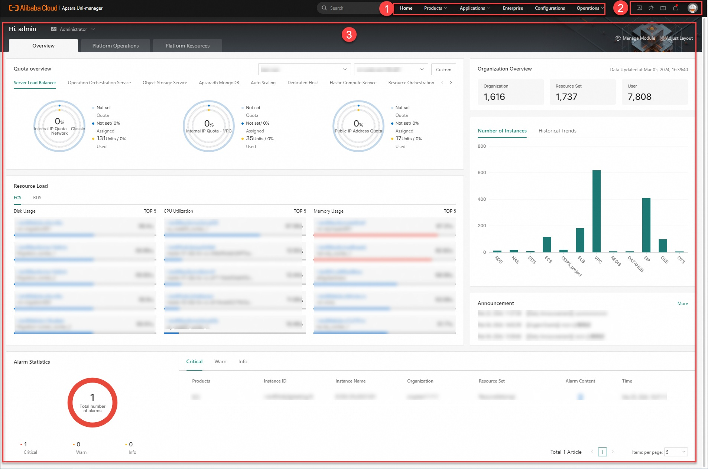

Table 1. Sections of the homepage

| Section | Description |
| --- | --- |

<table>
  <tr>
    <td>1</td>
    <td>Top navigation bar</td>
    <td>This section includes the following modules:<br>• <strong>Home</strong>: You can view charts that show the usage and monitoring data of the resources in each region.<br>• <strong>Products</strong>: You can manage the basic cloud products and resources. For more information, see Overview of Products.<br>• <strong>Applications</strong>: Your can manage the cloud applications of your enterprise. For more information, see Overview of Applications.<br>• <strong>Enterprise</strong>: You can manage the organizations, resource sets, regions, changes, users, user groups, roles, data permissions, access control, permission boundaries, and AccessKey logs of your enterprise. For more information, see Overview of Enterprise.<br>• <strong>Configurations</strong>: You can manage resource pools, regions, password policies, authentication modes, specifications, menu settings, announcements, personalization settings, third-party authentication, message gateways, and RAM roles. For more information, see Overview of Configurations.<br>• <strong>Operations</strong>: You can perform management operations on your cloud resources, such as resource operations management, data analysis, and cost management. For more information, see Overview of Operations.<br>• <strong>Security</strong>: You can view operation logs and system logs, and create cloud security products.</td>
  </tr>
  <tr>
    <td>2</td>
    <td>Informatio n of the current logon user</td>
    <td><br>: allows you to switch between English, simplified Chinese, and<br>traditional Chinese.<br>/: allows you to switch between light mode and dark mode for the console.<br>: displays message notifications. You can click <strong>More</strong> to go to <strong>Message</strong><br><strong>Center</strong> for details of the messages.<br>• User Information: displays the <strong>User Information</strong>, <strong>View Version</strong>, and <strong>Log Out</strong><br>menu items when you click theprofile picture.<br>If you click <strong>User Information</strong>, you can perform the following operations on the page that appears:<br>• View basic information.<br>• Modify user information.<br>• Change the logon password.<br>• View and create AccessKey pairs.<br>• Switch to other roles.<br>• View the current role policy.<br>• View the resource sets, user groups, and role permissions of the current user.<br>• View or bind multi-factor authentication (MFA) devices.<br>• Enable or disable system message reception by email or DingTalk.<br>If you click <strong>View Version</strong>, you can view the authorization status and build number of the Apsara Uni-manager Management Console.</td>
  </tr>
  <tr>
    <td>3</td>
    <td>Operation section</td>
    <td>You can adjust the operation section by performing the following operations:<br>• Click <strong>Manage Module</strong> in the upper-right corner to select the modules that you want to display on the page.<br>• Click <strong>Adjust Layout</strong> in the upper-right corner and drag the modules to adjust their positions.</td>
  </tr>
</table>

**Overview of Products**

You can click **Products** to manage cloud service resources throughout their lifecycle. You can click the name of a cloud service and perform management operations on related resources, such as creating, modifying, and deleting resources. For more information about the use of these cloud services, see the user guides of these cloud services.

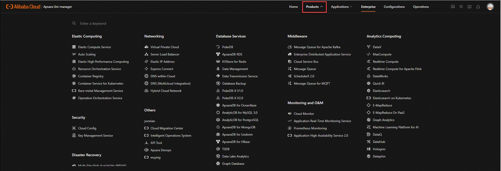

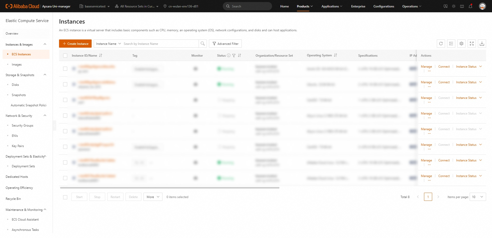

> **Note**
>
> You can click the  icon in the lower-right corner of a cloud service page to view the
>
> documentation. You can also enter a keyword in the search box. The system will quickly find the related documentation.

**Overview of Applications**

You can click **Applications** to manage your cloud applications.

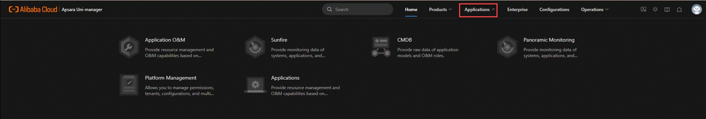

**Overview of Enterprise**

You can click **Enterprise** to build a resource management system that suits your enterprise, including creating an organization, creating a resource set, creating a user, and managing permissions. For more information about management operations, see Enterprise.

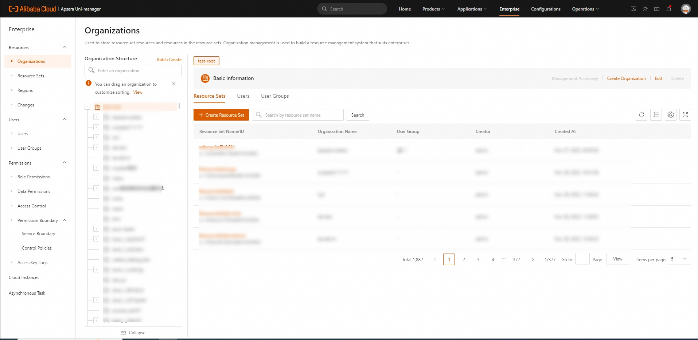

**Overview of Configurations**

You can click **Configurations** to manage the basic settings of the Apsara Uni-manager Management Console in a comprehensive and centralized manner. The super administrator can perform a series of detailed control and settings on objects such as resource pools, regions, security policies, authentication modes, specifications, menus, announcements, personalized configurations, third-party authentication, and message gateways. For more information, see Configurations.

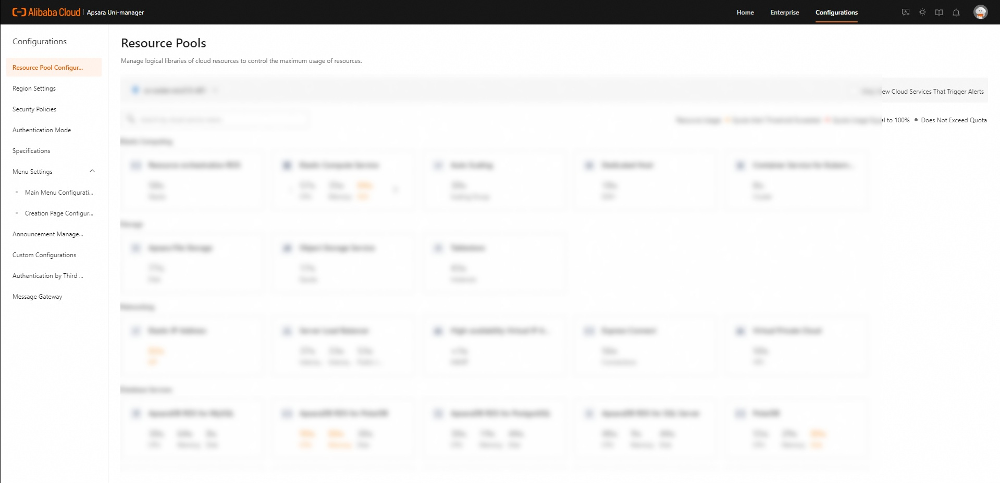

**Overview of Operations**

You can click **Operations** to manage cloud resources, including resource operations, data analysis, and cost management. This helps you control costs and optimize user experience in a more effective manner. For more information, see Operations.

**Resource operations**

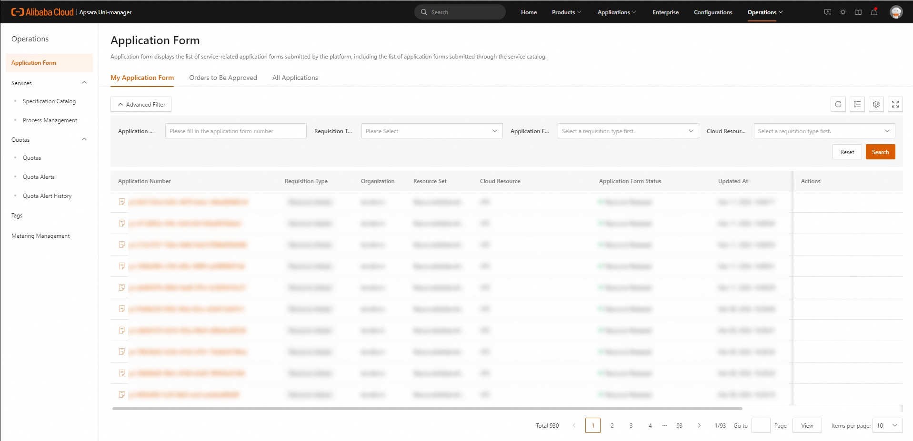

**Data analysis**

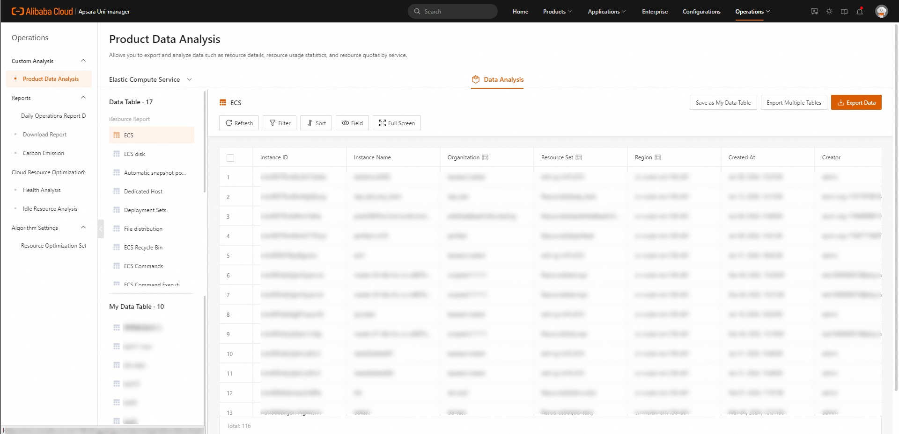

**Cost management**

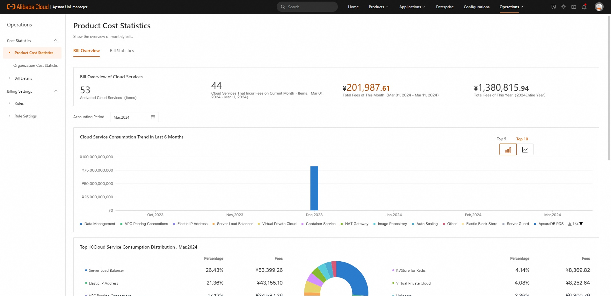

<a id="section-2-2"></a>

## 2.2. Introduction to organization and permission models

The Apsara Uni-manager Management Console allows you to efficiently manage resources. To allow enterprises to manage the resources of multi-level organizations and projects, the Apsara Uni-manager Management Console introduces organizations and resource sets for resource management.

**Organizational structure**

The Apsara Uni-manager Management Console provides the following features based on the multi-level organization structure of enterprises:

As a tree structure, an organizational structure consists of a root organization and multiple organizational units. The root organization is automatically generated by the system and is located at the top of the tree structure. An organizational structure can have multiple organizational units, which indicate the subsidiaries or departments of an enterprise. Organizational units are parallel.

> **Note**
>
> An organization unit has only one level-1 organization. A level-1 organization can have multiple subordinate organizations. By default, an organization unit can have up to five levels of organizations.

In the Apsara Uni-manager Management Console, cloud resources and users belong to Apsara Stack tenant accounts and each level-1 organization corresponds to an Apsara Stack tenant account. The subordinate organizations of a level-1 organization and the related users belong to the Apsara Stack tenant account that the level-1 organization corresponds to.

After a level-1 organization is created, the system automatically generates an AccessKey pair for the organization. An AccessKey pair consists of an AccessKey ID and an AccessKey secret. AccessKey pairs are used to authenticate request senders. The AccessKey ID is used to identify a user. The AccessKey secret is used to encrypt a signature string.

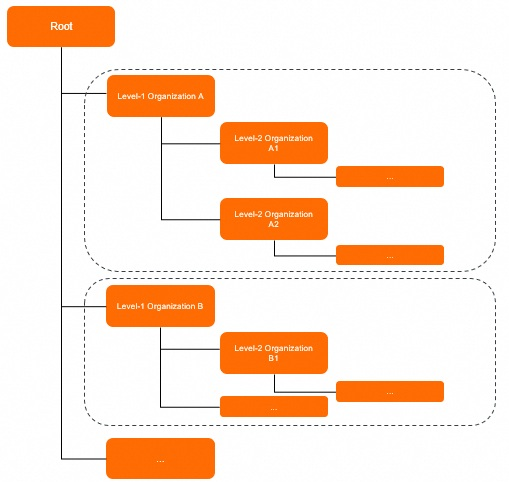

**Relationships between items**

- **Organization**: Resources and accounts belong to organizations. An organization does not manage resources. Instead, the organization classifies resources into resource sets that belong to the organization. Organizations are similar to the subsidiaries or departments of enterprises.

- **User**: Users are user accounts associated with roles. When you create a user, you must associate the user with a role to grant the permissions of the role to the user. User accounts are used to log on to the Apsara Uni-manager Management Console.

- **User group**: A user group contains a group of users who have the same permissions. User groups can be associated with roles in the same way as users. This allows you to grant permissions to all users in a user group at a time.

- **Role**: A role specifies a set of access permissions. When you create users, you need to associate different roles with the users to grant various access permissions to the users based on your business requirements.

- **Resource set**: Similar to a project of an enterprise, a resource set allows you to manage resources in a centralized manner. All resources are added to resource sets. Users or user groups can manage resources in a resource set after they are added to the resource set.

| Relationship between two items | Relationshi p type | Description |
| --- | --- | --- |
| Organization and resource set | One-to-many | An organization can have multiple resource sets, but a resource set can belong to only a single organization. |
| Organization and user | One-to-many | An organization can have multiple users, but a user can belong to only a single organization. |
| User and resource set | Many-to-many | A user can be added to multiple resource sets. A resource set can also be assigned to multiple users in the level-1 organization to which the resource set belongs. |
| User and role | Many-to-many | A user can have multiple roles. A role can be assigned to multiple users. |
| Resource set and resource | One-to-many | A resource set can have multiple resources, but a resource can belong to only a single resource set. |

**Role permissions**

The Apsara Uni-manager Management Console supports fine-grained permissions management. This allows you to grant various write and read permissions on varied cloud resources to different users.

A user can have multiple roles. However, you can switch to one role to manage resources.

- **Management permissions**: allows a role to perform specific operations in the Apsara Uni-manager Management Console. For example, you can grant management permissions to a role to authorize the role to perform operations on organizations, users, or resource sets.

- **Application permissions**: allows a role to perform operations on cloud services. You can grant application permissions to a role to allow the role to perform specific operations on specific cloud services. For example, if you want to authorize the role to only view Elastic Compute Service (ECS) instances, you need to only select the ECS instance view permissions on the Application permissions wizard page.

- **Menu permissions**: allow a role to view specific menus. This achieves menu access control. If you grant management permissions on the Apsara Uni-manager Management Console and application permissions on cloud services to a role, you must grant menu permissions on the console to the role. This prevents the role from being unable to see corresponding menus.

- **Custom policy**: You can attach a custom Resource Access Management (RAM) policy to a role to allow or prohibit the role from performing specific operations on specific resources. When you configure a custom policy, you must specify the Allow and Deny parameters in the Set RAM Action for Application section. Enter the name of an action that you want to allow for the Allow parameter and enter the name of an action that you want to deny for the Deny parameter. If you specify both the Allow and Deny parameters, the deny authorization takes precedence over the allow authorization.


**Account permission model**

The Apsara Uni-manager Management Console provides a system that integrates accounts with permissions based on the permissions and account systems of Apsara Stack. In this system, accounts and roles are separately managed. You can flexibly control the permissions in Apsara Stack by associating accounts with roles.

In the Apsara Uni-manager Management Console, you can associate accounts with roles to grant or remove the permissions on corresponding resources.

The following figure shows the account permission model in the Apsara Uni-manager Management Console.

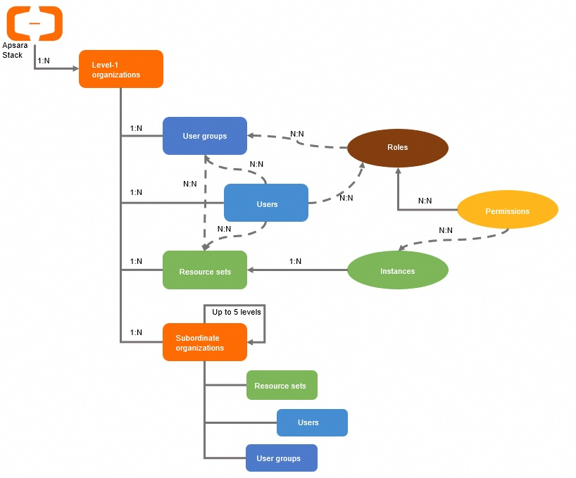

You can use one of the following three methods to grant permissions to users in the Apsara Uni-manager Management Console:

- **Associate a preset role or a custom role with a user**

  You can associate a preset role or a custom role with a user. This is a common authorization method.

  - Preset roles are a set of roles that are preset by the system and have specific permissions. These roles have permissions for common operations and can be directly assigned to users. This simplifies the process of permissions configuration. For more information, see Preset roles.

  - Administrators can configure custom permissions for custom roles based on their business requirements. This ensures that the user permissions match their responsibilities and prevents excessive or insufficient permissions. For more information, see Create a role.

    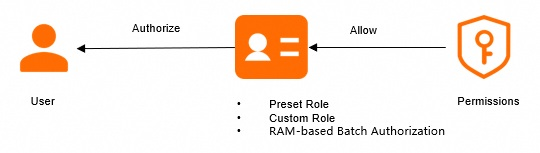

- **Grant permissions to multiple users by using a user group**

  To grant the same permissions to multiple users, you can add these users to a user group and associate the user group with a role that has the corresponding permissions. This way, users in the user group are granted the same permissions. For more information, see User groups.

  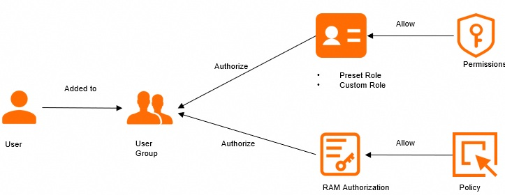

- **Grant data permissions to users**

  You can grant data permissions to users, which is a critical authorization way. On the Data Permissions page, you can accurately grant access, operation, or management permissions to users on specific resources based on the business requirements of the users. This way, users can efficiently use the required data within their scope of responsibility. You can grant data permissions on resource instances to users. This enhances fine-grained management. For more information, see Data permissions.

  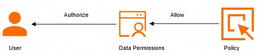

**Benefits**

- Clear hierarchical relationships

  Hierarchical relationships between enterprise organizations are clearly displayed.

- Easy management

  Managers can clearly understand various departments and teams and can easily manage the departments and teams.

- High flexibility

  Organization and permission models can be adjusted based on the business requirements of enterprises.

<a id="section-2-3"></a>

## 2.3. Initial configuration

<a id="section-2-3-1"></a>

### 2.3.1. Preset roles

To implement separation of privilege, the Apsara Uni-manager Management Console provides several preset roles based on common use cases in cloud platforms. Each role comes with a collection of permissions that fit their definition.

Before you use the Apsara Uni-manager Management Console, make sure that you are familiar with the preset roles, including their permissions. This way, you can use the preset roles to properly manage the cloud platform.

- The Management scope column specifies the management scope of role permissions.

  - All organizations: The role has permissions on all organizations.

  - Specified organization and its subordinate organizations: The role has permissions on an organization and its subordinate organizations.

  - Resource set: The role has permissions on the resource sets of the associated user.

- The Permission list column specifies the management permissions of roles in the Apsara Uni-manager Management Console.

> **Note**
>
> - The preset roles and their permissions cannot be modified or deleted.
>
> - Basic permissions in the Permission list column refer to a set of encapsulated permissions to perform basic operations, such as viewing the homepage and managing user information.

**Platform administrator (the username of the preset role is super)**

Initializes the configurations of the Apsara Uni-manager Management Console, such as the technical component configurations, language configurations, and customization settings.

**Managem**

**Permission list**

**ent scope**

- **User management**

  View, create, delete, enable, disable, and manage users.

  > **Note**
  >
  > The platform administrators can view only preset users and custom operations administrators.
  >
  > - Preset users: Platform administrators can only view preset users.
  >
  > - Custom operations administrators: Platform administrators

**Enterpri**

> can manage custom operations administrators.

**se**

- **AccessKey management**

  View the AccessKey pairs of users and AccessKey logs.

- **Access policy**

  View, create, delete, and manage access policies.

- **Service-linked role**

  View and create service-linked roles.

**All organizati**

- **Menu management**

**ons**

Manage menus.

**Configu ration**

- **Announcement**

  Manage announcements.

- **OpenAPI Explorer**

  View and modify page integration configurations, and modify custom settings.

**Others**

- **System configuration**

  Configure the system.

**Basic**

- **Basic permissions**

**permiss ions**

Have basic management permissions.

**Operations administrator (the username of the preset role is admin)**

Creates and manages organizations and resource sets, adds and manages users, assigns and manages roles, and activates and manages resources in the Apsara Stack console.

| Managem ent scope | Permission list |
| --- | --- |

- **API control policy**

  View, create, delete, and manage API control policies.

- **Role management**

  View, create, delete, manage, lock, and unlock roles, and grant permissions on cloud services to roles.

- **Service boundary**

  View, create, manage, delete, enable, and disable service boundaries.

- **User management**

  View, create, delete, enable, disable, lock, unlock, and manage users.

- **Tag management**

  Manage tags.

- **AccessKey management**

  View the AccessKey pairs of users and organizations, create AccessKey

**Enterpri**

pairs for organizations, delete, enable, and disable the AccessKey pairs

**se**

of organizations, and view AccessKey logs.

- **Resource set management**

  View, create, delete, and manage resource sets.

- **User group management**

  View, create, delete, and manage user groups.

- **Organization management**

  View, create, delete, and manage organizations.

- **Access policy**

  View, create, delete, and manage access policies.

- **Change management**

  Change organizations, resource sets, users, or resources.

- **Service-linked role**

  View and create service-linked roles.

All organizatio ns

- **Quota management**

  View and manage quotas.

- **Operation log**

  View and set the storage mode of operation logs.

- **Service catalog**

  View, create, modify, delete, publish, unpublish, and grant permissions on service catalogs.

- **Idle resource analysis**

  View the idle resource analysis.

- **Carbon footprint report**

  View the carbon footprint reports of organizations and resource sets, and export carbon footprint reports.

- **Process management**

**Operati**

View, create, modify, publish, withdraw, and delete processes, and view

**ons**

organization applications.

- **Report download**

  View, create, and delete tasks, download reports, and view and create report pushing rules.

- **Usage statistics**

  View and export usage statistics.

- **Bill management**

  View the bills of organizations and resource sets, and export and modify bills.

- **Billing management**

  View, manage, create, and delete prices.

- **Health analysis**

  View health statuses, and view and modify resource optimization configurations.

- **Announcement**

  Manage announcements.

**Configu ration**

- **Multi-cloud management platform hosting**

  Configure multi-cloud management platform hosting.

- **OpenAPI Explorer**

**Others**

View call statistics, view and modify page integration configurations, and modify custom settings.

**Basic**

- **Basic permissions**

**permissi**

Have basic management permissions.

**ons**

**Organization administrator**

Manages the specified organization, creates and manages subordinate organizations, creates and manages resource sets, adds and manages users, assigns and manages roles, activates and manages resources, assigns administrators and quotas to subordinate organizations and resource sets, and approves resource applications based on service process settings.

Managem

Permission list

ent scope

- **Role management**

  View, create, delete, and manage roles, and grant permissions on cloud services to roles.

- **User management**

  View, create, delete, enable, disable, and manage users.

- **Tag management**

  Manage tags.

- **AccessKey management**

  View the AccessKey pairs of users and organizations, create AccessKey pairs for organizations, delete, enable, and disable the AccessKey pairs of organizations, and view AccessKey logs.

- **Resource set management**

**Enterpris e**

View, create, delete, and manage resource sets.

- **User group management**

  View, create, delete, and manage user groups.

- **Organization management**

  View, create, delete, and manage organizations.

- **Access policy**

  View, create, delete, and manage access policies.

- **Change management**

  Change organizations, resource sets, users, or resources.

- **Service-linked role**

  View and create service-linked roles.

Specified organizati on and its subordina te organizati ons

- **Quota management**

  View and manage quotas.

- **Service catalog**

  View, create, modify, delete, publish, unpublish, and grant permissions on service catalogs.

- **Idle resource analysis**

  View the idle resource analysis.

- **Carbon footprint report**

  View the carbon footprint reports of organizations and resource sets, and export carbon footprint reports.

**Operatio**

- **Process management**

**ns**

View processes and organization applications.

- **Report download**

  View, create, and delete tasks, download reports, and view and create report pushing rules.

- **Usage statistics**

  View and export usage statistics.

- **Bill management**

  View the bills of organizations and resource sets, and export bills.

- **Health analysis**

  View health statuses and resource optimization configurations.

- **OpenAPI Explorer**

**Others**

View call statistics and page integration configurations.

**Basic**

- **Basic permissions**

**permissi**

Have basic management permissions.

**ons**

**Resource set administrator**

Manages the specified resource set, adds and manages users, activates and manages resources, and approves resource applications based on service process settings.

| Manage ment scope | Permission list |
| --- | --- |

<table>
  <tr>
    <td rowspan="3">Resource set</td>
    <td>Enterpris e</td>
    <td>• User management<br>View users.<br>• Tag management<br>Manage tags.<br>• AccessKey management<br>View AccessKey logs.<br>• Resource set management<br>View and manage resource sets.<br>• User group management<br>View user groups.<br>• Organization management<br>View organizations.</td>
  </tr>
  <tr>
    <td>Operatio ns</td>
    <td>• Quota management<br>View quotas.<br>• Idle resource analysis<br>View the idle resource analysis.<br>• Carbon footprint report<br>View the carbon footprint reports of organizations and resource sets, and export carbon footprint reports.<br>• Report download<br>View, create, and delete tasks, download reports, and view and create report pushing rules.<br>• Usage statistics<br>View and export usage statistics.<br>• Health analysis<br>View health statuses.</td>
  </tr>
  <tr>
    <td>Basic permissi ons</td>
    <td>• Basic permissions<br>Have basic management permissions.</td>
  </tr>
</table>

**Resource user**

Uses the cloud resources created and allocated by the operations administrator.

| Manage ment scope | Permission list |
| --- | --- |

<table>
  <tr>
    <td rowspan="3">Resource set</td>
    <td>Enterpris e</td>
    <td>• Tag management<br>Manage tags.<br>• Resource set management<br>View resource sets.<br>• Organization management<br>View organizations.<br>• Service-linked role<br>View service-linked roles.</td>
  </tr>
  <tr>
    <td>Operatio ns</td>
    <td>• Idle resource analysis<br>View the idle resource analysis.<br>• Report download<br>View and create report pushing rules.</td>
  </tr>
  <tr>
    <td>Basic permissi ons</td>
    <td>• Basic permissions<br>Have basic management permissions.</td>
  </tr>
</table>

**Resource auditor (the username of the preset role is auditor)**

Has read-only permission on all resources in Apsara Stack.

**Manage ment**

**Permission list**

**scope**

- **Role management**

  View roles.

- **User management**

  View users.

- **AccessKey management**

  View AccessKey logs.

- **Resource set management**

**Enterpri se**

View resource sets.

- **User group management**

  View users.

- **Organization management**

  View organizations.

- **Access policy**

  View access policies.

- **Quota management**

  View quotas.

**All**

- **Operation log**

**organiza**

View and download operation logs, and view the storage mode of

**tions**

operation logs.

- **Service catalog**

  View service catalogs.

- **Idle resource analysis**

  View the idle resource analysis.

- **Process management**

**Operatio**

View organization applications.

**ns**

- **Report download**

  View tasks, download reports, and view and create report pushing rules.

- **Usage statistics**

  View and export usage statistics.

- **Bill management**

  View the bills of organizations and resource sets, and export bills.

- **Billing management**

  View prices.

- **Health analysis**

  View health statuses and resource optimization configurations.

**Basic**

- **Basic permissions**

**permissi**

Have basic management permissions.

**ons**

**Organization resource auditor**

Has read-only permissions on all resources in the organization to which it belongs.

| Manage ment scope | Permission list |
| --- | --- |

<table>
  <tr>
    <td rowspan="3">Specified organiza tion and its subordin ate organiza tions</td>
    <td>Enterpris e</td>
    <td>• Role management<br>View roles.<br>• User management<br>View users.<br>• AccessKey management<br>View AccessKey logs.<br>• Resource set management<br>View resource sets.<br>• User group management<br>View user groups.<br>• Organization management<br>View organizations.<br>• Access policy<br>View access policies.</td>
  </tr>
  <tr>
    <td>Operatio ns</td>
    <td>• Quota management<br>View quotas.<br>• Operation log<br>View and download operation logs.<br>• Service catalog<br>View service catalogs.<br>• Idle resource analysis<br>View the idle resource analysis.<br>• Process management<br>View organization applications.<br>• Report download<br>View tasks, download reports, and view and create report pushing rules.<br>• Usage statistics<br>View and export usage statistics.<br>• Bill management<br>View the bills of organizations and resource sets, and export bills.<br>• Health analysis<br>View health statuses and resource optimization configurations.</td>
  </tr>
  <tr>
    <td>Basic permissi ons</td>
    <td>• Basic permissions<br>Have basic management permissions.</td>
  </tr>
</table>

**Security auditor**

Audits the security of Apsara Stack.

<table>
  <tr>
    <th>Manage ment scope</th>
    <th colspan="2">Permission list</th>
  </tr>
  <tr>
    <td rowspan="3">All organiza tions</td>
    <td>Operatio ns</td>
    <td>• Operation log<br>View and download operation logs.</td>
  </tr>
  <tr>
    <td>Others</td>
    <td>• OpenAPI Explorer<br>View call statistics and page integration configurations.</td>
  </tr>
  <tr>
    <td>Basic permissi ons</td>
    <td>• Basic permissions<br>Have basic management permissions.</td>
  </tr>
</table>

**Platform security administrator**

Uses Cloud Security Operation Center (SOC) to manage the security of Apsara Stack.

<table>
  <tr>
    <th>Manage ment scope</th>
    <th colspan="2">Permission list</th>
  </tr>
  <tr>
    <td rowspan="2">All organiza tions</td>
    <td>Operatio ns</td>
    <td>• Operation log<br>View and download operation logs.</td>
  </tr>
  <tr>
    <td>Basic permissi ons</td>
    <td>• Basic permissions<br>Have basic management permissions.</td>
  </tr>
</table>

**Global organization security administrator (the username of the preset role is yundunadmin)**

Uses SOC to conduct security management for Apsara Stack and all tenants, and manages security products related to Elastic Compute Service (ECS).

| Manage ment scope | Permission list |
| --- | --- |

<table>
  <tr>
    <td rowspan="3">All organiza tions</td>
    <td>Enterpris e</td>
    <td>• Role management<br>View, create, delete, and manage roles.<br>• User management<br>View, enable, disable, and manage users.<br>• AccessKey management<br>View AccessKey logs.<br>• Resource set management<br>View resource sets.<br>• Organization management<br>View organizations.<br>• Service-linked role<br>View and create service-linked roles.</td>
  </tr>
  <tr>
    <td>Operatio ns</td>
    <td>• Operation log<br>View and download operation logs.</td>
  </tr>
  <tr>
    <td>Basic permissi ons</td>
    <td>• Basic permissions<br>Have basic management permissions.</td>
  </tr>
</table>

**Organization security administrator**

Uses SOC to manage the security of hosts, applications, and networks for an organization. This role also manages security products related to ECS.

<table>
  <tr>
    <th>Manage ment scope</th>
    <th colspan="2">Permission list</th>
  </tr>
  <tr>
    <td rowspan="3">Specified organiza tion and its subordin ate organiza tions</td>
    <td>Enterpris e</td>
    <td>• Resource set management<br>View resource sets.<br>• Organization management<br>View organizations.<br>• Service-linked role<br>View and create service-linked roles.</td>
  </tr>
  <tr>
    <td>Operatio ns</td>
    <td>• Operation log<br>View and download operation logs.</td>
  </tr>
  <tr>
    <td>Basic permissi ons</td>
    <td>• Basic permissions<br>Have basic management permissions.</td>
  </tr>
</table>

**Security system configuration administrator**

Configures system security features such as the upgrade center and global configurations.

<table>
  <tr>
    <th>Manage ment scope</th>
    <th colspan="2">Permission list</th>
  </tr>
  <tr>
    <td rowspan="2">All organiza tions</td>
    <td>Operatio ns</td>
    <td>• Operation log<br>View and download operation logs.</td>
  </tr>
  <tr>
    <td>Basic permissi ons</td>
    <td>• Basic permissions<br>Have basic management permissions.</td>
  </tr>
</table>

**Platform security auditor**

Uses SOC to check the security conditions of Apsara Stack.

<table>
  <tr>
    <th>Manage ment scope</th>
    <th colspan="2">Permission list</th>
  </tr>
  <tr>
    <td rowspan="2">All organiza tions</td>
    <td>Operatio ns</td>
    <td>• Operation log<br>View and download operation logs.</td>
  </tr>
  <tr>
    <td>Basic permissi ons</td>
    <td>• Basic permissions<br>Have basic management permissions.</td>
  </tr>
</table>

**Global organization security auditor**

Uses SOC to check the security conditions of all organizations.

<table>
  <tr>
    <th>Manage ment scope</th>
    <th colspan="2">Permission list</th>
  </tr>
  <tr>
    <td rowspan="2">All organiza tions</td>
    <td>Operatio ns</td>
    <td>• Operation log<br>View and download operation logs.</td>
  </tr>
  <tr>
    <td>Basic permissi ons</td>
    <td>• Basic permissions<br>Have basic management permissions.</td>
  </tr>
</table>

**Platform security configuration administrator**

Configures security services in Apsara Stack, such as Server Guard and Web Application Firewall (WAF).

<table>
  <tr>
    <th>Manage ment scope</th>
    <th colspan="2">Permission list</th>
  </tr>
  <tr>
    <td rowspan="2">All organiza tions</td>
    <td>Operatio ns</td>
    <td>• Operation log<br>View and download operation logs.</td>
  </tr>
  <tr>
    <td>Basic permissi ons</td>
    <td>• Basic permissions<br>Have basic management permissions.</td>
  </tr>
</table>

<a id="section-2-3-2"></a>

### 2.3.2. Configuration description

Before you use the Apsara Uni-manager Management Console, you must complete a series of basic configuration operations as an administrator, such as creating organizations, resource sets, users, and roles and initializing resources. This is the initial system configuration.

The Apsara Uni-manager Management Console manages the organizations, resource sets, users, and roles of cloud data centers in a centralized and service-oriented manner to grant different resource access permissions to different users.

- Organization

  After the Apsara Uni-manager Management Console is deployed, a root organization is automatically generated. You can create other organizations under the root organization.

  Organizations are displayed in a hierarchical structure. You can create subordinate organizations under each organization level.

- Resource Set

  A resource set is a container used to store resources. Each resource must belong to a resource set.

- User

  A user is a resource manager and user.

- Role

  A role is a set of access permissions. You can assign different roles to different users to implement system access control to meet a variety of different requirements.

The following table describes the relationships among organizations, resource sets, users, roles, and cloud resources.

| Relationship between two items | Relationsh ip type | Description |
| --- | --- | --- |
| Organization and resource set | One-to-many | An organization can have multiple resource sets, but each resource set can belong to only a single organization. |
| Organization and user | One-to-many | An organization can have multiple users, but each user can belong to only a single organization. |
| Resource set and user | Many-to-many | A user can have multiple resource sets, and a resource set can be assigned to multiple users under the same level-1 organization. |
| User and role | Many-to-many | A user can have multiple roles, and a role can be assigned to multiple users. |
| Resource set and resource | One-to-many | A resource set can have multiple resources, but each cloud resource can belong to only a single resource set. |

<a id="section-2-3-3"></a>

### 2.3.3. Configuration process

Before users can the Apsara Uni-manager Management Console, administrators must complete the initial system configuration based on the process shown in the following figure.

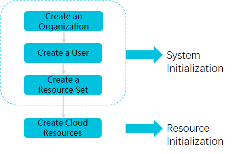

1. Create an organization

   Create an organization to store resource sets and their resources.

2. Create a user

   Create users and assign the users different roles to meet different requirements for system access control.

3. Create a resource set

   Create a resource set before you apply for resources.

   Users that have the permissions on a resource set can use the resources in the resource set. For information about how to authorize a user to use a resource set, see the Grant users the permissions on a resource set section of the "Manage resource sets" topic.

4. Create cloud resources

   Create instances in the consoles of cloud services based on project requirements. For more information about how to create cloud service instances, see the user guide of each cloud service.

<a id="section-2-4"></a>

## 2.4. Log on to the Apsara Uni-manager Management Console

This topic describes how to log on to the Apsara Uni-manager Management Console.

**Prerequisites**

- The URL of the Apsara Uni-manager Management Console is obtained from the deployment personnel.

- A web browser is available. We recommend that you use Google Chrome.

**Procedure**

1. Enter the URL of the Apsara Uni-manager Management Console in the address bar and press the Enter key.

   > **Note**
   >
   > - You can click the current language in the upper-right corner to switch to another language.

2. Enter your username and password.

   Obtain the username and password from an operations administrator.

   > **Note**
   >
   > - **First logon**
   >
   >   The first time you log on to the Apsara Uni-manager Management Console, you must change the password of your account. The password must be 10 to 32 characters in length. It must contain all of the following character types: uppercase letters, lowercase letters, digits, and special characters. Supported special characters: ! @ # $ %
   >
   > - **Forget password**
   >
   >   If you forgot your password, click Forgot Password and enter the username of your account, the email address that was used to create your account, and the verification code. Then, a URL is sent to the specified email address. You can click the URL to reset the password.

3. Click **Log On**.

4. If multi-factor authentication (MFA) is enabled for your account, perform the corresponding operations in the following scenarios:

   - **This is your first time logging on to the Apsara Uni-manager Management Console after MFA is enabled by the administrator.**

     <ol type="a">

     <li>

     On the Bind Virtual MFA Device page, bind an MFA device.

     </li>

     <li>

     Enter the username and password again as in Step 2 and click **Log On**.

     </li>

     </ol>

     <ol type="i" start="100">

     <li>

     Enter a six-digit MFA verification code and click **Authenticate**.

     </li>

     </ol>

   - **You have enabled MFA and bound an MFA device.**

     Enter a six-digit MFA verification code and click **Authenticate**.

     > **Note**
     >
     > For information about how to enable MFA and bind an MFA device, see Manage MFA.

<a id="section-3"></a>

# 3.Portal home pages

Portal home pages show the usage and monitoring status of system resources in different regions from different dimensions in charts. This helps you understand the overall resource status and provides supporting data for refined operations and statistical analysis.

The modules and layouts of portal home pages vary based on the user role. The following sections describe the **home page for platform administrators**, **home page for operations administrators**, **home page for organization administrators**, and **home page for resource set administrators** that are supported by default. Portal home pages, modules, and layouts for other roles or custom roles are automatically matched based on the defined scope of permissions and authorized permissions.

Click **Manage Module** on the home page. You can select or deselect specific modules to determine the modules displayed on the home page. Click **Adjust Layout** on the home page and drag the module card that you want to manage to adjust the position of the module.

> **Note**
>
> You can perform resource lifecycle management operations, such as creating and deleting resources, in the service consoles. To manage the lifecycle of resources, click **Products** in the upper part of the Apsara Uni-manager Management Console, and create or manage services based on your business requirements.
>
> 

**Home page for platform administrators**

The home page shows the overview of quotas, organizations, and resource loads from the cloud platform dimension.

Tab

**Parameter**

**Description**

Shows the quota, assigned quota, and used quota of cloud services in the current region from the cloud platform dimension.

> **Note**
>
> - Select a region from the region drop-down list to view the

Quota

> quota of cloud services in the region based on your business

Overview

> requirements.
>
> - Click **Custom**. In the **Add Cloud products** dialog box, add or remove cloud services. You can customize the cloud services that are displayed and add up to 10 cloud services.

Organization

Shows the number of organizations, resource sets, and users from the

Overview

cloud platform dimension.

Announceme

Shows related O&M, operations, and upgrade notifications. Click More to

nt

go to the announcement list and view more announcements.

Shows the top 5 memory usage, top 5 disk usage, and top 5 CPU usage

Overvie

Resource

of Elastic Compute Service (ECS) and ApsaraDB RDS instances from the

w

Load

cloud platform dimension.

Number of

Shows the number of instances of cloud services from the cloud platform

Instances

dimension and helps you understand the usage of the cloud services.

Shows recent usage trends of cloud services from the cloud platform dimension and helps you understand the overall usage of the cloud

Historical

services.

Trends

Shows the alarms generated on the cloud platform, including the total

Alarm

number of alarms, number of alarms in different severity levels, and

Statistics

alarm information. The statistics help you quickly locate alarms and provide effective data support for quickly removing alarms.

**Home page for operations administrators**

The home page shows the overview of quotas, organizations, and resource loads. The home page also shows information about platform operations and platform resources from the cloud platform dimension.

**Tab**

**Parameter**

**Description**

Shows the quota, assigned quota, and used quota of cloud services in the current region from the cloud platform dimension.

> **Note**
>
> - Select an organization and a region from the drop-down

Quota

> lists to view the quota of cloud services for the organization

Overview

> in the region based on your business requirements.
>
> - Click **Custom**. In the dialog box that appears, add or remove cloud services. You can customize the cloud services that are displayed and add up to 10 cloud services.

Organization

Shows the number of organizations, resource sets, and users from the

Overview

cloud platform dimension.

Announceme

Shows related O&M, operations, and upgrade notifications. Click More

nt

to go to the announcement list and view more announcements.

Resource

Shows the top 5 memory usage, top 5 disk usage, and top 5 CPU usage

Overview

Load

of ECS and ApsaraDB RDS instances from the cloud platform dimension.

Shows the number of instances of cloud services from the cloud

Number of

platform dimension and helps you understand the usage of the cloud

Instances

services.

Shows recent usage trends of cloud services from the cloud platform

Historical

dimension and helps you understand the overall usage of the cloud

Trends

services.

Shows the alarms generated on the cloud platform, including the total number of alarms, number of alarms in different severity levels, and alarm information. The statistics help you quickly locate alarms and

Alarm

provide effective data support for quickly removing alarms.

Statistics

The alarm severity levels include Critical, Warn, and Info. You can view more alarm information in CloudMonitor.

Organization

Shows the number of organizations, resource sets, and users from the

Overview

cloud platform dimension.

Service

Shows the number of pending orders and all orders on the cloud

Orders

platform.

Shows the regions from the cloud platform dimension and helps you

Regions

understand the regional distribution.

Platform Operatio ns

Shows the number of resources used by each organization on the cloud

Resources

platform, and shows the total number of resources in descending order.

Shows the number of cloud services activated by each organization on

Activated

the cloud platform, and shows the total number of activated services in

Services

descending order.

Resource

Shows the number of resource sets for each organization on the cloud

Sets

platform.

Shows the number of virtual resources (cloud services and instances)

Virtual

from the cloud platform dimension.

Resource Overview

Physical

Shows the number of physical resources from the cloud platform

Resource

dimension, such as servers, racks, network devices, and data centers.

Overview

Platform Resource s

Shows the overall resource health score in the last 30 days from the cloud platform dimension. The health score is calculated based on the utilization, idle status, and compliance analysis of each cloud resource on the cloud platform.

Platform

- 0 to 50 points: poor

Resource Health

- 51 to 70 points: general

- 71 to 90 points: moderate

- 91 to 100 points: healthy

Shows the resource health analysis from the organization or resource

Resource

set dimension. Click Sort by Health Score in Ascending Order or Sort by

Health

Health Score in Descending Order to view health scores in ascending or

Analytics

descending order.

Shows the total number of physical servers that are based on different

Server

chips from the data center dimension. You can click a chip name in the

Distribution

legend to filter servers by chip.

Shows the number of instances that have been created for each cloud service from the chip dimension.

Instance

The data source is the total number of resources within the

Distribution

management scope of the current user. A delay of more than 10 minutes occurs when the data is updated.

Multi-chip Architect ure in One

Shows the top 5 memory usage, top 5 disk usage, and top 5 CPU usage

Resource

Cloud

of ECS and ApsaraDB RDS instances from the cloud platform dimension

Load

and the chip types of instances.

Shows the alarm information from the cloud platform dimension, which is similar to the Alarm Statistics section on the Overview tab. The difference is that this section shows chip type information about

Alarm

instances.

Statistics

The alarm severity levels include Critical, Warn, and Info. You can view more alarm information in CloudMonitor.

> **Note**
>
> The dashboard of multi-chip architecture in one cloud is displayed only when multiple chip models are deployed on the Apsara Stack platform.

**Home page for organization administrators**

The home page shows the overview, resource operations, and organization operations of the organization and its subordinate organizations.

| Tab | Parameter | Description |
| --- | --- | --- |

Shows the quota, assigned quota, and used quota of cloud services from the organization dimension.

> **Note**
>
> - Select an organization and a region from the drop-down lists to view the quota of cloud services for the organization

Quota

> in the region based on your business requirements.

Overview

> - Click **Custom**. In the dialog box that appears, add or remove cloud services. You can customize the cloud services that are displayed and add up to 10 cloud services.

Organization

Shows the number of organizations, resource sets, and users from the

Overview

organization dimension.

Announceme

Shows related O&M, operations, and upgrade notifications. Click More

nt

to go to the announcement list and view more announcements.

Overview

Resource

Shows the top 5 memory usage, top 5 disk usage, and top 5 CPU usage

Load

of ECS and ApsaraDB RDS instances from the organization dimension.

Number of

Shows the number of instances of cloud services from the organization

Instances

dimension and helps you understand the usage of the cloud services.

Shows recent usage trends of cloud services from the organization

Historical

dimension and helps you understand the overall usage of the cloud

Trends

services.

Shows the alarms generated in the organization, including the total number of alarms, number of alarms in different severity levels, and alarm information. The statistics help you quickly locate alarms and

Alarm

provide effective data support for quickly removing alarms.

Statistics

The alarm severity levels include Critical, Warn, and Info. You can view more alarm information in CloudMonitor.

Shows the number of resources in the last 3 months from the organization dimension.

> **Note**

Organization Resources

> You can select current organization or All Organizations. If the current organization has sub-organizations and you select All Organizations, resource statistics of the current organization and all its sub-organizations are displayed.

All Cloud

Shows the number of resources by all cloud service categories, and

Service

categories such as elastic computing, networking, big data, storage,

Categories

and security from the organization dimension.

Resource

Service

Shows the number of service orders from the organization dimension.

Operatio

Orders

ns

Shows the resource health score in the last 30 days from the organization dimension. The health score is calculated based on the utilization, idle status, and compliance analysis of each cloud resource in the organization.

Organization

0 to 50 points: poor

Resource Health

51 to 70 points: general

71 to 90 points: moderate

91 to 100 points: healthy

Organization

Shows the resource health analysis from the organization dimension.

Resource

Click Sort by Health Score in Ascending Order or Sort by Health Score in

Health

Descending Order to view health scores in ascending or descending

Analytics

order.

Shows the regions from the organization dimension and helps you

Regions

understand the regional distribution.

Organization

Shows the number of organizations, resource sets, users, and cloud

Overview

services from the organization dimension.

Allows you to quickly go to corresponding pages.

Shortcut

You can click the edit icon on the right side of the Shortcut section to customize a shortcut. You can specify up to six shortcuts.

Statistics for

Shows the fees in the last 12 months and the estimated fees for the

Current

next 3 months. Estimated fees are calculated based on the average

Organization

growth rate in the last 3 months and are for reference only.

Fee Ranking

Shows the organization fees of cloud service categories, cloud services,

and

and resource sets by Current Month, Last Month, and Accumulated

Composition

Fees.

Organizat ion

Cost and

Operatio

Shows the costs and resource health status by organization and

resource

ns

resource set. You can perform statistical analysis based on the data.

health

Cost and

Shows the costs and inventory by organization and resource set. You

resource

can perform statistical analysis based on the data.

retention Cloud product classification

Shows categories of cloud services and corresponding fees by This

fees

month, Last month, and Accumulated since its establishment.

Billing of

Shows specific cloud services and corresponding fees by This month,

cloud

Last month, and Accumulated since its establishment.

services

**Home page for resource set administrators**

Shows the resource overview and resource operations from the resource set dimension.

**Tab**

**Parameter**

**Description**

Shows the quota, assigned quota, and used quota of cloud services from the resource set dimension.

> **Note**
>
> - Select an organization, a resource set, and a region from

Quota

> the drop-down lists to view the quota of cloud services for

Overview

> the resource set of the organization in the region based on your business requirements.
>
> - Click **Custom**. In the dialog box that appears, add or remove cloud services. You can customize the cloud services that are displayed and add up to 10 cloud services.

Organization

Shows the number of organizations, resource sets, and users.

Overview

Announceme

Shows related O&M, operations, and upgrade notifications. Click More

nt

to go to the announcement list and view more announcements.

Overview

Shows the top 5 memory usage, top 5 disk usage, and top 5 CPU usage

Resource

of ECS and ApsaraDB RDS instances from the resource set dimension.

Load

Number of

Shows the number of instances for cloud services and helps you

Instances

understand the usage of the cloud services.

Historical

Shows recent usage trends of cloud services and helps you understand

Trends

the usage trends of the cloud services.

Shows current alarms, including the total number of alarms, number of

Alarm

alarms in different severity levels, and alarm information. The statistics

Statistics

help you quickly locate alarms and provide effective data support for quickly removing alarms.

<table>
  <tr>
    <td rowspan="5">Resource Operatio ns</td>
    <td>Shortcut</td>
    <td>Allows you to quickly go to corresponding pages.<br>You can click the edit icon on the right side of the Shortcut section to customize a shortcut. You can specify up to six shortcuts.</td>
  </tr>
  <tr>
    <td>Service Orders</td>
    <td>Shows the number of service orders from the resource set dimension.</td>
  </tr>
  <tr>
    <td>Resource Set Resource Statistics</td>
    <td>Shows the number of resources in the last 3 months from the resource set dimension.</td>
  </tr>
  <tr>
    <td>Resource health status</td>
    <td>Shows the resource health score in the last 30 days from the resource set dimension. The health score is calculated based on the utilization, idle status, and compliance analysis of each cloud resource in the resource set.<br>0 to 50 points: poor<br>51 to 70 points: general<br>71 to 90 points: moderate<br>91 to 100 points: healthy</td>
  </tr>
  <tr>
    <td>Recently Accessed Resources</td>
    <td>Shows information about recently accessed resource instances from the resource set dimension.</td>
  </tr>
</table>

<a id="section-4"></a>

# 4.Enterprise

<a id="section-4-1"></a>

## 4.1. Overview

Most modern enterprises are in hierarchical structures that are constantly evolving. To allow enterprises to manage cloud resources in a tiered manner, Apsara Stack provides the Enterprise component in the Apsara Uni-manager Management Console.

You can organize your resources on the platform by organizations and projects to implement cost-effective and refined resource management.

The Enterprise component consists of the following modules.

| Module | Description |
| --- | --- |
| Resources | The resource management features, such as organization management, resource set management, region management, and change management, allow you to build a resource management structure that suits your enterprise.You can easily manage the ownership of resources to improve resource utilization. |
| Users | The user management and user group management features allow you to manage the structure and permissions of users and user groups in a centralized manner. This can improve management efficiency and meet the various requirements for system and resource access. |
| Permissions | The permission management features, such as role permissions, data permissions, access control, permission boundaries, and AccessKey logs, allow you to manage permissions based on scenarios, users, and cloud services, thereby improving the system security. |

<a id="section-4-2"></a>

## 4.2. Resource management

<a id="section-4-2-1"></a>

### 4.2.1. Overview

In the Resources module, you can manage organizations, resource sets, regions, and changes. This way, you can build a resource management system that suits your enterprise. You can easily manage the ownership of resources to improve resource utilization.

**Organizations**

The Organizations page displays the organizational structure of your enterprise. Each organization can be defined as a company or department. You can build a resource management system that suits your enterprise on the Organizations page.

In the Apsara Uni-manager Management Console, organizations are where resources and resource sets belong. A root organization is created by default. It does not accommodate resources. Organizations that are directly subordinate to the root organization are level-1 organizations, and those that are directly subordinate to level-1 organizations are level-2 organizations, and so on. The lowest-level organizations are level-5 organizations.

After a level-1 organization is created, a cloud account and an AccessKey pair are automatically generated for the organization. The cloud account and the AccessKey pair are used to create resources in the system.

Operations for managing organizations:

- Basic operations: create organizations, modify organizations, delete organizations, change the sorting of organizations, and change the relationship between organizations.

- Manage the AccessKey pairs of organizations: create, disable, enable, and delete the AccessKey pairs of organizations.

**Resource sets**

Each time an organization is created, the system automatically creates a resource set for the organization.

A resource set is similar to a project and is a group of resources. Resource sets are isolated from each other. Therefore, you can use resource sets to isolate resources to solve complex issues such as user authorization. An organization can have multiple resource sets, but each resource set can belong to only a single organization.

When you create a resource, you need to select a resource set for the resource. Users who are added to the resource set can use the resources in the resource set.

Operations for managing resource sets:

- Create resource sets

- Change the names of resource sets

- Grant permissions to users in resource sets

- Delete resource sets

**Regions**

The Apsara Uni-manager Management Console allows you to manage multiple regions. You can manage and change the association between an organization and a region. This way, you can control the region in which the resources are created.

Regions can only be associated with level-1 organizations. An organization can be associated with multiple regions, and a region can be associated with multiple organizations.

**Changes**

The Apsara Uni-manager Management Console allows you to modify organizations, resources, and users in accordance with the changes of your organizations and projects. Changes cannot be made across level-1 organizations.

- Change organizations: You can change the hierarchical relationships of organizations at level 2 and lower. Level-1 organizations do not support changes in hierarchical relationships.

- Change resources: You can change the resource sets to which resources belong.

- Change users: You can change the organizations to which users belong and the roles of users, including the users that belong to level-1 organizations.

<a id="section-4-2-2"></a>

### 4.2.2. Organization management

<a id="section-4-2-2-1"></a>

#### 4.2.2.1. Create an organization

Organizations reflect the architecture of an enterprise. An organization can be defined as a company or department, and is the core of personnel and resource management. Organizations can meet requirements for hierarchical management and resource isolation. You can build a resource management system that meets the requirements of your enterprise by using organizations based on the business environment of your enterprise. This helps you establish hierarchical relationships between resources.

**Background information**

- In the Apsara Uni-manager Management Console, organizations are where resources and resource sets belong. A root organization is created by default. It does not accommodate any resource.

- The root organization contains level-1 organizations, the level-1 organizations contain level-2 organizations, and so on.

- When you create an organization, the system creates a resource set for the organization by default.

- When a level-1 organization is created, an AccessKey pair is automatically generated for that organization. The AccessKey pair consists of an AccessKey ID and an AccessKey secret, which are used to authenticate and authorize cloud service resources. You can change the AccessKey pair on a regular basis based on your business requirements. This enhances security. The system records AccessKey logs. You can detect abnormal activities and track and identify potential security threats in a timely manner based on the AccessKey logs.

**Limits**

- You can create up to five levels of organizations.

- You can create a maximum of 500 organizations at a time.

**Planning**

Before you create an organization, you need to plan an organizational architecture based on the business requirements of your enterprise. Example:

- Plan the organizational architecture by department and responsibility

  An enterprise is usually divided into different departments based on their business requirements and responsibilities, such as the human resources department, the sales department, and the R&D department. Each department has different responsibilities and provides different services.

- Plan the organizational architecture by business unit and geographical distribution

  Large enterprises usually divide their business into different units. Each business unit may be responsible for a specific product line or region.

**Create a single organization**

1. Log on to the Apsara Uni-manager Management Console.

2. In the top navigation bar, click **Enterprise**.

3. In the left-side navigation pane, choose **Resources** > **Organizations**.

4. In the left-side Organization Structure section of the **Organizations** page, select the parent organization and click **Create Organization** in the upper-right corner of the page.

   > **Note**
   >
   > - If you select the root organization, a level-1 organization is created.
   >
   > - If you need to create a level-2 organization, you must select a level-1 organization. You can create up to five levels of organizations.
   >
   > - An operations administrator can create level-1 to level-5 organizations. An organization administrator can create only subordinate organizations under the organization to which the organization administrator belongs.

5. In the **Add Organization** dialog box, configure the parameters.

   | Parameter | Description |
   | --- | --- |
   | Name | The name of the organization. The name must be 2 to 128 characters in length.The name cannot begin or end with a space.<br>Note<br>The organization name must be unique in the organizational architecture. |
   | Description | The description of the organization. |
   | Associate Third-party Authenticatio n | If no global identity provider (IdP) is configured on the Apsara Uni-manager Management Console, you can select <strong>Set Now</strong> or <strong>Set Later</strong>.<br>• If you select <strong>Set Now</strong>, you need to select a local IdP name from the <strong>IdP Name</strong> drop-down list. You can associate only one IdP.<br>• If you select <strong>Set Later</strong>, third-party authentication is not associated.<br>Important<br>• The <strong>Associate Third-party Authentication</strong> parameter is displayed only when you create a level-1 organization.<br>• If a global IdP has been configured on the Apsara Uni-manager Management Console, the level-1 organization cannot be associated with third-party authentication, and the options <strong>Set Now</strong> and <strong>Set</strong> <strong>Later</strong> are unavailable. |

6. Click **OK**.

**Create multiple organizations at a time**

1. In the left-side Organization Structure section of the **Organizations** page, click **Batch Create**.

2. In the **Create Organizations** dialog box, click **Create Organization Templates** and download the template file (**.xlsx** file) to your local computer.

   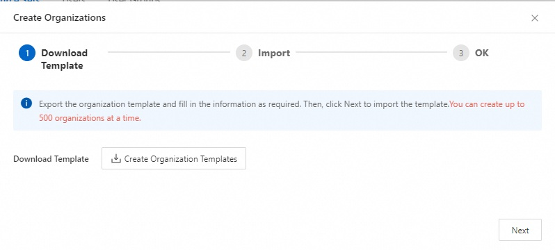

3. Fill the template file with the information of the organizations to be created and save the file. The following figure shows an example of the information.

   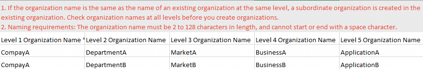

4. Click **Next** in the **Create Organizations** dialog box.

   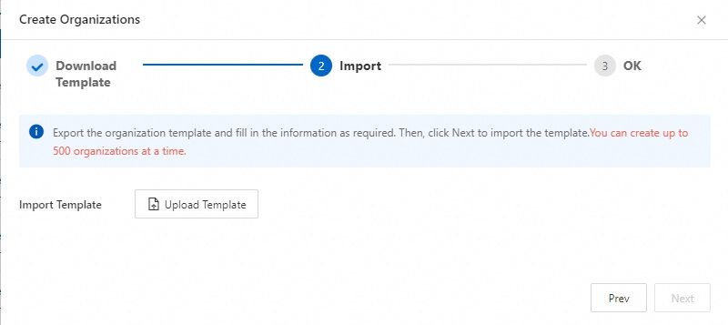

5. Click **Upload Template** and select the template file you edited. After the template file is verified, click **Next**.

   > **Important**
   >
   > After the template file is uploaded, the system automatically checks whether the content of the template file is correct. If incorrect content exists, you cannot create the organizations. You must modify the template file and click **Re-upload**.

   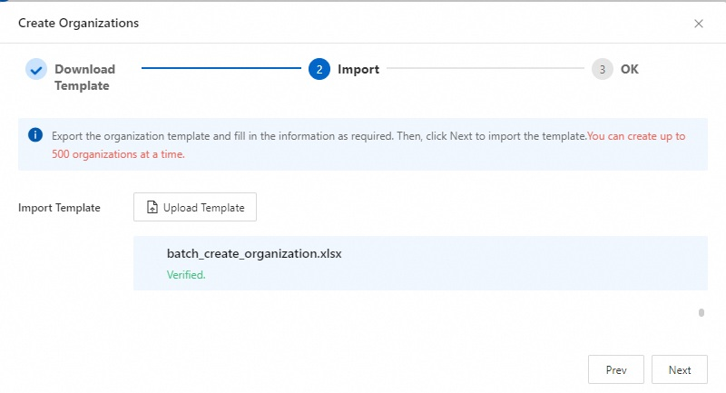

6. Confirm the organization information and click **OK**.

   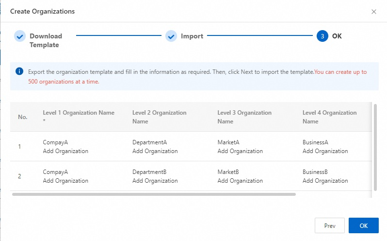

7. Optional. Click **Task List** in the dialog box to view the organizations you created.

   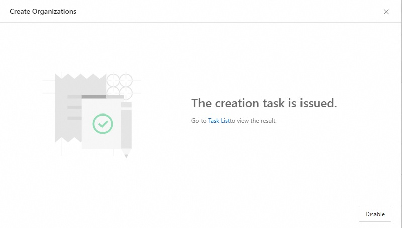

<a id="section-4-2-2-2"></a>

#### 4.2.2.2. Manage organizations

You can modify or delete organizations in the console as your organization changes.

**Procedure**

1. Log on to the Apsara Uni-manager Management Console.

2. In the top navigation bar, click **Enterprise**.

3. In the left-side navigation pane, choose **Resources** > **Organizations**.

4. (Optional) Search for the organization in the search box above the organization navigation tree. Fuzzy search is supported.

5. Click the name of the organization and perform operations as described in the following table.

   | Operation | Procedure |
   | --- | --- |
   | View the information of the organization | Click the <strong>Resource Sets</strong>, <strong>Users</strong>, or <strong>User Groups</strong> tab to view the resource sets, users, and user groups of the organization. |
   | Change the name of the organization | i. Click <strong>Editing</strong>.<br>ii. In the dialog box that appears, specify the new name of the organization.<br>iii. Click <strong>OK</strong>. |
   | Delete the organization | Important<br>• Before you delete an organization, make sure that the organization does not contain users, resource sets, or subordinate organizations.Otherwise, the organization cannot be deleted.<br>• After the organization is deleted, the data of the organization cannot be recovered. Proceed with caution.<br>i. Click <strong>Delete</strong>.<br>ii. In the message that appears, click <strong>OK</strong>. |

<a id="section-4-2-3"></a>

### 4.2.3. Resource set management

<a id="section-4-2-3-1"></a>

#### 4.2.3.1. Create a resource set

A resource set is a group of resources and is similar to a project. After a user or user group is added to a resource set, the user or users in the user group can manage resources in the resource set. The resource set management feature enables you to resolve complex issues such as user authorization. If an organization has multiple projects, you can create multiple resource sets in the organization. This allows users to use and manage resources by resource set.

**Background information**

A resource set is a logical container that associates multiple resources. Each resource must belong to a resource set. When you create a resource, you need to select a resource set for the resource.

- When you create an organization, the system creates a resource set for the organization by default.

- Resource sets are isolated from each other.

- An organization can have multiple resource sets, but each resource set can belong to only one organization.

**Prerequisites**

An organization is created.

**Procedure**

1. Log on to the Apsara Uni-manager Management Console.

2. In the top navigation bar, click **Enterprise**.

3. In the left-side navigation pane, choose **Resources** > **Resource Sets**.

4. Click **Create Resource Set**.

5. In the **Create Resource Set** dialog box, set the **Name** and **Organization** parameters.

   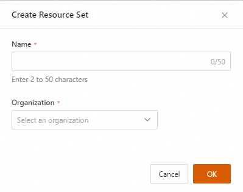

6. Click **OK**.

<a id="section-4-2-3-2"></a>

#### 4.2.3.2. Manage resource sets

You can change the name of a resource set, authorize users to use a resource set, or delete a resource set.

**Procedure**

1. Log on to the Apsara Uni-manager Management Console.

2. In the top navigation bar, click **Enterprise**.

3. In the left-side navigation pane, choose **Resources** > **Resource Sets**.

4. (Optional) In the upper part of the page, select an organization or search for the target resource set by using the search box.

5. Find the target resource set and perform operations as described in the following table.

   | Operation | Procedure |
   | --- | --- |
   | View the information of a resource set | i. Click the name of a resource set to view its details.<br>ii. On the Resource Set Details page, click the <strong>Resources</strong> and <strong>Users</strong> tabs to view all resources and users of the resource set. |
   | Change the name of a resource set | i. Find the target resource set and click <strong>Edit Name</strong> in the Actions column.<br>ii. In the Modify Resource Set dialog box, specify a new name for the resource set.<br>iii. Click <strong>OK</strong>. |
   | Grant users the permissions on a resource set | i. Find the target resource set and click <strong>Member authorization</strong> in the Actions column.<br>ii. (Optional) In the Member authorization dialog box, select the role type of the user or the user group whose permissions you want to manage.<br>iii. Grant or revoke permissions.<br>• Grant the permissions to a user or a user group: In the lower-left section, select the user or the user group that you want to authorize.<br>• Revoke the permissions of a user or a user group: In the lower-right section, click <strong>Remove</strong> in the Actions column corresponding to the target user or user group.<br>iv. Click <strong>OK</strong>. |
   | Delete a resource set | Important<br>• The default resource set cannot be deleted.<br>• Before you delete a resource set, make sure that the resource set does not contain resources and that no users or user groups are authorized to use it. Otherwise, the resource set cannot be deleted.<br>i. Find the resource set that you want to delete and click <strong>Delete</strong> in the Actions column.<br>ii. In the message that appears, click <strong>OK</strong>. |

<a id="section-4-2-4"></a>

### 4.2.4. Manage regions

You can manage the regions associated with organizations. Regions determine the geographical locations in which resources are created. Large-sized enterprises typically divide their business into different units. Each business unit may correspond to specific product lines or regions. In this case, they need to create different resources in specified regions. Enterprises can associate their organizations with regions to meet their requirements.

**Background information**

- An organization can be associated with multiple regions, and a region can be associated with multiple organizations.

- After an organization is associated with regions, resources of the organization can be created only in the associated regions.

**Limits**

- After a level-1 organization is associated with a region, its subordinate organizations can also be associated with the region.

- If resources are activated in a region supported by an organization, you cannot disassociate the organization from the region.

**Update the association between an organization and a region**

1. Log on to the Apsara Uni-manager Management Console.

2. In the top navigation bar, click **Enterprise**.

3. In the left-side navigation pane, choose **Resources** > **Regions**.

4. In the left-side organizational structure, click the name of the organization that you want to manage.

5. In the right-side Regions section, select or clear the name of the desired region.

   If you select the name of a region, the organization is associated with the region. Then, you can create resources in this region. If you clear the name of a region, the organization is disassociated from the region. Then, you cannot create resources in this region.

   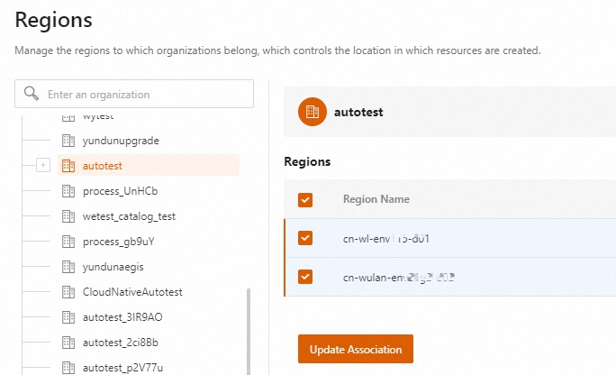

6. Click **Update Association**.

<a id="section-4-2-5"></a>

### 4.2.5. Change management

You can modify the organizations, resources, and users in the console according to the changes of your organizations or projects.

Changes cannot be made across level-1 organizations, and names of organizations and users within a level-1 organization must be unique.

**Procedure**

1. Log on to the Apsara Uni-manager Management Console.

2. In the top navigation bar, click **Enterprise**.

3. In the left-side navigation pane, choose **Resources > Changes**.

4. (Optional) Search for the target organization in the search box above the organization navigation tree. Fuzzy search is supported.

5. Find the target organization and perform the operations described in the following table.

   | Operation | Procedure |
   | --- | --- |

   <table>
     <tr>
       <td>Change the parent organizatio n of an organizatio n</td>
       <td>i. Click the name of the subordinate organization.<br>ii. On the right side of the page, click <strong>Change Organization</strong>.<br>iii. Select a new parent organization from the <strong>Change Organization To</strong> drop-down list.<br>iv. Click <strong>OK</strong>.<br>Note<br>After the subordinate organization is moved to the new parent organization, the resource sets and users of the subordinate organization are also moved.</td>
     </tr>
     <tr>
       <td>Change the ownership of resources</td>
       <td>i. Click theicon to the left of the target organization and click a resource set<br>under the organization.<br>ii. On the right side of the page, select a <strong>product type</strong> and a <strong>resource type</strong>.<br>iii. Change the ownership of resources.<br>• Change the ownership of a single resource: In the instance list, find the target resource and click <strong>Change Ownership</strong> in the Actions column.<br>• Change the ownership of multiple resources: In the instance list, select the target resources and click <strong>Batch Change Ownership</strong> at the bottom of the page.<br>iv. In the dialog box that appears, select a resource set from the <strong>Change Resource</strong> <strong>Set To</strong> drop-down list.<br>v. Click <strong>OK</strong>.<br>Note<br>Changing the ownership of a resource does not affect the organization and users.</td>
     </tr>
     <tr>
       <td>Change the organizatio n to which a user belongs</td>
       <td>i. Click the name of the target organization.<br>ii. On the right side of the page, click <strong>Users</strong>.<br>iii. Find the target user and click <strong>Change</strong> in the Actions column.<br>iv. In the dialog box that appears, select an organization from the <strong>Change</strong> <strong>Organization To</strong> drop-down list and select roles from the <strong>Assigned Roles</strong> drop-down list.<br>v. Click <strong>OK</strong>.<br>Note<br>Changing the organization of a resource does not affect the organization and users.</td>
     </tr>
   </table>

<a id="section-4-3"></a>

## 4.3. User management

<a id="section-4-3-1"></a>

### 4.3.1. Overview

The user management and user group management features allow you to centrally manage the structure and permissions of users and user groups. This can improve management efficiency and meet the various needs for system and resource access.

**User management**

You can perform management operations on users such as managing lifecycle for users, attaching roles to users, and controlling logons.

- On the System Users tab of the Users page, you can create, modify, disable, enable, and delete users. You can also grant permissions, configure logon policies, view user information, add users to user groups, remove users from user groups, configure multi-factor authentication (MFA), view the initial passwords of users, and view the resources sets of users.

- On the Historical Users tab, you can restore deleted users or permanently delete users.

**User group management**

You can add users to user groups to implement batch permission management. You can:

- Create user groups

- Modify user groups

- Add users to user groups

- Grant permissions to user groups

- Remove users from user groups

- Delete user groups

<a id="section-4-3-2"></a>

### 4.3.2. User management

<a id="section-4-3-2-1"></a>

#### 4.3.2.1. Create a user

Administrators can create users and assign the users different roles to meet different requirements for system access control.

**Create a single user**

**Procedure**

1. Log on to the Apsara Uni-manager Management Console as an administrator.

2. In the top navigation bar, click **Enterprise**.

3. In the left-side navigation pane, choose **Users** > **Users**.

4. Click the **System Users** tab. Click **Create a user**.

5. In the **Create a user** dialog box, configure the parameters.

   | Parameter | Required | Description |
   | --- | --- | --- |
   | User name | Yes | The name of the user. The name must be 2 to 64 characters in length and can contain letters, digits, hyphens (-), underscores (_), and periods (.).<br>Note<br>User names must be unique. |
   | Display name | Yes | The display name of the user. The name must be 1 to 128 characters in length and can contain letters, digits, hyphens (-), periods (.), and at signs (@). |
   | Role | Yes | The roles to be assigned to the user.<br>Note<br>You can enter role names in the field. Fuzzy match is supported. |
   | Organization | Yes | The organization to which the user belongs. |
   | Logon policy | Yes | The logon policy that limits the logon time and IP address of the user. The default policy is automatically associated with new users.<br>Note<br>The default policy does not limit the logon time and IP address of the user. To impose limits, you can modify the default logon policy or create a new logon policy for the user. For more information, see Create an access policy. |
   | Phone | Yes | The phone number of the user. This phone number is used to notify users of resource application and usage. Make sure that this mobile number is valid.<br>Note<br>If the phone number of the user changes, update it on the system in a timely manner. |
   | Landline | No | The landline number of the user. The landline number must be 4 to 20 characters in length and can contain only digits and hyphens (-). |
   | Email | Yes | The email address of the user. Emails about the resource application and usage are sent to this email address. Make sure that this email address is valid.<br>Note<br>If the email address changes, update it on the system in a timely manner. |
   | DingTalk Key | No | The key of the chatbot for the DingTalk group to which the user belongs. For more information about how to configure the key, see DingTalk development documentation. |
   | Notify User by Email | No | If this option is selected, the Apsara Uni-manager Management Console notifies the user configured as the alert contact by email whenever an alert is generated.<br>Note<br>You must configure an email server to notify the user by email. For more information, contact on-site O&amp;M engineers. |
   | Notify User by DingTalk | No | If this option is selected, the Apsara Uni-manager Management Console notifies the user configured as the alert contact by DingTalk whenever an alert is generated. |

**Create multiple users at a time**

**Procedure**

1. Log on to the Apsara Uni-manager Management Console as an administrator.

2. In the top navigation bar, click **Enterprise**.

3. In the left-side navigation pane, choose **Users** > **Users**.

4. Click the **System Users** tab. Click **Batch Create Users**.

   > **Note**
   >
   > - To batch create users, you need to download the template file, fill in the information of the users in the spreadsheet, and then upload the file to the system.
   >
   > - A maximum of 100 users can be created at a time.

5. In the **Batch Create Users** dialog box, click **User Creation Template**.

6. In the downloaded template file, fill in the information of the users.

   | Parameter | Required | Description |
   | --- | --- | --- |
   | Username | Yes | The name of the user. The name must be 2 to 64 characters in length and can contain letters, digits, hyphens (-), underscores (_), and periods (.).<br>Note<br>User names must be unique. |
   | Display Name | Yes | The display name of the user. The name must be 1 to 128 characters in length and can contain letters, digits, hyphens (-), periods (.), and at signs (@). |
   | Role | Yes | The role of the user. For a list of roles, click <strong>Permissions</strong> &gt; <strong>Role Permissions</strong> in the left-side navigation pane in the console. |
   | Organization | Yes | The path of the organization to which the user belongs.<br>Note<br>Format: root/&lt;Level-1 organization&gt;/&lt;Level-2 organization&gt; If the root organization has been renamed, use the actual name. |
   | Logon Policy | Yes | The name of the logon policy of the user. For a list of logon policies, click <strong>Permissions</strong> &gt; <strong>Access control</strong> in the left-side navigation pane in the console. |
   | Country Code | Yes | The code of the country that the user is in. |
   | Mobile Phone | Yes | The phone number of the user. This phone number is used to notify users of resource application and usage. Make sure that this mobile number is valid.<br>Note<br>If the phone number of the user changes, update it on the system in a timely manner. |
   | Landline | No | The landline number of the user. The landline number must be 4 to 20 characters in length and can contain only digits and hyphens (-). |
   | Email | Yes | The email address of the user. Emails about the resource application and usage are sent to this email address. Make sure that this email address is valid.<br>Note<br>If the email address changes, update it on the system in a timely manner. |
   | Enable Email Notifications | No | Valid values: <strong>Yes</strong> and <strong>No</strong>. Default value: <strong>No</strong>.<br>If you set the parameter to Yes, the Apsara Uni-manager Management Console notifies the user configured as the alert contact by email whenever an alert is generated.<br>Note<br>You must configure an email server to notify the user by email. For more information, contact on-site O&amp;M engineers. |
   | Enable DingTalk Notifications | No | Valid values: <strong>Yes</strong> and <strong>No</strong>. Default value: <strong>No</strong>.<br>If you set the parameter to Yes, the Apsara Uni-manager Management Console notifies the user configured as the alert contact by DingTalk whenever an alert is generated. |
   | DingTalk Key | No | The key of the chatbot for the DingTalk group to which the user belongs. For more information about how to configure the key, see DingTalk development documentation.<br>Note<br>This parameter takes effect only when Enable DingTalk Notifications is set to Yes. |
   | Email me the password after the user is created. | No | Valid values: <strong>Yes</strong> and <strong>No</strong>. Default value: <strong>No</strong>.<br>Note<br>This parameter takes effect only when Enable Email Notifications is set to Yes. |

7. Save the file. Click **Next** in the **Batch Create Users** dialog box. Click **Upload Template**.

   > **Note**
   >
   > When the template file is uploaded, the system checks the validity of the parameter values. If invalid values exist, the users cannot be created. You need to modify the template file and re-upload it.

8. After the file is uploaded, click **OK**.

9. (Optional) On the **Batch Tasks** tab of the **Users** page, view the status and details of the batch user creation task. If **Succeeded** is displayed in the **Status** column of the task, the task has been completed.

<a id="section-4-3-2-2"></a>

#### 4.3.2.2. Manage system users

You can perform management operations on users such as managing their lifecycle in the console, attaching roles to users, and controlling logons.

An operations administrator can manage the system users of all organizations. An organization administrator can manage only the system users of the corresponding organization and the subordinate organizations.

**Procedure**

1. Log on to the Apsara Uni-manager Management Console.

2. In the top navigation bar, click **Enterprise**.

3. In the left-side navigation pane, choose **Users > Users**.

4. Click the **System Users** tab and perform the operations described in the following table.

   | Operation | Procedure |
   | --- | --- |
   | View the information of a user | i. On the Users page, view the organization, role, mobile phone number, email, status, logon policy, and logon time of a user.<br>ii. Click the name of a user, or move the pointer over the More icon in the Actions column and click <strong>View User Information</strong> in the menu that appears. In the panel that appears, view more information of the user. |
   | View the initial password of a user | Move the pointer over theicon in the Actions column corresponding to a<br>user and click <strong>View Initial Password</strong>. |
   | View the resource set that a user is authorized to use | i. On the Users page, move the pointer over theicon in the Actions<br>column corresponding to a user and click <strong>View Resource Set</strong>.<br>ii. Select a role from the drop-down list in the panel and view the resource sets of the role. |
   | Modify a user | i. Click <strong>Edit</strong> in the Actions column corresponding to a user.<br>ii. In the dialog box that appears, modify the information of the user.<br>iii. Click <strong>OK</strong>. |

   <table>
     <tr>
       <td>Disable a user</td>
       <td>Important<br>Disabling a user will forbid the user from logging on to the system and using AccessKey pairs and will immediately log the user off the system.<br>i. Click <strong>Disable</strong> in the Actions column corresponding to a user.<br>ii. In the dialog box that appears, select <strong>I have known the risks and</strong> confirm this operation.<br>iii. Click <strong>Disable</strong>.</td>
     </tr>
     <tr>
       <td>Enable a user</td>
       <td>Important<br>Enabling a user will also enable the associated AccessKey pairs.<br>i. Click <strong>Enable</strong> in the Actions column corresponding to a user.<br>ii. In the message that appears, click <strong>OK</strong>.</td>
     </tr>
     <tr>
       <td>Grant permissions to a user</td>
       <td>i. Move the pointer over theicon in the Actions column corresponding to a<br>user and click <strong>Authorize</strong>.<br>ii. Modify the <strong>Role</strong> parameter to add, remove, or change the roles of the user.<br>iii. Click <strong>OK</strong>.</td>
     </tr>
     <tr>
       <td>Configure the logon policy of a user</td>
       <td>i. Move the pointer over theicon in the Actions column corresponding to a<br>user and click <strong>Configure Logon Policy</strong>.<br>ii. In the dialog box that appears, select a logon policy from the Logon policy drop-down list.<br>iii. Click <strong>OK</strong>.</td>
     </tr>
     <tr>
       <td>Configure the user groups of a user</td>
       <td>i. Move the pointer over theicon in the Actions column corresponding to a<br>user.<br>ii. Add the user to user groups or remove the user from user groups.<br>• Add the user to user groups: Click <strong>Add to User Group</strong>. In the dialog box that appears, select the target user groups from the drop-down list.<br>• Remove the user from user groups: Click <strong>Remove from User Group</strong>. In the dialog box that appears, select the target user groups from the drop-down list.<br>iii. Click <strong>OK</strong>.</td>
     </tr>
     <tr>
       <td>Configure multi-factor authentication (MFA) for a user</td>
       <td>i. Move the pointer over theicon in the Actions column corresponding to a<br>user and click <strong>MFA Settings</strong>.<br>ii. In the dialog box that appears, turn MFA Settings on or off.<br><br>indicates that MFA is enabled.<br><br>indicates that MFA is disabled.<br>iii. Click <strong>OK</strong>.<br>Note<br>For information about how to associate devices for MFA, see the "User information management" topic.</td>
     </tr>
     <tr>
       <td>Delete a RAM user</td>
       <td>Important<br>• Deleting a user will forbid the user from logging on to the system and using AccessKey pairs, and will immediately log the user off the system.<br>• Deleted user data cannot be restored. Proceed with caution.<br>i. Move the pointer over theicon in the Actions column corresponding to a<br>user and click <strong>Delete</strong>.<br>ii. In the dialog box that appears, select <strong>I have known the risks and</strong> confirm this delete operation.<br>iii. Click <strong>Delete</strong>.</td>
     </tr>
   </table>

<a id="section-4-3-2-3"></a>

#### 4.3.2.3. Manage historical users

You can restore or permanently delete deleted users.

**Procedure**

1. Log on to the Apsara Uni-manager Management Console.

2. In the top navigation bar, click **Enterprise**.

3. In the left-side navigation pane, choose **Users > Users**.

4. Click the **Historical Users** tab.

   | Operation | Procedure |
   | --- | --- |
   | Restore a user | After you restore a deleted user, the user will be added back to the System Users list.<br>i. Click <strong>Restore</strong> in the Actions column corresponding to a user.<br>ii. In the dialog box that appears, select the organization to which the user belongs and the roles of the user.<br>iii. Click <strong>OK</strong>. |
   | Permanently delete a user | After you permanently delete a user, the user will be removed from the Historical Users list and can no longer be restored.<br>i. Click <strong>Delete</strong> in the Actions column corresponding to a user.<br>ii. In the message that appears, click <strong>Delete</strong>. |

<a id="section-4-3-3"></a>

### 4.3.3. User group management

<a id="section-4-3-3-1"></a>

#### 4.3.3.1. Create a user group

This topic describes how to create user groups in an organization. You can use user groups to manage permissions of users in batch.

**Prerequisites**

An organization is created. For more information, see Create an organization.

**Background information**

| Subjects | Description |
| --- | --- |
| User groups and organizations | • A user group belongs to only a single organization.<br>• Multiple user groups can be created within an organization. |
| User groups and users | • A user group can contain multiple users. It can also contain no user.<br>• A user does not necessarily need to belong to a user group.<br>• A user can be added to multiple user groups. |
| User groups and roles | • A role can be assigned to multiple user groups.<br>• When a role is assigned to a user group, the permissions that the role has are automatically granted to users within the user group. |
| User groups and resource sets | • A resource set can contain multiple user groups. It can also contain no user group.<br>• A user group can be added to multiple resource sets. |

**Procedure**

1. Log on to the Apsara Uni-manager Management Console.

2. In the top navigation bar, click **Enterprise**.

3. In the left-side navigation pane, choose **Users > User Groups**.

4. Click **Create a user group** in the upper-left corner.

5. In the dialog box that appears, set **User Group Name**, **Organization**, and **Role authorization**.

   | Parameter | Description |
   | --- | --- |
   | User Group Name | The name of the user group. The name must be 3 to 255 characters in length and can contain letters, digits, underscores (_), hyphens (-), periods (.), and at signs (@). |
   | Organization | The organization to which the user group belongs. |
   | Role authorization | The roles that are assigned to the user group. |

6. Click **OK**.

<a id="section-4-3-3-2"></a>

#### 4.3.3.2. Manage user groups

You can modify the name, permissions, and users of a user group.

**Procedure**

1. Log on to the Apsara Uni-manager Management Console.

2. In the top navigation bar, click **Enterprise**.

3. In the left-side navigation pane, choose **Users > User Groups**.

4. Perform operations on user groups as described in the following table.

   | Operation | Procedure |
   | --- | --- |
   | View user groups | On the User Groups page, view information of user groups, such as the organization, roles, number of users, and associated resource sets. |
   | Modify a user group | i. Click <strong>Editing</strong> in the Actions column corresponding to a user group.<br>ii. In the dialog box that appears, specify the new name of the user group.<br>iii. Click <strong>OK</strong>. |
   | Add a user | After a user is added to a user group, the user has the permissions of the role that is assigned to the user group.<br>i. Find the user group to which you want to add users and click <strong>Add User</strong> in the Actions column.<br>ii. In the left-side list, select the users to be added and click theicon to add<br>the users to the right-side list.<br>iii. Click <strong>OK</strong>. |
   | Remove a user | After a user is removed from a user group, the user no longer has the permissions of the role that is assigned to the user group.<br>i. Find the user group from which you want to remove users and move the pointer over theicon in the Actions column. In the menu that appears, select <strong>Remove User</strong>.<br>ii. In the left-side list, select the users you want to remove and click theicon<br>to add them to the right-side list.<br>iii. Click <strong>OK</strong>. |
   | Assign roles to a user group | You can assign a role to a user group to grant the role permissions to all users within the group.<br>i. Find the target user group and move the pointer over theicon in the Actions column. In the menu that appears, select <strong>Authorized</strong>.<br>ii. In the Role authorization drop-down list, select the roles you want to assign to the user group.<br>iii. Click <strong>OK</strong>. |
   | Delete a group | Important<br>When a user group is deleted, resources such as roles, users, and resource sets that are associated with the user group are automatically unbound.<br>i. Find the target user group and move the pointer over theicon in the Actions column. In the menu that appears, select <strong>Delete</strong>.<br>ii. In the message that appears, click <strong>OK</strong>. |

<a id="section-4-4"></a>

## 4.4. Permission management

<a id="section-4-4-1"></a>

### 4.4.1. Overview

The Apsara Uni-manager Management Console provides permission management features, such as role permissions, data permissions, access control, permission boundaries, and AccessKey logs. You can use the features to manage permissions based on scenarios, users, and cloud services, thereby improving the security of your systems.

**Role permissions**

You can create roles and assign them to users or user groups, so as to implement fine-grained access control on users. The following operations are supported:

- Create custom roles

- Disable roles

- Enable roles

- Delete roles

- Replicate roles

**Data permissions**

You can authorize users to access specified cloud instances. You can also view and modify the data permissions granted to users. The following operations are supported:

- Configure the data permissions on cloud instances

- View user data permissions

- Modify user data permissions

**Access control**

You can configure access policies to control the time and IP addresses for user logon. After a user is associated with an access policy, user logons are limited based on the logon time and IP addresses specified in the policy. The following operations are supported:

- Create access policies

- Modify access policies

- Disable access policies

- Enable access policies

- Delete access policies

**Permission boundaries**

You can create service boundaries and configure API control policies to block API operations on the core gateway of Apsara Stack. Custom API control policies can be created. The following operations are supported:

- Create service boundaries and API control policies

- View service boundaries and API control policies

- Modify service boundaries and API control policies

- Edit service boundaries and API control policies

- Enable and disable service boundaries and API control policies

- Modify whitelists of service boundaries

- Delete service boundaries and API control policies

**AccessKey logs**

You can view AccessKey logs to facilitate security management centered around AccessKeys pairs. The following operations are supported:

- View the basic information of AccessKey pairs

- View the cloud services accessed by using an AccessKey pair

<a id="section-4-4-2"></a>

### 4.4.2. Role permissions

<a id="section-4-4-2-1"></a>

#### 4.4.2.1. Overview

A role is a collection of access permissions. In the Apsara Uni-manager Management Console, role types include preset roles, custom roles, RAM role-based authorization, and RAM-based authorization.

**Role types**

**Preset role**

A preset role is a collection of preset permissions for specific operations. To implement privilege separation, the Apsara Uni-manager Management Console provides preset roles based on the general use cases in cloud platforms. After a RAM user is assigned a preset role, the user has the corresponding operation permissions. During authentication, the system determines whether the user has the permissions to perform the corresponding operations based on the permissions that belong to the preset role assigned to the user. For more information, see Preset roles.

**Custom role**

You can create a custom role to combine and set permission policies based on your business requirements. You can configure the sharing scope and permissions on resources, applications, and menus for the custom role, and configure custom permission policies to flexibly specify the services that can be accessed by the role, the operations that can be performed by the role, and the resources that can be managed by the role. Compared with preset roles, custom roles are more flexible and can be customized.

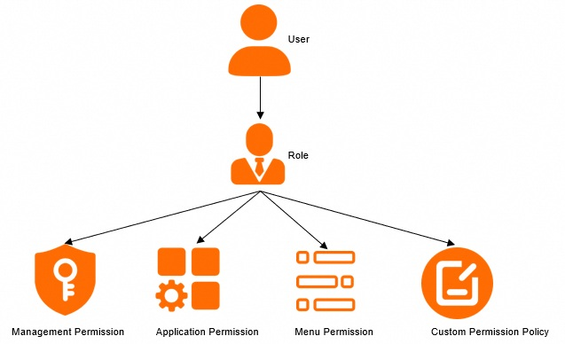

> **Note**
>
> Custom roles are commonly used to manage the permissions of users who log on to cloud service consoles. In addition, third-party independent software vendors (ISVs) can create custom roles when they require AccessKey pairs with limited permission scope to call cloud service APIs for application development.

**RAM role-based authorization**

RAM role-based authorization is the process of associating a RAM role with RAM users, other Apsara Stack tenant accounts, or Apsara Stack services. An authorized entity can directly assume a RAM role to obtain the collection of permissions that belong to the role without the need to grant permission policies to the entity.

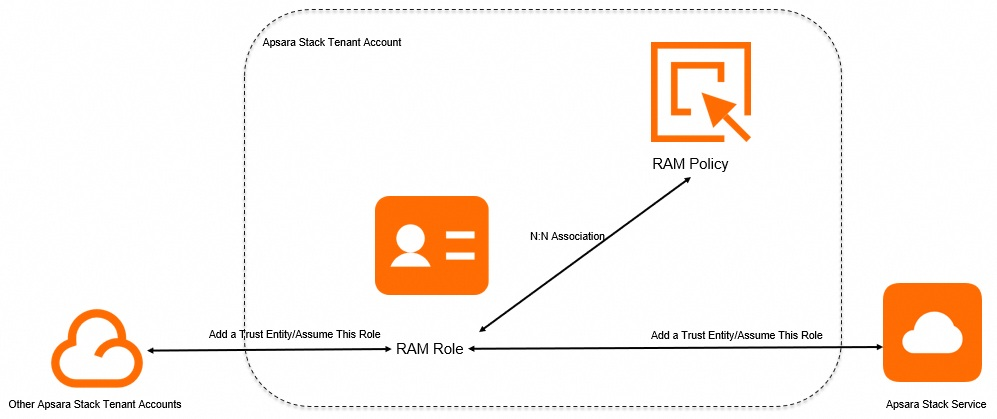

> **Note**
>
> RAM role-based authorization can be divided into the role of Apsara Stack tenant accounts and the role of Apsara Stack services based on the types of trust entities.
>
> - Role of Apsara Stack tenant accounts: the role that can be assumed by RAM users. RAM users who assume this type of role can belong to the own Apsara Stack tenant accounts or other Apsara Stack tenant accounts. The roles of this type are used for cross-account access or temporarily authorized access.
>
> - Role of Apsara Stack services: the role that can be assumed by cloud services. The roles of this type are used for access across Apsara Stack services.

**RAM-based authorization**

Each RAM user is a user entity with a unique identity. You can assign custom policies to RAM users by using user groups. This way, the RAM users always have these permissions regardless of whether they assume a role.

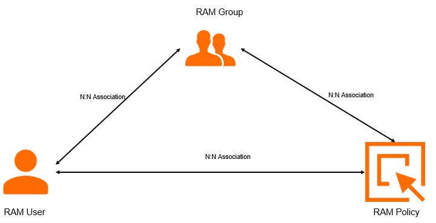

> **Note**
>
> - RAM-based authorization is performed based on RAM user groups other than RAM roles.
>
> - RAM-based authorization is used to enhance the fine-grained permission control of custom roles that are created on a GUI. After you create a custom role, you can use RAM-based authorization to attach a RAM policy to RAM users if some permissions cannot be granted by using the custom role.
>
> - RAM-based authorization must be used together with user groups.

<a id="section-4-4-2-2"></a>

#### 4.4.2.2. RAM policies

This topic describes the elements, structure, and syntax of RAM policies that are used to define the scope of permissions for custom roles, RAM authorization and RAM role-based authorization.

**Structure**

RAM policies are in the JSON format, containing two parts:

- Version: the version number of the policy.

- Statements: the statements that specify the permissions. The elements of statements include Effect, Action, Resource, Condition, and Principal.

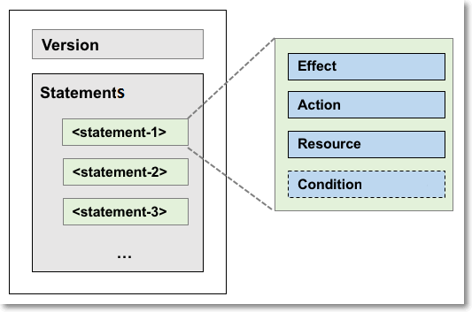

**Elements in statements**

The elements of statements include Effect, Action, Resource, Condition, and Principal.

**Effect (Required)**

Specifies whether a statement result is an explicit allow or an explicit deny. Valid values: Allow and Deny.

> **Note**
>
> Precedence of Deny: Deny statements take precedence when a user is assigned multiple policies that contain Allow and Deny statements, and when a single policy contains both Allow and Deny statements.

**Example**

```text
"Effect": "Allow"
```

**Action (Required)**

The specific API operations involved in the statement.

The Action element is in the following format:  `<ram-code>:<action-name>` .

- `<ram-code>` : the product code.

- `<action-name>` : the API operation of the product involved in the policy.

> **Note**
>
> The values of the Action element are case-insensitive. However, to ensure consistency, we recommend that you follow the standard capitalization of the product code and API
>
> 
>
> operation names.

**Example**

```text
"Action": [
  "oss:ListBuckets",
  "ecs:Describe*",
  "rds:Describe*"
]
```

> **Note**
>
> You can use the asterisk (\*) as a wildcard character. For example, in the preceding example,  `ecs:Describe*`  indicates that all the API operations of Elastic Compute Service (ECS) whose names start with Describe are involved in the policy.

**Resource (Required)**

The resources of cloud services involved in the statement, which are indicated by their Aliyun Resource Names (ARNs)

Resource elements are in the following format:  `acs:<ram-code>:<region>:<account-id>: <relative-id>` .

- `acs` : the prefix of ARNs. It stands for Alibaba Cloud Service.

- `<ram-code>` : the product code.

- `<region>` : the region ID of the resource. You can use the asterisk (\*) as a wildcard character to indicate regionless resources or resources in all regions.

- `<account-id>` : the user ID of the level-1 organization. This is used to specify the resources that belong to a specific level-1 organization.

- `<relative-id>` : the description of the specific resources. Its syntax is product-specific. For example, the relative-id for an OSS object is a path of that object, such as mybucket/dir1/object1.jpg.

**Example**

```text
"Resource": [
 "acs:ecs:*:*:instance/inst-001",
 "acs:ecs:*:*:instance/inst-002",
 "acs:oss:*:*:mybucket",
 "acs:oss:*:*:mybucket/*"
]
```

**Condition (Optional)**

The conditions that are required for the policy to take effect. A Condition element, or a condition block, contains one or multiple conditions. Each condition consists of an operator, a condition key, and a condition value.

Condition keys are case-sensitive. The case-sensitivity of the condition values is determined by the operator. For example, assume that a condition key of the string type is specified. if the StringEquals operator is used, the system performs a case-sensitive match. If the StringEqualsIgnoreCase operator is used, the system performs a case-insensitive match.

Description:

- Evaluation logic

  - You can specify one or more values for a condition key. If the value in a request matches one of the values, the condition is met.

  - A condition can have multiple keys that are attached to a single conditional operator. The condition of this type is met only if all requirements for the keys are met.

  - A condition block is met only if all of its conditions are met.

- Operators

  Operators are classified into the following types: string, number, data and time, Boolean, and IP address.

  | Category | Operator |
  | --- | --- |
  | String | • StringEquals<br>• StringNotEquals<br>• StringEqualsIgnoreCase<br>• StringNotEqualsIgnoreCase<br>• StringLike<br>• StringNotLike |
  | Number | • NumericEquals<br>• NumericNotEquals<br>• NumericLessThan<br>• NumericLessThanEquals<br>• NumericGreaterThan<br>• NumericGreaterThanEquals |
  | Date and time | • DateEquals<br>• DateNotEquals<br>• DateLessThan<br>• DateLessThanEquals<br>• DateGreaterThan<br>• DateGreaterThanEquals |
  | Boolean | Bool |
  | IP address | • IpAddress<br>• NotIpAddress |

- Condition keys

  - General condition keys are in the following format:  `acs:<condition-key>` .

    | General condition key | Type | Description |
    | --- | --- | --- |
    | acs:CurrentTime | Date and time | The time when the server receives the request.Specify the time in the ISO 8601 standard, for example, 2012-11-11T23:59:59Z. |
    | acs:SecureTransport | Boolean | Specifies whether a secure channel is used to send a request. For example, a request can be sent over HTTPS. |
    | acs:SourceIp | IP address | The IP address of the client that sends the request It can be a single IP address or a CIDR block. If the value is a single IP address, you must specify the specific IP address rather than a CIDR block. For example, you must specify 10.0.0.1 rather than 10.0.0.1/32. |
    | acs:MFAPresent | Boolean | Specifies whether multi-factor authentication (MFA) is used when the user who sends the request logged on. |
    | acs:PrincipalARN | String | The identity of the requester. This operator is only used in trust policies of RAM roles. |

  - Service-specific condition keys are in the following format:  `<ram-code>:<condition-key>` .

    | Service-specific condition key | Cloud service | Type | Description |
    | --- | --- | --- | --- |
    | ecs:tag/&lt;tag-key&gt; | Elastic Compute Service (ECS) | String | The condition key for tags of ECS resources, which are customizable. |
    | rds:ResourceTag/&lt;t ag-key&gt; | ApsaraDB RDS | String | The condition key for tags of ApsaraDB RDS resources, which are customizable. |
    | oss:Delimiter | Objective Storage Service (OSS) | String | The delimiter used by OSS to categorize object names. |
    | oss:Prefix | OSS | String | The prefix of an OSS object name. |

**Principal**

The entity that is allowed or denied to call the related API operations. This element is available only for resource-based policies. For example, in a trust policy attached to a RAM role, you can specify the resources that are allowed to assume the role in the Principle element. The Principal element is required in resource-based policies.

> **Note**
>
> You cannot specify the Principal element in identity-based policies. Identity-based policies are attached to RAM identities. The RAM identities to which identity-based policies are attached are the principals.

You can specify multiple types of principals for the Principal element in a policy. You can also specify multiple principals of the same type for the Principal element in a policy. If you specify multiple types of principals, separate the types with commas (,). If you specify multiple principals of the same type, separate the principals with commas (,) and enclose the principals with brackets ([]). Multiple principals are associated with each other by the OR operator, meaning that the policy is attached to all principals in the policy.

**Example**

```text
"Principal": {
 "RAM": [
 "acs:ram::123456789012****:root",
 "acs:ram::987654321098****:root"
 ],
 "Service": "ecs.aliyuncs.com"
}
```

Principals are authenticated RAM entities, which are divided into the following types:

- Organization account

  Set the Principal element to the account of the level-1 organization. When you configure the trust policy of a RAM role-based authorization, the account ARN of the selected trust organization will be added to the policy as the principal, such as  `acs:ram::165399189392****:root` .

- Cloud service

  Set the Principal element to a cloud service. When you configure the trust policy of a RAM role-based authorization, the identifier of the selected trust service will be added to the policy as the principal, such as  `ecs.aliyuncs.com` .

**Policy syntax**

A RAM policy consists of the version_block and statement_block components.

```text
policy = {
 <version_block>,
 <statement_block>
}
```

**version_block**

The version of the policy. By default, the value is 1.

```xml
<version_block> = "Version" : ("1")
```

**statement_block**

The statements. A RAM policy can contain multiple statements.

```xml
<statement_block> = "Statement" : [ <statement>, <statement>, ... ]
```

- Each statement consists of the effect_block, action_block, resource_block, and condition_block elements. condition_block is an optional element.

  ```xml
  <statement> = { 
   <effect_block>,
   <action_block>,
   <resource_block>,
   <condition_block?>
  }
  ```

  - Valid values of an effect_block element are  `Allow`  and  `Deny` .

    ```xml
    <effect_block> = "Effect" : ("Allow" | "Deny") 
    ```

  - Multiple action_block and resource_block elements can be specified in each statement.

    ```xml
    <action_block> = "Action" : 
     ("*" | [<action_string>, <action_string>, ...])
    <resource_block> = "Resource" : 
     ("*" | [<resource_string>, <resource_string>, ...])
    ```

  - Each condition_block element can contain multiple operators and

    ```xml
    <condition_block> = "Condition" : <condition_map>

    <condition_map> = {
      <condition_type_string> : { 
          <condition_key_string> : <condition_value_list>,
          <condition_key_string> : <condition_value_list>,
          ...
      },
      <condition_type_string> : {
          <condition_key_string> : <condition_value_list>,
          <condition_key_string> : <condition_value_list>,
          ...
      }, ...
    }  
    ```

**Valid values of elements**

- If an element value is a string, number, date, time, Boolean value, or an IP address, the value must be enclosed in double quotation marks ("").

- If an element value is a string, you can use asterisks (\*) and question marks (?) as wildcard characters.

  - An asterisk (\*) indicates 0 or multiple letters. For example,  `ecs:Describe*`  indicates all the API operations of Elastic Compute Service (ECS) whose names start with Describe.

  - A question mark (?) indicates a single letter.

**Policy syntax check**

RAM policies follow the JSON format. When you create or update a RAM policy, the system automatically checks the validity of the JSON format. We recommend that you use JSON validators or formatters to help you ensure the validity of the policy. For more information about JSON syntax standards, see RFC 7159.

<a id="section-4-4-2-3"></a>

#### 4.4.2.3. Create a role

You can create custom roles, RAM role-based authorization, and RAM-based authorization to facilitate permission management.

**Limits**

**Limits on the management scope of resource sets**

If you select Resource Sets for Management Permissions when you create a custom role, the role has permissions on the resource sets of the associated user by default. This role is mainly used to manage resources. The permissions described in the following table are beyond the management scope of resource sets and do not take effect even if you select them.

| Management permission | Description |
| --- | --- |
| User management | Create a user, delete a user, activate a user, disable a user, lock a user, unlock a user, and perform other operations on the user. |
| Role management | Create or delete a role, lock or unlock a role, and perform other operations on the role. |
| User group management | View a user group, create or delete a user group, and perform other operations on the user group. |
| Organization management | Create or delete an organization and perform other operations on the organization. |
| Resource set management | Create and delete a resource set. |
| AccessKey pair management | View the AccessKey pair of an organization, create an AccessKey pair for an organization, delete the AccessKey pair of an organization, activate the AccessKey pair of an organization, disable the AccessKey pair of an organization, view the AccessKey pair of a user, and view AccessKey logs. |
| Access policy | Create or delete an access policy, and perform other operations on the access policy. |
| Change management | Change a resource set, change a resource, and change a user. |
| Bill management | View the bills of a cloud service, an organization, and a resource set, export bills, and modify bills. |
| Service-linked role management | Create a service-linked role. |
| Process management | View organization applications. |
| Multi-cloud management platform hosting | Configure multi-cloud management platform hosting. |
| Announcement management | Manage announcements. |

**Create a custom role**

1. Log on to the Apsara Uni-manager Management Console.

2. In the top navigation bar, click **Enterprise**.

3. In the left-side navigation pane, choose **Permissions** **>** **Role Permissions**.

4. On the page that appears, click **Create Custom Role**.

5. In the **Basic Configuration** step, configure the parameters and click **Next**.

   **Create a custom role as an operations administrator**

   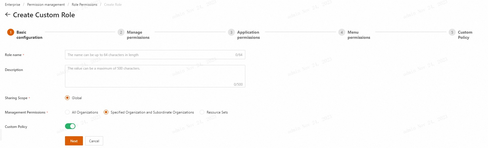

   **Create a custom role as an organization administrator**

   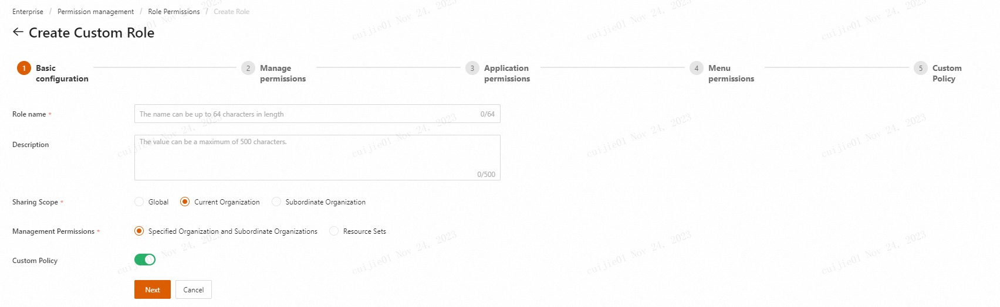

   | Parameter | Description |
   | --- | --- |
   | Role Name | The name of the role. |
   | Description | The description of the role. This parameter is optional. |
   | Sharing Scope | The scope in which the role is available. Only <strong>Global</strong> is available when you create a custom role as an operations administrator.<br>• <strong>Global</strong>: The role is shared by all organizations.<br>• <strong>Current Organization</strong>: The role is shared within the current organization.<br>• <strong>Subordinate Organization</strong>: The role is shared by the current organization and its subordinate organizations. |
   | Management Permissions | The scope of resources that can be managed by the role. Only <strong>Specified</strong> <strong>Organization and Subordinate Organizations</strong> and <strong>Resource Sets</strong> are available when you create a custom role as an organization administrator.<br>• <strong>All Organizations</strong>: This role can manage cloud resources in all organizations.<br>• <strong>Specified Organization and Subordinate Organizations</strong>: This role can manage the cloud resources in the current organization and its subordinate organizations.<br>• <strong>Resource Sets</strong>: This role can only manage cloud resources in specified resource sets. For more information about the limits of resource sets, see Limits on the management scope of resource sets. |
   | Custom Policy | Turn the switch on or off to enable or disable custom policies.<br>: Custom policies are not supported.<br>: Custom policies are supported. |

6. In the **Manage Permissions** step, configure the parameters and click **Next**.

   In this step, you can specify the management operations that this role can perform in the Apsara Uni-manager Management Console, such as operations on organizations, users, and resource sets.

   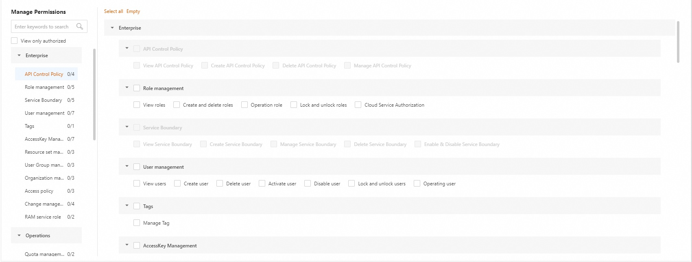

7. In the **Application permissions** step, configure the parameters and click **Next**.

   In this step, you can specify the operations that this role can perform on cloud products. If you need to only grant the user the permissions to view ECS instances, you need to only select View instance in the ECS section.

   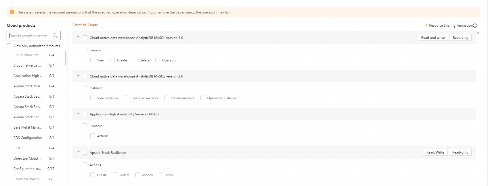

8. In the **Menu permissions** step, configure the parameters and click **Next**.

   In this step, you can specify the menu items that are available to this role.

   > **Important**
   >
   > If you perform operations by using the Apsara Uni-manager Management Console other than calling API operations and you select the operation permissions of the Apsara Uni-manager Management Console and cloud services when you configure management permissions and application permissions, you must also configure menu permissions so that you can access the corresponding pages.

   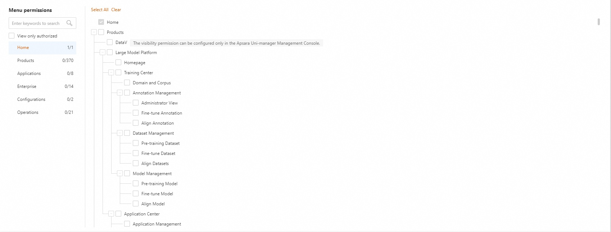

9. Optional. In the **Custom Policy** step, configure the parameters and click **Create**.

   > **Important**
   >
   > The Custom Policy step is available only if you turn on Custom Policy in the Basic configuration step.

   You can configure RAM actions to precisely describe authorized resources and operations on these resources. The Set RAM Action for Application section contains two parts: Allow and Deny. In the Allow field, you can specify the operations that are allowed to perform. In the Deny field, you can specify the operations that are not allowed to perform. If a RAM policy includes both an Allow statement and a Deny statement, the Deny statement takes precedence over the Allow statement.

   A RAM action is specified in the &lt;ram-code>:&lt;action-name> format. Separate multiple actions with commas (,).

   - &lt;ram-code> indicates the RAM code of the cloud service, which is generally the code of the cloud service.

   - &lt;action-name> indicates the name of an open API operation of the cloud service.

   If you specify  `oss:ListBuckets,ecs:Describe*,rds:Describe*`  in the Allow field, this role can list all the operation permissions on the OSS buckets of Object Storage Service (OSS), call all Elastic Compute Service (ECS) API operations whose names start with Describe, and call all ApsaraDB RDS API operations whose names start with Describe.

   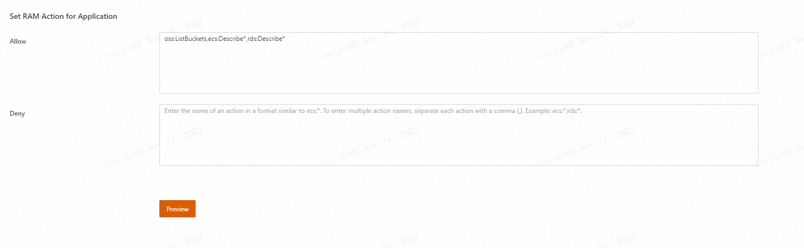

0. In the **Create Custom Role** message, click **Complete**.

   You can also click **Authorize now** to assign the role to users or user groups on the **Authorized Personnel** tab.

**Create RAM role-based authorization**

1. Click Create Custom Role. On the **Role Permissions** page that appears, click **Advanced Settings** at the lower part and click **Create RAM Role & Attach Policy**.

2. In the **Basic Configuration** step, configure the parameters and click **Next**.

   | Parameter | Description |
   | --- | --- |
   | Role Name | The name of the RAM role-based authorization. |
   | Description | The description of the RAM role-based authorization. This parameter is optional. |
   | Sharing Scope | The scope in which the RAM role-based authorization is available. You can select only <strong>Global</strong> when you create the RAM role-based authorization as an operations administrator.<br>• Global: The RAM role-based authorization is shared by all organizations.<br>• Current Organization: The RAM role-based authorization is shared within the current organization.<br>• Subordinate Organization: The RAM role-based authorization is shared by the current organization and its subordinate organizations. |

3. In the **Configure Custom Policy** step, select policies and click **Next**.

   If none of the listed policies meets your requirements, you can click **Create Policy** in the upper-right corner of the Select Policy section to create one. You can click **Policy Content** in the **Actions** column of a policy to view JSON-formatted policy content.

   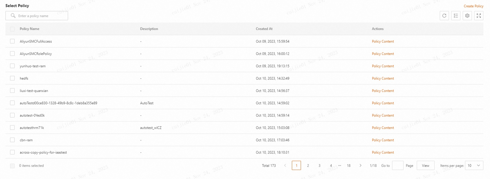

4. In the **Configure Trust Policy** step, configure the **Trust Organization** and **Trust Cloud Service** parameters and click **Next**.

   A trust policy is used to define the entities that can assume this RAM role. For example, you can specify level-1 organizations (tenant accounts) and Apsara Stack services to assume this RAM role.

   - **Trust Organization**: Specify one or more level-1 organizations (tenant accounts) to assume this RAM role.

   - **Trust Cloud Service**: Specify one or more Apsara Stack services to assume this RAM role.

   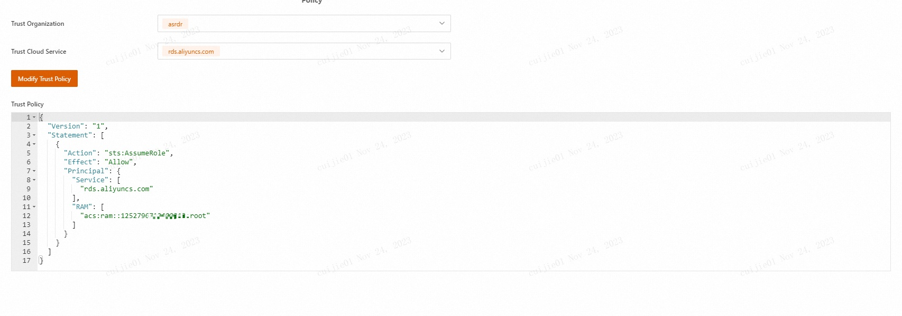

   In the preceding figure, the policy grants the asr.aliyuncs.com service and a specific root user the permissions to assume this role. According to this policy, the asr.aliyuncs.com service or a specific root user is allowed to assume this role.

   - Version: the version number of the policy. In this example, the value is 1.

   - Statement: the list of permission statements.

     - Action: the operation allowed. In this example, the value is sts:AssumeRole, which indicates that the operation of assuming this role is allowed.

     - Effect: allows or denies the operation. In this example, the value is Allow, which indicates that the operation is allowed.

     - Principal: the entity that is allowed to assume this role. The value can be Service or RAM.

       - Service: the service that is allowed to assume this role. In this example, the value is asr.aliyuncs.com, which indicates that the asr.aliyuncs.com service is allowed to assume this role.

       - RAM: the RAM resource that is allowed to assume this role. In this example, the value is acs:ram::125279671240\*\*\*\*:root, which indicates that all RAM users and RAM roles within the tenant account are allowed to assume this role.

         > **Note**
         >
         > Aliyun Resource Name (ARN) format for tenant accounts: `acs:ram::<account-id>:root` , which specifies the RAM users and RAM roles within your tenant account.
         >
         > ARN format for RAM users:  `acs:ram::<account-id>:user/<user-name>` , which specifies the RAM users within your tenant account.
         >
         > ARN format for RAM roles:  `acs:ram::<account-id>:role/<role-name>` , which specifies the RAM roles within your tenant account.
         >
         > &lt;account-id>: the ID of your tenant account.

5. In the Preview Policy step, check the selected policies and the trust policy and click **Create**.

6. In the role list, find the RAM role template you created and click the role name.

7. On the page that appears, click the **RAM Role** tab, click **Create**, and then select a level-1 organization to create a RAM role instance.

   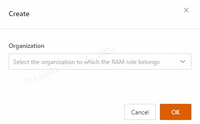

8. After the RAM role instance is generated, the trust entities in the trust policy can assume this RAM role to access and operate the corresponding resources.

   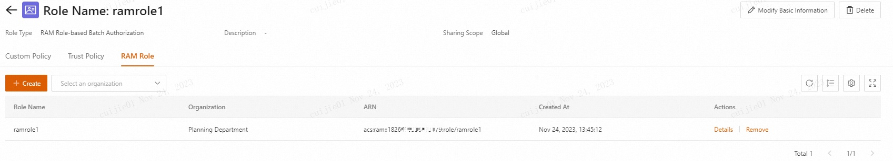

**Create RAM-based authorization**

1. Click **Create Custom Role**. On the page that appears, click **Advanced Settings** at the lower part and click **Create RAM Authorization**.

2. Configure the parameters in the **Basic Information** step.

   | Parameter | Description |
   | --- | --- |
   | Role Name | The name of the RAM-based authorization. |
   | Description | The description of the RAM-based authorization. This parameter is optional. |
   | Sharing Scope | The scope in which the RAM-based authorization is available. Only <strong>Global</strong> is available when you create the RAM-based authorization as an operations administrator.<br>• <strong>Global</strong>: The RAM-based authorization is shared by all organizations.<br>• <strong>Current Organization</strong>: The RAM-based authorization is shared within the current organization.<br>• <strong>Subordinate Organization</strong>: The RAM-based authorization is shared by the current organization and its subordinate organizations. |

3. Click **Create and Configure RAM Authorization**. In the **Role Permissions** step, configure the authorization.

   - **User Groups**: Configure the users to which you want to attach the policy. You can add or remove user groups.

     - **Add a user group**

       <ol type="a">

       <li>

       Click the **User Groups** tab.

       </li>

       <li>

       Click **Add User Group**. In the **Add User Group** dialog box, select a user group and click **OK**.

       </li>

       </ol>

     - **Remove a user group**

       <ol type="a">

       <li>

       Click the **User Groups** tab.

       </li>

       <li>

       Find the desired user group and click **Remove** in the **Actions** column to remove the user group.

       </li>

       </ol>

   - **Permissions**: Configure access permissions on resources. You can add or remove permissions.

     - **Add a policy**

       <ol type="a">

       <li>

       Click the **Permissions** tab.

       </li>

       <li>

       Click **Add Policy**. In the **Add Policy** dialog box, select policies and click **OK**. You can also create a policy if the listed policies do not meet your requirements.

       </li>

       </ol>

     - **Remove a policy**

       <ol type="a">

       <li>

       Find the desired permission and click **Remove permissions** in the **Actions** column.

       </li>

       <li>

       In the message that appears, click **OK**.

       </li>

       </ol>

4. Click **OK**.

<a id="section-4-4-2-4"></a>

#### 4.4.2.4. Manage roles

You can change the permissions and status of a role to change the permissions and logon status of the users that are assigned this role.

**Limits**

- Preset roles cannot be modified or deleted.

- RAM-based batch authorization roles and RAM role-based batch authorization roles cannot be disabled, enabled, or copied.

- Before you delete a role, make sure that no users or user groups are associated with the role.

- If a role is locked, the role cannot be modified, deleted, disabled, or enabled. In addition, a locked role cannot be used to authorize users.

- Only custom roles support batch authorization.

**View the details of a role**

View the basic information and permissions of a role.

1. Log on to the Apsara Uni-manager Management Console.

2. In the top navigation bar, click **Enterprise**.

3. In the left-side navigation pane, choose **Permissions** > **Role Permissions**.

4. Click the name of the role that you want to manage to go to the role details page and view the role details.

5. View the details of the role.

   - **View the details of a preset role or a custom role** Click the **Management Permissions**, **Application Permissions**, **Menu Permissions**, and **Authorized Personnel** tabs to view the details of different permissions.

   - **View the details of a RAM role-based batch authorization role**

     Click the **Custom Policy**, **Trust Policy**, and **RAM Role** tabs to view the information about the added policies, trust policy, and RAM roles.

     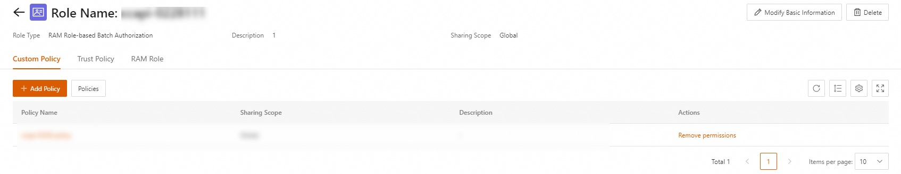

   - **View the details of a RAM-based batch authorization role**

     Click the **User Groups** and **Permissions** tabs to view the authorized user groups and policies.

     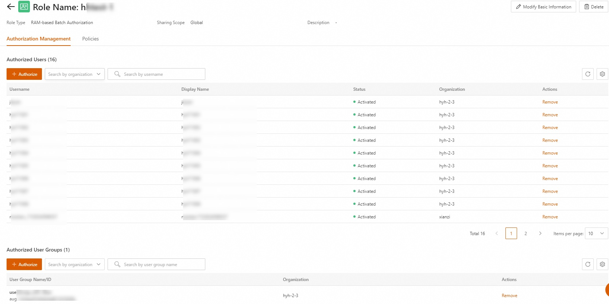

**Modify role information**

You can update the basic information and permissions of a role.

> **Note**
>
> Preset roles cannot be modified.

1. On the **Role Permissions** page, find the role that you want to manage and click **Modify** in the Actions column.

2. On the page that appears, click **Modify Basic Information** in the upper-right corner.

3. Modify the permissions of the role.

   - **Modify the permissions of a custom role**

     Click the **Management Permissions**, **Application Permissions**, **Menu Permissions**, and **Authorized Personnel** tabs to modify the corresponding permissions.

   - **Modify the permissions of a RAM role-based batch authorization role**

     - On the **Custom Policy** tab, add or remove policies based on your business requirements.

     - On the **Trust Policy** tab, modify the values of Trust Organization and Trust Cloud Service.

     - On the **RAM Role** tab, add or remove RAM roles based on your business requirements.

   - **Modify the permissions of a RAM-based batch authorization role**

     - On the **User Groups** tab, add or remove user groups based on your business requirements.

     - On the **Permissions** tab, add or remove policies based on your business requirements.

**Disable a role**

When a role is disabled, all permissions of the role are revoked. All users associated with the role cannot log on to the console.

> **Note**
>
> RAM role-based batch authorization roles and RAM-based batch authorization roles cannot be disabled.

1. On the **Role Permissions** page, find the role that is in the **Enabled** state and you want to manage and click **Disable** in the Actions column.

2. In the message that appears, click **OK**.

**Enable a role**

You can enable a disabled role. After the role is enabled, all users associated with the role acquire the permissions of the role.

> **Note**
>
> RAM role-based batch authorization roles and RAM-based batch authorization roles cannot be enabled.

1. On the **Role Permissions** page, find the role that is in the **Disabled** state and you want to manage and click **Enable** in the Actions column.

**Copy a role**

> **Note**
>
> RAM role-based batch authorization roles and RAM-based batch authorization roles cannot be copied.

When you copy a role, a new role with the same sharing scope, management permissions, application permissions, and menu permissions is created. You can adjust the permissions of the new role based on your business requirements.

1. On the **Role Permissions** page, find the role that you want to manage, click the  icon in

   the Actions column, and then choose **Copy**.

2. Adjust the basic configurations, management permissions, application permissions, and menu permissions of the new role based on your business requirements.

   > **Note**
   >
   > The name of the new role cannot be the same as that of the role that you copy.

**Delete a role**

You can delete a role that is no longer required.

> **Note**
>
> - Preset roles cannot be deleted.
>
> - Before you delete a role, make sure that no users or user groups are associated with the role.

1. On the **Role Permissions** page, find the role that you want to manage, click the  icon in

   the Actions column, and then choose **Delete**.

2. In the message that appears, click **OK**.

**Lock a role**

If an external system is associated with a role, you can lock the role.

> **Important**
>
> If a role is locked, the role cannot be modified, deleted, disabled, or enabled. In addition, a locked role cannot be used to authorize users.

1. On the **Role Permissions** page, find the role that you want to manage, click the  icon in

   the Actions column, and then choose **Locked**.

2. In the message that appears, click **OK**.

**Unlock a role**

When a role is locked, you can unlock the role.

> **Important**
>
> If a locked role is associated with an external system, issues related to external system permissions and data synchronization may occur when you forcefully unlock the role. Proceed with caution.

1. On the **Role Permissions** page, find the role that you want to manage, click the  icon in

   the Actions column, and then choose **Unlock**.

2. In the message that appears, click **OK**.

**Grant permissions to multiple roles at a time**

In some product upgrade scenarios, new permissions are required to be granted to roles of a specific type. You can grant the permissions to multiple roles at a time to improve your work efficiency.

> **Important**
>
> In this case, new permissions are granted to the roles without reducing or overwriting the existing permissions of the roles.
>
> - If the selected roles do not have the new permissions, the permissions are added.
>
> - If the selected roles have the new permissions, the existing permissions are not affected.

1. On the **Role Permissions** page, select **Custom Role** from the **Role Type** drop-down list.

2. Select multiple custom roles to which you want to grant permissions.

3. Click **Add Permissions** in the lower-left corner of the page. In the message that appears, click **OK**.

4. Add permissions to the selected roles according to the process wizard.

   <ol type="i">

   <li>

   **Selected Roles**: Confirm the selected custom roles.

   - If you want to add roles, you can click **Add Role**.

   - If you want to delete a selected role, find the role that you want to manage and click **Remove** in the **Actions** column.

   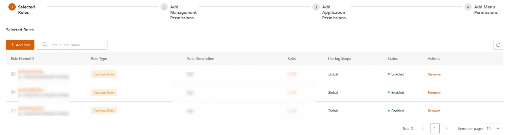

   </li>

   <li>

   **Add Management Permissions**: Select the management permissions that you want to add to the selected roles.

   </li>

   <li>

   **Add Application Permissions**: Select the operations permissions on products that you want to add to the selected roles.

   </li>

   <li>

   **Add Menu Permissions**: Select the menu permissions that you want to add to the selected roles.

   </li>

   </ol>

5. Optional. After the Batch Role Authorization task is created, go to the Asynchronous Task page to view the execution details of the task.

<a id="section-4-4-2-5"></a>

#### 4.4.2.5. Limits on roles

**Limits on the management scope of resource sets**

If you select Resource Sets for Management Permissions when you create a custom role, the role has permissions on the resource sets of the associated user by default. This role is mainly used to manage resources. The permissions described in the following table are beyond the management scope of resource sets and do not take effect even if you select them.

| Management permission | Description |
| --- | --- |
| User management | Create, delete, enable, disable, lock, unlock, and manage users. |
| Role management | Create, delete, lock, unlock, and manage roles. |
| User group management | View, create, delete, and manage user groups. |
| Organization management | Create, delete, and manage organizations. |
| Resource set management | Create and delete resource sets. |
| AccessKey management | View the AccessKey pairs of organizations and users, create AccessKey pairs for organizations, delete, enable, and disable the AccessKey pairs of organizations, and view AccessKey logs. |
| Access policy | Create, delete, and manage access policies. |
| Change management | Change resource sets, resources, or users. |
| Bill management | View the bills of cloud services, organizations, and resource sets, and export and modify bills. |
| Service-linked role | Create service-linked roles. |
| Process management | View organization applications. |
| Multi-cloud management platform hosting | Configure multi-cloud management platform hosting. |
| Announcement | Manage announcements. |

<a id="section-4-4-2-6"></a>

#### 4.4.2.6. Examples

<a id="section-4-4-2-6-1"></a>

##### 4.4.2.6.1. Example: Create a custom role with ECS read-only permissions

**Background information**

Company A (level-1 organization) needs to grant only view permissions on Elastic Compute Service (ECS) resources to an ECS resource administrator named Administrator A. This way, Administrator A can view all ECS resources of the company to implement O&M.

**Planning**

As an O&M engineer for ECS resources of the company, Administrator A needs to view all ECS resources of the company. In this case, you can create a custom role, set the management scope of the role to the level-1 organization and its subordinate organizations, grant only view permissions on ECS resources to the role, and then add menu permissions for accessing ECS resources.

**Procedure**

By default, the level-1 organization administrator of Company A is Organization A. The following section describes how to create a custom role as Organization A.

1. Log on to the Apsara Uni-manager Management Console as Organization A.

2. In the top navigation bar, click **Enterprise**.

3. In the left-side navigation pane, choose **Permissions** **>** **Role Permissions**.

4. On the **Role Permissions** page, click **Create Custom Role**.

5. On the Basic configuration wizard page, specify the required parameters and click **Next**.

   - **Role Name**: Enter ECS read-only administrator.

   - **Description**: Enter View permissions on ECS resources.

   - **Sharing Scope**: Select Current Organization.

   - **Management Permissions**: Select Specified Organization and Subordinate Organizations.

   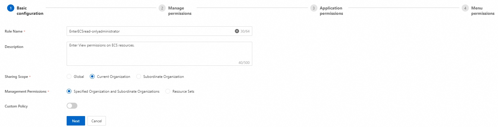

6. On the **Manage permissions** wizard page, you can specify parameters to allow the role to perform specific operations on specific organizations or specific resource sets in the console. You can skip this step and click **Next** when you create an ECS read-only role.

7. On the **Application permissions** wizard page, search for **ECS** in the Cloud products section. Select the desired view permissions on ECS resources or click **Read only** in the upper-right corner of the section. Then, click **Next**.

   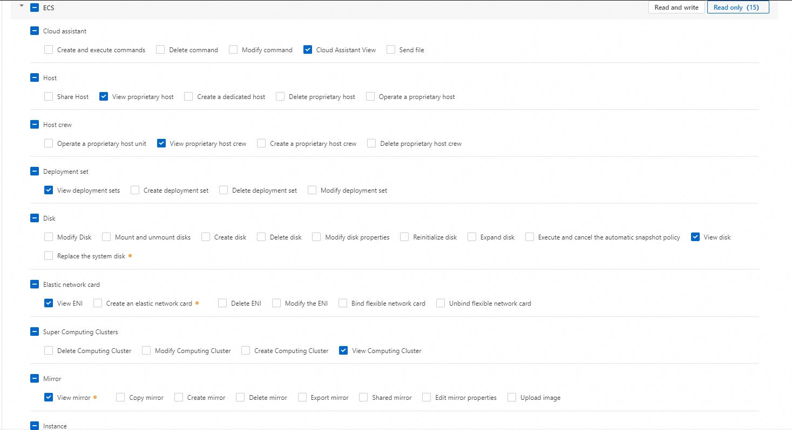

8. On the **Menu permissions** wizard page, add menus for accessing ECS resources. Otherwise, the user associated with the role cannot see the menus for accessing ECS resources after the user logs on to the console.

   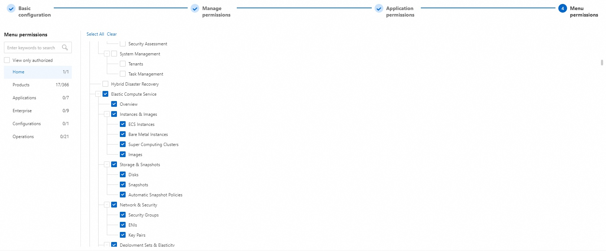

9. After you add the menus for accessing ECS resources, click **Create**. The administrator role with ECS read-only permissions is created.

   After the role is created, you can associate the role with the desired user Administrator A. This way, Administrator A can view all ECS resources of Company A.

   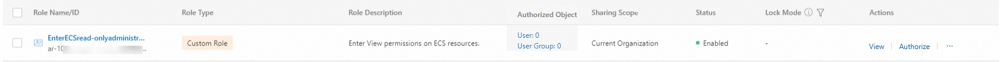

<a id="section-4-4-2-6-2"></a>

##### 4.4.2.6.2. Example: Modify a custom role with ECS read-only permissions

**Background information**

Due to the business changes of Company A, Administrator A not only needs to view all Elastic Compute Service (ECS) resources of Company A but also needs to view all Virtual Private Cloud (VPC) resources of Company A. The ECS read-only role of Administrator A is created. For more information, see Example: Create a custom role with ECS read-only permissions.

**Planning**

To allow the ECS read-only role to view all VPC resources of Company A, you can grant read-only permissions on VPC resources to the role.

**Procedure**

By default, the level-1 organization administrator of Company A is Organization A. The following section describes how to modify a custom role as Organization A.

1. Log on to the Apsara Uni-manager Management Console as Organization A.

2. In the top navigation bar, click **Enterprise**.

3. In the left-side navigation pane, choose **Permissions** **>** **Role Permissions**.

4. On the **Role Permissions** page, click the created ECS read-only role.

5. Click **View** in the **Actions** column that corresponds to the role.

6. On the details page of the role, modify the basic information and grant VPC read-only permissions to the role.

   - Modify basic information: Change the role name to ECS and VPC read-only administrator and the description of the role to View permissions on ECS and VPC resources. You can click **Modify Basic Information** in the upper-right corner of the page to modify the basic information about the role.

     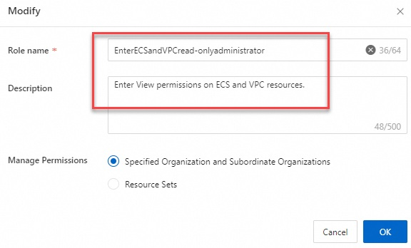

   - Add read-only permissions on VPC resources: Click the **Application Permissions** tab. Enter VPC in the search box below the Cloud products section and select the desired view permissions on ECS resources or click **Read only** in the upper-right corner of the tab.

     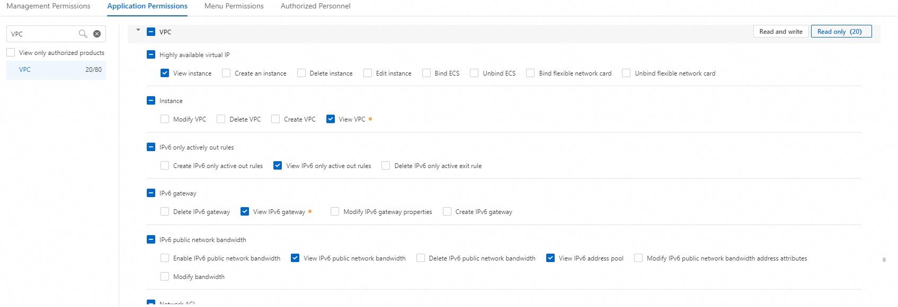

7. On the **Menu Permissions** tab, select menus for accessing VPC resources.

   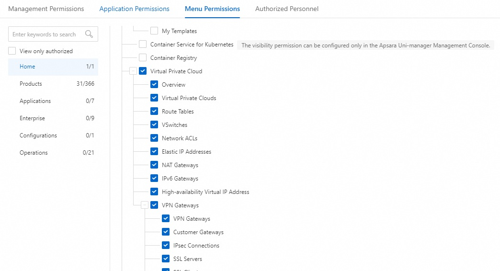

8. Click **Update** to modify the ECS read-only role. View the modified role in the role list.

<a id="section-4-4-2-6-3"></a>

##### 4.4.2.6.3. Example: Use a RAM role to grant users the permissions to restart ECS instances

**Background information**

You need to use a RAM role to grant O&M Engineer A of Company A (level-1 organization) the permissions to restart all ECS instances.

**Planning**

You can configure a policy that grants the specified role the permissions to restart all ECS instances in RAM role-based authorization, and then configure a trust policy to specify O&M Engineer A to assume this role.

**Procedure**

By default, the level-1 organization administrator of Company A is orgA. In the following example, orgA is used as the organization administrator.

1. Log on to the Apsara Uni-manager Management Console as the organization administrator.

2. In the top navigation bar, click **Enterprise**.

3. In the left-side navigation pane, choose **Permissions** **>** **Role Permissions**.

4. In the upper-left corner of the **Role Permissions** page, click **Create Custom Role**.

5. On the page that appears, expand **Advanced Settings** and click **Create RAM Role & Attach Policy**.

6. In the **Basic Configurations** step, configure the basic information of the RAM role and click **Next**.

   - **Role Name**: RebootECSRebootInstancesRamRole

   - **Description**: Users can assume this RAM role to restart ECS instances.

   - **Sharing Scope**: Current Organization

   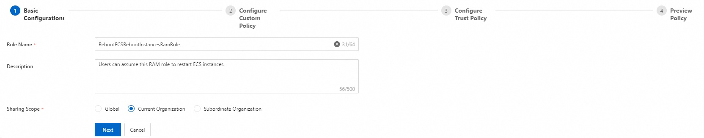

7. In the **Configure Custom Policy** step, click **Create Policy** and create a policy that grants permissions to restart all ECS instances.

   - **Policy Name**: RebootECSInstancesoPolicy

   - **Sharing Scope**: Current Organization

   - **Description**: This is a policy for restarting all ECS instances.

   - **Policy Content**:

     ```json
     {
       "Version": "1",
       "Statement": [
         {
           "Action": "ecs:RebootInstance",
           "Resource": "*",
           "Effect": "Allow"
         }
       ]
     }
     ```

     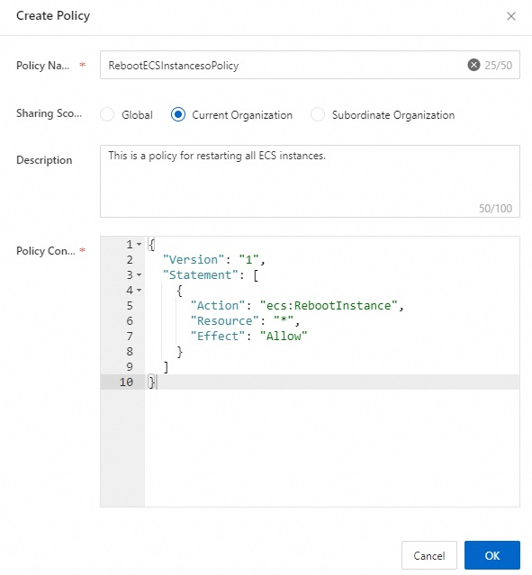

8. In the Select Policy section, select the policy you created and click **Next**.

   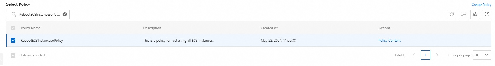

9. In the **Configure Trust Policy** step, specify O&M Engineer A (username: xiaozhuan) to assume this role.

   <ol type="i">

   <li>

   Select companyA from the Trust Organization drop-down list. This grants the permissions to assume this role to all RAM users and RAM roles within the Apsara Stack tenant account of the companyA organization. The Alibaba Cloud Resource Name (ARN) of the Apsara Stack tenant account is automatically filled in the trust policy. For example, the ARN can be  `acs:ram::139900176770****:root` .

   > **Note**
   >
   > - ARN format for the Apsara Stack tenant account:  `acs:ram::<account-id>:root` , which specifies the RAM users and RAM roles within the Apsara Stack tenant account.
   >
   > - ARN format for RAM users:  `acs:ram::<account-id>:user/<user-name>` , which specifies the RAM users within the Apsara Stack tenant account.
   >
   > - ARN format for RAM roles:  `acs:ram::<account-id>:role/<role-name>` , which specifies the RAM roles within the Apsara Stack tenant account.
   >
   > - &lt;account-id>: the ID of the Apsara Stack tenant account.

   

   </li>

   <li>

   Change the ARN to  `acs:ram::139900176770****:user/xiaozhuan`  in the trust policy. This

   </li>

   </ol>

   grants the permissions only to O&M Engineer A (username: xiaozhuan).

   

0. In the Preview Policy step, confirm the policy and the trust policy, and click **Create**.

   The RAM role template is created.

   

1. On the Role Permissions page, click the name of the RAM role you created.

2. On the role details page, click the **RAM Role** tab, and click **Create**. In the dialog box that appears, select companyA from the **Organization** drop-down list, and click OK. The RAM role is created within the Apsara Stack tenant account of the companyA organization. O&M Engineer A (username: xiaozhuan) can assume this role to restart ECS instances.

   

<a id="section-4-4-2-6-4"></a>

##### 4.4.2.6.4. Example: Use RAM-based authorization to grant users the permissions to view and delete VPC instances

**Background information**

You need to use RAM-based authorization to grant users in the VPC-Group user group of Company A (level-1 organization) the permissions to view and delete VPC instances.

**Planning**

You can define a policy that contains the permissions to view and delete all VPC instances in RAM-based authorization, and then attach the policy to the user group to grant the users in the user group the permissions.

**Procedure**

By default, the level-1 organization administrator of Company A is orgA. In the following example, orgA is used as the organization administrator.

1. Log on to the Apsara Uni-manager Management Console as the organization administrator.

2. In the top navigation bar, click **Enterprise**.

3. In the left-side navigation pane, choose **Permissions** **>** **Role Permissions**.

4. In the upper-left corner of the **Role Permissions** page, click **Create Custom Role**.

5. On the page that appears, expand **Advanced Settings** and click **Create RAM Authorization**.

6. In the **Basic Information** step, configure the parameters and click **Create and Configure RAM Authorization**.

   - **Role Name**: viewanddeleteVPCinstances

   - **Description**: Use RAM-based authorization to grant users the permissions to view and delete VPC instances.

   - **Sharing Scope**: Current Organization

   

7. Click the **Permissions** tab, and click **Add Policy**.

8. In the **Add Policy** dialog box, click **Create Policy**.

   - **Policy Name**: DescribeAndDeleteVpcsPolicy

   - **Sharing Scope**: Current Organization

   - **Description**: This is a policy for viewing and deleting VPC instances.

   - **Policy Content**:

     ```json
     {
       "Version": "1",
       "Statement": [
         {
           "Action": [
             "vpc:DescribeVpcs",
             "vpc:DeleteVpc"
           ],
           "Effect": "Allow",
           "Resource": [
             "*"
           ]
         }
       ]
     }
     ```

     

9. After the policy is created, select the policy in the Add Policy dialog box and click **OK** to add the policy for the RAM-based authorization.

   

0. Click the **User Groups** tab, and click **Add User Group**.

1. In the **Add User Group** dialog box, select VPC-Group1 from the drop-down list and click **OK**. The DescribeAndDeleteVpcsPolicy policy is attached to the user group.

   

2. On the page that appears, click **OK**. The RAM-based authorization is created, and users in the VPC-Group user group have the permissions to view and delete VPC instances.

<a id="section-4-4-3"></a>

### 4.4.3. Data permissions

On the Data Permissions page, you can authorize specific users to access specific cloud service instances. You can also view and change all data permissions granted to specific users.

**Background information**

In the Apsara Uni-manager Management Console, you can view and manage the management permissions, application permissions, and menu permissions granted to users. The preceding permissions allow users to manage resource sets or organizations. Therefore, the scopes of the preceding permissions are still not fine-grained enough to meet the business requirements of customers for specific scenarios. Therefore, the Apsara Uni-manager Management Console allows you to grant data permissions to a user on a specific resource instance. This way, you can not only control access to resource sets or resources, but also manage the operations of a specific user on a specific resource instance.

To help you easily grant data permissions on instances, the Apsara Uni-manager Management Console provides an intuitive and easy-to-use interface. This way, you can grant permissions on cloud service instances to users on the Data Permissions page.

Alternatively, you can create policies to grant permissions to users. In this case, you can grant permissions on desired cloud services. However, you can grant data permissions to users only on cloud services that are displayed on the Data Permissions page.

**Cloud services that are displayed on the Data Permissions page**

You can grant data permissions on the instances of the following cloud services to users on the Data Permissions page: Message Queue, Object Storage Service (OSS), Log Service, DataHub, Container Service for Kubernetes, Key Management Service, and Tablestore.

**Use cases**

To grant operation permissions on resource instances to users in the console, you can create a custom role and grant data permissions.

1. Create a custom role to define access permissions on services of resource sets or organizations. For more information, see the Create a custom role section of the Create a role topic.

2. Grant access and operation data permissions on specific resource instances. For more information, see the Grant data permissions on specific instances on the Data Permissions page section of this topic.

For example, you can perform the following authorization to grant the view permissions on all Message Queue instances of resource sets and operation permissions on topics or groups in a specific Message Queue instance.

- **First authorization**: You can create a custom role to grant the view permissions on Message Queue instances of resource sets. This way, users can only view all the Message Queue instances of resource sets in the console.

  

- **Second authorization**: You can grant operation permissions on a specific Message Queue instance or a specific topic or group in a Message Queue instance on the Data Permissions page.

  **Service instances**

  

  **Data permissions**

  

**Grant data permissions on specific instances on the Data Permissions page**

> **Note**
>
> You can grant data permissions on specific instances on the Data Permissions page.

**Grant data permissions on Message Queue**

1. Log on to the Apsara Uni-manager Management Console.

2. In the top navigation bar, click **Enterprise**.

3. In the left-side navigation pane, choose **Permissions** > **Data Permissions**.

4. On the left side of the **Data Permissions** page, click a resource set to which one or more Message Queue instances belong. In the **Product Type** section on the right side of the page, click **Message Queue MQ**.

   

5. Grant data permissions on a Message Queue instance

   <ol type="i">

   <li>

   In the list of Message Queue instances, find the desired instance and click **Authorize** in the **Actions** column.

   </li>

   <li>

   On the left side of the **Data Permissions** dialog box, select one or more users to whom

   </li>

   </ol>

   you want to grant data permissions. You can also turn on **Batch Grant Permissions** in the upper-right corner of the dialog box to grant permissions to multiple users at a time.

   <ol type="i" start="3">

   <li>

   In the Instance Permission Settings section on the right side of the dialog box, select or

   </li>

   </ol>

   deselect **Enable** to grant or remove specific operation permissions on the instance. You can also select **Enable All** in the upper-right corner of the section to grant all operation permissions on the instance.

   <ol type="i" start="4">

   <li>

   Click **OK**.

   </li>

   </ol>

6. Grant permissions on a topic or a group in a Message Queue instance

   <ol type="i">

   <li>

   In the list of Message Queue instances, find the desired Message Queue instance and click the  icon before the instance name to expand the topics and groups in the

   instance.

   </li>

   <li>

   Find the desired topic or group and click **Authorize** in the **Actions** column.

   </li>

   <li>

   On the left side of the **Data Permissions** dialog box, select one or more users to whom

   </li>

   </ol>

   you want to grant data permissions. You can also turn on **Batch Grant Permissions** in the upper-right corner of the dialog box to grant permissions to multiple users at a time.

   <ol type="i" start="4">

   <li>

   In the Instance Permission Settings section on the right side of the dialog box, select or deselect **Enable** to grant or remove specific operation permissions on the topic or group. You can also select **Enable All** in the upper-right corner of the section to grant all operation permissions on the topic or group.

   </li>

   </ol>

**Grant data permissions on an OSS instance**

1. On the left side of the **Data Permissions** page, click a resource set to which one or more OSS instances belong. In the **Product Type** section on the right side of the page, click **Object Storage Service**.

   

2. In the list of OSS instances, find the desired instance and click **Authorize** in the **Actions** column.

3. On the left side of the **Data Permissions** dialog box, select one or more users to whom you want to grant data permissions. You can also turn on **Batch Grant Permissions** in the upper-right corner of the dialog box to grant permissions to multiple users at a time.

4. In the Instance Permission Settings section on the right side of the dialog box, select or deselect **Enable** to grant or remove specific operation permissions on the instance. You can also select **Enable All** in the upper-right corner of the section to grant all operation permissions on the instance.

5. Click **OK**.

**Grant data permissions on a Log Service project**

1. On the left side of the **Data Permissions** page, click a resource set to which one or more Log Service projects belong. In the **Product Type** section on the right side of the page, click **Log Service**.

   

2. In the list of Log Service projects, find the desired project and click **Authorize** in the **Actions** column.

3. On the left side of the **Data Permissions** dialog box, select one or more users to whom you want to grant data permissions. You can also turn on **Batch Grant Permissions** in the upper-right corner of the dialog box to grant permissions to multiple users at a time.

4. In the Instance Permission Settings section on the right side of the dialog box, select or deselect **Enable** to grant or remove specific operation permissions on the project. You can also select **Enable All** in the upper-right corner of the section to grant all operation permissions on the project.

5. Click **OK**.

**Grant data permissions on DataHub**

1. On the left side of the **Data Permissions** page, click a resource set to which one or more DataHub projects belong. In the **Product Type** section on the right side of the page, click **Streaming Data Processing Service**.

   

2. Grant data permissions on a DataHub project.

   <ol type="i">

   <li>

   In the list of DataHub projects, find the desired project and click **Authorize** in the **Actions** column.

   </li>

   <li>

   On the left side of the **Data Permissions** dialog box, select one or more users to whom

   </li>

   </ol>

   you want to grant data permissions. You can also turn on **Batch Grant Permissions** in the upper-right corner of the dialog box to grant permissions to multiple users at a time.

   <ol type="i" start="3">

   <li>

   In the Instance Permission Settings section on the right side of the dialog box, select or

   </li>

   </ol>

   deselect **Enable** to grant or remove specific operation permissions on the project. You can also select **Enable All** in the upper-right corner of the section to grant all operation permissions on the project.

   <ol type="i" start="4">

   <li>

   Click **OK**.

   </li>

   </ol>

3. Grant permissions on a topic in a DataHub project

   <ol type="i">

   <li>

   In the list of DataHub projects, find the desired DataHub project and click the  icon

   before the project name to expand the topics in the project.

   </li>

   <li>

   Find the desired topic and click **Authorize** in the **Actions** column.

   </li>

   <li>

   On the left side of the **Data Permissions** dialog box, select one or more users to whom

   </li>

   </ol>

   you want to grant data permissions. You can also turn on **Batch Grant Permissions** in the upper-right corner of the dialog box to grant permissions to multiple users at a time.

   <ol type="i" start="4">

   <li>

   In the Instance Permission Settings section on the right side of the dialog box, select or deselect **Enable** to grant or remove specific operation permissions on the topic. You can also select **Enable All** in the upper-right corner of the section to grant all operation permissions on the topic.

   </li>

   <li>

   Click **OK**.

   </li>

   </ol>

**Grant data permissions on a Container Service for Kubernetes cluster**

**Perform authorization in the Apsara Uni-manager Management Console**

> **Note**
>
> You can grant operation permissions on a Container Service for Kubernetes cluster to users in the Apsara Uni-manager Management Console.

1. On the left side of the **Data Permissions** page, click a resource set to which one or more Container Service for Kubernetes clusters belong. In the **Product Type** section on the right side of the page, click **Container Service for Kubernetes**.

   

2. In the list of Container Service for Kubernetes clusters, find the desired cluster and click **Authorize** in the **Actions** column.

3. On the left side of the **Data Permissions** dialog box, select one or more users to whom you want to grant data permissions. You can also turn on **Batch Grant Permissions** in the upper-right corner of the dialog box to grant permissions to multiple users at a time.

4. In the Instance Permission Settings section on the right side of the dialog box, select or deselect **Enable** to grant or remove specific operation permissions on the cluster. You can also select **Enable All** in the upper-right corner of the section to grant all operation permissions on the cluster.

5. Click **OK**.

**Perform authorization in the Container Service for Kubernetes console**

> **Note**
>
> You can configure fine-grained role-based access control (RBAC) for RAM users or RAM roles in the Container Service for Kubernetes console. This way, you can grant access or operation permissions on resources in clusters. For example, you can authorize RAM users or RAM roles to manage resources in a specified namespace in a cluster.

1. Log on to the Apsara Uni-manager Management Console.

2. In the top navigation bar, click **Products**. Click **Container Service for Kubernetes** in the **Elastic Computing** section.

3. In the left-side navigation pane, click **Authorizations**.

4. On the **RAM Users** or RAM Roles tab, find the RAM user or RAM role that you want to authorize and click **Modify Permissions** in the **Actions** column.

5. On the **Configure Role-Based Access Control (RBAC)** wizard page, click **Add Permissions**. Select all clusters or a cluster and one or more namespaces of the cluster and select the desired preset role or custom role. Then, click **Next Step**.

   The following table describes the permissions that the preset and custom roles have on clusters and namespaces.

   | Role | Permission on cluster resources |
   | --- | --- |
   | Administrator | Has the read and write permissions on all resources in all namespaces of the corresponding cluster. |
   | O&amp;M engineer | Has the read and write permissions on resources in all namespaces and read-only permissions on nodes, persistent volumes (PVs), namespaces, and service quotas of the corresponding cluster. |
   | Developer | Has the read and write permissions on resources in a specified namespace or all namespaces. |
   | Restricted user | Has the read-only permissions on resources in a specified namespace or all namespaces. |
   | Custom role | The permissions of a custom role are determined by the ClusterRole that you select. Before you select a ClusterRole, check the permissions of the ClusterRole to ensure that you grant only the required permissions to the RAM user. |

**Grant data permissions on a Key Management Service key**

1. On the left side of the **Data Permissions** page, click a resource set to which one or more Key Management Service keys belong. In the **Product Type** section on the right side of the page, click **Key Management Service**.

   

2. In the list of Key Management Service keys, find the desired key and click **Authorize** in the **Actions** column.

3. On the left side of the **Data Permissions** dialog box, select one or more users to whom you want to grant data permissions. You can also turn on **Batch Grant Permissions** in the upper-right corner of the dialog box to grant permissions to multiple users at a time.

4. In the Instance Permission Settings section on the right side of the dialog box, select or deselect **Enable** to grant or remove specific operation permissions on the key. You can also select **Enable All** in the upper-right corner of the section to grant all operation permissions on the key.

5. Click **OK**.

**Grant data permissions on a Tablestore instance**

1. On the left side of the **Data Permissions** page, click a resource set to which one or more Tablestore instances belong. In the **Product Type** section on the right side of the page, click **Tablestore**.

   

2. In the list of Tablestore instances, find the desired instance and click **Authorize** in the **Actions** column.

3. On the left side of the **Data Permissions** dialog box, select one or more users to whom you want to grant data permissions. You can also turn on **Batch Grant Permissions** in the upper-right corner of the dialog box to grant permissions to multiple users at a time.

4. In the Instance Permission Settings section on the right side of the dialog box, select or deselect **Enable** to grant or remove specific operation permissions on the instance. You can also select **Enable All** in the upper-right corner of the section to grant all operation permissions on the instance.

5. Click **OK**.

**Grant permissions to a user by creating a policy**

1. On the left side of the **Data Permissions** page, click a user group to which the desired user belongs. On the right side of the page, find the desired user.

   

2. View or modify the policies of the user. For more information, see RAM policies.

   - **View the policies of the user**

     <ol type="a">

     <li>

     Click **View Permissions** in the **Actions** column that corresponds to the desired user.

     </li>

     <li>

     In the **View Permissions** dialog box, you can view all the policies of the user. Click a policy in the **Policies** section to view the policy content.

     

     > **Note**
     >
     > The policy shown in the preceding figure specifies a set of permissions on the resource asc:mq:MQ\*\*\*\*. The policy allows the user to create a group on the Message Queue instance. You can attach such a policy to a user to allow the user to create a group on the Message Queue instance.

     </li>

     </ol>

   - **Modify a policy of the user**

     - Click **Edit Permissions** in the **Actions** column that corresponds to the desired user.

     - In the **Edit Permissions** dialog box, click a policy in the **Policies** section to modify the policy in the code editor on the right side.

       

<a id="section-4-4-4"></a>

### 4.4.4. Access control

<a id="section-4-4-4-1"></a>

#### 4.4.4.1. Create an access policy

To improve the security of the Apsara Uni-manager Management Console, you can create access policies as an administrator to control logon access based on the logon time and IP addresses of users.

**Background information**

Access policies are used to control the time periods and IP addresses valid for user logon. After a user is associated with an access policy, user logons are limited based on the logon time and IP addresses specified in the policy.

The default policy generated by the Apsara Uni-manager Management Console does not have limits on the time and IP addresses valid for user logon. This policy cannot be deleted.

**Limits**

- The super administrator can only create access policies that are shared within the current organization, and these policies can only be configured for custom operations administrators.

- Operations administrators can only create globally shared access policies.

- If you use a custom role whose permissions are shared by all organizations, you can create globally shared access policies, access policies that are shared within the current organization, and access policies that are shared within the current organization and its subordinate organizations.

- If you use a role whose permissions are shared within the current organization and its subordinate organizations, you can only create access policies that are shared within the current organization and access policies that are shared within the current organization and its subordinate organizations.

- If you use a custom role whose permissions are shared by resource sets, you cannot create access policies even if you are granted the required permissions.

**Procedure**

1. Log on to the Apsara Uni-manager Management Console.

2. In the top navigation bar, click **Enterprise**.

3. In the left-side navigation pane, choose **Permissions** > **Access Control**.

4. On the page that appears, click **Create Access Policy** in the upper-left corner.

5. In the **Create Access Policy** dialog box, set the Name, Description, Sharing Scope, Policy Property, Logon Time, and Logon Address parameters.

   

   **Parameters for creating an access policy**

   | Parameter | Description |
   | --- | --- |
   | Name | The name of the access policy. The name can be 2 to 50 characters in length and can contain only letters and digits. The name must be unique in the system. |
   | Description | The description of the access policy. |
   | Sharing Scope | The scope in which the policy is available. Valid values:<br>• <strong>Global</strong>: The policy is available in all organizations.<br>• <strong>Current Organization</strong>: The policy is available only in the current organization but is unavailable in the subordinate organizations of the current organization.<br>• <strong>Subordinate Organization</strong>: The policy is available in the current organization and its subordinate organizations. |
   | Policy Property | The authentication method of the access policy.<br>Important<br>The authentication method takes effect only when the settings of both the <strong>Logon Time</strong> and <strong>Logon Address</strong> parameters are matched.<br>• <strong>Whitelist</strong>: Logon is allowed for users that match the settings of both the Logon Time and Logon Address parameters.<br>• <strong>Blacklist</strong>: Logon is not allowed for users that match the settings of both the Logon Time and Logon Address parameters. |
   | Logon Time | The permitted logon time period. Valid values: <strong>By Period</strong>, <strong>Every Day</strong>, and <strong>Every Week</strong>. You can click <strong>Add Time Period</strong> to add a logon time period.<br>• <strong>By Period</strong>: You must specify a start date, an end date, and a specific logon period.<br>• <strong>Every Day</strong>: You need to only specify a logon period.<br>• <strong>Every Week</strong>: You need to select one or more days of the week (from Monday to Sunday) and specify a logon period.<br>Note<br>The start time of the login period must be earlier than the end time of the logon period. |
   | Logon Address | The permitted CIDR block. You can click <strong>Add CIDR Block</strong> to add CIDR blocks.<br>The CIDR block is in the IP address/Subnet mask format, such as 192.168.1.0/24. If the subnet mask of a logon IP address is 32 bits in length, only this IP address is allowed to log on. The CIDR block cannot be empty or duplicate. |

6. Click **OK**.

<a id="section-4-4-4-2"></a>

#### 4.4.4.2. Manage an access policy

After you create an access policy, you can view, modify, disable, enable, or delete the access policy.

**Limits**

- The default policy of the system is globally shared and is in the valid state. You cannot modify, disable, or delete the default policy.

- You can view the default policy of the system and the access policies you created as the super administrator. You can also modify, disable, enable, or delete the access policies you created as the super administrator.

- If you use a role whose permissions are shared by all organizations, you can view the access policies that are globally shared, and that are shared in the current organization and its subordinate organizations. You can also modify, disable, enable, or delete all available access policies except the default policy.

- If you use a role whose permissions are shared by the current organization and its subordinate organizations, you can view the access policies that are globally shared, and that are shared in the current organization and its subordinate organizations. You can also modify, disable, enable, or delete the access policies that are available within the management scope.

- If you use a custom role whose permissions are shared by resource sets, you can view the access policies that are globally shared, and that are shared in the current organization and its subordinate organizations. You cannot modify, disable, enable, or delete the access policies even if you are granted the required permissions.

**Procedure**

1. Log on to the Apsara Uni-manager Management Console.

2. In the top navigation bar, click **Enterprise**.

3. In the left-side navigation pane, choose **Permissions** > **Access Control**.

4. Find the target access policy and perform the operations described in the following table.

   | Operation | Procedure |
   | --- | --- |
   | View the access policy | i. On the Access Control page, view the information of the access policy, such as Policy Property, Status, Sharing Scope, Users, Access Time, Endpoint, and Description.<br>ii. Click the number (not 0) in the <strong>Users</strong> column to view the users who are configured with this access policy. |
   | Modify the access policy | i. Click <strong>Modify</strong> in the Actions column.<br>ii. Modify the access policy, including Name, Description, Logon Time, and Logon Address.<br>iii. Click <strong>OK</strong>. |
   | Disable the access policy | You can disable the access policy that is not needed at the moment.<br>Important<br>After the access policy is disabled, users that are associated with the policy cannot log on to the Apsara Uni-manager Management Console.<br>i. Click <strong>Disable</strong> in the <strong>Actions</strong> column.<br>ii. In the message that appears, click <strong>OK</strong>. |
   | Enable the access policy | Click <strong>Enable</strong> in the Actions column. |
   | Delete the access policy | Important<br>Before you delete an access policy, make sure that it is not associated with any user.<br>i. Click <strong>Delete</strong> in the Actions column.<br>ii. Click <strong>OK</strong>. |

<a id="section-4-4-5"></a>

### 4.4.5. Permission boundary

<a id="section-4-4-5-1"></a>

#### 4.4.5.1. Service boundary management

The Apsara Uni-manager Management Console leverages the API control capabilities of the core gateway of Apsara Stack to provide the service boundary feature. You can create service boundaries to implement fine-grained control on API operations based on organizations, usage methods, and time periods.

<a id="section-4-4-5-1-1"></a>

##### 4.4.5.1.1. Create a service boundary

You can associate API control policies with service boundaries to implement fine-grained control on API operations.

**Background information**

The Apsara Uni-manager Management Console allows you to control operations by organizations, time, and operation methods through setting service boundaries. You can also use service boundaries to trigger approval processes when cloud operations are performed.

Service boundaries take effect on operations performed through all methods, including cloud accounts, RAM users, and STS tokens. Specially, they also take effect on operations performed on the console. This is because when users perform operations on the console, the system is calling API operations under the hood.

> **Important**
>
> API operations performed across cloud services (such as when Resource Orchestration Service calls an Elastic Compute Service operation to manage the resources) are also controlled by service boundaries. Therefore, inappropriate configurations may interrupt the normal usage of cloud services. You need to add the ARNs of relevant resources to the whitelist of the service boundaries and make sure that you are aware of the impact of the service boundaries before you enable them.

**Procedure**

1. Log on to the Apsara Uni-manager Management Console.

2. In the top navigation bar, click **Enterprise**. In the left-side navigation pane, choose **Permissions** > **Permission Boundary** > **Service Boundary**.

3. On the **Service Boundary Management** page, click **Create Service Boundary**. On the page that appears, configure the parameters.

   <table>
     <tr>
       <th>Section</th>
       <th>Parameter</th>
       <th>Description</th>
     </tr>
     <tr>
       <td rowspan="2">Basic Information</td>
       <td>Service Boundary Name</td>
       <td>The name of the service boundary.</td>
     </tr>
     <tr>
       <td>Description</td>
       <td>The description about the service boundary.</td>
     </tr>
     <tr>
       <td rowspan="2">Manageme nt Scope</td>
       <td>Management Scope</td>
       <td>The organizations for which the service boundary takes effect.Valid values: <strong>Global</strong> and <strong>Specified Organization</strong>. When you select Specified Organization, you need to select one or more organizations from the <strong>Authorize Organization</strong> drop-down list.</td>
     </tr>
     <tr>
       <td>Associate API Control Policy</td>
       <td>Select one or more API control policies to be associated with the service boundary. In an API control policy, you can specify conditions based on the parameter values of specific API operations.</td>
     </tr>
     <tr>
       <td rowspan="2">Control Mode</td>
       <td>Console Calls</td>
       <td>The action taken when an operation in the console matches the control policy.<br>• <strong>Reject</strong>: rejects the operation.<br>• <strong>Process Approval</strong>: initiates a preconfigured approval process for the operation. If you select this option, you also need to configure the <strong>Process</strong> parameter by selecting an existing process or create a new process in the <strong>Configure Resource</strong> <strong>Application Process</strong> dialog box.</td>
     </tr>
     <tr>
       <td>API Calls</td>
       <td>The action taken when an API call matches the control policy.The value is set to <strong>Reject</strong> and cannot be changed.</td>
     </tr>
     <tr>
       <td>Period Settings</td>
       <td>Effective Period</td>
       <td>The periods of time during which the service boundary takes effect.<br>• <strong>By Period</strong>: Specify a time period by selecting when the period begins and ends.<br>• <strong>Every Day</strong>: Specify a time period and the effective time in each day during the period.<br>• <strong>Every Week</strong>: Specify a time period, the days of week in which the service boundary takes effect, and the effective time in the days.</td>
     </tr>
   </table>

   <table>
     <tr>
       <td rowspan="2">Settings</td>
       <td>Status</td>
       <td>The status the service boundary enters immediately when it is created. Valid values:<br>• Enable<br>• Disable<br>Important<br>We recommend that you disable the service boundary first, and enable it after you have comprehensive knowledge about its influence.</td>
     </tr>
     <tr>
       <td>Whitelist</td>
       <td>The resources (RAM authorizations), RAM users, and RAM roles that are exempt from the service boundary. Specify the entities by ARNs. You can fuzzy search and select existing ARNs from the drop-down list, or specify a custom ARN by following the format.<br>Note<br>Up to 10 ARNs can be specified in the whitelist of a service boundary.</td>
     </tr>
   </table>

4. Click **Submit**.

<a id="section-4-4-5-1-2"></a>

##### 4.4.5.1.2. Manage service boundaries

You can view, modify, enable, disable, and delete service boundaries and manage their whitelists in the Apsara Uni-manager Management Console.

**Procedure**

1. Log on to the Apsara Uni-manager Management Console.

2. In the top navigation bar, click **Enterprise**. In the left-side navigation pane, choose **Permissions** > **Permission Boundary** > **Service Boundary**.

3. On the Service Boundary Management page, manage the service boundaries.

   | Description | Procedure |
   | --- | --- |
   | View the details of service boundaries | Click the name or ID of the target service boundary. On the page that appears, you can view the details of the service boundary, including its basic information, associated API control policies, approval processes, and whitelists. |

   <table>
     <tr>
       <td>Modify service boundaries</td>
       <td>• Modify the configurations of a service boundary: Click <strong>Edit</strong> in the <strong>Actions</strong> column corresponding to the target service boundary. On the page that appears, you can modify the basic information, management scope, control mode, and effective period of the service boundary.<br>• Modify the API control policies associated with a service boundary: Click <strong>Modify Policy</strong> in the <strong>Actions</strong> column corresponding to a service boundary. On the <strong>Associate Policy</strong> tab of the page that appears, click <strong>Add API Control Policy</strong> or <strong>Remove</strong> to associate or disassociate control policies.</td>
     </tr>
     <tr>
       <td>Enable or disable service boundaries</td>
       <td>Click <strong>Enable</strong> or <strong>Disable</strong> in the <strong>Actions</strong> column corresponding to the target service boundary.</td>
     </tr>
     <tr>
       <td>Manage whitelists</td>
       <td>Move your pointer over the More icon in the <strong>Actions</strong> column corresponding to a service boundary and click <strong>Manage Whitelist</strong>. On the <strong>Whitelist</strong> tab of the page that appears, you can click <strong>Add</strong> or <strong>Edit</strong> to add or modify the ARNs that are exempt from the service boundary.</td>
     </tr>
     <tr>
       <td>Delete service boundaries</td>
       <td>Move your pointer over the More icon in the <strong>Actions</strong> column corresponding to a service boundary and click <strong>Delete</strong>.</td>
     </tr>
   </table>

<a id="section-4-4-5-2"></a>

#### 4.4.5.2. Control policy management

API control policies are associated with service boundaries to implement fine-grained access control. In an API control policy, you can specify conditions based on parameter values of specific API operations. After it is associated with a service boundary, actions will be taken when the conditions in the API control policy are met. For example, you can define a control policy that enables service boundaries to take actions when users query details of instances whose names contain a specific string.

**Supported services**

The following table lists the cloud services and their API versions that are supported by API control policies.

> **Note**
>
> The services and API versions listed in the console prevail. We recommend that you refer to relevant API documentation to learn about the operations and their parameters.

<table>
  <tr>
    <th>Service name</th>
    <th>Service code</th>
    <th>API version</th>
  </tr>
  <tr>
    <td rowspan="2">Elastic Compute Service (ECS)</td>
    <td rowspan="2">Ecs</td>
    <td>2014-05-26</td>
  </tr>
  <tr>
    <td>2016-03-14</td>
  </tr>
  <tr>
    <td>Apsara File Storage NAS</td>
    <td>NAS</td>
    <td>2017-06-26</td>
  </tr>
  <tr>
    <td>Virtual Private Cloud (VPC)</td>
    <td>Vpc</td>
    <td>2016-04-28</td>
  </tr>
  <tr>
    <td>ApsaraDB RDS</td>
    <td>Rds</td>
    <td>2014-08-15</td>
  </tr>
  <tr>
    <td>PolarDB</td>
    <td>polardb</td>
    <td>2017-08-01</td>
  </tr>
  <tr>
    <td>KVStore for Redis</td>
    <td>R-kvstore</td>
    <td>2015-01-01</td>
  </tr>
  <tr>
    <td rowspan="2">ApsaraDB for MongoDB</td>
    <td rowspan="2">Dds</td>
    <td>2015-12-01</td>
  </tr>
  <tr>
    <td>2022-11-21</td>
  </tr>
  <tr>
    <td rowspan="3">API Gateway</td>
    <td rowspan="3">CloudAPI</td>
    <td>2016-02-01</td>
  </tr>
  <tr>
    <td>2016-07-01</td>
  </tr>
  <tr>
    <td>2016-07-14</td>
  </tr>
</table>

**Content of control policies**

The content of a control policy consists of a coordinate and parameters. The policies are stored as a JSON file that can be modified on the control policy details page.

| Element | Description |
| --- | --- |
| coordinate | The coordinate of the API operation. Format: <code> ${popCode}:${version}:${action} </code>. popCode indicates the product code; version indicates the API version; action indicates the API operation. You can use an asterisk (\*) as a wildcard character to replace ${version} so that all API versions are included. |
| parameters | An array that contains details about the rule, including the name of the parameter (key), logical expression (condition), and specified value (value). |
| ﹂condition | The logical relationship between the actual value of the parameter and the specified value. |
| ﹂value | The specified value.<br>Note<br>The value can be left empty only if condition is set to NotNull or IsNull. |
| ﹂key | The name of the controlled API operation. |

**Example**

```json
[
 {
  "coordinate": "CloudAPI:2016-02-01:AbolishApi",
  "parameters": [
   {
    "condition": "IsNull",
    "value": "",
    "key": "AccessKeyId"
   }
  ]
 }
]
```

**Data types of parameter values and logical expressions**

The following table lists the logical expressions that can be specified in API control policies.

**Type**

**Logical expression**

**Description**

The actual value equals the

NumericEquals

specified value in the policy.

The actual value does not

NumericNotEquals

equal the specified value in the policy.

The actual value is smaller

NumericLessThan

than the specified value in the policy.

The actual value is larger than

NumericGreaterThan

the specified value in the policy.

Numeric

(such as INTEGER, LONG, and FLOAT)

The actual value is smaller

NumericLessThanEquals

than or equal to the specified value in the policy.

The actual value is larger than

NumericGreaterThanEquals

or equal to the specified value in the policy.

IsNull

The parameter is left empty.

NotNull

The parameter is not empty.

The actual value includes the

StringLike

specified string in the policy.

The actual value does not

StringNotLike

include the specified string in the policy.

The actual value matches the

StringEquals

specified string in the policy (case-sensitive).

String

The actual value does not

StringNotEquals

match the specified string in the policy (case-sensitive).

The actual value matches the

StringEqualsIgnoreCase

specified string in the policy (case-insensitive).

IsNull

The parameter is left empty.

NotNull

The parameter is not empty.

The actual value matches the

Boolean_Equals

specified value in the policy.

BOOLEAN

IsNull

The parameter is left empty.

NotNull

The parameter is not empty.

<a id="section-4-4-5-2-1"></a>

##### 4.4.5.2.1. Create an API control policy

In the Apsara Uni-manager Management Console, you can create API control policies to control API operations on cloud resources based on values of the request parameters.

**Procedure**

1. Log on to the Apsara Uni-manager Management Console.

2. In the top navigation bar, click **Enterprise**. In the left-side navigation pane, choose **Permissions** > **Permission Boundary** > **Control Policies**.

3. On the **API control policy management** page, click **Create an API control policy**.

4. On the **Create Control Policy** page, specify the name and description of the policy and click **Create** in the Control Content section. In the dialog box that appears, configure the following parameters.

   | Parameter | Description |
   | --- | --- |
   | Cloud Services | The cloud services whose API operations are to be controlled. |
   | Version | The API version. Some cloud services may have multiple API versions. We recommend that you select All Versions for this parameter. |
   | API | The API operation that is controlled.<br>Note<br>Each rule is set for a single operation. If you want to specify rules for multiple operations in a single policy, you can click <strong>Add Rule</strong>. The rules in a policy are in <strong>OR</strong> logical relations. This means that when the policy is attached to a service boundary, the policy takes effect as long as one of the rules is met. |

   <table>
     <tr>
       <td>Field</td>
       <td>The request parameter to be controlled, a specified value, and the logical relation between the values in actual requests and the specified value.<br>The logical relations vary with the types of the selected request parameters. Valid values include <strong>Similar To</strong>, <strong>Equal to String</strong>, <strong>Equal to</strong> <strong>(case-insensitive)</strong>, <strong>Empty</strong>, <strong>Not Empty</strong>.<br>Note<br>You can click <strong>Add Field</strong> to specify multiple conditions. The conditions in a rule are in <strong>AND</strong> logical relations. This means that the rule takes effect only if all conditions are met.<br><strong>Example</strong>: The following figure shows how to configure the Field parameter for a rule that is created to control the action of creating a VPC named "test".<br></td>
     </tr>
   </table>

5. Click **Create**. Then, you can attach the API control policy to service boundaries.

<a id="section-4-4-5-2-2"></a>

##### 4.4.5.2.2. Manage API control policies

You can view the details of existing API control policies, including their content and association with service boundaries. You can also modify and delete the policies.

**Procedure**

1. Log on to the Apsara Uni-manager Management Console.

2. In the top navigation bar, click **Enterprise**. In the left-side navigation pane, choose **Permissions** > **Permission Boundary** > **Control Policies**.

3. On the page that appears, the existing policies are listed, and you can perform operations on them.

   | Operation | Procedure |
   | --- | --- |
   | View details of an API control policy | Click the ID of an API control policy. On the <strong>Policy Details</strong> tab of the page that appears, you can view the basic information and control content of the policy. On the <strong>Reference Information</strong> tab, you can view information of the service boundaries with which the policy is associated. You can click <strong>Disassociate</strong> in the Actions column corresponding to a service boundary to cancel the association. |
   | Modify an API control policy | • Click <strong>Modify</strong> in the <strong>Actions</strong> column corresponding to a policy. In the dialog box that appears, you can modify its name and description.<br>• Click <strong>Modify Control Content</strong> in the <strong>Actions</strong> column corresponding to a policy. On the policy details page that appears, you can modify or delete the existing rules in the policy, or create new rules.<br>Note<br>• When you modify a rule, you cannot change the cloud service, API version, or the API operation involved.<br>• After you delete a rule, service boundaries with which the policy is associated will be affected. Proceed with caution.<br>If you are familiar with the format of control policies, you can click <strong>Custom Edit</strong> to modify the JSON file of the policy. This way, you can modify the cloud service, API version, and the API operation involved.You need to make sure that the modifications comply with the JSON format and that you are aware of the modifications' impact on relevant service boundaries. |
   | Delete an API control policy | Click <strong>Delete</strong> in the <strong>Actions</strong> column corresponding to a policy.<br>Note<br>Policies that are associated with service boundaries cannot be deleted. |

<a id="section-4-4-6"></a>

### 4.4.6. AccessKey logs

You can learn about the use of AccessKey pairs from AccessKey logs to improve security.

**Background information**

AccessKey pairs are supported for the following cloud products.

| Cloud service category | Cloud service name |
| --- | --- |
| Elastic computing | • Bare-metal Management Service (BMS)<br>• Operation Orchestration Service (OOS)<br>• Resource Orchestration Service (ROS)<br>• Auto Scaling<br>• Dedicated Host (DDH)<br>• Container Registry<br>• Container Service for Kubernetes (ACK) |
| Storage | • Elastic Block Storage (EBS)<br>• Apsara File Storage NAS (NAS)<br>• Log Service<br>Note<br>This service is partially supported. Fat client authentication may be used for Log Service. If an AccessKey pair is used for fat client authentication, the AccessKey logs may not record complete information.<br>• Tablestore<br>Note<br>This service is partially supported. Fat client authentication may be used for Tablestore. If an AccessKey pair is used for fat client authentication, the AccessKey logs may not record complete information. |
| Networking | • VPN Gateway<br>• Virtual Private Cloud (VPC)<br>• Server Load Balancer (SLB)<br>• NAT Gateway<br>• IPv6 Gateway<br>• High-availability Virtual IP Address (HAVIP)<br>• Express Connect<br>• Elastic IP Address<br>• Apsara Stack DNS |
| Database | • PolarDB-X V1.0<br>• ApsaraDB RDS SQL Server<br>• KVStore for Redis<br>• PolarDB-X V2.0<br>• PolarDB<br>• ApsaraDB for MongoDB<br>• Data Transmission Service (DTS)<br>• Data Management (DMS)<br>• Database Backup (DBS) |
| Middleware | • Message Queue<br>Note<br>This service is partially supported. Fat client authentication may be used for Message Queue for Apache RocketMQ. If an AccessKey pair is used for fat client authentication, the AccessKey logs may not record complete information. |
| Application services | • API Gateway |
| Security | • Key Management Service (KMS)<br>Note<br>This service is partially supported. Fat client authentication may be used for KMS. If an AccessKey pair is used for fat client authentication, the AccessKey logs may not record complete information. |
| Big data | • DataHub<br>• MaxCompute<br>Note<br>This service is partially supported. Fat client authentication may be used for MaxCompute. If an AccessKey pair is used for fat client authentication, the AccessKey logs may not record complete information.<br>• DataWorks<br>Note<br>This service is partially supported. Fat client authentication may be used for DataWorks. If an AccessKey pair is used for fat client authentication, the AccessKey logs may not record complete information. |
| Monitoring and O&amp;M | • CloudMonitor |
| Disaster recovery | • Apsara Stack Resilience for Zone-disaster Recovery |

**View AccessKey logs**

1. Log on to the Apsara Uni-manager Management Console.

2. In the top navigation bar, click **Enterprise**.

3. In the left-side navigation pane, choose **Permissions** > **AccessKey Logs**.

4. Enter the AccessKey ID to be queried in the search box and click the  icon. The **Basic**

   **Information About AccessKey Pair** section and the **Accessed Services** section display the information about the AccessKey pair.

   > **Note**
   >
   > AccessKey logs may be generated 1 hour after the AccessKey pair is used. By default, AccessKey logs are stored for seven days. Exercise caution when you modify the AccessKey pair. If you want to store the logs for a longer period of time, you need to configure log storage, which is supported by Log Service. For more information about how to configure log storage, see Log storage settings.

   - **Basic Information About AccessKey Pair**

     - **Type**: the type of the AccessKey pair. An AccessKey pair may be a user AccessKey pair or an organization AccessKey pair.

     - **User Logon Name**: the logon name of the user.

       > **Note**
       >
       > This parameter is empty if the queried AccessKey pair is an organization AccessKey pair.

     - **UID**: the ID of the user or organization to which the AccessKey pair belongs.

     - **Organization**: the name of the organization to which the AccessKey pair belongs.

       > **Note**
       >
       > This parameter is empty if the queried AccessKey pair is a user AccessKey pair.

     - **AccessKeyID**: the ID of the AccessKey pair.

     - **Last Used At**: the last time when the AccessKey pair was used. Format:  `YYYY:MM:DD:hh:mm:ss` .

     - **Last Used Service**: the cloud service that the AccessKey pair was used to access last time.

   - **Accessed Services**

     - **Events**: Click **Events** in the **Actions** column corresponding to a service to view the API operations called by using the AccessKey pair.

     - **IP Addresses**: Click **IP Addresses** in the **Actions** column corresponding to a service to view the IP addresses of the user of the AccessKey pair.

     - **Resources**: Click **Resources** in the **Actions** column corresponding to a service to view the instances accessed by using the AccessKey pair.

       > **Note**
       >
       > If the AccessKey pair has not been used to access any instance, no record is displayed.

<a id="section-4-5"></a>

## 4.5. Asynchronous task

You can view the progress and results of asynchronous tasks on the Asynchronous Task page.

**Background information**

On the Asynchronous Task page, you can view the information about each asynchronous task, including the task name, task type, status, creator, and creation time. The system updates the execution situation of each task in real time. This way, users can know whether the task is running as expected at any time.

Asynchronous tasks are classified into the following types: batch creation of organizations and users and batch authorization of roles.

**View the information about a task**

1. Log on to the Apsara Uni-manager Management Console.

2. In the top navigation bar, click **Enterprise**.

3. In the left-side navigation pane, click **Asynchronous Task**.

4. On the **Asynchronous Task** page, specify the **Start Date**, **End Date**, **Task Type**, and **Task Name** parameters to search for the desired task.

5. View the task information in the task list.

   

6. Find the desired task and click the task name or click **View Task** in the **Actions** column. The **Task Details** panel appears.

   

**Delete a task**

1. On the **Asynchronous Task** page, find the desired task and click **Delete** in the **Actions** column.

   

2. In the **Delete** message, click **OK**.

   > **Important**
   >
   > After a task is deleted, the information about the task cannot be queried. Exercise caution when you delete a task. The information about task deletion is recorded in an operation log.

<a id="section-5"></a>

# 5.Configurations

<a id="section-5-1"></a>

## 5.1. Overview

The Apsara Uni-manager Management Console provides a GUI for configuration, which enables simple and centralized management of system configurations.

The following table describes the modules of the configuation center.

**Category**

**Module**

**Description**

Resource Pool

Manages the logical inventory of cloud resources to control

Configuration

the maximum usage of resources.

Region Settings

Associates regions with geographical locations.

Security Policies

Configures password policies for logons and control logons.

Configures appropriate authentication modes for different

Authentication Mode

scenarios.

Enables or disables the available specifications of different

Specifications

cloud resources to control specifications that can be configured when resources are created.

System

Configures the menu bar as required, so as to manage the

configuration

Menu Settings

entry points of service and operation configurations.

Announcement

Manages announcements that inform users of updates,

Management

security risks, or emergencies.

Custom

Customizes elements in the console such as logon pages and

Configurations

logos.

Allows the Apsara Uni-manager Management Console (as the

Authentication by

service provider) and third-party systems (as the identity

Third Party

providers) to implement single sign-on (SSO).

Configures email gateways, SMS gateways, and DingTalk

Message gateway

notifications so that alerts are sent to alert contacts in the forms of emails, SMS, and DingTalk messages.

Configures permission policies by using service-linked roles

Service-linked Roles

so that cloud services in a level-1 organization are authorized to view and manage resources in the organization.

Others

Configures the storage methods for logs of cloud services, including operation logs and AccessKey logs.

Log Storage Settings

<a id="section-5-2"></a>

## 5.2. System configuration

<a id="section-5-2-1"></a>

### 5.2.1. Configure resource pools

You can manage the logical inventory of cloud resources to control the maximum usage of resources.

**Limits**

- If the physical inventory of a cloud service is unlimited, the logical inventory cannot be less than the allocated inventory.

- If the physical inventory of a cloud service is limited, the logical inventory cannot be less than the used inventory and cannot be greater than the physical inventory.

  > **Important**
  >
  > If the logical inventory is less than the used inventory, resources cannot be created.

**Configure quotas**

1. Log on to the Apsara Uni-manager Management Console as a platform administrator.

2. In the top navigation bar, click **Configurations**.

3. In the left-side navigation pane, click **Resource Pool Configuration**.

4. Select a region from the region drop-down list in the upper-left corner. In the upper-right corner of the page, select **Only View Cloud Services That Trigger Alerts** to display only the cloud services that trigger alerts.

5. Click the cloud service whose quotas you want to modify. The **Resource Pool Details** panel appears.

   In this example, Elastic Compute Service (ECS) is used. In the **Resource Pool Details** panel, view the resource items, logical inventory, physical inventory, and total activated resources of the cloud service.

6. In the **Resource Pool Details** panel, click **Configure Quota**.

7. In the **Configure Quota** dialog box, add or remove quotas.

   > **Note**
   >
   > - ECS
   >
   >   also allows you to configure quotas based on specifications. The specifications must be in the **Enabled** state.

   - **Add a quota**: In the **Available Quotas** section on the left side, select a quota and click **Add** in the **Actions** column to add the quota to the **Added Quotas** section on the right side.

   - **Remove a quota**: In the **Added Quotas** section on the right side, select a quota and click **Delete** in the **Actions** column to remove the quota.

8. Click **OK**.

**Modify the inventory**

1. In the **Resource Pool Details** panel, click **Modify Inventory**.

2. Enter values in the **Logical Inventory** column to specify the maximum usage of each resource item.

   > **Note**
   >
   > If you do not specify a quota for a resource item, no quota is configured for the resource item by default. The system does not limit the overhead of the corresponding resources.

3. Click **Save**.

**Cancel quotas**

1. In the **Resource Pool Details** panel, click **Cancel Quota**.

2. In the **Cancel Quota** dialog box, select **I am aware of the risks and want to perform this operation**.

   > **Important**
   >
   > If you cancel quotas, the capacity data of the logical inventory of the cloud service is cleared in all organizations and the quota verification feature is disabled. Proceed with caution.

   

3. Click **OK**.

<a id="section-5-2-2"></a>

### 5.2.2. Region settings

This topic describes how to associate a region with a geographical location. You can modify the location information when the location changes.

**Procedure**

1. Log on to the Apsara Uni-manager Management Console.

2. In the top navigation bar, click **Configurations**.

3. In the left-side navigation pane, click **Region Settings**.

4. On the Regions page, view the names of regions and their provinces, cities, and districts.

5. Click **Modify Location** in the Actions column corresponding to a region and modify the information of the province, city, and district in the map.

   > **Note**
   >
   > District information is required.

6. Click **OK**.

<a id="section-5-2-3"></a>

### 5.2.3. Security policies

You can configure password policies and logon control to meet various security requirements.

**Password policies**

1. Log on to the Apsara Uni-manager Management Console as a platform administrator.

2. In the top navigation bar, click **Configurations**.

3. In the left-side navigation pane, click **Security Policies**. On the **Password Policy** tab, configure the following parameters.

   **Parameter**

   **Description**

   Password Length

   The minimum length of a password. Valid values: 8 to 32.

   The character types that must be included in a password. You can select multiple options. Valid values:

   - **Lowercase Letters**

   Required Character Types in

   - **Uppercase Letters**

   Password

   - **Digits**

   Basic

   - **Special Characters**

   Settings

   The validity period of a password. Unit: days. After the validity expires, the password becomes invalid. Valid values: 0 to 1095.

   Password Validity (Days)

   > **Note**
   >
   > If you set this parameter to 0, passwords will never expire.

   Specifies whether to allow logon after the password expires. Valid values:

   Logon Disabled After Password

   - **Yes**

   Expires

   - **No**

   The maximum number of logon attempts within 1 hour. After the maximum number is reached, the account is locked and cannot be used to log on for a specific period of time. Valid values: 0 to 32.

   Password Attempts

   > **Note**
   >
   > If you set this parameter to 0, password retries are not limited.

   The period of time during which logons from an account are

   Logon

   not allowed. Unit: minutes. If the maximum number of

   Settings

   attempts is reached, the account is locked. During the lockout period, the account cannot be used to log on to the console. Valid values: 0 to 1440.

   Account Lockout Duration (Minutes)

   > **Note**
   >
   > If you set this parameter to 0, account lockout is disabled.

   The number of previous passwords that cannot be the same with the current password. Valid value: 0 to 24.

   > **Note**

   Password History

   > If you set this parameter to 0, the system does not check

   Check

   > historical passwords.

   For example, if you set the parameter to 3, the current password cannot be the same as one of the latest three passwords that are used.

   Specifies whether the system sends notifications about expiration of passwords. Valid values:

   Password Expiration

   - **Send Notification**

   Notification

   - **No Notification**

   The notification method. Valid values:

   - **Email**

   - **DingTalk**

   - **Message**

   Notification Method

   > **Note**
   >
   > This parameter is available only when Password Expiration Notification is set to Send Notification

   Password Modification Settings

   The template based on which the system sends notifications. For information about how to configure template content, see the "Configure a message template" section of the Message gateway topic.

   Notification Template

   > **Note**
   >
   > This parameter is available only when Password Expiration Notification is set to Send Notification.

   The number of days prior to the expiration of a password on which the system sends notifications. Valid values: 1 to 30

   Notification Time

   > **Note**
   >
   > This parameter is available only when Password Expiration Notification is set to Send Notification

4. Click **Save**.

   You can click **Reset** to use the default settings.

**Configure logon control**

1. Log on to the Apsara Uni-manager Management Console.

2. In the top navigation bar, click **Configurations**.

3. In the left-side navigation pane, click **Security Policies**.

4. Click the **Logon Control** tab.

   | Parameter | Description |
   | --- | --- |
   | Session Mode | The session mode. Valid values:<br>• Single Session: A user can log on only by using a single client.<br>• Multi-session: A user can log on by using multiple clients at the same time. |
   | Global MFA | Specifies whether to enable global multi-factor authentication (MFA).<br>• When the switch is turned on, MFA is required for all accounts on the platform.<br>• When the switch is turned off, MFA is not required for accounts on the platform. |
   | Effective Scope | The scope of accounts for which global MFA is enabled. Valid values:<br>• Does Not Include System Accounts (Such as Administrator Accounts)<br>• Include System Accounts (Such as Administrator Accounts)<br>Note<br>This parameter is available only when Global MFA is turned on. |
   | SSO User Logon | Specifies whether to support single sing-on (SSO) users to log on to the platform.<br>• When the switch is turned on, SSO users can directly log on to this platform.<br>• When the switch is turned off, SSO users cannot directly log on to this platform and can log on only through SSO.<br>Note<br>Platform administrators are not subject to this configuration. |
   | Logon Minutes During Which No Actions Occur | Adjust the slider to select a period based on your business requirements.If no actions are performed for the specified number of minutes, the user is forced to log off. The user must log on again. |
   | Logon Hours Before Forced Logoff | Adjust the slider to select a period based on your business requirements.After the specified period, the user is forced to log off. The user must log on again. If you set this parameter to 0, this feature is not enabled. |

5. Click **Save**.

<a id="section-5-2-4"></a>

### 5.2.4. Authentication modes

<a id="section-5-2-4-1"></a>

#### 5.2.4.1. Authentication modes

This topic describes the authentication modes. Authentication modes are classified into the token mode and the hybrid mode. You can configure an authentication mode based on your business requirements.

**Token mode**

In token mode, Resource Access Management (RAM) and Security Token Service (STS) are required. Temporary STS tokens are issued to users and cloud services to assist in permission management.

- In token mode, all cloud services use STS tokens to authenticate users. Cloud services that do not support STS may be affected. For example, only operations administrators and level-1 organization administrators can log on to the console of a cloud service.

  > **Note**
  >
  > On the **Authentication Mode** page, you can view the cloud services that support the token mode.

- After you enable the token mode, authentication of northbound APIs may be affected.

  For example, if you use the AccessKey pair of a RAM user to call an API operation to add, delete, modify, or query specified resources in a specified organization and resource set, and the required RAM policies are not attached to the RAM user, an error may be returned.

  > **Warning**
  >
  > Before you enable the token mode, we recommend that you contact Alibaba Cloud to evaluate the situation. If an error occurs when you call an API operation, disable the token mode.

**Hybrid mode**

In hybrid mode, cloud services that support RAM and STS can still authenticate users based on STS tokens. For cloud services that do not support STS, permissions are managed based on the authentication logic of Apsara Stack tenant accounts and RAM users. In hybrid mode, if you select one or more cloud services, the cloud services use STS tokens to authenticate users. Cloud services that are not selected still authenticate users in hybrid mode.

<a id="section-5-2-4-2"></a>

#### 5.2.4.2. Configure an authentication mode

You can select an appropriate authentication mode for different scenarios.

**Procedure**

1. Log on to the Apsara Uni-manager Management Console.

2. In the top navigation bar, click **Configurations**.

3. In the left-side navigation pane, click **Authentication Mode**.

4. Select **Token Mode** or **Hybrid** based on the scenario.

   If you select **Hybrid**, you can specify cloud services to use token-based authentication.

   > **Important**
   >
   > After token-based authentication is enabled, the authentication mode of northbound API operations is affected. We recommend that you contact the Alibaba Cloud service team for evaluation before you enable token-based authentication. If an error occurs when an API operation is called, roll back and disable token-based authentication for the service.

5. In the lower part of the page, click **Save**.

<a id="section-5-2-5"></a>

### 5.2.5. Specification management

<a id="section-5-2-5-1"></a>

#### 5.2.5.1. Specifications

As a platform administrator, you can enable and disable specifications for cloud services to control the specifications that are available when users create cloud resources. This topic describes the specification parameters of each configurable cloud service.

**Elastic computing**

**Elastic Compute Service (ECS)**

| Parameter | Description |
| --- | --- |
| Region | The region that can be configured for ECS. |
| GPUs | The number of GPUs that can be configured for ECS. |
| Instance Family | The instance family that is divided into different instance types based on the scenarios for which they are suitable. |
| Instance Type | The instance type that can be configured for ECS. |
| Disk Type | The disk type that can be configured for ECS. |
| CPU Model | The CPU model that can be configured for ECS. |
| Edition | The category of instance family that can be configured for ECS. |
| CPUs | The number of CPU cores that can be configured for ECS. |
| Support Hot Configuration Changes | Specifies whether ECS supports the hot configuration change feature. |
| Memory (GB) | The memory size that can be configured for ECS. |
| CPU Brand | The CPU type that can be configured for ECS. |
| Specifications Level | The level of the instance family that can be configured for ECS. |
| Supported ENIs | The number of Elastic network interfaces (ENIs) that can be configured for ECS. |
| Support Deployment Set | Specifies whether ECS supports deployment sets. |
| Zone | The zone that can be configured for ECS. |
| Architecture | The architecture that can configured for ECS. |
| GPU Specifications | The GPU type that can be configured for ECS. |
| Private IP Addresses | The number of private IP addresses that can be configured for ECS. |
| Specification Source | The specification source that can be configured for ECS. |

**Storage**

**Object Storage Service (OSS)**

| Parameter | Description |
| --- | --- |
| Region | The region that can be configured for OSS. |
| Storage Type | The storage type that can be configured for OSS. |
| Specification Source | The specification source that can be configured for OSS. |

**Networking**

**NAT Gateway**

| Parameter | Description |
| --- | --- |
| Region | The region that can be configured for NAT Gateway. |
| Storage Type | The storage type that can be configured for NAT Gateway. |
| Specification Source | The specification source that can be configured for NAT Gateway. |

**Server Load Balancer (SLB)**

| Parameter | Description |
| --- | --- |
| Region | The region that can be configured for SLB. |
| New Connections | The number of new connections that can be configured for SLB. |
| QPS | The queries per second (QPS) that can be configured for SLB. |
| Instance Type | The specification that can be configured for SLB. |
| Name | The specification description that can be configured for SLB. |
| Specifications | The instance type that can be configured for SLB. |
| Max. Connections | The maximum number of connections that can be configured for SLB. |
| Specification Source | The specification source that can be configured for SLB. |

**IPv6 Gateway**

| Parameter | Description |
| --- | --- |
| Region | The region that can be configured for IPv6 Gateway. |
| Specifications | The specification that can be configured for IPv6 Gateway. |
| Specification Source | The specification source that can be configured for IPv6 Gateway. |

**Database services**

**ApsaraDB RDS**

| Parameter | Description |
| --- | --- |
| Region | The region that can be configured for ApsaraDB RDS. |
| Engine Version | The engine version that can be configured for ApsaraDB RDS. |
| Maximum Storage | The maximum amount of storage space that can be configured for ApsaraDB RDS. |
| Chip Type | The chip type that can be configured for ApsaraDB RDS. |
| Instance Type | The instance type that can be configured for ApsaraDB RDS. |
| Memory | The memory size that can be configured for ApsaraDB RDS. |
| CPU | The number of CPU cores that can be configured for ApsaraDB RDS. |
| #### |  |
| Storage Type | The storage type that can be configured for ApsaraDB RDS. |
| Default Storage | The default amount of storage space that can be configured for ApsaraDB RDS. |
| Database Engine | The database engine that can be configured for ApsaraDB RDS. |
| Edition | The instance edition that can be configured for ApsaraDB RDS. |
| IOPS | The input/output operations per second (IOPS) that can be configured for ApsaraDB RDS. |
| Step Size | The step size that can be configured for ApsaraDB RDS. |
| Minimum Storage | The minimum amount of storage space that can be configured for ApsaraDB RDS. |
| Connections | The number of connections that can be configured for ApsaraDB RDS. |
| Specification Source | The specification source that can be configured for ApsaraDB RDS. |

**PolarDB-X V1.0**

| Parameter | Description |
| --- | --- |
| Region | The region that can be configured for PolarDB-X V1.0. |
| Memory | The memory size that can be configured for PolarDB-X V1.0. |
| CPU | The number of CPU cores that can be configured for PolarDB-X V1.0. |
| Specifications | The instance type that can be configured for PolarDB-X V1.0. |
| Instance Edition | The instance edition that can be configured for PolarDB-X V1.0. |
| Specification Source | The specification source that can be configured for PolarDB-X V1.0. |

**PolarDB-X V2.0**

| Parameter | Description |
| --- | --- |
| Region | The region that can be configured for PolarDB-X V2.0. |
| Engine Version | The engine version that can be configured for PolarDB-X V2.0. |
| Instance Type | The instance type that can be configured for PolarDB-X V2.0. |
| Chip Type | The chip type that can be configured for PolarDB-X V2.0. |
| Memory | The memory size that can be configured for PolarDB-X V2.0. |
| Node Specifications | The node specifications that can be configured for PolarDB-X V2.0.The specifications include the specification name, the memory size, and the number of CPU cores. |
| Edition | The instance edition that can be configured for PolarDB-X V2.0. |
| Instance Family | The instance family that can be configured for PolarDB-X V2.0. |
| Instance Type | The instance type that can be configured for PolarDB-X V2.0. |
| CPU | The number of CPU cores that can be configured for PolarDB-X V2.0. |
| Specification Source | The specification source that can be configured for PolarDB-X V2.0. |

**ApsaraDB for MongoDB**

| Parameter | Description |
| --- | --- |
| Region | The region that can be configured for ApsaraDB for MongoDB. |
| Version | The engine version that can be configured for ApsaraDB for MongoDB. |
| Maximum Storage | The maximum amount of storage space that can be configured for ApsaraDB for MongoDB. |
| Chip Type | The chip type that can be configured for ApsaraDB for MongoDB. |
| Memory | The memory size that can be configured for ApsaraDB for MongoDB. |
| CPU | The number of CPU cores that can be configured for ApsaraDB for MongoDB. |
| Storage Capacity | The amount of storage space that can be configured for ApsaraDB for MongoDB. |
| Node Type | The node type that can be configured for ApsaraDB for MongoDB. |
| Edition | The instance edition that can be configured for ApsaraDB for MongoDB. |
| Specifications | The instance type that can be configured for ApsaraDB for MongoDB. |
| Database Instance Type | The database instance type that can be configured for ApsaraDB for MongoDB. |
| IOPS | The IOPS that can be configured for ApsaraDB for MongoDB. |
| Step Size | The step size that can be configured for ApsaraDB for MongoDB. |
| #### |  |
| Connections | The number of connections that can be configured for ApsaraDB for MongoDB. |
| Minimum Storage | The minimum amount of storage space that can be configured for ApsaraDB for MongoDB. |
| Specification Source | The specification source that can be configured for ApsaraDB for MongoDB. |

**KVStore for Redis**

| Parameter | Description |
| --- | --- |
| Region | The region that can be configured for KVStore for Redis. |
| Engine Version | The engine version that can be configured for KVStore for Redis. |
| Bandwidth | The bandwidth that can be configured for KVStore for Redis. |
| Memory | The memory that can be configured for KVStore for Redis. |
| Edition | The instance edition that can be configured for KVStore for Redis. |
| Plan Type | The plan type that can be configured for KVStore for Redis. |
| Specifications | The instance type that can be configured for KVStore for Redis. |
| Name | The name of the instance type that can be configured for KVStore for Redis. |
| Node Type | The node type that can be configured for KVStore for Redis. |
| Architecture | The architecture that can be configured for KVStore for Redis. |
| CPU | The number of CPU cores that can be configured for KVStore for Redis. |
| Connections | The number of connections that can be configured for KVStore for Redis. |
| Specification Source | The specification source that can be configured for KVStore for Redis. |

**PolarDB**

| Parameter | Description |
| --- | --- |
| Region | The region that can be configured for PolarDB. |
| Proxy Memory (GB) | The proxy memory size that can be configured for PolarDB. |
| Chip Type | The CPU chip type that can be configured for PolarDB. |
| Node Specifications | The node specifications that can be configured for PolarDB. |
| Instance Family | The instance family that can be configured for PolarDB. |
| Memory (GB) | The memory size that can be configured for PolarDB. |
| Database Edition | The database edition that can be configured for PolarDB. |
| Nodes | The number of nodes that can be configured for PolarDB. |
| Proxy Type | The proxy type that can be configured for PolarDB. |
| Compatibility | The database type that can be configured for PolarDB. |
| CPU (Cores) | The number of CPU cores that can be configured for PolarDB. |
| Proxy Specifications | The proxy specification that can be configured for PolarDB. |
| Proxy CPU (Cores) | The number of proxy CPU cores that can be configured for PolarDB. |
| Service Type | The service type that can be configured for PolarDB. |
| Specification Source | The specification source that can be configured for PolarDB. |

<a id="section-5-2-5-2"></a>

#### 5.2.5.2. Create or synchronize specifications

You can create or synchronize specifications of cloud resources.

**Procedure**

1. Log on to the Apsara Uni-manager Management Console.

2. In the top navigation bar, click **Configurations**.

3. In the left-side navigation pane, click **Specifications**.

4. Select a resource type from the **Resource Specification Settings** drop-down list.

5. Click the **Resource Specifications** tab.

   - **Create specifications**

     > **Note**
     >
     > You can create specifications for the following resource types: NAT Gateway, Server Load Balancer (SLB), IPv6 Gateway, ApsaraDB RDS, KVStore for Redis, PolarDB-X 1.0, PolarDB-X 2.0, ApsaraDB for MongoDB, and PolarDB.

     <ol type="a">

     <li>

     Click **Create Specifications**.

     </li>

     <li>

     In the dialog box that appears, configure the parameters. For more information about the specification parameters, see Specification parameters.

     </li>

     </ol>

     <ol type="i" start="100">

     <li>

     Click **OK**.

     </li>

     </ol>

   - **Synchronize specifications**

     > **Note**
     >
     > The systems can synchronize the specifications to your current platform by calling API operations. Only Elastic Compute Service (ECS) supports synchronization of specifications.

     <ol type="a">

     <li>

     Click **Synchronize Specifications**.

     </li>

     <li>

     In the message that appears, click **OK**.

     </li>

     </ol>

<a id="section-5-2-5-3"></a>

#### 5.2.5.3. Manage specifications

You can enable or disable specifications of different cloud resources to control specifications that can be configured when resources are created.

**Procedure**

1. Log on to the Apsara Uni-manager Management Console.

2. In the top navigation bar, click **Configurations**.

3. In the left-side navigation pane, click **Specifications.**

   <ol type="i">

   <li>

   In the **Specification Synchronization Settings** section, configure the specifications synchronization mechanism.

   > **Important**
   >
   > After cloud services are updated, new specifications may be introduced. you can configure the specifications synchronization mechanism to make sure the specifications are up-to-date.

   <ol type="a">

   <li>

   Click **Edit**. Select **Maintain Current Specifications** or **Synchronize Specifications**.

   - **Maintain Current Specifications**: New specifications are not synchronized after version updates.

     > **Note**
     >
     > Select this option when you want to retain the existing configurations after version updates.

   - **Synchronize Specifications**: New specifications are synchronized after version updates.

     > **Note**
     >
     > We recommend that you select this option to make sure that specifications are kept up-to-date.

   </li>

   <li>

   Click **Save**.

   </li>

   </ol>

   </li>

   <li>

   Select a cloud service from the **Resource Specification Settings** drop-down list and

   </li>

   </ol>

   perform the operations described in the following table.

   | Operation | Procedure |
   | --- | --- |
   | View specification s | • Click the <strong>Resource Specifications</strong> tab to view the information of the specifications, including their status.<br>• Click the <strong>Specifications History</strong> tab to view the historical information of the specifications.<br>• Click the <strong>Existing Specifications</strong> tab to view the specifications that have been used and their quantities. |
   | Disable specification s | You can enable a specification so that it is not available when users create the corresponding resources.<br>a. Click the <strong>Resource Specifications</strong> tab.<br>b. Click <strong>Disable</strong> in the <strong>Actions</strong> column corresponding to the specification that you want to disable.<br>c. In the message that appears, click <strong>OK</strong>. |
   | Enable specification s | You can enable disabled specifications.<br>a. Click the <strong>Resource Specifications</strong> tab.<br>b. Click <strong>Enable</strong> in the <strong>Actions</strong> column corresponding to the specification that you want to enable.<br>c. In the message that appears, click <strong>OK</strong>. |
   | Export Instance Types | You can export the specification information to your computer for backup.<br>a. In the message that appears, click <strong>OK</strong>.<br>b. Click <strong>Export</strong>.<br>c. Configure the save path and a file name and click <strong>Download</strong>. The file will be saved as a .csv file. |

<a id="section-5-2-5-4"></a>

#### 5.2.5.4. Examples

<a id="section-5-2-5-4-1"></a>

##### 5.2.5.4.1. Example: Create an ApsaraDB RDS instance specification

**Background information**

Company A is using ApsaraDB RDS to deploy and manage database instances. The company now needs to create a new ApsaraDB RDS instance specification to meet the requirements of different departments and applications.

**Planning**

Company A needs to first understand the specific requirements of departments and applications. They pose the following requirements on the specification: The vCPU performance must be high and content resources must be extensive to support large-scale database operations. The storage capacity and the maximum number of connections can be expanded as needed. SSD storage is required. High-speed read and write performance and a low failure rate are required. Company A then plans specification configurations based on these requirements. Example:

vCPU: 8 cores

Memory: 16 GB

Storage: 500 GB SSD

Maximum number of connections: 1,000

Database engine: MySQL 8.0

> **Important**
>
> Be sure to check with cloud product technical support that the specification is available before it is created.

**Procedure**

1. Log on to the Apsara Uni-manager Management Console as the super administrator.

2. In the top navigation bar, click **Configurations**.

3. In the left-side navigation pane, click **Specifications**.

4. On the **Specifications** page, choose **Database Services** > **ApsaraDB RDS** from the **Resource Specification Settings** drop-down list.

5. On the **Resource Specifications** tab, click **Create Specifications**.

6. In the **Create Specifications** dialog box, configure the parameters.

   - **Database Engine**: MySQL

   - **Minimum Storage (GB)**: 500

   - **Maximum Storage (GB)**: 3000

   - **Instance Type**: rds.mysql.A

   - **Chip Type**: intel

   - **Engine Version**: 8.0

   - **vCPU (Cores)**: 8

   - **Connections**: 1000

   - **Memory (GB)**: 16

   - **Edition**: dual_ha

   - **Storage Type**: cloud_ssd

7. Click **OK**. View the specification you created in the specification list.

**Subsequent impact**

The level-1 organization administrator orgA of Company A can select the created specification when orgA creates an ApsaraDB RDS instance.


<a id="section-5-2-5-4-2"></a>

##### 5.2.5.4.2. Example: Disable an ApsaraDB RDS instance specification

**Background information**

Due to changes in business, Company A needs to disable the ApsaraDB RDS instance specification rds.mysql.A, so that the related departments and applications can no longer use the specification. For more information about how to create the specification rds.mysql.A, see Example: Create an ApsaraDB RDS instance specification.

**Planning approach**

After the specification rds.mysql.A is disabled, it is unavailable when users create ApsaraDB RDS instances.

**Procedure**

1. Log on to the Apsara Uni-manager Management Console as the super administrator.

2. In the top navigation bar, click **Configurations**.

3. In the left-side navigation pane, click **Specifications**.

4. On the **Specifications** page, choose **Database Services** > **ApsaraDB RDS** from the **Resource Specification Settings** drop-down list.

5. On the **Resource Specifications** tab, find the specification rds.mysql.A and click **Disable** in the **Actions** column.

   

6. Click **OK**. The value of the **Status** parameter changes to **Disabled** for the specification.

   

**Subsequent impact**

The specification rds.mysql.A is unavailable when the level-1 organization administrator orgA of Company A creates an ApsaraDB RDS instance.

<a id="section-5-2-6"></a>

### 5.2.6. Menu management

<a id="section-5-2-6-1"></a>

#### 5.2.6.1. Configure a main menu item

You can configure the menu bar to manage access to products and operations based on your business requirements.

**Background information**

You can add external links to the Apsara Uni-manager Management Console for centralized management and easy access. This greatly simplifies operations, avoids frequent switching between different platforms, and improves work efficiency.

In addition, to implement personalized and categorized management, you can group and name menu items that you create for easy management and search. The highly flexible and user-friendly configuration method allows you to create, edit, and organize various submenu items based on your requirements. You can categorize related features into different groups to quickly and accurately locate the required features to better meet the requirements of different scenarios.

**Limits**

The default menu items cannot be modified or deleted.

**Menu item parameters**

| Parameter | Description |
| --- | --- |
| Title | The display name of the menu item. |
| URL | The URL of the menu item. |
| Console Type | The type of the console. Different consoles have different domain names. Valid values: oneconsole and other.<br>• <strong>oneconsole</strong>: You need to only enter the path in the URL field. The domain name is automatically matched. The URL starts with one.console.<br>• <strong>other</strong>: You must enter the domain name in the URL field. |
| Icon | The icon displayed in the left-side navigation pane. Enter an icon name based on the icons of hybrid cloud services in the component library. |
| Identifier | The unique identifier of the menu item in the system. This identifier can be used to indicate whether the menu item is selected in the navigation bar. The identifier cannot be changed. |
| Sort | The display order among the same-level menu items. The larger the value, the lower it is displayed. |
| Parent Level | The parent level to which the menu item belongs. |
| Group | The group to which the menu item belongs. This parameter is available and required when Parent Level is set to <strong>Products</strong>. |
| Open With | The method to open the page of the menu item. Valid values: <strong>Default</strong> and <strong>New</strong> <strong>Window</strong>.<br>• <strong>Default</strong>: opens the page in the current window.<br>• <strong>New Window</strong>: opens the page in a new window. |
| Descriptio n | The description of the menu item. |

**Create a menu item**

1. Log on to the Apsara Uni-manager Management Console.

2. In the top navigation bar, click **Configurations**.

3. In the left-side navigation pane, choose **Menu Settings** > **Main Menu Configuration**.

4. On the **Main Menu Configuration** page, click the **Single-cloud Menu** or **Multi-cloud Menu** tab, and then click **Create**.

   > **Note**
   >
   > - **Single-cloud menu**: manages the menu items of a single-cloud role.
   >
   > - **Multi-cloud Menu**: manages the menu items of a multi-cloud role.

5. In the **Create** dialog box, configure the parameters. For more information, see the Menu item parameters section of this topic.

   

6. Click **OK**.

**Modify a menu item**

When a menu item is changed, you can modify its information.

1. On the **Main Menu Configuration** page, click the **Single-cloud Menu** or **Multi-cloud Menu** tab and click **Edit** in the Actions column of the menu item that you want to manage.

   

2. In the **Edit** dialog box, modify the menu item information and click **OK**.

   

**Delete a menu item**

1. On the **Main Menu Configuration** page, click the **Single-cloud Menu** or **Multi-cloud Menu** tab and click **Delete** in the Actions column of the menu item that you want to manage.

   

2. In the **Delete** message, click **OK**.

**Show or hide a menu item**

1. On the **Main Menu Configuration** page, click the **Single-cloud Menu** or **Multi-cloud Menu** tab and select or clear the check box in the **Display** column of the menu item that you want to manage.

   - If you select  , the menu item is displayed in the console.

   - If you clear  , the menu item is not displayed in the console.

<a id="section-5-2-6-2"></a>

#### 5.2.6.2. Configure a product creation page

The Apsara Uni-manager Management Console provides the feature of configuring product creation pages based on the requirements of users. This feature allows administrators to globally adjust the parameters and layout of a series of product creation pages.

**Background information**

The feature of configuring creation pages allows you to specify the fields to be displayed and hidden, and specify required and optional fields. For example, if you want users to provide detailed descriptions in the Description field when the users create virtual private clouds (VPCs), you can use this feature to configure the Description field as mandatory.

This feature allows you to configure the following items for a product creation page:

- Required fields: Specify the fields that are required on the product creation page.

- Hidden fields: Hide some fields so that they are unavailable on the product creation page.

- Options: Show or hide some options of fields based on the requirements of users, and adjust the order of options based on the habits of users.

**Configure required fields**

1. Log on to the Apsara Uni-manager Management Console.

2. In the top navigation bar, click **Configurations**.

3. In the left-side navigation pane, choose **Menu Settings** > **Creation Page Configuration**.

4. On the **Creation Page Configuration** page, find the form for the desired product.

   You can select the product name from the **Product** drop-down list and enter a **data ID** to quickly locate the form.

5. Click **Required Settings** in the **Actions** column.

6. In the **Required Settings** dialog box, select the fields that are required. For example, if you select the **Description** field, users must set this field on a creation page.

   > **Note**
   >
   > This configuration is applicable only to the fields that have a check box.

   

7. Click **OK**.

**Configure hidden fields**

1. Click the  icon in the **Actions** column of the desired form and click **Hidden Item**

   **Settings**.

   

2. In the **Hidden Item Settings** dialog box, select the fields that you do not want to display. For example, if you select the **IPv6 CIDR Block** field, the field is not displayed on the creation page.

   > **Note**
   >
   > This configuration is applicable only to the fields that have a check box.

   

3. Click **OK**.

**Configure options**

1. Click the  icon in the **Actions** column of the desired form and select **Option Settings**.

   

2. In the **Options** dialog box, select the fields for which you want to configure options and click **Next Step**. For example, select the **Sharing Scope** field.

   > **Note**
   >
   > This configuration is applicable only to the fields that have a check box.

   

3. Set whether to hide the options and adjust the order of the options.

   > **Note**
   >
   > : indicates that the corresponding option is not displayed on the creation
   >
   > 
   >
   > page.
   >
   > : indicates that the corresponding option is displayed on the creation page.
   >
   > 
   >
   > - You can click the  icon next to an option and select **Move Up** or **Move Down**
   >
   >   to adjust the order of the option.

   

4. Click **OK**.

<a id="section-5-2-7"></a>

### 5.2.7. Announcement management

You can create announcements on the platform to inform users about events such as maintenance, operations, and updates.

**Background information**

- After the platform administrator releases announcements, users can view all the announcements in the Announcement section of the homepage.

- Announcement content supports rich text editing. You can adjust the style of announcement content, and insert images and links.

- You can withdraw the announcements that have been released. After the announcements are withdrawn, they are no longer displayed in the Announcement section of the homepage. After you withdraw an announcement, you can edit, delete, or release it again.

- You can delete announcements. After an announcement is deleted, it is displayed in the Deleted state and cannot be restored.

**Create an announcement**

1. Log on to the Apsara Uni-manager Management Console.

2. In the top navigation bar, click **Configurations**.

3. In the left-side navigation pane, click **Announcement Management**.

4. On the **Announcement Management** page, click **Create Announcement**.

5. On the **Create Announcement** page, set the **Title** and **Type** parameters, and enter the content of the announcement.

   > **Note**
   >
   > Valid values of the **Type** parameter: **Upgrade Announcement**, **O&M Notifications**, **Security Notifications**, **Urgent Events**, and **Daily Announcement**.

   

6. Click **Create**. After the announcement is created, you need to release it. Only released announcements are displayed in the **Announcement** section of the homepage.

**Release an announcement**

After an announcement in the **To Be Released** state is released, it enters the **Released** state and is displayed in the Announcement section of the homepage.

1. On the **Announcement Management** page, find the announcement that you want to release and click **Release** in the **Actions** column.

   

2. In the **Confirm** message, click **OK**.

**Withdraw an announcement**

After an announcement in the **Released** state is withdrawn, it enters the **To Be Released** state and is no longer displayed on the homepage.

1. On the **Announcement Management** page, find the announcement that you want to withdraw and click **Withdraw** in the Actions column.

   

2. In the **Confirm** message, click **OK**.

**Modify an announcement**

You can modify an announcement only if it is in the **To Be Released** state.

1. On the **Announcement Management** page, find the announcement that you want to modify and click **Edit** in the Actions column.

2. On the **Modify Announcement** page, modify the title, type, and content.

   

3. Click **Modify**.

**Delete an announcement**

You can delete an announcement only if it is in the **To Be Released** state.

1. On the **Announcement Management** page, find the announcement that you want to delete and click **Delete** in the Actions column.

   

2. In the **Confirm** message, click **OK**.

<a id="section-5-2-8"></a>

### 5.2.8. Custom configurations

You can customize logon pages and platform logos for the Apsara Uni-manager Management Console based on your business requirements.

**Background information**

- Multiple languages are supported, including Simplified Chinese, Traditional Chinese, and English. You can select a default language for the platform.

- You can select a dark or light mode. You can also change the theme color of the console.

- You can enable and customize the page watermark.

- You can configure multi-language brand information in the console, including the browser ICO image, platform logo, platform name, and information displayed on the logon page.

- You can restore the page to factory settings. The restoration is irreversible.

**Customize configurations**

1. Log on to the Apsara Uni-manager Management Console.

2. In the top navigation bar, click **Configurations**.

3. In the left-side navigation pane, click **Custom Configurations**.

   

   | Parameter | Description |
   | --- | --- |
   | Platform Language | Select one or more languages supported by the platform. Valid values:<br>• Simplified Chinese<br>• Traditional Chinese<br>• English<br>Select a default language for the platform. Select a default language among the supported languages. |
   | Appearanc e and Theme | Select the appearance (light mode or dark mode) and theme color of the console. |
   | Page Watermar k | Specifies whether to add a watermark on the console.<br><br>: does not add a watermark.<br><br>: adds the specified watermark. |
   | Brand Setting | Specify the logos, versions, and copyright notices of the console in the three languages (Simplified Chinese, Traditional Chinese, and English). Parameters:<br>• <strong>Browser ico icon</strong>: Recommended aspect ratio: 1:1 (Example: 32 px × 32 px).Format: GIF, PNG, JPG, or JPEG.<br>• <strong>Platform Logo</strong>: Recommended resolution: 160 px × 36 px. Format: GIF, PNG, JPG, or JPEG<br>• <strong>Platform Name</strong>: We recommend that you specify a name for the platform. The name can be up to four Chinese characters and eight characters in length.<br>• <strong>Login Page</strong>: You can configure up to three pages. Each page can have their specific background image and slogan. We recommend that you use an image whose resolution is 1,880 px × 1,600 px in the GIF, PNG, JPG, or JPEG format. The slogan must not exceed 120 characters in length.<br>• <strong>Version Information</strong>: Specify the version information.<br>• <strong>Copyright Notice</strong>: Specify the declaration of the copyright. |

4. Click **OK**.

   To restore factory settings, you can click **Restore Factory Settings** in the upper-right corner of the page. The configuration takes effect after you log on to the console next time.

<a id="section-5-2-9"></a>

### 5.2.9. Third-party authentication

You can configure third-party authentication to implement single sign-on (SSO) in which the Apsara Uni-manager Management Console serves as a service provider (SP) and the system that is developed by a customer serves as an identity provider (IdP). This way, users can access the resources provided by the SP without additional authentication after they pass the authentication of the IdP. You can configure a global IdP or a local IdP for third-party authentication.

**Terms**

- SSO: allows users to log on to multiple systems with a single action of logon without the need to re-enter the username and password for authentication.

- Single log-out (SLO): allows users to log out from multiple systems with a single action of logout.

- IdP: provides identity management services.

- SP: provide users with specific services by using the identity management services provided by IdPs.

- Security Assertion Markup Language 2.0 (SAML 2.0): a protocol that is designed for enterprise-level user identity authentication. SAML 2.0 is used for communication between SPs and IdPs by exchanging authentication and authorization data within security domains.

- OAuth 2.0: an authorization protocol that specifies the following grant types for different scenarios: authorization code, client credentials, resource owner password credentials, and implicit. The Apsara Uni-manager Management Console uses the authorization code grant type.

**Limits**

- After you create a local IdP, you can associate the IdP with a level-1 organization to implement IdP authentication at the organization level. Each level-1 organization can be associated with only one IdP including a global IdP.

  - If a global IdP is configured for the cloud platform, you can no longer configure a local IdP. You must clear the global IdP before you configure a local IdP.

  - If you have configured a local IdP, you cannot configure a global IdP. You must delete the local IdP before you configure a global IdP.

  - If a level-1 organization is associated with a local IdP, you can still configure local IdPs for other level-1 organizations.

- When a global IdP is configured for the cloud platform, users are authenticated by the global IdP after they click the button for authorization logon on the logon page of the platform.

- If a local IdP is created and associated with a level-1 organization, the button for authorization logon is unavailable on the logon page of the platform for the users of the level-1 organization and subordinate organizations and the users can be redirected to the platform only after they log on to the local IdP.

- Before you delete a local IdP, you must disassociate the local IdP from associated organizations. For more information, see the Manage third-party authentication for an organization of the Manage organizations topic.

**Configure a global IdP**

> **Note**
>
> The following section describes how to configure a global IdP which is an enterprise system when the Apsara Uni-manager Management Console serves as an SP. In One Cloud with Multiple Regions scenarios, users from all regions must be authenticated by the global IdP.

1. Log on to the Apsara Uni-manager Management Console as a platform administrator.

2. In the top navigation bar, click **Configurations**.

3. In the left-side navigation pane, click **Authentication by Third Party**.

4. On the **Global IdP Settings** tab, separately click the **Edit** button in the **Global Authorization Redirect** and **Global IdP Settings** sections to specify parameters.

   > **Note**
   >
   > - If the **Protocol Type** parameter is set to **OAuth 2.0**, you must specify the parameters in the **Obtain Verified User Information** section.
   >
   > - The parameters in the **Obtain Verified User Information** section are not required in OAuth 2.0. Configure the parameters based on your business requirements.

   **Parameter**

   **Description**

   **Enable**

   Specify whether users are redirected to the configured URL upon

   **Redirect**

   logon or logout. Valid values: **Yes** and **No**.

   If you set the **Enable Redirect** parameter to **Yes**, specify this parameter.

   **Authorized**

   Enter the URL to which users are redirected upon logon. If you leave

   **URL**

   this parameter empty, users are redirected to the URL for IdP authentication upon logon.

   **Global Authori**

   If you set the **Enable Redirect** parameter to **Yes**, specify this

   **zation**

   parameter.

   **Redirect**

   **Exit URL**

   Enter the URL to which users are redirected upon logout. If you leave this parameter empty, users are redirected to the logon page of the Apsara Uni-manager Management Console upon logout.

   Enter a custom name for the button that is used for **authorization**

   **Authorized**

   **logon** on the logon page of the platform.

   **Logon Custom**

   If you do not specify this parameter, the default value **Authorize**

   **Name**

   **Logon** is used.

   Enter the name for the IdP. The name can be up to 64 characters in

   **IdP Service**

   length and can contain letters, digits, and underscores (_). The name

   **Name**

   cannot start with a digit.

   Select **SAML 2.0** or **OAuth 2.0**.

   > **Note**
   >
   > If you select **SAML 2.0**, use the SAML SP metadata of Apsara

   **Protocol**

   > Stack. You can click **Download Metadata File** to download the

   **Type**

   > metadata.

   **IdP**

   Enter a URL for IdP authentication. Format:  `http://URL`  or

   **Authenticat**

   `https://URL` .

   **ion Address**

   Specify this parameter if you set the **Protocol Type** parameter to

   **IdP**

   **SAML 2.0**.

   **Certificate**

   Enter the Base64-encoded third-party certificate.

   Specify this parameter if you set the **Protocol Type** parameter to **SAML 2.0**.

   Enter a URL for SLO. Format:  `http://URL`  or  `https://URL` .

   **SLO Endpoint**

   > **Note**
   >
   > The Apsara Uni-manager Management Console calls this URL when it responds to an SLO request from the IdP.

   **Global IdP Settings**

   Specify this parameter if you set the **Protocol Type** parameter to

   **SLO**

   **SAML 2.0**.

   **Request Method**

   Select an SLO request method.

   Specify this parameter if you set the **Protocol Type** parameter to **OAuth 2.0**.

   **Client ID**

   Enter a client ID.

   Specify this parameter if you set the **Protocol Type** parameter to **OAuth 2.0**.

   **Client Key**

   Enter a client key.

   Specify this parameter if you set the **Protocol Type** parameter to **OAuth 2.0**.

   Enter a URL for obtaining the access token. Format:  `http://URL`  or

   **Service**

   `https://URL` . By default, the POST method is used for this

   **Address for**

   request.

   **Obtaining Access Token**

   > **Note**
   >
   > Click **Test** to test whether the service address can be connected as expected.

   Specify this parameter if you set the **Protocol Type** parameter to **OAuth 2.0**.

   **Content-Type**

   Valid values: **application/json; charset=utf-8** and **application/x-www-form-urlencoded**.

   Enter a URL for user authentication. Format:  `http://URL`  and  `https://URL` .

   **Service Address for Obtaining**

   > **Note**

   **Verified**

   > Click **Test** to test whether the service address can be connected

   **User**

   > as expected.

   **Request**

   Valid values: **GET** and **POST**.

   **Type**

   Specify this parameter if you set the Request Type parameter to **POST**.

   **Content-Type**

   Valid values: **application/json; charset=utf-8** and **application/x-www-form-urlencoded**.

   Default value:  `[{ "key": "access_token", "value": " {{access_token}}" }]` .

   **Access**

   > **Note**

   **Token Request**

   > - {{access_token}} will be replaced with the obtained

   **Header**

   > access token information and is a mandatory parameter.

   **Template**

   > - The Apsara Uni-manager Management Console will add the key and value in the template to the header of the requests sent to the user authentication URL.

   Specify this parameter if you set the Request Type parameter to **GET**.

   Default value:  `[{ "key": "access_token", "value": " {{access_token}}" }]` .

   **Obtain**

   **Access**

   **Verified**

   **Token**

   > **Note**

   **User**

   **Request**

   **Informa**

   > - {{access_token}} will be replaced with the obtained

   **Parameter**

   **tion**

   > access token information and is a mandatory parameter.

   **Template**

   > - The Apsara Uni-manager Management Console will add the key and value in the template to the header of the requests sent to the user authentication URL.

   Specify this parameter if you set the Request Type parameter to **POST**.

   - When the **Content-Type** parameter is set to **application/json; charset=utf-8**, the default value of the Access Token Request Body Template parameter is  `{ "access_token": " {{access_token}}" }` .

   - When the **Content-Type** parameter is set to **application/x-www-**

   **Access**

   **form-urlencoded**, the default value of the Access Token Request

   **Token**

   Body Template parameter is  `[{ "key": "access_token",`

   **Request**

   `"value": "{{access_token}}" }]` .

   **Body Template**

   > **Note**
   >
   > - {{access_token}} will be replaced with the obtained access token information and is a mandatory parameter.
   >
   > - The Apsara Uni-manager Management Console will add the key and value in the template to the header of the requests sent to the user authentication URL.

   Enter a parsing path for the verified username. The objects returned from the service must be JSON objects.

   **Obtain Path**

   > **Note**

   **for Parsing**

   > Use periods (.) to indicate the level of the username in the object.

   **Verified**

   > For example,  `user`  indicates that the username is at the root

   **Username**

   > level, and  `ascm.user`  indicates that the username is at the second level.

5. Click **Save** for each section.

   > **Important**
   >
   > If you click **Restore Factory Settings**, the global IdP settings are cleared. Users are not authenticated by the global IdP when they log on to the platform. Exercise caution when you perform this operation.

**Local IdP Settings**

**Create a local IdP**

1. On the **Local IdP Settings** tab, click **Create Local IdP**.

2. In the **Create Local IdP** dialog box, specify parameters.

   > **Note**
   >
   > - If the **Protocol Type** parameter is set to **OAuth 2.0**, you must specify the required parameters in the **Obtain Verified User Information** section.
   >
   > - The parameters in the **Obtain Verified User Information** section are not required in OAuth 2.0. Configure the parameters based on your business requirements.

   **Parameter**

   **Description**

   Enter the name for the IdP. The name can be up to 64 characters in

   **IdP Service**

   length and can contain letters, digits, and underscores (_). It cannot

   **Name**

   start with a digit.

   **Description**

   Enter a description for the IdP.

   Select **SAML 2.0** or **OAuth 2.0**.

   > **Note**

   **Protocol**

   > If you select **SAML 2.0**, use the SAML SP metadata of Apsara

   **Type**

   > Stack. You can click **Download Metadata File** to download the metadata in the Basic Information section on the details panel of the local IdP after you create the IdP.

   **IdP**

   Enter a URL for IdP authentication. Format:  `http://URL`  or

   **Authenticat**

   `https://URL` .

   **ion Address**

   Specify this parameter if you set the **Protocol Type** parameter to

   **IdP**

   **SAML 2.0**.

   **Certificate**

   Enter the Base64-encoded third-party certificate.

   Specify this parameter if you set the **Protocol Type** parameter to **SAML 2.0**.

   Enter a URL for SLO. Format:  `http://URL`  or  `https://URL` .

   **SLO Endpoint**

   > **Note**
   >
   > The Apsara Uni-manager Management Console calls this URL when it responds to an SLO request from the IdP.

   **IdP Settings**

   Specify this parameter if you set the **Protocol Type** parameter to

   **SLO**

   **SAML 2.0**.

   **Request Method**

   Select an SLO request method.

   Specify this parameter if you set the **Protocol Type** parameter to **OAuth 2.0**.

   **Client ID**

   Enter a client ID.

   Specify this parameter if you set the **Protocol Type** parameter to **OAuth 2.0**.

   **Client Key**

   Enter a client key.

   Specify this parameter if you set the **Protocol Type** parameter to **OAuth 2.0**.

   Enter a URL for obtaining the access token. Format:  `http://URL`  or

   **Service**

   `https://URL` . By default, the POST method is used for this

   **Address for**

   request.

   **Obtaining Access Token**

   > **Note**
   >
   > Click **Test** to test whether the service address can be connected as expected.

   **Content-**

   Valid values: **application/json; charset=utf-8** and **application/x-**

   **Type**

   **www-form-urlencoded**.

   Enter a URL for user authentication. Format:  `http://URL`  and  `https://URL` .

   **Service Address for Obtaining**

   > **Note**

   **Verified**

   > Click **Test** to test whether the service address can be connected

   **User**

   > as expected.

   **Request**

   Valid values: **GET** and **POST**.

   **Type**

   Specify this parameter if you set the Request Type parameter to **POST**.

   **Content-Type**

   Valid values: **application/json; charset=utf-8** and **application/x-www-form-urlencoded**.

   Default value:  `[{ "key": "access_token", "value": " {{access_token}}" }]` .

   **Access**

   > **Note**

   **Token Request**

   > - {{access_token}} will be replaced with the obtained

   **Header**

   > access token information and is a mandatory parameter.

   **Template**

   > - The Apsara Uni-manager Management Console will add the key and value in the template to the header of the requests sent to the user authentication URL.

   **Obtain Verified User Informa tion**

   - If the **Request Type** parameter is set to **GET**,

     the default value of the Access Token Request Body Template parameter is  `[{ "key": "access_token", "value": " {{access_token}}" }]` .

   - If the **Request Type** parameter is set to **POST**:

     - When the **Content-Type** parameter is set to **application/json; charset=utf-8**, the default value of the Access Token Request Body Template parameter is  `{ "access_token": " {{access_token}}" }` .

     - When the **Content-Type** parameter is set to **application/x-www-form-urlencoded**, the default value of the Access Token

   **Access**

   Request Body Template parameter is  `[{ "key":`

   **Token**

   `"access_token", "value": "{{access_token}}" }]` .

   **Request Body Template**

   > **Note**
   >
   > - {{access_token}} will be replaced with the obtained access token information and is a mandatory parameter.
   >
   > - The Apsara Uni-manager Management Console will add the key and value in the template to the body of the requests sent to the user authentication URL.

   Enter a parsing path for the verified username. The objects returned from the service must be JSON objects.

   **Obtain Path**

   > **Note**

   **for Parsing**

   > Use periods (.) to indicate the level of the username in the object.

   **Verified**

   > For example,  `user`  indicates that the username is at the root

   **Username**

   > level, and  `ascm.user`  indicates that the username is at the second level.

3. Click **OK**.

**View local IdPs**

1. On the **Local IdP Settings** tab, view the information about created local IdPs, such as **IdP Name/ID**, **Protocol Type**, **Associated Organizations**, and **Created At**.

   > **Note**
   >
   > After you click a number in the **Associated Organizations** column that corresponds to an IdP, you are redirected to the **Associated Organization** tab.

   

2. After you click **Details** in the **Actions** column that corresponds to an IdP, you are redirected to the details panel of the IdP.

3. In the details panel, view the basic information and associated organizations of the IdP.

   - **Basic Information**: The basic information about the local IdP is displayed on this tab.

     > **Note**
     >
     > If the protocol type of the IdP is **SAML 2.0**, you can click **Download Metadata File** in the Basic Information section to download the metadata file.

     

   - **Associated Organization**: The information about organizations associated with the local IdP is displayed on this tab. The information includes **Organization ID/Name**, **Description**, and **Associated At**.

     

**Modify a local IdP**

1. On the **Local IdP Settings** tab, click **Edit** in the **Actions** column that corresponds to a local IdP.

   

2. In the **Modify Local IdP** dialog box, modify the values of the desired parameters.

   

3. Click **OK**.

**Delete a local IdP**

1. On the **Local IdP Settings** tab, click **Delete** in the **Actions** column that corresponds to a local IdP.

   > **Important**
   >
   > Before you delete the local IdP, you must disassociate the local IdP from organizations. For more information, see the Manage third-party authentication for an organization of the Manage organizations topic.

   

2. In the message that appears, click **Delete**.

   

<a id="section-5-2-10"></a>

### 5.2.10. Message gateway

You can send messages to users through email, SMS, and DingTalk. Before you send notifications, you must configure the methods.

**Procedure**

1. Log on to the Apsara Uni-manager Management Console.

2. In the top navigation bar, click **Configurations**.

3. In the left-side navigation pane, click **Message Gateway**.

4. Perform the operations described in the following table.

   | Operation | Procedure |
   | --- | --- |
   | Configure the email gateway | i. Click the <strong>Mail Gateway</strong> tab.<br>ii. Configure the parameters.<br>• <strong>Sender mailbox</strong>: The email address that is used to send messages.<br>• <strong>Sender mailbox password</strong>: The password of the email address.<br>• <strong>Smtp server address</strong>: The address of the SMTP server. Format: smtp.<em>xxx</em>.com<br>• <strong>Port</strong>: The port of the SMTP server.<br>• <strong>Encrypted</strong>: Valid values: <strong>No encryption</strong>, <strong>SSL</strong>, and <strong>TLS</strong>.<br>• <strong>Enabled</strong>: Valid values: <strong>Enabled</strong> and <strong>Do not enable</strong>.<br>• <strong>Email Attachment</strong>: Valid values: <strong>Enabled</strong> and <strong>Do not enable</strong>.<br>iii. Click <strong>Submit</strong>.<br>You can click <strong>Reset</strong> to clear the configurations.<br>You can click <strong>Test Mail</strong> and specify a destination mailbox in the dialog box that appears to test the email gateway. |

   <table>
     <tr>
       <td>Configure the SMS gateway</td>
       <td>i. Click the <strong>SMS Gateway</strong> tab.<br>ii. Configure the parameters.<br>• <strong>SMS gateway address</strong>: The API URL of the SMS gateway.<br>• <strong>Receive Number Parameter Name</strong>: The name of the parameter that specifies the recipient's number in the SMS gateway API.<br>• <strong>SMS content parameter name</strong>: The name of the parameter that specifies the content in the SMS gateway API.<br>• <strong>Request header parameters</strong>: The header parameters for requesting the SMS gateway API.<br>• <strong>Request body parameters</strong>: When the POST method is used, the recipient number parameter name and the content parameter name are included in the request body . When the GET method is used, the two parameter names are included in the query string.<br>• <strong>Content coding</strong>: Valid values: <strong>UTF-8</strong> and <strong>GBK</strong>.<br>• <strong>Transfer mode</strong>: Valid values: <strong>GET</strong> and <strong>POST</strong>. When the parameter is set to GET, the recipient number parameter name and the content parameter name are included in the query string. When the parameter is set to POST, the two parameters are included in the request body.<br>• <strong>Enabled</strong>: Valid values: <strong>Enabled</strong> and <strong>Do not enable</strong>.<br>iii. Click <strong>Submit</strong>.<br>You can click <strong>Reset</strong> to clear the configurations.<br>You can click <strong>Test SMS</strong> and specify a recipient phone number in the dialog box that appears to test the SMS gateway.</td>
     </tr>
   </table>

   <table>
     <tr>
       <td>Configure the DingTalk method</td>
       <td>i. Click the <strong>DingTalk settings</strong> tab.<br>ii. Configure the parameters.<br>Note<br>Procedure for obtaining the parameter values:<br>a. Create a DingTalk group chat.<br>b. In the Group Settings panel, click Bot. In the Robot Management dialog box, create a custom robot.<br>c. Go to the robot details page. Set the Security Settings parameter to <strong>Additional Signature</strong> and copy the generated secret.<br>• <strong>Hook address</strong>: The webhook URL of the custom robot.<br>• <strong>Secret key</strong>: The secret key generated in the <strong>Security Settings</strong> parameter of the custom robot.<br>• <strong>Enabled</strong>: Valid values: <strong>Enabled</strong> and <strong>Do not enable</strong>.<br>iii. Click <strong>Submit</strong>.<br>You can click <strong>Reset</strong> to clear the configurations.<br>You can click <strong>Test DingTalk</strong> to test the DingTalk method.</td>
     </tr>
   </table>

   <table>
     <tr>
       <td>Configure a message template</td>
       <td>Note<br>• Message templates cannot be created. You can only modify the existing templates.<br>• By default, 17 message templates are provided, including 1 application O&amp;M message template, 1 product message template, 4 operations message templates, and 11 process approval message templates.<br>i. Click <strong>Edit Template</strong> in the <strong>Operation</strong> column corresponding to a template.In the dialog that appears, modify the template.<br>• <strong>Business Type</strong>: The business type of the template. Valid values: <strong>Product</strong> <strong>Messages</strong>, <strong>Operations Messages</strong>, <strong>Process Approval Message</strong>, <strong>Application O&amp;M Messages</strong>, and <strong>Announcement</strong>.<br>• <strong>Business Name</strong>: The name of the template. The name must be 2 to 50 characters in length.<br>• <strong>Message header template</strong>: The template for titles of messages. You can use the <code> ${} </code> syntax to specify system built-in variables that are associated with templates. The title template must be 2 to 50 characters in length.<br>Note<br>The supported template literals are included in the template content.The system automatically replaces the template literals with the actual values.<br>• <strong>Message content template</strong>: The template for message content. You can use the <code> ${} </code> syntax to specify system built-in variables that are associated with templates. The content template must be 0 to 1,000 characters in length.<br>Note<br>The supported template literals are included in the template content.The system automatically replaces the template literals with the actual values.<br>• <strong>Message default sending method</strong>: Valid values: <strong>Mail</strong>, <strong>SMS</strong>, and <strong>DingTalk</strong>.<br>ii. Click <strong>OK</strong>.</td>
     </tr>
   </table>

<a id="section-5-3"></a>

## 5.3. Other settings

<a id="section-5-3-1"></a>

### 5.3.1. Service-linked role management

When you create a cloud product that needs to access other cloud products, the system automatically creates a service-linked role for the product. The role belongs to the level-1 organization of the organization in which the cloud product is created. A service-linked role is similar to a RAM policy in that it authorizes cloud services in the level-1 organization to view and manage other resources in the organization.

**Procedure**

1. Log on to the Apsara Uni-manager Management Console.

2. In the top navigation bar, click **Configurations**.

3. In the left-side navigation pane, click **Service-linked Roles**.

   | Operation | Procedure |
   | --- | --- |
   | Create a service-linked role | i. On the <strong>Service-linked Roles</strong> page, click <strong>Create Service-linked Role</strong>.<br>ii. Select a service and one or multiple authorized organizations.<br>When you select a service, the permissions of the service-linked role are displayed.<br>i. Click <strong>OK</strong>. |
   | View a service-linked role | i. (Optional) On the <strong>Service-linked Roles</strong> page, set <strong>Role Name</strong>, <strong>Service</strong> <strong>Name</strong>, or <strong>Organization Name</strong>, and click <strong>Search</strong>.<br>ii. Click <strong>View Details</strong> in the <strong>Actions</strong> column corresponding to a role.<br>iii. On the role details page, click the <strong>Role Details</strong> and <strong>Role Policy</strong> tabs to view the information.<br>• On the Role Details tab, you can view the trust policy.<br>• On the Role Policy tab, you can click <strong>View Details</strong> in the <strong>Actions</strong> column corresponding to the policy to view content of the policy. |

<a id="section-5-3-2"></a>

### 5.3.2. Log storage settings

You can configure a storage mode for the operation logs and AccessKey logs of cloud services. Security administrators can use these logs to check the resource usage and component status in the Apsara Uni-manager Management Console.

**Procedure**

1. Log on to the Apsara Uni-manager Management Console.

   > **Note**
   >
   > We recommend that you log on to the Apsara Uni-manager Management Console as the preset operations administrator. This ensures the security of created Simple Log Service projects and Logstores and prevents accidental deletion.

2. In the top navigation bar, click **Configurations**.

3. In the left-side navigation pane, click **Log Storage Settings**.

4. Click **Edit** in the lower-left part of the page to configure log storage.

   The following log storage modes are available: **Default**, **Log Storage for All Organizations**, and **Log Storage for Specified Organization**.

   | Storage Mode | Description |
   | --- | --- |
   | Default | The operation logs of the users of all organizations are stored in the system Logstore for seven days.<br>Only <strong>All Events</strong> is available for <strong>Event Type</strong>. |
   | Log Storage for All Organizatio ns | The operation logs of the users of all organizations are stored in the configured Logstore. You need to purchase the Logstore in advance.<br>• You can set the <strong>Storage Duration</strong> parameter to 30 Days, 60 Days, 90 Days, 180 Days, 360 Days, or 720 Days. The maximum storage duration is 720 days.<br>• You can set the <strong>Event Type</strong> parameter to <strong>All Events</strong>, <strong>Write Event</strong>, or <strong>Read</strong> <strong>Event</strong>. |
   | Log Storage for Specified Organizatio n | The operation logs of the users of specified organizations are stored in the configured Logstore. You need to purchase the Logstore in advance.<br>• You can set the <strong>Storage Duration</strong> parameter to 30 Days, 60 Days, 90 Days, 180 Days, 360 Days, or 720 Days. The maximum storage duration is 720 days.<br>• You can set the <strong>Event Type</strong> parameter to <strong>All Events</strong>, <strong>Write Event</strong>, or <strong>Read</strong> <strong>Event</strong>.<br>• In the <strong>Settings</strong> section, select an organization and configure the parameters for Simple Log Service. The parameters include <strong>Log Service Region</strong>, <strong>Project</strong><br><strong>Name</strong>, and <strong>Logstore Name</strong>. You can click theicon to add more organization<br>configurations.<br>Important<br>The organizations must belong to different level-1 organizations. |

5. Click **Save**.

**Related operations**

A security administrator can view the operation logs by choosing **Security** > **Global Platform Security** > **Operation Logs** in the top navigation bar of the console.

<a id="section-6"></a>

# 6.Operations

<a id="section-6-1"></a>

## 6.1. Resource operations

<a id="section-6-1-1"></a>

### 6.1.1. Application forms

In the Apsara Uni-manager Management Console, an application form is generated whenever you create a resource, change the configurations of a resource, or release a resource.

**Background information**

- You can view the application forms on the My Orders, Orders To Be Approved, and All Orders tabs. The application forms are displayed in lists and include the service-related application forms that are submitted in the platform and the application forms that you submit by using service catalogs

- On the My Orders tab, you can view all application forms created by the current user and the details of the application forms.

- You can withdraw application forms that are in the Approving state. After these application forms are withdrawn, they enter the Pending Submission state. You can submit these application forms again after you modify the application form information.

- You can cancel application forms that are in the Pending Submission or Approving state to terminate the operation on the resource.

- You can transfer the application forms to be approved to other users for processing.

**My Orders**

**View application forms**

- Log on to the Apsara Uni-manager Management Console.

- In the top navigation bar, choose **Operations** > **Resource Operations**.

- In the left-side navigation pane, click **Application Form**.

- On the **Application Form** page, click the **My Orders** tab.

- Optional. In the **Advanced Filter** section, configure the **Order No.**, **Order Type**, **Order Status**, and **Cloud Resource** parameters and click **Search**.

  > **Note**
  >
  > - Valid values of the **Order Type** parameter include **Activate Resource**, **Resource allocation**, **Resource release**, and **Service Boundary**.
  >
  > - Valid values of the **Order Status** parameter include **Approval Status** and **Resource Creation**.
  >
  >   - Options of **Approval Status** include **Pending Submission**, **Approving**, **Unapproved**, and **Process Terminated**.
  >
  >   - Options of **Resource Creation** include **Pending Resource Creation**, **Creating Resource**, **Resource Created**, and **Resource Creation Failed**.

- In the application form list, you can view the information about application forms in the following columns: **Order No.**, **Order Type**, **Organization**, **Resource Set**, **Cloud Resource**, **Order Status**, **Updated At**, **Submitted At**, and **Created By**.

  

- Find the application form that you want to view and click the **application form number** to go to the **Details** page of the application form.

  - **View details of an application form of the resource activation, resource configuration change, or resource release type**

    - Click **View All** in the **Order Progress** section to view the progress of the application form.

    - On the **Details** tab, view the information about the application form in the following columns: **Resource ID/Name**, **Cloud Platform**, **Region**, **Organization**, **Resource Set**, and **Resource Creation Time**.

    - On the **Order Requirement Description** tab, view the information in the following columns: **Service Type**, **Order Type**, **Cloud Service**, **Cloud Platform**, **Instance Type Information**, and **Quantity**.

    

  - **View details of an application form of the service boundary type**

    - Click **View All** in the **Order Progress** section to view the progress of the application form.

    - On the **Interception Information** tab, view the information in the following columns: **Interception Source**, **API Request Intercepted**, and **Interception Time**.

    

**Manually create resources**

1. On the **Application Form** page, click the **My Orders** tab.

2. In the application form list, find the application form that you want to manage and click **Create Resource** in the **Actions** column.

   

3. In the **Confirm Manual Resource Production** message, click **OK**.

**Manually change resource configurations**

1. On the **Application Form** page, click the **My Orders** tab.

2. In the application form list, find the application form that you want to manage and click **Change Resource Configurations** in the **Actions** column.

   

3. In the **Confirmation of Change of Resource Configurations** message, click **OK**.

**Manually release resources**

1. On the **Application Form** page, click the **My Orders** tab.

2. In the application form list, find the application form that you want to manage and click **Release Resources** in the **Actions** column.

   

3. In the **Resource Release Confirmation** message, click **OK**.

**Withdraw an application form**

1. On the **Application Form** page, click the **My Orders** tab.

2. In the application form list, find the application form that you want to withdraw and click **Withdraw** in the **Actions** column.

3. In the message that appears, click **OK**.

4. The state of the application form changes to **Pending Submission**.

5. Optional. Click **Edit** in the **Actions** column to modify the application form and submit the application again.

**Cancel an application form**

1. On the **Application Form** page, click the **My Orders** tab.

2. In the application form list, find the application form that you want to cancel and click **Cancel** in the **Actions** column.

3. In the message that appears, click **OK**.

   The state of the application form changes to **Process Terminated**.

**Orders to Be Approved**

**Approve an application form**

1. On the **Application Form** page, click the **Orders to Be Approved** tab.

2. In the application form list, find the application form that you want to approve and click **Approve** in the Actions column.

   Select multiple application forms and click **Approve** below the application form list to approve multiple requisitions at a time.

3. In the **Approve** dialog box, configure the **Comments** parameter and enter description in the **Comments** field.

   > **Note**
   >
   > You can set the **Comments** parameter to **Approved** or **Unapproved**.

   

4. Click **OK**.

**Transfer an application form**

1. On the **Application Form** page, click the **Orders to Be Approved** tab.

2. In the application form list, find the application form that you want to transfer and click **Transfer** in the Actions column.

3. In the **Transfer** dialog box, configure the **New Owner** and **Comments** parameters.

   

4. Click **OK**.

**All Orders**

**View all application forms**

> **Note**
>
> Operations administrators can view all application forms in the platform and organization administrators can view only application forms in the current organization.

1. On the **Application Form** page, click the **All Orders** tab.

2. In the application form list, you can view the information in the following columns: **Order No.**, **Order Type**, **Organization**, **Resource Set**, **Cloud Resource**, **Order Status**, **Updated At**, **Submitted At**, and **Created By**.

3. Find an application form and click the application form number to go to the details page of the application form.

   - **View details of an application form of the resource activation, resource configuration change, or resource release type**

     - Click **View All** in the **Order Progress** section to view the progress of the application form.

     - On the **Details** tab, view the information about the application form in the following columns: **Resource ID/Name**, **Cloud Platform**, **Region**, **Organization**, **Resource Set**, and **Resource Creation Time**.

     - On the **Order Requirement Description** tab, view the information in the following columns: **Service Type**, **Order Type**, **Cloud Service**, **Cloud Platform**, **Instance Type Information**, and **Quantity**.

     

   - **View details of an application form of the service boundary type**

     - Click **View All** in the **Order Progress** section to view the progress of the application form.

     - On the **Interception Information** tab, view the information in the following columns: **Interception Source**, **API Request Intercepted**, and **Interception Time**.

     

<a id="section-6-1-2"></a>

### 6.1.2. Service management

<a id="section-6-1-2-1"></a>

#### 6.1.2.1. Manage specification catalogs

Specification catalogs allow you to apply for resources from a unified cloud service portal and provide supporting enterprise-oriented process and quota control.

**Background information**

Specification catalogs are used to manage and control the specific specifications of services within an enterprise or organization. For example, enterprises or organizations require employees to go through an approval process before the employees purchase Elastic Compute Service (ECS) instances with high specifications, or authorize only a specific user or users in a specific organization to purchase high-specification ECS instances. In this case, enterprises or organizations can configure an approval process, specifications, and users in a specification catalog. After a specification catalog is published, the users specified in the specification catalog cannot select the specifications restricted by the specification catalog when they create the corresponding resource. If they create resources with high specifications, they must go through an approval process. This way, enterprises or organizations can limit which users to use resources and perform fine-grained management of specifications.

You can customize, publish, unpublish, and delete specification catalogs. You can also specify users for specification catalogs. If you publish a specification catalog, the specification catalog is released. If you unpublish a specification catalog, the release of the specification catalog is canceled. After you publish a specification catalog for specific service specifications, the specification catalog becomes valid, and it takes effect only when the authorized users create resources of these specifications. If you unpublish the specification catalog, it becomes invalid.

**Supported cloud services and service types**

| Cloud service | Service type |
| --- | --- |
| ECS | • High performance computing (HPC) cluster<br>• Elastic network interface (ENI)<br>• Dedicated Host (DDH)<br>• ECS disk<br>• ECS snapshot<br>• Deployment set<br>• Security group<br>• DDH cluster<br>• ECS instance |
| Container Registry | • Image Repository (Apsara Stack Advanced Edition)<br>• Namespace (Apsara Stack Advanced Edition)<br>• Image repository<br>• Namespace |
| Bare-metal Management Service (BMS) | • Bare Metal Instance |
| Objective Storage Service (OSS) | • Single Tunnel<br>• OSS bucket |
| Apsara File Storage NAS (NAS) | • Unified namespace<br>• File system<br>• Permission group |
| Tablestore | • Tablestore instance |
| DataHub | • DataHub project |
| MaxCompute | • Project<br>• Quota group |
| Key Management Service (KMS) | • AccessKey pair |
| API Gateway | • API application<br>• API group<br>• API plug-in |
| Message Queue (MQ) | • MQ |
| Virtual Private Cloud (VPC) | • VPN connection<br>• IPv6 gateway<br>• Network access control list (ACL)<br>• High-availability virtual IP address (HAVIP)<br>• Customer gateway<br>• NAT gateway<br>• VPN gateway<br>• SSL client<br>• SSL server<br>• Route table<br>• vSwitch<br>• VPC |
| Express Connect | • Router interface<br>• Express Connect circuit |
| Server Load Balancer (SLB) | • SLB instance |
| Elastic IP Address (EIP) | • EIP |
| ApsaraDB for Redis | • ApsaraDB for Redis instance |
| ApsaraDB RDS | • ApsaraDB RDS instance |
| PolarDB | • PolarDB for Oracle |
| PolarDB-X 1.0 | • PolarDB-X instance |
| PolarDB-X 2.0 | • PolarDB-X 2.0 instance |
| ApsaraDB for MongoDB | • ApsaraDB for MongoDB instance |

**Limits**

**Limits on modifying specification catalogs**

You can modify only the specification catalogs in the **Unpublished** state.

**Limits on deleting specification catalogs**

You can delete only the specification catalogs in the **Unpublished** state.

**Create a specification catalog**

1. Log on to the Apsara Uni-manager Management Console.

2. In the top navigation bar, choose **Operations** > **Resource Operations**.

3. In the left-side navigation pane, choose **Services** > **Service Catalog**.

4. On the **Specification Catalog** page, click **Create Custom Service**.

   <ol type="i">

   <li>

   Configure the parameters in the Basic Information step. The following table describes the parameters.

   <table>
     <tr>
       <th colspan="2">Section and parameter</th>
       <th>Description</th>
     </tr>
     <tr>
       <td>Service Type</td>
       <td>Service Type</td>
       <td>The cloud service whose resources you want to restrict.</td>
     </tr>
     <tr>
       <td rowspan="2">Basic Informa tion</td>
       <td>Service Name</td>
       <td>The name of the specification catalog.</td>
     </tr>
     <tr>
       <td>Descripti on</td>
       <td>Optional. The description of the specification catalog.</td>
     </tr>
     <tr>
       <td rowspan="3">Service Authori zation</td>
       <td>Authoriza tion Type</td>
       <td>Valid values:<br>• <strong>Global</strong>: allows all users in all organizations to access the service.<br>• <strong>Specified Organization</strong>: allows all users in the specified organizations to access the service.<br>• <strong>Specified User</strong>: allows the specified users to access the service.</td>
     </tr>
     <tr>
       <td>Authorize Organizat ion</td>
       <td>The one or more organizations whose users can access the service. If you set the Authorization Type parameter to <strong>Specified Organization</strong>, you must select one or more organizations.</td>
     </tr>
     <tr>
       <td>Authorize User</td>
       <td>The users who can access the service. If you set the Authorization Type parameter to <strong>Specified User</strong>, you must add one or more users.</td>
     </tr>
     <tr>
       <td rowspan="3">Process Configu rations</td>
       <td>Resource Applicatio n</td>
       <td>Optional. The approval process for creating resources.</td>
     </tr>
     <tr>
       <td>Change Configura tion</td>
       <td>Optional. The approval process for changing the configurations of resources.</td>
     </tr>
     <tr>
       <td>Release Resource</td>
       <td>Optional. The approval process for releasing resources.</td>
     </tr>
   </table>

   > **Note**
   >
   > The supported process configurations vary with cloud services. The process configurations displayed on the console shall prevail.

   </li>

   <li>

   In the **Field Selection** step, select the fields that you want to specify.

   </li>

   </ol>

   The fields for the selected service type are displayed. The fields are organized in a tree chart.

   > **Note**
   >
   > When you activate, change, or release resources in the Apsara Uni-manager Management Console, you must provide the detailed information about organizations and resource sets. Therefore, you cannot select the Organization and Resource Set nodes.

   <ol type="i" start="3">

   <li>

   In the **Cloud Service Configurations** step, configure the parameters.

   </li>

   </ol>

   - **Specification Pool**

     - Click **Add** to create specification pools that are used to group multiple organizations and resource sets.

       > **Note**
       >
       > In the **Specification Pool** section, you can create multiple specification pools.

     - Click **Preview Complete Form** to view all the configurations items that are required when the corresponding cloud resource is created.

   - **Range**

     Select an organization and a resource set to determine the range within which the specifications take effect. For example, you can select a specific specification list in some of the organizations.

   - **Parameters**

     The parameters that are selected in the Filed Selection step.

   <ol type="i" start="4">

   <li>

   Save the configurations to the specification pool and click **Submit**.

   </li>

   </ol>

**Modify a specification catalog**

1. On the **Specification Catalog** page, find the specification catalog that you want to modify and click **Edit** in the **Actions** column.

   

2. On the **Edit Custom Service** page, modify the specification catalog. For more information, see the Create a specification catalog section of this topic.

**Publish a specification catalog**

1. On the **Specification Catalog** page, find the specification catalog that you want to publish and click **Publish** in the **Actions** column.

   

2. In the **PublishSpecification Catalog?** message, click **OK**.

   After the specification catalog is published, the publishing status of the specification catalog changes to **Published**.

**Unpublish a specification catalog**

1. On the **Specification Catalog** page, find the specification catalog that you want to unpublish and click **Unpublish** in the **Actions** column.

   

2. In the **UnpublishSpecification Catalog?** message, click **OK**.

   After the specification catalog is unpublished, the publishing status of the specification catalog changes to **Unpublished**.

**Change the authorization type for a specification catalog**

If you want to change the authorization type for a specification catalog, you can perform the following operations:

1. On the **Specification Catalog** page, find the specification catalog for which you want to change the authorization type and click **Authorize** in the **Actions** column.

   

2. In the **Specification Catalog Authorization** dialog box, modify the **Authorization Type** parameter and click **OK**.

   

**Delete a specification catalog**

1. On the **Specification Catalog** page, find the specification catalog that you want to delete and click **Delete** in the **Actions** column.

   

2. In the **Delete Specification Catalog** message, click **OK**.

**FAQ**

**How many specification pools can I configure for a specification catalog?**

The number of specification pools that can be configured for a specification catalog is unlimited. You can configure multiple specification pools for a specification catalog based on your business requirements.

**How do I specify the effective scope of a specification catalog?**

A specification catalog can be effective for users or organizations. You can select specific users or organizations to authorize multiple users to access a specification catalog. After authorization, only the authorized users can access the specification catalog.

**What happens if a user is authorized to access multiple specification catalogs at the same time?**

If a user is authorized to access multiple specification catalogs of the same service type, the user is required to select a specification catalog when the user creates a resource of this service type.

<a id="section-6-1-2-2"></a>

#### 6.1.2.2. Manage processes

The process management feature is used to approve operations performed by users, such as creating resources. You may perform high-risk operations in the Apsara Uni-manager Management Console. Before you perform such operations, a role with higher or centralized permissions must approve the operations. This prevents accidental operations or unauthorized access and ensures the security, stability, and compliance of the system.

**Background information**

Process management is implemented at the operation control layer of the platform, which controls whether user operations or behaviors are allowed to be performed. This implements fine-grained management of user operation approval.

- When you create a process, you can specify multiple optional approvers or required approvers. An approver can be a specific member, role, or user group.

  - Optional approver: If one of the approvers for the approval node approves a process, the process is approved.

  - Required approver: A process is approved only if all the approvers for the approval node approve the process.

- After a process is created, you can modify, publish, withdraw, or delete the process.

  - When you modify a process, you can modify the process name and add, remove, or change approvers.

  - You can publish processes that are in the To Be Published or Withdrawn state. A process is available after it is published. The published process can be attached to service catalogs.

  - You can withdraw a published process.

  - You can delete a process if you no longer need the process.

**Limits**

**Limits on withdrawing a process**

Before you withdraw a process, make sure that the process is not being used and is not attached to a service catalog.

**Limits on deleting a process**

Before you delete a process, make sure that the process is not being used and is not attached to a service catalog.

**Limits on disassociating a task from a process**

Before you disassociate a task from a process, make sure that the task is in the Ineffective state.

**Create a process.**

1. Log on to the Apsara Uni-manager Management Console.

2. In the top navigation bar, choose **Operations** > **Resource Operations**.

3. In the left-side navigation pane, choose **Services** > **Process Management**.

4. On the **Process Management** page, click **Create Process**.

5. On the **Process Definition Design** page, configure the **Process Name** parameter and

   

   click the

   icon on the canvas to add an approver node.

   > **Note**
   >
   > - You can add **optional approvers** and **required approvers**.
   >
   >   - **Optional approver**: If one of the approvers for the approval node approves the process, the process is approved.
   >
   >   - **Required approver**: The process is approved only if all the approvers for the approval node approve the process.
   >
   > - Click the  icon in the upper-right corner of the approver node and select
   >
   >   **Delete** to delete the approver node.

   

6. After the approver node is added, click the approver node. In the **Approver** panel, select one or more **members**, a **role**, or a **user group**, and click **OK**.

   > **Note**
   >
   > If you set the approver type to Member, you can select multiple approvers for the approver node. If you set the approver type to Role or User Group, you can select only one role or one user group for the approver node.

   

7. Click **Create**. The process definition design is complete.

**Modify a process**

1. On the **Process Management** page, find the process that you want to modify and click **Edit** in the **Actions** column.

   

2. On the **Process Definition Design** page, modify the **process name** and **approvers**. For more information, see the Create a process section of this topic.

3. Click **Save and Publish** or **Save As**.

   > **Note**
   >
   > If you click **Save As**, a copy of the process is generated. The copy is in the **To Be Published** state.

**Publish a process**

1. On the **Process Management** page, find the process that you want to publish and click **Publish** in the **Actions** column.

   

2. In the message that appears, click **OK**.

   After the process is published, the state of the process changes to **Published**.

**Withdraw a process**

1. On the **Process Management** page, find the process that you want to withdraw and click **Withdraw** in the **Actions** column.

   

2. In the message that appears, click **OK**.

   After the process is withdrawn, the state of the process changes to **Withdrawn**.

**Disassociate a task from a process**

1. On the **Process Management** page, find the process that you want to manage and click the number in the **Associated Tasks** column.

   

2. In the **Associated Tasks** panel, view the information about the tasks that are associated with the process.

   

3. Find the task that you want to disassociate from the process and click **Disassociate** in the **Actions** column.

   > **Note**
   >
   > Before you disassociate a task from the process, make sure that the task is in the Ineffective state.

4. In the message that appears, click **OK**.

**Delete a process**

1. On the **Process Management** page, find the process that you want to delete and click **Delete** in the **Actions** column.

   

2. In the message that appears, click **OK**.

<a id="section-6-1-3"></a>

### 6.1.3. Quota management

<a id="section-6-1-3-1"></a>

#### 6.1.3.1. Overview

The organization administrator and users of an organization can create resources within the quota of the cloud services. When the quota of a service in an organization is exhausted, resources of the service can no longer be created. You must increase the quota of the service in the organization before you can create resources again. If no quotas are set, an unlimited amount of resources can be created.

> **Note**
>
> Quotas for resources such as disks, memory, and storage capacity are measured in **GB**, and the quantities are integers. Decimals are rounded to their nearest integer. For example, 0.8 GB is rounded up to 1 GB, and 0.2 GB is rounded down to 0 GB.

<a id="section-6-1-3-1-1"></a>

##### 6.1.3.1.1. Elastic computing

<a id="section-6-1-3-1-1-1"></a>

###### 6.1.3.1.1.1. ROS

This topic describes the quotas that you can configure for Resource Orchestration Service (ROS), the calculation methods of quota usage, and the inventory source.

**Quotas**

| Quota | Description |
| --- | --- |
| Stacks(Units) | The total number of stacks that can be created for ROS. |

**Calculation methods of quota usage**

Quota usage of ROS = Number of stacks that are created

> **Note**
>
> The quota usage of ROS is calculated based on the number of resource instances.

**Inventory source**

No inventory is involved. By default, the inventory is unlimited.

<a id="section-6-1-3-1-1-2"></a>

###### 6.1.3.1.1.2. ECS

This topic describes the quotas that you can configure for Elastic Compute Service (ECS), calculation method of quota usage, and inventory source.

**Quotas**

| Quota | Description |
| --- | --- |
| CPU Quota(Cores) | The total number of CPU cores that you can configure for ECS. |
| GPU Quota(GPUs) | The total number of GPU cores that you can configure for ECS. |
| Memory Quota(G) | The total memory size that you can configure for ECS. |
| SSD(GB) | The total capacity of SSDs that you can configure for ECS. |
| Ultra Disk(GB) | The total capacity of ultra disks that you can configure for ECS. |
| Premium Performance Disk(GB) | The total capacity of high-performance disks that you can configure for ECS. |
| Standard Performance Disk(GB) | The total capacity of standard performance disks that you can configure for ECS. |

**Calculation method of quota usage**

The usage of CPU cores, memory, GPUs, and disk capacity of a single ECS instance is calculated based on the following formulas:

- CPU core usage = instanceTypeId.cpu

- Memory usage = instanceTypeId.mem

- GPU usage = instanceTypeId.gpu

- Disk capacity usage= ∑ (System disks and attached disks)

> **Note**
>
> - instanceTypeId.cpu indicates the number of CPU cores defined in the selected instance type.
>
> - instanceTypeId.mem indicates the memory size defined in the selected instance type.
>
> - instanceTypeId.gpu indicates the number of GPUs defined in the selected instance type.
>
> - You can calculate the disk capacity usage of an instance by accumulating the size of the system disks and the size of the attached disks.

**Inventory source**

The data is collected by the Capacity module of the Apsara Uni-manager Operations Console.

> **Important**
>
> Some Elastic Block Storage (EBS) clusters can share disks of multiple types. When you configure the logical inventory, make sure that the sum of the logical inventories of the quota items of multiple disks cannot be greater than the physical inventory. For example, if an I/O15 cluster has a physical inventory of 1,000 GB and can share premium performance disks and SSDs, the physical inventory of both premium performance disks and SSDs is increased by 1,000 GB. When you configure the logical inventory, you need to check whether disk sharing is enabled for the EBS cluster and make sure that logical inventory cannot be greater than 1,000 GB.

<a id="section-6-1-3-1-1-3"></a>

###### 6.1.3.1.1.3. Auto Scaling

This topic describes the quotas that you can configure for Auto Scaling, the calculation methods of quota usage, and the inventory source.

**Quotas**

| Quota | Description |
| --- | --- |
| Scaling Group(Units) | The total number of scaling groups that can be created for Auto Scaling. |

**Calculation methods of quota usage**

Quota usage of Auto Scaling = Number of scaling groups that are created

> **Note**
>
> The quota usage of Auto Scaling is calculated based on the number of resource instances.

**Inventory source**

No inventory is involved. By default, the inventory is unlimited.

<a id="section-6-1-3-1-1-4"></a>

###### 6.1.3.1.1.4. DDH

This topic describes the quotas that you can configure for Dedicated Host (DDH), the calculation methods of quota usage, and the inventory source.

**Quotas**

| Quota | Description |
| --- | --- |
| DDH Quota(Units) | The total number of dedicated hosts that can be created for DDH. |

**Calculation methods of quota usage**

Quota usage of DDH = Number of dedicated hosts that are created

> **Note**
>
> The quota usage of DDH is calculated based on the number of resource instances.

**Inventory source**

No inventory is involved. By default, the inventory is unlimited.

<a id="section-6-1-3-1-1-5"></a>

###### 6.1.3.1.1.5. BMS

This topic describes the quotas that you can configure for Bare-metal Management Service (BMS), the calculation methods of quota usage, and the inventory source.

**Quotas**

| Quota | Description |
| --- | --- |
| Bare Metal Instances(Units) | The total number of bare metal instances that can be managed by BMS. |
| In-band Instance(Sets) | The total number of in-band instances that can be created for BMS. |
| Out-of-band Instance(Sets) | The total number of out-of-band instances that can be created for BMS. |

**Calculation methods of quota usage**

- Bare metal instance quota usage = Number of bare metal instances that are managed by BMS

- In-band instance quota usage = Number of in-band instances that are created for BMS

- Out-of-band instance quota usage = Number of out-of-band instances that are created for BMS

> **Note**
>
> The quota usage of BMS is calculated based on the number of resource instances.

**Inventory source**

The data is collected by the Capacity module of the Apsara Uni-manager Operations Console.

<a id="section-6-1-3-1-1-6"></a>

###### 6.1.3.1.1.6. ACK

This topic describes the quotas that you can configure for Container Service for Kubernetes (ACK), calculation method of quota usage, and inventory source.

**Quota**

| Quota | Description |
| --- | --- |
| Cluster(Units) | The total number of clusters that can be created for ACK. |

**Calculation method of quota usage**

ACK quota usage = Number of clusters that are created for ACK

> **Note**
>
> The quota usage of ACK is calculated based on the number of corresponding resource instances.

**Inventory source**

No inventory is involved. By default, the inventory is unlimited.

<a id="section-6-1-3-1-1-7"></a>

###### 6.1.3.1.1.7. OOS

This topic describes the quotas that you can configure for CloudOps Orchestration Service (OOS), the calculation methods of quota usage, and the inventory source.

**Quotas**

| Quota | Description |
| --- | --- |
| OOS Custom Template(Units) | The total number of custom templates that can be created for OOS. |

**Calculation methods of quota usage**

Quota usage of OOS = Number of custom templates that are created

> **Note**
>
> The quota usage of OOS is calculated based on the number of resource instances.

**Inventory source**

No inventory is involved. By default, the inventory is unlimited.

<a id="section-6-1-3-1-1-8"></a>

###### 6.1.3.1.1.8. Container Registry Standard Edition

This topic describes the quotas that you can configure for Container Registry Standard Edition, calculation method of quota usage, and inventory source.

**Quota**

| Quota | Description |
| --- | --- |
| Image Repository(Units) | The number of image repositories that can be created for Container Registry Standard Edition. |

**Calculation method of quota usage**

Quota usage of Container Registry Standard Edition = Number of image repositories that are created for Container Registry Standard Edition

> **Note**
>
> The quota usage of Container Registry Standard Edition is calculated based on the number of corresponding resource instances.

**Inventory source**

No inventory is involved. By default, the inventory is unlimited.

<a id="section-6-1-3-1-2"></a>

##### 6.1.3.1.2. Storage

<a id="section-6-1-3-1-2-1"></a>

###### 6.1.3.1.2.1. NAS

This topic describes the quotas that you can configure for Apsara File Storage NAS (NAS), calculation method of quota usage, and inventory source.

**Quotas**

| Quota | Description |
| --- | --- |
| NAS Quota(GB) | The total storage capacity of NAS. |
| NAS Usage(GB) | This quota is of the weak verification type. You can configure this quota to specify the maximum storage capacity of NAS that can be used. If the actual used storage capacity of NAS exceeds the value that you specify for this quota, you cannot create new NAS file systems. However, the existing NAS file systems are not affected. |

**Calculation method of quota usage**

Quota usage of a single NAS file system = Quota usage of the NAS file system that you select

> **Note**
>
> - The maximum capacity that can be pre-allocated to an NAS file system is equal to the total capacity of the NAS file system.
>
> - The actual capacity usage of an NAS file system is included in the NAS Usage quota.

**Inventory source**

The data is collected by the Capacity module of the Apsara Uni-manager Operations Console.

<a id="section-6-1-3-1-2-2"></a>

###### 6.1.3.1.2.2. OSS

This topic describes the quotas that you can configure for Object Storage Service (OSS), calculation method of quota usage, and inventory source.

**Quotas**

| Quota | Description |
| --- | --- |
| Bucket Quota(GB) | The total capacity of OSS buckets. |
| Bucket Usage(GB) | The maximum capacity of the OSS buckets that can be used. Weak verification is performed on the quota.<br>If the actual used capacity of OSS buckets exceeds the value that you specify for this quota, you cannot create new buckets, but the existing buckets are not affected. |

**Calculation method of quota usage**

Capacity quota of a single bucket = Capacity of the selected bucket

> **Note**
>
> - The total capacity of a bucket is equal to the maximum capacity that can be pre-allocated to the bucket.
>
> - The resource usage details of a bucket are included in the Bucket Usage quota.
>
> - The total capacity of an OSS bucket whose capacity is unlimited is calculated as 0.

**Inventory source**

The data is collected by the Capacity module of the Apsara Uni-manager Operations Console.

<a id="section-6-1-3-1-2-3"></a>

###### 6.1.3.1.2.3. Tablestore

This topic describes the quotas that you can configure for Tablestore, calculation method of quota usage, and inventory source.

**Quota**

| Quota | Description |
| --- | --- |
| Instances(Units) | The maximum number of Tablestore instances that can be created. |

**Calculation method of quota usage**

Tablestore quota usage = Number of Tablestore instances that are created

> **Note**
>
> The quota usage of Tablestore is calculated based on the number of Tablestore instances.

**Inventory source**

No inventory is involved. By default, the inventory is unlimited.

<a id="section-6-1-3-1-3"></a>

##### 6.1.3.1.3. Networking

<a id="section-6-1-3-1-3-1"></a>

###### 6.1.3.1.3.1. EIP

This topic describes the quotas that you can configure for Elastic IP Address (EIP), the calculation methods of quota usage, and the inventory source.

**Quotas**

| Quota | Description |
| --- | --- |
| EIP Quota(Units) | The total number of EIPs that can be created. |

**Calculation methods of quota usage**

Quota usage of EIP = Number of EIPs that are created

> **Note**
>
> The quota usage of EIP is calculated based on the number of resource instances.

**Inventory source**

No inventory is involved. By default, the inventory is unlimited.

<a id="section-6-1-3-1-3-2"></a>

###### 6.1.3.1.3.2. SLB

This topic describes the quotas that you can configure for Server Load Balancer (SLB), calculation method of quota usage, and inventory source.

**Quotas**

| Quota | Description |
| --- | --- |
| Internal IP Quota - Classic Network(Units) | The total number of IP addresses that can be created for SLB in the classic network. |
| Internal IP Quota -VPC(Units) | The total number of IP addresses that can be created for SLB in a virtual private cloud (VPC). |
| Public IP Address Quota(Units) | The total number of public IP addresses that can be created for SLB. |

**Calculation method of quota usage**

- Usage of private IP addresses that are created in the classic network = Number of IP addresses that are created for SLB in the classic network.

- Usage of private IP addresses that are created in a VPC = Number of IP addresses that are created for SLB in the VPC.

- Public IP address usage = Number of public IP address that are created for SLB.

> **Note**
>
> The quota usage of SLB is calculated based on the number of corresponding resource instances.

**Inventory source**

The data is collected by the Capacity module of the Apsara Uni-manager Operations Console.

<a id="section-6-1-3-1-3-3"></a>

###### 6.1.3.1.3.3. HAVIP

This topic describes the quotas that you can configure for high-availability virtual IP address (HAVIP), calculation method of quota usage, and inventory source.

**Quota**

| Quota | Description |
| --- | --- |
| HAVIP Quota(Units) | The maximum number of HAVIPs that can be created. |

**Calculation method of quota usage**

HAVIP usage = Number of HAVIPs that are created

> **Note**
>
> The quota usage of HAVIP is calculated based on the number of HAVIPs that are created.

**Inventory source**

No inventory is involved. By default, the inventory is unlimited.

<a id="section-6-1-3-1-3-4"></a>

###### 6.1.3.1.3.4. VPC

This topic describes the quotas that you can configure for Virtual Private Cloud (VPC), the calculation methods of quota usage, and the inventory source.

**Quotas**

| Quota | Description |
| --- | --- |
| VPC Quota(Units) | The total number of VPCs that can be created. |

**Calculation methods of quota usage**

Quota usage of VPC = Number of VPCs that are created

> **Note**
>
> The quota usage of VPC is calculated based on the number of resource instances.

**Inventory source**

No inventory is involved. By default, the inventory is unlimited.

<a id="section-6-1-3-1-3-5"></a>

###### 6.1.3.1.3.5. Express Connect

This topic describes the quotas that you can configure for Express Connect, calculation method of quota usage, and inventory source.

**Quota**

| Quota | Description |
| --- | --- |
| Connections(Un its) | The total number of VBR-to-VPC connections that can be created for Express Connect. |

**Calculation method of quota usage**

Quota usage of Express Connect =Total number of VBR-to-VPC connections that are created for Express Connect

> **Note**
>
> The quota usage of Express Connect is calculated based on the number of corresponding resource instances.

**Inventory source**

No inventory is involved. By default, the inventory is unlimited.

<a id="section-6-1-3-1-3-6"></a>

###### 6.1.3.1.3.6. NAT Gateway

This topic describes the quotas that you can configure for NAT Gateway, calculation method of quota usage, and inventory source.

**Quota**

| Quota | Description |
| --- | --- |
| Instances(Unit s) | The number of NAT gateways that can be created for NAT Gateway. |

**Calculation method of quota usage**

Quota usage of NAT Gateway = Number of NAT gateways that are created for NAT Gateway

> **Note**
>
> The quota usage of NAT Gateway is calculated based on the number of corresponding resource instances.

**Inventory source**

No inventory is involved. By default, the inventory is unlimited.

<a id="section-6-1-3-1-3-7"></a>

###### 6.1.3.1.3.7. VPN Gateway

This topic describes the quotas that you can configure for VPN Gateway, calculation method of quota usage, and inventory source.

**Quota**

| Quota | Description |
| --- | --- |
| Instances(Unit s) | The total number of VPN gateways that can be created for VPN Gateway. |

**Calculation method of quota usage**

Quota usage of VPN Gateway = Number of VPN gateways that are created for VPN Gateway

> **Note**
>
> The quota usage of VPN Gateway is calculated based on the number of corresponding resource instances.

**Inventory source**

No inventory is involved. By default, the inventory is unlimited.

<a id="section-6-1-3-1-3-8"></a>

###### 6.1.3.1.3.8. DNS

This topic describes the quotas that you can configure for Apsara Stack DNS (DNS), calculation method of quota usage, and inventory source.

**Quota**

| Quota | Description |
| --- | --- |
| Private Line(Units) | The number of private lines that can be created for DNS. |

**Calculation method of quota usage**

Private line usage = Number of private lines that are created for DNS.

> **Note**
>
> The quota usage of DNS is calculated based on the number of corresponding resource instances.

**Inventory source**

No inventory is involved. By default, the inventory is unlimited.

<a id="section-6-1-3-1-4"></a>

##### 6.1.3.1.4. Database services

<a id="section-6-1-3-1-4-1"></a>

###### 6.1.3.1.4.1. ApsaraDB for MongoDB

This topic describes the quotas that you can configure for ApsaraDB for MongoDB, the calculation methods of quota usage, and the inventory source.

**Quotas**

| Quota | Description |
| --- | --- |
| CPU Quota(Cores) | The total number of CPU cores that can be configured for ApsaraDB for MongoDB. |
| Memory Quota(GB) | The total memory capacity that can be configured for ApsaraDB for MongoDB. |
| Disk Quota(GB) | The total storage capacity that can be configured for ApsaraDB for MongoDB. |

**Calculation methods of quota usage**

- **Replica set instance**

  - CPU quota usage = DBInstanceClass.cpu × Number of primary and secondary nodes

  - Memory quota usage = DBInstanceClass.mem × Number of primary and secondary nodes

  - Disk quota usage = DBInstanceStorage × Number of primary and secondary nodes

  > **Note**
  >
  > The quota usage is calculated based on the instance specifications and the number of primary and secondary nodes.
  >
  > - DBInstanceClass.cpu: the number of CPU cores of the selected instance specifications.
  >
  > - DBInstanceClass.mem: the memory capacity of the selected instance specifications.
  >
  > - DBInstanceStorage: the storage capacity of the selected instance specifications.
  >
  > - By default, the number of primary and secondary nodes is 3.

- **Sharded cluster instance**

  - CPU quota usage = mongosSpec.cpu × mongosCount + shardSpec.cpu × shardCount × Number of replicas + configserverSpec.cpu × configserverCount × Number of replicas

  - Memory quota usage = mongosSpec.mem × mongosCount + shardSpec.mem × shardCount × Number of replicas + configserverSpec.mem × configserverCount × Number of replicas

  - Disk quota usage = shardStorage × shardCount × Number of replicas + configserverStorage × configserverCount × Number of replicas

  > **Note**
  >
  > The quota usage of mongos nodes, shard nodes, and Configserver nodes is calculated.
  >
  > - The quota usage of mongos nodes is calculated based on the node specifications and the number of mongos nodes.
  >
  >   - mongosSpec.cpu: the number of CPU cores of the selected mongos node specifications.
  >
  >   - mongosCount: the number of mongos nodes.
  >
  > - The quota usage of shard nodes is calculated based on the node specifications, the number of shard nodes, and the number of replicas.
  >
  >   - shardSpec.cpu: the number of CPU cores of the selected shard node specifications.
  >
  >   - shardSpec.mem: the memory capacity of the selected shard node specifications.
  >
  >   - shardStorage: the storage capacity of the selected shard node specifications.
  >
  >   - shardCount: the number of shard nodes.
  >
  >   - By default, the number of replicas is 3.
  >
  > - The quota usage of Configserver nodes is calculated based on the node specifications, the number of Configserver nodes, and the number of replicas.
  >
  >   - configserverSpec.cpu: the number of CPU cores of the selected Configserver node specifications.
  >
  >   - configserverSpec.mem: the memory capacity of the selected Configserver node specifications.
  >
  >   - configserverStorage: the storage capacity of the selected Configserver node specifications.
  >
  >   - configserverCount: the number of Configserver nodes.
  >
  >   - By default, the number of replicas is 3.

**Inventory source**

The data is collected by the Capacity module of the Apsara Uni-manager Operations Console.

> **Note**
>
> Sharded ApsaraDB for MongoDB instances share physical resources with each other without being limited by the physical inventory. The shared physical resources include the memory capacity and CPU cores. Therefore, the physical inventory of the memory capacity and CPU cores may not indicate the saleable memory capacity and CPU cores. The saleable memory capacity and CPU cores may be greater than the physical inventory.

<a id="section-6-1-3-1-4-2"></a>

###### 6.1.3.1.4.2. PolarDB-X 1.0

This topic describes the quotas that you can configure for PolarDB-X 1.0, calculation method of quota usage, and inventory source.

**Quota**

| Quota | Description |
| --- | --- |
| CPU Quota(Cores) | The total number of CPU cores that can be configured for PolarDB-X 1.0. |

**Calculation method of quota usage**

CPU core usage = drdsSpec.cpu

> **Note**
>
> drdsSpec.cpu indicates the number of CPU cores of the selected instance type.

**Inventory source**

The data is collected by the Capacity module of the Apsara Uni-manager Operations Console.

<a id="section-6-1-3-1-4-3"></a>

###### 6.1.3.1.4.3. ApsaraDB RDS

This topic describes the quotas that you can configure for ApsaraDB RDS, the calculation methods of quota usage, and the inventory source.

**Database engines**

ApsaraDB RDS supports the following database engines: MySQL, PostgreSQL, PolarDB, and SQL Server. You can configure quotas for different database engines.

**Quotas**

| Quota | Description |
| --- | --- |
| CPU Quota(Cores) | The total number of CPU cores that can be configured for ApsaraDB RDS. |
| Memory Quota(G) | The total memory capacity that can be configured for ApsaraDB RDS. |
| Disk Quota(GB) | The total storage capacity that can be configured for ApsaraDB RDS. |

**Calculation methods of quota usage**

- **High-availability Edition**

  - CPU quota usage = dbInstanceClass.cpu × Number of nodes

  - Memory quota usage = dbInstanceClass.mem × Number of nodes

  - Disk quota usage = DBInstanceStorage × Number of nodes

  > **Note**
  >
  > The quota usage is calculated based on the instance specifications and the number of nodes.
  >
  > - dbInstanceClass.cpu: the number of CPU cores of the selected instance specifications.
  >
  > - dbInstanceClass.mem: the memory capacity of the selected instance specifications.
  >
  > - DBInstanceStorage: the storage capacity of the selected instance specifications.
  >
  > - By default, the number of nodes is 2.

- **Enterprise Edition**

  - CPU quota usage = dbInstanceClass.cpu × Number of regular nodes + Fixed CPU overhead of replica nodes

  - Memory quota usage = dbInstanceClass.mem × Number of regular nodes + Fixed memory overhead of replica nodes

  - Disk quota usage = DBInstanceStorage × Number of regular nodes + Fixed storage overhead of replica nodes

  > **Note**
  >
  > - The CPU quota usage is calculated based on the instance specifications, the number of regular nodes, and the fixed resource overhead of replica nodes.
  >
  >   - dbInstanceClass.cpu: the number of CPU cores of the selected instance specifications.
  >
  >   - By default, the number of regular nodes is 2.
  >
  >   - The CPU overhead of replica nodes is fixed to 2 GB.
  >
  > - The memory quota usage is calculated based on the instance specifications, the number of regular nodes, and the fixed resource overhead of replica nodes.
  >
  >   - dbInstanceClass.mem: the memory capacity of the selected instance specifications.
  >
  >   - By default, the number of regular nodes is 2.
  >
  >   - The memory overhead of replica nodes is fixed to 4 GB.
  >
  > - The disk quota usage is calculated based on the instance specifications, the number of regular nodes, and the fixed resource overhead of replica nodes.
  >
  >   - DBInstanceStorage: the storage capacity of the selected instance specifications.
  >
  >   - By default, the number of regular nodes is 2.
  >
  >   - The storage overhead of replica nodes is fixed to 50 GB.

**Inventory source**

The data is collected by the Capacity module of the Apsara Uni-manager Operations Console.

> **Note**
>
> Shared ApsaraDB RDS instances share physical resources with each other without being limited by the physical inventory. The shared physical resources include the memory capacity and CPU cores. Therefore, the physical inventory of the memory capacity and CPU cores may not indicate the saleable memory capacity and CPU cores. The saleable memory capacity and CPU cores may be greater than the physical inventory.

<a id="section-6-1-3-1-4-4"></a>

###### 6.1.3.1.4.4. KVStore for Redis

This topic describes the quotas that you can configure for KVStore for Redis, calculation method of quota usage, and inventory source.

**Quotas**

| Quota | Description |
| --- | --- |
| Memory Quota(GB) | The total size of memory that can be configured for KVStore for Redis. |

**Calculation method of quota usage**

- **Standard (Master-replica) Edition**

  Memory usage = instanceClass.mem × Number of replicas

  > **Note**
  >
  > The preceding formula is used to calculate the memory usage of a standard instance.
  >
  > - instanceClass.mem indicates the memory size that is defined in the instance type.
  >
  > - The number of replicas is fixed as 2.

- **Cluster Edition**

  Memory usage = instanceClass.mem × Number of replicas + Proxy node overhead + CS node overhead

  > **Note**
  >
  > The preceding formula is used to calculate the memory usage of a cluster instance.
  >
  > - instanceClass.mem indicates the memory size that is defined in the instance type.
  >
  > - The number of replicas is fixed as 2.
  >
  > - You can calculate the corresponding proxy node overhead based on the number of proxy nodes. You can obtain the number of proxy nodes by checking the number before "proxy" in the InstanceClass field. For example, if an instance is of the redis.logic.sharding.8g.8db.0rodb.8proxy.default class, the number of proxy nodes of the instance is 8.
  >
  > - The CS node overhead is fixed as 1GB.

- **Read/writeSplitting**

- **Read/write Splitting**

  Memory usage = instanceClass.mem × (1 + Number of read-only nodes) + Proxy node overhead

  > **Note**
  >
  > The preceding formula is used to calculate the memory usage of a read/write splitting instance.
  >
  > - instanceClass.mem indicates the memory size that is defined in the instance type.
  >
  > - You can select one or three read-only nodes when you select a node type.
  >
  > - You can calculate the corresponding proxy node overhead based on the number of proxy nodes. You can obtain the number of proxy nodes by checking the number before "proxy" in the InstanceClass field. For example, if an instance is of the redis.logic.sharding.8g.8db.0rodb.8proxy.default class, the number of proxy nodes of the instance is 8.

The following table describes the relationships between the number of proxy nodes and the proxy node overhead.

| Number of proxy nodes | Proxy node overhead |
| --- | --- |
| 4 | 20 GB |
| 6 | 30 GB |
| 8 | 40 GB |
| 12 | 40 GB |
| 16 | 60 GB |
| 24 | 80 GB |
| 32 | 120 GB |
| 48 | 180 GB |
| 64 | 240 GB |
| 96 | 320 GB |
| 128 | 480 GB |
| 192 | 480 GB |
| 256 | 480 GB |
| 384 | 960 GB |
| 512 | 1,280 GB |
| 768 | 1,920 GB |
| 1024 | 2,560 GB |

**Inventory source**

The data is collected by the Capacity module of the Apsara Uni-manager Operations Console.

> **Note**
>
> The memory of a shared Redis instance can be shared. The shared Redis instance shares physical resources with other shared Redis instances without being limited by the physical inventory. Therefore, the physical inventory data of the memory size may not be equal to the exact saleable memory size. The saleable memory size may be greater than the physical inventory.

<a id="section-6-1-3-1-4-5"></a>

###### 6.1.3.1.4.5. PolarDB

This topic describes the quotas that you can configure for PolarDB, calculation method of quota usage, and inventory source.

**Quotas**

| Quota | Description |
| --- | --- |
| CPU Quota(Cores) | The total number of CPU cores that you can configure for PolarDB. |
| Memory Quota(G) | The total size of memory that you can configure for PolarDB. |
| Disk Quota(GB) | The total storage capacity that you can configure for PolarDB. |

**Calculation method of quota usage**

- CPU core usage = DBNodeClass.cpu × DBNodeNum + CPU overhead of hot standby storage cluster + CPU overheads of PolarProxy.

- Memory usage = DBNodeClass.mem × DBNodeNum + Memory overhead of hot standby storage cluster + Memory overhead of PolarProxy.

- Disk capacity usage = StorageSpace + Disk overhead of hot standby storage cluster.

> **Note**
>
> - DBNodeClass.cpu indicates the number of CPU cores defined in the selected node specifications.
>
> - DBNodeNum indicates the number of selected nodes. If you select **1 read/write node and 1 read-only node**, the number of nodes is 2. If you select **1 read/write node**, the number of nodes is 1.
>
> - DBNodeClass.mem indicates the memory size defined in the selected node specifications.
>
> - StorageSpace indicates the storage space of the selected disk.
>
> - You can disable the hot standby storage cluster feature to eliminate the CPU overhead of hot standby storage cluster.
>
>   - If the hot standby storage cluster feature is disabled, the CPU overhead of hot standby storage cluster is 0.
>
>   - If the hot standby storage cluster feature is enabled, the CPU overhead is equal to the number of CPU cores defined in the selected node specifications.
>
> - You can disable the PolarProxy feature to eliminate the CPU overhead of PolarProxy.
>
>   - If the PolarProxy feature is disabled, the CPU overhead of PolarProxy is 0.
>
>   - If the PolarProxy feature is enabled, the CPU overhead is calculated based on the following formulas:
>
>     - MySQL and PostgreSQL: CPU overhead of PolarProxy = Number of CPU cores defined in the selected cluster specifications.
>
>     - Oracle: CPU overhead of PolarProxy = Number of CPU cores defined in the selected cluster specifications × 2. By default, two replicas are used.
>
> - You can disable the hot standby storage cluster feature to eliminate the memory overhead of hot standby storage cluster.
>
>   - If the hot standby storage cluster feature is disabled, the memory overhead of hot standby storage cluster is 0.
>
>   - If the hot standby storage cluster feature is enabled, the memory overhead is equal to the number of CPU cores defined in the selected node specifications.
>
> - You can disable the PolarProxy feature to eliminate the memory overhead of PolarProxy.
>
>   - If the PolarProxy feature is disabled, the memory overhead of PolarProxy is 0.
>
>   - If the PolarProxy feature is enabled, the memory overhead is calculated based on the following formulas:
>
>     - MySQL and PostgreSQL: Memory overhead of PolarProxy = 4 GB. This is a fixed value.
>
>     - Oracle: Memory overhead of PolarProxy = Number of memory size defined in the selected cluster specifications × 2. By default, two replicas are used.
>
> - You can disable the hot standby storage cluster feature to eliminate the disk overhead of hot standby storage cluster.
>
>   - If the hot standby storage cluster feature is disabled, the disk overhead of hot standby storage cluster is 0.
>
>   - If the hot standby storage cluster feature is enabled, the disk overhead is equal to the storage space of the selected disk.

**Inventory source**

No inventory is involved. By default, the inventory is unlimited.

<a id="section-6-1-3-1-4-6"></a>

###### 6.1.3.1.4.6. DTS

This topic describes the quotas that you can configure for Data Transmission Service (DTS), calculation method of quota usage, and inventory source.

**Quotas**

| Quota | Description |
| --- | --- |
| Migration Task(Units) | The total number of migration tasks that can be created for DTS. |
| Synchronization Tasks(Units) | The total number of synchronization tasks that can be created for DTS. |
| Subscription Tasks(Units) | The total number of change tracking tasks that can be created for DTS. |

**Calculation method of quota usage**

- Migration task usage = Number of migration tasks that are created for DTS

- Synchronization task usage = Number of synchronization tasks that are created for DTS

- Change tracking task usage = Number of change tracking tasks that are created for DTS

> **Note**
>
> The quota usage of DTS is calculated based on the number of corresponding resource instances.

**Inventory source**

No inventory is connected. By default, the inventory is unlimited.

<a id="section-6-1-3-1-5"></a>

##### 6.1.3.1.5. Big data

<a id="section-6-1-3-1-5-1"></a>

###### 6.1.3.1.5.1. MaxCompute

This topic describes the quotas that you can configure for MaxCompute, the calculation methods of quota usage, and the inventory source.

**Quotas**

| Quota | Description |
| --- | --- |
| CU Quota(Units) | The total number of compute units (CUs) that can be configured for MaxCompute. |
| Disk Quota(GB) | The total capacity of disks that can be configured for MaxCompute. |

**Calculation methods of quota usage**

- CU quota usage = Number of CUs that are configured for the current instance

- Disk quota usage = Used disk capacity of the current instance

> **Note**
>
> - The CU quota usage of the current instance is equal to the number of CUs that are configured for the current instance.
>
> - The disk quota usage of the current instance is calculated based on the requested disk size.

**Inventory source**

The data is collected by the Capacity module of the Apsara Uni-manager Operations Console.

<a id="section-6-1-3-1-6"></a>

##### 6.1.3.1.6. Security

<a id="section-6-1-3-1-6-1"></a>

###### 6.1.3.1.6.1. PAM

This topic describes the quotas that you can configure for Privileged Access Management (PAM), calculation method of quota usage, and inventory source.

**Quota**

| Quota | Description |
| --- | --- |
| Instances(Units) | The maximum number of PAM instances that can be created. |

**Calculation method of quota usage**

Quota usage of PAM = Number of PAM instances that are created

> **Note**
>
> The quota usage of PAM is calculated based on the number of PAM instances.

**Inventory source**

No inventory is involved. By default, the inventory is unlimited.

<a id="section-6-1-3-1-6-2"></a>

###### 6.1.3.1.6.2. KMS

This topic describes the quotas that you can configure for Key Management Service (KMS), calculation method of quota usage, and inventory source.

**Quota**

| Quota | Description |
| --- | --- |
| Instances(Units) | The total number of instances that can be created for KMS. |

**Calculation method of quota usage**

KMS quota usage = Number of KMS instances that are created

> **Note**
>
> The quota usage of KMS is calculated based on the number of instances of the corresponding resource.

**Inventory source**

No inventory is involved. By default, the inventory is unlimited.

<a id="section-6-1-3-1-7"></a>

##### 6.1.3.1.7. Middleware

<a id="section-6-1-3-1-7-1"></a>

###### 6.1.3.1.7.1. ApsaraMQ

This topic describes the quotas that you can configure for ApsaraMQ, the calculation methods of quota usage, and the inventory source.

**Quotas**

| Quota | Description |
| --- | --- |
| Message Queue Instances(Units) | The total number of ApsaraMQ instances that can be created for ApsaraMQ. |
| Tiangong Message Queue Instances(Units) | The total number of Tiangong ApsaraMQ instances that can be created for ApsaraMQ. |

**Calculation methods of quota usage**

- ApsaraMQ instance quota usage = Number of ApsaraMQ instances that are created

- Tiangong ApsaraMQ instance quota usage = Number of Tiangong ApsaraMQ instances that are created

> **Note**
>
> The quota usage of ApsaraMQ is calculated based on the number of resource instances.

**Inventory source**

No inventory is involved. By default, the inventory is unlimited.

<a id="section-6-1-3-1-8"></a>

##### 6.1.3.1.8. Application services

<a id="section-6-1-3-1-8-1"></a>

###### 6.1.3.1.8.1. API Gateway

This topic describes the quotas that you can configure for API Gateway, the calculation methods of quota usage, and the inventory source.

**Quotas**

| Quota | Description |
| --- | --- |
| API Groups(Units) | The total number of API groups that can be created for API Gateway. |
| Extensions(Uni ts) | The total number of extensions that can be created for API Gateway. |
| Applications(U nits) | The total number of applications that can be created for API Gateway. |

**Calculation methods of quota usage**

- API group quota usage = Number of API groups that are created

- Extension quota usage = Number of extensions that are created

- Application quota usage = Number of applications that are created

> **Note**
>
> The quota usage of API Gateway is calculated based on the number of resource instances.

**Inventory source**

No inventory is involved. By default, the inventory is unlimited.

<a id="section-6-1-3-2"></a>

#### 6.1.3.2. Manage quotas

The amount of resources on the cloud platform is limited. Therefore, you must limit the amount of resources available for each organization based on the scope of its responsibilities. You can use the quota management feature to create, modify, and clear quotas for cloud services in each organization and each resource set.

**Background information**

Quota management in the Apsara Uni-manager Management Console involves the following concepts: physical inventory, quota, allocated resources, used resources, and remaining resources.

- Physical inventory: the physical inventory of a specific type of resource that is available for an organization or a resource set. The physical inventory can be used to create resource sets for the current organization or its sub-organizations.

- Quota: the total amount of a specific type of resource available for a cloud service.

- Allocated resources: the amount of a specific type of resource that an organization allocates to its sub-organizations. The resources that each organization receives are allocated by its parent organization.

- Used resources: the amount of a specific type of resource that has been used in an organization or a resource set, including the resources used by the sub-organizations and resource sets of an organization.

- Remaining resources: the amount of a specific type of resource that is available in an organization or a resource set, which equals the result of the physical inventory minus used resources. Resources can be used to create instances only if the amount of required resources is less than the amount of remaining resources.

**Limits**

- Before you configure quotas for an organization, make sure that a platform administrator or the super user has configured a resource pool. For more information, see Configure resource pools.

- You must configure quotas for a parent organization before you can configure quotas for its sub-organizations. You cannot configure quotas for a sub-organization before you configure quotas for its parent organization.

**Create or modify quotas**

1. Log on to the Apsara Uni-manager Management Console as an operations administrator or an organization administrator of the current organization.

2. In the top navigation bar, choose **Operations** > **Resource Operations**.

3. In the left-side navigation pane, choose **Quotas** > **Quotas**.

4. In the navigation tree on the **Quotas** page, find an organization or a resource set and click the name of the organization or resource set.

5. Select a region from the region drop-down list above the cloud service list. On the right side of the region drop-down list, select **Only View Cloud Services That Trigger Alerts** to display only the cloud services that trigger alerts.

6. In the cloud service list, click a cloud service. The Quota Details panel appears. In this example, Elastic Compute Service (ECS) is used. For more information about the resource quotas of each cloud service, see Quota management overview.

   

7. In the Quota Details panel, configure quotas for the resource items of the cloud service and click **Save**.

   > **Note**
   >
   > - When you configure the quota of a resource item of a cloud service for an organization, if the organization has a parent organization other than the root organization, the quota of the resource item that you can configure for the organization is calculated based on the following formula: Quota of the resource item that can be configured for the organization = Quota of the resource item for the parent organization - Allocated quota of the resource item.
   >
   > - If you do not specify a quota for a resource item, no quota is configured for the resource item by default. The system does not limit the overhead of the corresponding resources.

**Clear quotas**

> **Important**
>
> Before you clear quotas for an organization, make sure that all sub-organizations and resource sets of the organization do not have quotas.

1. In the cloud service list, click a cloud service. In the Quota Details panel, click **Clear Quota**.

2. In the **Reset Quota** message, click **OK**.

<a id="section-6-1-3-3"></a>

#### 6.1.3.3. Quota alert management

<a id="section-6-1-3-3-1"></a>

##### 6.1.3.3.1. Create a quota alert rule

You can create alert rules for quotas. When the usage of a quota reaches the preset threshold, an alert is generated based on relevant alert rules and an alert notification is sent. In this case, you can submit an application to increase the quota in advance.

**Procedure**

1. Log on to the Apsara Uni-manager Management Console.

2. In the top navigation bar, choose **Operations** > **Resource Operations**.

3. In the left-side navigation pane, choose **Quotas** > **Quota Alerts**.

4. On the **Quota Alerts** page, click **Create Alert**.

5. In the **Create Quota Alert** dialog box, configure the parameters that are described in the following table.

   

   **Section**

   **Parameter**

   **Description**

   Organization and

   The organization or resource set that contains the quota for which

   Resource

   you want to create the alert rule.

   Set

   The region in which the quota for which you want to create the

   Region

   alert rule resides.

   Alert Object Information

   The cloud service for which you want to create the quota alert rule.

   Cloud Service

   > **Important**

   Category

   > Only the cloud services for which quotas are configured in the organization are available.

   <table>
     <tr>
       <td rowspan="3">Alert Information</td>
       <td>Alert Name</td>
       <td>The name of the quota alert rule. The name can contain letters, digits, hyphens (-), and underscores (_).</td>
     </tr>
     <tr>
       <td>Alert criteria</td>
       <td>• The criteria based on which an alert is generated. Valid values:<br>• <strong>Used</strong>: An alert is generated when the quota used by the organization and its sub-organizations exceeds the configured alert threshold.<br>• <strong>Remaining Available Quota</strong>: An alert is generated when the remaining available quota of the organization and its sub-organizations is less than the configured alert threshold.</td>
     </tr>
     <tr>
       <td>Alert Threshold</td>
       <td>• <strong>Resource Type</strong>: The default value is the value of the Cloud Service Category parameter.<br>• <strong>Used / Quota</strong> or Remaining Available Quota / Quota: The default value is the used quota or remaining available quota and the configured quota of the cloud service in the organization and resource set to which the alert object belongs.<br>• <strong>Threshold</strong>: You can set the alert threshold to a percentage value or a numeric value.<br>• <strong>Alert Threshold</strong>: the threshold based on which the alert rule is triggered. If the used quota exceeds the alert threshold or the remaining available quota is less than the alert threshold, an alert is generated.</td>
     </tr>
   </table>

6. Click **OK**.

<a id="section-6-1-3-3-2"></a>

##### 6.1.3.3.2. Manage quota alert rules

If the quotas of an organization are changed, you can modify or delete existing quota alert rules. Generated alerts are recorded. Operations staff can analyze the alert history to understand the resource usage of organizations. This way, they can optimize the quota allocation and create quota alert rules.

**Procedure**

1. Log on to the Apsara Uni-manager Management Console.

2. In the top navigation bar, choose **Operations** > **Resource Operations**.

3. In the left-side navigation pane, choose **Quotas** > **Quota Alerts**.

4. Optional. On the **Quota Alerts** page, click **Advanced Filter**, configure the **Alert Name**, **Organization and Resource Set**, **Region**, and **Cloud Service Category** parameters, and then click **Search** to filter quota alert rules.

5. Perform the operations described in the following table.

   | Operation | Procedure |
   | --- | --- |
   | View a quota alert rule | Find an alert rule that you want to view and click the name of the alert rule. In the <strong>View Quota Alert</strong> panel, view the configurations of the alert rule. |
   | Modify a quota alert rule | i. Find an alert rule that you want to modify and click <strong>Edit</strong> in the <strong>Actions</strong> column.<br>ii. In the Edit Quota Alert dialog box, modify the <strong>Alert Name</strong>, <strong>Alert criteria</strong>, <strong>Alert Threshold</strong>, and <strong>Alert Callback</strong> parameters.<br>iii. Click <strong>OK</strong>. |
   | View the quota alert history | i. Find an alert rule whose history you want to view and click <strong>View Alert</strong> <strong>History</strong> in the <strong>Actions</strong> column. The <strong>Quota Alert History</strong> page appears.<br>ii. On the <strong>Quota Alert History</strong> page, view the quota alert history.<br>Note<br>The quota alert history is updated every two hours. |
   | Delete a quota alert rule | i. Find an alert rule that you want to delete and click <strong>Delete</strong> in the <strong>Actions</strong> column.<br>ii. In the <strong>Delete Quota Alert</strong> message, click <strong>OK</strong>. |

<a id="section-6-1-3-4"></a>

#### 6.1.3.4. View the quota alert history

If a quota reaches the specified alert threshold, alerts are generated. You can view the alerts to understand the resource quota usage and identify exceptions at the earliest opportunity.

**Background information**

For more information about how to create a quota alert rule, see Quota alert management.

**Procedure**

1. Log on to the Apsara Uni-manager Management Console.

2. In the top navigation bar, choose **Operations** > **Resource Operations**.

3. In the left-side navigation pane, choose **Quotas** > **Quota Alert History**.

4. Optional. On the **Quota Alert History** page, configure the **Alert Triggered At**, **Organization and Resource Set**, **Region**, **Cloud Service Category**, and **Alert Name** parameters to filter quota alerts.

5. In the alert list, view the information about alerts, including the alert name, organization, region, cloud service category, specifications, alert type, alert threshold, current value, and time when the alert was generated.

   

   > **Note**
   >
   > The quota alert history is updated every two hours.

6. Optional. Find an alert that you want to manage and click **Change Quota** in the **Actions** column. In the **Change Quota** dialog box, modify the allocated resource quota.

   

<a id="section-6-1-4"></a>

### 6.1.4. Manage tags

Tags are used to classify and manage resources based on different dimensions. You can add tags to cloud resources and manage the resources in a finer-grained and more intelligent manner.

**Background information**

- Each tag consists of a tag key and a tag value.

  - A tag key is the core identification part of a tag. It is used to define the resource category or describe resource attributes. In most cases, the tag key is a short and descriptive string. Each tag key added to a resource must be unique.

  - A tag value refers to the specific content that is associated with a tag key and provides more detailed data about a resource.

- Administrators can define various types of tags based on business requirements and add multiple tag keys and corresponding tag values to cloud resources. This way, you can classify and retrieve resources based on different dimensions. This helps you quickly find the resources that you require from a large amount of resources and improves the management efficiency of cloud resources.

**Limits**

- You can create up to 20 tags at a time and add the tags to resources.

- You can select up to 50 resource instances at a time when you add tags to resources.

**Create or select tags and add the tags to resources**

1. Log on to the Apsara Uni-manager Management Console.

2. In the top navigation bar, choose **Operations** > **Resource Operations**.

3. In the left-side navigation pane, click **Tags**.

4. On the **Tags** page, click **Create tags**.

5. In the **Create/Select Tags & Add to Resources** dialog box, perform the following steps as prompted:

   <ol type="i">

   <li>

   Create or select tags.

   Select an existing tag key or create a tag key, enter a tag value in the **Tag Value** field, and then click **Next**.

   

   > **Note**
   >
   > In the Create/Select Tags step, you can create multiple tags at a time.
   >
   > - Click **Add** to create or select more tags.
   >
   > - Click the
   >
   >   icon to delete or remove a tag.
   >
   >   

   </li>

   <li>

   Select resources.

   </li>

   </ol>

   Select the organization and resource set to which resources belong, select the region in which resources reside, and then select a cloud service. Select the resources to which you want to add tags and click **Next**.

   

   <ol type="i" start="3">

   <li>

   Confirmation information.

   </li>

   </ol>

   Confirm the information about the tags and resources, and click **Confirmation**.

   

**View the resources to which tags are added**

1. In the left-side **Tag Key** pane of the **Tags** page, find the tag key that you want to manage.

   You can click the  icon next to **Tag Key** to specify filter conditions, including the

   organization and resource set to which resources belong, the region in which resources reside, and keyword.

   > **Note**
   >
   > - The number next to Tag Key indicates the total number of tag keys.
   >
   > - In the tag key list, the number next to each tag key indicates the number of tag values that correspond to the tag key.

2. Click a tag key. In the right-side Tag Key section, view the tag values that correspond to the tag key and the cloud services to which the tags are added.

   > **Note**
   >
   > - In the right-side Tag Key section, click **Add Tag Value** to add one or more tag values to the tag key.
   >
   > - In the tag value list, view the number of cloud services to which each tag is added.

   

3. View the resources to which a tag is added.

   <ol type="i">

   <li>

   Click the  icon next to a tag value in the **Tag Value** column to view the cloud services

   to which the tag is added.

   

   </li>

   <li>

   Click the number next to a displayed cloud service resource type to view the specific

   </li>

   </ol>

   resources to which the tag is added. You can also click **View Resources** in the **Actions** column. In the panel that appears, select a specific cloud service to view the specific resources to which the tag is added.

   

4. Optional. In the tag value list, find a tag value and click **BIND Resources** in the **Actions** column. In the panel that appears, select the resources to which you want to add the tag and click **Submit**.

   

<a id="section-6-1-5"></a>

### 6.1.5. Manage usage statistics

The Apsara Uni-manager Management Console collects usage statistics on the resource instances that run in the Apsara Stack environment and displays the usage statistics by time, organization, resource set, and region. You can also export the usage statistics from the console.

**Supported cloud services**

The following table describes the cloud services or resources whose usage statistics you can view.

| Category | Cloud service or resource |
| --- | --- |

<table>
  <tr>
    <td>Elastic computing</td>
    <td>• Container Service for Kubernetes (ACK)<br>• Bare-metal Management Service (BMS)<br>• Container Registry<br>• Image repository<br>• Image repository (Apsara Stack Advanced Edition)<br>• Namespace<br>• Namespace (Apsara Stack Advanced Edition)<br>• Elastic Compute Service (ECS)<br>• ECS instance<br>• Elastic Block Storage (EBS)<br>• Dedicated Host (DDH)<br>• ECS snapshot<br>• Lingjun AI Computing Service node<br>• Auto Scaling</td>
  </tr>
  <tr>
    <td>Networking</td>
    <td>• Server Load Balancer (SLB)<br>• Virtual Private Cloud (VPC)<br>• VPC<br>• Elastic IP Address (EIP)<br>• High-availability virtual IP address (HAVIP)<br>• IPv6 Gateway<br>• NAT Gateway<br>• Express Connect<br>• VPN Gateway<br>• Apsara Stack DNS<br>• Tenant internal domain name</td>
  </tr>
  <tr>
    <td>Database services</td>
    <td>• ApsaraDB RDS<br>• ApsaraDB RDS for MySQL<br>• PolarDB<br>• ApsaraDB RDS for PostgreSQL<br>• ApsaraDB RDS for SQL Server<br>• PolarDB<br>• ApsaraDB for Redis<br>• ApsaraDB for MongoDB<br>• Data Transmission Service (DTS)<br>• Data Management (DMS)<br>• PolarDB-X 2.0<br>• PolarDB-X 1.0</td>
  </tr>
  <tr>
    <td>Storage</td>
    <td>• Apsara File Storage NAS (NAS)<br>• Object Storage Service (OSS)<br>• Tablestore<br>• Simple Log Service</td>
  </tr>
  <tr>
    <td>Middleware</td>
    <td>• ApsaraMQ<br>• ApsaraMQ for RocketMQ</td>
  </tr>
  <tr>
    <td>Big data</td>
    <td>• Realtime Compute<br>• DataHub<br>• DataWorks<br>• MaxCompute<br>• Project</td>
  </tr>
  <tr>
    <td>Application services</td>
    <td>• API Gateway</td>
  </tr>
  <tr>
    <td>Disaster recovery</td>
    <td>• Apsara Stack Resilience for Backup and Recovery (ASR-BR)</td>
  </tr>
</table>

<table>
  <tr>
    <td>Security</td>
    <td>• Server Guard<br>• Security Center<br>• Threat Detection Service<br>• Security Operations Center (SOC)<br>• Cloud Security Scanner<br>• Apsara Stack Security - Bastionhost<br>• Bastionhost (previous version)<br>• Key Management Service (KMS)<br>• Web Application Firewall (WAF)<br>• Network Detection and Response<br>• Traffic security monitoring<br>• Network detection and response</td>
  </tr>
</table>

**View the usage statistics of cloud resources**

In this example, ECS is used to describe how to view usage statistics. You can view the usage statistics of other cloud resources in a similar way.

1. Log on to the Apsara Uni-manager Management Console.

2. In the top navigation bar, choose **Operations** > **Resource Operations**.

3. In the left-side navigation pane, click **Metering Management**.

4. On the Metering Management page, select **Elastic Compute Service** from the **Cloud Service** drop-down list and click **Search**.

   You can configure the **Organization**, **Resource Set**, **Region**, **Time**, and **Instance ID** parameters to filter data based on your business requirements.

   

5. Optional. Click the  icon in the upper-right corner to export the usage statistics to your

   computer as a **.xlsx** file.

   > **Note**
   >
   > You can view or export up to 1,000 entries of usage statistics in the console. If you want to view or export more usage statistics, you can call the MeteringQuery operation.

<a id="section-6-2"></a>

## 6.2. Data analysis

<a id="section-6-2-1"></a>

### 6.2.1. Custom analysis

<a id="section-6-2-1-1"></a>

#### 6.2.1.1. Analyze service data

The data analysis feature allows you to analyze data of a specific service including the resource details and resource quotas of the service. You can also export the service data.

**Background information**

- You can view the resource reports and quota report of a service on the Product Data Analysis page.

  - Resource Report: displays detailed information about all resources and instances of the cloud service on the platform.

  - Quota Report: displays the resource quota allocation and usage of the cloud service on the platform.

- You can set filter conditions by adding entries to search for and filter data.

- You can save resource and quota reports as custom reports.

- You can export data to an **XLSX** file and save the file to your local device.

**View data tables**

1. Log on to the Apsara Uni-manager Management Console.

2. In the top navigation bar, choose **Operations** > **Data Analysis**.

3. In the left-side navigation pane, choose **Custom Analysis** > **Product Data Analysis**.

4. Select a cloud service from the drop-down list in the upper-left corner and view the data tables.

   - **View a resource report**: Select a resource type in the **Resource Report** section and view the resource report in the **Data Analysis** section.

     

   - **View a quota report**: Select a resource type in the **Quota Report** section and view the quota report in the **Data Analysis** section.

     

   > **Note**
   >
   > - Click **Refresh** above the table to update the data and information in the table.
   >
   > - Click **Filter** above the table and set filter conditions by adding entries to filter the data that you require. You can also click Export Data to export data that meets the specified filter conditions. The fields vary with reports. When you export multiple reports at a time, only the following filter conditions are used: organization, resource set, region, and creation time. Other fields are cleared.
   >
   > - Click **Sort** above the table, and set a sorting condition by adding an entry to sort data in ascending or descending order. You can set only one sorting condition at a time.
   >
   > - Click **Field** above the table and select or clear fields to display or hide fields and data. You can also click Export Data to export the data of the fields that meet the specified filter conditions.
   >
   > - Click **Full Screen** above the table to enable the full screen mode.

**Save data as a table**

1. Click **Save as My Data Table** above the table.

2. In the dialog box that appears, enter a new name in the **New Name** field and click **OK**.

3. View the data table in the left-side **My Data Table** section.

   > **Note**
   >
   > - Move the pointer over the name of the custom data table and click the
   >
   >   icon to
   >
   >   
   >
   >   delete the custom data table.
   >
   > - Click the name of a custom data table. In the Data Analysis section, you can specify the filter conditions, sorting condition, and fields to filter the data that you require. You can also click **Update Data Table** to update the data table.

   

**Export multiple tables**

1. Click **Export Multiple Tables** above the table.

2. In the Export Multiple Tables dialog box, configure the **Task Name**, Report Type, and **Report** parameters and click **OK**.

   > **Note**
   >
   > - When you export multiple tables, a report download task is created. The fields vary with reports. When you export multiple reports at a time, only the following filter conditions are used: organization, resource set, region, and creation time. Other fields are cleared.
   >
   > - After the report export task is created, you can go to the **Download Report** page to view the report export task.

   

**Export data**

**Export selected data**

1. In the **Data Analysis** section, select the data that you want to export and click **Export Data**.

   

2. In the **Export Data** dialog box, configure the **Export Data by Scope** and **Task Name** parameters and click **OK**.

   > **Note**
   >
   > - You can set the Export Data by Scope parameter to **All** or **Selected** based on your business requirements.
   >
   > - The data is exported to an **XLSX** file and saved to your local device.

   

**Export all Data**

1. In the **Data Analysis** section, click **Export Data**. By default, all data is exported.

2. In the **Export Data** dialog box, configure the **Task Name** parameter and click **OK**.

   > **Note**
   >
   > - By default, the **Export Data by Scope** parameter is set to **All**.
   >
   > - After the report export task is created, you can go to the **Download Report** page to view the report export task.

<a id="section-6-2-2"></a>

### 6.2.2. Report management

<a id="section-6-2-2-1"></a>

#### 6.2.2.1. Manage push rules of daily operations reports

The Apsara Uni-manager Management Console provides the report subscription feature that allows you to configure push rules of daily operations reports. You can specify the scheduled time to send reports and the desired content of reports. The system automatically generates operations reports and sends them to your email address based on the rules that you configure. This helps you keep track of the resource usage and facilitates monitoring and alerting.

**Background information**

You can configure up to ten push rules for each of your role. The system generates report files in the .xlsx format based on the content settings that you configure in a rule and sends the report files to your email address based on the scheduled time that you specify. The reports contain enterprise, operations, and cloud service statistics, which can be accessed by the role corresponding to the rule.

**Create a push rule of daily operations reports**

1. Log on to the Apsara Uni-manager Management Console.

2. In the top navigation bar, choose **Operations** > **Data Analysis**.

3. In the left-side navigation pane, choose **Reports** > **Daily Operations Report Delivery**.

4. On the **Daily Operations Report Delivery** page, click **Create Rule**.

   **Paramete**

   **Step**

   **Description**

   **r**

   The name of the rule. The name must be 2 to 64 characters in

   **Rule**

   length and can contain letters, digits, hyphens (-), and underscores

   **Name**

   (_).

   **Rule Descriptio**

   The description of the rule.

   **n**

   **Report**

   The name of the generated reports, which are attached in the

   **Name**

   emails sent to your email address.

   **Basic Settings**

   The interval at which a report is generated and sent. Valid values:

   **Push At**

   **Every Day** and **Every Week**.

   The point of time at which reports are generated.

   > **Note**

   **Scheduled Time**

   > If you set the Push At parameter to Every Week, you must configure the **Days** parameter to specify the days of the week on which reports are generated and sent.

   <table>
     <tr>
       <td>Content Settings</td>
       <td>In this step, you can specify the following content of the reports:<br>• Enterprise statistics: the numbers of and changes in users, roles, organizations, and resource sets.<br>• Operation statistics: the usage and alerting of quotas.<br>• Cloud service statistics: the changes in the numbers of resources and alerts.<br>Note<br>The reports contain only data of the resources that can be accessed by the current role.</td>
     </tr>
     <tr>
       <td>Push Preview</td>
       <td>In this step, you can preview a demo report. The report is generated based on the content settings that you configure in the previous step.</td>
     </tr>
   </table>

5. Preview the report and click **Create**. The system sends reports to your email address based on the scheduled time that you specify.

6. Optional. After you create a push rule of daily operations reports, you can manage the rule on the Daily Operations Report Delivery page.

   - Click **Details** in the Actions column to view the details and push history of the rule. You can also modify the report content settings on the rule details page.

     > **Note**
     >
     > - On the rule details page, click **Edit** in the Rule Content section to modify the report content settings.
     >
     > - On the rule details page, find the push task that you want to download in the Push History section and click **Download** in the Actions column to save the report pushed by the push task as a **.xlsx** file to your local device.

   - Click **Modify Attributes** in the Actions column to modify the configurations of the rule such as rule name, rule description, report name, push cycle, and scheduled time. You can modify the report content settings only on the rule details page.

   - Click **Enable** or **Disable** in the Actions column to enable or disable the rule. If the rule is disabled, no push task is triggered.

     > **Note**
     >
     > A disabled rule is still counted as one rule. If the number of rules created for one role reaches 10, you cannot create new rules for the role.

   - Move the pointer over the More icon in the Actions column and select **Push History** to view the push tasks that were triggered by the rule. You can also download historical reports.

   - Move the pointer over the More icon in the Actions column and select **Delete** to delete the push rule. If the number of existing push rules reaches the upper limit, you can delete the rules that you no longer need.

<a id="section-6-2-2-2"></a>

#### 6.2.2.2. Download reports

The report download feature allows you to download existing resource and quota reports. You can also create download tasks to export reports that contain specified data.

**Background information**

- Reports are downloaded in the **.xlsx** format. You can find the downloaded reports in the download directory of your browser.

- Reports of the following types are supported: metering report, resource report, quota report, organization report, resource set report, access policy report, user report, user group report, user role report, and detailed billing report.

**Procedure**

1. Log on to the Apsara Uni-manager Management Console.

2. In the top navigation bar, choose **Operations** > **Data Analysis**.

3. In the left-side navigation pane, choose **Reports** > **Download Report**.

4. Optional. Configure the **Report Name**, **Report Type**, **Cloud Service**, **Status**, and **Start And End Time** parameters and click **Search** to filter reports.

5. On the **Download Report** page, perform the operations that are described in the following table.

   | Operation | Procedure |
   | --- | --- |
   | Create a download task | i. Click <strong>Create Download Task</strong>.ii. In the <strong>Create Download Task</strong> dialog box, configure the following parameters:<br>• <strong>Report Name</strong>: the name of the report.<br>• <strong>Report Type</strong>: the type of the report.<br>Note<br>If you set the Report Type parameter to <strong>Organization Report</strong>, <strong>Resource Set Report</strong>, <strong>Access Policy Report</strong>, <strong>User Report</strong>, <strong>User</strong> <strong>Group Report</strong>, or <strong>User Role Report</strong>, you need to only enter the report name to create a download task.<br>• <strong>Service</strong>: the cloud service whose report you want to download.<br>Note<br>You can click <strong>Select All</strong> to select all the listed cloud services.<br>• <strong>Start And End Time</strong>: the time range of the report.<br>Note<br>This parameter is displayed only if the Report Type parameter is set to <strong>Metering Report</strong> or <strong>Detailed Billing Report</strong>.<br>• <strong>Organizations and Resource Sets</strong>: the organization and resource set to which the report belongs.<br>• <strong>Region</strong>: the region in which the report resides.<br>• <strong>Account Period</strong>: the accounting period of the report.<br>Note<br>This parameter is displayed only if the Report Type parameter is set |
   | Download a report | to <strong>Detailed Billing Report</strong>.Find a report that you want to download and click <strong>Download Report</strong> in the <strong>Actions</strong> column.<br>• <strong>Sending User</strong>: Select <strong>Send Email After Completion</strong> and select one or more users to whom you want to send the report.Note iii. Click <strong>OK</strong>.If the report is in the <strong>Failed</strong> or <strong>Canceled</strong> state, click <strong>Retry</strong> to retry the download task. If the state of the report changes to <strong>Completed</strong>, you can click <strong>Download Report</strong> in the Actions column to download the report. |
   | Delete a report | • Delete a single report<br>a. Find a report that you want to delete and click <strong>Delete</strong> in the <strong>Actions</strong> column.<br>b. In the <strong>Delete Task</strong> message, click <strong>OK</strong>.<br>• Delete multiple reports at a time<br>a. Select the reports that you want to delete.<br>b. Click <strong>Delete</strong> in the lower-left corner. In the Delete Task message, click <strong>OK</strong>. |

<a id="section-6-2-3"></a>

### 6.2.3. Cloud resource optimization

<a id="section-6-2-3-1"></a>

#### 6.2.3.1. Analyze health status

The health analysis feature allows you to analyze the health status of cloud resources based on core metrics such as resource usage efficiency and security. This helps you understand the health status of resources, and continuously improve the overall resource governance level and optimize resource allocation policies.

**Background information**

- The Apsara Uni-manager Management Console displays health analysis data by organization, resource set, and resource.

  - Health analysis on organizations: collects the health status of all resource sets of each organization. By default, the health status of sub-organizations is not included. You can select Aggregate Sub-organizations to calculate the average health score of an organization and its sub-organizations.

  - Health analysis on resource sets: collects the health status of all resources of each resource set and displays the scoring details of all resources in each resource set.

  - Health analysis on resources: collects the data metrics that are related to the utilization and security of each resource and displays the scoring details of each resource.

- You can view the distribution of health data by the day, week, or month based on your business requirements.

  > **Note**
  >
  > Different colors represent different health scores.
  >
  >  : excellent, with a health score greater than 90.
  >
  >  : health, with a health score in the range of 70 to 90.
  >
  >  : general, with a health score in the range of 50 to 70.
  >
  >  : poor, with a health score less than 50.

- You can view the health details based on metrics such as the usage rate score and security score. You can also view the algorithm rules, scoring reasons, and optimization suggestions.

**View the health analysis data of organizations**

1. Log on to the Apsara Uni-manager Management Console.

2. In the top navigation bar, choose **Operations** > **Data Analysis**.

3. In the left-side navigation pane, choose **Cloud Resource Optimization** > **Overall Health Score**.

4. On the **Overall Health Score** page, click the **Organization** tab.

5. View the distribution of organizations with different health scores.

   In the **Organization Health Distribution** section, you can view the distribution of organizations with different health scores by the day, week, or month. You can move the pointer over a column in the chart to view the number of organizations with different health scores.

   

6. View the health details of organizations.

   In the Organization Health Details section, you can view the details of the health status of organizations. You can configure the **Scoring Date**, **Organization**, **Organization Health**, **Usage Rate Score**, **Security Score**, **Product Categories**, and **Cloud Services** parameters to filter data.

   > **Note**
   >
   > - Select **Aggregate Sub-organizations** to calculate the average health score of an organization and its sub-organizations.
   >
   > - Click the
   >
   >   icon to export and save the data to your computer.
   >
   >   

   

7. Optional. In the Organization Health Details section, find an organization and click **Scoring Details** in the **Actions** column. On the Scoring Details Table page, view the scoring details of all resources in the organization.

   > **Note**
   >
   > Select **Show Sub-organization Resources** in the upper-right corner of the Scoring Details Table page to view the health details of resources in sub-organizations.

   

8. Optional. On the **Scoring Details Table** page, find the resource whose health details you want to view and click **Scoring Details** in the **Actions** column.

   

**View the health analysis data of resource sets**

1. On the **Overall Health Score** page, click the **Resource Set** tab.

2. View the distribution of resource sets with different health scores.

   In the **Resource Set Health Distribution** section, you can view the distribution of resource sets with different health scores by the day, week, or month. You can move the pointer over a column in the chart to view the number of resource sets with different health scores.

   

3. View the health details of resource sets<strong>.</strong>

   In the Resource Set Health Details section, you can view the details of the health status of resource sets. You can configure the **Scoring Date**, **Organization**, **Resource Set Health**, **Usage Rate Score**, **Security Score**, **Product Categories**, and **Cloud Services** parameters to filter data.

   > **Note**
   >
   > Click the
   >
   > icon to export and save the data to your computer.
   >
   > 

   

4. Optional. In the Resource Set Health Details section, find a resource set and click **Scoring Details** in the **Actions** column. On the Scoring Details page, view the scoring details of all resources in the resource set.

   

5. Optional. On the **Scoring Details** page, find the resource whose health details you want to view and click **Scoring Details** in the **Actions** column.

   

**View the health analysis data of resources**

1. On the **Overall Health Score** page, click the **Resource** tab.

2. View the distribution of resources with different health scores.

   In the **Resource Health Distribution** section, you can view the distribution of resources with different health scores by the day, week, or month. You can move the pointer over a column in the chart to view the number of resources with different health scores.

   

3. View the health details of resources<strong>.</strong>

   In the Resource Health Details section, you can view the details of the health status of resources. You can configure the **Scoring Date**, **Cloud Service Type**, **Instance ID**, **Instance Name**, **Organization**, **Resource Set**, **Region**, **Resource Health**, **Usage Rate Score**, and **Security Score** parameters to filter data.

   > **Note**
   >
   > Click the
   >
   > icon to export and save the data to your computer.
   >
   > 

   

4. In the Resource Health Details section, find the resource whose health details you want to view and click **Scoring Details** in the **Actions** column. On the page that appears, view the scoring details of the resource.

   

<a id="section-6-2-3-2"></a>

#### 6.2.3.2. Idle resource analysis

You can use the idle resource analysis feature to analyze the resource usage efficiency based on the CPU and memory metrics. This helps you understand resource utilization, improve overall resource governance, and optimize resource allocation policies.

**Background information**

- The idle resource analysis feature is applicable only to Elastic Compute Service (ECS) and ApsaraDB RDS.

- You can view data in the trend charts of the total number of idle resources of an organization by day, week, or month.

- The idle resource analysis feature collects data of idle CPU cores and memory resources and displays the data of idle resources by organization, resource set, and resource.

- If the data of idle resources is displayed by organization, you can export the data as an<strong>.xlsx</strong> file and save the file to your computer.

**Procedure**

1. Log on to the Apsara Uni-manager Management Console.

2. In the top navigation bar, choose **Operations** > **Data Analysis**.

3. In the left-side navigation pane, choose **Cloud Resource Optimization** > **Idle Resource Analysis**.

4. In the upper part of the Idle Resource Analysis page, view the overview of idle resources.

   

   - **Overview**: displays the **total number of instances**, **total number of instances monitored by CloudMonitor**, **total number of CPU cores**, and **total memory capacity** measured in GB on the current platform.

   - **Idle Instances**: displays the **number of idle CPU cores**, **idle memory capacity** measured in GB, and **idle resource ratio** on the current platform.

5. In the middle section of the page, view the trend charts of the total number of idle resources of the organization. You can view data by the **day**, **week**, or **month**. When you move the pointer over a column chart, you can view the total number of CPU cores and idle CPU cores or the total memory capacity and idle memory capacity.

   > **Note**
   >
   > The data in the trend charts of the total number of idle resources of an organization is calculated based on the recommended specifications. The data displayed in this topic is for reference only.
   >
   > - Used Cores: indicates the total number of CPU cores of all supported service instances in all organizations.
   >
   > - Idle Cores: indicates the total number of idle CPU cores of all supported service instances in all organizations.
   >
   > - Used Memory: indicates the total memory capacity of all supported service instances in all organizations.
   >
   > - Idle Memory: indicates the total idle memory capacity of all supported service instances in all organizations.

   

6. In the lower part of the page, view the data of idle resources by **organization**, **resource set**, and **resource**.

   - View data of idle resources by organization

     On the **Organization** tab, specify parameters such as **Statistical Date** and **Organization** to filter data.

     > **Note**
     >
     > Click the
     >
     > icon above the list. In the dialog box that appears, select a date to
     >
     > 
     >
     > export the data as an **.xlsx** file to your computer.

     

   - View data of idle resources by resource set

     On the **Resource Set** tab, specify parameters such as **Statistical Date**, **Organization**, and **Resource Set** to filter data.

     

   - View data of idle resources by resource

     <ol type="a">

     <li>

     On the **Resource** tab, specify parameters such as **Statistical Date**, **Organization**, **Resource Set**, and **Resource ID** to filter data.

     

     </li>

     <li>

     Find the idle resource that you want to view and click **Idle Resource Details** in the Actions column to go to the details page of the resource. On the details page, you can view the information in the following sections: **Instance Information**, **Resource Type**, **Configuration Change Recommendation**, **Specification Change Safety Coefficient**, **CPU Configuration Change Comparison**, and **Memory Configuration Change Comparison**.

     > **Important**
     >
     > Data of idle specifications prediction is generated by performing calculations and simulations based on data performance and user-configured algorithms. The data is used for reference only and cannot be relied upon as the sole basis for business decisions. Apsara Stack is not responsible for risks that may occur when you optimize resources based on the data. Specification changes may affect your business. Exercise caution when you change specifications.

     

     </li>

     </ol>

<a id="section-6-2-4"></a>

### 6.2.4. Algorithm configurations

<a id="section-6-2-4-1"></a>

#### 6.2.4.1. Configure resource optimization settings

You can configure policies that are used for idle resource analysis, optimization plans, and health analysis. You can modify existing policies.

**Background information**

The following table describes the cloud services for which you can configure resource optimization settings, the type of the resources that can be optimized, and the names of the resource optimization settings.

**Type of resources**

**Cloud**

**Cloud service**

**that can**

**Resource optimization setting**

**service**

**be**

**category**

**optimized**

- ECS downtime

Idle resource

- Idle storage

Elastic Compute

- Low disk utilization

Service (ECS)

Elastic

Resource to

- High disk utilization

computin

be

g

- High resource utilization

optimized

- Low resource utilization

Elastic Block Storage

Idle

- Unbound EBS

(EBS)

resource

Idle

- Idle storage

resource

Objective Storage Service (OSS)

Resource to

Storage

be

- High disk utilization

optimized

Apsara File Storage

Idle

- No read/write traffic

NAS (NAS)

resource

Idle

EIP

- Unbound EIP

resource

Idle

Networki

- No access requests

resource

ng

Server Load Balancer (SLB)

Non-compliant

- SLB ports

resources

Idle

- No new connection

resource

- Low resource utilization

ApsaraDB RDS

Resource to be

- High disk utilization

optimized

- High resource utilization

Resource to

- High resource utilization

KVStore for Redis

be

- Low resource utilization

optimized

Database

Resource to

- Low resource utilization

services

AnalyticDB for

be

PostgreSQL

- High resource utilization

optimized

Resource to

- Low resource utilization

ApsaraDB for

be

MongoDB

- High resource utilization

optimized

- Low disk utilization

Resource to

AnalyticDB for

be

- High disk utilization

MySQL V3.0

optimized

Resource to

- High resource utilization

PolarDB-X

be

- Low resource utilization

optimized

Resource to

- High resource utilization

Big data

Hologres

be

- Low resource utilization

optimized

Middlewa

Idle

ApsaraMQ

- Congested messages

re

resource

**Modify a resource optimization setting**

1. Log on to the Apsara Uni-manager Management Console.

2. In the top navigation bar, choose **Operations** > **Data Analysis**.

3. In the left-side navigation pane, choose **Algorithm Settings > Resource Optimization Settings**.

4. Optional. Specify the **configuration name**, **category**, or **cloud service** to filter data.

5. Find a resource optimization setting that you want to modify and click **Edit** in the **Actions** column. On the Alert Configuration Details page, modify the parameters in the sections such as **Description**, **Time Range**, **Valid value**, **Set Threshold**, and **Suggestions**. The following table describes the parameters.

   > **Note**
   >
   > The parameters that can be modified vary based on the type of optimization settings.

   | Parameter | Description |
   | --- | --- |

   <table>
     <tr>
       <td rowspan="4">Basic Informati on</td>
       <td>Name</td>
       <td>The setting name. You cannot modify the parameter.</td>
     </tr>
     <tr>
       <td>Classificatio n</td>
       <td>The type of the resource to be optimized. You cannot modify the parameter.</td>
     </tr>
     <tr>
       <td>Description</td>
       <td>The description of the resource optimization setting. The description must be 1 to 300 characters in length.</td>
     </tr>
     <tr>
       <td>Resource Type</td>
       <td>The cloud service to which the resource belongs. You cannot modify the parameter.</td>
     </tr>
     <tr>
       <td>Time Range</td>
       <td>Duration</td>
       <td>The duration of the resource optimization. Valid values: <strong>1 Day</strong>, <strong>1</strong> <strong>Week</strong>, <strong>2 Weeks</strong>, and 30 Days.</td>
     </tr>
     <tr>
       <td rowspan="2">Valid value</td>
       <td>Hourly Usage</td>
       <td>The hourly usage of the service. Valid values: <strong>Average</strong>, <strong>Maximum</strong> <strong>Value</strong>, and <strong>Minimum Value</strong>.</td>
     </tr>
     <tr>
       <td>Daily Usage</td>
       <td>The daily usage of the service. Valid values: <strong>All</strong> and <strong>Duration</strong>.<br>Note<br>If you select <strong>Duration</strong>, you must add new entries to configure the <strong>Time Range</strong> and <strong>Weight</strong> parameters. You can add multiple entries.</td>
     </tr>
     <tr>
       <td>Set Threshol d</td>
       <td>Idle Rules</td>
       <td>Configure a threshold for the idle rules of the setting.</td>
     </tr>
     <tr>
       <td>Suggesti ons</td>
       <td>Suggestion s</td>
       <td>The suggestions for fixing the optimization setting. The suggestions must be 0 to 300 characters in length.</td>
     </tr>
   </table>

6. Click **Submit**.

<a id="section-6-3"></a>

## 6.3. Bill management

<a id="section-6-3-1"></a>

### 6.3.1. Bill statistics

<a id="section-6-3-1-1"></a>

#### 6.3.1.1. View service cost statistics

The Product Cost Statistics page displays the overview of monthly bills by services.

**Background information**

On the Product Cost Statistics page, you can view the overview of and statistics on monthly bills by services.

- Bill Overview: allows you to select an accounting period and view the bill overview of cloud services, cloud service consumption trend, top 5 or top 10 cloud services that incur the most fees, and consumption details of all cloud services within the selected accounting period.

- Billing Statistics: allows you select an accounting period and view all the bills of cloud services within the selected accounting period. You can also view bill details by month or hour. You can also export the bill data to a **CSV** file and save the file to your local device.

**View the bill overview**

1. Log on to the Apsara Uni-manager Management Console.

2. In the top navigation bar, choose **Operations** > **Bill Management**.

3. In the left-side navigation pane, choose **Cost Statistics** > **Product Cost Statistics** to go to the **Product Cost Statistics** page.

4. On the **Bill Overview** tab, select an accounting period from the **Accounting Period** drop-down list.

   - **Bill Overview of Cloud Services**: displays **the number of activated cloud services**, **number of cloud services that incur fees in the selected month**, **total fees in the selected month**, and **total fees of the year**.

     

   - **Cloud Service Consumption Trend in Last 6 Months**: displays the consumption trend of each cloud service in the selected month and the previous five months.

     

     - Click **Top 5** or **Top 10** in the upper-right corner to display the top five or ten cloud services that incur the most fees each month.

       

       

     - Click the

       or

       icon to display the consumption trend of cloud services in a

       column chart or a line chart.

   - **Top 5 or Top 10 Cloud Service Consumption Distribution**: displays the fees and percentage of the fees incurred by the top five or top ten cloud services in the selected month.

     

   - **Consumption Details of All Cloud Services**: displays the fees incurred by all cloud services in each organization in the selected month.

     In the upper-right corner of the section, you can select **Sort by Fee in Descending Order** or **Sort by Fee in Ascending Order**.

     

**View bill statistics**

1. On the **Product Cost Statistics** page, click the **Bill Statistics** tab.

2. Optional. Select an accounting period, cloud service, and organization based on your business requirements, and click **Search**.

   > **Note**
   >
   > You can enter a service name in the search box to search for the service.

3. In the bill list, view the bill information including the accounting period, organization, cloud service, amount, and billing cycle.

   > **Note**
   >
   > - Find a bill and click **View Details by Month** in the **Actions** column to go to the **Monthly Details** tab of the **Cost Bill Details** page.
   >
   > - Find a bill and click **View Details by Hour** in the **Actions** column to go to the **Hourly Details** tab of the **Cost Bill Details** page.

   

4. Optional. Export the bill data to a **CSV** file and save the file to your local device.

   - Click **Export All Bills** to export all the queried bills.

   - Select the bills that you want to export and click **Export Selected Bills** to export the selected bills.

<a id="section-6-3-1-2"></a>

#### 6.3.1.2. View organization cost statistics

The Organization Cost Statistics page displays the overview of monthly bills by organizations and resource sets.

**Background information**

On the Organization Cost Statistics page, you can view the overview of and statistics on monthly bills by organizations and resource sets.

- Bill Overview: allows you to select an accounting period and view the bill overview of all organizations in the root organization, the consumption trend, the top 5 or top 10 resource sets that incur most fees, and the consumption details of the organizations within the selected accounting period.

- Bill Statistics: allows you select an accounting period and view all the bills of organizations and resource sets within the selected accounting period. You can also view bill details by month or hour. You can also export the bill details to a **CSV** file and save the file to your local device.

**View the bill overview**

1. Log on to the Apsara Uni-manager Management Console.

2. In the top navigation bar, choose **Operations** > **Bill Management**.

3. In the left-side navigation pane, choose **Cost Statistics** > **Organization Cost Statistics** to go to the **Organization Cost Statistics** page.

4. On the **Bill Overview** tab, select an accounting period from the **Accounting Period** drop-down list.

   - **Overview of all organization bills in root**: displays the **number of organizations**, **number of organizations that incur fees in the selected month**, **total fees in the selected month**, and **total fees of the year**.

     

   - **Organization Consumption Trends in Last 6 Months**: displays the consumption trend of each organization in the selected month and the previous five months.

     

     - Click **Top 5** or **Top 10** in the upper-right corner to display the top five or ten organizations that incur most fees each month.

       

       

     - Click the

       or

       icon to display the consumption trend of organizations in a

       column chart or a line chart.

   - **Top 5 or Top 10 Resource Set Consumption Distribution**: displays the fees and percentage of the fees incurred by the top five or top ten organizations in the selected month.

     

   - **Organization Consumption Details**: displays the fees incurred by all organizations in the selected month.

     In the upper-right corner of the section, you can select **Sort by Fee in Descending Order** or **Sort by Fee in Ascending Order**.

     

**View bill statistics**

1. On the **Organization Cost Statistics** page, click the **Bill Statistics** tab.

2. Optional. Select an accounting period, configure the **Accounting Period**, **Organization**, and **Resource Set** parameters and click **Search** to filter data.

3. In the bill list, view the information in the **Accounting Period**, **Organization Name**, **Resource Set Name**, **Amount**, and **Billing Cycle** columns.

   > **Note**
   >
   > - Find a bill that you want to view and click **View Details by Month** in the **Actions** column to go to the **Monthly Details** tab of the **Cost Bill Details** page.
   >
   > - Find a bill that you want to view and click **View Details by Hour** in the **Actions** column to go to the **Hourly Details** tab of the **Cost Bill Details** page. Due to the limits of the underlying storage, the bill data of the first service in the organization is displayed on the Hourly Details tab by default.

   

4. Optional. Export the bill details to a **CSV** file and save the file to your local device.

   - Click **Export All Bills** to export all the bills that meet the specified search conditions.

   - Select the bills that you want to export and click **Export Selected bills** to export the selected bills.

<a id="section-6-3-1-3"></a>

#### 6.3.1.3. View bill details

The Bill Details page displays the bill details by month or hour. This helps you understand the bills within a specific period of time.

**Background information**

- Monthly Details: displays the bills of cloud service instances in all organizations within a specific accounting period. You can view the following information about each bill: accounting period, cloud service, organization, resource set, instance ID, region, billing cycle, consumption amount, discounted amount, and payable amount. You can also export monthly bills.

- Hourly Details: displays the bills of cloud service instances in all organizations by hour within a specific accounting period. You can view the following information about each bill: accounting period, instance ID, billing method, cloud service, organization, resource set, region, consumption amount, discounted amount, payable amount, and start and end time. You can also export hourly bills.

**View monthly bill details**

1. Log on to the Apsara Uni-manager Management Console.

2. In the top navigation bar, choose **Operations** > **Bill Management**.

3. In the left-side navigation pane, choose **Cost Statistics** > **Bill Details** to go to the **Bill Details** page.

4. On the **Bill Details** page, click the **Monthly Details** tab.

5. Optional. Configure the **Accounting Period**, **Cloud Service**, **Organization**, **Resource Set**, **Region**, and **Instance ID** parameters and click **Search** to filter data.

   > **Note**
   >
   > You can enter a service name in the search box to search for the service.

6. View the details of monthly bills in the following columns: **Accounting Period**, **Cloud Service**, **Organization**, **Resource Set**, **Instance ID**, **Region**, **Billing Cycle**, **Consumption Amount**, **Discounted Amount**, and **Amount Due**.

   

7. Optional. Export the details of all or selected monthly bills based on your business requirements.

   - **Export details of all monthly bills**: Click **Export All Details**. In the **Create Report Export Task** dialog box, configure the **Report Name**, **Accounting Period**, **Organization**, **Resource Set**, **Cloud Service**, and **Region** parameters, and click **OK**.

     > **Note**
     >
     > After the report export task is created, you can go to the **Download Report** page to view the task. The report type of the task is displayed as **Monthly Bill Report**.

     

   - **Export details of selected bills**: Select the bills whose details you want to export and click **Export selected details** to export the selected bill details to your local device.

**View hourly bill details**

1. On the **Bill Details** page, click the **Hourly Details** tab.

2. Optional. Configure the **Instance ID**, **Organization**, **Resource Set**, **Cloud Service**, **Region**, **Accounting Period**, and **Start and End Time** parameter and click **Search** to filter data.

3. View the details of hourly bills in the following columns: **Instance ID**, **Billing Method**, **Cloud Service**, **Organization**, **Resource Set**, **Region**, **Discounted Amount**, **Amount Due**, and **Start and End Time**.

   > **Note**
   >
   > Find a bill that you want to view and click **View Details** in the **Actions** column to view the bill details of the instance.

   

4. Optional. Click **Export Bill Details** in the upper part of the page. In the **Create Report Export Task** dialog box, configure the **Report Name**, **Organization and Resource Set**, **Cloud Service**, **Region**, and **Accounting Period** parameters and click **OK**.

   > **Note**
   >
   > After the report export task is created, you can go to the **Download Report** page to view the task. The report type of the task is displayed as **Detailed Billing Report**.

   

<a id="section-6-3-2"></a>

### 6.3.2. Billing configurations

<a id="section-6-3-2-1"></a>

#### 6.3.2.1. View the billing configuration overview

On the Rule Overview page, you can view the timeline of each billing configuration in the Apsara Uni-manager Management Console. The timeline displays the period during which the billing configuration takes effect.

**Background information**

On the Rule Overview page, each billing configuration is displayed in a timeline, which displays the period during which the billing configuration takes effect. This helps you trace the historical billing configuration changes. You can also view billing configurations by the day, week, month, quarter, and year. This helps enterprises more clearly and efficiently understand their costs and implement fine-grained operations and cost optimization.

**Prerequisites**

Billing configurations are created.

**Procedure**

1. Log on to the Apsara Uni-manager Management Console.

2. In the top navigation bar, choose **Operations** > **Bill Management**.

3. In the left-side navigation pane, choose **Billing Settings** > **Rules**.

4. On the **Rule Overview** page, you can view the period during which each billing configuration takes effect in the Gantt chart. By default, the Gantt chart displays the billing configuration overview by the day.

   

   - **Change the time span of the Gantt chart**: Click **Day View** in the upper-right corner and select **Week View**, **Month View**, **Quarter View**, or **Year View** from the drop-down list.

   - **Search for billing configurations**: In the navigation tree, enter a keyword in the search box above the billing configuration list.

   - **View the details of a billing configuration**: In the navigation tree, click the name of the billing configuration that you want to view. The **Billing Configuration Detail** page appears. On the **Billing Configuration Detail** page, you can view the details of the billing configuration.

<a id="section-6-3-2-2"></a>

#### 6.3.2.2. Configure billing rules

You can create different billing configurations to configure the unit prices of various cloud services based on their pricing policies or pricing agreements. You can configure pay-as-you-go and subscription pricing policies for resources of different organizations and resource sets.

**Background information**

- The pay-as-you-go and subscription billing methods are supported.

  - Pay-as-you-go: Charges are based on the price for each hour of resource use.

  - Subscription: Charges are based on a monthly price for the resources used.

- Billable items: Billable items are definitions of how a cloud service is charged, representing different dimensions of billing.

  For example, you are charged for ApsaraDB RDS based on specifications and storage. In this case, the specifications and storage are two billable items. Each billable item defines the billing method and unit price of a type of service.

  > **Note**
  >
  > Default billable items are preset for each cloud service. The default billable items cannot be deleted. However, you can modify the price and quantities for a default billable item.

- Pricing: The logic for determining the price of a particular feature of a cloud service per unit quantity is categorized into three types: fixed pricing, metered pricing, and tiered pricing.

  - Fixed pricing: Charges for each instance per hour are constant regardless of other variables within the predefined unit quantity.

  - Metered pricing: The pricing of a cloud service is determined based on its specifications and other characteristics. Prices vary based on different types or attribute values.

  - Tiered pricing: Different levels of usage for the same cloud service are associated with different pricing tiers. You can customize one or more numeric ranges and specify the pricing for each range.

- Quantity: Quantity refers to the amount of resource usage or quantity declared for a cloud service within each hour. Quantities are classified into fixed quantity and metered quantity.

  - Fixed quantity: The number of instances is fixed in each metered data record. For example, you are charged for Elastic Compute Service (ECS) instances based on specifications, and each metered data record is generated for one instance. In this case, the instance quantity is fixed to 1.

  - Metered quantity: The billing module uses the value of a specific numeric field in the metered data as the quantity for billing. For example, the value of the Storage field in the metered data for Object Storage Service (OSS) indicates the storage usage. If you want to charge users for OSS based on the storage usage, you can configure the Storage field as the quantity.

**Create a billing rule**

1. Log on to the Apsara Uni-manager Management Console.

2. In the top navigation bar, choose **Operations** > **Bill Management**.

3. In the left-side navigation pane, choose **Billing Settings** > **Rule Settings**.

4. On the **Rule configuration** page, click **Create Billing Configuration**.

5. On the Create Billing Configuration page, configure the parameters in the Basic Information step and click **Next: Billing Configuration**. The following table describes the parameters.

   | Parameter | Description |
   | --- | --- |
   | Billing Configurati on Name | The name of the billing configuration. The name can be 1 to 200 characters in length.<br>Note<br>Billing configuration names must be unique. |
   | Effective time | The start and end time of the validity period of the billing configuration. |
   | Billing Method | The billing method that is specified for the billing configuration. Valid values: <strong>Pay-</strong><strong>as-you-go</strong> and <strong>Monthly Subscription</strong>. |
   | Plan Priority | A number that indicates the priority of the billing configuration.<br>Note<br>A larger number indicates a higher priority. Priority values for billing configurations must be unique. This priority determines the sequence in which billing configurations are displayed. After a billing configuration is created, its display order is adjusted based on its priority. |
   | Organizatio n | The organization for which the billing configuration takes effect. |
   | Remarks | The remarks of the billing configuration. The remarks must be 1 to 256 characters in length. |

6. In the upper part of the **Billing Configuration** step, select one or all cloud services from the **Cloud Service** drop-down list, complete the billing configuration, and then click **Next: Billing Configuration Verification**. The following table describes the parameters.

   | Parameter | Description |
   | --- | --- |
   | Discount Rate and Pricing Configuration | Configure the discount rate in the <strong>Discount Rate</strong> column and unit price in the <strong>Price Configuration</strong> column for each cloud service. The discount rate must be between 0 and 10, inclusive. |
   | Advanced Settings | Find the cloud service for which you want to create the billing configuration and click <strong>Advanced Settings</strong> in the <strong>Actions</strong> column. In the Billing Item Configuration panel, configure the parameters.<br>Note<br>If a cloud service contains multiple components to be charged, you need to set a billable item for each component to calculate the fees. The fees of a cloud service are the sum of the fees generated for all billable items.<br>• <strong>Cloud Service</strong>: the name of the cloud service.<br>• <strong>Billing Method</strong>: the billing method of the cloud service.<br>• <strong>Configure Filtering Condition</strong>: You can choose between <strong>Exact Match</strong> and <strong>Conditional Match</strong> as the filter condition type.<br>• <strong>Exact Match</strong>: All metered data is included in the billing, which results in the generation of a single bill.<br>• <strong>Conditional Match</strong>: You can select AND or OR. If you select AND, bills are not generated if the metered data meets all the specified filter conditions. If you select OR, bills are not generated if the metered data meets at least one of the specified filter conditions.<br>Note<br>• If you select Conditional Match, you also need to specify filter conditions.<br>• A filter condition consists of a filter field and a filter value. You can add one or more filter conditions. If a metered data record has a filter field value that is the same as the predefined filter value, the metered data record meets the filter conditions. Therefore, no bill needs to be generated for the metered data record.<br>• <strong>Billing Item Management</strong>: You can modify existing billable items or add one or more billable items.<br>• <strong>Billable Item Name</strong>: the name of the current billable item.<br>• <strong>Billing Method</strong>: the billing method of the billable item. By default, the billing method is the same as that in the billing configuration and cannot be modified.<br>• <strong>Unit Price Settings</strong>: the pricing mode. Valid values: <strong>Fixed Price</strong>, <strong>Quantity-based Price</strong>, and <strong>Stepwise Pricing</strong>.<br>• <strong>Quantity Settings</strong>: the amount of resource usage or quantity declared for the cloud service within each hour. Quantities are classified into fixed quantity and metered quantity. You can add one or more quantity settings.<br>• <strong>Quantity Type</strong>: For metered quantities, the count is based on the usage amount indicated by a specific specification field. For fixed quantities, the count is based on a user-defined value.<br>Important<br>If you set the Unit Price Settings parameter to Stepwise Pricing, you can set the Quantity Type parameter only to Quantity.<br>• <strong>Quantity</strong>: If you select Quantity, specify a specification field that is used for metering. If you select Fixed Quantity, specify a number.<br>• <strong>Conversion Factor</strong>: converts the quantity value and unit price into the same unit.<br>Note<br>The unit used to measure metered data may not be the same as that used to determine the price. Therefore, when you define a quantity, you need to specify a conversion factor to convert the value of a specific parameter in the metered data to a value in the unit of the price. |

7. In the Billing Configuration Check step, preview the billing configuration and click **Save**.

   - **Instance Type Configuration Ratio**: the proportion of specifications in the current cloud service whose prices have been set to a number greater than 0.

   - **Price Verification**: indicates whether the configuration ratio is 100%.

     > **Note**
     >
     > - If the configuration ratio of a service is smaller than 100%, Rejected is displayed.
     >
     > - The parameter value is for reference only. You can create the billing configuration even if the configuration ratios of some services are smaller than 100%.

**View a rule configuration**

> **Note**
>
> When you create a rule configuration, the service list displays the services and specifications that are supported and connected to the billing configuration. If additional services and specifications are connected to the billing configuration, **Pending Configuration** is displayed between the Billing Configuration column and the Description column. On the billing configuration details page, **New** is displayed in the Cloud Service column, which prompts you to complete the billing configuration.

1. On the **Rule configuration** page, view the billing configurations that are created.

   

2. Find the billing configuration that you want to manage and click the name of the billing configuration. The **Billing Configuration Detail** page appears.

   - **View the basic information**

     In the upper part of the Billing Configuration Detail page, view the basic information about the billing configuration, including **billing configuration name**, **effective scope**, **billing method**, **priority**, **organization**, and **remarks**.

     

   - **View billing configuration details**

     In the table of the Billing Configuration Detail page, view the billing details, including **cloud service**, **billing method**, **discount rate**, **metrics**, **billable items**, **pricing configuration**, and **unit**.

     

**Modify the basic information about a billing configuration**

You can modify the basic information about a billing configuration.

1. On the **Rule configuration** page, find the billing configuration that you want to modify and click **Edit** in the **Actions** column.

2. On the **Billing Configuration Detail** page, click **Modify Basic Information**.

3. In the **Modify Basic Information** dialog box, modify the **Billing Configuration Name**, **Effective Time**, **Plan Priority**, **Organization**, and **Remarks** parameters.

   > **Note**
   >
   > The billing method cannot be modified.

   

4. Click **Save**.

**Modify the unit prices or billable items for a billing configuration**

If the unit prices or billable items in a billing configuration change, you can modify the unit prices or billable items.

1. On the **Rule configuration** page, find the billing configuration that you want to modify and click **Edit** in the **Actions** column.

2. On the **Billing Configuration Detail** page, view the information about the billing configuration.

3. Modify the pricing configuration and billable items of the rule configuration based on your business requirements.

   - **Modify the pricing configuration**

     <ol type="a">

     <li>

     In the price list, find the cloud service whose price configuration you want to modify and click **Edit** in the **Actions** column.

     </li>

     <li>

     Modify the **discount rate** and **pricing configuration** of the cloud service.

     </li>

     </ol>

     <ol type="i" start="100">

     <li>

     Click **Save** in the **Actions** column.

     > **Note**
     >
     > If you select **Save new specifications at the same time**, the new specifications of the service are saved when you save the configuration of the service.

     </li>

     </ol>

   - **Modify the billable items**

     <ol type="a">

     <li>

     In the price list, find the cloud service whose billable items you want to modify and click **Advanced Settings** in the **Actions** column.

     </li>

     <li>

     In the **Billing Item Configuration** panel, modify the billable items of the cloud service.

     </li>

     </ol>

     <ol type="i" start="100">

     <li>

     Click **OK**.

     </li>

     </ol>

**Clone a billing configuration**

You can clone an existing billing configuration to create a similar billing configuration.

1. On the **Rule configuration** page, find the billing configuration that you want to clone and click **Clone** in the **Actions** column.

2. On the Clone Billing Configuration page, configure the parameters based on the existing billing configuration. For more information about the parameters, see Create a billing configuration.

   > **Note**
   >
   > - Names of billing configurations must be unique. Therefore, you need to modify the name.
   >
   > - The billing method is the same as that of the original billing configuration and cannot be modified.
   >
   > - Priorities of billing configurations must be unique. Therefore, you need to modify the priority.

3. Click **Save**.

**Delete a billing configuration**

You can delete a billing configuration if you no longer need the billing configuration.

1. On the **Rule configuration** page, find the billing configuration that you want to delete and click **Delete** in the **Actions** column.

   Alternatively, click the name of the billing configuration that you want to delete. On the **Billing Configuration Detail** page, click **Delete**.

2. In the message that appears, click **OK**.

**Export the price list of a billing configuration**

You can export the price list of a billing configuration if you want to save the billing configuration to your computer.

1. On the **Rule configuration** page, find the billing configuration that you want to export and click the name of the billing configuration to go to the **Billing Configuration Detail** page.

2. In the lower part of the Billing Configuration Detail page, select a cloud service or **All** from the **Cloud Service** drop-down list. Then, click **Export Price List**.

> **Note**
>
> The exported price list of the billing configuration is in the **.xls** format. The spreadsheet contains the organization, export time, start and end time of the billing configuration, and the billing details of each service such as the billing method, discount rate, pricing rule, billable item description, billing fields, specifications, prices, counting type, counting field, unit and conversion factor.

<a id="section-7"></a>

# 7.Security

<a id="section-7-1"></a>

## 7.1. Overview

The Apsara Uni-manger Management Console uses operations logs, AccessKey pairs, and multi-factor authentication (MFA) to enhance the security when users access systems and resources.

| Module | Description |
| --- | --- |
| Operation Logs | Access and use of resources on the console are recorded in operation logs.<br>• You can filter operation logs by specifying conditions such as the time range, organization, user name, and resource ID.<br>• You can dump logs to Object Storage Service (OSS) and download them to your computer as files. |
| AccessKey | AccessKey pairs are used by users to access cloud resources.<br>• Users can view their AccessKey pairs.<br>• Users can create AccessKey pairs. Each user can have at most two AccessKey pairs.<br>• Users can enable or disable their AccessKey pairs. At least one AccessKey pair must be enabled for each user.<br>• Users can delete their AccessKey pairs, but at least one AccessKey pairs must be retained for each user. |
| MFA | MFA is a method for identity authentication in addition to the username and password of an account. It can be used to improve security.<br>• You can check whether the MFA feature is enabled for a user. If not, you can enable it. However, you cannot disable it after it is enabled.<br>• You can bind or unbind virtual MFA devices.<br>• You can reset MFA keys. |

<a id="section-7-2"></a>

## 7.2. Operation logs

<a id="section-7-2-1"></a>

### 7.2.1. Manage operation logs

You can view operation logs in which access to and use of resources on the console are recorded. You can export the logs to Object Storage Service (OSS) or download them to your computer. Then, you can perform operations such as behavior analysis, security analysis, resource change tracking, and compliance audit.

**Query events**

On the Event Query page, you can view all the operations performed on cloud resources through all methods, including the console, API operations, and developer tools.

1. Log on to the Apsara Uni-manager Management Console as a security administrator.

2. In the top navigation bar, choose **Security** > **Global Platform Security** > **Operation Logs**.

3. In the left-side navigation pane of the page that appears, click **Event Query**.

4. You can filter the records by the organization, product type, resource type, and start and end time.

   You can also search for records based on the username, resource ID, source IP address, or keyword.

   | Parameter | Description |
   | --- | --- |
   | Organization | The organization of the resource on which the operation is performed. |
   | Resource Set | The resource set of the resource on which the operation is performed. |
   | Resource Type | The type of the resource on which the operation is performed. |
   | Resource ID | The ID of the resource on which the operation is performed. |
   | Event Type | The operation that is performed. Operations include creating, modifying, deleting, querying, updating, associating, disassociating, enabling, disabling, applying for, releasing, and changing the ownership of resources. |
   | Status | The status of the operation. |
   | Product Type | The product type of the resource on which the operation is performed. |
   | Call Source | The source of the operation. |
   | Source IP Address | The IP address of the operator. |
   | User Name | The name of the account to which the operator belongs. |
   | Time | The time when the operation is completed. |
   | Operation Name | The name of the operation. |
   | Details | Click to view details of the operation. |

**Log storage center**

You can create asynchronous export tasks to export specific operation logs to OSS buckets for permanent storage.

1. Log on to the Apsara Uni-manager Management Console as a security administrator.

2. In the top navigation bar, choose **Security** > **Global Platform Security** > **Operation Logs**.

3. In the left-side navigation pane, click **Log Storage Center**. On the page that appears, click **Create an OSS export task** and configure the parameters.

   | Parameter | Description |
   | --- | --- |
   | Task Name | The name of the export task. |
   | Organization | The organization to which the exported logs belong. |
   | Filter Condition Name | The filter conditions for logs. You can select a cloud product or a resource type. |
   | Start and End Time | The time range in which the operations are performed. |
   | User Name | The username of the operator. |
   | Resource ID | The ID of the resource. |
   | Source IP address | The IP address of the operator. |
   | Key Words | Keywords of the target operations. |

4. Click **OK**. The OSS export task is created, and the system starts exporting the operation logs to the default OSS bucket as .XLSX files.

   In the task list, you can view the status of the task.

   - In Progress: The task is being executed.

   - Completed: The task has been completed. You can click **Download Report** in the **Download Operation** column corresponding to the task to download the report from the OSS bucket to your computer.

   - Failed: The task failed. You can click **Retry** in the **Download Operation** column to try executing the task again.

   - Expired: The task has expired.

<a id="section-7-3"></a>

## 7.3. AccessKey pairs of a personal account

An AccessKey pair consists of an AccessKey ID and an AccessKey secret. AccessKey pairs are used to authenticate the identity of request senders, which can ensure cloud resource security.

> **Important**
>
> A user can have up to two AccessKey pairs, and at least one AccessKey pair must be enabled.

**Procedure**

1. Log on to the Apsara Uni-manager Management Console.

2. In the upper-right corner of the homepage, click the profile picture and click **User Information** in the menu that appears.

   | Operation | Procedure |
   | --- | --- |
   | View AccessKey pairs | In the AccessKey Pair section, view the AccessKey pairs of your account.<br>Note<br>The AccessKey IDs and AccessKey secrets provide full permissions on cloud resources within your Apsara Stack tenant account. Keep them confidential. |
   | Create an AccessKey pair | You can delete your existing AccessKey pairs and create new ones to implement the rotation of AccessKey pairs.<br>i. In the AccessKey Pair section, click <strong>Create AccessKey Pair</strong>.<br>ii. In the message that appears, click <strong>Close</strong>. |
   | Disable an AccessKey pair | Important<br>If you disable an AccessKey pair, errors may occur in the services or applications that depend on the AccessKey pair. Proceed with caution.<br>i. In the AccessKey Pair section, find the AccessKey pair that you want to disable and click <strong>Disable</strong> in the <strong>Actions</strong> column.<br>ii. In the message that appears, click <strong>Disable</strong>. |
   | Enable an AccessKey pair | In the AccessKey Pair section, find the AccessKey pair that you want to enable and click <strong>Enable</strong> in the <strong>Actions</strong> column. |
   | Delete an AccessKey pair | Important<br>If you delete an AccessKey pair, errors may occur in the services or applications that depend on the AccessKey pair. Proceed with caution.<br>i. In the AccessKey Pair section, find the AccessKey pair that you want to delete and click <strong>Delete</strong> in the <strong>Actions</strong> column.<br>ii. In the message that appears, click <strong>Delete</strong>. |
   | View the logs of an AccessKey pair | i. In the AccessKey Pair section, find the AccessKey pair whose logs you want to view and click <strong>View AccessKey Logs</strong> in the <strong>Actions</strong> column.The <strong>AccessKey Logs</strong> page appears. For more information about AccessKey pair logs, see AccessKey logs. |

<a id="section-7-4"></a>

## 7.4. MFA

<a id="section-7-4-1"></a>

### 7.4.1. Overview

Multi-factor authentication (MFA) is an authentication method. In addition to username and password authentication, MFA provides an extra layer of protection.

**Introduction to MFA**

When MFA is enabled, you must enter your username and password (first security factor) and then a variable verification code (second security factor) from an MFA device when you log on to the Apsara Uni-manager Management Console. Two-factor authentication enhances security for your account.

MFA devices use the Time-based One-time Password (TOTP) algorithm to generate time-dependent 6-digit dynamic verification codes. The Apsara Uni-manager Management Console supports software-based virtual MFA devices. You can install software (such as the Alibaba Cloud app) that supports MFA on your mobile device (such as your mobile phone) to act as a virtual MFA device.

**Precautions**

The TOTP algorithm requires that the time of the system clock of the Apsara Uni-manager Management Console remain consistent with the standard time on the Internet. Otherwise, discrepancies in time can lead to inconsistent MFA verification codes and you may be unable to log on to the Apsara Uni-manager Management Console.

<a id="section-7-4-2"></a>

### 7.4.2. Manage MFA

Multi-factor authentication (MFA) is an authentication method. In addition to username and password authentication, MFA provides an extra layer of protection. You can enable or disable the MFA feature in the console.

**Bind a virtual MFA device**

1. Log on to the Apsara Uni-manager Management Console.

2. In the upper-right corner of the Home page, click the profile picture and select **User Information** in the menu that appears.

3. In the upper-right corner of the **MFA** section, click **Bind Virtual MFA Device**.

4. On the **Bind Virtual MFA Device** page, bind an MFA device as prompted. After an MFA device is bound, the value of the MFA Status parameter changes to Enabled and the value of the Device Status changes to Bound.

   

   > **Note**
   >
   > After a virtual MFA device is bound, you must enter a 6-digit MFA verification code in addition to your username and password before you can log on to the Apsara Uni-manager Management Console.

**Disable a virtual MFA device**

1. In the upper-right corner of the **MFA** section on the **User Information** page, click **Disable Virtual MFA Device**.

2. In the message that appears, click **Disable Virtual MFA Device**.

   After you disable the MFA feature, you need to only enter your username and password next time you log on to the Apsara Uni-manager Management Console.

**Forcibly enable the MFA feature**

Administrators, including the platform administrator, operations administrator, and organization administrator, can check whether the MFA feature is enabled for their users. If the MFA feature is disabled for the users, the administrators can forcibly enable the MFA feature for the users.

1. Log on to the Apsara Uni-manager Management Console.

2. In the top navigation bar, click **Enterprise**.

3. In the left-side navigation pane, choose **Users** > **Users**.

4. On the Users page, click the **System Users** tab.

5. Find the user for which you want to enable the MFA feature, move the pointer over  in the

   **Actions** column, and then select **MFA Settings**.

6. In the MFA Settings dialog box, turn on **MFA Settings** and click **OK**.

   > **Note**
   >
   > The MFA feature can be forcibly enabled for users, but cannot be forcibly disabled.
   >
   > - Before the MFA feature is enabled, the MFA feature of the user is in the **Disabled and Unbound** state.
   >
   > - After the MFA feature is enabled, the MFA feature of the user is in the **Enabled and Unbound** state. After the MFA feature is forcibly enabled for a user, the user must go to the Bind Virtual MFA Device page to bind a virtual MFA device before the user can log on to the Apsara Uni-manager Management Console.

<a id="section-8"></a>

# 8.User information management

On the User Information page, you can manage the information of your account, such as the basic information, password, multi-factor authentication (MFA) devices, methods to receive system messages, and AccessKey pairs.

**Procedure**

1. Log on to the Apsara Uni-manager Management Console.

2. In the upper-right corner of the page, click the profile picture of the current user.

3. Select **User Information**.

   | Section or tab | Description |
   | --- | --- |
   | Basic Information | In the <strong>Basic Information</strong> section, you can view the detailed information about your account. You can also click <strong>Edit</strong> in the upper-right corner of the section to modify the account information, such as mobile phone number, landline phone number, email address, DingTalk token, and remarks.<br> |
   | MFA | In the <strong>MFA</strong> section, you can enable or disable the MFA feature. For more information about MFA, see Manage MFA.<br> |
   | Messages | In the <strong>Messages</strong> section, you can select one or more methods for receiving system messages. Make sure that the selected methods are configured. For more information, see Message gateway.<br> |
   | AccessKey Pair | In the <strong>AccessKey Pair</strong> section, you can manage your AccessKey pairs. For more information, see AccessKey.<br> |
   | Resource Set | On the <strong>Resource Set</strong> tab, you can switch between different roles and view the resource sets to which each role is added.<br> |
   | User Group | On the <strong>User Group</strong> tab, you can view the user groups to which the user belongs.<br> |
   | Role Permissions | On the <strong>Role Permissions</strong> tab, you can switch between different roles and view the <strong>management permissions</strong>, <strong>application permissions</strong>, and <strong>menu permissions</strong> of each role.<br> |
   | Left-side section | <br>• Click <strong>Switch Role</strong>. If the current user has multiple roles, you can switch to another role. In the Switch Role dialog box, you can also set a role as the default role.<br>• Click <strong>Change Password</strong>. In the Change Password dialog box, specify the current password and new password and confirm the password. Click <strong>OK</strong> to change the password.<br>• Click <strong>View Current Role Policy</strong> to view the Resource Access Management (RAM) role, policies, and trusted policies of the level-1 organization to which the current role belongs. |

<a id="section-9"></a>

# 9.OpenAPI Explorer

OpenAPI Explorer provides a series of APIs and share its core capabilities and services with the external developers. This way, the external developers can access and use these resources to develop innovative and growth services.

**Application developer portal**

1. Log on to the Apsara Uni-manager Management Console.

2. In the top navigation bar, choose **Products** > **Application Services** > **OpenAPI Explorer**.

3. On the **OpenAPI Explorer** page, select a service or feature based on your business requirements. The following table describes the services and features.

   | Menu | Description |
   | --- | --- |
   | Home | On the Home page, you can search for API or SDK documentation by services.Alternatively, you can search for API or SDK documentation by entering information in the search box.<br>• On the <strong>API Integration</strong> tab, you can view popular services and API operations that have been recently called.<br>• On the <strong>Page Integration</strong> tab, you can view the process of page integration configuration. You can click <strong>Page Integration Configuration</strong> to go to the <strong>Overview</strong> page. For more information, see the Page integration configuration section of this topic. |
   | API Integrati on | Provides API documentation, API debugging, SDK demos, and API change history.<br>• <strong>API Documentation</strong>: provides API references of cloud services.<br>• <strong>API Debugging</strong>: allows you to debug API operations.<br>• <strong>API Change History</strong>: records the change history of cloud service APIs.<br>• <strong>SDK Sample Code</strong>: allows you to view and download the SDK demos that are used to call API operations. |

   <table>
     <tr>
       <td>Call Statistics</td>
       <td>You can view information on the <strong>Call Overview</strong>, <strong>Call Statistics</strong>, and <strong>Statistical</strong> <strong>Reports</strong> pages.<br>• <strong>Call Overview</strong>: displays the call trends and error distribution.<br>• <strong>Call Trend</strong>: You can select a period of time and view the total number of calls, the number of errors, and the error rate within the selected period of time. The number of calls to each cloud service is displayed in a column chart. Move the pointer over the column chart to view the number of successful calls and the number of failed calls.<br>• <strong>Error Distribution</strong>: You can view the distribution of API errors based on filter conditions such as the call date, cloud service, and API version.<br>• <strong>Call Statistics</strong>: You can specify the filter conditions such as service, API version, and API name to search for the call details of an API operation of a cloud service.You can view the namespace, number of calls each time, average call duration per call, and call success rate of an API operation. Click <strong>Call Source Distribution</strong> in the Actions column of an API operation to view the AccessKey ID that is used for calls and identify the source of the operation.<br>• <strong>Statistical Reports</strong>: You can configure the following parameters to create a statistical report task based on your business requirements: Interval, Data Source, Statistical Policy, Keyword, and Custom Aggregation Policy. After a statistical report task is created, you can view the task status and report details at any time. This helps you understand the status of your business. In addition, you can start, stop or delete report tasks.</td>
     </tr>
     <tr>
       <td>Page Integrati on</td>
       <td>You can configure page integration for Apsara Stack pages to directly embed cloud management pages into third-party platforms. You can hide the top navigation bar and adjust the color of a page to ensure that the page adapts to the third-party platform. This minimizes the effort required to integrate pages into third-party platforms. For more information, see the Page integration configuration section of this topic.</td>
     </tr>
     <tr>
       <td>Best Practices</td>
       <td>Apsara Stack provides a series of templates based on Terraform to help you manage cloud resources in a standardized manner.</td>
     </tr>
   </table>

**Page integration configuration**

**Background information**

The Apsara Uni-Manager Management Console allows you to customize the display language, appearance, theme color, brand logo, and version declaration of the pages that you integrate into your console. You can also hide the brand information, adjust the layouts, and change the styles for the integrated pages to match the style of your console that is developed by yourself or provided by third-party independent software vendors (ISVs). This way, you can provide consistent user experience.

**Prerequisites**

You must complete the single sign-on (SSO) authentication provided by the Apsara Uni-manager Management Console to implement a unified identity verification mechanism between the Apsara Uni-manager Management Console and the console to which you want to integrate pages. In the mechanism, the Apsara Uni-manager Management Console serves as the service provider and the console to which you want to integrate pages servers as the identity provider (IdP). This way, you can log on to the Apsara Uni-manager Management Console or the console to which you want to integrate pages from the other console without the need for identity verification.

For more information about how to configure third-party authentication in the Apsara Uni-manager Management Console, see Third-party authentication.

**Procedure**

1. On the **OpenAPI Explorer** page, click **Page Integration** in the top navigation bar.

2. On the **Overview** page, click **Page Integration Configuration** to complete the page integration settings.

   <ol type="i">

   <li>

   **Destination Application Configuration**: In this step, configure the information about the console to which you want to integrate the pages of the Apsara Uni-manager Management Console. The following table describes the parameters.

   <table>
     <tr>
       <th>Section</th>
       <th>Parameter</th>
       <th>Description</th>
     </tr>
     <tr>
       <td rowspan="2">Switch Settings</td>
       <td>Embedded Switch</td>
       <td>Specifies whether to embed the integrated pages in your console. If you turn on this switch, the integrated pages are embedded in your console, and the navigation bars of the integrated pages are automatically hidden. If you turn off this switch, the integrated pages cannot be embedded to your console by using iFrame.</td>
     </tr>
     <tr>
       <td>Hide Left-side Navigation Pane</td>
       <td>Specifies whether to hide the left-side navigation pane of the integrated pages. If you turn on this switch, the left-side navigation panes of the integrated pages are hidden. In this case, you can choose to display only specific pages that are related to the integrated pages by configuring the URLs of the specific pages.</td>
     </tr>
     <tr>
       <td rowspan="3">Basic Informati on</td>
       <td>Application Name</td>
       <td>The name of the application to which you want to integrate the pages of the Apsara Uni-manager Management Console. The name must be 3 to 25 characters in length.</td>
     </tr>
     <tr>
       <td>Application Domain Name</td>
       <td>The domain name of the application to which you want to integrate the pages of the Apsara Uni-manager Management Console. The domain name must be an HTTPS domain name.Example: https://console.example.com.<br>Note<br>You must specify all domain names that are involved in the application, including the domain name of the iFrame page.Otherwise, the integrated pages may not be properly displayed due to the security restrictions of your browsers.<br>Separate multiple domain names with commas (,).</td>
     </tr>
     <tr>
       <td>Application Description</td>
       <td>The description of the application to which you want to integrate the pages of the Apsara Uni-manager Management Console.</td>
     </tr>
   </table>

   </li>

   <li>

   **Page Style Configuration**: In this step, configure the style of the integrated pages to match the style of your console.

   <table>
     <tr>
       <th>Section</th>
       <th>Parameter</th>
       <th>Description</th>
     </tr>
     <tr>
       <td rowspan="2">Platform Language</td>
       <td>Supported Languages</td>
       <td>The languages that are supported by the pages of the Apsara Uni-manager Management Console. Valid values: Simplified Chinese, Traditional Chinese, and English.</td>
     </tr>
     <tr>
       <td>Default Language</td>
       <td>The default language of the integrated pages.</td>
     </tr>
     <tr>
       <td rowspan="2">Appearan ce &amp; Theme</td>
       <td>Appearance</td>
       <td>The style of the integrated pages. Valid values: Light Mode and Dark Mode.</td>
     </tr>
     <tr>
       <td>Theme Color</td>
       <td>The theme color of the integrated pages.</td>
     </tr>
     <tr>
       <td>Page Watermar k</td>
       <td>Switch</td>
       <td>Specifies whether to add watermarks to integrated pages.After you turn on the switch, you can configure the content of the watermark. A watermark can contain up to 10 characters.</td>
     </tr>
   </table>

   </li>

   <li>

   **Embedded Page Configuration**: In this step, configure the URLs of the pages that you want to integrate into your console from the Apsara Uni-manager Management Console. Some pages of the following services in the Apsara Uni-manager Management Console can be integrated into other consoles: Elastic Compute Service (ECS), Auto Scaling, ApsaraDB for MongoDB, ApsaraDB RDS, Lindorm, Server Load Balancer (SLB), Virtual Private Cloud (VPC), and Cloud Enterprise Network (CEN).

   To create or scale resources in the corresponding pages of your console by clicking buttons in the integrated pages, you must configure operational URLs for the buttons. This way, you can use the integrated pages with your console in a unified manner.

   > **Note**
   >
   > The operational URLs must be a lower-level domain name of the application domain name that you specified in the Destination Application Configuration section and must be complete URLs that can be accessed.

   </li>

   </ol>

3. After the configuration is complete, the pages of the Apsara Uni-manage Management Console are embedded to the page of your console.

   On the **Overview** page, you can click **Page URL Embedding** to view the operational URLs of the integrated pages.

<a id="section-10"></a>

# 10.Edge Cloud management

<a id="section-10-1"></a>

## 10.1. View edge entities

The EDGE list page displays the connected edge entities. You can view the connection status of the edge entities and log on to the console of an edge entity.

**Prerequisites**

Edge entities are connected. For more information, see Configure edge entities.

**Procedure**

1. Log on to the Apsara Uni-manager Management Console.

2. In the top navigation bar, choose **Products** > **Others** > **Edge Entity**.

3. In the left-side navigation pane, click **Edge Entity**.

4. In the top navigation bar, select an organization, a resource set, and a region.

5. On the **EDGE list** page, view the information about the connected edge entities, including the edge entity ID or name, organization or resource set, region, edge entity type, edge entity status, and link to the edge entity console.

   > **Note**
   >
   > You can click **Jump Edge Console** in the Edge Entity Console column to go to the console of an edge entity.

   

6. Find an edge entity and click the ID of the edge entity to go to the **Edge Entity Overview** page.

   - **View the basic information**

     In the **Basic Information** section, view the following information about the edge entity: the edge entity name, edge entity ID, edge entity type, organization, resource set, region, and link to the edge entity console.

   - **View the overview information**

     On the **Overview** tab, view the CPU capacity, memory capacity, primary storage capacity, alert statistics, and number of activated instances of the edge entity.

     | Item | Description |
     | --- | --- |
     | CPU Capacity | Displays the used CPU capacity, total inventory, and percentage of the used CPU capacity. |
     | Memory | Displays the used memory capacity, total inventory, and percentage of the used memory capacity. |
     | Primary Storage Capacity | Displays the used primary storage capacity, total inventory, and percentage of the used primary storage capacity. |
     | Alert Statistics | Displays the total number of alerts for the edge entity and the number of alerts at the <strong>Urgent</strong>, <strong>Critical</strong>, and <strong>Note</strong> levels. |
     | Activated Instances | Displays the resources that are activated for the edge entity, including the total number of resources of each type, the number of resources in the <strong>Running</strong> state, and the percentage of resources in the <strong>Running</strong> state. |

     

   - **View the resource information**

     On the **Resource Information** tab, view the detailed resource information of the edge entity. You can configure the **Cloud Services**, **Resource Type**, **Creation Start and End Time**, **Resource Name**, and **Resource ID** parameters to filter resources.

     > **Note**
     >
     > - Click **Create Resource**. In the **Select Resource Type** dialog box, configure the **Organization**, **Resource Set Name**, **Edge Entity**, and **Cloud Services** parameters.
     >
     > - Find a resource and click the resource ID. In the panel that appears, view the basic information of the resource, including the cloud platform, resource name, resource ID, region, organization, resource set, creation time, and state.
     >
     > - Find a resource and click **Manage** in the **Actions** column to go to the cloud service resource management page of the edge site. You can manage the resource on the page.
     >
     > - By default, cloud resource information is automatically updated every hour. Find a resource and click **Update** in the **Actions** column to manually update the information about the cloud resource in real time.

     

<a id="section-10-2"></a>

## 10.2. Manage resources

On the Resources page, you can view all edge entity resources that you can manage.

**Limits**

Before you create a resource, make sure that you have created an organization and a resource set, and an edge entity is connected.

**Create a resource**

1. Log on to the Apsara Uni-manager Management Console.

2. In the top navigation bar, choose **Products** > **Others** > **Edge Entity**.

3. In the left-side navigation pane, click **Resources**.

4. In the top navigation bar, select an organization, a resource set, and a region.

5. On the **Resources** page, click **Create Resource**.

6. In the **Create Resource** dialog box, configure the **Organizations**, **Resource Set Name**, **Edge Entity**, and **Cloud Services** parameters.

   

7. Click **Submit**.

**View resources**

1. On the **Resources** page, configure the **Resource Name**, **Resource ID**, **Edge Entity Name**, **Cloud Services**, **Resource Type**, and **Creation Start and End Time** parameters to filter resources.

2. On the Resources page, view the information about resources in the following columns: **Resource ID/Name**, **Edge Entity Name**, **Cloud Services**, **Resource Type**, **Status**, **Organization/Resource Set**, and **Created At**.

   > **Note**
   >
   > - Find a resource and click **Manage** in the **Actions** column to go to the cloud service resource management page of the edge site. You can manage the resource on the page.
   >
   > - Find a resource and click **Update** in the **Actions** column to manually update the information and state of the resource.

   

3. Find a resource and click the resource ID. In the panel that appears, view the basic information of the resource, including the cloud platform, resource name, resource ID, region, organization, resource set, creation time, and state.

<a id="section-10-3"></a>

## 10.3. Configure edge entities

On the Edge Entity Configuration page, you can view the connected edge entities and manage the edge entities that do not belong to an organization or a resource set.

**Limits**

Before you connect to an edge entity, make sure that you have created an organization and a resource set.

**Connect to an edge entity**

1. Log on to the Apsara Uni-manager Management Console.

2. In the top navigation bar, choose **Products** > **Others** > **Edge Entity**.

3. In the left-side navigation pane, click **Edge Entity Configuration**.

4. On the **Edge Entity Configuration** page, click **Connect Edge Entity**.

5. Configure the parameters in the following steps as prompted:

   > **Note**
   >
   > If you have questions when you connect to an edge entity, contact Apsara Stack technical support.

   <ol type="i">

   <li>

   **Basic Information**: Select an edge entity type and configure information in the **Basic Configuration**, **Associated Organization Configuration**, and **Advanced Settings** sections for the edge entity.

   **Parameter**

   **Description**

   **Name**

   The custom name of the edge entity.

   **Basic Configuratio**

   **Edge Entity**

   The type of the edge entity. Valid values: **Alibaba Cloud**

   **n**

   **Type**

   **ZStack** and **Alibaba Cloud SmartX**.

   <table>
     <tr>
       <td rowspan="3">Associated Organizatio n Configuratio n</td>
       <td>Organizati on</td>
       <td>The organization to which the edge entity belongs.</td>
     </tr>
     <tr>
       <td>Resource Set</td>
       <td>The resource set to which the edge entity belongs.</td>
     </tr>
     <tr>
       <td>Region</td>
       <td>The region in which the edge entity resides.</td>
     </tr>
     <tr>
       <td>Advanced Settings</td>
       <td>Connection Configurati on</td>
       <td>The connection configurations of the edge entity.<br>• For more information about the connection configurations of an Alibaba Cloud ZStack edge entity, see the Configuration template for Alibaba Cloud ZStack section of this topic.<br>• For more information about the connection configurations of an Alibaba Cloud SmartX edge entity, see the Configuration template for Alibaba Cloud SmartX section of this topic.</td>
     </tr>
   </table>

   

   **Configuration template for Alibaba Cloud ZStack**

   JSON

   ```json
   {
     "endPoint": "http://{ip1}:{port1}/zstack",  
     "properties":{
       "oidcAuthEndpoint":"http://{ip2}:{port2}/zstack",  
       "consoleEndpoint":"http://{ip3}:{port3}"
     }
   }
   ```

   > **Note**
   >
   > - endPoint: the IP address and port that are mapped to the Server Load Balancer (SLB) API in the configurations for virtual private cloud (VPC)-based reverse access.
   >
   > - oidcAuthEndpoint: the IP address and port that are mapped to the API in the SLB configurations.
   >
   > - consoleEndpoint: the IP address and port that are mapped to the portal in the SLB configurations.

   **Configuration template for Alibaba Cloud SmartX**

   JSON

   ```json
   {
    "endPoint": "http://{ip1}:{port1}/api/alpha/proxy/cloudtower-alpha-ali-cmp-service
   ",
    "properties": {
     "consoleEndpoint": "http://{ip2}:{port2}"
    }
   }
   ```

   > **Note**
   >
   > - endPoint: the IP address and port that are mapped to the SLB API in the configurations for VIP-based reverse access.
   >
   > - consoleEndpoint: {ip2} indicates the IP address of the SLB instance. {port2} indicates the listener port of the SLB instance that is used to listen to the specified service.

   </li>

   <li>

   **Account Authorization**: Enter the authorization credentials of the edge entity to grant permissions to the current account and synchronize the role of the account.

   | Parameter | Description |
   | --- | --- |
   | AccessKey | The AccessKey ID of the edge entity. |
   | AccessKey Secret | The AccessKey secret of the edge entity. |

   

   - **Obtain the authorization credentials of an Alibaba Cloud ZStack edge entity**

     <ol type="a">

     <li>

     Log on to the Alibaba Cloud ZStack console<strong>.</strong>

     </li>

     <li>

     On the **Operational Management** tab, click **AccessKey Management** in the left-side navigation pane. On the **AccessKey Management** page, view the AccessKey ID and AccessKey secret.

     > **Note**
     >
     > If no AccessKey pair is available, click **Generate AccessKey** to create an AccessKey pair.

     </li>

     </ol>

   - **Obtain the authorization credentials of an Alibaba Cloud SmartX edge entity**

     <ol type="a">

     <li>

     Log on to an Alibaba Cloud SmartX edge entity by using a URL in the following format:  `http://{IP address of the Alibaba Cloud SmartX edge entity}/api/alpha/proxy/cloudtower-alpha-ali-cmp-service/admin/get-access-key` .

     > **Note**
     >
     > {IP address of the Alibaba Cloud SmartX edge entity} indicates the IP address of the portal of the Alibaba Cloud SmartX console. Replace the value based on the actual situation.

     </li>

     <li>

     Enter the root account and password of the Cluster Manager role to obtain the AccessKey ID and AccessKey secret.

     > **Note**
     >
     > - access: the AccessKey ID of the edge entity.
     >
     > - secret: the AccessKey secret of the edge entity.

     

     </li>

     </ol>

   </li>

   <li>

   **Federated Logon Settings**: Complete federated logon settings for third-party cloud management.

   - **Federated logon settings for Alibaba Cloud ZStack**

     <ol type="a">

     <li>

     In the **Access configuration** field of the **Federated Logon Settings** step, obtain the values of the **clientId** and **clientSecret** parameters.

     

     </li>

     <li>

     Log on to the Alibaba Cloud ZStack console. On the **Settings** tab, click **Add 3rd-Party Authentication Server**. On the page that appears, add a third-party server for authentication.

     | Parameter | Description |
     | --- | --- |
     | Name | The custom name of the third-party server. |
     | Description | The description of the third-party server. |
     | Type | The type of the third-party server. Set the value to OIDC. |
     | Client ID | The client ID that is obtained from the access configurations of the federated logon settings. |
     | Client Secret | The client secret that is obtained from the access configurations of the federated logon settings. |
     | Authorization Request URL | The authorization request URL, in the following format: <code>https://{Domain name}/auth/realms/cmp/protocol/openid-</code><code>connect/auth </code>.<br>Note<br>Replace {Domain name} with the domain name of the corresponding environment based on the environment configurations.<br>• Versions earlier than V3.18.2<br>Concatenate a domain name in the following format: mcm.${global:internet-domain}.<br>• V3.18.2 and later<br>Concatenate a domain name in the following format: mcm.console.${global:internet-domain}. |
     | Token Request URL | The token request URL, in the following format: <code> http://{IP </code> <code>address}/auth/realms/cmp/protocol/openid-connect/token </code>.<br>Note<br>Replace {IP address} with the IP address of SingleTunnel based on the environment configurations. |
     | User Mapping Rule | • <strong>Name</strong>: the name of the user mapping rule. Set the value to <strong>preferred_username</strong>.<br>• <strong>Description</strong>: the description of the user mapping rule. |

     

     </li>

     </ol>

     <ol type="i" start="100">

     <li>

     Click **OK** to obtain the client UUID.

     

     </li>

     <li value="500">

     Go back to the **Federated Logon Settings** step and enter the client UUID that is obtained in the previous step as the value of the **oidcClientUuid** parameter in the **Access configuration** field.

     

     </li>

     </ol>

   - **Federated logon settings for Alibaba Cloud SmartX**

     <ol type="a">

     <li>

     Log on to an Alibaba Cloud SmartX edge entity by using a URL in the following format:  `https://{IP address of the Alibaba Cloud SmartX edge`

     </li>

     </ol>

   </li>

   </ol>

```text
entity}/api/alpha/proxy/cloudtower-alpha-ali-cmp-
```

`service/authentication/sso/saml/metadata`  to obtain authentication information for password-free logon.

<ol type="a" start="2">

<li>

Go back to the **Federated Logon Settings** step and copy all the authentication information for password-free logon to the **Access configuration** field.

</li>

</ol>

<ol type="i" start="4">

<li>

**Data Synchronization**: Select the required region and supported cloud services to synchronize data.

</li>

<li>

**Complete**: After the synchronization is complete, go back to the Edge Entity Configuration page.

</li>

</ol>

**Resume the connection to an edge entity**

1. On the **Edge Entity Configuration** page, find an edge entity and click **Continue** in the **Actions** column.

   > **Note**
   >
   > If you do not complete the wizard for connecting to an edge entity, the last operation is automatically saved. You can resume the connection to the edge entity from the last operation.

   

2. In the edge entity connection wizard, resume the connection to the edge entity form the last operation.

**Synchronize edge entity resources**

1. On the **Edge Entity Configuration** page, find an edge entity and click **Synchronize Resources** in the **Actions** column.

   > **Note**
   >
   > - After you connect to an edge entity, the cloud resources of the edge entity are automatically synchronized every hour by default.
   >
   > - You can click **Synchronize Resources** in the **Actions** column of an edge entity to manually synchronize the cloud resources of the edge entity in real time.

   

2. In the **Synchronize Resources** message, click **OK**.

**Modify the name of an edge entity**

1. On the **Edge Entity Configuration** page, find an edge entity and click **Edit** in the **Actions** column.

   > **Note**
   >
   > If the edge entity is in the **Succeeded** state, you can modify the name of the edge entity.

   

2. In the **Edit Edge Entities** dialog box, modify the name of the edge entity and click **OK**.

   

**Grant permissions to an edge entity**

If the permissions granted to an edge entity expire, you can grant permissions to the edge entity by performing the following steps:

1. On the **Edge Entity Configuration** page, find the edge entity to which you want to grant permissions and click **Grant Permissions** in the **Actions** column.

   

2. In the **Grant Permissions** dialog box, configure the **AccessKey ID** and **AccessKey Secret** parameters.

   

3. Click **OK**.

**Delete an edge entity**

You can delete an edge entity if you no longer need the edge entity.

1. On the **Edge Entity Configuration** page, find the edge entity that you want to delete and click **Delete** in the **Actions** column.

   > **Note**
   >
   > Make sure that the edge entity is no longer needed.

   

2. In the **Confirmation** message, click **OK**.

<a id="section-11"></a>

# 11.Cloud Monitor Service

<a id="section-11-1"></a>

## 11.1. Overview

CloudMonitor provides an out-of-the-box all-in-one enterprise-grade monitoring solution for you to monitor resources on Apsara Stack.

**Background information**

CloudMonitor supports the cloud service monitoring, host monitoring, alert service, statistical analysis, event monitoring, application group, report export, and namespace features. You can use CloudMonitor to collect data on the monitoring metrics of various cloud services, such as Elastic Compute Service (ECS), Server Load Balancer (SLB), Object Storage Service (OSS), and Simple Log Service. The metrics include event-based metrics and custom metrics.

CloudMonitor helps you implement comprehensive and efficient monitoring. You can improve system service availability and reduce the O&M costs of IT infrastructure.

**Usage notes**


> **Important**
>
> - You can view the business data of CloudMonitor based on different dimensions. To do so, select an organization, a resource set, and a region in the top navigation bar of the CloudMonitor console.
>
> - Do not perform operations in the root organization.

<a id="section-11-2"></a>

## 11.2. Overview

**Monitoring overview**

CloudMonitor provides an overview of your cloud resources. You can monitor the resource usage and status of your cloud services. You can also receive and resolve alerts at the earliest opportunity to ensure the availability of your applications. The following sections are displayed on the Overview page in CloudMonitor: Alerting Cloud products, Alert Rules, Event-triggered Alert Rules, Alert History, and Dashboards.

1. Log on to the Apsara Uni-manager Management Console.

2. In the top navigation bar, move the pointer over **Products** and choose **Monitoring and O&M** > **Cloud Monitor**.

3. In the left-side navigation pane, click **Overview**.

4. On the **Overview** page, click the **Monitoring overview** tab to view the monitoring overview.

   

   | Section | Description |
   | --- | --- |
   | Alerting Cloud products | • This section displays the number of alerts from cloud services that are supported by CloudMonitor and for which alerting is enabled.<br>• You can click <strong>View Details</strong> to go to the <strong>Alert History</strong> page to view the alert details. |
   | Alert Rules | • This section displays the numbers of alert rules in the <strong>Alerts</strong>, <strong>Insufficient</strong> <strong>Data</strong>, and <strong>Normal</strong> states.<br>Note<br>An <strong>alert rule</strong> in the <strong>Insufficient Data</strong> state may be generated in the following scenarios:<br>• The cloud service does not report data of the specified metric.<br>• The cloud service instance is deleted.<br>• The cloud service instance is missing or is not created in the Logstore of Simple Log Service. In this case, further troubleshooting is required.<br>• You can click <strong>View Details</strong> to go to the <strong>Alert Rules</strong> page to view the details of alert rules. |
   | Event-triggered Alert Rules | • This section displays the status of system events and event-triggered alerts for cloud services. This helps you troubleshoot business exceptions in an efficient manner.<br>• You can click <strong>View Details</strong> to go to the <strong>System Event</strong> page to view the alert details. |
   | Alert History | • This section displays the detailed records of recent alerts from cloud services that are supported by CloudMonitor and for which alerting is enabled.<br>• You can click <strong>View Details</strong> to go to the <strong>Alert History</strong> page to view the alert details. |
   | Dashboards | • CloudMonitor automatically collects the statistics of cloud service instances and alerts within the current Apsara Stack account.<br>• You can click the cloud service name to go to the corresponding monitoring page and view the monitoring chart and alert rules of each instance.<br>• To view the alert rules of the cloud service, click theicon.<br>• To view the monitoring data of the cloud service, click theicon. |

**Governance detection**

The governance detection feature analyzes the resource instance metrics and alert rules in the current resource set and organization, evaluates and diagnoses the validity of metrics and alerts, and then provides suggestions. This feature allows you to fix issues with a few clicks.

1. On the **Overview** page, click the **Governance detection** tab to view the governance detection information.

   

   | Section | Description |
   | --- | --- |
   | Governance detection | In the Governance detection section, you can click <strong>Detect Now</strong> or <strong>Re-detection</strong>.<br>Note<br>• If no governance detection is performed, <strong>Detect Now</strong> is displayed.<br>• If a governance detection is performed, <strong>Re-detection</strong> is displayed.The latest detection results are also displayed. |
   | Detection details | If an anomaly is detected, click <strong>View Details and Governance Guidelines</strong> to the right of the detection item. In the <strong>DETECTION DETAILS</strong> panel, you can view information, such as the detection mechanism, detection range, and governance objects.<br>• Indicator validity detection<br>• <strong>ECS host plug-in status check</strong>: Checks whether all plug-ins of Elastic Compute Service (ECS) instances are running.<br>• <strong>No data alarm rule detection</strong>: Checks whether no-data alert is enabled for at least one instance of a cloud service in the current resource set and organization to monitor the metric data existence for all metrics of the cloud service.<br>• <strong>No data indicator detection</strong>: Checks whether all metrics of monitored cloud services have data and the data can be queried.<br>• Alarm Validity Detection<br>• <strong>Continuous alarm rule detection</strong>: Checks whether an alert rule has been in the alerting state within the previous 24 hours.<br>• <strong>Alarm rule callback detection</strong>: Checks whether the callback URL of an alert rule fails to be queried within the previous 24 hours.<br>• <strong>Invalid alarm rule detection</strong>: Checks whether cloud service resources have invalid alert rules.<br>• <strong>Cloud product alarm coverage detection</strong>: Checks whether no alert rules are configured for cloud service resources.<br>Note<br>• By default, if the initiative alerting feature is enabled for all instances of a cloud service in the level-1 organization, all instances of the cloud service are configured with alert rules.<br>• If the alert rules of a cloud service take effect only for a specific resource set, all instances of the cloud service in the specified resource set within the current Apsara Stack account are configured with the alert rules.<br>• If at least one metric of a resource instance is configured with an alert rule, the resource instance is configured with the alert rule. |

<a id="section-11-3"></a>

## 11.3. Host monitoring

After the CloudMonitor agent is installed on your Elastic Compute Service (ECS) instances, CloudMonitor can collect various monitoring data of metrics about the operating system that the ECS instances run. You can configure alert rules for the metrics to reduce monitoring costs.

- **Easy-to-use agent**: After the CloudMonitor agent is installed on your ECS instances, CloudMonitor can collect various monitoring data of metrics about the operating system that the ECS instances run.

- **Various metrics**: Host monitoring supports various metrics about the operating system, GPUs, inbound and outbound traffic, disk reads and writes, processes, cloud disks, and Azure VMware Solution (AVS) network.

- **Business-specific process monitoring**: Host monitoring collects the CPU utilization, memory usage, and number of opened files for active processes. This helps you monitor the resource usage of your ECS instances.

- **Flexible alerting**: Host monitoring allows you to manage ECS instances across regions and configure alert rules by application group. This reduces the costs of monitoring management.

<a id="section-11-3-1"></a>

### 11.3.1. Install a CloudMonitor agent

You can install the CloudMonitor agent on Elastic Compute Service (ECS) instances to collect the monitoring data of operating systems.

**Procedure**

1. Log on to the Apsara Uni-manager Management Console.

2. In the top navigation bar, choose **Products** > **Monitoring and O&M** > **Cloud Monitor**.

3. In the left-side navigation pane, click **Host Monitoring**.

4. On the **Host Monitoring** page, select the check boxes of the ECS instances for which you want to install or upgrade the agent, and then click **Batch Install** in the lower-left corner of the instance list.

   > **Note**
   >
   > You can only install the plug-in of CloudMonitor for ECS instances that run the **Linux** and **Windows** operating systems.

5. In the message that appears, click **OK**.

   > **Note**
   >
   > The installation or upgrade process takes approximately five minutes. After the agent status changes from **Installing** to **Running**, the CloudMonitor agent is installed or upgraded.

<a id="section-11-3-2"></a>

### 11.3.2. Process monitoring

CloudMonitor provides the process monitoring feature to help you collect information about the active processes of Elastic Compute Service (ECS) instances during a specific period of time. You can collect the following information: CPU utilization, memory usage, and the number of opened files. If you add a process keyword, you can obtain the number of processes that match the keyword.

**Prerequisites**

The CloudMonitor agent is installed on the ECS instances. For more information, see Install a CloudMonitor agent.

**Background information**

CloudMonitor identifies the top five processes with the highest CPU utilization every minute and records the CPU utilization, memory usage, and the number of opened files in these processes.

- CPU utilization and memory usage of a process: You can check the output of the **top** command in the Linux operating system to understand the two metrics.

- Number of opened files in a process: You can check the output of the **lsof** command in the Linux operating system to understand this metric.

CloudMonitor collects the CPU utilization of only the top five CPU-intensive processes. The following issues may occur:

- If a process occupies multiple CPU cores, the collected CPU utilization may exceed 100%. This is because CloudMonitor collects the total CPU utilization of the process on all the occupied CPU cores.

- If the top five CPU-intensive processes change during the time period specified in your query, the process list displays all the processes that have ranked top five over the specified time period. The time displayed in the list indicates when the processes last ranked top five.

- CloudMonitor collects the CPU utilization, memory usage, and number of opened files for a process only when the process is among the top five CPU-intensive processes. If a process has not stayed in the top five within the time period specified in your query, its monitoring data is displayed as dispersed data points in the monitoring charts. The density of the data points indicates the activity level of the process on the host. Example:

  - In the following figures, the data points for the wrapper process are sparse and discontinuous in the monitoring charts. This is because the wrapper process did not continuously rank top five with the highest CPU utilization during the specified time period.

  - In the following figures, the data points for the java process are dense and continuous in the monitoring charts. This is because the java process continuously ranked top five with the highest CPU utilization during the specified time period.

**Add or remove a process for monitoring**

You can monitor the number of processes on ECS instances and collect the number of key processes to obtain the availability of the key processes.

**Procedure**

1. Log on to the Apsara Uni-manager Management Console.

2. In the top navigation bar, move your pointer over Products and choose **Monitoring and O&M** > **Cloud Monitor**.

3. In the left-side navigation pane, click **Host Monitoring**.

4. On the **Host Monitoring** page, click the name of the ECS instance that you want to manage.

5. Click the **Process Monitoring** tab. In the **Host Process Number(value)** section, click **Add Process Monitor** in the upper-right corner.

   - **Add a process**: In the **Add Process Monitor** panel, enter a process name and click **Add**.

   - **Remove a process**: In the **Add Process Monitor** panel, find the process that you want to remove, and click **Delete** in the **Actions** column.

6. In the message that appears, click **OK**.

**Examples of adding processes for monitoring**

The following processes are running on an ECS instance:

```text
 /usr/bin/java -Xmx2300m -Xms2300m org.apache.catalina.startup.Bootstrap 

 /usr/bin/ruby 

 nginx -c /etc/nginx/nginx.conf 
```

You can add the following process keywords to obtain the monitoring results:

- ruby: One process matches this keyword by name. Therefore, the number of processes that match this keyword is 1.

- nginx: One process matches this keyword by name and parameter. Therefore, the number of processes that match this keyword is 1.

- /usr/bin: Two processes match this keyword by path. Therefore, the number of processes that match this keyword is 2.

- apache.catalina: One process matches this keyword by parameter. Therefore, the number of processes that match this keyword is 1.

- nginx.conf: One process matches this keyword by parameter. Therefore, the number of processes that match this keyword is 1.

- -c: One process matches this keyword by parameter. Therefore, the number of processes that match this keyword is 1.

**Create an alert rule for process monitoring**

After you add a process for monitoring, you can configure alert rules for processes under monitoring. When the number of processes exceeds a specified threshold, the alert contacts can receive alert notifications.

**Procedure**

1. Log on to the Apsara Uni-manager Management Console.

2. In the top navigation bar, move your pointer over Products and choose **Monitoring and O&M** > **Cloud Monitor**.

3. In the left-side navigation pane, click **Host Monitoring**.

4. Click **Create Alert Rule**.

5. In the **Add Rule Description** panel that appears, select the **(Agent)process.count_processname** metric from the **Metric Name** drop-down list, and configure other parameters based on your business requirements.

   If multiple processes run on the host and the number of processes that match each process keyword varies, you can go back to the Create Alert Rule panel and click **Add Rule Description** to configure alert rules for the processes one by one. For more information about how to configure parameters in an alert rule, see Create an alert rule.

6. Click **OK**.

<a id="section-11-4"></a>

## 11.4. Cloud service monitoring

CloudMonitor automatically retrieves the resources of cloud services that belong to the current Apsara Stack account. You can view the monitoring charts of each cloud service. You can also configure alert rules to monitor resources. If an alert is triggered based on an alert rule, CloudMonitor sends an alert notification to you. This way, you are notified about the status of your resources at the earliest opportunity.

The following table describes the cloud services that can be monitored by using CloudMonitor.

> **Note**
>
> For information about the metrics of each cloud service, see the "Metrics" topic.

| Category | Cloud service |
| --- | --- |
| Elastic computing | • Elastic Compute Service (ECS)<br>• Elastic High Performance Computing (E-HPC) |
| Database services | • ApsaraDB RDS<br>• ApsaraDB for Redis<br>• PolarDB-X 2.0<br>• PolarDB-X 1.0<br>• AnalyticDB for PostgreSQL<br>• AnalyticDB for MySQL V3.0<br>• ApsaraDB for MongoDB<br>• Data Transmission Service (DTS) |
| Storage and CDN | • Cloud Storage Gateway (CSG)<br>• Apsara File Storage NAS (NAS)<br>• Object Storage Service (OSS)<br>• Tablestore |
| Networking | • NAT Gateway<br>• Server Load Balancer (SLB)<br>• VPN Gateway<br>• Elastic IP Address (EIP)<br>• Apsara Stack DNS |
| Application services | • API Gateway |
| Middleware | • ApsaraMQ<br>• ApsaraMQ for Kafka |
| Big data | • MaxCompute<br>• Realtime Compute for Apache Flink<br>• Realtime Compute<br>• DataHub<br>• Elasticsearch on Kubernetes<br>• Hologres |
| Security | • Database Audit<br>• Static Data Masking and Watermarking<br>• Tenant-side Bastionhost<br>• Privileged Access Management |

<a id="section-11-4-1"></a>

### 11.4.1. Metrics

CloudMonitor checks the availability of services based on their metrics. You can configure alert rules and notification policies for these metrics to stay up to date on the running status and performance of monitored service instances.

**Elastic computing**

**Elastic Compute Service (ECS)**

**Basic metrics**

> **Note**
>
> The following metrics are collected from the virtual host layer and are slightly different from metrics collected inside the operating system.

| Console-based metric | Unit | API-based metric | Dimension | Description |
| --- | --- | --- | --- | --- |
| (ECS) CPU Utilization | % | CPUUtilization | userId and instanceId | The CPU utilization. |
| (ECS) InternetInRate | bit/s | InternetInRate | userId and instanceId | The rate of inbound traffic over the Internet. |
| (ECS) IntranetInRate | bit/s | IntranetInRate | userId and instanceId | The rate of inbound traffic over the intranet. |
| (ECS) InternetOutRate | bit/s | InternetOutRate | userId and instanceId | The rate of outbound traffic over the Internet. |
| (ECS) IntranetOutRate | bit/s | IntranetOutRate | userId and instanceId | The rate of outbound traffic over the intranet. |
| (ECS) DiskReadBPS | byte/s | DiskReadBPS | userId and instanceId | The number of bytes read from all disks per second. |
| (ECS) DiskWriteBPS | byte/s | DiskWriteBPS | userId and instanceId | The number of bytes written to all disks per second. |
| (ECS) DiskReadIOPS | count/s | DiskReadIOPS | userId and instanceId | The number of read I/O operations per second (IOPS) of all disks. |
| (ECS) DiskWriteIOPS | count/s | DiskWriteIOPS | userId and instanceId | The number of write IOPS of all disks. |

**Operating system metrics**

> **Note**
>
> For ECS instances, you must install a monitoring plug-in to collect metrics inside the operating system.
>
> Installation method: In the left-side navigation pane of the CloudMonitor console, click **Host Monitoring**. In the list that appears, select the instances that you want to monitor, and click **Batch Install** in the lower part of the page.
>
> Metric data is displayed in the monitoring chart in 5 to 10 minutes after the monitoring plug-in is installed.

| Console-based metric | Unit | API-based metric | Dimension | Description |
| --- | --- | --- | --- | --- |
| (Agent)cpu.total | % | cpu_total | userId and instanceId | The CPU utilization. |
| (Agent)memory.u sed.utilization | % | memory_usedutil ization | userId and instanceId | The memory usage. |
| (Agent)load.15m | N/A | load_15m | userId and instanceId | The system load in the last 15 minutes.<br>Note<br>This metric is not available for Windows. |
| (Agent)load.1m | N/A | load_1m | userId and instanceId | The system load in the last one minute.<br>Note<br>This metric is not available for Windows. |
| (Agent)load.5m | N/A | load_5m | userId and instanceId | The system load in the last five minutes.<br>Note<br>This metric is not available for Windows. |
| Host.diskusage.ut ilization | % | diskusage_utiliza tion | userId, instanceId, and device | The disk space usage. |
| (Agent)fs.inode.u tilization_device | % | fs_inodeutilizatio n | userId, instanceId, and device | The inode utilization.<br>Note<br>This metric is available only for Linux. |
| (Agent)disk.read.bps_device | byte/s | disk_readbytes | userId, instanceId, and device | The number of bytes read from the disk per second. |
| (Agent)disk.read.i ops_device | count/s | disk_readiops | userId, instanceId, and device | The number of read IOPS of the disk. |
| (Agent)disk.write.bps_device | byte/s | disk_writebytes | userId, instanceId, and device | The number of bytes written to the disk per second. |
| (Agent)disk.write.iops_device | count/s | disk_writeiops | userId, instanceId, and device | The number of write IOPS of the disk. |
| (Agent)network.t cp.connection_st ate | count | net_tcpconnectio n | userId, instanceId, and state | The number of Transmission Control Protocol (TCP) connections in each state. |
| (Agent) process.expend_pid | N/A | process.expend | userId, instanceId, name, and pid | Detailed statistical metrics for the top 5 processes. |
| (Agent)process.c ount_processnam e | count | process.number | userId, instanceId, and processName | The number of matched processes. |
| io saturation | % | disk_io_util | userId, instanceId, and device | The I/O saturation. |
| Agent (zombia_process_number) | count | zombieProcessNu mber | userId and instanceId | The total number of zombie processes. |
| Agent(total_proce ss_number) | count | totalProcessNum ber | userId and instanceId | The total number of processes. |
| Agent(swap_parti tion_usage) | % | swapUtilization | userId and instanceId | The usage of the swap partition. |
| Agent(networkou t_drop_ratio) | % | networkout_drop _ratio | userId, instanceId, and device | The loss rate of packets that are sent by network interface controllers (NICs) |
| Agent(networkou t_error_ratio) | % | networkout_error _ratio | userId, instanceId, and device | The sending error rate of NICs. |
| Agent(networkin_drop_ratio) | % | networkin_drop_r atio | userId, instanceId, and device | The loss rate of packets that are received by NICs. |
| Agent(networkin_error_ratio) | % | networkin_error_r atio | userId, instanceId, and device | The receiving error rate of NICs. |

**GPU monitoring metrics**

| Console-based metric | Unit | API-based metric | Dimension | Description |
| --- | --- | --- | --- | --- |
| (Agent)GPU-dimension decoder usage | % | gpu_decoder_utili zation | userId, instanceId, and gpuId | The decoder usage of a GPU |
| (Agent)GPU dimension encoder usage | % | gpu_encoder_utili zation | userId, instanceId, and gpuId | The encoder usage of a GPU |
| (Agent)GPU dimension GPU temperature | °C | gpu_gpu_temper ature | userId, instanceId, and gpuId | The GPU temperature. |
| (Agent)GPU dimension GPU usage | % | gpu_gpu_usedutil ization | userId, instanceId, and gpuId | The GPU usage. |
| (Agent) free memory of GPU dimension | byte | gpu_memory_fre espace | userId, instanceId, and gpuId | The idle memory of a GPU |
| (Agent)GPU dimension video memory idle rate | % | gpu_memory_fre eutilization | userId, instanceId, and gpuId | The memory idle rate of a GPU |
| (Agent)GPU dimension memory usage | byte | gpu_memory_use dspace | userId, instanceId, and gpuId | The used memory of a GPU |
| (Agent)GPU dimension memory usage | % | gpu_memory_use dutilization | userId, instanceId, and gpuId | The memory usage of a GPU |
| (Agent)GPU dimension GPU power | W | gpu_power_readi ngs_power_draw | userId, instanceId, and gpuId | The GPU power. |

**Elastic High Performance Computing (E-HPC)**

| Console-based metric | Unit | API-based metric | Dimension | Description |
| --- | --- | --- | --- | --- |
| created job num | count | createdJobs | Uid, ClusterId, and User | The number of submitted jobs. |
| finished job num | count | finishedJobs | Uid, ClusterId, and User | The number of completed jobs. |
| queued job num | count | queuedJobs | Uid, ClusterId, and User | The number of queued jobs. |
| running job num | count | runningJobs | Uid, ClusterId, and User | The number of running jobs. |

**Application services**

**API Gateway**

| Console-based metric | Unit | API-based metric | Dimension | Description |
| --- | --- | --- | --- | --- |
| Latency | ms | Latency | userId and apiUid | The response time. |
| SumQPS | count | SumQPS | userId and apiUid | The total QPS. |
| TrafficRX | KB | TrafficRX | userId and apiUid | The inbound traffic. |
| TrafficTX | KB | TrafficTX | userId and apiUid | The outbound traffic. |
| code2XX Number | count | code2XX | userId and apiUid | The number of times a 2XX HTTP status code is returned. |
| code4XX Number | count | code4XX | userId and apiUid | The number of times a 4XX HTTP status code is returned. |
| code5XX Number | count | code5XX | userId and apiUid | The number of times a 5XX HTTP status code is returned. |

**Database services**

**ApsaraDB RDS**

By default, an old link is used for ApsaraDB RDS. The period of data collection is 60 to 300 seconds.

ApsaraDB RDS supports the following engines: MySQL, SQL Server, PolarDB O, and PostgreSQL.

**RDS MySQL**

| Console-based metric | Unit | API-based metric | Dimension | Description |
| --- | --- | --- | --- | --- |
| ConnectionsUtiliz ation | % | ConnectionUsage | userId and instanceId | The connection utilization. |
| CPU Utilization | % | CpuUsage | userId and instanceId | The CPU utilization. |
| DiskUtilization | % | DiskUsage | userId and instanceId | The disk space usage. |
| IOPSUtilization | % | IOPSUsage | userId and instanceId | The number of I/O requests per second. |
| MemoryUtilizatio n | % | MemoryUsage | userId and instanceId | The memory usage. |
| NetworkInRate | bit/s | MySQL_NetworkI nNew | userId and instanceId | The inbound traffic to the ApsaraDB RDS for MySQL instance per second. |
| NetworkOutRate | bit/s | MySQL_NetworkO utNew | userId and instanceId | The outbound traffic from the ApsaraDB RDS for MySQL instance per second. |
| MySQL_QPS | count/s | MySQL_QPS | userId and instanceId | The number of queries per second (QPS) of the ApsaraDB RDS for MySQL instance. |
| Docker Cpu Usage | % | DockerCpuUsage | userId and instanceId | The CPU utilization of the Docker container. |

**RDS SQLServer**

| Console-based metric | Unit | API-based metric | Dimension | Description |
| --- | --- | --- | --- | --- |
| ConnectionsUtiliz ation | % | ConnectionUsage | userId and instanceId | The connection utilization. |
| CPU Utilization | % | CpuUsage | userId and instanceId | The CPU utilization. |
| DiskUtilization | % | DiskUsage | userId and instanceId | The disk utilization. |
| IOPSUtilization | % | IOPSUsage | userId and instanceId | The number of I/O requests per second. |
| MemoryUtilizatio n | % | MemoryUsage | userId and instanceId | The memory usage. |
| NetworkInRate | bit/s | SQLServer_Netw orkInNew | userId and instanceId | The inbound traffic to the ApsaraDB RDS for SQL Server instance per second. |
| NetworkOutRate | bit/s | SQLServer_Netw orkOutNew | userId and instanceId | The outbound traffic from the ApsaraDB RDS for SQL Server instance per second. |

**RDS PolarDB O**

| Console-based metric | Unit | API-based metric | Dimension | Description |
| --- | --- | --- | --- | --- |
| ConnectionsUtiliz ation | % | ConnectionUsage | userId and instanceId | The connection utilization. |
| CPU Utilization | % | CpuUsage | userId and instanceId | The CPU utilization. |
| DiskUtilization | % | DiskUsage | userId and instanceId | The disk utilization. |
| IOPSUtilization | % | IOPSUsage | userId and instanceId | The number of I/O requests per second. |
| MemoryUtilizatio n | % | MemoryUsage | userId and instanceId | The memory usage. |

**RDS PostgreSQL**

- **ApsaraDB RDS for PostgreSQL instances with local SSDs**

  | Console-based metric | Unit | API-based metric | Dimension | Description |
  | --- | --- | --- | --- | --- |
  | ConnectionsUtiliz ation | % | ConnectionUsag e | userId and instanceId | The connection utilization. |
  | CPU Utilization | % | CpuUsage | userId and instanceId | The CPU utilization. |
  | DiskUtilization | % | DiskUsage | userId and instanceId | The disk utilization. |
  | IOPSUtilization | % | IOPSUsage | userId and instanceId | The number of I/O requests per second. |
  | MemoryUtilizatio n | % | MemoryUsage | userId and instanceId | The memory usage. |

- **ApsaraDB RDS for PostgreSQL with ESSDs**

  | Console-based metric | Unit | API-based metric | Dimension | Description |
  | --- | --- | --- | --- | --- |
  | Average active connections per CPU_PG cloud disk | count | ActiveConnectio ns | userId and instanceId | The average number of active connections per CPU. |
  | Inode Usage_PG Disk | % | InodeUsage | userId and instanceId | The Inode usage. |
  | Read-only synchronization delay_PG cloud disk | Seconds | ReadLag | userId and instanceId | The synchronization latency of the read-only instance. |
  | Database Age_PG Disk | xids | DBAge | userId and instanceId | The age of the database. |
  | Read-only Stream replication state_pg cloud disk | value | StreamingStatus | userId and instanceId | The stream replication status of the read-only instance.<br>• 0: disconnected.<br>• 1: normal |
  | Pg_connection usage | % | conn_usage | userId and instanceId | The connection utilization. |
  | PG_CPU usage | % | cpu_usage | userId and instanceId | The CPU utilization. |
  | PG_IOPS usage | % | iops_usage | userId and instanceId | The IOPS usage. |
  | Pg_disk space usage | % | local_fs_size_usa ge | userId and instanceId | The disk space usage. |
  | PG_Memory Usage | % | mem_usage | userId and instanceId | The memory usage. |

**ApsaraDB RDS (New)**

ApsaraDB RDS also supports a new link. The data collection interval is 60 seconds.

ApsaraDB RDS (New) supports the following engines: MySQL, PolarDB O, and PostgreSQL.

**RDS MySQL**

| Console-based metric | Unit | API-based metric | Dimension | Description |
| --- | --- | --- | --- | --- |
| Connection Usage (New) | % | ConnectionUsage _new | userId and instanceId | The connection utilization. |
| CPU usage (new) | % | CpuUsage_new | userId and instanceId | The CPU utilization. |
| Disk usage (new) | % | DiskUsage_new | userId and instanceId | The disk space usage. |
| IOPS usage (new) | % | IOPSUsage_new | userId and instanceId | The number of I/O requests per second. |
| Memory usage (new) | % | MemoryUsage_n ew | userId and instanceId | The memory usage. |
| MySQL Network inflow bandwidth (new) | bit/s | MySQL_NetworkI nNew_new | userId and instanceId | The inbound traffic to the ApsaraDB RDS for MySQL instance per second. |
| MySQL Network outflow bandwidth (new) | bit/s | MySQL_NetworkO utNew_new | userId and instanceId | The outbound traffic from the ApsaraDB RDS for MySQL instance per second. |
| MySQL queries per second (new) | count/s | MySQL_QPS_new | userId and instanceId | The number of queries per second for the ApsaraDB RDS for MySQL instance. |
| DataDelay | Seconds | DataDelay | userId and instanceId | The latency between primary and secondary instances. |
| RWDelay (New) | Seconds | RWDelay | userId, instanceId, and slave | The read/write latency. |
| ThreadsConnecte d | count | ThreadsConnecte d | userId and instanceId | The number of thread connections. |
| ThreadsRunning | count | ThreadsRunning | userId and instanceId | The number of active threads. |
| SlowQueriesPs | count | SlowQueriesPs | userId and instanceId | The number of slow queries per second. |
| Total Wait Time for Row Locks (New) | ms | InnodbRowLockW aits | userId and instanceId | The number of wait times for row locks. |
| Average Wait Time for Row Locks (New) | ms | InnodbRowLockTi meAvg | userId and instanceId | The average wait time for row locks. |
| Row Lock Waits (New) | count | InnodbRowLockW aits | userId and instanceId | The number of wait times for row locks. |
| Current Total Connections (New) | count | TotalConnections | userId and instanceId | The total number of connections. |

**RDS PolarDB O**

| Console-based metric | Unit | API-based metric | Dimension | Description |
| --- | --- | --- | --- | --- |
| Connection Usage (New) | % | ConnectionUsage _new | userId and instanceId | The connection utilization. |
| CPU usage (new) | % | CpuUsage_new | userId and instanceId | The CPU utilization. |
| Disk usage (new) | % | DiskUsage_new | userId and instanceId | The disk utilization. |
| IOPS usage (new) | % | IOPSUsage_new | userId and instanceId | The number of I/O requests per second. |
| Memory usage (new) | % | MemoryUsage_n ew | userId and instanceId | The memory usage. |
| PPAS Primary/Standby Disconnect | count | PPAS_Replication Num | userId and instanceId | The number of disconnections between primary and secondary ApsaraDB RDS for PPAS instances. |
| PPAS primary/standby delay | Seconds | PPAS_Replication Lag | userId and instanceId | The latency between primary and secondary ApsaraDB RDS for PPAS instances. |

**RDS PostgreSQL**

- **ApsaraDB RDS for PostgreSQL instances with local SSDs**

  | Console-based metric | Unit | API-based metric | Dimension | Description |
  | --- | --- | --- | --- | --- |
  | Connection Usage (New) | % | ConnectionUsag e_new | userId and instanceId | The connection utilization. |
  | CPU usage (new) | % | CpuUsage_new | userId and instanceId | The CPU utilization. |
  | Disk usage (new) | % | DiskUsage_new | userId and instanceId | The disk utilization. |
  | IOPS usage (new) | % | IOPSUsage_new | userId and instanceId | The number of I/O requests per second. |
  | Memory usage (new) | % | MemoryUsage_n ew | userId and instanceId | The memory usage. |
  | Number of Primary/Seconda ry Connections (Value 0 indicates disconnected.Value 1 indicates connected.) | count | PG_ReplicationN um | userId and instanceId | The number of primary/seconda ry connections for the ApsaraDB RDS for PPAS instance. |
  | PG primary/standby delay | Seconds | PG_ReplicationLa g | userId and instanceId | The latency between primary and secondary ApsaraDB RDS for PostgreSQL instances. |

- **ApsaraDB RDS for PostgreSQL instances with standard SSDs and ESSDs**

  | Console-based metric | Unit | API-based metric | Dimension | Description |
  | --- | --- | --- | --- | --- |
  | Average number of active connections per CPU_PG cloud disk (new) | count | ActiveConnectio ns_new | userId and instanceId | The average number of active connections per CPU. |
  | Pg_connection usage | % | conn_usage | userId and instanceId | The connection utilization. |
  | PG_CPU usage | % | cpu_usage | userId and instanceId | The CPU utilization. |
  | PG_IOPS usage | % | iops_usage | userId and instanceId | The IOPS usage. |
  | INODE usage_PG cloud disk (new) | % | InodeUsage_new | userId and instanceId | The Inode usage. |
  | Pg_disk space usage | % | local_fs_size_usa ge | userId and instanceId | The disk space usage. |
  | PG_Memory Usage | % | mem_usage | userId and instanceId | The memory usage. |
  | Read-only synchronization delay_PG cloud disk (new) | Seconds | ReadLag_new | userId and instanceId | The synchronization latency of the read-only instance. |
  | Database age_PG cloud disk (new) | xids | DBAge_new | userId and instanceId | The age of the database. |
  | Read-only Stream Copy Status_PG Cloud Disk (New) | value | StreamingStatus _new | userId and instanceId | The streaming replication status of read-only instances |
  | PG Disk_Number of Primary/Seconda ry Connections | count | PG_ESSD_Replic ationNum | userId and instanceId | The number of primary/seconda ry connections for the ApsaraDB RDS for PPAS instance. |
  | PG cloud disk_primary/sta ndby delay | Seconds | PG_ESSD_Replic ationLag | userId and instanceId | The latency between primary and secondary ApsaraDB RDS for PostgreSQL instances. |

**PolarDB-X V2.0**

**Compute node metrics**

| Console-based metric | Unit | API-based metric | Dimension | Description |
| --- | --- | --- | --- | --- |
| CPU usage | % | CPUUtilization | userId and instanceId | The CPU utilization. |
| Total Sessions | count | Connectioncount | userId and instanceId | The total number of sessions. |
| Requests per second | count | LogicQPS | userId and instanceId | The number of requests per second. |
| Average Logical Response Time | ms | LogicRT | userId and instanceId | The average response time of logical requests. |
| Memory Utilization | % | MemoryUtilization | userId and instanceId | The memory usage. |
| DRDS network input bandwidth | bit/s | NetworkInputTraffi c | userId and instanceId | The inbound bandwidth. |
| DRDS_network output bandwidth | bit/s | NetworkOutputTra ffic | userId and instanceId | The outbound bandwidth. |
| Physical QPS | count | PhysicsQPS | userId and instanceId | The physical QPS. |
| Physical RT | ms | PhysicsRT | userId and instanceId | The physical response time. |
| Number of active threads | count | Threadcount | userId and instanceId | The number of active threads. |
| Heap Memory Usage | % | HeapMemoryUsag e | userId and instanceId | The heap memory usage. |
| Log directory size | byte | LogSize | userId and instanceId | The size of the log directory. |
| Errors per Second | count | SecondErrorcount | userId and instanceId | The number of errors per second. |
| Physical slow SQL per second | count | SecondPhysicalSql count | userId and instanceId | The number of physical slow SQL queries per second. |
| Slow requests per second | count | SecondRequestco unt | userId and instanceId | The number of slow requests per second. |
| spill Directory Size | byte | SpillSize | userId and instanceId | The size of the spill directory. |
| Temporary Directory Size | byte | TmpSize | userId and instanceId | The size of the temporary directory. |

**Data node metrics**

| Console-based metric | Unit | API-based metric | Dimension | Description |
| --- | --- | --- | --- | --- |
| Connection Usage (New) | % | ConnectionUsage_n ew | userId and instanceId | The connection utilization. |
| CPU usage (new) | % | CpuUsage_new | userId and instanceId | The CPU utilization. |
| Disk usage (new) | % | DiskUsage_new | userId and instanceId | The disk space usage. |
| IOPS usage (new) | % | IOPSUsage_new | userId and instanceId | The number of I/O requests per second. |
| Memory usage (new) | % | MemoryUsage_new | userId and instanceId | The memory usage. |
| MySQL Network inflow bandwidth (new) | bit/s | MySQL_NetworkInN ew_new | userId and instanceId | The inbound traffic to the MySQL data node per second. |
| MySQL Network outflow bandwidth (new) | bit/s | MySQL_NetworkOut New_new | userId and instanceId | The outbound traffic from the MySQL data node per second. |
| MySQL queries per second (new) | count/s | MySQL_QPS_new | userId and instanceId | The number of queries per second on the MySQL data node. |

**PolarDB-X 1.0**

| Console-based metric | Unit | API-based metric | Dimension | Description |
| --- | --- | --- | --- | --- |
| CPU Utilization | % | CPUUtilization | useId and InstanceId | The CPU utilization. |
| Memory Usage | % | MemoryUtilizatio n | useId and InstanceId | The memory usage of the RDS instance. |
| Network input | byte/s | NetworkInputTraf fic | useId and InstanceId | The number of network inbound traffic. |
| Network output | byte/s | NetworkOutputTr affic | useId and InstanceId | The number of network outbound traffic. |
| Average number of logical requests per second | count | LogicQPS | useId and InstanceId | The average number of logical requests per second. |
| Average Logical Response Time | ms | LogicRT | useId and InstanceId | The average response time of logical requests. |
| Average number of physical requests per second | count | PhysicsQPS | useId and InstanceId | The average number of physical requests per second. |
| Average Physical Response Time | ms | PhysicsRT | useId and InstanceId | The average response time of physical requests. |
| Total sessions | count | Connectioncount | useId and InstanceId | The total number of sessions. |
| Number of active sessions | count | Threadcount | useId and InstanceId | The number of active sessions. |

**ApsaraDB for MongoDB**

**Basic metrics**

| Console-based metric | Unit | API-based metric | Dimension | Description |
| --- | --- | --- | --- | --- |
| CPU Utilization | % | CPUUtilization | userId, instanceId, and role | The CPU utilization. |
| Memory Usage | % | MemoryUtilizatio n | userId, instanceId, and role | The memory usage. |
| Disk Usage | % | DiskUtilization | userId, instanceId, and role | The disk space utilization. |
| IOPS Usage | % | IOPSUtilization | userId, instanceId, and role | The IOPS usage. |
| Connection Usage | % | ConnectionUtiliza tion | userId, instanceId, and role | The connection usage. |
| QPS | count | QPS | userId, instanceId, and role | The number of requests per second. |
| Connection Usage | count | ConnectionAmou nt | userId, instanceId, and role | The number of used connections. |

**Disk capacity metrics**

| Console-based metric | Unit | API-based metric | Dimension | Description |
| --- | --- | --- | --- | --- |
| Disk Size Occupied by Instances | byte | InstanceDiskAmo unt | userId, instanceId, and role | The disk space occupied by the instance. |
| Disk Size Occupied by Data | byte | DataDiskAmount | userId, instanceId, and role | The disk space occupied by data. |
| Disk Size Occupied by Logs | byte | LogDiskAmount | userId, instanceId, and role | The disk space occupied by logs. |

**Network request metrics**

| Console-based metric | Unit | API-based metric | Dimension | Description |
| --- | --- | --- | --- | --- |
| Cache Inbound Bandwidth | byte | IntranetIn | userId, instanceId, and role | The inbound traffic over the intranet. |
| Cache Outbound Bandwidth | byte | IntranetOut | userId, instanceId, and role | The outbound traffic over the intranet. |
| Number of Requests | count | NumberRequests | userId, instanceId, and role | The number of requests. |

**Operation count metrics**

| Console-based metric | Unit | API-based metric | Dimension | Description |
| --- | --- | --- | --- | --- |
| Number of Command Operations | count | OpCommand | userId, instanceId, and role | The number of Command operations. |
| Number of Delete Operations | count | OpDelete | userId, instanceId, and role | The number of Delete operations. |
| Number of Getmore Operations | count | OpGetmore | userId, instanceId, and role | The number of Getmore operations. |
| Number of Insert Operations | count | OpInsert | userId, instanceId, and role | The number of Insert operations. |
| Number of Query Operations | count | OpQuery | userId, instanceId, and role | The number of Query operations. |
| Number of Update Operations | count | OpUpdate | userId, instanceId, and role | The number of Update operations. |

**ApsaraDB for MongoDB (New)**

**Basic metrics**

| Console-based metric | Unit | API-based metric | Dimension | Description |
| --- | --- | --- | --- | --- |
| CPUUtilization_ne w | % | CPUUtilization_ne w | userId, instanceId, and role | The CPU utilization. |
| Memory usage (new) | % | MemoryUtilizatio n_new | userId, instanceId, and role | The memory usage. |
| Disk Usage (New) | % | DiskUtilization_n ew | userId, instanceId, and role | The disk space utilization. |
| IOPS usage (new) | % | IOPSUtilization_n ew | userId, instanceId, and role | The IOPS usage. |
| Connection Usage (New) | % | ConnectionUtiliza tion_new | userId, instanceId, and role | The connection usage. |
| Visits per second (new) | count | QPS_new | userId, instanceId, and role | The number of requests per second. |
| Connection Usage (New) | count | ConnectionAmou nt_new | userId, instanceId, and role | The number of used connections. |
| Current Total Connections (New) | count | TotalConnections | userId, instanceId, and role | The total number of connections. |

**Disk capacity metrics**

| Console-based metric | Unit | API-based metric | Dimension | Description |
| --- | --- | --- | --- | --- |
| The amount of disk space occupied by the instance (new) | byte | InstanceDiskAmo unt_new | userId, instanceId, and role | The disk space occupied by the instance. |
| Amount of disk space occupied data (new) | byte | DataDiskAmount _new | userId, instanceId, and role | The disk space occupied by data. |
| The amount of disk space occupied by the log (new) | byte | LogDiskAmount_new | userId, instanceId, and role | The disk space occupied by logs. |

**Network request metrics**

| Console-based metric | Unit | API-based metric | Dimension | Description |
| --- | --- | --- | --- | --- |
| Intranet Inflow (New) | byte | IntranetIn_new | userId, instanceId, and role | The inbound traffic over the intranet. |
| Intranet outbound traffic (new) | byte | IntranetOut_new | userId, instanceId, and role | The outbound traffic over the intranet. |
| Number of requests (new) | count | NumberRequests _new | userId, instanceId, and role | The number of requests. |

**Operation count metrics**

| Console-based metric | Unit | API-based metric | Dimension | Description |
| --- | --- | --- | --- | --- |
| Number of Command Operations (new) | count | OpCommand_ne w | userId, instanceId, and role | The number of Command operations. |
| Number of Delete operations (new) | count | OpDelete_new | userId, instanceId, and role | The number of Delete operations. |
| Number of Getmore operations (new) | count | OpGetmore_new | userId, instanceId, and role | The number of Getmore operations. |
| Number of Insert operations (new) | count | OpInsert_new | userId, instanceId, and role | The number of Insert operations. |
| Number of Query operations (new) | count | OpQuery_new | userId, instanceId, and role | The number of Query operations. |
| Number of Update operations (new) | count | OpUpdate_new | userId, instanceId, and role | The number of Update operations. |

**Basic metrics (Cluster Edition)**

| Console-based metric | Unit | API-based metric | Dimension | Description |
| --- | --- | --- | --- | --- |
| (Cluster) CPU usage | % | CPUUtilization_new _cluster | userId, instanceId, and role | The CPU utilization. |
| (Cluster Version) Memory Usage | % | MemoryUtilization_new_cluster | userId, instanceId, and role | The memory usage. |
| (Cluster Edition) Disk Usage | % | DiskUtilization_ne w_cluster | userId, instanceId, and role | The disk space usage. |
| (Cluster version) IOPS usage | % | IOPSUtilization_ne w_cluster | userId, instanceId, and role | The IOPS usage. |
| (Cluster Edition) Connection Usage | % | ConnectionUtilizati on_new_cluster | userId, instanceId, and role | The connection utilization. |
| (Cluster Edition) Visits per Second | count | QPS_new_cluster | userId, instanceId, and role | The number of visits per second. |
| (Cluster Edition) Connection Usage | count | ConnectionAmount _new_cluster | userId, instanceId, and role | The number of used connections. |
| (Cluster Edition) Total Number of Connections | count | TotalConnections_cluster | userId, instanceId, and role | The total number of connections. |

**Disk capacity metrics (Cluster Edition)**

| Console-based metric | Unit | API-based metric | Dimension | Description |
| --- | --- | --- | --- | --- |
| (Cluster Edition) The amount of disk space occupied by the instance | bytes | InstanceDiskAmoun t_new_cluster | userId, instanceId, and role | The disk space occupied by the instance. |
| (Cluster Edition) The amount of disk space occupied by data | bytes | DataDiskAmount_n ew_cluster | userId, instanceId, and role | The disk space occupied by data. |
| (Cluster Edition) The amount of disk space occupied by logs | bytes | LogDiskAmount_ne w_cluster | userId, instanceId, and role | The disk space occupied by logs. |

**Network request metrics (Cluster Edition)**

| Console-based metric | Unit | API-based metric | Dimension | Description |
| --- | --- | --- | --- | --- |
| (Cluster Version) Intranet Inflow | bytes | IntranetIn_new_cl uster | userId, instanceId, and role | The inbound traffic over the intranet. |
| (Cluster Version) Internal outbound traffic | bytes | IntranetOut_new_cluster | userId, instanceId, and role | The outbound traffic over the intranet. |
| (Cluster Version) Number of Requests | count | NumberRequests _new_cluster | userId, instanceId, and role | The number of requests. |

**Operation count metrics (Cluster Edition)**

| Console-based metric | Unit | API-based metric | Dimension | Description |
| --- | --- | --- | --- | --- |
| (Cluster Edition) Command Operation Times | count | OpCommand_new_cluster | userId, instanceId, and role | The number of Command operations. |
| (Cluster version) Delete operations | count | OpDelete_ne w_cluster | userId, instanceId, and role | The number of Delete operations. |
| (Cluster version) Getmore Operations | count | OpGetmore_n ew_cluster | userId, instanceId, and role | The number of Getmore operations. |
| (Cluster version) Insert operations | count | OpInsert_new _cluster | userId, instanceId, and role | The number of Insert operations. |
| (Cluster Version) Query Operation Times | count | OpQuery_new _cluster | userId, instanceId, and role | The number of Query operations. |
| (Cluster Edition) Update Operation Times | count | OpUpdate_ne w_cluster | userId, instanceId, and role | The number of Update operations. |

**ApsaraDB for Redis**

| Console-based metric | Unit | API-based metric | Dimension | Description |
| --- | --- | --- | --- | --- |
| Connections Usage | % | ConnectionUsage | userId and instanceId | The connection usage. |
| CPU Utilization | % | CpuUsage | userId and instanceId | The CPU utilization. |
| Failed Operations | count/s | Failedcount | userId and instanceId | The number of failed operations. |
| Cache Inbound Bandwidth | byte/s | IntranetIn | userId and instanceId | The inbound traffic over the intranet. |
| Inbound Bandwidth Usage | % | IntranetInRatio | userId and instanceId | The inbound bandwidth usage. |
| Cache Outbound Bandwidth | byte/s | IntranetOut | userId and instanceId | The outbound traffic over the intranet. |
| Outbound Bandwidth Usage | % | IntranetOutRatio | userId and instanceId | The outbound bandwidth usage. |
| Memory Usage | % | MemoryUsage | userId and instanceId | The memory usage. |
| Used QPS | count/S | UsedQPS | userId and instanceId | The number of used QPS. |

**ApsaraDB for Redis (New)**

**Standard Edition (read/write splitting)**

| Console-based metric | Unit | API-based metric | Dimension | Description |
| --- | --- | --- | --- | --- |
| Usage of Connections (Standard Edition) | % | StandardConnectionU sage | userId and instanceId | The connection utilization for the ApsaraDB for Redis instance of Standard Edition. |
| Inflow Bandwidth (Standard Edition) | KB/s | StandardIntranetIn | userId and instanceId | The inbound bandwidth to the ApsaraDB for Redis instance of Standard Edition. |
| Inflow Bandwidth Usage (Standard Edition) | % | StandardIntranetInRat io | userId and instanceId | The usage of the inbound traffic to the ApsaraDB for Redis instance of Standard Edition. |
| Outflow Bandwidth (Standard Edition) | KB/s | StandardIntranetOut | userId and instanceId | The outbound bandwidth from the ApsaraDB for Redis instance of Standard Edition. |
| Outflow Bandwidth Usage (Standard Edition) | % | StandardIntranetOutR atio | userId and instanceId | The usage of the outbound traffic from the ApsaraDB for Redis instance of Standard Edition. |
| Memory Usage (Standard Edition) | % | StandardMemoryUsag e | userId and instanceId | The memory usage of the ApsaraDB for Redis instance of Standard Edition. |
| QPS usage rate (Standard version) | % | StandardQPSUsage | userId and instanceId | The QPS usage of the ApsaraDB for Redis instance of Standard Edition. |
| CPU usage (standard version) | % | StandardCpuUsage | userId and instanceId | The CPU utilization of the ApsaraDB for Redis instance of Standard Edition. |
| Average visits per second (standard version) | count/S | StandardUsedQPS | userId and instanceId | The average number of visits per second on the ApsaraDB for Redis instance of Standard Edition. |
| Total QPS (Standard Edition) | count/S | StandardTotalQps | userId and instanceId | The total QPS of the ApsaraDB for Redis instance of Standard Edition. |
| Current Total Connections (Standard Edition) | count | StandardTotalConnec tions | userId and instanceId | The total number of connections of the ApsaraDB for Redis instance of Standard Edition. |

**Cluster Edition**

| Console-based metric | Unit | API-based metric | Dimension | Description |
| --- | --- | --- | --- | --- |
| Usage of Connections (Cluster Edition) | % | ShardingConnec tionUsage | userId and instanceId | The number of connections used by the ApsaraDB for Redis instance of Cluster Edition. |
| Inflow Bandwidth (Cluster Version) | KB/s | ShardingIntranet In | userId and instanceId | The inbound bandwidth to the ApsaraDB for Redis instance of Cluster Edition. |
| Outflow Bandwidth (Cluster Version) | KB/s | ShardingIntranet Out | userId and instanceId | The outbound bandwidth from the ApsaraDB for Redis instance of Cluster Edition. |
| Inflow Bandwidth Usage (Cluster Version) | % | ShardingIntranet InRatio | userId and instanceId | The usage of the inbound bandwidth to the ApsaraDB for Redis instance of Cluster Edition. |
| Outflow Bandwidth Usage (Cluster Version) | % | ShardingIntranet OutRatio | userId and instanceId | The usage of the outbound bandwidth from the ApsaraDB for Redis instance of Cluster Edition. |
| Memory usage (cluster version) | % | ShardingMemor yUsage | userId and instanceId | The memory usage of the ApsaraDB for Redis instance of Cluster Edition. |
| QPS usage (cluster version) | % | ShardingQPSUsa ge | userId and instanceId | The QPS usage of the ApsaraDB for Redis instance of Cluster Edition. |
| CPU usage (cluster version) | % | ShardingCpuUsa ge | userId and instanceId | The CPU utilization of the ApsaraDB for Redis instance of Cluster Edition. |
| Average accesses per second (cluster version) | count/S | ShardingUsedQP S | userId and instanceId | The average number of visits per second on the ApsaraDB for Redis instance of Cluster Edition. |
| Total QPS (Cluster Edition) | count/S | ShardingTotalQp s | userId and instanceId | The total QPS of the ApsaraDB for Redis instance of Cluster Edition. |
| Total Current Connections (Cluster Edition) | count | ShardingTotalCo nnections | userId and instanceId | The total number of connections used by the ApsaraDB for Redis instance of Cluster Edition. |

**Cluster Edition - Node**

| Console-based metric | Unit | API-based metric | Dimension | Description |
| --- | --- | --- | --- | --- |
| Connections Usage (Node) | % | NodeConnection Usage | userId, instanceId, and nodeId | The connection usage. |
| Inflow bandwidth (node) | KB/s | NodeIntranetIn | userId, instanceId, and nodeId | The inbound bandwidth. |
| Outflow bandwidth (node) | KB/s | NodeIntranetOut | userId, instanceId, and nodeId | The outbound bandwidth. |
| Inflow Bandwidth Usage (Node) | % | NodeIntranetInR atio | userId, instanceId, and nodeId | The usage of the inbound bandwidth. |
| Outflow bandwidth usage (nNode) | % | NodeIntranetOut Ratio | userId, instanceId, and nodeId | The usage of the outbound bandwidth. |
| Memory usage (node) | % | NodeMemoryUs age | userId, instanceId, and nodeId | The memory usage. |
| QPS usage (node) | % | NodeQPSUsage | userId, instanceId, and nodeId | The QPS usage. |
| CPU usage (node) | % | NodeCpuUsage | userId, instanceId, and nodeId | The CPU utilization. |
| Average access per second (node) | count | NodeUsedQPS | userId, instanceId, and nodeId | The average number of visits per second. |
| Total QPS (node) | count/S | NodeTotalQps | userId, instanceId, and nodeId | The total QPS. |
| Total Current Connections (Nodes) | count | NodeTotalConne ctions | userId, instanceId, and nodeId | The total number of connections. |

**AnalyticDB for PostgreSQL**

**Computing-storage integration metrics**

| Console-based metric | Unit | API-based metric | Dimension | Description |
| --- | --- | --- | --- | --- |
| \[Computing and Storage Integration\] Connection Usage Rate | % | ConnectionUsage | userId, instanceId, and role | The connection usage. |
| \[Integration of Computing and Storage\] CPU Usage | % | CpuUsage | userId, instanceId, and role | The CPU utilization. |
| \[Computing and Storage Integration\] Disk Usage | % | DiskUsage | userId, instanceId, and role | The disk space usage. |
| \[Integration of computing and storage\] IO throughput usage | % | IOPSUsage | userId, instanceId, and role | The IOPS utilization. |
| \[Computing and Storage Integration\] Memory Usage | % | MemoryUsage | userId, instanceId, and role | The memory usage. |

**Storage reservation metrics**

| Console-based metric | Unit | API-based metric | Dimension | Description |
| --- | --- | --- | --- | --- |
| \[Storage Reservation\] Coordinate the number of node connections | count | adbpg_conn_count | instance_id,<br>instance_compon ent, and hostname | The number of connections of the coordinator node. |
| \[Storage Reservation\] Node Disk Usage | MB | node_disk_used_m b | instance_id,<br>instance_compon ent, and hostname | The disk usage of the node. |
| node_cpu_used_per cent | % | node_cpu_used_per cent | instance_id,<br>instance_compon ent, and hostname | The CPU utilization of the node. |
| node_mem_used_p ercent | % | node_mem_used_p ercent | instance_id,<br>instance_compon ent, and hostname | The memory usage of the node. |
| node_disk_iops | count | node_disk_iops | instance_id,<br>instance_compon ent, and hostname | The IOPS of the node. |
| node_disk_used_pe rcent | % | node_disk_used_pe rcent | instance_id,<br>instance_compon ent, and hostname | The disk usage of the node. |
| \[Storage Reservation\] Instance Disk Usage | MB | adbpg_instance_dis k_used_mb | instance_id | The disk usage of the instance. |
| \[Storage Reservation\] Instance Disk Usage | % | adbpg_instance_dis k_usage_percent | instance_id | The disk usage of the instance. |
| \[Storage Reservation\] Number of Abnormal Coordinating Nodes | count | adbpg_master_cnt_unhealth | instance_id | The number of abnormal coordinator nodes. |
| adbpg_segment_cn t_unhealth | count | adbpg_segment_cn t_unhealth | instance_id | The number of abnormal compute nodes. |
| \[Storage Reservation\] Number of nodes that coordinate nodes that are out-of-sync | count | adbpg_master_cnt_repl_not_sync | instance_id | The number of coordinator nodes that are in the out-of-sync state. |
| \[Storage Reservation\] Number of nodes in an out-of-sync state for computing nodes | count | adbpg_segment_cn t_repl_not_sync | instance_id | The number of compute nodes that are in the out-of-sync state. |
| adbpg_query_block ed | count | adbpg_query_block ed | instance_id | The number of blocked queries on the instance. |
| adbpg_query_queu ed | count | adbpg_query_queu ed | instance_id | The number of queued queries on the instance. |
| Storage Reservation Instance Active Connections | count | adbpg_conn_active | instance_id | The number of active connections on the instance. |
| \[Storage Reservation\] Number of active queries for instances | count | adbpg_query_activ e | instance_id | The number of active queries on the instance. |
| adbpg_conn_idle | count | adbpg_conn_idle | instance_id | The number of idle connections on the instance. |

**AnalyticDB for PostgreSQL (new)**

**Computing and storage integration metrics (master node)**

| Console-based metric | Unit | API-based metric | Dimension | Description |
| --- | --- | --- | --- | --- |
| \[Computing and Storage Integration\] Primary Node Connection Number Usage (New) | % | ConnectionUsageMa ster | userId, instanceId, and role | The usage of primary node connections. |
| \[Integration of computing and storage\] master node CPU usage (new) | % | CpuUsageMaster | userId, instanceId, and role | The CPU utilization of the primary node. |
| \[Computing and Storage Integration\] Primary Node Disk Usage (New) | % | DiskUsageMaster | userId, instanceId, and role | The disk space usage of the primary node. |
| \[Integration of computing and storage\] master node IO throughput usage (new) | % | IOPSUsageMaster | userId, instanceId, and role | The IOPS usage of the primary node. |
| \[Computing and Storage Integration\] Master Node Memory Usage (New) | % | MemoryUsageMaste r | userId, instanceId, and role | The memory usage of the primary node. |

**Computing and storage integration metrics (compute node group)**

| Console-based metric | Unit | API-based metric | Dimension | Description |
| --- | --- | --- | --- | --- |
| \[Integration of computing and storage\] CPU usage of computing group nodes (new) | % | CpuUsageSegment | userId, instanceId, and role | The CPU utilization of the nodes in the compute group. |
| \[Computing and Storage Integration\] Computing Group Node Disk Usage (New) | % | DiskUsageSegment | userId, instanceId, and role | The disk space usage of the nodes in the compute group. |
| \[Integration of computing and storage\] I/O throughput usage of computing group nodes (new) | % | IOPSUsageSegment | userId, instanceId, and role | The IOPS usage of the nodes in the compute group. |
| \[Computing and Sstorage Integration\] Computing Group Node Memory Usage (New) | % | MemoryUsageSegm ent | userId, instanceId, and role | The memory usage of the nodes in the compute group. |

**AnalyticDB for MySQL V3.0**

| Console-based metric | Unit | API-based metric | Dimension | Description |
| --- | --- | --- | --- | --- |
| Connections | count | connections | userId and instanceId | The rate of inbound packets of the connection. |
| AvgCpuUsed | % | worker_avg_cpu_used | userId and instanceId | The CPU utilization of the node. |
| executorAvgCpu Used | % | executor_avg_cp u_used | userId and instanceId | The CPU utilization of the executor. |
| MaxNodeDiskUse dPercent | % | worker_max_nod e_disk_used_perc ent | userId and instanceId | The maximum disk utilization of the node in the reserved mode. |
| DiskUsedPercent | % | disk_used_percen t | userId and instanceId | The disk utilization in the reserved mode. |
| MaxNodeDiskUsa ge | MB | worker_max_nod e_disk_used_MB | userId and instanceId | The maximum disk usage of the node in the elastic mode. |
| ColdDataDiskUsa ge | MB | ColdDataDiskUsa ge | userId and instanceId | The disk space occupied by cold data in the elastic mode. |
| HotDataDiskUsag e | MB | HotDataDiskUsag e | userId and instanceId | The disk space occupied by hot data in the elastic mode. |
| workerReadbytes | MB | worker_avg_read _bytes | userId and instanceId | The read throughput of the worker. |
| workerWritebytes | MB | worker_avg_write _bytes | userId and instanceId | The write throughput of the worker. |
| executorReadbyt es | MB | executor_avg_re ad_bytes_MB | userId and instanceId | The read throughput of the executor. |
| executorWritebyt es | MB | executor_avg_wri te_bytes_MB | userId and instanceId | The write throughput of the executor. |
| workerReadIOPS | count/s | worker_avg_read _iops | userId and instanceId | The read IOPS of the worker. |
| workerWriteIOPS | count/s | worker_avg_write _iops | userId and instanceId | The write IOPS of the worker. |
| executorReadIOP S | count/s | executor_avg_re ad_iops | userId and instanceId | The read IOPS of the executor. |
| executorWriteIOP S | count/s | executor_avg_wri te_iops | userId and instanceId | The write IOPS of the executor. |
| workerIOUtil | % | worker_avg_io_ut il | userId and instanceId | The disk I/O usage. |
| QPS | count/s | qps | userId and instanceId | The number of requests per second. |
| QueryAvgRt | ms | query_avg_rt | userId and instanceId | The average query time. |
| QueryMaRt | ms | query_max_rt | userId and instanceId | The maximum query time. |
| QueryMaxWaitTi me | ms | query_total_wait_time | userId and instanceId | The average query waiting time. |
| tps | count/s | tps | userId and instanceId | The number of transactions per second. |
| InsertAvgRt | ms | insert_avg_rt | userId and instanceId | The average write response time. |
| InsertMaxRt | ms | insert_max_rt | userId and instanceId | The maximum write response time. |
| InsertInbytes | MB | insert_in_bytes | userId and instanceId | The write throughput. |

**Data Transmission Service (DTS)**

| Console-based metric | Unit | API-based metric | Dimension | Description |
| --- | --- | --- | --- | --- |
| ChangeTrackin gLatency | Seconds | ChangeTrackingLatenc y | userId and instanceId | The latency of the subscription task. |
| Synchronizatio nLatency | Seconds | SynchronizationLatenc y | userId and instanceId | The latency of the synchronization task. |
| MigrationLaten cy | Seconds | MigrationLatency | userId and instanceId | The latency of the migration task. |

**Storage**

**Cloud Storage Gateway (CSG)**

| Console-based metric | Unit | API-based metric | Dimension | Description |
| --- | --- | --- | --- | --- |
| Gateway CPU usage percentage | % | csg_gateway_cpu _usage_percentag e | userId and instanceId | The CPU utilization of the gateway. |
| Gateway memory usage percentage | % | csg_gateway_me mory_usage_perc entage | userId and instanceId | The memory usage of the gateway. |
| Gateway cache usage percentage | % | csg_gateway_cac he_usage_percent age | userId, instanceId, and shareName | The cache space usage of the gateway. |
| Gateway running state | count | csg_gateway_run ning_state | userId, instanceId, and shareName | The status of the gateway. |
| Gateway share Upload bucket queue length | count | csg_gateway_file_share_upload_que ue_num | userId, instanceId, and shareName | The queue length for upload from share to bucket. |
| Gateway file share remaining meta space | byte | csg_gateway_file_share_remaining_meta_space_byte s | userId, instanceId, and shareName | The remaining metadata space of the gateway share. |
| Gateway file share throttling state | count | csg_gateway_file_share_throttling_s tate | userId, instanceId, and shareName | The throttling status of the gateway share. |
| Gateway shared read/write rate | KBps | csg_gateway_file_share_read_write_rate_KBps | userId, instanceId, and shareName | The read and write rate of the gateway share. |
| Gateway file share read iops | KBps | csg_gateway_file_share_read_IOPS | userId, instanceId, and shareName | The read IOPS of the gateway share. |
| Gateway file share write iops | KBps | csg_gateway_file_share_write_IOPS | userId, instanceId, and shareName | The write IOPS of the gateway share. |
| Gateway file share upload OSS rate | KBps | csg_gateway_file_share_upload_rate _KBps | userId, instanceId, and shareName | The rate at which the gateway share uploads data to an OSS bucket. |

**Apsara File Storage NAS (NAS)**

**File system metrics**

| Console-based metric | Unit | API-based metric | Dimension | Description |
| --- | --- | --- | --- | --- |
| Aligned Size | byte | AlignedSize | userId and fileSystemId | The data volume of general-purpose NAS file systems (excluding IA storage media). |
| Storage Usage of IA Storage Medium | byte | SecondaryAligne dSize | userId and fileSystemId | The data volume of IA storage media. |
| File count | byte | Filecount | userId and fileSystemId | The number of files. |
| Read IOPS | op/s | IopsRead | userId and fileSystemId | The average read IOPS per minute. |
| Write IOPS | op/s | IopsWrite | userId and fileSystemId | The average write IOPS per minute. |
| Read Latency | ms | LatencyRead | userId and fileSystemId | The average read latency per minute. |
| Write Latency | ms | LatencyWrite | userId and fileSystemId | The average write latency per minute. |
| Metadata QPS | op/s | QpsMeta | userId and fileSystemId | The average QPS of metadata per minute. |
| Metadata delay | ms | LatencyMeta | userId and fileSystemId | The average latency of metadata. |
| Read Throughput | byte/s | ThruputRead | userId and fileSystemId | The average read throughput per minute. |
| Write Throughput | byte/s | ThruputWrite | userId and fileSystemId | The average write throughput per minute. |
| Maximum usable capacity | byte | Quota | userId and fileSystemId | The maximum available capacity. |
| Maximum number of files | count | MaxFilecount | userId and fileSystemId | The maximum number of files. |

**Object Storage Service (OSS)**

**Besic metrics**

| Console-based metric | Unit | API-based metric | Dimension | Description |
| --- | --- | --- | --- | --- |
| RequestValidRate | % | RequestValidRat e | userId and BucketName | The rate of valid requests. |
| ValidRequestcou nt | count | ValidRequestcou nt | userId and BucketName | The number of valid requests. |
| TotalRequestcou nt | count | TotalRequestcou nt | userId and BucketName | The total number of requests. |
| Availability | % | Availability | userId and BucketName | The availability.Stay alert if this metric is lower than 100%. |
| InternetSend | byte | InternetSend | userId and BucketName | The outbound traffic over the Internet. |
| InternetRecv | byte | InternetRecv | userId and BucketName | The inbound traffic over the Internet. |
| IntranetSend | byte | IntranetSend | userId and BucketName | The outbound traffic over the intranet. |
| IntranetRecv | byte | IntranetRecv | userId and BucketName | The inbound traffic over the intranet. |
| CDNSend | byte | CdnSend | userId and BucketName | The CDN outbound traffic. |
| CDNRecv | byte | CdnRecv | userId and BucketName | The CDN inbound traffic. |
| SyncSend | byte | SyncSend | userId and BucketName | The cross-region replication outbound traffic. |
| SyncRecv | byte | SyncRecv | userId and BucketName | The cross-region replication inbound traffic. |
| MeteringStorage Utilization | byte | MeteringStorage Utilization | userId and BucketName | The currently used storage. |
| Storage Usage | % | MeteringStorage UtilizationPercent | userId and BucketName | The storage usage of the bucket. |

**Request status metrics**

| Console-based metric | Unit | API-based metric | Dimension | Description |
| --- | --- | --- | --- | --- |
| ServerErrorcount | count | ServerErrorcount | userId and BucketName | The number of requests with a server error. |
| ServerErrorRate | % | ServerErrorRate | userId and BucketName | The ratio of requests with a server error. |
| NetworkErrorcou nt | count | NetworkErrorcou nt | userId and BucketName | The number of requests with a network error. |
| NetworkErrorRate | % | NetworkErrorRat e | userId and BucketName | The ratio of requests with a network error. |
| AuthorizationErro rcount | count | AuthorizationErro rcount | userId and BucketName | The number of requests with an authorization error. |
| ResourceNotFoun dErrorcount | count | ResourceNotFoun dErrorcount | userId and BucketName | The number of requests with an error that indicates resources cannot be found. |
| Client Timeout Error Request Proportion | count | ClientTimeoutErr orcount | userId and BucketName | The number of requests with a client timeout error. |
| ClientOtherErrorc ount | count | ClientOtherErrorc ount | userId and BucketName | The number of requests with other client errors. |
| AuthorizationErro rRate | % | AuthorizationErro rRate | userId and BucketName | The ratio of requests with an authorization error. |
| ResourceNotFoun dErrorRate | % | ResourceNotFoun dErrorRate | userId and BucketName | The ratio of requests with an error that indicates resources cannot be found. |
| Client Timeout Error Request Proportion by User | % | ClientTimeoutErr orRate | userId and BucketName | The ratio of requests with a client timeout error. |
| Client Other Error Request Proportion | % | ClientOtherError Rate | userId and BucketName | The ratio of requests with other client errors. |
| Successcount | count | Successcount | userId and BucketName | The number of successful requests. |
| Redirectcount | count | Redirectcount | userId and BucketName | The number of redirected requests. |
| SuccessRate | % | SuccessRate | userId and BucketName | The ratio of successful requests. |
| RedirectRate | % | RedirectRate | userId and BucketName | The ratio of redirected requests. |

**Maximum latency metrics**

| Console-based metric | Unit | API-based metric | Dimension | Description |
| --- | --- | --- | --- | --- |
| MaxGetObjectE2 eLatency | ms | MaxGetObjectE2 eLatency | userId and BucketName | The maximum E2E latency of GetObject requests. |
| MaxGetObjectSer verLatency | ms | MaxGetObjectSer verLatency | userId and BucketName | The maximum server latency of GetObject requests. |
| MaxHeadObjectE 2eLatency | ms | MaxHeadObjectE 2eLatency | userId and BucketName | The maximum E2E latency of HeadObject requests. |
| MaxHeadObjectS erverLatency | ms | MaxHeadObjectS erverLatency | userId and BucketName | The maximum server latency of HeadObject requests. |
| MaxPutObjectE2e Latency | ms | MaxPutObjectE2e Latency | userId and BucketName | The maximum E2E latency of PutObject requests. |
| MaxPutObjectSer verLatency | ms | MaxPutObjectSer verLatency | userId and BucketName | The maximum server latency of PutObject requests. |
| MaxAppendObjec tE2eLatency | ms | MaxAppendObjec tE2eLatency | userId and BucketName | The maximum E2E latency of AppendObject requests. |
| MaxAppendObjec tServerLatency | ms | MaxAppendObjec tServerLatency | userId and BucketName | The maximum server latency of AppendObject requests. |
| MaxUploadPartE2 eLatency | ms | MaxUploadPartE2 eLatency | userId and BucketName | The maximum E2E latency of UploadPart requests. |
| MaxUploadPartSe rverLatency | ms | MaxUploadPartSe rverLatency | userId and BucketName | The maximum server latency of UploadPart requests. |
| MaxUploadPartCo pyE2eLatency | ms | MaxUploadPartC opyE2eLatency | userId and BucketName | The maximum E2E latency of UploadPartCopy requests. |
| MaxUploadPartCo pyServerLatency | ms | MaxUploadPartC opyServerLatenc y | userId and BucketName | The maximum server latency of UploadPartCopy requests. |

**Metrics of successful requests**

| Console-based metric | Unit | API-based metric | Dimension | Description |
| --- | --- | --- | --- | --- |
| GetObjectcount | Frequency | GetObjectcount | userId and BucketName | The number of successful GetObject requests. |
| HeadObjectcount | count | HeadObjectcount | userId and BucketName | The number of successful HeadObject requests. |
| PostObjectcount | count | PostObjectcount | userId and BucketName | The number of successful PostObject requests. |
| AppendObjectcou nt | count | AppendObjectcou nt | userId and BucketName | The number of successful AppendObject requests. |
| UploadPartcount | count | UploadPartcount | userId and BucketName | The number of successful UploadPart requests. |
| UploadPartCopyc ount | count | UploadPartCopyc ount | userId and BucketName | The number of successful UploadPartCopy requests. |
| DeleteObjectcoun t | count | DeleteObjectcou nt | userId and BucketName | The number of successful DeleteObject requests. |
| DeleteObjectscou nt | count | DeleteObjectscou nt | userId and BucketName | The number of successful DeleteObjects requests. |

**Tablestore (OTS)**

| Console-based metric | Unit | API-based metric | Dimension | Description |
| --- | --- | --- | --- | --- |
| Instance VCU | count/s | InstanceVCU | userId and instanceName | The VCUs of the instance. |
| Reserved VCU | count/s | InstanceReserve dVCU | userId and instanceName | The reserved VCUs of the instance. |
| Internal Read CU | count/s | InstanceFreeRea dCU_NoOp | userId and instanceName | The internal read CUs. |
| Internal Write CU | count/s | InstanceFreeWrit eCU_NoOp | userId and instanceName | The internal write CUs. |
| Over ReadCU | count/s | InstanceOverRea dCU_NoOp | userId and instanceName | The excess read CUs of the instance. |
| Over WriteCU | count/s | InstanceOverWrit eCU_NoOp | userId and instanceName | The excess write CUs of the instance. |
| Read CU | count/s | InstanceReadCU_NoOp | userId and instanceName | The operation read CUs. |
| Internal Write CU | count/s | InstanceWriteCU_NoOp | userId and instanceName | The operation write CUs. |
| Total Request | count/s | InstanceRequest Number_NoOp | userId and instanceName | The total number of requests. |
| 2xx Request | count/s | Instancecount2xx Number_NoOp | userId and instanceName | The number of requests that return a 2XX HTTP status code. |
| 429 Request | count/s | Instancecount42 9Number_NoOp | userId and instanceName | The number of requests that return HTTP status code 429. |
| 4xx Request | count/s | Instancecount4xx Number_NoOp | userId and instanceName | The number of requests that return a 4XX HTTP status code. |
| 5xx Request | count/s | Instancecount5xx Number_NoOp | userId and instanceName | The number of requests that return a 5XX HTTP status code. |
| Internet Inbound | byte/s | InstanceExtranetI n_NoOp | userId and instanceName | The inbound traffic over the Internet. |
| Internet Outbound | byte/s | InstanceExtranet Out_NoOp | userId and instanceName | The outbound traffic over the Internet. |
| Free Outbound Internet | byte/s | InstanceFreeExtr anetOut_NoOp | userId and instanceName | The free outbound traffic over the Internet. |
| Total Rows | count/s | InstanceRowcoun t_NoOp | userId and instanceName | The total number of rows. |
| Failed Rows | count/s | InstanceFailRowc ount_NoOp | userId and instanceName | The number of failed rows. |
| Storage Capacity | byte | StorageSize | userId and instanceName | The storage size. |

**Middleware**

**Message Queue for Apache RocketMQ**

**Instance metrics**

| Console-based metric | Unit | API-based metric | Dimension | Description |
| --- | --- | --- | --- | --- |
| Message retention duration | h | MessageRetentio nPeriod | userId and instanceId | The retention period of the message. |
| ReceiveMessagec ountPerInstance | count/min | ReceiveMessagec ountPerInstance | userId and instanceId | The number of messages that the consumer receives per minute. |
| SendMessagecou ntPerInstance | count/min | SendMessagecou ntPerInstance | userId and instanceId | The number of messages that the producer sends per minute. |
| Consumer(Instan ce) recevies messages TPS | count/min | ReceiveMessage TPSPerInstance | userId and instanceId | The TPS for receiving messages by the consumer per minute. |
| Producer(Instanc<br>e) sends messages TPS | count/min | SendMessageTPS PerInstance | userId and instanceId | The TPS for sending messages by the producer per minute. |

**Group metrics**

| Console-based metric | Unit | API-based metric | Dimension | Description |
| --- | --- | --- | --- | --- |
| ConsumerLagPer Gid | count | ConsumerLag | userId, instanceId, and groupId | The number of accumulated messages. |
| ReceiveMessagec ountPerGid | count/min | ReceiveMessagec ountPerGid | userId, instanceId, and groupId | The number of messages that the consumer receives per minute. |
| SendDLQMessag ecountPerGid | count/min | SendDLQMessag ecountPerGid | userId, instanceId, and groupId | The number of dead-letter messages per minute. |
| Producer(GroupId) Number of messages sent per minute | count/min | SendMessagecou ntPerGid | userId, instanceId, and groupId | The number of messages that the producer sends per minute. |
| Consumer(GroupI<br>d) receives message TPS | count/min | ReceiveMessage TPSPerGid | userId, instanceId, and groupId | The number of TPS received by the consumer for messaging per minute. |
| Producer(GroupId) sends messages TPS | count/min | SendMessageTPS PerGid | userId, instanceId, and groupId | The number of TPS sent by the producer for messaging per minute. |

**Topic metrics**

| Console-based metric | Unit | API-based metric | Dimension | Description |
| --- | --- | --- | --- | --- |
| ReceiveMessagec ountPerTopic | count/min | ReceiveMessagec ountPerTopic | userId, instanceId, and topic | The number of messages that the consumer receives per minute. |
| SendMessagecou ntPerTopic | count/min | SendMessagecou ntPerTopic | userId, instanceId, and topic | The number of messages that the producer sends per minute. |
| Consumer(Topic) receives message TPS | count/min | ReceiveMessage TPSPerTopic | userId, instanceId, and topic | The number of TPS received by the consumer for messaging per minute. |
| Producer(Topic) sends messages TPS per minute | count/min | SendMessageTPS PerTopic | userId, instanceId, and topic | The number of TPS sent by the producer for messaging per minute. |

**Group and topic metrics**

| Console-based metric | Unit | API-based metric | Dimension | Description |
| --- | --- | --- | --- | --- |
| ConsumerLagPer GidTopic | count | ConsumerLagPer GidTopic | userId, instanceId, groupId, and topic | The number of accumulated messages. |
| ReceiveMessagec ountPerGidTopic | count/min | ReceiveMessagec ountPerGidTopic | userId, instanceId, groupId, and topic | The number of messages that the consumer receives per minute. |
| SendDLQMessag ecountPerGidTopi c | count/min | SendDLQMessag ecountPerGidTopi c | userId, instanceId, groupId, and topic | The number of dead-letter messages per minute. |
| Producer(GroupId &amp; Topic) Number of messages sent per minute | count/min | SendMessagecou ntPerGidTopic | userId, instanceId, groupId, and topic | The number of messages that the producer sends per minute. |

**Big data**

**Realtime Compute (Blink)**

| Console-based metric | Unit | API-based metric | Dimension | Description |
| --- | --- | --- | --- | --- |
| FetchedDelay | Seconds | FetchedDelay | userId, regionId, projectName, and jobName | The processing latency. |
| Response Delay | % | inputDelay | userId, regionId, projectName, and jobName | The service latency. |
| Read RPS | rps | ParserTpsRate | userId, regionId, projectName, and jobName | The read records per second (RPS). |
| Write RPS | rps | SinkOutTpsRate | userId, regionId, projectName, and jobName | The write RPS. |
| FailoverRate | % | TaskFailoverRate | userId, regionId, projectName, and jobName | The failover rate. |

**Realtime Compute for Apache Flink**

**Basic metrics**

| Console-based metric | Unit | API-based metric | Dimension | Description |
| --- | --- | --- | --- | --- |
| Number of Times a Job Is Restarted upon a Failure | count | flink_jobmanag er_job_numRes tarts | userId and instanceId | The number of times that the Flink job is restarted upon failure. |
| Job Duration | Value | flink_jobmanag er_job_uptime | userId and instanceId | The period of time during which the Flink job has been run. |
| Running Jobs | count | flink_jobmanag er_numRunnin gJobs | userId and instanceId | The number of running Flink jobs. |
| Available Slots | count | flink_jobmanag er_taskSlotsAv ailable | userId and instanceId | The number of available Flink slots. |
| Total Number of Slots for a Task | count | flink_jobmanag er_taskSlotsTot al | userId and instanceId | The total number of slots in a Flink job. |
| TM Quantity | count | flink_jobmanag er_numRegiste redTaskManag ers | userId and instanceId | The number of Flink task managers. |
| Processing Latency | ms | flink_taskmana ger_job_task_o perator_curren tEmitEventTim eLag | userId and instanceId | The latency of the Flink service. |
| Transmission Latency | Seconds | flink_taskmana ger_job_task_o perator_curren tFetchEventTi meLag | userId and instanceId | The transmission latency of the Flink service. |
| Total Number of Input Data Records of All Operators | count | flink_taskmana ger_job_task_o perator_numRe cordsIn | userId and instanceId | The total number of input records of all Flink operators. |
| Total Number of Output Data Records | count | flink_taskmana ger_job_task_o perator_numRe cordsOut | userId and instanceId | The total number of Flink output records. |
| Number of Input Data Records per Second for All Data Streams | count/s | flink_taskmana ger_job_task_o perator_numRe cordsInPerSeco nd | userId and instanceId | The number of input records per second for all Flink data streams. |
| Number of Output Data Records per Second for All Data Streams | count/s | flink_taskmana ger_job_task_o perator_numRe cordsOutPerSe cond | userId and instanceId | The number of output records per second for all Flink data streams. |
| Number of Data Records Not Read by the Source | count | flink_taskmana ger_job_task_o perator_pendin gRecords | userId and instanceId | The number of unread data records in the Flink source. |
| Duration for Which Data Is Not Processed in the Source | ms | flink_taskmana ger_job_task_o perator_source IdleTime | userId and instanceId | The amount of time during which the Flink source does not process data. |

**Checkpoint metrics**

| Console-based metric | Unit | API-based metric | Dimension | Description |
| --- | --- | --- | --- | --- |
| Total Number of Checkpoints | count | flink_jobmanager_j ob_totalNumberOfC heckpoints | userId and instanceId | The total number of Flink checkpoints. |
| Number of Failed Checkpoints | count | flink_jobmanager_j ob_numberOfFailed Checkpoints | userId and instanceId | The number of failed Flink checkpoints. |
| Number of Completed Checkpoints | count | flink_jobmanager_j ob_numberOfComp letedCheckpoints | userId and instanceId | The number of completed Flink checkpoints. |
| Number of In-progress Checkpoints | count | flink_jobmanager_j ob_numberOfInPro gressCheckpoints | userId and instanceId | The number of ongoing Flink checkpoints. |
| Duration of the Last Checkpoint | ms | flink_jobmanager_j ob_lastCheckpoint Duration | userId and instanceId | The duration of the last Flink checkpoint. |
| Size of the Last Checkpoint | bytes | flink_jobmanager_j ob_lastCheckpointS ize | userId and instanceId | The size of the last Flink checkpoint. |

**State metrics**

| Console-based metric | Unit | API-based metric | Dimension | Description |
| --- | --- | --- | --- | --- |
| Maximum Latency in a State Data Cleanup | Nanosecond | flink_taskmana ger_job_task_op erator_state_na me_stateClearL atency | userId and instanceId | The maximum latency of a Flink cleanup in a single state. |
| Maximum Latency in Single ValueState Access (Get) | Nanosecond | flink_taskmana ger_job_task_op erator_state_na me_valueState GetLatency | userId and instanceId | The maximum access latency of the Flink job in the Value state at one time (Get). |
| Maximum Latency in Single ValueState Access (Update) | Nanosecond | flink_taskmana ger_job_task_op erator_state_na me_valueState UpdateLatency | userId and instanceId | The maximum access latency of the Flink job in the Value state at one time (Update). |
| Maximum Latency in Single AggregatingSta te Access (Get) | Nanosecond | flink_taskmana ger_job_task_op erator_state_na me_aggregatin gStateGetLaten cy | userId and instanceId | The maximum latency of the Flink job in the Aggregating state at one time (Get). |
| Maximum Latency in Single AggregatingSta te Access (Add) | Nanosecond | flink_taskmana ger_job_task_op erator_state_na me_aggregatin gStateAddLate ncy | userId and instanceId | The maximum latency of the Flink job in the Aggregating state at one time (Add). |
| Maximum Latency in Single AggregatingSta te Access (MerageNames paces) | Nanosecond | flink_taskmana ger_job_task_op erator_state_na me_aggregatin gStateMergeNa mespacesLaten cy | userId and instanceId | The maximum latency of the Flink job in the Aggregating state at one time (MerageNamespaces). |
| Maximum Latency in Single ReducingState Access (Get) | Nanosecond | flink_taskmana ger_job_task_op erator_state_na me_reducingSt ateGetLatency | userId and instanceId | The maximum latency of the Flink job in the Reducing state at one time (Get). |
| Maximum Latency in Single ReducingState Access (Add) | Nanosecond | flink_taskmana ger_job_task_op erator_state_na me_reducingSt ateAddLatency | userId and instanceId | The maximum latency of the Flink job in the Reducing state at one time (Add). |
| Maximum Latency in Single ReducingState Access (MerageNames paces) | Nanosecond | flink_taskmana ger_job_task_op erator_state_na me_reducingSt ateMergeName spacesLatency | userId and instanceId | The maximum latency of the Flink job in the Reducing state at one time (MerageNamespaces). |
| Maximum Latency in Single MapState Access (IsEmpty) | Nanosecond | flink_taskmana ger_job_task_op erator_state_na me_mapStateIs EmptyLatency | userId and instanceId | The maximum latency of the Flink job in the Map state at one time (IsEmpty). |
| Maximum Latency in Single MapState Access (IteratorHasNex t) | Nanosecond | flink_taskmana ger_job_task_op erator_state_na me_mapStateIt eratorHasNextL atency | userId and instanceId | The maximum latency of the Flink job in the Map state at one time (IteratorHasNext). |
| Maximum Latency in Single MapState Access (IteratorNext) | Nanosecond | flink_taskmana ger_job_task_op erator_state_na me_mapStateIt eratorNextLate ncy | userId and instanceId | The maximum latency of the Flink job in the Map state at one time (IteratorNext). |
| Maximum Latency in Single MapState Access (IteratorRemov e) | Nanosecond | flink_taskmana ger_job_task_op erator_state_na me_mapStateIt eratorRemoveL atency | userId and instanceId | The maximum latency of the Flink job in the Map state at one time (IteratorRemove). |
| Maximum Latency in Single MapState Access (Get) | Nanosecond | flink_taskmana ger_job_task_op erator_state_na me_mapStateG etLatency | userId and instanceId | The maximum latency of the Flink job in the Map state at one time (Get). |
| Maximum Latency in Single MapState Access (Put) | Nanosecond | flink_taskmana ger_job_task_op erator_state_na me_mapStateP utLatency | userId and instanceId | The maximum latency of the Flink job in the Map state at one time (Put). |
| Maximum Latency in Single MapState Access (PutAll) | Nanosecond | flink_taskmana ger_job_task_op erator_state_na me_mapStateP utAllLatency | userId and instanceId | The maximum latency of the Flink job in the Map state at one time (PutAll). |
| Maximum Latency in Single MapState Access (Remove) | Nanosecond | flink_taskmana ger_job_task_op erator_state_na me_mapStateR emoveLatency | userId and instanceId | The maximum latency of the Flink job in the Map state at one time (Remove). |
| Maximum Latency in Single MapState Access (Contains) | Nanosecond | flink_taskmana ger_job_task_op erator_state_na me_mapStateC ontainsLatency | userId and instanceId | The maximum latency of the Flink job in the Map state at one time (Contains). |
| Maximum Latency in Single MapState Access (EntriesInit) | Nanosecond | flink_taskmana ger_job_task_op erator_state_na me_mapStateE ntriesInitLatenc y | userId and instanceId | The maximum latency of the Flink job in the Map state at one time (EntriesInit). |
| Maximum Latency in Single MapState Access (KeysInit) | Nanosecond | flink_taskmana ger_job_task_op erator_state_na me_mapStateK eysInitLatency | userId and instanceId | The maximum latency of the Flink job in the Map state at one time (KeysInit). |
| Maximum Latency in Single MapState Access (ValuesInit) | Nanosecond | flink_taskmana ger_job_task_op erator_state_na me_mapStateV aluesInitLatenc y | userId and instanceId | The maximum latency of the Flink job in the Map state at one time (ValuesInit). |
| Maximum Latency in Single MapState Access (IteratorInit) | Nanosecond | flink_taskmana ger_job_task_op erator_state_na me_mapStateIt eratorInitLatenc y | userId and instanceId | The maximum latency of the Flink job in the Map state at one time (IteratorInit). |
| Maximum Latency in Single ListState Access (Get) | Nanosecond | flink_taskmana ger_job_task_op erator_state_na me_listStateGet Latency | userId and instanceId | The maximum latency of the Flink job in the List state at one time (Get). |
| Maximum Latency in Single ListState Access (Add) | Nanosecond | flink_taskmana ger_job_task_op erator_state_na me_listStateAd dLatency | userId and instanceId | The maximum latency of the Flink job in the List state at one time (Add). |
| Maximum Latency in Single ListState Access (AddAll) | Nanosecond | flink_taskmana ger_job_task_op erator_state_na me_listStateAd dAllLatency | userId and instanceId | The maximum latency of the Flink job in the List state at one time (AddAll). |
| Maximum Latency in Single ListState Access (Update) | Nanosecond | flink_taskmana ger_job_task_op erator_state_na me_listStateUp dateLatency | userId and instanceId | The maximum latency of the Flink job in the List state at one time (Update). |
| Maximum Latency in Single ListState Access (MergeNamesp aces) | Nanosecond | flink_taskmana ger_job_task_op erator_state_na me_listStateMe rgeNamespace sLatency | userId and instanceId | The maximum latency of the Flink job in the List state at one time (MergeNamespaces). |
| Maximum Latency in Single SortedMapState Access (FirstEntry) | Nanosecond | flink_taskmana ger_job_task_op erator_state_na me_sortedMapS tateFirstEntryLa tency | userId and instanceId | The maximum latency of the Flink job in the Sorted Map state at one time (FirstEntry). |
| Maximum Latency in Single SortedMapState Access (LastEntry) | Nanosecond | flink_taskmana ger_job_task_op erator_state_na me_sortedMapS tateLastEntryLa tency | userId and instanceId | The maximum latency of the Flink job in the Sorted Map state at one time (LastEntry). |

**Task metrics**

| Console-based metric | Unit | API-based metric | Dimension | Description |
| --- | --- | --- | --- | --- |
| Input Pool Usage | Value | flink_taskmanager _job_task_buffers_i nPoolUsage | userId and instanceId | The usage of the Flink input pool. |
| Output Pool Usage | Value | flink_taskmanager _job_task_buffers_outPoolUsage | userId and instanceId | The usage of the Flink output pool. |
| Input Queue Length | Value | flink_taskmanager _job_task_buffers_i nputQueueLength | userId and instanceId | The length of the Flink input queue. |
| Output Queue Length | Value | flink_taskmanager _job_task_buffers_outputQueueLengt h | userId and instanceId | The length of the Flink output queue. |
| Total Number of Input bytes | bytes | flink_taskmanager _job_task_operator _numbytesIn | userId and instanceId | The total number of Flink input bytes. |
| Total Number of Input bytes per Second (Local) | bytes/s | flink_taskmanager _job_task_numbyt esInLocalPerSecon d | userId and instanceId | The total number of Flink input bytes per second (Local). |
| Total Number of Input bytes per Second (Remote) | bytes/s | flink_taskmanager _job_task_numbyt esInRemotePerSec ond | userId and instanceId | The total number of Flink input bytes per second (Remote). |
| Total Number of Input Buffers per Second (Local) | bytes/s | flink_taskmanager _job_task_numBuff ersInLocalPerSeco nd | userId and instanceId | The total number of Flink input buffers per second (Local). |
| Total Number of Input Buffers per Second (Remote) | bytes/s | flink_taskmanager _job_task_numBuff ersInRemotePerSe cond | userId and instanceId | The total number of Flink input buffers per second (Remote). |
| Total Number of Input bytes per Second (Operator) | bytes/s | flink_taskmanager _job_task_operator _numbytesInPerSe cond | userId and instanceId | The total number of Flink input bytes per second (Operator). |
| Total Number of Output bytes | bytes | flink_taskmanager _job_task_operator _numbytesOut | userId and instanceId | The total number of Flink output bytes. |
| Total Number of Output bytes per Second | bytes/s | flink_taskmanager _job_task_numbyt esOutPerSecond | userId and instanceId | The total number of Flink output bytes per second. |
| Total Number of Output Buffers per Second | bytes/s | flink_taskmanager _job_task_numBuff ersOutPerSecond | userId and instanceId | The total number of Flink output buffers per second. |
| Total Number of Output bytes per Second (Operator) | bytes/s | flink_taskmanager _job_task_operator _numbytesOutPer Second | userId and instanceId | The total number of Flink output bytes per second (Operator). |
| Total Number of Data Records That Flow into Each Subtask | count | flink_taskmanager _job_task_numRec ordsIn | userId and instanceId | The total amount of data received by each Flink subtask. |
| Total Number of Data Records That Are Exported by Each Subtask | count | flink_taskmanager _job_task_numRec ordsOut | userId and instanceId | The total amount of data output by each Flink subtask. |
| Total Number of Data Records That Flow into Each Subtask per Second | count/s | flink_taskmanager _job_task_numRec ordsInPerSecond | userId and instanceId | The total amount of data received by each Flink subtask per second. |
| Total Number of Data Records That Are Exported by Each Subtask per Second | count/s | flink_taskmanager _job_task_numRec ordsOutPerSecond | userId and instanceId | The total amount of data output by each Flink subtask per second. |
| Time Required by Each Subtask to Export the Last Data Record to the Sink | Second s | flink_taskmanager _job_task_operator _currentSendTime | userId and instanceId | The amount of time that is used by each Flink subtask to send the most recent data to the downstream system. |
| Time When Each Task Receives the Latest Watermark | Value | flink_taskmanager _job_task_currentI nputWatermark | userId and instanceId | The time when each Flink task receives the most recent watermark. |
| Time When Each Task Receives the Latest Watermark (Operator) | Value | flink_taskmanager _job_task_operator _currentInputWate rmark | userId and instanceId | The time when each Flink task receives the most recent watermark (Operator). |
| Time When Each Task Transmits the Latest Watermark (Operator) | Value | flink_taskmanager _job_task_operator _currentOutputWa termark | userId and instanceId | The time when the most recent watermark is output by each Flink task (Operator). |
| Watermark Latency | ms | flink_taskmanager _job_task_operator _watermarkLag | userId and instanceId | The latency of the Flink watermark. |

**Status metrics**

| Console-based metric | Unit | API-based metric | Dimension | Description |
| --- | --- | --- | --- | --- |
| CPU Load of a Single JM | % | flink_jobmanager_Status_JVM_CPU_L oad | userId and instanceId | The CPU load of a single Flink JM. |
| CPU Load of a Single TM | % | flink_taskmanager _Status_JVM_CPU_Load | userId and instanceId | The CPU load of a single Flink TM. |
| CPU Utilization of a Single TM | % | flink_taskmanager _Status_ProcessTr ee_CPU_Usage | userId and instanceId | The CPU utilization of a single Flink TM. |
| Heap Memory of JM (Used) | bytes | flink_jobmanager_Status_JVM_Memor y_Heap_Used | userId and instanceId | The heap memory of the FlinkJM (Used). |
| Heap Memory of JM (Committed) | bytes | flink_jobmanager_Status_JVM_Memor y_Heap_Committe d | userId and instanceId | The heap memory of the FlinkJM (Committed). |
| Heap Memory of JM (Max) | bytes | flink_jobmanager_Status_JVM_Memor y_Heap_Max | userId and instanceId | The heap memory of the FlinkJM (Max). |
| Non-Heap Memory of JM (Used) | bytes | flink_jobmanager_Status_JVM_Memor y_NonHeap_Used | userId and instanceId | The non-heap memory of the FlinkJM (Used). |
| Non-Heap Memory of JM (Committed) | bytes | flink_jobmanager_Status_JVM_Memor y_NonHeap_Comm itted | userId and instanceId | The non-heap memory of the FlinkJM ((Committed). |
| Non-Heap Memory of JM (Max) | bytes | flink_jobmanager_Status_JVM_Memor y_NonHeap_Max | userId and instanceId | The non-heap memory of the FlinkJM (Max). |
| Used Heap Memory of TM | bytes | flink_taskmanager _Status_JVM_Mem ory_Heap_Used | userId and instanceId | The heap memory of the FlinkTM (Used). |
| Committed Heap Memory of TM | bytes | flink_taskmanager _Status_JVM_Mem ory_Heap_Commit ted | userId and instanceId | The heap memory of the FlinkTM (Committed). |
| Max. Heap Memory of TM | bytes | flink_taskmanager _Status_JVM_Mem ory_Heap_Max | userId and instanceId | The heap memory of the FlinkTM (Max). |
| Used Non-Heap Memory of TM | bytes | flink_taskmanager _Status_JVM_Mem ory_NonHeap_Use d | userId and instanceId | The non-heap memory of the FlinkTM (Used). |
| Committed Non-Heap Memory of TM | bytes | flink_taskmanager _Status_JVM_Mem ory_NonHeap_Com mitted | userId and instanceId | The non-heap memory of the FlinkTM (Committed). |
| Max. Non-Heap Memory of TM | bytes | flink_taskmanager _Status_JVM_Mem ory_NonHeap_Max | userId and instanceId | The non-heap memory of the FlinkTM (Max). |
| Memory of the Entire Process by Using Linux | bytes | flink_taskmanager _Status_ProcessTr ee_Memory_RSS | userId and instanceId | The memory of the entire process that Flink obtains through Linux. |
| Number of Threads of JM | count | flink_jobmanager_Status_JVM_Threa ds_count | userId and instanceId | The number of FlinkJM threads. |
| Number of Threads of TM | count | flink_taskmanager _Status_JVM_Threa ds_count | userId and instanceId | The number of FlinkTM threads. |
| Number of GCs on JM (ParNew) | count | flink_jobmanager_Status_JVM_Garba geCollector_ParNe w_count | userId and instanceId | The number of FlinkJM GCs (ParNew). |
| Number of GCs on JM (ConcurrentMark Sweep) | count | flink_jobmanager_Status_JVM_Garba geCollector_Concu rrentMarkSweep_c ount | userId and instanceId | The number of FlinkJM GCs (ConcurrentMarkSweep). |
| Duration of Each GC on JM (ParNew) | ms | flink_jobmanager_Status_JVM_Garba geCollector_ParNe w_Time | userId and instanceId | The time of each JM GC in Flink (ParNew). |
| Duration of Each GC on JM (ConcurrentMark Sweep) | ms | flink_jobmanager_Status_JVM_Garba geCollector_Concu rrentMarkSweep_T ime | userId and instanceId | The time of each JM GC in Flink (ConcurrentMarkSweep). |
| Number of GCs on TM (ParNew) | count | flink_taskmanager _Status_JVM_Garb ageCollector_ParN ew_count | userId and instanceId | The number of FlinkTM GCs (ParNew). |
| Number of GCs on TM (ConcurrentMark Sweep) | count | flink_taskmanager _Status_JVM_Garb ageCollector_Conc urrentMarkSweep_count | userId and instanceId | The number of FlinkTM GCs (ConcurrentMarkSweep). |
| Duration of Each GC on TM (ParNew) | ms | flink_taskmanager _Status_JVM_Garb ageCollector_ParN ew_Time | userId and instanceId | The time of each TM GC in Flink (ParNew). |
| Duration of Each GC on JM (ConcurrentMark Sweep) | ms | flink_taskmanager _Status_JVM_Garb ageCollector_Conc urrentMarkSweep_Time | userId and instanceId | The time of each TM GC in Flink (ConcurrentMarkSweep). |
| Total Classes Loaded After the JVM Where the JM Resides Is Created | Value | flink_jobmanager_Status_JVM_ClassL oader_ClassesLoa ded | userId and instanceId | The total number of classes loaded after the JVM where the FlinkJM resides is created. |
| Total Classes Unloaded After the JVM Where the JM Resides Is Created | Value | flink_jobmanager_Status_JVM_ClassL oader_ClassesUnlo aded | userId and instanceId | The total number of unloaded classes after the JVM where the FlinkJM resides is created. |
| Total Classes Loaded After the JVM Where the TM Resides Is Created | Value | flink_taskmanager _Status_JVM_Class Loader_ClassesLoa ded | userId and instanceId | The total number of classes loaded after the JVM where the FlinkTM resides is created. |
| Total Classes Unloaded After the JVM Where the TM Resides Is Created | Value | flink_taskmanager _Status_JVM_Class Loader_ClassesUnl oaded | userId and instanceId | The total number of unloaded classes after the JVM where the FlinkTM resides is created. |

**DataHub**

| Console-based metric | Unit | API-based metric | Dimension | Description |
| --- | --- | --- | --- | --- |
| subscription delay time | Seconds | sub_delay | userId and subId | The latency between the time when a user subscribes to data and the current system time. |

**Elasticsearch (ECS)**

**Instance metrics**

| Console-based metric | Unit | API-based metric | Dimension | Description |
| --- | --- | --- | --- | --- |
| ClusterStatus | value | ClusterStatus | userId and instanceId | The status of the cluster. Valid values:<br>• 0: green, which indicates normal.<br>• 1: yellow, which indicates warning.<br>• 2: red, which indicates exception. |
| InstanceIdCPUUtilizati on | % | InstanceIdCPUUtilizati on | userId and instanceId | The CPU utilization of the instance. |
| NodeDiskUtilization | % | InstanceIdDiskUtilizati on | userId and instanceId | The disk space usage of the instance. |
| NodeHeapMemoryUtili zation | % | InstanceIdHeapMemor yUtilization | userId and instanceId | The HeapMemory usage of the instance. |
| Number of Times Garbage Collection Is Performed in Old Generation Space on ES Node (ECS) | count | InstanceIdOldGCColle ctioncount | userId and instanceId | The number of times old garbage collection is performed. |
| Time Consumed by Garbage Collection in Old Generation Space on ES Node (ECS) | ms | InstanceIdOldGCColle ctionTimeInMillis | userId and instanceId | The time consumed by old garbage collection. |
| Number of Times Garbage Collection Is Performed in Yound Generation Space on ES Node (ECS) | count | InstanceIdYoungGCCo llectioncount | userId and instanceId | The number of times young garbage collection is performed. |
| Time Consumed by Garbage Collection in Young Generation Space on ES Node (ECS) | ms | InstanceIdYoungGCCo llectionTimeInMillis | userId and instanceId | The time consumed by young garbage collection. |

**Node metrics**

| Console-based metric | Unit | API-based metric | Dimension | Description |
| --- | --- | --- | --- | --- |
| NodeCPUUtilization | % | NodeCPUUtilization | userId, instanceId, and nodeName | The CPU utilization of the node. |
| NodeDiskUtilization | % | NodeDiskUtilization | userId, instanceId, and nodeName | The disk usage of the node. |
| NodeHeapMemoryUtili zation | % | NodeHeapMemoryUtili zation | userId, instanceId, and nodeName | The HeapMemory usage of the node. |
| ES node dimension old age garbage collection times | count | OldGCCollectioncount | userId, instanceId, and nodeName | The number of times old garbage collection is performed. |
| The ES node dimension takes total time for garbage collection in the old age. | ms | OldGCCollectionTimeI nMillis | userId, instanceId, and nodeName | The time consumed by old garbage collection. |
| Number of Young Generation Garbage Collection in ES Node Dimension | count | YoungGCCollectioncou nt | userId, instanceId, and nodeName | The number of times young garbage collection is performed. |
| Total Time-consuming for Young Generation Garbage Collection in ES Node Dimension | ms | YoungGCCollectionTim eInMillis | userId, instanceId, and nodeName | The time consumed by young garbage collection. |

**Elasticsearch (Kubernetes)**

**Instance metrics**

| Console-based metric | Unit | API-based metric | Dimension | Description |
| --- | --- | --- | --- | --- |
| ClusterStatus | value | ClusterStatus | userId and instanceId | The status of the cluster. Valid values:<br>• 0: green, which indicates normal.<br>• 1: yellow, which indicates warning.<br>• 2: red, which indicates exception. |
| Number of tasks waiting to be executed | count | PendingTaskcou nt | userId and instanceId | The number of tasks that are waiting to be executed. |
| The maximum waiting time for a task to be executed | ms | PendingTaskMax WaitTime | userId and instanceId | The maximum waiting time for a task to be executed. |
| Number of data nodes | count | DataNodes | userId and instanceId | The number of data nodes. |
| Active Shards | count | ActiveShards | userId and instanceId | The number of active shards. |
| Unallocated Shards | count | UnassingnedShar dsShards | userId and instanceId | The number of unallocated shards. |

**Node metrics**

| Console-based metric | Unit | API-based metric | Dimension | Description |
| --- | --- | --- | --- | --- |
| Node CPU usage (elasticsearch-k8s) | % | NodeCPUUtil | userId, instanceId, and nodeName | The CPU utilization of the node. |
| Node Disk Usage (elasticsearch-k8s) | % | NodeDiskUtil | userId, instanceId, and nodeName | The disk utilization of the node. |
| NodeHeapMemor yUtilization | % | NodeHeapMemor yUtil | userId, instanceId, and nodeName | The heap memory usage of the node. |
| Node cpu 1min load | value | NodeLoad1 | userId, instanceId, and nodeName | The average load of the node over the past 1 minute. |
| Node cpu 5min load' | value | NodeLoad5 | userId, instanceId, and nodeName | The average load of the node over the past 5 minutes. |
| Node cpu 15min load | value | NodeLoad15 | userId, instanceId, and nodeName | The average load of the node over the past 15 minutes. |
| Node OldGC times-Cumulative Value | count | OldGCTotalcount | userId, instanceId, and nodeName | The total number of times old garbage collection is performed. |
| Node OldGC Time-Accumulation Value | ms | OldGCTotalTime | userId, instanceId, and nodeName | The time consumed by old garbage collection. |
| Node OldGC average time consumption (millinseconds) | ms | OldGCCostTime | userId, instanceId, and nodeName | The average time consumed by old garbage collection. |
| Node OldGC rate | count/s | OldGCRate | userId, instanceId, and nodeName | The rate of old garbage collection. |
| Node YoungGC times-Cumulative Value | count | YoungGCTotalcou nt | userId, instanceId, and nodeName | The total number of times young garbage collection is performed. |
| Node YoungGC Time-Accumulation Value | count | YoungGCTotalTi me | userId, instanceId, and nodeName | The total time consumed by young garbage collection. |
| Average Node YoungGC Time Consumption (MS) | ms | YoungGCCostTim e | userId, instanceId, and nodeName | The average time consumed by young garbage collection. |
| Node YoungGC rate | count/s | YoungGCRate | userId, instanceId, and nodeName | The rate of young garbage collection. |
| Node free disk space | GB | AvailableDiskSize | userId, instanceId, and nodeName | The available disk space of the node. |
| Node heap memory usage | GB | NodeHeapMemor y | userId, instanceId, and nodeName | The heap memory usage of the node. |
| Number of node documents | count | NodeDocumentc ount | userId, instanceId, and nodeName | The number of node documents. |
| Number of node segments | count | NodeSegmentco unt | userId, instanceId, and nodeName | The number of segments on the node. |
| Disk IO Rate | count/s | NodeDiskIOOper ationsRate | userId, instanceId, and nodeName | The disk I/O rate. |
| Disk write rate | count/s | NodeWriteIOOper ationsRate | userId, instanceId, and nodeName | The disk write rate. |
| Disk read rate | count/s | NodeReadIOOper ationsRate | userId, instanceId, and nodeName | The disk read rate. |
| Write thread | count | IndexThread | userId, instanceId, and nodeName | The number of write threads. |
| Query thread | count | WriteThread | userId, instanceId, and nodeName | The number of query threads. |
| Node data size | MB | NodeData | userId, instanceId, and nodeName | The size of data on the node. |
| Node lucene memory usage | KB | NodeIndexMemor yLucene | userId, instanceId, and nodeName | The memory usage of lucene on the node. |
| Node terms memory usage | KB | NodeIndexMemor yTerms | userId, instanceId, and nodeName | The memory usage of terms on the node. |
| Node points memory usage | KB | NodeIndexMemor yPoints | userId, instanceId, and nodeName | The memory usage of points on the node. |
| Average time consumption of a single query (ms) | ms | NodeSearchLaten cy | userId, instanceId, and nodeName | The average amount of time that is consumed by a single query. |
| Average write time (ms) | ms | NodeIndexingLat ency | userId, instanceId, and nodeName | The average duration of a single write operation. |

**Index metrics**

| Console-based metric | Unit | API-based metric | Dimension | Description |
| --- | --- | --- | --- | --- |
| Write rate | count/s | IndexRate | userId, instanceId, and indexName | The write rate. |
| Average write time (ms) | ms | AvgIndexTime | userId, instanceId, and indexName | The average amount of time that is consumed by a single write operation. |
| Query rate | count/s | SearchRate | userId, instanceId, and indexName | The query rate. |
| Average time consumption of a single query (ms) | ms | AvgSearchTime | userId, instanceId, and indexName | The average amount of time that is consumed by a single query. |
| Number of indexed documents | count | IndexDocummen tcount | userId, instanceId, and indexName | The number of indexed documents. |
| Total Number of Segments | count | IndexSegmentAll Shard | userId, instanceId, and indexName | The total number of segments. |
| Number of main segmentation | count | IndexSegmentPri maries | userId, instanceId, and indexName | The number of primary shard segments. |
| Field memory | byte | FielddataMemory bytesTotal | userId, instanceId, and indexName | The field memory. |
| Index terms memory | byte | IndexMemoryTer ms | userId, instanceId, and indexName | The memory of index terms. |
| Node points memory usage | byte | IndexMemoryPoi nts | userId, instanceId, and indexName | The memory of index points. |
| Index data size | byte | IndexDisk | userId, instanceId, and indexName | The size of the index data. |
| Index master slice data size | byte | IndexDiskPrimari es | userId, instanceId, and indexName | The data size of the index primary shard. |

**Hologres**

**Instance status metrics**

| Console-based metric | Unit | API-based metric | Dimension | Description |
| --- | --- | --- | --- | --- |
| Total Connections Used | count | connection_num | userId and instanceId | The number of SQL connections. |
| Connection Usage | % | connection_usag e | userId and instanceId | The connection usage. |
| Export QPS | count/s | record_output_qp s | userId and instanceId | The QPS. |
| Micro batch size | count/s | scan_batchsize | userId and instanceId | The size of the micro batch. |
| CPU Utilization | % | cpu_usage | userId and instanceId | The CPU utilization. |
| memory usage | % | memory_usage | userId and instanceId | The memory usage. |
| storage_usage | byte | storage_usage | userId and instanceId | The storage usage. |
| I/O Write Throughput | byte/s | io_write_through put | userId and instanceId | The write I/O throughput per second. |
| I/O Read Throughput | byte/s | io_read_throughp ut | userId and instanceId | The read I/O throughput per second. |

**Running status metrics**

| Console-based metric | Unit | API-based metric | Dimension | Description |
| --- | --- | --- | --- | --- |
| Failed Query Qps | count/s | failed_query_qps | userId and instanceId | The number of failed QPS. |
| Query Latency Detail | ms | query_latency | instanceId, userId, and cmdType | The query latency. |
| Query QPS Detail | count/s | query_qps | instanceId, userId, and cmdType | The QPS details. |

**Network**

**NAT Gateway (NAT)**

**Instance metrics**

| Console-based metric | Unit | API-based metric | Dimension | Description |
| --- | --- | --- | --- | --- |
| Total number of sessions | count/s | curr_num | userId and instanceId | The total number of sessions. |
| Capacity Discard Connections (Cumulative Value) | count | capacity_drop | userId and instanceId | The number of capacity-dropped connections. |
| Number of new discarded connections (cumulative value) | count | ratelimit_drop | userId and instanceId | The number of new dropped connections. |
| Capacity Discard Connections Per Second | count/s | capacity_drop_in c | userId and instanceId | The number of capacity-dropped connections per second. |
| Number of new and discarded connections per second. | count/s | ratelimit_drop_in c | userId and instanceId | The number of new dropped connections per second. |
| Number of new connections per second | count/s | establish_rate | userId and instanceId | The number of new connections per second. |

**SNAT metrics**

| Console-based metric | Unit | API-based metric | Dimension | Description |
| --- | --- | --- | --- | --- |
| Network inflow bandwidth | bit/s | snet_rx.rate | userId, instanceId, and snatentryId | The inbound bandwidth. |
| snet_tx.rate | bit/s | snet_tx.rate | userId, instanceId, and snatentryId | The outbound bandwidth. |

**Server Load Balancer (SLB)**

**Instance metrics**

| Console-based metric | Unit | API-based metric | Dimension | Description |
| --- | --- | --- | --- | --- |
| TCPActiveConnecti on | count | InstanceActiveConnec tion | userId and instanceId | The number of active TCP connections. |
| TCPInactiveConnec tion | count | InstanceInactiveConn ection | userId and instanceId | The number of inactive connections on the port. |
| InstanceMaxConne ction | count/s | InstanceMaxConnecti on | userId and instanceId | The number of concurrent connections per second on the port. |
| TCPNewConnection | count | InstanceNewConnecti on | userId and instanceId | The number of new TCP connections. |
| PackageInPerSecon d | count/s | InstancePacketRX | userId and instanceId | The number of inbound packets per second. |
| PackageOutPerSec ond | count/s | InstancePacketTX | userId and instanceId | The number of outbound packets per second. |
| InternetInRate | bit/s | InstanceTrafficRXNew | userId and instanceId | The inbound bandwidth over the Internet. |
| InternetOutRate | bit/s | InstanceTrafficTXNew | userId and instanceId | The outbound bandwidth over the Internet. |
| Instance health check the number of backend abnormal ECS instances | count | InstanceUnhealthySer vercount | userId and instanceId | The number of unhealthy ECS instances. |
| InstanceDropConne ction | count/s | InstanceDropConnecti on | userId and instanceId | The number of connections dropped per second. |
| InstanceDropTraffic RX | bit/s | InstanceDropTrafficR X | userId and instanceId | The number of inbound bits dropped from the listener per second. |
| InstanceDropTraffic TX | bit/s | InstanceDropTrafficT X | userId and instanceId | The number of outbound bits dropped from the listener per second. |
| InstanceDropPacke tRX | count/s | InstanceDropPacketR X | userId and instanceId | The number of inbound packets dropped from the listener per second. |
| InstanceDropPacke tTX | count/s | InstanceDropPacketT X | userId and instanceId | The number of outbound packets dropped from the listener per second. |
| Seven-layer instance Qps | req/s | InstanceSevenFloorQ ps | userId and instanceId | The QPS per second at Layer 7. |
| InstanceFailConnec tion | count | InstanceFailConnectio n | userId and instanceId | The number of failed connections on the instance. |

**Port metrics**

| Console-based metric | Unit | API-based metric | Dimension | Description |
| --- | --- | --- | --- | --- |
| TCPActiveConnectio n | count | ActiveConnection | userId, instanceId, and port | The number of active TCP connections per second. |
| TCPInactiveConnect ion | count | InactiveConnectio n | userId, instanceId, and port | The number of inactive connections per second on the port. |
| MaxConnection | count/s | MaxConnection | userId, instanceId, and port | The number of concurrent connections per second on the port. |
| TCPNewConnection | count | NewConnection | userId, instanceId, and port | The number of new TCP connections. |
| PackageInPerSecon d | count/s | PacketRX | userId, instanceId, and port | The number of inbound packets per second. |
| PackageOutPerSeco nd | count/s | PacketTX | userId, instanceId, and port | The number of outbound packets per second. |
| InternetInRate | bit/s | TrafficRXNew | userId, instanceId, and port | The inbound bandwidth over the Internet. |
| InternetOutRate | bit/s | TrafficTXNew | userId, instanceId, and port | The outbound bandwidth over the Internet. |
| UnhealthyServerco unt | count | UnhealthyServerc ount | userId, instanceId, and port | The number of unhealthy ECS instances. |
| DropConnection | count/s | DropConnection | userId, instanceId, and port | The number of connections dropped from the listener per second. |
| DropTrafficRX | bit/s | DropTrafficRX | userId, instanceId, and port | The number of inbound bits dropped from the listener per second. |
| DropTrafficTX | bit/s | DropTrafficTX | userId, instanceId, and port | The number of outbound bits dropped from the listener per second. |
| DropPacketRX | count/s | DropPacketRX | userId, instanceId, and port | The number of inbound packets dropped from the listener per second. |
| DropPacketTX | count/s | DropPacketTX | userId, instanceId, and port | The number of outbound packets dropped per second. |
| Seven layers Qps | req/s | SevenFloorQps | userId, instanceId, and port | The QPS per second at Layer 7. |
| Number of connection failures per second | count | FailConnection | userId, instanceId, and port | The number of failed connections per second. |

**Elastic IP Address (EIP)**

| Console-based metric | Unit | API-based metric | Dimension | Description |
| --- | --- | --- | --- | --- |
| net_rx.rate | bit/s | net_rx.rate | userId and instanceId | The inbound bandwidth. |
| net_rxPkgs.rate | count/s | net_rxPkgs.rate | userId and instanceId | The rate of inbound packets. |
| net_tx.rate | bit/s | net_tx.rate | userId and instanceId | The outbound bandwidth. |
| net_txPkgs.rate | count/s | net_txPkgs.rate | userId and instanceId | The rate of outbound packets. |
| Out Ratelimit Drop Speed | Packets/s | out_ratelimit_dro p_speed | userId and instanceId | The outbound packet loss rate. |
| In Ratelimit Drop Speed | Packets/s | in_ratelimit_drop _speed | userId and instanceId | The inbound packet loss rate. |

**VPN Gateway**

| Console-based metric | Unit | API-based metric | Dimension | Description |
| --- | --- | --- | --- | --- |
| IPSec.connection.rxPkgs | Packets/s | ipsec.rxPkgs | userId, instanceId, and ipsecId | The rate of inbound packets of the connection. |
| IPSec.connection.txpkgs | Packets/s | ipsec.txPkgs | userId, instanceId, and ipsecId | The rate of outbound packets of the connection. |
| IPSec.connection.rx.rate | bit/s | ipsec_rx.rate | userId, instanceId, and ipsecId | The number of inbound bits of the connection per second. |
| IPSec.connection.tx.rate | bit/s | ipsec_tx.rate | userId, instanceId, and ipsecId | The number of outbound bits of the connection per second. |
| SSL Client count | count | ssl_client.count | userId and instanceId | The number of connections. |

**Apsara Stack DNS**

| Console-based metric | Unit | API-based metric | Dimension | Description |
| --- | --- | --- | --- | --- |
| Latency | ms | Latency | userId and instanceId | The parsing latency. |
| ParsingSucceed ed | count | ParsingSucceeded | userId and instanceId | The number of parsed records |
| Total number of analyses | count | ParsingTotal | userId and instanceId | The total number of parsed records. |

<a id="section-11-4-2"></a>

### 11.4.2. Manage cloud service monitoring

On the monitoring page of a cloud service, you can view the monitoring data about resources of the cloud service in monitoring charts. You can also configure alert rules to monitor the status of resources. If an alert is triggered based on an alert rule, CloudMonitor sends an alert notification to you. This way, you are notified about the status of your resources at the earliest opportunity.

> **Important**
>
> - In the root organization, you can only view monitoring charts and alert rules, but cannot manage alert rules.

**View monitoring charts**

On the monitoring page of a cloud service, you can view the status of resources and the metrics.

1. Log on to the Apsara Uni-manager Management Console.

2. In the top navigation bar, choose **Products** > **Monitoring and O&M** > **Cloud Monitor**.

3. In the left-side navigation pane, click **Cloud Service Monitoring**.

4. On the **Cloud Service Monitoring** page, click a cloud service.

5. On the monitoring page of the cloud service, find the resource that you want to view and click **Monitoring chart** in the **Actions** column. On the page that appears, you can view the monitoring charts of the resource.

   > **Note**
   >
   > You can view the monitoring data that is generated in the last 30 days at most.

   

**View alert rules**

On the monitoring page of a cloud service, you can view all alert rules that are configured for the cloud service or a specific resource of the cloud service in the current organization and resource set.

1. On the monitoring page of a cloud service, click **View Alert Rules** in the upper part of the page, or find the resource that you want to view and click **Alert Rules** in the **Actions** column.

2. On the **Alert Rules** page, view all alert rules that are configured for the cloud service or the specified resource in the current organization and resource set. You can view the details of each alert rule, including the cloud service name, alert rule name, status, associated resources, alert condition, whether the rule is enabled, and alert contacts.

   > **Note**
   >
   > - On the monitoring page of a cloud service, you can click **Create Alert Rule** in the upper part of the page to create an alert rule for the cloud service. For more information, see Create an alert rule.
   >
   > - For more information about how to manage alert rules, see Manage alert rules.

   

<a id="section-11-5"></a>

## 11.5. Alert service

You can manage alert rules, alert history, and alert templates in the Alert Service module of CloudMonitor. You can configure alert rules to specify how CloudMonitor checks monitoring data. If monitoring data triggers the alert rules, CloudMonitor sends alert notifications. When an alert is generated, CloudMonitor records the alert information in the alert history. You can review and analyze the alert history to troubleshoot issues and make predictions. Alert templates simplify the process of creating and maintaining alert rules when you need to manage a large number of cloud resources. This helps you monitor cloud services more efficiently.

<a id="section-11-5-1"></a>

### 11.5.1. Alert history

You can specify the cloud service, instance, alert level, and other filter conditions to view the alert history. You can also export and download the alert history to your on-premises machine for data analysis.

**Procedure**

1. Log on to the Apsara Uni-manager Management Console.

2. In the top navigation bar, choose **Products** > **Monitoring and O&M** > **Cloud Monitor**.

3. In the left-side navigation pane, choose **Alert Service** > **Alert History**.

4. Optional. On the **Alert History List** page, specify a rule ID, rule name, cloud service, alert level, or instance ID, and a time range to filter the alert history that you want to view.

5. On the Alert History List page, perform the required operations. The following table describes the supported operations.

   | Operation | Procedure |
   | --- | --- |
   | View the alert history | On the <strong>Alert History</strong> List page, view the details of the alert history that you filtered out. The details include the product, faulty instance, point in time when the alert occurred, alert rule name, status, alert level, and notification contact. You can click the alert rule name to view the details of the alert rule.<br>Note<br>By default, you can query the alert history of the last two days. |
   | Export and download a report on the alert history | i. On the <strong>Alert History List</strong> page, click <strong>Export report</strong>.<br>ii. In the <strong>Create an alarm export task</strong> dialog box, select a time range, enter a task name in the <strong>Task Name</strong> field, and then click <strong>OK</strong>.<br>iii. In the left-side navigation pane, click <strong>Export Report</strong>. On the <strong>Report download</strong> page, click the <strong>Alarm history</strong> tab.<br>iv. Find the report that you exported and click <strong>Download</strong> <strong>report</strong> in the <strong>Actions</strong> column.<br>v. In the <strong>Download report task</strong> message, click <strong>OK</strong>.<br>Note<br>The report is in the <strong>.xlsx</strong> format. You can find the downloaded report in the default download directory of your browser. |

<a id="section-11-5-2"></a>

### 11.5.2. Alert rules

You can configure alert rules for host monitoring metrics and instances in cloud service monitoring. You can apply an alert rule to all resources, an application group, or an instance. Alert Service sends alert notifications to contacts by using emails, DingTalk messages, and webhook URLs.

> **Note**
>
> You cannot manage alert rules in the root organization.

<a id="section-11-5-2-1"></a>

#### 11.5.2.1. Create an alert rule

You can create alert rules for cloud services that are connected to CloudMonitor, such as Elastic Compute Service (ECS) instances.

**Background information**

During the validity period of an alert rule, CloudMonitor checks whether the metric values of cloud services exceed the specified thresholds at the default monitoring frequency. If a metric value exceeds the threshold, CloudMonitor sends alerts to the specified contact or alert processing platforms.

> **Note**
>
> For ApsaraDB RDS that uses the old link, the monitoring frequency varies from every 60 to 300 seconds. For all other cloud services, the minimum monitoring frequency is set to once per minute.

**Procedure**

1. Log on to the Apsara Uni-manager Management Console.

2. In the top navigation bar, choose Products > **Monitoring and O&M** > **Cloud Monitor**.

3. In the left-side navigation pane, choose **Alert Service** > **Alert Rule**.

4. On the Alert Rules page, click **Create Alert Rule**.

5. In the **Create Alert Rule** panel, configure parameters based on your business requirements. The following table describes the parameters.

   | Parameter | Description |
   | --- | --- |
   | Cloud product selection | The cloud service for which you create the alert rule. |
   | Resource Range | The type of resources that are to be associated with the alert rule. The supported resource types vary based on cloud services. Valid values:<br>• <strong>Instance</strong>: Select one or more instances in the resource set of the current organization.<br>• <strong>Resource Group</strong>: Select a resource set in the current organization and region.<br>• <strong>Application Group</strong>: Select an application group in the current organization and region.<br>• <strong>All Resources</strong>: By default, you cannot select this value. |
   | Resource selection | Select one or more resources to be associated with the alert rule based on the selected resource type. |
   | Alarm Rule Description | The trigger conditions of the alert rule. If the metrics meet the specified conditions, the alert rule is triggered.<br>To configure the trigger conditions, perform the following steps:<br>i. Click <strong>Add Rule Description</strong>.<br>ii. In the <strong>Add Rule Description</strong> panel, configure parameters, including <strong>Rule</strong> <strong>Name</strong>, <strong>Metric</strong>, <strong>Metric Dimensions</strong>, and <strong>Threshold and Alert Level</strong>.<br>Note<br>The Metric Dimensions parameter is displayed only if you set the Resource Range parameter to <strong>Instance</strong>.<br>iii. Click <strong>OK</strong>. |
   | Silent Channel cycle | The interval at which CloudMonitor sends alert notifications if the alert is not cleared. Valid values: <strong>5 Minutes</strong>, <strong>10 Minutes</strong>, <strong>30 Minutes</strong>, <strong>1 hour</strong>, <strong>3 hours</strong>, <strong>6</strong> <strong>hours</strong>, <strong>12 hours</strong>, and <strong>24 hours</strong>.<br>An alert is triggered if the conditions of an alert rule are met. CloudMonitor does not resend an alert notification when the alert is triggered within the mute period. If the alert is not cleared after the mute period ends, CloudMonitor resends alert notifications.<br>For example, if you set the <strong>Silent Channel cycle</strong> parameter to <strong>12 hours</strong>, CloudMonitor resends alert notifications only if the alert still persists after 12 hours. |
   | Effective Period | The period during which the alert rule is effective. CloudMonitor checks whether the monitoring data can trigger the alert rule only during the effective period. |
   | Alert Callback | The callback URL to which CloudMonitor sends alert notifications by using the POST request method.<br>Note<br>The callback URL must be accessible for CloudMonitor. You can enter only an HTTP URL. IP addresses are not supported. |
   | No data processing method | The method that is used to handle alerts if no monitoring data exists. Valid values:<br>• Do not do anything<br>• Send alert notifications |
   | Alert Contacts | The contact group or contact that receives alert notifications.<br>By default, the value of this parameter is a dummy user used to test whether the alert rule is effective. |

6. Click **OK**.

**Parameters in the rule description**

| Parameter | Description |
| --- | --- |
| Rule Name | The name of the alert rule. |
| Metric | The metric of the cloud service that you want to monitor. For more information about the metrics of cloud services, see the "Metrics" topic. |
| Metric Dimensions | The metric dimensions, excluding the instance ID dimension. This parameter is displayed only if you set the Resource Range parameter to <strong>Instance</strong>. |
| Threshold and Alert Level | • Valid values of the alert level: <strong>Critical</strong>, <strong>Warning</strong>, and <strong>Info</strong>.<br>• Valid values of the aggregate value type: <strong>Average</strong>, <strong>Minimum</strong>, and <strong>Maximum</strong>.<br>• Valid values of the monitoring period: <strong>continuous</strong>, <strong>5 cycles (1 cycle =60S)</strong>, <strong>10 cycles (1 cycle =60S)</strong>, <strong>15 cycles (1 cycle =60S)</strong>, <strong>30 cycles (1 cycle</strong> <strong>=60S)</strong>, and <strong>60 cycles (1 cycle =60S)</strong>.<br>• Valid values of the comparison relationship between the monitoring data and alert threshold: <strong>&gt;</strong>, <strong>&gt;=</strong>, <strong>&lt;</strong>, <strong>&lt;=</strong>, <strong>=</strong>, <strong>!=</strong>, <strong>Year-on-year increase at the same</strong> <strong>time yesterday</strong>, and <strong>Year-on-year decline at the same time yesterday</strong>.You also need to set an alert threshold and a trigger count. An alert is generated if the monitoring data reaches the specified threshold for the specified number of times at a specific interval. |

**Sample rule configuration**

Create an alert rule named example to monitor the CPU utilization of ECS instances. If the maximum CPU utilization is equal to or greater than 70% three times within five intervals, an alert of the Critical level is generated.

The following figure shows the parameter configurations in the rule description.


<a id="section-11-5-2-2"></a>

#### 11.5.2.2. Manage alert rules

You can modify, disable, enable, and delete alert rules on the Alert Rule page in CloudMonitor.

**Procedure**

1. Log on to the Apsara Uni-manager Management Console.

2. In the top navigation bar, move the pointer over Products and choose **Monitoring and O&M** > **Cloud Monitor**.

3. In the left-side navigation pane, choose **Alert Service** > **Alert Rule**.

4. On the Alert Rules page, perform operations based on your business requirements. The following table describes supported operations.

   | Operation | Procedure |
   | --- | --- |
   | View the details of an alert rule | Find the alert rule that you want to manage and click <strong>Details</strong> in the <strong>Actions</strong> column. In the <strong>Alert Rules/Alert Logs/Faulty Instances</strong> panel, view the details of the alert rule. |
   | Modify an alert rule | i. Find the alert rule that you want to manage and click <strong>Edit</strong> in the <strong>Actions</strong> column<strong>.</strong><br>ii. In the <strong>Modify Alert Rule</strong> panel, configure parameters to modify the alert rule. For more information about the parameters, see Create an alert rule.<br>iii. After you modify the alert rule based on your business requirements, click <strong>OK</strong>. |
   | Disable one or more alert rules | If you stop a cloud service for maintenance or upgrade purposes, you can disable the alert rules that are associated with the cloud service. This way, manual operations on the service do not trigger CloudMonitor alert notifications.<br>Note<br>Make sure that the alert rule is in the <strong>Normal</strong> state before you disable the alert rule.<br>• Disable a single alert rule<br>a. Find the alert rule that you want to disable, move the pointer over the<br>icon in the <strong>Actions</strong> column, and then click <strong>Disable.</strong><br>b. In the <strong>Disable alarm rules</strong> message, click <strong>OK</strong>.<br>• Disable multiple alert rules at a time<br>a. Select the alert rules that you want to disable and click <strong>Disable</strong> in the lower-left corner of the alert rule list.<br>b. In the <strong>Disable alarm rules</strong> message, click <strong>OK</strong>. |
   | Enable one or more alert rules | After you maintain or upgrade a cloud service, you can enable all disabled alert rules.<br>• Enable a single alert rule<br>a. Find the alert rule that you want to enable and click <strong>Enable</strong> in the <strong>Actions</strong> column.<br>b. In the <strong>Enable alarm rules</strong> message, click <strong>OK</strong>.<br>• Enable multiple alert rules at a time<br>a. Select the alert rules that you want to enable and click <strong>Enable</strong> in the lower-left corner of the alert rule list.<br>b. In the <strong>Enable alarm rules</strong> message, click <strong>OK</strong>. |
   | Delete one or more alert rules | • Delete a single alert rule<br>a. Find the alert rule that you want to delete, click theicon in the Actions column, and then click <strong>Delete</strong>.<br>b. In the <strong>Delete alarm rules</strong> message, click <strong>OK</strong>.<br>• Delete multiple alert rules at a time<br>a. Select the alert rules that you want to delete and click Delete in the lower-left corner of the alert rule list.<br>b. In the <strong>Delete alarm rules</strong> message, click <strong>OK</strong>. |
   | Export and download an alert rule report | i. On the <strong>Alert Rules</strong> page, click theicon.<br>ii. In the <strong>export task</strong> dialog box, specify the <strong>task name</strong>.<br>iii. Click <strong>OK</strong>.<br>iv. In the left-side navigation pane, click <strong>Export Report</strong>.<br>v. On the <strong>Alarm rules</strong> tab, find the report that you want to download and click <strong>Download Report</strong> in the <strong>Actions</strong> column.<br>vi. In the <strong>Download report task</strong> message, click <strong>OK</strong>. |

<a id="section-11-5-3"></a>

### 11.5.3. Alert templates

<a id="section-11-5-3-1"></a>

#### 11.5.3.1. Common alerting templates

CloudMonitor provides preset alerting templates for Elastic Computer Service (ECS), ApsaraDB RDS, Object Storage Service (OSS), Server Load Balancer (SLB), Elastic IP Address (EIP), Apsara Stack DNS, Hologres, and KVStore for Redis. You can directly apply the preset alerting templates on resource sets or application groups to implement alerting based on common metrics. You can also create custom templates on top of the preset templates to suit your business requirements.

CloudMonitor provides preset alerting templates that help you implement alerting on cloud resources based on common metrics.

**ECS**

**Consecu tive**

**Alert**

**Metric**

**Threshold**

**Rule description**

**occurre**

**level**

**nces**

The CPU utilization of an ECS instance

>=85.00%

5

INFO

reaches 85% for five consecutive times.

cpu_total

The CPU utilization of an ECS instance

>=95.00%

5

WARN

reaches 95% for five consecutive times.

<table>
  <tr>
    <td>memory_use dutilization</td>
    <td>&gt;=80.00%</td>
    <td>5</td>
    <td>INFO</td>
    <td>The memory usage of an ECS instance reaches 80% for five consecutive times.</td>
  </tr>
  <tr>
    <td rowspan="2">diskusage_u tilization</td>
    <td>&gt;=85.00%</td>
    <td>5</td>
    <td>INFO</td>
    <td>The disk usage of an ECS instance reaches 85% for five consecutive times.</td>
  </tr>
  <tr>
    <td>&gt;=95.00%</td>
    <td>5</td>
    <td>WARN</td>
    <td>The disk usage of an ECS instance reaches 95% for five consecutive times.</td>
  </tr>
</table>

**ApsaraDB RDS**

**ApsaraDB RDS (New)**

The templates are applicable to ApsaraDB RDS instances that run the MySQL, PolarDB for Oracle, and SQL Server engines.

| Metric | Threshold | Consec utive occurre nces | Alert level | Rule description |
| --- | --- | --- | --- | --- |
| ConnectionUsa ge_new | &gt;=80.00% | 5 | INFO | The connection usage of an ApsaraDB RDS instance reaches 80% for five consecutive times. |
| CpuUsage_new | &gt;=65.00% | 5 | INFO | The CPU utilization of an ApsaraDB RDS instance reaches 65% for five consecutive times. |
| DataDelay | &gt;=10 | 5 | WARN | The latency of a read-only ApsaraDB RDS instance reaches 10 seconds for five consecutive times. |
| DiskUsage_ne w | &gt;=70.00% | 5 | INFO | The disk usage of an ApsaraDB RDS instance reaches 70% for five consecutive times. |
| IOPSUsage_ne w | &gt;=80.00% | 5 | INFO | The IOPS usage of an ApsaraDB RDS instance reaches 80% for five consecutive times. |
| MemoryUsage_new | &gt;=80.00% | 5 | INFO | The memory usage of an ApsaraDB RDS instance reaches 80% for five consecutive times. |

**ApsaraDB RDS for PostgreSQL**

The templates are applicable only to ApsaraDB RDS for PostgreSQL instances.

| Metric | Threshold | Consec utive occurre nces | Alert level | Rule description |
| --- | --- | --- | --- | --- |
| cpu_usage | &gt;=80.00% | 5 | INFO | The CPU utilization of an ApsaraDB RDS for PostgreSQL instance reaches 80% for five consecutive times. |
| mem_usage | &gt;=80.00% | 5 | INFO | The memory usage of an ApsaraDB RDS for PostgreSQL instance reaches 80% for five consecutive times. |
| local_fs_size_us age | &gt;=85.00% | 5 | WARN | The disk usage of an ApsaraDB RDS for PostgreSQL instance reaches 85% for five consecutive times. |
| ReadLag_new | &gt;=7200 | 5 | INFO | The latency of a read-only ApsaraDB RDS for PostgreSQL instance reaches 7,200 seconds for five consecutive times. |

**OSS**

| Metric | Threshold | Consec utive occurre nces | Alert level | Rule description |
| --- | --- | --- | --- | --- |
| Availability | &lt;100% | 3 | INFO | The availability of an OSS bucket goes below 100% for three consecutive times. |

**SLB**

**Consec utive**

**Alert**

**Metric**

**Threshold**

**Rule description**

**occurr**

**level**

**ences**

The inbound bandwidth of an SLB

>=4000000000

1

WARN

instance reaches 4 Gbit/s.

InstanceTraffi cRXNew_SUM

The inbound bandwidth of an SLB

>=4500000000

1

Critical

instance reaches 4.5 Gbit/s.

The outbound bandwidth of an SLB

WARN

>=4000000000

1

instance reaches 4 Gbit/s.

InstanceTraffi cTXNew_SUM

The outbound bandwidth of an SLB

>=4500000000

1

Critical

instance reaches 4.5 Gbit/s.

The number of new connections to an

>=16000

1

WARN

SLB instance per second reaches 16,000.

InstanceNewC onnection

The number of new connections to an

>=18000

1

Critical

SLB instance per second reaches 18,000.

The maximum number of concurrent

>=160000

1

WARN

connections per second on the port of an SLB instance reaches 160,000.

InstanceMaxC onnection

The maximum number of concurrent

>=180000

1

Critical

connections per second on the port of an SLB instance reaches 180,000.

The number of connections dropped by

>=10

3

WARN

an SLB instance per second reaches 10 for three consecutive times.

InstanceDrop Connection

The number of connections dropped by

>=200

3

Critical

an SLB instance per second reaches 200 for three consecutive times.

An SLB instance drops 100,000 bits of

>=100000

3

WARN

inbound traffic or more per second for three consecutive times.

InstanceDrop TrafficRX

An SLB instance drops 2,000,000 bits of

>=2000000

3

Critical

inbound traffic or more per second for three consecutive times.

An SLB instance drops 100,000 bits of

>=100000

3

WARN

outbound traffic or more per second for three consecutive times.

InstanceDrop TrafficTX

An SLB instance drops 2,000,000 bits of

>=2000000

3

Critical

outbound traffic or more per second for three consecutive times.

The number of abnormal ECS instances

InstanceUnhe

One instance

detected in the health check of an SLB

althyServerCo

more than the

3

WARN

instance grows by 1 for three

unt

previous day

consecutive days.

**EIP**

| Metric | Thr esh old | Consec utive occurre nces | Alert level | Rule description |
| --- | --- | --- | --- | --- |
| out_ratelimit_drop_s peed | &gt;0 | 3 | INFO | The maximum outbound packet loss rate of an EIP is greater than 0 for three consecutive times. |
| in_ratelimit_drop_sp eed | &gt;0 | 3 | INFO | The maximum inbound packet loss rate of an EIP is greater than 0 for three consecutive times. |

**Apsara Stack DNS**

<table>
  <tr>
    <th>Metric</th>
    <th>Threshol d</th>
    <th>Consec utive occurre nces</th>
    <th>Alert level</th>
    <th>Rule description</th>
  </tr>
  <tr>
    <td rowspan="2">ParsingTotal</td>
    <td>&gt;40000</td>
    <td>3</td>
    <td>WARN</td>
    <td>The total number of DNS domain names resolved is greater than 40,000 for three consecutive times.</td>
  </tr>
  <tr>
    <td>&gt;45000</td>
    <td>3</td>
    <td>Cirtical</td>
    <td>The total number of DNS domain names resolved is greater than 45,000 for three consecutive times.</td>
  </tr>
</table>

**KVStore for Redis**

**KVStore for Redis (Standard Architecture)**

| Metric | Threshold | Consec utive occurre nces | Alert level | Rule description |
| --- | --- | --- | --- | --- |
| StandardCpuU sage | &gt;=65.00% | 5 | WARN | The CPU utilization of a KVStore for Redis instance reaches 65% for five consecutive times. |
| StandardIntra netInRatio | &gt;=80.00% | 5 | WARN | The inbound bandwidth usage of a KVStore for Redis instance reaches 80% for five consecutive times. |
| StandardIntra netOutRatio | &gt;=80.00% | 5 | WARN | The outbound bandwidth usage of a KVStore for Redis instance reaches 80% for five consecutive times. |
| StandardMem oryUsage | &gt;=80.00% | 5 | WARN | The memory usage of a KVStore for Redis instance reaches 80% for five consecutive times. |
| StandardQPSU sage | &gt;=80.00% | 5 | WARN | The queries per second (QPS) usage of a KVStore for Redis instance reaches 80% for five consecutive times. |
| StandardConn ectionUsage | &gt;=80.00% | 5 | WARN | The connection usage of a KVStore for Redis instance reaches 80% for five consecutive times. |

**KVStore for Redis (Cluster Architecture)**

| Metric | Threshol d | Consec utive occurre nces | Alert level | Rule description |
| --- | --- | --- | --- | --- |
| ShardingCpuU sage | &gt;=65.00 % | 5 | WARN | The CPU utilization of a KVStore for Redis instance reaches 65% for five consecutive times. |
| ShardingIntra netIn | &gt;=80.00 % | 5 | WARN | The inbound bandwidth usage of a KVStore for Redis instance reaches 80% for five consecutive times. |
| ShardingIntra netOut | &gt;=80.00 % | 5 | WARN | The outbound bandwidth usage of a KVStore for Redis instance reaches 80% for five consecutive times. |
| ShardingMem oryUsage | &gt;=80.00 % | 5 | WARN | The memory usage of a KVStore for Redis instance reaches 80% for five consecutive times. |
| ShardingQPSU sage | &gt;=80.00 % | 5 | WARN | The QPS usage of a KVStore for Redis instance reaches 80% for five consecutive times. |
| ShardingConn ectionUsage | &gt;=80.00 % | 5 | WARN | The connection usage of a KVStore for Redis instance reaches 80% for five consecutive times. |

<a id="section-11-5-3-2"></a>

#### 11.5.3.2. Create an alert template

If you want to monitor a large number of resources, you can use the alert template feature. This feature helps you save multiple alert rules on the metrics of various cloud services as a template. You can create or modify alert rules by using alert templates. This saves repeated workloads of configuring each alert rule.

**Background information**

You must use alert templates together with application groups. You can create an application group first. Then, you can create an alert template and apply the alert template to the application group to create alert rules for the application group. This simplifies the creation and maintenance of alert rules. For more information about how to create an application group, see Create an application group.

**Procedure**

1. Log on to the Apsara Uni-manager Management Console.

2. In the top navigation bar, choose **Products** > **Monitoring and O&M** > **Cloud Monitor**.

3. In the left-side navigation pane, choose **Alert Service** > **Alert Templates**.

4. On the **Alert Templates** page, click **Create Alert Template**.

5. In the **Create alarm Template** panel, configure the following parameters.

   | Parameter | Description |
   | --- | --- |
   | Template Name | Specify a name for the alert template. The name can contain letters, digits, and underscores (_). We recommend that the name be 1 to 30 characters in length. |
   | Description | Optional. Specify the description of the alert template. We recommend that the description be 1 to 100 characters in length. |
   | Clone | Optional. Select an existing alert template and modify the configurations to create an alert template. |
   | Select Alibaba Cloud Service | Select one or more cloud services. |

6. Click **Add Rules** under the cloud service that you specify to configure an alert rule. The following table describes the parameters of the alert rule.

   | Parameter | Description |
   | --- | --- |
   | Rule Name | The name of the alert rule. |
   | Metric Name | The monitoring metric that may trigger alerts. For more information about the metrics of cloud services, see the "Metrics" topic. |
   | Comparison | The comparison condition between metric data and thresholds. If the metric data exceeds the specified thresholds, the alert rule is triggered.<br>Valid comparison conditions: &gt;, &gt;=, &lt;, &lt;=, =, !=, Compared With Yesterday Rise, and Compared With Yesterday Decline. |
   | Threshold and Alert Level | The conditions, alert thresholds, and alert levels of the alert rule. You can specify multiple alert levels with different conditions.<br>• Alert levels:<br>• Critical<br>• Warn<br>• Info<br>• Number of times for which the metric data is equal to or greater than the threshold: The number of times determines whether the <strong>alert notification is sent.</strong> Valid values:<br>• 1 Consecutive Cycles<br>• 2 Consecutive Cycles<br>• 3 Consecutive Cycles<br>• 4 Consecutive Cycles<br>• 5 Consecutive Cycles<br>• 10 Consecutive Cycles<br>• 15 Consecutive Cycles<br>• 20 Consecutive Cycles |

7. After you add rules for each cloud service, click **OK**.

<a id="section-11-5-3-3"></a>

#### 11.5.3.3. Manage alert templates

You can modify, clone, export, and delete alert templates on the Alert Templates page in CloudMonitor.

**Procedure**

1. Log on to the Apsara Uni-manager Management Console.

2. In the top navigation bar, move your pointer over Products and choose **Monitoring and O&M** > **Cloud Monitor**.

3. In the left-side navigation pane, choose **Alert Service** > **Alert Templates**.

4. Select an alert template, and perform required operations. The following table describes supported operations.

   | Operation | Procedure |
   | --- | --- |
   | Modify an alert template | i. Find the alert template that you want to modify and click <strong>Modify</strong> in the <strong>Actions</strong> column.<br>ii. In the <strong>Modify alarm Template</strong> panel, modify the description, Alibaba Cloud services, and rules of the alert template.<br>iii. Click <strong>OK</strong>.<br>Note<br>You cannot modify default templates. |
   | Clone an alert template | You can clone an alert template to copy the template configurations to a new alert template.<br>i. Find the alert template that you want to clone and click <strong>Clone</strong> in the <strong>Actions</strong> column.<br>ii. In the <strong>Clone alarm Template</strong> panel, specify a name for the new template, select Alibaba Cloud services, and configure alert rules based on your business requirements.<br>iii. Click <strong>OK</strong>.<br>iv. In the <strong>Alert Template Created/Modified</strong> message, click <strong>Cancel</strong>.<br>Note<br>If you click Cancel, the alert template is created but not applied to the application group. |
   | Delete one or more alert templates | Warning<br>Deleted alert templates cannot be restored.<br>• Delete a single alert template<br>a. Find the alert template that you want to delete and click <strong>Delete</strong> in the <strong>Actions</strong> column.<br>b. In the <strong>Delete Alert Template</strong> message, click <strong>OK</strong>.<br>• Delete multiple alert templates at a time<br>a. Select the check boxes of the alert templates that you want to delete and click <strong>Delete</strong> in the lower-left corner of the page.<br>b. In the <strong>Delete Alert Template</strong> message, click <strong>OK</strong>. |

   <table>
     <tr>
       <td>Apply one or more alert templates to application groups or resource sets</td>
       <td>Alert templates must be used together with application groups. You can apply alert templates to application groups to create alert rules for resources from different cloud services. Make sure that application groups or resource sets, and alert templates are available. For information about how to create the resources, see Create an alert template, Create an application group, and Create a resource set.<br>Important<br>After you select and apply an alert template to a specified application group or resource set, CloudMonitor deletes the existing alert rules that are created based on the original alert template except for the process monitoring and availability monitoring rules. Then, CloudMonitor creates new alert rules based on the new alert template. We recommend that you apply an alert template to up to five application groups or resource sets. Otherwise, the alert template may fail to take effect for some application groups or resource sets.<br>• Apply an alert template to application groups or resource sets<br>a. Find the alert template that you want to apply, click theicon<br>in the <strong>Actions</strong> column, and then click <strong>Apply alarm Template</strong>.<br>b. In the <strong>Apply Templates to Groups</strong> dialog box, configure the <strong>Resource Group</strong>, <strong>Resource selection</strong>, <strong>Mute For</strong>, <strong>Effective</strong> <strong>Period</strong>, <strong>Alert Callback</strong>, and <strong>Alert Contact Group</strong> parameters.You can set the <strong>Resource Group </strong>parameter to <strong>Resource set</strong> or <strong>Application grouping</strong>.<br>c. Click <strong>OK</strong>.<br>d. In the <strong>Apply Template to Group</strong> message, click <strong>OK</strong>.<br>• Apply multiple alert templates to application groups or resource sets<br>a. Select the check boxes of the alert templates that you want to apply, and then click <strong>Apply Templates</strong> in the lower-left corner.<br>b. In the <strong>Apply Templates to Groups</strong> dialog box, configure the <strong>Resource Group</strong>, <strong>Resource selection</strong>, <strong>Mute For</strong>, <strong>Effective</strong> <strong>Period</strong>, <strong>Alert Callback</strong>, and <strong>Alert Contact Group</strong> parameters.You can set the <strong>Resource Group</strong> parameter to <strong>Resource set</strong> or <strong>Application grouping</strong>.<br>c. Click <strong>OK</strong>.<br>d. In the <strong>Apply Template to Group</strong> message, click <strong>OK</strong>.</td>
     </tr>
   </table>

   <table>
     <tr>
       <td>Export and download a report on alert templates</td>
       <td>i. On the <strong>Alert Templates</strong> page, click <strong>Export report</strong>.<br>ii. In the <strong>Create an alarm export task</strong> dialog box, enter a name in the <strong>Task name</strong> field.<br>iii. Click <strong>OK</strong>.<br>iv. In the left-side navigation pane, click <strong>Export Report</strong>. On the <strong>Report download</strong> page, click the <strong>Alarm Template</strong> tab.<br>v. Find the report that you exported and click <strong>Download</strong> report in the <strong>Actions</strong> column.<br>vi. In the <strong>Download report task</strong> message, click <strong>OK</strong>.<br>Note<br>The report is in the <strong>.xlsx</strong> format. You can find the downloaded report in the default download directory of your browser.</td>
     </tr>
   </table>

<a id="section-11-5-4"></a>

### 11.5.4. Initiative alerting

CloudMonitor provides the initiative alert feature that allows you to associate the default alert rules with the cloud service resources within all organizations and resource sets in the current level-1 organization. This way, you can enable the alert service with ease.

**Background information**

- The initiative alert feature can be enabled or disabled for a specific cloud service.

- After you enable the initiative alert feature for a cloud service, all the predefined alert rules of the cloud service are enabled by default. CloudMonitor automatically creates an alert system for the specified metrics.

- After you enable the initiative alert feature for a cloud service, the alert rules of the cloud service are applied to both the existing resources and resources that are subsequently created in the current level-1 organization.

- After you enable the initiative alert feature for a cloud service, you can create, modify, delete, or disable alert rules for the cloud service based on your business requirements.

- If an alert rule is triggered after you enable the initiative alert feature for a cloud service, an alert is generated. By default, CloudMonitor sends alert notifications to the alert contacts specified for your Apsara Stack account.

- After you disable the initiative alert feature for a cloud service, all alert rules of the cloud service are disabled.

**Procedure**

1. Log on to the Apsara Uni-manager Management Console.

2. In the top navigation bar, choose Products > **Monitoring and O&M** > **Cloud Monitor**.

3. In the left-side navigation pane, choose **Alert Service** > **Initiative Alerting**.

4. On the Initiative Alert page, perform the following operations.

   | Operation | Procedure |
   | --- | --- |
   | Enable the initiative alert feature | i. Find the cloud service for which you want to enable the initiative alert<br><br>feature and click the icon in the <strong>Initiative Alert</strong> column.<br><br>: indicates that the initiative alert feature is disabled.<br><br>: indicates that the initiative alert feature is enabled.<br>ii. In the message that appears, click <strong>Enable</strong>.<br>Important<br>After the initiative alert feature is enabled, the corresponding alert rules are enabled and added to the <strong>Alert Rules</strong> page.<br>iii. Click theicon in front of the cloud service to view the alert rules of the<br>cloud service. |
   | Disable the initiative alert feature | i. Find the cloud service for which you want to disable the initiative alert<br><br>feature and click the icon in the <strong>Initiative Alert</strong> column.<br>ii. In the message that appears, click <strong>Close</strong>.<br>Important<br>After the initiative alert feature is disabled, the corresponding alert rules are removed from the <strong>Alert Rules</strong> page. |
   | Create an alert rule | i. Click theicon in front of the cloud service for which the initiative alert<br>feature is enabled.<br>ii. Click <strong>Create Alert Rule</strong>.<br>iii. In the <strong>Add Rule Description</strong> panel, configure parameters, including <strong>Rule</strong> <strong>Name</strong>, <strong>Metric</strong>, and <strong>Threshold and Alert Level</strong>.<br>iv. Click <strong>OK</strong>. The <strong>Create Alert Rule</strong> panel appears.<br>v. In the Create Alert Rule panel, configure parameters, including <strong>Silent</strong> <strong>Channel cycle</strong>, <strong>Effective Period</strong>, <strong>Alert Callback</strong>, <strong>No data processing</strong> <strong>method</strong>, and <strong>Alert Contacts</strong>.<br>vi. Click <strong>OK</strong>. |
   | Enable or disable an alert rule | i. Click theicon in front of the cloud service for which the initiative alert<br>feature is enabled.<br>ii. Perform the following operations to enable or disable an alert rule:<br>• Find the alert rule that is in the Enable state and click <strong>Disable</strong> in the <strong>Actions</strong> column. In the message that appears, click Disable. After you disable the alert rule, the corresponding alert rule on the <strong>Alert Rules</strong> page is disabled.<br>• Find the alert rule that is in the Disable state and click <strong>Enable</strong> in the <strong>Actions</strong> column. In the message that appears, click Enable. After you enable the alert rule, the corresponding alert rule on the <strong>Alert Rules</strong> page is enabled. |
   | Modify an alert rule | i. Click theicon in front of the cloud service for which the initiative alert<br>feature is enabled.<br>ii. Perform the following operations to modify a single alert rule or modify multiple alert rules at a time:<br>• Modify a single alert rule<br>a. Find the alert rule that you want to modify and click <strong>Edit</strong> in the <strong>Actions</strong> column.<br>b. In the <strong>Modify Alert Rule</strong> panel, configure parameters based on your business requirements.<br>c. Click <strong>OK</strong>.<br>• Modify multiple alert rules at a time<br>a. Select the alert rules that you want to modify.<br>b. Click <strong>Batch Edit</strong> below the rule list.<br>c. In the <strong>Batch Edit</strong> dialog box, configure parameters, including <strong>Mute</strong> <strong>For</strong>, <strong>Effective Period</strong>, <strong>Alert Callback</strong>, <strong>NoDataPolicy</strong>, and <strong>Alert</strong> <strong>Contact Group</strong>.<br>d. Click <strong>Confirm</strong>. |

   <table>
     <tr>
       <td>Delete an alert rule</td>
       <td>i. Click theicon in front of the cloud service for which the initiative alert<br>feature is enabled.<br>ii. Find the alert rule that you want to delete and click <strong>Delete</strong> in the Actions column.<br>Important<br>After the alert rule is deleted, the corresponding alert rule on the <strong>Alert</strong> <strong>Rules</strong> page is deleted. The deletion cannot be rolled back. Proceed with caution.</td>
     </tr>
   </table>

<a id="section-11-6"></a>

## 11.6. Statistical analysis

You can use CloudMonitor to analyze the monitoring data of all supported cloud services in a specified organization.

<a id="section-11-6-1"></a>

### 11.6.1. Sorting

You can use CloudMonitor to sort and analyze the monitoring data of supported cloud services in a specific organization.

**Limits**

- CloudMonitor allows you to sort the data of up to 1,000 instances of a cloud service. Data computing fails if the number of instances exceeds this limit.

- You can sort only data of a specific day. You must select a day out of the last 30 days.

**Procedure**

1. Log on to the Apsara Uni-manager Management Console.

2. In the top navigation bar, choose **Products** > **Monitoring and O&M** > **Cloud Monitor**.

3. In the left-side navigation pane, choose **Statistical Analysis** **>** **Sorting**.

4. Select a time range (the last 1 hour, 3 hours, 6 hours, 12 hours, or 1 day) or specify a custom time range. Then, select a cloud service and a metric.

5. Configure the following parameters in a sorting rule:

- **Ascending order** or **Descending order**: If you select Ascending order, the monitoring data is sorted in ascending order top down. If you select Descending order, the monitoring data is sorted in descending order top down.

- **Average**, **Minimum**, or **Maximum**: The average, minimum, or maximum values of the specified metric of instances are sorted.

- **10**, **50**, **100**, or **200**: The top 10, 50, 100, or 200 monitoring data entries are displayed.

6. Click **Order**.

<a id="section-11-7"></a>

## 11.7. Event monitoring

The Event Monitoring module provides a unified portal for you to query and manage system events of CloudMonitor, Elastic Compute Service (ECS), Hybrid Disaster Recovery (HDR), Cloud Config, ASR for Backup and Recovery, Elastic Desktop Service (EDS), Open Network Services Platform (ONSP), and Resource Orchestration Service (ROS). You can view the status of the cloud services and receive alert notifications. This helps you troubleshoot business exceptions at the earliest opportunity.

<a id="section-11-7-1"></a>

### 11.7.1. System events

<a id="section-11-7-1-1"></a>

#### 11.7.1.1. System events of cloud services

This topic describes the cloud services that are supported by CloudMonitor and their system events. For more information about the event metrics, see Event metrics of cloud services.

**CloudMonitor**

| Service | System event |
| --- | --- |
| CloudMonitor | • Agent_Status_Stopped<br>• Agent_Status_Running |

**Hybrid Disaster Recovery**

| Service | System event |
| --- | --- |
| Hybrid Disaster Recovery | • PrimarySiteVpc:Deleted<br>• SecondarySiteVpc:Deleted<br>• PrimarySiteNetwork:Deleted<br>• SecondarySiteNetwork:Deleted<br>• PrimarySecurityGroup:Deleted<br>• SecondarySecurityGroup:Deleted<br>• SecurityGroup:Inconsistency<br>• ProductSiteNetwork:Inconsistency<br>• DrSiteNetwork:Inconsistency<br>• ProductSiteStorage:Inconsistency<br>• DrSiteStorage:Inconsistency<br>• PrimarySiteComputation:Inconsistency<br>• DrSiteComputation:Inconsistency<br>• ReplicationGroup:Inconsistency<br>• ReplicationPair:Inconsistency<br>• Gateway:Inconsistency<br>• ShadowEcs:Inconsistency |

**Backup management platform**

| Service | System event |
| --- | --- |
| Backup management platform | • BackupPlan<br>• RecoveryTask<br>• MigratePlan<br>• LICENSE |

**ROS**

| Service | System event |
| --- | --- |
| Resource Orchestration Service (ROS) | • Stack:StatusChange<br>• StackResource:StatusChange<br>• StackGroup:OperationStatusChange |

**ECS**

| Service | System event |
| --- | --- |
| Elastic Compute Service (ECS) | • Disk:ConvertToPostpaidCompleted<br>• Disk:DiskOperationCompleted<br>• Disk:ErrorDetected:Executed<br>• Disk:ErrorDetected:Executing<br>• Disk:OverduePaymentRelease<br>• Disk:Stalled:Executed<br>• Disk:Stalled:Executing<br>• Instance:AutoReactivateCompleted<br>• Instance:BurstablePerformanceRestricted<br>• Instance:InstanceFailure.PerformanceImpact:Executed<br>• Instance:InstanceFailure.PerformanceImpact:Executing<br>• Instance:InstanceFailure.Reboot:Executed<br>• Instance:InstanceFailure.Reboot:Executing<br>• Instance:LiveMigrationAcrossDDH<br>• Instance:PerformanceModeChange<br>• Instance:PreemptibleInstanceInterruption<br>• Instance:Security.TpmAlert:Executed<br>• Instance:Security.TpmAlert:Executing<br>• Instance:StateChange<br>• Instance:SystemFailure.Delete:Avoided<br>• Instance:SystemFailure.Delete:Executed<br>• Instance:SystemFailure.Delete:Executing<br>• Instance:SystemFailure.PerformanceImpact:Executed<br>• Instance:SystemFailure.PerformanceImpact:Executing<br>• Instance:SystemFailure.Reboot:Executed<br>• Instance:SystemFailure.Reboot:Executing<br>• Instance:SystemFailure.Reboot:Failed<br>• Instance:SystemFailure.Redeploy:Avoided<br>• Instance:SystemFailure.Redeploy:Canceled<br>• Instance:SystemFailure.Redeploy:Executed<br>• Instance:SystemFailure.Redeploy:Executing<br>• Instance:SystemFailure.Redeploy:Scheduled<br>• Instance:SystemFailure.Stop:Executed<br>• Instance:SystemFailure.Stop:Executing<br>• Instance:SystemMaintenance.IsolateErrorDisk:Avoided<br>• Instance:SystemMaintenance.IsolateErrorDisk:Canceled<br>• Instance:SystemMaintenance.IsolateErrorDisk:Executed<br>• Instance:SystemMaintenance.IsolateErrorDisk:Executing<br>• Instance:SystemMaintenance.IsolateErrorDisk:Failed<br>• Instance:SystemMaintenance.IsolateErrorDisk:Inquiring<br>• Instance:SystemMaintenance.PerformanceImpact:Executed<br>• Instance:SystemMaintenance.PerformanceImpact:Executing<br>• Instance:SystemMaintenance.ReInitErrorDisk:Avoided<br>• Instance:SystemMaintenance.ReInitErrorDisk:Canceled<br>• Instance:SystemMaintenance.ReInitErrorDisk:Executed<br>• Instance:SystemMaintenance.ReInitErrorDisk:Executing<br>• Instance:SystemMaintenance.ReInitErrorDisk:Failed<br>• Instance:SystemMaintenance.ReInitErrorDisk:Inquiring<br>• Instance:SystemMaintenance.Reboot:Avoided<br>• Instance:SystemMaintenance.Reboot:Canceled<br>• Instance:SystemMaintenance.Reboot:Executed<br>• Instance:SystemMaintenance.Reboot:Executing<br>• Instance:SystemMaintenance.Reboot:Failed<br>• Instance:SystemMaintenance.Reboot:Inquiring<br>• Instance:SystemMaintenance.Reboot:Scheduled<br>• Instance:SystemMaintenance.RebootAndIsolateErrorDisk:Avoided<br>• Instance:SystemMaintenance.RebootAndIsolateErrorDisk:Canceled<br>• Instance:SystemMaintenance.RebootAndIsolateErrorDisk:Executed<br>• Instance:SystemMaintenance.RebootAndIsolateErrorDisk:Executing<br>• Instance:SystemMaintenance.RebootAndIsolateErrorDisk:Inquiring<br>• Instance:SystemMaintenance.RebootAndReInitErrorDisk:Avoided<br>• Instance:SystemMaintenance.RebootAndReInitErrorDisk:Canceled<br>• Instance:SystemMaintenance.RebootAndReInitErrorDisk:Executed<br>• Instance:SystemMaintenance.RebootAndReInitErrorDisk:Executing<br>• Instance:SystemMaintenance.RebootAndReInitErrorDisk:Inquiring<br>• Instance:SystemMaintenance.Redeploy:Avoided<br>• Instance:SystemMaintenance.Redeploy:Canceled<br>• Instance:SystemMaintenance.Redeploy:Executed<br>• Instance:SystemMaintenance.Redeploy:Executing<br>• Instance:SystemMaintenance.Redeploy:Inquiring<br>• Instance:SystemMaintenance.Redeploy:Scheduled<br>• Instance:SystemMaintenance.Stop:Avoided<br>• Instance:SystemMaintenance.Stop:Canceled<br>• Instance:SystemMaintenance.Stop:Executed<br>• Instance:SystemMaintenance.Stop:Executing<br>• Instance:SystemMaintenance.Stop:Failed<br>• Instance:SystemMaintenance.Stop:Scheduled<br>• NetworkInterface:NetworkInterfaceOperateCompleted<br>• Snapshot:CreateSnapshotCompleted<br>• Instance:VmLivemigrateException<br>• Instance:VmDownCausedByNcDown<br>• Instance:VmDownEnd<br>• Instance:VmPanicEvent<br>• Instance:VmCrashEvent |

<a id="section-11-7-1-2"></a>

#### 11.7.1.2. View system events

CloudMonitor provides the event monitoring feature to help you query and analyze system events that are generated for various cloud services. The feature allows you to track the use of cloud services.

**Background information**

For more information about the cloud services and system events that are supported by the event monitoring feature, see System events of cloud services.

**Procedure**

1. Log on to the Apsara Uni-manager Management Console.

2. In the top navigation bar, choose Products > **Monitoring and O&M** > **Cloud Monitor**.

3. In the left-side navigation pane, choose **Event Monitoring > System Events**.

4. Click the **Event Monitoring** tab. On the **Event Monitoring** tab, select a cloud service, an event level, an event name, and a time range, and then click **Search**.

5. View the event monitoring chart.

   

   - The x-axis indicates the time, and the y-axis indicates the number of events.

   - Move the pointer over a column in the chart to display a tooltip that shows the start time, end time, and number of events.

6. In the Custom Event Monitoring section, view the event information. In the event list, click **Details** corresponding to an event. In the panel that appears, you can view the event details in the JSON format.

<a id="section-11-7-1-3"></a>

#### 11.7.1.3. Create a system event-triggered alert rule

You can create alert rules for system events of cloud services. If an exception occurs, an alert is generated and CloudMonitor sends notifications to alert contacts. This helps you analyze and troubleshoot issues.

**Procedure**

1. Log on to the Apsara Uni-manager Management Console.

2. In the top navigation bar, choose Products > **Monitoring and O&M** > **Cloud Monitor**.

3. In the left-side navigation pane, choose **Event Monitoring > System Events**.

4. On the System Event page, click the **Event-triggered Alert Rules** tab, and then click **Create Event-triggered Alert Rule**.

5. In the **Create/Modify Event-triggered Alert Rule** panel, configure parameters. The following table describes the parameters.

   **Parameter**

   **Description**

   The name of the system event-triggered alert rule. The name

   **Alert Rule**

   **Basic Info**

   must be 1 to 30 characters in length and can contain letters,

   **Name**

   digits, and underscores (_).

   The cloud service to which the system event-triggered alert rule

   **Product**

   is applied. For more information about the cloud services that are

   **Type**

   supported by CloudMonitor, see System events of cloud services.

   **Event-**

   The level of the event that triggers alerts. For more information

   **triggered**

   **Event Level**

   about the event levels that are supported by each cloud service,

   **Alert Rules**

   see Event metrics of cloud services.

   The name of the event that triggers alerts. For more information

   **Event Name**

   about the events that are supported by each cloud service, see Event metrics of cloud services.

   The callback URL to which CloudMonitor sends alert notifications by using the POST request method.

   **Alert**

   > **Note**

   **Callback**

   > The callback URL must be accessible for CloudMonitor. You can enter only an HTTP URL. IP addresses are not supported.

   **Alert Notification**

   **Alert Contact**

   The contact group or contact that receives alert notifications.

   **Group**

6. Click **OK**.

<a id="section-11-7-1-4"></a>

#### 11.7.1.4. Manage system event-triggered alert rules

You can modify, disable, enable, and delete system event-triggered alert rules on the System Event page in CloudMonitor.

**Procedure**

1. Log on to the Apsara Uni-manager Management Console.

2. In the top navigation bar, move your pointer over Products and choose **Monitoring and O&M** > **Cloud Monitor**.

3. In the left-side navigation pane, choose **Event Monitoring** > **System Events**.

4. Click the **Event-triggered Alert Rules** tab, find the system event-triggered alert rule that you want to manage, and then perform required operations. The following table describes supported operations.

   | Operation | Procedure |
   | --- | --- |
   | Modify a system event-triggered alert rule | i. Find the system event-triggered alert rule that you want to modify, and click <strong>Modify</strong> in the <strong>Actions</strong> column. In the panel that appears, modify the <strong>Product Type</strong>, <strong>Event Level</strong>, and <strong>Event Name</strong> parameters based on your business requirements. For more information about the parameters, see Create a system event-triggered alert rule.<br>ii. Click <strong>OK</strong>. |
   | Disable one or more system event-triggered alert rules | Note<br>You can disable only event-triggered alert rules in the Enabled state.After you disable an alert rule, the rule no longer takes effect.<br>• Disable a single system event-triggered alert rule<br>a. Find the system event-triggered alert rule that you want to disable and click <strong>Disable</strong> in the <strong>Actions</strong> column.<br>b. In the message that appears, click <strong>OK</strong>.<br>• Disable multiple system event-triggered alert rules at a time<br>a. Select the check boxes of system event-triggered alert rules that you want to disable and click <strong>Disable</strong> in the lower-left corner of the alert rule list.<br>b. In the message that appears, click <strong>OK</strong>. |
   | Enable one or more system event-triggered alert rules | You can enable system event-triggered alert rules in the Disabled state.<br>• Enable a single system event-triggered alert rule<br>a. Find the system event-triggered alert rule that you want to enable and click <strong>Enable</strong> in the <strong>Actions</strong> column.<br>b. In the message that appears, click <strong>OK</strong>.<br>• Enable multiple system event-triggered alert rules at a time<br>a. Select the check boxes of the system event-triggered alert rules that you want to enable, and click <strong>Enable</strong> in the lower-left corner of the alert rule list.<br>b. In the message that appears, click <strong>OK</strong>. |
   | Delete one or more system event-triggered alert rules | • Delete a single system event-triggered alert rule<br>a. Find the system event-triggered alert rule that you want to delete and click <strong>Delete</strong> in the <strong>Actions</strong> column.<br>b. In the message that appears, click <strong>OK</strong>.<br>• Delete multiple system event-triggered alert rules at a time<br>a. Select the check boxes of system event-triggered alert rules that you want to delete, and then click <strong>Delete</strong> in the lower-left corner of the alert rule list.<br>b. In the message that appears, click <strong>OK</strong>. |
   | View the records of system event-triggered alerts | After an event-triggered alert rule is created or enabled, CloudMonitor records the information about alerts that are generated based on the rule.<br>i. Click the <strong>Event-triggered Alert History</strong> tab.<br>ii. Optional. Enter a rule ID or rule name, specify a time range, and click<br>theicon to search for alerts that are generated based on the rule.<br>An alert record includes the following information: <strong>product</strong>, <strong>instance</strong> <strong>name</strong>, <strong>point in time when the alert occurred</strong>, <strong>event level</strong>, and <strong>event name</strong>. |

<a id="section-11-7-2"></a>

### 11.7.2. Custom events

CloudMonitor provides the event monitoring feature that allows you to report custom events. You can collect and report the exception events that occur in your business to CloudMonitor. You can also configure alert rules to receive alert notifications for custom events.

**Prerequisites**

The monitoring data of custom events is reported to CloudMonitor.

**Report event monitoring data**

**Use Apsara Stack API to report event monitoring data**

> **Note**
>
> This section describes the configurations for reporting event monitoring data by using Apsara Stack API.

**Install the SDK for Java**

If you install the SDK for Java by using Maven, you must add the following POM dependency:

```xml
<dependency>
    <groupId>com.aliyun</groupId>
    <artifactId>asapi</artifactId>
    <version>0.0.8.1-RELEASE</version>
</dependency>
```

**Sample code**

The following sample code shows how to report event monitoring data by using the SDK for Java:

Java

```java
public class CustomEvent{
    protected String name;
    protected String regionId;
    protected String userId;
    protected String time;
    protected String level;
    protected String status;
    protected List<String> resources;
    protected String content;
}
    
public void EventPut(){
    String endpoint = "http://internal.asapi.cn-wulan-****/asapi/v3";
    ASClient client = new ASClient();
    Map<String, Object> parameters = new HashMap<String, Object>();
    parameters.put("Product", "Cms");
    parameters.put("Action", "PutEventDefault");
    parameters.put("Version", "2019-01-01");
    parameters.put("AccessKeyId", accessKeyId);
    parameters.put("AccessKeySecret", accessKeySecret);
    parameters.put("RegionId", "cn-wulan-****");
    CustomEvent event = new CustomEvent();
    event.setUserId("162419838580****");
    event.setName("Event001****");
    event.setContent("test");
    event.setLevel("WARN");
    event.setTime(String.valueOf(System.currentTimeMillis()));
    List<CustomEvent> events = new ArrayList<>();
    events.add(event);
    parameters.put("EventInfo", JSON.toJSONString(events));
    client.appendUserAgent("Caller_info","skyline");
    String result = client.doPost(endpoint, parameters);
}
```

> **Note**
>
> The endpoint parameter specifies the endpoint of Apsara Stack API. For more information about how to obtain the endpoint, see Developer Guide in the documentation of the Apsara Uni-manager Management Console.

**View custom events**

1. Log on to the Apsara Uni-manager Management Console.

2. In the top navigation bar, choose **Products** > **Monitoring and O&M** > **Cloud Monitor**.

3. In the left-side navigation pane, choose **Event Monitoring** > **Custom Events** to go to the **Custom Event Monitoring** page.

4. On the **Event Monitoring** tab, enter an event name and a keyword, and select an event level and a time range.

5. View the column chart that shows the distribution of reported custom events and the list of custom events.

   - **Column chart of custom event distribution**

     

   - **Custom event list**

     > **Note**
     >
     > To create an alert rule for a custom event, find the custom event and click **Create an Event Alarm rule** in the **Operation** column. In the **Create an Event Alarm rule** panel, configure parameters to create an alert rule for the custom event. For more information, see the Create an event-triggered alert rule section of this topic.

     

**Event-triggered alert rules**

**Create an event-triggered alert rule**

1. On the **Custom Event Monitoring** page, click the **Event alarm rules** tab.

2. On the Event alarm rules tab, click **Create an Event Alarm rule**. In the **Create an Event Alarm rule** panel, configure the following parameters to create an event-triggered alert rule.

   | Parameter | Description |
   | --- | --- |
   | Alarm rule name | The name of the event-triggered alert rule. |
   | Event Name | The name of the custom event for which the alert rule is created. |
   | Event alarm level | The alert level of the custom event. Valid values: <strong>Information</strong>, <strong>Warning</strong>, and <strong>Serious</strong>. |
   | Rule Description | The details of the event-triggered alert rule. For example, you can specify that an alert is triggered if the custom event is generated three times or more within 5 minutes. |
   | Contact Group | The contact or contact group that receives alert notifications. |
   | Alarm callback | The callback URL to which CloudMonitor sends alert notifications by using the POST request method.<br>Note<br>The callback URL must be accessible for CloudMonitor. You can enter only an HTTP URL. IP addresses are not supported. |

   

3. Click **OK**.

**Modify an event-triggered alert rule**

1. On the **Event alarm rules** tab, find the alert rule that you want to modify and click **Modification** in the **Operation** column.

2. In the **Modify Event Alarm rules** panel, configure parameters to modify the alert rule.

   > **Note**
   >
   > The name of the custom event cannot be modified.

   

3. Click **OK**.

**Disable one or more event-triggered alert rules**

> **Note**
>
> If you do not need to receive alert notifications about a custom event, you can disable the event-triggered alert rules that are created for the custom event.

- **Disable a single event-triggered alert rule**

  <ol type="i">

  <li>

  On the **Event alarm rules** tab, find the alert rule that you want to disable and click **Disable** in the **Operation** column.

  </li>

  <li>

  In the **Disable alarm rules** message, click **OK**.

  </li>

  </ol>

- **Disable multiple event-triggered alert rules at a time**

  <ol type="i">

  <li>

  On the **Event alarm rules** tab, find the alert rules that you want to disable, select the rules, and then click Disable.

  </li>

  <li>

  In the **Disable alarm rules** message, click **OK**.

  </li>

  </ol>

**Enable one or more event-triggered alert rules**

> **Note**
>
> You can enable the custom event-triggered alert rules that are in the **Disable** state.

- **Enable a single event-triggered alert rule**

  <ol type="i">

  <li>

  On the **Event alarm rules** tab, find the alert rule that you want to enable and click **Enable** in the **Operation** column.

  </li>

  <li>

  In the **Enable alarm rules** message, click **OK**.

  </li>

  </ol>

- **Enable multiple event-triggered alert rules at a time**

  <ol type="i">

  <li>

  On the **Event alarm rules** tab, find the alert rules that you want to enable, select the rules, and then click Enable.

  </li>

  <li>

  In the **Enable alarm rules** message, click **OK**.

  </li>

  </ol>

**Delete one or more event-triggered alert rules**

> **Note**
>
> After you delete a custom event-triggered alert rule, CloudMonitor no longer sends the related alert notifications to you.

- **Delete a single event-triggered alert rule**

  <ol type="i">

  <li>

  On the **Event alarm rules** tab, find the alert rule that you want to delete and click **Delete** in the **Operation** column.

  </li>

  <li>

  In the **Delete alarm rules** message, click **OK**.

  </li>

  </ol>

- **Delete multiple event-triggered alert rules at a time**

  <ol type="i">

  <li>

  On the **Event alarm rules** tab, find the alert rules that you want to delete, select the rules, and then click Delete.

  </li>

  <li>

  In the **Delete alarm rules** message, click **OK**.

  </li>

  </ol>

**Event-triggered alert history**

**View the records of event-triggered alerts**

1. On the **Custom Event Monitoring** page, click the **Event Alarm History** tab.

2. On the Event Alarm History tab, enter a rule ID and rule name, and select a time range.

3. The event-triggered alerts that meet the specified conditions are displayed on the Event Alarm History tab. You can view the alert information, including the rule name, rule ID, time when the alert was generated, event name, and event level.

   

<a id="section-11-8"></a>

## 11.8. Application group

Application groups allow you to manage Elastic Compute Service (ECS) instances by group based on your business requirements. You can use an application group to manage business-specific ECS instances in a centralized manner. You can manage the alert rules and view monitoring data of different application groups. This greatly simplifies management complexity and improves efficiency.

<a id="section-11-8-1"></a>

### 11.8.1. Create an application group

The application group feature allows you to manage resources from different cloud services and regions by group. You can use application groups to manage business-specific alert rules and view business-specific monitoring data to improve O&M efficiency.

1. Log on to the Apsara Uni-manager Management Console.

2. In the top navigation bar, choose **Products** > **Monitoring and O&M** > **Cloud Monitor**.

3. In the left-side navigation pane, click **Application Group**.

4. On the **Application Groups** page, click **Create Application Group**.

5. In the **Create Application Group** panel, configure the parameters. The following table describes the parameters.

   | Parameter | Description |
   | --- | --- |
   | Creation Method | • <strong>Manually Create</strong>: If you want to manage existing instances based on your business requirements, you can manually create a standard application group.<br>• <strong>Dynamic creation</strong>: If you have configured a resource set, you can create a resource group for the resource set, specify the Elastic Compute Service (ECS) instances that you do not want to manage, and then create a standard application group. |
   | Resource Group | Select a resource set that belongs to the current organization to create a resource group. |
   | Application Group Name | Specify a name for the application group that you want to create. |
   | Add Resource | Note<br>This parameter is valid and required when you set the Creation Method parameter to Manually Create.<br>Select one or more ECS instances in the list of ECS instances that belong to the current resource set. The application group contains all ECS instances that you select. |

   <table>
     <tr>
       <td>Exclude resource items</td>
       <td>Note<br>This parameter is valid and required when you set the Creation Method parameter to Dynamic creation.<br>Select one or more ECS instances in the list of ECS instances that belong to the current resource set. The application group does not contain the ECS instances that you select.</td>
     </tr>
   </table>

6. Click **OK**.

<a id="section-11-8-2"></a>

### 11.8.2. Manage application groups

You can modify or delete application groups on the Application Groups page in CloudMonitor.

1. Log on to the Apsara Uni-manager Management Console.

2. In the top navigation bar, move your pointer over Products and choose **Monitoring and O&M** > **Cloud Monitor**.

3. In the left-side navigation pane, click **Application Group**. On the **Application Groups** page, manage the application groups. The following table describes supported operations.

   | Operation | Procedure |
   | --- | --- |
   | View the information about an application group | i. Optional. In the top navigation bar, select the organization in which you want to manage application groups. On the <strong>Application Groups</strong> page, enter an application group name or ID, and then click <strong>Search</strong> to search for the application group whose information you want to view.<br>ii. Click the name of the application group whose information you want to view. On the details page of the application group, click tabs in the left-side navigation pane to view the content.<br>• <strong>Group Overview</strong>: You can view the basic information about the application group and the associated cloud services.<br>• <strong>Group Resources</strong>: You can view the details of the resources in the application group.<br>• <strong>Availability Monitoring</strong>: You can view the availability monitoring data of all Elastic Compute Service (ECS) instances in the current application group. |
   | Modify an application group | i. Optional. In the top navigation bar, select the organization in which you want to manage application groups. On the <strong>Application Groups</strong> page, enter an application group name or ID, and then click <strong>Search</strong> to search for the application group that you want to modify.<br>ii. Click theicon of the application group that you want to modify, and then click <strong>Modify Group</strong>.<br>iii. In the <strong>Modify application Group</strong> panel, modify the <strong>Creation</strong> <strong>Method</strong> and <strong>Application Group Name</strong> parameters, and resources in the application group.<br>iv. Click <strong>OK</strong>. |
   | Modify the basic information about an application group | i. Click the name of the application group that you want to manage.In the left-side navigation pane, click the <strong>Group Overview</strong> tab.<br>ii. In the <strong>Basic Information</strong> section, modify the information.<br>• Modify the <strong>Group Name</strong> parameter.<br>a. Click theicon next to <strong>Group Name</strong> to modify the name of<br>the application group.<br>b. After the modification is complete, click <strong>OK</strong>.<br>• Modify the <strong>Alert Contact Group</strong> parameter.<br>a. Click theicon next to <strong>Alert Contact Group</strong> and select one<br>or more alert contact groups from the drop-down list.<br>b. After the modification is complete, click <strong>OK</strong>. |
   | Delete one or more resources from the application group | i. Click the name of the application group that you want to manage.In the left-side navigation pane, click the <strong>Group Resources</strong> tab.<br>ii. In the list of ECS instances, delete one or more instances.<br>• Delete a single instance<br>a. Find the instance that you want to delete, and click <strong>Delete</strong> in the <strong>Actions</strong> column.<br>b. In the message that appears, click <strong>OK</strong>.<br>• Delete multiple application groups at a time<br>a. Select the check boxes of the instances that you want to delete and click <strong>Delete</strong> in the lower-left corner of the instance list.<br>b. In the message that appears, click <strong>OK</strong>. |

   <table>
     <tr>
       <td>Delete one or more application groups</td>
       <td>Note<br>If you delete an application group, all alert rules and event-triggered alerts of the application group are deleted. The instances in the application group are automatically migrated back to the pool that contains all instances.<br>i. Optional. In the top navigation bar, select an organization in which you want to manage application groups. On the <strong>Application</strong> <strong>Groups</strong> page, enter an application group name or ID, and then click <strong>Search</strong> to search for the application group that you want to manage.<br>ii. On the Application Groups page, delete one or more application groups.<br>• Delete a single application group<br>a. Click theicon of the application group that you want to delete and click <strong>Delete Group</strong>.<br>b. In the <strong>Delete Group</strong> message, click <strong>OK</strong>.<br>• Delete multiple application groups at a time<br>a. Select the check boxes of the application groups that you want to delete and click <strong>Delete</strong> in the lower-left corner of the application group list.<br>b. In the <strong>Delete Group</strong> message, click <strong>OK</strong>.</td>
     </tr>
   </table>

<a id="section-11-8-3"></a>

### 11.8.3. Availability monitoring

<a id="section-11-8-3-1"></a>

#### 11.8.3.1. Create an availability monitoring task

CloudMonitor provides the availability monitoring feature to help you check whether a local service or cloud server responds as expected. You can specify the path and port for the local service or cloud server. If the local service or cloud server times out or returns an error code, CloudMonitor sends an alert notification for you to troubleshoot the issue at the earliest opportunity.

**Procedure**

> **Note**
>
> You can create availability monitoring tasks for only Elastic Compute Service (ECS) instances.

1. Log on to the Apsara Uni-manager Management Console.

   Log on to the Apsara Uni-manager Management Console.

2. In the top navigation bar, choose **Products** > **Monitoring and O&M** > **Cloud Monitor**.

3. In the left-side navigation pane, click **Application Group**.

4. On the **Application Groups** page, click the name of the application group that you want to manage. On the details page of the application group, click the **Availability Monitoring** tab in the left-side navigation pane.

5. Click **Create Availability Monitoring Task**. In the **Create/Modify Availability Monitoring Task** panel, complete the configuration steps as prompted by the wizard. The following table describes the parameters.

   **Step and parameter**

   **Description**

   The name of the availability monitoring task. The name

   Task Name

   must be 4 to 50 characters in length, and can contain letters, digits, underscores (_), and hyphens (-).

   Select one or more instances that you want to monitor in the application group.

   Monitoring Nodes

   > **Note**
   >
   > If you create over 500 tasks for an instance, some of the tasks may fail.

   Detection Target

   Default value: **URL or IP Address**.

   - **HTTP(S):** Enter the URL of the object that you want to monitor.

   - **TELNET:** Enter the IP address of the object that you

   Detection Type

   want to monitor.

   - **PING:** Enter the IP address of the object that you want to monitor.

   The HTTP request method. Valid values: **HEAD**, **GET**, and **POST**.

   > **Note**

   Request Method

   > This parameter is required if you set the **Detection Target** parameter to **URL or IP Address** and the **Detection Type** parameter to HTTP(S).

   Create Task

   The interval at which detection requests are sent. Default value: 1 Minutes.

   Monitoring

   > **Note**

   Frequency

   > This parameter is required if you set the **Monitored Target** parameter to **URL or IP Address** and the **Detection Type** parameter to HTTP(S).

   The headers of the HTTP or HTTPS request.

   Format:  `parameter1:value1` .

   Separate multiple headers with commas (,).

   > **Note**
   >
   > This parameter is required if you set the **Detection**

   Headers

   > **Target** parameter to **URL or IP Address** and the **Detection Type** parameter to **HTTP(S)**.

   The response content that you want to match and the method to match the response content.

   If you specify response content, the monitoring task checks whether the first 64 KB of the HTTP response body contains the response content that you specify. Valid values:

   - **Generate Alerts If Response Contains**

   Match Response

   - **Generate Alerts If Response Does Not Contain**

   Content

   > **Note**
   >
   > This parameter is available in the **Advanced Configuration** section if you set the **Detection Target** parameter to **URL or IP Address** and the **Detection Type** parameter to **HTTP(S)**.

   The range of the status codes that you want to match. CloudMonitor generates an alert if the status code that is returned meets the condition. For more information about status codes, see Status codes.

   If the value of the **Status Code** parameter or the

   Status Code

   **Response Time** parameter reaches the threshold, an alert is triggered. CloudMonitor sends alert notifications to the alert group of a specified application group.

   The periods of the response time that you want to match. CloudMonitor generates an alert if the response time meets the condition. Unit: milliseconds.

   Response Time

   If the value of the **Status Code** parameter or the **Response Time** parameter meets the threshold, an alert is triggered. CloudMonitor sends alert notifications to the alert group of a specified application group.

   Select the alert level and the methods that are used to send alert notifications. Valid alert levels:

   Notification

   - **Critical**

   Methods

   - **Warning**

   - **Info**

   The URL that can be accessed over the Internet. CloudMonitor sends HTTP POST requests to push alert notifications to the specified URL.

   Configure Alert

   Alert Callback

   Rule

   > **Note**
   >
   > You can enter only an HTTP URL.

   The interval at which you want CloudMonitor to send alert notifications again if the alert is not cleared. Valid values: **5 Minutes**, **10 Minutes**, **15 Minutes**, **30 Minutes**, **60 Minutes**, **3 Hours**, **6 Hours**, **12 Hours**, and **24 Hours**.

   An alert is triggered if the conditions of an alert rule are met. CloudMonitor does not resend an alert notification when the alert is triggered within the mute period. If the

   Mute For

   alert is not cleared after the mute period ends, CloudMonitor resends alert notifications.

   > **Note**
   >
   > You can click **Advanced Configuration** to configure this parameter for the alert rule.

   The period during which the alert rule is effective. CloudMonitor sends alert notifications within the effective period and only records alerts beyond the effective period.

   > **Note**
   >
   > You can click **Advanced Configuration** to configure

   Effective Period

   > this parameter for the alert rule.

<a id="section-11-8-3-2"></a>

#### 11.8.3.2. Manage availability monitoring tasks

You can modify, disable, enable, and delete availability monitoring tasks on the Availability Monitoring tab of an instance in CloudMonitor.

**Procedure**

1. Log on to the Apsara Uni-manager Management Console.

2. In the top navigation bar, move your pointer over Products and choose **Monitoring and O&M** > **Cloud Monitor**.

3. In the left-side navigation pane, click **Application Group**.

4. On the **Application Groups** page, click the name of the application group that you want to manage. On the page that appears, click the **Availability Monitoring** tab in the left-side navigation pane. On the **Availability Monitoring** tab, perform required operations. The following table describes the supported operations.

   | Operation | Procedure |
   | --- | --- |
   | Modify an availability monitoring task | i. Find the availability monitoring task that you want to modify and click <strong>Edit</strong> in the <strong>Actions</strong> column.<br>ii. In the <strong>Create/Modify Availability Monitoring</strong> panel, modify the parameters as prompted by the wizard. For more information about the parameters, see Create an availability monitoring task.<br>iii. After the modification is complete, click <strong>OK</strong>. |
   | Disable or enable one or more availability monitoring tasks | Note<br>You can disable one or more availability monitoring tasks in the <strong>Enabled</strong> state, or enable one or more availability monitoring tasks in the <strong>Disabled</strong> state.<br>• Disable or enable a single availability monitoring task<br>a. Click <strong>Disable</strong> or <strong>Enable</strong> in the <strong>Actions</strong> column of the task.<br>b. In the <strong>Disable</strong> or <strong>Enable</strong> message, click <strong>OK</strong>.<br>• Disable or enable multiple availability monitoring tasks at a time<br>a. Select the check boxes of the availability monitoring tasks that you want to disable or enable, and click <strong>Batch Disable</strong> or <strong>Batch</strong> <strong>Enable</strong> in the lower-left corner of the task list.<br>b. In the <strong>Disable</strong> or <strong>Enable</strong> message, click <strong>OK</strong>. |

   <table>
     <tr>
       <td>Delete one or more availability monitoring tasks</td>
       <td>• Delete a single availability monitoring task<br>a. Click theicon in the <strong>Actions</strong> column of the availability monitoring task and click <strong>Delete</strong>.<br>b. In the <strong>Delete</strong> message that appears, click <strong>OK</strong>.<br>• Delete multiple availability monitoring tasks at a time<br>a. Select the check boxes of the availability monitoring tasks that you want to delete and click <strong>Batch Delete</strong> in the lower-left corner of the task list.<br>b. In the <strong>Delete</strong> message that appears, click <strong>OK</strong>.</td>
     </tr>
   </table>

<a id="section-11-8-3-3"></a>

#### 11.8.3.3. Status codes

If an error occurs when you use the availability monitoring feature of CloudMonitor to check the availability of a specified path or port, the corresponding status code is returned.

The following table describes status codes.

<table>
  <tr>
    <th>Protocol type</th>
    <th>Status code</th>
    <th>Description</th>
  </tr>
  <tr>
    <td rowspan="2">HTTP</td>
    <td>610</td>
    <td>The status code returned because the connection times out.If CloudMonitor does not receive a response within 5 seconds after CloudMonitor sends an HTTP request, CloudMonitor determines that the connection times out.</td>
  </tr>
  <tr>
    <td>611</td>
    <td>The status code returned because the monitoring fails.</td>
  </tr>
  <tr>
    <td rowspan="2">Telnet</td>
    <td>630</td>
    <td>The status code returned because the connection times out.If CloudMonitor does not receive a response within 5 seconds after CloudMonitor sends a Telnet request, CloudMonitor determines that the connection times out.</td>
  </tr>
  <tr>
    <td>631</td>
    <td>The status code returned because the monitoring fails.</td>
  </tr>
</table>

<a id="section-11-9"></a>

## 11.9. Download a report

You can export reports on the alert history, alert rules, and alert templates, and then download the reports to your on-premises machine.

**Background information**

- The downloaded reports are in the **.xlsx** format. You can find the downloaded reports in the default download directory of your browser.

- You can export and download the following types of reports:

  - Alert history report: The report contains the product namespace, instance that triggers the alert, alert rule name, alert rule ID, point in time when the alert occurs, report export status, alert level, alert contact group, metric name, alert expression, and monitoring data of each alert.

  - Alert rule report: The report contains the product namespace, rule name, rule ID, dimension (instance-specific or not), monitored instance, group (resource set), rule status (enabled or disabled), report export status, alert contact group, metric, and alert expression of each alert rule.

  - Alert template report: The report contains the template name, template ID, description, resource set, modification time, and template type (system template or not) of each alert template.

**Procedure**

1. Log on to the Apsara Uni-manager Management Console.

2. In the top navigation bar, choose **Products** > **Monitoring and O&M** > **Cloud Monitor**.

3. In the left-side navigation pane, click **Export Report**.

4. On the **Report download** page, perform required operations. The following table describes supported operations.

   | Operation | Procedure |
   | --- | --- |
   | Download a report | i. Click the <strong>Alarm history</strong>, <strong>Alarm rules</strong>, or <strong>Alarm Template</strong> tab.<br>ii. Optional. Select a state from the <strong>Report status</strong> drop-down list to filter reports that you want to download.<br>iii. Click <strong>Download report</strong> in the <strong>Actions</strong> column of the report that you want to download.<br>iv. In the <strong>Download report task</strong> message, click <strong>OK</strong>. |
   | Delete a report | i. Click the <strong>Alarm history</strong>, <strong>Alarm rules</strong>, or <strong>Alarm Template</strong> tab.<br>ii. Optional. Select a state from the <strong>Report status</strong> drop-down list to filter reports that you want to delete.<br>iii. Click <strong>Delete</strong> in the <strong>Actions</strong> column of the report that you want to delete.<br>iv. In the message that appears, click <strong>OK</strong>. |

<a id="section-11-10"></a>

## 11.10. Namespaces

<a id="section-11-10-1"></a>

### 11.10.1. Time series metrics

The Time Series Metrics tab on the Namespace page provides a centralized platform for you to query cloud service metrics. This allows you to query the information about each cloud service metric, such as the definition and calculation method.

**Background information**

- The Time Series Metrics tab displays the metrics of all cloud services that are connected to CloudMonitor. The displayed information is consistent with the information about the cloud services and their metrics that are described in the Metrics topic.

- The Time Series Metrics tab displays the lineage information about each metric, including how the metric is created as a virtual SQL metric, the underlying source metric (actual SQL metric) on which the metric depends, and the data source, such as the project and Logstore in which data is stored. The lineage information displays the dependency relationships among metrics. This helps you track and troubleshoot data issues.

- The Time Series Metrics tab presents metrics in visual charts, which facilitates data analysis and visual representation.

**View time series metrics**

1. Log on to the Apsara Uni-manager Management Console.

2. In the top navigation bar, choose **Products** > **Monitoring and O&M** > **Cloud Monitor**.

3. In the left-side navigation pane, click **Namespace**. By default, the **Time Series Metrics** tab appears.

4. In the left-side **Alibaba Cloud Services** section, click a cloud service. Then, the metric information about the cloud service is displayed in the right-side section.

   

5. Find the metric that you want to view and click the  icon next to its name. In the chart

   that appears, you can view the lineage of the metric, which tracks the flow from the SQL statement that creates the metric through to the dependencies on source data stored in the specific Simple Log Service project and Logstore and also includes the dimension (DIM) table of CloudMonitor that is associated with the metric.

   > **Note**
   >
   > Not all cloud service metrics have DIM table data.

   

6. Click each node in the flow. On the **Inspection Item Details** tab of the **Availability Monitoring Details** panel, check whether data exists. You can troubleshoot issues based on the results of inspection items. An issue may occur due to the raw data, intermediate process, or aggregation calculation in the final stage. If an issue occurs, troubleshoot the issue based on the results of the related inspection items.

   | Node | Inspection item |
   | --- | --- |
   | VIRTUAL_SQL | • Checks whether the virtual metric has data.<br>• Checks whether the fields of the virtual metric do not match those of the source metric.<br>• Checks whether the fields of the virtual metric are inconsistent with the query results of Tablestore. |
   | SQL | • Checks whether the source metric has data.<br>• Checks whether the fields of the metric are inconsistent with the query results of Tablestore.<br>• Indicates the normal latency of the metric. |
   | DIM | • Checks whether the sampled instances have DIM table data. |
   | STREAM | • Checks whether the project is running.<br>• Checks whether all Logstores within the stream are running.<br>• Checks whether all partitions within the project are running.<br>• Checks whether traffic exists in the partitions.<br>• Checks whether traffic exists in the stream.<br>• Checks whether the inbound and outbound data of the stream meets the conditions of the metric. |
   | LOGSTORE | • Checks whether the shards of the Logstore meet the business requirements.<br>• Checks whether the Logstore exists and whether data exists in the Logstore.<br>• Checks whether inbound traffic exists in the Logstore.<br>• Checks whether the Logstore runs in the source as expected.<br>• Checks whether the Logstore has a corresponding Logstore. |

7. On the **Monitoring Details** tab of the **Availability Monitoring Details** panel of the VIRTUAL_SQL and SQL nodes, configure the Instance ID, Aggregate Value, and Select Time parameters, and then click **Search**. The corresponding monitoring data is displayed in the Monitoring Chart section.

   | Parameter | Description |
   | --- | --- |
   | Namespace | The namespace to which the metric belongs. The default value is used. |
   | Metric Name | The name of the metric. The default value is used. |
   | Instance ID | The ID of the cloud service instance that you want to query. |
   | Aggregate Value | The aggregation method.<br>Note<br>The available aggregation methods vary based on cloud services. |
   | Select Time | The time range of the monitoring data. You can select 1 hour, 4 hours, 12 hours, or a custom time range. |
   | Log Service Data | This parameter is displayed only on the Monitoring Details tab of SQL nodes.<br>This parameter specifies whether Simple Log Service data exists. |
   | Monitoring Chart | A monitoring chart is generated based on the specified instance ID, aggregate value, and time range. You can view the trend of metric data on the monitoring chart.<br> |

<a id="section-11-10-2"></a>

### 11.10.2. System events

<a id="section-11-10-2-1"></a>

#### 11.10.2.1. Event monitoring metrics of cloud services

This topic describes the event monitoring metrics of cloud services. The information about a system event includes the event name, event description, event level, event status, and event type.

**Event monitoring metrics of CloudMonitor**

| Event<br>name | Cloud<br>service | Event<br>description | Event<br>level | Event<br>status | Event<br>type |
| --- | --- | --- | --- | --- | --- |
| Agent_Status_Stopped | CloudM onitor | The CloudMonitor agent stops sending heartbeat messages. | CRITICAL | Stoppe d | StatusNotif ication |
| Agent_Status_Running | CloudM onitor | The CloudMonitor agent resumes the sending of heartbeat messages. | CRITICAL | Runnin g | StatusNotif ication |

**Event monitoring metrics of HDR**

| Event<br>name | Cloud<br>service | Event<br>description | Event<br>level | Event<br>status | Event<br>type |
| --- | --- | --- | --- | --- | --- |
| PrimarySiteVpc:Delete d | Hybrid Disaster Recover y (HDR) | The virtual private cloud (VPC) in which the primary site is deployed is deleted. | CRITICAL | Failed | StatusNotif ication |
| SecondarySiteVpc:Del eted | HDR | The VPC in which the secondary site is deployed is deleted. | CRITICAL | Failed | StatusNotif ication |
| PrimarySiteNetwork:D eleted | HDR | The network connection of the primary site is lost. | CRITICAL | Failed | StatusNotif ication |
| SecondarySiteNetwor k:Deleted | HDR | The network connection of the secondary site is lost. | CRITICAL | Failed | StatusNotif ication |
| PrimarySecurityGroup:Deleted | HDR | The security group of the primary site is deleted. | CRITICAL | Failed | StatusNotif ication |
| SecondarySecurityGro up:Deleted | HDR | The security group of the secondary site is deleted. | CRITICAL | Failed | StatusNotif ication |
| SecurityGroup:Inconsi stency | HDR | The security group policies are inconsistent. | CRITICAL | Failed | StatusNotif ication |
| ProductSiteNetwork:In consistency | HDR | The network information about the primary site is abnormal. | CRITICAL | Failed | StatusNotif ication |
| DrSiteNetwork:Inconsi stency | HDR | The network information about the secondary site is abnormal. | CRITICAL | Failed | StatusNotif ication |
| ProductSiteStorage:In consistency | HDR | The storage information about the primary site is abnormal. | CRITICAL | Failed | StatusNotif ication |
| DrSiteStorage:Inconsi stency | HDR | The storage information about the secondary site is abnormal. | CRITICAL | Failed | StatusNotif ication |
| PrimarySiteComputati on:Inconsistency | HDR | The computing information about the primary site is abnormal. | CRITICAL | Failed | StatusNotif ication |
| DrSiteComputation:In consistency | HDR | The computing information about the secondary site is abnormal. | CRITICAL | Failed | StatusNotif ication |
| ReplicationGroup:Inco nsistency | HDR | The replication pair-consistent group information is abnormal. | CRITICAL | Failed | StatusNotif ication |
| ReplicationPair:Incons istency | HDR | The replication pair information is abnormal. | CRITICAL | Failed | StatusNotif ication |
| Gateway:Inconsistenc y | HDR | The gateway is abnormal. | CRITICAL | Failed | StatusNotif ication |
| ShadowEcs:Inconsiste ncy | HDR | The Elastic Compute Service (ECS) instance replication is abnormal. | CRITICAL | Failed | StatusNotif ication |

**Event monitoring metrics of ASR-BR**

| Event<br>name | Cloud<br>service | Event<br>description | Event<br>level | Event<br>status | Event<br>type |
| --- | --- | --- | --- | --- | --- |
| BackupPlan | Apsara Stack Resilien ce for Backup and Recover y (ASR-BR) | An alert related to backup schedules is triggered. | CRITICAL | FAILED | StatusNotif ication |
| RecoveryTask | ASRBR | An alert related to recovery tasks is triggered. | CRITICAL | FAILED | StatusNotif ication |
| MigratePlan | ASRBR | An alert related to migration tasks is triggered. | CRITICAL | FAILED | StatusNotif ication |
| LICENSE | ASRBR | An alert related to authorized quotas is triggered. | CRITICAL | FAILED | Maintenan ce |

**Event monitoring metrics of ROS**

| Event<br>name | Cloud<br>service | Event<br>description | Event<br>level | Event<br>status | Event<br>type |
| --- | --- | --- | --- | --- | --- |
| Stack:StatusChange | Resourc e Orchestr ation Service (ROS) | The status of a stack is changed. | INFO | Normal | StatusNotif ication |
| StackResource:Status Change | ROS | The status of the resources in a stack is changed. | INFO | Normal | StatusNotif ication |
| StackGroup:Operation StatusChange | ROS | The operation status of a stack group is changed. | INFO | Normal | StatusNotif ication |

**Event monitoring metrics of ECS**

| Event<br>name | Cloud<br>service | Event<br>description | Event<br>level | Event<br>status | Event<br>type |
| --- | --- | --- | --- | --- | --- |
| Disk:ConvertToPostpai dCompleted | ECS | The billing method of the disk is changed to pay-as-you-go. | INFO | Normal | StatusNotif ication |
| Disk:DiskOperationCo mpleted | ECS | The disk operations are complete. | INFO | Normal | StatusNotif ication |
| Disk:ErrorDetected:Ex ecuted | ECS | The alert about the damage to a local disk ends | CRITICAL | Execut ed | Exception |
| Disk:ErrorDetected:Ex ecuting | ECS | The alert about the damage to a local disk starts. | CRITICAL | Executi ng | Exception |
| Disk:OverduePayment Release | ECS | A disk is released due to overdue payments. | CRITICAL | Normal | StatusNotif ication |
| Disk:Stalled:Executed | ECS | The impact on the disk performance ends. | CRITICAL | Execut ed | Exception |
| Disk:Stalled:Executing | ECS | The impact on the disk performance starts. | CRITICAL | Executi ng | Exception |
| Instance:AutoReactiva teCompleted | ECS | An ECS instance is automatically restarted. | INFO | Normal | StatusNotif ication |
| Instance:BurstablePer formanceRestricted | ECS | The performance of a burstable instance is restricted. | WARN | Normal | StatusNotif ication |
| Instance:InstanceFailu re.PerformanceImpact:Executed | ECS | The potential impact of an instance error on the instance performance ends. | WARN | Execut ed | Exception |
| Instance:InstanceFailu re.PerformanceImpact:Executing | ECS | The potential impact of an instance error on the instance performance starts. | WARN | Executi ng | Exception |
| Instance:InstanceFailu re.Reboot:Executed | ECS | The instance reboot that is caused by an instance error ends. | CRITICAL | Execut ed | Exception |
| Instance:InstanceFailu re.Reboot:Executing | ECS | The instance reboot that is caused by an instance error starts. | CRITICAL | Executi ng | Exception |
| Instance:LiveMigratio nAcrossDDH | ECS | An instance is hot migrated between dedicated hosts. | INFO | Normal | StatusNotif ication |
| Instance:Performance ModeChange | ECS | The performance mode of a burstable instance is changed. | INFO | Normal | StatusNotif ication |
| Instance:PreemptibleI nstanceInterruption | ECS | A preemptible instance is interrupted. | WARN | Normal | StatusNotif ication |
| Instance:Security.Tpm Alert:Executed | ECS | A Trusted Platform Module (TPM) security alert ends | WARN | Execut ed | Exception |
| Instance:Security.Tpm Alert:Executing | ECS | A TPM security alert starts. | WARN | Executi ng | Exception |
| Instance:StateChange | ECS | The status of an instance is changed. | INFO | Normal | StatusNotif ication |
| Instance:SystemFailur e.Delete:Avoided | ECS | The automatic instance release that is caused by an instance creation failure is avoided. | CRITICAL | Avoide d | Exception |
| Instance:SystemFailur e.Delete:Executed | ECS | The automatic instance release that is caused by an instance creation failure is complete. | CRITICAL | Execut ed | Exception |
| Instance:SystemFailur e.Delete:Executing | ECS | The automatic instance release that is caused by an instance creation failure is in progress. | CRITICAL | Executi ng | Exception |
| Instance:SystemFailur e.PerformanceImpact: Executed | ECS | The impact of a system error on the instance performance ends. | WARN | Execut ed | Exception |
| Instance:SystemFailur e.PerformanceImpact: Executing | ECS | The impact of a system error on the instance performance starts. | WARN | Executi ng | Exception |
| Instance:SystemFailur e.Reboot:Executed | ECS | The instance reboot that is caused by a system error ends. | CRITICAL | Execut ed | Exception |
| Instance:SystemFailur e.Reboot:Executing | ECS | The instance reboot that is caused by a system error starts. | CRITICAL | Executi ng | Exception |
| Instance:SystemFailur e.Reboot:Failed | ECS | The instance reboot that is caused by a system error fails. | CRITICAL | Failed | Exception |
| Instance:SystemFailur e.Redeploy:Avoided | ECS | The instance redeployment that is caused by a system error is avoided. | CRITICAL | Avoide d | Exception |
| Instance:SystemFailur e.Redeploy:Canceled | ECS | The instance redeployment that is caused by a system error is canceled. | CRITICAL | Cancel ed | Exception |
| Instance:SystemFailur e.Redeploy:Executed | ECS | The instance redeployment that is caused by a system error is complete. | CRITICAL | Execut ed | Exception |
| Instance:SystemFailur e.Redeploy:Executing | ECS | The instance redeployment that is caused by a system error is in progress. | CRITICAL | Executi ng | Exception |
| Instance:SystemFailur e.Redeploy:Scheduled | ECS | The instance redeployment that is caused by a system error is scheduled. | CRITICAL | Schedu led | Exception |
| Instance:SystemFailur e.Stop:Executed | ECS | The instance stop that is caused by a system error is complete. | CRITICAL | Execut ed | Exception |
| Instance:SystemFailur e.Stop:Executing | ECS | The instance stop that is caused by a system error starts. | CRITICAL | Executi ng | Exception |
| Instance:SystemMaint enance.IsolateErrorDi sk:Avoided | ECS | The damaged-disk isolation that is caused by system maintenance is avoided. | CRITICAL | Avoide d | Maintenan ce |
| Instance:SystemMaint enance.IsolateErrorDi sk:Canceled | ECS | The damaged-disk isolation that is caused by system maintenance is canceled. | CRITICAL | Cancel ed | Maintenan ce |
| Instance:SystemMaint enance.IsolateErrorDi sk:Executed | ECS | The damaged-disk isolation that is caused by system maintenance is complete. | CRITICAL | Execut ed | Maintenan ce |
| Instance:SystemMaint enance.IsolateErrorDi sk:Executing | ECS | The damaged-disk isolation that is caused by system maintenance is in progress. | CRITICAL | Executi ng | Maintenan ce |
| Instance:SystemMaint enance.IsolateErrorDi sk:Failed | ECS | The damaged-disk isolation that is caused by system maintenance fails. | CRITICAL | Failed | Maintenan ce |
| Instance:SystemMaint enance.IsolateErrorDi sk:Inquiring | ECS | The damaged-disk isolation that is caused by system maintenance is waiting for confirmation. | CRITICAL | Inquirin g | Maintenan ce |
| Instance:SystemMaint enance.PerformanceI mpact:Executed | ECS | The potential impact of system maintenance on the instance performance ends. | CRITICAL | Execut ed | Maintenan ce |
| Instance:SystemMaint enance.PerformanceI mpact:Executing | ECS | The potential impact of system maintenance on the instance performance starts. | CRITICAL | Executi ng | Maintenan ce |
| Instance:SystemMaint enance.ReInitErrorDis k:Avoided | ECS | The damaged-disk reinitialization that is caused by system maintenance is avoided. | CRITICAL | Avoide d | Maintenan ce |
| Instance:SystemMaint enance.ReInitErrorDis k:Canceled | ECS | The damaged-disk reinitialization that is caused by system maintenance is canceled. | CRITICAL | Cancel ed | Maintenan ce |
| Instance:SystemMaint enance.ReInitErrorDis k:Executed | ECS | The damaged-disk reinitialization that is caused by system maintenance is complete. | CRITICAL | Execut ed | Maintenan ce |
| Instance:SystemMaint enance.ReInitErrorDis k:Executing | ECS | The damaged-disk reinitialization that is caused by system maintenance is in progress. | CRITICAL | Executi ng | Maintenan ce |
| Instance:SystemMaint enance.ReInitErrorDis k:Failed | ECS | The damaged-disk reinitialization that is caused by system maintenance fails. | CRITICAL | Failed | Maintenan ce |
| Instance:SystemMaint enance.ReInitErrorDis k:Inquiring | ECS | The damaged-disk reinitialization that is caused by system maintenance is waiting for confirmation. | CRITICAL | Inquirin g | Maintenan ce |
| Instance:SystemMaint enance.Reboot:Avoide d | ECS | The scheduled instance reboot that is caused by system maintenance is avoided. | CRITICAL | Avoide d | Maintenan ce |
| Instance:SystemMaint enance.Reboot:Cancel ed | ECS | The scheduled instance reboot that is caused by system maintenance is canceled. | CRITICAL | Cancel ed | Maintenan ce |
| Instance:SystemMaint enance.Reboot:Execut ed | ECS | The scheduled instance reboot that is caused by system maintenance is complete. | CRITICAL | Execut ed | Maintenan ce |
| Instance:SystemMaint enance.Reboot:Execut ing | ECS | The scheduled instance reboot that is caused by system maintenance is in progress. | CRITICAL | Executi ng | Maintenan ce |
| Instance:SystemMaint enance.Reboot:Failed | ECS | The scheduled instance reboot that is caused by system maintenance fails. | CRITICAL | Failed | Maintenan ce |
| Instance:SystemMaint enance.Reboot:Inquiri ng | ECS | The scheduled instance reboot that is caused by system maintenance is waiting for confirmation. | CRITICAL | Inquirin g | Maintenan ce |
| Instance:SystemMaint enance.Reboot:Sched uled | ECS | The instance reboot that is caused by system maintenance is scheduled. | CRITICAL | Schedu led | Maintenan ce |
| Instance:SystemMaint enance.RebootAndIsol ateErrorDisk:Avoided | ECS | The instance reboot and damaged-disk isolation that are caused by system maintenance are avoided. | CRITICAL | Avoide d | Maintenan ce |
| Instance:SystemMaint enance.RebootAndIsol ateErrorDisk:Canceled | ECS | The instance reboot and damaged-disk isolation that are caused by system maintenance are canceled. | CRITICAL | Cancel ed | Maintenan ce |
| Instance:SystemMaint enance.RebootAndIsol ateErrorDisk:Executed | ECS | The instance reboot and damaged-disk isolation that are caused by system maintenance are complete. | CRITICAL | Execut ed | Maintenan ce |
| Instance:SystemMaint enance.RebootAndIsol ateErrorDisk:Executin g | ECS | The instance reboot and damaged-disk isolation that are caused by system maintenance are in progress. | CRITICAL | Executi ng | Maintenan ce |
| Instance:SystemMaint enance.RebootAndIsol ateErrorDisk:Inquiring | ECS | The instance reboot and damaged-disk isolation that are caused by system maintenance are waiting for confirmation. | CRITICAL | Inquirin g | Maintenan ce |
| Instance:SystemMaint enance.RebootAndReI nitErrorDisk:Avoided | ECS | The instance reboot and damaged-disk reinitialization that are caused by system maintenance are avoided. | CRITICAL | Avoide d | Maintenan ce |
| Instance:SystemMaint enance.RebootAndReI nitErrorDisk:Canceled | ECS | The instance reboot and damaged-disk reinitialization that are caused by system maintenance are canceled. | CRITICAL | Cancel ed | Maintenan ce |
| Instance:SystemMaint enance.RebootAndReI nitErrorDisk:Executed | ECS | The instance reboot and damaged-disk reinitialization that are caused by system maintenance are complete. | CRITICAL | Execut ed | Maintenan ce |
| Instance:SystemMaint enance.RebootAndReI nitErrorDisk:Executing | ECS | The instance reboot and damaged-disk reinitialization that are caused by system maintenance are in progress. | CRITICAL | Executi ng | Maintenan ce |
| Instance:SystemMaint enance.RebootAndReI nitErrorDisk:Inquiring | ECS | The instance reboot and damaged-disk reinitialization that are caused by system maintenance are waiting for confirmation. | CRITICAL | Inquirin g | Maintenan ce |
| Instance:SystemMaint enance.Redeploy:Avoi ded | ECS | The scheduled instance redeployment that is caused by system maintenance is avoided. | CRITICAL | Avoide d | Maintenan ce |
| Instance:SystemMaint enance.Redeploy:Can celed | ECS | The scheduled instance redeployment that is caused by system maintenance is canceled. | CRITICAL | Cancel ed | Maintenan ce |
| Instance:SystemMaint enance.Redeploy:Exe cuted | ECS | The scheduled instance redeployment that is caused by system maintenance is complete. | CRITICAL | Execut ed | Maintenan ce |
| Instance:SystemMaint enance.Redeploy:Exe cuting | ECS | The scheduled instance redeployment that is caused by system maintenance is in progress. | CRITICAL | Executi ng | Maintenan ce |
| Instance:SystemMaint enance.Redeploy:Inqu iring | ECS | The scheduled instance redeployment that is caused by system maintenance is waiting for confirmation. | CRITICAL | Inquirin g | Maintenan ce |
| Instance:SystemMaint enance.Redeploy:Sch eduled | ECS | The instance redeployment that is caused by system maintenance is scheduled. | CRITICAL | Schedu led | Maintenan ce |
| Instance:SystemMaint enance.Stop:Avoided | ECS | The scheduled instance stop that is caused by system maintenance is avoided. | CRITICAL | Avoide d | Maintenan ce |
| Instance:SystemMaint enance.Stop:Canceled | ECS | The scheduled instance stop that is caused by system maintenance is canceled. | CRITICAL | Cancel ed | Maintenan ce |
| Instance:SystemMaint enance.Stop:Executed | ECS | The scheduled instance stop that is caused by system maintenance is complete. | CRITICAL | Execut ed | Maintenan ce |
| Instance:SystemMaint enance.Stop:Executin g | ECS | The scheduled instance stop that is caused by system maintenance is in progress. | CRITICAL | Executi ng | Maintenan ce |
| Instance:SystemMaint enance.Stop:Failed | ECS | The scheduled instance stop that is caused by system maintenance fails. | CRITICAL | Failed | Maintenan ce |
| Instance:SystemMaint enance.Stop:Schedule d | ECS | The instance stop that is caused by system maintenance is scheduled. | CRITICAL | Schedu led | Maintenan ce |
| NetworkInterface:Net workInterfaceOperate Completed | ECS | The network interface controller (NIC) operations are complete. | INFO | Normal | StatusNotif ication |
| Snapshot:CreateSnap shotCompleted | ECS | A disk snapshot is created. | INFO | Normal | StatusNotif ication |
| Instance:VmLivemigra teException | ECS | The VM status is abnormal after hot migration. | WARN | Normal | StatusNotif ication |
| Instance:VmDownCau sedByNcDown | ECS | A VM breaks down due to a numerical control (NC) breakdown. | WARN | Normal | StatusNotif ication |
| Instance:VmDownEnd | ECS | A VM is recovered from a breakdown. | WARN | Execut ed | StatusNotif ication |
| Instance:VmPanicEve nt | ECS | A VM is restarted after a panic event caused by internal errors. | WARN | Normal | StatusNotif ication |
| Instance:VmCrashEve nt | ECS | A VM crashes due to exceptions. | WARN | Normal | StatusNotif ication |

<a id="section-11-10-2-2"></a>

#### 11.10.2.2. View system event metrics

The System Event tab on the Namespace page provides a centralized platform for you to query the system event metrics of cloud services. This allows you to query the information about each system event metric, including the level, status, and type of the metric.

**Background information**

The system event metrics on the System Event tab are the same as those that are described in the System events of cloud services topic.

**Procedure**

1. Log on to the Apsara Uni-manager Management Console.

2. In the top navigation bar, choose **Products** > **Monitoring and O&M** > **Cloud Monitor**.

3. In the left-side navigation pane, click **Namespace**.

4. On the Namespace page, click the **System Event** tab.

5. In the left-side **Alibaba Cloud Services** section, click a cloud service. Then, the system event metrics of the cloud service are displayed in the right-side section.

   

<a id="section-12"></a>

# 12.Multi-Cloud Management Platform

<a id="section-12-1"></a>

## 12.1. Overview

The multi-cloud management platform consists of multiple modules such as multi-cloud access management, cloud service management, user organization management, permission management, project management, resource management, cross-cloud authorization, multi-cloud metering management, log audit, message management, and system configuration management. The multi-cloud management platform provides various features such as connection management on multiple cloud platforms, cloud service and cloud resource management, and management of organizations, users, and permissions. This helps you implement a unified management portal for multiple cloud centers in a heterogeneous cloud platform environment.

The multi-cloud management platform provides different user interfaces (UIs) to implement different features for multi-cloud platform management based on the user roles on the platform side and tenant side.

- Platform side: Provides management capabilities on cloud platforms, including cloud platform management and cloud service classification. Platform-side users can also use features such as permission management, message management, and system configuration to manage platform-side configurations.

- Tenant side: Provides tenants with the capabilities to manage and use cloud resources of various platforms that have been connected to the multi-cloud management platform. Tenants can implement a more efficient and finer-grained authorization and management on multi-cloud platform resources by configuring organizations, projects, and users. The multi-cloud management platform also provides the centralized management feature for resource metering on multiple cloud platforms, as well as the cross-cloud authorization and operation log audit features.

<a id="section-12-2"></a>

## 12.2. Platform-side User Guide

<a id="section-12-2-1"></a>

### 12.2.1. Cloud platform management

All cloud platforms that are managed by the multi-cloud management platform are displayed on the Cloud Platform page. You can connect the multi-cloud management platform to Alibaba Cloud, Apsara Stack, and Edge Cloud for management. The multi-cloud management platform can also manage other heterogeneous cloud platforms by using adapters. For the cloud platforms that are managed by the multi-cloud management platform, you can edit basic information, synchronize account authorization, synchronize tenant and service information, and configure region management. In this case, platform administrators can manage the basic information about the cloud platforms, such as tenants, services, and regions.

**Procedure**

1. Log on to the multi-cloud management platform by using the account that has the platform administrator role.

   > **Note**
   >
   > - Log on to the Apsara Uni-manager Management Console by using the account that has the administrator role of the multi-cloud management platform and switch to the platform administrator role. Then, you are redirected to the multi-cloud management platform.
   >
   > - If you want to log on to the multi-cloud management platform that is independently deployed, contact the platform deployment and delivery engineers to obtain the endpoint of the multi-cloud management platform and the username and password of the platform administrator account.

2. In the top navigation bar, click **Enterprise**. In the left-side navigation pane, choose **Multi-level Clouds** > **Cloud Platform**.

3. On the Cloud Platform page, you can view all cloud platforms that are managed by the multi-cloud management platform.

4. Click **Create Cloud Platform** or **Create a Cloud Platform with an Adapter** and connect to the cloud platform to be managed as prompted.

   > **Note**
   >
   > We recommend that you ask the platform deployment and delivery engineers to connect to the cloud platform. For more information, see Multi-cloud Management Platform Deployment Guide.

5. After you connect to the cloud platform, you can perform the following operations on the **Cloud Platform** page:

   - **Edit**: You can edit the basic information about the cloud platform, such as the display name, proxy endpoint, and theme color.

     - **Proxy Address**: If the managed cloud platform is accessed by using an HTTP proxy and the proxy endpoint changes after connection, you must update the proxy endpoint at the earliest opportunity. The proxy endpoint is specified in the Proxy IP address:Port format. This ensures that the multi-cloud management platform can access the managed cloud platform as expected.

     - **Theme**: You can modify the theme color of the cloud platform. The dominant color of the cloud platform icon in the multi-cloud management platform distinguishes the cloud platform from other cloud platforms.

   - **Cloud Account Authorization**: You can configure the access credentials for the multi-cloud management platform, including the AccessKey ID and AccessKey secret, to access the managed cloud platform. If the access credentials change after connection, you must update the access credentials at the earliest opportunity. Otherwise, the multi-cloud management platform fails to synchronize data of the managed cloud platform.

   - **Cloud Tenant**: You can view the names and creation time of the synchronized tenants of a managed cloud platform. If the tenant information in the cloud platform changes and the change is not automatically synchronized to the multi-cloud management platform, you can click **Synchronization** to manually synchronize the tenant information. After the tenant information is synchronized, you can view and confirm the information in the **Cloud Tenant** panel.

   - **Cloud Product Configuration**: You can view the synchronized services of a managed cloud platform and the service status. If the service data of the cloud platform changes and the change is not automatically synchronized to the multi-cloud management platform, you can click **Synchronization** to manually synchronize the data. After data is synchronized, you can view and confirm the data in the **Cloud Product Configuration** panel.

     > **Note**
     >
     > Make sure that the access configurations of a cloud platform include the access configurations of the cloud platform services.

   - **Regional Management**: You can view the information about the synchronized regions of a managed cloud platform and **disable** or enable the management of a specific region in the multi-cloud management platform. The **Map Configuration** feature allows you to complete the location information about a region, accurate to a district and a county. The multi-cloud management platform identifies the location of the regions of a managed cloud platform in geographic charts, such as the Cloud Platform Overview chart.

   - **Delete**: You can delete the configurations of a managed cloud platform. You cannot delete the configurations of Apsara Stack that is deployed together with the multi-cloud management platform.

     > **Warning**
     >
     > After you delete the configurations of a managed cloud platform, all information about the cloud platform is deleted. Proceed with caution. If you want to manage the cloud platform in the multi-cloud management platform again, you must re-configure all access configurations of the cloud platform.

<a id="section-12-2-2"></a>

### 12.2.2. Tenant management

The Tenant Management page displays all tenants of the cloud platforms that are managed by the multi-cloud management platform. You can manage tenants in a centralized manner. For example, you can create tenants, modify tenant information, and manage the permissions of tenants to access cloud platforms.

**Procedure**

1. Log on to the multi-cloud management platform by using the account that has the platform administrator role.

   > **Note**
   >
   > - Log on to the Apsara Uni-manager Management Console by using the account that has the administrator role of the multi-cloud management platform and switch to the platform administrator role. Then, you are redirected to the multi-cloud management platform.
   >
   > - If you want to log on to the multi-cloud management platform that is independently deployed, contact the platform deployment and delivery engineers to obtain the endpoint of the multi-cloud management platform and the username and password of the platform administrator account.

2. In the top navigation bar, click **Enterprise**. In the left-side navigation pane, choose **Tenants** > Tenants. The **Tenant Management** page appears.

3. On the Tenant Management page, you can view all tenants that are managed by the multi-cloud management platform.

4. Click **Create Tenant**. In the Create Tenant dialog box, enter a tenant name, and then click **OK**.

5. On the **Tenant Management** page, you can perform the following operations:

   - **Modify**: You can modify the name of a tenant.

   - **Cloud Platform Authorization**: In the Tenant authorization panel, you can view the cloud platforms that a tenant is authorized to access. In the Tenant authorization panel, click **Cloud Platform Authorization** to authorize the tenant to access a cloud platform or click **Revoke Authorization** to revoke permissions to access a cloud platform from the tenant.

     > **Note**
     >
     > A tenant is authorized to access at least one cloud platform.

   - **Delete**: You can delete a tenant. If you want to delete a tenant, you must enter the unique ID of the tenant.

     > **Warning**
     >
     > After you delete a tenant, all data of the tenant is deleted and cannot be rolled back.

<a id="section-12-2-3"></a>

### 12.2.3. Personnel management

Personnel management is implemented by using the user management module, which is used to manage users of the multi-cloud management platform. You can create users, grant permissions to users, reset passwords, view user details, and disable users.

> **Note**
>
> If the multi-cloud management platform is deployed together with Apsara Stack, the Apsara Stack account that has the multi-cloud operations administrator role permissions is the platform administrator of the multi-cloud management platform by default. The platform administrator has all operation permissions on the multi-cloud management platform. The user management module of the multi-cloud management platform is configured in the Apsara Uni-manager Management Console. Therefore, the features of the user management module on the platform side are the same as those on the tenant side. For more information, see User management.

**Procedure**

1. Log on to the multi-cloud management platform as a platform administrator.

2. In the top navigation bar, click **Enterprise**. In the left-side navigation pane, choose **Personnel Management** >**User Management**.

3. On the User Management page, you can view the users of the multi-cloud management platform.

   > **Note**
   >
   > If the multi-cloud management platform is independently deployed, the root and admin users are built in after the platform is deployed. The root user is the platform system administrator and is used to manage the platform-side configurations of the multi-cloud management platform. The admin user is the tenant-side administrator and is used to manage the tenant-side configurations of the multi-cloud management platform.

4. Click **Create User** to create a user that can assume the platform administrator role.

   | Parameter | Description |
   | --- | --- |
   | User Name | The name of the user. The username must be 3 to 32 characters in length and can contain letters, digits, underscores (_), and hyphens (-).<br>Note<br>After the user is created, you cannot modify the username. |
   | Role | The role that you want to assign to the user. The platform administrator and platform security administrator built-in roles are provided. You cannot add custom roles. The platform administrator has permissions on all features on the platform side. The platform security administrator has the permissions on role management, security policy, and log audit features. |
   | Display Name | The display name of the user. The name must be 3 to 32 characters in length and can contain letters, digits, underscores (_), and hyphens (-). |
   | Telephone | The phone number of the user, which is used to receive text messages from the multi-cloud management platform.<br>Note<br>After the user is created, the phone number and email address of the user are hidden in the user list by default. The information is displayed only after you click the View icon. |
   | Email Address | The email address of the user, which is used to receive emails from the multi-cloud management platform. |

5. Click **OK**. Then, the user is created. The system automatically generates an initial password for the user.

   > **Note**
   >
   > When you use the initial password to log on to the multi-cloud management platform for the first time, you must reset the password.

6. After the user is created, you can perform the following operations to manage the user on the **User Management** page:

   - **Edit**: Edit the basic information about the user, such as the display name, phone number, and email address.

   - **Enable** and **Disable**: Enable or disable the user. A disabled user cannot log on to the multi-cloud management platform. If the user is currently logged on to the multi-cloud management platform, all features are disabled for the user.

     > **Note**
     >
     > You cannot disable the user that you currently use to log on to the multi-cloud management platform. To disable this user, you must use another administrator account to log on to the multi-cloud management platform.

   - **Role Authorization**: Manage the roles of the user. You can assign only the built-in platform administrator or platform security administrator role to the user.

   - **Reset Password**: Reset the password of the user. The system automatically generates a random password when you reset the password. When you use the random password to log on to the multi-cloud management platform for the first time, you must change the password. You cannot reset the password of the user that you currently use to log on to the multi-cloud management platform.

   - **Delete**: Delete the user. You cannot delete built-in users or the user that you currently use to log on to the multi-cloud management platform.

<a id="section-12-2-4"></a>

### 12.2.4. Permission management

The permission management is implemented by using the role management module. You can view the permission details of preset roles on the multi-cloud management platform and the users who are assigned roles by using the role management module. You can also associate roles with and disassociate roles from users on the Roles page.

> **Note**
>
> If the multi-cloud management platform is deployed together with Apsara Stack, the role management module of the multi-cloud management platform is configured in the Apsara Uni-manager Management Console. Therefore, the features of the role management module on the platform side are the same as those on the tenant side. For more information, see Role management.

**Procedure**

1. Log on to the multi-cloud management platform as a platform administrator.

2. In the top navigation bar, click **Enterprise**. In the left-side navigation pane, choose **Permissions** > **Roles**.

3. On the page that appears, view the information about the platform-side preset roles. The preset roles include platform administrator and platform security administrator. The platform administrator has the permissions on all features. The platform security administrator has the permissions on the role management, security policy, and log audit features.

4. Click the name of a role to go to the role details page.

   - On the **Manage Permissions** tab, you can view the permissions of the role.

   - On the **Authorization Object** tab, you can view the users to whom the role is assigned. You can click **User Authorization** to associate the role with specific users or click **Remove Authorization** to disassociate role from specific users.

<a id="section-12-2-5"></a>

### 12.2.5. Cross-cloud authorization

When you manage multiple cloud platforms, you may need to authorize a user to access and manage cross-cloud resources to achieve cross-cloud data synchronization based on your business requirements. Authorized users can create data synchronization tasks across multiple cloud platforms by using supported cloud services.

Only Alibaba Cloud Container Registry supports cross-cloud authorization. The multi-cloud management platform allows an authorized user of a cloud platform to directly use the image repositories and images in the specified namespace of the specified Container Registry instance on the cloud platform.

**Procedure**

1. Log on to the multi-cloud management platform as a platform administrator.

2. In the top navigation bar, click **Enterprise**. In the left-side navigation pane, choose **Permissions** > **Cross-cloud Authorizations**.

3. On the page that appears, click **Create Authorization** to grant cross-cloud permissions to the specified user.

   - Select the user of the multi-cloud management platform to which you want to grant cross-cloud permissions.

   - Select the destination cloud platform and tenant to which the cloud service resources to be used by the authorized user belong.

   - Specify the AccessKey pair that is used to access the cloud service resources on the destination cloud platform. Make sure that the AccessKey pair has the required permissions to access the cloud service resources on the destination cloud platform.

   - Select the cloud service that you want to access. You can select only Container Registry.

   - Select the Container Registry instance that can be accessed on the specified cloud platform. You must also specify the region and namespace of the Container Registry instance for cross-cloud access.

     > **Note**
     >
     > You can specify multiple Container Registry instances that can be accessed on the specified cloud platform.

4. After a cross-cloud authorization policy is configured, you can modify or delete the authorization policy in the authorization policy list.

   - Click **Edit** in the Operation column to modify the cross-cloud resources that can be accessed. The authorization principal, cloud platform, and information about cloud services cannot be modified.

   - Click **Delete** in the Operation column to delete the cross-cloud authorization record. After the authorization record is deleted, the authorized user cannot manage instance resources on the authorized cloud platform. Cross-cloud accesses to authorized applications that are running are not affected. You cannot access the applications after you manually stop them.

<a id="section-12-2-6"></a>

### 12.2.6. Multi-cloud service catalog

The multi-cloud service catalog page displays all service categories. The name of a cloud service may vary on different cloud platforms in the multi-cloud platform scenario. You can customize a set of categories for cloud services based on your business requirements, and add cloud services of managed cloud platforms to the corresponding custom categories. This way, the cloud services are displayed by category on the tenant-side multi-cloud management platform. This implements the category management on cloud services of multiple cloud platforms.

> **Note**
>
> A cloud service can belong to only one category. The uncategorized cloud services are displayed in the **Other** category.

**Procedure**

1. Log on to the multi-cloud management platform as a platform administrator.

   > **Note**
   >
   > If the multi-cloud management platform is deployed together with Apsara Stack, log on to the Apsara Uni-manager Management Console by using the super account.

2. In the top navigation bar, click **Configurations**. In the left-side navigation, click **Multi-cloud Product Catalog**.

3. On the page that appears, click **Add Category**. In the dialog box that appears, specify the category name.

   > **Note**
   >
   > The category name must be 2 to 32 characters in length and can contain letters and digits.

4. After the category is created, click **Manage Cloud Service** in the Operation column to manage the cloud services in the category.

   All cloud services on the cloud platforms that are managed by the multi-cloud management platform are displayed. Select the services that you want to add to the category on the left and add them to the list on the right. This way, the selected cloud services are added to the category. If you remove a cloud service from the right-side list, the cloud service is removed from the category.

5. On the **Cloud Product Category** page, you can also perform the following operations to manage the category:

   - **Edit**: You can modify the category name.

   - **Delete**: You can delete the category. After you delete the category, the cloud services that belong to the category are automatically removed from the category.

<a id="section-12-2-7"></a>

### 12.2.7. Multi-cloud adapter management

The multi-cloud management platform can manage heterogeneous cloud platforms by using third-party cloud management adapters. On the Multi Cloud Adapter page, you can manage third-party cloud management adapters. For example, you can add, edit, or delete adapters.

**Procedure**

1. Log on to the multi-cloud management platform by using the platform administrator account.

   > **Note**
   >
   > If the multi-cloud management platform is deployed together with Apsara Stack, log on to the Apsara Uni-manager Management Console by using the super account.

2. In the top navigation bar, click **Configurations**. In the left-side navigation pane, click **Multi-cloud Adapter**.

3. On the Multi Cloud Adapter page, click **Add Adapter**. On the page that appears, configure the following parameters to add a third-party cloud management adapter.

   | Parameter | Description |
   | --- | --- |
   | Name | The name of the adapter. The name must be 2 to 32 characters in length and can contain letters, digits, underscores, and hyphens (-). |
   | Access Configuration | Upload the configuration file of the adapter.<br>Note<br>To obtain the configuration file, contact the adapter provider. |
   | Proxy Address | If the heterogeneous cloud platform to be managed by using the adapter is accessed by using an HTTP proxy, you must enter the proxy endpoint of the heterogeneous cloud platform. The proxy endpoint is specified in the Proxy IP address:Port format. If a proxy is not required for cloud platform access, you do not need to configure this parameter. |

4. After the adapter is added, you can perform the following operations on the **Multi Cloud Adapter** page:

   - **Details**: You can view the details of the adapter, such as the basic information, API endpoint, and cloud platform adaptation capability of the adapter.

   - **Edit**: You can modify the name of the adapter.

   - **Delete**: You can remove the adapter from the multi-cloud management platform. After you remove the adapter, the configurations of the adapter are deleted.

<a id="section-12-3"></a>

## 12.3. Tenant-side User Guide

<a id="section-12-3-1"></a>

### 12.3.1. Enterprise

The Enterprise module is an important management module in the multi-cloud management platform. This module is used to manage the core elements, such as cloud platforms, cloud resources, organizations, projects, users, roles, and permissions, in multi-cloud management scenarios.

After multiple cloud platforms are connected to the multi-cloud management platform, the permissions on cloud resources of each cloud platform must be managed based on business scenarios and organizations. The multi-cloud management platform helps enterprises implement fine-grained management of multi-cloud platform resources by providing resource authorization based on organizations, projects, and users. The multi-cloud management platform also provides permission management capabilities based on business features, cloud services on cloud platforms, and roles.

**Organization management**

- You can create, modify, delete, and query organizations.

- The organizations can be mapped to the platform-side organizations. After a cloud platform is connected to the multi-cloud management platform, two-way synchronization of organization data is supported.

- You can maintain the relationships between users and organizations.

- You can maintain the cloud resources in organizations and authorize organizations to access resources on the multi-cloud management platform.

**Project management**

A project consists of properties such as user group, cloud instance, and cloud resource. The multi-cloud management platform helps you manage users and cloud service resources on multiple cloud platforms in a centralized manner based on projects. You can implement project-based fine-grained authorization and management on cloud platform resources.

- You can create, modify, delete, and query projects.

- You can maintain the relationships between projects and resources on the connected cloud platforms. A project can be associated with multiple cloud platform resources.

- You can maintain the relationships between projects and users. A project can be associated with multiple users and a user can associate with multiple projects.

- You can maintain the relationships between projects and user groups. A project can be associated with multiple user groups and a user group can associate with multiple projects.

**User group management**

- You can create, modify, delete, and query user groups.

- You can maintain the relationships between users and user groups.

- You can assign specific roles to multiple users in a user group at a time.

- You can associate one user group with one project for maintenance.

**User management**

- You can create, modify, delete, and query users.

- You can maintain the relationships between users and cloud platform accounts by using the features to associate users and cloud platform accounts, view associated accounts, and disassociate accounts.

- The users can be mapped to the platform-side users. After a cloud platform is connected to the multi-cloud management platform, two-way synchronization of user data is supported.

**Permission management**

You can create, modify, delete, and query roles by using the role-based permission management feature. You can also manage the permissions of roles, such as adding, removing, modifying, or querying the permissions of roles and querying management operations on the permissions of roles.

You can implement permission management in multiple scenarios. For example, you can grant permissions based on business features, cloud platforms, cloud services, organizations, and projects. If you grant permissions based on projects, permissions are independently granted to the users and user groups within a project. You can also directly grant permissions to an organization, a user group, a project, or a user.

<a id="section-12-3-1-1"></a>

#### 12.3.1.1. Organization management

An organization is similar to the business organization of an enterprise. You can manage the cloud resources, users, and projects in multi-cloud management scenarios by using a tailored organizational structure.

After you connect a cloud platform to the multi-cloud management platform, the system automatically synchronizes the existing organizational structure, users, and cloud resources of the connected cloud platform to the multi-cloud management platform. You can create organizations, modify organizational structure, add users, create projects, and grant other platform permissions to organizations based on your business requirements.

**Procedure**

1. Log on to the multi-cloud management platform.

   > **Note**
   >
   > - Log on to the Apsara Uni-manager Management Console by using an account that has the required role permissions on the multi-cloud management platform and switch to the role. You are automatically redirected to the multi-cloud management platform.
   >
   > - If the multi-cloud management platform is independently deployed, contact the platform deployment and delivery engineers to obtain the service domain name of the multi-cloud management platform and the username and password of the platform administrator account.

2. In the top navigation bar, click **Enterprise**. In the left-side navigation pane, choose **Resources** > **Organizations**.

3. On the page that appears, view the organizations that are synchronized to or created in the multi-cloud management platform. You can also view the resources, users, projects, and authorization information about the organizations.

   - Organization tree: All organizations that are granted the permissions on the multi-cloud management platform are displayed in the tree structure on the left.

     > **Note**
     >
     > The organization information that is displayed in the organization tree varies based on the permissions of the logon user.
     >
     > - If you log on to the multi-cloud management platform by using the built-in administrator role or an account that has full permissions, all organization information is displayed.
     >
     > - If you log on to the multi-cloud management platform by using an account that has partial organization permissions, the information about the organizations that are managed by the account and their parent organizations is displayed. Only the names of the parent organizations are displayed. You cannot view the detailed information about the parent organizations.
     >
     > - If you log on to the multi-cloud management platform by using an account that has partial project permissions, only the name of the organization to which the account belongs is displayed. You cannot view the detailed information about the organization.

   - Organization details: The detailed information about the selected organization is displayed in the upper-right section of the page. The information includes the creation time and organization description.

   - Resource list: The detailed information about the cloud resources in the projects of the selected organization is displayed in the resource list on the Resources tab of the page. The information includes the resource name, cloud platform, cloud service, resource type, status, and project.

     > **Note**
     >
     > The information about the project resources in the sub-organizations of the selected organization is not displayed in the resource list.

   - User list: The detailed information about the users that belong to the selected organization is displayed in the user list on the User tab of the page. The information includes the username, email address, phone number, and status.

     > **Note**
     >
     > The information about the users that belong to the sub-organizations of the selected organization is not displayed in the user list. Only the users that directly belong to the selected organization are displayed.

   - Project list: The detailed information about the projects in the selected organization is displayed in the project list on the Project tab of the page. The information includes the project name, description, and creation time.

     > **Note**
     >
     > The information about the projects in the sub-organizations of the selected organization is not displayed in the project list. Only the projects that directly belong to the selected organization are displayed.

   - Cloud platform authorization: The detailed information about the permissions that are granted to the selected organization and the mappings between the selected organization and corresponding organization on the connected cloud platform are displayed in the authorization list on the Cloud Platform Authorization tab of the page. The information includes the cloud platform, cloud tenant, organization on the connected cloud platform, and authorization time.

4. On the **Organizations** page, perform the following operations to manage organizations:

   - Create an organization:

     - Click Create Organization above the organization tree. In the dialog box that appears, specify the organization name and organization description to create a level-1 organization.

     - In the organization tree, select an organization and click the Add Sub-organization icon next to the selected organization. In the dialog box that appears, specify the organization name and organization description to create a sub-organization in the selected organization. You can create sub-organizations with up to five levels.

   - Modify organization information: In the organization tree, select an organization and click **Edit** in the upper-right corner to modify the name and description of the organization.

   - Delete an organization: In the organization tree, select an organization and click **Delete** in the upper-right corner to delete the organization.

     > **Note**
     >
     > You cannot delete an organization if it has sub-organizations or projects.

5. After you select an organization in the organization tree, go to the resource list, user list, project list, or cloud platform authorization list in the lower-right section of the page and perform the following management operations based on your business requirements:

   - Resource list:

     - Find the cloud resource that you want to manage and click **Update** to manually synchronize and update the information about and status of the cloud resource.

     - Find the cloud resource that you want to manage and click **Management** to go to the management page of the cloud resource and manage the cloud resource.

   - User list: Add, enable, disable, and remove users. You can manage only the users that directly belong to the selected organization. The procedures are the same as those on the Users page. For more information, see User management.

     > **Note**
     >
     > If the multi-cloud management platform is independently deployed, you can also perform operations, such as managing user permissions, modifying user information, associating cloud platform accounts to obtain relevant cloud service permissions, and resetting user passwords.

   - Project List: Create projects, modify project information, and delete projects. You can manage only the projects that directly belong to the selected organization. The procedures are the same as those on the Projects page. For more information, see Project management.

   - Cloud platform authorization list: Click **Cloud Platform Authorization** to associate the selected organization with tenants on a cloud platform that is managed by the multi-cloud management platform. This way, you can grant cloud platform permissions to the organization and the organization information can be mapped to that on the managed cloud platform.

     - If a connected cloud platform does not support organizations, select the cloud platform and tenants with which you want to associate to grant the cloud platform permissions.

     - If a connected cloud platform has existing organizations, you must also select an organization on the cloud platform in addition to the cloud platform and cloud tenants to associate with the selected organization. This way, the organization information mapping can be implemented.

       > **Note**
       >
       > - Each organization of a cloud platform can be associated with only one organization of the multi-cloud management platform.
       >
       > - A sub-organization can be associated only with an organization on the cloud platform that is authorized by its parent organization.
       >
       > - The cloud platform organization that is authorized by the parent organization in the multi-cloud management platform cannot be the sub-organization of the selected organization. For example, if a parent organization on the multi-cloud management platform is associated with a sub-organization on a managed cloud platform, the sub-organization of the parent organization cannot be associated with the parent organization of the sub-organization on the cloud platform.

     If an organization is associated with cloud platform tenants or a cloud platform organization, click **Revoke Authorization** to disassociate the organization from the tenants or cloud platform organization. Then, you can associate the organization with another cloud platform organization.

<a id="section-12-3-1-2"></a>

#### 12.3.1.2. Project management

You can use projects to manage cloud resources on multiple cloud platforms in a centralized manner. You can manage the authorization of cloud resources and accounts based on projects. This allows enterprises to manage their cloud resources on multiple cloud platforms based on projects.

**Procedure**

1. Log on to the multi-cloud management platform.

2. In the top navigation bar, click **Enterprise**. In the left-side navigation pane, choose **Resources** > **Projects**.

3. On the page that appears, click **Create Project**. In the dialog box that appears, specify the project name and project description, and select the organization to which the project belongs. You can create a project based on your business requirements.

   > **Note**
   >
   > - A project can belong to only one organization. After a project is created, the organization to which the project belongs cannot be modified.
   >
   > - The project name must be globally unique.

4. After the project is created, you can perform the following operations on the **Projects** page:

   - Edit the project: You can modify the project name and project description.

   - Delete the project: After you delete the project, the resources created in the project are not deleted. A project cannot be deleted if a user or a user group exists in the project.

5. Click the project name in the project list to go to the project details page. You can view the project details and manage the resources, members, user groups, and cloud platform authorization of the project.

   - Project details: The detailed information includes the project name, project description, organization to which the project belongs, creation time, number of resources in the project, resource list, project members, user groups, and list of authorized cloud platforms.

   - Resource list: Displays the information about all cloud resources in the project, including the resource name, cloud platform, cloud service, resource type, status, and project.

     - Click **Create Resource**. In the dialog box that appears, specify the cloud platform and cloud service. Click **Submit** to go to the page to create cloud service resources of the specified cloud platform. On the creation page, configure parameters to create cloud service resources in the project.

     - Click **Manage** to go to the page to manage cloud resources.

     - Click **Update** to manually update the information about and status of the cloud resources.

   - Project member list: Displays the information about all members in the project. The information includes the user name, assigned project role, and authorization time. You can add a user as a project member or remove a member from the project.

     - Click **Add Members**. In the dialog box that appears, select the role that you want to assign to the member and the user that you want to add as a project member. You can add multiple users at a time.

       You can select only the roles that are displayed in the drop-down list. You can select project administrator or resource user, both of which are built-in project-specific roles. When you add a member, you can select only one role. After the member is added, you can find the user in the project member list and click Edit Role Authorization to assign multiple roles. For more information about the available roles, see Role management.

     - To remove a project member, find the member in the project member list. Click **Remove Authorization** to remove the user from the project. After the user is removed, the user no longer has the role permissions on the project.

   - Cloud platform authorization list: Click **Cloud Platform Authorization** to grant project permissions to a specific cloud platform. The cloud platform that can be granted permissions must be an authorized cloud platform of the organization to which the current project belongs. You can associate a project with tenants of a cloud platform that is connected to the multi-cloud management platform and grant the cloud platform permissions to the project. The project of the cloud platform is mapped to a project of the multi-cloud management platform.

     - If a connected cloud platform does not support projects, select the cloud platform and tenants with which you want to associate to grant the cloud platform permissions.

     - If a connected cloud platform has existing projects, you must also select a project on the selected cloud platform in addition to the cloud platform and cloud tenants to associate with the project of the multi-cloud management platform. This way, the project information mapping can be implemented.

       > **Note**
       >
       > - Each project on a cloud platform can be associated with only one project on the multi-cloud management platform.
       >
       > - If the organization to which a project belongs is associated with an organization on the cloud platform, you can associate the project to only the subordinate projects that belong to the associated organization on the cloud platform. You cannot associate the project with the projects in other organizations on the cloud platform.

     If a project is associated with cloud platform tenants or a cloud platform project, click **Revoke Authorization** to disassociate the project from the tenants or project. Then, you can associate the project with another cloud platform project.

<a id="section-12-3-1-3"></a>

#### 12.3.1.3. User management

The username is the credential used to log on to the multi-cloud management platform. After a cloud platform is connected to and managed by the multi-cloud management platform, the system synchronizes the user information from the cloud platform to the multi-cloud management platform. You can add cloud platform users to the multi-cloud management platform, grant users permissions, and associate accounts of other cloud platforms to obtain the service permissions of the corresponding cloud platforms based on your business requirements.

**Procedure**

1. Log on to the multi-cloud management platform.

2. In the top navigation bar, click **Enterprise**. In the left-side navigation pane, choose **Personnel Management** > **Users**.

3. On the page that appears, you can view the information of users that are synchronized or created in the multi-cloud management platform. The information includes the username, display name, email address, phone number, organization, and status.

   > **Note**
   >
   > By default, the email address and phone number of a user are hidden to protect user privacy. To view the information, click the View icon in the corresponding column.

4. Click **Create User**. After you specify the organization to which the user belongs and the username, the system obtains the display name, phone number, and email address of the user from the corresponding cloud platform and displays the information. Select roles that you want to assign to the user and click **OK**. This way, the user is added to the multi-cloud management platform and granted the permissions of the selected roles.

   > **Note**
   >
   > If the multi-cloud management platform is not deployed with Apsara Stack, you can manually create a user, specify the username, display name, phone number, and email address, and select the organization to which the user belongs and roles that the user can assume.
   >
   > In this case, the initial password is automatically generated after the user is created. When you use the initial password to log on to the multi-cloud management platform for the first time, you must reset the password.

5. On the Users page, you can perform the following operations:

   - Click **Enable** or **Disable** in the Actions column to enable or disable a user. A disabled user cannot log on to the multi-cloud management platform. If the user is currently logged on to the multi-cloud management platform, all features of the platform are disabled for the user.

     > **Note**
     >
     > You cannot disable the user that you currently use to log on to the multi-cloud management platform. To disable this user, you must use another administrator account to log on to the multi-cloud management platform.

   - Click **Role Authorization** in the Operation column to view the roles of a user. In the Role Authorization panel, you can remove roles from the user. You can also assign roles to the user and specify the permission scope of roles. After a role is added to the user, the user is granted the permissions of the role.

     > **Note**
     >
     > - You can assign only the available roles to the user. For more information, see Role management.
     >
     > - If the permission scope of the role that you want to add is project, you must also specify the project.

   - Click **Delete** in the Operation column to delete a user. You cannot delete the user that you currently use to log on to the multi-cloud management platform.

   > **Note**
   >
   > If the multi-cloud management platform is independently deployed, you can also perform the following operations on the Users page:
   >
   > - Click **Edit** in the Operation column to edit the basic information about a user. The information includes the display name, email address, and phone number. The username cannot be modified after the user is created.
   >
   > - Click **Associate Cloud Platform Account** in the Operation column to associate a specific cloud platform account to a user. After the cloud platform account is associated with the user, the user has the related cloud service permissions on the cloud platform.
   >
   >   - You can select only cloud platforms that support static user associations. The cloud platforms must be authorized by the organization to which the user belongs.
   >
   >   - You can select only an account of an organization on a cloud platform that is authorized by the organization to which the user belongs.
   >
   >   - Each user or cloud tenant can be associated with only one cloud platform account.
   >
   > - Click **Reset Password** in the Operation column to reset the password of a user. The system automatically generates a random password. When you use the random password to log on to the multi-cloud management platform for the first time, you must change the password. You cannot reset the password of the user that you currently use to log on to the multi-cloud management platform.

<a id="section-12-3-1-4"></a>

#### 12.3.1.4. Cloud platform management

The Cloud Platform page lists the cloud platforms that are connected to and managed by the multi-cloud management platform. Tenant-side cloud platform management allows tenant-side administrators to manage resources and assign resources in the cloud platform to specific projects. This allows users to manage resources in a centralized manner based on projects.

**Procedure**

1. Log on to the multi-cloud management platform.

2. In the top navigation bar, click **Enterprise**. In the left-side navigation pane, choose **Multi-level Clouds** > **Cloud Platform**.

3. On the Cloud Platform page, view the information about the cloud platforms that are managed by the multi-cloud management platform. The information includes the cloud platform name, cloud service provider, platform type, and status.

4. For a cloud platform that does not have organizations or projects, you can perform resource management operations. Click **Resource Management** to go to the Resource Management page.

   - Click **Synchronize Resource** to manually start a resource synchronization task. This way, the latest uncategorized resources on the cloud platform are pulled.

   - Select the resources that you want to manage, click **Change Project**, and then specify a project to assign the resources to the specified project. This meets the requirement of project-based centralized resource management.

     > **Note**
     >
     > Make sure that the specified project is authorized by the cloud platform.

<a id="section-12-3-1-5"></a>

#### 12.3.1.5. Role management

A role is a collection of user permissions. After you grant permissions to a role, you can assign the role to a user. This way, the user has the permissions of the role. You can assign multiple roles to a user. The permissions of the user are the union of the permissions of all roles that are assigned to the user.

**Permission types**

Permissions include feature permissions and service permissions. You can grant a combination of two types of permissions to a role and assign the role to users to implement permission management on users.

> **Note**
>
> Each role has at least one feature permission.

- Feature permissions are the permissions on feature nodes on the multi-cloud management platform. You can grant users the permissions to use feature nodes and perform operations.

- Service permissions are the permissions on the cloud services of cloud platforms that are managed by the multi-cloud management platform. Service permissions include the permissions to view, modify, and create resources in a cloud service.

**Role types**

The multi-cloud management platform provides the following types of roles: preset roles and custom roles. Preset roles are created by the system. Preset roles have specific feature and service permissions. You cannot modify or delete preset roles and their permissions. Custom roles are created by users. You can create custom roles and grant permissions to the roles based on your business requirements.

The multi-cloud management platform provides the following four preset roles based on the business requirements of common multi-cloud management scenarios of enterprises:

| Preset role | Permission scope | Description |
| --- | --- | --- |
| Multi-cloud Resource User | Project | This role can be assigned to users who manage resources in projects. Users who are assigned this role have the query permissions on roles, resources, projects, users, and cloud platform features and management permissions on the cloud service resources on all cloud platforms that are managed by the multi-cloud management platform. |
| Multi-cloud Project Administrator | Project | This role can be assigned to users who manage projects, add and manage members, activate and manage resources, review resource applications of resources users, and initiate resource or quota applications to superiors. Users who are assigned this role have the query permissions on project management, project member management, resource management, permission management, and cloud platform features and management permissions on the cloud service resources on all cloud platforms that are managed by the multi-cloud management platform. |
| Multi-cloud Organization Administrator | Current organization and subordinate organizations | This role can be assigned to users who create and manage the current organization and its subordinate organizations, create and manage projects, add and manage members, assign and manage roles, activate and manage resources, assign resources to subordinate organizations, specify project administrators and resource quotas, initiate resource or quota applications to superiors, and review resource or quota applications of subordinate organizations. Users who are assigned this role have the permissions of most of the cloud platform features such as organization management, project management, user management, resource management, permission management, announcement management, and cloud platform viewing and management permissions on the cloud service resources on all cloud platforms that are managed by the multi-cloud management platform. |
| Multi-cloud Resource Auditor | Global | This role can be assigned to users who monitor the usage of all cloud resources in the entire multi-cloud management scenario. Users who are assigned this role have the query permissions on all cloud platform resources. In addition to the query permissions on roles, resources, projects, users, and cloud platform features and management permissions on the cloud service resources on all cloud platforms that are managed by the multi-cloud management platform, they can also audit feature operation logs and platform operation logs. |

**Permission scope**

The permission scope of a role is used to restrict the data permissions of the role. The following three scope types are provided: global, organization, and project.

- Global: The role has the data permissions on all organizations and projects on the multi-cloud management platform.

  > **Note**
  >
  > The global permission scope is available only for specific preset roles. This permission scope is unavailable for custom roles.

- Current organization and subordinate organizations: The role has the data permissions on the organization to which the user belongs and its subordinate organizations.

- Project: The role has the data permissions on the projects to which the user are added.

**Role visibility**

The roles that can be assigned to a user are specified based on the role visibility. You can specify that a role is visible only to specific organizations and their subordinate organizations. When you assign roles to a user, the available roles must be visible to the organization to which the user belongs and its superior organizations.

**Procedure**

1. Log on to the multi-cloud management platform.

2. In the top navigation bar, click **Enterprise**. In the left-side navigation pane, choose **Permissions** >**Roles**.

3. In the left-side organization tree, select an organization. You can view or manage roles in the selected organization in the role list on the right side.

   > **Note**
   >
   > If you select the root organization, you can view and manage the roles that are available for all organizations.

4. Click **Create Role** to create a role in the selected organization or its subordinate organization.

   <ol type="i">

   <li>

   Specify the role name, role code, and role description. The role name must be 2 to 32 characters in length and can contain letters, digits, underscores (_), and hyphens (-). The role name must be globally unique. The role code must be 2 to 32 characters in length and can contain letters, digits, underscores (_), and hyphens (-). The role code must be globally unique and cannot be modified after the role is created. The role description can be up to 128 characters in length.

   </li>

   <li>

   Specify the role visibility. By default, the role is visible to the selected organization. You

   </li>

   </ol>

   can specify that the role is visible to its subordinate organizations or all organizations.

   <ol type="i" start="3">

   <li>

   Specify the permission scope of the role. Grant the role required data permissions based

   </li>

   </ol>

   on the organization and project to which the user belongs.

   <ol type="i" start="4">

   <li>

   Grant permissions to the role by feature.

   > **Note**
   >
   > Custom roles cannot audit feature operation logs or platform operation logs, associate cloud platform users, disassociate cloud platform users, or query permission mappings. Only preset roles and built-in users have these permissions.

   </li>

   <li>

   Select the service permissions that you want to grant to the role. By default, all cloud platforms that are connected to the multi-cloud management platform and their cloud services are displayed. Select the permissions to query, create, and modify cloud services based on your business requirements.

   </li>

   </ol>

5. On the Roles page, you can perform the following operations:

   > **Note**
   >
   > Preset roles cannot be deleted or modified. You can only clone preset roles and view the details of preset roles.

   - Click **Modify** to modify the name and description of a role.

   - Click **Copy** to create a custom role that has the same configurations as the selected role.

   - Click **Delete** to delete a role. You cannot delete a role that has been assigned to users.

   - Click the role name to go to the role details page. On the role details page, you can view the details of the role. You can also modify the feature permissions and service permissions of the role. On the **Authorization Object** tab, you can remove the users or user groups to which the role is assigned or select multiple users or user groups to assign the role to the specified users or user groups.

<a id="section-12-3-2"></a>

### 12.3.2. Resource management

After you configure organizations, projects, users, and roles, you can use the multi-cloud management platform to manage resources of the managed cloud platforms, or to apply for and create cloud service resources based on your business requirements.

**Procedure**

1. Log on to the multi-cloud management platform. On the homepage, you can view the overview information about the organization to which you belong, the statistics of cloud service resources, and the distribution of the cloud platforms that are authorized in the organization. You can also view the announcements that are issued by administrators in the Announcement section or customize the shortcut features based on your business requirements.

2. In the top navigation bar, click **Product** or **Resource** to go to the Resource List page. Then, you can manage resources.

   > **Note**
   >
   > If you click **Product**, the cloud service catalogs and cloud services that are configured by platform administrators are displayed. You can switch to the cloud platform that you want to manage and click a cloud service to manage the cloud service resources of the cloud platform. If you click **Resource**, the Resource List page displays the cloud service resources of all cloud platforms that you can view and manage.
   >
   > For cloud services that do not support the resource management feature, you can use the Product menu to go to the Resource List page on the cloud platform side. Then, you can manage the cloud service resources.

3. On the Resource List page, you can perform the following operations:

   - Create a resource. To create a resource, click Create Resource. In the dialog box that appears, select a project name, cloud platform, and cloud service and click Submit to go to the corresponding cloud platform. On the page that appears, you can create cloud resources.

   - Search for resources. To search for resources, you can set filter conditions, such as cloud platform, cloud service, resource name, resource type, organization, project, and creation time, and click Search. Then, the resources that meet the specified conditions are displayed.

   - View the basic information about a resource. To view the basic information about a resource, click the resource ID. On the page that appears, you can view the basic information about the resource, including the cloud platform, organization, project, region, resource name, creation time, and status.

   - Update the resource information. To update the resource information, click **Update** to manually update the information about and status of the cloud resources.

   - Manage a resource. To manage a resource, click **Management** in the Operation column. You are redirected to the Resource List page of the cloud service in the corresponding cloud platform.

<a id="section-12-3-3"></a>

### 12.3.3. Multi-cloud metering

The multi-cloud management platform provides management capabilities for usage statistics of resources on multiple cloud platforms in a centralized manner. This feature allows you to collect the usage statistics of organization and project resources on multiple cloud platforms and display the statistics in a centralized manner. This helps you monitor the resource usage on multiple cloud platforms.

> **Note**
>
> The information about instances and metering changes are recorded on an hourly basis. Only the metering data of Apsara Stack is displayed.

**Procedure**

1. Log on to the multi-cloud management platform.

2. In the top navigation bar, click **Operations**. In the left-side navigation, click **Multi-cloud Metering**.

3. On the page that appears, specify an organization, project, cloud service, and a time range. Then, the resource usage data that meets the specified conditions is displayed. You can also specify a cloud platform and a project on the cloud platform to view the resource usage in a more accurate manner.

   > **Note**
   >
   > - Only the resource usage of cloud resources that belong to the selected organization is displayed. The resource usage of cloud resources that belong to the subordinate organizations of the selected organization is not displayed.
   >
   > - Metering items vary based on cloud services.

<a id="section-12-3-4"></a>

### 12.3.4. Log audit

The multi-cloud management platform provides the security log audit feature that allows you to view the operation logs of the multi-cloud management platform and operation logs of the cloud services on managed cloud platforms. This helps enterprises implement security audit in multi-cloud management scenarios.

> **Note**
>
> The log audit feature is available to users who are assigned the preset resource auditor or tenant security auditor role. Other users cannot use this feature.

**Procedure**

1. Log on to the multi-cloud management platform.

2. In the top navigation bar, click **Configurations**. In the left-side navigation pane, choose **Log Audit** > **Operation Logs**.

3. On the page that appears, click the Feature Logs or Cloud Service Logs tab to view the corresponding operation logs.

   - The logs of the operations performed on the features of the multi-cloud management platform are displayed on the Feature Logs tab. After you specify the log type, operation, operator, result, and time range, the logs that meet the specified conditions are displayed.

   - The logs of the operations performed on the cloud service resources on the cloud platforms managed by the multi-cloud management platform are displayed on the Cloud Service Logs tab. After you specify the cloud platform, cloud service, resource type, operator, instance, operation type, result, and time range, the logs that meet the specified conditions are displayed.

     > **Note**
     >
     > A maximum of 100,000 records can be returned for each request. The maximum time range for a query is seven days.
