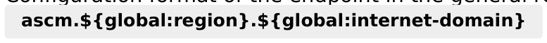

Alibaba Cloud  
Apsara Stack  
Apsara Uni-manager  
Management Console  
Developer Guide  
Product Version: V3.18.3  
Document Version: 20241106

**Table of Contents**

- [1.Preparations](#section-1)
    - [1.1. Obtain the information and endpoint of an API operation](#section-1-1)
    - [1.2. Obtain AccessKey credentials](#section-1-2)
    - [1.3. Obtain the values of common request headers](#section-1-3)
- [2.Use POP to make API calls](#section-2)
    - [2.1. Obtain the endpoint of the Apsara Uni-manager Management Console](#section-2-1)
    - [2.2. Obtain an SDK of the Apsara Uni-manager Management Console](#section-2-2)
    - [2.3. SDK for Java](#section-2-3)
    - [2.4. SDK for Python](#section-2-4)
    - [2.5. SDK for Go](#section-2-5)
- [3.API reference](#section-3)
    - [3.1. List of operations by function](#section-3-1)
        - [3.1.1. Enterprise](#section-3-1-1)
            - [3.1.1.1. Organizations](#section-3-1-1-1)
                - [3.1.1.1.1. CreateOrganization](#section-3-1-1-1-1)
                - [3.1.1.1.2. GetOrganization](#section-3-1-1-1-2)
                - [3.1.1.1.3. GetOrganizationList](#section-3-1-1-1-3)
                - [3.1.1.1.4. GetPrivateCloudAccountByOrganizationId](#section-3-1-1-1-4)
                - [3.1.1.1.5. RemoveOrganization](#section-3-1-1-1-5)
                - [3.1.1.1.6. UpdateOrganization](#section-3-1-1-1-6)
                - [3.1.1.1.7. UpdateSupportRegionsForOrg](#section-3-1-1-1-7)
            - [3.1.1.2. Resource sets](#section-3-1-1-2)
                - [3.1.1.2.1. CreateResourceGroup](#section-3-1-1-2-1)
                - [3.1.1.2.2. BindAscmUserAndResourceGroup](#section-3-1-1-2-2)
                - [3.1.1.2.3. ListAscmUsersInsideResourceGroup](#section-3-1-1-2-3)
                - [3.1.1.2.4. ListMembersInsideResourceSet](#section-3-1-1-2-4)
                - [3.1.1.2.5. ListResourceGroup](#section-3-1-1-2-5)
                - [3.1.1.2.6. ListResourceGroupByAscmUserId](#section-3-1-1-2-6)
                - [3.1.1.2.7. ListResourceGroupByOrgId](#section-3-1-1-2-7)
                - [3.1.1.2.8. RemoveResourceGroup](#section-3-1-1-2-8)
                - [3.1.1.2.9. UnbindAscmUserAndResourceGroup](#section-3-1-1-2-9)
                - [3.1.1.2.10. UpdateResourceGroup](#section-3-1-1-2-10)
            - [3.1.1.3. Roles](#section-3-1-1-3)
                - [3.1.1.3.1. AddRoleToUser](#section-3-1-1-3-1)
                - [3.1.1.3.2. ListActiveRoles](#section-3-1-1-3-2)
                - [3.1.1.3.3. ListRoles](#section-3-1-1-3-3)
                - [3.1.1.3.4. LockRole](#section-3-1-1-3-4)
                - [3.1.1.3.5. RelateSystemWithRole](#section-3-1-1-3-5)
                - [3.1.1.3.6. SetDefaultRole](#section-3-1-1-3-6)
                - [3.1.1.3.7. UnLockRole](#section-3-1-1-3-7)
            - [3.1.1.4. Users](#section-3-1-1-4)
                - [3.1.1.4.1. ActivateUser](#section-3-1-1-4-1)
                - [3.1.1.4.2. AddUser](#section-3-1-1-4-2)
                - [3.1.1.4.3. DeactivateUser](#section-3-1-1-4-3)
                - [3.1.1.4.4. GetUserInfo](#section-3-1-1-4-4)
                - [3.1.1.4.5. ListAccessKeysForManagedUsers](#section-3-1-1-4-5)
                - [3.1.1.4.6. DeleteUserAccessKey](#section-3-1-1-4-6)
                - [3.1.1.4.7. UpdateUserAccessKeyStatus](#section-3-1-1-4-7)
                - [3.1.1.4.8. CreateUserAccessKey](#section-3-1-1-4-8)
                - [3.1.1.4.9. GetRecentAkTrailForUser](#section-3-1-1-4-9)
                - [3.1.1.4.10. ListUserAccessKey](#section-3-1-1-4-10)
                - [3.1.1.4.11. ListAvailableUsersByRoleId](#section-3-1-1-4-11)
                - [3.1.1.4.12. ListDeletedUsers](#section-3-1-1-4-12)
                - [3.1.1.4.13. ListUsers](#section-3-1-1-4-13)
                - [3.1.1.4.14. ListUsersInsideRole](#section-3-1-1-4-14)
                - [3.1.1.4.15. LockUser](#section-3-1-1-4-15)
                - [3.1.1.4.16. ModifyUserInformation](#section-3-1-1-4-16)
                - [3.1.1.4.17. RecoverUserByLoginName](#section-3-1-1-4-17)
                - [3.1.1.4.18. RelateSystemWithUser](#section-3-1-1-4-18)
                - [3.1.1.4.19. RemoveRoleFromUser](#section-3-1-1-4-19)
                - [3.1.1.4.20. RemoveUserByLoginName](#section-3-1-1-4-20)
                - [3.1.1.4.21. RemoveCompletelyUserByLoginName](#section-3-1-1-4-21)
                - [3.1.1.4.22. ResetPasswordByLoginName](#section-3-1-1-4-22)
                - [3.1.1.4.23. UnLockUser](#section-3-1-1-4-23)
                - [3.1.1.4.24. UpdatePassword](#section-3-1-1-4-24)
            - [3.1.1.5. User groups](#section-3-1-1-5)
                - [3.1.1.5.1. AddResourceSetToUserGroup](#section-3-1-1-5-1)
                - [3.1.1.5.2. AddRoleToUserGroup](#section-3-1-1-5-2)
                - [3.1.1.5.3. AddUsersToUserGroup](#section-3-1-1-5-3)
                - [3.1.1.5.4. CreateUserGroup](#section-3-1-1-5-4)
                - [3.1.1.5.5. DeleteUserGroup](#section-3-1-1-5-5)
                - [3.1.1.5.6. ListUserGroups](#section-3-1-1-5-6)
                - [3.1.1.5.7. ListUsersInUserGroup](#section-3-1-1-5-7)
                - [3.1.1.5.8. RemoveResourceSetFromUserGroup](#section-3-1-1-5-8)
                - [3.1.1.5.9. RemoveRoleFromUserGroup](#section-3-1-1-5-9)
                - [3.1.1.5.10. RemoveUsersFromUserGroup](#section-3-1-1-5-10)
            - [3.1.1.6. Logon policies](#section-3-1-1-6)
                - [3.1.1.6.1. AddLoginPolicy](#section-3-1-1-6-1)
                - [3.1.1.6.2. CheckLoginPolicy](#section-3-1-1-6-2)
                - [3.1.1.6.3. GetLoginPolicyById](#section-3-1-1-6-3)
                - [3.1.1.6.4. GetLoginPolicyByLoginName](#section-3-1-1-6-4)
                - [3.1.1.6.5. ListLoginPolicies](#section-3-1-1-6-5)
                - [3.1.1.6.6. ModifyLoginPolicy](#section-3-1-1-6-6)
        - [3.1.2. Operations](#section-3-1-2)
            - [3.1.2.1. AddCommonSpec](#section-3-1-2-1)
            - [3.1.2.2. CreateQuota](#section-3-1-2-2)
            - [3.1.2.3. DeleteQuota](#section-3-1-2-3)
            - [3.1.2.4. DescribeGpdbModifiableInstanceType](#section-3-1-2-4)
            - [3.1.2.5. GetEnterpriseCenterQuota](#section-3-1-2-5)
            - [3.1.2.6. GetEnterpriseCenterQuotaDetail](#section-3-1-2-6)
            - [3.1.2.7. GetQuota](#section-3-1-2-7)
            - [3.1.2.8. MeteringQuery](#section-3-1-2-8)
            - [3.1.2.9. SelectCommonSpec](#section-3-1-2-9)
            - [3.1.2.10. UpdateCommonSpecStatus](#section-3-1-2-10)
            - [3.1.2.11. UpdateQuota](#section-3-1-2-11)
        - [3.1.3. Cloud services](#section-3-1-3)
            - [3.1.3.1. DescribeInstanceTypeFamilies](#section-3-1-3-1)
            - [3.1.3.2. DescribeModifiableInstanceType](#section-3-1-3-2)
            - [3.1.3.3. DescribeSeriesIdFamilies](#section-3-1-3-3)
            - [3.1.3.4. GetRegionsByProduct](#section-3-1-3-4)
            - [3.1.3.5. GroupCommonSpec](#section-3-1-3-5)
            - [3.1.3.6. InitFromOnline](#section-3-1-3-6)
            - [3.1.3.7. UpdateInstanceBelong](#section-3-1-3-7)
            - [3.1.3.8. GetAllRegionsInfo](#section-3-1-3-8)
        - [3.1.4. Configurations](#section-3-1-4)
            - [3.1.4.1. BatchCreateRAMServiceRole](#section-3-1-4-1)
            - [3.1.4.2. GetPasswordPolicy](#section-3-1-4-2)
            - [3.1.4.3. ListRAMPolicies](#section-3-1-4-3)
            - [3.1.4.4. ListRAMPoliciesForUser](#section-3-1-4-4)
            - [3.1.4.5. ListRAMServiceRoles](#section-3-1-4-5)
            - [3.1.4.6. RemoveLoginPolicyById](#section-3-1-4-6)
            - [3.1.4.7. RemoveLoginPolicyByName](#section-3-1-4-7)
            - [3.1.4.8. ResetPasswordPolicy](#section-3-1-4-8)
            - [3.1.4.9. SetPasswordPolicy](#section-3-1-4-9)
        - [3.1.5. Parameters related to the MeteringQuery operation](#section-3-1-5)
            - [3.1.5.1. Computing](#section-3-1-5-1)
                - [3.1.5.1.1. E-HPC](#section-3-1-5-1-1)
                - [3.1.5.1.2. Bare-metal Management Service](#section-3-1-5-1-2)
                - [3.1.5.1.3. Intelligent Computing Lingjun](#section-3-1-5-1-3)
                - [3.1.5.1.4. Container Registry](#section-3-1-5-1-4)
                - [3.1.5.1.5. ACK](#section-3-1-5-1-5)
                - [3.1.5.1.6. Dedicated Host](#section-3-1-5-1-6)
                - [3.1.5.1.7. Auto Scaling](#section-3-1-5-1-7)
                - [3.1.5.1.8. EBS](#section-3-1-5-1-8)
                - [3.1.5.1.9. Snapshots](#section-3-1-5-1-9)
                - [3.1.5.1.10. ECS](#section-3-1-5-1-10)
            - [3.1.5.2. Storage](#section-3-1-5-2)
                - [3.1.5.2.1. Tablestore](#section-3-1-5-2-1)
                - [3.1.5.2.2. OSS](#section-3-1-5-2-2)
                - [3.1.5.2.3. Log Service](#section-3-1-5-2-3)
            - [3.1.5.3. Networking](#section-3-1-5-3)
                - [3.1.5.3.1. HAVIP](#section-3-1-5-3-1)
                - [3.1.5.3.2. Express Connect](#section-3-1-5-3-2)
                - [3.1.5.3.3. NAT Gateway](#section-3-1-5-3-3)
                - [3.1.5.3.4. IPv6 Gateway](#section-3-1-5-3-4)
                - [3.1.5.3.5. VPN Gateway](#section-3-1-5-3-5)
                - [3.1.5.3.6. VPC](#section-3-1-5-3-6)
                - [3.1.5.3.7. EIP](#section-3-1-5-3-7)
                - [3.1.5.3.8. SLB](#section-3-1-5-3-8)
                - [3.1.5.3.9. Authoritative zones](#section-3-1-5-3-9)
            - [3.1.5.4. Analytics computing](#section-3-1-5-4)
                - [3.1.5.4.1. MaxCompute](#section-3-1-5-4-1)
                - [3.1.5.4.2. DataHub](#section-3-1-5-4-2)
                - [3.1.5.4.3. Realtime Compute](#section-3-1-5-4-3)
                - [3.1.5.4.4. Realtime Compute for Apache Flink](#section-3-1-5-4-4)
            - [3.1.5.5. Middleware](#section-3-1-5-5)
                - [3.1.5.5.1. Message Queue for Apache RocketMQ](#section-3-1-5-5-1)
            - [3.1.5.6. Database](#section-3-1-5-6)
                - [3.1.5.6.1. PolarDB](#section-3-1-5-6-1)
                - [3.1.5.6.2. DTS](#section-3-1-5-6-2)
                - [3.1.5.6.3. DMS](#section-3-1-5-6-3)
                - [3.1.5.6.4. ApsaraDB RDS for SQL Server](#section-3-1-5-6-4)
                - [3.1.5.6.5. ApsaraDB RDS for PostgreSQL](#section-3-1-5-6-5)
                - [3.1.5.6.6. ApsaraDB for MongoDB](#section-3-1-5-6-6)
                - [3.1.5.6.7. What is KVStore for Redis?](#section-3-1-5-6-7)
                - [3.1.5.6.8. PolarDB-X](#section-3-1-5-6-8)
                - [3.1.5.6.9. ApsaraDB RDS for MySQL](#section-3-1-5-6-9)
            - [3.1.5.7. Application services](#section-3-1-5-7)
                - [3.1.5.7.1. API Gateway](#section-3-1-5-7-1)
            - [3.1.5.8. Security](#section-3-1-5-8)
                - [3.1.5.8.1. SOC](#section-3-1-5-8-1)
                - [3.1.5.8.2. Traffic Detection and Response](#section-3-1-5-8-2)
                - [3.1.5.8.3. Network Detection and Response](#section-3-1-5-8-3)
                - [3.1.5.8.4. Server Guard](#section-3-1-5-8-4)
                - [3.1.5.8.5. WAF](#section-3-1-5-8-5)
                - [3.1.5.8.6. Threat Detection Service](#section-3-1-5-8-6)
                - [3.1.5.8.7. Bastionhost](#section-3-1-5-8-7)
                - [3.1.5.8.8. KMS](#section-3-1-5-8-8)
        - [3.1.6. Operation audit](#section-3-1-6)
            - [3.1.6.1. LookupInnerEvents](#section-3-1-6-1)
            - [3.1.6.2. RetryAuditTask](#section-3-1-6-2)
            - [3.1.6.3. ListAuditFile](#section-3-1-6-3)
            - [3.1.6.4. ListTrailStorage](#section-3-1-6-4)
            - [3.1.6.5. ListAccessKeyEvents](#section-3-1-6-5)
            - [3.1.6.6. CreateTrailStorage](#section-3-1-6-6)
            - [3.1.6.7. DownloadAuditFile](#section-3-1-6-7)
            - [3.1.6.8. GetDownloadUrl](#section-3-1-6-8)
- [4.STS API reference](#section-4)
    - [4.1. AssumeRole](#section-4-1)
    - [4.2. GetCallerIdentity](#section-4-2)

<a id="section-1"></a>

# 1.Preparations

<a id="section-1-1"></a>

## 1.1. Obtain the information and endpoint of an API operation

To call an API operation by using an SDK, you must obtain the information about the API operation, including the service code, API operation name, and API version.

**Background information**

The information on the API directory page of the Apsara Uni-manager Management Console is for reference only. For more information about how to call API operations, see the developer guides of cloud services. If the information on the API directory page is different from that in the developer guide of a cloud service, the information in the developer guide prevails.

**Procedure**

1. Log on to the Apsara Uni-manager Management Console.

2. In the top navigation bar, choose **Products** > **Development Tools** > **API & SDK** > **OpenAPI Explorer**.

3. On the **OpenAPI Explorer** page, choose **API Integration** > **API Debugging** in the top navigation bar.

   

4. In the upper-left corner, move the pointer over the More icon and then select the cloud service whose API operation you want to call.

5. Select an API version from the **Version** drop-down list.

6. In the API operation list, you can view all API operations of the current version.

7. Click the API operation that you want to call. Obtain the endpoint from the Endpoint parameter on the Parameter tab.

<a id="section-1-2"></a>

## 1.2. Obtain AccessKey credentials

AccessKey credentials are assigned by Resource Access Management (RAM) or Security Token Service (STS). You can use one of the preceding types of AccessKey credentials for authentication when you call API operations.

**Background information**

An AccessKey pair is used to verify the identity of a request sender based on symmetric encryption. An AccessKey pair consists of an AccessKey ID and an AccessKey secret. The AccessKey ID is used to identify a user. The AccessKey secret is used to encrypt the signature string.

AccessKey credentials can be assigned by RAM or STS:

- An AccessKey pair that is assigned by RAM to a third party consists of an AccessKey ID and an AccessKey secret.

- An AccessKey 3-tuple that is assigned by STS to a third party consists of an AccessKey ID, an AccessKey secret, and a security token.

**Obtain an AccessKey pair**

The Apsara Uni-manager Management Console provides two types of AccessKey pairs: those for personal accounts and those for organization accounts. We recommend that you use AccessKey pairs for personal accounts to call the API operations of the Apsara Uni-manager Management Console and cloud services.

> **Note**
>
> Only operations administrators and level-1 organization administrators can obtain AccessKey pairs for organization accounts.

**Obtain the AccessKey pair of a personal account**

To use AccessKey pairs for personal accounts, you must configure the header parameters that are described in the following table for access control. Otherwise, an error that indicates insufficient permissions may occur.

| Parameter | Description |
| --- | --- |
| x-acs-regionid | The ID of the region to which the instance that you want to access belongs. Example: cn-qingdao-\*\*\*\*-\*\*\*\*. |
| x-acs-organizationid | The ID of the organization to which the instance that you want to access belongs. For information about how to obtain the ID, see the "Obtain an organization ID" section of the Obtain the values of common request headers topic. |
| x-acs-resourcegroupid | The ID of the resource set to which the instance that you want to access belongs. For information about how to obtain the ID, see the "Obtain a resource set ID" section of the Obtain the values of common request headers topic. |
| x-acs-instanceid | The ID of the instance that you want to access.For example, you can view the ID of an Elastic Compute Service (ECS) instance in the ECS instance list. |

1. Log on to the Apsara Uni-manager Management Console.

2. In the upper-right corner of the homepage, click the profile picture and then click **User Information**.

3. In the **AccessKey Pair** section, view the AccessKey pair of the personal account.

   

   > **Note**
   >
   > The AccessKey pair provides full access to cloud resources within your Alibaba Cloud account. You must keep the AccessKey pair confidential.

**Obtain the AccessKey pair of an organization**

> **Warning**
>
> The AccessKey pair of a personal account is managed by the permission system of the Apsara Uni-manager Management Console. If you need to obtain the AccessKey pair of an organization, make sure that your operation is allowed by an administrator. This ensures security.

1. Log on to the Apsara Uni-manager Management Console as an administrator.

2. In the top navigation bar, click **Enterprise**.

3. In the left-side navigation pane, choose **Resources > Organizations**.

4. In the organization list, click the name of the level-1 organization whose AccessKey pair you want to obtain.

5. On the right side of the page that appears, click **Management AccessKey**.

6. In the dialog box that appears, view the AccessKey pair of the organization.

**Obtain an STS AccessKey 3-tuple**

STS allows you to use temporary credentials to access Apsara Stack resources. To call API operations in Apsara Stack by using STS, you must obtain an AccessKey ID, an AccessKey secret, and a security token assigned by STS.

1. Obtain the RAM role.

   <ol type="i">

   <li>

   Log on to the Apsara Uni-manager Operations Console.

   </li>

   <li>

   Click the profile picture in the upper-right corner of the page and then click User

   </li>

   </ol>

   Information.

   <ol type="i" start="3">

   <li>

   Click View Current Role Policy.

   </li>

   <li>

   In the View Policies of Current Role dialog box, view your RAM role.

   </li>

   </ol>

2. Obtain the endpoint of STS.

   <ol type="i">

   <li>

   Log on to the Apsara Infrastructure Management console.

   </li>

   <li>

   In the left-side navigation pane, click **Project & Cluster O&M**.

   </li>

   <li>

   In the **Products | Cluster** search box, enter **ascm-A**.

   </li>

   <li>

   Find the cluster and click **Cluster Details** in the **Actions** column.

   </li>

   <li>

   On the cluster details page, click the **Desired State Configuration** tab.

   </li>

   <li>

   In the list of files displayed on the left, click **kv.conf**. Then, click **Show Content** on the right. Press Ctrl+F and search for  `region`  and  `internet-domain`  to obtain their values.

   </li>

   <li>

   Then splice  `sts-vpc.${global:region}.${global:internet-domain}` . Replace  `${global:region}`  with the  `region`  value and replace  `${global:internet-domain}`

   </li>

   </ol>

   with the  `internet-domain`  value.

   > **Note**
   >
   > Delete ${global:} in the final endpoint.

3. Call the AssumeRole operation of STS to obtain the AccessKey 3-tuple. The following example shows how to call the operation by using STS SDK for Java.

   > **Note**
   >
   > Replace  `<yourRegionID>` ,  `<yourAccessKeyID>` ,  `<yourAccessKeySecret>` ,  `<yourRoleSessionName>` ,  `<yourRoleArn>` , and  `<sts.aliyuns.com>`  with the actual values. Delete angle brackets (<>) in your code.

   ```xml
   public static void main(String[] args) {
       // Create and initialize a DefaultAcsClient instance. 
       // Specify your actual region ID, AccessKey ID, and AccessKey secret. 
       DefaultProfile profile = DefaultProfile.getProfile("<yourRegionID>", "
   <yourAccessKeyID>", "<yourAccessKeySecret>");
       HttpClientConfig clientConfig = HttpClientConfig.getDefault();
       clientConfig.setIgnoreSSLCerts(true);
       clientConfig.setProtocolType(ProtocolType.HTTPS);
       profile.setHttpClientConfig(clientConfig);
       IAcsClient client = new DefaultAcsClient(profile);
       String assumeRole = callAssumeRole(client);
       if (StringUtils.isEmpty(assumeRole)) return;
       JSONObject assumeRoleJson = JSONObject.parseObject(assumeRole);
       JSONObject credentials = assumeRoleJson.getJSONObject("Credentials");
       // Obtain the STS AccessKey 3-tuple. 
       String stsAK = credentials.getString("AccessKeyId");
       String stsSK = credentials.getString("AccessKeySecret");
       String stsToken = credentials.getString("SecurityToken");
   }

   private static String callAssumeRole(IAcsClient client) {
       CommonRequest request = new CommonRequest();
       // Replace "sts.aliyuns.com" with the endpoint of STS. The format of an endpoint is sts-vpc.${global:region}.${global:internet-domain}. 
       request.setSysDomain("<sts.aliyuns.com>");
       request.setSysProduct("Sts");
       request.setSysAction("AssumeRole");
       request.setSysVersion("2015-04-01");
       request.setSysMethod(MethodType.POST);
       request.setHttpContentType(FormatType.FORM);
       // The name of the role session. You can specify this parameter based on your business requirements. This parameter is usually set to the identity of the user who calls the API operation, such as the username. Replace "<yourRoleSessionName>" with yourcustom value. 
       request.putQueryParameter("RoleSessionName", "<yourRoleSessionName>");
       // The ARN of the RAM role. This role is a RAM role whose trusted entity is an AS
   CM user. Replace "<yourRoleArn>" with the actual RAM role obtained in the first step.

       request.putQueryParameter("RoleArn", "<yourRoleArn>");
       try {
           CommonResponse response = client.getCommonResponse(request);
           return response.getData();
       } catch (ServerException e) {
           System.out.println(e.getErrCode());
           System.out.println(e.getErrMsg());
       } catch (ClientException e) {
           System.out.println(e.getErrCode());
           System.out.println(e.getErrMsg());
       }
       return null;
   }
   ```

4. Use the obtained AccessKey 3-tuple to call API operations of cloud services. The following example shows how to use STS SDK for Java to call the DescribeZones operation of ECS.

   > **Note**
   >
   > Replace  `<yourRegionID>` ,  `<yourStsAccesskeyID>` ,  `<yourStsAccessKeySecret>` ,  `<yourStsToken>` ,  `<yourResourceGroupID>` , and  `<yourOrganizationID>`  with the actual values. Delete angle brackets (<>) in your code.

   ```xml
   public static void main(String[] args) {
       // Replace "<yourRegionID>" with the ID of the region to which the instance to beaccessed belongs. 
       // Replace "<yourStsAccessKeyID>" and "<yourStsAccessKeySecret>" with the AccessKey ID and AccessKey secret of the 3-tuple obtained in the previous step. 
       DefaultProfile profile = DefaultProfile.getProfile("<yourRegionID>", "
   <yourStsAccesskey>", "<yourStsAccessSecret>");
       HttpClientConfig clientConfig = HttpClientConfig.getDefault();
       clientConfig.setIgnoreSSLCerts(true);
       clientConfig.setProtocolType(ProtocolType.HTTPS);
       profile.setHttpClientConfig(clientConfig);
       IAcsClient client = new DefaultAcsClient(profile);
       CommonRequest request = new CommonRequest();
       request.setSysDomain("ecs.aliyuns.com");
       request.setSysProduct("Ecs");
       request.setSysAction("DescribeZones");
       request.setSysVersion("2014-05-26");
       request.setSysMethod(MethodType.POST);
       request.setHttpContentType(FormatType.FORM);
       // Replace "<yourRegionID>" with the ID of the region to which the instance to beaccessed belongs. 
       request.putHeadParameter("x-acs-regionid", "<yourRegionID>");
       // Replace "<yourStsToken>" with the security token of the 3-tuple obtained in the previous step. 
       request.putQueryParameter("SecurityToken", "<yourStsToken>");
       // Optional. Replace it with the ID of the resource set to which the instance to be accessed belongs. 
       // request.putHeadParameter("x-acs-resourcegroupid", "<yourResourceGroupID>");
       // Required. Replace it with the ID of the organization to which the instance to be accessed belongs. 
       request.putHeadParameter("x-acs-organizationid", "<yourOrganizationID>");
       try {
           CommonResponse response = client.getCommonResponse(request);
           System.out.println(response.getData());
       } catch (ServerException e) {
           System.out.println(e.getErrCode());
           System.out.println(e.getErrMsg());
       } catch (ClientException e) {
           System.out.println(e.getErrCode());
           System.out.println(e.getErrMsg());
       }
   }
   ```

<a id="section-1-3"></a>

## 1.3. Obtain the values of common request headers

In Apsara Stack, you must specify multiple common request headers to call API operations. Then, common response parameters are returned in the results.

**Common request parameters**

You must specify the common request parameters in the code to call API operations in Apsara Stack.

For example, you must replace  `<yourResourceGroupID>`  with the actual resource set ID in  `request.putHeadParameter("x-acs-resourcegroupid", "<yourResourceGroupID>")`  when you use SDK for Java to call API operations.

| Parameter | Description |
| --- | --- |
| x-acs-regionid | The ID of the region in which the instance resource on which you want to perform operations resides. For more information, see the Obtain a region ID section of this topic. |
| x-acs-organizationid | The ID of the organization to which the instance resource on which you want to perform operations belongs. For more information, see the Obtain an organization ID section of this topic. |
| x-acs-resourcegroupid | The ID of the resource set to which the instance resource on which you want to perform operations belongs. For more information, see the Obtain a resource set ID section of this topic. |
| x-acs-instanceid | The ID of the instance to which the resource on which you want to perform operations belongs.For more information, see the Obtain an instance ID section of this topic. |

> **Note**
>
> - When you call API operations of the Apsara Uni-manager Management Console, you do not need to use the  `x-acs-organizationid` ,  `x-acs-resourcegroupid` , and  `x-acs-instanceid`  parameters.
>
> - When you call API operations of other cloud services in Apsara Stack, you must use the  `<x-acs-organizationid>`  parameter to specify the organization ID to the request header. Otherwise, the call fails and an error message is returned, which indicates that you do not have permissions to initiate calls.
>
> - When you call API operations of other cloud services in Apsara Stack, we recommend that you use the  `<x-acs-resourcegroupid>`  parameter to specify the resource set ID to the request header. After you specify the organization ID and the resource set ID, you can narrow down the query scope when you query instance resources. If you do not use the  `<x-acs-resourcegroupid>`  parameter to specify the resource set ID, the default resource set of the organization to which the user belongs is used.

**Obtain a region ID**

You can view the region IDs of resources in the Apsara Uni-manager Management Console.

1. Log on to the Apsara Uni-manager Management Console as an administrator.

2. In the top navigation bar, click **Enterprise**.

3. In the left-side navigation pane, choose **Resources** > **Regions**.

4. On the Regions page, find the organization that you want to view and click its name in the organization tree.

5. In the **Regions** list, obtain the region ID from the **Region Name** column.

**Obtain an organization ID**

You must call an API operation to obtain the ID of an organization. You can obtain the organization ID by using the online debugging feature in the Apsara Uni-manager Management Console.

1. Log on to the Apsara Uni-manager Management Console as an administrator.

2. In the top navigation bar, choose **Products** > **Development Tools** > **API & SDK** > **OpenAPI Explorer**.

3. On the **OpenAPI Explorer** page, choose **API Integration** > **API Debugging** in the top navigation bar.

4. Move the pointer over the  icon and choose **Platform** > **Apsara Uni-manager**. Select

   **2019-05-10** from the **Version** drop-down list.

5. Enter  `GetOrganizationList`  in the search box to debug the operation online. Obtain the organization ID from the **id** parameter in the **returned results**. For more information, see GetOrganizationList.

**Obtain a resource set ID**

You must call an API operation to obtain the ID of a resource set. You can obtain the resource set ID by using the online debugging feature in the Apsara Uni-manager Management Console.

1. Log on to the Apsara Uni-manager Management Console as an administrator.

2. In the top navigation bar, choose **Products** > **Development Tools** > **API & SDK** > **OpenAPI Explorer**.

3. On the **OpenAPI Explorer** page, choose **API Integration** > **API Debugging** in the top navigation bar.

4. Move the pointer over the  icon and choose **Platform** > **Apsara Uni-manager**. Select

   **2019-05-10** from the **Version** drop-down list.

5. Enter  `ListResourceGroup`  in the search box to debug the operation online. Obtain the resource set ID from the **id** parameter in the **returned results**. For more information, see ListResourceGroup<em>.</em>

**Obtain an instance ID**

You can obtain the ID of an instance in the cloud service console of the Apsara Uni-manager Management Console. For example, you can view instance IDs in the Elastic Compute Service (ECS) console.

1. Log on to the Apsara Uni-manager Management Console.

2. In the top navigation bar, choose **Products** > **Computing** > **Cloud Server** > **Elastic Compute Service**.

3. In the left-side navigation pane, choose **Instances & Images** > **ECS Instance**

4. On the Instances page, view the instance IDs in the **Instance ID/Name** column of the instance list.

**Common response parameters**

The following table describes the common response parameters that are returned by default when you call API operations to query the instances of cloud services.

| Parameter | Description |
| --- | --- |
| ResourceGroupName | The name of the resource set. |
| ResourceGroup | The ID of the resource set. |
| DepartmentName | The name of the organization. |
| Department | The ID of the organization. |

<a id="section-2"></a>

# 2.Use POP to make API calls

<a id="section-2-1"></a>

## 2.1. Obtain the endpoint of the Apsara Uni-manager Management Console

To obtain the endpoint of the Apsara Uni-manager Management Console, you can obtain the values of required variables in the Apsara Infrastructure Management console based on the configuration format of the endpoint and then concatenate the values. You can also search for the endpoint in the Apsara Infrastructure Management console.

**Background information**

To use the Portable OpenAPI Proxy (POP) gateway to call API operations in Apsara Stack, you must obtain required service endpoints. You can obtain service endpoints from Apsara Stack onsite O&M engineers or by using one of the following methods.

**Method 1: Concatenate variable values to generate an endpoint**

You can obtain the values of required variables and concatenate the values based on the configuration format of the endpoint of the Apsara Uni-manager Management Console.


- Configuration format of the endpoint in the central region:  **ascm.${global:internet-**

  **domain}**

- Configuration format of the endpoint in the general region:

  

> **Note**
>
> `${global:internet-domain}`  and  `${global:region}`  are variables and need to be replaced with the actual values that you obtained.  `${global:}`  is not included in the final endpoint.

**Obtain actual values of variables**

1. Log on to the Apsara Uni-manager Operations Console.

2. In the top navigation bar, choose **Platform O&M** > **Apsara Infrastructure Management** > **Resources**. The **Product & Cluster O&M** page appears.

   

3. Enter  **ascm-A**  in the **Product | Cluster** search box on the **Product & Cluster O&M** page, find the ascm-A-xxx cluster, and then click **Cluster Details** in the Actions column.

4. On the **cluster details** page, click the **Desired State Configuration** tab.

5. In the list of files displayed on the left, click **kv.conf** and click Display Content on the right. Press Ctrl+F to search for  `region`  and  `internet-domain` .

   Replace  `${global:region}`  with the  `region`  value and  `${global:internet-domain}` with the  `internet-domain`  value.

**Method 2: Search for the endpoint in the Apsara Infrastructure Management console Procedure**


1. Enter  **ascm-A**  in the **Product | Cluster** search box on the **Product & Cluster O&M** page, find the ascm-A-xxx cluster, and then click **Cluster Details** in the Actions column.

   

2. n the Services tab of the cluster details page, enter  **ascm-brm**  in the Service search box, find the ascm-brm service, and then click **Details** in the Actions column.

3. On the service details page, click **Manage#** in the Components section. Then, click the **Resources** tab in the Information of Component Manage# section.

   

4. Search for the resource named  **ascm-aliyun-com-dns** , click the icon in the **Resource Application Parameters** column to display detailed parameter settings, and then view the value of **domain**.

<a id="section-2-2"></a>

## 2.2. Obtain an SDK of the Apsara Uni-manager Management Console

To call API operations by using the Portable OpenAPI Proxy (POP) gateway in the Apsara Uni-manager Management Console, you must use an SDK.

To obtain the recommended SDK version and sample code, perform the following steps: Log on to the Apsara Uni-manager Management Console. In the top navigation bar, choose **Products** > **Development Tools** > **API & SDK** > **OpenAPI Explorer**. On the page that appears, choose **API Integration** > **SDK Sample Code**. On the SDK Examples tab, view the recommended SDK version and sample code.

> **Note**
>
> We recommend that you use an SDK for Java, Python, or Go. If you use SDKs for other programming languages, the SDKs may be incompatible with your system.

<a id="section-2-3"></a>

## 2.3. SDK for Java

After you install Alibaba Cloud SDK for Java, you can write code to use Alibaba Cloud SDK for Java to access the Alibaba Cloud Portable OpenAPI Proxy (POP) gateway and call API operations of the Apsara Uni-manager Management Console.

**Prerequisites**

- An AccessKey pair or a Security Token Service (STS) AccessKey pair is obtained. For more information, see Obtain AccessKey credentials.

- The endpoint of the Apsara Uni-manager Management Console is obtained. For information about how to obtain the endpoint, see Obtain service endpoints.

- Java Development Kit (JDK) 1.8 or later is installed.

**Install the SDK for Java**

Add the core library of Alibaba Cloud SDK for Java to the pom.xml file in your Maven project.

```xml
<!-- https://mvnrepository.com/artifact/com.aliyun/aliyun-java-sdk-core -->
<dependency>
    <groupId>com.aliyun</groupId>
    <artifactId>aliyun-java-sdk-core</artifactId>
    <version>4.5.30</version>
</dependency>
```

> **Note**
>
> SDK packages are frequently updated. We recommend that you visit the Alibaba Cloud SDK Center to obtain dependencies of the latest version.

**Configure identity verification**

When you use Apsara Stack SDKs to access Apsara Stack services, you must provide an Apsara Stack tenant account for identity verification. The SDK for Java supports identity verification based on an AccessKey pair or an STS AccessKey pair.

> **Important**
>
> Keep code that contains your AccessKey pair or STS AccessKey pair confidential. For example, do not commit the code to public GitHub projects. Otherwise, your account may be compromised.

```xml
DefaultProfile profile = DefaultProfile.getProfile(
    "<yourRegionID>",          // Replace it with your region ID. 
    "<yourAccessKeyID>",      // Replace it with your AccessKey ID. 
    "<yourAccessKeySecret>",  // Replace it with your AccessKey secret. 
    "<yourSecurityToken>"   
    // If you use an STS AccessKey pair for identity verification, replace 
<yourSecurityToken> with your security token. 
    // If you use an AccessKey pair for identity verification, <yourSecurityToken> is null. 
);
```

> **Note**
>
> In the preceding sample code, the  `<yourRegionID>` ,  `<yourAccessKeyID>` ,  `<yourAccessKeySecret>` , and  `<yourSecurityToken>`  parameters are all variable parameters and need to be replaced with actual values. The angle brackets <> are not retained in the final code.

**Create and configure a request connection**

You can write the following code to configure the HttpClientConfig object. You can configure the parameters in the code based on your business requirements.

```text
// Obtain the HttpClientConfig object. 
HttpClientConfig clientConfig = HttpClientConfig.getDefault();
// Specify whether to ignore certificates. true: Ignore certificates. false: Do not ignore certificates. 
clientConfig.setIgnoreSSLCerts(true);
// (Optional) Specify the connection timeout period. Unit: milliseconds. 
clientConfig.setConnectionTimeoutMillis(<connectionTimeout>);
// (Optional) Specify the read timeout period. Unit: milliseconds. 
clientConfig.setReadTimeoutMillis(<readTimeout>);
/** (Optional) Determine whether to configure a proxy based on your business 
requirements. You can configure a proxy in the following code. Replace 
192.168.XX.XX:33XX with the IP address and port of your proxy. 
clientConfig.setHttpProxy("<http://192.168.XX.XX:33XX>");
clientConfig.setHttpsProxy("<https://192.168.XX.XX:33XX>");
*/
profile.setHttpClientConfig(clientConfig);
IAcsClient client = new DefaultAcsClient(profile);
```

> **Note**
>
> In the preceding sample code, the  `<connectionTimeout>` ,  `<readTimeout>` , and  `<http://192.168.XX.XX:33XX>`  parameters are all variable parameters and need to be replaced with actual values. The angle brackets <> are not retained in the final code.

**Create a request named CommonRequest**

CommonRequest supports all API operations.

```text
// Create an API request and configure the request parameters. 
CommonRequest request = new CommonRequest();
// The parameters related to API operations of the Apsara Uni-manager Management Console. 
request.setSysProduct("ascm");
request.setSysVersion("2019-05-10");
request.setSysUriPattern("<yourCallUriPattern>");
// The endpoint of the Apsara Uni-manager Management Console. 
request.setSysDomain("<ascmEndpoint>");
// Specify the request method. 
request.setSysMethod(MethodType.POST);
// Configure Header parameters. 
// Configure the identifier of the requester to identify the source of the call. This parameter is required and used only for identification. You can set this parameter to a random value. 
request.putHeadParameter("x-acs-caller-sdk-source","<yourCallerSdkSource>");
// Configure business parameters for the API operation. 
...
// Configure the Content-Type parameter. 
request.setHttpContentType(FormatType.JSON);
```

> **Note**
>
> In the preceding sample code, the  `<yourCallUriPattern>` ,  `<ascmEndpoint>` , and  `<yourCallerSdkSource>`  parameters are all variable parameters and need to be replaced with actual values. The angle brackets <> are not retained in the final code.

**Configure the parameters related to the core library of Alibaba Cloud SDK**

When you use the core library of Alibaba Cloud SDK to initiate an API request, you can configure four types of parameters: Path, Query, Body, and Header. When you call a specific API operation, specify the parameter type based on the parameter position that is marked in the developer guide.

| Paramet er type | Description | Example |
| --- | --- | --- |
| Path | Path parameters are used to replace the variables in UriPattern specified in the request.<br>For example, the <code> [ClusterId] </code> in <code>"/clusters/[ClusterId]</code> <code>" </code> is replaced by <code> cluster1 </code> based on Path parameters.<br>The Uniform Resource Identifier (URI) that is ultimately used to initiate the HTTP request is <code>"/clusters/clusterId01</code> <code>" </code>. | <code>CommonRequest request = new CommonRequest();</code><br><code>request.setSysUriPattern("/clusters/[ClusterId]</code><br><code>");</code><br><code>request.putPathParameter("ClusterId",</code><br><code>"clusterId01");</code> |
| Query | Query parameters are used to configure the URL parameters in the request.Query parameters are used for GET requests in most cases.<br>Example: "http://aliyun.com/api/? ClusterId=clusterId01&amp;Clu sterName=clusterName01 ". | <code>CommonRequest request = new CommonRequest();</code><br><code>request.putQueryParameter("ClusterId",</code><br><code>"clusterId01");</code><br><code>request.putQueryParameter("ClusterName",</code><br><code>"clusterName01");</code> |
| Body | Body parameters are used to specify the content in the HTTP request. Body parameters are used for POST and PUT requests in most cases.<br>The following two formats are supported:<br>• application/json<br>• application/x-www-form-urlencoded<br>Note<br>When you configure a Body parameter, you must also configure the Content-Type parameter. | • Configure a Body parameter in the key-value format and configure the Content-Type parameter:<br><code>CommonRequest request = new</code><br><code>CommonRequest();</code><br><code>request.putBodyParameter("ClusterId",</code><br><code>"clusterId01");</code><br><code>request.putBodyParameter("ClusterName",</code><br><code>"clusterName01");</code><br><code>// If you set Content-Type to</code><br><code>application/x-www-form-urlencoded, the</code><br><code>content in the request is a string in the</code><br><code>"ClusterId=clusterId01&amp;ClusterName=clusterNam</code><br><code>e01" format.</code><br><code>request.setHttpContentType(FormatType.FORM);</code><br><code>// If you set Content-Type to</code><br><code>application/json, the content in the</code><br><code>request is a JSON string in the "</code><br><code>{\"ClusterId\":\"clusterId01\",\"ClusterName\</code><br><code>":\"clusterName01\"}" format.</code><br><code>request.setHttpContentType(FormatType.JSON);</code><br>• Construct custom HTTP content and configure the HttpContent parameter:<br><code>CommonRequest request = new</code><br><code>CommonRequest();</code><br><code>// Specify the HTTP content in the</code><br><code>application/json format.</code><br><code>String body = "{\"ClusterId\":</code><br><code>\"clusterId01\", \"ClusterName\":</code><br><code>\"clusterName01\"}";</code><br><code>request.setHttpContent(body.getBytes(),</code><br><code>"utf-8", FormatType.JSON);</code><br><code>// Specify the HTTP content in the</code><br><code>application/x-www-form-urlencoded format.</code><br><code>String body =</code><br><code>"ClusterId=clusterId01&amp;ClusterName=clusterNam</code><br><code>e01";</code><br><code>request.setHttpContent(body.getBytes(),</code><br><code>"utf-8", FormatType.FORM);</code> |
| Header | Header parameters are used to configure HTTP headers in the request. | <code>CommonRequest request = new CommonRequest();</code><br><code>request.putHeadParameter("x-acs-</code><br><code>organizationid", "3");</code><br><code>request.putHeadParameter("x-acs-</code><br><code>resourcegroupid", "2");</code> |

**Initiate the request and process the response**

You can refer to the following code to initiate the request and process the response.

```java
try {
    // Initiate the request and obtain the response. 
    CommonResponse response = client.getCommonResponse(request);
    System.out.println(response.getData());
} catch (ServerException e) {
    e.printStackTrace();
} catch (ClientException e) {
    System.out.println("ErrCode:" + e.getErrCode());
    System.out.println("ErrMsg:" + e.getErrMsg());
    System.out.println("RequestId:" + e.getRequestId());
}
```

**Handle errors**

If an error occurs on the server or SDK when you use the SDK for Java, an error response is returned. The error response contains an error code and an error message.

In most cases, you do not need to handle the errors returned by the SDK for Java. You need to only handle the errors returned by the server based on error messages.

- **`ServerException`**  indicates a server error.

- **`ClientException`**  indicates an SDK error.

The following error indicates that the AccessKey ID is invalid. You must specify a valid AccessKey ID.

```text
com.aliyuncs.exceptions.ClientException: InvalidAccessKeyId.NotFound : Specified accesskey is not found.
```

If you want to handle the SDK errors returned by the SDK, refer to the following example to write your code:

```java
try {
    AcsResponse response = client.getAcsResponse(request);
    // Process the response. 
    // ...
}catch (ServerException e){
    // Add your own computing logic for handling errors here. 
    // For example, you can obtain the error information. 
    System.out.println("ErrorCode=" + e.getErrCode());
    System.out.println("ErrorMessage=" + e.getErrMsg());
    // If you are unable to fix the error, submit a ticket and provide the request ID to Alibaba Cloud technical support. 
    System.out.println("ResponseId=" + e.getRequestId());
}catch (ClientException e){
    // Add your own computing logic for handling errors here. 
    // For example, you can obtain the error information. 
    System.out.println("ErrorCode=" + e.getErrCode());
    System.out.println("ErrorMessage=" + e.getErrMsg());
}
```

**Example**

The following code provides an example on how to call the  `GetOrganizationList`  operation of the Apsara Uni-manager Management Console to query the organization list:

```java
import com.aliyuncs.CommonRequest;
import com.aliyuncs.CommonResponse;
import com.aliyuncs.DefaultAcsClient;
import com.aliyuncs.IAcsClient;
import com.aliyuncs.exceptions.ClientException;
import com.aliyuncs.exceptions.ServerException;
import com.aliyuncs.http.FormatType;
import com.aliyuncs.http.HttpClientConfig;
import com.aliyuncs.http.MethodType;
import com.aliyuncs.http.ProtocolType;
import com.aliyuncs.profile.DefaultProfile;

public class Demo {
    /**
     * The example provided in this topic is for reference only. For more information, see Getting Started in the developer guide. 
     */
    public static void main(String[] args) {
        // Create and initialize a DefaultAcsClient instance. 
        DefaultProfile profile = DefaultProfile.getProfile(
                "<yourRegionID>",         // Replace it with your region ID. 
                "<yourAccessKeyID>",      // Replace it with your AccessKey ID. 
                "<yourAccessKeySecret>",  // Replace it with your AccessKey secret. 
                null);
        HttpClientConfig clientConfig = HttpClientConfig.getDefault();
        clientConfig.setProtocolType(ProtocolType.HTTP);
        /**
        Determine whether to configure an HTTP proxy based on your business 
requirements. You can configure a proxy in the following code. Replace 
192.168.XX.XX:33XX with the IP address and port of your proxy. 
        clientConfig.setHttpProxy("<http://192.168.XX.XX:33XX>");
        */
        // Specify the connection timeout period. Unit: milliseconds. 
        // clientConfig.setConnectionTimeoutMillis(1000L);
        // Specify the read timeout period. Unit: milliseconds. 
        // clientConfig.setReadTimeoutMillis(10000L);
        profile.setHttpClientConfig(clientConfig);
        IAcsClient client = new DefaultAcsClient(profile);
        // Create an API request and configure the request parameters. 
        CommonRequest request = new CommonRequest();
        // The parameters related to API operations of the Apsara Uni-manager 
Management Console. 
        request.setSysProduct("ascm");
        request.setSysVersion("2019-05-10");
        request.setSysUriPattern("/ascm/auth/organization/queryList");
        // The endpoint of the Apsara Uni-manager Management Console. 
        request.setSysDomain("<ascmEndpoint>");
        // Specify the request method. 
        request.setSysMethod(MethodType.POST);
        // Configure Header parameters. 
        // Configure the identifier of the requester to identify the source of the call. This parameter is required and used only for identification. You can set this parameter to a random value. 
        request.putHeadParameter("x-acs-caller-sdk-source","<yourCallerSdkSource>");
        # When you call an API operation in Apsara Stack, you must configure multiple common Header parameters, such as x-acs-regionid, x-acs-organizationid, x-acs-resourcegroupid, and x-acs-instanceid. For more information, see Obtain the value of common Header parameters in the developer guide. 
        
        // Configure business parameters for the API operation. 
        request.putBodyParameter("id","1");
        request.setHttpContentType(FormatType.JSON);
        try {
            // Initiate the request and obtain the response. 
            CommonResponse response = client.getCommonResponse(request);
            System.out.println(response.getData());
        } catch (ServerException e) {
            e.printStackTrace();
        } catch (ClientException e) {
            System.out.println("ErrCode:" + e.getErrCode());
            System.out.println("ErrMsg:" + e.getErrMsg());
            System.out.println("RequestId:" + e.getRequestId());
        }
    }
}
```

> **Note**
>
> In the preceding sample code, the  `<yourRegionID>` ,  `<yourAccessKeyID>` ,  `<yourAccessKeySecret>` ,  `<http://192.168.XX.XX:33XX>` ,  `<ascmEndpoint>` , and  `<yourCallerSdkSource>`  parameters are all variable parameters and need to be replaced with actual values. The angle brackets <> are not retained in the final code.

<a id="section-2-4"></a>

## 2.4. SDK for Python

After you install Alibaba Cloud SDK for Python, you can write code to use Alibaba Cloud SDK for Python to access the Alibaba Cloud Portable OpenAPI Proxy (POP) gateway and call API operations of the Apsara Uni-manager Management Console.

**Prerequisites**

- An AccessKey pair or a Security Token Service (STS) AccessKey pair is obtained. For more information, see Obtain AccessKey credentials.

- The endpoint of the Apsara Uni-manager Management Console is obtained. For information about how to obtain the endpoint, see Obtain service endpoints.

**Install the SDK for Python and dependencies**

**Install the SDK for Python**

Alibaba Cloud SDK for Python supports Python 2.6.x, Python 2.7.x, and Python 3.x or later. You can install Alibaba Cloud SDK for Python by using pip.

> **Note**
>
> We recommend that you use Python 3.x.

- Install the SDK for Python 3.x:

  ```bash
  # Install the core library of Alibaba Cloud SDK. 
  pip3 install aliyun-python-sdk-core-v3
  ```

- Install the SDK for Python 2.x:

  ```bash
  # Install the core library of Alibaba Cloud SDK. 
  pip install aliyun-python-sdk-core
  ```

**Import dependencies**

Run the following commands to import the dependencies of the SDK for Python:

```python
from aliyunsdkcore.client import AcsClient
from aliyunsdkcore.request import CommonRequest
from aliyunsdkcore.auth.credentials import AccessKeyCredential
from aliyunsdkcore.auth.credentials import StsTokenCredential
```

**Configure identity verification**

The SDK for Python supports identity verification based on an AccessKey pair or an STS AccessKey pair.

> **Important**
>
> Keep code that contains your AccessKey pair or STS AccessKey pair confidential. For example, do not commit the code to public GitHub projects. Otherwise, your account may be compromised.

```xml
credentials = StsTokenCredential(
    '<yourAccessKeyID>', # Replace it with your AccessKey ID. 
    '<yourAccessKeySecret>', # Replace it with your AccessKey secret. 
    '<yourSecurityToken>'
    # If you use an STS AccessKey pair for identity verification, replace 
<yourSecurityToken> with your security token. 
    # If you use an AccessKey pair for identity verification, set <yourSecurityToken> to None. 
)
```

> **Note**
>
> In the preceding sample code, the  `<yourAccessKeyID>` ,  `<yourAccessKeySecret>` , and  `<yourSecurityToken>`  parameters are all variable parameters and need to be replaced with actual values. The angle brackets <> are not retained in the final code.

**Create and configure a request connection**

You can write the following code to configure an HttpClientConfig object. Configure the parameters in the code based on your business requirements.

```text
client = AcsClient(region_id='<your-region-id>',
                   credential=credentials,
                   # (Optional) Specify the connection timeout period. Unit: millisecond
s. 
                   connect_timeout=<connectionTimeout>,
                   # (Optional) Specify the read timeout period. Unit: milliseconds. 
                   read_timeout=<readTimeout>,
                   # (Optional) Determine whether to configure a proxy based on your bus
iness requirements. You can configure a proxy in the following code:
                   # proxy={
                   #     "http":"<http://192.168.XX.XX:33XX>",
                   #     "https":"<http://192.168.XX.XX:33XX>"
                   # }
                   )
```

> **Note**
>
> In the preceding sample code, the  `<connectionTimeout>` ,  `<readTimeout>` , and  `<http://192.168.XX.XX:33XX>`  parameters are all variable parameters and need to be replaced with actual values. The angle brackets <> are not retained in the final code.

**Create a request named CommonRequest**

CommonRequest supports all API operations.

```text
# Create an API request and configure the request parameters. 
request = CommonRequest()
# Configure the parameters related to API operations of a product. 
request.set_product("ascm")
request.set_version('2019-05-10')
request.set_uri_pattern("<yourCallUriPattern>")
# Specify the endpoint of the Apsara Uni-manager Management Console. 
request.set_domain('<ascmEndpoint>')
# Specify the request method. 
request.set_method('POST')
# Specify the request protocol. Valid values: HTTP and HTTPS. 
request.set_protocol_type('https')
# Configure Header parameters. 
# Configure the identifier of the requester to identify the source of the call. This parameter is required and used only for identification. You can set this parameter to a random value. 
request.add_header("x-acs-caller-sdk-source", "<yourCallerSdkSource>")
# Configure business parameters for the API operation. 
...
# Configure the Content-Type parameter. 
request.set_content_type('application/json')
```

> **Note**
>
> In the preceding sample code, the  `<yourCallUriPattern>` ,  `<ascmEndpoint>` , and  `<yourCallerSdkSource>`  parameters are all variable parameters and need to be replaced with actual values. The angle brackets <> are not retained in the final code.

**Configure the parameters related to the core library of Alibaba Cloud SDK**

When you use the core library of Alibaba Cloud SDK to initiate an API request, you can configure four types of parameters: Path, Query, Body, and Header. When you call a specific API operation, specify the parameter type based on the parameter position that is marked in the development documentation.

| Parameter type | Description | Example |
| --- | --- | --- |

<table>
  <tr>
    <td>Path</td>
    <td>Path parameters are used to replace the variables in UriPattern specified in the request.<br>For example, the <code> [ClusterId] </code> in <code>"/clusters/[ClusterId]</code> <code>" </code> is replaced by <code> cluster1 </code> based on Path parameters.<br>The Uniform Resource Identifier (URI) that is ultimately used to initiate the HTTP request is <code>"/clusters/clusterId01</code> <code>" </code>.</td>
    <td><code>request = CommonRequest()</code><br><code>request.set_uri_pattern("/clusters/[ClusterId]"</code><br><code>)</code><br><code>request.add_path_param("ClusterId",</code><br><code>"clusterId01")</code></td>
  </tr>
  <tr>
    <td>Query</td>
    <td>Query parameters are used to configure the URL parameters in the request.Query parameters are used for GET requests in most cases.<br>Example: "http://aliyun.com/api/? ClusterId=clusterId01&amp;Clu sterName=clusterName01 ".</td>
    <td><code>request = CommonRequest()</code><br><code>request.add_query_param("ClusterId",</code><br><code>"clusterId01");</code><br><code>request.add_query_param("ClusterName", "");</code></td>
  </tr>
  <tr>
    <td>Body</td>
    <td>Body parameters are used to specify the content in the HTTP request. Body parameters are used for POST and PUT requests in most cases.<br>The following two formats are supported:<br>• application/json<br>• application/x-www-form-urlencoded<br>Note<br>When you configure a Body parameter, you must also configure the Content-Type parameter.</td>
    <td>• Configure a Body parameter in the key-value format and configure the Content-Type parameter:<br><code>request = CommonRequest()</code><br><code>request.add_body_params("ClusterId",</code><br><code>"clusterId01");</code><br><code>request.add_body_params("ClusterName",</code><br><code>"clusterName01");</code><br><code>// If you set Content-Type to</code><br><code>application/x-www-form-urlencoded, the</code><br><code>content in the request is a string in the</code><br><code>"ClusterId=clusterId01&amp;ClusterName=clusterNam</code><br><code>e01" format.</code><br><code>request.set_content_type("application/x-</code><br><code>www-form-urlencoded");</code><br><code>// If you set Content-Type to</code><br><code>application/json, the content in the</code><br><code>request is a JSON string in the "</code><br><code>{\"ClusterId\":\"clusterId01\",\"ClusterName\</code><br><code>":\"clusterName01\"}" format.</code><br><code>request.set_content_type("application/json");</code><br>• Construct custom HTTP content and configure the HttpContent parameter: <code>request = CommonRequest()</code><br><code>// Specify the HTTP content in the</code><br><code>application/json format.</code><br><code>body = '''{"ClusterId": "clusterId01",</code><br><code>"ClusterName": "clusterName01"}''';</code><br><code>request.set_content(body.encode("utf-8"));</code><br><code>request.set_content_type("application/json");</code><br><code>// Specify the HTTP content in the</code><br><code>application/x-www-form-urlencoded format.</code><br><code>body =</code><br><code>'''ClusterId=clusterId01&amp;ClusterName=clusterN</code><br><code>ame01''';</code><br><code>request.set_content(body.encode("utf-8"));</code><br><code>request.set_content_type("application/x-</code><br><code>www-form-urlencoded");</code></td>
  </tr>
  <tr>
    <td>Header</td>
    <td>Header parameters are used to configure HTTP headers in the request.</td>
    <td><code>request = CommonRequest()</code><br><code>request.add_header("x-acs-organizationid",</code><br><code>"3")</code><br><code>request.add_header("x-acs-resourcegroupid",</code><br><code>"2")</code></td>
  </tr>
</table>

**Initiate the request and process the response**

```text
# Initiate the request and obtain the response. 
response = client.do_action_with_exception(request)
# python2:  print(response)
print(str(response, encoding='utf-8'))
```

**Handle errors**

If an error occurs on the server or SDK when you use the SDK for Python, an error response is returned. The error response contains an error code and an error message.

In most cases, you do not need to handle the errors returned by the SDK for Python. You need to only handle the errors returned by the server based on error messages.


- **ServerException**  indicates a server error.


- **ClientException**  indicates an SDK error.

The following error indicates that the AccessKey ID is invalid. You must specify a valid AccessKey ID.

```text
aliyunsdkcore.acs\_exception.exceptions.ServerException: HTTP Status: 404 
Error:InvalidAccessKeyId.NotFound Specified access keey is not found.
```

If you want to handle the SDK errors returned by the SDK, refer to the following example to write your code:

```text
try:
    response = client.do_action_with_exception(request)
except ServerException as e:
    # Add your own computing logic for handling errors here. 
    # For example, you can obtain and display the error information. 
    print e.get_http_status()
    print e.get_error_code()
    print e.get_error_msg()
```

**Example**

The following code provides an example on how to call the  `GetOrganizationList`  operation of the Apsara Uni-manager Management Console to query the organization list:

```python
# coding=utf-8
# Import dependencies. 
from aliyunsdkcore.client import AcsClient
from aliyunsdkcore.request import CommonRequest
from aliyunsdkcore.auth.credentials import AccessKeyCredential
from aliyunsdkcore.auth.credentials import StsTokenCredential

# The example provided in this topic is for reference only. For more information, see Getting Started in the developer guide. 
credentials = AccessKeyCredential('<yourAccessKeyID>', '<yourAccessKeySecret>')
client = AcsClient(region_id='<yourRegionID>', credential=credentials)
# Create an API request and configure the required parameters. 
request = CommonRequest()
# Configure the parameters related to API operations of the Apsara Uni-manager Management Console. 
request.set_product("ascm")
request.set_version('2019-05-10')
request.set_uri_pattern("/ascm/auth/organization/queryList")
# Specify the endpoint of the Apsara Uni-manager Management Console. 
request.set_domain('<ascmEndpoint>')
# Specify the request method. 
request.set_method('POST')
# Specify the request protocol. 
request.set_protocol_type('http')
# Configure Header parameters.
# Configure the identifier of the requester to identify the source of the call. This parameter is required and used only for identification. You can set this parameter to a random value. 
request.add_header("x-acs-caller-sdk-source", "<yourCallerSdkSource>")
# When you call an API operation in Apsara Stack, you must configure multiple common Header parameters, such as x-acs-regionid, x-acs-organizationid, x-acs-resourcegroupid, and x-acs-instanceid. For more information, see Obtain the value of common Header parameters in the developer guide. 

# Configure business parameters for the API operation. 
request.add_body_params("id", "1")
request.set_content_type('application/json')
# Initiate the request and obtain the response. 
response = client.do_action_with_exception(request)
# python2:  print(response)
print(str(response, encoding='utf-8'))
```

> **Note**
>
> In the preceding sample code, the  `<yourRegionID>` ,  `<yourAccessKeyID>` ,  `<yourAccessKeySecret>` ,  `<ascmEndpoint>` , and  `<yourCallerSdkSource>`  parameters are all variable parameters and need to be replaced with actual values. The angle brackets <> are not retained in the final code.

<a id="section-2-5"></a>

## 2.5. SDK for Go

After you install Alibaba Cloud SDK for Go, you can write code to use Alibaba Cloud SDK for Go to access the Alibaba Cloud Portable OpenAPI Proxy (POP) gateway and call API operations of the Apsara Uni-manager Management Console.

**Prerequisites**

- An AccessKey pair or a Security Token Service (STS) AccessKey pair is obtained. For more information, see Obtain AccessKey credentials.

- The endpoint of the Apsara Uni-manager Management Console is obtained. For information about how to obtain the endpoint, see Obtain service endpoints.

**Install the SDK for Go**

Alibaba Cloud SDK for Go supports Go 1.10.x or later. You can run the following command to download and install the core library of Alibaba Cloud SDK for Go:

```text
go get -u github.com/aliyun/alibaba-cloud-sdk-go/sdk
```

If a network error occurs, you can use one of the following methods to download the core library of Alibaba Cloud SDK for Go:

- Use the official download method.

  ```text
  GOPROXY=https://goproxy.cn,direct  go get -u github.com/aliyun/alibaba-cloud-sdk-go/sdk
  ```

- Use a proxy server.

  ```text
  go env -W GOPROXY='https://goproxy.cn,direct'
  ```

**Configure identity verification**

The SDK for Go supports identity verification based on an AccessKey pair or an STS AccessKey pair.

> **Important**
>
> Keep code that contains your AccessKey pair or STS AccessKey pair confidential. For example, do not commit the code to public GitHub projects. Otherwise, your account may be compromised.

```xml
credential := credentials.NewStsTokenCredential(
    "<yourAccessKeyID>",  // Replace it with your AccessKey ID. 
    "<yourAccessKeySecret>", // Replace it with your AccessKey secret. 
    "<yourStsToken>", 
    // If you use an STS AccessKey pair for identity verification, replace 
<yourStsToken> with your security token. 
    // If you use an AccessKey pair for identity verification, <yourStsToken> is "". 
)
```

> **Note**
>
> In the preceding sample code, the  `<yourAccessKeyID>` ,  `<yourAccessKeySecret>` , and  `<yourSecurityToken>`  parameters are all variable parameters and need to be replaced with actual values. The angle brackets <> are not retained in the final code.

**Create and configure a request connection**

You can write the following code to configure the HttpClientConfig object. You can configure the parameters in the code based on your business requirements.

```text
client, err := sdk.NewClientWithOptions("<your-region-id>", sdk.NewConfig(), credential
)
if err != nil {
    panic(err)
}
// Specify whether to ignore certificates. true: Ignore certificates. false: Do not ignore certificates. 
client.SetHTTPSInsecure(true)
// (Optional) Specify the connection timeout period. Unit: nanoseconds. Formula: x seconds × time.Second = x × 1,000,000,000 nanoseconds
client.SetConnectTimeout(1 * time.Second)
// (Optional) Specify the read timeout period. Unit: nanoseconds. Formula: x seconds × time.Second = x × 1,000,000,000 nanoseconds
client.SetReadTimeout(10 * time.Second)
/** (Optional) Determine whether to configure a proxy based on your business 
requirements. You can configure a proxy in the following code. Replace 
192.168.XX.XX:33XX with the IP address and port of your proxy. 
client.SetHttpProxy("<http://192.168.XX.XX:33XX>")
client.SetHttpsProxy("<https://192.168.XX.XX:33XX>")
*/
```

> **Note**
>
> In the preceding sample code, the  `<connectionTimeout>` ,  `<readTimeout>` , and  `<http://192.168.XX.XX:33XX>`  parameters are all variable parameters and need to be replaced with actual values. The angle brackets <> are not retained in the final code.

**Create a request named CommonRequest**

CommonRequest supports all API operations.

```text
// Create an API request and configure the request parameters. 
request := requests.NewCommonRequest()
// The parameters related to API operations of the Apsara Uni-manager Management Console. 
request.Product ="ascm"
request.Version = "2019-05-10"
// The RESTful path of the API operation that you called. For example, the RESTful pathof the GetOrganizationList operation is /ascm/auth/organization/queryList. For the RESTful paths of other API operations, see the related API references. 
request.PathPattern = "<yourCallUriPattern>"
// The endpoint of the Apsara Uni-manager Management Console.
request.Domain = "<ascmEndpoint>"
// Specify the request method. 
request.Method = "POST"
// Specify the request protocol. Valid values: http and https. 
request.Scheme = "https"
// Configure Header parameters. 
// Configure the identifier of the requester to identify the source of the call. This parameter is required and used only for identification. You can set this parameter to a random value. 
request.Headers["x-acs-caller-sdk-source"] = "<yourCallerSdkSource>"
// Configure business parameters for the API operation. 
...
// Configure the Content-Type parameter. 
request.SetContentType("application/json")
```

> **Note**
>
> In the preceding sample code, the  `<yourCallUriPattern>` ,  `<ascmEndpoint>` , and  `<yourCallerSdkSource>`  parameters are all variable parameters and need to be replaced with actual values. The angle brackets <> are not retained in the final code.

**Configure the parameters related to the core library of Alibaba Cloud SDK**

When you use the core library of Alibaba Cloud SDK to initiate an API request, you can configure four types of parameters: Path, Query, Body, and Header. When you call a specific API operation, specify the parameter type based on the parameter position that is marked in the developer guide.

| Parameter type | Description | Example |
| --- | --- | --- |
| Path | Path parameters are used to replace the variables in UriPattern specified in the request.<br>For example, the <code> [ClusterId] </code> in <code>"/clusters/[ClusterId]</code> <code>" </code> is replaced by <code> cluster1 </code> based on Path parameters.<br>The Uniform Resource Identifier (URI) that is ultimately used to initiate the HTTP request is <code>"/clusters/clusterId01</code> <code>" </code>. | <code>request := requests.NewCommonRequest()</code><br><code>request.PathPattern = "/clusters/[ClusterId]"</code><br><code>request.PathParams["ClusterId"] =</code><br><code>"clusterId01"</code> |
| Query | Query parameters are used to configure the URL parameters in the request.Query parameters are used for GET requests in most cases.<br>Example: "http://aliyun.com/api/? ClusterId=clusterId01&amp;Clu sterName=clusterName01 ". | <code>request := requests.NewCommonRequest()</code><br><code>request.QueryParams["ClusterId"] =</code><br><code>"clusterId01"</code><br><code>request.QueryParams["ClusterName"] =</code><br><code>"clusterName01"</code> |
| Body | Body parameters are used to specify the content in the HTTP request. Body parameters are used for POST and PUT requests in most cases.<br>The following two formats are supported:<br>• application/json<br>• application/x-www-form-urlencoded<br>Note<br>When you configure a Body parameter, you must also configure the Content-Type parameter. | Construct custom HTTP content and configure the HttpContent parameter:<br><code>request := requests.NewCommonRequest()</code><br><code>// Specify the HTTP content in the</code><br><code>application/json format.</code><br><code>body :=</code><br><code>`{"ClusterId":"clusterId01","ClusterName":"clus</code><br><code>terName01"}`</code><br><code>request.Content = []byte(body)</code><br><code>request.SetContentType(requests.Json)</code><br><code>// Specify the HTTP content in the</code><br><code>application/x-www-form-urlencoded format.</code><br><code>body :=</code><br><code>`ClusterId=clusterId01&amp;ClusterName=clusterName0</code><br><code>1`</code><br><code>request.Content = []byte(body)</code><br><code>request.SetContentType(requests.Form)</code> |
| Header | Header parameters are used to configure HTTP headers in the request. | <code>request := requests.NewCommonRequest()</code><br><code>request.Headers["x-acs-organizationid"] = "3"</code><br><code>request.Headers["x-acs-resourcegroupid"] =</code><br><code>"2"</code> |

**Initiate the request and process the response**

You can refer to the following code to initiate the request and process the response.

```text
response, err := client.ProcessCommonRequest(request)
if err != nil {
   panic(err)
}
fmt.Print(response.GetHttpContentString())
```

**Handle errors**

When you use the SDK for Go, a ClientError or a ServerError is returned if an error occurs on the server or SDK. Both error types are included in sdk.errors. The errors conform to the standard Go error interface and can be handled in a similar manner as standard Go errors.

**Error handling**

You can use the following code to handle errors:

```text
response,err  := ecsClient.DescribeInstances(request)
if err != nil {
    // Obtain the error information.
   err.Error()
}
```

**ClientError**

When you send a request, if an error occurs on the SDK and cannot be automatically handled, the SDK returns a **ClientError**. The following code shows how to identify and obtain the error message in the ClientError:

> **Important**
>
> When you use a specific error struct, you must add the error package  `github.com/aliyun/alibaba-cloud-sdk-go/sdk/errors`  by using the following code:
>
> ```go
> package main
> import (
>     "github.com/aliyun/alibaba-cloud-sdk-go/sdk/requests"
>     // The error package that you want to add. 
>     "github.com/aliyun/alibaba-cloud-sdk-go/sdk/errors"
>     "fmt"
> )
> ```

```text
response, err := client.ProcessCommonRequest(request)
if clientError, ok := err.(*errors.ClientError); ok{
    // Obtain the error code. 
    clientError.ErrorCode()
    // Obtain the error message. 
    clientError.Message()
    // Obtain the original error. The return value may be nil. 
    clientError.OriginError()
}
```

**ServerError**

When the server returns an error message, the SDK wraps the message into a ServerError and returns it to the client. In this case, you can still obtain the original HTTP response from the response. The following code shows how to identify and obtain the error message in the ServerError and response:

> **Important**
>
> When you use a specific error struct, you must add the error package  `github.com/aliyun/alibaba-cloud-sdk-go/sdk/errors`  by using the following code:
>
> ```go
> package main
> import (
>     "github.com/aliyun/alibaba-cloud-sdk-go/sdk/requests"
>     // The error package that you want to add. 
>     "github.com/aliyun/alibaba-cloud-sdk-go/sdk/errors"
>     "fmt"
> )
> ```

```text
response, err := client.ProcessCommonRequest(request) 
if serverError, ok := err.(*errors.ServerError); ok{
    // Obtain the error code. 
    serverError.ErrorCode()
    // Obtain the error message. 
    serverError.Message()
    // Obtain the original HTTP response. 
    response.GetOriginHttpResponse()
}
```

**Example**

The following code provides an example on how to call the  `GetOrganizationList`  operation of the Apsara Uni-manager Management Console to query the organization list:

```go
package main

import (
 "fmt"
 "time"
 "github.com/aliyun/alibaba-cloud-sdk-go/sdk"
 "github.com/aliyun/alibaba-cloud-sdk-go/sdk/auth/credentials"
 "github.com/aliyun/alibaba-cloud-sdk-go/sdk/errors"
 "github.com/aliyun/alibaba-cloud-sdk-go/sdk/requests"
)

func main() {
 credential := credentials.NewStsTokenCredential(
  "<yourAccessKeyID>",     // Replace it with your AccessKey ID. 
  "<yourAccessKeySecret>", // Replace it with your AccessKey secret. 
  "<yourStsToken>",        // Replace it with your security token. If you do not use an
STS AccessKey pair for identity verification, replace it with "". 
 )
 client, err := sdk.NewClientWithOptions("<yourRegionID>", sdk.NewConfig(), credential)
 if err != nil {
  panic(err)
 }
 // Specify whether to ignore certificates. 
 client.SetHTTPSInsecure(true)
 // (Optional) Specify the connection timeout period. 
 client.SetConnectTimeout(1 * time.Second)
 // (Optional) Specify the read timeout period. 
 client.SetReadTimeout(10 * time.Second)
 /** (Optional) Determine whether to configure a proxy based on your business requirements. You can configure a proxy in the following code. Replace 192.168.XX.XX:33XX with the IP address and port of your proxy. 
 client.SetHttpProxy("<http://192.168.XX.XX:33XX>")
 client.SetHttpsProxy("<https://192.168.XX.XX:33XX>")
 */
 request := requests.NewCommonRequest()
 request.Product = "ascm"
 request.Version = "2019-05-10"
 // The RESTful path of the API operation that you called. For example, the RESTful path of the GetOrganizationList operation is /ascm/auth/organization/queryList. For the RE
STful paths of other API operations, see the related API references. 
 request.PathPattern = "/ascm/auth/organization/queryList"
 request.Domain = "<ascmEndpoint>"
 request.Method = "POST"
 request.Scheme = "https" // https | http
 request.Headers["Content-Type"] = "application/json"
 request.Headers["x-acs-caller-sdk-source"] = "<yourCallerSdkSource>"
 request.SetContentType("application/json")
 body := `{"id": "1"}`
 request.Content = []byte(body)

 response, err := client.ProcessCommonRequest(request)
 if err != nil {
  if clientError, ok := err.(*errors.ClientError); ok {
   // Obtain the error code. 
   fmt.Println(clientError.ErrorCode())
   // Obtain the error message. 
   fmt.Println(clientError.Message())
   // Obtain the original error. The return value may be nil. 
   fmt.Println(clientError.OriginError())
   return
  } else if serverError, ok := err.(*errors.ServerError); ok {
   // Obtain the error code. 
   fmt.Println(serverError.ErrorCode())
   // Obtain the error message. 
   fmt.Println(serverError.Message())
   // Obtain the original HTTP response. 
   fmt.Println(response.GetOriginHttpResponse())
   return
  } else {
   fmt.Println(err.Error())
   return
  }
 }
 fmt.Print(response.GetHttpContentString())
}
```

> **Note**
>
> In the preceding sample code, the  `<yourRegionID>` ,  `<yourAccessKeyID>` ,  `<yourAccessKeySecret>` ,  `<http://192.168.XX.XX:33XX>` ,  `<ascmEndpoint>` , and  `<yourCallerSdkSource>`  parameters are all variable parameters and need to be replaced with actual values. The angle brackets <> are not retained in the final code.

<a id="section-3"></a>

# 3.API reference

<a id="section-3-1"></a>

## 3.1. List of operations by function

<a id="section-3-1-1"></a>

### 3.1.1. Enterprise

<a id="section-3-1-1-1"></a>

#### 3.1.1.1. Organizations

<a id="section-3-1-1-1-1"></a>

##### 3.1.1.1.1. CreateOrganization

Creates an organization.

**Request headers**

This operation does not have operation-specific request headers and uses only common request headers. For more information, see the "Common request headers" section of the "Common parameters" topic.

**Syntax**

```http
POST /ascm/auth/organization/add HTTP/1.1
```

**Request parameters**

| Parameter | Type | Posi tion | Requir ed | Example | Description |
| --- | --- | --- | --- | --- | --- |
| name | String | Body | Yes | ascm-test | The name of the organization. |
| parentId | Integer | Body | Yes | 1 | The ID of the parent organization.You can call the GetOrganizationList operation to query organization IDs.<br>Note<br>• The ID of the root organization is 1. |
| orgParentUuid | String | Body | No | org-101bbf866a93 0ae6\*\*\*\*\*\*\*\* | The UUID of the parent organization. |
| orgUuid | String | Body | No | org-101bbf866a93 0ae6\*\*\*\*\*\*\*\* | The UUID of the organization. The system automatically generates a value for this parameter. |
| multiCloudStat us | String | Body | No | null | The multi-cloud status of the organization. Default value: null.Valid values:<br>• master: The organization is a primary-cloud organization.<br>• slave: The organization is a secondary-cloud organization.<br>• null: The organization is not a multi-cloud organization.<br>Note<br>This parameter is deprecated. However, this parameter must be retained based on the compatibility requirements. |
| extraInfo | String | Body | No | null | The additional information. |

**Response parameters**

| Parameter | Type | Example | Description |
| --- | --- | --- | --- |
| code | String | 200 | The HTTP status code. Valid values:<br>• 200: The call was successful.<br>• 400:<br>• The organization name is left empty.<br>• The ID of the parent organization is left empty.<br>• The parent organization does not exist.<br>• The AccessKey pair is invalid.<br>• The parameter is invalid.<br>• 403: You do not have the required permissions.<br>• 500:<br>• A remote call error occurred.<br>• An internal error occurred. |
| cost | Integer | 10000 | The amount of time consumed by the operation. Unit: millisecond. |
| data | Struct |  | The returned data. |
| alias | String | test | The alias of the organization. The alias of an organization is automatically generated. In most cases, the alias of an organization is the name of the organization. |
| ctime | Long | 1606791494471 | The time when the organization was created. |
| cuserId | String | admin | The username of the user who created the organization. |
| extraInfo | String | null | The additional information returned. |
| id | Integer | 1 | The organization ID. |
| internal | Boolean | false | Indicates whether the organization is a preset organization.<br>Note<br>The system automatically generates a preset organization. The preset organization is used as the default organization. |
| level | String | 0.1 | The level of the organization.<br>Note<br>The level of the root organization is 0, and the levels of level-1 organizations are 0.1. 1 in 0.1 indicates that the ID of the parent organization of level-1 organizations is 1. In this case, the parent organization is the root organization. All levels follow the same rule. For example, if the ID of a level-1 organization is 3, the level of its sub-organization is 0.1.3. |
| mtime | Long | 1606791494471 | The time when the organization was last modified.<br>Note<br>In the scenario in which you create an organization, the system returns the same value for the mtime and ctime parameters. |
| multiCloudStat us | String | master | The multi-cloud status of the organization.Valid values:<br>• master: The organization is a primary-cloud organization.<br>• slave: The organization is a secondary-cloud organization.<br>This parameter is returned only in multi-cloud scenarios. |
| muserId | String | admin | The username of the user who modified the organization. |
| name | String | test | The name of the organization. |
| parentId | Integer | 1 | The ID of the parent organization.<br>Note<br>The ID of the root organization is 1. |
| supportRegion List | List | \["cn-qingdao-env17-d01"\] | The region IDs.<br>Note<br>This parameter takes effect only for level-1 organizations. If a level-1 organization is created, the ID of the central region is returned for this parameter. If a level-2 organization or its sub-organization is created, no value is returned for this parameter. |
| supportRegion s | String | cn-qingdao-env17-d01 | The region IDs. |
| uuid | String | 1231 | The UUID of the organization. |
| message | String | success | The returned message. Valid values:<br>• success: The call was successful.<br>• Can't find user by specified accessKey: No user is found by using the AccessKey pair.<br>• Caller is not the parent of user: xxx: You do not have sufficient permissions.<br>• Calling manage returns empty body: No results are returned for the call. |
| pureListData | Boolean | true | Indicates whether only data was returned.<br>Note<br>This parameter is deprecated. |
| redirect | Boolean | true | Indicates whether the request was redirected. Valid values:<br>• true<br>• false |
| requestId | String | 16d09b14-8a59-\*\*\*\*-\*\*\*\*-7536fe897b66 | The request ID. |
| success | Boolean | true | Indicates whether the request was successful. Valid values:<br>• true<br>• false |

**Examples**

Sample requests

```http
POST /ascm/auth/organization/add HTTP/1.1
Common request parameters
{
    "name": "ascm-test",
    "parentId":1
}
```

Sample success responses

`XML`  format

```xml
<redirect>true</redirect>
<cost>10000</cost>
<code>200</code>
<data>
    <muserId>admin</muserId>
    <internal>true</internal>
    <level>0.1</level>
    <supportRegions>cn-qingdao-****-d01</supportRegions>
    <mtime>1606791494471</mtime>
    <uuid>1231</uuid>
    <parentId>1</parentId>
    <multiCloudStatus>master</multiCloudStatus>
    <supportRegionList>["cn-qingdao-****-d01"]</supportRegionList>
    <name>test</name>
    <ctime>1606791494471</ctime>
    <alias>test</alias>
    <id>1</id>
    <cuserId>admin</cuserId>
</data>
<success>true</success>
<requestId>16d09b14-8a59-****-****-7536fe897b66</requestId>
<pureListData>true</pureListData>
<message>success</message>
```

`JSON`  format

```json
{
    "redirect": "true",
    "cost": "10000",
    "code": "200",
    "data": {
        "muserId": "admin",
        "internal": "true",
        "level": "0.1",
        "supportRegions": "cn-qingdao-****-d01",
        "mtime": "1606791494471",
        "uuid": "1231",
        "parentId": "1",
        "multiCloudStatus": "master",
        "supportRegionList": "[\"cn-qingdao-****-d01\"]",
        "name": "test",
        "ctime": "1606791494471",
        "alias": "test",
        "id": "1",
        "cuserId": "admin"
    },
    "success": "true",
    "requestId": "16d09b14-8a59-****-****-7536fe897b66",
    "pureListData": "true",
    "message": "success"
}
```

<a id="section-3-1-1-1-2"></a>

##### 3.1.1.1.2. GetOrganization

Queries the information about an organization.

**Request headers**

This operation does not have operation-specific request headers and uses only common request headers. For more information, see the "Common request headers" section of the "Common parameters" topic.

**Syntax**

```http
POST /ascm/auth/organization/query HTTP/1.1
```

**Request parameters**

| Parameter | Type | Posi tion | Requir ed | Example | Description |
| --- | --- | --- | --- | --- | --- |
| id | Integer | Body | No | 32 | The organization ID. You can call the GetOrganizationList operation to query organization IDs.<br>Note<br>The ID of the root organization is 1. |
| orgUuid | String | Body | No | org-101\*\*\*\*0b6a7 0ae6086\*\*\*\*\* | The UUID of the organization.<br>Note<br>If you specify both id and orgUuid, id has a higher priority. If you do not specify id and orgUuid, the response is empty. |
| requestId | String | Body | No | 0a1a\*\*\*\*1655 45803068829 70d\*\*\*\* | The request ID.<br>Note<br>In most cases, you do not need to specify this parameter. The system automatically generates a value for this parameter. |

**Response parameters**

| Parameter | Type | Example | Description |
| --- | --- | --- | --- |
| code | String | 200 | The HTTP status code. Valid values:<br>• 200: The call was successful.<br>• 400: One or more parameters are invalid or required request parameters are not specified for the operation.<br>• 403: You do not have the required permissions.<br>• 404: The user does not exist.<br>• 500: An internal error occurred. |
| cost | Integer | 10000 | The amount of time consumed by the operation. Unit: millisecond. |
| data | Struct |  | The returned data. |
| alias | String | test | The alias of the organization. The alias of an organization is automatically generated. In most cases, the alias of an organization is the name of the organization. |
| ctime | Long | 1606791494471 | The time when the organization was created. |
| cuserId | String | admin | The username of the user who created the organization. |
| extraInfo | String | null | The external information that maps to organization information. |
| id | Integer | 1 | The organization ID.<br>Note<br>The ID of the root organization is 1. |
| internal | Boolean | true | Indicates whether the organization is a preset organization.<br>Note<br>The system automatically generates a preset organization, which is also called the default organization. |
| level | String | 0.1 | The level of the organization.<br>Note<br>The level of the root organization is 0, and the levels of level-1 organizations are 0.1. 1 in 0.1 indicates that the ID of the parent organization of level-1 organizations is 1. In this case, the parent organization is the root organization. All levels follow the same rule. For example, if the ID of a level-1 organization is 3, the level of its subordinate organization is 0.1.3. |
| mtime | Long | 1607512443989 | The time when the organization was last modified. |
| multiCloudStat us | String | master | The multi-cloud status of the organization.Valid values:<br>• master: The organization is a primary-cloud organization.<br>• slave: The organization is a secondary-cloud organization.<br>Note<br>This parameter is returned only in multi-cloud scenarios. |
| muserId | String | admin | The username of the user who last modified the organization. |
| name | String | test | The organization name. |
| parentId | Integer | 1 | The ID of the parent organization.<br>Note<br>The ID of the root organization is 1. |
| supportRegion List | List | \["cn-qingdao-\*\*\*\*-d01"\] | The region IDs. |
| supportRegion s | String | cn-qingdao-\*\*\*\*-d01 | The region IDs. |
| uuid | String | 1231 | The UUID of the organization. |
| message | String | success | The returned message. Example:<br>• success: The request was successful.<br>• MissingParams: One or more required request parameters are not specified. |
| pureListData | Boolean | true | Indicates whether only data was returned.<br>Note<br>This parameter is deprecated. |
| redirect | Boolean | true | Indicates whether the request was redirected. Valid values:<br>• true<br>• false |
| requestId | String | 16d09b14-8a59-\*\*\*\*-\*\*\*\*-7536fe897b66 | The request ID. |
| success | Boolean | true | Indicates whether the request was successful. Valid values:<br>• true<br>• false |

**Examples**

Sample requests

```http
POST /ascm/auth/organization/query HTTP/1.1
Common request parameters
{
    "id": 32
}
```

Sample success responses

`XML`  format

```xml
<redirect>true</redirect>
<cost>10000</cost>
<code>200</code>
<data>
    <muserId>admin</muserId>
    <internal>true</internal>
    <level>0.1</level>
    <supportRegions>cn-qingdao-****-d01</supportRegions>
    <mtime>1607512443989</mtime>
    <uuid>1231</uuid>
    <parentId>1</parentId>
    <multiCloudStatus>master</multiCloudStatus>
    <supportRegionList>["cn-qingdao-****-d01"]</supportRegionList>
    <name>test</name>
    <ctime>1606791494471</ctime>
    <alias>test</alias>
    <id>1</id>
    <cuserId>admin</cuserId>
</data>
<success>true</success>
<requestId>16d09b14-8a59-****-****-7536fe897b66</requestId>
<pureListData>true</pureListData>
<message>success</message>
```

`JSON`  format

```json
{
    "redirect": "true",
    "cost": "10000",
    "code": "200",
    "data": {
        "muserId": "admin",
        "internal": "true",
        "level": "0.1",
        "supportRegions": "cn-qingdao-****-d01",
        "mtime": "1607512443989",
        "uuid": "1231",
        "parentId": "1",
        "multiCloudStatus": "master",
        "supportRegionList": "[\"cn-qingdao-****-d01\"]",
        "name": "test",
        "ctime": "1606791494471",
        "alias": "test",
        "id": "1",
        "cuserId": "admin"
    },
    "success": "true",
    "requestId": "16d09b14-8a59-****-****-7536fe897b66",
    "pureListData": "true",
    "message": "success"
}
```

<a id="section-3-1-1-1-3"></a>

##### 3.1.1.1.3. GetOrganizationList

Queries a list of sub-organizations of an organization.

**Request headers**

This operation does not have operation-specific request headers and uses only common request headers. For more information, see the "Common request headers" section of the "Common parameters" topic.

**Syntax**

```http
POST /ascm/auth/organization/queryList HTTP/1.1
```

**Request parameters**

| Parameter | Type | Posi tion | Requir ed | Example | Description |
| --- | --- | --- | --- | --- | --- |
| id | Integer | Body | No | 1 | The organization ID.<br>Note<br>• The ID of the root organization is 1.<br>• If you set the value of this parameter to the ID of an organization, sub-organizations of the organization are returned. |

<table>
  <tr>
    <td>name</td>
    <td>String</td>
    <td>Body</td>
    <td>No</td>
    <td>test</td>
    <td>The organization name.<br>Note<br>• If id and name are specified, the id parameter has a higher priority than the name parameter.In this case, sub-organizations of the organization are returned.<br>• If only name is specified, only the organization is returned its sub-organizations are not returned.<br>• If id and name are not specified, the response is empty.</td>
  </tr>
</table>

**Response parameters**

| Parameter | Type | Example | Description |
| --- | --- | --- | --- |
| code | String | 200 | The HTTP status code.<br>• The HTTP status code 200 indicates that the call was successful.<br>• The HTTP status code 403 indicates that you do not have the required permissions. |
| cost | Integer | 10000 | The amount of time consumed by the operation. Unit: millisecond. |
| data | Array of dataItem |  | The returned data. |
| alias | String | test | The alias of the organization. |
| ctime | Long | 1606791494471 | The time when the organization was created. |
| cuserId | String | admin | The username of the user who created the organization. |
| extraInfo | String | null | The external information that maps to the organization information. |
| id | Integer | 1 | The organization ID. |
| internal | Boolean | true | Indicates whether the organization is a preset organization.<br>Note<br>The system automatically generates a preset organization, which is also called the default organization. |
| level | String | 0.1 | The level of the organization.<br>Note<br>The level of the root organization is 0, and the levels of level-1 organizations are 0.1. 1 in 0.1 indicates that the ID of the parent organization of level-1 organizations is 1. In this case, the parent organization is the root organization. All levels follow the same rule. For example, if the ID of a level-1 organization is 3, the level of its subordinate organization is 0.1.3. |
| mtime | Long | 1607512443989 | The time when the organization was last modified. |
| multiCloudStat us | String | master | The multi-cloud status of the organization.Valid values:<br>• master: The organization is a primary-cloud organization.<br>• slave: The organization is a secondary-cloud organization.<br>Note<br>This parameter is returned only in multi-cloud scenarios. |
| muserId | String | admin | The username of the user who last modified the organization. |
| name | String | test | The organization name.<br>Note<br>If only id is specified, the name of the organization whose ID is specified by the id request parameter is returned. |
| parentId | Integer | 0 | The ID of the parent organization. |
| supportRegion List | List | \["cn-qingdao-\*\*\*\*-d01"\] | The region IDs. |
| supportRegion s | String | cn-qingdao-\*\*\*\*-d01 | The region IDs. |
| uuid | String | 1231 | The UUID of the organization. |
| message | String | success | The returned message.<br>• The value success indicates that the call was successful.<br>• The call fails in the following scenarios:<br>• The signature fails to be verified.<br>• The AccessKey pair is invalid. |
| pureListData | Boolean | true | Indicates whether only data was returned.<br>Note<br>This parameter is deprecated. |
| redirect | Boolean | true | Indicates whether the request was redirected. Valid values:<br>• true<br>• false |
| requestId | String | 16d09b14-8a59-\*\*\*\*-\*\*\*\*-7536fe897b66 | The request ID. |
| success | Boolean | true | Indicates whether the request was successful. Valid values:<br>• true<br>• false |

**Examples**

Sample requests

```http
POST /ascm/auth/organization/queryList HTTP/1.1
Common request parameters
{
    "id": 1,
    "name": "test"
}
```

Sample success responses

`XML`  format

```xml
<redirect>true</redirect>
<cost>10000</cost>
<code>200</code>
<data>
    <muserId>admin</muserId>
    <internal>true</internal>
    <level>0.1</level>
    <supportRegions>cn-qingdao-****-d01</supportRegions>
    <mtime>1607512443989</mtime>
    <uuid>1231</uuid>
    <parentId>0</parentId>
    <multiCloudStatus>master</multiCloudStatus>
    <name>test</name>
    <ctime>1606791494471</ctime>
    <alias>test</alias>
    <id>1</id>
    <cuserId>admin</cuserId>
</data>
<data>
    <supportRegionList>["cn-qingdao-****-d01"]</supportRegionList>
</data>
<success>true</success>
<requestId>1</requestId>
<message>200</message>
```

`JSON`  format

```json
{
    "redirect": true,
    "cost": 10000,
    "code": 200,
    "data": [
        {
            "muserId": "admin",
            "internal": true,
            "level": 0.1,
            "supportRegions": "cn-qingdao-****-d01",
            "mtime": 1607512443989,
            "uuid": 1231,
            "parentId": 0,
            "multiCloudStatus": "master",
            "name": "test",
            "ctime": 1606791494471,
            "alias": "test",
            "id": 1,
            "cuserId": "admin"
        },
        {
            "supportRegionList": "[\"cn-qingdao-****-d01\"]"
        }
    ],
    "success": true,
    "requestId": 1,
    "message": 200
}
```

<a id="section-3-1-1-1-4"></a>

##### 3.1.1.1.4. GetPrivateCloudAccountByOrganizationId

Queries an Apsara Stack tenant account with which a level-1 organization is associated.

**Request headers**

This operation uses only common request headers and does not have operation-specific request headers. For more information, see the "Common request parameters" section of the "Common parameters" topic.

**Request syntax**

```http
POST /ascm/auth/user/getPrivateCloudAccountByOrganizationId HTTP/1.1
```

**Request parameters**

| Parameter | Type | Posit ion | Requir ed | Example | Description |
| --- | --- | --- | --- | --- | --- |
| OrganizationId | Integer | Body | Yes | 1 | The ID of the organization. |

**Response parameters**

| Parameter | Type | Example | Description |
| --- | --- | --- | --- |
| code | String | 200 | The HTTP status code. |
| cost | Integer | 1000 | The amount of time consumed by the operation. |
| data | Struct |  | The response data. |
| aliyunid | String | 1 | The ID of the Apsara Stack tenant account. |
| primaryKey | String | 212530506704030 466 | The primary key of the RAM user. |
| message | String | success | The message. |
| pureListData | Boolean | true | Indicates whether only data is returned. |
| redirect | Boolean | false | Indicates whether the request is redirected. |
| success | Boolean | true | Indicates whether the call is successful. |

**Examples**

Sample requests

```http
POST /ascm/auth/user/getPrivateCloudAccountByOrganizationId HTTP/1.1
Common request headers
{
"OrganizationId": "1"
}
```

Sample success responses

`XML`  format

```xml
<redirect>false</redirect>
<cost>1000</cost>
<code>200</code>
<data>
    <aliyunid>1</aliyunid>
    <primaryKey>212530506704030466</primaryKey>
</data>
<success>true</success>
<pureListData>true</pureListData>
<message>success</message>
```

`JSON`  format

```json
{"redirect":"false","cost":"1000","code":"200","data":
{"aliyunid":"1","primaryKey":"212530506704030466"},"success":"true","pureListData":"true"
message":"success"}
```

<a id="section-3-1-1-1-5"></a>

##### 3.1.1.1.5. RemoveOrganization

Deletes an organization.

**Request headers**

This operation does not have operation-specific request headers and uses only common request headers. For more information, see the "Common request headers" section of the "Common parameters" topic.

**Syntax**

```http
POST /ascm/auth/organization/delete HTTP/1.1
```

**Request parameters**

| Parameter | Type | Posi tion | Requir ed | Example | Description |
| --- | --- | --- | --- | --- | --- |

<table>
  <tr>
    <td>orgUuid</td>
    <td>String</td>
    <td>Body</td>
    <td>No</td>
    <td>org-101bbf866a93 0ae6********</td>
    <td>The UUID of the organization.<br>Note<br>When you call this operation, you must specify at least one request parameter. You can call the GetOrganization or GetOrganizationList operation to query the UUID of the organization.</td>
  </tr>
  <tr>
    <td>id</td>
    <td>String</td>
    <td>Body</td>
    <td>No</td>
    <td>39</td>
    <td>The ID of the organization that you want to delete.<br>Note<br>When you call this operation, you must specify at least one request parameter. You can call the GetOrganizationList operation to query organization IDs.</td>
  </tr>
</table>

**Response parameters**

| Parameter | Type | Example | Description |
| --- | --- | --- | --- |

<table>
  <tr>
    <td>code</td>
    <td>String</td>
    <td>200</td>
    <td>The HTTP status code. Valid values:<br>• 200: The call was successful.<br>• 400:<br>• The organization ID is not specified.<br>• The organization does not exist.<br>• The AccessKey pair is invalid.<br>• The parameter is invalid.<br>• The operation is not supported by the Apsara Stack tenant account.<br>• 403: You do not have the required permissions.<br>• 404:<br>• The AccessKey pair does not exist.<br>• The role does not exist.<br>• The user does not exist.<br>• The user is not assigned the specified role.<br>• 500:<br>• An internal error occurred.<br>• Before you delete a resource set, you must delete all cloud resources in the resource set.<br>• The organization fails to be deleted.Before you delete the organization, you must delete users in the organization.<br>• The organization fails to be deleted.Before you delete the organization, you must delete user groups in the organization.<br>• The organization fails to be deleted.Before you delete the organization, you must delete roles in the organization.<br>• The organization fails to be deleted.Before you delete the organization, you must delete policies associated with the organization.<br>• The organization fails to be deleted.Before you delete the organization, you must delete logon policies associated with the organization.</td>
  </tr>
  <tr>
    <td>cost</td>
    <td>Integer</td>
    <td>10000</td>
    <td>The amount of time consumed by the operation. Unit: millisecond.</td>
  </tr>
  <tr>
    <td>message</td>
    <td>String</td>
    <td>success</td>
    <td>The returned message. Valid values:<br>• success: The request was successful.<br>• Calling manage returns empty body: No results are returned for the call.<br>• CheckResourceEmpty throws exception: One or more resource sets exist in the organization.</td>
  </tr>
  <tr>
    <td>pureListData</td>
    <td>Boolean</td>
    <td>true</td>
    <td>Indicates whether only data was returned.<br>Note<br>This parameter is deprecated.</td>
  </tr>
  <tr>
    <td>redirect</td>
    <td>Boolean</td>
    <td>false</td>
    <td>Indicates whether the request was redirected. Valid values:<br>• true<br>• false</td>
  </tr>
  <tr>
    <td>requestId</td>
    <td>String</td>
    <td>16d09b14-8a59-****-****-7536fe897b66</td>
    <td>The request ID.</td>
  </tr>
  <tr>
    <td>success</td>
    <td>Boolean</td>
    <td>true</td>
    <td>Indicates whether the request was successful. Valid values:<br>• true<br>• false</td>
  </tr>
</table>

**Examples**

Sample requests

```http
POST /ascm/auth/organization/delete HTTP/1.1
Common request parameters
{
    "id": 39
}
```

Sample success responses

`XML`  format

```xml
<redirect>false</redirect>
<cost>10000</cost>
<code>200</code>
<success>true</success>
<requestId>16d09b14-8a59-****-****-7536fe897b66</requestId>
<pureListData>true</pureListData>
<message>success</message>
```

`JSON`  format

```json
{
    "redirect": "false",
    "cost": "10000",
    "code": "200",
    "success": "true",
    "requestId": "16d09b14-8a59-****-****-7536fe897b66",
    "pureListData": "true",
    "message": "success"
}
```

<a id="section-3-1-1-1-6"></a>

##### 3.1.1.1.6. UpdateOrganization

Updates the information about an organization.

**Request headers**

This operation does not have operation-specific request headers and uses only common request headers. For more information, see the "Common request headers" section of the "Common parameters" topic.

**Syntax**

```http
POST /ascm/auth/organization/update HTTP/1.1
```

**Request parameters**

| Parameter | Type | Posi tion | Requir ed | Example | Description |
| --- | --- | --- | --- | --- | --- |
| id | String | Body | Yes | 23 | The ID of the organization whose information you want to update.You can call the GetOrganizationList operation to query organization IDs. |
| name | String | Body | Yes | org-test | The name of the organization whose information you want to update. |
| orgUuid | String | Body | No | org-101\*\*\*\*e53b4 0ae6086\*\*\*\*m | The UUID of the organization. You can call the GetOrganization or GetOrganizationList operation to query the organization UUID.<br>Note<br>The organization UUID cannot be updated by calling API operations. |
| parentId | String | Body | No | 1 | The ID of the parent organization.You can call the GetOrganizationList operation to query the ID of the parent organization.<br>Note<br>The ID of the root organization is 1. |
| level | String | Body | No | 0.1.3 | The level of the organization.<br>Note<br>The level of the root organization is 0, and the levels of level-1 organizations are 0.1. 1 in 0.1 indicates that the ID of the parent organization of level-1 organizations is 1. In this case, the parent organization is the root organization. All levels follow the same rule. For example, if the ID of a level-1 organization is 3, the level of its sub-organization is 0.1.3. |
| personNum | String | Body | No | 10 | The maximum number of users of the organization. The value is a positive integer.<br>Note<br>The parameter is a reserved parameter and is unavailable. |
| resourceGroup Num | String | Body | No | 10 | The maximum number of resource sets of the organization.The value must be a positive integer.<br>Note<br>The parameter is a reserved parameter and is unavailable. |
| alias | String | Body | No | org-test | The alias of the organization. The alias of an organization is automatically generated. In most cases, the alias of an organization is the name of the organization. |
| multiCloudStat us | String | Body | No | null | The multi-cloud status of the organization. Default value: null.Valid values:<br>• master: The organization is a primary-cloud organization.<br>• slaver: The organization is a secondary-cloud organization.<br>• null: The organization is not a multi-cloud organization.<br>Note<br>This parameter is deprecated. However, this parameter must be retained based on the compatibility requirements. |

**Response parameters**

| Parameter | Type | Example | Description |
| --- | --- | --- | --- |
| code | String | 200 | The HTTP status code. Valid values:<br>• 200: The call was successful.<br>• 400:<br>• The organization ID is not specified.<br>• The organization name is duplicated.<br>• The parameter is invalid.<br>• One or more request parameters are not specified in the operation.<br>• 403: You do not have the required permissions.<br>• 404: The user does not exist.<br>• 500: An internal error occurred. |
| cost | Integer | 10000 | The amount of time consumed by the operation. Unit: millisecond. |
| data | Struct |  | The returned data. |
| alias | String | org-test | The alias of the organization. The alias of an organization is automatically generated. In most cases, the alias of an organization is the name of the organization. |
| ctime | Long | 1607512443989 | The time when the organization was created. |
| cuserId | String | 5003 | The username of the user who created the organization. |
| id | Integer | 1 | The organization ID.<br>Note<br>The ID of the root organization is 1. |
| internal | Boolean | true | Indicates whether the organization is a preset organization.<br>Note<br>The system automatically generates a preset organization, which is also used as the default organization. |
| level | String | 0.1 | The level of the organization.<br>Note<br>The level of the root organization is 0, and the levels of level-1 organizations are 0.1. 1 in 0.1 indicates that the ID of the parent organization of level-1 organizations is 1. In this case, the parent organization is the root organization. All levels follow the same rule. For example, if the ID of a level-1 organization is 3, the level of its sub-organization is 0.1.3. |
| mtime | Long | 1606791494471 | The time when the information about the organization was last updated. |
| multiCloudStat us | String | master | The multi-cloud status of the organization.Valid values:<br>• master: The organization is a primary-cloud organization.<br>• slave: The organization is a secondary-cloud organization.<br>Note<br>This parameter is returned only in multi-cloud scenarios. |
| muserId | String | admin | The username of the user who last modified the organization. |
| name | String | org-test | The name of the organization after the organization information is updated. The name is the same as the value that is specified for the name request parameter. |
| parentId | Integer | 0 | The ID of the parent organization.<br>Note<br>The ID of the root organization is 1. |
| supportRegion List | List | \["cn-qingdao-\*\*\*\*-d01"\] | The region IDs. |
| supportRegion s | String | cn-qingdao-\*\*\*\*-d01 | The region IDs. |
| uuid | String | 1231 | The UUID of the organization. |
| message | String | 200 | The returned message. Example:<br>• OrgNameExist: The organization name is duplicated.<br>• missing uuid or id: The UUID or ID of the organization is not specified in request parameters. |
| requestId | String | 1 | The request ID. |
| success | Boolean | true | Indicates whether the request was successful. Valid values:<br>• true<br>• false |

**Examples**

Sample requests

```http
POST /ascm/auth/organization/update HTTP/1.1
Common request parameters
{
    "id": 23,
    "name": "org-test"
}
```

Sample success responses

`XML`  format

```xml
<cost>10000</cost>
<code>200</code>
<data>
    <muserId>admin</muserId>
    <internal>true</internal>
    <level>0.1</level>
    <supportRegions>cn-qingdao-****-d01</supportRegions>
    <mtime>1606791494471</mtime>
    <uuid>1231</uuid>
    <parentId>0</parentId>
    <multiCloudStatus>master</multiCloudStatus>
    <supportRegionList>["cn-qingdao-****-d01"]</supportRegionList>
    <name>org-test</name>
    <ctime>1607512443989</ctime>
    <alias>org-test</alias>
    <id>1</id>
    <cuserId>admin</cuserId>
</data>
<success>true</success>
<requestId>1</requestId>
<message>200</message>
```

`JSON`  format

```json
{
    "cost": 10000,
    "code": 200,
    "data": {
        "muserId": "admin",
        "internal": true,
        "level": 0.1,
        "supportRegions": "cn-qingdao-****-d01",
        "mtime": 1606791494471,
        "uuid": 1231,
        "parentId": 0,
        "multiCloudStatus": "master",
        "supportRegionList": "[\"cn-qingdao-****-d01\"]",
        "name": "org-test",
        "ctime": 1607512443989,
        "alias": "org-test",
        "id": 1,
        "cuserId": "admin"
    },
    "success": true,
    "requestId": 1,
    "message": 200
}
```

<a id="section-3-1-1-1-7"></a>

##### 3.1.1.1.7. UpdateSupportRegionsForOrg

Updates the regions in which an organization is available.

**Request headers**

This operation does not have operation-specific request headers and uses only common request headers. For more information, see the "Common request headers" section of the "Common parameters" topic.

**Syntax**

```http
POST /ascm/auth/organization/updateSupportRegionsForOrg HTTP/1.1
```

**Request parameters**

| Parameter | Type | Posi tion | Requir ed | Example | Description |
| --- | --- | --- | --- | --- | --- |
| supportRegion s | String | Body | No | RegionId1,Reg ionId2 | The region IDs that you want to update. Separate multiple region IDs with commas (,). |
| organizationId | Integer | Body | No | 5 | The organization ID. You can call the GetOrganizationList operation to query organization IDs.<br>Note<br>The ID of the root organization is 1. |

**Response parameters**

| Parameter | Type | Example | Description |
| --- | --- | --- | --- |
| code | String | 200 | The HTTP status code. Valid values:<br>• 200: The call was successful.<br>• 400: One or more parameters are invalid or the AccessKey pair is disabled.<br>• 403: You do not have the required permissions.<br>• 404: The entity, the user, or the AccessKey pair does not exist. |
| cost | Integer | 32 | The amount of time consumed by the operation. Unit: millisecond. |
| message | String | success | The returned message. Examples:<br>• Empty securityToken: The security token is empty.<br>• The ram role mapping is not exist: The Resource Access Management (RAM) role mapping does not exist.<br>• Can't find user by specified ascm user id: xxx: No user is found by using the user ID. |
| pureListData | Boolean | false | Indicates whether only data was returned.Valid values:<br>• true<br>• false |
| redirect | Boolean | false | Indicates whether the request was redirected. |
| success | Boolean | true | Indicates whether the request was successful. |

**Examples**

Sample requests

```http
POST null HTTP/1.1
Common request parameters
{
    "organizationId": 5,
    "supportRegions": "RegionId1,RegionId2"
}
```

Sample success responses

`XML`  format

```xml
<redirect>false</redirect>
<cost>32</cost>
<code>200</code>
<success>true</success>
<pureListData>false</pureListData>
<message>success</message>
```

`JSON`  format

```json
{
    "redirect": "false",
    "cost": "32",
    "code": "200",
    "success": "true",
    "pureListData": "false",
    "message": "success"
}
```

<a id="section-3-1-1-2"></a>

#### 3.1.1.2. Resource sets

<a id="section-3-1-1-2-1"></a>

##### 3.1.1.2.1. CreateResourceGroup

Creates a resource set.

**Request headers**

This operation does not have operation-specific request headers and uses only common request headers. For more information, see the "Common request headers" section of the "Common parameters" topic.

**Syntax**

```http
POST /ascm/auth/resource_group/create_resource_group HTTP/1.1
```

**Request parameters**

| Parameter | Type | Posi tion | Requir ed | Example | Description |
| --- | --- | --- | --- | --- | --- |
| organization_i d | Integer | Body | Yes | 3 | The organization ID. You can call the GetOrganizationList operation to query organization IDs.<br>Note |
| resource_grou p_name | String | Body | Yes | testrs | The name of the resource set.The name must be 2 to 50 characters in length.<br>Note |

**Response parameters**

| Parameter | Type | Example | Description |
| --- | --- | --- | --- |
| code | String | 200 | The HTTP status code. Valid values:<br>• 200: The call was successful.<br>• 400:<br>• The name of the resource set is not specified.<br>• The organization ID is not specified.<br>• The resource set cannot be created in a root organization.<br>• The organization does not exist.<br>• The AccessKey pair is invalid.<br>• The parameter is invalid.<br>• 403: You do not have the required permissions.<br>• 404:<br>• The AccessKey pair does not exist.<br>• The organization does not exist.<br>• The user does not exist.<br>• The AccessKey pair of the organization does not exist.<br>• 500:<br>• A remote call error occurred.<br>• An internal error occurred. |
| cost | Integer | 10000 | The amount of time consumed by the operation. Unit: millisecond. |
| data | Struct |  | The returned data. |
| creator | String | admin | The username of the user who created the resource set. |
| gmtCreated | Long | 1607512443989 | The time when the resource set was created. |
| id | Integer | 1 | The ID of the resource set. |
| organizationID | Integer | 1 | The ID of the organization to which the resource set belongs.<br>Note<br>The ID of the root organization is 1. |
| resourceGroup Name | String | test | The name of the resource set. The value is the same as the value of the resource_group_name request parameter. |
| rsId | String | rs-1010e71e5e520aa b\*\*\*\*\*\*\*\* | The UUID of the resource set. |
| message | String | 200 | The returned message. Example:<br>• Can't find user by specified accessKey: The AccessKey pair does not exist.<br>• Caller is not the parent of user: xxx: You do not have sufficient permissions.<br>• Calling manage returns empty body: No results are returned for the call. |
| pureListData | Boolean | true | Indicates whether only data was returned.<br>Note<br>This parameter is deprecated. |
| redirect | Boolean | true | Indicates whether the request was redirected. Valid values:<br>• true<br>• false |
| requestId | String | 16d09b14-8a59-\*\*\*\*-\*\*\*\*-7536fe897b66 | The request ID. |
| success | Boolean | true | Indicates whether the request was successful. Valid values:<br>• true<br>• false |

**Examples**

Sample requests

```http
POST /ascm/auth/resource_group/create_resource_group HTTP/1.1
Common request parameters
{
    "organization_id": 3,
    "resource_group_name": "testrs"
}
```

Sample success responses

`XML`  format

```xml
<redirect>true</redirect>
<cost>10000</cost>
<code>200</code>
<data>
    <organizationID>1</organizationID>
    <resourceGroupName>test</resourceGroupName>
    <gmtCreated>1607512443989</gmtCreated>
    <rsId>rs-1010e71e5e520aab********</rsId>
    <id>1</id>
</data>
<success>true</success>
<requestId>16d09b14-8a59-****-****-7536fe897b66</requestId>
<message>200</message>
```

`JSON`  format

```json
{
    "redirect": "true",
    "cost": "10000",
    "code": "200",
    "data": {
        "organizationID": "1",
        "resourceGroupName": "test",
        "gmtCreated": "1607512443989",
        "rsId": "rs-1010e71e5e520aab********",
        "id": "1"
    },
    "success": "true",
    "requestId": "16d09b14-8a59-****-****-7536fe897b66",
    "message": "200"
}
```

<a id="section-3-1-1-2-2"></a>

##### 3.1.1.2.2. BindAscmUserAndResourceGroup

Binds users to a resource set.

**Request headers**

This operation does not have operation-specific request headers and uses only common request headers. For more information, see the "Common request headers" section of the "Common parameters" topic.

**Syntax**

```http
POST /ascm/auth/resource_group/add_ascm_users HTTP/1.1
```

**Request parameters**

| Parameter | Type | Posi tion | Requir ed | Example | Description |
| --- | --- | --- | --- | --- | --- |

<table>
  <tr>
    <td>resource_grou p_id</td>
    <td>Integer</td>
    <td>Body</td>
    <td>No</td>
    <td>7</td>
    <td>The ID of the resource set. You can call the ListResourceGroup operation to query resource set IDs.<br>Note<br>If you leave the resource_group_id and ascm_role_id parameters empty or specify only one of the parameters, an error is reported.</td>
  </tr>
  <tr>
    <td>ascm_user_ids</td>
    <td>String</td>
    <td>Body</td>
    <td>No</td>
    <td>"[5017,5023]"</td>
    <td>The IDs of the users that you want to bind. Separate multiple user IDs with commas (,). You can call the ListUsers operation to query user IDs.</td>
  </tr>
  <tr>
    <td>ascm_role_id</td>
    <td>Integer</td>
    <td>Body</td>
    <td>No</td>
    <td>1</td>
    <td>The role ID. You can call the ListActiveRoles operation to query role IDs.</td>
  </tr>
</table>

**Response parameters**

| Parameter | Type | Example | Description |
| --- | --- | --- | --- |

<table>
  <tr>
    <td>code</td>
    <td>String</td>
    <td>200</td>
    <td>The HTTP status code. Valid values:<br>• 200: The call was successful.<br>• 400:<br>• The maximum number of users that can be bound to the resource set at a time is exceeded.<br>• The maximum number of resource sets to which a user can be bound is exceeded.<br>• The parameter is invalid.<br>• The operation is not supported by Resource Access Management (RAM)-based batch authorization roles.<br>• 403:<br>• You do not have the required permissions.<br>• You do not have the permissions to manage the resource set.<br>• You cannot call the operation for your account.<br>• 404:<br>• The resource set does not exist.<br>• The AccessKey pair does not exist.<br>• The user is not assigned the specified role.<br>• The user does not exist.<br>• The role does not exist.<br>• 500: An internal error occurred.<br>• 511: The maximum number of users that can be bound to a resource set is exceeded.</td>
  </tr>
  <tr>
    <td>cost</td>
    <td>Integer</td>
    <td>10000</td>
    <td>The amount of time consumed by the operation. Unit: millisecond.</td>
  </tr>
  <tr>
    <td>message</td>
    <td>String</td>
    <td>success</td>
    <td>The returned message. Example:<br>• success: The request was successful.<br>• An internal error occurred.<br>• User and resource set must be in the same top organization: The user and the role are not in the same level-1 organization.<br>• invalid ascmRoleId or ascmUserId: The ID of the role or user is invalid.<br>• the role is not exist: xxx: The role does not exist.</td>
  </tr>
  <tr>
    <td>pureListData</td>
    <td>Integer</td>
    <td>0</td>
    <td>Indicates whether only data was returned.<br>Note<br>This parameter is deprecated.</td>
  </tr>
  <tr>
    <td>redirect</td>
    <td>Boolean</td>
    <td>true</td>
    <td>Indicates whether the request was redirected. Valid values:<br>• true<br>• false</td>
  </tr>
  <tr>
    <td>success</td>
    <td>Boolean</td>
    <td>true</td>
    <td>Indicates whether the request was successful. Valid values:<br>• true<br>• false</td>
  </tr>
</table>

**Examples**

Sample requests

```http
POST /ascm/auth/resource_group/add_ascm_users HTTP/1.1
Common request parameters
{
    "ascm_user_ids": "[5017,5023]",
    "resource_group_id": 7
}
```

Sample success responses

`XML`  format

```xml
<redirect>true</redirect>
<cost>10000</cost>
<code>200</code>
<success>true</success>
<message>success</message>
```

`JSON`  format

```json
{
    "redirect": "true",
    "cost": "10000",
    "code": "200",
    "success": "true",
    "message": "success"
}
```

<a id="section-3-1-1-2-3"></a>

##### 3.1.1.2.3. ListAscmUsersInsideResourceGroup

Queries a list of users in a resource set.

**Request headers**

This operation does not have operation-specific request headers and uses only common request headers. For more information, see the "Common request headers" section of the "Common parameters" topic.

**Syntax**

```http
POST /ascm/auth/resource_group/list_ascm_users HTTP/1.1
```

**Request parameters**

| Parameter | Type | Posi tion | Requir ed | Example | Description |
| --- | --- | --- | --- | --- | --- |
| resourceGroup Id | Integer | Body | No | 7 | The ID of the resource set. You can call the ListResourceGroup operation to query resource set IDs. If you do not specify this parameter, an empty response is returned. |
| currentPage | Integer | Body | No | 1 | The page number. Default value: 1. |
| pageSize | Integer | Body | No | 10 | The number of entries per page. |
| loginName | String | Body | No | admin | The logon name of the user. |

**Response parameters**

| Parameter | Type | Example | Description |
| --- | --- | --- | --- |
| code | String | 200 | The HTTP status code. Valid values:<br>• 200: The call was successful.<br>• 400: One or more parameters are invalid.<br>• 403: You do not have the required permissions.<br>• 404:<br>• The AccessKey pair does not exist.<br>• The user does not exist.<br>• 500: An internal error occurred. |
| cost | Integer | 10000 | The amount of time consumed by the operation. Unit: millisecond. |
| data | Array of dataItem |  | The returned data. |
| accessKeys | Array of accessKey |  | The AccessKey pairs. |
| accesskeyId | String | JGdgSN2p\*\*\*\*\*\*\*\* | The AccessKey ID of the user. |
| ctime | Long | 1606675230000 | The time when the AccessKey pair was created. |
| cuserId | String | 1 | The ID of the user who created the AccessKey pair. |
| id | Integer | 1 | The primary key of the AccessKey pair. |
| region | String | cn-qingdao-\*\*\*\*-d01 | The region in which the AccessKey pair is available. |
| status | String | ACTIVE | The status of the AccessKey pair. Valid values:<br>• active<br>• deactive |
| cellphoneNum | String | 1888888\*\*\*\* | The mobile number of the user. |
| default | Boolean | false | Indicates whether the user is a preset user. Valid values:<br>• true<br>• false<br>Note<br>Preset users are automatically created by the system. |
| defaultRole | Struct |  | The roles that are assigned to the user. |
| active | Boolean | true | Indicates whether the role is enabled.<br>Note<br>This parameter is deprecated. |
| arId | String | 111 | The UUID of the role. |
| code | String | ROLE_RESOURCE_USER | The code of the role. |
| default | Boolean | true | Indicates whether the role is a preset role. |
| description | String | defaultRole.operati onAdmin.descriptio n | The description of the role. |
| enable | Boolean | true | Indicates whether the role is disabled.<br>• true<br>• false |
| id | Integer | 1 | The role ID. |
| muserId | String | admin | The username of the user who created the role. |
| organizationVi sibility | String | organizationVisibili ty.global | The sharing scope of the role. A value of organizationVisibility.global indicates that the role is globally shared. |
| ownerOrganiz ationId | Integer | 1 | The ID of the organization to which the role belongs. |
| rAMRole | Boolean | false | Indicates whether the role is a Resource Access Management (RAM) role. |
| roleLevel | Integer | 11321 | The level of the role.<br>Note<br>This parameter is deprecated. |
| roleName | String | role_test | The name of the role. |
| roleRange | String | roleRange.orgAndS ubOrgs | The management permissions of the role.Valid values:<br>• roleRange.orgAndSubOrgs: The role has the management permissions on the current organization and its sub-organizations.<br>• roleRange.allOrganizations: The role has the management permissions on all organizations. |
| roleType | String | ROLETYPE_ASCM | The type of the role. Valid values:<br>• ROLETYPE_RAM: a RAM-based batch authorization role.<br>• ROLETYPE_ASCM: a preset role or a custom role.<br>• ROLETYPE_RAMROLEAUTHORIZATION: a RAM role-based batch authorization role. |
| deleted | Boolean | false | Indicates whether the user is deleted. |
| displayName | String | test | The display name of the user. |
| email | String | te\*\*@163.com | The email address of the user. |
| enableDingTal k | Boolean | false | Indicates whether notification by DingTalk is enabled. |
| enableEmail | Boolean | false | Indicates whether notification by email is enabled. |
| enableShortM essage | Boolean | false | Indicates whether notification by text messages is enabled. |
| id | Integer | 1 | The user ID. |
| loginName | String | test | The username. |
| loginPolicy | Struct |  | The logon policy. |
| cuserId | String | admin | The username of the user who created the logon policy. |
| default | Boolean | true | Indicates whether the logon policy is the default one. |
| enable | Boolean | true | Indicates whether the logon policy is enabled. |
| id | Integer | 1 | The ID of the logon policy. |
| ipRanges | Array of ipRange |  | The CIDR blocks that are defined in the logon policy. |
| ipRange | String | 0.0.0.0/0 | The CIDR block. |
| loginPolicyId | Integer | 1 | The ID of the logon policy. |
| protocol | String | IPv4 | The protocol used by the logon policy.<br>Note<br>Only IPv4 is supported. |
| lpId | String | 111 | The UUID of the logon policy. |
| muserId | String | admin | The username of the user who created the logon policy. |
| name | String | deafult.loginpolicy | The name of the logon policy. |
| organizationVi sibility | String | organizationVisibili ty.global | The sharing scope of the logon policy.Valid values:<br>• organizationVisibility.global: The logon policy is globally shared.<br>• organizationVisibility.organization: The logon policy is shared within the current organization.<br>• organizationVisibility.orgAndSubOrgs: The logon policy is shared with the current organization and its sub-organizations. |
| ownerOrganiz ationId | Integer | 1 | The ID of the organization to which the logon policy belongs. |
| rule | String | ALLOW | The type of the logon policy. Valid values:<br>• Allow: a logon policy for which a whitelist is configured.<br>• Deny: a logon policy for which a blacklist is configured. |
| timeRanges | Array of timeRange |  | The logon time ranges that are defined in the logon policy. |
| endTime | String | 24:00 | The end of the time range. |
| loginPolicyId | Integer | 1 | The ID of the logon policy. |
| startTime | String | 00:00 | The beginning of the time range. |
| mobileNationC ode | String | 86 | The country code. |
| organization | Struct |  | The information about the organization. |
| alias | String | test | The alias of the organization. The alias of an organization is automatically generated. In most cases, the alias of an organization is the name of the organization. |
| ctime | Long | 1606791494471 | The time when the organization was created. |
| cuserId | String | admin | The username of the user who created the organization. |
| id | Integer | 1 | The ID of the organization to which the user belongs. |
| internal | Boolean | false | Indicates whether the organization is a preset organization.<br>Note<br>The system automatically generates a preset organization, which is also called the default organization. |
| level | String | 0.1 | The level of the organization.<br>Note<br>The level of the root organization is 0, and the levels of level-1 organizations are 0.1. 1 in 0.1 indicates that the ID of the parent organization of level-1 organizations is 1. In this case, the parent organization is the root organization. All levels follow the same rule. For example, if the ID of a level-1 organization is 3, the level of its subordinate organization is 0.1.3. |
| mtime | Long | 1606791494472 | The time when the organization was last modified. |
| multiCloudStat us | String | master | The multi-cloud status of the organization.Valid values:<br>• master: The organization is a primary-cloud organization.<br>• slave: The organization is a secondary-cloud organization.<br>Note<br>This parameter is returned only in multi-cloud scenarios. |
| muserId | String | admin | The username of the user who modified the organization. |
| name | String | test | The organization name. |
| parentId | Integer | 0 | The ID of the parent organization. |
| supportRegion List | List | \["cn-qingdao-env17-d01"\] | The region IDs. |
| supportRegion s | String | cn-qingdao-env17-d01 | The region IDs. |
| uuid | String | 1231 | The UUID of the organization. |
| parentPk | String | 1689406703\*\*\*\*\*\* | The primary key of the Apsara Stack tenant account. The primary key is used as the UID of the account.<br>Note<br>The primary key is the same as the UID of the Apsara Stack tenant account on the Users page in the Apsara Uni-manager Management Console. |
| primaryKey | String | 212530506704\*\*\*\* \*\* | The primary key of the RAM user. The primary key is used as the UID of the RAM user.<br>Note<br>The primary key is the same as the RAM user on the Users page in the Apsara Uni-manager Management Console. |
| roles | Array of role |  | The roles that are assigned to the user. |
| active | Boolean | true | Indicates whether the role is enabled.<br>Note<br>This parameter is deprecated. |
| arId | String | 111 | The UUID of the role. |
| code | String | ROLE_RESOURCE_USER | The code of the role. |
| default | Boolean | true | Indicates whether the role is a preset role.Preset roles are automatically created by the system. Valid values:<br>• true<br>• false |
| description | String | test | The description of the role. |
| enable | Boolean | true | Indicates whether the role is disabled.Valid values:<br>• true<br>• false |
| id | Integer | 1 | The role ID. |
| muserId | String | admin | The username of the user who created the role. |
| organizationVi sibility | String | organizationVisibili ty.global | The sharing scope of the role. A value of organizationVisibility.global indicates that the role is globally shared. |
| ownerOrganiz ationId | Integer | 1 | The ID of the organization to which the role belongs. |
| rAMRole | Boolean | false | Indicates whether the role is a RAM role. |
| roleLevel | Integer | 11321 | The level of the role.<br>Note<br>This parameter is deprecated. |
| roleName | String | role_test | The name of the role. |
| roleRange | String | roleRange.orgAndS ubOrgs | The management permissions of the role.Valid values:<br>• roleRange.orgAndSubOrgs: The role has the management permissions on the current organization and its sub-organizations.<br>• roleRange.allOrganizations: The role has the management permissions on all organizations. |
| roleType | String | ROLETYPE_ASCM | The type of the role. Valid values:<br>• ROLETYPE_RAM: a RAM-based batch authorization role.<br>• ROLETYPE_ASCM: a preset role or a custom role.<br>• ROLETYPE_RAMROLEAUTHORIZATION: a RAM role-based batch authorization role. |
| status | String | active | The status of the AccessKey pair. Valid values:<br>• active<br>• deactive |
| userGroupRole s | List | admin | The roles of the user group. |
| userGroups | List | admin | The user groups. |
| userRoles | Array of userRole |  | The roles assigned to the user. |
| active | Boolean | true | Indicates whether the role is enabled.<br>Note<br>This parameter is deprecated. |
| arId | String | 1121 | The UUID of the role. |
| code | String | ROLE_RESOURCE_USER | The code of the role. |
| cuserId | String | admin | The username of the user who created the role. |
| default | Boolean | true | Indicates whether the role is a preset role. |
| description | String | role_test | The description of the role. |
| enable | Boolean | true | Indicates whether the role is enabled. |
| id | Integer | 1 | The role ID. |
| muserId | String | admin | The username of the user who last modified the role. |
| organizationVi sibility | String | organizationVisibili ty.global | The sharing scope of the role. A value of organizationVisibility.global indicates that the role is globally shared. |
| ownerOrganiz ationId | Integer | 1 | The ID of the organization to which the role belongs. |
| rAMRole | Boolean | false | Indicates whether the role is a RAM role. |
| roleLevel | Integer | 1123 | The level of the role.<br>Note<br>This parameter is deprecated. |
| roleName | String | defaultRole.resourc eUser.name | The name of the role. The name can be up to 64 characters in length. |
| roleRange | String | roleRange.orgAndS ubOrgs | The management permissions of the role.Valid values:<br>• roleRange.orgAndSubOrgs: The role has the management permissions on the current organization and its sub-organizations.<br>• roleRange.allOrganizations: The role has the management permissions on all organizations. |
| roleType | String | ROLETYPE_ASCM | The type of the role. Valid values:<br>• ROLETYPE_RAM: a RAM-based batch authorization role.<br>• ROLETYPE_ASCM: a preset role or a custom role.<br>• ROLETYPE_RAMROLEAUTHORIZATION: a RAM role-based batch authorization role |
| message | String | success | The returned message. Valid values:<br>• success: The call was successful.<br>• User has no permission to access the resource set: The user does not have permissions to access the resource set. |
| pageInfo | Struct |  | The pagination information. |
| currentPage | Integer | 1 | The page number. |
| pageSize | Integer | 10 | The number of entries per page. |
| total | Integer | 10 | The total number of returned entries. |
| totalPage | Integer | 10 | The total number of returned pages. |
| pureListData | Integer | 0 | Indicates whether only data was returned.<br>Note<br>This parameter is deprecated. |
| redirect | Boolean | false | Indicates whether the request was redirected. Valid values:<br>• true<br>• false |
| requestId | String | 0ba87292-fd63-\*\*\*\*-\*\*\*\*-c4f975b84cd0 | The request ID. |
| success | Boolean | true | Indicates whether the request was successful. Valid values:<br>• true<br>• false |

**Examples**

Sample requests

```http
POST /ascm/auth/resource_group/list_ascm_users HTTP/1.1
Common request parameters
{
    "ResourceGroupId": 7
}
```

Sample success responses

`XML`  format

```xml
<redirect>false</r1381380****de>200</code>
<cost>49</cost>
<data>
    <cellphoneNum>13813800138</cellphoneNum>
    <defaultRole>
        <roleRange>roleRange.resourceSet</roleRange>
        <muserId/>
        <rAMRole>false</rAMRole>
        <code>ROLE_RESOURCE_SET_ADMIN</code>
        <active>true</active>
        <description>defaultRole.resourceSetAdmin.description</description>
        <roleType>ROLETYPE_ASCM</roleType>
        <default>true</default>
        <ownerOrganizationId>1</ownerOrganizationId>
        <enable>true</enable>
        <roleName>defaultRole.resourceSetAdmin.name</roleName>
        <id>5</id>
        <roleLevel>2147483647</roleLevel>
        <cuserId/>
        <organizationVisibility>organizationVisibility.global</organizationVisibility>
    </defaultRole>
    <displayName>baixue1</displayName>
    <enableDingTalk>true</enableDingTalk>
    <roles>
        <roleRange>roleRange.resourceSet</roleRange>
        <rAMRole>false</rAMRole>
        <code>ROLE_RESOURCE_SET_ADMIN</code>
        <active>true</active>
        <description>defaultRole.resourceSetAdmin.description</description>
        <roleType>ROLETYPE_ASCM</roleType>
        <default>true</default>
        <ownerOrganizationId>1</ownerOrganizationId>
        <enable>true</enable>
        <roleName>defaultRole.resourceSetAdmin.name</roleName>
        <id>5</id>
        <roleLevel>2147483647</roleLevel>
        <organizationVisibility>organizationVisibility.global</organizationVisibility>
    </roles>
    <roles>
        <roleRange>roleRange.orgAndSubOrgs</roleRange>
        <rAMRole>false</rAMRole>
        <code>ROLE_ORGANIZATION_ADMIN</code>
        <active>true</active>
        <description>defaultRole.organizationAdmin.description</description>
        <roleType>ROLETYPE_ASCM</roleType>
        <default>true</default>
        <ownerOrganizationId>1</ownerOrganizationId>
        <enable>true</enable>
        <roleName>defaultRole.organizationAdmin.name</roleName>
        <id>4</id>
        <roleLevel>2147483647</roleLevel>
        <organizationVisibility>organizationVisibility.global</organizationVisibility>
    </roles>
    <roles>
        <roleRange>roleRange.resourceSet</roleRange>
        <rAMRole>false</rAMRole>
        <code>ROLE_RESOURCE_USER</code>
        <active>true</active>
        <description>defaultRole.resourceUser.description</description>
        <roleType>ROLETYPE_ASCM</roleType>
        <default>true</default>
        <ownerOrganizationId>1</ownerOrganizationId>
        <enable>true</enable>
        <roleName>defaultRole.resourceUser.name</roleName>
        <id>2</id>
        <roleLevel>2147483647</roleLevel>
        <organizationVisibility>organizationVisibility.global</organizationVisibility>
    </roles>
    <loginPolicy>
        <ipRanges>
            <protocol>IPv4</protocol>
            <ipRange>0.0.0.0/0</ipRange>
            <loginPolicyId>1</loginPolicyId>
        </ipRanges>
        <muserId/>
        <default>true</default>
        <ownerOrganizationId>1</ownerOrganizationId>
        <timeRanges>
            <loginPolicyId>1</loginPolicyId>
            <startTime>00:00</startT1899999****     <endTime>24:00</endTime>
        </timeRanges>
        <enable>true</enable>
        <name>defaultLoginPolicy.name</name>
        <rule>ALLOW</rule>
        <id>1</id>
        <cuserId/>
        <organizationVisibility>organizationVisibility.global</organizationVisibility>
    </loginPolicy>
    <parentPk>1824191931******</parentPk>
    <lastLoginTime>1592232390657</lastLoginTime>
    <userRoles>
        <roleRange>roleRange.resourceSet</roleRange>
        <muserId/>
        <rAMRole>false</rAMRole>
        <code>ROLE_RESOURCE_USER</code>
        <active>true</active>
        <description>defaultRole.resourceUser.description</description>
        <roleType>ROLETYPE_ASCM</roleType>
        <default>true</default>
        <ownerOrganizationId>1</ownerOrganizationId>
        <enable>true</enable>
        <roleName>defaultRole.resourceUser.name</roleName>
        <id>2</id>
        <roleLevel>2147483647</roleLevel>
        <cuserId/>
        <organizationVisibility>organizationVisibility.global</organizationVisibility>
    </userRoles>
    <userRoles>
        <roleRange>roleRange.orgAndSubOrgs</roleRange>
        <muserId/>
        <rAMRole>false</rAMRole>
        <code>ROLE_ORGANIZATION_ADMIN</code>
        <active>true</active>
        <description>defaultRole.organizationAdmin.description</description>
        <roleType>ROLETYPE_ASCM</roleType>
        <default>true</default>
        <ownerOrganizationId>1</ownerOrganizationId>
        <enable>true</enable>
        <roleName>defaultRole.organizationAdmin.name</roleName>
        <id>4</id>
        <roleLevel>2147483647</roleLevel>
        <cuserId/>
        <organizationVisibility>organizationVisibility.global</organizationVisibility>
    </userRoles>
    <userRoles>
        <roleRange>roleRange.resourceSet</roleRange>
        1381381****       <rAMRole>false</rAMRole>
        <code>ROLE_RESOURCE_SET_ADMIN</code>
        <active>true</active>
        <description>defaultRole.resourceSetAdmin.description</description>
        <roleType>ROLETYPE_ASCM</roleType>
        <default>true</default>
        <ownerOrganizationId>1</ownerOrganizationId>
        <enable>true</enable>
        <roleName>defaultRole.resourceSetAdmin.name</roleName>
        <id>5</id>
        <roleLevel>2147483647</roleLevel>
        <cuserId/>
        <organizationVisibility>organizationVisibility.global</organizationVisibility>
    </userRoles>
    <accessKeys>
        <ctime>1591931519000</ctime>
        <id>609</id>
        <region>cn-qingdao-****-d01</region>
        <accesskeyId>1KAjDIqCGM******</accesskeyId>
        <status>ACTIVE</status>
    </accessKeys>
    <default>false</default>
    <deleted>false</deleted>
    <loginName>baixue1</loginName>
    <organization>
        <muserId/>
        <internal>false</internal>
        <multiCloudStatus/>
        <supportRegionList>cn-qingdao-****-d01</supportRegionList>
        <level>0.1</level>
        <name>tets</name>
        <alias>tets</alias>
        <supportRegions>cn-qingdao-****-d01</supportRegions>
        <id>353</id>
        <cuserId/>
        <uuid>null</uuid>
        <parentId>1</parentId>
    </organization>
    <id>5617</id>
    <mobileNationCode>86</mobileNationCode>
    <enableEmail>true</enableEmail>
    <email>mail@example.com</email>
    <enableShortMessage>true</enableShortMessage>
    <primaryKey>261424091942******</primaryKey>
    <status>ACTIVE</status>
</data>
<data>
    <cellphoneNum>18999999999</cellphoneNum>
    <defaultRole>
        <roleRange>roleRange.orgAndSubOrgs</roleRange>
        <muserId/>
        <rAMRole>false</rAMRole>
        <code>ROLE_YUNDUN_ORG_SEC_ADMIN</code>
        <active>true</active>
        <description>defaultRole.yundunOrgSecAdmin.description</description>
        <roleType>ROLETYPE_ASCM</roleType>
        <default>true</default>
        <ownerOrganizationId>1</ownerOrganizationId>
        <enable>true</enable>
        <roleName>defaultRole.yundunOrgSecAdmin.name</roleName>
        <id>8</id>
        <roleLevel>2147483647</roleLevel>
        <cuserId/>
        <organizationVisibility>organizationVisibility.global</organizationVisibility>
    </defaultRole>
    <displayName>test</displayName>
    <enableDingTalk>true</enableDingTalk>
    <roles>
        <roleRange>roleRange.orgAndSubOrgs</roleRange>
        <rAMRole>false</rAMRole>
        <code>ROLE_YUNDUN_ORG_SEC_ADMIN</code>
        <active>true</active>
        <description>defaultRole.yundunOrgSecAdmin.description</description>
        <roleType>ROLETYPE_ASCM</roleType>
        <default>true</default>
        <ownerOrganizationId>1</ownerOrganizationId>
        <enable>true</enable>
        <roleName>defaultRole.yundunOrgSecAdmin.name</roleName>
        <id>8</id>
        <roleLevel>2147483647</roleLevel>
        <organizationVisibility>organizationVisibility.global</organizationVisibility>
    </roles>
    <loginPolicy>
        <ipRanges>
            <protocol>IPV4</protocol>
            <ipRange>0.0.0.0/0</ipRange>
            <loginPolicyId>1</loginPolicyId>
        </ipRanges>
        <muserId/>
        <default>true</default>
        <ownerOrganizationId>1</ownerOrganizationId>
        <timeRanges>
            <loginPolicyId>1</loginPolicyId>
            <startTime>00:00</startTime>
            <endTime>24:00</endTime>
        </timeRanges>
        <enable>true</enable>
        <name>defaultLoginPolicy.name</name>
        <rule>ALLOW</rule>
        <id>1</id>
        <cuserId/>
        <organizationVisibility>organizationVisibility.global</organizationVisibility>
    </loginPolicy>
    <parentPk>1824191931******</parentPk>
    <userRoles>
        <roleRange>roleRange.orgAndSubOrgs</roleRange>
        <muserId/>
        <rAMRole>false</rAMRole>
        <code>ROLE_YUNDUN_ORG_SEC_ADMIN</code>
        <active>true</active>
        <description>defaultRole.yundunOrgSecAdmin.description</description>
        <roleType>ROLETYPE_ASCM</roleType>
        <default>true</default>
        <ownerOrganizationId>1</ownerOrganizationId>
        <enable>true</enable>
        <roleName>defaultRole.yundunOrgSecAdmin.name</roleName>
        <id>8</id>
        <roleLevel>2147483647</roleLevel>
        <cuserId/>
        <organizationVisibility>organizationVisibility.global</organizationVisibility>
    </userRoles>
    <accessKeys>
        <ctime>1591930977000</ctime>
        <id>607</id>
        <region>cn-qingdao-****-d01</region>
        <cuserId>admin</cuserId>
        <accesskeyId>o4LEJ8SoW******</accesskeyId>
        <status>ACTIVE</status>
    </accessKeys>
    <default>false</default>
    <deleted>false</deleted>
    <loginName>test</loginName>
    <organization>
        <muserId/>
        <internal>false</internal>
        <multiCloudStatus/>
        <supportRegionList>cn-qingdao-****-d01</supportRegionList>
        <level>0.1</level>
        <name>test</name>
        <alias>tets</alias>
        <supportRegions>cn-qingdao-****-d01</supportRegions>
        <id>353</id>
        <cuserId/>
        <uuid>null</uuid>
        <parentId>1</parentId>
    </organization>
    <id>5615</id>
    <mobileNationCode>86</mobileNationCode>
    <enableEmail>true</enableEmail>
    <email>mail@example.com</email>
    <enableShortMessage>true</enableShortMessage>
    <primaryKey>250944791941*****</primaryKey>
    <status>ACTIVE</status>
</data>
<data>
    <cellphoneNum>13813813800</cellphoneNum>
    <displayName>baixue</displayName>
    <enableDingTalk>false</enableDingTalk>
    <loginPolicy>
        <ipRanges>
            <protocol>IPV4</protocol>
            <ipRange>0.0.0.0/0</ipRange>
            <loginPolicyId>1</loginPolicyId>
        </ipRanges>
        <muserId/>
        <default>true</default>
        <ownerOrganizationId>1</ownerOrganizationId>
        <timeRanges>
            <loginPolicyId>1</loginPolicyId>
            <startTime>00:00</startTime>
            <endTime>24:00</endTime>
        </timeRanges>
        <enable>true</enable>
        <name>defaultLoginPolicy.name</name>
        <rule>ALLOW</rule>
        <id>1</id>
        <cuserId/>
        <organizationVisibility>organizationVisibility.global</organizationVisibility>
    </loginPolicy>
    <parentPk>1824191931******</parentPk>
    <accessKeys>
        <ctime>1591931388000</ctime>
        <id>608</id>
        <region>cn-qingdao-****-d01</region>
        <accesskeyId>cNaeitV1RB******</accesskeyId>
        <status>ACTIVE</status>
    </accessKeys>
    <default>false</default>
    <deleted>false</deleted>
    <loginName>baixue</loginName>
    <organization>
        <muserId/>
        <internal>false</internal>
        <multiCloudStatus/>
        <supportRegionList>cn-qingdao-****-d01</supportRegionList>
        <level>0.1</level>
        <name>tets</name>
        <alias>tets</alias>
        <supportRegions>cn-qingdao-****-d01</supportRegions>
        <id>353</id>
        <cuserId/>
        <uuid>null</uuid>
        <parentId>1</parentId>
    </organization>
    <id>5616</id>
    <mobileNationCode>86</mobileNationCode>
    <enableEmail>false</enableEmail>
    <email>mail@example.com</email>
    <enableShortMessage>false</enableShortMessage>
    <primaryKey>221543391942******</primaryKey>
    <status>ACTIVE</status>
</data>
<success>true</success>
<pageInfo>
    <total>3</total>
    <totalPage>1</totalPage>
    <pageSize>10</pageSize>
    <currentPage>1</currentPage>
</pageInfo>
<pureListData>false</pureListData>
<message>success</message>
```

`JSON`  format

```json
{
    "redirect": false,
    "code": "200",
    "cost": 49,
    "data": [
      {
        "cellphoneNum": "1381381381380****    "defaultRole": {
          "roleRange": "roleRange.resourceSet",
          "muserId": "",
          "rAMRole": false,
          "code": "ROLE_RESOURCE_SET_ADMIN",
          "active": true,
          "description": "defaultRole.resourceSetAdmin.description",
          "roleType": "ROLETYPE_ASCM",
          "default": true,
          "ownerOrganizationId": 1,
          "enable": true,
          "roleName": "defaultRole.resourceSetAdmin.name",
          "id": 5,
          "roleLevel": 2147483647,
          "cuserId": "",
          "organizationVisibility": "organizationVisibility.global"
        },
        "displayName": "baixue1",
        "enableDingTalk": true,
        "roles": [
          {
            "roleRange": "roleRange.resourceSet",
            "rAMRole": false,
            "code": "ROLE_RESOURCE_SET_ADMIN",
            "active": true,
            "description": "defaultRole.resourceSetAdmin.description",
            "roleType": "ROLETYPE_ASCM",
            "default": true,
            "ownerOrganizationId": 1,
            "enable": true,
            "roleName": "defaultRole.resourceSetAdmin.name",
            "id": 5,
            "roleLevel": 2147483647,
            "organizationVisibility": "organizationVisibility.global"
          },
          {
            "roleRange": "roleRange.orgAndSubOrgs",
            "rAMRole": false,
            "code": "ROLE_ORGANIZATION_ADMIN",
            "active": true,
            "description": "defaultRole.organizationAdmin.description",
            "roleType": "ROLETYPE_ASCM",
            "default": true,
            "ownerOrganizationId": 1,
            "enable": true,
            "roleName": "defaultRole.organizationAdmin.name",
            "id": 4,
            "roleLevel": 2147483647,
            "organizationVisibility": "organizationVisibility.global"
          },
          {
            "roleRange": "roleRange.resourceSet",
            "rAMRole": false,
            "code": "ROLE_RESOURCE_USER",
            "active": true,
            "description": "defaultRole.resourceUser.description",
            "roleType": "ROLETYPE_ASCM",
            "default": true,
            "ownerOrganizationId": 1,
            "enable": true,
            "roleName": "defaultRole.resourceUser.name",
            "id": 2,
            "roleLevel": 2147483647,
            "organizationVisibility": "organizationVisibility.global"
          }
        ],
        "loginPolicy": {
          "ipRanges": [
            {
              "protocol": "IPv4",
              "ipRange": "0.0.0.0/0",
              "loginPolicyId": 1
            }
          ],
          "muserId": "",
          "default": true,
          "ownerOrganizationId": 1,
          "timeRanges": [
            {
              "loginPolicyId": 1,
              "startTime": "00:00",
              "endTime": "24:00"
            }
          ],
          "enable": true,
          "name": "defaultLoginPolicy.name",
          "rule": "ALLOW",
          "id": 1,
          "cuserId": "",
          "organizationVisibility": "organizationVisibility.global"
        },
        "parentPk": "1824191931******",
        "lastLoginTime": 1592232390657,
        "userGroups": [],
        "userRoles": [
          {
            "roleRange": "roleRange.resourceSet",
            "muserId": "",
            "rAMRole": false,
            "code": "ROLE_RESOURCE_USER",
            "active": true,
            "description": "defaultRole.resourceUser.description",
            "roleType": "ROLETYPE_ASCM",
            "default": true,
            "ownerOrganizationId": 1,
            "enable": true,
            "roleName": "defaultRole.resourceUser.name",
            "id": 2,
            "roleLevel": 2147483647,
            "cuserId": "",
            "organizationVisibility": "organizationVisibility.global"
          },
          {
            "roleRange": "roleRange.orgAndSubOrgs",
            "muserId": "",
            "rAMRole": false,
            "code": "ROLE_ORGANIZATION_ADMIN",
            "active": true,
            "description": "defaultRole.organizationAdmin.description",
            "roleType": "ROLETYPE_ASCM",
            "default": true,
            "ownerOrganizationId": 1,
            "enable": true,
            "roleName": "defaultRole.organizationAdmin.name",
            "id": 4,
            "roleLevel": 2147483647,
            "cuserId": "",
            "organizationVisibility": "organizationVisibility.global"
          },
          {
            "roleRange": "roleRange.resourceSet",
            "muserId": "",
            "rAMRole": false,
            "code": "ROLE_RESOURCE_SET_ADMIN",
            "active": true,
            "description": "defaultRole.resourceSetAdmin.description",
            "roleType": "ROLETYPE_ASCM",
            "default": true,
            "ownerOrganizationId": 1,
            "enable": true,
            "roleName": "defaultRole.resourceSetAdmin.name",
            "id": 5,
            "roleLevel": 2147483647,
            "cuserId": "",
            "organizationVisibility": "organizationVisibility.global"
          }
        ],
        "accessKeys": [
          {
            "ctime": 1591931519000,
            "id": 609,
            "region": "cn-qingdao-****-d01",
            "accesskeyId": "1KAjDIqCGM******",
            "status": "ACTIVE"
          }
        ],
        "default": false,
        "deleted": false,
        "loginName": "baixue1",
        "organization": {
          "muserId": "",
          "internal": false,
          "multiCloudStatus": "",
          "supportRegionList": [
            "cn-qingdao-****-d01"
          ],
          "level": "0.1",
          "name": "tets",
          "alias": "tets",
          "supportRegions": "cn-qingdao-****-d01",
          "id": 353,
          "cuserId": "",
          "uuid": "null",
          "parentId": 1
        },
        "userGroupRoles": [],
        "id": 5617,
        "mobileNationCode": "86",
        "enableEmail": true,
        "email": "mail@example.com",
        "enableShortMessage": true,
        "primaryKey": "261424091942******",
        "status": "ACTIVE"
      },
      {
        "cellphoneNum": "18999999999",
        "defaultRole": {
          "roleRange": "roleRange.orgAndSubOrgs",
          "muserId": "",
          "rAMRole": false,
          "code": "ROLE_YUNDUN_ORG_SEC_ADMIN",
         1899999****true,
          "description": "defaultRole.yundunOrgSecAdmin.description",
          "roleType": "ROLETYPE_ASCM",
          "default": true,
          "ownerOrganizationId": 1,
          "enable": true,
          "roleName": "defaultRole.yundunOrgSecAdmin.name",
          "id": 8,
          "roleLevel": 2147483647,
          "cuserId": "",
          "organizationVisibility": "organizationVisibility.global"
        },
        "displayName": "test",
        "enableDingTalk": true,
        "roles": [
          {
            "roleRange": "roleRange.orgAndSubOrgs",
            "rAMRole": false,
            "code": "ROLE_YUNDUN_ORG_SEC_ADMIN",
            "active": true,
            "description": "defaultRole.yundunOrgSecAdmin.description",
            "roleType": "ROLETYPE_ASCM",
            "default": true,
            "ownerOrganizationId": 1,
            "enable": true,
            "roleName": "defaultRole.yundunOrgSecAdmin.name",
            "id": 8,
            "roleLevel": 2147483647,
            "organizationVisibility": "organizationVisibility.global"
          }
        ],
        "loginPolicy": {
          "ipRanges": [
            {
              "protocol": "IPV4",
              "ipRange": "0.0.0.0/0",
              "loginPolicyId": 1
            }
          ],
          "muserId": "",
          "default": true,
          "ownerOrganizationId": 1,
          "timeRanges": [
            {
              "loginPolicyId": 1,
              "startTime": "00:00",
              "endTime": "24:00"
            }
          ],
          "enable": true,
          "name": "defaultLoginPolicy.name",
          "rule": "ALLOW",
          "id": 1,
          "cuserId": "",
          "organizationVisibility": "organizationVisibility.global"
        },
        "parentPk": "1824191931******",
        "userGroups": [],
        "userRoles": [
          {
            "roleRange": "roleRange.orgAndSubOrgs",
            "muserId": "",
            "rAMRole": false,
            "code": "ROLE_YUNDUN_ORG_SEC_ADMIN",
            "active": true,
            "description": "defaultRole.yundunOrgSecAdmin.description",
            "roleType": "ROLETYPE_ASCM",
            "default": true,
            "ownerOrganizationId": 1,
            "enable": true,
            "roleName": "defaultRole.yundunOrgSecAdmin.name",
            "id": 8,
            "roleLevel": 2147483647,
            "cuserId": "",
            "organizationVisibility": "organizationVisibility.global"
          }
        ],
        "accessKeys": [
          {
            "ctime": 1591930977000,
            "id": 607,
            "region": "cn-qingdao-****-d01",
            "cuserId": "admin",
            "accesskeyId": "o4LEJ8SoW******",
            "status": "ACTIVE"
          }
        ],
        "default": false,
        "deleted": false,
        "loginName": "test",
        "organization": {
          "muserId": "",
          "internal": false,
          "multiCloudStatus": "",
          "supportRegionList": [
            "cn-qingdao-****-d01"
          ],
          "level": "0.1",
          "name": "tets",
          "alias": "tets",
          "supportRegions": "cn-qingdao-****-d01",
          "id": 353,
          "cuserId": "",
          "uuid": "null",
          "parentId": 1
        },
        "userGroupRoles": [],
        "id": 5615,
        "mobileNationCode": "86",
        "enableEmail": true,
        "email": "mail@example.com",
        "enableShortMessage": true,
        "primaryKey": "250944791941*****",
        "status": "ACTIVE"
      },
      {
        "cellphoneNum": "13813813800",
        "displayName": "baixue",
        "enableDingTalk": false,
        "loginPolicy": {
          "ipRanges": [
            {
              "protocol": "IPV4",
              "ipRange": "0.0.0.0/0",
              "loginPolicyId": 1
            }
          ],
          "muserId": "",
          "default": true,
1381381****ownerOrganizationId": 1,
          "timeRanges": [
            {
              "loginPolicyId": 1,
              "startTime": "00:00",
              "endTime": "24:00"
            }
          ],
          "enable": true,
          "name": "defaultLoginPolicy.name",
          "rule": "ALLOW",
          "id": 1,
          "cuserId": "",
          "organizationVisibility": "organizationVisibility.global"
        },
        "parentPk": "1824191931******",
        "userGroups": [],
        "userRoles": [],
        "accessKeys": [
          {
            "ctime": 1591931388000,
            "id": 608,
            "region": "cn-qingdao-****-d01",
            "accesskeyId": "cNaeitV1RB******",
            "status": "ACTIVE"
          }
        ],
        "default": false,
        "deleted": false,
        "loginName": "baixue",
        "organization": {
          "muserId": "",
          "internal": false,
          "multiCloudStatus": "",
          "supportRegionList": [
            "cn-qingdao-****-d01"
          ],
          "level": "0.1",
          "name": "tets",
          "alias": "tets",
          "supportRegions": "cn-qingdao-****-d01",
          "id": 353,
          "cuserId": "",
          "uuid": "null",
          "parentId": 1
        },
        "userGroupRoles": [],
        "id": 5616,
        "mobileNationCode": "86",
        "enableEmail": false,
        "email": "mail@example.com",
        "enableShortMessage": false,
        "primaryKey": "221543391942******",
        "status": "ACTIVE"
      }
    ],
    "success": true,
    "pageInfo": {
      "total": 3,
      "totalPage": 1,
      "pageSize": 10,
      "currentPage": 1
    },
    "pureListData": false,
    "message": "success"
  }
```

<a id="section-3-1-1-2-4"></a>

##### 3.1.1.2.4. ListMembersInsideResourceSet

Queries users or user groups in a resource set.

**Request headers**

This operation does not have operation-specific request headers and uses only common request headers. For more information, refer to the documentation of common request parameters.

**Syntax**

```http
POST /ascm/auth/user/listMembersInsideResourceGroup HTTP/1.1
```

**Request parameters**

| Parameter | Type | Posi tion | Requir ed | Sample value | Description |
| --- | --- | --- | --- | --- | --- |
| resourceSetId | Integer | Body | Yes | 4 | The ID of the resource set.<br>Note |
| currentPage | Integer | Body | No | 1 | The page number. Default value: 1. |
| pageSize | Integer | Body | No | 10 | The number of entries per page. |
| condition | String | Body | No | test | The filter condition.<br>Note<br>The condition parameter specifies that the operation returns users whose names contain the specified string.The value of the condition parameter is not case-sensitive. If you do not specify this parameter, the operation returns all users in the resource set. |

**Response parameters**

| Parameter | Type | Example | Description |
| --- | --- | --- | --- |
| action | String | ListMembersInside ResourceSet | The operation that was performed. |

<table>
  <tr>
    <td>code</td>
    <td>String</td>
    <td>200</td>
    <td>The HTTP status code. Valid values:<br>• 200: The call was successful.<br>• 401: The user is not authenticated.<br>• 400: One or more parameters are invalid.<br>• 402: The cookie is invalid.<br>• 403: The operation is prohibited. Access to a specific resource is prohibited.<br>• 404: The resource that you want to access does not exist.<br>• 406: The account is not enabled.<br>• 409: The resource that you want to save or add already exists.<br>• 418: The verification based on a verification code failed.<br>• 419: The third-party service authentication failed.<br>• 420: The signature verification failed.<br>• 421: The certificate verification failed.<br>• 425: The service does not exist.<br>• 426: The certificate does not exist.<br>• 427: The AccessKey pair is valid.However, the user to whom the AccessKey pair belongs cannot perform this operation.<br>• 428: The AccessKey pair is invalid, does not exist, or is in an abnormal state.<br>• 500: An internal error occurred. This code is returned if an unidentified exception occurred.<br>• 511: The parameter value exceeds the defined threshold.<br>• 512: The security token issued by STS is invalid.<br>• 513: The dependent service is abnormal.</td>
  </tr>
  <tr>
    <td>cost</td>
    <td>Long</td>
    <td>22</td>
    <td>The amount of time consumed by the operation. Unit: millisecond.</td>
  </tr>
  <tr>
    <td>data</td>
    <td>Array of resourceSetMe mber</td>
    <td></td>
    <td>The users or user groups in the resource set.</td>
  </tr>
  <tr>
    <td>authorizedAlia s</td>
    <td>String</td>
    <td>multi-role-user-3</td>
    <td>The alias of the authorized user or user group.<br>Note<br>An authorized user or user group indicates that the user or user group is added to the resource set. If the authorized principal is a user, the value of this parameter is the name of the user. If the authorized principal is a user group, the value of this parameter is the name of the user group.</td>
  </tr>
  <tr>
    <td>authorizedId</td>
    <td>Integer</td>
    <td>5039</td>
    <td>The ID of the user or user group.<br>Note<br>If the authorized principal is a user, the value of this parameter is the ID of the user. If the authorized principal is a user group, the value of this parameter is the ID of the user group.</td>
  </tr>
  <tr>
    <td>authorizedNa me</td>
    <td>String</td>
    <td>lsq-3</td>
    <td>The name of the authorized principal.<br>Note<br>If the authorized principal is a user, the value of this parameter is the name of the user. If the authorized principal is a user group, the value of this parameter is the name of the user group.</td>
  </tr>
  <tr>
    <td>authorizedRol eId</td>
    <td>Integer</td>
    <td>2</td>
    <td>The ID of the role assigned to the authorized principal.</td>
  </tr>
  <tr>
    <td>authorizedRol eName</td>
    <td>String</td>
    <td>defaultRole.resourc eUser.name</td>
    <td>The name of the role assigned to the authorized principal.</td>
  </tr>
  <tr>
    <td>authorizedTim e</td>
    <td>Long</td>
    <td>1657763863217</td>
    <td>The authorization time.</td>
  </tr>
  <tr>
    <td>authorizedTyp e</td>
    <td>String</td>
    <td>User</td>
    <td>The type of the authorized principal. Valid values:<br>• UserGroup<br>• User</td>
  </tr>
  <tr>
    <td>domain</td>
    <td>String</td>
    <td>ascm.aliyun.com</td>
    <td>The domain name of service that reported the error.<br>Note<br>This parameter is returned, regardless of whether an error is reported for the request.</td>
  </tr>
  <tr>
    <td>errorKey</td>
    <td>String</td>
    <td>ascm.auth.InvalidP arameter</td>
    <td>The error code returned if the request failed. Valid values:<br>• ascm.auth.ServerUnknownException: An internal exception occurred.<br>• ascm.auth.InternalError: An internal error occurred.<br>• ascm.auth.InternalError: One or more parameters are invalid.<br>• ascm.auth.SystemEncodeException: An encoding error occurred.<br>• ascm.auth.NetIOException<br>• ascm.auth.CallBackendServiceReturnE mptyException<br>• ascm.auth.ForbidCallTheInterface<br>• ascm.auth.NoPermission: You do not have the required permissions.<br>• ascm.auth.CallTairException: An error occurred while calling the Tair service.<br>• ascm.auth.EntityNotExist.Organization: The organization does not exist.<br>• ascm.auth.EntityNotExist.UserGroup: The user group does not exist.<br>• ascm.auth.account.notLoggedIn: The user did not log on or logon has expired.<br>• ascm.auth.EntityNotExist.User: The user does not exist.<br>• ascm.auth.exceeded.userUserGroup: The number of user groups to which the user is added exceeds the upper limit.<br>• ascm.auth.ServerUnknownException: An unknown exception occurred.<br>• ascm.auth.CallDataBaseException: An exception occurred while accessing the database.<br>• ascm.auth.PageSizeBeyondQuota: The value of the PageSize parameter exceeds the upper limit.<br>• ascm.auth.internalServerError: An internal server error occurred.<br>• ascm.auth.EntityNotExist.User: The entity does not exist.</td>
  </tr>
  <tr>
    <td>extraMessage</td>
    <td>String</td>
    <td>success</td>
    <td>The supplementary information about the error message.<br>Note<br>This parameter is returned only when an exception occurs.</td>
  </tr>
  <tr>
    <td>message</td>
    <td>String</td>
    <td>success</td>
    <td>The returned message.<br>Note<br>This parameter is returned, regardless of whether the request was successful. If the request was successful, success is returned as the value of this parameter. If the request failed, a custom error message or an error message in the error stack is returned.</td>
  </tr>
  <tr>
    <td>pageInfo</td>
    <td>Struct</td>
    <td></td>
    <td>The pagination information.</td>
  </tr>
  <tr>
    <td>currentPage</td>
    <td>Integer</td>
    <td>1</td>
    <td>The page number.</td>
  </tr>
  <tr>
    <td>pageSize</td>
    <td>Integer</td>
    <td>10</td>
    <td>The number of entries per page.</td>
  </tr>
  <tr>
    <td>total</td>
    <td>Integer</td>
    <td>10</td>
    <td>The total number of returned entries.</td>
  </tr>
  <tr>
    <td>totalPage</td>
    <td>Integer</td>
    <td>1</td>
    <td>The total number of returned pages.</td>
  </tr>
  <tr>
    <td>requestId</td>
    <td>String</td>
    <td>5FE0023D-73C3-481E-926D-17A2******</td>
    <td>The request ID.</td>
  </tr>
  <tr>
    <td>serverRole</td>
    <td>String</td>
    <td>unimanager-base.IdentityServic e#</td>
    <td>The name of the service role.</td>
  </tr>
  <tr>
    <td>successRespo nse</td>
    <td>Boolean</td>
    <td>true</td>
    <td>Indicates whether the request was successful. Valid values:<br>• true<br>• false</td>
  </tr>
</table>

**Examples**

Sample requests

```http
POST /ascm/auth/user/listMembersInsideResourceGroup HTTP/1.1
Common request parameters
{
"ResourceSetId": "4"
}
```

Sample success responses

`XML`  format

```xml
<serverRole>unimanager-base.IdentityService#</serverRole>
<successResponse>true</successResponse>
<errorKey>ascm.auth.InvalidParamete</errorKey>
<cost>22</cost>
<code>200</code>
<data>
    <authorizedId>5039</authorizedId>
    <authorizedName>lsq-3</authorizedName>
    <authorizedTime>1657763863217</authorizedTime>
    <authorizedRoleName>defaultRole.resourceUser.name</authorizedRoleName>
    <authorizedAlias>multi-role-user-3</authorizedAlias>
    <authorizedRoleId>2</authorizedRoleId>
    <authorizedType>User</authorizedType>
</data>
<requestId>5FE0023D-73C3-481E-926D-17A2******</requestId>
<domain>ascm.aliyun.com</domain>
<extraMessage>success</extraMessage>
<pageInfo>
    <total>10</total>
    <totalPage>1</totalPage>
    <pageSize>10</pageSize>
    <currentPage>1</currentPage>
</pageInfo>
<action>ListMembersInsideResourceSet</action>
<message>success</message>
```

`JSON`  format

```json
{"serverRole":"unimanager-
base.IdentityService#","successResponse":"true","errorKey":"ascm.auth.InvalidParamete","c
t":"22","code":"200","data":[{"authorizedId":"5039","authorizedName":"lsq-
3","authorizedTime":"1657763863217","authorizedRoleName":"defaultRole.resourceUser.name",
uthorizedAlias":"multi-role-user-
3","authorizedRoleId":"2","authorizedType":"User"}],"requestId":"5FE0023D-73C3-481E-926
D-17A2******","domain":"ascm.aliyun.com","extraMessage":"success","pageInfo":{"total":"10","totalPage":"1","pageSize":"10","currentPage":"1"},"action":"ListMembersInsideResourc
et","message":"success"}
```

<a id="section-3-1-1-2-5"></a>

##### 3.1.1.2.5. ListResourceGroup

Queries a list of resource sets that are visible to your account.

**Request headers**

This operation does not have operation-specific request headers and uses only common request headers. For more information, see the "Common request headers" section of the "Common parameters" topic.

**Syntax**

```http
POST /ascm/auth/resource_group/list_resource_group HTTP/1.1
```

**Request parameters**

| Parameter | Type | Posi tion | Requir ed | Example | Description |
| --- | --- | --- | --- | --- | --- |
| resourceGroup Name | String | Body | No | test | The name of the resource set that you want to query.<br>• If you specify only the organizationId parameter, the system returns resource sets that belong to the organization and are visible to your account.<br>• If you specify only the resourceGroupName parameter, the system returns resource sets whose names contain the specified value and that are visible to your account. |
| organizationId | Integer | Body | No | 1 | The organization ID. You can call the GetOrganizationList operation to query organization IDs.<br>Note<br>• Only resource sets in the specified organization are returned. Resource sets in the sub-organizations of the specified organization are not returned.<br>• If you leave this parameter empty or set this parameter to 1, the system returns all resource sets that are visible to your account. |
| pageNumber | Integer | Body | No | 1 | The page number. Default value: 1. |
| pageSize | Integer | Body | No | 10 | The number of entries per page.Default value: 10. |

**Response parameters**

| Parameter | Type | Example | Description |
| --- | --- | --- | --- |
| PageInfo | Struct |  | The pagination information. |
| CurrentPage | Integer | 1 | The page number. |
| PageSize | Integer | 10 | The number of entries per page. |
| Total | Integer | 10 | The total number of returned entries. |
| TotalPage | Integer | 1 | The total number of returned pages. |
| code | String | 200 | The HTTP status code. Valid values:<br>• 200: The call was successful.<br>• 403: You do not have the required permissions. |
| cost | Integer | 10000 | The amount of time consumed by the operation. Unit: millisecond. |
| data | Array of dataItem |  | The returned data. |
| creator | String | admin | The username of the user who created the resource set. |
| gmtCreated | Float | 1606719003858 | The time when the resource set was created. |
| id | Integer | 1 | The ID of the resource set. |
| organizationID | Integer | 1 | The ID of the organization to which the resource set belongs. |
| organizationN ame | String | test | The name of the organization to which the resource set belongs. |
| resourceGroup Name | String | test | The name of the resource set. |
| rsId | String | rs-1010e71e5e520aa b\*\*\*\*\*\*\*\* | The UUID of the resource set. |
| message | String | success | The returned message. Valid values:<br>• success: The request was successful.<br>• The caller is not organization account: You do not have the required permissions. |
| pureListData | Boolean | true | Indicates whether only data was returned.<br>Note<br>This parameter is deprecated. |
| redirect | Boolean | true | Indicates whether the request was redirected. Valid values:<br>• true<br>• false |
| success | Boolean | true | Indicates whether the request was successful. Valid values:<br>• true<br>• false |

**Examples**

Sample requests

```http
POST /ascm/auth/resource_group/list_resource_group HTTP/1.1
Common request parameters
{
    "resourceGroupName": "test"
}
```

Sample success responses

`XML`  format

```xml
<redirect>true</redirect>
<PageInfo>
    <TotalPage>1</TotalPage>
    <PageSize>10</PageSize>
    <CurrentPage>1</CurrentPage>
    <Total>10</Total>
</PageInfo>
<cost>10000</cost>
<code>200</code>
<data>
    <organizationID>1</organizationID>
    <creator>admin</creator>
    <resourceGroupName>test</resourceGroupName>
    <organizationName>test</organizationName>
    <gmtCreated>1606719003858</gmtCreated>
    <rsId>rs-1010e71e5e520aab********</rsId>
    <id>1</id>
</data>
<success>true</success>
<message>success</message>
```

`JSON`  format

```json
{
    "redirect": "true",
    "PageInfo": {
        "TotalPage": "1",
        "PageSize": "10",
        "CurrentPage": "1",
        "Total": "10"
    },
    "cost": "10000",
    "code": "200",
    "data": [
        {
            "organizationID": "1",
            "creator": "admin",
            "resourceGroupName": "test",
            "organizationName": "test",
            "gmtCreated": "1606719003858",
            "rsId": "rs-1010e71e5e520aab********",
            "id": "1"
        }
    ],
    "success": "true",
    "message": "success"
}
```

<a id="section-3-1-1-2-6"></a>

##### 3.1.1.2.6. ListResourceGroupByAscmUserId

Queries the resource sets that are bound to a user.

**Request headers**

This operation does not have operation-specific request headers and uses only common request headers. For more information, see the "Common request headers" section of the "Common parameters" topic.

**Syntax**

```http
POST /ascm/auth/resource_group/list_resource_group_by_ascmuser_id HTTP/1.1
```

**Request parameters**

| Parameter | Type | Posi tion | Requir ed | Example | Description |
| --- | --- | --- | --- | --- | --- |
| ascmuser_id | Integer | Body | Yes | 5 | The user ID. You can call the ListUsers operation to query user IDs.<br>Note |
| ascmRoleId | Integer | Body | No | 2 | The role ID. You can call the ListActiveRoles operation to query role IDs. If you specify this parameter, this operation returns the resource sets that are bound to the specified role of the user. If you do not specify this parameter, this operation returns the resource sets that are bound to all roles of the user. |
| pageNumber | Integer | Body | No | 1 | The page number. Default value: 1. |
| pageSize | Integer | Body | No | 10 | The number of entries per page.If you do not specify this parameter, all entries that match the filter conditions are returned on one page. |

**Response parameters**

| Parameter | Type | Example | Description |
| --- | --- | --- | --- |
| code | String | 200 | The HTTP status code. Valid values:<br>• 200: The call was successful.<br>• 400: One or more parameters are invalid.<br>• 403: You do not have the required permissions.<br>• 404: The user does not exist.<br>• 500: An internal error occurred. |
| cost | Integer | 10000 | The amount of time consumed by the operation. Unit: millisecond. |
| data | Array of dataItem |  | The returned data. |
| creator | String | admin | The username of the user who created the resource set. |
| gmtCreated | Long | 1606791494471 | The time when the resource set was created. |
| gmtModified | Long | 1606791494472 | The time when the resource set was last modified. |
| id | Integer | 1 | The ID of the resource set. |
| organizationID | Integer | 1 | The ID of the organization to which the resource set belongs. |
| resourceGroup Name | String | test | The name of the resource set. |
| resourceGroup Type | Integer | 1 | The type of the resource set. Valid values:<br>• 1: The resource set is the default resource set. A default resource set is automatically created by the system during organization creation.<br>• null: The resource set is a non-default resource set. |
| rsId | String | rs-123144 | The UUID of the resource set. |
| message | String | success | The returned message. Valid values:<br>• success: The request was successful.<br>• InvalidParameter: One or more parameters are invalid.<br>• Forbidden: You do not have the required permissions.<br>• NotExist: The user does not exist.<br>• InternalServerError: An internal error occurred. |
| pureListData | Boolean | false | Indicates whether only data was returned.<br>Note<br>This parameter is deprecated. |
| redirect | Boolean | false | Indicates whether the request was redirected. Valid values:<br>• true<br>• false |
| success | Boolean | true | Indicates whether the request was successful. Valid values:<br>• true<br>• false |

**Examples**

Sample requests

```http
POST /ascm/auth/resource_group/list_resource_group_by_ascmuser_id HTTP/1.1
Common request parameters
{ 
    "ascmuser_id": 5,
    "ascmRoleId": 2, 
    "pageNumber": 1,
    "pageSize": 10  
}
```

Sample success responses

`XML`  format

```xml
<redirect>false</redirect>
<cost>10000</cost>
<code>200</code>
<data>
    <organizationID>1</organizationID>
    <gmtModified>1606791494472</gmtModified>
    <creator>admin</creator>
    <resourceGroupName>test</resourceGroupName>
    <gmtCreated>1606791494471</gmtCreated>
    <rsId>rs-123144</rsId>
    <resourceGroupType>1</resourceGroupType>
    <id>1</id>
</data>
<success>true</success>
<message>success</message>
```

`JSON`  format

```json
{
    "redirect": false,
    "cost": 10000,
    "code": 200,
    "data": {
        "organizationID": 1,
        "gmtModified": 1606791494472,
        "creator": "admin",
        "resourceGroupName": "test",
        "gmtCreated": 1606791494471,
        "rsId": "rs-123144",
        "resourceGroupType": 1,
        "id": 1
    },
    "success": true,
    "message": "success"
}
```

<a id="section-3-1-1-2-7"></a>

##### 3.1.1.2.7. ListResourceGroupByOrgId

Queries a list of resource sets in an organization.

**Request headers**

This operation does not have operation-specific request headers and uses only common request headers. For more information, see the "Common request headers" section of the "Common parameters" topic.

**Syntax**

```http
POST /ascm/auth/organization/resourceGroupList HTTP/1.1
```

**Request parameters**

| Parameter | Type | Posi tion | Requir ed | Example | Description |
| --- | --- | --- | --- | --- | --- |
| id | String | Body | No | 34 | The organization ID. You can call the GetOrganizationList operation to query organization IDs.<br>Note<br>This parameter is required when you call the operation.Otherwise, the response is empty. |
| resource_grou p_name | String | Body | No | testrs | The name of the resource set.<br>Note<br>This parameter is deprecated. |
| default | String | Body | No | 1 | The type of the resource set.Valid values:<br>• 1: The resource set is the default resource set.<br>• 0: The resource set is a non-default resource set. |

**Response parameters**

| Parameter | Type | Example | Description |
| --- | --- | --- | --- |

<table>
  <tr>
    <td>code</td>
    <td>String</td>
    <td>200</td>
    <td>The HTTP status code. Valid values:<br>• 200: The call was successful.<br>• 400:<br>• The organization ID is empty.<br>• The organization does not exist.<br>• The AccessKey pair is invalid.<br>• The parameter is invalid.<br>• The operation is not supported by the Apsara Stack tenant account.<br>• 403:<br>• You do not have the required permissions.<br>• The operation fails to be called because the role of your account is disabled. Try again after the administrator enables the role.<br>• 404:<br>• The AccessKey pair does not exist.<br>• The role does not exist.<br>• The user does not exist.<br>• The role does not belong to your account.<br>• 500:<br>• A remote call error occurred.<br>• An internal error occurred.</td>
  </tr>
  <tr>
    <td>cost</td>
    <td>Integer</td>
    <td>10000</td>
    <td>The amount of time consumed by the operation. Unit: millisecond.</td>
  </tr>
  <tr>
    <td>data</td>
    <td>Array of dataItem</td>
    <td></td>
    <td>The returned data.</td>
  </tr>
  <tr>
    <td>creator</td>
    <td>String</td>
    <td>admin</td>
    <td>The username of the user who created the organization.</td>
  </tr>
  <tr>
    <td>gmtCreated</td>
    <td>Float</td>
    <td>1607512443989</td>
    <td>The time when the resource set was created.</td>
  </tr>
  <tr>
    <td>gmtModified</td>
    <td>Float</td>
    <td>1607512443999</td>
    <td>The time when the resource set was last modified.</td>
  </tr>
  <tr>
    <td>id</td>
    <td>Integer</td>
    <td>1</td>
    <td>The ID of the resource set.</td>
  </tr>
  <tr>
    <td>organizationID</td>
    <td>Integer</td>
    <td>1</td>
    <td>The organization ID.</td>
  </tr>
  <tr>
    <td>organizationN ame</td>
    <td>String</td>
    <td>admin-org</td>
    <td>The name of the organization.</td>
  </tr>
  <tr>
    <td>resourceGroup Name</td>
    <td>String</td>
    <td>resg-test</td>
    <td>The name of the resource set.</td>
  </tr>
  <tr>
    <td>resourceGroup Type</td>
    <td>Integer</td>
    <td>1</td>
    <td>The type of the resource set. Valid values:<br>• 1: The resource set is the default resource set.<br>• 0: The resource set is a non-default resource set.</td>
  </tr>
  <tr>
    <td>message</td>
    <td>String</td>
    <td>200</td>
    <td>The returned message. Example:<br>• The caller is not organization account: You do not have the permissions to view the organization that is specified in the request.<br>• User and access-key not matched: Your account does not match the AccessKey pair.</td>
  </tr>
  <tr>
    <td>pageInfo</td>
    <td>Struct</td>
    <td></td>
    <td>The pagination information.</td>
  </tr>
  <tr>
    <td>currentPage</td>
    <td>Integer</td>
    <td>1</td>
    <td>The page number.</td>
  </tr>
  <tr>
    <td>pageSize</td>
    <td>Integer</td>
    <td>10</td>
    <td>The number of entries per page.</td>
  </tr>
  <tr>
    <td>total</td>
    <td>Integer</td>
    <td>100</td>
    <td>The total number of returned entries.</td>
  </tr>
  <tr>
    <td>totalPage</td>
    <td>Integer</td>
    <td>10</td>
    <td>The total number of returned pages.</td>
  </tr>
  <tr>
    <td>pureListData</td>
    <td>Boolean</td>
    <td>true</td>
    <td>Indicates whether only data was returned.<br>Note<br>This parameter is deprecated.</td>
  </tr>
  <tr>
    <td>redirect</td>
    <td>Boolean</td>
    <td>true</td>
    <td>Indicates whether the request was redirected. Valid values:<br>• true<br>• false</td>
  </tr>
  <tr>
    <td>success</td>
    <td>Boolean</td>
    <td>true</td>
    <td>Indicates whether the request was successful. Valid values:<br>• true<br>• false</td>
  </tr>
</table>

**Examples**

Sample requests

```http
POST /ascm/auth/organization/resourceGroupList HTTP/1.1
Common request parameters
{
    "id": 34
}
```

Sample success responses

`XML`  format

```xml
<redirect>true</redirect>
<cost>10000</cost>
<code>200</code>
<data>
    <organizationID>1</organizationID>
    <gmtModified>1607512443999</gmtModified>
    <creator>admin</creator>
    <resourceGroupName>test</resourceGroupName>
    <organizationName>admin</organizationName>
    <gmtCreated>1607512443989</gmtCreated>
    <resourceGroupType>1</resourceGroupType>
    <id>1</id>
</data>
<success>true</success>
<pageInfo>
    <total>100</total>
    <totalPage>10</totalPage>
    <pageSize>10</pageSize>
    <currentPage>1</currentPage>
</pageInfo>
<pureListData>true</pureListData>
<message> 200</message>
```

`JSON`  format

```json
{
    "redirect": "true",
    "cost": "10000",
    "code": "200",
    "data": [
        {
            "organizationID": "1",
            "gmtModified": "1607512443999",
            "creator": "admin",
            "resourceGroupName": "test",
            "organizationName": "admin",
            "gmtCreated": "1607512443989",
            "resourceGroupType": "1",
            "id": "1"
        }
    ],
    "success": "true",
    "pageInfo": {
        "total": "100",
        "totalPage": "10",
        "pageSize": "10",
        "currentPage": "1"
    },
    "pureListData": "true",
    "message": " 200"
}
```

<a id="section-3-1-1-2-8"></a>

##### 3.1.1.2.8. RemoveResourceGroup

Deletes a resource set.

**Request headers**

This operation does not have operation-specific request headers and uses only common request headers. For more information, see the "Common request headers" section of the "Common parameters" topic.

**Syntax**

```http
POST /ascm/auth/resource_group/delete_resource_group HTTP/1.1
```

**Request parameters**

| Parameter | Type | Posi tion | Requir ed | Example | Description |
| --- | --- | --- | --- | --- | --- |
| resource_grou p_id | Integer | Body | No | 5 | The ID of the resource set that you want to delete. You can call the ListResourceGroup operation to query resource set IDs. If you do not specify a resource set ID in the request, the response is empty. |

**Response parameters**

| Parameter | Type | Example | Description |
| --- | --- | --- | --- |
| code | String | 200 | The HTTP status code. Valid values:<br>• 200: The call was successful.<br>• 400:<br>• The AccessKey pair is invalid.<br>• You cannot call the operation on the default resource set.<br>• Before you delete a resource set, you must unbind all user groups from the resource set.<br>• Before you delete a resource set, you must delete all cloud resources from the resource set.<br>• Before you delete a resource set, you must unbind all users from the resource set.<br>• The parameter is invalid.<br>• 403: You do not have the required permissions.<br>• 404:<br>• The AccessKey pair does not exist.<br>• The organization does not exist.<br>• The user does not exist.<br>• The AccessKey pair of the organization does not exist.<br>• 500:<br>• A remote call error occurred.<br>• An internal error occurred. |
| cost | Integer | 10000 | The amount of time consumed by the operation. Unit: millisecond. |
| message | String | success | The returned message. Valid values:<br>• success: The request was successful.<br>• Can't find user by specified accessKey: No user is found by using the AccessKey pair.<br>• Caller is not the parent of user: xxx: You do not have sufficient permissions.<br>• Calling manage returns empty body: No results are returned for the call. |
| pureListData | Integer | 0 | Indicates whether only data was returned and other parameters were not returned.<br>Note<br>This parameter is deprecated. |
| redirect | Boolean | true | Indicates whether the request was redirected. Valid values:<br>• true<br>• false |
| requestId | String | 16d09b14-8a59-\*\*\*\*-\*\*\*\*-7536fe897b66 | The request ID. |
| success | Boolean | true | Indicates whether the request was successful. Valid values:<br>• true<br>• false |

**Examples**

Sample requests

```http
POST /ascm/auth/resource_group/delete_resource_group HTTP/1.1
Common request parameters
{
    "resource_group_id": 5
}
```

Sample success responses

`XML`  format

```xml
<redirect>true</redirect>
<cost>10000</cost>
<code>200</code>
<success>true</success>
<requestId>16d09b14-8a59-****-****-7536fe897b66</requestId>
<message>success</message>
```

`JSON`  format

```json
{
    "redirect": "true",
    "cost": "10000",
    "code": "200",
    "success": "true",
    "requestId": "16d09b14-8a59-****-****-7536fe897b66",
    "message": "success"
}
```

<a id="section-3-1-1-2-9"></a>

##### 3.1.1.2.9. UnbindAscmUserAndResourceGroup

Unbinds one or more users from a resource set.

**Request headers**

This operation does not have operation-specific request headers and uses only common request headers. For more information, see the "Common request headers" section of the "Common parameters" topic.

**Syntax**

```http
POST /ascm/auth/resource_group/remove_ascm_users HTTP/1.1
```

**Request parameters**

| Parameter | Type | Posi tion | Requir ed | Example | Description |
| --- | --- | --- | --- | --- | --- |
| resource_grou p_id | Integer | Body | Yes | 7 | The ID of the resource set. You can call the ListResourceGroup operation to query resource set IDs. |
| ascm_user_ids | String | Body | Yes | "\[5017,5023\]" | The IDs of the users that you want to unbind from the resource set. Separate multiple user IDs with commas (,). You can call the ListUsers operation to query user IDs. |

**Response parameters**

| Parameter | Type | Example | Description |
| --- | --- | --- | --- |
| code | String | 200 | The HTTP status code. Valid values:<br>• 200: The call was successful.<br>• 400:<br>• The parameter is invalid.<br>• A Resource Access Management (RAM)-based authorization role cannot perform the operation.<br>• 403:<br>• You do not have the required permissions.<br>• You do not have the permissions to manage the resource set.<br>• You cannot call the operation to unbind your account from the resource set.<br>• 404: The resource set does not exist.<br>• The AccessKey pair does not exist.<br>• The user is not assigned the specified role.<br>• The user does not exist.<br>• The role does not exist.<br>• 500: An internal error occurred.<br>• 511: The maximum number of users that can be bound to a resource set is exceeded. |
| cost | Integer | 10000 | The amount of time consumed by the operation. Unit: millisecond. |
| message | String | 200 | The returned message. Valid values:<br>• An internal error occurred.<br>• User and resource set must be in the same top organization: The user and the resource set are not in the same level-1 organization.<br>• Invalid ascmRoleId or ascmUserId: The ID of the role or user is invalid.<br>• The role is not exist: xxx: The role does not exist. |
| pureListData | Boolean | true | Indicates whether only data was returned.<br>Note<br>This parameter is deprecated. |
| redirect | Boolean | true | Indicates whether the request was redirected. Valid values:<br>• true<br>• false |
| success | Boolean | true | Indicates whether the request was successful. Valid values:<br>• true<br>• false |

**Examples**

Sample requests

```http
POST /ascm/auth/resource_group/remove_ascm_users HTTP/1.1
Common request parameters
{
    "resource_group_id": 7,
    "ascm_user_ids": "[5017,5023]"
}
```

Sample success responses

`XML`  format

```xml
<redirect>true</redirect>
<cost>10000</cost>
<code>200</code>
<success>true</success>
<message>200</message>
```

`JSON`  format

```json
{
    "redirect": "true",
    "cost": "10000",
    "code": "200",
    "success": "true",
    "message": "200"
}
```

<a id="section-3-1-1-2-10"></a>

##### 3.1.1.2.10. UpdateResourceGroup

Updates the information about a resource set.

**Request headers**

This operation does not have operation-specific request headers and uses only common request headers. For more information, see the "Common request headers" section of the "Common parameters" topic.

**Syntax**

```http
POST /ascm/auth/resource_group/update_resource_group HTTP/1.1
```

**Request parameters**

| Parameter | Type | Posi tion | Requir ed | Example | Description |
| --- | --- | --- | --- | --- | --- |
| id | String | Body | Yes | 16 | The ID of the resource set whose information you want to update.You can call the ListResourceGroup operation to query resource set IDs. |
| resourceGroup Name | String | Body | Yes | new_res | The new name of the resource set whose information you want to update. The name must be 2 to 50 characters in length. |

**Response parameters**

| Parameter | Type | Example | Description |
| --- | --- | --- | --- |

<table>
  <tr>
    <td>code</td>
    <td>String</td>
    <td>200</td>
    <td>The HTTP status code. Valid values:<br>• 200: The call was successful.<br>• 400:<br>• The AccessKey pair is invalid.<br>• You cannot call the operation on the default resource set.<br>• Before you delete a resource set, you must unbind all user groups from the resource set.<br>• Before you delete a resource set, you must delete all cloud resources from the resource set.<br>• Before you delete a resource set, you must unbind all users from the resource set.<br>• The parameter is invalid.<br>• 403: You do not have the required permissions.<br>• 404:<br>• The AccessKey pair does not exist.<br>• The organization does not exist.<br>• The user does not exist.<br>• The AccessKey pair of the organization does not exist.<br>• 500:<br>• A remote call error occurred.<br>• An internal error occurred.</td>
  </tr>
  <tr>
    <td>cost</td>
    <td>Integer</td>
    <td>10000</td>
    <td>The amount of time consumed by the operation. Unit: millisecond.</td>
  </tr>
  <tr>
    <td>data</td>
    <td>Struct</td>
    <td></td>
    <td>The returned data.</td>
  </tr>
  <tr>
    <td>creator</td>
    <td>String</td>
    <td>admin</td>
    <td>The username of the user who created the resource set.</td>
  </tr>
  <tr>
    <td>gmtCreated</td>
    <td>Float</td>
    <td>1653485365361</td>
    <td>The time when the resource set was created.</td>
  </tr>
  <tr>
    <td>gmtModified</td>
    <td>Float</td>
    <td>1653485365362</td>
    <td>The time when the resource set was last updated.</td>
  </tr>
  <tr>
    <td>id</td>
    <td>Integer</td>
    <td>3</td>
    <td>The resource set ID. The ID is the same as the value that is specified for the id request parameter.</td>
  </tr>
  <tr>
    <td>organizationID</td>
    <td>Integer</td>
    <td>2</td>
    <td>The ID of the organization to which the resource set belongs.</td>
  </tr>
  <tr>
    <td>organizationN ame</td>
    <td>String</td>
    <td>ascm-test</td>
    <td>The name of the organization to which the resource set belongs.</td>
  </tr>
  <tr>
    <td>resourceGroup Name</td>
    <td>String</td>
    <td>new_res</td>
    <td>The name of the resource set after you update the resource set information. The name is the same as the value that is specified for the resourceGroupName request parameter.</td>
  </tr>
  <tr>
    <td>resourceGroup Type</td>
    <td>Integer</td>
    <td>1</td>
    <td>The type of the resource set. Valid values:<br>• 0: The resource set is a non-default resource set.<br>• 1: The resource set is the default resource set.</td>
  </tr>
  <tr>
    <td>message</td>
    <td>String</td>
    <td>success</td>
    <td>The returned message. Valid values:<br>• success: The request was successful.<br>• Can't find user by specified accessKey: No user is found by using the AccessKey pair.<br>• Caller is not the parent of user: xxx: You do not have sufficient permissions.<br>• Calling manage returns empty body: No results are returned for the call.</td>
  </tr>
  <tr>
    <td>pureListData</td>
    <td>Boolean</td>
    <td>true</td>
    <td>Indicates whether only data was returned.<br>Note<br>This parameter is deprecated.</td>
  </tr>
  <tr>
    <td>redirect</td>
    <td>Boolean</td>
    <td>true</td>
    <td>Indicates whether the request was redirected. Valid values:<br>• true<br>• false</td>
  </tr>
  <tr>
    <td>success</td>
    <td>Boolean</td>
    <td>true</td>
    <td>Indicates whether the request was successful. Valid values:<br>• true<br>• false</td>
  </tr>
</table>

**Examples**

Sample requests

```http
POST /ascm/auth/resource_group/update_resource_group HTTP/1.1
Common request parameters
{
    "id": 16,
    "resourceGroupName": "new_res"
}
```

Sample success responses

`XML`  format

```xml
<redirect>true</redirect>
<cost>10000</cost>
<code>200</code>
<success>true</success>
<pageInfo>
    <gmtModified>1606791494471</gmtModified>
    <resourceGroupName>new_res</resourceGroupName>
    <id>1</id>
</pageInfo>
<message>success</message>
```

`JSON`  format

```json
{
    "redirect": "true",
    "cost": "10000",
    "code": "200",
    "success": "true",
    "pageInfo": {
        "gmtModified": "1606791494471",
        "resourceGroupName": "new_res",
        "id": "1"
    },
    "message": "success"
}
```

<a id="section-3-1-1-3"></a>

#### 3.1.1.3. Roles

<a id="section-3-1-1-3-1"></a>

##### 3.1.1.3.1. AddRoleToUser

Assigns a role to one or more users.

**Request headers**

This operation does not have operation-specific request headers and uses only common request headers. For more information, see the "Common request headers" section of the "Common parameters" topic.

**Syntax**

```http
POST /ascm/auth/role/addRoleToUser HTTP/1.1
```

**Request parameters**

| Parameter | Type | Posi tion | Requir ed | Example | Description |
| --- | --- | --- | --- | --- | --- |
| loginName | String | Body | No | testu | The logon name of the user. |
| loginNameList | Json | Body | No | \["testu1","test u2"\] | The logon names of the users to whom you want to assign the role.<br>Note<br>If both loginName and loginNameList are specified, only loginNameList takes effect. If loginNameList is not specified and loginName is specified, loginName takes effect. If loginName and loginNameList are not specified, an exception is returned. |

<table>
  <tr>
    <td>roleId</td>
    <td>Integer</td>
    <td>Body</td>
    <td>No</td>
    <td>2</td>
    <td>The role ID. You can call the ListActiveRoles operation to query role IDs.<br>Note<br>If both roleName and roleId are specified, roleName takes effect If roleId is specified and roleName is not specified, roleId takes effect. If roleName and roleId are not specified, an exception is returned.</td>
  </tr>
  <tr>
    <td>roleName</td>
    <td>String</td>
    <td>Body</td>
    <td>No</td>
    <td>testr</td>
    <td>The name of the role.</td>
  </tr>
</table>

**Response parameters**

| Parameter | Type | Example | Description |
| --- | --- | --- | --- |
| code | String | 200 | The HTTP status code. Valid values:<br>• 200: The call was successful.<br>• 400:<br>• The parameter is invalid.<br>• One or more parameters are not specified.<br>• The number of specified users exceeds the number of users that can be bound to the role at a time.<br>• You cannot perform the operation on the default user.<br>• 403: You do not have the required permissions.<br>• 404:<br>• The user does not exist.<br>• The role does not exist.<br>• 500: An internal error occurred. |
| cost | Integer | 10000 | The amount of time consumed by the operation. Unit: millisecond. |
| message | String | success | The returned message. Valid values:<br>• success: The request was successful.<br>• InvalidParameter:<br>• The parameter is invalid.<br>• One or more parameters are not specified.<br>• The number of specified users exceeds the number of users that can be bound to the role at a time.<br>• You cannot perform the operation on the default user.<br>• Forbidden: You do not have the required permissions.<br>• NotExist:<br>• The user does not exist.<br>• The role does not exist.<br>• InternalServerError: An internal error occurred. |
| pureListData | Boolean | false | Indicates whether only data was returned.<br>Note<br>This parameter is deprecated. |
| redirect | Boolean | false | Indicates whether the request was redirected. Valid values:<br>• true<br>• false |
| success | Boolean | true | Indicates whether the request was successful. Valid values:<br>• true<br>• false |

**Examples**

Sample requests

```http
POST /ascm/auth/role/addRoleToUser HTTP/1.1
Common request parameters   
{ 
  "loginName": "testu" ,
  "loginNameList":["testu1","testu2"] ,
  "roleName":"testr",
  "roleId": 2
}
```

Sample success responses

`XML`  format

```xml
<redirect>false</redirect>
<cost>10000</cost>
<code>200</code>
<success>true</success>
<message>success</message>
```

`JSON`  format

```json
{
    "redirect": false,
    "cost": 10000,
    "code": 200,
    "success": true,
    "message": "success"
}
```

<a id="section-3-1-1-3-2"></a>

##### 3.1.1.3.2. ListActiveRoles

Queries a list of roles that can be assigned to users.

**Request headers**

This operation does not have operation-specific request headers and uses only common request headers. For more information, see the "Common request headers" section of the "Common parameters" topic.

**Syntax**

```http
POST /ascm/auth/role/listActiveRoles HTTP/1.1
```

**Request parameters**

| Parameter | Type | Posi tion | Requir ed | Example | Description |
| --- | --- | --- | --- | --- | --- |
| includeRAMRol es | Boolea n | Body | No | true | Specifies whether to include Resource Access Management (RAM) roles. Default value: true. If this parameter is not specified, all roles that can be assigned to users are returned. |

**Response parameters**

| Parameter | Type | Example | Description |
| --- | --- | --- | --- |
| code | String | 200 | The HTTP status code. Valid values:<br>• 200: The call was successful.<br>• 403: You do not have the required permissions. |
| cost | Integer | 10000 | The amount of time consumed by the operation. Unit: millisecond. |
| data | Array of dataItem |  | The returned data. |
| active | Boolean | true | Indicates whether the role is enabled.<br>Note<br>This parameter is deprecated. The enable parameter indicates whether the role is enabled. |
| arId | String | ar-9999\*\*\*\*\*\* | The UUID of the role. |
| code | String | 200 ROLE_RESOURCE_USER | The code of the role.<br>Note<br>The code is automatically generated by the system. Each role has a unique code. The code of a preset role is a fixed value. |

<table>
  <tr>
    <td>default</td>
    <td>Boolean</td>
    <td>true</td>
    <td>Indicates whether the role is a preset role.<br>Note<br>Preset roles are automatically created by the system, including resource user, organization administrator, resource set administrator, resource inspector, organization security administrator, security auditor, security system configuration administrator, global organization security administrator, platform security administrator, global organization security inspector, platform security inspector, platform security configuration administrator, and organization resource inspector.</td>
  </tr>
  <tr>
    <td>description</td>
    <td>String</td>
    <td>defaultRole.resourc eUser.description</td>
    <td>The description of the role.</td>
  </tr>
  <tr>
    <td>enable</td>
    <td>Boolean</td>
    <td>true</td>
    <td>Indicates whether the role is enabled.Valid values:<br>• true<br>• false</td>
  </tr>
  <tr>
    <td>id</td>
    <td>Integer</td>
    <td>1</td>
    <td>The role ID.</td>
  </tr>
</table>

<table>
  <tr>
    <td>organizationVi sibility</td>
    <td>String</td>
    <td>organizationVisibili ty.global</td>
    <td>The sharing scope of the role. Valid values:<br>• organizationVisibility.global: The role is globally shared.<br>• organizationVisibility.organization: The role is shared within the current organization.<br>• organizationVisibility.orgAndSubOrgs: The role is shared with the current organization and its sub-organizations.</td>
  </tr>
  <tr>
    <td>ownerOrganiz ationId</td>
    <td>Integer</td>
    <td>1</td>
    <td>The ID of the organization to which the role belongs.</td>
  </tr>
  <tr>
    <td>rAMRole</td>
    <td>Boolean</td>
    <td>false</td>
    <td>Indicates whether the role is a RAM role.<br>Note<br>This parameter will be deprecated in the future. We recommend that you do not reference the value returned for this parameter.</td>
  </tr>
  <tr>
    <td>roleLevel</td>
    <td>Integer</td>
    <td>2147483647</td>
    <td>The level of the role.<br>Note<br>This parameter has no actual meaning.</td>
  </tr>
  <tr>
    <td>roleName</td>
    <td>String</td>
    <td>defaultRole.resourc eUser.name</td>
    <td>The name of the role.</td>
  </tr>
  <tr>
    <td>roleRange</td>
    <td>String</td>
    <td>roleRange.orgAndS ubOrgs</td>
    <td>The management permissions of the role.Valid values:<br>• oleRange.allOrganizations: The role has the management permissions on all organizations.<br>• roleRange.orgAndSubOrgs: The role has the management permissions on the current organization and its sub-organizations.<br>• roleRange.resourceSet: The role has the management permissions on resource sets.<br>• roleRange.userGroup: The role has the management permissions on the user group to which the RAM role belongs.</td>
  </tr>
  <tr>
    <td>roleType</td>
    <td>String</td>
    <td>ROLETYPE_ASCM</td>
    <td>The type of the role. Valid values:<br>• ROLETYPE_RAM: a RAM-based batch authorization role. RAM-based batch authorization is performed based on a template that contains a group of RAM permissions. You can grant RAM permissions to a RAM user based on the related template.<br>• ROLETYPE_ASCM: system roles in the Apsara Uni-manager Management Console, including preset roles and custom roles. A preset role or a custom role is an assembly of permissions that are defined in the Apsara Uni-manager Management Console. The permissions are resource-level instead of instance-level permissions.<br>• ROLETYPE_RAMROLEAUTHORIZATION: a RAM role-based batch authorization role. RAM role-based batch authorization is performed based on a RAM role template. Before you use RAM role-based batch authorization, you must specify the AssumeRolePolicyDocument policy and a group of RAM permissions. After a specific level-1 organization, such as an Alibaba Cloud account, is instantiated, a RAM role is generated.</td>
  </tr>
  <tr>
    <td>userCount</td>
    <td>Integer</td>
    <td>12</td>
    <td>The number of users who are assigned the role.</td>
  </tr>
  <tr>
    <td>message</td>
    <td>String</td>
    <td>success</td>
    <td>The returned message. Valid values:<br>• success: The request was successful.<br>• Forbidden: You do not have the required permissions.</td>
  </tr>
  <tr>
    <td>pageInfo</td>
    <td>Struct</td>
    <td></td>
    <td>The pagination details.</td>
  </tr>
  <tr>
    <td>currentPage</td>
    <td>Integer</td>
    <td>1</td>
    <td>The number of the returned page.</td>
  </tr>
  <tr>
    <td>pageSize</td>
    <td>Integer</td>
    <td>20</td>
    <td>The number of entries per page.</td>
  </tr>
  <tr>
    <td>total</td>
    <td>Integer</td>
    <td>780</td>
    <td>The total number of returned entries.</td>
  </tr>
  <tr>
    <td>totalPage</td>
    <td>Integer</td>
    <td>39</td>
    <td>The total number of returned pages.</td>
  </tr>
  <tr>
    <td>pureListData</td>
    <td>Boolean</td>
    <td>false</td>
    <td>Indicates whether only data was returned.<br>Note<br>This parameter is deprecated.</td>
  </tr>
  <tr>
    <td>redirect</td>
    <td>Boolean</td>
    <td>false</td>
    <td>Indicates whether the request was redirected. Valid values:<br>• true<br>• false</td>
  </tr>
  <tr>
    <td>success</td>
    <td>Boolean</td>
    <td>true</td>
    <td>Indicates whether the request was successful. Valid values:<br>• true<br>• false</td>
  </tr>
</table>

**Examples**

Sample requests

```http
POST /ascm/auth/role/listActiveRoles HTTP/1.1 Common request headers
{ 
    "includeRAMRole": true
}
```

Sample success responses

`XML`  format

```xml
<redirect>false</redirect>
<cost>10000</cost>
<code>200</code>
<data>
    <roleRange>roleRange.orgAndSubOrgs</roleRange>
    <rAMRole>false</rAMRole>
    <arId>ar-9999******</arId>
    <code>200 ROLE_RESOURCE_USER</code>
    <description>defaultRole.resourceUser.description</description>
    <active>true</active>
    <roleType>ROLETYPE_ASCM</roleType>
    <default>true</default>
    <userCount>12</userCount>
    <ownerOrganizationId>1</ownerOrganizationId>
    <enable>true</enable>
    <roleName>defaultRole.resourceUser.name</roleName>
    <roleLevel>2147483647</roleLevel>
    <id>1</id>
    <organizationVisibility>organizationVisibility.global</organizationVisibility>
</data>
<success>true</success>
<pageInfo>
    <total>780</total>
    <totalPage>39</totalPage>
    <pageSize>20</pageSize>
    <currentPage>1</currentPage>
</pageInfo>
<message>success</message>
```

`JSON`  format

```json
{
    "redirect": false,
    "cost": 10000,
    "code": 200,
    "data": {
        "roleRange": "roleRange.orgAndSubOrgs",
        "rAMRole": false,
        "arId": "ar-9999******",
        "code": "200 ROLE_RESOURCE_USER",
        "description": "defaultRole.resourceUser.description",
        "active": true,
        "roleType": "ROLETYPE_ASCM",
        "default": true,
        "userCount": 12,
        "ownerOrganizationId": 1,
        "enable": true,
        "roleName": "defaultRole.resourceUser.name",
        "roleLevel": 2147483647,
        "id": 1,
        "organizationVisibility": "organizationVisibility.global"
    },
    "success": true,
    "pageInfo": {
        "total": 780,
        "totalPage": 39,
        "pageSize": 20,
        "currentPage": 1
    },
    "message": "success"
}
```

<a id="section-3-1-1-3-3"></a>

##### 3.1.1.3.3. ListRoles

Queries a list of roles that are visible to users.

**Request headers**

This operation does not have operation-specific request headers and uses only common request headers. For more information, see the "Common request headers" section of the "Common parameters" topic.

**Syntax**

```http
POST /ascm/auth/role/listRoles HTTP/1.1
```

**Request parameters**

| Parameter | Type | Posi tion | Requir ed | Example | Description |
| --- | --- | --- | --- | --- | --- |
| currentPage | Integer | Body | No | 1 | The page number. Default value: 1. |
| pageSize | Integer | Body | No | 10 | The number of entries per page.Default value: 10. |
| isDefault | Boolea n | Body | No | false | Specifies whether the role is a preset role.<br>Note<br>Preset roles are automatically created by the system, including resource user, organization administrator, resource set administrator, resource inspector, organization security administrator, security auditor, security system configuration administrator, global organization security administrator, platform security administrator, global organization security inspector, platform security inspector, platform security configuration administrator, and organization resource inspector. |

<table>
  <tr>
    <td>roleType</td>
    <td>String</td>
    <td>Body</td>
    <td>No</td>
    <td>ROLETYPE_AS CM</td>
    <td>The type of the role. Valid values:<br>• ROLETYPE_RAM: a Resource Access Management (RAM)-based batch authorization role.RAM-based batch authorization is performed based on a template that contains a group of RAM permissions. You can grant RAM permissions to a RAM user based on the related template.<br>• ROLETYPE_ASCM: system roles in the Apsara Uni-manager Management Console, including preset roles and custom roles. A preset role or a custom role is an assembly of permissions that are defined in the Apsara Uni-manager Management Console. The permissions are resource-level instead of instance-level permissions.<br>• ROLETYPE_RAMROLEAUTHORIZ ATION: a RAM role-based batch authorization role. RAM role-based batch authorization is performed based on a RAM role template. Before you use RAM role-based batch authorization, you must specify the AssumeRolePolicyDocument policy and a group of RAM permissions. After a level-1 organization, such as an Apsara Stack tenant account, is instantiated, a RAM role is generated.</td>
  </tr>
  <tr>
    <td>roleName</td>
    <td>String</td>
    <td>Body</td>
    <td>No</td>
    <td>testr</td>
    <td>The name of the role.</td>
  </tr>
</table>

**Response parameters**

| Parameter | Type | Example | Description |
| --- | --- | --- | --- |
| code | String | 200 | The HTTP status code. Valid values:<br>• 200: The call was successful.<br>• 403: You do not have the required permissions.<br>• 500: An internal error occurred. |
| cost | Integer | 10000 | The amount of time consumed by the operation. Unit: millisecond. |
| data | Array of dataItem |  | The returned data. |
| active | Boolean | true | Indicates whether the role is enabled.<br>Note<br>This parameter is deprecated. |
| arId | String | ar-9999999902 | The UUID of the role. |
| code | String | ROLE_RESOURCE_USER | The code of the role.<br>Note<br>The code is automatically generated by the system. Each role has a unique code. The code of a preset role is a fixed value. |
| default | Boolean | true | Indicates whether the role is a preset role.Preset roles are automatically created by the system, including resource user, organization administrator, resource set administrator, resource inspector, organization security administrator, security auditor, security system configuration administrator, global organization security administrator, platform security administrator, global organization security inspector, platform security inspector, platform security configuration administrator, and organization resource inspector. |
| description | String | defaultRole.resourc eUser.description | The description of the role. |
| enable | Boolean | true | Indicates whether the role is enabled.Valid values: true and false.<br>Note<br>true indicates that the role is enabled.false indicates that the role is disabled. The original active parameter is deprecated. This parameter can be used instead. |
| id | Integer | 1 | The role ID. |
| muserId | String | admin | The username of the user who last modified the role. |
| organizationVi sibility | String | organizationVisibili ty.global | The sharing scope of the role. Valid values:<br>• organizationVisibility.global: The role is globally shared.<br>• organizationVisibility.organization: The role is shared within the current organization.<br>• organizationVisibility.orgAndSubOrgs: The role is shared with the current organization and its sub-organizations. |
| ownerOrganiz ationId | Integer | 1 | The ID of the organization to which the role belongs. |
| rAMRole | Boolean | false | Indicates whether the role is a RAM role.<br>Note<br>This parameter will be deprecated in the future. We recommend that you do not reference the value returned for this parameter. |
| roleLevel | Integer | 2147483647 | The level of the role.<br>Note<br>This parameter has no actual meaning. |
| roleName | String | defaultRole.resourc eUser.name | The name of the role. |
| roleRange | String | roleRange.orgAndS ubOrgs | The management permissions of the role.Valid values:<br>• roleRange.allOrganizations: The role has the management permissions on all organizations.<br>• roleRange.orgAndSubOrgs: The role has the management permissions on the current organization and its sub-organizations.<br>• roleRange.resourceSet: The role has the management permissions on resource sets.<br>• roleRange.userGroup: The role has the management permissions on the user group to which the RAM role belongs. |
| roleType | String | ROLETYPE_ASCM | The type of the role. Valid values:<br>• ROLETYPE_RAM: a RAM-based batch authorization role. RAM-based batch authorization is performed based on a template that contains a group of RAM permissions. You can grant RAM permissions to a RAM user based on the related template.<br>• ROLETYPE_ASCM: system roles in the Apsara Uni-manager Management Console, including preset roles and custom roles. A preset role or a custom role is an assembly of permissions that are defined in the Apsara Uni-manager Management Console. The permissions are resource-level instead of instance-level permissions.<br>• ROLETYPE_RAMROLEAUTHORIZATION: a RAM role-based batch authorization role. RAM role-based batch authorization is performed based on a RAM role template. Before you use RAM role-based authorization, you must specify the AssumeRolePolicyDocument policy and a group of RAM permissions.After a level-1 organization, such as an Alibaba Cloud account, is instantiated, a RAM role is generated. |
| userCount | Integer | 12 | The number of users who are assigned the role. |
| message | String | success | The returned message. Valid values:<br>• success: The call was successful.<br>• Forbidden: You do not have the required permissions.<br>• InternalServerError: An internal error occurred. |
| pageInfo | Struct |  | The pagination information. |
| currentPage | Integer | 1 | The page number. |
| pageSize | Integer | 20 | The number of entries per page. |
| total | Integer | 790 | The total number of returned entries. |
| totalPage | Integer | 39 | The total number of returned pages. |
| pureListData | Boolean | false | Indicates whether only data was returned.<br>Note<br>This parameter is deprecated. |
| redirect | Boolean | false | Indicates whether the request was redirected. Valid values:<br>• true<br>• false |
| success | Boolean | true | Indicates whether the request was successful. Valid values:<br>• true<br>• false |

**Examples**

Sample request

```http
POST /ascm/auth/role/listRoles HTTP/1.1 
Common request parameters
{
    "currentPage": 1,
    "pageSize": 10,
    "isDefault": false,
    "roleType" :"ROLETYPE_ASCM",
    "roleName":"testr"
}
```

Sample success responses

`XML`  format

```xml
<redirect>false</redirect>
<cost>10000</cost>
<code>200</code>
<data>
    <roleRange>roleRange.orgAndSubOrgs</roleRange>
    <rAMRole>false</rAMRole>
    <muserId>admin</muserId>
    <arId>ar-9999999902</arId>
    <code>ROLE_RESOURCE_USER</code>
    <description>defaultRole.resourceUser.description</description>
    <active>true</active>
    <roleType>ROLETYPE_ASCM</roleType>
    <default>true</default>
    <userCount>12</userCount>
    <ownerOrganizationId>1</ownerOrganizationId>
    <enable>true</enable>
    <roleName>defaultRole.resourceUser.name</roleName>
    <roleLevel>2147483647</roleLevel>
    <id>1</id>
    <organizationVisibility>organizationVisibility.global</organizationVisibility>
</data>
<success>true</success>
<pageInfo>
    <total>790</total>
    <totalPage>39</totalPage>
    <pageSize>20</pageSize>
    <currentPage>1</currentPage>
</pageInfo>
<message>success</message>
```

`JSON`  format

```json
{
    "redirect": false,
    "cost": 10000,
    "code": 200,
    "data": {
        "roleRange": "roleRange.orgAndSubOrgs",
        "rAMRole": false,
        "muserId": "admin",
        "arId": "ar-9999999902",
        "code": "ROLE_RESOURCE_USER",
        "description": "defaultRole.resourceUser.description",
        "active": true,
        "roleType": "ROLETYPE_ASCM",
        "default": true,
        "userCount": 12,
        "ownerOrganizationId": 1,
        "enable": true,
        "roleName": "defaultRole.resourceUser.name",
        "roleLevel": 2147483647,
        "id": 1,
        "organizationVisibility": "organizationVisibility.global"
    },
    "success": true,
    "pageInfo": {
        "total": 790,
        "totalPage": 39,
        "pageSize": 20,
        "currentPage": 1
    },
    "message": "success"
}
```

<a id="section-3-1-1-3-4"></a>

##### 3.1.1.3.4. LockRole

Locks the specified role. After a role is locked, the attributes of the role cannot be modified.

**Request headers**

This operation does not have operation-specific request headers and uses only common request headers. For more information, see the "Common request parameters" section of the "Common parameters" topic.

**Request syntax**

```http
POST /ascm/auth/role/lockRole HTTP/1.1
```

**Request parameters**

| Parame ter | Typ e | Positi on | Require d | Example | Description |
| --- | --- | --- | --- | --- | --- |
| roleId | Integ er | Body | No | 3 | The ID of the role that you want to lock.<br>This parameter must be specified in the request. |

**Response parameters**

| Parameter | Type | Example | Description |
| --- | --- | --- | --- |
| code | String | 200 | The returned HTTP status code. |
| cost | Integer | 1000 | The amount of time consumed by the operation. Unit: milliseconds. |
| message | String | success | The returned message. |
| success | Boolean | true | Indicates whether the request was successful. |

**Examples**

Sample requests

```http
POST /ascm/auth/role/lockRole HTTP/1.1
{
    "roleId": 3 
}
```

Sample success responses

`JSON`  format

```json
{
 "code":"200",
 "cost":1000,
 "success":true,
 "message":"success"
}
```

`XML`  format

```xml
<code>200</code>
<cost>1000</cost>
<success>true</success>
<message>success</message>
```

<a id="section-3-1-1-3-5"></a>

##### 3.1.1.3.5. RelateSystemWithRole

Associates a role with an external system.

**Request headers**

This operation does not have operation-specific request headers and uses only common request headers. For more information, see the "Common request parameters" section of the "Common parameters" topic.

**Request syntax**

```http
POST /ascm/auth/role/relateSystemWithRole HTTP/1.1
```

**Request parameters**

| Parame ter | Typ e | Positi on | Require d | Example | Description |
| --- | --- | --- | --- | --- | --- |
| roleId | Integ er | Body | Yes | 3 | The ID of the role that you want to associate with the external system.<br>This parameter is required. |
| relativeSy stem | Strin g | Body | No | cmp | The name of the external system that you want to associate with.<br>If you do not specify this parameter in a RelateSystemWithRole request, all association records of the user with external systems are cleared. |

**Response parameters**

| Parameter | Type | Example | Description |
| --- | --- | --- | --- |
| code | String | 200 | The HTTP status code. |
| cost | Integer | 1000 | The amount of time that is consumed by the operation. Unit: milliseconds. |
| message | String | success | The returned message. |
| success | Boolean | true | Indicates whether the request was successful. |

**Examples**

Sample requests

```http
POST /ascm/auth/role/relateSystemWithRole HTTP/1.1
{
    "roleId": 3,
    "relativeSystem":"cmp"
}
```

Sample success responses

`JSON`  format

```json
{
 "code":"200",
 "cost":1000,
 "success":true,
 "message":"success"
}
```

`XML`  format

```xml
<code>200</code>
<cost>1000</cost>
<success>true</success>
<message>success</message>
```

<a id="section-3-1-1-3-6"></a>

##### 3.1.1.3.6. SetDefaultRole

Specifies a default role for a user.

A user can be assigned multiple roles. If a default role is specified for a user, the default role is automatically used when the user logs on to the Apsara Uni-manager Management Console next time. After logon, the user can switch to a different role on the User Information page or the Home page.

**Request headers**

This operation does not have operation-specific request headers and uses only common request headers. For more information, see the "Common request headers" section of the "Common parameters" topic.

**Syntax**

```http
POST /ascm/auth/role/setDefaultRole HTTP/1.1
```

**Request parameters**

| Parameter | Type | Posi tion | Requir ed | Example | Description |
| --- | --- | --- | --- | --- | --- |
| loginName | String | Body | No | testu | The logon name of the user.<br>Note<br>If this parameter is left empty, the logon name of the current user is used by default. |
| roleId | Integer | Body | Yes | 2 | The role ID. You can call the ListActiveRoles operation to query role IDs. |

**Response parameters**

| Parameter | Type | Example | Description |
| --- | --- | --- | --- |
| code | String | 200 | The HTTP status code. Valid values:<br>• 200: The call was successful.<br>• 403: You do not have the required permissions.<br>• 404:<br>• The user does not exist.<br>• The role does not exist.<br>• The role does not belong to your account.<br>• 500: An internal error occurred. |
| cost | Integer | 10000 | The amount of time consumed by the operation. Unit: millisecond. |
| message | String | success | The returned message. Valid values:<br>• success: The request was successful.<br>• Forbidden: You do not have the required permissions.<br>• NotExist:<br>• The user does not exist.<br>• The role does not exist.<br>• The role does not belong to your account.<br>• InternalServerError: An internal error occurred. |
| pureListData | Boolean | false | Indicates whether only data was returned.Valid values:<br>Note<br>This parameter is deprecated. |
| redirect | Boolean | false | Indicates whether the request was redirected. Valid values:<br>• true<br>• false |
| success | Boolean | true | Indicates whether the request was successful. Valid values:<br>• true<br>• false |

**Examples**

Sample request

```http
POST /ascm/auth/role/setDefaultRole HTTP/1.1
{
    "loginName": "testu",
    "roleId": 2
}
```

Sample success responses

`XML`  format

```xml
<redirect>false</redirect>
<cost>10000</cost>
<code>200</code>
<success>true</success>
<message>success</message>
```

`JSON`  format

```json
{
    "redirect": false,
    "cost": 10000,
    "code": 200,
    "success": true,
    "message": "success"
}
```

<a id="section-3-1-1-3-7"></a>

##### 3.1.1.3.7. UnLockRole

Unlocks the specified locked role.

**Request headers**

This operation does not have operation-specific request headers and uses only common request headers. For more information, see the "Common request parameters" section of the "Common parameters" topic.

**Request syntax**

```http
POST /ascm/auth/role/unLockRole HTTP/1.1
```

**Request parameters**

| Parame ter | Typ e | Positi on | Require d | Example | Description |
| --- | --- | --- | --- | --- | --- |
| roleId | Integ er | Body | No | 3 | The ID of the role that you want to unlock.<br>This parameter must be specified in a request. |

**Response parameters**

| Parameter | Type | Example | Description |
| --- | --- | --- | --- |
| code | String | 200 | The returned HTTP status code. |
| cost | Integer | 1000 | The amount of time consumed by the operation. Unit: milliseconds. |
| message | String | success | The returned message. |
| success | Boolean | true | Indicates whether the request was successful. |

**Examples**

Sample requests

```http
POST /ascm/auth/role/unLockRole HTTP/1.1
{
    "roleId": 3
}
```

Sample success responses

`JSON`  format

```json
{
 "code":"200",
 "cost":1000,
 "success":true,
 "message":"success"
}
```

`XML`  format

```xml
<code>200</code>
<cost>1000</cost>
<success>true</success>
<message>success</message>
```

<a id="section-3-1-1-4"></a>

#### 3.1.1.4. Users

<a id="section-3-1-1-4-1"></a>

##### 3.1.1.4.1. ActivateUser

Enables a user.

When you call this operation to enable a user, all AccessKey pairs of the user are automatically enabled. Apsara Stack V3.12.0 SP016 and later support this operation. Apsara Stack V3.14.0 SP013 and later support this operation.

**Request headers**

This operation does not have operation-specific request headers and uses only common request headers. For more information, see the "Common request headers" section of the "Common parameters" topic.

**Syntax**

```http
POST /ascm/auth/user/activateUser HTTP/1.1
```

**Request parameters**

| Parameter | Type | Posi tion | Requir ed | Example | Description |
| --- | --- | --- | --- | --- | --- |
| loginName | String | Body | Yes | testuser | The logon name of the user that you want to enable. |

**Response parameters**

| Parameter | Type | Example | Description |
| --- | --- | --- | --- |
| code | String | 200 | The HTTP status code. Valid values:<br>• 200: The call was successful.<br>• 401: The user is not authenticated.<br>• 400: One or more parameters are invalid.<br>• 402: The cookie is invalid.<br>• 403: The operation is prohibited. Access to a specific resource is prohibited.<br>• 404: The resource that you want to access does not exist.<br>• 406: The account is not enabled.<br>• 409: The resource that you want to save or add already exists.<br>• 418: The verification based on a verification code failed.<br>• 419: The third-party service authentication failed.<br>• 420: The signature verification failed.<br>• 421: The certificate verification failed.<br>• 425: The service does not exist.<br>• 426: The certificate does not exist.<br>• 427: The AccessKey pair is valid.However, the user to whom the AccessKey pair belongs cannot perform this operation.<br>• 428: The AccessKey pair is invalid, does not exist, or is in an abnormal state.<br>• 500: An internal error occurred. This code is returned if an unidentified exception occurred.<br>• 511: The parameter value exceeds the defined threshold.<br>• 512: The security token issued by STS is invalid.<br>• 513: The dependent service is abnormal. |
| cost | Integer | 114 | The amount of time consumed by the operation. Unit: millisecond. |
| data | Struct |  | The information about the user. |
| accessKeys | Array of accessKey |  | The AccessKey pairs. |
| accessKey |  |  |  |
| accesskeyId | String | tCr5mJhpjo\*\*\*\*\*\* | The AccessKey ID. |
| ctime | Long | 1606675230000 | The time when the AccessKey pair was created. |
| cuserId | String | admin | The username of the user who created the AccessKey pair. |
| id | Integer | 1 | The primary key of the AccessKey pair.<br>Note<br>This parameter is deprecated. |
| region | String | cn-qingdao-\*\*\*\*-d01 | The region in which the AccessKey pair is available. |
| status | String | ACTIVE | Indicates whether the AccessKey pair is enabled. Valid values:<br>• ACTIVE<br>• INACTIVE |
| cellphoneNum | String | 188\*\*\*\*8888 | The mobile number of the user. |
| default | Boolean | false | Indicates whether the user is a preset user.<br>Note<br>A user that is automatically created during initialization is a preset user. If the user is a custom user, false is returned for this parameter. |
| defaultRole | Struct |  | The default role.<br>Note<br>The default role is automatically selected as the current role after the user logs on. |
| active | Boolean | true | Indicates whether the role is enabled.<br>Note<br>This parameter is deprecated. The enable parameter indicates whether the role is enabled. |
| arId | String | ar-999999\*\*\* | The UUID of the role. |
| code | String | ROLE_ORGANIZATI ON_ADMIN | The code of the role. During permission verification, the code is used to determine the role type and determine whether the role has the related permissions.<br>Note<br>The code of a preset role is fixed.<br>The code of a custom role is generated by the system. The code is in the <code>ROLE_Role name in uppercase</code> <code>letters_Random string </code> format. |
| default | Boolean | true | Indicates whether the role is a preset role.Preset roles are automatically created by the system, including resource user, organization administrator, resource set administrator, resource inspector, organization security administrator, security auditor, security system configuration administrator, global organization security administrator, platform security administrator, global organization security inspector, platform security inspector, platform security configuration administrator, and organization resource inspector. |
| description | String | defaultRole.organiz ationAdmin.descrip tion | The description of the role. |
| enable | Boolean | true | Indicates whether the role is enabled.Valid values:<br>• true<br>• false |
| id | Integer | 4 | The role ID. |
| muserId | String | 3 | The ID of the user who last modified the role. |
| organizationVi sibility | String | organizationVisibili ty.global | The sharing scope of the role. Valid values:<br>• organizationVisibility.global: The role is globally shared.<br>• organizationVisibility.organization: The role is shared within the current organization.<br>• organizationVisibility.orgAndSubOrgs: The role is shared with the current organization and its sub-organizations. |
| ownerOrganiz ationId | Integer | 1 | The ID of the organization to which the role belongs. |
| rAMRole | Boolean | false | Indicates whether the role is a Resource Access Management (RAM) role. |
| roleLevel | Integer | 2147483647 | The level of the role.<br>Note<br>This parameter has no practical effect. |
| roleName | String | defaultRole.organiz ationAdmin.name | The name of the role. |
| roleRange | String | roleRange.orgAndS ubOrgs | The management permissions of the role.Valid values:<br>• roleRange.allOrganizations: The role has the management permissions on all organizations.<br>• roleRange.orgAndSubOrgs: The role has the management permissions on the current organization and its sub-organizations.<br>• roleRange.resourceSet: The role has the management permissions on resource sets.<br>• roleRange.userGroup: The role has the management permissions on the user group to which the RAM role belongs. |
| roleType | String | ROLETYPE_ASCM | The type of the role. Valid values:<br>• ROLETYPE_RAM: a RAM-based batch authorization role.<br>• ROLETYPE_ASCM: system roles in the Apsara Uni-manager Management Console, including preset roles and custom roles.<br>• ROLETYPE_RAMROLEAUTHORIZATION: a RAM role-based batch authorization role. This type of role is used to create a RAM role template and instantiated as a RAM role when you bind the Apsara Stack account of a level-1 organization. |
| deleted | Boolean | false | Indicates whether the user is deleted. A deleted user is a historical user. Valid values:<br>• true<br>• false |
| displayName | String | testuser20220907 1758 | The display name of the user. |
| email | String | test@test.com | The email address of the user. |
| enableDingTal k | Boolean | true | Indicates whether notification by DingTalk is enabled. |
| enableEmail | Boolean | true | Indicates whether notification by email is enabled. |
| enableShortM essage | Boolean | true | Indicates whether notification by text messages is enabled. |
| id | Integer | 5817 | The user ID. |
| lastLoginTime | Long | 1657608949009 | The time when the user last logged on.<br>Note<br>This parameter is deprecated. |
| loginName | String | testuser20220907 1758 | The logon name of the user. |
| loginPolicy | Struct |  | The logon policy that is bound to the user. |
| cuserId | String | test | The username of the user who created the logon policy.<br>Note<br>This parameter is deprecated. |
| default | Boolean | false | Indicates whether the logon policy is the default one. |
| enable | Boolean | true | Indicates whether the logon policy is enabled. |
| id | Integer | 1084 | The ID of the logon policy. |
| ipRanges | Array of ipRange |  | The CIDR blocks that are defined in the logon policy. |
| ipRange |  |  |  |
| ipRange | String | 10.48.16.1/24 | The CIDR block. |
| loginPolicyId | Integer | 1084 | The ID of the logon policy. |
| protocol | String | IPV4 | The protocol used by the logon policy.Only IPv4 is supported. |
| lpId | String | lp-101de13d33320a4 20d\*\*\*\*\*\* | The UUID of the logon policy. |
| muserId | String | admin | The username of the user who last modified the logon policy. |
| name | String | mytest | The name of the logon policy. |

<table>
  <tr>
    <td>organizationVi sibility</td>
    <td>String</td>
    <td>organizationVisibili ty.global</td>
    <td>The sharing scope of the logon policy.Valid values:<br>• organizationVisibility.global: The logon policy is globally shared.<br>• organizationVisibility.organization: The logon policy is shared within the current organization.<br>• organizationVisibility.orgAndSubOrgs: The logon policy is shared with the current organization and its sub-organizations.</td>
  </tr>
  <tr>
    <td>ownerOrganiz ationId</td>
    <td>Integer</td>
    <td>1</td>
    <td>The ID of the organization to which the logon policy belongs.</td>
  </tr>
  <tr>
    <td>rule</td>
    <td>String</td>
    <td>DENY</td>
    <td>The type of the logon policy. Valid values:<br>• ALLOW: a logon policy for which a whitelist is configured.<br>• DENY: a logon policy for which a blacklist is configured.</td>
  </tr>
  <tr>
    <td>timeRanges</td>
    <td>Array of timeRange</td>
    <td></td>
    <td>The logon time ranges that are defined in the logon policy.</td>
  </tr>
  <tr>
    <td>timeRange</td>
    <td></td>
    <td></td>
    <td></td>
  </tr>
  <tr>
    <td>endTime</td>
    <td>String</td>
    <td>18:00</td>
    <td>The end of the time range.</td>
  </tr>
  <tr>
    <td>loginPolicyId</td>
    <td>Integer</td>
    <td>1084</td>
    <td>The ID of the logon policy.</td>
  </tr>
  <tr>
    <td>startTime</td>
    <td>String</td>
    <td>08:00</td>
    <td>The beginning of the time range.</td>
  </tr>
  <tr>
    <td>mobileNationC ode</td>
    <td>String</td>
    <td>86</td>
    <td>The country code.</td>
  </tr>
  <tr>
    <td>organization</td>
    <td>Struct</td>
    <td></td>
    <td>The organization to which the user belongs.</td>
  </tr>
  <tr>
    <td>alias</td>
    <td>String</td>
    <td>sub-org-1</td>
    <td>The alias of the organization.</td>
  </tr>
  <tr>
    <td>ctime</td>
    <td>Long</td>
    <td>1657608949009</td>
    <td>The time when the organization was created.</td>
  </tr>
  <tr>
    <td>cuserId</td>
    <td>String</td>
    <td>admin</td>
    <td>The username of the user who created the organization.</td>
  </tr>
  <tr>
    <td>id</td>
    <td>Integer</td>
    <td>25</td>
    <td>The organization ID.</td>
  </tr>
  <tr>
    <td>internal</td>
    <td>Boolean</td>
    <td>false</td>
    <td>Indicates whether the organization is a preset organization.</td>
  </tr>
  <tr>
    <td>level</td>
    <td>String</td>
    <td>0.1.24</td>
    <td>The level of the organization.<br>Note<br>The level of the root organization is 0, and the levels of level-1 organizations are 0.1. 1 in 0.1 indicates that the ID of the parent organization of level-1 organizations is 1. In this case, the parent organization is the root organization. All levels follow the same rule. For example, if the ID of a level-1 organization is 3, the level of its sub-organization is 0.1.3.</td>
  </tr>
  <tr>
    <td>mtime</td>
    <td>Long</td>
    <td>1657608949009</td>
    <td>The time when the organization was last modified.</td>
  </tr>
  <tr>
    <td>multiCloudStat us</td>
    <td>String</td>
    <td>master</td>
    <td>The multi-cloud status of the organization.Valid values:<br>• master: The organization is a primary-cloud organization.<br>• slave: The organization is a secondary-cloud organization.<br>Note<br>This parameter is returned only in multi-cloud scenarios.</td>
  </tr>
  <tr>
    <td>muserId</td>
    <td>String</td>
    <td>admin</td>
    <td>The username of the user who last modified the organization.</td>
  </tr>
  <tr>
    <td>name</td>
    <td>String</td>
    <td>sub-org-1</td>
    <td>The name of the organization.</td>
  </tr>
  <tr>
    <td>parentId</td>
    <td>Integer</td>
    <td>24</td>
    <td>The ID of the parent organization.</td>
  </tr>
  <tr>
    <td>supportRegion List</td>
    <td>List</td>
    <td>["cn-***-d01"]</td>
    <td>The region IDs.</td>
  </tr>
  <tr>
    <td>supportRegion s</td>
    <td>String</td>
    <td>cn-***-d01</td>
    <td>The region IDs.<br>Note<br>This parameter is deprecated.</td>
  </tr>
  <tr>
    <td>uuid</td>
    <td>String</td>
    <td>org-101cc0654e910a4 20927000w</td>
    <td>The UUID of the organization.</td>
  </tr>
  <tr>
    <td>parentPk</td>
    <td>String</td>
    <td>1127157608******</td>
    <td>The primary key of the Apsara Stack tenant account. The primary key is used as the UID of the account.<br>Note<br>The primary key is the same as the UID of the Apsara Stack tenant account on the Users page in the Apsara Uni-manager Management Console.</td>
  </tr>
  <tr>
    <td>primaryKey</td>
    <td>String</td>
    <td>259258662544**** **</td>
    <td>The primary key of the RAM user. The primary key is used as the UID of the RAM user.<br>Note<br>The primary key is the same as the RAM user on the Users page in the Apsara Uni-manager Management Console.</td>
  </tr>
  <tr>
    <td>roles</td>
    <td>Array of role</td>
    <td></td>
    <td>The roles that are assigned to the user.</td>
  </tr>
  <tr>
    <td>role</td>
    <td></td>
    <td></td>
    <td></td>
  </tr>
  <tr>
    <td>active</td>
    <td>Boolean</td>
    <td>true</td>
    <td>Indicates whether the role is enabled.<br>Note<br>This parameter is deprecated. The enable parameter indicates whether the role is enabled.</td>
  </tr>
  <tr>
    <td>arId</td>
    <td>String</td>
    <td>ar-9999******</td>
    <td>The UUID of the role.</td>
  </tr>
  <tr>
    <td>code</td>
    <td>String</td>
    <td>ROLE_ORGANIZATI ON_ADMIN</td>
    <td>The code of the role. During permission verification, the code is used to determine the role type and determine whether the role has the related permissions.<br>Note<br>The code of a preset role is fixed.<br>The code of a custom role is generated by the system. The code is in the <code>ROLE_Role name in uppercase</code> <code>letters_Random string </code> format.</td>
  </tr>
  <tr>
    <td>cuserId</td>
    <td>String</td>
    <td>admin</td>
    <td>The username of the user who created the role.</td>
  </tr>
  <tr>
    <td>default</td>
    <td>Boolean</td>
    <td>false</td>
    <td>Indicates whether the role was created by the default user.</td>
  </tr>
  <tr>
    <td>description</td>
    <td>String</td>
    <td>defaultRole.organiz ationAdmin.descrip tion</td>
    <td>Indicates whether the role is a preset role.Preset roles are automatically created by the system, including resource user, organization administrator, resource set administrator, resource inspector, organization security administrator, security auditor, security system configuration administrator, global organization security administrator, platform security administrator, global organization security inspector, platform security inspector, platform security configuration administrator, and organization resource inspector.</td>
  </tr>
  <tr>
    <td>enable</td>
    <td>Boolean</td>
    <td>false</td>
    <td>Indicates whether the role is enabled.</td>
  </tr>
  <tr>
    <td>id</td>
    <td>Integer</td>
    <td>4</td>
    <td>The role ID.</td>
  </tr>
  <tr>
    <td>muserId</td>
    <td>String</td>
    <td>admin</td>
    <td>The username of the user who last modified the role.</td>
  </tr>
  <tr>
    <td>organizationVi sibility</td>
    <td>String</td>
    <td>organizationVisibili ty.global</td>
    <td>The sharing scope of the role. Valid values:<br>• organizationVisibility.global: The role is globally shared.<br>• organizationVisibility.organization: The role is shared within the current organization.<br>• organizationVisibility.orgAndSubOrgs: The role is shared with the current organization and its sub-organizations.</td>
  </tr>
  <tr>
    <td>ownerOrganiz ationId</td>
    <td>Integer</td>
    <td>1</td>
    <td>The ID of the organization to which the role belongs.</td>
  </tr>
  <tr>
    <td>rAMRole</td>
    <td>Boolean</td>
    <td>false</td>
    <td>Indicates whether the role is a RAM role.</td>
  </tr>
  <tr>
    <td>roleLevel</td>
    <td>Integer</td>
    <td>2147483647</td>
    <td>The level of the role.<br>Note<br>This parameter has no practical effect.</td>
  </tr>
  <tr>
    <td>roleName</td>
    <td>String</td>
    <td>defaultRole.organiz ationAdmin.name</td>
    <td>The name of the role.</td>
  </tr>
  <tr>
    <td>roleRange</td>
    <td>String</td>
    <td>roleRange.orgAndS ubOrgs</td>
    <td>The management permissions of the role.Valid values:<br>• roleRange.allOrganizations: The role has the management permissions on all organizations.<br>• roleRange.orgAndSubOrgs: The role has the management permissions on the current organization and its sub-organizations.<br>• roleRange.resourceSet: The role has the management permissions on resource sets.<br>• roleRange.userGroup: The role has the management permissions on the user group to which the RAM role belongs.</td>
  </tr>
  <tr>
    <td>roleType</td>
    <td>String</td>
    <td>ROLETYPE_ASCM</td>
    <td>The type of the role. Valid values:<br>• ROLETYPE_RAM: a RAM-based batch authorization role.<br>• ROLETYPE_ASCM: system roles in the Apsara Uni-manager Management Console, including preset roles and custom roles.<br>• ROLETYPE_RAMROLEAUTHORIZATION: a RAM role-based batch authorization role. This type of role is used to create a RAM role template and instantiated as a RAM role when you bind the Apsara Stack account of a level-1 organization.</td>
  </tr>
  <tr>
    <td>status</td>
    <td>String</td>
    <td>ACTIVE</td>
    <td>The status of the user. Valid values:<br>• active<br>• inactive<br>Note<br>After a user is created, the user is in the active state by default.</td>
  </tr>
  <tr>
    <td>userGroupRole s</td>
    <td>Array of userGroupRole</td>
    <td></td>
    <td>The roles owned by the user group to which the user belongs.<br>Note<br>You can call the AddUsersToUserGroup operation to add a user to a user group.</td>
  </tr>
  <tr>
    <td>userGroupRole</td>
    <td></td>
    <td></td>
    <td></td>
  </tr>
  <tr>
    <td>active</td>
    <td>Boolean</td>
    <td>true</td>
    <td>Indicates whether the role is enabled.<br>Note<br>This parameter is deprecated. The enable parameter indicates whether the role is enabled.</td>
  </tr>
  <tr>
    <td>arId</td>
    <td>String</td>
    <td>ar-9999******</td>
    <td>The UUID of the role.</td>
  </tr>
  <tr>
    <td>code</td>
    <td>String</td>
    <td>ROLE_RESOURCE_USER</td>
    <td>The code of the role. During permission verification, the code is used to determine the role type and determine whether the role has the related permissions.<br>Note<br>The code of a preset role is fixed.<br>The code of a custom role is generated by the system. The code is in the <code>ROLE_Role name in uppercase</code> <code>letters_Random string </code> format.</td>
  </tr>
  <tr>
    <td>cuserId</td>
    <td>String</td>
    <td>admin</td>
    <td>The username of the user who created the role.</td>
  </tr>
  <tr>
    <td>default</td>
    <td>Boolean</td>
    <td>true</td>
    <td>Indicates whether the role is a preset role.Preset roles are automatically created by the system, including resource user, organization administrator, resource set administrator, resource inspector, organization security administrator, security auditor, security system configuration administrator, global organization security administrator, platform security administrator, global organization security inspector, platform security inspector, platform security configuration administrator, and organization resource inspector.</td>
  </tr>
  <tr>
    <td>description</td>
    <td>String</td>
    <td>defaultRole.resourc eUser.description</td>
    <td>The description of the role.</td>
  </tr>
  <tr>
    <td>enable</td>
    <td>Boolean</td>
    <td>true</td>
    <td>Indicates whether the role is enabled.</td>
  </tr>
  <tr>
    <td>id</td>
    <td>Integer</td>
    <td>2</td>
    <td>The role ID.</td>
  </tr>
  <tr>
    <td>muserId</td>
    <td>String</td>
    <td>admin</td>
    <td>The username of the user who last modified the role.</td>
  </tr>
</table>

<table>
  <tr>
    <td>organizationVi sibility</td>
    <td>String</td>
    <td>organizationVisibili ty.global</td>
    <td>The sharing scope of the role. Valid values:<br>• organizationVisibility.global: The role is globally shared.<br>• organizationVisibility.organization: The role is shared within the current organization.<br>• organizationVisibility.orgAndSubOrgs: The role is shared with the current organization and its sub-organizations.</td>
  </tr>
  <tr>
    <td>ownerOrganiz ationId</td>
    <td>Integer</td>
    <td>1</td>
    <td>The ID of the organization to which the role belongs.</td>
  </tr>
  <tr>
    <td>rAMRole</td>
    <td>Boolean</td>
    <td>false</td>
    <td>Indicates whether the role is a RAM role.</td>
  </tr>
  <tr>
    <td>roleLevel</td>
    <td>Integer</td>
    <td>2147483647</td>
    <td>The level of the role.<br>Note<br>This parameter has no practical effect.</td>
  </tr>
  <tr>
    <td>roleName</td>
    <td>String</td>
    <td>defaultRole.resourc eUser.name</td>
    <td>The name of the role.</td>
  </tr>
  <tr>
    <td>roleRange</td>
    <td>String</td>
    <td>roleRange.resource Set</td>
    <td>The management permissions of the role.Valid values:<br>• roleRange.allOrganizations: The role has the management permissions on all organizations.<br>• roleRange.orgAndSubOrgs: The role has the management permissions on the current organization and its sub-organizations.<br>• roleRange.resourceSet: The role has the management permissions on resource sets.<br>• roleRange.userGroup: The role has the management permissions on the user group to which the RAM role belongs.</td>
  </tr>
  <tr>
    <td>roleType</td>
    <td>String</td>
    <td>ROLETYPE_ASCM</td>
    <td>The multi-cloud status of the organization.Valid values:<br>• master: The organization is a primary-cloud organization.<br>• slave: The organization is a secondary-cloud organization.<br>Note<br>This parameter is returned only in multi-cloud scenarios.</td>
  </tr>
  <tr>
    <td>userGroups</td>
    <td>Array of userGroup</td>
    <td></td>
    <td>The user groups to which the user belongs.<br>Note<br>You can call the AddUsersToUserGroup operation to add a user to a user group.</td>
  </tr>
  <tr>
    <td>userGroup</td>
    <td></td>
    <td></td>
    <td></td>
  </tr>
  <tr>
    <td>augId</td>
    <td>String</td>
    <td>aug-101de696afc90a42 0d******</td>
    <td>The UUID of the user group.</td>
  </tr>
  <tr>
    <td>createTimeSta mp</td>
    <td>Long</td>
    <td>1657608949009</td>
    <td>The time when the user group was created.<br>Note<br>This parameter is deprecated.</td>
  </tr>
  <tr>
    <td>groupName</td>
    <td>String</td>
    <td>testUserGroup01</td>
    <td>The name of the user group.</td>
  </tr>
  <tr>
    <td>id</td>
    <td>Integer</td>
    <td>145</td>
    <td>The ID of the user group.</td>
  </tr>
  <tr>
    <td>organization</td>
    <td>Struct</td>
    <td></td>
    <td>The information about the organization to which the user belongs.<br>Note<br>This parameter is deprecated. You can call the GetOrganization operation to obtain the details of an organization.</td>
  </tr>
  <tr>
    <td>alias</td>
    <td>String</td>
    <td>sub-org-1</td>
    <td>The alias of the organization.</td>
  </tr>
  <tr>
    <td>ctime</td>
    <td>Long</td>
    <td>1657608949009</td>
    <td>The time when the organization was created.</td>
  </tr>
  <tr>
    <td>cuserId</td>
    <td>String</td>
    <td>admin</td>
    <td>The username of the user who created the organization.</td>
  </tr>
  <tr>
    <td>id</td>
    <td>Integer</td>
    <td>25</td>
    <td>The organization ID.</td>
  </tr>
  <tr>
    <td>internal</td>
    <td>Boolean</td>
    <td>false</td>
    <td>Indicates whether the organization is a preset organization.</td>
  </tr>
  <tr>
    <td>level</td>
    <td>String</td>
    <td>0.1.24</td>
    <td>The level of the organization.</td>
  </tr>
  <tr>
    <td>mtime</td>
    <td>Long</td>
    <td>1657608949009</td>
    <td>The time when the organization was last modified.</td>
  </tr>
  <tr>
    <td>multiCloudStat us</td>
    <td>String</td>
    <td>master</td>
    <td>The multi-cloud status of the organization.Valid values:<br>• master: The organization is a primary-cloud organization.<br>• slave: The organization is a secondary-cloud organization.<br>Note<br>This parameter is returned only in multi-cloud scenarios.</td>
  </tr>
  <tr>
    <td>muserId</td>
    <td>String</td>
    <td>admin</td>
    <td>The username of the user who last modified the organization.</td>
  </tr>
  <tr>
    <td>name</td>
    <td>String</td>
    <td>sub-org-1</td>
    <td>The name of the organization.</td>
  </tr>
  <tr>
    <td>parentId</td>
    <td>Integer</td>
    <td>24</td>
    <td>The ID of the parent organization.</td>
  </tr>
  <tr>
    <td>supportRegion List</td>
    <td>List</td>
    <td>["cn-***-d01"]</td>
    <td>The region IDs.<br>Note<br>This parameter is deprecated.</td>
  </tr>
  <tr>
    <td>supportRegion s</td>
    <td>String</td>
    <td>cn-***-d01</td>
    <td>The region IDs.<br>Note<br>This parameter is deprecated.</td>
  </tr>
  <tr>
    <td>uuid</td>
    <td>String</td>
    <td>org-101cc0654e910a4 20927000w</td>
    <td>The UUID of the organization.</td>
  </tr>
  <tr>
    <td>organizationId</td>
    <td>Integer</td>
    <td>24</td>
    <td>The ID of the organization to which the user group belongs.</td>
  </tr>
  <tr>
    <td>resourceSets</td>
    <td>Array of resourceSet</td>
    <td></td>
    <td>The resource sets.<br>Note<br>This parameter is deprecated.</td>
  </tr>
  <tr>
    <td>resourceSet</td>
    <td></td>
    <td></td>
    <td></td>
  </tr>
  <tr>
    <td>creator</td>
    <td>String</td>
    <td>admin</td>
    <td>The username of the user who created the resource set.</td>
  </tr>
  <tr>
    <td>gmtCreated</td>
    <td>Long</td>
    <td>1606791494471</td>
    <td>The time when the resource set was created.</td>
  </tr>
  <tr>
    <td>id</td>
    <td>Integer</td>
    <td>2</td>
    <td>The ID of the resource set.</td>
  </tr>
  <tr>
    <td>organizationID</td>
    <td>Integer</td>
    <td>1</td>
    <td>The ID of the organization to which the resource set belongs.</td>
  </tr>
  <tr>
    <td>resourceGroup Name</td>
    <td>String</td>
    <td>resource_test</td>
    <td>The name of the resource set.</td>
  </tr>
  <tr>
    <td>rsId</td>
    <td>String</td>
    <td>123456</td>
    <td>The UUID of the resource set.</td>
  </tr>
  <tr>
    <td>roles</td>
    <td>Array of role</td>
    <td></td>
    <td>The roles that are bound to the user group.<br>Note<br>This parameter is deprecated.</td>
  </tr>
  <tr>
    <td>role</td>
    <td></td>
    <td></td>
    <td></td>
  </tr>
  <tr>
    <td>active</td>
    <td>Boolean</td>
    <td>true</td>
    <td>Indicates whether the role is enabled.<br>Note<br>This parameter is deprecated. The enable parameter indicates whether the role is enabled.</td>
  </tr>
  <tr>
    <td>arId</td>
    <td>String</td>
    <td>ar-9999******</td>
    <td>The UUID of the role.</td>
  </tr>
  <tr>
    <td>code</td>
    <td>String</td>
    <td>ROLE_RESOURCE_S ET_ADMIN</td>
    <td>The code of the role.</td>
  </tr>
  <tr>
    <td>cuserId</td>
    <td>String</td>
    <td>admin</td>
    <td>The user who created the role.</td>
  </tr>
  <tr>
    <td>default</td>
    <td>Boolean</td>
    <td>true</td>
    <td>Indicates whether the role is a preset role.Preset roles are automatically created by the system, including resource user, organization administrator, resource set administrator, resource inspector, organization security administrator, security auditor, security system configuration administrator, global organization security administrator, platform security administrator, global organization security inspector, platform security inspector, platform security configuration administrator, and organization resource inspector.</td>
  </tr>
  <tr>
    <td>description</td>
    <td>String</td>
    <td>defaultRole.resourc eSetAdmin.descript ion</td>
    <td>The description of the role.</td>
  </tr>
  <tr>
    <td>enable</td>
    <td>Boolean</td>
    <td>true</td>
    <td>Indicates whether the role is enabled.</td>
  </tr>
  <tr>
    <td>id</td>
    <td>Integer</td>
    <td>5</td>
    <td>The role ID.</td>
  </tr>
  <tr>
    <td>muserId</td>
    <td>String</td>
    <td>admin</td>
    <td>The username of the user who last modified the role.</td>
  </tr>
  <tr>
    <td>organizationVi sibility</td>
    <td>String</td>
    <td>organizationVisibili ty.global</td>
    <td>The sharing scope of the role. Valid values:<br>• organizationVisibility.global: The role is globally shared.<br>• organizationVisibility.organization: The role is shared within the current organization.<br>• organizationVisibility.orgAndSubOrgs: The role is shared with the current organization and its sub-organizations.</td>
  </tr>
  <tr>
    <td>ownerOrganiz ationId</td>
    <td>Integer</td>
    <td>1</td>
    <td>The ID of the organization to which the role belongs.</td>
  </tr>
  <tr>
    <td>rAMRole</td>
    <td>Boolean</td>
    <td>false</td>
    <td>Indicates whether the role is a RAM role.</td>
  </tr>
  <tr>
    <td>roleLevel</td>
    <td>Integer</td>
    <td>2147483647</td>
    <td>The level of the role.<br>Note<br>This parameter is a reserved parameter and has no practical effect.</td>
  </tr>
  <tr>
    <td>roleName</td>
    <td>String</td>
    <td>defaultRole.resourc eSetAdmin.name</td>
    <td>The name of the role.</td>
  </tr>
  <tr>
    <td>roleRange</td>
    <td>String</td>
    <td>roleRange.resource Set</td>
    <td>The management permissions of the role.Valid values:<br>• roleRange.allOrganizations: The role has the management permissions on all organizations.<br>• roleRange.orgAndSubOrgs: The role has the management permissions on the current organization and its sub-organizations.<br>• roleRange.resourceSet: The role has the management permissions on resource sets.<br>• roleRange.userGroup: The role has the management permissions on the user group to which the RAM role belongs.</td>
  </tr>
  <tr>
    <td>roleType</td>
    <td>String</td>
    <td>ROLETYPE_ASCM</td>
    <td>The type of the role. Valid values:<br>• ROLETYPE_RAM: a RAM-based batch authorization role.<br>• ROLETYPE_ASCM: system roles in the Apsara Uni-manager Management Console, including preset roles and custom roles.<br>• ROLETYPE_RAMROLEAUTHORIZATION: a RAM role-based batch authorization role. This type of role is used to create a RAM role template and instantiated as a RAM role when you bind the Apsara Stack account of a level-1 organization.</td>
  </tr>
  <tr>
    <td>users</td>
    <td>Array of user</td>
    <td></td>
    <td>The users.<br>Note<br>This parameter is deprecated. You can call the ListUsersInUserGroup operation to query users in a user group.</td>
  </tr>
  <tr>
    <td>user</td>
    <td></td>
    <td></td>
    <td></td>
  </tr>
  <tr>
    <td>accountType</td>
    <td>Integer</td>
    <td>1</td>
    <td>The type of the account.<br>Note<br>This parameter is deprecated.</td>
  </tr>
  <tr>
    <td>active</td>
    <td>Boolean</td>
    <td>true</td>
    <td>Indicates whether the user is enabled.</td>
  </tr>
  <tr>
    <td>aliyunUser</td>
    <td>Boolean</td>
    <td>false</td>
    <td>Indicates whether the account is an Apsara Stack tenant account.</td>
  </tr>
  <tr>
    <td>backendAccou ntType</td>
    <td>String</td>
    <td>RamUser</td>
    <td>The type of the account that is mapped in the backend. Valid values:<br>• AscmUser: the user who is visible to customers in the Apsara Uni-manager Management Console.<br>• AliyunUser: the Apsara Stack tenant account.<br>• RamUser: the RAM user.</td>
  </tr>
  <tr>
    <td>cellphoneNum</td>
    <td>String</td>
    <td>188****8888</td>
    <td>The mobile number of the user.</td>
  </tr>
  <tr>
    <td>ctime</td>
    <td>Long</td>
    <td>1606791494471</td>
    <td>The time when the user was created.</td>
  </tr>
  <tr>
    <td>default</td>
    <td>Boolean</td>
    <td>false</td>
    <td>Indices whether the user is a preset user.</td>
  </tr>
  <tr>
    <td>defaultRoleId</td>
    <td>Integer</td>
    <td>2</td>
    <td>The ID of the default role.</td>
  </tr>
  <tr>
    <td>deleted</td>
    <td>Boolean</td>
    <td>false</td>
    <td>Indicates whether the user is deleted.</td>
  </tr>
  <tr>
    <td>email</td>
    <td>String</td>
    <td>test@test.com</td>
    <td>The email address of the user.</td>
  </tr>
  <tr>
    <td>enableDingTal k</td>
    <td>Boolean</td>
    <td>true</td>
    <td>Indicates whether notification by DingTalk is enabled.</td>
  </tr>
  <tr>
    <td>enableEmail</td>
    <td>Boolean</td>
    <td>true</td>
    <td>The email address of the user.</td>
  </tr>
  <tr>
    <td>enableShortM essage</td>
    <td>Boolean</td>
    <td>true</td>
    <td>Indicates whether notification by text messages is enabled.</td>
  </tr>
  <tr>
    <td>id</td>
    <td>Integer</td>
    <td>5817</td>
    <td>The user ID.</td>
  </tr>
  <tr>
    <td>loginName</td>
    <td>String</td>
    <td>testuser20220907 1758</td>
    <td>The logon name of the user.</td>
  </tr>
  <tr>
    <td>loginTime</td>
    <td>Long</td>
    <td>1657608949009</td>
    <td>The time when the user logged on.</td>
  </tr>
  <tr>
    <td>mobileNationC ode</td>
    <td>String</td>
    <td>86</td>
    <td>The country code.</td>
  </tr>
  <tr>
    <td>mtime</td>
    <td>Long</td>
    <td>1657608949009</td>
    <td>The time when information about the user was last modified.</td>
  </tr>
  <tr>
    <td>muserId</td>
    <td>String</td>
    <td>admin</td>
    <td>The username of the modifier who last modified the information about the user.</td>
  </tr>
  <tr>
    <td>organizationId</td>
    <td>Integer</td>
    <td>25</td>
    <td>The ID of the organization to which the user belongs.</td>
  </tr>
  <tr>
    <td>password</td>
    <td>String</td>
    <td>1A*******zZ</td>
    <td>The password of the user.</td>
  </tr>
  <tr>
    <td>ramUser</td>
    <td>Boolean</td>
    <td>false</td>
    <td>Indicates whether the user is a RAM user.</td>
  </tr>
  <tr>
    <td>userLoginCtrlI d</td>
    <td>Integer</td>
    <td>1</td>
    <td>The ID of the logon policy.</td>
  </tr>
  <tr>
    <td>username</td>
    <td>String</td>
    <td>testuser20220907 1758</td>
    <td>The display name of the user.</td>
  </tr>
  <tr>
    <td>userRoles</td>
    <td>Array of userRole</td>
    <td></td>
    <td>The roles assigned to the user.</td>
  </tr>
  <tr>
    <td>userRole</td>
    <td></td>
    <td></td>
    <td></td>
  </tr>
  <tr>
    <td>active</td>
    <td>Boolean</td>
    <td>true</td>
    <td>Indicates whether the role is enabled.<br>Note<br>This parameter is deprecated. The enable parameter indicates whether the role is enabled.</td>
  </tr>
  <tr>
    <td>arId</td>
    <td>String</td>
    <td>ar-9999999902</td>
    <td>The UUID of the role.</td>
  </tr>
  <tr>
    <td>code</td>
    <td>String</td>
    <td>ROLE_RESOURCE_USER</td>
    <td>The code of the role. During permission verification, the code is used to determine the role type and determine whether the role has the related permissions.<br>Note<br>The code of a preset role is fixed.<br>The code of a custom role is generated by the system. The code is in the <code>ROLE_Role name in uppercase</code> <code>letters_Random string </code> format.</td>
  </tr>
  <tr>
    <td>cuserId</td>
    <td>String</td>
    <td>admin</td>
    <td>The username of the user who created the role.<br>Note<br>This parameter is deprecated.</td>
  </tr>
  <tr>
    <td>default</td>
    <td>Boolean</td>
    <td>true</td>
    <td>Indicates whether the role is a preset role.Preset roles are automatically created by the system, including resource user, organization administrator, resource set administrator, resource inspector, organization security administrator, security auditor, security system configuration administrator, global organization security administrator, platform security administrator, global organization security inspector, platform security inspector, platform security configuration administrator, and organization resource inspector.</td>
  </tr>
  <tr>
    <td>description</td>
    <td>String</td>
    <td>defaultRole.resourc eUser.description</td>
    <td>The description of the role.</td>
  </tr>
  <tr>
    <td>enable</td>
    <td>Boolean</td>
    <td>true</td>
    <td>Indicates whether the role is enabled.</td>
  </tr>
  <tr>
    <td>id</td>
    <td>Integer</td>
    <td>2</td>
    <td>The role ID.</td>
  </tr>
  <tr>
    <td>muserId</td>
    <td>String</td>
    <td>admin</td>
    <td>The username of the user who last modified the role.</td>
  </tr>
  <tr>
    <td>organizationVi sibility</td>
    <td>String</td>
    <td>organizationVisibili ty.global</td>
    <td>The sharing scope of the role. Valid values:<br>• organizationVisibility.global: The role is globally shared.<br>• organizationVisibility.organization: The role is shared within the current organization.<br>• organizationVisibility.orgAndSubOrgs: The role is shared with the current organization and its sub-organizations.</td>
  </tr>
  <tr>
    <td>ownerOrganiz ationId</td>
    <td>Integer</td>
    <td>1</td>
    <td>The ID of the organization to which the role belongs.</td>
  </tr>
  <tr>
    <td>rAMRole</td>
    <td>Boolean</td>
    <td>false</td>
    <td>Indicates whether the role is a RAM role.</td>
  </tr>
  <tr>
    <td>roleLevel</td>
    <td>Integer</td>
    <td>2147483647</td>
    <td>The level of the role.<br>Note<br>This parameter is a reserved parameter and has no practical effect.</td>
  </tr>
  <tr>
    <td>roleName</td>
    <td>String</td>
    <td>defaultRole.resourc eUser.name</td>
    <td>The name of the role.</td>
  </tr>
  <tr>
    <td>roleRange</td>
    <td>String</td>
    <td>roleRange.resource Set</td>
    <td>The management permissions of the role.Valid values:<br>• roleRange.allOrganizations: The role has the management permissions on all organizations.<br>• roleRange.orgAndSubOrgs: The role has the management permissions on the current organization and its sub-organizations.<br>• roleRange.resourceSet: The role has the management permissions on resource sets.<br>• roleRange.userGroup: The role has the management permissions on the user group to which the RAM role belongs.</td>
  </tr>
  <tr>
    <td>roleType</td>
    <td>String</td>
    <td>ROLETYPE_ASCM</td>
    <td>The type of the role. Valid values:<br>• ROLETYPE_RAM: a RAM-based batch authorization role.<br>• ROLETYPE_ASCM: system roles in the Apsara Uni-manager Management Console, including preset roles and custom roles.<br>• ROLETYPE_RAMROLEAUTHORIZATION: a RAM role-based authorization role. This type of role is used to create a RAM role template and instantiated as a RAM role when you bind the Apsara Stack account of a level-1 organization.</td>
  </tr>
  <tr>
    <td>message</td>
    <td>String</td>
    <td>success</td>
    <td>The returned message.<br>Note<br>This parameter is returned, regardless of whether the request was successful. If the request was successful, success is returned as the value of this parameter. If the request failed, a custom error message or an error message in the error stack is returned.</td>
  </tr>
  <tr>
    <td>pureListData</td>
    <td>Boolean</td>
    <td>false</td>
    <td>Indicates whether only data was returned.<br>Note<br>This parameter is deprecated.</td>
  </tr>
  <tr>
    <td>redirect</td>
    <td>Boolean</td>
    <td>true</td>
    <td>Indicates whether the request was redirected. Valid values:<br>Note<br>This parameter is deprecated.<br>• true<br>• false</td>
  </tr>
  <tr>
    <td>success</td>
    <td>Boolean</td>
    <td>true</td>
    <td>Indicates whether the request was successful. Valid values:<br>• true<br>• false</td>
  </tr>
</table>

**Examples**

Sample requests

```http
POST /ascm/auth/user/activateUser HTTP/1.1
Common request parameters
{
    "loginName":"testuser"
}
```

Sample success responses

`XML`  format

```xml
<redirect>true</redirect>
<cost>114</cost>
<code>200</code>
<data>
    <cellphoneNum>188****8888</cellphoneNum>
    <enableDingTalk>true</enableDingTalk>
    <displayName>testuser202209071758</displayName>
    <parentPk>1127157608******</parentPk>
    <lastLoginTime>1657608949009</lastLoginTime>
    <default>false</default>
    <deleted>false</deleted>
    <loginName>testuser202209071758</loginName>
    <mobileNationCode>86</mobileNationCode>
    <id>5817</id>
    <enableEmail>true</enableEmail>
    <enableShortMessage>true</enableShortMessage>
    <email>test@test.com</email>
    <status>ACTIVE</status>
    <primaryKey>259258662544******</primaryKey>
    <userGroupRoles>
        <roleRange>roleRange.resourceSet</roleRange>
        <rAMRole>false</rAMRole>
        <muserId>admin</muserId>
        <arId>ar-9999******</arId>
        <code>ROLE_RESOURCE_USER</code>
        <description>defaultRole.resourceUser.description</description>
        <active>true</active>
        <roleType>ROLETYPE_ASCM</roleType>
        <default>true</default>
        <ownerOrganizationId>1</ownerOrganizationId>
        <enable>true</enable>
        <roleName>defaultRole.resourceUser.name</roleName>
        <roleLevel>2147483647</roleLevel>
        <id>2</id>
        <organizationVisibility>organizationVisibility.global</organizationVisibility>
        <cuserId>admin</cuserId>
    </userGroupRoles>
    <userGroups>
        <organizationId>24</organizationId>
        <groupName>testUserGroup01</groupName>
        <augId>aug-101de696afc90a420d******</augId>
        <createTimeStamp>1657608949009</createTimeStamp>
        <id>145</id>
        <resourceSets>
            <organizationID>1</organizationID>
            <creator>admin</creator>
            <resourceGroupName>resource_test</resourceGroupName>
            <gmtCreated>1606791494471</gmtCreated>
            <rsId>123456</rsId>
            <id>2</id>
        </resourceSets>
        <users>
            <cellphoneNum>188****8888</cellphoneNum>
            <muserId>admin</muserId>
            <aliyunUser>false</aliyunUser>
            <backendAccountType>RamUser</backendAccountType>
            <enableDingTalk>true</enableDingTalk>
            <accountType>1</accountType>
            <active>true</active>
            <mtime>1657608949009</mtime>
            <organizationId>25</organizationId>
            <password>1A*******zZ</password>
            <default>false</default>
            <loginTime>1657608949009</loginTime>
            <deleted>false</deleted>
            <userLoginCtrlId>1</userLoginCtrlId>
            <loginName>testuser202209071758</loginName>
            <ctime>1606791494471</ctime>
            <mobileNationCode>86</mobileNationCode>
            <id>5817</id>
            <ramUser>false</ramUser>
            <enableEmail>true</enableEmail>
            <enableShortMessage>true</enableShortMessage>
            <email>test@test.com</email>
            <defaultRoleId>2</defaultRoleId>
            <username>testuser202209071758</username>
        </users>
        <roles>
            <roleRange>roleRange.resourceSet</roleRange>
            <rAMRole>false</rAMRole>
            <muserId>admin</muserId>
            <arId>ar-9999******</arId>
            <code>ROLE_RESOURCE_SET_ADMIN</code>
            <description>defaultRole.resourceSetAdmin.description</description>
            <active>true</active>
            <roleType>ROLETYPE_ASCM</roleType>
            <default>true</default>
            <ownerOrganizationId>1</ownerOrganizationId>
            <enable>true</enable>
            <roleName>defaultRole.resourceSetAdmin.name</roleName>
            <roleLevel>2147483647</roleLevel>
            <id>5</id>
            
<organizationVisibility>organizationVisibility.global</organizationVisibility>
            <cuserId>admin</cuserId>
        </roles>
        <organization>
            <muserId>admin</muserId>
            <internal>false</internal>
            <multiCloudStatus>master</multiCloudStatus>
            <level>0.1.24</level>
            <name>sub-org-1</name>
            <supportRegions>cn-***-d01</supportRegions>
            <ctime>1657608949009</ctime>
            <alias>sub-org-1</alias>
            <id>25</id>
            <mtime>1657608949009</mtime>
            <uuid>org-101cc0654e910a420927000w</uuid>
            <cuserId>admin</cuserId>
            <parentId>24</parentId>
            <supportRegionList>["cn-***-d01"]</supportRegionList>
        </organization>
    </userGroups>
    <userRoles>
        <roleRange>roleRange.resourceSet</roleRange>
        <rAMRole>false</rAMRole>
        <muserId>admin</muserId>
        <arId>ar-9999999902</arId>
        <code>ROLE_RESOURCE_USER</code>
        <description>defaultRole.resourceUser.description</description>
        <active>true</active>
        <roleType>ROLETYPE_ASCM</roleType>
        <default>true</default>
        <ownerOrganizationId>1</ownerOrganizationId>
        <enable>true</enable>
        <roleName>defaultRole.resourceUser.name</roleName>
        <roleLevel>2147483647</roleLevel>
        <id>2</id>
        <organizationVisibility>organizationVisibility.global</organizationVisibility>
        <cuserId>admin</cuserId>
    </userRoles>
    <accessKeys>
        <ctime>1606675230000</ctime>
        <id>1</id>
        <region>cn-qingdao-****-d01</region>
        <cuserId>admin</cuserId>
        <status>ACTIVE</status>
        <accesskeyId>tCr5mJhpjo******</accesskeyId>
    </accessKeys>
    <roles>
        <roleRange>roleRange.orgAndSubOrgs</roleRange>
        <rAMRole>false</rAMRole>
        <muserId>admin</muserId>
        <arId>ar-9999******</arId>
        <code>ROLE_ORGANIZATION_ADMIN</code>
        <description>defaultRole.organizationAdmin.description</description>
        <active>true</active>
        <roleType>ROLETYPE_ASCM</roleType>
        <default>false</default>
        <ownerOrganizationId>1</ownerOrganizationId>
        <enable>false</enable>
        <roleName>defaultRole.organizationAdmin.name</roleName>
        <roleLevel>2147483647</roleLevel>
        <id>4</id>
        <organizationVisibility>organizationVisibility.global</organizationVisibility>
        <cuserId>admin</cuserId>
    </roles>
    <defaultRole>
        <roleRange>roleRange.orgAndSubOrgs</roleRange>
        <rAMRole>false</rAMRole>
        <muserId>3</muserId>
        <arId>ar-999999***</arId>
        <code>ROLE_ORGANIZATION_ADMIN</code>
        <description>defaultRole.organizationAdmin.description</description>
        <active>true</active>
        <roleType>ROLETYPE_ASCM</roleType>
        <default>true</default>
        <ownerOrganizationId>1</ownerOrganizationId>
        <enable>true</enable>
        <roleName>defaultRole.organizationAdmin.name</roleName>
        <roleLevel>2147483647</roleLevel>
        <id>4</id>
        <organizationVisibility>organizationVisibility.global</organizationVisibility>
    </defaultRole>
    <loginPolicy>
        <muserId>admin</muserId>
        <default>false</default>
        <ownerOrganizationId>1</ownerOrganizationId>
        <enable>true</enable>
        <name>mytest</name>
        <rule>DENY</rule>
        <id>1084</id>
        <organizationVisibility>organizationVisibility.global</organizationVisibility>
        <lpId>lp-101de13d33320a420d******</lpId>
        <cuserId>test</cuserId>
        <ipRanges>
            <protocol>IPV4</protocol>
            <ipRange>10.48.16.1/24</ipRange>
            <loginPolicyId>1084</loginPolicyId>
        </ipRanges>
        <timeRanges>
            <startTime>08:00</startTime>
            <loginPolicyId>1084</loginPolicyId>
            <endTime>18:00</endTime>
        </timeRanges>
    </loginPolicy>
    <organization>
        <muserId>admin</muserId>
        <internal>false</internal>
        <multiCloudStatus>master</multiCloudStatus>
        <level>0.1.24</level>
        <name>sub-org-1</name>
        <supportRegions>cn-***-d01</supportRegions>
        <ctime>1657608949009</ctime>
        <alias>sub-org-1</alias>
        <id>25</id>
        <mtime>1657608949009</mtime>
        <uuid>org-101cc0654e910a420927000w</uuid>
        <cuserId>admin</cuserId>
        <parentId>24</parentId>
        <supportRegionList>["cn-***-d01"]</supportRegionList>
    </organization>
</data>
<success>true</success>
<message>success</message>
```

`JSON`  format

```json
{
    "redirect": true,
    "cost": 114,
    "code": 200,
    "data": {
        "cellphoneNum": "188****8888",
        "enableDingTalk": true,
        "displayName": "testuser202209071758",
        "parentPk": "1127157608******",
        "lastLoginTime": 1657608949009,
        "default": false,
        "deleted": false,
        "loginName": "testuser202209071758",
        "mobileNationCode": 86,
        "id": 5817,
        "enableEmail": true,
        "enableShortMessage": true,
        "email": "test@test.com",
        "status": "ACTIVE",
        "primaryKey": "259258662544******",
        "userGroupRoles": {
            "roleRange": "roleRange.resourceSet",
            "rAMRole": false,
            "muserId": "admin",
            "arId": "ar-9999******",
            "code": "ROLE_RESOURCE_USER",
            "description": "defaultRole.resourceUser.description",
            "active": true,
            "roleType": "ROLETYPE_ASCM",
            "default": true,
            "ownerOrganizationId": 1,
            "enable": true,
            "roleName": "defaultRole.resourceUser.name",
            "roleLevel": 2147483647,
            "id": 2,
            "organizationVisibility": "organizationVisibility.global",
            "cuserId": "admin"
        },
        "userGroups": {
            "organizationId": 24,
            "groupName": "testUserGroup01",
            "augId": "aug-101de696afc90a420d******",
            "createTimeStamp": 1657608949009,
            "id": 145,
            "resourceSets": {
                "organizationID": 1,
                "creator": "admin",
                "resourceGroupName": "resource_test",
                "gmtCreated": 1606791494471,
                "rsId": 123456,
                "id": 2
            },
            "users": {
                "cellphoneNum": "188****8888",
                "muserId": "admin",
                "aliyunUser": false,
                "backendAccountType": "RamUser",
                "enableDingTalk": true,
                "accountType": 1,
                "active": true,
                "mtime": 1657608949009,
                "organizationId": 25,
                "password": "1A*******zZ",
                "default": false,
                "loginTime": 1657608949009,
                "deleted": false,
                "userLoginCtrlId": 1,
                "loginName": "testuser202209071758",
                "ctime": 1606791494471,
                "mobileNationCode": 86,
                "id": 5817,
                "ramUser": false,
                "enableEmail": true,
                "enableShortMessage": true,
                "email": "test@test.com",
                "defaultRoleId": 2,
                "username": "testuser202209071758"
            },
            "roles": {
                "roleRange": "roleRange.resourceSet",
                "rAMRole": false,
                "muserId": "admin",
                "arId": "ar-9999******",
                "code": "ROLE_RESOURCE_SET_ADMIN",
                "description": "defaultRole.resourceSetAdmin.description",
                "active": true,
                "roleType": "ROLETYPE_ASCM",
                "default": true,
                "ownerOrganizationId": 1,
                "enable": true,
                "roleName": "defaultRole.resourceSetAdmin.name",
                "roleLevel": 2147483647,
                "id": 5,
                "organizationVisibility": "organizationVisibility.global",
                "cuserId": "admin"
            },
            "organization": {
                "muserId": "admin",
                "internal": false,
                "multiCloudStatus": "master",
                "level": "0.1.24",
                "name": "sub-org-1",
                "supportRegions": "cn-***-d01",
                "ctime": 1657608949009,
                "alias": "sub-org-1",
                "id": 25,
                "mtime": 1657608949009,
                "uuid": "org-101cc0654e910a420927000w",
                "cuserId": "admin",
                "parentId": 24,
                "supportRegionList": "[\"cn-***-d01\"]"
            }
        },
        "userRoles": {
            "roleRange": "roleRange.resourceSet",
            "rAMRole": false,
            "muserId": "admin",
            "arId": "ar-9999999902",
            "code": "ROLE_RESOURCE_USER",
            "description": "defaultRole.resourceUser.description",
            "active": true,
            "roleType": "ROLETYPE_ASCM",
            "default": true,
            "ownerOrganizationId": 1,
            "enable": true,
            "roleName": "defaultRole.resourceUser.name",
            "roleLevel": 2147483647,
            "id": 2,
            "organizationVisibility": "organizationVisibility.global",
            "cuserId": "admin"
        },
        "accessKeys": {
            "ctime": 1606675230000,
            "id": 1,
            "region": "cn-qingdao-****-d01",
            "cuserId": "admin",
            "status": "ACTIVE",
            "accesskeyId": "tCr5mJhpjo******"
        },
        "roles": {
            "roleRange": "roleRange.orgAndSubOrgs",
            "rAMRole": false,
            "muserId": "admin",
            "arId": "ar-9999******",
            "code": "ROLE_ORGANIZATION_ADMIN",
            "description": "defaultRole.organizationAdmin.description",
            "active": true,
            "roleType": "ROLETYPE_ASCM",
            "default": false,
            "ownerOrganizationId": 1,
            "enable": false,
            "roleName": "defaultRole.organizationAdmin.name",
            "roleLevel": 2147483647,
            "id": 4,
            "organizationVisibility": "organizationVisibility.global",
            "cuserId": "admin"
        },
        "defaultRole": {
            "roleRange": "roleRange.orgAndSubOrgs",
            "rAMRole": false,
            "muserId": 3,
            "arId": "ar-999999***",
            "code": "ROLE_ORGANIZATION_ADMIN",
            "description": "defaultRole.organizationAdmin.description",
            "active": true,
            "roleType": "ROLETYPE_ASCM",
            "default": true,
            "ownerOrganizationId": 1,
            "enable": true,
            "roleName": "defaultRole.organizationAdmin.name",
            "roleLevel": 2147483647,
            "id": 4,
            "organizationVisibility": "organizationVisibility.global"
        },
        "loginPolicy": {
            "muserId": "admin",
            "default": false,
            "ownerOrganizationId": 1,
            "enable": true,
            "name": "mytest",
            "rule": "DENY",
            "id": 1084,
            "organizationVisibility": "organizationVisibility.global",
            "lpId": "lp-101de13d33320a420d******",
            "cuserId": "test",
            "ipRanges": {
                "protocol": "IPV4",
                "ipRange": "10.48.16.1/24",
                "loginPolicyId": 1084
            },
            "timeRanges": {
                "startTime": "08:00",
                "loginPolicyId": 1084,
                "endTime": "18:00"
            }
        },
        "organization": {
            "muserId": "admin",
            "internal": false,
            "multiCloudStatus": "master",
            "level": "0.1.24",
            "name": "sub-org-1",
            "supportRegions": "cn-***-d01",
            "ctime": 1657608949009,
            "alias": "sub-org-1",
            "id": 25,
            "mtime": 1657608949009,
            "uuid": "org-101cc0654e910a420927000w",
            "cuserId": "admin",
            "parentId": 24,
            "supportRegionList": "[\"cn-***-d01\"]"
        }
    },
    "success": true,
    "message": "success"
}
```

<a id="section-3-1-1-4-2"></a>

##### 3.1.1.4.2. AddUser

Creates a user.

**Request headers**

This operation does not have operation-specific request headers and uses only common request headers. For more information, see the "Common request headers" section of the "Common parameters" topic.

**Request parameters**

| Parameter | Type | Posit ion | Required | Example | Description |
| --- | --- | --- | --- | --- | --- |
| loginName | Strin g | Body | Yes | testuser2022 | The logon name of the user. The name must be 2 to 64 characters in length and can contain letters, digits, underscores (_), hyphens (-), periods (.), and at signs (@). |
| displayNa me | Strin g | Body | Yes | testuser2022 | The display name of the user. The name must be 1 to 128 characters in length and can contain letters, digits, periods (.), hyphens (-), spaces, and at signs (@). |
| email | Strin g | Body | Yes | test@example.com | The email address of the user. |
| loginPolicy Id | Integ er | Body | No | 1 | The ID of the logon policy that the user needs to use. You can call the ListLoginPolicies operation to query the IDs of logon policies.Default value: 1. |
| organizatio nId | Integ er | Body | No | 60 | The ID of the organization to which the user belongs. You can call the GetOrganizationList operation to query organization IDs. You must specify at least one of organizationId and organizationUuid.organizationId has a higher priority than organizationUuid. |
| mobileNati onCode | Strin g | Body | Yes | 86 | The country code of the mobile number. |
| cellphoneN um | Strin g | Body | Yes | 188\*\*\*\*8888 | The mobile number of the user. |
| roleIdList | Repe atLis t | Body | No | \[ "5", "6", "8" \] | The IDs of the roles that are assigned to the user.You can call the ListActiveRoles operation to query role IDs. The default value is the ID of the resource user role. |
| organizatio nUuid | Strin g | Body | No | lg-123456789 | The UUID of the organization. You can call the GetOrganization operation to query the UUID of the organization.You must specify at least one of organizationId and organizationUuid.organizationId has a higher priority than organizationUuid. |
| telephone Num | Strin g | Body | No | 111\*\*\*11 | The landline number of the user. |
| dingTalkTo ken | Strin g | Body | No | z\*\*\*\*nm | The DingTalk key. You can use the signature key specified for the custom DingTalk chatbot when you create the user as the value of this parameter. |
| enableDin gTalk | Bool ean | Body | No | false | Specifies whether to enable notification by DingTalk. Default value: true. |
| enableSho rtMessage | Bool ean | Body | No | false | Specifies whether to enable notification by text message. Default value: true. |
| enableEma il | Bool ean | Body | No | false | Specifies whether to enable notification by email. Default value: true. |
| multiCloud Status | Strin g | Body | No | null | The multi-cloud synchronization status of the user. Default value: null. Valid values:<br>• master: The user is a primary-cloud user.<br>• slave: The user is a secondary-cloud user.<br>• null: The user is not a multi-cloud user.<br>Note<br>This parameter is deprecated.However, this parameter must be retained based on the compatibility requirements. |

**Response parameters**

| Parameter | Type | Example | Description |
| --- | --- | --- | --- |
| code | String | 200 | The HTTP status code. |
| cost | Integer | 1000 | The amount of time consumed by the operation. |
| message | String | success | The returned message. |
| success | Boolean | true | Indicates whether the request was successful. |
| data | Struct |  | The returned data. |
| -accessKeys | Array |  | The AccessKey pairs. |
| --accesskeyId | String | JGdg\*\*\*\*\*\*\*\*\*\* | The AccessKey ID. |
| --accesskeySecr et | String | CqHL\*\*\*\*\*\*\*\*\*\* | The AccessKey secret. |
| --ctime | Long | 1606675230000 | The time when the AccessKey pair was created. |
| --region | String | cn-qingdao-\*\*\*\*-d01 | The region in which the AccessKey pair is available. |
| --status | String | ACTIVE | The status of the AccessKey pair. Valid values:<br>• ACTIVE<br>• INACTIVE |
| -roles | Array |  | The roles. |
| --arId | String | ar-99999\*\*\*\*\* | The UUID of the role. |
| --code | String | ROLE_RESOURCE_USER | The code of the role. |
| --default | Boolean | true | Indicates whether the role is a preset role. |
| --description | String | defaultRole.resourc eUser.description | The description of the role. |
| --enable | Boolean | true | Indicates whether the role is disabled. |
| --id | Integer | 2 | The role ID. |
| --muserId | String | admin | The user who modified the role. |
| --organizationVi sibility | String | organizationVisibili ty.global | The sharing scope of the role. Valid values:<br>• organizationVisibility.global: The role is globally shared.<br>• organizationVisibility.organization: The role is shared within the current organization.<br>• organizationVisibility.orgAndSubOrgs: The role is shared with the current organization and its sub-organizations. |
| --ownerOrganiz ationId | Integer | 1 | The ID of the organization to which the role belongs. |
| --rAMRole | Boolean | false | Indicates whether the role is a Resource Access Management (RAM) role. |
| --roleLevel | Integer | 2147483647 | The level of the role. |
| --roleName | String | role_test | The name of the role. |
| --roleRange | String | roleRange.resource Set | The management permissions of the role.Valid values:<br>• roleRange.allOrganizations: The role has the management permissions on all organizations.<br>• roleRange.orgAndSubOrgs: The role has the management permissions on the current organization and its sub-organizations.<br>• roleRange.resourceSet: The role has the management permissions on resource sets.<br>• roleRange.userGroup: The role has the management permissions on the user group to which the RAM role belongs. |
| --roleType | String | ROLETYPE_ASCM | The type of the role. Valid values:<br>• ROLETYPE_RAM: a RAM-based batch authorization role.<br>• ROLETYPE_RAMROLEAUTHORIZATION: a RAM role-based batch authorization role.<br>• ROLETYPE_ASCM: a preset role or a custom role. The default parameter distinguishes a preset role from a custom role. If the role is a preset role, true is returned for the default parameter. If the role is a custom role, false is returned for the default parameter. |
| -userGroupRole s | Array |  | The roles owned by the user group to which the user belongs. |
| --arId | String | 111\*\*\* | The UUID of the role. |
| --code | String | ROLE_RESOURCE_USER | The code of the role. |
| --cuserId | String | admin | The user who created the role. |
| --default | Boolean | true | Indicates whether the role is a preset role. |
| --description | String | role_test | The description of the role. |
| --enable | Boolean | true | Indicates whether the role is disabled. |
| --id | Integer | 1 | The role ID. |
| --muserId | String | admin | The user who modified the role. |
| --organizationVi sibility | String | organizationVisibili ty.global | The sharing scope of the role. Valid values:<br>• organizationVisibility.global: The role is globally shared.<br>• organizationVisibility.organization: The role is shared within the current organization.<br>• organizationVisibility.orgAndSubOrgs: The role is shared with the current organization and its sub-organizations. |
| --ownerOrganiz ationId | Integer | 1 | The ID of the organization to which the role belongs. |
| --rAMRole | Boolean | false | Indicates whether the role is a RAM role. |
| --roleLevel | Integer | 11321 | The level of the role. |
| --roleName | String | role_test | The name of the role. |

<table>
  <tr>
    <td>--roleRange</td>
    <td>String</td>
    <td>roleRange.orgAndS ubOrgs</td>
    <td>The management permissions of the role.Valid values:<br>• roleRange.allOrganizations: The role has the management permissions on all organizations.<br>• roleRange.orgAndSubOrgs: The role has the management permissions on the current organization and its sub-organizations.<br>• roleRange.resourceSet: The role has the management permissions on resource sets.<br>• roleRange.userGroup: The role has the management permissions on the user group to which the RAM role belongs.</td>
  </tr>
  <tr>
    <td>--roleType</td>
    <td>String</td>
    <td>ROLETYPE_ASCM</td>
    <td>The type of the role. Valid values:<br>• ROLETYPE_RAM: a RAM-based batch authorization role.<br>• ROLETYPE_RAMROLEAUTHORIZATION: a RAM role-based batch authorization role.<br>• ROLETYPE_ASCM: a preset role or a custom role. The default parameter distinguishes a preset role from a custom role. If the role is a preset role, true is returned for the default parameter. If the role is a custom role, false is returned for the default parameter.</td>
  </tr>
  <tr>
    <td>-userGroups</td>
    <td>Array</td>
    <td></td>
    <td>The user groups.</td>
  </tr>
  <tr>
    <td>--resourceSets</td>
    <td>Array</td>
    <td></td>
    <td>The resource sets.</td>
  </tr>
  <tr>
    <td>---creator</td>
    <td>String</td>
    <td>admin</td>
    <td>The user who created the resource set.</td>
  </tr>
  <tr>
    <td>---gmtCreated</td>
    <td>Long</td>
    <td>1606791494471</td>
    <td>The time when the resource set was created.</td>
  </tr>
  <tr>
    <td>---id</td>
    <td>Integer</td>
    <td>1</td>
    <td>The ID of the resource set.</td>
  </tr>
  <tr>
    <td>---organizationID</td>
    <td>Integer</td>
    <td>1</td>
    <td>The ID of the organization to which the resource set belongs.</td>
  </tr>
  <tr>
    <td>---resourceGroup Name</td>
    <td>String</td>
    <td>res_test</td>
    <td>The name of the resource set.</td>
  </tr>
  <tr>
    <td>---rsId</td>
    <td>String</td>
    <td>12312a</td>
    <td>The UUID of the resource set.</td>
  </tr>
  <tr>
    <td>--roles</td>
    <td>Array</td>
    <td></td>
    <td>The roles.</td>
  </tr>
  <tr>
    <td>---arId</td>
    <td>String</td>
    <td>1231</td>
    <td>The UUID of the role.</td>
  </tr>
  <tr>
    <td>---code</td>
    <td>String</td>
    <td>ROLE_RESOURCE_USER</td>
    <td>The code of the role.</td>
  </tr>
  <tr>
    <td>---cuserId</td>
    <td>String</td>
    <td>admin</td>
    <td>The user who created the role.</td>
  </tr>
  <tr>
    <td>---default</td>
    <td>Boolean</td>
    <td>true</td>
    <td>Indicates whether the role is a preset role.</td>
  </tr>
  <tr>
    <td>---description</td>
    <td>String</td>
    <td>role_test</td>
    <td>The description of the role.</td>
  </tr>
  <tr>
    <td>---enable</td>
    <td>Boolean</td>
    <td>true</td>
    <td>Indicates whether the role is disabled.</td>
  </tr>
  <tr>
    <td>---id</td>
    <td>Integer</td>
    <td>1</td>
    <td>The role ID.</td>
  </tr>
  <tr>
    <td>---muserId</td>
    <td>String</td>
    <td>admin</td>
    <td>The user who modified the role.</td>
  </tr>
  <tr>
    <td>---organizationVi sibility</td>
    <td>String</td>
    <td>organizationVisibili ty.global</td>
    <td>The sharing scope of the role. Valid values:<br>• organizationVisibility.global: The role is globally shared.<br>• organizationVisibility.organization: The role is shared within the current organization.<br>• organizationVisibility.orgAndSubOrgs: The role is shared with the current organization and its sub-organizations.</td>
  </tr>
  <tr>
    <td>---ownerOrganiz ationId</td>
    <td>Integer</td>
    <td>1</td>
    <td>The ID of the organization to which the role belongs.</td>
  </tr>
  <tr>
    <td>---rAMRole</td>
    <td>Boolean</td>
    <td>false</td>
    <td>Indicates whether the role is a RAM role.</td>
  </tr>
  <tr>
    <td>---roleLevel</td>
    <td>Integer</td>
    <td>11321</td>
    <td>The level of the role.</td>
  </tr>
  <tr>
    <td>---roleName</td>
    <td>String</td>
    <td>role_test</td>
    <td>The name of the role.</td>
  </tr>
  <tr>
    <td>---roleRange</td>
    <td>String</td>
    <td>roleRange.orgAndS ubOrgs</td>
    <td>The management permissions of the role.Valid values:<br>• roleRange.allOrganizations: The role has the management permissions on all organizations.<br>• roleRange.orgAndSubOrgs: The role has the management permissions on the current organization and its sub-organizations.<br>• roleRange.resourceSet: The role has the management permissions on resource sets.<br>• roleRange.userGroup: The role has the management permissions on the user group to which the RAM role belongs.</td>
  </tr>
  <tr>
    <td>---roleType</td>
    <td>String</td>
    <td>ROLETYPE_ASCM</td>
    <td>The type of the role. Valid values:<br>• ROLETYPE_RAM: a RAM-based batch authorization role.<br>• ROLETYPE_RAMROLEAUTHORIZATION: a RAM role-based batch authorization role.<br>• ROLETYPE_ASCM: a preset role or a custom role. The default parameter distinguishes a preset role from a custom role. If the role is a preset role, true is returned for the default parameter. If the role is a custom role, false is returned for the default parameter.</td>
  </tr>
  <tr>
    <td>--users</td>
    <td>Array</td>
    <td></td>
    <td>The users.</td>
  </tr>
  <tr>
    <td>---accountType</td>
    <td>Integer</td>
    <td>1</td>
    <td>The type of the account. This parameter is deprecated. You do not need to specify this parameter in the code. By default, this parameter is set to the default value.</td>
  </tr>
  <tr>
    <td>---active</td>
    <td>Boolean</td>
    <td>true</td>
    <td>Indicates whether the user is enabled.</td>
  </tr>
  <tr>
    <td>---aliyunUser</td>
    <td>Boolean</td>
    <td>false</td>
    <td>Indicates whether the account is an Apsara Stack tenant account.</td>
  </tr>
  <tr>
    <td>---backendAccou ntType</td>
    <td>String</td>
    <td>RamUser</td>
    <td>The type of the account that is mapped in the backend. Valid values:<br>• AscmUser: an account that is accessible to the users in the Apsara Uni-manager Management Console.<br>• AliyunUser: an Apsara Stack tenant account.<br>• RamUser: a RAM user.</td>
  </tr>
  <tr>
    <td>---cellphoneNum</td>
    <td>String</td>
    <td>188****8888</td>
    <td>The mobile number of the user.</td>
  </tr>
  <tr>
    <td>---ctime</td>
    <td>Long</td>
    <td>1606791494471</td>
    <td>The time when the user was created.</td>
  </tr>
  <tr>
    <td>---default</td>
    <td>Boolean</td>
    <td>false</td>
    <td>Indicates whether the user is a preset user.</td>
  </tr>
  <tr>
    <td>---defaultRoleId</td>
    <td>Integer</td>
    <td>1</td>
    <td>The ID of the default role.</td>
  </tr>
  <tr>
    <td>---deleted</td>
    <td>Boolean</td>
    <td>false</td>
    <td>Indicates whether the user is deleted.</td>
  </tr>
  <tr>
    <td>---email</td>
    <td>String</td>
    <td>test@example.com</td>
    <td>The email address of the user.</td>
  </tr>
  <tr>
    <td>---enableDingTal k</td>
    <td>Boolean</td>
    <td>false</td>
    <td>Indicates whether notification by DingTalk is enabled.</td>
  </tr>
  <tr>
    <td>---enableEmail</td>
    <td>Boolean</td>
    <td>false</td>
    <td>Indicates whether notification by email is enabled.</td>
  </tr>
  <tr>
    <td>---enableShortM essage</td>
    <td>Boolean</td>
    <td>false</td>
    <td>Indicates whether notification by text message is enabled.</td>
  </tr>
  <tr>
    <td>---id</td>
    <td>Integer</td>
    <td>1</td>
    <td>The user ID.</td>
  </tr>
  <tr>
    <td>---loginName</td>
    <td>String</td>
    <td>test</td>
    <td>The logon name of the user.</td>
  </tr>
  <tr>
    <td>---loginTime</td>
    <td>Long</td>
    <td>1606791494471</td>
    <td>The time when the user logged on.</td>
  </tr>
  <tr>
    <td>---mobileNationC ode</td>
    <td>String</td>
    <td>86</td>
    <td>The country code.</td>
  </tr>
  <tr>
    <td>---mtime</td>
    <td>Long</td>
    <td>1606791494471</td>
    <td>The time when the user was modified.</td>
  </tr>
  <tr>
    <td>---muserId</td>
    <td>String</td>
    <td>admin</td>
    <td>The modifier of the user.</td>
  </tr>
  <tr>
    <td>---organizationId</td>
    <td>Integer</td>
    <td>1</td>
    <td>The ID of the organization to which the user belongs.</td>
  </tr>
  <tr>
    <td>---password</td>
    <td>String</td>
    <td>H2xWNY******2f5r RS</td>
    <td>The password of the user.</td>
  </tr>
  <tr>
    <td>---ramUser</td>
    <td>Boolean</td>
    <td>true</td>
    <td>Indicates whether the account is a RAM user.</td>
  </tr>
  <tr>
    <td>---userLoginCtrlI d</td>
    <td>Integer</td>
    <td>34</td>
    <td>The ID of the logon policy.</td>
  </tr>
  <tr>
    <td>---username</td>
    <td>String</td>
    <td>test</td>
    <td>The display name of the user.</td>
  </tr>
  <tr>
    <td>--augId</td>
    <td>String</td>
    <td>11213</td>
    <td>The UUID of the user group.</td>
  </tr>
  <tr>
    <td>--createTimeSta mp</td>
    <td>Long</td>
    <td>606791494471</td>
    <td>The time when the user group was created.</td>
  </tr>
  <tr>
    <td>--groupName</td>
    <td>String</td>
    <td>ack-user-old</td>
    <td>The name of the user group.</td>
  </tr>
  <tr>
    <td>--id</td>
    <td>Integer</td>
    <td>1</td>
    <td>The ID of the user group.</td>
  </tr>
  <tr>
    <td>--organizationId</td>
    <td>Integer</td>
    <td>1</td>
    <td>The ID of the organization to which the user group belongs.</td>
  </tr>
  <tr>
    <td>--organization</td>
    <td>Struct</td>
    <td></td>
    <td>The information about the organization.</td>
  </tr>
  <tr>
    <td>---supportRegion List</td>
    <td>Normal</td>
    <td>["cn-qingdao-****-d01"]</td>
    <td>The region IDs.</td>
  </tr>
  <tr>
    <td>---alias</td>
    <td>String</td>
    <td>test</td>
    <td>The alias of the organization.</td>
  </tr>
  <tr>
    <td>---ctime</td>
    <td>Long</td>
    <td>1606791494471</td>
    <td>The time when the organization was created.</td>
  </tr>
  <tr>
    <td>---cuserId</td>
    <td>String</td>
    <td>admin</td>
    <td>The user who created the organization.</td>
  </tr>
  <tr>
    <td>---id</td>
    <td>Integer</td>
    <td>1</td>
    <td>The organization ID.</td>
  </tr>
  <tr>
    <td>---internal</td>
    <td>Boolean</td>
    <td>false</td>
    <td>Indicates whether the organization is an internal organization.</td>
  </tr>
  <tr>
    <td>---level</td>
    <td>String</td>
    <td>0.1</td>
    <td>The level of the organization.</td>
  </tr>
  <tr>
    <td>---mtime</td>
    <td>Long</td>
    <td>1606791494471</td>
    <td>The time when the organization was modified.</td>
  </tr>
  <tr>
    <td>---muserId</td>
    <td>String</td>
    <td>admin</td>
    <td>The user who modified the organization.</td>
  </tr>
  <tr>
    <td>---name</td>
    <td>String</td>
    <td>test</td>
    <td>The name of the organization.</td>
  </tr>
  <tr>
    <td>---parentId</td>
    <td>Integer</td>
    <td>0</td>
    <td>The ID of the parent organization.</td>
  </tr>
  <tr>
    <td>---supportRegion s</td>
    <td>String</td>
    <td>cn-qingdao-****-d01</td>
    <td>The region IDs.</td>
  </tr>
  <tr>
    <td>---uuid</td>
    <td>String</td>
    <td>1231</td>
    <td>The UUID of the organization.</td>
  </tr>
  <tr>
    <td>-userRoles</td>
    <td>Array</td>
    <td></td>
    <td>The roles assigned to the user.</td>
  </tr>
  <tr>
    <td>--arId</td>
    <td>String</td>
    <td>1121</td>
    <td>The UUID of the role.</td>
  </tr>
  <tr>
    <td>--code</td>
    <td>String</td>
    <td>ROLE_RESOURCE_USER</td>
    <td>The code of the role.</td>
  </tr>
  <tr>
    <td>--cuserId</td>
    <td>String</td>
    <td>admin</td>
    <td>The user who created the role.</td>
  </tr>
  <tr>
    <td>--default</td>
    <td>Boolean</td>
    <td>true</td>
    <td>Indicates whether the role is a preset role.</td>
  </tr>
  <tr>
    <td>--description</td>
    <td>String</td>
    <td>role_test</td>
    <td>The description of the role.</td>
  </tr>
  <tr>
    <td>--enable</td>
    <td>Boolean</td>
    <td>true</td>
    <td>Indicates whether the role is disabled.</td>
  </tr>
  <tr>
    <td>--id</td>
    <td>Integer</td>
    <td>1</td>
    <td>The role ID.</td>
  </tr>
  <tr>
    <td>--muserId</td>
    <td>String</td>
    <td>admin</td>
    <td>The user who modified the role.</td>
  </tr>
  <tr>
    <td>--organizationVi sibility</td>
    <td>String</td>
    <td>defaultRole.resourc eUser.description</td>
    <td>The sharing scope of the role. Valid values:<br>• organizationVisibility.global: The role is globally shared.<br>• organizationVisibility.organization: The role is shared within the current organization.<br>• organizationVisibility.orgAndSubOrgs: The role is shared with the current organization and its sub-organizations.</td>
  </tr>
  <tr>
    <td>--ownerOrganiz ationId</td>
    <td>Integer</td>
    <td>1</td>
    <td>The ID of the organization to which the role belongs.</td>
  </tr>
  <tr>
    <td>--rAMRole</td>
    <td>Boolean</td>
    <td>false</td>
    <td>Indicates whether the role is a RAM role.</td>
  </tr>
  <tr>
    <td>--roleLevel</td>
    <td>Integer</td>
    <td>1123</td>
    <td>The level of the role.</td>
  </tr>
  <tr>
    <td>--roleName</td>
    <td>String</td>
    <td>defaultRole.resourc eUser.name</td>
    <td>The name of the role.</td>
  </tr>
  <tr>
    <td>--roleRange</td>
    <td>String</td>
    <td>roleRange.orgAndS ubOrgs</td>
    <td>The management permissions of the role.Valid values:<br>• roleRange.allOrganizations: The role has the management permissions on all organizations.<br>• roleRange.orgAndSubOrgs: The role has the management permissions on the current organization and its sub-organizations.<br>• roleRange.resourceSet: The role has the management permissions on resource sets.<br>• roleRange.userGroup: The role has the management permissions on the user group to which the RAM role belongs.</td>
  </tr>
  <tr>
    <td>--roleType</td>
    <td>String</td>
    <td>ROLETYPE_ASCM</td>
    <td>The type of the role. Valid values:<br>• ROLETYPE_RAM: a RAM-based batch authorization role.<br>• ROLETYPE_RAMROLEAUTHORIZATION: a RAM role-based batch authorization role.<br>• ROLETYPE_ASCM: a preset role or a custom role. The default parameter distinguishes a preset role from a custom role. If the role is a preset role, true is returned for the default parameter. If the role is a custom role, false is returned for the default parameter.</td>
  </tr>
  <tr>
    <td>-cellphoneNum</td>
    <td>String</td>
    <td>188****8888</td>
    <td>The mobile number of the user.</td>
  </tr>
  <tr>
    <td>-default</td>
    <td>Boolean</td>
    <td>false</td>
    <td>Indicates whether the user is a preset user.</td>
  </tr>
  <tr>
    <td>-deleted</td>
    <td>Boolean</td>
    <td>false</td>
    <td>Indicates whether the user is deleted. A deleted user can be queried in the historical user list.</td>
  </tr>
  <tr>
    <td>-displayName</td>
    <td>String</td>
    <td>test</td>
    <td>The display name of the user.</td>
  </tr>
  <tr>
    <td>-email</td>
    <td>String</td>
    <td>test@example.com</td>
    <td>The email address of the user.</td>
  </tr>
  <tr>
    <td>-enableDingTal k</td>
    <td>Boolean</td>
    <td>false</td>
    <td>Indicates whether notification by DingTalk is enabled.</td>
  </tr>
  <tr>
    <td>-enableEmail</td>
    <td>Boolean</td>
    <td>false</td>
    <td>Indicates whether notification by email is enabled.</td>
  </tr>
  <tr>
    <td>-enableShortM essage</td>
    <td>Boolean</td>
    <td>false</td>
    <td>Indicates whether notification by text message is enabled.</td>
  </tr>
  <tr>
    <td>-id</td>
    <td>Integer</td>
    <td>1</td>
    <td>The user ID.</td>
  </tr>
  <tr>
    <td>-loginName</td>
    <td>String</td>
    <td>test</td>
    <td>The logon name of the user.</td>
  </tr>
  <tr>
    <td>-parentPk</td>
    <td>String</td>
    <td>168940670330218 8</td>
    <td>The primary key of the Apsara Stack tenant account.</td>
  </tr>
  <tr>
    <td>-primaryKey</td>
    <td>String</td>
    <td>212530506704030 466</td>
    <td>The primary key of the RAM user.</td>
  </tr>
  <tr>
    <td>-status</td>
    <td>String</td>
    <td>ACTIVE</td>
    <td>The status of the user. Valid values:<br>• ACTIVE<br>• INACTIVE</td>
  </tr>
  <tr>
    <td>-loginPolicy</td>
    <td>Struct</td>
    <td></td>
    <td>The logon policy associated with the user.</td>
  </tr>
  <tr>
    <td>--ipRanges</td>
    <td>Array</td>
    <td></td>
    <td>The CIDR blocks.</td>
  </tr>
  <tr>
    <td>---ipRange</td>
    <td>String</td>
    <td>0.0.0.0/0</td>
    <td>The CIDR block.</td>
  </tr>
  <tr>
    <td>---loginPolicyId</td>
    <td>Integer</td>
    <td>1</td>
    <td>The ID of the logon policy.</td>
  </tr>
  <tr>
    <td>---protocol</td>
    <td>String</td>
    <td>IPV4</td>
    <td>The UUID of the logon policy.</td>
  </tr>
  <tr>
    <td>--timeRanges</td>
    <td>Array</td>
    <td></td>
    <td>The time ranges during which access is allowed or rejected.</td>
  </tr>
  <tr>
    <td>---endTime</td>
    <td>String</td>
    <td>24:00</td>
    <td>The end of the time range.</td>
  </tr>
  <tr>
    <td>---loginPolicyId</td>
    <td>Integer</td>
    <td>1</td>
    <td>The ID of the logon policy.</td>
  </tr>
  <tr>
    <td>---startTime</td>
    <td>String</td>
    <td>00:00</td>
    <td>The beginning of the time range.</td>
  </tr>
  <tr>
    <td>--cuserId</td>
    <td>String</td>
    <td>admin</td>
    <td>The user who created the logon policy.</td>
  </tr>
  <tr>
    <td>--default</td>
    <td>Boolean</td>
    <td>true</td>
    <td>Indicates whether the logon policy is the default one.</td>
  </tr>
  <tr>
    <td>--enable</td>
    <td>Boolean</td>
    <td>true</td>
    <td>Indicates whether the logon policy is enabled.</td>
  </tr>
  <tr>
    <td>--id</td>
    <td>Integer</td>
    <td>1</td>
    <td>The ID of the logon policy.</td>
  </tr>
  <tr>
    <td>--lpId</td>
    <td>String</td>
    <td>lp-9999******</td>
    <td>The IP address specified in the logon policy.</td>
  </tr>
  <tr>
    <td>--muserId</td>
    <td>String</td>
    <td>admin</td>
    <td>The user who created the logon policy.</td>
  </tr>
  <tr>
    <td>--name</td>
    <td>String</td>
    <td>deafult.loginpolicy</td>
    <td>The name of the logon policy.</td>
  </tr>
  <tr>
    <td>--organizationVi sibility</td>
    <td>String</td>
    <td>organizationVisibili ty.global</td>
    <td>The sharing scope of the logon policy.Valid values:<br>• organizationVisibility.global: The policy is globally shared.<br>• organizationVisibility.organization: The policy is shared within the current organization.<br>• organizationVisibility.orgAndSubOrgs: The policy is shared with the current organization and its sub-organizations.</td>
  </tr>
  <tr>
    <td>--ownerOrganiz ationId</td>
    <td>Integer</td>
    <td>1</td>
    <td>The ID of the organization to which the logon policy belongs.</td>
  </tr>
  <tr>
    <td>--rule</td>
    <td>String</td>
    <td>ALLOW</td>
    <td>The type of the logon policy. Valid values:<br>• ALLOW: a logon policy for which a whitelist is configured.<br>• DENY: a logon policy for which a blacklist is configured.</td>
  </tr>
</table>

**Examples**

Sample requests

```http
POST /ascm/auth/user/addUser HTTP/1.1
Common request parameters
{
    "loginName":"testuser2022",
    "displayName":"testuser2022",
    "email":"test@example.com",
    "loginPolicyId":1,
    "organizationId":60,
    "mobileNationCode":"86",
    "cellphoneNum":"188****8888"
}
```

Sample success responses

`JSON`  format

```json
{
 "code":"200",
 "cost":1000,
 "data":{
  "cellphoneNum":"188****8888",
  "displayName":"test",
  "enableDingTalk":false,
  "userRoles":{
   "roleRange":"roleRange.orgAndSubOrgs",
   "arId":"1121",
   "muserId":"admin",
   "rAMRole":false,
   "code":"ROLE_RESOURCE_USER",
   "description":"role_test",
   "roleType":"ROLETYPE_ASCM",
   "default":true,
   "ownerOrganizationId":1,
   "enable":true,
   "roleName":"defaultRole.resourceUser.name",
   "id":1,
   "roleLevel":1123,
   "cuserId":"admin",
   "organizationVisibility":"defaultRole.resourceUser.description"
  },
  "userGroups":{
   "roles":{
    "roleRange":"roleRange.orgAndSubOrgs",
    "arId":"1231",
    "muserId":"admin",
    "rAMRole":false,
    "code":"ROLE_RESOURCE_USER",
    "description":"role_test",
    "roleType":"ROLETYPE_ASCM",
    "default":true,
    "ownerOrganizationId":1,
    "enable":true,
    "roleName":"role_test",
    "id":1,
    "roleLevel":11321,
    "cuserId":"admin",
    "organizationVisibility":"organizationVisibility.global"
   },
   "organizationId":1,
   "users":{
    "cellphoneNum":"188****8888",
    "muserId":"admin",
    "aliyunUser":false,
    "backendAccountType":"RamUser",
    "enableDingTalk":false,
    "accountType":1,
    "active":true,
    "mtime":1606791494471,
    "organizationId":1,
    "default":false,
    "password":"H2xWNY******2f5rRS",
    "deleted":false,
    "loginTime":1606791494471,
    "userLoginCtrlId":34,
    "loginName":"test",
    "ctime":1606791494471,
    "id":1,
    "mobileNationCode":"86",
    "enableEmail":false,
    "ramUser":true,
    "defaultRoleId":1,
    "email":"test@example.com",
    "enableShortMessage":false,
    "username":"test"
   },
   "groupName":"ack-user-old",
   "augId":"11213",
   "resourceSets":{
    "organizationID":1,
    "creator":"admin",
    "resourceGroupName":"res_test",
    "gmtCreated":1606791494471,
    "rsId":"12312a",
    "id":1
   },
   "createTimeStamp":606791494471,
   "organization":{
    "muserId":"admin",
    "internal":false,
    "level":"0.1",
    "supportRegions":"cn-qingdao-****-d01",
    "mtime":1606791494471,
    "uuid":"1231",
    "parentId":0,
    "supportRegionList":"[\"cn-qingdao-****-d01\"]",
    "name":"test",
    "alias":"test",
    "ctime":1606791494471,
    "id":1,
    "cuserId":"admin"
   },
   "id":1
  },
  "parentPk":"1689406703302188",
  "default":false,
  "deleted":false,
  "roles":{
   "roleRange":"roleRange.resourceSet",
   "arId":"ar-99999*****",
   "muserId":"admin",
   "rAMRole":false,
   "code":"ROLE_RESOURCE_USER",
   "description":"defaultRole.resourceUser.description",
   "roleType":"ROLETYPE_ASCM",
   "default":true,
   "ownerOrganizationId":1,
   "enable":true,
   "roleName":"role_test",
   "id":2,
   "roleLevel":2147483647,
   "organizationVisibility":"organizationVisibility.global"
  },
  "userGroupRoles":{
   "roleRange":"roleRange.orgAndSubOrgs",
   "arId":"111***",
   "muserId":"admin",
   "rAMRole":false,
   "code":"ROLE_RESOURCE_USER",
   "description":"role_test",
   "roleType":"ROLETYPE_ASCM",
   "default":true,
   "ownerOrganizationId":1,
   "enable":true,
   "roleName":"role_test",
   "id":1,
   "roleLevel":11321,
   "cuserId":"admin",
   "organizationVisibility":"organizationVisibility.global"
  },
  "loginName":"test",
  "accessKeys":{
   "ctime":1606675230000,
   "accesskeySecret":"CqHL**********",
   "region":"cn-qingdao-****-d01",
   "accesskeyId":"JGdg**********",
   "status":"ACTIVE"
  },
  "id":1,
  "enableEmail":false,
  "email":"test@example.com",
  "enableShortMessage":false,
  "primaryKey":"212530506704030466",
  "status":"ACTIVE",
  "loginPolicy":{
   "ipRanges":{
    "protocol":"IPV4",
    "ipRange":"0.0.0.0/0",
    "loginPolicyId":1
   },
   "timeRanges":{
    "loginPolicyId":1,
    "startTime":"00:00",
    "endTime":"24:00"
   },
   "muserId":"admin",
   "default":true,
   "ownerOrganizationId":1,
   "enable":true,
   "name":"deafult.loginpolicy",
   "rule":"ALLOW",
   "id":1,
   "cuserId":"admin",
   "lpId":"lp-9999******",
   "organizationVisibility":"organizationVisibility.global"
  }
 },
 "success":true,
 "message":"success"
}
```

`XML`  format

```xml
<code>200</code>
<cost>1000</cost>
<data>
 <cellphoneNum>188****8888</cellphoneNum>
 <displayName>test</displayName>
 <enableDingTalk>false</enableDingTalk>
 <userRoles>
  <roleRange>roleRange.orgAndSubOrgs</roleRange>
  <arId>1121</arId>
  <muserId>admin</muserId>
  <rAMRole>false</rAMRole>
  <code>ROLE_RESOURCE_USER</code>
  <description>role_test</description>
  <roleType>ROLETYPE_ASCM</roleType>
  <default>true</default>
  <ownerOrganizationId>1</ownerOrganizationId>
  <enable>true</enable>
  <roleName>defaultRole.resourceUser.name</roleName>
  <id>1</id>
  <roleLevel>1123</roleLevel>
  <cuserId>admin</cuserId>
  <organizationVisibility>defaultRole.resourceUser.description</organizationVisibility>
 </userRoles>
 <userGroups>
  <roles>
   <roleRange>roleRange.orgAndSubOrgs</roleRange>
   <arId>1231</arId>
   <muserId>admin</muserId>
   <rAMRole>false</rAMRole>
   <code>ROLE_RESOURCE_USER</code>
   <description>role_test</description>
   <roleType>ROLETYPE_ASCM</roleType>
   <default>true</default>
   <ownerOrganizationId>1</ownerOrganizationId>
   <enable>true</enable>
   <roleName>role_test</roleName>
   <id>1</id>
   <roleLevel>11321</roleLevel>
   <cuserId>admin</cuserId>
   <organizationVisibility>organizationVisibility.global</organizationVisibility>
  </roles>
  <organizationId>1</organizationId>
  <users>
   <cellphoneNum>188****8888</cellphoneNum>
   <muserId>admin</muserId>
   <aliyunUser>false</aliyunUser>
   <backendAccountType>RamUser</backendAccountType>
   <enableDingTalk>false</enableDingTalk>
   <accountType>1</accountType>
   <active>true</active>
   <mtime>1606791494471</mtime>
   <organizationId>1</organizationId>
   <default>false</default>
   <password>H2xWNY******2f5rRS</password>
   <deleted>false</deleted>
   <loginTime>1606791494471</loginTime>
   <userLoginCtrlId>34</userLoginCtrlId>
   <loginName>test</loginName>
   <ctime>1606791494471</ctime>
   <id>1</id>
   <mobileNationCode>86</mobileNationCode>
   <enableEmail>false</enableEmail>
   <ramUser>true</ramUser>
   <defaultRoleId>1</defaultRoleId>
   <email>test@example.com</email>
   <enableShortMessage>false</enableShortMessage>
   <username>test</username>
  </users>
  <groupName>ack-user-old</groupName>
  <augId>11213</augId>
  <resourceSets>
   <organizationID>1</organizationID>
   <creator>admin</creator>
   <resourceGroupName>res_test</resourceGroupName>
   <gmtCreated>1606791494471</gmtCreated>
   <rsId>12312a</rsId>
   <id>1</id>
  </resourceSets>
  <createTimeStamp>606791494471</createTimeStamp>
  <organization>
   <muserId>admin</muserId>
   <internal>false</internal>
   <level>0.1</level>
   <supportRegions>cn-qingdao-****-d01</supportRegions>
   <mtime>1606791494471</mtime>
   <uuid>1231</uuid>
   <parentId>0</parentId>
   <supportRegionList>[&quot;cn-qingdao-****-d01&quot;]</supportRegionList>
   <name>test</name>
   <alias>test</alias>
   <ctime>1606791494471</ctime>
   <id>1</id>
   <cuserId>admin</cuserId>
  </organization>
  <id>1</id>
 </userGroups>
 <parentPk>1689406703302188</parentPk>
 <default>false</default>
 <deleted>false</deleted>
 <roles>
  <roleRange>roleRange.resourceSet</roleRange>
  <arId>ar-99999*****</arId>
  <muserId>admin</muserId>
  <rAMRole>false</rAMRole>
  <code>ROLE_RESOURCE_USER</code>
  <description>defaultRole.resourceUser.description</description>
  <roleType>ROLETYPE_ASCM</roleType>
  <default>true</default>
  <ownerOrganizationId>1</ownerOrganizationId>
  <enable>true</enable>
  <roleName>role_test</roleName>
  <id>2</id>
  <roleLevel>2147483647</roleLevel>
  <organizationVisibility>organizationVisibility.global</organizationVisibility>
 </roles>
 <userGroupRoles>
  <roleRange>roleRange.orgAndSubOrgs</roleRange>
  <arId>111***</arId>
  <muserId>admin</muserId>
  <rAMRole>false</rAMRole>
  <code>ROLE_RESOURCE_USER</code>
  <description>role_test</description>
  <roleType>ROLETYPE_ASCM</roleType>
  <default>true</default>
  <ownerOrganizationId>1</ownerOrganizationId>
  <enable>true</enable>
  <roleName>role_test</roleName>
  <id>1</id>
  <roleLevel>11321</roleLevel>
  <cuserId>admin</cuserId>
  <organizationVisibility>organizationVisibility.global</organizationVisibility>
 </userGroupRoles>
 <loginName>test</loginName>
 <accessKeys>
  <ctime>1606675230000</ctime>
  <accesskeySecret>CqHL**********</accesskeySecret>
  <region>cn-qingdao-****-d01</region>
  <accesskeyId>JGdg**********</accesskeyId>
  <status>ACTIVE</status>
 </accessKeys>
 <id>1</id>
 <enableEmail>false</enableEmail>
 <email>test@example.com</email>
 <enableShortMessage>false</enableShortMessage>
 <primaryKey>212530506704030466</primaryKey>
 <status>ACTIVE</status>
 <loginPolicy>
  <ipRanges>
   <protocol>IPV4</protocol>
   <ipRange>0.0.0.0/0</ipRange>
   <loginPolicyId>1</loginPolicyId>
  </ipRanges>
  <timeRanges>
   <loginPolicyId>1</loginPolicyId>
   <startTime>00:00</startTime>
   <endTime>24:00</endTime>
  </timeRanges>
  <muserId>admin</muserId>
  <default>true</default>
  <ownerOrganizationId>1</ownerOrganizationId>
  <enable>true</enable>
  <name>deafult.loginpolicy</name>
  <rule>ALLOW</rule>
  <id>1</id>
  <cuserId>admin</cuserId>
  <lpId>lp-9999******</lpId>
  <organizationVisibility>organizationVisibility.global</organizationVisibility>
 </loginPolicy>
</data>
<success>true</success>
<message>success</message>
```

<a id="section-3-1-1-4-3"></a>

##### 3.1.1.4.3. DeactivateUser

Disables a user.

If you disable a user, all AccessKey pairs of the user are automatically disabled. Apsara Stack V3.12.0 SP016 and later support this operation. Apsara Stack V3.14.0 SP013 and later support this operation.

**Request headers**

This operation does not have operation-specific request headers and uses only common request headers. For more information, see the "Common request headers" section of the "Common parameters" topic.

**Syntax**

```http
POST /ascm/auth/user/deactivateUser HTTP/1.1
```

**Request parameters**

| Parameter | Type | Posi tion | Requir ed | Example | Description |
| --- | --- | --- | --- | --- | --- |
| loginName | String | Body | Yes | testuser2022 | The logon name of the user. |

**Response parameters**

| Parameter | Type | Example | Description |
| --- | --- | --- | --- |
| code | String | 200 | The HTTP status code. Valid values:<br>• 200: The call was successful.<br>• 401: The user is not authenticated.<br>• 400: One or more parameters are invalid.<br>• 402: The cookie is invalid.<br>• 403: The operation is prohibited. Access to a specific resource is prohibited.<br>• 404: The resource that you want to access does not exist.<br>• 406: The account is not enabled.<br>• 409: The resource that you want to save or add already exists.<br>• 418: The verification based on a verification code failed.<br>• 419: The third-party service authentication failed.<br>• 420: The signature verification failed.<br>• 421: The certificate verification failed.<br>• 425: The service does not exist.<br>• 426: The certificate does not exist.<br>• 427: The AccessKey pair is valid.However, the user to whom the AccessKey pair belongs cannot perform this operation.<br>• 428: The AccessKey pair is invalid, does not exist, or is in an abnormal state.<br>• 500: An internal error occurred. This code is returned if an unidentified exception occurred.<br>• 511: The parameter value exceeds the defined threshold.<br>• 512: The security token issued by STS is invalid.<br>• 513: The dependent service is abnormal. |
| cost | Integer | 118 | The amount of time consumed by the operation. Unit: millisecond. |
| data | Struct |  | The user information. |
| accessKeys | Array of accessKey |  | The AccessKey pairs.<br>Note<br>Only the platform administrator can query the AccessKey pairs of a preset user. |
| accessKey |  |  |  |
| accesskeyId | String | tCr5mJhpjo\*\*\*\*\*\* | The AccessKey ID. |
| ctime | Long | 1606675230000 | The time when the AccessKey pair was created.<br>Note<br>This parameter is deprecated. |
| cuserId | String | admin | The ID of the user who created the AccessKey pair.<br>Note<br>This parameter is deprecated. |
| id | Integer | 1 | The primary key of the AccessKey pair.<br>Note<br>This parameter is deprecated. |
| region | String | cn-qingdao-\*\*\*\*-d01 | The region in which the AccessKey pair is available. |
| status | String | ACTIVE | Indicates whether the AccessKey pair is enabled. Valid values:<br>• ACTIVE<br>• INACTIVE |
| cellphoneNum | String | 188\*\*\*\*8888 | The mobile number of the user. |
| default | Boolean | false | Indicates whether the user is a preset user.<br>Note<br>A user that is automatically created during initialization is a preset user. If the user is a custom user, false is returned for this parameter. |
| defaultRole | Struct |  | The default role.<br>Note<br>The default role is automatically selected as the current role after the user logs on. |
| active | Boolean | true | Indicates whether the role is enabled.<br>Note<br>This parameter is deprecated. The enable parameter indicates whether the role is enabled. |
| arId | String | ar-9999999904 | The UUID of the role. |
| code | String | ROLE_ORGANIZATI ON_ADMIN | The code of the role.<br>Note<br>The code of a preset role is fixed. The code of a custom role is generated by the system. The code is in the ROLE_Uppercase role name_Random string format. During permission verification, the code is used to determine the role type and determine whether the role has the corresponding permissions. |
| default | Boolean | true | Indicates whether the role is a preset role.Preset roles are automatically created by the system, including resource user, organization administrator, resource set administrator, resource inspector, organization security administrator, security auditor, security system configuration administrator, global organization security administrator, platform security administrator, global organization security inspector, platform security inspector, platform security configuration administrator, and organization resource inspector. |
| description | String | defaultRole.organiz ationAdmin.descrip tion | The description of the role. |
| enable | Boolean | true | Indicates whether the role is enabled. |
| id | Integer | 4 | The role ID. |
| muserId | String | admin | The username of the user who last modified the role.<br>Note<br>This parameter is deprecated. |
| organizationVi sibility | String | organizationVisibili ty.global | The sharing scope of the role. Valid values:<br>• organizationVisibility.global: The role is globally shared.<br>• organizationVisibility.organization: The role is shared within the current organization.<br>• organizationVisibility.orgAndSubOrgs: The role is shared with the current organization and its sub-organizations. |
| ownerOrganiz ationId | Integer | 1 | The ID of the organization to which the role belongs. |
| rAMRole | Boolean | false | Indicates whether the role is a Resource Access Management (RAM) role. |
| roleLevel | Integer | 2147483647 | The level of the role.<br>Note<br>This parameter has no practical effect. |
| roleName | String | defaultRole.organiz ationAdmin.name | The name of the role. |
| roleRange | String | roleRange.orgAndS ubOrgs | The management permissions of the role.Valid values:<br>• roleRange.allOrganizations: The role has the management permissions on all organizations.<br>• roleRange.orgAndSubOrgs: The role has the management permissions on the current organization and its sub-organizations.<br>• roleRange.resourceSet: The role has the management permissions on resource sets.<br>• roleRange.userGroup: The role has management permissions on the user group to which the RAM role belongs. |
| roleType | String | ROLETYPE_ASCM | The type of the role. Valid values:<br>• ROLETYPE_RAM: a RAM-based batch authorization role.<br>• ROLETYPE_ASCM: system roles in the Apsara Uni-manager Management Console, including preset roles and custom roles.<br>• ROLETYPE_RAMROLEAUTHORIZATION: a RAM role-based batch authorization role. This type of role is used to create a RAM role template and instantiated as a RAM role when you bind the Apsara Stack account of a level-1 organization. |
| deleted | Boolean | false | Indicates whether the user is deleted. A deleted user is a historical user. Valid values:<br>• true<br>• false |
| displayName | String | testuser2022 | The display name of the user. |
| email | String | test@example.com | The email address of the user. |
| enableDingTal k | Boolean | true | Indicates whether notification by DingTalk is enabled. |
| enableEmail | Boolean | true | Indicates whether notification by email is enabled. |
| enableShortM essage | Boolean | true | Indicates whether notification by text messages is enabled. |
| id | Integer | 5817 | The user ID. |
| lastLoginTime | Long | 1657608949009 | The time when the user last logged on.<br>Note<br>This parameter is deprecated. |
| loginName | String | testuser20220907 1758 | The logon name of the user. |
| loginPolicy | Struct |  | The logon policy that is bound to the user. |
| cuserId | String | admin | The username of the user who created the logon policy.<br>Note<br>This parameter is deprecated. |
| default | Boolean | false | Indicates whether the logon policy is the default one. |
| enable | Boolean | true | Indicates whether the logon policy is enabled. |
| id | Integer | 1084 | The ID of the logon policy. |
| ipRanges | Array of ipRange |  | The CIDR blocks that are defined in the logon policy. |
| ipRange |  |  |  |
| ipRange | String | 10.48.16.1/24 | The CIDR block that is defined in the logon policy. |
| loginPolicyId | Integer | 1084 | The ID of the logon policy. |
| protocol | String | IPV4 | The protocol used by the logon policy.Only IPv4 is supported. |
| lpId | String | lp-101de13d33320a4 20d\*\*\*\*\*\* | The UUID of the logon policy. |
| muserId | String | admin | The username of the user who last modified the logon policy. |
| name | String | mytest | The name of the logon policy. |
| organizationVi sibility | String | organizationVisibili ty.global | The sharing scope of the logon policy.Valid values:<br>• organizationVisibility.global: The logon policy is globally shared.<br>• organizationVisibility.organization: The logon policy is shared within the current organization.<br>• organizationVisibility.orgAndSubOrgs: The role is shared with the current organization and its sub-organizations. |
| ownerOrganiz ationId | Integer | 1 | The ID of the organization to which the logon policy belongs. |
| rule | String | DENY | The type of the logon policy. Valid values:<br>• ALLOW: a logon policy for which a whitelist is configured.<br>• DENY: a logon policy for which a blacklist is configured. |
| timeRanges | Array of timeRange |  | The time ranges defined in the logon policy. |
| timeRange |  |  |  |
| endTime | String | 18:00 | The end of the time range. |
| loginPolicyId | Integer | 1084 | The ID of the logon policy. |
| startTime | String | 08:00 | The beginning of the time range. |
| mobileNationC ode | String | 86 | The country code. |
| organization | Struct |  | The organization to which the user belongs. |
| alias | String | sub-org-1 | The alias of the organization. |
| ctime | Long | 1657608949009 | The time when the organization was created. |
| cuserId | String | admin | The username of the user who created the organization.<br>Note<br>This parameter is deprecated. |
| id | Integer | 25 | The organization ID. |
| internal | Boolean | false | Indicates whether the organization is a preset organization.<br>Note<br>A preset organization is an organization that is automatically generated. A preset organization is also the default organization. |
| level | String | 0.1.24 | The level of the organization.<br>Note<br>The level of the root organization is 0, and the levels of level-1 organizations are 0.1. 1 in 0.1 indicates that the ID of the parent organization of level-1 organizations is 1. In this case, the parent organization is the root organization. All levels follow the same rule. For example, if the ID of a level-1 organization is 3, the level of its sub-organization is 0.1.3. |
| mtime | Long | 1657608949009 | The time when the organization was last modified. |
| multiCloudStat us | String | master | The multi-cloud status of the organization.Valid values:<br>• master: The organization is a primary-cloud organization.<br>• slave: The organization is a secondary-cloud organization.<br>Note<br>This parameter is returned only in multi-cloud scenarios. |
| muserId | String | admin | The username of the user who last modified the organization. |
| name | String | sub-org-1 | The name of the organization. |
| parentId | Integer | 24 | The name of the parent organization. |
| supportRegion List | List | cn-\*\*\*-d01 | The region IDs. |
| supportRegion s | String | \["cn-\*\*\*-d01"\] | The region IDs.<br>Note<br>This parameter is deprecated. |
| uuid | String | org-101cc0654e910a4 209\*\*\*\*\*\* | The UUID of the organization. |
| parentPk | String | 112715760893456 3 | The primary key of the Apsara Stack tenant account. The primary key is used as the UID of the account.<br>Note<br>The primary key is the same as the UID of the Apsara Stack tenant account on the User Information page in the Apsara Uni-manager Management Console. |
| primaryKey | String | 259258662544685 329 | The primary key of the RAM user. The primary key is used as the UID of the RAM user.<br>Note<br>The primary key is the same as the RAM user on the User Information page in the Apsara Uni-manager Management Console. |
| roles | Array of role |  | The roles assigned to the user. |
| role |  |  |  |
| active | Boolean | true | Indicates whether the role is enabled.<br>Note<br>This parameter is deprecated. The enable parameter indicates whether the role is enabled. |
| arId | String | ar-9999\*\*\*\*\*\* | The UUID of the role. |
| code | String | ROLE_ORGANIZATI ON_ADMIN | The code of the role. During permission verification, the code is used to determine the role type and determine whether the role has the corresponding permissions.<br>Note<br>• The code of a preset role is fixed.<br>• The code of a custom role is generated by the system. The code is in the <code>ROLE_Uppercase role</code><br><code>name_Random string</code> format. |
| cuserId | String | adimin | The user who created the role.<br>Note<br>This parameter is deprecated. |
| default | Boolean | true | Indicates whether the role is a preset role.Preset roles are automatically created by the system, including resource user, organization administrator, resource set administrator, resource inspector, organization security administrator, security auditor, security system configuration administrator, global organization security administrator, platform security administrator, global organization security inspector, platform security inspector, platform security configuration administrator, and organization resource inspector. |
| description | String | defaultRole.organiz ationAdmin.descrip tion | The description of the role. |
| enable | Boolean | true | Indicates whether the role is enabled. |
| id | Integer | 4 | The role ID. |
| muserId | String | admin | The username of the user who last modified the role. |
| organizationVi sibility | String | organizationVisibili ty.global | The sharing scope of the role. Valid values:<br>• organizationVisibility.global: The role is globally shared.<br>• organizationVisibility.organization: The role is shared within the current organization.<br>• organizationVisibility.orgAndSubOrgs: The role is shared with the current organization and its sub-organizations. |
| ownerOrganiz ationId | Integer | 1 | The ID of the organization to which the role belongs. |
| rAMRole | Boolean | false | Indicates whether the role is a RAM role. |
| roleLevel | Integer | 2147483647 | The level of the role.<br>Note<br>This parameter has no practical effect. |
| roleName | String | defaultRole.organiz ationAdmin.name | The name of the role. |
| roleRange | String | roleRange.orgAndS ubOrgs | The management permissions of the role.Valid values:<br>• roleRange.allOrganizations: The role has the management permissions on all organizations.<br>• roleRange.orgAndSubOrgs: The role has the management permissions on the current organization and its sub-organizations.<br>• roleRange.resourceSet: The role has the management permissions on resource sets.<br>• roleRange.userGroup: The role has the management permissions on the user group to which the RAM role belongs. |
| roleType | String | ROLETYPE_ASCM | The type of the role. Valid values:<br>• ROLETYPE_RAM: a RAM-based batch authorization role.<br>• ROLETYPE_ASCM: system roles in the Apsara Uni-manager Management Console, including preset roles and custom roles.<br>• ROLETYPE_RAMROLEAUTHORIZATION: a RAM role-based batch authorization role. This type of role is used to create a RAM role template and instantiated as a RAM role when you bind the Apsara Stack account of a level-1 organization. |
| status | String | INACTIVE | The status of the user. Valid values:<br>Note<br>After a user is created, the user is in the active state by default.<br>• active<br>• inactive |

<table>
  <tr>
    <td>userGroupRole s</td>
    <td>Array of userGroupRole</td>
    <td></td>
    <td>The roles owned by the user group to which the user belongs.<br>Note<br>You can call the AddUsersToUserGroup operation to add users to a user group.</td>
  </tr>
  <tr>
    <td>userGroupRole</td>
    <td></td>
    <td></td>
    <td></td>
  </tr>
  <tr>
    <td>active</td>
    <td>Boolean</td>
    <td>true</td>
    <td>Indicates whether the role is enabled.<br>Note<br>This parameter is deprecated. The enable parameter indicates whether the role is enabled.</td>
  </tr>
  <tr>
    <td>arId</td>
    <td>String</td>
    <td>ar-9999******</td>
    <td>The UUID of the role.</td>
  </tr>
  <tr>
    <td>code</td>
    <td>String</td>
    <td>ROLE_RESOURCE_USER</td>
    <td>The code of the role. During permission verification, the code is used to determine the role type and determine whether the role has the corresponding permissions.<br>Note<br>• The code of a preset role is fixed.<br>• The code for a custom role is generated by the system. The code is in the <code>ROLE_Uppercase role</code><br><code>name_Random string</code> format.</td>
  </tr>
  <tr>
    <td>cuserId</td>
    <td>String</td>
    <td>admin</td>
    <td>The username of the user who created the role.</td>
  </tr>
</table>

<table>
  <tr>
    <td>default</td>
    <td>Boolean</td>
    <td>true</td>
    <td>Indicates whether the role is a preset role.Preset roles are automatically created by the system, including resource user, organization administrator, resource set administrator, resource inspector, organization security administrator, security auditor, security system configuration administrator, global organization security administrator,<br>platform security administrator, global organization security inspector, platform security inspector, platform security configuration administrator, and organization resource inspector.</td>
  </tr>
  <tr>
    <td>description</td>
    <td>String</td>
    <td>defaultRole.resourc eUser.description</td>
    <td>The description of the role.</td>
  </tr>
  <tr>
    <td>enable</td>
    <td>Boolean</td>
    <td>true</td>
    <td>Indicates whether the role is enabled.</td>
  </tr>
  <tr>
    <td>id</td>
    <td>Integer</td>
    <td>2</td>
    <td>The role ID.</td>
  </tr>
  <tr>
    <td>muserId</td>
    <td>String</td>
    <td>admin</td>
    <td>The username of the user who last modified the role.<br>Note<br>This parameter is deprecated.</td>
  </tr>
  <tr>
    <td>organizationVi sibility</td>
    <td>String</td>
    <td>organizationVisibili ty.global</td>
    <td>organizationVisibility<br>The sharing scope of the role. Valid values:<br>• organizationVisibility.global: The role is globally shared.<br>• organizationVisibility.organization: The role is shared within the current organization.<br>• organizationVisibility.orgAndSubOrgs: The role is shared with the current organization and its sub-organizations.</td>
  </tr>
  <tr>
    <td>ownerOrganiz ationId</td>
    <td>Integer</td>
    <td>1</td>
    <td>The ID of the organization to which the role belongs.</td>
  </tr>
  <tr>
    <td>rAMRole</td>
    <td>Boolean</td>
    <td>false</td>
    <td>Indicates whether the role is a RAM role.</td>
  </tr>
  <tr>
    <td>roleLevel</td>
    <td>Integer</td>
    <td>2147483647</td>
    <td>The level of the role.<br>Note<br>This parameter is a reserved parameter and has no practical effect.</td>
  </tr>
  <tr>
    <td>roleName</td>
    <td>String</td>
    <td>defaultRole.resourc eUser.name</td>
    <td>The name of the role.</td>
  </tr>
  <tr>
    <td>roleRange</td>
    <td>String</td>
    <td>roleRange.resource Set</td>
    <td>The management permissions of the role.Valid values:<br>• roleRange.allOrganizations: The role has the management permissions on all organizations.<br>• roleRange.orgAndSubOrgs: The role has the management permissions on the current organization and its sub-organizations.<br>• roleRange.resourceSet: The role has the management permissions on resource sets.<br>• roleRange.userGroup: The role has the management permissions on the user group to which the RAM role belongs.</td>
  </tr>
  <tr>
    <td>roleType</td>
    <td>String</td>
    <td>ROLETYPE_ASCM</td>
    <td>The type of the role. Valid values:<br>• ROLETYPE_RAM: a RAM-based batch authorization role.<br>• ROLETYPE_ASCM: system roles in the Apsara Uni-manager Management Console, including preset roles and custom roles.<br>• ROLETYPE_RAMROLEAUTHORIZATION: a RAM role-based batch authorization role. This type of role is used to create a RAM role template and instantiated as a RAM role when you bind the Apsara Stack account of a level-1 organization.</td>
  </tr>
  <tr>
    <td>userGroups</td>
    <td>Array of userGroup</td>
    <td></td>
    <td>The user groups to which the user belongs.<br>Note<br>You can call the AddUsersToUserGroup operation to add users to a user group.</td>
  </tr>
  <tr>
    <td>userGroup</td>
    <td></td>
    <td></td>
    <td></td>
  </tr>
  <tr>
    <td>augId</td>
    <td>String</td>
    <td>aug-101de696afc90a42 0d******</td>
    <td>The UUID of the user group.</td>
  </tr>
  <tr>
    <td>createTimeSta mp</td>
    <td>Long</td>
    <td>1606791494471</td>
    <td>The time when the user group was created.</td>
  </tr>
  <tr>
    <td>groupName</td>
    <td>String</td>
    <td>testUserGroup01</td>
    <td>The name of the user group.</td>
  </tr>
  <tr>
    <td>id</td>
    <td>Integer</td>
    <td>24</td>
    <td>The ID of the user group.</td>
  </tr>
  <tr>
    <td>organization</td>
    <td>Struct</td>
    <td></td>
    <td>The information about the organization to which the user belongs.<br>Note<br>This parameter is deprecated. You can call the GetOrganization operation to query information about a specific organization.</td>
  </tr>
  <tr>
    <td>alias</td>
    <td>String</td>
    <td>test</td>
    <td>The alias of the organization. The alias of an organization is automatically generated. In most cases, the alias of an organization is the name of the organization.</td>
  </tr>
  <tr>
    <td>ctime</td>
    <td>Long</td>
    <td>1606791494471</td>
    <td>The time when the organization was created.</td>
  </tr>
  <tr>
    <td>cuserId</td>
    <td>String</td>
    <td>admin</td>
    <td>The username of the user who created the organization.</td>
  </tr>
  <tr>
    <td>id</td>
    <td>Integer</td>
    <td>1</td>
    <td>The organization ID.</td>
  </tr>
  <tr>
    <td>internal</td>
    <td>Boolean</td>
    <td>false</td>
    <td>Indicates whether the organization is a preset organization.<br>Note<br>A preset organization is an organization that is automatically generated. A preset organization is also the default organization.</td>
  </tr>
  <tr>
    <td>level</td>
    <td>String</td>
    <td>2147483647</td>
    <td>The level of the organization.<br>Note<br>The level of the root organization is 0, and the levels of level-1 organizations are 0.1. 1 in 0.1 indicates that the ID of the parent organization of level-1 organizations is 1. In this case, the parent organization is the root organization. All levels follow the same rule. For example, if the ID of a level-1 organization is 3, the level of its subordinate organization is 0.1.3.</td>
  </tr>
  <tr>
    <td>mtime</td>
    <td>Long</td>
    <td>1606791494471</td>
    <td>The time when the organization was last modified.</td>
  </tr>
  <tr>
    <td>multiCloudStat us</td>
    <td>String</td>
    <td>master</td>
    <td>The multi-cloud status of the organization.Valid values:<br>• master: The organization is a primary-cloud organization.<br>• slave: The organization is a secondary-cloud organization.<br>Note<br>This parameter is returned only in multi-cloud scenarios.</td>
  </tr>
  <tr>
    <td>muserId</td>
    <td>String</td>
    <td>admin</td>
    <td>The time when the organization was last modified.</td>
  </tr>
  <tr>
    <td>name</td>
    <td>String</td>
    <td>test</td>
    <td>The organization name.</td>
  </tr>
  <tr>
    <td>parentId</td>
    <td>Integer</td>
    <td>1</td>
    <td>The ID of the parent organization.</td>
  </tr>
  <tr>
    <td>supportRegion List</td>
    <td>List</td>
    <td>["cn-qingdao-****-d01"]</td>
    <td>The region IDs.</td>
  </tr>
  <tr>
    <td>supportRegion s</td>
    <td>String</td>
    <td>cn-qingdao-****-d01</td>
    <td>The region IDs.<br>Note<br>This parameter is deprecated.</td>
  </tr>
  <tr>
    <td>uuid</td>
    <td>String</td>
    <td>123456</td>
    <td>The UUID of the organization.</td>
  </tr>
  <tr>
    <td>organizationId</td>
    <td>Integer</td>
    <td>1</td>
    <td>The ID of the organization to which the user group belongs.</td>
  </tr>
  <tr>
    <td>resourceSets</td>
    <td>Array of resourceSet</td>
    <td></td>
    <td>The resource sets.<br>Note<br>This parameter is deprecated.</td>
  </tr>
  <tr>
    <td>resourceSet</td>
    <td></td>
    <td></td>
    <td></td>
  </tr>
  <tr>
    <td>creator</td>
    <td>String</td>
    <td>admin</td>
    <td>The username of the user who created the resource set.</td>
  </tr>
  <tr>
    <td>gmtCreated</td>
    <td>Long</td>
    <td>1606791494471</td>
    <td>The time when the resource set was created.</td>
  </tr>
  <tr>
    <td>id</td>
    <td>Integer</td>
    <td>2</td>
    <td>The ID of the resource set.</td>
  </tr>
  <tr>
    <td>organizationID</td>
    <td>Integer</td>
    <td>1</td>
    <td>The ID of the organization to which the resource set belongs.</td>
  </tr>
  <tr>
    <td>resourceGroup Name</td>
    <td>String</td>
    <td>resource_test</td>
    <td>The name of the resource set.</td>
  </tr>
  <tr>
    <td>rsId</td>
    <td>String</td>
    <td>123456</td>
    <td>The UUID of the resource set.</td>
  </tr>
  <tr>
    <td>roles</td>
    <td>Array of role</td>
    <td></td>
    <td>The resource sets.<br>Note<br>This parameter is deprecated.</td>
  </tr>
  <tr>
    <td>role</td>
    <td></td>
    <td></td>
    <td></td>
  </tr>
  <tr>
    <td>active</td>
    <td>Boolean</td>
    <td>true</td>
    <td>Indicates whether the role is enabled.<br>Note<br>This parameter is deprecated. The enable parameter indicates whether the role is enabled.</td>
  </tr>
  <tr>
    <td>arId</td>
    <td>String</td>
    <td>123456</td>
    <td>The UUID of the role.</td>
  </tr>
  <tr>
    <td>code</td>
    <td>String</td>
    <td>ROLE_RESOURCE_USER</td>
    <td>The code of the role. During permission verification, the code is used to determine the role type and determine whether the role has the corresponding permissions.<br>Note<br>• The code of a preset role is fixed.<br>• The code of a custom role is generated by the system. The code is in the <code>ROLE_Uppercase role</code><br><code>name_Random string</code> format.</td>
  </tr>
  <tr>
    <td>cuserId</td>
    <td>String</td>
    <td>admin</td>
    <td>The username of the user who created the role.</td>
  </tr>
  <tr>
    <td>default</td>
    <td>Boolean</td>
    <td>false</td>
    <td>Indicates whether the role is a preset role.Preset roles are automatically created by the system, including resource user, organization administrator, resource set administrator, resource inspector, organization security administrator, security auditor, security system configuration administrator, global organization security administrator,<br>platform security administrator, global organization security inspector, platform security inspector, platform security configuration administrator, and organization resource inspector.</td>
  </tr>
  <tr>
    <td>description</td>
    <td>String</td>
    <td>test</td>
    <td>The description of the role.</td>
  </tr>
  <tr>
    <td>enable</td>
    <td>Boolean</td>
    <td>true</td>
    <td>Indicates whether the role is disabled.</td>
  </tr>
  <tr>
    <td>id</td>
    <td>Integer</td>
    <td>4</td>
    <td>The role ID.</td>
  </tr>
  <tr>
    <td>muserId</td>
    <td>String</td>
    <td>admin</td>
    <td>The username of the user who last modified the role.</td>
  </tr>
  <tr>
    <td>organizationVi sibility</td>
    <td>String</td>
    <td>organizationVisibili ty.global</td>
    <td>The sharing scope of the role. Valid values:<br>• organizationVisibility.global: The role is globally shared.<br>• organizationVisibility.organization: The role is shared within the current organization.<br>• organizationVisibility.orgAndSubOrgs: The role is shared with the current organization and its sub-organizations.</td>
  </tr>
  <tr>
    <td>ownerOrganiz ationId</td>
    <td>Integer</td>
    <td>1</td>
    <td>The ID of the organization to which the role belongs.</td>
  </tr>
  <tr>
    <td>rAMRole</td>
    <td>Boolean</td>
    <td>false</td>
    <td>Indicates whether the role is a RAM role.</td>
  </tr>
  <tr>
    <td>roleLevel</td>
    <td>Integer</td>
    <td>2147483647</td>
    <td>The level of the role.<br>Note<br>This parameter is a reserved parameter and has no practical effect.</td>
  </tr>
  <tr>
    <td>roleName</td>
    <td>String</td>
    <td>test</td>
    <td>The name of the role.</td>
  </tr>
  <tr>
    <td>roleRange</td>
    <td>String</td>
    <td>roleRange.allOrgan izations</td>
    <td>The management permissions of the role.Valid values:<br>• roleRange.allOrganizations: The role has the management permissions on all organizations.<br>• roleRange.orgAndSubOrgs: The role has the management permissions on the current organization and its sub-organizations.<br>• roleRange.resourceSet: The role has the management permissions on resource sets.<br>• roleRange.userGroup: The role has the management permissions on the user group to which the RAM role belongs.</td>
  </tr>
  <tr>
    <td>roleType</td>
    <td>String</td>
    <td>ROLETYPE_ASCM</td>
    <td>The type of the role. Valid values:<br>• ROLETYPE_RAM: a RAM-based batch authorization role.<br>• ROLETYPE_ASCM: system roles in the Apsara Uni-manager Management Console, including preset roles and custom roles.<br>• ROLETYPE_RAMROLEAUTHORIZATION: a RAM role-based batch authorization role. This type of role is used to create a RAM role template and instantiated as a RAM role when you bind the Apsara Stack account of a level-1 organization.</td>
  </tr>
  <tr>
    <td>users</td>
    <td>Array of user</td>
    <td></td>
    <td>The users.<br>Note<br>This parameter is deprecated. You can call the ListUsersInUserGroup operation to query users in a user group.</td>
  </tr>
  <tr>
    <td>user</td>
    <td></td>
    <td></td>
    <td></td>
  </tr>
  <tr>
    <td>accountType</td>
    <td>Integer</td>
    <td>1</td>
    <td>The type of the account.<br>Note<br>This parameter is deprecated.</td>
  </tr>
  <tr>
    <td>active</td>
    <td>Boolean</td>
    <td>true</td>
    <td>Indicates whether the user is enabled.<br>Note<br>This parameter is deprecated.</td>
  </tr>
  <tr>
    <td>aliyunUser</td>
    <td>Boolean</td>
    <td>false</td>
    <td>Indicates whether the account is an Apsara Stack tenant account.</td>
  </tr>
  <tr>
    <td>backendAccou ntType</td>
    <td>String</td>
    <td>RamUser</td>
    <td>The type of the account that is mapped in the backend. Valid values:<br>• AscmUser: the user who is visible to customers in the Apsara Uni-manager Management Console.<br>• AliyunUser: the Apsara Stack tenant account.<br>• RamUser: the RAM user.</td>
  </tr>
  <tr>
    <td>cellphoneNum</td>
    <td>String</td>
    <td>188****8888</td>
    <td>The mobile number of the user.</td>
  </tr>
  <tr>
    <td>ctime</td>
    <td>Long</td>
    <td>1606791494471</td>
    <td>The time when the user was created.</td>
  </tr>
  <tr>
    <td>default</td>
    <td>Boolean</td>
    <td>true</td>
    <td>Indices whether the user is the default user.</td>
  </tr>
  <tr>
    <td>defaultRoleId</td>
    <td>Integer</td>
    <td>1</td>
    <td>The ID of the default role of the user.</td>
  </tr>
  <tr>
    <td>deleted</td>
    <td>Boolean</td>
    <td>false</td>
    <td>Indicates whether the user is deleted.</td>
  </tr>
  <tr>
    <td>email</td>
    <td>String</td>
    <td>test@example.com</td>
    <td>The email address of the user.</td>
  </tr>
  <tr>
    <td>enableDingTal k</td>
    <td>Boolean</td>
    <td>false</td>
    <td>Indicates whether notification by DingTalk is enabled.</td>
  </tr>
  <tr>
    <td>enableEmail</td>
    <td>Boolean</td>
    <td>false</td>
    <td>Indicates whether notification b using email is enabled.</td>
  </tr>
  <tr>
    <td>enableShortM essage</td>
    <td>Boolean</td>
    <td>false</td>
    <td>Indicates whether notification by text messages is enabled.</td>
  </tr>
  <tr>
    <td>id</td>
    <td>Integer</td>
    <td>5930</td>
    <td>The user ID.</td>
  </tr>
  <tr>
    <td>loginName</td>
    <td>String</td>
    <td>test</td>
    <td>The logon name of the user.</td>
  </tr>
  <tr>
    <td>loginTime</td>
    <td>Long</td>
    <td>1606791494471</td>
    <td>The time when the user logged on.</td>
  </tr>
  <tr>
    <td>mobileNationC ode</td>
    <td>String</td>
    <td>86</td>
    <td>The country code.</td>
  </tr>
  <tr>
    <td>mtime</td>
    <td>Long</td>
    <td>1606791494471</td>
    <td>The time when the user information was modified.</td>
  </tr>
  <tr>
    <td>muserId</td>
    <td>String</td>
    <td>admin</td>
    <td>The time when the user data was last modified.</td>
  </tr>
  <tr>
    <td>organizationId</td>
    <td>Integer</td>
    <td>6</td>
    <td>The ID of the organization to which the user belongs.</td>
  </tr>
  <tr>
    <td>password</td>
    <td>String</td>
    <td>******************</td>
    <td>The password of the user.<br>Note<br>This parameter is deprecated.</td>
  </tr>
  <tr>
    <td>ramUser</td>
    <td>Boolean</td>
    <td>false</td>
    <td>Indices whether the user is a RAM user.</td>
  </tr>
  <tr>
    <td>userLoginCtrlI d</td>
    <td>Integer</td>
    <td>1</td>
    <td>The ID of the logon policy.</td>
  </tr>
  <tr>
    <td>username</td>
    <td>String</td>
    <td>test</td>
    <td>The display name of the user.</td>
  </tr>
  <tr>
    <td>userRoles</td>
    <td>Array of userRole</td>
    <td></td>
    <td>The roles assigned to the user.</td>
  </tr>
  <tr>
    <td>userRole</td>
    <td></td>
    <td></td>
    <td></td>
  </tr>
  <tr>
    <td>active</td>
    <td>Boolean</td>
    <td>true</td>
    <td>Indicates whether the role is enabled.<br>Note<br>This parameter is deprecated. The enable parameter indicates whether the role is enabled.</td>
  </tr>
  <tr>
    <td>arId</td>
    <td>String</td>
    <td>ar-9999******</td>
    <td>The UUID of the role.</td>
  </tr>
  <tr>
    <td>code</td>
    <td>String</td>
    <td>ROLE_RESOURCE_USER</td>
    <td>The code of the role. During permission verification, the code is used to determine the role type and determine whether the role has the corresponding permissions.<br>Note<br>• The code of a preset role is fixed.<br>• The code of a custom role is generated by the system. The code format is <code>ROLE_Uppercase role</code> <code>name_Random string </code>.</td>
  </tr>
  <tr>
    <td>cuserId</td>
    <td>String</td>
    <td>admin</td>
    <td>The username of the user who created the role.</td>
  </tr>
  <tr>
    <td>default</td>
    <td>Boolean</td>
    <td>true</td>
    <td>Indicates whether the role is a preset role.Preset roles are automatically created by the system, including resource user, organization administrator, resource set administrator, resource inspector, organization security administrator, security auditor, security system configuration administrator, global organization security administrator, platform security administrator, global organization security inspector, platform security inspector, platform security configuration administrator, and organization resource inspector.</td>
  </tr>
  <tr>
    <td>description</td>
    <td>String</td>
    <td>defaultRole.resourc eUser.description</td>
    <td>The description of the role.</td>
  </tr>
  <tr>
    <td>enable</td>
    <td>Boolean</td>
    <td>true</td>
    <td>Indicates whether the role is enabled.</td>
  </tr>
  <tr>
    <td>id</td>
    <td>Integer</td>
    <td>2</td>
    <td>The role ID.</td>
  </tr>
  <tr>
    <td>muserId</td>
    <td>String</td>
    <td>admin</td>
    <td>The username of the user who last modified the role.</td>
  </tr>
  <tr>
    <td>organizationVi sibility</td>
    <td>String</td>
    <td>organizationVisibili ty.global</td>
    <td>The sharing scope of the role. Valid values:<br>• organizationVisibility.global: The role is globally shared.<br>• organizationVisibility.organization: The role is shared within the current organization.<br>• organizationVisibility.orgAndSubOrgs: The role is shared with the current organization and its sub-organizations.</td>
  </tr>
  <tr>
    <td>ownerOrganiz ationId</td>
    <td>Integer</td>
    <td>1</td>
    <td>The organization ID.</td>
  </tr>
  <tr>
    <td>rAMRole</td>
    <td>Boolean</td>
    <td>false</td>
    <td>Indicates whether the role is a RAM role.</td>
  </tr>
  <tr>
    <td>roleLevel</td>
    <td>Integer</td>
    <td>2147483647</td>
    <td>The level of the role.<br>Note<br>This parameter is a reserved parameter and has no practical effect.</td>
  </tr>
  <tr>
    <td>roleName</td>
    <td>String</td>
    <td>defaultRole.resourc eUser.name</td>
    <td>The name of the role.</td>
  </tr>
  <tr>
    <td>roleRange</td>
    <td>String</td>
    <td>roleRange.resource Set</td>
    <td>The management permissions of the role.Valid values:<br>• roleRange.allOrganizations: The role has the management permissions on all organizations.<br>• roleRange.orgAndSubOrgs: The role has the management permissions on the current organization and its sub-organizations.<br>• roleRange.resourceSet: The role has the management permissions on resource sets.<br>• roleRange.userGroup: The role has the management permissions on the user group to which the RAM role belongs.</td>
  </tr>
  <tr>
    <td>roleType</td>
    <td>String</td>
    <td>ROLETYPE_ASCM</td>
    <td>The type of the role. Valid values:<br>• ROLETYPE_RAM: a RAM-based batch authorization role.<br>• ROLETYPE_ASCM: system roles in the Apsara Uni-manager Management Console, including preset roles and custom roles.<br>• ROLETYPE_RAMROLEAUTHORIZATION: a RAM role-based batch authorization role. This type of role is used to create a RAM role template and instantiated as a RAM role when you bind the Apsara Stack account of a level-1 organization.</td>
  </tr>
  <tr>
    <td>message</td>
    <td>String</td>
    <td>success</td>
    <td>The error message.<br>Note<br>This parameter is returned, regardless of whether the request was successful. If the request was successful, success is returned as the value of this parameter. If the request failed, a custom error message or an error message in the error stack is returned.</td>
  </tr>
  <tr>
    <td>pureListData</td>
    <td>Boolean</td>
    <td>false</td>
    <td>Indicates whether only data was returned.<br>Note<br>This parameter is deprecated.</td>
  </tr>
  <tr>
    <td>redirect</td>
    <td>Boolean</td>
    <td>false</td>
    <td>Indicates whether the request was redirected. Valid values:<br>Note<br>This parameter is deprecated.<br>• true<br>• false</td>
  </tr>
  <tr>
    <td>success</td>
    <td>Boolean</td>
    <td>true</td>
    <td>Indicates whether the request was successful. Valid values:<br>• true<br>• false</td>
  </tr>
</table>

**Examples**

Sample requests

```http
POST /ascm/auth/user/deactivateUser HTTP/1.1
Common request parameters
```

Sample success responses

`XML`  format

```xml
<redirect>false</redirect>
<cost>118</cost>
<code>200</code>
<data>
    <cellphoneNum>188****8888</cellphoneNum>
    <enableDingTalk>true</enableDingTalk>
    <displayName>testuser2022</displayName>
    <parentPk>1127157608934563</parentPk>
    <lastLoginTime>1657608949009</lastLoginTime>
    <default>false</default>
    <deleted>false</deleted>
    <loginName>testuser202209071758</loginName>
    <mobileNationCode>86</mobileNationCode>
    <id>5817</id>
    <enableEmail>true</enableEmail>
    <enableShortMessage>true</enableShortMessage>
    <email>test@example.com</email>
    <status>INACTIVE</status>
    <primaryKey>259258662544685340</primaryKey>
    <userGroupRoles>
        <roleRange>roleRange.resourceSet</roleRange>
        <rAMRole>false</rAMRole>
        <muserId>admin</muserId>
        <arId>ar-9999******</arId>
        <code>ROLE_RESOURCE_USER</code>
        <description>defaultRole.resourceUser.description</description>
        <active>true</active>
        <roleType>ROLETYPE_ASCM</roleType>
        <default>true</default>
        <ownerOrganizationId>1</ownerOrganizationId>
        <enable>true</enable>
        <roleName>defaultRole.resourceUser.name</roleName>
        <roleLevel>2147483647</roleLevel>
        <id>2</id>
        <organizationVisibility>organizationVisibility.global</organizationVisibility>
        <cuserId>admin</cuserId>
    </userGroupRoles>
    <userGroups>
        <organizationId>1</organizationId>
        <groupName>testUserGroup01</groupName>
        <augId>aug-101de696afc90a420d******</augId>
        <createTimeStamp>1606791494471</createTimeStamp>
        <id>24</id>
        <resourceSets>
            <organizationID>1</organizationID>
            <creator>admin</creator>
            <resourceGroupName>resource_test</resourceGroupName>
            <gmtCreated>1606791494471</gmtCreated>
            <rsId>123456</rsId>
            <id>2</id>
        </resourceSets>
        <users>
            <cellphoneNum>188****8888</cellphoneNum>
            <muserId>admin</muserId>
            <aliyunUser>false</aliyunUser>
            <backendAccountType>RamUser</backendAccountType>
            <enableDingTalk>false</enableDingTalk>
            <accountType>1</accountType>
            <active>true</active>
            <mtime>1606791494471</mtime>
            <organizationId>6</organizationId>
            <password>******************</password>
            <default>true</default>
            <loginTime>1606791494471</loginTime>
            <deleted>false</deleted>
            <userLoginCtrlId>1</userLoginCtrlId>
            <loginName>test</loginName>
            <ctime>1606791494471</ctime>
            <mobileNationCode>86</mobileNationCode>
            <id>5930</id>
            <ramUser>false</ramUser>
            <enableEmail>false</enableEmail>
            <enableShortMessage>false</enableShortMessage>
            <email>test@example.com</email>
            <defaultRoleId>1</defaultRoleId>
            <username>test</username>
        </users>
        <roles>
            <roleRange>roleRange.allOrganizations</roleRange>
            <rAMRole>false</rAMRole>
            <muserId>admin</muserId>
            <arId>123456</arId>
            <code>ROLE_RESOURCE_USER</code>
            <description>test</description>
            <active>true</active>
            <roleType>ROLETYPE_ASCM</roleType>
            <default>false</default>
            <ownerOrganizationId>1</ownerOrganizationId>
            <enable>true</enable>
            <roleName>test</roleName>
            <roleLevel>2147483647</roleLevel>
            <id>4</id>
            
<organizationVisibility>organizationVisibility.global</organizationVisibility>
            <cuserId>admin</cuserId>
        </roles>
        <organization>
            <muserId>admin</muserId>
            <internal>false</internal>
            <multiCloudStatus>master</multiCloudStatus>
            <level>2147483647</level>
            <name>test</name>
            <supportRegions>cn-qingdao-****-d01</supportRegions>
            <ctime>1606791494471</ctime>
            <alias>test</alias>
            <id>1</id>
            <mtime>1606791494471</mtime>
            <uuid>123456</uuid>
            <cuserId>admin</cuserId>
            <parentId>1</parentId>
            <supportRegionList>["cn-qingdao-****-d01"]</supportRegionList>
        </organization>
    </userGroups>
    <userRoles>
        <roleRange>roleRange.resourceSet</roleRange>
        <rAMRole>false</rAMRole>
        <muserId>admin</muserId>
        <arId>ar-9999******</arId>
        <code>ROLE_RESOURCE_USER</code>
        <description>defaultRole.resourceUser.description</description>
        <active>true</active>
        <roleType>ROLETYPE_ASCM</roleType>
        <default>true</default>
        <ownerOrganizationId>1</ownerOrganizationId>
        <enable>true</enable>
        <roleName>defaultRole.resourceUser.name</roleName>
        <roleLevel>2147483647</roleLevel>
        <id>2</id>
        <organizationVisibility>organizationVisibility.global</organizationVisibility>
        <cuserId>admin</cuserId>
    </userRoles>
    <accessKeys>
        <ctime>1606675230000</ctime>
        <id>1</id>
        <region>cn-qingdao-env66-d01</region>
        <cuserId>admin</cuserId>
        <status>ACTIVE</status>
        <accesskeyId>tCr5mJhpjo******</accesskeyId>
    </accessKeys>
    <roles>
        <roleRange>roleRange.orgAndSubOrgs</roleRange>
        <rAMRole>false</rAMRole>
        <muserId>admin</muserId>
        <arId>ar-9999******</arId>
        <code>ROLE_ORGANIZATION_ADMIN</code>
        <description>defaultRole.organizationAdmin.description</description>
        <active>true</active>
        <roleType>ROLETYPE_ASCM</roleType>
        <default>true</default>
        <ownerOrganizationId>1</ownerOrganizationId>
        <enable>true</enable>
        <roleName>defaultRole.organizationAdmin.name</roleName>
        <roleLevel>2147483647</roleLevel>
        <id>4</id>
        <organizationVisibility>organizationVisibility.global</organizationVisibility>
        <cuserId>adimin</cuserId>
    </roles>
    <defaultRole>
        <roleRange>roleRange.orgAndSubOrgs</roleRange>
        <rAMRole>false</rAMRole>
        <muserId>admin</muserId>
        <arId>ar-9999999904</arId>
        <code>ROLE_ORGANIZATION_ADMIN</code>
        <description>defaultRole.organizationAdmin.description</description>
        <active>true</active>
        <roleType>ROLETYPE_ASCM</roleType>
        <default>true</default>
        <ownerOrganizationId>1</ownerOrganizationId>
        <enable>true</enable>
        <roleName>defaultRole.organizationAdmin.name</roleName>
        <roleLevel>2147483647</roleLevel>
        <id>4</id>
        <organizationVisibility>organizationVisibility.global</organizationVisibility>
    </defaultRole>
    <loginPolicy>
        <muserId>admin</muserId>
        <default>false</default>
        <ownerOrganizationId>1</ownerOrganizationId>
        <enable>true</enable>
        <name>mytest</name>
        <rule>DENY</rule>
        <id>1084</id>
        <organizationVisibility>organizationVisibility.global</organizationVisibility>
        <lpId>lp-101de13d33320a420d******</lpId>
        <cuserId>admin</cuserId>
        <ipRanges>
            <protocol>IPV4</protocol>
            <ipRange>10.48.16.1/24</ipRange>
            <loginPolicyId>1084</loginPolicyId>
        </ipRanges>
        <timeRanges>
            <startTime>08:00</startTime>
            <loginPolicyId>1084</loginPolicyId>
            <endTime>18:00</endTime>
        </timeRanges>
    </loginPolicy>
    <organization>
        <muserId>admin</muserId>
        <internal>false</internal>
        <multiCloudStatus>master</multiCloudStatus>
        <level>0.1.24</level>
        <name>sub-org-1</name>
        <supportRegions>["cn-***-d01"]</supportRegions>
        <ctime>1657608949009</ctime>
        <alias>sub-org-1</alias>
        <id>25</id>
        <mtime>1657608949009</mtime>
        <uuid>org-101cc0654e910a4209******</uuid>
        <cuserId>admin</cuserId>
        <parentId>24</parentId>
        <supportRegionList>cn-***-d01</supportRegionList>
    </organization>
</data>
<success>true</success>
<message>success</message>
```

`JSON`  format

```json
{
    "redirect": false,
    "cost": 118,
    "code": 200,
    "data": {
        "cellphoneNum": "188****8888",
        "enableDingTalk": true,
        "displayName": "testuser2022",
        "parentPk": 1127157608934563,
        "lastLoginTime": 1657608949009,
        "default": false,
        "deleted": false,
        "loginName": "testuser202209071758",
        "mobileNationCode": 86,
        "id": 5817,
        "enableEmail": true,
        "enableShortMessage": true,
        "email": "test@example.com",
        "status": "INACTIVE",
        "primaryKey": 259258662544685340,
        "userGroupRoles": {
            "roleRange": "roleRange.resourceSet",
            "rAMRole": false,
            "muserId": "admin",
            "arId": "ar-9999******",
            "code": "ROLE_RESOURCE_USER",
            "description": "defaultRole.resourceUser.description",
            "active": true,
            "roleType": "ROLETYPE_ASCM",
            "default": true,
            "ownerOrganizationId": 1,
            "enable": true,
            "roleName": "defaultRole.resourceUser.name",
            "roleLevel": 2147483647,
            "id": 2,
            "organizationVisibility": "organizationVisibility.global",
            "cuserId": "admin"
        },
        "userGroups": {
            "organizationId": 1,
            "groupName": "testUserGroup01",
            "augId": "aug-101de696afc90a420d******",
            "createTimeStamp": 1606791494471,
            "id": 24,
            "resourceSets": {
                "organizationID": 1,
                "creator": "admin",
                "resourceGroupName": "resource_test",
                "gmtCreated": 1606791494471,
                "rsId": 123456,
                "id": 2
            },
            "users": {
                "cellphoneNum": "188****8888",
                "muserId": "admin",
                "aliyunUser": false,
                "backendAccountType": "RamUser",
                "enableDingTalk": false,
                "accountType": 1,
                "active": true,
                "mtime": 1606791494471,
                "organizationId": 6,
                "password": "******************",
                "default": true,
                "loginTime": 1606791494471,
                "deleted": false,
                "userLoginCtrlId": 1,
                "loginName": "test",
                "ctime": 1606791494471,
                "mobileNationCode": 86,
                "id": 5930,
                "ramUser": false,
                "enableEmail": false,
                "enableShortMessage": false,
                "email": "test@example.com",
                "defaultRoleId": 1,
                "username": "test"
            },
            "roles": {
                "roleRange": "roleRange.allOrganizations",
                "rAMRole": false,
                "muserId": "admin",
                "arId": 123456,
                "code": "ROLE_RESOURCE_USER",
                "description": "test",
                "active": true,
                "roleType": "ROLETYPE_ASCM",
                "default": false,
                "ownerOrganizationId": 1,
                "enable": true,
                "roleName": "test",
                "roleLevel": 2147483647,
                "id": 4,
                "organizationVisibility": "organizationVisibility.global",
                "cuserId": "admin"
            },
            "organization": {
                "muserId": "admin",
                "internal": false,
                "multiCloudStatus": "master",
                "level": 2147483647,
                "name": "test",
                "supportRegions": "cn-qingdao-****-d01",
                "ctime": 1606791494471,
                "alias": "test",
                "id": 1,
                "mtime": 1606791494471,
                "uuid": 123456,
                "cuserId": "admin",
                "parentId": 1,
                "supportRegionList": "[\"cn-qingdao-****-d01\"]"
            }
        },
        "userRoles": {
            "roleRange": "roleRange.resourceSet",
            "rAMRole": false,
            "muserId": "admin",
            "arId": "ar-9999******",
            "code": "ROLE_RESOURCE_USER",
            "description": "defaultRole.resourceUser.description",
            "active": true,
            "roleType": "ROLETYPE_ASCM",
            "default": true,
            "ownerOrganizationId": 1,
            "enable": true,
            "roleName": "defaultRole.resourceUser.name",
            "roleLevel": 2147483647,
            "id": 2,
            "organizationVisibility": "organizationVisibility.global",
            "cuserId": "admin"
        },
        "accessKeys": {
            "ctime": 1606675230000,
            "id": 1,
            "region": "cn-qingdao-env66-d01",
            "cuserId": "admin",
            "status": "ACTIVE",
            "accesskeyId": "tCr5mJhpjo******"
        },
        "roles": {
            "roleRange": "roleRange.orgAndSubOrgs",
            "rAMRole": false,
            "muserId": "admin",
            "arId": "ar-9999******",
            "code": "ROLE_ORGANIZATION_ADMIN",
            "description": "defaultRole.organizationAdmin.description",
            "active": true,
            "roleType": "ROLETYPE_ASCM",
            "default": true,
            "ownerOrganizationId": 1,
            "enable": true,
            "roleName": "defaultRole.organizationAdmin.name",
            "roleLevel": 2147483647,
            "id": 4,
            "organizationVisibility": "organizationVisibility.global",
            "cuserId": "adimin"
        },
        "defaultRole": {
            "roleRange": "roleRange.orgAndSubOrgs",
            "rAMRole": false,
            "muserId": "admin",
            "arId": "ar-9999999904",
            "code": "ROLE_ORGANIZATION_ADMIN",
            "description": "defaultRole.organizationAdmin.description",
            "active": true,
            "roleType": "ROLETYPE_ASCM",
            "default": true,
            "ownerOrganizationId": 1,
            "enable": true,
            "roleName": "defaultRole.organizationAdmin.name",
            "roleLevel": 2147483647,
            "id": 4,
            "organizationVisibility": "organizationVisibility.global"
        },
        "loginPolicy": {
            "muserId": "admin",
            "default": false,
            "ownerOrganizationId": 1,
            "enable": true,
            "name": "mytest",
            "rule": "DENY",
            "id": 1084,
            "organizationVisibility": "organizationVisibility.global",
            "lpId": "lp-101de13d33320a420d******",
            "cuserId": "admin",
            "ipRanges": {
                protocol: IPV4,
                "ipRange": "10.48.16.1/24",
                "loginPolicyId": 1084
            },
            "timeRanges": {
                "startTime": "08:00",
                "loginPolicyId": 1084,
                "endTime": "18:00"
            }
        },
        "organization": {
            "muserId": "admin",
            "internal": false,
            "multiCloudStatus": "master",
            "level": "0.1.24",
            "name": "sub-org-1",
            "supportRegions": "[\"cn-***-d01\"]",
            "ctime": 1657608949009,
            "alias": "sub-org-1",
            "id": 25,
            "mtime": 1657608949009,
            "uuid": "org-101cc0654e910a4209******",
            "cuserId": "admin",
            "parentId": 24,
            "supportRegionList": "cn-***-d01"
        }
    },
    "success": true,
    "message": "success"
}
```

<a id="section-3-1-1-4-4"></a>

##### 3.1.1.4.4. GetUserInfo

Queries the information about a user.

**Request headers**

This operation does not have operation-specific request headers and uses only common request headers. For more information, see the "Common request headers" section of the "Common parameters" topic.

**Syntax**

```http
POST /ascm/auth/user/getUserInfo HTTP/1.1
```

**Request parameters**

| Parameter | Type | Posi tion | Requir ed | Example | Description |
| --- | --- | --- | --- | --- | --- |
| loginName | String | Body | No | testuser2022 | The logon name of the user.<br>Note<br>The loginName parameter takes precedence over the userAccessKeyId and pk parameters. If you specify a logon name that does not exist, the system returns an error that indicates the user does not exist. |
| userAccessKey Id | String | Body | No | UyAna7V7RG\* \*\*\*\*\* | The AccessKey ID of the user.<br>Note<br>If you do not specify the loginName parameter, you can leave the loginName parameter empty. If you do not specify the longinName and userAccessKeyId parameters, the operation is performed based on the pk parameter. |
| pk | String | Body | No | 25925866254 4\*\*\*\*\*\* | The primary key of the account.<br>Note<br>If only the pk parameter is specified, the operation is performed based on the pk parameter. If the loginName or userAccessKeyId parameter is specified, you can leave the pk parameter empty. If no request parameters are specified, an error is returned. |

**Response parameters**

| Parameter | Type | Example | Description |
| --- | --- | --- | --- |
| code | String | 200 | The HTTP status code. Valid values:<br>• 200: The call was successful.<br>• 401: The user is not authenticated.<br>• 400: One or more parameters are invalid.<br>• 402: The cookie is invalid.<br>• 403: The operation is prohibited. Access to a specific resource is prohibited.<br>• 404: The resource that you want to access does not exist.<br>• 406: The account is not activated.<br>• 409: The resource that you want to save or add already exists.<br>• 418: The verification based on a verification code failed.<br>• 419: The third-party service authentication failed.<br>• 420: The signature verification failed.<br>• 421: The certificate verification failed.<br>• 425: The service does not exist.<br>• 426: The certificate does not exist.<br>• 427: The AccessKey pair is valid.However, the user to whom the AccessKey pair belongs cannot perform this operation.<br>• 428: The AccessKey pair is invalid, does not exist, or is in an abnormal state.<br>• 500: An internal error occurred. This code is returned if an unidentified exception occurred.<br>• 511: The parameter value exceeds the defined threshold.<br>• 512: The security token issued by STS is invalid.<br>• 513: The dependent service is abnormal. |
| cost | Integer | 121 | The amount of time consumed by the operation. Unit: millisecond. |
| data | Struct |  | The returned data. |
| cellphoneNum | String | 188\*\*\*\*8888 | The mobile number of the user. |
| default | Boolean | false | Indicates whether the user is a preset user.<br>Note<br>Preset users are automatically created by the system. If the user is a custom user, false is returned for this parameter. |
| defaultRole | Struct |  | The default role.<br>Note<br>The default role is automatically selected as the current role after the user logs on. |
| active | Boolean | true | Indicates whether the default role is enabled.<br>Note<br>This parameter is deprecated. The enable parameter indicates whether the role is disabled. |
| arId | String | ar-9999\*\*\*\*\*\* | The UUID of the default role. |
| code | String | ROLE_ORGANIZATI ON_ADMIN | The code of the default role. During permission verification, the code is used to determine the role type and determine whether the role has the related permissions.<br>Note<br>• The code of a preset role is fixed.<br>• The code of a custom role is generated by the system. The code is in the <code> ROLE_Role </code> <code>name in uppercase</code><br><code>letters_Random string</code> format. |
| cuserId | String | admin | The username of the user who created the default role.<br>Note<br>This parameter is deprecated. |
| default | Boolean | true | Indicates whether the default role is a preset role. Preset roles are automatically created by the system, including resource user, organization administrator, resource set administrator, resource inspector, organization security administrator, security auditor, security system configuration administrator, global organization security administrator, platform security administrator, global organization security inspector, platform security inspector, platform security configuration administrator, and organization resource inspector. |
| description | String | defaultRole.organiz ationAdmin.descrip tion | The description of the default role. |
| enable | Boolean | true | Indicates whether the default role is enabled. |
| id | Integer | 4 | The ID of the default role. |
| muserId | String | admin | The username of the user who last modified the default role.<br>Note<br>This parameter is deprecated. |
| organizationVi sibility | String | organizationVisibili ty.global | The sharing scope of the default role.Valid values:<br>• organizationVisibility.global: The role is globally shared.<br>• organizationVisibility.organization: The role is shared within the current organization.<br>• organizationVisibility.orgAndSubOrgs: The role is shared with the current organization and its sub-organizations. |
| ownerOrganiz ationId | Integer | 1 | The ID of the organization to which the default role belongs. |
| rAMRole | Boolean | false | Indicates whether the default role is a Resource Access Management (RAM) role. |
| roleLevel | Integer | 2147483647 | The level of the default role.<br>Note<br>This parameter is deprecated. |
| roleName | String | defaultRole.organiz ationAdmin.name | The name of the default role. |
| roleRange | String | roleRange.orgAndS ubOrgs | The management permissions of the default role. Valid values:<br>• roleRange.allOrganizations: The role has the management permissions on all organizations.<br>• roleRange.orgAndSubOrgs: The role has the management permissions on the current organization and its sub-organizations.<br>• roleRange.resourceSet: The role has the management permissions on resource sets.<br>• roleRange.userGroup: The role has the management permissions on the user group to which the RAM role belongs.<br>• roleRange.userGroup: The role has the management permissions on the RAM role-based batch authorization roles. |
| roleType | String | ROLETYPE_ASCM | The type of the default role. Valid values:<br>• ROLETYPE_RAM: a RAM-based batch authorization role.<br>• ROLETYPE_ASCM: system roles in the Apsara Uni-manager Management Console, including preset roles and custom roles.<br>• ROLETYPE_RAMROLEAUTHORIZATION: a RAM role-based batch authorization role. This type of role is used to create a RAM role template and instantiated as a RAM role when you bind the Apsara Stack account of a level-1 organization. |
| deleted | Boolean | false | Indicates whether the user is deleted. A deleted user is a historical user. Valid values:<br>• true<br>• false |
| displayName | String | testuser20220906 1850 | The display name of the user. |
| email | String | test@admin.com | The email address of the user. |
| enableDingTal k | Boolean | false | Indicates whether notification by DingTalk is enabled. |
| enableEmail | Boolean | false | Indicates whether notification by email is enabled. |
| enableShortM essage | Boolean | false | Indicates whether notification by text messages is enabled. |
| id | Integer | 5797 | The user ID. |
| lastLoginTime | Long | 1132111 | The time when the user last logged on.<br>Note<br>This parameter is deprecated. |
| loginName | String | testuser2022 | The logon name of the user. |
| loginPolicy | Struct |  | The logon policy used by the user. |
| cuserId | String | admin | The user who created the logon policy.<br>Note<br>This parameter is deprecated. |
| default | Boolean | true | Indicates whether the logon policy is the default one. |
| enable | Boolean | true | Indicates whether the logon policy is enabled. |
| id | Integer | 1 | The ID of the logon policy. |
| ipRanges | Array of ipRange |  | The CIDR blocks that are defined in the logon policy. |
| ipRange | String | 0.0.0.0/0 | The CIDR block. |
| loginPolicyId | Integer | 1 | The ID of the logon policy. |
| protocol | String | IPV4 | The protocol used by the logon policy.Only IPv4 is supported. |
| lpId | String | lp-9999999999 | The UUID of the logon policy. |
| muserId | String | admin | The username of the user who last modified the logon policy.<br>Note<br>This parameter is deprecated. |
| name | String | defaultLoginPolicy.name | The name of the logon policy. |
| organizationVi sibility | String | organizationVisibili ty.global | The sharing scope of the logon policy.Valid values:<br>• organizationVisibility.global: The logon policy is globally shared.<br>• organizationVisibility.organization: The logon policy is shared within the current organization.<br>• organizationVisibility.orgAndSubOrgs: The logon policy is shared with the current organization and its sub-organizations. |
| ownerOrganiz ationId | Integer | 1 | The ID of the organization to which the logon policy belongs. |
| rule | String | ALLOW | The type of the logon policy. Valid values:<br>• ALLOW: a logon policy for which a whitelist is configured.<br>• DENY: a logon policy for which a blacklist is configured. |
| timeRanges | Array of timeRange |  | The logon time ranges that are defined in the logon policy. |
| endTime | String | 24:00 | The end of the time range. |
| loginPolicyId | Integer | 1 | The ID of the logon policy. |
| startTime | String | 00:00 | The beginning of the time range. |
| mobileNationC ode | String | 86 | The country code for the mobile number. |
| organization | Struct |  | The information about the organization to which the user belongs. |
| alias | String | sub-org-1 | The alias of the organization. The system automatically generates an alias that has the same name as the organization name. |
| ctime | Long | 1622311 | The time when the organization was created. |
| cuserId | String | admin | The username of the user who created the organization.<br>Note<br>This parameter is deprecated. |
| id | Integer | 25 | The ID of the organization to which the user belongs. |
| internal | Boolean | false | Indicates whether the organization is a preset organization.<br>Note<br>The system automatically generates a preset organization, which is also called the default organization. |
| level | String | 0.1 | The level of the organization.<br>Note<br>The level of the root organization is 0, and the levels of level-1 organizations are 0.1. 1 in 0.1 indicates that the ID of the parent organization of level-1 organizations is 1. In this case, the parent organization is the root organization. All levels follow the same rule. For example, if the ID of a level-1 organization is 3, the level of its subordinate organization is 0.1.3. |
| mtime | Long | 15123222 | The time when the organization was last modified. |
| multiCloudStat us | String | master | The multi-cloud status of the organization.Valid values:<br>• master: The organization is a primary-cloud organization.<br>• slave: The organization is a secondary-cloud organization.<br>Note<br>This parameter is returned only in multi-cloud scenarios. |
| muserId | String | admin | The username of the user who last modified the organization.<br>Note<br>This parameter is deprecated. |
| name | String | sub-org-1 | The name of the organization to which the user belongs. |
| parentId | Integer | 24 | The ID of the parent organization of the organization. |
| supportRegion List | List | \["cn-qingdao-\*\*\*\*-d01"\] | The IDs of the regions in which the organization is available. |
| supportRegion s | String | cn-qingdao-\*\*\*\*-d01 | The IDs of the regions in which the organization is available. |
| uuid | String | org-101cc0654e910a4 20927000w | The UUID of the organization to which the user belongs. |
| parentPk | String | 112715760893456 3 | The primary key of the Apsara Stack tenant account. The primary key is used as the UID of the account.<br>Note<br>The primary key is the same as the UID of the Apsara Stack tenant account on the Users page in the Apsara Uni-manager Management Console. |
| primaryKey | String | 259258662544685 329 | The primary key of the RAM user. The primary key is used as the UID of the RAM user.<br>Note<br>The primary key is the same as the RAM user on the Users page in the Apsara Uni-manager Management Console. |
| roles | Array of role |  | The roles assigned to the user. |
| active | Boolean | true | Indicates whether the role is enabled.<br>Note<br>This parameter is deprecated. The enable parameter indicates whether the role is enabled. |
| arId | String | ar-9999\*\*\*\*\*\* | The UUID of the role. |

<table>
  <tr>
    <td>code</td>
    <td>String</td>
    <td>ROLE_GLOBAL_RES OURCE_AUDITOR</td>
    <td>The code of the role. During permission verification, the code is used to determine the role type and determine whether the role has the related permissions.<br>Note<br>• The code of a preset role is fixed.<br>• The code of a custom role is generated by the system. The code is in the <code> ROLE_Role </code> <code>name in uppercase</code><br><code>letters_Random string</code> format.</td>
  </tr>
  <tr>
    <td>cuserId</td>
    <td>String</td>
    <td>admin</td>
    <td>The username of the user who created the role.<br>Note<br>This parameter is deprecated.</td>
  </tr>
  <tr>
    <td>default</td>
    <td>Boolean</td>
    <td>true</td>
    <td>Indicates whether the role is a preset role.Preset roles are automatically created by the system, including resource user, organization administrator, resource set administrator, resource inspector, organization security administrator, security auditor, security system configuration administrator, global organization security administrator, platform security administrator, global organization security inspector, platform security inspector, platform security configuration administrator, and organization resource inspector.</td>
  </tr>
  <tr>
    <td>description</td>
    <td>String</td>
    <td>defaultRole.globalR esourceAuditor.des cription</td>
    <td>The description of the role.</td>
  </tr>
  <tr>
    <td>enable</td>
    <td>Boolean</td>
    <td>true</td>
    <td>Indicates whether the role is enabled.</td>
  </tr>
  <tr>
    <td>id</td>
    <td>Integer</td>
    <td>6</td>
    <td>The role ID.</td>
  </tr>
  <tr>
    <td>muserId</td>
    <td>String</td>
    <td>admin</td>
    <td>The username of the user who last modified the role.<br>Note<br>This parameter is deprecated.</td>
  </tr>
  <tr>
    <td>organizationVi sibility</td>
    <td>String</td>
    <td>organizationVisibili ty.global</td>
    <td>The management permissions of the role.Valid values:<br>• roleRange.allOrganizations: The role has the management permissions on all organizations.<br>• roleRange.orgAndSubOrgs: The role has the management permissions on the current organization and its sub-organizations.<br>• roleRange.resourceSet: The role has the management permissions on resource sets.<br>• roleRange.userGroup: The role has the management permissions on the user group to which the RAM role belongs.<br>• roleRange.userGroup: The role has the management permissions on the RAM role-based batch authorization roles.</td>
  </tr>
  <tr>
    <td>ownerOrganiz ationId</td>
    <td>Integer</td>
    <td>1</td>
    <td>The ID of the organization to which the role belongs.</td>
  </tr>
  <tr>
    <td>rAMRole</td>
    <td>Boolean</td>
    <td>false</td>
    <td>Indicates whether the role is a RAM role.</td>
  </tr>
  <tr>
    <td>roleLevel</td>
    <td>Integer</td>
    <td>2147483647</td>
    <td>The level of the role.<br>Note<br>This parameter is deprecated.</td>
  </tr>
  <tr>
    <td>roleName</td>
    <td>String</td>
    <td>defaultRole.globalR esourceAuditor.na me</td>
    <td>The name of the role.</td>
  </tr>
</table>

<table>
  <tr>
    <td>roleRange</td>
    <td>String</td>
    <td>roleRange.allOrgan izations</td>
    <td>The management permissions of the role.Valid values:<br>• roleRange.allOrganizations: The role has the management permissions on all organizations.<br>• roleRange.orgAndSubOrgs: The role has the management permissions on the current organization and its sub-organizations.<br>• roleRange.resourceSet: The role has the management permissions on resource sets.<br>• roleRange.userGroup: The role has the management permissions on the user group to which the RAM role belongs.</td>
  </tr>
  <tr>
    <td>roleType</td>
    <td>String</td>
    <td>ROLETYPE_ASCM</td>
    <td>The type of the role. Valid values:<br>• ROLETYPE_RAM: a RAM-based batch authorization role.<br>• ROLETYPE_ASCM: system roles in the Apsara Uni-manager Management Console, including preset roles and custom roles.<br>• ROLETYPE_RAMROLEAUTHORIZATION: a RAM role-based batch authorization role. This type of role is used to create a RAM role template and instantiated as a RAM role when you bind the Apsara Stack account of a level-1 organization.</td>
  </tr>
  <tr>
    <td>status</td>
    <td>String</td>
    <td>ACTIVE</td>
    <td>The status of the user. Valid values:<br>• ACTIVE: The user is enabled.<br>• INACTIVE: The user is disabled.</td>
  </tr>
  <tr>
    <td>userGroupRole s</td>
    <td>Array of userGroupRole</td>
    <td></td>
    <td>The roles bound to the user group.</td>
  </tr>
  <tr>
    <td>active</td>
    <td>Boolean</td>
    <td>true</td>
    <td>Indicates whether the role is enabled.<br>Note<br>This parameter is deprecated. The enable parameter indicates whether the role is disabled.</td>
  </tr>
  <tr>
    <td>arId</td>
    <td>String</td>
    <td>ar-9999******</td>
    <td>The UUID of the role.</td>
  </tr>
  <tr>
    <td>code</td>
    <td>String</td>
    <td>ROLE_RESOURCE_S ET_ADMIN</td>
    <td>The code of the role. During permission verification, the code is used to determine the role type and determine whether the role has the related permissions.<br>Note<br>• The code of a preset role is fixed.<br>• The code of a custom role is generated by the system. The code is in the <code> ROLE_Role </code> <code>name in uppercase</code><br><code>letters_Random string</code> format.</td>
  </tr>
  <tr>
    <td>cuserId</td>
    <td>String</td>
    <td>admin</td>
    <td>The username of the user who created the role.<br>Note<br>This parameter is deprecated.</td>
  </tr>
  <tr>
    <td>default</td>
    <td>Boolean</td>
    <td>true</td>
    <td>Indicates whether the role is a preset role.Preset roles are automatically created by the system, including resource user, organization administrator, resource set administrator, resource inspector, organization security administrator, security auditor, security system configuration administrator, global organization security administrator, platform security administrator, global organization security inspector, platform security inspector, platform security configuration administrator, and organization resource inspector.</td>
  </tr>
  <tr>
    <td>description</td>
    <td>String</td>
    <td>defaultRole.resourc eSetAdmin.descript ion</td>
    <td>The description of the role.</td>
  </tr>
  <tr>
    <td>enable</td>
    <td>Boolean</td>
    <td>true</td>
    <td>Indicates whether the role is enabled.</td>
  </tr>
  <tr>
    <td>id</td>
    <td>Integer</td>
    <td>5</td>
    <td>The role ID.</td>
  </tr>
  <tr>
    <td>muserId</td>
    <td>String</td>
    <td>admin</td>
    <td>The username of the user who last modified the role.</td>
  </tr>
  <tr>
    <td>organizationVi sibility</td>
    <td>String</td>
    <td>organizationVisibili ty.global</td>
    <td>The sharing scope of the role. Valid values:<br>• organizationVisibility.global: The role is globally shared.<br>• organizationVisibility.organization: The role is shared within the current organization.<br>• organizationVisibility.orgAndSubOrgs: The role is shared with the current organization and its sub-organizations.</td>
  </tr>
  <tr>
    <td>ownerOrganiz ationId</td>
    <td>Integer</td>
    <td>1</td>
    <td>The ID of the organization to which the role belongs.</td>
  </tr>
  <tr>
    <td>rAMRole</td>
    <td>Boolean</td>
    <td>false</td>
    <td>Indicates whether the role is a RAM role.</td>
  </tr>
  <tr>
    <td>roleLevel</td>
    <td>Integer</td>
    <td>2147483647</td>
    <td>The level of the role.<br>Note<br>This parameter is deprecated.</td>
  </tr>
  <tr>
    <td>roleName</td>
    <td>String</td>
    <td>defaultRole.resourc eSetAdmin.name</td>
    <td>The name of the role.</td>
  </tr>
  <tr>
    <td>roleRange</td>
    <td>String</td>
    <td>roleRange.resource Set</td>
    <td>The management permissions of the role.Valid values:<br>• roleRange.allOrganizations: The role has the management permissions on all organizations.<br>• roleRange.orgAndSubOrgs: The role has the management permissions on the current organization and its sub-organizations.<br>• roleRange.resourceSet: The role has the management permissions on resource sets.<br>• roleRange.userGroup: The role has the management permissions on the user group to which the RAM role belongs.</td>
  </tr>
  <tr>
    <td>roleType</td>
    <td>String</td>
    <td>ROLETYPE_ASCM</td>
    <td>The type of the role. Valid values:<br>• ROLETYPE_RAM: a RAM-based batch authorization role.<br>• ROLETYPE_ASCM: system roles in the Apsara Uni-manager Management Console, including preset roles and custom roles.<br>• ROLETYPE_RAMROLEAUTHORIZATION: a RAM role-based batch authorization role. This type of role is used to create a RAM role template and instantiated as a RAM role when you bind the Apsara Stack account of a level-1 organization.</td>
  </tr>
  <tr>
    <td>userGroups</td>
    <td>Array of userGroup</td>
    <td></td>
    <td>The user groups.</td>
  </tr>
  <tr>
    <td>augId</td>
    <td>String</td>
    <td>aug-101de696afc90a42 0d******</td>
    <td>The UUID of the user group.</td>
  </tr>
  <tr>
    <td>createTimeSta mp</td>
    <td>Long</td>
    <td>1606791494471</td>
    <td>The time when the user group was created.</td>
  </tr>
  <tr>
    <td>groupName</td>
    <td>String</td>
    <td>testUserGroup01</td>
    <td>The name of the user group.</td>
  </tr>
  <tr>
    <td>id</td>
    <td>Integer</td>
    <td>145</td>
    <td>The ID of the user group.</td>
  </tr>
  <tr>
    <td>organization</td>
    <td>Struct</td>
    <td></td>
    <td>The information about the organization to which the user belongs.<br>Note<br>This parameter is deprecated. You can call the GetOrganization operation to query information about an organization.</td>
  </tr>
  <tr>
    <td>alias</td>
    <td>String</td>
    <td>test</td>
    <td>The alias of the organization. The alias of an organization is automatically generated. In most cases, the alias of an organization is the name of the organization.</td>
  </tr>
  <tr>
    <td>ctime</td>
    <td>Long</td>
    <td>1606791494471</td>
    <td>The time when the organization was created.</td>
  </tr>
  <tr>
    <td>cuserId</td>
    <td>String</td>
    <td>admin</td>
    <td>The username of the user who created the organization.</td>
  </tr>
  <tr>
    <td>id</td>
    <td>Integer</td>
    <td>1</td>
    <td>The organization ID.</td>
  </tr>
  <tr>
    <td>internal</td>
    <td>Boolean</td>
    <td>false</td>
    <td>Indicates whether the organization is a preset organization.<br>Note<br>The system automatically generates a preset organization, which is also called the default organization.</td>
  </tr>
  <tr>
    <td>level</td>
    <td>String</td>
    <td>0.1</td>
    <td>The level of the organization.<br>Note<br>The level of the root organization is 0, and the levels of level-1 organizations are 0.1. 1 in 0.1 indicates that the ID of the parent organization of level-1 organizations is 1. In this case, the parent organization is the root organization. All levels follow the same rule. For example, if the ID of a level-1 organization is 3, the level of its subordinate organization is 0.1.3.</td>
  </tr>
  <tr>
    <td>mtime</td>
    <td>Long</td>
    <td>1606791494471</td>
    <td>The time when the organization was last modified.</td>
  </tr>
  <tr>
    <td>multiCloudStat us</td>
    <td>String</td>
    <td>master</td>
    <td>The multi-cloud status of the organization.Valid values:<br>• master: The organization is a primary-cloud organization.<br>• slave: The organization is a secondary-cloud organization.<br>Note<br>This parameter is returned only in multi-cloud scenarios.</td>
  </tr>
  <tr>
    <td>muserId</td>
    <td>String</td>
    <td>admin</td>
    <td>The username of the user who last modified the organization.</td>
  </tr>
  <tr>
    <td>name</td>
    <td>String</td>
    <td>test</td>
    <td>The organization name.</td>
  </tr>
  <tr>
    <td>parentId</td>
    <td>Integer</td>
    <td>0</td>
    <td>The ID of the parent organization.</td>
  </tr>
  <tr>
    <td>supportRegion List</td>
    <td>List</td>
    <td>["cn-qingdao-****-d01"]</td>
    <td>The region IDs.</td>
  </tr>
  <tr>
    <td>supportRegion s</td>
    <td>String</td>
    <td>cn-qingdao-****-d01</td>
    <td>The region IDs.</td>
  </tr>
  <tr>
    <td>uuid</td>
    <td>String</td>
    <td>1231</td>
    <td>The UUID of the organization.</td>
  </tr>
  <tr>
    <td>organizationId</td>
    <td>Integer</td>
    <td>24</td>
    <td>The ID of the organization to which the user group belongs.</td>
  </tr>
  <tr>
    <td>resourceSets</td>
    <td>Array of resourceSet</td>
    <td></td>
    <td>The resource sets.<br>Note<br>This parameter is deprecated.</td>
  </tr>
  <tr>
    <td>creator</td>
    <td>String</td>
    <td>admin</td>
    <td>The username of the user who created the resource set.</td>
  </tr>
  <tr>
    <td>gmtCreated</td>
    <td>Long</td>
    <td>1606791494471</td>
    <td>The time when the resource set was created.</td>
  </tr>
  <tr>
    <td>id</td>
    <td>Integer</td>
    <td>1</td>
    <td>The ID of the resource set.</td>
  </tr>
  <tr>
    <td>organizationID</td>
    <td>Integer</td>
    <td>1</td>
    <td>The ID of the organization to which the resource set belongs.</td>
  </tr>
  <tr>
    <td>resourceGroup Name</td>
    <td>String</td>
    <td>res_test</td>
    <td>The name of the resource set.</td>
  </tr>
  <tr>
    <td>rsId</td>
    <td>String</td>
    <td>123121a</td>
    <td>The UUID of the resource set.</td>
  </tr>
  <tr>
    <td>roles</td>
    <td>Array of role</td>
    <td></td>
    <td>The roles that are assigned to the user.<br>Note<br>This parameter is deprecated.</td>
  </tr>
  <tr>
    <td>active</td>
    <td>Boolean</td>
    <td>true</td>
    <td>Indicates whether the role is enabled.</td>
  </tr>
  <tr>
    <td>arId</td>
    <td>String</td>
    <td>1231</td>
    <td>The UUID of the role.</td>
  </tr>
  <tr>
    <td>code</td>
    <td>String</td>
    <td>ROLE_RESOURCE_USER</td>
    <td>The code of the role. During permission verification, the code is used to determine the role type and determine whether the role has the related permissions.<br>Note<br>• The code of a preset role is fixed.<br>• The code of a custom role is generated by the system. The code is in the <code> ROLE_Role </code> <code>name in uppercase</code><br><code>letters_Random string</code> format.</td>
  </tr>
  <tr>
    <td>cuserId</td>
    <td>String</td>
    <td>admin</td>
    <td>The user who created the role.</td>
  </tr>
  <tr>
    <td>default</td>
    <td>Boolean</td>
    <td>true</td>
    <td>Indicates whether the role is a preset role.</td>
  </tr>
  <tr>
    <td>description</td>
    <td>String</td>
    <td>role_test</td>
    <td>The description of the role.</td>
  </tr>
  <tr>
    <td>enable</td>
    <td>Boolean</td>
    <td>true</td>
    <td>Indicates whether the role is enabled.</td>
  </tr>
  <tr>
    <td>id</td>
    <td>Integer</td>
    <td>1</td>
    <td>The role ID.</td>
  </tr>
  <tr>
    <td>muserId</td>
    <td>String</td>
    <td>admin</td>
    <td>The username of the user who last modified the role.</td>
  </tr>
  <tr>
    <td>organizationVi sibility</td>
    <td>String</td>
    <td>organizationVisibili ty.global</td>
    <td>The sharing scope of the role. Valid values:<br>• organizationVisibility.global: The role is globally shared.<br>• organizationVisibility.organization: The role is shared within the current organization.<br>• organizationVisibility.orgAndSubOrgs: The role is shared with the current organization and its sub-organizations.</td>
  </tr>
  <tr>
    <td>ownerOrganiz ationId</td>
    <td>Integer</td>
    <td>1</td>
    <td>The ID of the organization to which the role belongs.</td>
  </tr>
  <tr>
    <td>rAMRole</td>
    <td>Boolean</td>
    <td>false</td>
    <td>Indicates whether the role is a RAM role.</td>
  </tr>
  <tr>
    <td>roleLevel</td>
    <td>Integer</td>
    <td>1231</td>
    <td>The level of the role.<br>Note<br>This parameter has no practical effect.</td>
  </tr>
  <tr>
    <td>roleName</td>
    <td>String</td>
    <td>role_test</td>
    <td>The name of the role.</td>
  </tr>
  <tr>
    <td>roleRange</td>
    <td>String</td>
    <td>roleRange.orgAndS ubOrgs</td>
    <td>The management permissions of the role.Valid values:<br>• roleRange.allOrganizations: The role has the management permissions on all organizations.<br>• roleRange.orgAndSubOrgs: The role has the management permissions on the current organization and its sub-organizations.<br>• roleRange.resourceSet: The role has the management permissions on resource sets.<br>• roleRange.userGroup: The role has the management permissions on the user group to which the RAM role belongs.</td>
  </tr>
  <tr>
    <td>roleType</td>
    <td>String</td>
    <td>ROLETYPE_ASCM</td>
    <td>The type of the role. Valid values:<br>• ROLETYPE_RAM: a RAM-based batch authorization role.<br>• ROLETYPE_ASCM: system roles in the Apsara Uni-manager Management Console, including preset roles and custom roles.<br>• ROLETYPE_RAMROLEAUTHORIZATION: a RAM role-based batch authorization role. This type of role is used to create a RAM role template and instantiated as a RAM role when you bind the Apsara Stack account of a level-1 organization.</td>
  </tr>
  <tr>
    <td>users</td>
    <td>Array of user</td>
    <td></td>
    <td>The users.<br>Note<br>This parameter is deprecated. You can call the ListUsersInUserGroup operation to query all users in a user group.</td>
  </tr>
  <tr>
    <td>accountType</td>
    <td>Integer</td>
    <td>1</td>
    <td>The type of the account.<br>Note<br>This parameter is deprecated.</td>
  </tr>
  <tr>
    <td>active</td>
    <td>Boolean</td>
    <td>true</td>
    <td>Indicates whether the user is enabled.<br>Note<br>This parameter is deprecated. The enable parameter indicates whether the role is disabled.</td>
  </tr>
  <tr>
    <td>aliyunUser</td>
    <td>Boolean</td>
    <td>false</td>
    <td>Indicates whether the account is an Apsara Stack tenant account.</td>
  </tr>
  <tr>
    <td>backendAccou ntType</td>
    <td>String</td>
    <td>RamUser</td>
    <td>The type of the account that is mapped in the backend. Valid values:<br>• AscmUser: the user who is visible to customers in the Apsara Uni-manager Management Console.<br>• AliyunUser: the Apsara Stack tenant account.<br>• RamUser: the RAM user.</td>
  </tr>
  <tr>
    <td>cellphoneNum</td>
    <td>String</td>
    <td>188****8888</td>
    <td>The mobile number of the user.</td>
  </tr>
  <tr>
    <td>ctime</td>
    <td>Long</td>
    <td>1606791494471</td>
    <td>The time when the user was created.</td>
  </tr>
</table>

<table>
  <tr>
    <td>default</td>
    <td>Boolean</td>
    <td>false</td>
    <td>Specifies whether the role is a preset role.Preset roles are automatically created by the system, including resource user, organization administrator, resource set administrator, resource inspector, organization security administrator, security auditor, security system configuration administrator, global organization security administrator, platform security administrator, global organization security inspector, platform security inspector, platform security configuration administrator, and organization resource inspector.</td>
  </tr>
  <tr>
    <td>defaultRoleId</td>
    <td>Integer</td>
    <td>1</td>
    <td>The ID of the default role.</td>
  </tr>
  <tr>
    <td>deleted</td>
    <td>Boolean</td>
    <td>false</td>
    <td>Indicates whether the user is deleted.</td>
  </tr>
  <tr>
    <td>email</td>
    <td>String</td>
    <td>test@163.com</td>
    <td>The email address of the user.</td>
  </tr>
  <tr>
    <td>enableDingTal k</td>
    <td>Boolean</td>
    <td>false</td>
    <td>Indicates whether notification by DingTalk is enabled.</td>
  </tr>
  <tr>
    <td>enableEmail</td>
    <td>Boolean</td>
    <td>false</td>
    <td>Indicates whether notification by email is enabled.</td>
  </tr>
  <tr>
    <td>enableShortM essage</td>
    <td>Boolean</td>
    <td>false</td>
    <td>Indicates whether notification by text messages is enabled.</td>
  </tr>
  <tr>
    <td>id</td>
    <td>Integer</td>
    <td>1</td>
    <td>The user ID.</td>
  </tr>
  <tr>
    <td>loginName</td>
    <td>String</td>
    <td>test</td>
    <td>The logon name of the user.</td>
  </tr>
  <tr>
    <td>loginTime</td>
    <td>Long</td>
    <td>1606791494471</td>
    <td>The time when the user logged on.</td>
  </tr>
  <tr>
    <td>mobileNationC ode</td>
    <td>String</td>
    <td>86</td>
    <td>The country code.</td>
  </tr>
  <tr>
    <td>mtime</td>
    <td>Long</td>
    <td>1606791494471</td>
    <td>The time when the organization was last modified.</td>
  </tr>
  <tr>
    <td>muserId</td>
    <td>String</td>
    <td>admin</td>
    <td>The username of the modifier who last modified the information about the user.</td>
  </tr>
  <tr>
    <td>organizationId</td>
    <td>Integer</td>
    <td>1</td>
    <td>The ID of the organization to which the user belongs.</td>
  </tr>
  <tr>
    <td>password</td>
    <td>String</td>
    <td>H2xWNY8oitAhxM WLhtyjsO1fR******</td>
    <td>The password of the user.</td>
  </tr>
  <tr>
    <td>ramUser</td>
    <td>Boolean</td>
    <td>true</td>
    <td>Indicates whether the account is a RAM user.</td>
  </tr>
  <tr>
    <td>userLoginCtrlI d</td>
    <td>Integer</td>
    <td>34</td>
    <td>The ID of the logon policy.</td>
  </tr>
  <tr>
    <td>username</td>
    <td>String</td>
    <td>test</td>
    <td>The display name of the user.</td>
  </tr>
  <tr>
    <td>userRoles</td>
    <td>Array of userRole</td>
    <td></td>
    <td>The roles assigned to the user.</td>
  </tr>
  <tr>
    <td>active</td>
    <td>Boolean</td>
    <td>true</td>
    <td>Indicates whether the role is enabled.<br>Note<br>This parameter is deprecated. The enable parameter indicates whether the role is disabled.</td>
  </tr>
  <tr>
    <td>arId</td>
    <td>String</td>
    <td>ar-9999999902</td>
    <td>The UUID of the role.</td>
  </tr>
</table>

<table>
  <tr>
    <td>code</td>
    <td>String</td>
    <td>ROLE_RESOURCE_USER</td>
    <td>The code of the role. During permission verification, the code is used to determine the role type and determine whether the role has the related permissions.<br>Note<br>• The code of a preset role is fixed.<br>• The code of a custom role is generated by the system. The code is in the <code> ROLE_Role </code> <code>name in uppercase</code><br><code>letters_Random string</code> format.</td>
  </tr>
  <tr>
    <td>cuserId</td>
    <td>String</td>
    <td>admin</td>
    <td>The username of the user who created the role.</td>
  </tr>
  <tr>
    <td>default</td>
    <td>Boolean</td>
    <td>true</td>
    <td>Indicates whether the role is a preset role.Preset roles are automatically created by the system, including resource user, organization administrator, resource set administrator, resource inspector, organization security administrator, security auditor, security system configuration administrator, global organization security administrator, platform security administrator, global organization security inspector, platform security inspector, platform security configuration administrator, and organization resource inspector.</td>
  </tr>
  <tr>
    <td>description</td>
    <td>String</td>
    <td>defaultRole.resourc eUser.description</td>
    <td>The description of the role.</td>
  </tr>
  <tr>
    <td>enable</td>
    <td>Boolean</td>
    <td>true</td>
    <td>Indicates whether the role is enabled.</td>
  </tr>
  <tr>
    <td>id</td>
    <td>Integer</td>
    <td>2</td>
    <td>The role ID.</td>
  </tr>
  <tr>
    <td>muserId</td>
    <td>String</td>
    <td>admin</td>
    <td>The username of the user who last modified the role.</td>
  </tr>
  <tr>
    <td>organizationVi sibility</td>
    <td>String</td>
    <td>defaultRole.resourc eUser.description</td>
    <td>The sharing scope of the role. Valid values:<br>• organizationVisibility.global: The role is globally shared.<br>• organizationVisibility.organization: The role is shared within the current organization.<br>• organizationVisibility.orgAndSubOrgs: The role is shared with the current organization and its sub-organizations.</td>
  </tr>
  <tr>
    <td>ownerOrganiz ationId</td>
    <td>Integer</td>
    <td>1</td>
    <td>The ID of the organization to which the role belongs.</td>
  </tr>
  <tr>
    <td>rAMRole</td>
    <td>Boolean</td>
    <td>false</td>
    <td>Indicates whether the role is a RAM role.</td>
  </tr>
  <tr>
    <td>roleLevel</td>
    <td>Integer</td>
    <td>1123</td>
    <td>The level of the role.<br>Note<br>This parameter is deprecated.</td>
  </tr>
  <tr>
    <td>roleName</td>
    <td>String</td>
    <td>defaultRole.resourc eUser.name</td>
    <td>The name of the role.</td>
  </tr>
  <tr>
    <td>roleRange</td>
    <td>String</td>
    <td>roleRange.resource Set</td>
    <td>The management permissions of the role.Valid values:<br>• roleRange.allOrganizations: The role has the management permissions on all organizations.<br>• roleRange.orgAndSubOrgs: The role has the management permissions on the current organization and its sub-organizations.<br>• roleRange.resourceSet: The role has the management permissions on resource sets.<br>• roleRange.userGroup: The role has the management permissions on the user group to which the RAM role belongs.<br>• roleRange.userGroup: The role has management permissions on the RAM role-based batch authorization roles.</td>
  </tr>
  <tr>
    <td>roleType</td>
    <td>String</td>
    <td>ROLETYPE_ASCM</td>
    <td>The type of the role. Valid values:<br>• ROLETYPE_RAM: a RAM-based batch authorization role.<br>• ROLETYPE_ASCM: system roles in the Apsara Uni-manager Management Console, including preset roles and custom roles.<br>• ROLETYPE_RAMROLEAUTHORIZATION: a RAM role-based batch authorization role. This type of role is used to create a RAM role template and instantiated as a RAM role when you bind the Apsara Stack account of a level-1 organization.</td>
  </tr>
  <tr>
    <td>message</td>
    <td>String</td>
    <td>success</td>
    <td>The returned message.<br>Note<br>This parameter is returned, regardless of whether the request was successful. If the request was successful, success is returned as the value of this parameter. If the request failed, a custom error message or an error message in the error stack is returned.</td>
  </tr>
  <tr>
    <td>pureListData</td>
    <td>Boolean</td>
    <td>false</td>
    <td>Indicates whether only data was returned.<br>Note<br>This parameter is deprecated.</td>
  </tr>
  <tr>
    <td>redirect</td>
    <td>Boolean</td>
    <td>false</td>
    <td>Indicates whether the request was redirected. Valid values:<br>Note<br>This parameter is deprecated.<br>• true<br>• false</td>
  </tr>
  <tr>
    <td>success</td>
    <td>Boolean</td>
    <td>true</td>
    <td>Indicates whether the request was successful. Valid values:<br>• true<br>• false</td>
  </tr>
</table>

**Examples**

Sample requests

```http
POST /ascm/auth/user/getUserInfo HTTP/1.1
Common request parameters
{
    "loginName":"testuser2022"
}
```

Sample success responses

`XML`  format

```xml
<redirect>false</redirect>
<cost>121</cost>
<code>200</code>
<data>
    <cellphoneNum>188****8888</cellphoneNum>
    <enableDingTalk>false</enableDingTalk>
    <displayName>testuser202209061850</displayName>
    <parentPk>1127157608934563</parentPk>
    <lastLoginTime>1132111</lastLoginTime>
    <default>false</default>
    <deleted>false</deleted>
    <loginName>testuser2022</loginName>
    <mobileNationCode>86</mobileNationCode>
    <id>5797</id>
    <enableEmail>false</enableEmail>
    <enableShortMessage>false</enableShortMessage>
    <email>test@admin.com</email>
    <status>ACTIVE</status>
    <primaryKey>259258662544685340</primaryKey>
    <userGroupRoles>
        <roleRange>roleRange.resourceSet</roleRange>
        <rAMRole>false</rAMRole>
        <muserId>admin</muserId>
        <arId>ar-9999******</arId>
        <code>ROLE_RESOURCE_SET_ADMIN</code>
        <description>defaultRole.resourceSetAdmin.description</description>
        <active>true</active>
        <roleType>ROLETYPE_ASCM</roleType>
        <default>true</default>
        <ownerOrganizationId>1</ownerOrganizationId>
        <enable>true</enable>
        <roleName>defaultRole.resourceSetAdmin.name</roleName>
        <roleLevel>2147483647</roleLevel>
        <id>5</id>
        <organizationVisibility>organizationVisibility.global</organizationVisibility>
        <cuserId>admin</cuserId>
    </userGroupRoles>
    <userGroups>
        <organizationId>24</organizationId>
        <groupName>testUserGroup01</groupName>
        <augId>aug-101de696afc90a420d******</augId>
        <createTimeStamp>1606791494471</createTimeStamp>
        <id>145</id>
        <resourceSets>
            <organizationID>1</organizationID>
            <creator>admin</creator>
            <resourceGroupName>res_test</resourceGroupName>
            <gmtCreated>1606791494471</gmtCreated>
            <rsId>123121a</rsId>
            <id>1</id>
        </resourceSets>
        <users>
            <cellphoneNum>188****8888</cellphoneNum>
            <muserId>admin</muserId>
            <aliyunUser>false</aliyunUser>
            <backendAccountType>RamUser</backendAccountType>
            <enableDingTalk>false</enableDingTalk>
            <accountType>1</accountType>
            <active>true</active>
            <mtime>1606791494471</mtime>
            <organizationId>1</organizationId>
            <password>H2xWNY8oitAhxMWLhtyjsO1fR******</password>
            <default>false</default>
            <loginTime>1606791494471</loginTime>
            <deleted>false</deleted>
            <userLoginCtrlId>34</userLoginCtrlId>
            <loginName>test</loginName>
            <ctime>1606791494471</ctime>
            <mobileNationCode>86</mobileNationCode>
            <id>1</id>
            <ramUser>true</ramUser>
            <enableEmail>false</enableEmail>
            <enableShortMessage>false</enableShortMessage>
            <email>test@163.com</email>
            <defaultRoleId>1</defaultRoleId>
            <username>test</username>
        </users>
        <roles>
            <roleRange>roleRange.orgAndSubOrgs</roleRange>
            <rAMRole>false</rAMRole>
            <muserId>admin</muserId>
            <arId>1231</arId>
            <code>ROLE_RESOURCE_USER</code>
            <description>role_test</description>
            <active>true</active>
            <roleType>ROLETYPE_ASCM</roleType>
            <default>true</default>
            <ownerOrganizationId>1</ownerOrganizationId>
            <enable>true</enable>
            <roleName>role_test</roleName>
            <roleLevel>1231</roleLevel>
            <id>1</id>
            
<organizationVisibility>organizationVisibility.global</organizationVisibility>
            <cuserId>admin</cuserId>
        </roles>
        <organization>
            <muserId>admin</muserId>
            <internal>false</internal>
            <multiCloudStatus>master</multiCloudStatus>
            <level>0.1</level>
            <name>test</name>
            <supportRegions>cn-qingdao-****-d01</supportRegions>
            <ctime>1606791494471</ctime>
            <alias>test</alias>
            <id>1</id>
            <mtime>1606791494471</mtime>
            <uuid>1231</uuid>
            <cuserId>admin</cuserId>
            <parentId>0</parentId>
            <supportRegionList>["cn-qingdao-****-d01"]</supportRegionList>
        </organization>
    </userGroups>
    <userRoles>
        <roleRange>roleRange.resourceSet</roleRange>
        <rAMRole>false</rAMRole>
        <muserId>admin</muserId>
        <arId>ar-9999999902</arId>
        <code>ROLE_RESOURCE_USER</code>
        <description>defaultRole.resourceUser.description</description>
        <active>true</active>
        <roleType>ROLETYPE_ASCM</roleType>
        <default>true</default>
        <ownerOrganizationId>1</ownerOrganizationId>
        <enable>true</enable>
        <roleName>defaultRole.resourceUser.name</roleName>
        <roleLevel>1123</roleLevel>
        <id>2</id>
        
<organizationVisibility>defaultRole.resourceUser.description</organizationVisibility>
        <cuserId>admin</cuserId>
    </userRoles>
    <roles>
        <roleRange>roleRange.allOrganizations</roleRange>
        <rAMRole>false</rAMRole>
        <muserId>admin</muserId>
        <arId>ar-9999******</arId>
        <code>ROLE_GLOBAL_RESOURCE_AUDITOR</code>
        <description>defaultRole.globalResourceAuditor.description</description>
        <active>true</active>
        <roleType>ROLETYPE_ASCM</roleType>
        <default>true</default>
        <ownerOrganizationId>1</ownerOrganizationId>
        <enable>true</enable>
        <roleName>defaultRole.globalResourceAuditor.name</roleName>
        <roleLevel>2147483647</roleLevel>
        <id>6</id>
        <organizationVisibility>organizationVisibility.global</organizationVisibility>
        <cuserId>admin</cuserId>
    </roles>
    <defaultRole>
        <roleRange>roleRange.orgAndSubOrgs</roleRange>
        <rAMRole>false</rAMRole>
        <muserId>admin</muserId>
        <arId>ar-9999******</arId>
        <code>ROLE_ORGANIZATION_ADMIN</code>
        <description>defaultRole.organizationAdmin.description</description>
        <active>true</active>
        <roleType>ROLETYPE_ASCM</roleType>
        <default>true</default>
        <ownerOrganizationId>1</ownerOrganizationId>
        <enable>true</enable>
        <roleName>defaultRole.organizationAdmin.name</roleName>
        <roleLevel>2147483647</roleLevel>
        <id>4</id>
        <organizationVisibility>organizationVisibility.global</organizationVisibility>
        <cuserId>admin</cuserId>
    </defaultRole>
    <loginPolicy>
        <muserId>admin</muserId>
        <default>true</default>
        <ownerOrganizationId>1</ownerOrganizationId>
        <enable>true</enable>
        <name>defaultLoginPolicy.name</name>
        <rule>ALLOW</rule>
        <id>1</id>
        <organizationVisibility>organizationVisibility.global</organizationVisibility>
        <lpId>lp-9999999999</lpId>
        <cuserId>admin</cuserId>
        <ipRanges>
            <protocol>IPV4</protocol>
            <ipRange>0.0.0.0/0</ipRange>
            <loginPolicyId>1</loginPolicyId>
        </ipRanges>
        <timeRanges>
            <startTime>00:00</startTime>
            <loginPolicyId>1</loginPolicyId>
            <endTime>24:00</endTime>
        </timeRanges>
    </loginPolicy>
    <organization>
        <muserId>admin</muserId>
        <internal>false</internal>
        <multiCloudStatus>master</multiCloudStatus>
        <level>0.1</level>
        <name>sub-org-1</name>
        <supportRegions>cn-qingdao-****-d01</supportRegions>
        <ctime>1622311</ctime>
        <alias>sub-org-1</alias>
        <id>25</id>
        <mtime>15123222</mtime>
        <uuid>org-101cc0654e910a420927000w</uuid>
        <cuserId>admin</cuserId>
        <parentId>24</parentId>
        <supportRegionList>["cn-qingdao-****-d01"]</supportRegionList>
    </organization>
</data>
<success>true</success>
<message>success</message>
```

`JSON`  format

```json
{
    "redirect": false,
    "cost": 121,
    "code": 200,
    "data": {
        "cellphoneNum": "188****8888",
        "enableDingTalk": false,
        "displayName": "testuser202209061850",
        "parentPk": 1127157608934563,
        "lastLoginTime": 1132111,
        "default": false,
        "deleted": false,
        "loginName": "testuser2022",
        "mobileNationCode": 86,
        "id": 5797,
        "enableEmail": false,
        "enableShortMessage": false,
        "email": "test@admin.com",
        "status": "ACTIVE",
        "primaryKey": 259258662544685340,
        "userGroupRoles": {
            "roleRange": "roleRange.resourceSet",
            "rAMRole": false,
            "muserId": "admin",
            "arId": "ar-9999******",
            "code": "ROLE_RESOURCE_SET_ADMIN",
            "description": "defaultRole.resourceSetAdmin.description",
            "active": true,
            "roleType": "ROLETYPE_ASCM",
            "default": true,
            "ownerOrganizationId": 1,
            "enable": true,
            "roleName": "defaultRole.resourceSetAdmin.name",
            "roleLevel": 2147483647,
            "id": 5,
            "organizationVisibility": "organizationVisibility.global",
            "cuserId": "admin"
        },
        "userGroups": {
            "organizationId": 24,
            "groupName": "testUserGroup01",
            "augId": "aug-101de696afc90a420d******",
            "createTimeStamp": 1606791494471,
            "id": 145,
            "resourceSets": {
                "organizationID": 1,
                "creator": "admin",
                "resourceGroupName": "res_test",
                "gmtCreated": 1606791494471,
                "rsId": "123121a",
                "id": 1
            },
            "users": {
                "cellphoneNum": "188****8888",
                "muserId": "admin",
                "aliyunUser": false,
                "backendAccountType": "RamUser",
                "enableDingTalk": false,
                "accountType": 1,
                "active": true,
                "mtime": 1606791494471,
                "organizationId": 1,
                "password": "H2xWNY8oitAhxMWLhtyjsO1fR******",
                "default": false,
                "loginTime": 1606791494471,
                "deleted": false,
                "userLoginCtrlId": 34,
                "loginName": "test",
                "ctime": 1606791494471,
                "mobileNationCode": 86,
                "id": 1,
                "ramUser": true,
                "enableEmail": false,
                "enableShortMessage": false,
                "email": "test@163.com",
                "defaultRoleId": 1,
                "username": "test"
            },
            "roles": {
                "roleRange": "roleRange.orgAndSubOrgs",
                "rAMRole": false,
                "muserId": "admin",
                "arId": 1231,
                "code": "ROLE_RESOURCE_USER",
                "description": "role_test",
                "active": true,
                "roleType": "ROLETYPE_ASCM",
                "default": true,
                "ownerOrganizationId": 1,
                "enable": true,
                "roleName": "role_test",
                "roleLevel": 1231,
                "id": 1,
                "organizationVisibility": "organizationVisibility.global",
                "cuserId": "admin"
            },
            "organization": {
                "muserId": "admin",
                "internal": false,
                "multiCloudStatus": "master",
                "level": 0.1,
                "name": "test",
                "supportRegions": "cn-qingdao-****-d01",
                "ctime": 1606791494471,
                "alias": "test",
                "id": 1,
                "mtime": 1606791494471,
                "uuid": 1231,
                "cuserId": "admin",
                "parentId": 0,
                "supportRegionList": "[\"cn-qingdao-****-d01\"]"
            }
        },
        "userRoles": {
            "roleRange": "roleRange.resourceSet",
            "rAMRole": false,
            "muserId": "admin",
            "arId": "ar-9999999902",
            "code": "ROLE_RESOURCE_USER",
            "description": "defaultRole.resourceUser.description",
            "active": true,
            "roleType": "ROLETYPE_ASCM",
            "default": true,
            "ownerOrganizationId": 1,
            "enable": true,
            "roleName": "defaultRole.resourceUser.name",
            "roleLevel": 1123,
            "id": 2,
            "organizationVisibility": "defaultRole.resourceUser.description",
            "cuserId": "admin"
        },
        "roles": {
            "roleRange": "roleRange.allOrganizations",
            "rAMRole": false,
            "muserId": "admin",
            "arId": "ar-9999******",
            "code": "ROLE_GLOBAL_RESOURCE_AUDITOR",
            "description": "defaultRole.globalResourceAuditor.description",
            "active": true,
            "roleType": "ROLETYPE_ASCM",
            "default": true,
            "ownerOrganizationId": 1,
            "enable": true,
            "roleName": "defaultRole.globalResourceAuditor.name",
            "roleLevel": 2147483647,
            "id": 6,
            "organizationVisibility": "organizationVisibility.global",
            "cuserId": "admin"
        },
        "defaultRole": {
            "roleRange": "roleRange.orgAndSubOrgs",
            "rAMRole": false,
            "muserId": "admin",
            "arId": "ar-9999******",
            "code": "ROLE_ORGANIZATION_ADMIN",
            "description": "defaultRole.organizationAdmin.description",
            "active": true,
            "roleType": "ROLETYPE_ASCM",
            "default": true,
            "ownerOrganizationId": 1,
            "enable": true,
            "roleName": "defaultRole.organizationAdmin.name",
            "roleLevel": 2147483647,
            "id": 4,
            "organizationVisibility": "organizationVisibility.global",
            "cuserId": "admin"
        },
        "loginPolicy": {
            "muserId": "admin",
            "default": true,
            "ownerOrganizationId": 1,
            "enable": true,
            "name": "defaultLoginPolicy.name",
            "rule": "ALLOW",
            "id": 1,
            "organizationVisibility": "organizationVisibility.global",
            "lpId": "lp-9999999999",
            "cuserId": "admin",
            "ipRanges": {
                "protocol": "IPV4",
                "ipRange": "0.0.0.0/0",
                "loginPolicyId": 1
            },
            "timeRanges": {
                "startTime": "00:00",
                "loginPolicyId": 1,
                "endTime": "24:00"
            }
        },
        "organization": {
            "muserId": "admin",
            "internal": false,
            "multiCloudStatus": "master",
            "level": 0.1,
            "name": "sub-org-1",
            "supportRegions": "cn-qingdao-****-d01",
            "ctime": 1622311,
            "alias": "sub-org-1",
            "id": 25,
            "mtime": 15123222,
            "uuid": "org-101cc0654e910a420927000w",
            "cuserId": "admin",
            "parentId": 24,
            "supportRegionList": "[\"cn-qingdao-****-d01\"]"
        }
    },
    "success": true,
    "message": "success"
}
```

<a id="section-3-1-1-4-5"></a>

##### 3.1.1.4.5. ListAccessKeysForManagedUsers

Queries AccessKey pairs of users that are managed by the user who calls this operation.

You can use the ascmUserId, organizationId, and loginName parameters to specify the organization and users that you want to query. If you do not specify the parameters, the AccessKey pairs of all users that are managed by the user who calls this operation is returned.

- A platform administrator, such as a super administrator, and a resource inspector can query the AccessKey pairs of all users.

- Other global roles, such as the admin role, can query the AccessKey pairs of users who do not belong to internal organizations.

- Organization administrators or other roles who have the management permissions on the organization and its sub-organizations can query the AccessKey pairs of users in the current organization and its sub-organizations.

**Request headers**

This operation does not have operation-specific request headers and uses only common request headers. For more information, see the "Common request headers" section of the "Common parameters" topic.

**Syntax**

```http
POST /user/accesskey/listAccessKeysForManagedUsers HTTP/1.1
```

**Request parameters**

| Parameter | Type | Posit ion | Required | Example | Description |
| --- | --- | --- | --- | --- | --- |
| ascmUserI d | Integ er | Body | No | 12 | The user ID. |
| organizatio nId | Integ er | Body | No | 1 | The organization ID. You can call the GetOrganizationList operation to query organization IDs. |
| loginName | Strin g | Body | No | test | The logon name of the user. Fuzzy query is supported. |
| pageNum | Integ er | Body | No | 1 | The page number.Default value: 1. |
| pageSize | Integ er | Body | No | 10 | The number of entries per page. Default value:<br>10. Maximum value: 100. |

**Response parameters**

| Parameter | Type | Example | Description |
| --- | --- | --- | --- |
| data | Array | N/A | The returned AccessKey pair information. |
| -accessKeys | Array | N/A | The list of AccessKey pairs that are owned by the current user. |
| --accesskeyId | String | tCr5mJhpjo\*\*\*\* | The AccessKey ID. |
| --createTime | String | 1606675230000 | The time when the AccessKey pair was created. This value is a UNIX timestamp representing the number of milliseconds that have elapsed since January 1, 1970, 00:00:00 UTC. |
| --status | String | Inactive | The status of the AccessKey pair. Valid values:<br>• Active<br>• Inactive |
| -loginName | String | testuser | The logon name of the user. |
| -primaryKey | String | 25925468\*\*\*\* | The primary key of the Resource Access Management (RAM) user, which is used as the unique identifier of the account. |
| code | String | 200 | The HTTP status code. Valid values:<br>• 200: The request was successful.<br>• 403: You do not have the required permissions.<br>• 500: An internal error occurred. |
| cost | Integer | 188 | The amount of time consumed by the operation. Unit: millisecond. |
| message | String | success | The returned message. Valid values:<br>• success: The request was successful.<br>• NoPermission: You do not have the required permissions.<br>• InternalError: An internal error occurred. |
| success | Boolean | true | Indicates whether the request was successful. |
| pageInfo | Struct | N/A | The pagination information. |
| -currentPage | Integer | 1 | The page number. |
| -pageSize | Integer | 10 | The number of entries per page. |
| -total | Integer | 1 | The total number of returned entries. |
| -totalPage | Integer | 1 | The total number of returned pages. |

**Examples**

Sample requests

```http
POST /user/accesskey/listAccessKeysForManagedUsers HTTP/1.1
{

}
```

Sample success responses

`JSON`  format

```json
{
  "code": "200",
  "cost": 714,
  "data": [
    {
      "accessKeys": [
        {
          "createTime": "2023-11-27T12:05:31Z",
          "accesskeyId": "Su0********",
          "status": "Inactive"
        }
      ],
      "loginName": "base******t",
      "primaryKey": "28846********"
    }
  ],
  "success": true,
  "pageInfo": {
    "total": 36214,
    "totalPage": 3622,
    "pageSize": 10,
    "currentPage": 1
  },
  "message": "success"
}
```

`XML`  format

```xml
<code>200</code>
<cost>714</cost>
<data>
 <accessKeys>
  <createTime>2023-11-27T12:05:31Z</createTime>
  <accesskeyId>Su0********</accesskeyId>
  <status>Inactive</status>
 </accessKeys>
 <loginName>base******t</loginName>
 <primaryKey>28846********</primaryKey>
</data>
<success>true</success>
<pageInfo>
 <total>36214</total>
 <totalPage>3622</totalPage>
 <pageSize>10</pageSize>
 <currentPage>1</currentPage>
</pageInfo>
<message>success</message>
```

ascm

2019-05-10

ListAccessKeysForManagedUsers

<a id="section-3-1-1-4-6"></a>

##### 3.1.1.4.6. DeleteUserAccessKey

Deletes the AccessKey pairs of a user. Make sure that a user has at least one AccessKey in the ACTIVE state after you delete the AccessKey pairs of the user.

- You can manage the AccessKey pairs of your account.

- The super administrator can manage the AccessKey pairs of all users.

- Other global roles such as the admin role can manage the AccessKey pairs of users who do not belong to internal organizations.

- Organization administrators or other roles who have the management permissions on the organization and its sub-organizations can manage the AccessKey pairs of users in the current organization and its sub-organizations.

**Request headers**

This operation does not have operation-specific request headers and uses only common request headers. For more information, see the "Common request headers" section of the "Common parameters" topic.

**Syntax**

```http
DELETE /user/accessKey HTTP/1.1
```

**Request parameters**

| Parameter | Type | Posit ion | Required | Example | Description |
| --- | --- | --- | --- | --- | --- |
| deleteAcce sskey | Strin g | Quer y | No | qbvg\*\*\*\*\*\* | The AccessKey pair that you want to delete. |

**Response parameters**

| Parameter | Type | Example | Description |
| --- | --- | --- | --- |
| success | Boolean | true | Indicates whether the request was successful. |
| code | String | 200 | The HTTP status code. |
| message | String | success | The returned message. |
| cost | Long | 107 | The amount of time consumed by the operation. Unit: millisecond. |

**Examples**

Sample requests

```http
DELETE /user/accessKey HTTP/1.1
&Common request parameters
```

Sample success responses

`JSON`  format

```json
{
 "code":"200",
 "cost":107,
 "success":true,
 "message":"success"
}
```

`XML`  format

```xml
<code>200</code>
<cost>107</cost>
<success>true</success>
<message>success</message>
```

ascm

2019-05-10

DeleteUserAccessKey

<a id="section-3-1-1-4-7"></a>

##### 3.1.1.4.7. UpdateUserAccessKeyStatus

Enables or disables a single AccessKey pair. Make sure that at least one AccessKey pair is enabled after you enable or disable a single AccessKey pair. Otherwise, an error is reported for this operation.

- You can manage the AccessKey pairs of your account.

- The super administrator can manage the AccessKey pairs of all users.

- Other global roles such as the admin role can manage the AccessKey pairs of users who do not belong to internal organizations.

- Organization administrators or other roles who have the management permissions on the organization and its sub-organizations can manage the AccessKey pairs of users in the current organization and its sub-organizations.

**Request headers**

This operation does not have operation-specific request headers and uses only common request headers. For more information, see the "Common request headers" section of the "Common parameters" topic.

**Syntax**

```http
PUT /user/accessKey/status HTTP/1.1
```

**Request parameters**

| Parameter | Type | Posit ion | Required | Example | Description |
| --- | --- | --- | --- | --- | --- |
| updateAcc esskey | Strin g | Body | No | qwe2h\*\*\*\*\*\* | The AccessKey pair that you want to enable or disable. |
| updateAcc esskeyStat us | Strin g | Body | Yes | ACTIVE | The status of the AccessKey pair after you enable or disable the AccessKey pair. Valid values:<br>• ACTIVE<br>• INACTIVE |

**Response parameters**

| Parameter | Type | Example | Description |
| --- | --- | --- | --- |
| success | Boolean | true | Indicates whether the request was successful. |
| code | String | 200 | The HTTP status code. |
| message | String | 200 | The returned message. |
| cost | Long | 103 | The amount of time consumed by the operation. Unit: millisecond. |

**Examples**

Sample requests

```http
PUT /user/accessKey/status HTTP/1.1
{

}
```

Sample success responses

`JSON`  format

```json
{
 "code":"200",
 "cost":103,
 "success":true,
 "message":"200"
}
```

`XML`  format

```xml
<code>200</code>
<cost>103</cost>
<success>true</success>
<message>200</message>
```

ascm

2019-05-10

UpdateUserAccessKeyStatus

<a id="section-3-1-1-4-8"></a>

##### 3.1.1.4.8. CreateUserAccessKey

Creates an AccessKey pair for a user. Each user can have up to two AccessKey pairs.

- You can call the CreateUserAccessKey operation to create an AccessKey pair for your account. An AccessKey ID and an AccessKey secret are returned.

- The super administrator can create AccessKey pairs for all users and only AccessKey IDs are returned.

- Other global roles such as the admin role can create AccessKey pairs for users who do not belong to internal organizations. Only AccessKey IDs are returned.

- Organization administrators or other roles who have the management permissions on the organization and its sub-organizations can create AccessKey pairs for users in the current organization and its sub-organizations. Only AccessKey IDs are returned.

**Request headers**

This operation does not have operation-specific request headers and uses only common request headers. For more information, see the "Common request headers" section of the "Common parameters" topic.

**Syntax**

```http
POST /user/accessKey HTTP/1.1
```

**Request parameters**

| Parameter | Type | Posit ion | Required | Example | Description |
| --- | --- | --- | --- | --- | --- |
| loginName | Strin g | Body | No | Test | The username of the user for which you want to create an AccessKey pair.If you do not specify this parameter, an AccessKey pair is created for your account. |

**Response parameters**

| Parameter | Type | Example | Description |
| --- | --- | --- | --- |
| success | Boolean | true | Indicates whether the request was successful. |
| code | String | 200 | The HTTP status code. |
| message | String | success | The returned message. |
| cost | Long | 100 | The amount of time consumed by the operation. Unit: millisecond. |
| data | Struct | - | The information about the created AccessKey pair. |
| -accesskeyId | String | qwe\*\*\*\*\*\* | The AccessKey ID. |
| -accesskeySecr et | String | eb2hf\*\*\*\*\*\* | The AccessKey secret. |
| -status | String | ACTIVE | The status of the AccessKey pair. Default value: ACTIVE, which indicates that the AccessKey pair is enabled. |
| -ctime | Long | 1715835495000 | The time when the AccssKey pair of the user was created. |

**Examples**

Sample requests

```http
POST /user/accessKey HTTP/1.1
{

}
```

Sample success responses

`JSON`  format

```json
{
 "code":"200",
 "cost":100,
 "data":{
  "ctime":1715835495000,
  "accesskeySecret":"eb2hf******",
  "accesskeyId":"qwe******",
  "status":"ACTIVE"
 },
 "success":true,
 "message":"success"
}
```

`XML`  format

```xml
<code>200</code>
<cost>100</cost>
<data>
 <ctime>1715835495000</ctime>
 <accesskeySecret>eb2hf******</accesskeySecret>
 <accesskeyId>qwe******</accesskeyId>
 <status>ACTIVE</status>
</data>
<success>true</success>
<message>success</message>
```

ascm

2019-05-10

CreateUserAccessKey

<a id="section-3-1-1-4-9"></a>

##### 3.1.1.4.9. GetRecentAkTrailForUser

Queries the audit logs of AccessKey pairs of a user. You can query the logs of disabled AccessKey pairs. You cannot query the logs of deleted AccessKey pairs.

The AccessKey pair logs have a latency of about 1 hour in most cases. By default, logs are stored for only seven days. Exercise caution when you change your AccessKey pair. If you want to save logs for a longer period of time, you must configure log storage settings to store logs in Simple Log Service.

**Request headers**

This operation does not have operation-specific request headers and uses only common request headers. For more information, see the "Common request headers" section of the "Common parameters" topic.

**Syntax**

```http
GET /user/accessKey/trail HTTP/1.1
```

**Request parameters**

| Parameter | Type | Posit ion | Required | Example | Description |
| --- | --- | --- | --- | --- | --- |
| pageNum | Integ er | Quer y | No | 1 | The page number.Default value: 1, which indicates that pages start from page 1. |
| pageSize | Integ er | Quer y | No | 20 | The number of entries per page. Default value: 20, which indicates that 20 entries are displayed on each page. |
| startTime | Long | Quer y | No | 1 | The beginning of the time range to query. If this parameter is left empty, data within the previous hour is queried by default. |
| endTime | Long | Quer y | No | 2 | The end of the time range to query. If this parameter is left empty, data within the previous hour is queried by default. |
| queryTrail AccessKey | Strin g | Quer y | Yes | qwertg\*\*\*\*\*\* | The AccessKey pair whose audit logs you want to query. |

**Response parameters**

| Parameter | Type | Example | Description |
| --- | --- | --- | --- |
| success | Boolean | true | Indicates whether the request was successful. |
| code | String | 200 | The HTTP status code. |
| message | String | success | The returned message. |
| cost | Long | 100 | The amount of time consumed by the operation. Unit: millisecond. |
| data | Struct |  | The audit logs of the AccessKey pair. |
| -events | Array |  | The call events. |
| --eventId | String | dwe\*\*\*\*\*\* | The event ID. |
| --sourceIpAddre ss | String | 10.\*\*.\*\*.204 | The IP address on which the event occurred. |
| --eventRW | String | Write | The type of the event. Valid values:<br>• Write<br>• Read |
| --eventTime | Long | 1687261342987 | The time when the event occurred. |
| --eventName | String | RunInstances | The operation that was called in the event. |
| --serviceName | String | ECS | The POP code of the Alibaba Cloud service. |
| --resourceType | String | ascm.resourceType.ecs_instance | The resource type. |
| -accessKey | String | qewq\*\*\*\*\*\* | The AccessKey pair. |

**Examples**

Sample requests

```http
GET /user/accessKey/trail HTTP/1.1
&queryTrailAccessKey=qwertg******
&Common request parameters
```

Sample success responses

`JSON`  format

```json
{
 "code":"200",
 "cost":100,
 "data":{
  "accessKey":"qewq******",
  "events":{
   "eventId":"dwe******",
   "eventTime":1687261342987,
   "sourceIpAddress":"10.**.**.204",
   "eventName":"RunInstances",
   "eventRW":"Write",
   "serviceName":"ECS",
   "resourceType":"ascm.resourceType.ecs_instance"
  }
 },
 "success":true,
 "message":"success"
}
```

`XML`  format

```xml
<code>200</code>
<cost>100</cost>
<data>
 <accessKey>qewq******</accessKey>
 <events>
  <eventId>dwe******</eventId>
  <eventTime>1687261342987</eventTime>
  <sourceIpAddress>10.**.**.204</sourceIpAddress>
  <eventName>RunInstances</eventName>
  <eventRW>Write</eventRW>
  <serviceName>ECS</serviceName>
  <resourceType>ascm.resourceType.ecs_instance</resourceType>
 </events>
</data>
<success>true</success>
<message>success</message>
```

ascm

2019-05-10

GetRecentAkTrailForUser

<a id="section-3-1-1-4-10"></a>

##### 3.1.1.4.10. ListUserAccessKey

Queries a list of AccessKey pairs of a user.

**Request headers**

This operation does not have operation-specific request headers and uses only common request headers. For more information, see the "Common request headers" section of the "Common parameters" topic.

**Syntax**

```http
GET /user/accessKeys HTTP/1.1
```

**Response parameters**

| Parameter | Type | Example | Description |
| --- | --- | --- | --- |
| data | Array | - | The AccessKey pairs of the user. |
| -accesskeyId | String | x0Ur\*\*\*\*\*\* | The AccessKey ID of the user. |
| -accesskeySecr et | String | lml2H\*\*\*\*\*\* | The AccessKey secret of the user. |
| -status | String | ACTIVE | The status of the AccessKey pair of the user. Valid values:<br>• ACTIVE<br>• INACTIVE |
| -createTime | String | 2024-03-06T05:55:29Z | The time when the AccessKey pair was created, which is displayed in UTC. |
| -ctime | Long | 1709704529000 | The time when the AccessKey pair was created. This value is a UNIX timestamp representing the number of milliseconds that have elapsed since January 1, 1970, 00:00:00 UTC. |
| success | Boolean | true | Indicates whether the request was successful. |
| code | String | 200 | The HTTP status code. |
| message | String | success | The returned message. |
| cost | Long | 44 | The amount of time consumed by the operation. Unit: millisecond. |

**Examples**

Sample requests

```http
GET /user/accessKeys HTTP/1.1
```

Sample success responses `JSON`  format

```json
{
  "code": "200",
  "cost": 23,
  "data": [
    {
      "createTime": "2024-08-13T03:37:49Z",
      "ctime": 1723520269000,
      "accesskeySecret": "hZK********",
      "accesskeyId": "GmN********",
      "status": "ACTIVE"
    },
    {
      "createTime": "2024-01-31T05:37:35Z",
      "ctime": 1706679455000,
      "accesskeySecret": "c4lu********",
      "accesskeyId": "hPC********",
      "status": "ACTIVE"
    }
  ],
  "success": true,
  "message": "success"
}
```

`XML`  format

```xml
<code>200</code>
<cost>23</cost>
<data>
 <createTime>2024-08-13T03:37:49Z</createTime>
 <ctime>1723520269000</ctime>
 <accesskeySecret>hZK********</accesskeySecret>
 <accesskeyId>GmN********</accesskeyId>
 <status>ACTIVE</status>
</data>
<data>
 <createTime>2024-01-31T05:37:35Z</createTime>
 <ctime>1706679455000</ctime>
 <accesskeySecret>c4lu********</accesskeySecret>
 <accesskeyId>hPC********</accesskeyId>
 <status>ACTIVE</status>
</data>
<success>true</success>
<message>success</message>
```

ascm

2019-05-10

ListUserAccessKey

<a id="section-3-1-1-4-11"></a>

##### 3.1.1.4.11. ListAvailableUsersByRoleId

Queries users to whom a role is assigned.

**Request headers**

This operation does not have operation-specific request headers and uses only common request headers. For more information, see the "Common request headers" section of the "Common parameters" topic.

**Syntax**

```http
POST /ascm/auth/user/listAvailableUsersByRoleId HTTP/1.1
```

**Request parameters**

| Parameter | Type | Posi tion | Requir ed | Example | Description |
| --- | --- | --- | --- | --- | --- |
| organizationId | Integer | Body | No | 3 | The ID of the organization in which you want to query users to whom a role is assigned. You can call the GetOrganizationList operation to query organization IDs.<br>Note<br>If you specify a value for organizationId, only users who belong to the organization and to whom the role is assigned are returned. You can leave this parameter empty. |
| currentPage | Integer | Body | No | 1 | The page number. Default value: 1. |
| pageSize | Integer | Body | No | 10 | The number of entries per page. |
| loginName | String | Body | No | test | The SQL regular expression for logon names of the users.<br>Note<br>If you specify this parameter, users to whom the role is assigned and who meet the specified regular expression condition are returned. If you leave this parameter empty, all users to whom the role is assigned are returned. |
| roleId | Integer | Body | Yes | 1 | The ID of the role assigned to users. You can call the ListRoles operation to query role IDs. |

**Response parameters**

| Parameter | Type | Example | Description |
| --- | --- | --- | --- |
| action | String | ListAvailableUsersB yRoleId | The operation performed. |
| code | String | 200 | The HTTP status code. Valid values:<br>• 200: The call was successful.<br>• 401: The user is not authenticated.<br>• 400: One or more parameters are invalid.<br>• 402: The cookie is invalid.<br>• 403: The operation is prohibited. Access to a specific resource is prohibited.<br>• 404: The resource that you want to access does not exist.<br>• 406: The account is not activated.<br>• 409: The resource that you want to save or add already exists.<br>• 418: The verification based on a verification code failed.<br>• 419: The third-party service authentication failed.<br>• 420: The signature verification failed.<br>• 421: The certificate verification failed.<br>• 425: The service does not exist.<br>• 426: The certificate does not exist.<br>• 427: The AccessKey pair is valid.However, the user to whom the AccessKey pair belongs cannot perform this operation.<br>• 428: The AccessKey pair is invalid, does not exist, or is in an abnormal state.<br>• 500: An internal error occurred. This code is returned if an unidentified exception occurred.<br>• 511: The parameter value exceeds the defined threshold.<br>• 512: The security token issued by STS is invalid.<br>• 513: The dependent service is abnormal. |
| cost | Long | 22 | The amount of time consumed by the operation. Unit: millisecond. |
| data | Array of userKeyInfo |  | The returned user information. |
| displayName | String | admin | The display name of the user. |
| id | Integer | 5003 | The user ID. |
| loginName | String | admin | The logon name of the user. |
| organizationId | Integer | 3 | The ID of the organization to which the user belongs. |
| organizationN ame | String | test | The name of the organization to which the user belongs. |
| status | String | ACTIVE | The status of the user. Valid values:<br>• ACTIVE<br>• INACTIVE |
| domain | String | ascm.aliyun.com | The domain name of the service that reported the error.<br>Note<br>This parameter is returned, regardless of whether an error is reported for the request. |

<table>
  <tr>
    <td>errorKey</td>
    <td>String</td>
    <td>ascm.auth.InvalidP arameter</td>
    <td>The error code returned if the request failed. Valid values:<br>• ascm.auth.ServerUnknownException: An internal exception occurred.<br>• ascm.auth.InternalError: An internal error occurred.<br>• ascm.auth.InternalError: One or more parameters are invalid.<br>• ascm.auth.SystemEncodeException: An encoding error occurred.<br>• ascm.auth.NetIOException: A network exception occurred.<br>• ascm.auth.CallBackendServiceReturnE mptyException: An empty response was returned.<br>• ascm.auth.ForbidCallTheInterface: This operation has been discontinued.<br>• ascm.auth.NoPermission: You do not have the required permissions.<br>• ascm.auth.CallTairException: An error occurred while calling the Tair service.<br>• ascm.auth.EntityNotExist.Organization: The organization does not exist.<br>• ascm.auth.EntityNotExist.UserGroup: The user group does not exist.<br>• ascm.auth.account.notLoggedIn: The user is not logged on or logon has expired.<br>• ascm.auth.EntityNotExist.User: The user does not exist.<br>• ascm.auth.exceeded.userUserGroup: The number of user groups to which the user is added exceeds the limit.<br>• ascm.auth.ServerUnknownException: An unknown exception occurred.<br>• ascm.auth.CallDataBaseException: An exception occurred while accessing the database.<br>• ascm.auth.PageSizeBeyondQuota: The value of the PageSize parameter exceeds the upper limit.<br>• ascm.auth.internalServerError: An internal server error occurred.<br>• ascm.auth.EntityNotExist.User: The entity does not exist.</td>
  </tr>
  <tr>
    <td>extraMessage</td>
    <td>String</td>
    <td>success</td>
    <td>The supplementary information about the error message.<br>Note<br>This parameter is returned only if an exception occurs.</td>
  </tr>
  <tr>
    <td>message</td>
    <td>String</td>
    <td>success</td>
    <td>The returned message.<br>Note<br>This parameter is returned, regardless of whether the request was successful. If the request was successful, success is returned as the value of this parameter. If the request failed, a custom error message or an error message in the error stack is returned.</td>
  </tr>
  <tr>
    <td>pageInfo</td>
    <td>Struct</td>
    <td></td>
    <td>The pagination information.</td>
  </tr>
  <tr>
    <td>currentPage</td>
    <td>Integer</td>
    <td>1</td>
    <td>The page number.</td>
  </tr>
  <tr>
    <td>pageSize</td>
    <td>Integer</td>
    <td>10</td>
    <td>The number of entries per page.</td>
  </tr>
  <tr>
    <td>total</td>
    <td>Integer</td>
    <td>10</td>
    <td>The total number of returned entries.</td>
  </tr>
  <tr>
    <td>totalPage</td>
    <td>Integer</td>
    <td>1</td>
    <td>The total number of returned pages.</td>
  </tr>
  <tr>
    <td>requestId</td>
    <td>String</td>
    <td>5FE0023D-73C3-481E-926D-17A2CF******</td>
    <td>The request ID.</td>
  </tr>
  <tr>
    <td>serverRole</td>
    <td>String</td>
    <td>unimanager-base.IdentityServic e#</td>
    <td>The role of the service to which the operation belongs.</td>
  </tr>
  <tr>
    <td>successRespo nse</td>
    <td>Boolean</td>
    <td>true</td>
    <td>Indicates whether the request was successful. Valid values:<br>• true<br>• false</td>
  </tr>
</table>

**Examples**

Sample requests

```http
POST /ascm/auth/user/listAvailableUsersByRoleId HTTP/1.1
Common request parameters
{
"RoleId": "1"
}
```

Sample success responses

`XML`  format

```xml
<ServerRole>unimanager-base.IdentityService#</ServerRole>
<Action>ListAvailableUsersByRoleId</Action>
<SuccessResponse>true</SuccessResponse>
<PageInfo>
    <TotalPage>1</TotalPage>
    <PageSize>10</PageSize>
    <CurrentPage>1</CurrentPage>
    <Total>10</Total>
</PageInfo>
<RequestId>5FE0023D-73C3-481E-926D-17A2CF******</RequestId>
<Message>success</Message>
<ErrorKey>ascm.auth.InvalidParamete</ErrorKey>
<Data>
    <OrganizationName>Test</OrganizationName>
    <Status>ACTIVE</Status>
    <LoginName>admin</LoginName>
    <DisplayName>admin</DisplayName>
    <OrganizationId>3</OrganizationId>
    <Id>5002</Id>
</Data>
<Domain>ascm.aliyun.com</Domain>
<ExtraMessage>success</ExtraMessage>
<Cost>22</Cost>
<Code>200</Code>
```

`JSON`  format

```json
{
    "ServerRole": "unimanager-base.IdentityService#",
    "Action": "ListAvailableUsersByRoleId",
    "SuccessResponse": true,
    "PageInfo": {
        "TotalPage": 1,
        "PageSize": 10,
        "CurrentPage": 1,
        "Total": 10
    },
    "RequestId": "5FE0023D-73C3-481E-926D-17A2CF******",
    "Message": "success",
    "ErrorKey": "ascm.auth.InvalidParamete",
    "Data": {
        "OrganizationName": "Test",
        "Status": "ACTIVE",
        "LoginName": "admin",
        "DisplayName": "admin",
        "OrganizationId": 3,
        "Id": 5002
    },
    "Domain": "ascm.aliyun.com",
    "ExtraMessage": "success",
    "Cost": 22,
    "Code": 200
}
```

<a id="section-3-1-1-4-12"></a>

##### 3.1.1.4.12. ListDeletedUsers

Queries the list of deleted users.

**Request parameters**

| Parameter | Type | Requir ed | Example | Description |
| --- | --- | --- | --- | --- |
| Action | String | Yes | ListDeletedUsers | The operation that you want to perform. Set the value to ListDeletedUsers. |
| LoginName | String | No | testu | The logon name of the user. |
| CurrentPage | Integer | No | 1 | The number of the page to return. |
| PageSize | Integer | No | 10 | The number of entries to return on each page. |

**Response parameters**

| Parameter | Type | Example | Description |
| --- | --- | --- | --- |
| code | String | 200 | The HTTP status code. |
| cost | Integer | 1000 | The amount of time taken to perform the operation. |
| data | Array of dataItem |  | The response. |
| dataItem |  |  |  |
| cellphoneNum | String | 00000000000 | The mobile number of the user. |
| default | Boolean | false | Indicates whether the user is a preset user. |
| deleted | Boolean | true | Indicates whether the user is deleted. |
| displayName | String | test | The display name of the user. |
| email | String | test@163.com | The email address of the user. |
| enableDingTal k | Boolean | false | Indicates whether to use DingTalk to send notifications. |
| enableEmail | Boolean | false | Indicates whether to use emails to send notifications. |
| enableShortM essage | Boolean | false | Indicates whether to use SMS to send notifications. |
| id | Integer | 1 | The ID of the user. |
| lastLoginTime | Long | 1231212 | The most recent logon time. |
| loginName | String | test | The logon name of the user. |
| mobileNationC ode | String | 86 | The country code. |
| status | String | ACTIVE | The status of the user. Valid values: active and inactive. |
| message | String | success | The error message. |
| pageInfo | Struct |  | The page information. |
| currentPage | Integer | 1 | The page number of the returned page. |
| pageSize | Integer | 20 | The number of entries returned per page. |
| total | Integer | 2 | The total number of entries returned. |
| totalPage | Integer | 39 | The total number of pages. |
| pureListData | Boolean | false | Indicates whether only data is returned and other parameters are not returned. |
| redirect | Boolean | false | Indicates whether redirections are performed. |
| success | Boolean | true | Indicates whether the call is successful. |

**Examples**

Sample requests

```text
http(s)://[Endpoint]/?Action=ListDeletedUsers
&<Common request parameters>
```

Sample success responses

`XML`  format

```xml
<redirect>false</redirect>
<cost>1000</cost>
<code>200</code>
<data>
    <cellphoneNum>00000000000</cellphoneNum>
    <enableDingTalk>false</enableDingTalk>
    <displayName>test</displayName>
    <lastLoginTime>1231212</lastLoginTime>
    <default>false</default>
    <deleted>true</deleted>
    <loginName>test</loginName>
    <mobileNationCode>86</mobileNationCode>
    <id>1</id>
    <enableEmail>false</enableEmail>
    <enableShortMessage>false</enableShortMessage>
    <email>test@163.com</email>
    <status>ACTIVE</status>
</data>
<success>true</success>
<pageInfo>
    <total>2</total>
    <totalPage>39</totalPage>
    <pageSize>20</pageSize>
    <currentPage>1</currentPage>
</pageInfo>
<pureListData>false</pureListData>
<message>success</message>
```

`JSON`  format

```json
{
    "redirect": "false",
    "cost": "1000",
    "code": "200",
    "data": [
        {
            "cellphoneNum": "00000000000",
            "enableDingTalk": "false",
            "displayName": "test",
            "lastLoginTime": "1231212",
            "default": "false",
            "deleted": "true",
            "loginName": "test",
            "mobileNationCode": "86",
            "id": "1",
            "enableEmail": "false",
            "enableShortMessage": "false",
            "email": "test@163.com",
            "status": "ACTIVE"
        }
    ],
    "success": "true",
    "pageInfo": {
        "total": "2",
        "totalPage": "39",
        "pageSize": "20",
        "currentPage": "1"
    },
    "pureListData": "false",
    "message": "success"
}
```

<a id="section-3-1-1-4-13"></a>

##### 3.1.1.4.13. ListUsers

Queries users that are visible to the operation caller.

**Request headers**

This operation does not have operation-specific request headers and uses only common request headers. For more information, see the "Common request headers" section of the "Common parameters" topic.

**Request parameters**

| Parameter | Type | Posi tion | Requir ed | Example | Description |
| --- | --- | --- | --- | --- | --- |
| loginName | String | Body | No | testuser | The logon name of the user. The logon name must be 2 to 64 characters in length and can contain letters, digits, underscores (_), hyphens (-), and periods (.).<br>Note<br>If this parameter is specified, a fuzzy query is performed based on the specified logon name. If no parameters are specified, all users that are visible to the operation caller are returned. |
| roleId | Integer | Body | No | 6 | The role ID. You can call the ListActiveRoles operation to query role IDs.<br>Note<br>If this parameter is specified, the users that are visible to the operation caller and bound to the specified role are returned. |
| loginPolicyId | Integer | Body | No | 1084 | The ID of the logon policy. You can call the ListActiveRoles operation to query logon policy IDs.<br>Note<br>If this parameter is specified, the users that are visible to the operation caller and bound to the specified logon policy are returned. |
| organizationId | Integer | Body | No | 25 | The organization ID. You can call the ListActiveRoles operation to query organization IDs.<br>Note<br>If this parameter is specified, the users that are visible to the operation caller and belong to the specified organization are returned. |
| currentPage | Integer | Body | No | 1 | The page number. Default value: 1. |
| pageSize | Integer | Body | No | 10 | The number of entries per page.Default value: 10. |
| status | String | Body | No | active | The status of the user. Valid values:<br>• active<br>• inactive |

**Response parameters**

| Parameter | Type | Example | Description |
| --- | --- | --- | --- |
| cost | Integer | 24 | The amount of time consumed by the operation. Unit: millisecond. |

<table>
  <tr>
    <td>code</td>
    <td>String</td>
    <td>200</td>
    <td>The HTTP status code. Valid values:<br>• 200: The call was successful.<br>• 401: The user is not authenticated.<br>• 400: One or more parameters are invalid.<br>• 402: The cookie is invalid.<br>• 403: The operation is prohibited. Access to a specific resource is prohibited.<br>• 404: The resource that you want to access does not exist.<br>• 406: The account is not activated.<br>• 409: The resource that you want to save or add already exists.<br>• 418: The verification based on a verification code failed.<br>• 419: The third-party service authentication failed.<br>• 420: The signature verification failed.<br>• 421: The certificate verification failed.<br>• 425: The service does not exist.<br>• 426: The certificate does not exist.<br>• 427: The AccessKey pair is valid.However, the user to whom the AccessKey pair belongs cannot perform this operation.<br>• 428: The AccessKey pair is invalid, does not exist, or is in an abnormal state.<br>• 500: An internal error occurred. This code is returned if an unidentified exception occurred.<br>• 511: The parameter value exceeds the defined threshold.<br>• 512: The security token issued by STS is invalid.<br>• 513: The dependent service is abnormal.</td>
  </tr>
  <tr>
    <td>data</td>
    <td>Array of dataItem</td>
    <td></td>
    <td>The returned data.</td>
  </tr>
  <tr>
    <td>cellphoneNum</td>
    <td>String</td>
    <td>188****8888</td>
    <td>The mobile number of the user.</td>
  </tr>
  <tr>
    <td>default</td>
    <td>Boolean</td>
    <td>false</td>
    <td>Indicates whether the user is a preset user.<br>Note<br>A user that is automatically created during initialization is a preset user. If the user is a custom user, false is returned for the parameter.</td>
  </tr>
  <tr>
    <td>defaultRole</td>
    <td>Struct</td>
    <td></td>
    <td>The default role of the user.</td>
  </tr>
  <tr>
    <td>active</td>
    <td>Boolean</td>
    <td>true</td>
    <td>Indicates whether the default role is enabled.<br>Note<br>This parameter is deprecated. The enable parameter indicates whether the role is enabled.</td>
  </tr>
  <tr>
    <td>arId</td>
    <td>String</td>
    <td>ar-99999******</td>
    <td>The UUID of the default role.</td>
  </tr>
  <tr>
    <td>code</td>
    <td>String</td>
    <td>ROLE_ORGANIZATI ON_ADMIN</td>
    <td>The code of the default role. During permission verification, the code is used to determine the role type and determine whether the role has the corresponding permissions.<br>Note<br>• The code of a preset role is fixed.<br>• The code of a custom role is generated by the system. The code is in the <code> ROLE_Role </code> <code>name in uppercase</code><br><code>letters_Random string</code> format.</td>
  </tr>
</table>

<table>
  <tr>
    <td>default</td>
    <td>Boolean</td>
    <td>true</td>
    <td>Indicates whether the default role is a preset role. Preset roles are automatically created by the system, including resource user, organization administrator, resource set administrator, resource inspector, organization security administrator, security auditor, security system configuration administrator, global organization security administrator, platform security administrator, global organization security inspector, platform security inspector, platform security configuration administrator, and organization resource inspector.</td>
  </tr>
  <tr>
    <td>description</td>
    <td>String</td>
    <td>defaultRole.organiz ationAdmin.descrip tion</td>
    <td>The description of the default role.</td>
  </tr>
  <tr>
    <td>enable</td>
    <td>Boolean</td>
    <td>true</td>
    <td>Indicates whether the default role is enabled.</td>
  </tr>
  <tr>
    <td>id</td>
    <td>Integer</td>
    <td>4</td>
    <td>The ID of the default role.</td>
  </tr>
  <tr>
    <td>muserId</td>
    <td>String</td>
    <td>admin</td>
    <td>The username of the user who last modified the default role.</td>
  </tr>
  <tr>
    <td>organizationVi sibility</td>
    <td>String</td>
    <td>organizationVisibili ty.global</td>
    <td>The sharing scope of the default role.Valid values:<br>• organizationVisibility.global: The role is globally shared.<br>• organizationVisibility.organization: The role is shared within the current organization.<br>• organizationVisibility.orgAndSubOrgs: The role is shared with the current organization and its sub-organizations.</td>
  </tr>
  <tr>
    <td>ownerOrganiz ationId</td>
    <td>Integer</td>
    <td>1</td>
    <td>The ID of the organization to which the default role belongs.</td>
  </tr>
  <tr>
    <td>rAMRole</td>
    <td>Boolean</td>
    <td>false</td>
    <td>Indicates whether the default role is a Resource Access Management (RAM) role.</td>
  </tr>
  <tr>
    <td>roleLevel</td>
    <td>Integer</td>
    <td>2147483647</td>
    <td>The level of the default role.<br>Note<br>This parameter has no practical effect.</td>
  </tr>
  <tr>
    <td>roleName</td>
    <td>String</td>
    <td>defaultRole.organiz ationAdmin.name</td>
    <td>The name of the default role.</td>
  </tr>
  <tr>
    <td>roleRange</td>
    <td>String</td>
    <td>roleRange.orgAndS ubOrgs</td>
    <td>The management permissions of the default role. Valid values:<br>• roleRange.allOrganizations: The role has the management permissions on all organizations.<br>• roleRange.orgAndSubOrgs: The role has the management permissions on the current organization and its sub-organizations.<br>• roleRange.resourceSet: The role has the management permissions on resource sets.<br>• roleRange.userGroup: The role has the management permissions on the user group to which the RAM role belongs.</td>
  </tr>
  <tr>
    <td>roleType</td>
    <td>String</td>
    <td>ROLETYPE_ASCM</td>
    <td>The type of the default role. Valid values:<br>• ROLETYPE_RAM: a RAM-based batch authorization role.<br>• ROLETYPE_ASCM: system roles in the Apsara Uni-manager Management Console, including preset roles and custom roles.<br>• ROLETYPE_RAMROLEAUTHORIZATION: a RAM role-based batch authorization role. This type of role is used to create a RAM role template and instantiated as a RAM role when you bind the Apsara Stack account of a level-1 organization.</td>
  </tr>
  <tr>
    <td>deleted</td>
    <td>Boolean</td>
    <td>false</td>
    <td>Indicates whether the default role is deleted.</td>
  </tr>
  <tr>
    <td>displayName</td>
    <td>String</td>
    <td>testuser2022</td>
    <td>The display name of the user.</td>
  </tr>
  <tr>
    <td>email</td>
    <td>String</td>
    <td>test@example.com</td>
    <td>The email address of the user.</td>
  </tr>
  <tr>
    <td>enableDingTal k</td>
    <td>Boolean</td>
    <td>true</td>
    <td>Indicates whether notification by DingTalk is enabled.</td>
  </tr>
  <tr>
    <td>enableEmail</td>
    <td>Boolean</td>
    <td>true</td>
    <td>Indicates whether notification by email is enabled.</td>
  </tr>
  <tr>
    <td>enableShortM essage</td>
    <td>Boolean</td>
    <td>true</td>
    <td>Indicates whether notification by text messages is enabled.</td>
  </tr>
  <tr>
    <td>id</td>
    <td>Integer</td>
    <td>5817</td>
    <td>The user ID.</td>
  </tr>
  <tr>
    <td>lastLoginTime</td>
    <td>Long</td>
    <td>1606675230000</td>
    <td>The time when the user last logged on.<br>Note<br>This parameter is deprecated.</td>
  </tr>
  <tr>
    <td>loginName</td>
    <td>String</td>
    <td>testuser2022</td>
    <td>The logon name of the user.</td>
  </tr>
  <tr>
    <td>loginPolicy</td>
    <td>Struct</td>
    <td></td>
    <td>The logon policy used by the user.</td>
  </tr>
  <tr>
    <td>cuserId</td>
    <td>String</td>
    <td>admin</td>
    <td>The username of the user who created the logon policy.</td>
  </tr>
  <tr>
    <td>default</td>
    <td>Boolean</td>
    <td>false</td>
    <td>Indicates whether the logon policy is the default one.</td>
  </tr>
  <tr>
    <td>enable</td>
    <td>Boolean</td>
    <td>true</td>
    <td>Indicates whether the logon policy is enabled.</td>
  </tr>
  <tr>
    <td>id</td>
    <td>Integer</td>
    <td>1084</td>
    <td>The ID of the logon policy.</td>
  </tr>
  <tr>
    <td>ipRanges</td>
    <td>Array of ipRange</td>
    <td></td>
    <td>The CIDR blocks that are defined in the logon policy.</td>
  </tr>
  <tr>
    <td>ipRange</td>
    <td>String</td>
    <td>10.48.16.1/24</td>
    <td>The CIDR block.</td>
  </tr>
  <tr>
    <td>loginPolicyId</td>
    <td>Integer</td>
    <td>1084</td>
    <td>The ID of the logon policy.</td>
  </tr>
  <tr>
    <td>protocol</td>
    <td>String</td>
    <td>IPV4</td>
    <td>The protocol used by the logon policy.Only IPv4 is supported.</td>
  </tr>
  <tr>
    <td>lpId</td>
    <td>String</td>
    <td>lp-101de13d33320a4 20d27000p</td>
    <td>The UUID of the logon policy.</td>
  </tr>
  <tr>
    <td>muserId</td>
    <td>String</td>
    <td>admin</td>
    <td>The username of the user who last modified the logon policy.</td>
  </tr>
  <tr>
    <td>name</td>
    <td>String</td>
    <td>mytest</td>
    <td>The name of the logon policy.</td>
  </tr>
  <tr>
    <td>organizationVi sibility</td>
    <td>String</td>
    <td>organizationVisibili ty.global</td>
    <td>The sharing scope of the logon policy.Valid values:<br>• organizationVisibility.global: The logon policy is globally shared.<br>• organizationVisibility.organization: The logon policy is shared within the current organization.<br>• organizationVisibility.orgAndSubOrgs: The logon policy is shared within the organization and its sub-organizations.</td>
  </tr>
  <tr>
    <td>ownerOrganiz ationId</td>
    <td>Integer</td>
    <td>1</td>
    <td>The ID of the organization to which the logon policy belongs.</td>
  </tr>
  <tr>
    <td>rule</td>
    <td>String</td>
    <td>DENY</td>
    <td>The type of the logon policy. Valid values:<br>• ALLOW: a logon policy for which a whitelist is configured.<br>• DENY: a logon policy for which a blacklist is configured.</td>
  </tr>
  <tr>
    <td>timeRanges</td>
    <td>Array of timeRange</td>
    <td></td>
    <td>The logon time ranges that are defined in the logon policy.</td>
  </tr>
  <tr>
    <td>endTime</td>
    <td>String</td>
    <td>18:00</td>
    <td>The end of the time range.</td>
  </tr>
  <tr>
    <td>loginPolicyId</td>
    <td>Integer</td>
    <td>1084</td>
    <td>The ID of the logon policy.</td>
  </tr>
  <tr>
    <td>startTime</td>
    <td>String</td>
    <td>08:00</td>
    <td>The beginning of the time range.</td>
  </tr>
  <tr>
    <td>mobileNationC ode</td>
    <td>String</td>
    <td>86</td>
    <td>The country code for the mobile number.</td>
  </tr>
  <tr>
    <td>organization</td>
    <td>Struct</td>
    <td></td>
    <td>The information about the organization to which the user belongs.</td>
  </tr>
  <tr>
    <td>alias</td>
    <td>String</td>
    <td>sub-org-1</td>
    <td>The alias of the organization. The alias of an organization is automatically generated. In most cases, the alias of an organization is the name of the organization.</td>
  </tr>
  <tr>
    <td>ctime</td>
    <td>Long</td>
    <td>1657608949009</td>
    <td>The time when the organization was created.</td>
  </tr>
  <tr>
    <td>cuserId</td>
    <td>String</td>
    <td>admin</td>
    <td>The username of the user who created the organization.</td>
  </tr>
  <tr>
    <td>id</td>
    <td>Integer</td>
    <td>25</td>
    <td>The ID of the organization to which the user belongs.</td>
  </tr>
  <tr>
    <td>internal</td>
    <td>Boolean</td>
    <td>false</td>
    <td>Indicates whether the organization is a preset organization.<br>Note<br>The system automatically generates a preset organization. A preset organization is also called the default organization.</td>
  </tr>
  <tr>
    <td>level</td>
    <td>String</td>
    <td>0.1.24</td>
    <td>The level of the organization.<br>Note<br>The level of the root organization is 0, and the levels of level-1 organizations are 0.1. 1 in 0.1 indicates that the ID of the parent organization of level-1 organizations is 1. In this case, the parent organization is the root organization. All levels follow the same rule. For example, if the ID of a level-1 organization is 3, the level of its subordinate organization is 0.1.3.</td>
  </tr>
  <tr>
    <td>mtime</td>
    <td>Long</td>
    <td>1657608949009</td>
    <td>The time when the organization was last modified.</td>
  </tr>
  <tr>
    <td>multiCloudStat us</td>
    <td>String</td>
    <td>master</td>
    <td>The multi-cloud status of the organization.Valid values:<br>• master: The organization is a primary-cloud organization.<br>• slave: The organization is a secondary-cloud organization.<br>Note<br>This parameter is returned only in multi-cloud scenarios.</td>
  </tr>
  <tr>
    <td>muserId</td>
    <td>String</td>
    <td>admin</td>
    <td>The username of the user who last modified the organization.</td>
  </tr>
  <tr>
    <td>name</td>
    <td>String</td>
    <td>sub-org-1</td>
    <td>The name of the organization to which the user belongs.</td>
  </tr>
  <tr>
    <td>parentId</td>
    <td>Integer</td>
    <td>24</td>
    <td>The ID of the parent organization of the organization.</td>
  </tr>
  <tr>
    <td>supportRegion List</td>
    <td>List</td>
    <td>cn-***-d01</td>
    <td>The region IDs.</td>
  </tr>
  <tr>
    <td>supportRegion s</td>
    <td>String</td>
    <td>["cn-***-d01"]</td>
    <td>The region IDs.<br>Note<br>This parameter is deprecated.</td>
  </tr>
  <tr>
    <td>uuid</td>
    <td>String</td>
    <td>org-101cc0654e910a4 20927000w</td>
    <td>The UUID of the organization.</td>
  </tr>
  <tr>
    <td>parentPk</td>
    <td>String</td>
    <td>112715760893456 3</td>
    <td>The primary key of the Apsara Stack tenant account. The primary key is used as the UID of the account.<br>Note<br>The primary key is the same as the UID of the Apsara Stack tenant account on the Users page in the Apsara Uni-manager Management Console.</td>
  </tr>
  <tr>
    <td>primaryKey</td>
    <td>String</td>
    <td>259258662544685 329</td>
    <td>The primary key of the RAM user. The primary key is used as the UID of the RAM user.<br>Note<br>The primary key is the same as the RAM user on the Users page in the Apsara Uni-manager Management Console.</td>
  </tr>
  <tr>
    <td>roles</td>
    <td>Array of role</td>
    <td></td>
    <td>The roles that are bound to the user.</td>
  </tr>
  <tr>
    <td>active</td>
    <td>Boolean</td>
    <td>true</td>
    <td>Indicates whether the role is enabled.<br>Note<br>This parameter is deprecated. The enable parameter indicates whether the role is enabled.</td>
  </tr>
  <tr>
    <td>arId</td>
    <td>String</td>
    <td>ar-99999******</td>
    <td>The UUID of the role.</td>
  </tr>
  <tr>
    <td>code</td>
    <td>String</td>
    <td>ROLE_GLOBAL_RES OURCE_AUDITOR</td>
    <td>The code of the role. During permission verification, the code is used to determine the role type and determine whether the role has the corresponding permissions.<br>Note<br>• The code of a preset role is fixed.<br>• The code of a custom role is generated by the system. The code is in the <code> ROLE_Role </code> <code>name in uppercase</code><br><code>letters_Random string</code> format.</td>
  </tr>
  <tr>
    <td>cuserId</td>
    <td>String</td>
    <td>admin</td>
    <td>The username of the user who created the role.</td>
  </tr>
</table>

<table>
  <tr>
    <td>default</td>
    <td>Boolean</td>
    <td>true</td>
    <td>Indicates whether the role is a preset role.Preset roles are automatically created by the system, including resource user, organization administrator, resource set administrator, resource inspector, organization security administrator, security auditor, security system configuration administrator, global organization security administrator, platform security administrator, global organization security inspector, platform security inspector, platform security configuration administrator, and organization resource inspector.</td>
  </tr>
  <tr>
    <td>description</td>
    <td>String</td>
    <td>defaultRole.globalR esourceAuditor.des cription</td>
    <td>The description of the role.</td>
  </tr>
  <tr>
    <td>enable</td>
    <td>Boolean</td>
    <td>true</td>
    <td>Indicates whether the role is enabled.</td>
  </tr>
  <tr>
    <td>id</td>
    <td>Integer</td>
    <td>6</td>
    <td>The role ID.</td>
  </tr>
  <tr>
    <td>muserId</td>
    <td>String</td>
    <td>admin</td>
    <td>The username of the user who last modified the role.</td>
  </tr>
  <tr>
    <td>organizationVi sibility</td>
    <td>String</td>
    <td>organizationVisibili ty.global</td>
    <td>The sharing scope of the role. Valid values:<br>• organizationVisibility.global: The role is globally shared.<br>• organizationVisibility.organization: The role is shared within the current organization.<br>• organizationVisibility.orgAndSubOrgs: The role is shared with the current organization and its sub-organizations.</td>
  </tr>
  <tr>
    <td>ownerOrganiz ationId</td>
    <td>Integer</td>
    <td>1</td>
    <td>The ID of the organization to which the role belongs.</td>
  </tr>
  <tr>
    <td>rAMRole</td>
    <td>Boolean</td>
    <td>false</td>
    <td>Indicates whether the role is a RAM role.</td>
  </tr>
  <tr>
    <td>roleLevel</td>
    <td>Integer</td>
    <td>2147483647</td>
    <td>The level of the role.<br>Note<br>This parameter has no practical effect.</td>
  </tr>
  <tr>
    <td>roleName</td>
    <td>String</td>
    <td>defaultRole.globalR esourceAuditor.na me</td>
    <td>The name of the role.</td>
  </tr>
  <tr>
    <td>roleRange</td>
    <td>String</td>
    <td>roleRange.allOrgan izations</td>
    <td>The management permissions of the role.Valid values:<br>• roleRange.allOrganizations: The role has the management permissions on all organizations.<br>• roleRange.orgAndSubOrgs: The role has the management permissions on the current organization and its sub-organizations.<br>• roleRange.resourceSet: The role has the management permissions on resource sets.<br>• roleRange.userGroup: The role has the management permissions on the user group to which the RAM role belongs.</td>
  </tr>
  <tr>
    <td>roleType</td>
    <td>String</td>
    <td>ROLETYPE_ASCM</td>
    <td>The type of the role. Valid values:<br>• ROLETYPE_RAM: a RAM-based batch authorization role.<br>• ROLETYPE_ASCM: system roles in the Apsara Uni-manager Management Console, including preset roles and custom roles.<br>• ROLETYPE_RAMROLEAUTHORIZATION: a RAM role-based batch authorization role. This type of role is used to create a RAM role template and instantiated as a RAM role when you bind the Apsara Stack account of a level-1 organization.</td>
  </tr>
  <tr>
    <td>status</td>
    <td>String</td>
    <td>active</td>
    <td>The status of the user. Valid values:<br>• active<br>• inactive</td>
  </tr>
  <tr>
    <td>userGroupRole s</td>
    <td>Array of userGroupRole</td>
    <td></td>
    <td>The roles that are bound to the user group to which the user belongs.</td>
  </tr>
  <tr>
    <td>active</td>
    <td>Boolean</td>
    <td>true</td>
    <td>Indicates whether the role is enabled.<br>Note<br>This parameter is deprecated. The enable parameter indicates whether the role is disabled.</td>
  </tr>
  <tr>
    <td>arId</td>
    <td>String</td>
    <td>ar-99999******</td>
    <td>The UUID of the role.</td>
  </tr>
  <tr>
    <td>code</td>
    <td>String</td>
    <td>ROLE_RESOURCE_S ET_ADMIN</td>
    <td>The code of the role bound to the user group. During permission verification, the code is used to determine the role type and determine whether the role has the corresponding permissions.<br>Note<br>• The code of a preset role is fixed.<br>• The code of a custom role is generated by the system. The code is in the <code> ROLE_Role </code> <code>name in uppercase</code><br><code>letters_Random string</code> format.</td>
  </tr>
  <tr>
    <td>cuserId</td>
    <td>String</td>
    <td>admin</td>
    <td>The username of the user who created the role.</td>
  </tr>
  <tr>
    <td>default</td>
    <td>Boolean</td>
    <td>true</td>
    <td>Indicates whether the role is a preset role.Preset roles are automatically created by the system, including resource user, organization administrator, resource set administrator, resource inspector, organization security administrator, security auditor, security system configuration administrator, global organization security administrator, platform security administrator, global organization security inspector, platform security inspector, platform security configuration administrator, and organization resource inspector.</td>
  </tr>
  <tr>
    <td>description</td>
    <td>String</td>
    <td>defaultRole.resourc eSetAdmin.descript ion</td>
    <td>The description of the role.</td>
  </tr>
  <tr>
    <td>enable</td>
    <td>Boolean</td>
    <td>true</td>
    <td>Indicates whether the role is enabled.</td>
  </tr>
  <tr>
    <td>id</td>
    <td>Integer</td>
    <td>5</td>
    <td>The ID of the role bound to the user group.</td>
  </tr>
  <tr>
    <td>muserId</td>
    <td>String</td>
    <td>admin</td>
    <td>The username of the user who last modified the role.</td>
  </tr>
  <tr>
    <td>organizationVi sibility</td>
    <td>String</td>
    <td>organizationVisibili ty.global</td>
    <td>The sharing scope of the role. Valid values:<br>• organizationVisibility.global: The role is globally shared.<br>• organizationVisibility.organization: The role is shared within the current organization.<br>• organizationVisibility.orgAndSubOrgs: The role is shared with the current organization and its sub-organizations.</td>
  </tr>
  <tr>
    <td>ownerOrganiz ationId</td>
    <td>Integer</td>
    <td>1</td>
    <td>The ID of the organization to which the role belongs.</td>
  </tr>
  <tr>
    <td>rAMRole</td>
    <td>Boolean</td>
    <td>false</td>
    <td>Indicates whether the role is a RAM role.</td>
  </tr>
  <tr>
    <td>roleLevel</td>
    <td>Integer</td>
    <td>2147483647</td>
    <td>The level of the role.<br>Note<br>This parameter is a reserved parameter and has no practical effect.</td>
  </tr>
  <tr>
    <td>roleName</td>
    <td>String</td>
    <td>defaultRole.resourc eSetAdmin.name</td>
    <td>The name of the role.</td>
  </tr>
  <tr>
    <td>roleRange</td>
    <td>String</td>
    <td>roleRange.resource Set</td>
    <td>The management permissions of the role.Valid values:<br>• roleRange.allOrganizations: The role has the management permissions on all organizations.<br>• roleRange.orgAndSubOrgs: The role has management permissions on the current organization and its sub-organizations.<br>• roleRange.resourceSet: The role has the management permissions on resource sets.<br>• roleRange.userGroup: The role has the management permissions on the user group to which the RAM role belongs.</td>
  </tr>
  <tr>
    <td>roleType</td>
    <td>String</td>
    <td>ROLETYPE_ASCM</td>
    <td>The type of the role. Valid values:<br>• ROLETYPE_RAM: a RAM-based batch authorization role.<br>• ROLETYPE_ASCM: a custom role.<br>• ROLETYPE_RAMROLEAUTHORIZATION: a RAM role-based batch authorization role. This type of role is used to create a RAM role template and instantiated as a RAM role when you bind the Apsara Stack account of a level-1 organization.</td>
  </tr>
  <tr>
    <td>userGroups</td>
    <td>Array of userGroup</td>
    <td></td>
    <td>The user groups to which the user belongs.<br>Note<br>You can call the AddUsersToUserGroup operation to add users to a user group.</td>
  </tr>
  <tr>
    <td>augId</td>
    <td>String</td>
    <td>aug-101de696afc90a42 0d******</td>
    <td>The UUID of the user group.</td>
  </tr>
  <tr>
    <td>createTimeSta mp</td>
    <td>Long</td>
    <td>1606791494471</td>
    <td>The time when the user group was created.</td>
  </tr>
  <tr>
    <td>groupName</td>
    <td>String</td>
    <td>testUserGroup01</td>
    <td>The name of the user group.</td>
  </tr>
  <tr>
    <td>id</td>
    <td>Integer</td>
    <td>24</td>
    <td>The ID of the user group.</td>
  </tr>
  <tr>
    <td>organization</td>
    <td>Struct</td>
    <td></td>
    <td>The information about the organization to which the user belongs.<br>Note<br>This parameter is deprecated. You can call the GetOrganization operation to query information about an organization.</td>
  </tr>
  <tr>
    <td>alias</td>
    <td>String</td>
    <td>test</td>
    <td>The alias of the organization. The alias of an organization is automatically generated. In most cases, the alias of an organization is the name of the organization.</td>
  </tr>
  <tr>
    <td>ctime</td>
    <td>Long</td>
    <td>1606791494471</td>
    <td>The time when the organization was created.</td>
  </tr>
  <tr>
    <td>cuserId</td>
    <td>String</td>
    <td>admin</td>
    <td>The username of the user who created the organization.</td>
  </tr>
  <tr>
    <td>id</td>
    <td>Integer</td>
    <td>1</td>
    <td>The organization ID.</td>
  </tr>
  <tr>
    <td>internal</td>
    <td>Boolean</td>
    <td>true</td>
    <td>Indicates whether the organization is a preset organization.<br>Note<br>The system automatically generates a preset organization, which is also called the default organization.</td>
  </tr>
  <tr>
    <td>level</td>
    <td>String</td>
    <td>123</td>
    <td>The level of the organization.<br>Note<br>The level of the root organization is 0, and the levels of level-1 organizations are 0.1. 1 in 0.1 indicates that the ID of the parent organization of level-1 organizations is 1. In this case, the parent organization is the root organization. All levels follow the same rule. For example, if the ID of a level-1 organization is 3, the level of its subordinate organization is 0.1.3.</td>
  </tr>
  <tr>
    <td>mtime</td>
    <td>Long</td>
    <td>1606791494471</td>
    <td>The time when the organization was last modified.</td>
  </tr>
  <tr>
    <td>multiCloudStat us</td>
    <td>String</td>
    <td>master</td>
    <td>The multi-cloud status of the organization.Valid values:<br>• master: The organization is a primary-cloud organization.<br>• slave: The organization is a secondary-cloud organization.<br>Note<br>This parameter is returned only in multi-cloud scenarios.</td>
  </tr>
  <tr>
    <td>muserId</td>
    <td>String</td>
    <td>admin</td>
    <td>The username of the user who last modified the organization.</td>
  </tr>
  <tr>
    <td>name</td>
    <td>String</td>
    <td>test</td>
    <td>The organization name.</td>
  </tr>
  <tr>
    <td>parentId</td>
    <td>Integer</td>
    <td>1</td>
    <td>The ID of the parent organization.</td>
  </tr>
  <tr>
    <td>supportRegion List</td>
    <td>List</td>
    <td>["cn-qingdao-****-d01"]</td>
    <td>The region IDs.</td>
  </tr>
  <tr>
    <td>supportRegion s</td>
    <td>String</td>
    <td>cn-qingdao-****-d01</td>
    <td>The region IDs.</td>
  </tr>
  <tr>
    <td>uuid</td>
    <td>String</td>
    <td>123456</td>
    <td>The UUID of the organization.</td>
  </tr>
  <tr>
    <td>organizationId</td>
    <td>Integer</td>
    <td>1</td>
    <td>The ID of the organization to which the user group belongs.</td>
  </tr>
  <tr>
    <td>resourceSets</td>
    <td>Array of resourceSet</td>
    <td></td>
    <td>The resource sets.<br>Note<br>This parameter is deprecated.</td>
  </tr>
  <tr>
    <td>creator</td>
    <td>String</td>
    <td>admin</td>
    <td>The username of the user who created the resource set.</td>
  </tr>
  <tr>
    <td>gmtCreated</td>
    <td>Long</td>
    <td>1606791494471</td>
    <td>The time when the resource set was created.</td>
  </tr>
  <tr>
    <td>id</td>
    <td>Integer</td>
    <td>1</td>
    <td>The ID of the resource set.</td>
  </tr>
  <tr>
    <td>organizationID</td>
    <td>Integer</td>
    <td>2</td>
    <td>The ID of the organization to which the resource set belongs.</td>
  </tr>
  <tr>
    <td>resourceGroup Name</td>
    <td>String</td>
    <td>resource_test</td>
    <td>The name of the resource set.</td>
  </tr>
  <tr>
    <td>rsId</td>
    <td>String</td>
    <td>123456</td>
    <td>The UUID of the resource set.</td>
  </tr>
  <tr>
    <td>roles</td>
    <td>Array of role</td>
    <td></td>
    <td>The roles that are bound to the user group.<br>Note<br>This parameter is deprecated.</td>
  </tr>
  <tr>
    <td>active</td>
    <td>Boolean</td>
    <td>true</td>
    <td>Indicates whether the role is enabled.<br>Note<br>This parameter is deprecated. The enable parameter indicates whether the role is enabled.</td>
  </tr>
  <tr>
    <td>arId</td>
    <td>String</td>
    <td>123456</td>
    <td>The UUID of the role.</td>
  </tr>
  <tr>
    <td>code</td>
    <td>String</td>
    <td>ROLE_RESOURCE_USER</td>
    <td>The code of the role. During permission verification, the code is used to determine the role type and determine whether the role has the corresponding permissions.<br>Note<br>• The code of a preset role is fixed.<br>• The code of a custom role is generated by the system. The code is in the <code> ROLE_Role </code> <code>name in uppercase</code><br><code>letters_Random string</code> format.</td>
  </tr>
  <tr>
    <td>cuserId</td>
    <td>String</td>
    <td>admin</td>
    <td>The user who created the role.</td>
  </tr>
  <tr>
    <td>default</td>
    <td>Boolean</td>
    <td>true</td>
    <td>Indicates whether the role is a preset role.Preset roles are automatically created by the system, including resource user, organization administrator, resource set administrator, resource inspector, organization security administrator, security auditor, security system configuration administrator, global organization security administrator, platform security administrator, global organization security inspector, platform security inspector, platform security configuration administrator, and organization resource inspector.</td>
  </tr>
  <tr>
    <td>description</td>
    <td>String</td>
    <td>test</td>
    <td>The description of the role.</td>
  </tr>
  <tr>
    <td>enable</td>
    <td>Boolean</td>
    <td>true</td>
    <td>Indicates whether the role is enabled.</td>
  </tr>
  <tr>
    <td>id</td>
    <td>Integer</td>
    <td>1</td>
    <td>The role ID.</td>
  </tr>
  <tr>
    <td>muserId</td>
    <td>String</td>
    <td>admin</td>
    <td>The username of the user who last modified the role.</td>
  </tr>
  <tr>
    <td>organizationVi sibility</td>
    <td>String</td>
    <td>organizationVisibili ty.global</td>
    <td>The sharing scope of the role. Valid values:<br>• organizationVisibility.global: The role is globally shared.<br>• organizationVisibility.organization: The role is shared within the current organization.<br>• organizationVisibility.orgAndSubOrgs: The role is shared with the organization and its subordinate organizations.</td>
  </tr>
  <tr>
    <td>ownerOrganiz ationId</td>
    <td>Integer</td>
    <td>1</td>
    <td>The ID of the organization to which the role belongs.</td>
  </tr>
  <tr>
    <td>rAMRole</td>
    <td>Boolean</td>
    <td>false</td>
    <td>Indicates whether the role is a RAM role.</td>
  </tr>
  <tr>
    <td>roleLevel</td>
    <td>Integer</td>
    <td>1231</td>
    <td>The level of the role.<br>Note<br>This parameter has no practical effect.</td>
  </tr>
  <tr>
    <td>roleName</td>
    <td>String</td>
    <td>defaultRole.resourc eUser.name</td>
    <td>The name of the role.</td>
  </tr>
  <tr>
    <td>roleRange</td>
    <td>String</td>
    <td>roleRange.orgAndS ubOrgs</td>
    <td>The management permissions of the role.Valid values:<br>• roleRange.allOrganizations: The role has the management permissions on all organizations.<br>• roleRange.orgAndSubOrgs: The role has the management permissions on the current organization and its sub-organizations.<br>• roleRange.resourceSet: The role has the management permissions on resource sets.<br>• roleRange.userGroup: The role has the management permissions on the user group to which the RAM role belongs.</td>
  </tr>
  <tr>
    <td>roleType</td>
    <td>String</td>
    <td>ROLETYPE_ASCM</td>
    <td>The type of the role. Valid values:<br>• ROLETYPE_RAM: a RAM-based batch authorization role.<br>• ROLETYPE_ASCM: system roles in the Apsara Uni-manager Management Console, including preset roles and custom roles.<br>• ROLETYPE_RAMROLEAUTHORIZATION: a RAM role-based batch authorization role. This type of role is used to create a RAM role template and instantiated as a RAM role when you bind the Apsara Stack account of a level-1 organization.</td>
  </tr>
  <tr>
    <td>users</td>
    <td>Array of user</td>
    <td></td>
    <td>The users.<br>Note<br>This parameter is deprecated. You can call the ListUsersInUserGroup operation to query users in a user group.</td>
  </tr>
  <tr>
    <td>accountType</td>
    <td>Integer</td>
    <td>1</td>
    <td>The type of the account.<br>Note<br>This parameter is deprecated.</td>
  </tr>
  <tr>
    <td>active</td>
    <td>Boolean</td>
    <td>true</td>
    <td>Indicates whether the user is enabled.</td>
  </tr>
  <tr>
    <td>aliyunUser</td>
    <td>Boolean</td>
    <td>false</td>
    <td>Indicates whether the account is an Apsara Stack tenant account.</td>
  </tr>
  <tr>
    <td>backendAccou ntType</td>
    <td>String</td>
    <td>RamUser</td>
    <td>The type of the account that is mapped in the backend. Valid values:<br>• AscmUser: the user who is visible to customers in the Apsara Uni-manager Management Console.<br>• AliyunUser: the Apsara Stack tenant account.<br>• RamUser: the RAM user.</td>
  </tr>
  <tr>
    <td>cellphoneNum</td>
    <td>String</td>
    <td>188****8888</td>
    <td>The mobile number of the user.</td>
  </tr>
  <tr>
    <td>ctime</td>
    <td>Long</td>
    <td>1606791494471</td>
    <td>The time when the user was created.</td>
  </tr>
  <tr>
    <td>default</td>
    <td>Boolean</td>
    <td>true</td>
    <td>Indicates whether the user is a preset user.</td>
  </tr>
  <tr>
    <td>defaultRoleId</td>
    <td>Integer</td>
    <td>1</td>
    <td>The ID of the default role.</td>
  </tr>
  <tr>
    <td>deleted</td>
    <td>Boolean</td>
    <td>false</td>
    <td>Indicates whether the user is deleted.</td>
  </tr>
  <tr>
    <td>email</td>
    <td>String</td>
    <td>test@example.com</td>
    <td>The email address of the user.</td>
  </tr>
  <tr>
    <td>enableDingTal k</td>
    <td>Boolean</td>
    <td>false</td>
    <td>Indicates whether notification by DingTalk is enabled.</td>
  </tr>
  <tr>
    <td>enableEmail</td>
    <td>Boolean</td>
    <td>false</td>
    <td>Indicates whether notification by email is enabled.</td>
  </tr>
  <tr>
    <td>enableShortM essage</td>
    <td>Boolean</td>
    <td>false</td>
    <td>Indicates whether notification by text messages is enabled.</td>
  </tr>
  <tr>
    <td>id</td>
    <td>Integer</td>
    <td>1</td>
    <td>The user ID.</td>
  </tr>
  <tr>
    <td>loginName</td>
    <td>String</td>
    <td>test</td>
    <td>The logon name of the user.</td>
  </tr>
  <tr>
    <td>loginTime</td>
    <td>Long</td>
    <td>1606791494471</td>
    <td>The time when the user logged on.</td>
  </tr>
  <tr>
    <td>mobileNationC ode</td>
    <td>String</td>
    <td>86</td>
    <td>The country code of the mobile number.</td>
  </tr>
  <tr>
    <td>mtime</td>
    <td>Long</td>
    <td>1606791494471</td>
    <td>The time when the organization was last modified.</td>
  </tr>
  <tr>
    <td>muserId</td>
    <td>String</td>
    <td>admin</td>
    <td>The username of the modifier who last modified the information about the user.</td>
  </tr>
  <tr>
    <td>organizationId</td>
    <td>Integer</td>
    <td>1</td>
    <td>The ID of the organization to which the user belongs.</td>
  </tr>
  <tr>
    <td>password</td>
    <td>String</td>
    <td>H2xWN******</td>
    <td>The password of the user.</td>
  </tr>
  <tr>
    <td>ramUser</td>
    <td>Boolean</td>
    <td>true</td>
    <td>Indicates whether the account is a RAM user.</td>
  </tr>
  <tr>
    <td>userLoginCtrlI d</td>
    <td>Integer</td>
    <td>34</td>
    <td>The ID of the logon policy.</td>
  </tr>
  <tr>
    <td>username</td>
    <td>String</td>
    <td>test</td>
    <td>The display name of the user.</td>
  </tr>
  <tr>
    <td>userRoles</td>
    <td>Array of userRole</td>
    <td></td>
    <td>The roles assigned to the user.</td>
  </tr>
  <tr>
    <td>active</td>
    <td>Boolean</td>
    <td>true</td>
    <td>Indicates whether the role is enabled.<br>Note<br>This parameter is deprecated. The enable parameter indicates whether the role is disabled.</td>
  </tr>
  <tr>
    <td>arId</td>
    <td>String</td>
    <td>ar-9999******</td>
    <td>The UUID of the role.</td>
  </tr>
  <tr>
    <td>code</td>
    <td>String</td>
    <td>ROLE_RESOURCE_USER</td>
    <td>The code of the role. During permission verification, the code is used to determine the role type and determine whether the role has the corresponding permissions.<br>Note<br>• The code of a preset role is fixed.<br>• The code of a custom role is generated by the system. The code is in the <code> ROLE_Role </code> <code>name in uppercase</code><br><code>letters_Random string</code> format.</td>
  </tr>
  <tr>
    <td>cuserId</td>
    <td>String</td>
    <td>admin</td>
    <td>The username of the user who created the role.</td>
  </tr>
  <tr>
    <td>default</td>
    <td>Boolean</td>
    <td>true</td>
    <td>Indicates whether the role is a preset role.Preset roles are automatically created by the system, including resource user, organization administrator, resource set administrator, resource inspector, organization security administrator, security auditor, security system configuration administrator, global organization security administrator, platform security administrator, global organization security inspector, platform security inspector, platform security configuration administrator, and organization resource inspector.</td>
  </tr>
  <tr>
    <td>description</td>
    <td>String</td>
    <td>defaultRole.resourc eUser.description</td>
    <td>The description of the role.</td>
  </tr>
  <tr>
    <td>enable</td>
    <td>Boolean</td>
    <td>true</td>
    <td>Indicates whether the role is enabled.</td>
  </tr>
  <tr>
    <td>id</td>
    <td>Integer</td>
    <td>2</td>
    <td>The ID of the role bound to the user.</td>
  </tr>
  <tr>
    <td>muserId</td>
    <td>String</td>
    <td>admin</td>
    <td>The username of the user who last modified the role.</td>
  </tr>
  <tr>
    <td>organizationVi sibility</td>
    <td>String</td>
    <td>organizationVisibili ty.global</td>
    <td>The sharing scope of the role. Valid values:<br>• organizationVisibility.global: The role is globally shared.<br>• organizationVisibility.organization: The role is shared within the current organization.<br>• organizationVisibility.orgAndSubOrgs: The role is shared with the organization and its subordinate organizations.</td>
  </tr>
  <tr>
    <td>ownerOrganiz ationId</td>
    <td>Integer</td>
    <td>1</td>
    <td>The ID of the organization to which the role belongs.</td>
  </tr>
  <tr>
    <td>rAMRole</td>
    <td>Boolean</td>
    <td>false</td>
    <td>Indicates whether the role is a RAM role.</td>
  </tr>
  <tr>
    <td>roleLevel</td>
    <td>Integer</td>
    <td>2147483647</td>
    <td>The level of the role.<br>Note<br>This parameter is a reserved parameter and has no practical effect.</td>
  </tr>
  <tr>
    <td>roleName</td>
    <td>String</td>
    <td>defaultRole.resourc eUser.name</td>
    <td>The name of the role assigned to the user.</td>
  </tr>
</table>

<table>
  <tr>
    <td>roleRange</td>
    <td>String</td>
    <td>roleRange.resource Set</td>
    <td>The management permissions of the role.Valid values:<br>• roleRange.allOrganizations: The role has the management permissions on all organizations.<br>• roleRange.orgAndSubOrgs: The role has the management permissions on the current organization and its sub-organizations.<br>• roleRange.resourceSet: The role has the management permissions on resource sets.<br>• roleRange.userGroup: The role has the management permissions on the user group to which the RAM role belongs.</td>
  </tr>
  <tr>
    <td>roleType</td>
    <td>String</td>
    <td>ROLETYPE_ASCM</td>
    <td>The type of the role. Valid values:<br>• ROLETYPE_RAM: a RAM-based batch authorization role.<br>• ROLETYPE_ASCM: system roles in the Apsara Uni-manager Management Console, including preset roles and custom roles.<br>• ROLETYPE_RAMROLEAUTHORIZATION: a RAM role-based batch authorization role. This type of role is used to create a RAM role template and instantiated as a RAM role when you bind the Apsara Stack account of a level-1 organization.</td>
  </tr>
  <tr>
    <td>message</td>
    <td>String</td>
    <td>success</td>
    <td>The returned message.<br>Note<br>This parameter is returned, regardless of whether the request was successful. If the request was successful, success is returned as the value of this parameter. If the request failed, a custom error message or an error message in the error stack is returned.</td>
  </tr>
  <tr>
    <td>pageInfo</td>
    <td>Struct</td>
    <td></td>
    <td>The pagination information.</td>
  </tr>
  <tr>
    <td>currentPage</td>
    <td>Integer</td>
    <td>1</td>
    <td>The page number.</td>
  </tr>
  <tr>
    <td>pageSize</td>
    <td>Integer</td>
    <td>10</td>
    <td>The number of entries per page.</td>
  </tr>
  <tr>
    <td>total</td>
    <td>Integer</td>
    <td>1</td>
    <td>The total number of returned entries.</td>
  </tr>
  <tr>
    <td>totalPage</td>
    <td>Integer</td>
    <td>1</td>
    <td>The total number of returned pages.</td>
  </tr>
  <tr>
    <td>pureListData</td>
    <td>Boolean</td>
    <td>false</td>
    <td>Indicates whether only data was returned.<br>Note<br>This parameter is deprecated.</td>
  </tr>
  <tr>
    <td>redirect</td>
    <td>Boolean</td>
    <td>false</td>
    <td>Indicates whether the request was redirected. Valid values:<br>Note<br>This parameter is deprecated.<br>• true<br>• false</td>
  </tr>
  <tr>
    <td>success</td>
    <td>Boolean</td>
    <td>true</td>
    <td>Indicates whether the request was successful. Valid values:<br>• true<br>• false</td>
  </tr>
</table>

**Examples**

Sample requests

```http
POST /ascm/auth/user/listUsers HTTP/1.1
Common request parameters
{
    "loginName": "testuser",
    "roleId": 6
}
```

Sample success responses

`XML`  format

```xml
<redirect>false</redirect>
<cost>188</cost>
<code>200</code>
<data>
    <cellphoneNum>188*****188</cellphoneNum>
    <enableDingTalk>false</enableDingTalk>
    <displayName>user_test</displayName>
    <parentPk>1689406703302188</parentPk>
    <lastLoginTime>1606675230000</lastLoginTime>
    <default>false</default>
    <deleted>false</deleted>
    <loginName>user_test</loginName>
    <mobileNationCode>86</mobileNationCode>
    <id>1</id>
    <enableEmail>false</enableEmail>
    <enableShortMessage>false</enableShortMessage>
    <email>xxx@alibaba-inc.com</email>
    <status>ACTIVE</status>
    <primaryKey>212530506704030466</primaryKey>
</data>
<data>
    <userGroupRoles>
        <roleRange>roleRange.orgAndSubOrgs</roleRange>
        <rAMRole>false</rAMRole>
        <muserId>admin</muserId>
        <arId>111</arId>
        <code>ROLE_RESOURCE_USER</code>
        <description>test</description>
        <active>true</active>
        <roleType>ROLETYPE_ASCM</roleType>
        <default>true</default>
        <ownerOrganizationId>1</ownerOrganizationId>
        <enable>true</enable>
        <roleName>role_test</roleName>
        <roleLevel>111</roleLevel>
        <id>1</id>
        <organizationVisibility>organizationVisibility.global</organizationVisibility>
        <cuserId>admin</cuserId>
    </userGroupRoles>
    <userGroups>
        <organizationId>1</organizationId>
        <createTimeStamp>1606791494471</createTimeStamp>
        <groupName>ack-user-old</groupName>
        <augId>1111</augId>
        <id>1</id>
    </userGroups>
    <userGroups>
        <resourceSets>
            <organizationID>1</organizationID>
            <creator>admin</creator>
            <resourceGroupName>resource_test</resourceGroupName>
            <gmtCreated>1606791494471</gmtCreated>
            <rsId>123456</rsId>
            <id>1</id>
        </resourceSets>
        <users>
            <muserId>admin</muserId>
            <backendAccountType>RamUser</backendAccountType>
            <enableDingTalk>false</enableDingTalk>
            <mtime>1606791494471</mtime>
            <organizationId>1</organizationId>
            <password>H2xWN******</password>
            <default>true</default>
            <loginTime>1606791494471</loginTime>
            <userLoginCtrlId>34</userLoginCtrlId>
            <loginName>test</loginName>
            <ctime>1606791494471</ctime>
            <id>1</id>
            <enableShortMessage>false</enableShortMessage>
            <email>xxx@alibaba-inc.com</email>
            <defaultRoleId>1</defaultRoleId>
            <cellphoneNum>00000000000</cellphoneNum>
            <aliyunUser>false</aliyunUser>
            <accountType>1</accountType>
            <active>true</active>
            <deleted>false</deleted>
            <mobileNationCode>86</mobileNationCode>
            <ramUser>true</ramUser>
            <enableEmail>false</enableEmail>
            <username>test</username>
        </users>
        <roles>
            <roleRange>roleRange.orgAndSubOrgs</roleRange>
            <rAMRole>false</rAMRole>
            <muserId>admin</muserId>
            <arId>123456</arId>
            <code>ROLE_RESOURCE_USER</code>
            <description>test</description>
            <active>true</active>
            <roleType>ROLETYPE_ASCM</roleType>
            <default>true</default>
            <ownerOrganizationId>1</ownerOrganizationId>
            <enable>true</enable>
            <roleName>defaultRole.resourceUser.name</roleName>
            <roleLevel>1231</roleLevel>
            <id>1</id>
            
<organizationVisibility>organizationVisibility.global</organizationVisibility>
            <cuserId>admin</cuserId>
        </roles>
    </userGroups>
    <userGroups>
        <organization>
            <muserId>admin</muserId>
            <internal>true</internal>
            <level>123</level>
            <supportRegions>["cn-**-d01"]</supportRegions>
            <mtime>1606791494471</mtime>
            <uuid>123456</uuid>
            <parentId>1</parentId>
            <multiCloudStatus>master</multiCloudStatus>
            <supportRegionList>cn-**-d01</supportRegionList>
            <name>test</name>
            <ctime>1606791494471</ctime>
            <alias>test</alias>
            <id>1</id>
            <cuserId>admin</cuserId>
        </organization>
    </userGroups>
    <userRoles>
        <roleRange>roleRange.orgAndSubOrgs</roleRange>
        <rAMRole>false</rAMRole>
        <muserId>admin</muserId>
        <arId>1111</arId>
        <code>ROLE_RESOURCE_USER</code>
        <description>test</description>
        <active>true</active>
        <roleType>ROLETYPE_ASCM</roleType>
        <default>true</default>
        <ownerOrganizationId>1</ownerOrganizationId>
        <enable>true</enable>
        <roleName>defaultRole.resourceUser.name</roleName>
        <roleLevel>123</roleLevel>
        <id>1</id>
        
<organizationVisibility>defaultRole.resourceUser.description</organizationVisibility>
        <cuserId>admin</cuserId>
    </userRoles>
    <accessKeys>
        <ctime>1606675230000</ctime>
        <id>1</id>
        <region>cn-**-d01</region>
        <cuserId>5013</cuserId>
        <status>ACTIVE</status>
        <accesskeyId>JGdgSN2p******</accesskeyId>
    </accessKeys>
    <roles>
        <roleRange>roleRange.orgAndSubOrgs</roleRange>
        <rAMRole>false</rAMRole>
        <muserId>admin</muserId>
        <arId>111</arId>
        <code>ROLE_RESOURCE_USER</code>
        <description>test</description>
        <active>true</active>
        <roleType>ROLETYPE_ASCM</roleType>
        <default>true</default>
        <ownerOrganizationId>1</ownerOrganizationId>
        <enable>true</enable>
        <roleName>role_test</roleName>
        <roleLevel>111</roleLevel>
        <id>1</id>
        <organizationVisibility>organizationVisibility.global</organizationVisibility>
        <cuserId>admin</cuserId>
    </roles>
</data>
<data>
    <defaultRole>
        <roleRange>roleRange.orgAndSubOrgs</roleRange>
        <rAMRole>false</rAMRole>
        <muserId>admin</muserId>
        <arId>111</arId>
        <code>ROLE_RESOURCE_USER</code>
        <description>test</description>
        <active>true</active>
        <roleType>ROLETYPE_ASCM</roleType>
        <default>true</default>
        <ownerOrganizationId>1</ownerOrganizationId>
        <enable>true</enable>
        <roleName>role_test</roleName>
        <roleLevel>1</roleLevel>
        <id>1</id>
        <organizationVisibility>organizationVisibility.global</organizationVisibility>
    </defaultRole>
    <loginPolicy>
        <ipRanges>
            <ipRange>0.0.0.0</ipRange>
            <protocol>IPV4</protocol>
            <loginPolicyId>1</loginPolicyId>
        </ipRanges>
        <muserId>admin</muserId>
        <default>false</default>
        <ownerOrganizationId>1</ownerOrganizationId>
        <timeRanges>
            <startTime>00.00</startTime>
            <loginPolicyId>1</loginPolicyId>
            <endTime>24:00</endTime>
        </timeRanges>
        <enable>true</enable>
        <name>policy_test</name>
        <rule>ALLOW</rule>
        <id>1</id>
        <organizationVisibility>organizationVisibility.global</organizationVisibility>
        <lpId>111</lpId>
        <cuserId>admin</cuserId>
    </loginPolicy>
    <organization>
        <muserId>admin</muserId>
        <internal>true</internal>
        <level>0.1</level>
        <supportRegions>["cn-***-d01"]</supportRegions>
        <mtime>1606791494471</mtime>
        <uuid>123456</uuid>
        <parentId>1</parentId>
        <multiCloudStatus>master</multiCloudStatus>
        <supportRegionList>cn-***-d01</supportRegionList>
        <name>test</name>
        <ctime>1607512443989</ctime>
        <alias>test</alias>
        <id>1</id>
        <cuserId>admin</cuserId>
    </organization>
</data>
<success>true</success>
<pageInfo>
    <total>40</total>
    <totalPage>2</totalPage>
    <pageSize>20</pageSize>
    <currentPage>1</currentPage>
</pageInfo>
<message>success</message>
```

`JSON`  format

```json
{
    "redirect": false,
    "cost": 188,
    "code": 200,
    "data": [
        {
            "cellphoneNum": "188*****188",
            "enableDingTalk": false,
            "displayName": "user_test",
            "parentPk": 1689406703302188,
            "lastLoginTime": 1606675230000,
            "default": false,
            "deleted": false,
            "loginName": "user_test",
            "mobileNationCode": 86,
            "id": 1,
            "enableEmail": false,
            "enableShortMessage": false,
            "email": "xxx@alibaba-inc.com",
            "status": "ACTIVE",
            "primaryKey": 212530506704030460
        },
        {
            "userGroupRoles": {
                "roleRange": "roleRange.orgAndSubOrgs",
                "rAMRole": false,
                "muserId": "admin",
                "arId": 111,
                "code": "ROLE_RESOURCE_USER",
                "description": "test",
                "active": true,
                "roleType": "ROLETYPE_ASCM",
                "default": true,
                "ownerOrganizationId": 1,
                "enable": true,
                "roleName": "role_test",
                "roleLevel": 111,
                "id": 1,
                "organizationVisibility": "organizationVisibility.global",
                "cuserId": "admin"
            },
            "userGroups": [
                {
                    "organizationId": 1,
                    "createTimeStamp": 1606791494471,
                    "groupName": "ack-user-old",
                    "augId": 1111,
                    "id": 1
                },
                {
                    "resourceSets": {
                        "organizationID": 1,
                        "creator": "admin",
                        "resourceGroupName": "resource_test",
                        "gmtCreated": 1606791494471,
                        "rsId": 123456,
                        "id": 1
                    },
                    "users": {
                        "muserId": "admin",
                        "backendAccountType": "RamUser",
                        "enableDingTalk": false,
                        "mtime": 1606791494471,
                        "organizationId": 1,
                        "password": "H2xWN******",
                        "default": true,
                        "loginTime": 1606791494471,
                        "userLoginCtrlId": 34,
                        "loginName": "test",
                        "ctime": 1606791494471,
                        "id": 1,
                        "enableShortMessage": false,
                        "email": "xxx@alibaba-inc.com",
                        "defaultRoleId": 1,
                        "cellphoneNum": 0,
                        "aliyunUser": false,
                        "accountType": 1,
                        "active": true,
                        "deleted": false,
                        "mobileNationCode": 86,
                        "ramUser": true,
                        "enableEmail": false,
                        "username": "test"
                    },
                    "roles": {
                        "roleRange": "roleRange.orgAndSubOrgs",
                        "rAMRole": false,
                        "muserId": "admin",
                        "arId": 123456,
                        "code": "ROLE_RESOURCE_USER",
                        "description": "test",
                        "active": true,
                        "roleType": "ROLETYPE_ASCM",
                        "default": true,
                        "ownerOrganizationId": 1,
                        "enable": true,
                        "roleName": "defaultRole.resourceUser.name",
                        "roleLevel": 1231,
                        "id": 1,
                        "organizationVisibility": "organizationVisibility.global",
                        "cuserId": "admin"
                    }
                },
                {
                    "organization": {
                        "muserId": "admin",
                        "internal": true,
                        "level": 123,
                        "supportRegions": "[\"cn-**-d01\"]",
                        "mtime": 1606791494471,
                        "uuid": 123456,
                        "parentId": 1,
                        "multiCloudStatus": "master",
                        "supportRegionList": "cn-**-d01",
                        "name": "test",
                        "ctime": 1606791494471,
                        "alias": "test",
                        "id": 1,
                        "cuserId": "admin"
                    }
                }
            ],
            "userRoles": {
                "roleRange": "roleRange.orgAndSubOrgs",
                "rAMRole": false,
                "muserId": "admin",
                "arId": 1111,
                "code": "ROLE_RESOURCE_USER",
                "description": "test",
                "active": true,
                "roleType": "ROLETYPE_ASCM",
                "default": true,
                "ownerOrganizationId": 1,
                "enable": true,
                "roleName": "defaultRole.resourceUser.name",
                "roleLevel": 123,
                "id": 1,
                "organizationVisibility": "defaultRole.resourceUser.description",
                "cuserId": "admin"
            },
            "accessKeys": {
                "ctime": 1606675230000,
                "id": 1,
                "region": "cn-**-d01",
                "cuserId": 5013,
                "status": "ACTIVE",
                "accesskeyId": "JGdgSN2p******"
            },
            "roles": {
                "roleRange": "roleRange.orgAndSubOrgs",
                "rAMRole": false,
                "muserId": "admin",
                "arId": 111,
                "code": "ROLE_RESOURCE_USER",
                "description": "test",
                "active": true,
                "roleType": "ROLETYPE_ASCM",
                "default": true,
                "ownerOrganizationId": 1,
                "enable": true,
                "roleName": "role_test",
                "roleLevel": 111,
                "id": 1,
                "organizationVisibility": "organizationVisibility.global",
                "cuserId": "admin"
            }
        },
        {
            "defaultRole": {
                "roleRange": "roleRange.orgAndSubOrgs",
                "rAMRole": false,
                "muserId": "admin",
                "arId": 111,
                "code": "ROLE_RESOURCE_USER",
                "description": "test",
                "active": true,
                "roleType": "ROLETYPE_ASCM",
                "default": true,
                "ownerOrganizationId": 1,
                "enable": true,
                "roleName": "role_test",
                "roleLevel": 1,
                "id": 1,
                "organizationVisibility": "organizationVisibility.global"
            },
            "loginPolicy": {
                "ipRanges": {
                    "ipRange": "0.0.0.0",
                    "protocol": "IPV4",
                    "loginPolicyId": 1
                },
                "muserId": "admin",
                "default": false,
                "ownerOrganizationId": 1,
                "timeRanges": {
                    "startTime": 0,
                    "loginPolicyId": 1,
                    "endTime": "24:00"
                },
                "enable": true,
                "name": "policy_test",
                "rule": "ALLOW",
                "id": 1,
                "organizationVisibility": "organizationVisibility.global",
                lpId: 111,
                "cuserId": "admin"
            },
            "organization": {
                "muserId": "admin",
                "internal": true,
                "level": 0.1,
                "supportRegions": "[\"cn-***-d01\"]",
                "mtime": 1606791494471,
                "uuid": 123456,
                "parentId": 1,
                "multiCloudStatus": "master",
                "supportRegionList": "cn-***-d01",
                "name": "test",
                "ctime": 1607512443989,
                "alias": "test",
                "id": 1,
                "cuserId": "admin"
            }
        }
    ],
    "success": true,
    "pageInfo": {
        "total": 40,
        "totalPage": 2,
        "pageSize": 20,
        "currentPage": 1
    },
    "message": "success"
}
```

<a id="section-3-1-1-4-14"></a>

##### 3.1.1.4.14. ListUsersInsideRole

Queries all users that are bound to a role.

**Request headers**

This operation does not have operation-specific request headers and uses only common request headers. For more information, see the "Common request headers" section of the "Common parameters" topic.

**Syntax**

```http
POST /ascm/auth/user/listUsersInsideRole HTTP/1.1
```

**Request parameters**

| Parameter | Type | Posi tion | Requir ed | Example | Description |
| --- | --- | --- | --- | --- | --- |
| organizationId | Integer | Body | No | 3 | The ID of the organization to which the users belong. You can call the GetOrganizationList operation to query organization IDs.<br>Note<br>If you specify a value for organizationId, only users that belong to the organization are returned.You can leave this parameter empty. |
| currentPage | Integer | Body | No | 1 | The page number. Default value: 1. |
| pageSize | Integer | Body | No | 10 | The number of entries per page. |
| loginName | String | Body | No | test | The SQL regular expression for logon names of the users.<br>Note<br>If you specify this parameter, users that are associated with the role and meet the specified regular expression condition are returned. If you do not specify this parameter, all users that are associated with the role are returned. |
| roleId | Integer | Body | Yes | 1 | The ID of the role assigned to the user. You can call the ListRoles operation to query role IDs. |

**Response parameters**

| Parameter | Type | Example | Description |
| --- | --- | --- | --- |
| action | String | ListUsersInsideRole |  |
| code | String | 200 | The HTTP status code. Valid values:<br>• 200: The call was successful.<br>• 401: The user is not authenticated.<br>• 400: One or more parameters are invalid.<br>• 402: The cookie is invalid.<br>• 403: The operation is prohibited. Access to a specific resource is prohibited.<br>• 404: The resource that you want to access does not exist.<br>• 406: The account is not enabled.<br>• 409: The resource that you want to save or add already exists.<br>• 418: The verification based on a verification code failed.<br>• 419: The third-party service authentication failed.<br>• 420: The signature verification failed.<br>• 421: The certificate verification failed.<br>• 425: The service does not exist.<br>• 426: The certificate does not exist.<br>• 427: The AccessKey pair is valid.However, the user to whom the AccessKey pair belongs cannot perform this operation.<br>• 428: The AccessKey pair is invalid, does not exist, or is in an abnormal state.<br>• 500: An internal error occurred. This code is returned if an unidentified exception occurred.<br>• 511: The parameter value exceeds the defined threshold.<br>• 512: The security token issued by STS is invalid.<br>• 513: The dependent service is abnormal. |
| cost | Long | 22 | The amount of time consumed by the operation. Unit: millisecond. |
| data | Array of userKeyInfo |  | The user information. |
| Id | Integer | 5003 | The user ID. |
| displayName | String | admin | The display name of the user. |
| loginName | String | admin | The name of the user. |
| organizationId | Integer | 3 | The ID of the organization to which the user belongs. |
| organizationN ame | String | test | The name of the organization to which the user belongs. |
| status | String | ACTIVE | The status of the user. Valid values:<br>• ACTIVE<br>• INACTIVE |
| domain | String | ascm.aliyun.com | The domain name of service that reported the error.<br>Note<br>This parameter is returned, regardless of whether an error is reported for the request. |

<table>
  <tr>
    <td>errorKey</td>
    <td>String</td>
    <td>ascm.auth.InvalidP arameter</td>
    <td>The error code returned if the request failed. Valid values:<br>• ascm.auth.ServerUnknownException: An internal exception occurred.<br>• ascm.auth.InternalError: An internal error occurred.<br>• ascm.auth.InternalError: One or more parameters are invalid.<br>• ascm.auth.SystemEncodeException: An encoding error occurred.<br>• ascm.auth.NetIOException: A network exception occurred.<br>• ascm.auth.CallBackendServiceReturnE mptyException: An empty response was returned.<br>• ascm.auth.ForbidCallTheInterface: This operation has been discontinued.<br>• ascm.auth.NoPermission: You do not have the required permissions.<br>• ascm.auth.CallTairException: An error occurred while calling the Tair service.<br>• ascm.auth.EntityNotExist.Organization: The organization does not exist.<br>• ascm.auth.EntityNotExist.UserGroup: The user group does not exist.<br>• ascm.auth.account.notLoggedIn: The user did not logged on or logon has expired.<br>• ascm.auth.EntityNotExist.User: The user does not exist.<br>• ascm.auth.exceeded.userUserGroup: The number of user groups to which the user is added exceeds the upper limit.<br>• ascm.auth.ServerUnknownException: An unknown exception occurred.<br>• ascm.auth.CallDataBaseException: An exception occurred while accessing the database.<br>• ascm.auth.PageSizeBeyondQuota: The value of the PageSize parameter exceeds the upper limit.<br>• ascm.auth.internalServerError: An internal server error occurred.<br>• ascm.auth.EntityNotExist.User: The entity does not exist.</td>
  </tr>
  <tr>
    <td>extraMessage</td>
    <td>String</td>
    <td>success</td>
    <td>The supplementary information about the error message.<br>Note<br>This parameter is returned only if an exception occurs.</td>
  </tr>
  <tr>
    <td>message</td>
    <td>String</td>
    <td>success</td>
    <td>The returned message.<br>Note<br>This parameter is returned, regardless of whether the request was successful. If the request was successful, success is returned as the value of this parameter. If the request failed, a custom error message or an error message in the error stack is returned.</td>
  </tr>
  <tr>
    <td>pageInfo</td>
    <td>Struct</td>
    <td></td>
    <td>The pagination information.</td>
  </tr>
  <tr>
    <td>currentPage</td>
    <td>Integer</td>
    <td>1</td>
    <td>The page number.</td>
  </tr>
  <tr>
    <td>pageSize</td>
    <td>Integer</td>
    <td>10</td>
    <td>The number of entries per page.</td>
  </tr>
  <tr>
    <td>total</td>
    <td>Integer</td>
    <td>10</td>
    <td>The total number of returned entries.</td>
  </tr>
  <tr>
    <td>totalPage</td>
    <td>Integer</td>
    <td>1</td>
    <td>The total number of returned pages.</td>
  </tr>
  <tr>
    <td>requestId</td>
    <td>String</td>
    <td>5FE0023D-73C3-481E-926D-17A2CF******</td>
    <td>The request ID.</td>
  </tr>
  <tr>
    <td>serverRole</td>
    <td>String</td>
    <td>unimanager-base.IdentityServic e#</td>
    <td>The service role of the service to which the operation belongs.</td>
  </tr>
  <tr>
    <td>successRespo nse</td>
    <td>Boolean</td>
    <td>true</td>
    <td>Indicates whether the request was successful. Valid values:<br>• true<br>• false</td>
  </tr>
</table>

**Examples**

Sample requests

```http
POST /ascm/auth/user/listUsersInsideRole HTTP/1.1
Common request parameters
{
"RoleId": "1"
}
```

Sample success responses

`XML`  format

```xml
<ServerRole>unimanager-base.IdentityService#</ServerRole>
<Action> ListUsersInsideRole</Action>
<SuccessResponse>true</SuccessResponse>
<PageInfo>
    <TotalPage>1</TotalPage>
    <PageSize>10</PageSize>
    <CurrentPage>1</CurrentPage>
    <Total>10</Total>
</PageInfo>
<RequestId>5FE0023D-73C3-481E-926D-17A2CF******</RequestId>
<Message>success</Message>
<ErrorKey>ascm.auth.InvalidParamete</ErrorKey>
<Data>
    <OrganizationName>test</OrganizationName>
    <Status>ACTIVE</Status>
    <LoginName>admin</LoginName>
    <DisplayName>admin</DisplayName>
    <OrganizationId>3</OrganizationId>
    <Id>5003</Id>
</Data>
<Domain>ascm.aliyun.com</Domain>
<ExtraMessage>success</ExtraMessage>
<Cost>22</Cost>
<Code>200</Code>
```

`JSON`  format

```json
{
    "ServerRole": "unimanager-base.IdentityService#",
    "Action": "ListUsersInsideRole",
    "SuccessResponse": true,
    "PageInfo": {
        "TotalPage": 1,
        "PageSize": 10,
        "CurrentPage": 1,
        "Total": 10
    },
    "RequestId": "5FE0023D-73C3-481E-926D-17A2CF******",
    "Message": "success",
    "ErrorKey": "ascm.auth.InvalidParamete",
    "Data": {
        "OrganizationName": "test",
        "Status": "ACTIVE",
        "LoginName": "admin",
        "DisplayName": "admin",
        "OrganizationId": 3,
        "Id": 5003
    },
    "Domain": "ascm.aliyun.com",
    "ExtraMessage": "success",
    "Cost": 22,
    "Code": 200
}
```

<a id="section-3-1-1-4-15"></a>

##### 3.1.1.4.15. LockUser

Locks a specific user. After you lock a user, you cannot modify the attributes of the user.

**Request headers**

This operation does not have operation-specific request headers and uses only common request headers. For more information, see the "Common request parameters" section of the "Common parameters" topic.

**Request syntax**

```http
POST /ascm/auth/user/lockUser HTTP/1.1
```

**Request parameters**

| Parame ter | Typ e | Positi on | Require d | Example | Description |
| --- | --- | --- | --- | --- | --- |
| id | Integ er | Body | No | 3 | The user ID.<br>You need to configure either loginName or id to specify the user that you want to lock. |
| loginNam e | Strin g | Body | No | testuser | The logon name of the user.<br>You need to configure either loginName or id to specify the user that you want to lock. |

**Response parameters**

| Parameter | Type | Example | Description |
| --- | --- | --- | --- |
| code | String | 200 | The HTTP status code. |
| cost | Integer | 1000 | The amount of time that is consumed by the operation. Unit: milliseconds. |
| message | String | success | The returned message. |
| success | Boolean | true | Indicates whether the request was successful. |

**Examples**

Sample requests

```http
POST /ascm/auth/user/lockUser HTTP/1.1
{
    "loginName": "testuser"
}
```

Sample success responses

`JSON`  format

```json
{
 "code":"200",
 "cost":1000,
 "success":true,
 "message":"success"
}
```

`XML`  format

```xml
<code>200</code>
<cost>1000</cost>
<success>true</success>
<message>success</message>
```

<a id="section-3-1-1-4-16"></a>

##### 3.1.1.4.16. ModifyUserInformation

Modifies the information about a system or historical user.

**Request headers**

This operation does not have operation-specific request headers and uses only common request headers. For more information, see the "Common request headers" section of the "Common parameters" topic.

**Syntax**

```http
POST /ascm/auth/user/modifyUserInformation HTTP/1.1
```

**Request parameters**

| Parameter | Type | Posi tion | Requir ed | Example | Description |
| --- | --- | --- | --- | --- | --- |
| id | Integer | Body | No | 5817 | The ID of the user whose information you want to modify by user ID. If you specify loginName, this parameter is optional.<br>Note<br>If both id and loginName are specified, the id parameter has a higher priority.<br>• You can call the ListUsers operation to query the IDs of system users.<br>• You can call the ListDeletedUsers operation to query the IDs of historical users. |
| loginName | String | Body | No | testuser2022 | The logon name of the user whose information you want to modify by user ID. If you specify id, this parameter is optional.<br>Note<br>If both id and loginName are specified, the id parameter has a higher priority. |
| displayName | String | Body | No | testuser2022 | The new display name of the user. The name must be 1 to 128 characters in length and can contain letters, digits, hyphens (-), periods (.), and at signs (@). |
| loginPolicyId | Integer | Body | No | 1084 | The ID of the new logon policy with which the user is associated.You can call the ListLoginPolicies operation to query the IDs of logon policies. |
| mobileNationC ode | String | Body | No | 86 | The new country code that is added to the mobile number of the user. |
| cellphoneNum | String | Body | No | 188\*\*\*\*8888 | The new mobile number of the user. |
| telephoneNum | String | Body | No | 12345678 | The new landline number of the user. |
| email | String | Body | No | test@example.com | The new email address of the user. |
| description | String | Body | No | test data | The new description of the user. |
| dingTalkToken | String | Body | No | 17762sdsa | The new DingTalk key.<br>Note<br>The DingTalk key is the signature key of the DingTalk chatbot that you specify when you create the user. |
| enableDingTal k | Boolea n | Body | No | true | Specifies whether to enable notification by DingTalk. |
| enableShortMe ssage | Boolea n | Body | No | true | Specifies whether to enable notification by text messages. |
| enableEmail | Boolea n | Body | No | true | Specifies whether to enable notification by email. |
| multiCloudStat us | String | Body | No | slave | The multi-cloud synchronization status of the user. Default value: null. Valid values:<br>• master: The organization is a primary-cloud user.<br>• slave: The organization is a secondary-cloud user.<br>• null: The organization is not a multi-cloud user. |

**Response parameters**

| Parameter | Type | Example | Description |
| --- | --- | --- | --- |

<table>
  <tr>
    <td>code</td>
    <td>String</td>
    <td>200</td>
    <td>The HTTP status code. Valid values:<br>• 200: The call was successful.<br>• 401: The user is not authenticated.<br>• 400: One or more parameters are invalid.<br>• 402: The cookie is invalid.<br>• 403: The operation is prohibited. Access to a specific resource is prohibited.<br>• 404: The resource that you want to access does not exist.<br>• 406: The account is not enabled.<br>• 409: The resource that you want to save or add already exists.<br>• 418: The verification based on a verification code failed.<br>• 419: The third-party service authentication failed.<br>• 420: The signature verification failed.<br>• 421: The certificate verification failed.<br>• 425: The service does not exist.<br>• 426: The certificate does not exist.<br>• 427: The AccessKey pair is valid.However, the user to whom the AccessKey pair belongs cannot perform this operation.<br>• 428: The AccessKey pair is invalid, does not exist, or is in an abnormal state.<br>• 500: An internal error occurred. This code is returned if an unidentified exception occurred.<br>• 511: The parameter value exceeds the defined threshold.<br>• 512: The security token issued by STS is invalid.<br>• 513: The dependent service is abnormal.</td>
  </tr>
  <tr>
    <td>cost</td>
    <td>Integer</td>
    <td>89</td>
    <td>The amount of time consumed by the operation. Unit: millisecond.</td>
  </tr>
  <tr>
    <td>data</td>
    <td>Struct</td>
    <td></td>
    <td>The information about the user after the modification.</td>
  </tr>
  <tr>
    <td>accessKeys</td>
    <td>Array of accessKey</td>
    <td></td>
    <td>The information about AccessKey pairs.<br>Note<br>Only the super administrator can query the AccessKey pairs of preset users.</td>
  </tr>
  <tr>
    <td>accesskeyId</td>
    <td>String</td>
    <td>JGdgSN2pVY******</td>
    <td>The AccessKey ID.</td>
  </tr>
  <tr>
    <td>ctime</td>
    <td>Long</td>
    <td>1606675230000</td>
    <td>The time when the AccessKey pair was created.</td>
  </tr>
  <tr>
    <td>cuserId</td>
    <td>String</td>
    <td>admin</td>
    <td>The username of the user who created the AccessKey pair.</td>
  </tr>
  <tr>
    <td>id</td>
    <td>Integer</td>
    <td>1</td>
    <td>The primary key of the AccessKey pair.</td>
  </tr>
  <tr>
    <td>region</td>
    <td>String</td>
    <td>cn-qingdao-****-d01</td>
    <td>The region in which the AccessKey pair is available.</td>
  </tr>
  <tr>
    <td>status</td>
    <td>String</td>
    <td>active</td>
    <td>The status of the AccessKey pair. Valid values:<br>• active<br>• inactive</td>
  </tr>
  <tr>
    <td>cellphoneNum</td>
    <td>String</td>
    <td>188****8888</td>
    <td>The mobile number of the user.</td>
  </tr>
  <tr>
    <td>default</td>
    <td>Boolean</td>
    <td>false</td>
    <td>Indicates whether the user is a preset user.<br>Note<br>A user that is automatically created during initialization is a preset user. If the user is a custom user, false is returned for this parameter.</td>
  </tr>
  <tr>
    <td>defaultRole</td>
    <td>Struct</td>
    <td></td>
    <td>The default role.</td>
  </tr>
  <tr>
    <td>active</td>
    <td>Boolean</td>
    <td>true</td>
    <td>Indicates whether the role is enabled.<br>Note<br>This parameter is deprecated. The enable parameter indicates whether the role is enabled.</td>
  </tr>
  <tr>
    <td>arId</td>
    <td>String</td>
    <td>ar-9999******</td>
    <td>The UUID of the role.</td>
  </tr>
  <tr>
    <td>code</td>
    <td>String</td>
    <td>ROLE_ORGANIZATI ON_ADMIN</td>
    <td>The code of the role. During permission verification, the code is used to determine the role type and determine whether the role has the related permissions.<br>Note<br>• The code of a preset role is fixed.<br>• The code of a custom role is generated by the system. The code is in the <code> ROLE_Role </code> <code>name in uppercase</code><br><code>letters_Random string</code> format.</td>
  </tr>
  <tr>
    <td>default</td>
    <td>Boolean</td>
    <td>true</td>
    <td>Indicates whether the role is a preset role.Preset roles are automatically created by the system, including resource user, organization administrator, resource set administrator, resource inspector, organization security administrator, security auditor, security system configuration administrator, global organization security administrator, platform security administrator, global organization security inspector, platform security inspector, platform security configuration administrator, and organization resource inspector.</td>
  </tr>
  <tr>
    <td>description</td>
    <td>String</td>
    <td>defaultRole.organiz ationAdmin.descrip tion</td>
    <td>The description of the role.</td>
  </tr>
  <tr>
    <td>enable</td>
    <td>Boolean</td>
    <td>true</td>
    <td>Indicates whether the role is enabled.</td>
  </tr>
  <tr>
    <td>id</td>
    <td>Integer</td>
    <td>4</td>
    <td>The role ID.</td>
  </tr>
  <tr>
    <td>muserId</td>
    <td>String</td>
    <td>admin</td>
    <td>The username of the user who last modified the role.<br>Note<br>This parameter is deprecated.</td>
  </tr>
  <tr>
    <td>organizationVi sibility</td>
    <td>String</td>
    <td>organizationVisibili ty.global</td>
    <td>The sharing scope of the role. Valid values:<br>• organizationVisibility.global: The role is globally shared.<br>• organizationVisibility.organization: The role is shared within the current organization.<br>• organizationVisibility.orgAndSubOrgs: The role is shared with the current organization and its sub-organizations.</td>
  </tr>
  <tr>
    <td>ownerOrganiz ationId</td>
    <td>Integer</td>
    <td>1</td>
    <td>The ID of the organization to which the role belongs.</td>
  </tr>
  <tr>
    <td>rAMRole</td>
    <td>Boolean</td>
    <td>false</td>
    <td>Indicates whether the role is a Resource Access Management (RAM) role.</td>
  </tr>
  <tr>
    <td>roleLevel</td>
    <td>Integer</td>
    <td>2147483647</td>
    <td>The level of the role.<br>Note<br>This parameter is a reserved parameter and has no practical effect.</td>
  </tr>
  <tr>
    <td>roleName</td>
    <td>String</td>
    <td>defaultRole.organiz ationAdmin.name</td>
    <td>The name of the role.</td>
  </tr>
  <tr>
    <td>roleRange</td>
    <td>String</td>
    <td>roleRange.orgAndS ubOrgs</td>
    <td>The management permissions of the role.Valid values:<br>• roleRange.allOrganizations: The role has the management permissions on all organizations.<br>• roleRange.orgAndSubOrgs: The role has the management permissions on the current organization and its sub-organizations.<br>• roleRange.resourceSet: The role has the management permissions on resource sets.<br>• roleRange.userGroup: The role has the management permissions on the user group to which the RAM role belongs.</td>
  </tr>
  <tr>
    <td>roleType</td>
    <td>String</td>
    <td>ROLETYPE_ASCM</td>
    <td>The type of the role. Valid values:<br>• ROLETYPE_RAM: a RAM-based batch authorization role.<br>• ROLETYPE_ASCM: system roles in the Apsara Uni-manager Management Console, including preset roles and custom roles.<br>• ROLETYPE_RAMROLEAUTHORIZATION: a RAM role-based batch authorization role. This type of role is used to create a RAM role template and instantiated as a RAM role when you bind the Apsara Stack account of a level-1 organization.</td>
  </tr>
  <tr>
    <td>deleted</td>
    <td>Boolean</td>
    <td>false</td>
    <td>Indicates whether the user is deleted.Deleted users are historical users.Historical users can be modified. Valid values:<br>• true<br>• false</td>
  </tr>
  <tr>
    <td>displayName</td>
    <td>String</td>
    <td>testuser2022</td>
    <td>The display name of the user.</td>
  </tr>
  <tr>
    <td>email</td>
    <td>String</td>
    <td>1776236****17762 364***@alibaba-inc.com</td>
    <td>The email address of the user.</td>
  </tr>
  <tr>
    <td>enableDingTal k</td>
    <td>Boolean</td>
    <td>true</td>
    <td>Indicates whether notification by DingTalk is enabled.</td>
  </tr>
  <tr>
    <td>enableEmail</td>
    <td>Boolean</td>
    <td>true</td>
    <td>Indicates whether notification by email is enabled.</td>
  </tr>
  <tr>
    <td>enableShortM essage</td>
    <td>Boolean</td>
    <td>true</td>
    <td>Indicates whether notification by text messages is enabled.</td>
  </tr>
  <tr>
    <td>id</td>
    <td>Integer</td>
    <td>5817</td>
    <td>The user ID.</td>
  </tr>
  <tr>
    <td>lastLoginTime</td>
    <td>Long</td>
    <td>1606675230000</td>
    <td>The time when the user last logged on.</td>
  </tr>
  <tr>
    <td>loginName</td>
    <td>String</td>
    <td>testuser20220907 1758</td>
    <td>The logon name of the user.</td>
  </tr>
  <tr>
    <td>loginPolicy</td>
    <td>Struct</td>
    <td></td>
    <td>The logon policy.</td>
  </tr>
  <tr>
    <td>cuserId</td>
    <td>String</td>
    <td>admin</td>
    <td>The user who created the logon policy.</td>
  </tr>
  <tr>
    <td>default</td>
    <td>Boolean</td>
    <td>false</td>
    <td>Indicates whether the logon policy is the default one.</td>
  </tr>
  <tr>
    <td>enable</td>
    <td>Boolean</td>
    <td>true</td>
    <td>Indicates whether the logon policy is enabled.</td>
  </tr>
  <tr>
    <td>id</td>
    <td>Integer</td>
    <td>1084</td>
    <td>The ID of the logon policy.</td>
  </tr>
  <tr>
    <td>ipRanges</td>
    <td>Array of ipRange</td>
    <td></td>
    <td>The CIDR blocks.</td>
  </tr>
  <tr>
    <td>ipRange</td>
    <td>String</td>
    <td>10.48.16.1/24</td>
    <td>The CIDR block.</td>
  </tr>
  <tr>
    <td>loginPolicyId</td>
    <td>Integer</td>
    <td>1084</td>
    <td>The ID of the logon policy.</td>
  </tr>
  <tr>
    <td>protocol</td>
    <td>String</td>
    <td>IPV4</td>
    <td>The protocol used by the logon policy.Only IPv4 is supported.</td>
  </tr>
  <tr>
    <td>lpId</td>
    <td>String</td>
    <td>lp-101de13d33320a4 20d27000p</td>
    <td>The UUID of the logon policy.</td>
  </tr>
  <tr>
    <td>muserId</td>
    <td>String</td>
    <td>admin</td>
    <td>The username of the user who last modified the logon policy.</td>
  </tr>
  <tr>
    <td>name</td>
    <td>String</td>
    <td>mytest</td>
    <td>The name of the logon policy.</td>
  </tr>
  <tr>
    <td>organizationVi sibility</td>
    <td>String</td>
    <td>organizationVisibili ty.global</td>
    <td>The sharing scope of the logon policy.Valid values:<br>• organizationVisibility.global: The logon policy is globally shared.<br>• organizationVisibility.organization: The logon policy is shared within the current organization.<br>• organizationVisibility.orgAndSubOrgs: The logon policy is shared with the current organization and its sub-organizations.</td>
  </tr>
  <tr>
    <td>ownerOrganiz ationId</td>
    <td>Integer</td>
    <td>1</td>
    <td>The ID of the organization to which the logon policy belongs.</td>
  </tr>
  <tr>
    <td>rule</td>
    <td>String</td>
    <td>DENY</td>
    <td>The type of the logon policy. Valid values:<br>• ALLOW: a logon policy for which a whitelist is configured.<br>• DENY: a logon policy for which a blacklist is configured.</td>
  </tr>
  <tr>
    <td>timeRanges</td>
    <td>Array of timeRange</td>
    <td></td>
    <td>The logon time ranges that are defined in the logon policy.</td>
  </tr>
  <tr>
    <td>endTime</td>
    <td>String</td>
    <td>18:00</td>
    <td>The end of the time range.</td>
  </tr>
  <tr>
    <td>loginPolicyId</td>
    <td>Integer</td>
    <td>1084</td>
    <td>The ID of the logon policy.</td>
  </tr>
  <tr>
    <td>startTime</td>
    <td>String</td>
    <td>08:00</td>
    <td>The beginning of the time range.</td>
  </tr>
  <tr>
    <td>mobileNationC ode</td>
    <td>String</td>
    <td>86</td>
    <td>The country code.</td>
  </tr>
  <tr>
    <td>organization</td>
    <td>Struct</td>
    <td></td>
    <td>The information about the organization.</td>
  </tr>
  <tr>
    <td>alias</td>
    <td>String</td>
    <td>sub-org-1</td>
    <td>The alias of the organization. The alias of an organization is automatically generated. In most cases, the alias of an organization is the name of the organization.</td>
  </tr>
  <tr>
    <td>ctime</td>
    <td>Long</td>
    <td>1606791494471</td>
    <td>The time when the organization was created.</td>
  </tr>
  <tr>
    <td>cuserId</td>
    <td>String</td>
    <td>admin</td>
    <td>The username of the user who created the organization.</td>
  </tr>
  <tr>
    <td>id</td>
    <td>Integer</td>
    <td>25</td>
    <td>The organization ID.</td>
  </tr>
  <tr>
    <td>internal</td>
    <td>Boolean</td>
    <td>false</td>
    <td>Indicates whether the organization is a preset organization.<br>Note<br>The system automatically generates a preset organization, which is also called the default organization.</td>
  </tr>
  <tr>
    <td>level</td>
    <td>String</td>
    <td>0.1.24</td>
    <td>The level of the organization.<br>Note<br>The level of the root organization is 0, and the levels of level-1 organizations are 0.1. 1 in 0.1 indicates that the ID of the parent organization of level-1 organizations is 1. In this case, the parent organization is the root organization. All levels follow the same rule. For example, if the ID of a level-1 organization is 3, the level of its subordinate organization is 0.1.3.</td>
  </tr>
  <tr>
    <td>mtime</td>
    <td>Long</td>
    <td>1606791494472</td>
    <td>The time when the organization was last modified.</td>
  </tr>
  <tr>
    <td>multiCloudStat us</td>
    <td>String</td>
    <td>slave</td>
    <td>The multi-cloud status of the organization.Valid values:<br>• master: The organization is a primary-cloud organization.<br>• slave: The organization is a secondary-cloud organization.<br>Note<br>This parameter is returned only in multi-cloud scenarios.</td>
  </tr>
  <tr>
    <td>muserId</td>
    <td>String</td>
    <td>admin</td>
    <td>The username of the user who last modified the organization.</td>
  </tr>
  <tr>
    <td>name</td>
    <td>String</td>
    <td>sub-org-1</td>
    <td>The name of the organization.</td>
  </tr>
  <tr>
    <td>parentId</td>
    <td>Integer</td>
    <td>24</td>
    <td>The ID of the parent organization.</td>
  </tr>
  <tr>
    <td>supportRegion List</td>
    <td>List</td>
    <td>["cn-qingdao-****-d01"]</td>
    <td>The region IDs.</td>
  </tr>
  <tr>
    <td>supportRegion s</td>
    <td>String</td>
    <td>cn-qingdao-****-d01</td>
    <td>The region IDs.<br>Note<br>This parameter is deprecated.</td>
  </tr>
  <tr>
    <td>uuid</td>
    <td>String</td>
    <td>org-101cc0654e910a4 20927000w</td>
    <td>The UUID of the organization.</td>
  </tr>
  <tr>
    <td>parentPk</td>
    <td>String</td>
    <td>112715760893456 3</td>
    <td>The primary key of the Apsara Stack tenant account. The primary key is used as the UID of the account.<br>Note<br>The primary key is the same as the UID of the Apsara Stack tenant account on the Users page in the Apsara Uni-manager Management Console.</td>
  </tr>
  <tr>
    <td>primaryKey</td>
    <td>String</td>
    <td>259258662544685 329</td>
    <td>The primary key of the RAM user. The primary key is used as the UID of the RAM user.<br>Note<br>The primary key is the same as the RAM user on the Users page in the Apsara Uni-manager Management Console.</td>
  </tr>
  <tr>
    <td>roles</td>
    <td>Array of role</td>
    <td></td>
    <td>The roles that are assigned to the user.</td>
  </tr>
  <tr>
    <td>active</td>
    <td>Boolean</td>
    <td>true</td>
    <td>Indicates whether the role is enabled.<br>Note<br>This parameter is deprecated. The enable parameter indicates whether the role is enabled.</td>
  </tr>
  <tr>
    <td>arId</td>
    <td>String</td>
    <td>ar-9999******</td>
    <td>The UUID of the role.</td>
  </tr>
</table>

<table>
  <tr>
    <td>code</td>
    <td>String</td>
    <td>ROLE_GLOBAL_RES OURCE_AUDITOR</td>
    <td>The code of the role. During permission verification, the code is used to determine the role type and determine whether the role has the related permissions.<br>Note<br>• The code of a preset role is fixed.<br>• The code of a custom role is generated by the system. The code is in the <code> ROLE_Role </code> <code>name in uppercase</code><br><code>letters_Random string</code> format.</td>
  </tr>
  <tr>
    <td>cuserId</td>
    <td>String</td>
    <td>admin</td>
    <td>The username of the user who created the role.</td>
  </tr>
  <tr>
    <td>default</td>
    <td>Boolean</td>
    <td>true</td>
    <td>Indicates whether the role is a preset role.Preset roles are automatically created by the system, including resource user, organization administrator, resource set administrator, resource inspector, organization security administrator, security auditor, security system configuration administrator, global organization security administrator, platform security administrator, global organization security inspector, platform security inspector, platform security configuration administrator, and organization resource inspector.</td>
  </tr>
  <tr>
    <td>description</td>
    <td>String</td>
    <td>defaultRole.globalR esourceAuditor.des cription</td>
    <td>The description of the role.</td>
  </tr>
  <tr>
    <td>enable</td>
    <td>Boolean</td>
    <td>true</td>
    <td>Indicates whether the role is enabled.</td>
  </tr>
  <tr>
    <td>id</td>
    <td>Integer</td>
    <td>6</td>
    <td>The role ID.</td>
  </tr>
  <tr>
    <td>muserId</td>
    <td>String</td>
    <td>admmin</td>
    <td>The username of the user who last modified the role.</td>
  </tr>
  <tr>
    <td>organizationVi sibility</td>
    <td>String</td>
    <td>organizationVisibili ty.global</td>
    <td>The sharing scope of the role. Valid values:<br>• organizationVisibility.global: The role is globally shared.<br>• organizationVisibility.organization: The role is shared within the current organization.<br>• organizationVisibility.orgAndSubOrgs: The role is shared with the current organization and its sub-organizations.</td>
  </tr>
  <tr>
    <td>ownerOrganiz ationId</td>
    <td>Integer</td>
    <td>1</td>
    <td>The ID of the organization to which the role belongs.</td>
  </tr>
  <tr>
    <td>rAMRole</td>
    <td>Boolean</td>
    <td>false</td>
    <td>Indicates whether the role is a RAM role.</td>
  </tr>
  <tr>
    <td>roleLevel</td>
    <td>Integer</td>
    <td>11231</td>
    <td>The level of the role.<br>Note<br>This parameter is a reserved parameter and has no practical effect.</td>
  </tr>
  <tr>
    <td>roleName</td>
    <td>String</td>
    <td>defaultRole.globalR esourceAuditor.na me</td>
    <td>The name of the role.</td>
  </tr>
  <tr>
    <td>roleRange</td>
    <td>String</td>
    <td>roleRange.allOrgan izations</td>
    <td>The management permissions of the role.Valid values:<br>• roleRange.allOrganizations: The role has the management permissions on all organizations.<br>• roleRange.orgAndSubOrgs: The role has the management permissions on the current organization and its sub-organizations.<br>• roleRange.resourceSet: The role has the management permissions on resource sets.<br>• roleRange.userGroup: The role has the management permissions on the user group to which the RAM role belongs.</td>
  </tr>
  <tr>
    <td>roleType</td>
    <td>String</td>
    <td>ROLETYPE_ASCM</td>
    <td>The type of the role. Valid values:<br>• ROLETYPE_RAM: a RAM-based batch authorization role.<br>• ROLETYPE_ASCM: system roles in the Apsara Uni-manager Management Console, including preset roles and custom roles.<br>• ROLETYPE_RAMROLEAUTHORIZATION: a RAM role-based batch authorization role. This type of role is used to create a RAM role template and instantiated as a RAM role when you bind the Apsara Stack account of a level-1 organization.</td>
  </tr>
  <tr>
    <td>status</td>
    <td>String</td>
    <td>active</td>
    <td>The status of the user. Valid values:<br>• active<br>• inactive</td>
  </tr>
  <tr>
    <td>userGroupRole s</td>
    <td>Array of userGroupRole</td>
    <td></td>
    <td>The roles of the user group.</td>
  </tr>
  <tr>
    <td>active</td>
    <td>Boolean</td>
    <td>true</td>
    <td>Indicates whether the role is enabled.<br>Note<br>This parameter is deprecated. The enable parameter indicates whether the role is enabled.</td>
  </tr>
  <tr>
    <td>arId</td>
    <td>String</td>
    <td>ar-9999******</td>
    <td>The UUID of the role.</td>
  </tr>
  <tr>
    <td>code</td>
    <td>String</td>
    <td>ROLE_RESOURCE_S ET_ADMIN</td>
    <td>The code of the role. During permission verification, the code is used to determine the role type and determine whether the role has the related permissions.<br>Note<br>• The code of a preset role is fixed.<br>• The code of a custom role is generated by the system. The code is in the <code> ROLE_Role </code> <code>name in uppercase</code><br><code>letters_Random string</code> format.</td>
  </tr>
  <tr>
    <td>cuserId</td>
    <td>String</td>
    <td>admin</td>
    <td>The username of the user who created the role.<br>Note<br>This parameter is deprecated.</td>
  </tr>
  <tr>
    <td>default</td>
    <td>Boolean</td>
    <td>true</td>
    <td>Indicates whether the role is a preset role.Preset roles are automatically created by the system, including resource user, organization administrator, resource set administrator, resource inspector, organization security administrator, security auditor, security system configuration administrator, global organization security administrator, platform security administrator, global organization security inspector, platform security inspector, platform security configuration administrator, and organization resource inspector.</td>
  </tr>
  <tr>
    <td>description</td>
    <td>String</td>
    <td>defaultRole.resourc eSetAdmin.descript ion</td>
    <td>The description of the role.</td>
  </tr>
  <tr>
    <td>enable</td>
    <td>Boolean</td>
    <td>true</td>
    <td>Indicates whether the role is enabled.</td>
  </tr>
  <tr>
    <td>id</td>
    <td>Integer</td>
    <td>1</td>
    <td>The role ID.</td>
  </tr>
  <tr>
    <td>muserId</td>
    <td>String</td>
    <td>admin</td>
    <td>The username of the user who last modified the role.<br>Note<br>This parameter is deprecated.</td>
  </tr>
  <tr>
    <td>organizationVi sibility</td>
    <td>String</td>
    <td>organizationVisibili ty.global</td>
    <td>The sharing scope of the role. Valid values:<br>• organizationVisibility.global: The role is globally shared.<br>• organizationVisibility.organization: The role is shared within the current organization.<br>• organizationVisibility.orgAndSubOrgs: The role is shared with the current organization and its sub-organizations.</td>
  </tr>
  <tr>
    <td>ownerOrganiz ationId</td>
    <td>Integer</td>
    <td>1</td>
    <td>The ID of the organization to which the role belongs.</td>
  </tr>
  <tr>
    <td>rAMRole</td>
    <td>Boolean</td>
    <td>false</td>
    <td>Indicates whether the role is a RAM role.</td>
  </tr>
  <tr>
    <td>roleLevel</td>
    <td>Integer</td>
    <td>2147483647</td>
    <td>The level of the role.<br>Note<br>This parameter has no practical effect.</td>
  </tr>
  <tr>
    <td>roleName</td>
    <td>String</td>
    <td>defaultRole.resourc eSetAdmin.name</td>
    <td>The name of the role.</td>
  </tr>
  <tr>
    <td>roleRange</td>
    <td>String</td>
    <td>roleRange.resource Set</td>
    <td>The management permissions of the role.Valid values:<br>• roleRange.allOrganizations: The role has the management permissions on all organizations.<br>• roleRange.orgAndSubOrgs: The role has the management permissions on the current organization and its sub-organizations.<br>• roleRange.resourceSet: The role has the management permissions on resource sets.<br>• roleRange.userGroup: The role has the management permissions on the user group to which the RAM role belongs.</td>
  </tr>
  <tr>
    <td>roleType</td>
    <td>String</td>
    <td>ROLETYPE_ASCM</td>
    <td>The type of the role. Valid values:<br>• ROLETYPE_RAM: a RAM-based batch authorization role.<br>• ROLETYPE_ASCM: system roles in the Apsara Uni-manager Management Console, including preset roles and custom roles.<br>• ROLETYPE_RAMROLEAUTHORIZATION: a RAM role-based batch authorization role. This type of role is used to create a RAM role template and instantiated as a RAM role when you bind the Apsara Stack account of a level-1 organization.</td>
  </tr>
  <tr>
    <td>userGroups</td>
    <td>Array of userGroup</td>
    <td></td>
    <td>The user groups.</td>
  </tr>
  <tr>
    <td>augId</td>
    <td>String</td>
    <td>11231</td>
    <td>The UUID of the user group.</td>
  </tr>
  <tr>
    <td>createTimeSta mp</td>
    <td>Long</td>
    <td>1606675230000</td>
    <td>The time when the user group was created.</td>
  </tr>
  <tr>
    <td>groupName</td>
    <td>String</td>
    <td>group_test</td>
    <td>The name of the user group.</td>
  </tr>
  <tr>
    <td>id</td>
    <td>Integer</td>
    <td>145</td>
    <td>The ID of the user group.</td>
  </tr>
  <tr>
    <td>organization</td>
    <td>Struct</td>
    <td></td>
    <td>The information about the organization to which the user belongs.<br>Note<br>This parameter is deprecated. You can call the GetOrganization operation to query the information about an organization.</td>
  </tr>
  <tr>
    <td>alias</td>
    <td>String</td>
    <td>test</td>
    <td>The alias of the organization. The alias of an organization is automatically generated. In most cases, the alias of an organization is the name of the organization.</td>
  </tr>
  <tr>
    <td>ctime</td>
    <td>Long</td>
    <td>1606675230000</td>
    <td>The time when the organization was created.</td>
  </tr>
  <tr>
    <td>cuserId</td>
    <td>String</td>
    <td>admin</td>
    <td>The username of the user who created the organization.</td>
  </tr>
  <tr>
    <td>id</td>
    <td>Integer</td>
    <td>1</td>
    <td>The organization ID.</td>
  </tr>
  <tr>
    <td>internal</td>
    <td>Boolean</td>
    <td>false</td>
    <td>Indicates whether the organization is a preset organization.<br>Note<br>The system automatically generates a preset organization, which is also called the default organization.</td>
  </tr>
</table>

<table>
  <tr>
    <td>level</td>
    <td>String</td>
    <td>0.1</td>
    <td>The level of the organization.<br>Note<br>The level of the root organization is 0, and the levels of level-1 organizations are 0.1. 1 in 0.1 indicates that the ID of the parent organization of level-1 organizations is 1. In this case, the parent organization is the root organization. All levels follow the same rule. For example, if the ID of a level-1 organization is 3, the level of its subordinate organization is 0.1.3.</td>
  </tr>
  <tr>
    <td>mtime</td>
    <td>Long</td>
    <td>1606675230001</td>
    <td>The time when the organization was last modified.</td>
  </tr>
  <tr>
    <td>multiCloudStat us</td>
    <td>String</td>
    <td>master</td>
    <td>The multi-cloud status of the organization.Valid values:<br>• master: The organization is a primary-cloud organization.<br>• slave: The organization is a secondary-cloud organization.<br>Note<br>This parameter is returned only in multi-cloud scenarios.</td>
  </tr>
  <tr>
    <td>muserId</td>
    <td>String</td>
    <td>admin</td>
    <td>The username of the user who last modified the organization.</td>
  </tr>
  <tr>
    <td>name</td>
    <td>String</td>
    <td>test</td>
    <td>The name of the organization.</td>
  </tr>
  <tr>
    <td>parentId</td>
    <td>Integer</td>
    <td>0</td>
    <td>The ID of the parent organization.</td>
  </tr>
  <tr>
    <td>supportRegion List</td>
    <td>List</td>
    <td>["cn-qingdao-****-d01"]</td>
    <td>The region IDs.</td>
  </tr>
  <tr>
    <td>supportRegion s</td>
    <td>String</td>
    <td>cn-qingdao-****-d01</td>
    <td>The region IDs.</td>
  </tr>
  <tr>
    <td>uuid</td>
    <td>String</td>
    <td>11231</td>
    <td>The UUID of the organization.</td>
  </tr>
  <tr>
    <td>organizationId</td>
    <td>Integer</td>
    <td>24</td>
    <td>The ID of the organization to which the user group belongs.</td>
  </tr>
  <tr>
    <td>resourceSets</td>
    <td>Array of resourceSet</td>
    <td></td>
    <td>The resource sets.<br>Note<br>This parameter is deprecated.</td>
  </tr>
  <tr>
    <td>creator</td>
    <td>String</td>
    <td>admin</td>
    <td>The username of the user who created the resource set.</td>
  </tr>
  <tr>
    <td>gmtCreated</td>
    <td>Long</td>
    <td>1606675230000</td>
    <td>The time when the resource set was created.</td>
  </tr>
  <tr>
    <td>id</td>
    <td>Integer</td>
    <td>1</td>
    <td>The ID of the resource set.</td>
  </tr>
  <tr>
    <td>organizationID</td>
    <td>Integer</td>
    <td>1</td>
    <td>The ID of the organization to which the resource set belongs.</td>
  </tr>
  <tr>
    <td>resourceGroup Name</td>
    <td>String</td>
    <td>res_test</td>
    <td>The name of the resource set.</td>
  </tr>
  <tr>
    <td>rsId</td>
    <td>String</td>
    <td>11231a</td>
    <td>The UUID of the resource set.</td>
  </tr>
  <tr>
    <td>roles</td>
    <td>Array of role</td>
    <td></td>
    <td>The roles that are assigned to the user.<br>Note<br>This parameter is deprecated.</td>
  </tr>
  <tr>
    <td>active</td>
    <td>Boolean</td>
    <td>true</td>
    <td>Indicates whether the role is enabled.</td>
  </tr>
  <tr>
    <td>arId</td>
    <td>String</td>
    <td>11231</td>
    <td>The UUID of the role.</td>
  </tr>
</table>

<table>
  <tr>
    <td>code</td>
    <td>String</td>
    <td>ROLE_RESOURCE_USER</td>
    <td>The code of the role. During permission verification, the code is used to determine the role type and determine whether the role has the related permissions.<br>Note<br>• The code of a preset role is fixed.<br>• The code of a custom role is generated by the system. The code is in the <code> ROLE_Role </code> <code>name in uppercase</code><br><code>letters_Random string</code> format.</td>
  </tr>
  <tr>
    <td>cuserId</td>
    <td>String</td>
    <td>admin</td>
    <td>The username of the user who created the role.</td>
  </tr>
  <tr>
    <td>default</td>
    <td>Boolean</td>
    <td>false</td>
    <td>Indicates whether the role is a preset role.Preset roles are automatically created by the system, including resource user, organization administrator, resource set administrator, resource inspector, organization security administrator, security auditor, security system configuration administrator, global organization security administrator, platform security administrator, global organization security inspector, platform security inspector, platform security configuration administrator, and organization resource inspector.</td>
  </tr>
  <tr>
    <td>description</td>
    <td>String</td>
    <td>role_test</td>
    <td>The description of the role.</td>
  </tr>
  <tr>
    <td>enable</td>
    <td>Boolean</td>
    <td>true</td>
    <td>Indicates whether the role is enabled.</td>
  </tr>
  <tr>
    <td>id</td>
    <td>Integer</td>
    <td>1</td>
    <td>The role ID.</td>
  </tr>
  <tr>
    <td>muserId</td>
    <td>String</td>
    <td>admin</td>
    <td>The username of the user who last modified the role.</td>
  </tr>
  <tr>
    <td>organizationVi sibility</td>
    <td>String</td>
    <td>organizationVisibili ty.global</td>
    <td>The sharing scope of the role. Valid values:<br>• organizationVisibility.global: The role is globally shared.<br>• organizationVisibility.organization: The role is shared within the current organization.<br>• organizationVisibility.orgAndSubOrgs: The role is shared with the current organization and its sub-organizations.</td>
  </tr>
  <tr>
    <td>ownerOrganiz ationId</td>
    <td>Integer</td>
    <td>1</td>
    <td>The ID of the organization to which the role belongs.</td>
  </tr>
  <tr>
    <td>rAMRole</td>
    <td>Boolean</td>
    <td>false</td>
    <td>Indicates whether the role is a RAM role.</td>
  </tr>
  <tr>
    <td>roleLevel</td>
    <td>Integer</td>
    <td>11231</td>
    <td>The level of the role.<br>Note<br>This parameter has no practical effect.</td>
  </tr>
  <tr>
    <td>roleName</td>
    <td>String</td>
    <td>role_test</td>
    <td>The name of the role.</td>
  </tr>
  <tr>
    <td>roleRange</td>
    <td>String</td>
    <td>roleRange.orgAndS ubOrgs</td>
    <td>The management permissions of the role.Valid values:<br>• roleRange.allOrganizations: The role has the management permissions on all organizations.<br>• roleRange.orgAndSubOrgs: The role has the management permissions on the current organization and its sub-organizations.<br>• roleRange.resourceSet: The role has the management permissions on resource sets.<br>• roleRange.userGroup: The role has the management permissions on the user group to which the RAM role belongs.</td>
  </tr>
  <tr>
    <td>roleType</td>
    <td>String</td>
    <td>ROLETYPE_ASCM</td>
    <td>The type of the role. Valid values:<br>• ROLETYPE_RAM: a RAM-based batch authorization role.<br>• ROLETYPE_ASCM: system roles in the Apsara Uni-manager Management Console, including preset roles and custom roles.<br>• ROLETYPE_RAMROLEAUTHORIZATION: a RAM role-based batch authorization role. This type of role is used to create a RAM role template and instantiated as a RAM role when you bind the Apsara Stack account of a level-1 organization.</td>
  </tr>
  <tr>
    <td>users</td>
    <td>Array of user</td>
    <td></td>
    <td>The users.<br>Note<br>This parameter is deprecated. You can call the ListUsersInUserGroup operation to query all users in a user group.</td>
  </tr>
  <tr>
    <td>accountType</td>
    <td>Integer</td>
    <td>1</td>
    <td>The type of the account. Valid values:<br>Note<br>This parameter is deprecated.</td>
  </tr>
  <tr>
    <td>active</td>
    <td>Boolean</td>
    <td>true</td>
    <td>Indicates whether the user is enabled.</td>
  </tr>
  <tr>
    <td>aliyunUser</td>
    <td>Boolean</td>
    <td>false</td>
    <td>Indicates whether the account is an Apsara Stack tenant account.</td>
  </tr>
  <tr>
    <td>backendAccou ntType</td>
    <td>String</td>
    <td>1</td>
    <td>The type of the account that is mapped in the backend. Valid values:<br>• AscmUser: the user who is visible to customers in the Apsara Uni-manager Management Console.<br>• AliyunUser: the Apsara Stack tenant account.<br>• RamUser: the RAM user.</td>
  </tr>
  <tr>
    <td>cellphoneNum</td>
    <td>String</td>
    <td>1888888****</td>
    <td>The mobile number of the user.</td>
  </tr>
  <tr>
    <td>ctime</td>
    <td>Long</td>
    <td>1606675230000</td>
    <td>The time when the user was created.</td>
  </tr>
  <tr>
    <td>default</td>
    <td>Boolean</td>
    <td>false</td>
    <td>Indicates whether the user is a preset user.</td>
  </tr>
  <tr>
    <td>defaultRoleId</td>
    <td>Integer</td>
    <td>1</td>
    <td>The ID of the default role.</td>
  </tr>
  <tr>
    <td>deleted</td>
    <td>Boolean</td>
    <td>false</td>
    <td>Indicates whether the user is deleted.</td>
  </tr>
  <tr>
    <td>email</td>
    <td>String</td>
    <td>test@example.com</td>
    <td>The email address of the user.</td>
  </tr>
  <tr>
    <td>enableDingTal k</td>
    <td>Boolean</td>
    <td>false</td>
    <td>Indicates whether notification by DingTalk is enabled.</td>
  </tr>
  <tr>
    <td>enableEmail</td>
    <td>Boolean</td>
    <td>false</td>
    <td>Indicates whether notification by email is enabled.</td>
  </tr>
  <tr>
    <td>enableShortM essage</td>
    <td>Boolean</td>
    <td>false</td>
    <td>Indicates whether notification by text messages is enabled.</td>
  </tr>
  <tr>
    <td>id</td>
    <td>Integer</td>
    <td>1</td>
    <td>The user ID.</td>
  </tr>
  <tr>
    <td>loginName</td>
    <td>String</td>
    <td>test</td>
    <td>The logon name of the user.</td>
  </tr>
  <tr>
    <td>loginTime</td>
    <td>Long</td>
    <td>1606675230000</td>
    <td>The time when the user last logged on.</td>
  </tr>
  <tr>
    <td>mobileNationC ode</td>
    <td>String</td>
    <td>86</td>
    <td>The country code.</td>
  </tr>
  <tr>
    <td>mtime</td>
    <td>Long</td>
    <td>1606675230000</td>
    <td>The time when the information about the user was last modified.</td>
  </tr>
  <tr>
    <td>muserId</td>
    <td>String</td>
    <td>admin</td>
    <td>The username of the modifier who last modified the information about the user.</td>
  </tr>
  <tr>
    <td>organizationId</td>
    <td>Integer</td>
    <td>1</td>
    <td>The ID of the organization to which the user belongs.</td>
  </tr>
  <tr>
    <td>password</td>
    <td>String</td>
    <td>H2xWNY8oitAhxM WLhtyjsO******</td>
    <td>The password of the user.</td>
  </tr>
  <tr>
    <td>ramUser</td>
    <td>Boolean</td>
    <td>false</td>
    <td>Indicates whether the user is a RAM user.</td>
  </tr>
  <tr>
    <td>userLoginCtrlI d</td>
    <td>Integer</td>
    <td>34</td>
    <td>The ID of the logon policy.</td>
  </tr>
  <tr>
    <td>username</td>
    <td>String</td>
    <td>test</td>
    <td>The display name of the user.</td>
  </tr>
  <tr>
    <td>userRoles</td>
    <td>Array of userRole</td>
    <td></td>
    <td>The roles assigned to the user.</td>
  </tr>
  <tr>
    <td>active</td>
    <td>Boolean</td>
    <td>true</td>
    <td>Indicates whether the role is enabled.<br>Note<br>This parameter is deprecated. The enable parameter indicates whether the role is enabled.</td>
  </tr>
  <tr>
    <td>arId</td>
    <td>String</td>
    <td>ar-9999******</td>
    <td>The UUID of the role.</td>
  </tr>
  <tr>
    <td>code</td>
    <td>String</td>
    <td>ROLE_RESOURCE_USER</td>
    <td>The code of the role. During permission verification, the code is used to determine the role type and determine whether the role has the related permissions.<br>Note<br>• The code of a preset role is fixed.<br>• The code of a custom role is generated by the system. The code is in the <code> ROLE_Role </code> <code>name in uppercase</code><br><code>letters_Random string</code> format.</td>
  </tr>
  <tr>
    <td>cuserId</td>
    <td>String</td>
    <td>admin</td>
    <td>The username of the user who created the role.<br>Note<br>This parameter is deprecated.</td>
  </tr>
  <tr>
    <td>default</td>
    <td>Boolean</td>
    <td>true</td>
    <td>Indicates whether the role is a preset role.Preset roles are automatically created by the system, including resource user, organization administrator, resource set administrator, resource inspector, organization security administrator, security auditor, security system configuration administrator, global organization security administrator, platform security administrator, global organization security inspector, platform security inspector, platform security configuration administrator, and organization resource inspector.</td>
  </tr>
  <tr>
    <td>description</td>
    <td>String</td>
    <td>defaultRole.resourc eUser.description</td>
    <td>The description of the role.</td>
  </tr>
  <tr>
    <td>enable</td>
    <td>Boolean</td>
    <td>true</td>
    <td>Indicates whether the role is enabled.</td>
  </tr>
  <tr>
    <td>id</td>
    <td>Integer</td>
    <td>2</td>
    <td>The role ID.</td>
  </tr>
  <tr>
    <td>muserId</td>
    <td>String</td>
    <td>admin</td>
    <td>The username of the user who last modified the role.<br>Note<br>This parameter is deprecated.</td>
  </tr>
  <tr>
    <td>organizationVi sibility</td>
    <td>String</td>
    <td>organizationVisibili ty.global</td>
    <td>The sharing scope of the role. Valid values:<br>• organizationVisibility.global: The role is globally shared.<br>• organizationVisibility.organization: The role is shared within the current organization.<br>• organizationVisibility.orgAndSubOrgs: The role is shared with the current organization and its sub-organizations.</td>
  </tr>
  <tr>
    <td>ownerOrganiz ationId</td>
    <td>Integer</td>
    <td>1</td>
    <td>The ID of the organization to which the role belongs.</td>
  </tr>
  <tr>
    <td>rAMRole</td>
    <td>Boolean</td>
    <td>false</td>
    <td>Indicates whether the role is a RAM role.</td>
  </tr>
  <tr>
    <td>roleLevel</td>
    <td>Integer</td>
    <td>2147483647</td>
    <td>The level of the role.<br>Note<br>This parameter has no practical effect.</td>
  </tr>
  <tr>
    <td>roleName</td>
    <td>String</td>
    <td>defaultRole.resourc eUser.name</td>
    <td>The name of the role.</td>
  </tr>
  <tr>
    <td>roleRange</td>
    <td>String</td>
    <td>roleRange.orgAndS ubOrgs</td>
    <td>The management permissions of the role.Valid values:<br>• roleRange.allOrganizations: The role has the management permissions on all organizations.<br>• roleRange.orgAndSubOrgs: The role has the management permissions on the current organization and its sub-organizations.<br>• roleRange.resourceSet: The role has the management permissions on resource sets.<br>• roleRange.userGroup: The role has the management permissions on the user group to which the RAM role belongs.</td>
  </tr>
  <tr>
    <td>roleType</td>
    <td>String</td>
    <td>ROLETYPE_ASCM</td>
    <td>The type of the role. Valid values:<br>• ROLETYPE_RAM: a RAM-based batch authorization role.<br>• ROLETYPE_ASCM: system roles in the Apsara Uni-manager Management Console, including preset roles and custom roles.<br>• ROLETYPE_RAMROLEAUTHORIZATION: a RAM role-based batch authorization role. This type of role is used to create a RAM role template and instantiated as a RAM role when you bind the Apsara Stack account of a level-1 organization.</td>
  </tr>
</table>

<table>
  <tr>
    <td>message</td>
    <td>String</td>
    <td>success</td>
    <td>The returned message.<br>Note<br>This parameter is returned, regardless of whether the request was successful. If the request was successful, success is returned as the value of this parameter. If the request failed, a custom error message or an error message in the error stack is returned.</td>
  </tr>
  <tr>
    <td>pureListData</td>
    <td>Boolean</td>
    <td>false</td>
    <td>Indicates whether only data was returned.<br>Note<br>This parameter is deprecated.</td>
  </tr>
  <tr>
    <td>redirect</td>
    <td>Boolean</td>
    <td>false</td>
    <td>Indicates whether the request was redirected. Valid values:<br>Note<br>This parameter is deprecated.<br>• true<br>• false</td>
  </tr>
  <tr>
    <td>success</td>
    <td>Boolean</td>
    <td>true</td>
    <td>Indicates whether the request was successful. Valid values:<br>• true<br>• false</td>
  </tr>
</table>

**Examples**

Sample requests

```http
POST /ascm/auth/user/modifyUserInformation HTTP/1.1
Common request parameters
{
    "id":5817,
    "loginName":"testuser2022"
}
```

Sample success responses

`XML`  format

```xml
<redirect>false<1888888*********>1000te**@163.com.com00</code>
<data>
    <cellphoneNum>18888888888</cellphoneNum>
    <enableDingTalk>false</enableDingTalk>te**@163.comte**@163.cte**@163.come>
    <parentPk>1689406703******</parentPk>
    <lastLoginTime>1606675230000</lastLoginTime>
    <default>false</default>
    <deleted>false</deleted>
    <loginName>test</loginName>
    <mobileNationCode>86</mobileNationCode>
    <id>1</id>
    <enableEmail>false</enableEmail>
    <enableShortMessage>false</enableShortMessage>
    <email>test@163.com</email>
    <status>active</status>
    <primaryKey>212530506704******</primaryKey>
    <userGroupRoles>
        <roleRange>roleRange.orgAndSubOrgs</roleRange>
        <rAMRole>false</rAMRole>
        <muserId>admin</muserId>
        <arId>11231</arId>
        <code>ROLE_RESOURCE_USER</code>
        <description>role_test</description>
        <active>true</active>
        <roleType>ROLETYPE_ASCM</roleType>
        <default>true</default>
        <ownerOrganizationId>1</ownerOrganizationId>
        <enable>true</enable>
        <roleName>role_test</roleName>
        <roleLevel>11231</roleLevel>
        <id>1</id>
        <organizationVisibility>organizationVisibility.global</organizationVisibility>
        <cuserId>admin</cuserId>
    </userGroupRoles>
    <userGroups>
        <organizationId>1</organizationId>
        <groupName>group_test</groupName>
        <augId>11231</augId>
        <createTimeStamp>1606675230000</createTimeStamp>
        <id>1</id>
        <resourceSets>
            <organizationID>1</organizationID>
            <creator>admin</creator>
            <resourceGroupName>res_test</resourceGroupName>
            <gmtCreated>1606675230000</gmtCreated>
            <rsId>11231a</rsId>
            <id>1</id>
        </resourceSets>
        <users>
            <cellphoneNum>18888888888</cellphoneNum>
            <muserId>admin</muserId>
            <aliyunUser>false</aliyunUser>
            <backendAccountType>1</backendAccountType>
            <enableDingTalk>false</enableDingTalk>
            <accountType>1</accountType>
            <active>true</active>
            <mtime>1606675230000</mtime>
            <organizationId>1</organizationId>
            <password>H2xWNY8oitAhxMWLhtyjsO******</password>
            <default>false</default>
            <loginTime>1606675230000</loginTime>
            <deleted>false</deleted>
            <userLoginCtrlId>34</userLoginCtrlId>
            <loginName>test</loginName>
            <ctime>1606675230000</ctime>
            <mobileNationCode>86</mobileNationCode>
            <id>1</id>
            <ramUser>false</ramUser>
            <enableEmail>false</enableEmail>
            <enableShortMessage>false</enableShortMessage>
            <email>test@163.com</email>
            <defaultRoleId>1</defaultRoleId>
            <username>test</username>
        </users>
        <roles>
            <roleRange>roleRange.orgAndSubOrgs</roleRange>
            <rAMRole>false</rAMRole>
            <muserId>admin</muserId>
            <arId>11231</arId>
            <code>ROLE_RESOURCE_USER</code>
            <description>role_test</description>
            <active>true</active>
            <roleType>ROLETYPE_ASCM</roleType>
            <default>false</default>
            <ownerOrganizationId>1</ownerOrganizationId>
            <enable>true</enable>
            <roleName>role_test</roleName>
            <roleLevel>11231</roleLevel>
            <id>1</id>
            
<organizationVisibility>organizationVisibility.global</organizationVisibility>
            <cuserId>admin</cuserId>
        </roles>
        <organization>
            <muserId>admin</muserId>
            <internal>false</internal>
            <multiCloudStatus>master</multiCloudStatus>
            <level>0.1</level>
            <name>test</name>
            <supportRegions>cn-qingdao-env17-d01</supportRegions>
            <ctime>1606675230000</ctime>
            <alias>test</alias>
            <id>1</id>
            <mtime>1606675230001</mtime>
            <uuid>11231</uuid>
            <cuserId>admin</cuserId>
            <parentId>0</parentId>
            <supportRegionList>["cn-qingdao-env17-d01"]</supportRegionList>
        </organization>
    </userGroups>
    <userRoles>
        <roleRange>roleRange.orgAndSubOrgs</roleRange>
        <rAMRole>false</rAMRole>
        <muserId>admin</muserId>
        <arId>11231</arId>
        <code>ROLE_RESOURCE_USER</code>
        <description>role_test</description>
        <active>true</active>
        <roleType>ROLETYPE_ASCM</roleType>
        <default>true</default>
        <ownerOrganizationId>1</ownerOrganizationId>
        <enable>true</enable>
        <roleName>role_test</roleName>
        <roleLevel>11231</roleLevel>
        <id>1</id>
        <organizationVisibility>organizationVisibility.global</organizationVisibility>
        <cuserId>admin</cuserId>
    </userRoles>
    <accessKeys>
        <ctime>1606675230000</ctime>
        <id>1</id>
        <region>cn-qingdao-****-d01</region>
        <cuserId>admin</cuserId>
        <status>active</status>
        <accesskeyId>JGdgSN2pVY******</accesskeyId>
    </accessKeys>
    <roles>
        <roleRange>roleRange.orgAndSubOrgs</roleRange>
        <rAMRole>false</rAMRole>
        <muserId>admmin</muserId>
        <arId>11231</arId>
        <code>ROLE_RESOURCE_USER</code>
        <description>role_test</description>
        <active>true</active>
        <roleType>ROLETYPE_ASCM</roleType>
        <default>true</default>
        <ownerOrganizationId>1</ownerOrganizationId>
        <enable>true</enable>
        <roleName>role_test</roleName>
        <roleLevel>11231</roleLevel>
        <id>1</id>
        <organizationVisibility>organizationVisibility.global</organizationVisibility>
        <cuserId>admin</cuserId>
    </roles>
    <defaultRole>
        <roleRange>roleRange.orgAndSubOrgs</roleRange>
        <rAMRole>false</rAMRole>
        <muserId>admin</muserId>
        <arId>111</arId>
        <code>ROLE_RESOURCE_USER</code>
        <description>test</description>
        <active>true</active>
        <roleType>ROLETYPE_ASCM</roleType>
        <default>true</default>
        <ownerOrganizationId>1</ownerOrganizationId>
        <enable>true</enable>
        <roleName>role_test</roleName>
        <roleLevel>11231</roleLevel>
        <id>1</id>
        <organizationVisibility>organizationVisibility.global</organizationVisibility>
    </defaultRole>
    <loginPolicy>
        <muserId>admin</muserId>
        <default>true</default>
        <ownerOrganizationId>1</ownerOrganizationId>
        <enable>true</enable>
        <name>default.loginpolicy</name>
        <rule>Allow</rule>
        <id>1</id>
        <organizationVisibility>organizationVisibility.global</organizationVisibility>
        <lpId>11213</lpId>
        <cuserId>admin</cuserId>
        <ipRanges>
            <protocol>IPV4</protocol>
            <ipRange>0.0.0.0/0</ipRange>
            <loginPolicyId>1</loginPolicyId>
        </ipRanges>
        <timeRanges>
            <startTime>00:00</startTime>
            <loginPolicyId>1</loginPolicyId>
            <endTime>24:00</endTime>
        </timeRanges>
    </loginPolicy>
    <organization>
        <muserId>admin</muserId>
        <internal>false</internal>
        <multiCloudStatus>master</multiCloudStatus>
        <level>0.1</level>
        <name>test</name>
        <supportRegions>cn-qingdao-env17-d01</supportRegions>
        <ctime>1606791494471</ctime>
        <alias>test</alias>
        <id>1</id>
        <mtime>1606791494472</mtime>
        <uuid>11231</uuid>
        <cuserId>admin</cuserId>
        <parentId>0</parentId>
        <supportRegionList>["cn-qingdao-env17-d01"]</supportRegionList>
    </organization>
</data>
<success>true</success>
<pureListData>false</pureListData>
<message>success</message>
```

`JSON`  format

```json
{
    "code": "200",
    "cost": 89,
    "data": {
        "cellphoneNum": "1857361****",
        "default": false,
        "defaultRole": {
            "active": true,
            "arId": "ar-9999999904",
            "code": "ROLE_ORGANIZATION_ADMIN",
            "default": true,
            "description": "defaultRole.organizationAdmin.description",
            "enable": true,
            "id": 4,
            "muserId": "",
            "organizationVisibility": "organizationVisibility.global",
            "ownerOrganizationId": 1,
            "rAMRole": false,
            "roleLevel": 2147483647,
            "roleName": "defaultRole.organizationAdmin.name",
            "roleRange": "roleRange.orgAndSubOrgs",
            "roleType": "ROLETYPE_ASCM"
        },
        "deleted": false,
        "displayName": "testuser202209071758",
        "email": "17762364***@alibaba-inc.com",
        "enableDingTalk": true,
        "enableEmail": true,
        "enableShortMessage": true,
        "id": 5817,
        "loginName": "testuser202209071758",
        "loginPolicy": {
            "default": false,
            "enable": true,
            "id": 1084,
            "ipRanges": [
                {
                    "ipRange": "10.48.16.1/24",
                    "loginPolicyId": 1084,
                    "protocol": "IPV4"
                }
            ],
            "lpId": "lp-101de13d33320a420d27000p",
            "muserId": "admin",
            "name": "mytest",
            "organizationVisibility": "organizationVisibility.global",
            "ownerOrganizationId": 1,
            "rule": "DENY",
            "timeRanges": [
                {
                    "endTime": "18:00",
                    "loginPolicyId": 1084,
                    "startTime": "08:00"
                }
            ]
        },
        "mobileNationCode": "86",
        "organization": {
            "alias": "sub-org-1",
            "ctime": 1657608949009,
            "id": 25,
            "internal": false,
            "level": "0.1.24",
            "mtime": 1657608949009,
            "multiCloudStatus": "",
            "name": "sub-org-1",
            "parentId": 24,
            "supportRegionList": [],
            "uuid": "org-101cc0654e910a420927000w"
        },
        "parentPk": "1127157608934563",
        "primaryKey": "259258662544685329",
        "roles": [
            {
                "active": true,
                "arId": "ar-9999999906",
                "code": "ROLE_GLOBAL_RESOURCE_AUDITOR",
                "default": true,
                "description": "defaultRole.globalResourceAuditor.description",
                "enable": true,
                "id": 6,
                "organizationVisibility": "organizationVisibility.global",
                "ownerOrganizationId": 1,
                "rAMRole": false,
                "roleLevel": 2147483647,
                "roleName": "defaultRole.globalResourceAuditor.name",
                "roleRange": "roleRange.allOrganizations",
                "roleType": "ROLETYPE_ASCM"
            },
            {
                "active": true,
                "arId": "ar-9999999905",
                "code": "ROLE_RESOURCE_SET_ADMIN",
                "default": true,
                "description": "defaultRole.resourceSetAdmin.description",
                "enable": true,
                "id": 5,
                "organizationVisibility": "organizationVisibility.global",
                "ownerOrganizationId": 1,
                "rAMRole": false,
                "roleLevel": 2147483647,
                "roleName": "defaultRole.resourceSetAdmin.name",
                "roleRange": "roleRange.resourceSet",
                "roleType": "ROLETYPE_ASCM"
            },
            {
                "active": true,
                "arId": "ar-9999999904",
                "code": "ROLE_ORGANIZATION_ADMIN",
                "default": true,
                "description": "defaultRole.organizationAdmin.description",
                "enable": true,
                "id": 4,
                "organizationVisibility": "organizationVisibility.global",
                "ownerOrganizationId": 1,
                "rAMRole": false,
                "roleLevel": 2147483647,
                "roleName": "defaultRole.organizationAdmin.name",
                "roleRange": "roleRange.orgAndSubOrgs",
                "roleType": "ROLETYPE_ASCM"
            },
            {
                "active": true,
                "arId": "ar-9999999902",
                "code": "ROLE_RESOURCE_USER",
                "default": true,
                "description": "defaultRole.resourceUser.description",
                "enable": true,
                "id": 2,
                "organizationVisibility": "organizationVisibility.global",
                "ownerOrganizationId": 1,
                "rAMRole": false,
                "roleLevel": 2147483647,
                "roleName": "defaultRole.resourceUser.name",
                "roleRange": "roleRange.resourceSet",
                "roleType": "ROLETYPE_ASCM"
            }
        ],
        "status": "ACTIVE",
        "userGroupRoles": [
            {
                "active": true,
                "arId": "ar-9999999905",
                "code": "ROLE_RESOURCE_SET_ADMIN",
                "default": true,
                "description": "defaultRole.resourceSetAdmin.description",
                "enable": true,
                "id": 5,
                "organizationVisibility": "organizationVisibility.global",
                "ownerOrganizationId": 1,
                "rAMRole": false,
                "roleLevel": 2147483647,
                "roleName": "defaultRole.resourceSetAdmin.name",
                "roleRange": "roleRange.resourceSet",
                "roleType": "ROLETYPE_ASCM"
            },
            {
                "active": true,
                "arId": "ar-9999999906",
                "code": "ROLE_GLOBAL_RESOURCE_AUDITOR",
                default: true,
                "description": "defaultRole.globalResourceAuditor.description",
                "enable": true,
                "id": 6,
                "organizationVisibility": "organizationVisibility.global",
                "ownerOrganizationId": 1,
                "rAMRole": false,
                "roleLevel": 2147483647,
                "roleName": "defaultRole.globalResourceAuditor.name",
                "roleRange": "roleRange.allOrganizations",
                "roleType": "ROLETYPE_ASCM"
            }
        ],
        "userGroups": [
            {
                "augId": "aug-101de696afc90a420d270003",
                "groupName": "testUserGroup01",
                "id": 145,
                "organization": {},
                "organizationId": 24
            }
        ],
        "userRoles": [
            {
                "active": true,
                "arId": "ar-9999999902",
                "code": "ROLE_RESOURCE_USER",
                "default": true,
                "description": "defaultRole.resourceUser.description",
                "enable": true,
                "id": 2,
                "organizationVisibility": "organizationVisibility.global",
                "ownerOrganizationId": 1,
                "rAMRole": false,
                "roleLevel": 2147483647,
                "roleName": "defaultRole.resourceUser.name",
                "roleRange": "roleRange.resourceSet",
                "roleType": "ROLETYPE_ASCM"
            },
            {
                "active": true,
                "arId": "ar-9999999904",
                "code": "ROLE_ORGANIZATION_ADMIN",
                "default": true,
                "description": "defaultRole.organizationAdmin.description",
                "enable": true,
                "id": 4,
                "organizationVisibility": "organizationVisibility.global",
                "ownerOrganizationId": 1,
                "rAMRole": false,
                "roleLevel": 2147483647,
                "roleName": "defaultRole.organizationAdmin.name",
                "roleRange": "roleRange.orgAndSubOrgs",
                "roleType": "ROLETYPE_ASCM"
            }
        ]
    },
    "message": "success",
    "success": true
}
```

<a id="section-3-1-1-4-17"></a>

##### 3.1.1.4.17. RecoverUserByLoginName

Recover a deleted user.

**Request parameters**

| Parameter | Type | Requir ed | Example | Description |
| --- | --- | --- | --- | --- |
| Action | String | Yes | RecoverUserByL oginName | The operation that you want to perform. Set the value to RecoverUserByLoginName. |
| LoginName | String | Yes | testtest | The logon name of the user. |
| OrganizationId | Integer | Yes | 5 | The organization ID. |
| roleIdList | Json | No | {"RoleIdList": \["5", "6", "8" \]} | The roles. |

**Response parameters**

| Parameter | Type | Example | Description |
| --- | --- | --- | --- |
| code | String | 200 | The HTTP status code. |
| cost | Integer | 1000 | The amount of time consumed by the operation. |
| data | Struct |  | The data returned. |
| accessKeys | Array of accessKey |  | The AccessKey pairs. |
| accesskeyId | String | JGdgSN2p\*\*\*\*\*\* | The AccessKey ID. |
| ctime | Long | 1606675230000 | The time when the AccessKey pair was created. |
| cuserId | String | admin | The user who created the AccessKey pair. |
| id | Integer | 1 | The AccessKey ID. |
| region | String | cn-qingdao-env17-d01 | The region where the AccessKey pair is available. |
| status | String | ACTIVE | The status of the AccessKey pair. This parameter has one of the following values: active and inactive. |
| cellphoneNum | String | 00000000000 | The mobile number of the user. |
| default | Boolean | false | Indicates whether the user is a preset user. |
| defaultRole | Struct |  | The default role. |
| active | Boolean | true | Indicates whether the role is active. |
| arId | String | 111 | The UUID of the role. |
| code | String | ROLE_RESOURCE_USER | The code of the role. |
| default | Boolean | true | Indicates whether the role is a preset role. |
| description | String | test | The description of the role. |
| enable | Boolean | true | Indicates whether the role is active. |
| id | Integer | 1 | The role ID. |
| muserId | String | admin | The user who modified the role. |
| organizationVi sibility | String | organizationVisibili ty.global | The sharing scope of the role.organizationVisibility.global indicates that the role is globally shared.organizationVisibility.organization indicates that the role is shared within the organization.organizationVisibility.orgAndSubOrgs indicates that the role is shared within the organization and its subordinate organizations. |
| ownerOrganiz ationId | Integer | 1 | The ID of the organization. |
| rAMRole | Boolean | false | Indicates whether the role is a RAM role. |
| roleLevel | Integer | 11321 | The level of the role. |
| roleName | String | role_test | The name of the role. |
| roleRange | String | roleRange.orgAndS ubOrgs | The management permissions of the role.roleRange.allOrganizations indicates that the role has management permissions on all organizations.roleRange.orgAndSubOrgs indicates that the role has management permissions on the organization and its subordinate organizations. roleRange.resourceSet indicates that the role has management permissions on the resource set.roleRange.userGroup indicates that the role has management permissions on the user group to which the RAM role belongs. |
| roleType | String | ROLETYPE_ASCM | The type of the role. ROLETYPE_RAM indicates that the role is a RAM role.ROLETYPE_ASCM indicates that the role is a custom role. |
| deleted | Boolean | false | Indicates whether the user is deleted. |
| displayName | String | test | The display name of the user. |
| email | String | test@163.com | The email address of the user. |
| enableDingTal k | Boolean | false | Indicates whether DingTalk-based notifications are enabled. |
| enableEmail | Boolean | false | Indicates whether email-based notifications are enabled. |
| enableShortM essage | Boolean | false | Indicates whether text message notifications are enabled. |
| id | Integer | 1 | The ID of the user. |
| lastLoginTime | Long | 1606675230000 | The time when the user last logged on. |
| loginName | String | test | The logon name of the user. |
| loginPolicy | Struct |  | The logon policy. |
| cuserId | String | admin | The user who created the logon policy. |
| default | Boolean | true | Indicates whether the logon policy is the default one. |
| enable | Boolean | true | Indicates whether the logon policy is enabled. |
| id | Integer | 1 | The ID of the logon policy. |
| ipRanges | Array of ipRang |  | The CIDR blocks. |
| ipRange | String | 0.0.0.0/0 | The CIDR block. |
| loginPolicyId | Integer | 1 | The ID of the logon policy. |
| protocol | String | IPV4 | The protocol. |
| lpId | String | 11231 | The UUID of the logon policy. |
| muserId | String | admin | The user who modified the logon policy. |
| name | String | default.loginpolicy | The name of the logon policy. |
| organizationVi sibility | String | organizationVisibili ty.global | The sharing scope of the logon policy.organizationVisibility.global indicates that the logon policy is globally shared.organizationVisibility.organization indicates that the logon policy is shared within the organization.organizationVisibility.orgAndSubOrgs indicates that the logon policy is shared within the organization and its subordinate organizations. |
| ownerOrganiz ationId | Integer | 1 | The ID of the organization. |
| rule | String | ALLOW | The type of the logon policy. This parameter has one of the following values: Allow and Deny. |
| timeRanges | Array of timeRang |  | The time ranges. |
| endTime | String | 24:00 | The end of the time range. |
| loginPolicyId | Integer | 1 | The ID of the logon policy. |
| startTime | String | 00:00 | The beginning of the time range. |
| mobileNationC ode | String | 86 | The country code. |
| organization | Struct |  | The information about the organization. |
| alias | String | test | The alias of the organization. |
| ctime | Long | 1606791494471 | The time when the organization was created. |
| cuserId | String | admin | The user who created the organization. |
| id | Integer | 1 | The organization ID. |
| internal | Boolean | false | Indicates whether the organization is a preset organization. |
| level | String | 0.1 | The level of the organization. |
| mtime | Long | 1606791494471 | The time when the organization was modified. |
| multiCloudStat us | String | master | The multi-cloud type of the organization.master indicates that the organization is a primary-cloud organization. slave indicates that the organization is a secondary-cloud organization. |
| muserId | String | admin | The user who modified the organization. |
| name | String | test | The name of the organization. |
| parentId | Integer | 0 | The parent organization ID. |
| supportRegion List | List | \["cn-qingdao-\*\*\*\*-d01"\] | The zones. |
| supportRegion s | String | cn-qingdao-\*\*\*\*-d01 | The zones. |
| uuid | String | 11231 | The UUID of the organization. |
| parentPk | String | 168940670330218 8 | The primary key of the Apsara Stack tenant account. |
| primaryKey | String | 212530506704030 466 | The primary key of the RAM user. |
| roles | Array of role |  | The roles. |
| active | Boolean | true | Indicates whether the role is active. |
| arId | String | 112311 | The UUID of the role. |
| code | String | ROLE_RESOURCE_USER | The code of the role. |
| cuserId | String | admin | The user who created the role. |
| default | Boolean | true | Indicates whether the role is a preset role. |
| description | String | role_test | The description of the role. |
| enable | Boolean | true | Indicates whether the role is active. |
| id | Integer | 1 | The role ID. |
| muserId | String | admin | The user who modified the role. |
| organizationVi sibility | String | organizationVisibili ty.global | The sharing scope of the role.organizationVisibility.global indicates that the role is globally shared.organizationVisibility.organization indicates that the role is shared within the organization.organizationVisibility.orgAndSubOrgs indicates that the role is shared within the organization and its subordinate organizations. |
| ownerOrganiz ationId | Integer | 1 | The ID of the organization. |
| rAMRole | Boolean | false | Indicates whether the role is a RAM role. |
| roleLevel | Integer | 11231 | The level of the role. |
| roleName | String | role_test | The name of the role. |
| roleRange | String | roleRange.orgAndS ubOrgs | The management permissions of the role.roleRange.allOrganizations indicates that the role has management permissions on all organizations.roleRange.orgAndSubOrgs indicates that the role has management permissions on the organization and its subordinate organizations. roleRange.resourceSet indicates that the role has management permissions on the resource set.roleRange.userGroup indicates that the role has management permissions on the user group to which the RAM role belongs. |
| roleType | String | ROLETYPE_ASCM | The type of the role. ROLETYPE_RAM indicates that the role is a RAM role.ROLETYPE_ASCM indicates that the role is a custom role. |
| status | String | ACTIVE | The status of the user. This parameter has one of the following values: active and inactive. |
| userGroupRole s | Array of userGroupRole |  | The roles of the user group. |
| active | Boolean | true | Indicates whether the role is active. |
| arId | String | 11231 | The UUID of the role. |
| code | String | ROLE_RESOURCE_USER | The code of the role. |
| cuserId | String | admin | The user who created the role. |
| default | Boolean | true | Indicates whether the role is a preset role. |
| description | String | test | The description of the role. |
| enable | Boolean | true | Indicates whether the role is active. |
| id | Integer | 1 | The role ID. |
| muserId | String | admin | The user who modified the role. |
| organizationVi sibility | String | organizationVisibili ty.global | The sharing scope of the role.organizationVisibility.global indicates that the role is globally shared.organizationVisibility.organization indicates that the role is shared within the organization.organizationVisibility.orgAndSubOrgs indicates that the role is shared within the organization and its subordinate organizations. |
| ownerOrganiz ationId | Integer | 1 | The ID of the organization. |
| rAMRole | Boolean | false | Indicates whether the role is a RAM role. |
| roleLevel | Integer | 11231 | The level of the role. |
| roleName | String | role_test | The name of the role. |
| roleRange | String | roleRange.orgAndS ubOrgs | The management permissions of the role.roleRange.allOrganizations indicates that the role has management permissions on all organizations.roleRange.orgAndSubOrgs indicates that the role has management permissions on the organization and its subordinate organizations. roleRange.resourceSet indicates that the role has management permissions on the resource set.roleRange.userGroup indicates that the role has management permissions on the user group to which the RAM role belongs. |
| roleType | String | ROLETYPE_ASCM | The type of the role. ROLETYPE_RAM indicates that the role is a RAM role.ROLETYPE_ASCM indicates that the role is a custom role. |
| userGroups | Array of userGroups |  | The user groups. |
| augId | String | 11231 | The UUID of the user group. |
| createTimeSta mp | Long | 1606675230000 | The time when the user group was created. |
| groupName | String | group_test | The name of the user group. |
| id | Integer | 1 | The ID of the user group. |
| organization | Struct |  | The information about the organization. |
| alias | String | test | The alias of the organization. |
| ctime | Long | 1606675230000 | The time when the organization was created. |
| cuserId | String | admin | The user who created the organization. |
| id | Integer | 1 | The organization ID. |
| internal | Boolean | false | Indicates whether the organization is a preset organization. |
| level | String | 0.1 | The level of the organization. |
| mtime | Long | 1606675230000 | The time when the organization was modified. |
| multiCloudStat us | String | master | The multi-cloud type of the organization.master indicates that the organization is a primary-cloud organization. slave indicates that the organization is a secondary-cloud organization. |
| muserId | String | admin | The user who modified the organization. |
| name | String | test | The name of the organization. |
| parentId | Integer | 0 | The parent organization ID. |
| supportRegion List | List | \["cn-qingdao-\*\*\*\*-d01"\] | The zones. |
| supportRegion s | String | cn-qingdao-\*\*\*\*-d01 | The zones. |
| uuid | String | 11231 | The UUID of the organization. |
| organizationId | Integer | 1 | The ID of the organization. |
| resourceSets | Array of resourceSet |  | The resource sets. |
| creator | String | admin | The user who created the resource set. |
| gmtCreated | Long | 1606675230000 | The time when the resource set was created. |
| id | Integer | 1 | The ID of the resource set. |
| organizationID | Integer | 1 | The ID of the organization. |
| resourceGroup Name | String | res_test | The name of the resource set. |
| rsId | String | 11231 | The UUID of the resource set. |
| roles | Array of role |  | The roles. |
| active | Boolean | true | Indicates whether the role is active. |
| arId | String | 11231 | The UUID of the role. |
| code | String | ROLE_RESOURCE_USER | The code of the role. |
| cuserId | String | admin | The user who created the role. |
| default | Boolean | true | Indicates whether the role is a preset role. |
| description | String | test | The description of the role. |
| enable | Boolean | true | Indicates whether the role is active. |
| id | Integer | 1 | The role ID. |
| muserId | String | admin | The user who modified the role. |
| organizationVi sibility | String | organizationVisibili ty.global | The sharing scope of the role.organizationVisibility.global indicates that the role is globally shared.organizationVisibility.organization indicates that the role is shared within the organization.organizationVisibility.orgAndSubOrgs indicates that the role is shared within the organization and its subordinate organizations. |
| ownerOrganiz ationId | Integer | 1 | The ID of the organization. |
| rAMRole | Boolean | false | Indicates whether the role is a RAM role. |
| roleLevel | Integer | 11231 | The level of the role. |
| roleName | String | role_test | The name of the role. |
| roleRange | String | roleRange.orgAndS ubOrgs | The management permissions of the role.roleRange.allOrganizations indicates that the role has management permissions on all organizations.roleRange.orgAndSubOrgs indicates that the role has management permissions on the organization and its subordinate organizations. roleRange.resourceSet indicates that the role has management permissions on the resource set.roleRange.userGroup indicates that the role has management permissions on the user group to which the RAM role belongs. |
| roleType | String | ROLETYPE_ASCM | The type of the role. ROLETYPE_RAM indicates that the role is a RAM role.ROLETYPE_ASCM indicates that the role is a custom role. |
| users | Array of user |  | The users. |
| accountType | Integer | 1 | The type of the account. This parameter is deprecated. |
| active | Boolean | true | Indicates whether the user is active. |
| aliyunUser | Boolean | false | Indicates whether the account is an Apsara Stack tenant account. |
| backendAccou ntType | String | 1 | The type of the account that is mapped in the backend. AscmUser indicates a user account who is visible to customers in the Apsara Uni-manager Management Console. AliyunUser indicates an Apsara Stack tenant account. RamUser indicates a RAM user. |
| cellphoneNum | String | 00000000000 | The mobile number of the user. |
| ctime | Long | 1606675230000 | The time when the user was created. |
| default | Boolean | false | Indicates whether the user is a preset user. |
| defaultRoleId | Integer | 1 | The ID of the default role. |
| deleted | Boolean | false | Indicates whether the user is deleted. |
| email | String | test@163.com | The email address of the user. |
| enableDingTal k | Boolean | false | Indicates whether DingTalk-based notifications are enabled. |
| enableEmail | Boolean | false | Indicates whether email-based notifications are enabled. |
| enableShortM essage | Boolean | false | Indicates whether text message notifications are enabled. |
| id | Integer | 1 | The ID of the user. |
| loginName | String | test | The logon name of the user. |
| loginTime | Long | 1606675230000 | The time when the user logged on. |
| mobileNationC ode | String | 86 | The country code. |
| mtime | Long | 1606675230000 | The time when the user was modified. |
| muserId | String | admin | The modifier of the user. |
| organizationId | Integer | 1 | The ID of the organization. |
| password | String | H2xWN\*\*\*\*\*\* | The user password. |
| ramUser | Boolean | true | Indicates whether the account is a RAM user. |
| userLoginCtrlI d | Integer | 34 | The ID of the logon control. |
| username | String | test | The display name of the user. |
| userRoles | Array of userRole |  | The roles of the user. |
| active | Boolean | true | Indicates whether the role is active. |
| arId | String | 11321 | The UUID of the role. |
| code | String | ROLE_RESOURCE_USER | The code of the role. |
| cuserId | String | admin | The user who created the role. |
| default | Boolean | true | Indicates whether the role is a preset role. |
| description | String | test | The description of the role. |
| enable | Boolean | true | Indicates whether the role is active. |
| id | Integer | 1 | The role ID. |
| muserId | String | admin | The user who modified the role. |
| organizationVi sibility | String | organizationVisibili ty.global | The sharing scope of the role.<br>• organizationVisibility.global: The role is globally shared.<br>• organizationVisibility.organization: The role is shared within the same organization.<br>• organizationVisibility.orgAndSubOrgs: The role is shared within the organization and its subordinate organizations. |
| ownerOrganiz ationId | Integer | 1 | The ID of the organization. |
| rAMRole | Boolean | false | Indicates whether the role is a RAM role. |
| roleLevel | Integer | 11231 | The level of the role. |
| roleName | String | role_test | The name of the role. |
| roleRange | String | roleRange.orgAndS ubOrgs | The management permissions of the role.roleRange.allOrganizations indicates that the role has management permissions on all organizations.roleRange.orgAndSubOrgs indicates that the role has management permissions on the organization and its subordinate organizations. roleRange.resourceSet indicates that the role has management permissions on the resource set.roleRange.userGroup indicates that the role has management permissions on the user group to which the RAM role belongs. |
| roleType | String | ROLETYPE_ASCM | The type of the role. ROLETYPE_RAM indicates that the role is a RAM role.ROLETYPE_ASCM indicates that the role is a custom role. |
| message | String | success | The message. |
| pureListData | Boolean | false | Indicates whether only data is returned and other parameters are not returned. |
| redirect | Boolean | false | Indicates whether the request was redirected. |
| success | Boolean | true | Indicates whether the request was successful. |

**Examples**

Sample requests

```text
http(s)://[Endpoint]/?Action=RecoverUserByLoginName
&LoginName=testtest
&OrganizationId=5
&<Common request parameters>
```

Sample success responses

`XML`  format

```xml
<redirect>false</redirect>
<code>200</code>
<cost>746</cost>
<data>
    <cellphoneNum>13311111111</cellphoneNum>
    <displayName>fengyueSubOrgAdmin2</displayName>
    <enableDingTalk>true</enableDingTalk>
    <roles>
        <roleRange>roleRange.orgAndSubOrgs</roleRange>
        <rAMRole>false</rAMRole>
        <code>ROLE_ORGANIZATION_ADMIN</code>
        <active>true</active>
        <description>defaultRole.organizationAdmin.description</description>
        <roleType>ROLETYPE_ASCM</roleType>
        <default>true</default>
        <ownerOrganizationId>1</ownerOrganizationId>
        <enable>true</enable>
        <roleName>defaultRole.organizationAdmin.name</roleName>
        <id>4</id>
        <roleLevel>2147483647</roleLevel>
        <organizationVisibility>organizationVisibility.global</organizationVisibility>
    </roles>
    <loginPolicy>
        <ipRanges>
            <protocol>IPV4</protocol>
            <ipRange>0.0.0.0/0</ipRange>
            <loginPolicyId>1</loginPolicyId>
        </ipRanges>
        <muserId/>
        <default>true</default>
        <ownerOrganizationId>1</ownerOrganizationId>
        <timeRanges>
            <loginPolicyId>1</loginPolicyId>
            <startTime>00:00</startTime>
            <endTime>24:00</endTime>
        </timeRanges>
        <enable>true</enable>
        <name>defaultLoginPolicy.name</name>
        <rule>ALLOW</rule>
        <id>1</id>
        <cuserId/>
        <organizationVisibility>organizationVisibility.global</organizationVisibility>
    </loginPolicy>
    <parentPk>1809392454221726</parentPk>
    <lastLoginTime>1592465207953</lastLoginTime>
    <userRoles>
        <roleRange>roleRange.orgAndSubOrgs</roleRange>
        <muserId/>
        <rAMRole>false</rAMRole>
        <code>ROLE_ORGANIZATION_ADMIN</code>
        <active>true</active>
        <description>defaultRole.organizationAdmin.description</description>
        <roleType>ROLETYPE_ASCM</roleType>
        <default>true</default>
        <ownerOrganizationId>1</ownerOrganizationId>
        <enable>true</enable>
        <roleName>defaultRole.organizationAdmin.name</roleName>
        <id>4</id>
        <roleLevel>2147483647</roleLevel>
        <cuserId/>
        <organizationVisibility>organizationVisibility.global</organizationVisibility>
    </userRoles>
    <accessKeys>
        <ctime>1592454572000</ctime>
        <id>673</id>
        <region>cn-qingdao-env17-d01</region>
        <cuserId>admin</cuserId>
        <accesskeyId>0qZ6FBm******</accesskeyId>
        <status>ACTIVE</status>
    </accessKeys>
    <default>false</default>
    <deleted>false</deleted>
    <loginName>admin</loginName>
    <organization>
        <muserId/>
        <internal>false</internal>
        <multiCloudStatus/>
        <level>0.1.377</level>
        <name>suborg</name>
        <alias>suborg</alias>
        <id>379</id>
        <cuserId/>
        <uuid>null</uuid>
        <parentId>377</parentId>
    </organization>
    <id>5679</id>
    <mobileNationCode>86</mobileNationCode>
    <enableEmail>true</enableEmail>
    <email>1@1.com</email>
    <enableShortMessage>true</enableShortMessage>
    <primaryKey>228648192465372091</primaryKey>
    <status>ACTIVE</status>
</data>
<success>true</success>
<pureListData>false</pureListData>
<message>success</message>
```

`JSON`  format

```json
{
    "redirect": "false",
    "cost": "1000",
    "code": "200",
    "data": {
        "cellphoneNum": "00000000000",
        "defaultRole": {
            "roleRange": "roleRange.orgAndSubOrgs",
            "rAMRole": "false",
            "muserId": "admin",
            "arId": "111",
            "code": "ROLE_RESOURCE_USER",
            "description": "test",
            "active": "true",
            "roleType": "ROLETYPE_ASCM",
            "default": "true",
            "ownerOrganizationId": "1",
            "enable": "true",
            "roleName": "role_test",
            "roleLevel": "11321",
            "id": "1",
            "organizationVisibility": "organizationVisibility.global"
        },
        "enableDingTalk": "false",
        "displayName": "test",
        "roles": [
            {
                "roleRange": "roleRange.orgAndSubOrgs",
                "rAMRole": "false",
                "muserId": "admin",
                "arId": "112311",
                "code": "ROLE_RESOURCE_USER",
                "description": "role_test",
                "active": "true",
                "roleType": "ROLETYPE_ASCM",
                "default": "true",
                "ownerOrganizationId": "1",
                "enable": "true",
                "roleName": "role_test",
                "roleLevel": "11231",
                "id": "1",
                "organizationVisibility": "organizationVisibility.global",
                "cuserId": "admin"
            }
        ],
        "loginPolicy": {
            "ipRanges": [
                {
                    "ipRange": "0.0.0.0/0",
                    "protocol": "IPV4",
                    "loginPolicyId": "1"
                }
            ],
            "muserId": "admin",
            "default": "true",
            "ownerOrganizationId": "1",
            "timeRanges": [
                {
                    "startTime": "00:00",
                    "loginPolicyId": "1",
                    "endTime": "24:00"
                }
            ],
            "enable": "true",
            "name": "default.loginpolicy",
            "rule": "ALLOW",
            "id": "1",
            "organizationVisibility": "organizationVisibility.global",
            "lpId": "11231",
            "cuserId": "admin"
        },
        "parentPk": "1689406703302188",
        "lastLoginTime": "1606675230000",
        "userGroups": [
            {
                "organizationId": "1",
                "createTimeStamp": "1606675230000",
                "groupName": "group_test",
                "augId": "11231",
                "id": "1"
            },
            {
                "resourceSets": [
                    {
                        "organizationID": "1",
                        "creator": "admin",
                        "resourceGroupName": "res_test",
                        "gmtCreated": "1606675230000",
                        "rsId": "11231",
                        "id": "1"
                    }
                ],
                "users": [
                    {
                        "muserId": "admin",
                        "backendAccountType": "1",
                        "enableDingTalk": "false",
                        "mtime": "1606675230000",
                        "organizationId": "1",
                        "password": "H2xWN******",
                        "default": "false",
                        "loginTime": "1606675230000",
                        "userLoginCtrlId": "34",
                        "loginName": "test",
                        "ctime": "1606675230000",
                        "id": "1",
                        "enableShortMessage": "false",
                        "email": "test@163.com",
                        "defaultRoleId": "1",
                        "cellphoneNum": "00000000000",
                        "aliyunUser": "false",
                        "accountType": "1",
                        "active": "true",
                        "deleted": "false",
                        "mobileNationCode": "86",
                        "ramUser": "true",
                        "enableEmail": "false",
                        "username": "test"
                    }
                ],
                "roles": [
                    {
                        "roleRange": "roleRange.orgAndSubOrgs",
                        "rAMRole": "false",
                        "muserId": "admin",
                        "arId": "11231",
                        "code": "ROLE_RESOURCE_USER",
                        "description": "test",
                        "active": "true",
                        "roleType": "ROLETYPE_ASCM",
                        "default": "true",
                        "ownerOrganizationId": "1",
                        "enable": "true",
                        "roleName": "role_test",
                        "roleLevel": "11231",
                        "id": "1",
                        "organizationVisibility": "organizationVisibility.global",
                        "cuserId": "admin"
                    }
                ]
            },
            {
                "organization": {
                    "muserId": "admin",
                    "internal": "false",
                    "level": "0.1",
                    "supportRegions": "cn-qingdao-env17-d01",
                    "mtime": "1606675230000",
                    "uuid": "11231",
                    "parentId": "0",
                    "multiCloudStatus": "master",
                    "supportRegionList": "[\"cn-qingdao-****-d01\"]",
                    "name": "test",
                    "ctime": "1606675230000",
                    "alias": "test",
                    "id": "1",
                    "cuserId": "admin"
                }
            }
        ],
        "userRoles": [
            {
                "roleRange": "roleRange.orgAndSubOrgs",
                "rAMRole": "false",
                "muserId": "admin",
                "arId": "11321",
                "code": "ROLE_RESOURCE_USER",
                "description": "test",
                "active": "true",
                "roleType": "ROLETYPE_ASCM",
                "default": "true",
                "ownerOrganizationId": "1",
                "enable": "true",
                "roleName": "role_test",
                "roleLevel": "11231",
                "id": "1",
                "organizationVisibility": "organizationVisibility.global",
                "cuserId": "admin"
            }
        ],
        "default": "false",
        "accessKeys": [
            {
                "ctime": "1606675230000",
                "id": "1",
                "region": "cn-qingdao-env17-d01",
                "cuserId": "admin",
                "status": "ACTIVE",
                "accesskeyId": "JGdgSN2p******"
            }
        ],
        "deleted": "false",
        "loginName": "test",
        "organization": {
            "muserId": "admin",
            "internal": "false",
            "level": "0.1",
            "supportRegions": "cn-qingdao-env17-d01",
            "mtime": "1606791494471",
            "uuid": "11231",
            "parentId": "0",
            "multiCloudStatus": "master",
            "supportRegionList": "[\"cn-qingdao-****-d01\"]",
            "name": "test",
            "ctime": "1606791494471",
            "alias": "test",
            "id": "1",
            "cuserId": "admin"
        },
        "userGroupRoles": [
            {
                "roleRange": "roleRange.orgAndSubOrgs",
                "rAMRole": "false",
                "muserId": "admin",
                "arId": "11231",
                "code": "ROLE_RESOURCE_USER",
                "description": "test",
                "active": "true",
                "roleType": "ROLETYPE_ASCM",
                "default": "true",
                "ownerOrganizationId": "1",
                "enable": "true",
                "roleName": "role_test",
                "roleLevel": "11231",
                "id": "1",
                "organizationVisibility": "organizationVisibility.global",
                "cuserId": "admin"
            }
        ],
        "mobileNationCode": "86",
        "id": "1",
        "enableEmail": "false",
        "enableShortMessage": "false",
        "email": "test@163.com",
        "status": "ACTIVE",
        "primaryKey": "212530506704030466"
    },
    "success": "true",
    "pureListData": "false",
    "message": "success"
}
```

<a id="section-3-1-1-4-18"></a>

##### 3.1.1.4.18. RelateSystemWithUser

Associates the specified user with an external system.

**Request headers**

This operation does not have operation-specific request headers and uses only common request headers. For more information, see the "Common request parameters" section of the "Common parameters" topic.

**Request syntax**

```http
POST /ascm/auth/user/relateSystemWithUser HTTP/1.1
```

**Request parameters**

| Parame ter | Typ e | Positi on | Require d | Example | Description |
| --- | --- | --- | --- | --- | --- |
| id | Integ er | Body | No | 3 | The ID of the user.<br>You must specify the user that you want to associate with the external system by configuring one of the id and loginName parameters in the request. |
| loginNam e | Strin g | Body | No | testuser | The logon name of the user.<br>You must specify the user that you want to associate with the external system by configuring one of the id and loginName parameters in the request. |
| relativeSy stem | Strin g | Body | No | cmp | The name of the external system with which you want to associate the user.<br>If you do not specify this parameter in a RelateSystemWithUser request, all association records of the user with external systems are cleared. |

**Response parameters**

| Parameter | Type | Example | Description |
| --- | --- | --- | --- |
| code | String | 200 | The returned HTTP status code. |
| cost | Integer | 1000 | The amount of time consumed by the operation. Unit: milliseconds. |
| message | String | success | The returned message. |
| success | Boolean | true | Indicates whether the request was successful. |

**Examples**

Sample requests

```http
POST /ascm/auth/user/relateSystemWithUser HTTP/1.1
{
    "id":3,
    "relativeSystem": "cmp"
}
```

Sample success responses

`JSON`  format

```json
{
 "code":"200",
 "cost":1000,
 "success":true,
 "message":"success"
}
```

`XML`  format

```xml
<code>200</code>
<cost>1000</cost>
<success>true</success>
<message>success</message>
```

<a id="section-3-1-1-4-19"></a>

##### 3.1.1.4.19. RemoveRoleFromUser

Removes a role from the specified user.

**Request headers**

This operation does not have operation-specific request headers and uses only common request headers. For more information, see the "Common request parameters" section of the "Common parameters" topic.

**Request syntax**

```http
POST /ascm/auth/role/removeRoleFromUser HTTP/1.1
```

**Request parameters**

| Parame ter | Typ e | Positi on | Require d | Example | Description |
| --- | --- | --- | --- | --- | --- |
| loginNam e | Strin g | Body | No | testuser | The logon name of the user from which you want to remove a role.<br>This parameter must be specified in the request. |
| roleId | Integ er | Body | No | 6 | The ID of the role that you want to remove from the user.<br>This parameter must be specified in the request. |

**Response parameters**

| Parameter | Type | Example | Description |
| --- | --- | --- | --- |
| code | String | 200 | The returned HTTP status code. Valid values:<br>• 200: The request was successful.<br>• 401: The user is not authenticated.<br>• 400: One or more parameters are invalid.<br>• 402: The cookie is invalid.<br>• 403: The operation is prohibited. Access to a specific resource is prohibited.<br>• 404: The resource that you want to access does not exist.<br>• 406: The account is not activated.<br>• 409: The resource that you want to save or add already exists.<br>• 418: The verification based on a verification code failed.<br>• 419: The third-party service authentication failed.<br>• 420: The signature verification failed.<br>• 421: The certificate verification failed.<br>• 425: The service does not exist.<br>• 426: The certificate does not exist.<br>• 427: The AccessKey pair is valid.However, the user to whom the AccessKey pair belongs cannot perform this operation.<br>• 428: The AccessKey pair is invalid, does not exist, or is in an abnormal state.<br>• 500: An internal error occurred. This code is returned if an unidentified exception occurred.<br>• 511: The parameter value exceeds the defined threshold.<br>• 512: The security token issued by STS becomes invalid.<br>• 513: The dependent service is abnormal. |
| cost | Integer | 1022 | The amount of time consumed by the operation. Unit: milliseconds. |
| message | String | success | The returned message. |
| pureListData | Boolean | false | Indicates whether only the list data is returned.<br>This parameter is no longer used. |
| redirect | Boolean | false | Indicates whether the request was redirected. |
| success | Boolean | true | Indicates whether the request was successful. |

**Examples**

Sample requests

```http
POST /ascm/auth/role/removeRoleFromUser HTTP/1.1
{
    "roleId":6,
    "loginName":"testuser"
}
```

Sample success responses

`JSON`  format

```json
{
 "redirect":false,
 "code":"200",
 "cost":1022,
 "success":true,
 "message":"success"
}
```

`XML`  format

```xml
<redirect>false</redirect>
<code>200</code>
<cost>1022</cost>
<success>true</success>
<message>success</message>
```

<a id="section-3-1-1-4-20"></a>

##### 3.1.1.4.20. RemoveUserByLoginName

Deletes a user.

A deleted user becomes a historical user. You can call the RecoverUserByLoginName operation to restore a deleted user.

**Request headers**

This operation does not have operation-specific request headers and uses only common request headers. For more information, see the "Common request headers" section of the "Common parameters" topic.

**Syntax**

```http
POST /ascm/auth/user/removeUserByLoginName HTTP/1.1
```

**Request parameters**

| Parameter | Type | Posi tion | Requir ed | Example | Description |
| --- | --- | --- | --- | --- | --- |
| loginName | String | Body | Yes | testuser2022 | The logon name of the user. The name must be 2 to 64 characters in length and can contain letters, digits, underscores (_), hyphens (-), and periods (.). The logon name identifies the user that you want to delete. |
| multiCloudStat us | String | Body | No | master | The multi-cloud synchronization status of the user. Default value: null. Valid values:<br>• master: The user is a primary-cloud user.<br>• master: The user is a secondary-cloud user.<br>• null: The user is not a multi-cloud user.<br>Note<br>This parameter is deprecated. However, this parameter must be retained based on the compatibility requirements. |

**Response parameters**

| Parameter | Type | Example | Description |
| --- | --- | --- | --- |
| code | String | 200 | The HTTP status code. Valid values:<br>• 200: The call was successful.<br>• 401: The user is not authenticated.<br>• 400: One or more parameters are invalid.<br>• 402: The cookie is invalid.<br>• 403: The operation is prohibited. Access to a specific resource is prohibited.<br>• 404: The resource that you want to access does not exist.<br>• 406: The account is not enabled.<br>• 409: The resource that you want to save or add already exists.<br>• 418: The verification based on a verification code failed.<br>• 419: The third-party service authentication failed.<br>• 420: The signature verification failed.<br>• 421: The certificate verification failed.<br>• 425: The service does not exist.<br>• 426: The certificate does not exist.<br>• 427: The AccessKey pair is valid.However, the user to whom the AccessKey pair belongs cannot perform this operation.<br>• 428: The AccessKey pair is invalid, does not exist, or is in an abnormal state.<br>• 500: An internal error occurred. This code is returned if an unidentified exception occurred.<br>• 511: The parameter value exceeds the defined threshold.<br>• 512: The security token issued by STS is invalid.<br>• 513: The dependent service is abnormal. |
| cost | Integer | 371 | The amount of time consumed by the operation. Unit: millisecond. |

<table>
  <tr>
    <td>message</td>
    <td>String</td>
    <td>success</td>
    <td>The returned message.<br>Note<br>This parameter is returned, regardless of whether the request was successful. If the request was successful, success is returned as the value of this parameter. If the request failed, a custom error message or an error message in the error stack is returned.</td>
  </tr>
  <tr>
    <td>pureListData</td>
    <td>Boolean</td>
    <td>false</td>
    <td>Indicates whether only data was returned.<br>Note<br>This parameter is deprecated.</td>
  </tr>
  <tr>
    <td>redirect</td>
    <td>Boolean</td>
    <td>false</td>
    <td>Indicates whether the request was redirected. Valid values:<br>• true<br>• false</td>
  </tr>
  <tr>
    <td>success</td>
    <td>Boolean</td>
    <td>true</td>
    <td>Indicates whether the request was successful. Valid values:<br>• true<br>• false</td>
  </tr>
</table>

**Examples**

Sample requests

```http
POST /ascm/auth/user/removeUserByLoginName HTTP/1.1
Common request parameters
{
    "loginName":"testuser2022"
}
```

Sample success responses

`XML`  format

```xml
<code>200</code>
<cost>371</cost>
<success>true</success>
<message>success</message>
```

`JSON`  format

```json
{
    "code": "200",
    "cost": 371,
    "success": true,
    "message": "success"
}
```

<a id="section-3-1-1-4-21"></a>

##### 3.1.1.4.21. RemoveCompletelyUserByLoginName

Completely deletes a user by the logon name. After a user is completely deleted, the user cannot be restored.

**Request headers**

This operation does not have operation-specific request headers and uses only common request headers. For more information, see the "Common request headers" section of the "Common parameters" topic.

**Syntax**

```http
POST /ascm/auth/user/removeCompletelyUserByLoginName HTTP/1.1
```

**Request parameters**

| Parameter | Type | Posit ion | Required | Example | Description |
| --- | --- | --- | --- | --- | --- |
| loginName | Strin g | Body | Yes | testuser2022 | The logon name of a historical user. The logon name must be 2 to 64 characters in length and can contain letters, digits, underscores (_), hyphens (-), periods (.), and at signs (@). Only historical users can be completely deleted. |
| multiCloud Status | Strin g | Body | No | null | The multi-cloud status of the user. Default value: null. This parameter is deprecated. However, this parameter must be retained based on the compatibility requirements. Valid values:<br>• master: The user is a primary-cloud user.<br>• slave: The user is a secondary-cloud user.<br>• null: The user is not a multi-cloud user. |

**Response parameters**

| Parameter | Type | Example | Description |
| --- | --- | --- | --- |
| code | String | 200 | The HTTP status code. |
| cost | Integer | 1000 | The amount of time consumed by the operation. Unit: millisecond. |
| message | String | success | The returned message. |
| success | Boolean | true | Indicates whether the request was successful. |

**Examples**

Sample requests

```http
POST /ascm/auth/user/removeCompletelyUserByLoginName HTTP/1.1
{
  "loginName":"testuser2022"
}
```

Sample success responses

`JSON`  format

```json
{
 "code":"200",
 "cost":1000,
 "success":true,
 "message":"success"
}
```

`XML`  format

```xml
<code>200</code>
<cost>1000</cost>
<success>true</success>
<message>success</message>
```

<a id="section-3-1-1-4-22"></a>

##### 3.1.1.4.22. ResetPasswordByLoginName

Resets the password of a user.

- Only administrators of an organization can reset the password of a user in the organization.

- You can call the ResetPasswordByLoginName operation to reset the password of a user to a random password. You can perform the following steps to view the random password in the Apsara Uni-manager Management Console: In the top navigation bar, click Enterprise. In the left-side navigation pane, choose Users > Users. On the Users page, find the user whose password you reset and click the username to go to the User Details page. On the User Details, view the password of the user. When the user uses the random password to log on for the first time, the user is required to change the random password.

- If you use Apsara Stack V3.17.0 or later, we recommend that you use the ResetUserPasswordByLoginName operation instead of the ResetPasswordByLoginName operation.

**Request headers**

This operation does not have operation-specific request headers and uses only common request headers. For more information, see the "Common request headers" section of the "Common parameters" topic.

**Syntax**

```http
POST /ascm/auth/user/resetPasswordByLoginName HTTP/1.1
```

**Request parameters**

| Parameter | Type | Posi tion | Requir ed | Example | Description |
| --- | --- | --- | --- | --- | --- |
| loginName | String | Body | Yes | testu | The logon name of the user. |

**Response parameters**

| Parameter | Type | Example | Description |
| --- | --- | --- | --- |
| code | String | 200 | The HTTP status code. Valid values:<br>• 200: The call was successful.<br>• 403: You do not have the required permissions.<br>• 404: The user does not exist.<br>• 500: An internal error occurred. |
| cost | Integer | 10000 | The amount of time consumed by the operation. Unit: millisecond. |
| message | String | success | The returned message. Valid values:<br>• success: The call was successful.<br>• Forbidden: You do not have the required permissions.<br>• NotExist: The user does not exist.<br>• InternalServerError: An internal error occurred. |
| pureListData | Boolean | false | Indicates whether only data was returned.<br>Note<br>This parameter is deprecated. |
| redirect | Boolean | false | Indicates whether the request was redirected. Valid values:<br>• true<br>• false |
| success | Boolean | true | Indicates whether the request was successful. Valid values:<br>• true<br>• false |

**Examples**

Sample requests

```text
POST /ascm/auth/user/resetPasswordByLoginName  HTTP/1.1 
Common request parameters
{
    "loginName": "testu" 
}
```

Sample success responses

`XML`  format

```xml
<redirect>false</redirect>
<cost>10000</cost>
<code>200</code>
<success>true</success>
<message>success</message>
```

`JSON`  format

```json
{
    "redirect": false,
    "cost": 10000,
    "code": 200,
    "success": true,
    "message": "success"
}
```

<a id="section-3-1-1-4-23"></a>

##### 3.1.1.4.23. UnLockUser

Unlocks a specific user.

**Request headers**

This operation does not have operation-specific request headers and uses only common request headers. For more information, see the "Common request parameters" section of the "Common parameters" topic.

**Request syntax**

```http
POST /ascm/auth/user/unLockUser HTTP/1.1
```

**Request parameters**

| Parame ter | Typ e | Positi on | Require d | Example | Description |
| --- | --- | --- | --- | --- | --- |
| id | Integ er | Body | No | 3 | The user ID.<br>You need to configure either loginName or id to specify the user that you want to unlock. |
| loginNam e | Strin g | Body | No | testuser | The logon name of the user.<br>You need to configure either loginName or id to specify the user that you want to unlock. |

**Response parameters**

| Parameter | Type | Example | Description |
| --- | --- | --- | --- |
| code | String | 200 | The HTTP status code. |
| cost | Integer | 1000 | The amount of time that is consumed by the operation. Unit: milliseconds. |
| message | String | success | The returned message. |
| success | Boolean | true | Indicates whether the request was successful. |

**Examples**

Sample requests

```http
POST /ascm/auth/user/unLockUser HTTP/1.1
{
    "id":3
}
```

Sample success responses

`JSON`  format

```json
{
 "code":"200",
 "cost":1000,
 "success":true,
 "message":"success"
}
```

`XML`  format

```xml
<code>200</code>
<cost>1000</cost>
<success>true</success>
<message>success</message>
```

<a id="section-3-1-1-4-24"></a>

##### 3.1.1.4.24. UpdatePassword

Changes the password of a user.

**Request headers**

This operation does not have operation-specific request headers and uses only common request headers. For more information, see the "Common request headers" section of the "Common parameters" topic.

**Syntax**

```http
POST /ascm/auth/user/updatePassword HTTP/1.1
```

**Request parameters**

| Parameter | Type | Posi tion | Requir ed | Example | Description |
| --- | --- | --- | --- | --- | --- |
| oldPassword | String | Body | Yes | 123456 | The old password of the user. |
| newPassword | String | Body | Yes | 999999 | The new password of the user.The new password must meet the password policy requirements of the Apsara Uni-manager Management Console. |

**Response parameters**

| Parameter | Type | Example | Description |
| --- | --- | --- | --- |
| code | String | 200 | The HTTP status code. Valid values:<br>• 200: The call was successful.<br>• 400:<br>• The parameter is invalid.<br>• The operation is not supported by the Apsara Stack tenant account.<br>• 404: The user does not exist.<br>• 500: An internal error occurred. |
| cost | Integer | 10000 | The amount of time consumed by the operation. Unit: millisecond. |
| message | String | success | The returned message. Valid values:<br>• success: The call was successful.<br>• InvalidParameter:<br>• The parameter is invalid.<br>• The operation is not supported by the Apsara Stack tenant account.<br>• Forbidden: You do not have the required permissions.<br>• NotExist: The user does not exist.<br>• InternalServerError: An internal error occurred. |
| pureListData | Boolean | false | Indicates whether only data was returned.<br>Note<br>This parameter is deprecated. |
| redirect | Boolean | false | Indicates whether the request was redirected. Valid values:<br>• true<br>• false |
| success | Boolean | true | Indicates whether the request was successful. Valid values:<br>• true<br>• false |

**Examples**

Sample requests

```http
POST /ascm/auth/user/updatePassword HTTP/1.1
Common request parameters 
{
    "oldPassword": "123456" ,
    "newPassword":"999999"
}
```

Sample success responses

`XML`  format

```xml
<redirect>false</redirect>
<cost>10000</cost>
<code>200</code>
<success>true</success>
<message>success</message>
```

`JSON`  format

```json
{
    "redirect": false,
    "cost": 10000,
    "code": 200,
    "success": true,
    "message": "success"
}
```

<a id="section-3-1-1-5"></a>

#### 3.1.1.5. User groups

<a id="section-3-1-1-5-1"></a>

##### 3.1.1.5.1. AddResourceSetToUserGroup

Binds a resource set to a user group.

**Request headers**

This operation does not have operation-specific request headers and uses only common request headers. For more information, see the "Common request headers" section of the "Common parameters" topic.

**Syntax**

```http
POST /ascm/auth/user/addResourceSetToUserGroup HTTP/1.1
```

**Request parameters**

| Parameter | Type | Posi tion | Requir ed | Example | Description |
| --- | --- | --- | --- | --- | --- |
| userGroupId | Integer | Body | No | 1 | The ID of the user group. You can call the ListUserGroups operation to query user group IDs.<br>Note<br>You must specify at least one of userGroupId and userGroupIdList. If you specify both userGroupId and userGroupIdList, only userGroupIdList takes effect.If you do not specify userGroupId and userGroupIdList, an error is returned. |
| resourceSetId | Integer | Body | No | 1 | The ID of the resource set. You can call the ListResourceGroup operation to query resource set IDs. |

**Response parameters**

| Parameter | Type | Example | Description |
| --- | --- | --- | --- |

<table>
  <tr>
    <td>code</td>
    <td>String</td>
    <td>200</td>
    <td>The HTTP status code. Valid values:<br>• 200: The call was successful.<br>• 400:<br>• One or more required parameters are not specified.<br>• The maximum number of user groups that can be bound to the resource set at a time is exceeded.<br>• 403: You do not have the required permissions.<br>• 404: The user group, role, or resource set does not exist.<br>• 500: An internal error occurred.</td>
  </tr>
  <tr>
    <td>cost</td>
    <td>Integer</td>
    <td>10000</td>
    <td>The amount of time consumed by the operation. Unit: millisecond.</td>
  </tr>
  <tr>
    <td>message</td>
    <td>String</td>
    <td>success</td>
    <td>The returned message. Valid values:<br>• success: The call was successful.<br>• InvalidParameter:<br>• One or more required parameters are not specified.<br>• The maximum number of user groups that can be bound to the resource set at a time is exceeded.<br>• Forbidden: You do not have the required permissions.<br>• NotExist: The user group, role, or resource set does not exist.<br>• InternalServerError: An internal error occurred.</td>
  </tr>
  <tr>
    <td>pureListData</td>
    <td>Boolean</td>
    <td>false</td>
    <td>Indicates whether only data was returned.<br>Note<br>This parameter is deprecated.</td>
  </tr>
  <tr>
    <td>redirect</td>
    <td>Boolean</td>
    <td>false</td>
    <td>Indicates whether the request was redirected. Valid values:<br>• true<br>• false</td>
  </tr>
  <tr>
    <td>success</td>
    <td>Boolean</td>
    <td>true</td>
    <td>Indicates whether the request was successful. Valid values:<br>• true<br>• false</td>
  </tr>
</table>

**Examples**

Sample requests

```http
POST /ascm/auth/user/addResourceSetToUserGroup HTTP/1.1
Common request parameters
{
    "resourceSetId": 1,
    "userGroupId": 1,
}
```

Sample success responses

`XML`  format

```xml
<redirect>false</redirect>
<cost>10000</cost>
<code>200</code>
<success>true</success>
<message>success</message>
```

`JSON`  format

```json
{
    "redirect": false,
    "cost": 10000,
    "code": 200,
    "success": true,
    "message": "success"
}
```

<a id="section-3-1-1-5-2"></a>

##### 3.1.1.5.2. AddRoleToUserGroup

Binds a role to a user group.

**Request headers**

This operation does not have operation-specific request headers and uses only common request headers. For more information, see the "Common request headers" section of the "Common parameters" topic.

**Syntax**

```http
POST /ascm/auth/user/addRoleToUserGroup HTTP/1.1
```

**Request parameters**

| Parameter | Type | Posi tion | Requir ed | Example | Description |
| --- | --- | --- | --- | --- | --- |
| userGroupId | Integer | Body | No | 4 | The ID of the user group. You can call the ListUserGroups operation to query user group IDs.<br>Note<br>You can specify only one user group ID as the value of this parameter. You must specify at least one of userGroupId and userGroupIdList. If you specify both userGroupId and userGroupIdList, only userGroupIdList takes effect.If you do not specify userGroupId and userGroupIdList, an error is returned. |
| userGroupIdLis t.N | Repeat List | Body | No | 4 | The IDs of the user groups.<br>Note<br>This parameter is used to specify multiple user group IDs. The value type of this parameter is List&lt;Integer&gt;.Separate multiple user group IDs with commas (,).Example: <code> [4,5,6] </code>. |
| roleId | Integer | Body | No | 2 | The role ID. You can call the ListActiveRoles operation to query role IDs. |

**Response parameters**

| Parameter | Type | Example | Description |
| --- | --- | --- | --- |

<table>
  <tr>
    <td>code</td>
    <td>String</td>
    <td>200</td>
    <td>The HTTP status code. Valid values:<br>• 200: The call was successful.<br>• 400:<br>• One or more required parameters are not specified.<br>• The number of specified user groups exceeds the number of user groups to which the role can be assigned at a time.<br>• 403: You do not have the required permissions.<br>• 404: The user group or role does not exist.<br>• 500: An internal error occurred.</td>
  </tr>
  <tr>
    <td>cost</td>
    <td>Integer</td>
    <td>10000</td>
    <td>The amount of time consumed by the operation. Unit: millisecond.</td>
  </tr>
  <tr>
    <td>message</td>
    <td>String</td>
    <td>success</td>
    <td>The returned message. Valid values:<br>• success: The call was successful.<br>• InvalidParameter:<br>• One or more required parameters are not specified.<br>• The number of specified user groups exceeds the number of user groups to which the role can be assigned at a time.<br>• Forbidden: You do not have the required permissions.<br>• NotExist: The user group or role does not exist.<br>• InternalServerError: An internal error occurred.</td>
  </tr>
  <tr>
    <td>pureListData</td>
    <td>Boolean</td>
    <td>false</td>
    <td>Indicates whether only data was returned.<br>Note<br>This parameter is deprecated.</td>
  </tr>
  <tr>
    <td>redirect</td>
    <td>Boolean</td>
    <td>false</td>
    <td>Indicates whether the request was redirected. Valid values:<br>• true<br>• false</td>
  </tr>
  <tr>
    <td>success</td>
    <td>Boolean</td>
    <td>true</td>
    <td>Indicates whether the request was successful. Valid values:<br>• true<br>• false</td>
  </tr>
</table>

**Examples**

Sample requests

```http
POST /ascm/auth/user/addRoleToUserGroup HTTP/1.1
Common request parameters
{
    "roleId":2
    "userGroupId": 1,
}
```

Sample success responses

`XML`  format

```xml
<redirect>false</redirect>
<cost>10000</cost>
<code>200</code>
<success>true</success>
<message>success</message>
```

`JSON`  format

```json
{
    "redirect": false,
    "cost": 10000,
    "code": 200,
    "success": true,
    "message": "success"
}
```

<a id="section-3-1-1-5-3"></a>

##### 3.1.1.5.3. AddUsersToUserGroup

Adds users to a user group.

**Request headers**

This operation does not have operation-specific request headers and uses only common request headers. For more information, see the "Common request headers" section of the "Common parameters" topic.

**Syntax**

```http
POST /ascm/auth/user/addUsersToUserGroup HTTP/1.1
```

**Request parameters**

| Parameter | Type | Posi tion | Requir ed | Example | Description |
| --- | --- | --- | --- | --- | --- |
| userGroupId | Integer | Body | Yes | 186 | The ID of the user group to which you want to add users. You can call the ListUserGroups operation to query user group IDs. |
| loginNameList.N | Repeat List | Body | Yes | \["test"\] | The usernames of the users that you want to add. The username must be 2 to 64 characters in length and can contain letters, digits, underscores (_), hyphens (-), and periods (.). Separate multiple usernames with commas (,). |

**Response parameters**

| Parameter | Type | Example | Description |
| --- | --- | --- | --- |

<table>
  <tr>
    <td>code</td>
    <td>String</td>
    <td>200</td>
    <td>The HTTP status code. Valid values:<br>• 200: The call was successful.<br>• 401: The user is not authenticated.<br>• 400: One or more parameters are invalid.<br>• 402: The cookie is invalid.<br>• 403: The operation is prohibited. Access to a specific resource is prohibited.<br>• 404: The resource that you want to access does not exist.<br>• 406: The account is not activated.<br>• 409: The resource that you want to save or add already exists.<br>• 418: The verification based on a verification code failed.<br>• 419: The third-party service authentication failed.<br>• 420: The signature verification failed.<br>• 421: The certificate verification failed.<br>• 425: The service does not exist.<br>• 426: The certificate does not exist.<br>• 427: The AccessKey pair is valid.However, the user to whom the AccessKey pair belongs cannot perform this operation.<br>• 428: The AccessKey pair is invalid, does not exist, or is in an abnormal state.<br>• 500: An internal error occurred. This code is returned if an unidentified exception occurred.<br>• 511: The parameter value exceeds the defined threshold.<br>• 512: The security token issued by STS is invalid.<br>• 513: The dependent service is abnormal.</td>
  </tr>
  <tr>
    <td>cost</td>
    <td>Integer</td>
    <td>264</td>
    <td>The amount of time consumed by the operation. Unit: millisecond.</td>
  </tr>
</table>

<table>
  <tr>
    <td>message</td>
    <td>String</td>
    <td>success</td>
    <td>The returned message.<br>Note<br>This parameter is returned, regardless of whether the request was successful. If the request was successful, success is returned as the value of this parameter. If the request failed, a custom error message or an error message in the error stack is returned.</td>
  </tr>
  <tr>
    <td>pureListData</td>
    <td>Boolean</td>
    <td>false</td>
    <td>Indicates whether only data was returned.<br>Note<br>This parameter is deprecated.</td>
  </tr>
  <tr>
    <td>redirect</td>
    <td>Boolean</td>
    <td>false</td>
    <td>Indicates whether the request was redirected. Valid values:<br>Note<br>This parameter is deprecated.<br>• true<br>• false</td>
  </tr>
  <tr>
    <td>success</td>
    <td>Boolean</td>
    <td>true</td>
    <td>Indicates whether the request was successful. Valid values:<br>• true<br>• false</td>
  </tr>
</table>

**Examples**

Sample requests

```http
POST /ascm/auth/user/addUsersToUserGroup HTTP/1.1
Common request parameters
{
    "loginNameList": "["test"]",
    "userGroupId": "186"
}
```

Sample success responses

`XML`  format

```xml
<code>200</code>
<cost>264</cost>
<success>true</success>
<message>success</message>
```

`JSON`  format

```json
{
    "code": "200",
    "cost": 264,
    "success": true,
    "message": "success"
}
```

<a id="section-3-1-1-5-4"></a>

##### 3.1.1.5.4. CreateUserGroup

Creates a user group.

**Request headers**

This operation does not have operation-specific request headers and uses only common request headers. For more information, see the "Common request headers" section of the "Common parameters" topic.

**Syntax**

```http
POST /ascm/auth/user/createUserGroup HTTP/1.1
```

**Request parameters**

| Parameter | Type | Posi tion | Requir ed | Example | Description |
| --- | --- | --- | --- | --- | --- |
| groupName | String | Body | Yes | testUserGroup 01 | The name of the user group. |
| description | String | Body | No | test | The description of the user group.If this parameter is not specified, null is returned. |
| organizationId | Integer | Body | Yes | 24 | The ID of the organization to which the user group belongs.You can call the GetOrganizationList operation to query organization IDs.<br>Note<br>• You cannot specify the ID of a root organization as the value of this parameter. A user group cannot be created in a root organization. The ID of a root organization is 1. |
| roleIdList.N | Repeat List | Body | No | \["5","6"\] | The roles. A user group can be associated with multiple roles. If you do not specify this parameter, no roles are associated with the user group.You can call the ListActiveRoles operation to query role IDs.<br>Note<br>If you specify this parameter, use the format of <code> ["&lt;Role </code> <code>ID 1&gt;",''&lt;Role ID</code> <code>2&gt;",..."&lt;Role ID N&gt;"] </code>. |

**Response parameters**

| Parameter | Type | Example | Description |
| --- | --- | --- | --- |
| cost | Integer | 121 | The amount of time consumed by the operation. Unit: millisecond. |

<table>
  <tr>
    <td>code</td>
    <td>String</td>
    <td>200</td>
    <td>The HTTP status code. Valid values:<br>• 200: The call was successful.<br>• 401: The user is not authenticated.<br>• 400: One or more parameters are invalid.<br>• 402: The cookie is invalid.<br>• 403: The operation is prohibited. Access to a specific resource is prohibited.<br>• 404: The resource that you want to access does not exist.<br>• 406: The account is not activated.<br>• 409: The resource that you want to save or add already exists.<br>• 418: The verification based on a verification code failed.<br>• 419: The third-party service authentication failed.<br>• 420: The signature verification failed.<br>• 421: The certificate verification failed.<br>• 425: The service does not exist.<br>• 426: The certificate does not exist.<br>• 427: The AccessKey pair is valid.However, the user to whom the AccessKey pair belongs cannot perform this operation.<br>• 428: The AccessKey pair is invalid, does not exist, or is in an abnormal state.<br>• 500: An internal error occurred. This code is returned if an unidentified exception occurred.<br>• 511: The parameter value exceeds the defined threshold.<br>• 512: The security token issued by STS is invalid.<br>• 513: The dependent service is abnormal.</td>
  </tr>
  <tr>
    <td>data</td>
    <td>Struct</td>
    <td></td>
    <td>The returned data.</td>
  </tr>
  <tr>
    <td>augId</td>
    <td>String</td>
    <td>aug-101e08e2202d0a4 209******</td>
    <td>The UUID of the user group.</td>
  </tr>
  <tr>
    <td>groupName</td>
    <td>String</td>
    <td>testUserGroup01</td>
    <td>The name of the user group.</td>
  </tr>
  <tr>
    <td>id</td>
    <td>String</td>
    <td>186</td>
    <td>The ID of the user group.</td>
  </tr>
  <tr>
    <td>organizationId</td>
    <td>Integer</td>
    <td>24</td>
    <td>The ID of the organization to which the user group belongs.</td>
  </tr>
  <tr>
    <td>message</td>
    <td>String</td>
    <td>success</td>
    <td>The returned message.<br>Note<br>This parameter is returned, regardless of whether the request was successful. If the request was successful, success is returned as the value of this parameter. If the request failed, a custom error message or an error message in the error stack is returned.</td>
  </tr>
  <tr>
    <td>pureListData</td>
    <td>Boolean</td>
    <td>false</td>
    <td>Indicates whether only data was returned.<br>Note<br>This parameter is deprecated.</td>
  </tr>
  <tr>
    <td>redirect</td>
    <td>Boolean</td>
    <td>false</td>
    <td>Indicates whether the request was redirected. Valid values:<br>Note<br>This parameter is deprecated.<br>• true<br>• false</td>
  </tr>
  <tr>
    <td>success</td>
    <td>Boolean</td>
    <td>true</td>
    <td>Indicates whether the request was successful. Valid values:<br>• true<br>• false</td>
  </tr>
</table>

**Examples**

Sample requests

```http
POST /ascm/auth/user/createUserGroup HTTP/1.1
Common request parameters
{
    "groupName": "testUserGroup01",
    "organizationId": 24
}
```

Sample success responses `XML`  format

```xml
<redirect>false</redirect>
<cost>121</cost>
<code>200</code>
<data>
    <organizationId>24</organizationId>
    <groupName>testUserGroup01</groupName>
    <augId>aug-101e08e2202d0a4209******</augId>
    <id>186</id>
</data>
<success>true</success>
<message>success</message>
```

`JSON`  format

```json
{
    "redirect": false,
    "cost": 121,
    "code": 200,
    "data": {
        "organizationId": 24,
        "groupName": "testUserGroup01",
        "augId": "aug-101e08e2202d0a4209******",
        "id": 186
    },
    "success": true,
    "message": "success"
}
```

<a id="section-3-1-1-5-5"></a>

##### 3.1.1.5.5. DeleteUserGroup

Deletes a user group.

> **Note**
>
> When you delete a user group, the system automatically unbinds resources such as roles, users, and resource sets from the user group.

**Request headers**

This operation does not have operation-specific request headers and uses only common request headers. For more information, see the "Common request headers" section of the "Common parameters" topic.

**Syntax**

```http
POST /ascm/auth/user/deleteUserGroup HTTP/1.1
```

**Request parameters**

| Parameter | Type | Posi tion | Requir ed | Example | Description |
| --- | --- | --- | --- | --- | --- |
| userGroupId | Integer | Body | Yes | 190 | The ID of the user group. You can call the ListUserGroups operation to query the IDs of user groups. |

**Response parameters**

| Parameter | Type | Example | Description |
| --- | --- | --- | --- |

<table>
  <tr>
    <td>code</td>
    <td>String</td>
    <td>200</td>
    <td>The HTTP status code. Valid values:<br>• 200: The call was successful.<br>• 401: The user is not authenticated.<br>• 400: One or more parameters are invalid.<br>• 402: The cookie is invalid.<br>• 403: The operation is prohibited. Access to a specific resource is prohibited.<br>• 404: The resource that you want to access does not exist.<br>• 406: The account is not enabled.<br>• 409: The resource that you want to save or add already exists.<br>• 418: The verification based on a verification code failed.<br>• 419: The third-party service authentication failed.<br>• 420: The signature verification failed.<br>• 421: The certificate verification failed.<br>• 425: The service does not exist.<br>• 426: The certificate does not exist.<br>• 427: The AccessKey pair is valid.However, the user to whom the AccessKey pair belongs cannot perform this operation.<br>• 428: The AccessKey pair is invalid, does not exist, or is in an abnormal state.<br>• 500: An internal error occurred. This code is returned if an unidentified exception occurred.<br>• 511: The parameter value exceeds the defined threshold.<br>• 512: The security token issued by STS is invalid.<br>• 513: The dependent service is abnormal.</td>
  </tr>
  <tr>
    <td>cost</td>
    <td>Integer</td>
    <td>104</td>
    <td>The amount of time consumed by the operation. Unit: millisecond.</td>
  </tr>
  <tr>
    <td>message</td>
    <td>String</td>
    <td>success</td>
    <td>The returned message.<br>Note<br>This parameter is returned, regardless of whether the request was successful. If the request was successful, success is returned as the value of this parameter. If the request failed, a custom error message or an error message in the error stack is returned.</td>
  </tr>
  <tr>
    <td>pureListData</td>
    <td>Boolean</td>
    <td>false</td>
    <td>Indicates whether only data was returned.<br>Note<br>This parameter is deprecated.</td>
  </tr>
  <tr>
    <td>redirect</td>
    <td>Boolean</td>
    <td>false</td>
    <td>Indicates whether the request was redirected. Valid values:<br>Note<br>This parameter is deprecated.<br>• true<br>• false</td>
  </tr>
  <tr>
    <td>success</td>
    <td>Boolean</td>
    <td>true</td>
    <td>Indicates whether the request was successful. Valid values:<br>• true<br>• false</td>
  </tr>
</table>

**Examples**

Sample requests

```http
POST /ascm/auth/user/deleteUserGroup HTTP/1.1
Common request parameters
{
    "userGroupId": "190"
}
```

Sample success responses

`XML`  format

```xml
<code>200</code>
<cost>104</cost>
<success>true</success>
<message>success</message>
```

`JSON`  format

```json
{
    "code": "200",
    "cost": 104,
    "success": true,
    "message": "success"
}
```

<a id="section-3-1-1-5-6"></a>

##### 3.1.1.5.6. ListUserGroups

Queries user groups.

**Request headers**

This operation does not have operation-specific request headers and uses only common request headers. For more information, see the "Common request headers" section of the "Common parameters" topic.

**Syntax**

```http
POST /ascm/auth/user/listUserGroups HTTP/1.1
```

**Request parameters**

| Parameter | Type | Posi tion | Requir ed | Example | Description |
| --- | --- | --- | --- | --- | --- |

<table>
  <tr>
    <td>loginName</td>
    <td>String</td>
    <td>Body</td>
    <td>No</td>
    <td>testuser2022</td>
    <td>The logon name of the user. The logon name must be 2 to 64 characters in length and can contain letters, digits, underscores (_), hyphens (-), and periods (.).<br>Note<br>If you specify this parameter, a fuzzy query is performed based on the logon name of the user. If no request parameters are specified, information about all user groups is returned.</td>
  </tr>
  <tr>
    <td>userGroupNam e</td>
    <td>String</td>
    <td>Body</td>
    <td>No</td>
    <td>testUserGroup 01</td>
    <td>The name of the user group. The name must be 3 to 255 characters in length and can contain letters, digits, underscores (_), hyphens (-), periods (.), and at signs (@).<br>Note<br>If you specify this parameter, a fuzzy query is performed based on the user group name.</td>
  </tr>
  <tr>
    <td>roleId</td>
    <td>Integer</td>
    <td>Body</td>
    <td>No</td>
    <td>2</td>
    <td>The role ID. You can call the ListRoles operation to query role IDs.<br>Note<br>If you specify this parameter, all user groups to which the role is bound are returned.</td>
  </tr>
  <tr>
    <td>resourceSetId</td>
    <td>Integer</td>
    <td>Body</td>
    <td>No</td>
    <td>447</td>
    <td>The ID of the resource set. You can call the ListResourceGroup operation to query resource set IDs.<br>Note<br>If you specify this parameter, all user groups to which the resource set is bound are returned.</td>
  </tr>
  <tr>
    <td>organizationId</td>
    <td>Integer</td>
    <td>Body</td>
    <td>No</td>
    <td>25</td>
    <td>The organization ID. You can call the GetOrganizationList operation to query organization IDs.<br>Note<br>If you specify this parameter, all user groups that belong to the organization are returned.</td>
  </tr>
  <tr>
    <td>currentPage</td>
    <td>Integer</td>
    <td>Body</td>
    <td>No</td>
    <td>1</td>
    <td>The page number. Default value: 1.</td>
  </tr>
  <tr>
    <td>pageSize</td>
    <td>Integer</td>
    <td>Body</td>
    <td>No</td>
    <td>10</td>
    <td>The number of entries per page.Default value: 10.</td>
  </tr>
</table>

**Response parameters**

| Parameter | Type | Example | Description |
| --- | --- | --- | --- |

<table>
  <tr>
    <td>code</td>
    <td>String</td>
    <td>200</td>
    <td>The HTTP status code. Valid values:<br>• 200: The call was successful.<br>• 401: The user is not authenticated.<br>• 400: One or more parameters are invalid.<br>• 402: The cookie is invalid.<br>• 403: The operation is prohibited. Access to a specific resource is prohibited.<br>• 404: The resource that you want to access does not exist.<br>• 406: The account is not enabled.<br>• 409: The resource that you want to save or add already exists.<br>• 418: The verification based on a verification code failed.<br>• 419: The third-party service authentication failed.<br>• 420: The signature verification failed.<br>• 421: The certificate verification failed.<br>• 425: The service does not exist.<br>• 426: The certificate does not exist.<br>• 427: The AccessKey pair is valid.However, the user to whom the AccessKey pair belongs cannot perform this operation.<br>• 428: The AccessKey pair is invalid, does not exist, or is in an abnormal state.<br>• 500: An internal error occurred. This code is returned if an unidentified exception occurred.<br>• 511: The parameter value exceeds the defined threshold.<br>• 512: The security token issued by STS is invalid.<br>• 513: The dependent service is abnormal.</td>
  </tr>
  <tr>
    <td>cost</td>
    <td>Integer</td>
    <td>10000</td>
    <td>The amount of time consumed by the operation. Unit: millisecond.</td>
  </tr>
  <tr>
    <td>data</td>
    <td>Array of itemData</td>
    <td></td>
    <td>The returned data.</td>
  </tr>
  <tr>
    <td>augId</td>
    <td>String</td>
    <td>aug-101e09e801fe0a42 0******</td>
    <td>The UUID of the user group.</td>
  </tr>
  <tr>
    <td>createTimeSta mp</td>
    <td>Long</td>
    <td>1606791494471</td>
    <td>The time when the user group was created.</td>
  </tr>
  <tr>
    <td>groupName</td>
    <td>String</td>
    <td>testUserGroup01</td>
    <td>The name of the user group.</td>
  </tr>
  <tr>
    <td>id</td>
    <td>Integer</td>
    <td>190</td>
    <td>The ID of the user group.</td>
  </tr>
  <tr>
    <td>organization</td>
    <td>Struct</td>
    <td></td>
    <td>The information about the organization to which the user group belongs.</td>
  </tr>
  <tr>
    <td>alias</td>
    <td>String</td>
    <td>ascm-tester</td>
    <td>The alias of the organization. The alias of an organization is automatically generated. In most cases, the alias of an organization is the name of the organization.</td>
  </tr>
  <tr>
    <td>ctime</td>
    <td>Long</td>
    <td>1657608934419</td>
    <td>The time when the organization was created.</td>
  </tr>
  <tr>
    <td>cuserId</td>
    <td>String</td>
    <td>admin</td>
    <td>The username of the user who created the organization.<br>Note<br>This parameter is deprecated.</td>
  </tr>
  <tr>
    <td>id</td>
    <td>Integer</td>
    <td>24</td>
    <td>The organization ID.</td>
  </tr>
  <tr>
    <td>internal</td>
    <td>Boolean</td>
    <td>false</td>
    <td>Indicates whether the organization is a preset organization.<br>Note<br>The system automatically generates a preset organization, which is also called the default organization.</td>
  </tr>
  <tr>
    <td>level</td>
    <td>String</td>
    <td>0.1</td>
    <td>The level of the organization.<br>Note<br>The level of the root organization is 0, and the levels of level-1 organizations are 0.1. 1 in 0.1 indicates that the ID of the parent organization of level-1 organizations is 1. In this case, the parent organization is the root organization. All levels follow the same rule. For example, if the ID of a level-1 organization is 3, the level of its subordinate organization is 0.1.3.</td>
  </tr>
  <tr>
    <td>mtime</td>
    <td>Long</td>
    <td>1662542569753</td>
    <td>The time when the organization was last modified.</td>
  </tr>
  <tr>
    <td>multiCloudStat us</td>
    <td>String</td>
    <td>master</td>
    <td>The multi-cloud status of the organization.Valid values:<br>• master: The organization is a primary-cloud organization.<br>• slave: The organization is a secondary-cloud organization.<br>Note<br>This parameter is returned only in multi-cloud scenarios.</td>
  </tr>
  <tr>
    <td>muserId</td>
    <td>String</td>
    <td>admin</td>
    <td>The username of the user who last modified the organization.</td>
  </tr>
  <tr>
    <td>name</td>
    <td>String</td>
    <td>ascm-tester</td>
    <td>The name of the organization.</td>
  </tr>
  <tr>
    <td>parentId</td>
    <td>Integer</td>
    <td>1</td>
    <td>The ID of the parent organization.</td>
  </tr>
  <tr>
    <td>supportRegion List</td>
    <td>List</td>
    <td>[ "cn-qingdao-****-d01" ]</td>
    <td>The region IDs.</td>
  </tr>
  <tr>
    <td>supportRegion s</td>
    <td>String</td>
    <td>cn-qingdao-****-d01</td>
    <td>The region IDs.</td>
  </tr>
  <tr>
    <td>uuid</td>
    <td>String</td>
    <td>org-101cc06515930a4 209******</td>
    <td>The UUID of the organization.</td>
  </tr>
  <tr>
    <td>organizationId</td>
    <td>Integer</td>
    <td>24</td>
    <td>The organization ID.</td>
  </tr>
  <tr>
    <td>resourceSets</td>
    <td>Array of resourceSet</td>
    <td></td>
    <td>The resource sets.</td>
  </tr>
  <tr>
    <td>creator</td>
    <td>String</td>
    <td>admin</td>
    <td>The user who created the resource set.</td>
  </tr>
  <tr>
    <td>gmtCreated</td>
    <td>Long</td>
    <td>1662531985752</td>
    <td>The time when the resource set was created.</td>
  </tr>
  <tr>
    <td>id</td>
    <td>Integer</td>
    <td>447</td>
    <td>The ID of the resource set.</td>
  </tr>
  <tr>
    <td>organizationID</td>
    <td>Integer</td>
    <td>24</td>
    <td>The ID of the organization to which the resource set belongs.</td>
  </tr>
  <tr>
    <td>resourceGroup Name</td>
    <td>String</td>
    <td>ascm_test_resourc eset</td>
    <td>The name of the resource set.</td>
  </tr>
  <tr>
    <td>rsId</td>
    <td>String</td>
    <td>rs-101de5d4e2d80a4 209*******</td>
    <td>The UUID of the resource set.</td>
  </tr>
  <tr>
    <td>roles</td>
    <td>Array of role</td>
    <td></td>
    <td>The roles that are assigned to the user.</td>
  </tr>
  <tr>
    <td>active</td>
    <td>Boolean</td>
    <td>true</td>
    <td>Indicates whether the role is enabled.<br>Note<br>This parameter is deprecated. The enable parameter indicates whether the role is enabled.</td>
  </tr>
  <tr>
    <td>arId</td>
    <td>String</td>
    <td>ar-9999******</td>
    <td>The UUID of the role.</td>
  </tr>
</table>

<table>
  <tr>
    <td>code</td>
    <td>String</td>
    <td>ROLE_RESOURCE_S ET_ADMIN</td>
    <td>The code of the role. During permission verification, the code is used to determine the role type and determine whether the role has the corresponding permissions.<br>Note<br>• The code of a preset role is fixed.<br>• The code of a custom role is generated by the system. The code is in the <code> ROLE_Role </code> <code>name in uppercase</code><br><code>letters_Random string</code> format.</td>
  </tr>
  <tr>
    <td>cuserId</td>
    <td>String</td>
    <td>admin</td>
    <td>The username of the user who created the role.</td>
  </tr>
  <tr>
    <td>default</td>
    <td>Boolean</td>
    <td>true</td>
    <td>Indicates whether the role is a preset role.Preset roles are automatically created by the system, including resource user, organization administrator, resource set administrator, resource inspector, organization security administrator, security auditor, security system configuration administrator, global organization security administrator, platform security administrator, global organization security inspector, platform security inspector, platform security configuration administrator, and organization resource inspector.</td>
  </tr>
  <tr>
    <td>description</td>
    <td>String</td>
    <td>defaultRole.resourc eSetAdmin.descript ion</td>
    <td>The description of the role.</td>
  </tr>
  <tr>
    <td>enable</td>
    <td>Boolean</td>
    <td>true</td>
    <td>Indicates whether the role is enabled.</td>
  </tr>
  <tr>
    <td>id</td>
    <td>Integer</td>
    <td>5</td>
    <td>The role ID.</td>
  </tr>
  <tr>
    <td>muserId</td>
    <td>String</td>
    <td>admin</td>
    <td>The username of the user who last modified the role.<br>Note<br>This parameter is deprecated.</td>
  </tr>
  <tr>
    <td>organizationVi sibility</td>
    <td>String</td>
    <td>organizationVisibili ty.global</td>
    <td>The sharing scope of the role. Valid values:<br>• organizationVisibility.global: The role is globally shared.<br>• organizationVisibility.organization: The role is shared within the current organization.<br>• organizationVisibility.orgAndSubOrgs: The role is shared with the current organization and its sub-organizations.</td>
  </tr>
  <tr>
    <td>ownerOrganiz ationId</td>
    <td>Integer</td>
    <td>1</td>
    <td>The ID of the organization to which the role belongs.</td>
  </tr>
  <tr>
    <td>rAMRole</td>
    <td>Boolean</td>
    <td>false</td>
    <td>Indicates whether the role is a Resource Access Management (RAM) role.</td>
  </tr>
  <tr>
    <td>roleLevel</td>
    <td>Integer</td>
    <td>2147483647</td>
    <td>The level of the role.<br>Note<br>This parameter has no practical effect.</td>
  </tr>
  <tr>
    <td>roleName</td>
    <td>String</td>
    <td>defaultRole.resourc eSetAdmin.name</td>
    <td>The name of the role.</td>
  </tr>
  <tr>
    <td>roleRange</td>
    <td>String</td>
    <td>roleRange.resource Set</td>
    <td>The management permissions of the role.Valid values:<br>• roleRange.allOrganizations: The role has the management permissions on all organizations.<br>• roleRange.orgAndSubOrgs: The role has the management permissions on the current organization and its sub-organizations.<br>• roleRange.resourceSet: The role has the management permissions on resource sets.<br>• roleRange.userGroup: The role has the management permissions on the user group to which the RAM role belongs.</td>
  </tr>
  <tr>
    <td>roleType</td>
    <td>String</td>
    <td>ROLETYPE_ASCM</td>
    <td>The type of the role. Valid values:<br>• ROLETYPE_RAM: a RAM-based batch authorization role.<br>• ROLETYPE_ASCM: system roles in the Apsara Uni-manager Management Console, including preset roles and custom roles.<br>• ROLETYPE_RAMROLEAUTHORIZATION: a RAM role-based batch authorization role. This type of role is used to create a RAM role template and instantiated as a RAM role when you bind the Apsara Stack account of a level-1 organization.</td>
  </tr>
  <tr>
    <td>users</td>
    <td>Array of user</td>
    <td></td>
    <td>The users.</td>
  </tr>
  <tr>
    <td>accountType</td>
    <td>Integer</td>
    <td>1</td>
    <td>The type of the account.<br>Note<br>This parameter is deprecated.</td>
  </tr>
  <tr>
    <td>active</td>
    <td>Boolean</td>
    <td>true</td>
    <td>Indicates whether the user is enabled.</td>
  </tr>
  <tr>
    <td>aliyunUser</td>
    <td>Boolean</td>
    <td>false</td>
    <td>Indicates whether the account is an Apsara Stack tenant account.</td>
  </tr>
  <tr>
    <td>backendAccou ntType</td>
    <td>String</td>
    <td>RamUser</td>
    <td>The type of the account that is mapped in the backend. Valid values:<br>• AscmUser: the user who is visible to customers in the Apsara Uni-manager Management Console.<br>• AliyunUser: the Apsara Stack tenant account.<br>• RamUser: the RAM user.</td>
  </tr>
  <tr>
    <td>cellphoneNum</td>
    <td>String</td>
    <td>188****8888</td>
    <td>The mobile number of the user.</td>
  </tr>
  <tr>
    <td>ctime</td>
    <td>Long</td>
    <td>1663137217142</td>
    <td>The time when the user was created.</td>
  </tr>
  <tr>
    <td>default</td>
    <td>Boolean</td>
    <td>false</td>
    <td>Indicates whether the user is a preset user.<br>Note<br>The preset user is generated by the initialization service during deployment. The created user deploys the preset user.</td>
  </tr>
  <tr>
    <td>defaultRoleId</td>
    <td>Integer</td>
    <td>4</td>
    <td>The ID of the default role.</td>
  </tr>
  <tr>
    <td>deleted</td>
    <td>Boolean</td>
    <td>false</td>
    <td>Indicates whether the user is deleted.</td>
  </tr>
  <tr>
    <td>email</td>
    <td>String</td>
    <td>1776236****17762 364***@alibaba-inc.com</td>
    <td>The email address of the user.</td>
  </tr>
  <tr>
    <td>enableDingTal k</td>
    <td>Boolean</td>
    <td>true</td>
    <td>Indicates whether notification by DingTalk is enabled.</td>
  </tr>
  <tr>
    <td>enableEmail</td>
    <td>Boolean</td>
    <td>true</td>
    <td>Indicates whether notification by email is enabled.</td>
  </tr>
  <tr>
    <td>enableShortM essage</td>
    <td>Boolean</td>
    <td>true</td>
    <td>Indicates whether notification by text messages is enabled.</td>
  </tr>
  <tr>
    <td>id</td>
    <td>Integer</td>
    <td>6002</td>
    <td>The user ID.</td>
  </tr>
  <tr>
    <td>loginName</td>
    <td>String</td>
    <td>testuser2022</td>
    <td>The logon name of the user.</td>
  </tr>
  <tr>
    <td>loginTime</td>
    <td>Long</td>
    <td>1606791494471</td>
    <td>The time when the user last logged on.</td>
  </tr>
  <tr>
    <td>mobileNationC ode</td>
    <td>String</td>
    <td>86</td>
    <td>The country code of the mobile number.</td>
  </tr>
  <tr>
    <td>mtime</td>
    <td>Long</td>
    <td>1606791494471</td>
    <td>The time when the information about the user was last modified.</td>
  </tr>
  <tr>
    <td>muserId</td>
    <td>String</td>
    <td>admin</td>
    <td>The username of the modifier who last modified the information about the user.</td>
  </tr>
  <tr>
    <td>organizationId</td>
    <td>Integer</td>
    <td>25</td>
    <td>The ID of the organization to which the user belongs.</td>
  </tr>
  <tr>
    <td>password</td>
    <td>String</td>
    <td>H2xWNY8oitAhxM W******</td>
    <td>The password of the user.</td>
  </tr>
  <tr>
    <td>ramUser</td>
    <td>Boolean</td>
    <td>true</td>
    <td>Indicates whether the account is a RAM user.</td>
  </tr>
  <tr>
    <td>userLoginCtrlI d</td>
    <td>Integer</td>
    <td>647</td>
    <td>The ID of the logon policy.</td>
  </tr>
  <tr>
    <td>username</td>
    <td>String</td>
    <td>testuser2022</td>
    <td>The display name of the user.</td>
  </tr>
  <tr>
    <td>message</td>
    <td>String</td>
    <td>success</td>
    <td>The returned message.<br>Note<br>This parameter is returned, regardless of whether the request was successful. If the request was successful, success is returned as the value of this parameter. If the request failed, a custom error message or an error message in the error stack is returned.</td>
  </tr>
  <tr>
    <td>pageInfo</td>
    <td>Struct</td>
    <td></td>
    <td>The pagination information.</td>
  </tr>
  <tr>
    <td>currentPage</td>
    <td>Integer</td>
    <td>1</td>
    <td>The page number.</td>
  </tr>
  <tr>
    <td>pageSize</td>
    <td>Integer</td>
    <td>10</td>
    <td>The number of entries per page.</td>
  </tr>
  <tr>
    <td>total</td>
    <td>Integer</td>
    <td>1</td>
    <td>The total number of returned entries.</td>
  </tr>
  <tr>
    <td>totalPage</td>
    <td>Integer</td>
    <td>1</td>
    <td>The total number of returned pages.</td>
  </tr>
  <tr>
    <td>pureListData</td>
    <td>Boolean</td>
    <td>false</td>
    <td>Indicates whether only data was returned.<br>Note<br>This parameter is deprecated.</td>
  </tr>
  <tr>
    <td>redirect</td>
    <td>Boolean</td>
    <td>false</td>
    <td>Indicates whether the request was redirected. Valid values:<br>Note<br>This parameter is deprecated.<br>• true<br>• false</td>
  </tr>
  <tr>
    <td>success</td>
    <td>Boolean</td>
    <td>true</td>
    <td>Indicates whether the request was successful. Valid values:<br>• true<br>• false</td>
  </tr>
</table>

**Examples**

Sample requests

```http
POST /ascm/auth/user/listUserGroups HTTP/1.1
Common request parameters
{
    "loginName":"testuser2022",
    "userGroupName":"testUserGroup01",
    "roleId":2
}
```

Sample success responses

`XML`  format

```xml
<redirect>false</redirect>
<cost>10000</cost>
<code>200</code>
<data>
    <organizationId>24</organizationId>
    <groupName>testUserGroup01</groupName>
    <augId>aug-101e09e801fe0a420******</augId>
    <createTimeStamp>1606791494471</createTimeStamp>
    <id>190</id>
    <resourceSets>
        <organizationID>24</organizationID>
        <creator>admin</creator>
        <resourceGroupName>ascm_test_resourceset</resourceGroupName>
        <gmtCreated>1662531985752</gmtCreated>
        <rsId>rs-101de5d4e2d80a4209*******</rsId>
        <id>447</id>
    </resourceSets>
    <users>
        <cellph1776236*******8888</cellphoneNum>
        <muserId>admin</muserId>
        <aliyunUser>false</aliyunUser>
        <backendAccountType>RamUser</backendAccountType>
        <enableDingTalk>true</enableDingTalk>
        <accountType>1</accountType>
        <active>true</active>
        <mtime>1606791494471</mtime>
        <organizationId>25</organizationId>
        <password>H2xWNY8oitAhxMW******</password>
        <default>false</default>
        <loginTime>1606791494471</loginTime>
        <deleted>false</deleted>
        <userLoginCtrlId>647</userLoginCtrlId>
        <loginName>testuser2022</loginName>
        <ctime>1663137217142</ctime>
        <mobileNationCode>86</mobileNationCode>
        <id>6002</id>
        <ramUser>true</ramUser>
        <enableEmail>true</enableEmail>
        <enableShortMessage>true</enableShortMessage>
        <email>17762364361@alibaba-inc.com</email>
        <defaultRoleId>4</defaultRoleId>
        <username>testuser2022</username>
    </users>
    <roles>
        <roleRange>roleRange.resourceSet</roleRange>
        <rAMRole>false</rAMRole>
        <muserId>admin</muserId>
        <arId>ar-9999******</arId>
        <code>ROLE_RESOURCE_SET_ADMIN</code>
        <description>defaultRole.resourceSetAdmin.description</description>
        <active>true</active>
        <roleType>ROLETYPE_ASCM</roleType>
        <default>true</default>
        <ownerOrganizationId>1</ownerOrganizationId>
        <enable>true</enable>
        <roleName>defaultRole.resourceSetAdmin.name</roleName>
        <roleLevel>2147483647</roleLevel>
        <id>5</id>
        <organizationVisibility>organizationVisibility.global</organizationVisibility>
        <cuserId>admin</cuserId>
    </roles>
    <organization>
        <muserId>admin</muserId>
        <internal>false</internal>
        <multiCloudStatus>master</multiCloudStatus>
        <level>0.1</level>
        <name>ascm-tester</name>
        <supportRegions>cn-qingdao-****-d01</supportRegions>
        <ctime>1657608934419</ctime>
        <alias>ascm-tester</alias>
        <id>24</id>
        <mtime>1662542569753</mtime>
        <uuid>org-101cc06515930a4209******</uuid>
        <cuserId>admin</cuserId>
        <parentId>1</parentId>
        <supportRegionList>[ "cn-qingdao-****-d01" ]</supportRegionList>
    </organization>
</data>
<success>true</success>
<pageInfo>
    <total>1</total>
    <totalPage>1</totalPage>
    <pageSize>10</pageSize>
    <currentPage>1</currentPage>
</pageInfo>
<pureListData>false</pureListData>
<message>success</message>
```

`JSON`  format

```json
{
    "redirect": false,
    "cost": 10000,
    "code": 200,
    "data": {
        "organizationId": 24,
        "groupName": "testUserGroup01",
        "augId": "aug-101e09e801fe0a420******",
        "createTimeStamp": 1606791494471,
        "id": 190,
        "resourceSets": {
            "organizationID": 24,
            "creator": "admin",
            "resourceGroupName": "ascm_test_resourceset",
            "gmtCreated": 1662531985752,
            "rsId": "rs-101de5d4e2d80a4209*******",
            "id": 447
        },
        "users": {
            "cellphoneNum": "188****8888",
            "muserId": "admin",
            "aliyunUser": false,
            "backendAccountType": "RamUser",
            "enableDingTalk": true,
            "accountType": 1,
            "active": true,
            "mtime": 1606791494471,
            "organizationId": 25,
            "password": "H2xWNY8oitAhxMW******",
            "default": false,
            "loginTime": 1606791494471,
            "deleted": false,
            "userLoginCtrlId": 647,
            "loginName": "testuser2022",
            "ctime": 1663137217142,
            "mobileNationCode": 86,
            "id": 6002,
            "ramUser": true,
            "enableEmail": true,
            "enableShortMessage": true,
            "email": "17762364361@alibaba-inc.com",
            "defaultRoleId": 4,
            "username": "testuser2022"
        },
        "roles": {
            "roleRange": "roleRange.resourceSet",
            "rAMRole": false,
            "muserId": "admin",
            "arId": "ar-9999******",
            "code": "ROLE_RESOURCE_SET_ADMIN",
            "description": "defaultRole.resourceSetAdmin.description",
            "active": true,
            "roleType": "ROLETYPE_ASCM",
            "default": true,
            "ownerOrganizationId": 1,
            "enable": true,
            "roleName": "defaultRole.resourceSetAdmin.name",
            "roleLevel": 2147483647,
            "id": 5,
            "organizationVisibility": "organizationVisibility.global",
            "cuserId": "admin"
        },
        "organization": {
            "muserId": "admin",
            "internal": false,
            "multiCloudStatus": "master",
            "level": 0.1,
            "name": "ascm-tester",
            "supportRegions": "cn-qingdao-****-d01",
            "ctime": 1657608934419,
            "alias": "ascm-tester",
            "id": 24,
            "mtime": 1662542569753,
            "uuid": "org-101cc06515930a4209******",
            "cuserId": "admin",
            "parentId": 1,
            "supportRegionList": "[ \"cn-qingdao-****-d01\" ]"
        }
    },
    "success": true,
    "pageInfo": {
        "total": 1,
        "totalPage": 1,
        "pageSize": 10,
        "currentPage": 1
    },
    "pureListData": false,
    "message": "success"
}
```

<a id="section-3-1-1-5-7"></a>

##### 3.1.1.5.7. ListUsersInUserGroup

Queries users in a user group.

**Request headers**

This operation does not have operation-specific request headers and uses only common request headers. For more information, see the "Common request headers" section of the "Common parameters" topic.

**Syntax**

```http
POST /ascm/auth/user/listUsersInUserGroup HTTP/1.1
```

**Request parameters**

| Parameter | Type | Posi tion | Requir ed | Example | Description |
| --- | --- | --- | --- | --- | --- |
| userGroupId | Integer | Body | Yes | 145 | The ID of the user group. You can call the ListUserGroups operation to query the IDs of user groups. |

**Response parameters**

| Parameter | Type | Example | Description |
| --- | --- | --- | --- |

<table>
  <tr>
    <td>code</td>
    <td>String</td>
    <td>200</td>
    <td>The HTTP status code. Valid values:<br>• 200: The call was successful.<br>• 401: The user is not authenticated.<br>• 400: One or more parameters are invalid.<br>• 402: The cookie is invalid.<br>• 403: The operation is prohibited. Access to a specific resource is prohibited.<br>• 404: The resource that you want to access does not exist.<br>• 406: The account is not enabled.<br>• 409: The resource that you want to save or add already exists.<br>• 418: The verification based on a verification code failed.<br>• 419: The third-party service authentication failed.<br>• 420: The signature verification failed.<br>• 421: The certificate verification failed.<br>• 425: The service does not exist.<br>• 426: The certificate does not exist.<br>• 427: The AccessKey pair is valid.However, the user to whom the AccessKey pair belongs cannot perform this operation.<br>• 428: The AccessKey pair is invalid, does not exist, or is in an abnormal state.<br>• 500: An internal error occurred. This code is returned if an unidentified exception occurred.<br>• 511: The parameter value exceeds the defined threshold.<br>• 512: The security token issued by STS is invalid.<br>• 513: The dependent service is abnormal.</td>
  </tr>
  <tr>
    <td>cost</td>
    <td>Integer</td>
    <td>24</td>
    <td>The amount of time consumed by the operation. Unit: millisecond.</td>
  </tr>
  <tr>
    <td>data</td>
    <td>Array of itemData</td>
    <td></td>
    <td>The returned data.</td>
  </tr>
  <tr>
    <td>accessKeys</td>
    <td>Array of accessKey</td>
    <td></td>
    <td>The AccessKey pairs.<br>Note<br>Only a super administrator can query the AccessKey pairs of a preset user.</td>
  </tr>
  <tr>
    <td>accesskeyId</td>
    <td>String</td>
    <td>tCr5mJh******</td>
    <td>The AccessKey ID.</td>
  </tr>
  <tr>
    <td>ctime</td>
    <td>Long</td>
    <td>1606675230000</td>
    <td>The time when the AccessKey pair was created.<br>Note<br>This parameter is deprecated.</td>
  </tr>
  <tr>
    <td>cuserId</td>
    <td>String</td>
    <td>admin</td>
    <td>The username of the user who created the AccessKey pair.<br>Note<br>This parameter is deprecated.</td>
  </tr>
  <tr>
    <td>id</td>
    <td>Integer</td>
    <td>1</td>
    <td>The primary key of the AccessKey pair.<br>Note<br>This parameter is deprecated.</td>
  </tr>
  <tr>
    <td>region</td>
    <td>String</td>
    <td>cn-qingdao-****-d01</td>
    <td>The region in which the AccessKey pair is available.</td>
  </tr>
  <tr>
    <td>status</td>
    <td>String</td>
    <td>ACTIVE</td>
    <td>The status of the AccessKey pair. Valid values:<br>• ACTIVE<br>• INACTIVE</td>
  </tr>
  <tr>
    <td>cellphoneNum</td>
    <td>String</td>
    <td>188****8888</td>
    <td>The mobile number of the user.</td>
  </tr>
  <tr>
    <td>default</td>
    <td>Boolean</td>
    <td>false</td>
    <td>Indicates whether the user is a preset user.<br>Note<br>A user that is automatically created during initialization is a preset user. If the user is a custom user, false is returned for this parameter.</td>
  </tr>
  <tr>
    <td>defaultRole</td>
    <td>Struct</td>
    <td></td>
    <td>The default role.<br>Note<br>The default role is automatically selected as the current role after the user logs on.</td>
  </tr>
  <tr>
    <td>active</td>
    <td>Boolean</td>
    <td>true</td>
    <td>Indicates whether the default role is enabled.<br>Note<br>This parameter is deprecated. The enable parameter indicates whether the role is disabled.</td>
  </tr>
  <tr>
    <td>arId</td>
    <td>String</td>
    <td>ar-99999******</td>
    <td>The UUID of the default role.</td>
  </tr>
  <tr>
    <td>code</td>
    <td>String</td>
    <td>ROLE_ORGANIZATI ON_ADMIN</td>
    <td>The code of the default role. During permission verification, the code is used to determine the role type and determine whether the role has the corresponding permissions.<br>Note<br>• The code of a preset role is fixed.<br>• The code of a custom role is generated by the system. The code is in the <code> ROLE_Role </code> <code>name in uppercase</code><br><code>letters_Random string</code> format.</td>
  </tr>
  <tr>
    <td>default</td>
    <td>Boolean</td>
    <td>true</td>
    <td>Indicates whether the default role is a preset role. Preset roles are automatically created by the system, including resource user, organization administrator, resource set administrator, resource inspector, organization security administrator, security auditor, security system configuration administrator, global organization security administrator, platform security administrator, global organization security inspector, platform security inspector, platform security configuration administrator, and organization resource inspector.</td>
  </tr>
  <tr>
    <td>description</td>
    <td>String</td>
    <td>defaultRole.organiz ationAdmin.descrip tion</td>
    <td>The description of the default role.</td>
  </tr>
  <tr>
    <td>enable</td>
    <td>Boolean</td>
    <td>true</td>
    <td>Indicates whether the default role is enabled.</td>
  </tr>
  <tr>
    <td>id</td>
    <td>Integer</td>
    <td>4</td>
    <td>The ID of the default role.</td>
  </tr>
  <tr>
    <td>muserId</td>
    <td>String</td>
    <td>admin</td>
    <td>The username of the user who last modified the default role.<br>Note<br>This parameter is deprecated.</td>
  </tr>
  <tr>
    <td>organizationVi sibility</td>
    <td>String</td>
    <td>organizationVisibili ty.global</td>
    <td>The sharing scope of the default role.Valid values:<br>• organizationVisibility.global: The role is globally shared.<br>• organizationVisibility.organization: The role is shared within the current organization.<br>• organizationVisibility.orgAndSubOrgs: The role is shared with the current organization and its sub-organizations.</td>
  </tr>
  <tr>
    <td>ownerOrganiz ationId</td>
    <td>Integer</td>
    <td>1</td>
    <td>The ID of the organization to which the default role belongs.</td>
  </tr>
  <tr>
    <td>rAMRole</td>
    <td>Boolean</td>
    <td>false</td>
    <td>Indicates whether the default role is a Resource Access Management (RAM) role.</td>
  </tr>
  <tr>
    <td>roleLevel</td>
    <td>Integer</td>
    <td>2147483647</td>
    <td>The level of the default role.<br>Note<br>This parameter has no practical effect.</td>
  </tr>
  <tr>
    <td>roleName</td>
    <td>String</td>
    <td>defaultRole.organiz ationAdmin.name</td>
    <td>The name of the default role.</td>
  </tr>
  <tr>
    <td>roleRange</td>
    <td>String</td>
    <td>roleRange.orgAndS ubOrgs</td>
    <td>The management permissions of the default role. Valid values:<br>• roleRange.allOrganizations: The role has the management permissions on all organizations.<br>• roleRange.orgAndSubOrgs: The role has the management permissions on the current organization and its sub-organizations.<br>• roleRange.resourceSet: The role has the management permissions on resource sets.<br>• roleRange.userGroup: The role has the management permissions on the user group to which the RAM role belongs.</td>
  </tr>
  <tr>
    <td>roleType</td>
    <td>String</td>
    <td>ROLETYPE_ASCM</td>
    <td>The type of the default role. Valid values:<br>• ROLETYPE_RAM: a RAM-based batch authorization role.<br>• ROLETYPE_ASCM: system roles in the Apsara Uni-manager Management Console, including preset roles and custom roles.<br>• ROLETYPE_RAMROLEAUTHORIZATION: a RAM role-based batch authorization role. This type of role is used to create a RAM role template and instantiated as a RAM role when you bind the Apsara Stack account of a level-1 organization.</td>
  </tr>
  <tr>
    <td>deleted</td>
    <td>Boolean</td>
    <td>true</td>
    <td>Indicates whether the user is deleted. A deleted user is a historical user. Valid values:<br>• true<br>• false</td>
  </tr>
  <tr>
    <td>displayName</td>
    <td>String</td>
    <td>testuser2022</td>
    <td>The display name of the user.</td>
  </tr>
  <tr>
    <td>email</td>
    <td>String</td>
    <td>tets@example.com</td>
    <td>The email address of the user.</td>
  </tr>
  <tr>
    <td>enableDingTal k</td>
    <td>Boolean</td>
    <td>true</td>
    <td>Indicates whether notification by DingTalk is enabled.</td>
  </tr>
  <tr>
    <td>enableEmail</td>
    <td>Boolean</td>
    <td>true</td>
    <td>Indicates whether notification by email is enabled.</td>
  </tr>
  <tr>
    <td>enableShortM essage</td>
    <td>Boolean</td>
    <td>true</td>
    <td>Indicates whether notification by text messages is enabled.</td>
  </tr>
  <tr>
    <td>id</td>
    <td>Integer</td>
    <td>5817</td>
    <td>The user ID.</td>
  </tr>
  <tr>
    <td>lastLoginTime</td>
    <td>Long</td>
    <td>1657608949009</td>
    <td>The time when the user last logged on.<br>Note<br>This parameter is deprecated.</td>
  </tr>
  <tr>
    <td>loginName</td>
    <td>String</td>
    <td>testuser2022</td>
    <td>The logon name of the user.</td>
  </tr>
  <tr>
    <td>loginPolicy</td>
    <td>Struct</td>
    <td></td>
    <td>The logon policy that is bound to the user.</td>
  </tr>
  <tr>
    <td>cuserId</td>
    <td>String</td>
    <td>admin</td>
    <td>The user who created the logon policy.<br>Note<br>This parameter is deprecated.</td>
  </tr>
  <tr>
    <td>default</td>
    <td>Boolean</td>
    <td>false</td>
    <td>Indicates whether the logon policy is the default one.</td>
  </tr>
  <tr>
    <td>enable</td>
    <td>Boolean</td>
    <td>true</td>
    <td>Indicates whether the logon policy is enabled.</td>
  </tr>
  <tr>
    <td>id</td>
    <td>Integer</td>
    <td>1084</td>
    <td>The ID of the logon policy.</td>
  </tr>
  <tr>
    <td>ipRanges</td>
    <td>Array of itemIpRange</td>
    <td></td>
    <td>The CIDR blocks that are defined in the logon policy.</td>
  </tr>
  <tr>
    <td>ipRange</td>
    <td>String</td>
    <td>10.48.16.1/24</td>
    <td>The CIDR block.</td>
  </tr>
  <tr>
    <td>loginPolicyId</td>
    <td>Integer</td>
    <td>1084</td>
    <td>The ID of the logon policy.</td>
  </tr>
  <tr>
    <td>protocol</td>
    <td>String</td>
    <td>IPV4</td>
    <td>The protocol used by the logon policy.Only IPv4 is supported.</td>
  </tr>
  <tr>
    <td>lpId</td>
    <td>String</td>
    <td>lp-101de13d33320a4 20d27000p</td>
    <td>The UUID of the logon policy.</td>
  </tr>
  <tr>
    <td>muserId</td>
    <td>String</td>
    <td>admin</td>
    <td>The user who created the logon policy.</td>
  </tr>
  <tr>
    <td>name</td>
    <td>String</td>
    <td>mytest</td>
    <td>The name of the logon policy.</td>
  </tr>
  <tr>
    <td>organizationVi sibility</td>
    <td>String</td>
    <td>organizationVisibili ty.global</td>
    <td>The sharing scope of the logon policy.Valid values:<br>• organizationVisibility.global: The logon policy is globally shared.<br>• organizationVisibility.organization: The logon policy is shared within the current organization.<br>• organizationVisibility.orgAndSubOrgs: The logon policy is shared with the current organization and its sub-organizations.</td>
  </tr>
  <tr>
    <td>ownerOrganiz ationId</td>
    <td>Integer</td>
    <td>1</td>
    <td>The ID of the organization to which the logon policy belongs.</td>
  </tr>
  <tr>
    <td>rule</td>
    <td>String</td>
    <td>DENY</td>
    <td>The type of the logon policy. Valid values:<br>• ALLOW: a logon policy for which a whitelist is configured.<br>• DENY: a logon policy for which a blacklist is configured.</td>
  </tr>
  <tr>
    <td>timeRanges</td>
    <td>Array of itemTimeRang e</td>
    <td></td>
    <td>The logon time ranges that are defined in the logon policy.</td>
  </tr>
  <tr>
    <td>endTime</td>
    <td>String</td>
    <td>18:00</td>
    <td>The end of the time range.</td>
  </tr>
  <tr>
    <td>loginPolicyId</td>
    <td>Integer</td>
    <td>1084</td>
    <td>The ID of the logon policy.</td>
  </tr>
  <tr>
    <td>startTime</td>
    <td>String</td>
    <td>08:00</td>
    <td>The beginning of the time range.</td>
  </tr>
  <tr>
    <td>mobileNationC ode</td>
    <td>String</td>
    <td>86</td>
    <td>The country code for the mobile number.</td>
  </tr>
  <tr>
    <td>organization</td>
    <td>Struct</td>
    <td></td>
    <td>The organization to which the user belongs.</td>
  </tr>
  <tr>
    <td>alias</td>
    <td>String</td>
    <td>sub-org-1</td>
    <td>The alias of the organization. The alias of an organization is automatically generated. In most cases, the alias of an organization is the name of the organization.</td>
  </tr>
  <tr>
    <td>ctime</td>
    <td>Long</td>
    <td>1657608949009</td>
    <td>The time when the organization was created.<br>Note<br>This parameter is deprecated.</td>
  </tr>
  <tr>
    <td>cuserId</td>
    <td>String</td>
    <td>admin</td>
    <td>The username of the user who created the organization.<br>Note<br>This parameter is deprecated.</td>
  </tr>
  <tr>
    <td>id</td>
    <td>Integer</td>
    <td>25</td>
    <td>The ID of the organization to which the user belongs.</td>
  </tr>
  <tr>
    <td>internal</td>
    <td>Boolean</td>
    <td>false</td>
    <td>Indicates whether the organization is a preset organization.<br>Note<br>The system automatically generates a preset organization. A preset organization is also called the default organization.</td>
  </tr>
  <tr>
    <td>level</td>
    <td>String</td>
    <td>0.1.24</td>
    <td>The level of the organization.<br>Note<br>The level of the root organization is 0, and the levels of level-1 organizations are 0.1. 1 in 0.1 indicates that the ID of the parent organization of level-1 organizations is 1. In this case, the parent organization is the root organization. All levels follow the same rule. For example, if the ID of a level-1 organization is 3, the level of its subordinate organization is 0.1.3.</td>
  </tr>
  <tr>
    <td>mtime</td>
    <td>Long</td>
    <td>1657608949009</td>
    <td>The time when the organization was last modified.</td>
  </tr>
  <tr>
    <td>multiCloudStat us</td>
    <td>String</td>
    <td>86</td>
    <td>The multi-cloud status of the organization.Valid values:<br>• master: The organization is a primary-cloud organization.<br>• slave: The organization is a secondary-cloud organization.<br>Note<br>This parameter is returned only in multi-cloud scenarios.</td>
  </tr>
  <tr>
    <td>muserId</td>
    <td>String</td>
    <td>admin</td>
    <td>The username of the user who last modified the organization.<br>Note<br>This parameter is deprecated.</td>
  </tr>
  <tr>
    <td>name</td>
    <td>String</td>
    <td>sub-org-1</td>
    <td>The name of the organization to which the user belongs.</td>
  </tr>
  <tr>
    <td>parentId</td>
    <td>Integer</td>
    <td>24</td>
    <td>The ID of the parent organization of the organization.</td>
  </tr>
  <tr>
    <td>supportRegion List</td>
    <td>List</td>
    <td>["cn-***-d01"]</td>
    <td>The region IDs.</td>
  </tr>
  <tr>
    <td>supportRegion s</td>
    <td>String</td>
    <td>["cn-***-d01"]</td>
    <td>The region IDs.<br>Note<br>This parameter is deprecated.</td>
  </tr>
  <tr>
    <td>uuid</td>
    <td>String</td>
    <td>org-101cc0654e910a4 20927000w</td>
    <td>The UUID of the organization to which the user belongs.</td>
  </tr>
  <tr>
    <td>parentPk</td>
    <td>String</td>
    <td>112715760893456 3</td>
    <td>The primary key of the Apsara Stack tenant account. The primary key is used as the UID of the account.<br>Note<br>The primary key is the same as the UID of the Apsara Stack tenant account on the Users page in the Apsara Uni-manager Management Console.</td>
  </tr>
  <tr>
    <td>primaryKey</td>
    <td>String</td>
    <td>259258662544685 329</td>
    <td>The primary key of the RAM user. The primary key is used as the UID of the RAM user.<br>Note<br>The primary key is the same as the RAM user on the Users page in the Apsara Uni-manager Management Console.</td>
  </tr>
  <tr>
    <td>roles</td>
    <td>Array of itemRole</td>
    <td></td>
    <td>The roles assigned to the user.</td>
  </tr>
  <tr>
    <td>active</td>
    <td>Boolean</td>
    <td>true</td>
    <td>Indicates whether the role is enabled.<br>Note<br>This parameter is deprecated. The enable parameter indicates whether the role is disabled.</td>
  </tr>
  <tr>
    <td>arId</td>
    <td>String</td>
    <td>ar-9999******</td>
    <td>The UUID of the role.</td>
  </tr>
  <tr>
    <td>code</td>
    <td>String</td>
    <td>ROLE_GLOBAL_RES OURCE_AUDITOR</td>
    <td>The code of the role. During permission verification, the code is used to determine the role type and determine whether the role has the corresponding permissions.<br>Note<br>• The code of a preset role is fixed.<br>• The code of a custom role is generated by the system. The code is in the <code> ROLE_Role </code> <code>name in uppercase</code><br><code>letters_Random string</code> format.</td>
  </tr>
  <tr>
    <td>cuserId</td>
    <td>String</td>
    <td>admin</td>
    <td>The username of the user who created the role.<br>Note<br>This parameter is deprecated.</td>
  </tr>
  <tr>
    <td>default</td>
    <td>Boolean</td>
    <td>true</td>
    <td>Indicates whether the role is a preset role.Preset roles are automatically created by the system, including resource user, organization administrator, resource set administrator, resource inspector, organization security administrator, security auditor, security system configuration administrator, global organization security administrator, platform security administrator, global organization security inspector, platform security inspector, platform security configuration administrator, and organization resource inspector.</td>
  </tr>
  <tr>
    <td>description</td>
    <td>String</td>
    <td>defaultRole.globalR esourceAuditor.des cription</td>
    <td>The description of the role.</td>
  </tr>
  <tr>
    <td>enable</td>
    <td>Boolean</td>
    <td>true</td>
    <td>Indicates whether the role is enabled.</td>
  </tr>
  <tr>
    <td>id</td>
    <td>Integer</td>
    <td>6</td>
    <td>The role ID.</td>
  </tr>
  <tr>
    <td>muserId</td>
    <td>String</td>
    <td>admin</td>
    <td>The username of the user who last modified the role.<br>Note<br>This parameter is deprecated.</td>
  </tr>
  <tr>
    <td>organizationVi sibility</td>
    <td>String</td>
    <td>organizationVisibili ty.global</td>
    <td>The sharing scope of the role. Valid values:<br>• organizationVisibility.global: The role is globally shared.<br>• organizationVisibility.organization: The role is shared within the current organization.<br>• organizationVisibility.orgAndSubOrgs: The role is shared with the current organization and its sub-organizations.</td>
  </tr>
  <tr>
    <td>ownerOrganiz ationId</td>
    <td>Integer</td>
    <td>1</td>
    <td>The ID of the organization to which the role belongs.</td>
  </tr>
  <tr>
    <td>rAMRole</td>
    <td>Boolean</td>
    <td>false</td>
    <td>Indicates whether the role is a RAM role.</td>
  </tr>
  <tr>
    <td>roleLevel</td>
    <td>Integer</td>
    <td>2147483647</td>
    <td>The level of the role.<br>Note<br>This parameter has no practical effect.</td>
  </tr>
  <tr>
    <td>roleName</td>
    <td>String</td>
    <td>defaultRole.globalR esourceAuditor.na me</td>
    <td>The name of the role.</td>
  </tr>
  <tr>
    <td>roleRange</td>
    <td>String</td>
    <td>roleRange.allOrgan izations</td>
    <td>The management permissions of the role.Valid values:<br>• roleRange.allOrganizations: The role has the management permissions on all organizations.<br>• roleRange.orgAndSubOrgs: The role has the management permissions on the current organization and its sub-organizations.<br>• roleRange.resourceSet: The role has the management permissions on resource sets.<br>• roleRange.userGroup: The role has the management permissions on the user group to which the RAM role belongs.</td>
  </tr>
  <tr>
    <td>roleType</td>
    <td>String</td>
    <td>ROLETYPE_ASCM</td>
    <td>The type of the role. Valid values:<br>• ROLETYPE_RAM: a RAM-based batch authorization role.<br>• ROLETYPE_ASCM: system roles in the Apsara Uni-manager Management Console, including preset roles and custom roles.<br>• ROLETYPE_RAMROLEAUTHORIZATION: a RAM role-based batch authorization role. This type of role is used to create a RAM role template and instantiated as a RAM role when you bind the Apsara Stack account of a level-1 organization.</td>
  </tr>
  <tr>
    <td>status</td>
    <td>String</td>
    <td>ACTIVE</td>
    <td>The status of the user. Valid values:<br>Note<br>After a user is created, the user is in the active state by default.<br>• active<br>• inactive</td>
  </tr>
  <tr>
    <td>userGroupRole s</td>
    <td>Array of itemUserGrou pRole</td>
    <td></td>
    <td>The roles of the user group to which the user belongs.<br>Note<br>You can call the AddUsersToUserGroup operation to add users to a user group.</td>
  </tr>
  <tr>
    <td>active</td>
    <td>Boolean</td>
    <td>true</td>
    <td>Indicates whether the role is enabled.<br>Note<br>This parameter is deprecated. The enable parameter indicates whether the role is disabled.</td>
  </tr>
  <tr>
    <td>arId</td>
    <td>String</td>
    <td>ar-9999******</td>
    <td>The UUID of the role.</td>
  </tr>
  <tr>
    <td>code</td>
    <td>String</td>
    <td>ROLE_RESOURCE_S ET_ADMIN</td>
    <td>Indicates whether the role is a preset role.Preset roles are automatically created by the system, including resource user, organization administrator, resource set administrator, resource inspector, organization security administrator, security auditor, security system configuration administrator, global organization security administrator, platform security administrator, global organization security inspector, platform security inspector, platform security configuration administrator, and organization resource inspector.</td>
  </tr>
  <tr>
    <td>cuserId</td>
    <td>String</td>
    <td>admin</td>
    <td>The ID of the user who created the role.<br>Note<br>This parameter is deprecated.</td>
  </tr>
  <tr>
    <td>default</td>
    <td>Boolean</td>
    <td>true</td>
    <td>Indicates whether the role is a preset role.Preset roles are automatically created by the system, including resource user, organization administrator, resource set administrator, resource inspector, organization security administrator, security auditor, security system configuration administrator, global organization security administrator, platform security administrator, global organization security inspector, platform security inspector, platform security configuration administrator, and organization resource inspector.</td>
  </tr>
  <tr>
    <td>description</td>
    <td>String</td>
    <td>defaultRole.resourc eSetAdmin.descript ion</td>
    <td>The description of the role.</td>
  </tr>
  <tr>
    <td>enable</td>
    <td>Boolean</td>
    <td>true</td>
    <td>Indicates whether the role is enabled.</td>
  </tr>
  <tr>
    <td>id</td>
    <td>Integer</td>
    <td>5</td>
    <td>The role ID.</td>
  </tr>
  <tr>
    <td>muserId</td>
    <td>String</td>
    <td>admin</td>
    <td>The username of the user who last modified the role.<br>Note<br>This parameter is deprecated.</td>
  </tr>
  <tr>
    <td>organizationVi sibility</td>
    <td>String</td>
    <td>organizationVisibili ty.global</td>
    <td>The sharing scope of the role. Valid values:<br>• organizationVisibility.global: The role is globally shared.<br>• organizationVisibility.organization: The role is shared within the current organization.<br>• organizationVisibility.orgAndSubOrgs: The role is shared with the current organization and its sub-organizations.</td>
  </tr>
  <tr>
    <td>ownerOrganiz ationId</td>
    <td>Integer</td>
    <td>1</td>
    <td>The ID of the organization to which the role belongs.</td>
  </tr>
  <tr>
    <td>rAMRole</td>
    <td>Boolean</td>
    <td>false</td>
    <td>Indicates whether the role is a RAM role.</td>
  </tr>
  <tr>
    <td>roleLevel</td>
    <td>Integer</td>
    <td>2147483647</td>
    <td>The level of the role.<br>Note<br>This parameter has no practical effect.</td>
  </tr>
  <tr>
    <td>roleName</td>
    <td>String</td>
    <td>defaultRole.resourc eSetAdmin.name</td>
    <td>The name of the role.</td>
  </tr>
  <tr>
    <td>roleRange</td>
    <td>String</td>
    <td>roleRange.resource Set</td>
    <td>The management permissions of the role.Valid values:<br>• roleRange.allOrganizations: The role has the management permissions on all organizations.<br>• roleRange.orgAndSubOrgs: The role has the management permissions on the current organization and its sub-organizations.<br>• roleRange.resourceSet: The role has the management permissions on resource sets.<br>• roleRange.userGroup: The role has the management permissions on the user group to which the RAM role belongs.</td>
  </tr>
  <tr>
    <td>roleType</td>
    <td>String</td>
    <td>ROLETYPE_ASCM</td>
    <td>The type of the role. Valid values:<br>• ROLETYPE_RAM: a RAM-based batch authorization role.<br>• ROLETYPE_ASCM: system roles in the Apsara Uni-manager Management Console, including preset roles and custom roles.<br>• ROLETYPE_RAMROLEAUTHORIZATION: a RAM role-based batch authorization role. This type of role is used to create a RAM role template and instantiated as a RAM role when you bind the Apsara Stack account of a level-1 organization.</td>
  </tr>
  <tr>
    <td>userGroups</td>
    <td>Array of itemUserGrou p</td>
    <td></td>
    <td>The user groups to which the user belongs.<br>Note<br>You can call the AddUsersToUserGroup operation to add users to a user group.</td>
  </tr>
  <tr>
    <td>augId</td>
    <td>String</td>
    <td>aug-101de696afc90a42 0d270003</td>
    <td>The UUID of the user group.</td>
  </tr>
  <tr>
    <td>createTimeSta mp</td>
    <td>Long</td>
    <td>1657608949009</td>
    <td>The time when the user group was created.</td>
  </tr>
  <tr>
    <td>groupName</td>
    <td>String</td>
    <td>testUserGroup01</td>
    <td>The name of the user group.</td>
  </tr>
  <tr>
    <td>id</td>
    <td>Integer</td>
    <td>145</td>
    <td>The ID of the user group.</td>
  </tr>
  <tr>
    <td>organization</td>
    <td>Struct</td>
    <td></td>
    <td>The information about the organization to which the user belongs.<br>Note<br>This parameter is deprecated. You can call the GetOrganization operation to query the information about an organization.</td>
  </tr>
  <tr>
    <td>alias</td>
    <td>String</td>
    <td>sub-org-1</td>
    <td>The alias of the organization.</td>
  </tr>
  <tr>
    <td>ctime</td>
    <td>Long</td>
    <td>1657608949009</td>
    <td>The time when the organization was created.</td>
  </tr>
  <tr>
    <td>cuserId</td>
    <td>String</td>
    <td>admin</td>
    <td>The username of the user who created the organization.</td>
  </tr>
  <tr>
    <td>id</td>
    <td>Integer</td>
    <td>25</td>
    <td>The organization ID.</td>
  </tr>
  <tr>
    <td>internal</td>
    <td>Boolean</td>
    <td>false</td>
    <td>Indicates whether the organization is a preset organization.</td>
  </tr>
  <tr>
    <td>level</td>
    <td>String</td>
    <td>0.1.24</td>
    <td>The level of the organization.</td>
  </tr>
  <tr>
    <td>mtime</td>
    <td>Long</td>
    <td>1657608949009</td>
    <td>The time when the organization was last modified.</td>
  </tr>
  <tr>
    <td>multiCloudStat us</td>
    <td>String</td>
    <td>master</td>
    <td>The multi-cloud status of the organization.</td>
  </tr>
  <tr>
    <td>muserId</td>
    <td>String</td>
    <td>admin</td>
    <td>The username of the user who last modified the organization.</td>
  </tr>
  <tr>
    <td>name</td>
    <td>String</td>
    <td>sub-org-1</td>
    <td>The name of the organization.</td>
  </tr>
  <tr>
    <td>parentId</td>
    <td>Integer</td>
    <td>24</td>
    <td>The ID of the parent organization.</td>
  </tr>
  <tr>
    <td>supportRegion List</td>
    <td>List</td>
    <td>[ "cn-qingdao-****-d01"]</td>
    <td>The region IDs.</td>
  </tr>
  <tr>
    <td>supportRegion s</td>
    <td>String</td>
    <td>[ "cn-qingdao-****-d01"]</td>
    <td>The region IDs.</td>
  </tr>
  <tr>
    <td>uuid</td>
    <td>String</td>
    <td>org-101cc0654e910a4 20927000w</td>
    <td>The UUID of the organization.</td>
  </tr>
  <tr>
    <td>organizationId</td>
    <td>Integer</td>
    <td>24</td>
    <td>The ID of the organization to which the user group belongs.</td>
  </tr>
  <tr>
    <td>resourceSets</td>
    <td>Array of itemResource Set</td>
    <td></td>
    <td>The resource sets.<br>Note<br>This parameter is deprecated.</td>
  </tr>
  <tr>
    <td>creator</td>
    <td>String</td>
    <td>admin</td>
    <td>The username of the user who created the resource set.</td>
  </tr>
  <tr>
    <td>gmtCreated</td>
    <td>Long</td>
    <td>1657608949009</td>
    <td>The time when the resource set was created.</td>
  </tr>
  <tr>
    <td>id</td>
    <td>Integer</td>
    <td>6</td>
    <td>The ID of the resource set.</td>
  </tr>
  <tr>
    <td>organizationID</td>
    <td>Integer</td>
    <td>3</td>
    <td>The ID of the organization to which the resource set belongs.</td>
  </tr>
  <tr>
    <td>resourceGroup Name</td>
    <td>String</td>
    <td>test</td>
    <td>The name of the resource set.</td>
  </tr>
  <tr>
    <td>rsId</td>
    <td>String</td>
    <td>rs-9999******</td>
    <td>The UUID of the resource set.</td>
  </tr>
  <tr>
    <td>roles</td>
    <td>Array of itemRole</td>
    <td></td>
    <td>The roles.<br>Note<br>This parameter is deprecated.</td>
  </tr>
  <tr>
    <td>active</td>
    <td>Boolean</td>
    <td>true</td>
    <td>Indicates whether the role is enabled.<br>Note<br>This parameter is deprecated. The enable parameter indicates whether the role is enabled.</td>
  </tr>
  <tr>
    <td>arId</td>
    <td>String</td>
    <td>lp-101de13d33320a4 20d27000p</td>
    <td>The UUID of the role.</td>
  </tr>
  <tr>
    <td>code</td>
    <td>String</td>
    <td>ROLE_RESOURCE_USER</td>
    <td>The code of the role. During permission verification, the code is used to determine the role type and determine whether the role has the corresponding permissions.<br>Note<br>• The code of a preset role is fixed.<br>• The code of a custom role is generated by the system. The code is in the <code> ROLE_Role </code> <code>name in uppercase</code><br><code>letters_Random string</code> format.</td>
  </tr>
  <tr>
    <td>cuserId</td>
    <td>String</td>
    <td>admin</td>
    <td>The user who created the role.</td>
  </tr>
  <tr>
    <td>default</td>
    <td>Boolean</td>
    <td>true</td>
    <td>Indicates whether the role is a preset role.Preset roles are automatically created by the system, including resource user, organization administrator, resource set administrator, resource inspector, organization security administrator, security auditor, security system configuration administrator, global organization security administrator, platform security administrator, global organization security inspector, platform security inspector, platform security configuration administrator, and organization resource inspector.</td>
  </tr>
  <tr>
    <td>description</td>
    <td>String</td>
    <td>defaultRole.resourc eUser.description</td>
    <td>The description of the role.</td>
  </tr>
  <tr>
    <td>enable</td>
    <td>Boolean</td>
    <td>true</td>
    <td>Indicates whether the role is enabled.</td>
  </tr>
  <tr>
    <td>id</td>
    <td>Integer</td>
    <td>2</td>
    <td>The role ID.</td>
  </tr>
  <tr>
    <td>muserId</td>
    <td>String</td>
    <td>admin</td>
    <td>The username of the user who last modified the role.</td>
  </tr>
  <tr>
    <td>organizationVi sibility</td>
    <td>String</td>
    <td>organizationVisibili ty.global</td>
    <td>The sharing scope of the role. Valid values:<br>• organizationVisibility.global: The role is globally shared.<br>• organizationVisibility.organization: The role is shared within the current organization.<br>• organizationVisibility.orgAndSubOrgs: The role is shared with the current organization and its subordinate organizations.</td>
  </tr>
  <tr>
    <td>ownerOrganiz ationId</td>
    <td>Integer</td>
    <td>1</td>
    <td>The ID of the organization to which the role belongs.</td>
  </tr>
  <tr>
    <td>rAMRole</td>
    <td>Boolean</td>
    <td>false</td>
    <td>Indicates whether the role is a RAM role.</td>
  </tr>
  <tr>
    <td>roleLevel</td>
    <td>Integer</td>
    <td>2147483647</td>
    <td>The level of the role.<br>Note<br>This parameter is a reserved parameter and has no practical effect.</td>
  </tr>
  <tr>
    <td>roleName</td>
    <td>String</td>
    <td>defaultRole.resourc eUser.name</td>
    <td>The name of the role.</td>
  </tr>
  <tr>
    <td>roleRange</td>
    <td>String</td>
    <td>roleRange.resource Set</td>
    <td>The management permissions of the role.Valid values:<br>• roleRange.allOrganizations: The role has the management permissions on all organizations.<br>• roleRange.orgAndSubOrgs: The role has the management permissions on the current organization and its sub-organizations.<br>• roleRange.resourceSet: The role has the management permissions on resource sets.<br>• roleRange.userGroup: The role has the management permissions on the user group to which the RAM role belongs.</td>
  </tr>
  <tr>
    <td>roleType</td>
    <td>String</td>
    <td>ROLETYPE_ASCM</td>
    <td>The type of the role. Valid values:<br>• ROLETYPE_RAM: a RAM-based batch authorization role.<br>• ROLETYPE_ASCM: system roles in the Apsara Uni-manager Management Console, including preset roles and custom roles.<br>• ROLETYPE_RAMROLEAUTHORIZATION: a RAM role-based batch authorization role. This type of role is used to create a RAM role template and instantiated as a RAM role when you bind the Apsara Stack account of a level-1 organization.</td>
  </tr>
</table>

<table>
  <tr>
    <td>users</td>
    <td>Array of itemUser</td>
    <td></td>
    <td>The users.<br>Note<br>This parameter is deprecated. You can call the ListUsersInUserGroup operation to query all users in a user group.</td>
  </tr>
  <tr>
    <td>accountType</td>
    <td>Integer</td>
    <td>1</td>
    <td>The type of the account.<br>Note<br>This parameter is deprecated.</td>
  </tr>
  <tr>
    <td>active</td>
    <td>Boolean</td>
    <td>true</td>
    <td>Indicates whether the user is enabled.</td>
  </tr>
  <tr>
    <td>aliyunUser</td>
    <td>Boolean</td>
    <td>false</td>
    <td>Indicates whether the account is an Apsara Stack tenant account.</td>
  </tr>
  <tr>
    <td>backendAccou ntType</td>
    <td>String</td>
    <td>Indicates whether the user is enabled.</td>
    <td>The type of the account that is mapped in the backend. Valid values:<br>• AscmUser: the user who is visible to customers in the Apsara Uni-manager Management Console.<br>• AliyunUser: the Apsara Stack tenant account.<br>• RamUser: the RAM user.</td>
  </tr>
  <tr>
    <td>cellphoneNum</td>
    <td>String</td>
    <td>1606791494471</td>
    <td>The mobile number of the user.</td>
  </tr>
  <tr>
    <td>ctime</td>
    <td>Long</td>
    <td>1606791494471</td>
    <td>The time when the user was created.</td>
  </tr>
  <tr>
    <td>default</td>
    <td>Boolean</td>
    <td>false</td>
    <td>Indicates whether the user is a preset user.</td>
  </tr>
  <tr>
    <td>defaultRoleId</td>
    <td>Integer</td>
    <td>3</td>
    <td>The ID of the default role.</td>
  </tr>
  <tr>
    <td>deleted</td>
    <td>Boolean</td>
    <td>false</td>
    <td>Indicates whether the user is deleted.</td>
  </tr>
  <tr>
    <td>email</td>
    <td>String</td>
    <td>tets@example.com</td>
    <td>The email address of the user.</td>
  </tr>
  <tr>
    <td>enableDingTal k</td>
    <td>Boolean</td>
    <td>false</td>
    <td>Indicates whether notification by DingTalk is enabled.</td>
  </tr>
  <tr>
    <td>enableEmail</td>
    <td>Boolean</td>
    <td>false</td>
    <td>Indicates whether notification by email is enabled.</td>
  </tr>
  <tr>
    <td>enableShortM essage</td>
    <td>Boolean</td>
    <td>false</td>
    <td>Indicates whether notification by text messages is enabled.</td>
  </tr>
  <tr>
    <td>id</td>
    <td>Integer</td>
    <td>5673</td>
    <td>The user ID.</td>
  </tr>
  <tr>
    <td>loginName</td>
    <td>String</td>
    <td>test</td>
    <td>The logon name of the user.</td>
  </tr>
  <tr>
    <td>loginTime</td>
    <td>Long</td>
    <td>1606791494471</td>
    <td>The time when the user logged on.</td>
  </tr>
  <tr>
    <td>mobileNationC ode</td>
    <td>String</td>
    <td>86</td>
    <td>The country code.</td>
  </tr>
  <tr>
    <td>mtime</td>
    <td>Long</td>
    <td>1606791494471</td>
    <td>The time when the organization was last modified.</td>
  </tr>
  <tr>
    <td>muserId</td>
    <td>String</td>
    <td>5002</td>
    <td>The username of the modifier who last modified the information about the user.</td>
  </tr>
  <tr>
    <td>organizationId</td>
    <td>Integer</td>
    <td>24</td>
    <td>The ID of the organization to which the user belongs.</td>
  </tr>
  <tr>
    <td>password</td>
    <td>String</td>
    <td>123456789</td>
    <td>The password of the user.</td>
  </tr>
  <tr>
    <td>ramUser</td>
    <td>Boolean</td>
    <td>true</td>
    <td>Indicates whether the account is a RAM user.</td>
  </tr>
  <tr>
    <td>userLoginCtrlI d</td>
    <td>Integer</td>
    <td>1</td>
    <td>The ID of the logon policy.</td>
  </tr>
  <tr>
    <td>username</td>
    <td>String</td>
    <td>test</td>
    <td>The display name of the user.</td>
  </tr>
  <tr>
    <td>userRoles</td>
    <td>Array of itemUserRole</td>
    <td></td>
    <td>The roles assigned to the user. The IDs of roles are specified by the request parameter roleIdList.</td>
  </tr>
  <tr>
    <td>active</td>
    <td>Boolean</td>
    <td>true</td>
    <td>Indicates whether the role is enabled.<br>Note<br>This parameter is deprecated. The enable parameter indicates whether the role is disabled.</td>
  </tr>
  <tr>
    <td>arId</td>
    <td>String</td>
    <td>ar-9999******</td>
    <td>The UUID of the role.</td>
  </tr>
  <tr>
    <td>code</td>
    <td>String</td>
    <td>ROLE_RESOURCE_USER</td>
    <td>The code of the role. During permission verification, the code is used to determine the role type and determine whether the role has the corresponding permissions.<br>Note<br>• The code of a preset role is fixed.<br>• The code of a custom role is generated by the system. The code is in the <code>ROLE_Uppercase role</code><br><code>name_Random string</code> format.</td>
  </tr>
  <tr>
    <td>cuserId</td>
    <td>String</td>
    <td>admin</td>
    <td>The username of the user who created the role.<br>Note<br>This parameter is deprecated.</td>
  </tr>
  <tr>
    <td>default</td>
    <td>Boolean</td>
    <td>true</td>
    <td>Indicates whether the role is a preset role.Preset roles are automatically created by the system, including resource user, organization administrator, resource set administrator, resource inspector, organization security administrator, security auditor, security system configuration administrator, global organization security administrator, platform security administrator, global organization security inspector, platform security inspector, platform security configuration administrator, and organization resource inspector.</td>
  </tr>
  <tr>
    <td>description</td>
    <td>String</td>
    <td>defaultRole.resourc eUser.description</td>
    <td>The description of the role.</td>
  </tr>
  <tr>
    <td>enable</td>
    <td>Boolean</td>
    <td>true</td>
    <td>Indicates whether the role is enabled.</td>
  </tr>
  <tr>
    <td>id</td>
    <td>Integer</td>
    <td>2</td>
    <td>The ID of the role associated with the user.</td>
  </tr>
  <tr>
    <td>muserId</td>
    <td>String</td>
    <td>admin</td>
    <td>The username of the user who last modified the role.<br>Note<br>This parameter is deprecated.</td>
  </tr>
  <tr>
    <td>organizationVi sibility</td>
    <td>String</td>
    <td>organizationVisibili ty.global</td>
    <td>The sharing scope of the role. Valid values:<br>• organizationVisibility.global: The role is globally shared.<br>• organizationVisibility.organization: The role is shared within the current organization.<br>• organizationVisibility.orgAndSubOrgs: The role is shared with the current organization and its sub-organizations.</td>
  </tr>
  <tr>
    <td>ownerOrganiz ationId</td>
    <td>Integer</td>
    <td>1</td>
    <td>The ID of the organization to which the role belongs.</td>
  </tr>
  <tr>
    <td>rAMRole</td>
    <td>Boolean</td>
    <td>false</td>
    <td>Indicates whether the role is a RAM role.</td>
  </tr>
  <tr>
    <td>roleLevel</td>
    <td>Integer</td>
    <td>2147483647</td>
    <td>The level of the role.<br>Note<br>This parameter is reserved.</td>
  </tr>
  <tr>
    <td>roleName</td>
    <td>String</td>
    <td>defaultRole.resourc eUser.name</td>
    <td>The name of the role.</td>
  </tr>
</table>

<table>
  <tr>
    <td>roleRange</td>
    <td>String</td>
    <td>roleRange.resource Set</td>
    <td>The management permissions of the role.Valid values:<br>• roleRange.allOrganizations: The role has the management permissions on all organizations.<br>• roleRange.orgAndSubOrgs: The role has the management permissions on the current organization and its sub-organizations.<br>• roleRange.resourceSet: The role has the management permissions on resource sets.<br>• roleRange.userGroup: The role has the management permissions on the user group to which the RAM role belongs.</td>
  </tr>
  <tr>
    <td>roleType</td>
    <td>String</td>
    <td>ROLETYPE_ASCM</td>
    <td>The type of the role. Valid values:<br>• ROLETYPE_RAM: a RAM-based batch authorization role.<br>• ROLETYPE_ASCM: system roles in the Apsara Uni-manager Management Console, including preset roles and custom roles.<br>• ROLETYPE_RAMROLEAUTHORIZATION: a RAM role-based batch authorization role. This type of role is used to create a RAM role template and instantiated as a RAM role when you bind the Apsara Stack account of a level-1 organization.</td>
  </tr>
  <tr>
    <td>message</td>
    <td>String</td>
    <td>success</td>
    <td>The returned message.<br>Note<br>This parameter is returned, regardless of whether the request was successful. If the request was successful, success is returned as the value of this parameter. If the request failed, a custom error message or an error message in the error stack is returned.</td>
  </tr>
  <tr>
    <td>pureListData</td>
    <td>Boolean</td>
    <td>false</td>
    <td>Indicates whether only data was returned.<br>Note<br>This parameter is deprecated.</td>
  </tr>
  <tr>
    <td>redirect</td>
    <td>Boolean</td>
    <td>false</td>
    <td>Indicates whether the request was redirected. Valid values:<br>Note<br>This parameter is deprecated.<br>• true<br>• false</td>
  </tr>
  <tr>
    <td>success</td>
    <td>Boolean</td>
    <td>true</td>
    <td>Indicates whether the request was successful. Valid values:<br>• true<br>• false</td>
  </tr>
</table>

**Examples**

Sample requests

```http
POST /ascm/auth/user/listUsersInUserGroup HTTP/1.1
Common request parameters
{
    "userGroupId": 145
}
```

Sample success responses

`XML`  format

```xml
<redirect>false</redirect>
<cost>24</cost>
<code>200</code>
<data>
    <cellphoneNum>188****8888</cellphoneNum>
    <enableDingTalk>true</enableDingTalk>
    <displayName>testuser2022</displayName>
    <parentPk>1127157608934563</parentPk>
    <lastLoginTime>1657608949009</lastLoginTime>
    <default>false</default>
    <deleted>true</deleted>
    <loginName>testuser2022</loginName>
    <mobileNationCode>86</mobileNationCode>
    <id>5817</id>
    <enableEmail>true</enableEmail>
    <enableShortMessage>true</enableShortMessage>
    <email>tets@example.com</email>
    <status>ACTIVE</status>
    <primaryKey>259258662544685340</primaryKey>
    <userGroupRoles>
        <roleRange>roleRange.resourceSet</roleRange>
        <rAMRole>false</rAMRole>
        <muserId>admin</muserId>
        <arId>ar-9999******</arId>
        <code>ROLE_RESOURCE_SET_ADMIN</code>
        <description>defaultRole.resourceSetAdmin.description</description>
        <active>true</active>
        <roleType>ROLETYPE_ASCM</roleType>
        <default>true</default>
        <ownerOrganizationId>1</ownerOrganizationId>
        <enable>true</enable>
        <roleName>defaultRole.resourceSetAdmin.name</roleName>
        <roleLevel>2147483647</roleLevel>
        <id>5</id>
        <organizationVisibility>organizationVisibility.global</organizationVisibility>
        <cuserId>admin</cuserId>
    </userGroupRoles>
    <userGroups>
        <organizationId>24</organizationId>
        <groupName>testUserGroup01</groupName>
        <augId>aug-101de696afc90a420d270003</augId>
        <createTimeStamp>1657608949009</createTimeStamp>
        <id>145</id>
        <resourceSets>
            <organizationID>3</organizationID>
            <creator>admin</creator>
            <resourceGroupName>test</resourceGroupName>
            <gmtCreated>1657608949009</gmtCreated>
            <rsId>rs-9999******</rsId>
            <id>6</id>
        </resourceSets>
        <users>
            <cellphoneNum>1606791494471</cellphoneNum>
            <muserId>5002</muserId>
            <aliyunUser>false</aliyunUser>
            <backendAccountType>AscmUser </backendAccountType>
            <enableDingTalk>false</enableDingTalk>
            <accountType>1</accountType>
            <active>true</active>
            <mtime>1606791494471</mtime>
            <organizationId>24</organizationId>
            <password>123456789</password>
            <default>false</default>
            <loginTime>1606791494471</loginTime>
            <deleted>false</deleted>
            <userLoginCtrlId>1</userLoginCtrlId>
            <loginName>test</loginName>
            <ctime>1606791494471</ctime>
            <mobileNationCode>86</mobileNationCode>
            <id>5673</id>
            <ramUser>true</ramUser>
            <enableEmail>false</enableEmail>
            <enableShortMessage>false</enableShortMessage>
            <email>tets@example.com</email>
            <defaultRoleId>3</defaultRoleId>
            <username>test</username>
        </users>
        <roles>
            <roleRange>roleRange.resourceSet</roleRange>
            <rAMRole>false</rAMRole>
            <muserId>admin</muserId>
            <arId>lp-101de13d33320a420d27000p</arId>
            <code>ROLE_RESOURCE_USER</code>
            <description>defaultRole.resourceUser.description</description>
            <active>true</active>
            <roleType>ROLETYPE_ASCM</roleType>
            <default>true</default>
            <ownerOrganizationId>1</ownerOrganizationId>
            <enable>true</enable>
            <roleName>defaultRole.resourceUser.name</roleName>
            <roleLevel>2147483647</roleLevel>
            <id>2</id>
            
<organizationVisibility>organizationVisibility.global</organizationVisibility>
            <cuserId>admin</cuserId>
        </roles>
        <organization>
            <muserId>admin</muserId>
            <internal>false</internal>
            <multiCloudStatus>master</multiCloudStatus>
            <level>0.1.24</level>
            <name>sub-org-1</name>
            <supportRegions>[ "cn-qingdao-****-d01"]</supportRegions>
            <ctime>1657608949009</ctime>
            <alias>sub-org-1</alias>
            <id>25</id>
            <mtime>1657608949009</mtime>
            <uuid>org-101cc0654e910a420927000w</uuid>
            <cuserId>admin</cuserId>
            <parentId>24</parentId>
            <supportRegionList>[ "cn-qingdao-****-d01"]</supportRegionList>
        </organization>
    </userGroups>
    <userRoles>
        <roleRange>roleRange.resourceSet</roleRange>
        <rAMRole>false</rAMRole>
        <muserId>admin</muserId>
        <arId>ar-9999******</arId>
        <code>ROLE_RESOURCE_USER</code>
        <description>defaultRole.resourceUser.description</description>
        <active>true</active>
        <roleType>ROLETYPE_ASCM</roleType>
        <default>true</default>
        <ownerOrganizationId>1</ownerOrganizationId>
        <enable>true</enable>
        <roleName>defaultRole.resourceUser.name</roleName>
        <roleLevel>2147483647</roleLevel>
        <id>2</id>
        <organizationVisibility>organizationVisibility.global</organizationVisibility>
        <cuserId>admin</cuserId>
    </userRoles>
    <accessKeys>
        <ctime>1606675230000</ctime>
        <id>1</id>
        <region>cn-qingdao-****-d01</region>
        <cuserId>admin</cuserId>
        <status>ACTIVE</status>
        <accesskeyId>tCr5mJh******</accesskeyId>
    </accessKeys>
    <roles>
        <roleRange>roleRange.allOrganizations</roleRange>
        <rAMRole>false</rAMRole>
        <muserId>admin</muserId>
        <arId>ar-9999******</arId>
        <code>ROLE_GLOBAL_RESOURCE_AUDITOR</code>
        <description>defaultRole.globalResourceAuditor.description</description>
        <active>true</active>
        <roleType>ROLETYPE_ASCM</roleType>
        <default>true</default>
        <ownerOrganizationId>1</ownerOrganizationId>
        <enable>true</enable>
        <roleName>defaultRole.globalResourceAuditor.name</roleName>
        <roleLevel>2147483647</roleLevel>
        <id>6</id>
        <organizationVisibility>organizationVisibility.global</organizationVisibility>
        <cuserId>admin</cuserId>
    </roles>
    <defaultRole>
        <roleRange>roleRange.orgAndSubOrgs</roleRange>
        <rAMRole>false</rAMRole>
        <muserId>admin</muserId>
        <arId>ar-99999******</arId>
        <code>ROLE_ORGANIZATION_ADMIN</code>
        <description>defaultRole.organizationAdmin.description</description>
        <active>true</active>
        <roleType>ROLETYPE_ASCM</roleType>
        <default>true</default>
        <ownerOrganizationId>1</ownerOrganizationId>
        <enable>true</enable>
        <roleName>defaultRole.organizationAdmin.name</roleName>
        <roleLevel>2147483647</roleLevel>
        <id>4</id>
        <organizationVisibility>organizationVisibility.global</organizationVisibility>
    </defaultRole>
    <loginPolicy>
        <muserId>admin</muserId>
        <default>false</default>
        <ownerOrganizationId>1</ownerOrganizationId>
        <enable>true</enable>
        <name>mytest</name>
        <rule>DENY</rule>
        <id>1084</id>
        <organizationVisibility>organizationVisibility.global</organizationVisibility>
        <lpId>lp-101de13d33320a420d27000p</lpId>
        <cuserId>admin</cuserId>
        <ipRanges>
            <protocol>IPV4</protocol>
            <ipRange>10.48.16.1/24</ipRange>
            <loginPolicyId>1084</loginPolicyId>
        </ipRanges>
        <timeRanges>
            <startTime>08:00</startTime>
            <loginPolicyId>1084</loginPolicyId>
            <endTime>18:00</endTime>
        </timeRanges>
    </loginPolicy>
    <organization>
        <muserId>admin</muserId>
        <internal>false</internal>
        <multiCloudStatus>86</multiCloudStatus>
        <level>0.1.24</level>
        <name>sub-org-1</name>
        <supportRegions>["cn-***-d01"]</supportRegions>
        <ctime>1657608949009</ctime>
        <alias>sub-org-1</alias>
        <id>25</id>
        <mtime>1657608949009</mtime>
        <uuid>org-101cc0654e910a420927000w</uuid>
        <cuserId>admin</cuserId>
        <parentId>24</parentId>
        <supportRegionList>["cn-***-d01"]</supportRegionList>
    </organization>
</data>
<success>true</success>
<message>success</message>
```

`JSON`  format

```json
{
    "redirect": false,
    "cost": 24,
    "code": 200,
    "data": {
        "cellphoneNum": "188****8888",
        "enableDingTalk": true,
        "displayName": "testuser2022",
        "parentPk": 1127157608934563,
        "lastLoginTime": 1657608949009,
        "default": false,
        "deleted": true,
        "loginName": "testuser2022",
        "mobileNationCode": 86,
        "id": 5817,
        "enableEmail": true,
        "enableShortMessage": true,
        "email": "tets@example.com",
        "status": "ACTIVE",
        "primaryKey": 259258662544685340,
        "userGroupRoles": {
            "roleRange": "roleRange.resourceSet",
            "rAMRole": false,
            "muserId": "admin",
            "arId": "ar-9999******",
            "code": "ROLE_RESOURCE_SET_ADMIN",
            "description": "defaultRole.resourceSetAdmin.description",
            "active": true,
            "roleType": "ROLETYPE_ASCM",
            "default": true,
            "ownerOrganizationId": 1,
            "enable": true,
            "roleName": "defaultRole.resourceSetAdmin.name",
            "roleLevel": 2147483647,
            "id": 5,
            "organizationVisibility": "organizationVisibility.global",
            "cuserId": "admin"
        },
        "userGroups": {
            "organizationId": 24,
            "groupName": "testUserGroup01",
            "augId": "aug-101de696afc90a420d270003",
            "createTimeStamp": 1657608949009,
            "id": 145,
            "resourceSets": {
                "organizationID": 3,
                "creator": "admin",
                "resourceGroupName": "test",
                "gmtCreated": 1657608949009,
                "rsId": "rs-9999******",
                "id": 6
            },
            "users": {
                "cellphoneNum": 1606791494471,
                "muserId": 5002,
                "aliyunUser": false,
                "backendAccountType": "AscmUser",
                "enableDingTalk": false,
                "accountType": 1,
                "active": true,
                "mtime": 1606791494471,
                "organizationId": 24,
                "password": 123456789,
                "default": false,
                "loginTime": 1606791494471,
                "deleted": false,
                "userLoginCtrlId": 1,
                "loginName": "test",
                "ctime": 1606791494471,
                "mobileNationCode": 86,
                "id": 5673,
                "ramUser": true,
                "enableEmail": false,
                "enableShortMessage": false,
                "email": "tets@example.com",
                "defaultRoleId": 3,
                "username": "test"
            },
            "roles": {
                "roleRange": "roleRange.resourceSet",
                "rAMRole": false,
                "muserId": "admin",
                "arId": "lp-101de13d33320a420d27000p",
                "code": "ROLE_RESOURCE_USER",
                "description": "defaultRole.resourceUser.description",
                "active": true,
                "roleType": "ROLETYPE_ASCM",
                "default": true,
                "ownerOrganizationId": 1,
                "enable": true,
                "roleName": "defaultRole.resourceUser.name",
                "roleLevel": 2147483647,
                "id": 2,
                "organizationVisibility": "organizationVisibility.global",
                "cuserId": "admin"
            },
            "organization": {
                "muserId": "admin",
                "internal": false,
                "multiCloudStatus": "master",
                "level": "0.1.24",
                "name": "sub-org-1",
                "supportRegions": "[ \"cn-qingdao-****-d01\"]",
                "ctime": 1657608949009,
                "alias": "sub-org-1",
                "id": 25,
                "mtime": 1657608949009,
                "uuid": "org-101cc0654e910a420927000w",
                "cuserId": "admin",
                "parentId": 24,
                "supportRegionList": "[ \"cn-qingdao-****-d01\"]"
            }
        },
        "userRoles": {
            "roleRange": "roleRange.resourceSet",
            "rAMRole": false,
            "muserId": "admin",
            "arId": "ar-9999******",
            "code": "ROLE_RESOURCE_USER",
            "description": "defaultRole.resourceUser.description",
            "active": true,
            "roleType": "ROLETYPE_ASCM",
            "default": true,
            "ownerOrganizationId": 1,
            "enable": true,
            "roleName": "defaultRole.resourceUser.name",
            "roleLevel": 2147483647,
            "id": 2,
            organizationVisibility: organizationVisibility.global,
            "cuserId": "admin"
        },
        "accessKeys": {
            "ctime": 1606675230000,
            "id": 1,
            "region": "cn-qingdao-****-d01",
            "cuserId": "admin",
            "status": "ACTIVE",
            "accesskeyId": "tCr5mJ******"
        },
        "roles": {
            "roleRange": "roleRange.allOrganizations",
            "rAMRole": false,
            "muserId": "admin",
            "arId": "ar-9999******",
            "code": "ROLE_GLOBAL_RESOURCE_AUDITOR",
            "description": "defaultRole.globalResourceAuditor.description",
            "active": true,
            "roleType": "ROLETYPE_ASCM",
            "default": true,
            "ownerOrganizationId": 1,
            "enable": true,
            "roleName": "defaultRole.globalResourceAuditor.name",
            "roleLevel": 2147483647,
            "id": 6,
            "organizationVisibility": "organizationVisibility.global",
            "cuserId": "admin"
        },
        "defaultRole": {
            "roleRange": "roleRange.orgAndSubOrgs",
            "rAMRole": false,
            "muserId": "admin",
            "arId": "ar-99999******",
            "code": "ROLE_ORGANIZATION_ADMIN",
            "description": "defaultRole.organizationAdmin.description",
            "active": true,
            "roleType": "ROLETYPE_ASCM",
            "default": true,
            "ownerOrganizationId": 1,
            "enable": true,
            "roleName": "defaultRole.organizationAdmin.name",
            "roleLevel": 2147483647,
            "id": 4,
            "organizationVisibility": "organizationVisibility.global"
        },
        "loginPolicy": {
            "muserId": "admin",
            "default": false,
            "ownerOrganizationId": 1,
            "enable": true,
            "name": "mytest",
            "rule": "DENY",
            "id": 1084,
            "organizationVisibility": "organizationVisibility.global",
            "lpId": "lp-101de13d33320a420d27000p",
            "cuserId": "admin",
            "ipRanges": {
                "protocol": "IPV4",
                "ipRange": "10.48.16.1/24",
                "loginPolicyId": 1084
            },
            "timeRanges": {
                "startTime": "08:00",
                "loginPolicyId": 1084,
                "endTime": "18:00"
            }
        },
        "organization": {
            "muserId": "admin",
            "internal": false,
            "multiCloudStatus": 86,
            "level": "0.1.24",
            "name": "sub-org-1",
            "supportRegions": "[\"cn-***-d01\"]",
            "ctime": 1657608949009,
            "alias": "sub-org-1",
            "id": 25,
            "mtime": 1657608949009,
            "uuid": "org-101cc0654e910a420927000w",
            "cuserId": "admin",
            "parentId": 24,
            "supportRegionList": "[\"cn-***-d01\"]"
        }
    },
    "success": true,
    "message": "success"
}
```

<a id="section-3-1-1-5-8"></a>

##### 3.1.1.5.8. RemoveResourceSetFromUserGroup

Deletes a resource set from a user group.

**Request headers**

This operation does not have operation-specific request headers and uses only common request headers. For more information, see the "Common request headers" section of the "Common parameters" topic.

**Syntax**

```http
POST /ascm/auth/user/removeResourceSetFromUserGroup HTTP/1.1
```

**Request parameters**

| Parameter | Type | Posi tion | Requir ed | Example | Description |
| --- | --- | --- | --- | --- | --- |
| userGroupId | Integer | Body | Yes | 1 | The ID of the user group. You can call the ListUserGroups operation to query user group IDs. |
| resourceSetId | Integer | Body | Yes | 1 | The resource set ID. You can call the ListResourceGroup operation to query resource set IDs. |

**Response parameters**

| Parameter | Type | Example | Description |
| --- | --- | --- | --- |
| code | String | 200 | The HTTP status code. Valid values:<br>• 200: The call was successful.<br>• 400: One or more parameters are not specified.<br>• 403: You do not have the required permissions.<br>• 404: The user group or resource set does not exist.<br>• 500: An internal error occurred. |
| cost | Integer | 10000 | The amount of time consumed by the operation. Unit: millisecond. |
| message | String | success | The returned message. Valid values:<br>• success: The call was successful.<br>• InvalidParameter: One or more parameters are not specified.<br>• Forbidden: You do not have the required permissions.<br>• NotExist: The user group or resource set does not exist.<br>• InternalServerError: An internal error occurred. |
| pureListData | Boolean | false | Indicates whether only data was returned.<br>Note<br>This parameter is deprecated. |
| redirect | Boolean | false | Indicates whether the request was redirected. Valid values:<br>• true<br>• false |
| success | Boolean | true | Indicates whether the request was successful. Valid values:<br>• true<br>• false |

**Examples**

Sample requests

```http
POST /ascm/auth/user/removeResourceSetFromUserGroup HTTP/1.1
Common request parameters
{
    "resourceSetId": 1,
    "userGroupId": 1
}
```

Sample success responses

`XML`  format

```xml
<redirect>false</redirect>
<cost>10000</cost>
<code>200</code>
<success>true</success>
<message>success</message>
```

`JSON`  format

```json
{
    "redirect": false,
    "cost": 10000,
    "code": 200,
    "success": true,
    "message": "success"
}
```

<a id="section-3-1-1-5-9"></a>

##### 3.1.1.5.9. RemoveRoleFromUserGroup

Removes a role from a user group.

**Request headers**

This operation does not have operation-specific request headers and uses only common request headers. For more information, see the "Common request headers" section of the "Common parameters" topic.

**Syntax**

```http
POST /ascm/auth/user/removeRoleFromUserGroup HTTP/1.1
```

**Request parameters**

| Parameter | Type | Posi tion | Requir ed | Example | Description |
| --- | --- | --- | --- | --- | --- |
| userGroupId | Integer | Body | Yes | 1 | The ID of the user group. You can call the ListUserGroups operation to query user group IDs. |
| roleId | Integer | Body | Yes | 2 | The role ID. You can call the ListActiveRoles operation to query the role ID. |

**Response parameters**

| Parameter | Type | Example | Description |
| --- | --- | --- | --- |
| code | String | 200 | The HTTP status code. Valid values:<br>• 200: The call was successful.<br>• 400:<br>• The parameter is invalid.<br>• One or more parameters are not specified.<br>• 403: You do not have the required permissions.<br>• 404:<br>• The user group does not exist.<br>• The role does not exist.<br>• 500: An internal error occurred. |
| cost | Integer | 10000 | The amount of time consumed by the operation. Unit: millisecond. |

<table>
  <tr>
    <td>message</td>
    <td>String</td>
    <td>success</td>
    <td>The returned message. Valid values:<br>• success: The request was successful.<br>• InvalidParameter:<br>• The parameter is invalid.<br>• One or more parameters are not specified.<br>• Forbidden: You do not have the required permissions.<br>• NotExist:<br>• The user group does not exist.<br>• The role does not exist.<br>• InternalServerError: An internal error occurred.</td>
  </tr>
  <tr>
    <td>pureListData</td>
    <td>Boolean</td>
    <td>false</td>
    <td>Indicates whether only data was returned.Valid values:<br>Note<br>This parameter is deprecated.</td>
  </tr>
  <tr>
    <td>redirect</td>
    <td>Boolean</td>
    <td>false</td>
    <td>Indicates whether the request was redirected. Valid values:<br>• true<br>• false</td>
  </tr>
  <tr>
    <td>success</td>
    <td>Boolean</td>
    <td>true</td>
    <td>Indicates whether the request was successful. Valid values:<br>• true<br>• false</td>
  </tr>
</table>

**Examples**

Sample requests

```http
POST /ascm/auth/user/removeRoleFromUserGroup HTTP/1.1
Common request parameters
{
    "roleId": "1",
    "userGroupId": "2"
}
```

Sample success responses

`XML`  format

```xml
<redirect>false</redirect>
<cost>10000</cost>
<code>200</code>
<success>true</success>
<message>success</message>
```

`JSON`  format

```json
{
    "redirect": false,
    "cost": 10000,
    "code": 200,
    "success": true,
    "message": "success"
}
```

<a id="section-3-1-1-5-10"></a>

##### 3.1.1.5.10. RemoveUsersFromUserGroup

Removes users from a user group.

**Request headers**

This operation does not have operation-specific request headers and uses only common request headers. For more information, see the "Common request headers" section of the "Common parameters" topic.

**Syntax**

```http
POST /ascm/auth/user/removeUsersFromUserGroup HTTP/1.1
```

**Request parameters**

| Parameter | Type | Posi tion | Requir ed | Example | Description |
| --- | --- | --- | --- | --- | --- |
| userGroupId | Integer | Body | Yes | 190 | The ID of the user group. You can call the ListUserGroups operation to query the IDs of user groups. |
| loginNameList.N | Repeat List | Body | Yes | \["testuser2022 "\] | The logon names of the users.The logon name must be 2 to 64 characters in length and can contain letters, digits, underscores (_), hyphens (-), and periods (.). If you specify multiple logon names in the request, separate the logon names with commas (,). |

**Response parameters**

| Parameter | Type | Example | Description |
| --- | --- | --- | --- |
| code | String | 200 | The HTTP status code. Valid values:<br>• 200: The call was successful.<br>• 401: The user is not authenticated.<br>• 400: One or more parameters are invalid.<br>• 402: The cookie is invalid.<br>• 403: The operation is prohibited. Access to a specific resource is prohibited.<br>• 404: The resource that you want to access does not exist.<br>• 406: The account is not enabled.<br>• 409: The resource that you want to save or add already exists.<br>• 418: The verification based on a verification code failed.<br>• 419: The third-party service authentication failed.<br>• 420: The signature verification failed.<br>• 421: The certificate verification failed.<br>• 425: The service does not exist.<br>• 426: The certificate does not exist.<br>• 427: The AccessKey pair is valid.However, the user to whom the AccessKey pair belongs cannot perform this operation.<br>• 428: The AccessKey pair is invalid, does not exist, or is in an abnormal state.<br>• 500: An internal error occurred. This code is returned if an unidentified exception occurred.<br>• 511: The parameter value exceeds the defined threshold.<br>• 512: The security token issued by STS is invalid.<br>• 513: The dependent service is abnormal. |
| cost | Integer | 453 | The amount of time consumed by the operation. Unit: millisecond. |
| message | String | success | The returned message.<br>Note<br>This parameter is returned, regardless of whether the request was successful. If the request was successful, success is returned as the value of this parameter. If the request failed, a custom error message or an error message in the error stack is returned. |
| pureListData | Boolean | false | Indicates whether only data was returned.<br>Note<br>This parameter is deprecated. |
| redirect | Boolean | false | Indicates whether the request was redirected. Valid values:<br>Note<br>This parameter is deprecated.<br>• true<br>• false |
| success | Boolean | true | Indicates whether the request was successful. Valid values:<br>• true<br>• false |

**Examples**

Sample requests

```http
POST /ascm/auth/user/removeUsersFromUserGroup HTTP/1.1
Common request parameters
{
    "loginNameList": "["testuser2022"]",
    "userGroupId": 190
}
```

Sample success responses

`XML`  format

```xml
<code>200</code>
<cost>453</cost>
<success>true</success>
<message>success</message>
```

`JSON`  format

```json
{
    "code": "200",
    "cost": 453,
    "success": true,
    "message": "success"
}
```

<a id="section-3-1-1-6"></a>

#### 3.1.1.6. Logon policies

<a id="section-3-1-1-6-1"></a>

##### 3.1.1.6.1. AddLoginPolicy

Creates a logon policy.

**Request headers**

This operation does not have operation-specific request headers and uses only common request headers. For more information, see the "Common request headers" section of the "Common parameters" topic.

**Syntax**

```http
POST /ascm/auth/loginPolicy/addLoginPolicy HTTP/1.1
```

**Request parameters**

| Parameter | Type | Posi tion | Requir ed | Example | Description |
| --- | --- | --- | --- | --- | --- |
| name | String | Body | Yes | mytest | The name of the logon policy. The name must be 2 to 50 characters in length. |
| description | String | Body | No | test | The description of the logon policy. |
| rule | String | Body | No | DENY | The type of the logon policy.Default value: ALLOW. Valid values:<br>• ALLOW: a logon policy for which a whitelist is configured.<br>• DENY: a logon policy for which a blacklist is configured. |
| ipRanges | Json | Body | No | \[{"protocol":"I PV4","ipRange ":"192.168.1.0/24"}\] | The CIDR blocks in the logon policy. If you do not specify a value for this parameter, no CIDR block is defined in the logon policy.<br>Note<br>You must specify this parameter in the format of <code>[{"protocol":"&lt;Protocol</code><br><code>defined in the logon</code><br><code>policy&gt;","ipRange":"</code><br><code>&lt;CIDR block defined in</code> <code>the logon policy&gt;"}] </code>.<br>• protocol: the protocol defined in the logon policy. Only IPv4 is supported.<br>• ipRange: the CIDR block defined in the logon policy.Specify a CIDR block such as 192.168.1.0/24. Use a 32-bit netmask in the CIDR block to specify a single IP address.CIDR blocks cannot overlap each other. |
| timeRanges | Json | Body | No | \[{"startTime":" 00:00","endTi me":"24:00"}\] | The time ranges defined in the logon policy. If you do specify this parameter, this parameter is empty.<br>Note<br>You must specify this parameter in the format of <code>[{"startTime":"&lt;Start</code><br><code>time&gt;","endTime":"&lt;End</code> <code>time&gt;}] </code>.<br>• startTime: the beginning of the time range. Example: 08:00.<br>• endTime: the end of the time range. Example: 18:00. |
| enable | Boolea n | Body | No | true | Specifies whether the logon policy is enabled. Default value: true. |
| organizationVi sibility | String | Body | No | organizationVi sibility.global | The sharing scope of the logon policy. Default value: organizationVisibility.global. Valid values:<br>• organizationVisibility.global: The logon policy is globally shared.<br>• organizationVisibility.organizati on: The logon policy is shared within the current organization.<br>• organizationVisibility.orgAndSu bOrgs: The logon policy is shared with the current organization and its sub-organizations. |

**Response parameters**

| Parameter | Type | Example | Description |
| --- | --- | --- | --- |

<table>
  <tr>
    <td>code</td>
    <td>String</td>
    <td>200</td>
    <td>The HTTP status code. Valid values:<br>• 200: The call was successful.<br>• 401: The user is not authenticated.<br>• 400: One or more parameters are invalid.<br>• 402: The cookie is invalid.<br>• 403: The operation is prohibited. Access to a specific resource is prohibited.<br>• 404: The resource that you want to access does not exist.<br>• 406: The account is not enabled.<br>• 409: The resource that you want to save or add already exists.<br>• 418: The verification based on a verification code failed.<br>• 419: The third-party service authentication failed.<br>• 420: The signature verification failed.<br>• 421: The certificate verification failed.<br>• 425: The service does not exist.<br>• 426: The certificate does not exist.<br>• 427: The AccessKey pair is valid.However, the user to whom the AccessKey pair belongs cannot perform this operation.<br>• 428: The AccessKey pair is invalid, does not exist, or is in an abnormal state.<br>• 500: An internal error occurred. This code is returned if an unidentified exception occurred.<br>• 511: The parameter value exceeds the defined threshold.<br>• 512: The security token issued by STS is invalid.<br>• 513: The dependent service is abnormal.</td>
  </tr>
  <tr>
    <td>cost</td>
    <td>Integer</td>
    <td>19</td>
    <td>The amount of time consumed by the operation. Unit: millisecond.</td>
  </tr>
  <tr>
    <td>data</td>
    <td>Struct</td>
    <td></td>
    <td>The information about the logon policy.</td>
  </tr>
  <tr>
    <td>cuserId</td>
    <td>String</td>
    <td>admin</td>
    <td>The username of the user who created the logon policy.<br>Note<br>The parameter is deprecated.</td>
  </tr>
  <tr>
    <td>default</td>
    <td>Boolean</td>
    <td>true</td>
    <td>Indicates whether the logon policy is the default one. Valid values:<br>• true<br>• false<br>Note<br>The default policy is automatically generated by the system and cannot be modified.</td>
  </tr>
  <tr>
    <td>description</td>
    <td>String</td>
    <td>test</td>
    <td>The description of the logon policy.</td>
  </tr>
  <tr>
    <td>enable</td>
    <td>Boolean</td>
    <td>true</td>
    <td>Indicates whether the logon policy is enabled. Valid values:<br>• true<br>• false</td>
  </tr>
  <tr>
    <td>id</td>
    <td>Integer</td>
    <td>1081</td>
    <td>The logon policy ID.</td>
  </tr>
  <tr>
    <td>ipRanges</td>
    <td>Array of ipRang</td>
    <td></td>
    <td>The CIDR blocks that are defined in the logon policy.</td>
  </tr>
  <tr>
    <td>ipRange</td>
    <td>String</td>
    <td>192.168.1.0/24</td>
    <td>The CIDR block.</td>
  </tr>
  <tr>
    <td>loginPolicyId</td>
    <td>Integer</td>
    <td>1081</td>
    <td>The ID of the logon policy.</td>
  </tr>
  <tr>
    <td>protocol</td>
    <td>String</td>
    <td>IPV4</td>
    <td>The protocol used by the logon policy.Only IPv4 is supported.</td>
  </tr>
  <tr>
    <td>lpId</td>
    <td>String</td>
    <td>lp-101de08b72030a4 20d******</td>
    <td>The UUID of the logon policy.</td>
  </tr>
  <tr>
    <td>muserId</td>
    <td>String</td>
    <td>admin</td>
    <td>The username of the user who last modified the logon policy.<br>Note<br>This parameter is deprecated.</td>
  </tr>
  <tr>
    <td>name</td>
    <td>String</td>
    <td>defaultLoginPolicy.name</td>
    <td>The name of the logon policy.</td>
  </tr>
  <tr>
    <td>organizationVi sibility</td>
    <td>String</td>
    <td>organizationVisibili ty.global</td>
    <td>The sharing scope of the logon policy.Valid values:<br>• organizationVisibility.global: The logon policy is globally shared.<br>• organizationVisibility.organization: The logon policy is shared within the current organization.<br>• organizationVisibility.orgAndSubOrgs: The logon policy is shared with the current organization and its sub-organizations.</td>
  </tr>
  <tr>
    <td>ownerOrganiz ationId</td>
    <td>Integer</td>
    <td>1</td>
    <td>The ID of the organization to which the logon policy belongs.</td>
  </tr>
  <tr>
    <td>rule</td>
    <td>String</td>
    <td>DENY</td>
    <td>The type of the logon policy. Valid values:<br>• ALLOW: a logon policy for which a whitelist is configured.<br>• DENY: a logon policy for which a blacklist is configured.</td>
  </tr>
  <tr>
    <td>timeRanges</td>
    <td>Array of timeRang</td>
    <td></td>
    <td>The logon time ranges that are defined in the logon policy.</td>
  </tr>
  <tr>
    <td>endTime</td>
    <td>String</td>
    <td>24:00</td>
    <td>The end of the time range.</td>
  </tr>
  <tr>
    <td>loginPolicyId</td>
    <td>Integer</td>
    <td>1081</td>
    <td>The ID of the logon policy.</td>
  </tr>
  <tr>
    <td>startTime</td>
    <td>String</td>
    <td>00:00</td>
    <td>The beginning of the time range.</td>
  </tr>
  <tr>
    <td>message</td>
    <td>String</td>
    <td>success</td>
    <td>The returned message.<br>Note<br>This parameter is returned, regardless of whether the request was successful. If the request was successful, success is returned as the value of this parameter. If the request failed, a custom error message or an error message in the error stack is returned.</td>
  </tr>
  <tr>
    <td>pureListData</td>
    <td>Boolean</td>
    <td>true</td>
    <td>Indicates whether only data was returned.<br>Note<br>This parameter is deprecated.</td>
  </tr>
  <tr>
    <td>redirect</td>
    <td>Boolean</td>
    <td>false</td>
    <td>Indicates whether the request was redirected. Valid values:<br>Note<br>This parameter is deprecated.<br>• true<br>• false</td>
  </tr>
  <tr>
    <td>success</td>
    <td>Boolean</td>
    <td>true</td>
    <td>Indicates whether the request was successful. Valid values:<br>• true<br>• false</td>
  </tr>
</table>

**Examples**

Sample requests

```http
POST /ascm/auth/loginPolicy/addLoginPolicy HTTP/1.1
Common request parameters
{
    "name": "mytest",
    "rule": "DENY"
}
```

Sample success responses

`XML`  format

```xml
<code>200</code>
<cost>19</cost>
<data>
    <muserId/>
    <timeRanges>
        <loginPolicyId>1081</loginPolicyId>
        <startTime>00:00</startTime>
        <endTime>24:00</endTime>
    </timeRanges>
    <description>test</description>
    <rule>DENY</rule>
    <lpId>lp-101de08b72030a420d27000a</lpId>
    <ipRanges>
        <protocol>IPV4</protocol>
        <ipRange>192.168.1.0/24</ipRange>
        <loginPolicyId>1081</loginPolicyId>
    </ipRanges>
    <default>false</default>
    <ownerOrganizationId>1</ownerOrganizationId>
    <enable>true</enable>
    <name>mytest</name>
    <id>1081</id>
    <organizationVisibility>organizationVisibility.global</organizationVisibility>
</data>
<success>true</success>
<message>success</message>
```

`JSON`  format

```json
{
    "code": "200",
    "cost": 19,
    "data": {
        "muserId": "",
        "timeRanges": [
            {
                "loginPolicyId": 1081,
                "startTime": "00:00",
                "endTime": "24:00"
            }
        ],
        "description": "test",
        "rule": "DENY",
        "lpId": "lp-101de08b72030a420d27000a",
        "ipRanges": [
            {
                "protocol": "IPV4",
                "ipRange": "192.168.1.0/24",
                "loginPolicyId": 1081
            }
        ],
        "default": false,
        "ownerOrganizationId": 1,
        "enable": true,
        "name": "mytest",
        "id": 1081,
        "organizationVisibility": "organizationVisibility.global"
    },
    "success": true,
    "message": "success"
}
```

<a id="section-3-1-1-6-2"></a>

##### 3.1.1.6.2. CheckLoginPolicy

Checks whether the logon policy associated with a user is enabled during a simulated logon to the Apsara Uni-manager Management Console.

You can call the CheckLoginPolicy operation to check whether the logon policy associated with a user is enabled during a simulated logon to the Apsara Uni-manager Management Console.

**Request headers**

This operation does not have operation-specific request headers and uses only common request headers. For more information, see the "Common request headers" section of the "Common parameters" topic.

**Syntax**

```http
POST /ascm/auth/loginPolicy/checkLoginPolicy HTTP/1.1
```

**Request parameters**

| Parameter | Type | Posi tion | Requir ed | Example | Description |
| --- | --- | --- | --- | --- | --- |
| loginName | String | Body | Yes | WFAdmin | The logon name of the user. |
| ip | String | Body | Yes | 192.168.1.0 | The logon IP address. An IP address can be associated with one of the following types of logon policies: logon policies for which a whitelist is configured and logon policies for which a blacklist is configured. |
| time | Long | Body | No | 16624468634 45 | The logon timestamp. The default value is the current timestamp of the system. |

**Response parameters**

| Parameter | Type | Example | Description |
| --- | --- | --- | --- |

<table>
  <tr>
    <td>code</td>
    <td>String</td>
    <td>200</td>
    <td>The HTTP status code. Valid values:<br>• 200: The call was successful.<br>• 401: The user is not authenticated.<br>• 400: One or more parameters are invalid.<br>• 402: The cookie is invalid.<br>• 403: The operation is prohibited. Access to a specific resource is prohibited.<br>• 404: The resource that you want to access does not exist.<br>• 406: The account is not enabled.<br>• 409: The resource that you want to save or add already exists.<br>• 418: The verification based on a verification code failed.<br>• 419: The third-party service authentication failed.<br>• 420: The signature verification failed.<br>• 421: The certificate verification failed.<br>• 425: The service does not exist.<br>• 426: The certificate does not exist.<br>• 427: The AccessKey pair is valid.However, the user to whom the AccessKey pair belongs cannot perform this operation.<br>• 428: The AccessKey pair is invalid, does not exist, or is in an abnormal state.<br>• 500: An internal error occurred. This code is returned if an unidentified exception occurred.<br>• 511: The parameter value exceeds the defined threshold.<br>• 512: The security token issued by STS is invalid.<br>• 513: The dependent service is abnormal.</td>
  </tr>
  <tr>
    <td>cost</td>
    <td>Integer</td>
    <td>7</td>
    <td>The amount of time consumed by the operation. Unit: millisecond.</td>
  </tr>
</table>

<table>
  <tr>
    <td>data</td>
    <td>Boolean</td>
    <td>true</td>
    <td>Indicates whether the user passed the logon policy check. Valid values:<br>• true: The user passed the logon policy check. For example, if the user is associated with a logon IP address blacklist policy, and the logon IP address is not in the blacklist, true is returned for the data parameter.<br>• false: The user failed to pass the logon policy check. For example, if the user is associated with a logon IP address blacklist policy, and the logon IP address is in the blacklist, false is returned for the data parameter.</td>
  </tr>
  <tr>
    <td>message</td>
    <td>String</td>
    <td>success</td>
    <td>The returned message.<br>Note<br>This parameter is returned, regardless of whether the request was successful. If the request was successful, success is returned as the value of this parameter. If the request failed, a custom error message or an error message in the error stack is returned.</td>
  </tr>
  <tr>
    <td>pureListData</td>
    <td>Boolean</td>
    <td>false</td>
    <td>Indicates whether only data was returned.<br>Note<br>This parameter is deprecated.</td>
  </tr>
  <tr>
    <td>redirect</td>
    <td>Boolean</td>
    <td>false</td>
    <td>Indicates whether the request was redirected. Valid values:<br>Note<br>This parameter is deprecated.<br>• true<br>• false</td>
  </tr>
  <tr>
    <td>success</td>
    <td>Boolean</td>
    <td>true</td>
    <td>Indicates whether the request was successful. Valid values:<br>• true<br>• false</td>
  </tr>
</table>

**Examples**

Sample requests

```http
POST /ascm/auth/loginPolicy/checkLoginPolicy HTTP/1.1
Common request parameters
{
    "loginName": "WFAdmin",
    "ip": "192.168.1.0"
}
```

Sample success responses

`XML`  format

```xml
<code>200</code>
<cost>7</cost>
<data>true</data>
<success>true</success>
<message>success</message>
```

`JSON`  format

```json
{
    "code": "200",
    "cost": 7,
    "data": true,
    "success": true,
    "message": "success"
}
```

<a id="section-3-1-1-6-3"></a>

##### 3.1.1.6.3. GetLoginPolicyById

Queries the information about a logon policy.

**Request headers**

This operation does not have operation-specific request headers and uses only common request headers. For more information, see the "Common request headers" section of the "Common parameters" topic.

**Syntax**

```http
POST /ascm/auth/loginPolicy/getLoginPolicyById HTTP/1.1
```

**Request parameters**

| Parameter | Type | Posi tion | Requir ed | Example | Description |
| --- | --- | --- | --- | --- | --- |
| id | Integer | Body | Yes | 1083 | The ID of the logon policy. You can call the ListLoginPolicies operation to query logon policy IDs. |

**Response parameters**

| Parameter | Type | Example | Description |
| --- | --- | --- | --- |
| code | String | 200 | The HTTP status code. Valid values:<br>• 200: The call was successful.<br>• 401: The user is not authenticated.<br>• 400: One or more parameters are invalid.<br>• 402: The cookie is invalid.<br>• 403: The operation is prohibited. Access to a specific resource is prohibited.<br>• 404: The resource that you want to access does not exist.<br>• 406: The account is not enabled.<br>• 409: The resource that you want to save or add already exists.<br>• 418: The verification based on a verification code failed.<br>• 419: The third-party service authentication failed.<br>• 420: The signature verification failed.<br>• 421: The certificate verification failed.<br>• 425: The service does not exist.<br>• 426: The certificate does not exist.<br>• 427: The AccessKey pair is valid.However, the user to whom the AccessKey pair belongs cannot perform this operation.<br>• 428: The AccessKey pair is invalid, does not exist, or is in an abnormal state.<br>• 500: An internal error occurred. This code is returned if an unidentified exception occurred.<br>• 511: The parameter value exceeds the defined threshold.<br>• 512: The security token issued by STS is invalid.<br>• 513: The dependent service is abnormal. |
| cost | Integer | 14 | The amount of time consumed by the operation. Unit: millisecond. |
| data | Struct |  | The returned data. |
| cuserId | String | admin | The username of the user who created the logon policy.<br>Note<br>This parameter is deprecated. |
| default | Boolean | false | Indicates whether the logon policy is the default one.<br>Note<br>The default policy is automatically generated by the system and cannot be modified. |
| description | String | test | The description of the logon policy. |
| enable | Boolean | true | Indicates whether the logon policy is enabled. Valid values:<br>• true<br>• false |
| id | Integer | 1083 | The ID of the logon policy. |
| ipRanges | Array of ipRange |  | The CIDR blocks that are defined in the logon policy. |
| ipRange | String | 192.168.1.0/24 | The CIDR block. |
| loginPolicyId | Integer | 1083 | The ID of the logon policy. |
| protocol | String | IPV4 | The protocol used by the logon policy.Only IPv4 is supported. |
| lpId | String | lp-101de0c1fa870a42 09\*\*\*\*\*\* | The UUID of the logon policy. |
| muserId | String | admin | The name of the user who last modified the logon policy. |
| name | String | mytest | The name of the logon policy. |
| organizationVi sibility | String | organizationVisibili ty.global | The sharing scope of the logon policy.Valid values:<br>• organizationVisibility.global: The logon policy is globally shared.<br>• organizationVisibility.organization: The logon policy is shared within the current organization.<br>• organizationVisibility.orgAndSubOrgs: The logon policy is shared with the current organization and its sub-organizations. |
| ownerOrganiz ationId | Integer | 1 | The ID of the organization to which the logon policy belongs. |
| rule | String | ALLOW | The type of the logon policy. Valid values:<br>• ALLOW: a logon policy for which a whitelist is configured.<br>• DENY: a logon policy for which a blacklist is configured. |
| timeRanges | Array of timeRange |  | The time ranges defined in the logon policy. |
| endTime | String | 24:00 | The end of the time range. |
| loginPolicyId | Integer | 1 | The ID of the logon policy. |
| startTime | String | 00:00 | The beginning of the time range. |
| message | String | success | The returned message.<br>Note<br>This parameter is returned, regardless of whether the request was successful. If the request was successful, success is returned as the value of this parameter. If the request failed, a custom error message or an error message in the error stack is returned. |
| pureListData | Boolean | false | Indicates whether only data was returned.<br>Note<br>This parameter is deprecated. |
| redirect | Boolean | false | Indicates whether the request was redirected. Valid values:<br>Note<br>This parameter is deprecated.<br>• true<br>• false |
| success | Boolean | true | Indicates whether the request was successful. Valid values:<br>• true<br>• false |

**Examples**

Sample requests

```http
POST /ascm/auth/loginPolicy/getLoginPolicyById HTTP/1.1
Common request parameters
{
    "id":"1083"
}
```

Sample success responses

`XML`  format

```xml
<redirect>false</redirect>
<cost>14</cost>
<code>200</code>
<data>
    <muserId>admin</muserId>
    <default>false</default>
    <ownerOrganizationId>1</ownerOrganizationId>
    <enable>true</enable>
    <name>mytest</name>
    <rule>ALLOW</rule>
    <description>test</description>
    <id>1083</id>
    <organizationVisibility>organizationVisibility.global</organizationVisibility>
    <lpId>lp-101de0c1fa870a4209******</lpId>
    <cuserId>admin</cuserId>
    <ipRanges>
        <protocol>IPV4</protocol>
        <ipRange>192.168.1.0/24</ipRange>
        <loginPolicyId>1083</loginPolicyId>
    </ipRanges>
    <timeRanges>
        <startTime>00:00</startTime>
        <loginPolicyId>1</loginPolicyId>
        <endTime>24:00</endTime>
    </timeRanges>
</data>
<success>true</success>
<message>success</message>
```

`JSON`  format

```json
{
    "redirect": false,
    "cost": 14,
    "code": 200,
    "data": {
        "muserId": "admin",
        "default": false,
        "ownerOrganizationId": 1,
        "enable": true,
        "name": "mytest",
        "rule": "ALLOW",
        "description": "test",
        "id": 1083,
        "organizationVisibility": "organizationVisibility.global",
        "lpId": "lp-101de0c1fa870a4209******",
        "cuserId": "admin",
        "ipRanges": {
            "protocol": "IPV4",
            "ipRange": "192.168.1.0/24",
            "loginPolicyId": 1083
        },
        "timeRanges": {
            "startTime": "00:00",
            "loginPolicyId": 1,
            "endTime": "24:00"
        }
    },
    "success": true,
    "message": "success"
}
```

<a id="section-3-1-1-6-4"></a>

##### 3.1.1.6.4. GetLoginPolicyByLoginName

Queries the logon policy that is bound to a user.

**Request headers**

This operation does not have operation-specific request headers and uses only common request headers. For more information, see the "Common request headers" section of the "Common parameters" topic.

**Syntax**

```http
POST /ascm/auth/loginPolicy/getLoginPolicyByLoginName HTTP/1.1
```

**Request parameters**

| Parameter | Type | Posi tion | Requir ed | Example | Description |
| --- | --- | --- | --- | --- | --- |
| loginName | String | Body | Yes | WFAdmin | The logon name of the user. |

**Response parameters**

| Parameter | Type | Example | Description |
| --- | --- | --- | --- |
| code | String | 200 | The HTTP status code. Valid values:<br>• 200: The call was successful.<br>• 401: The user is not authenticated.<br>• 400: One or more parameters are invalid.<br>• 402: The cookie is invalid.<br>• 403: The operation is prohibited. Access to a specific resource is prohibited.<br>• 404: The resource that you want to access does not exist.<br>• 406: The account is not enabled.<br>• 409: The resource that you want to save or add already exists.<br>• 418: The verification based on a verification code failed.<br>• 419: The third-party service authentication failed.<br>• 420: The signature verification failed.<br>• 421: The certificate verification failed.<br>• 425: The service does not exist.<br>• 426: The certificate does not exist.<br>• 427: The AccessKey pair is valid.However, the user to whom the AccessKey pair belongs cannot perform this operation.<br>• 428: The AccessKey pair is invalid, does not exist, or is in an abnormal state.<br>• 500: An internal error occurred. This code is returned if an unidentified exception occurred.<br>• 511: The parameter value exceeds the defined threshold.<br>• 512: The security token issued by STS is invalid.<br>• 513: The dependent service is abnormal. |
| cost | Integer | 25 | The amount of time consumed by the operation. Unit: millisecond. |
| data | Struct |  | The returned data. |
| cuserId | String | admin | The username of the user who created the logon policy.<br>Note<br>This parameter is deprecated. |
| default | Boolean | true | Indicates whether the logon policy is the default one.<br>Note<br>The default policy is automatically generated by the system and cannot be modified. |
| description | String | test | The description of the logon policy. |
| enable | Boolean | true | Indicates whether the logon policy is enabled. Valid values:<br>• true<br>• false |
| id | Integer | 1 | The logon policy ID. |
| ipRanges | Array of ipRange |  | The CIDR blocks that are defined in the logon policy. |
| ipRange | String | 0.0.0.0/0 | The CIDR block. |
| loginPolicyId | Integer | 1 | The ID of the logon policy. |
| protocol | String | IPV4 | The protocol used by the logon policy.Only IPv4 is supported. |
| lpId | String | lp-9999999999 | The UUID of the logon policy. |
| muserId | String | admin | The name of the user who last modified the logon policy. |
| name | String | defaultLoginPolicy.name | The name of the logon policy. |
| organizationVi sibility | String | organizationVisibili ty.global | The sharing scope of the logon policy.Valid values:<br>• organizationVisibility.global: The logon policy is globally shared.<br>• organizationVisibility.organization: The logon policy is shared within the current organization.<br>• organizationVisibility.orgAndSubOrgs: The logon policy is shared with the current organization and its sub-organizations. |
| ownerOrganiz ationId | Integer | 1 | The ID of the organization to which the logon policy owner belongs. |
| rule | String | ALLOW | The type of the logon policy. Valid values:<br>• ALLOW: a logon policy for which a whitelist is configured.<br>• DENY: a logon policy for which a blacklist is configured. |
| timeRanges | Array of timeRange |  | The logon time ranges that are defined in the logon policy. |
| endTime | String | 24:00 | The end of the time range. |
| loginPolicyId | Integer | 1081 | The ID of the logon policy. |
| startTime | String | 00:00 | The beginning of the time range. |
| message | String | success | The returned message.<br>Note<br>This parameter is returned, regardless of whether the request was successful. If the request was successful, success is returned as the value of this parameter. If the request failed, a custom error message or an error message in the error stack is returned. |
| pureListData | Boolean | false | Indicates whether only data was returned.<br>Note<br>This parameter is deprecated. |
| redirect | Boolean | false | Indicates whether the request was redirected. Valid values:<br>• true<br>• false<br>Note<br>This parameter is deprecated. |
| success | Boolean | true | Indicates whether the request was successful. Valid values:<br>• true<br>• false |

**Examples**

Sample requests

```http
POST /ascm/auth/loginPolicy/getLoginPolicyByLoginName HTTP/1.1
Common request parameters
{
    "loginName": "WFAdmin"
}
```

Sample success responses

`XML`  format

```xml
<redirect>false</redirect>
<cost>10000</cost>
<code>200</code>
<data>
    <ipRanges>
        <ipRange>0.0.0.0/0</ipRange>
        <protocol>IPV4</protocol>
        <loginPolicyId>1</loginPolicyId>
    </ipRanges>
    <muserId>admin</muserId>
    <default>true</default>
    <ownerOrganizationId>1</ownerOrganizationId>
    <timeRanges>
        <startTime>00:00</startTime>
        <loginPolicyId>1</loginPolicyId>
        <endTime>24:00</endTime>
    </timeRanges>
    <enable>true</enable>
    <name>defaultLoginPolicy.name</name>
    <rule>ALLOW</rule>
    <id>1</id>
    <organizationVisibility>organizationVisibility.global</organizationVisibility>
    <lpId>111</lpId>
    <cuserId>admin</cuserId>
</data>
<success>true</success>
<message>success</message>
```

`JSON`  format

```json
{
    "code": "200",
    "cost": 25,
    "data": {
        "muserId": "",
        "timeRanges": [
            {
                "loginPolicyId": 1,
                "startTime": "00:00",
                "endTime": "24:00"
            }
        ],
        "rule": "ALLOW",
        "lpId": "lp-9999999999",
        "ipRanges": [
            {
                "protocol": "IPV4",
                "ipRange": "0.0.0.0/0",
                "loginPolicyId": 1
            }
        ],
        "default": true,
        "ownerOrganizationId": 1,
        "enable": true,
        "name": "defaultLoginPolicy.name",
        "id": 1,
        "cuserId": "",
        "organizationVisibility": "organizationVisibility.global"
    },
    "success": true,
    "message": "success"
}
```

<a id="section-3-1-1-6-5"></a>

##### 3.1.1.6.5. ListLoginPolicies

Queries a list of logon policies.

**Request headers**

This operation does not have operation-specific request headers and uses only common request headers. For more information, see the "Common request headers" section of the "Common parameters" topic.

**Syntax**

```http
POST /ascm/auth/loginPolicy/listLoginPolicies HTTP/1.1
```

**Request parameters**

| Parameter | Type | Posi tion | Requir ed | Example | Description |
| --- | --- | --- | --- | --- | --- |
| name | String | Body | No | mytest | The name of the logon policy. You can specify a logon name keyword to perform a fuzzy query. If you do not specify this parameter, this operation returns all logon policies available in the Apsara Uni-manager Management Console. |
| currentPage | Integer | Body | No | 1 | The page number. Default value: 1. |
| pageSize | Integer | Body | No | 10 | The number of entries per page.Default value: 10. |

**Response parameters**

| Parameter | Type | Example | Description |
| --- | --- | --- | --- |

<table>
  <tr>
    <td>code</td>
    <td>String</td>
    <td>200</td>
    <td>The HTTP status code. Valid values:<br>• 200: The call was successful.<br>• 401: The user is not authenticated.<br>• 400: One or more parameters are invalid.<br>• 402: The cookie is invalid.<br>• 403: The operation is prohibited. Access to a specific resource is prohibited.<br>• 404: The resource that you want to access does not exist.<br>• 406: The account is not enabled.<br>• 409: The resource that you want to save or add already exists.<br>• 418: The verification based on a verification code failed.<br>• 419: The third-party service authentication failed.<br>• 420: The signature verification failed.<br>• 421: The certificate verification failed.<br>• 425: The service does not exist.<br>• 426: The certificate does not exist.<br>• 427: The AccessKey pair is valid.However, the user to whom the AccessKey pair belongs cannot perform this operation.<br>• 428: The AccessKey pair is invalid, does not exist, or is in an abnormal state.<br>• 500: An internal error occurred. This code is returned if an unidentified exception occurred.<br>• 511: The parameter value exceeds the defined threshold.<br>• 512: The security token issued by STS is invalid.<br>• 513: The dependent service is abnormal.</td>
  </tr>
  <tr>
    <td>cost</td>
    <td>Integer</td>
    <td>16</td>
    <td>The amount of time consumed by the operation. Unit: millisecond.</td>
  </tr>
  <tr>
    <td>data</td>
    <td>Array of dataItem</td>
    <td></td>
    <td>The logon policies.</td>
  </tr>
  <tr>
    <td>cuserId</td>
    <td>String</td>
    <td>admin</td>
    <td>The username of the user who created the logon policy.</td>
  </tr>
  <tr>
    <td>default</td>
    <td>Boolean</td>
    <td>false</td>
    <td>Indicates whether the logon policy is the default one.</td>
  </tr>
  <tr>
    <td>description</td>
    <td>String</td>
    <td>test</td>
    <td>The description of the logon policy.</td>
  </tr>
  <tr>
    <td>enable</td>
    <td>Boolean</td>
    <td>true</td>
    <td>Indicates whether the logon policy is enabled. Valid values:<br>• true<br>• false</td>
  </tr>
  <tr>
    <td>id</td>
    <td>Integer</td>
    <td>1081</td>
    <td>The ID of the logon policy.</td>
  </tr>
  <tr>
    <td>ipRanges</td>
    <td>Array of ipRang</td>
    <td></td>
    <td>The CIDR blocks that are defined in the logon policy.</td>
  </tr>
  <tr>
    <td>ipRange</td>
    <td>String</td>
    <td>0.0.0.0/0</td>
    <td>The CIDR block.</td>
  </tr>
  <tr>
    <td>loginPolicyId</td>
    <td>Integer</td>
    <td>1081</td>
    <td>The ID of the logon policy.</td>
  </tr>
  <tr>
    <td>protocol</td>
    <td>String</td>
    <td>IPv4</td>
    <td>The protocol used by the logon policy.Only IPv4 is supported.</td>
  </tr>
  <tr>
    <td>lpId</td>
    <td>String</td>
    <td>lp-101de08b72030a4 20******</td>
    <td>The UUID of the logon policy.</td>
  </tr>
  <tr>
    <td>muserId</td>
    <td>String</td>
    <td>admin</td>
    <td>The name of the user who last modified the logon policy.</td>
  </tr>
  <tr>
    <td>name</td>
    <td>String</td>
    <td>mytest</td>
    <td>The name of the logon policy.</td>
  </tr>
  <tr>
    <td>organizationVi sibility</td>
    <td>String</td>
    <td>organizationVisibili ty.global</td>
    <td>The sharing scope of the logon policy.Valid values:<br>• organizationVisibility.global: The logon policy is globally shared.<br>• organizationVisibility.organization: The logon policy is shared within the current organization.<br>• organizationVisibility.orgAndSubOrgs: The logon policy is shared with the current organization and its sub-organizations.</td>
  </tr>
  <tr>
    <td>ownerOrganiz ationId</td>
    <td>Integer</td>
    <td>1</td>
    <td>The ID of the organization to which the logon policy belongs.</td>
  </tr>
  <tr>
    <td>rule</td>
    <td>String</td>
    <td>ALLOW</td>
    <td>The type of the logon policy. Valid values:<br>• ALLOW: a logon policy for which a whitelist is configured.<br>• DENY: a logon policy for which a blacklist is configured.</td>
  </tr>
  <tr>
    <td>timeRanges</td>
    <td>Array of timeRang</td>
    <td></td>
    <td>The logon time ranges that are defined in the logon policy.</td>
  </tr>
  <tr>
    <td>endTime</td>
    <td>String</td>
    <td>24:00</td>
    <td>The end of the time range.</td>
  </tr>
  <tr>
    <td>loginPolicyId</td>
    <td>Integer</td>
    <td>1081</td>
    <td>The ID of the logon policy.</td>
  </tr>
  <tr>
    <td>startTime</td>
    <td>String</td>
    <td>00:00</td>
    <td>The beginning of the time range.</td>
  </tr>
  <tr>
    <td>userCount</td>
    <td>Integer</td>
    <td>12</td>
    <td>The number of users that use the logon policy.</td>
  </tr>
  <tr>
    <td>message</td>
    <td>String</td>
    <td>success</td>
    <td>The returned message.<br>Note<br>This parameter is returned, regardless of whether the request was successful. If the request was successful, success is returned as the value of this parameter. If the request failed, a custom error message or an error message in the error stack is returned.</td>
  </tr>
  <tr>
    <td>pageInfo</td>
    <td>Struct</td>
    <td></td>
    <td>The pagination details.</td>
  </tr>
  <tr>
    <td>currentPage</td>
    <td>Integer</td>
    <td>1</td>
    <td>The number of the returned page.</td>
  </tr>
  <tr>
    <td>pageSize</td>
    <td>Integer</td>
    <td>10</td>
    <td>The number of entries per page.</td>
  </tr>
  <tr>
    <td>total</td>
    <td>Integer</td>
    <td>1</td>
    <td>The total number of returned entries.</td>
  </tr>
  <tr>
    <td>totalPage</td>
    <td>Integer</td>
    <td>1</td>
    <td>The total number of returned pages.</td>
  </tr>
  <tr>
    <td>pureListData</td>
    <td>Boolean</td>
    <td>false</td>
    <td>Indicates whether only data was returned.<br>Note<br>This parameter is deprecated.</td>
  </tr>
  <tr>
    <td>redirect</td>
    <td>Boolean</td>
    <td>false</td>
    <td>Indicates whether the request was redirected. Valid values:<br>Note<br>This parameter is deprecated.<br>• true<br>• false</td>
  </tr>
  <tr>
    <td>success</td>
    <td>Boolean</td>
    <td>true</td>
    <td>Indicates whether the request was successful. Valid values:<br>• true<br>• false</td>
  </tr>
</table>

**Examples**

Sample requests

```http
POST /ascm/auth/loginPolicy/listLoginPolicies HTTP/1.1
Common request parameters
{
    "name": "mytest",
    "currentPage: 1,
    "pageSize": 10
}
```

Sample success responses

`XML`  format

```xml
<redirect>false</redirect>
<cost>16</cost>
<code>200</code>
<data>
    <muserId>admin</muserId>
    <default>false</default>
    <userCount>12</userCount>
    <ownerOrganizationId>1</ownerOrganizationId>
    <enable>true</enable>
    <name>mytest</name>
    <rule>ALLOW</rule>
    <description>test</description>
    <id>1081</id>
    <organizationVisibility>organizationVisibility.global</organizationVisibility>
    <lpId>lp-101de08b72030a420******</lpId>
    <cuserId>admin</cuserId>
    <ipRanges>
        <protocol>IPv4</protocol>
        <ipRange>0.0.0.0/0</ipRange>
        <loginPolicyId>1081</loginPolicyId>
    </ipRanges>
    <timeRanges>
        <startTime>00:00</startTime>
        <loginPolicyId>1081</loginPolicyId>
        <endTime>24:00</endTime>
    </timeRanges>
</data>
<success>true</success>
<pageInfo>
    <total>1</total>
    <totalPage>1</totalPage>
    <pageSize>10</pageSize>
    <currentPage>1</currentPage>
</pageInfo>
<message>success</message>
```

`JSON`  format

```json
{
    "redirect": false,
    "cost": 16,
    "code": 200,
    "data": {
        "muserId": "admin",
        "default": false,
        "userCount": 12,
        "ownerOrganizationId": 1,
        "enable": true,
        "name": "mytest",
        "rule": "ALLOW",
        "description": "test",
        "id": 1081,
        "organizationVisibility": "organizationVisibility.global",
        "lpId": "lp-101de08b72030a420******",
        "cuserId": "admin",
        "ipRanges": {
            "protocol": "IPv4",
            "ipRange": "0.0.0.0/0",
            "loginPolicyId": 1081
        },
        "timeRanges": {
            "startTime": "00:00",
            "loginPolicyId": 1081,
            "endTime": "24:00"
        }
    },
    "success": true,
    "pageInfo": {
        "total": 1,
        "totalPage": 1,
        "pageSize": 10,
        "currentPage": 1
    },
    "message": "success"
}
```

<a id="section-3-1-1-6-6"></a>

##### 3.1.1.6.6. ModifyLoginPolicy

Modifies a logon policy.

**Request headers**

This operation does not have operation-specific request headers and uses only common request headers. For more information, see the "Common request headers" section of the "Common parameters" topic.

**Syntax**

```http
POST /ascm/auth/loginPolicy/modifyLoginPolicy HTTP/1.1
```

**Request parameters**

| Parameter | Type | Posi tion | Requir ed | Example | Description |
| --- | --- | --- | --- | --- | --- |
| id | Integer | Body | Yes | 1083 | The ID of the logon policy. You can call the ListLoginPolicies operation to query logon policy IDs. |
| name | String | Body | No | mytest | The name of the logon policy after modification. If you do specify this parameter, the name of the logon policy is not modified. |
| description | String | Body | No | test | The description of the logon policy after modification. If you do specify this parameter, the description of the logon policy is not modified. |
| rule | String | Body | No | DENY | The type of the logon policy after modification. Valid values:<br>• ALLOW: a logon policy for which a whitelist is configured.<br>• DENY: a logon policy for which a blacklist is configured. |

<table>
  <tr>
    <td>ipRanges</td>
    <td>Json</td>
    <td>Body</td>
    <td>No</td>
    <td>[{"ipRange":"1 0.48.16.1/24"," loginPolicyId": 1083,"protocol ":"IPV4"}]</td>
    <td>The CIDR blocks after modification. If you do not specify this parameter, the existing CIDR blocks are not modified.<br>Note<br>If you specify this parameter, use the following format: <code>[{"ipRange":"&lt;CIDR</code><br><code>block&gt;","loginPolicyId":</code><br><code>&lt;Logon policy</code><br><code>ID&gt;,"protocol":"</code> <code>&lt;protocol&gt;"}] </code>.<br>• ipRange: the CIDR block that you want to specify. Specify a CIDR block such as 192.168.1.0/24. Use a 32-bit subnet mask in the CIDR block to refer to a single IP address.CIDR blocks cannot overlap each other.<br>• loginPolicyId: the ID of the logon policy that you want to modify. You can call the ListLoginPolicies operation to query logon policy IDs.<br>• protocol: the protocol used by the logon policy. Only IPv4 is supported.</td>
  </tr>
  <tr>
    <td>timeRanges</td>
    <td>Json</td>
    <td>Body</td>
    <td>No</td>
    <td>[{"endTime":" 18:00","loginP olicyId":1083," startTime":"08:00"}]</td>
    <td>The time ranges after modification. If this parameter is not specified, the existing time ranges are not modified.<br>Note<br>If you specify this parameter, use the following format: <code>[{"endTime":"&lt;End</code><br><code>time&gt;","loginPolicyId":</code><br><code>&lt;Logon policy</code><br><code>ID&gt;,"startTime":"&lt;Start</code> <code>time&gt;"}] </code>.<br>• endTime: the end of the time range. Example: 18:00.<br>• loginPolicyId: the ID of the logon policy that you want to modify. You can call the ListLoginPolicies operation to query logon policy IDs.<br>• startTime: the beginning of the time range. Example: 08:00.</td>
  </tr>
  <tr>
    <td>enable</td>
    <td>Boolea n</td>
    <td>Body</td>
    <td>No</td>
    <td>true</td>
    <td>Indicates whether the logon policy is enabled. Valid values:<br>• true<br>• false<br>Note<br>If you set this parameter to false, the logon policy is disabled. If the logon policy is disabled, users bound to the logon policy cannot log on to the Apsara Uni-manager Management Console. If you do not specify this parameter, the existing status of the logon policy is not modified.</td>
  </tr>
</table>

**Response parameters**

| Parameter | Type | Example | Description |
| --- | --- | --- | --- |

<table>
  <tr>
    <td>code</td>
    <td>String</td>
    <td>200</td>
    <td>The HTTP status code. Valid values:<br>• 200: The call was successful.<br>• 401: The user is not authenticated.<br>• 400: One or more parameters are invalid.<br>• 402: The cookie is invalid.<br>• 403: The operation is prohibited. Access to a specific resource is prohibited.<br>• 404: The resource that you want to access does not exist.<br>• 406: The account is not enabled.<br>• 409: The resource that you want to save or add already exists.<br>• 418: The verification based on a verification code failed.<br>• 419: The third-party service authentication failed.<br>• 420: The signature verification failed.<br>• 421: The certificate verification failed.<br>• 425: The service does not exist.<br>• 426: The certificate does not exist.<br>• 427: The AccessKey pair is valid.However, the user to whom the AccessKey pair belongs cannot perform this operation.<br>• 428: The AccessKey pair is invalid, does not exist, or is in an abnormal state.<br>• 500: An internal error occurred. This code is returned if an unidentified exception occurred.<br>• 511: The parameter value exceeds the defined threshold.<br>• 512: The security token issued by STS is invalid.<br>• 513: The dependent service is abnormal.</td>
  </tr>
  <tr>
    <td>cost</td>
    <td>Integer</td>
    <td>50</td>
    <td>The amount of time consumed by the operation. Unit: millisecond.</td>
  </tr>
  <tr>
    <td>data</td>
    <td>Struct</td>
    <td></td>
    <td>The returned data.</td>
  </tr>
  <tr>
    <td>cuserId</td>
    <td>String</td>
    <td>admin</td>
    <td>The username of the user who created the logon policy.<br>Note<br>This parameter is deprecated.</td>
  </tr>
  <tr>
    <td>default</td>
    <td>Boolean</td>
    <td>false</td>
    <td>Indicates whether the logon policy is the default one.<br>Note<br>The default policy is automatically generated by the system and cannot be modified.</td>
  </tr>
  <tr>
    <td>description</td>
    <td>String</td>
    <td>test</td>
    <td>The description of the logon policy.</td>
  </tr>
  <tr>
    <td>enable</td>
    <td>Boolean</td>
    <td>true</td>
    <td>Indicates whether the logon policy is enabled. Valid values:<br>• true<br>• false<br>Note<br>If you set this parameter to false, the logon policy is disabled. If the logon policy is disabled, users bound to the logon policy cannot log on to the Apsara Uni-manager Management Console. If you do not specify this parameter, the existing status of the logon policy is not modified.</td>
  </tr>
  <tr>
    <td>id</td>
    <td>Integer</td>
    <td>1083</td>
    <td>The ID of the logon policy.</td>
  </tr>
  <tr>
    <td>ipRanges</td>
    <td>Array of ipRang</td>
    <td></td>
    <td>The CIDR blocks that are defined in the logon policy.</td>
  </tr>
  <tr>
    <td>ipRange</td>
    <td>String</td>
    <td>10.48.16.1/24</td>
    <td>The CIDR block.</td>
  </tr>
  <tr>
    <td>loginPolicyId</td>
    <td>Integer</td>
    <td>1083</td>
    <td>The ID of the logon policy.</td>
  </tr>
  <tr>
    <td>protocol</td>
    <td>String</td>
    <td>IPV4</td>
    <td>The protocol used by the logon policy.Only IPv4 is supported.</td>
  </tr>
  <tr>
    <td>lpId</td>
    <td>String</td>
    <td>lp-101de0c1fa870a42 0927000x</td>
    <td>The UUID of the logon policy.</td>
  </tr>
  <tr>
    <td>mtime</td>
    <td>Long</td>
    <td>1608175299345</td>
    <td>The time when the logon policy was last modified.</td>
  </tr>
  <tr>
    <td>muserId</td>
    <td>String</td>
    <td>admin</td>
    <td>The username of the user who last modified the logon policy.</td>
  </tr>
  <tr>
    <td>name</td>
    <td>String</td>
    <td>mytest</td>
    <td>The name of the logon policy.</td>
  </tr>
  <tr>
    <td>organizationVi sibility</td>
    <td>String</td>
    <td>organizationVisibili ty.global</td>
    <td>The sharing scope of the logon policy.Valid values:<br>• organizationVisibility.global: The logon policy is globally shared.<br>• organizationVisibility.organization: The logon policy is shared within the current organization.<br>• organizationVisibility.orgAndSubOrgs: The logon policy is shared with the current organization and its sub-organizations.</td>
  </tr>
  <tr>
    <td>ownerOrganiz ationId</td>
    <td>Integer</td>
    <td>1</td>
    <td>The ID of the organization to which the logon policy belongs.</td>
  </tr>
  <tr>
    <td>rule</td>
    <td>String</td>
    <td>ALLOW</td>
    <td>The type of the logon policy. Valid values:<br>• ALLOW: a logon policy for which a whitelist is configured.<br>• DENY: a logon policy for which a blacklist is configured.</td>
  </tr>
  <tr>
    <td>timeRanges</td>
    <td>Array of timeRang</td>
    <td></td>
    <td>The time ranges defined in the logon policy.</td>
  </tr>
  <tr>
    <td>endTime</td>
    <td>String</td>
    <td>18:00</td>
    <td>The end of the time range.</td>
  </tr>
  <tr>
    <td>loginPolicyId</td>
    <td>Integer</td>
    <td>1083</td>
    <td>The ID of the logon policy.</td>
  </tr>
  <tr>
    <td>startTime</td>
    <td>String</td>
    <td>08:00</td>
    <td>The beginning of the time range.</td>
  </tr>
  <tr>
    <td>message</td>
    <td>String</td>
    <td>success</td>
    <td>The returned message.<br>Note<br>This parameter is returned, regardless of whether the request was successful. If the request was successful, success is returned as the value of this parameter. If the request failed, a custom error message or an error message in the error stack is returned.</td>
  </tr>
  <tr>
    <td>pureListData</td>
    <td>Boolean</td>
    <td>false</td>
    <td>Indicates whether only data was returned.<br>Note<br>This parameter is deprecated.</td>
  </tr>
  <tr>
    <td>redirect</td>
    <td>Boolean</td>
    <td>false</td>
    <td>Indicates whether the request was redirected. Valid values:<br>Note<br>This parameter is deprecated.<br>• true<br>• false</td>
  </tr>
  <tr>
    <td>success</td>
    <td>Boolean</td>
    <td>true</td>
    <td>Indicates whether the request was successful. Valid values:<br>• true<br>• false</td>
  </tr>
</table>

**Examples**

Sample requests

```http
POST /ascm/auth/loginPolicy/modifyLoginPolicy HTTP/1.1
Common request parameters
{
    "id": 2
}
```

Sample success responses `XML`  format

```xml
<code>200</code>
<cost>50</cost>
<data>
    <muserId/>
    <timeRanges>
        <loginPolicyId>1083</loginPolicyId>
        <startTime>08:00</startTime>
        <endTime>18:00</endTime>
    </timeRanges>
    <description>test</description>
    <rule>DENY</rule>
    <mtime>1662446862771</mtime>
    <lpId>lp-101de0c1fa870a420927000x</lpId>
    <ipRanges>
        <protocol>IPV4</protocol>
        <ipRange>10.48.16.1/24</ipRange>
        <loginPolicyId>1083</loginPolicyId>
    </ipRanges>
    <default>false</default>
    <ownerOrganizationId>1</ownerOrganizationId>
    <enable>true</enable>
    <name>mytest</name>
    <id>1083</id>
    <organizationVisibility>organizationVisibility.global</organizationVisibility>
</data>
<success>true</success>
<message>success</message>
```

`JSON`  format

```json
{
    "code": "200",
    "cost": 50,
    "data": {
        "muserId": "",
        "timeRanges": [
            {
                "loginPolicyId": 1083,
                "startTime": "08:00",
                "endTime": "18:00"
            }
        ],
        "description": "test",
        "rule": "DENY",
        "mtime": 1662446862771,
        "lpId": "lp-101de0c1fa870a420927000x",
        "ipRanges": [
            {
                "protocol": "IPV4",
                "ipRange": "10.48.16.1/24",
                "loginPolicyId": 1083
            }
        ],
        "default": false,
        "ownerOrganizationId": 1,
        "enable": true,
        "name": "mytest",
        "id": 1083,
        "organizationVisibility": "organizationVisibility.global"
    },
    "success": true,
    "message": "success"
}
```

<a id="section-3-1-2"></a>

### 3.1.2. Operations

<a id="section-3-1-2-1"></a>

#### 3.1.2.1. AddCommonSpec

You can call this operation to add custom specifications of a service.

**Request parameters**

| Parameter | Type | Requir ed | Example | Description |
| --- | --- | --- | --- | --- |
| Action | String | Yes | AddCommonSpe c | The operation that you want to perform. Set the value to AddCommonSpec. |
| specName | String | Yes | Enhanced Enterprise Edition | The Chinese name of the specifications. |
| status | String | Yes | Available | The status. |

**Response parameters**

| Parameter | Type | Example | Description |
| --- | --- | --- | --- |
| data | Struct |  | The returned dataset. |
| success | Boolean | true | The success code. |
| validationInfo | String | "" | The verification code. |
| code | String | 200 | The HTTP status code. |
| httpOk | Boolean | true | The returned status code. |
| ip | String | "" | The IP address. |
| message | String | success | The error message. |
| requestId | String | 0a1ec3c21608775 9426241251d02bd | The ID of the request. |
| success | Boolean | true | The success code. |

**Examples**

Sample requests

```text
http(s)://[Endpoint]/? Action=AddCommonSpec
&resourceType=RDS
&specName=Enhanced Enterprise Edition
&status=Available
&<Common request parameters>
```

Sample success responses

`XML`  format

```xml
<code>200</code>
<data>
    <success>true</success>
    <validationInfo>""</validationInfo>
</data>
<httpOk>true</httpOk>
<requestId>0a1ec3c216087759426241251d02bd</requestId>
<success>true</success>
<ip>""</ip>
<message>success</message>
```

`JSON`  format

```json
{
    "code": "200",
    "data": {
        "success": "true",
        "validationInfo": """"
    },
    "httpOk": "true",
    "requestId": "0a1ec3c216087759426241251d02bd",
    "success": "true",
    "ip": """",
    "message": "success"
}
```

<a id="section-3-1-2-2"></a>

#### 3.1.2.2. CreateQuota

You can call this operation to create a quota.

- ECS

```json
    {"productName":"ECS",
    "quotaBody":{"totalCpu":100,"totalMem":100,"totalGpu":100,
    "totalDisk_cloud_ssd":100,"totalDisk_cloud_efficiency":100}}
            
```

- OSS

```json
{"productName":"OSS",
    "quotaBody":{"totalAmount":100}}
            
```

- VPC

  ```json
   {"productName":"VPC",
      "quotaBody":{"totalVPC":100}}
                      
  ```

- ApsaraDB RDS

  ```json
   {"productName":"RDS",
      "quotaBody":{"totalCpu":100,"totalMem":100,"totalDisk":100}}
                      
  ```

- SLB

  ```json
  {"productName":"SLB",
      "quotaBody":{"totalVipInternal":100,"totalVipPublic":100}}
                      
  ```

- MaxCompute (ODPS)

  ```json
  {"productName":"ODPS",
      "quotaBody":{"totalCu":100,"totalDisk":100}}
                      
  ```

- EIP

  ```json
  {"productName":"EIP",
      "quotaBody":{"totalEIP":100}}
                      
  ```

- AnalyticDB for MySQL (ADB)

  ```json
    {"productName": "ADB", 
         "quotaBody":{"totalCpu": 100, "totalMem": 100, "totalDisk":100}}
                      
  ```

- AnalyticDB for PostgreSQL (GPDB)

  ```json
  {"productName": "GPDB",
    "quotaBody":{"totalCpu": 100, "totalMem": 100, "totalDisk":100}}
                      
  ```

- KVStore for Redis (R-kvstore)

  ```json
   {"productName": "R-kvstore",       "quotaBody":{"totalMem": 100}}
                      
  ```

- PolarDB-X (DRDS)

  ```json
   {"productName": "DRDS", 
         "quotaBody":{"totalCpu": 100}}
                      
  ```

- Tablestore (OTS)

  ```json
     {"productName": "OTS",  
        "quotaBody":{"totalDisk": 100}} 
                      
  ```

- Apsara File Storage NAS

  ```json
   {"productName": "NAS", 
         "quotaBody":{"totalDisk": 100}} 
                      
  ```

- ApsaraDB for MongoDB (DDS)

  ```json
   {"productName": "DDS",
          "quotaBody":{"totalCpu": 100, "totalMem": 100, "totalDisk":100}}
                      
  ```

**Request parameters**

| Parameter | Type | Requir ed | Example | Description |
| --- | --- | --- | --- | --- |
| Action | String | Yes | CreateQuota | The operation that you want to perform. Set the value to CreateQuota. |
| ProductName | String | Yes | ECS | The name of the service. Valid values: ECS, OSS, VPC, RDS, SLB, ODPS, EIP, ADB, GPDB, R-kvstore, DRDS, OTS, NAS, and DDS. |

<table>
  <tr>
    <td>QuotaBody</td>
    <td>Json</td>
    <td>Yes</td>
    <td>{"totalCpu":100, "totalMem":100, "totalGpu":100, "totalDisk_cloud _ssd":100,"total Disk_cloud_effici ency":100}</td>
    <td>The parameters of the quota to update. The parameters vary with the specific service.<br><code>ECS:</code><br><code>{"totalCpu":100,"totalMem":10</code><br><code>0,"totalGpu":100,"totalDisk_c</code><br><code>loud_ssd":100,"totalDisk_clou</code><br><code>d_efficiency":100}</code><br><code>OSS: {"totalAmount":100}</code><br><code>VPC: {"totalVPC":100}</code><br><code>RDS:</code><br><code>{"totalCpu":100,"totalMem":10</code><br><code>0,"totalDisk":100}</code><br><code>SLB:</code><br><code>{"totalVipInternal":100,"tota</code><br><code>lVipPublic":100}</code><br><code>ODPS:</code><br><code>{"totalCu":100,"totalDisk":10</code><br><code>0}</code><br><code>EIP: {"totalEIP":100}</code></td>
  </tr>
  <tr>
    <td>QuotaType</td>
    <td>String</td>
    <td>Yes</td>
    <td>organization</td>
    <td>Valid values: <strong>organization</strong> and <strong>resourceGroup</strong>.</td>
  </tr>
  <tr>
    <td>QuotaTypeId</td>
    <td>Integer</td>
    <td>Yes</td>
    <td>1</td>
    <td>The ID of the quota type. Specify an organization ID when the QuotaType parameter is set to organization.Specify a resource set ID when the QuotaType parameter is set to resourceGroup.</td>
  </tr>
  <tr>
    <td>RegionName</td>
    <td>String</td>
    <td>Yes</td>
    <td>cn-******-****-d01</td>
    <td>The region name.</td>
  </tr>
  <tr>
    <td>RequestId</td>
    <td>String</td>
    <td>No</td>
    <td>d0c6ed24-45af-4703-866f-5103302b9a72</td>
    <td>The ID of the request.</td>
  </tr>
  <tr>
    <td>ClusterName</td>
    <td>String</td>
    <td>No</td>
    <td>""</td>
    <td>The name of the cluster. This reserved parameter is optional and can be left empty.</td>
  </tr>
  <tr>
    <td>TargetType</td>
    <td>String</td>
    <td>No</td>
    <td>MySQL</td>
    <td>To create a quota for ApsaraDB RDS, specify the name of the engine. Valid values: MySQL and SQLServer. This parameter is optional and can be left empty for other services.</td>
  </tr>
</table>

**Response parameters**

| Parameter | Type | Example | Description |
| --- | --- | --- | --- |
| code | String | 200 | The HTTP status code. |
| cost | Integer | 1000 | The time consumed by the operation. |
| data | Struct |  | The response. |
| allocateVPC | Integer | 1 | The number of allocated virtual private clouds (VPCs). |
| cluster | String | cn-qingdao-env17-d01 | The cluster. |
| ctime | Float | 1608519825999 | The creation time. |
| dtFlag | Boolean | false | The DTCenter flag. |
| id | Integer | 1 | The ID of the primary key. |
| quotaType | String | organization | The type of the quota. |
| quotaTypeId | Integer | 1 | The ID of the quota. |
| region | String | cn-qingdao-env17-d01 | The region. |
| targetType | String | mysql | The type of the cluster. |
| totalVPC | Integer | 10 | The total number of VPCs. |
| usedVPC | Integer | 1 | The number of used VPCs. |
| message | String | 200 | The message. |
| pureListData | Boolean | false | Indicates whether only data is returned. |
| redirect | Boolean | false | Indicates whether redirections are performed. |
| requestId | String | 111 | The ID of the request. |
| success | Boolean | true | Indicates whether the call was successful. |

**Examples**

Sample requests

```text
http(s)://[Endpoint]/? Action=CreateQuota
&ProductName=ECS
&QuotaBody={"totalCpu":100,"totalMem":100,"totalGpu":100, 
"totalDisk_cloud_ssd":100,"totalDisk_cloud_efficiency":100}
&QuotaType=organization
&QuotaTypeId=1
&<Common request parameters>
```

Sample success responses

`XML`  format

```xml
<redirect>false</redirect>
<cost>1000</cost>
<code>200</code>
<data>
    <quotaType>organization</quotaType>
    <cluster>cn-qingdao-env17-d01</cluster>
    <totalVPC>10</totalVPC>
    <dtFlag>false</dtFlag>
    <quotaTypeId>1</quotaTypeId>
    <usedVPC>1</usedVPC>
    <ctime>1608519825999</ctime>
    <allocateVPC>1</allocateVPC>
    <targetType>mysql</targetType>
    <id>1</id>
    <region>cn-qingdao-env17-d01</region>
</data>
<success>true</success>
<requestId>111</requestId>
<pureListData>false</pureListData>
<message>200</message>
```

`JSON`  format

```json
{
    "redirect": "false",
    "cost": "1000",
    "code": "200",
    "data": {
        "quotaType": "organization",
        "cluster": "cn-qingdao-env17-d01",
        "totalVPC": "10",
        "dtFlag": "false",
        "quotaTypeId": "1",
        "usedVPC": "1",
        "ctime": "1608519825999",
        "allocateVPC": "1",
        "targetType": "mysql",
        "id": "1",
        "region": "cn-qingdao-env17-d01"
    },
    "success": "true",
    "requestId": "111",
    "pureListData": "false",
    "message": "200"
}
```

<a id="section-3-1-2-3"></a>

#### 3.1.2.3. DeleteQuota

You can call this operation to delete a quota.

**Request parameters**

| Parameter | Type | Requir ed | Example | Description |
| --- | --- | --- | --- | --- |
| Action | String | Yes | DeleteQuota | The operation that you want to perform. Set the value to DeleteQuota. |

**Response parameters**

| Parameter | Type | Example | Description |
| --- | --- | --- | --- |
| code | String | 200 | The HTTP status code. |
| cost | Integer | 1000 | The time consumed by the operation. |
| message | String | 200 | The message. |
| pureListData | Boolean | false | Indicates whether only data is returned. |
| redirect | Boolean | false | Indicates whether redirections are performed. |
| requestId | String | 111 | The ID of the request. |
| success | Boolean | true | Indicates whether the call was successful. |

**Examples**

Sample requests

```text
http(s)://[Endpoint]/? Action=DeleteQuota
&<Common request parameters>
```

Sample success responses

`XML`  format

```xml
<redirect>false</redirect>
<cost>1000</cost>
<code>200</code>
<success>true</success>
<requestId>111</requestId>
<pureListData>false</pureListData>
<message>200</message>
```

`JSON`  format

```json
{
    "redirect": "false",
    "cost": "1000",
    "code": "200",
    "success": "true",
    "requestId": "111",
    "pureListData": "false",
    "message": "200"
}
```

<a id="section-3-1-2-4"></a>

#### 3.1.2.4. DescribeGpdbModifiableInstanceType

You can call this operation to query the AnalyticDB for PostgreSQL instance types that can be upgraded or downgraded.

**Request parameters**

| Parameter | Type | Requir ed | Example | Description |
| --- | --- | --- | --- | --- |
| Action | String | Yes | DescribeGpdbM odifiableInstanc eType | The operation that you want to perform. Set the value to DescribeGpdbModifiableInstanceTyp e. |
| instanceId | String | Yes | sdfsdfsdfsfdsdf | The ID of the instance. |

**Response parameters**

| Parameter | Type | Example | Description |
| --- | --- | --- | --- |
| data | Struct |  | The collection of results. |
| result | Array of dataItem |  | The collection of results. |
| baseVersion | String | 3.13 | The version of the instance type. |
| cpu | String | 1 | The number of vCPUs. |
| engineVersion | String | 5.6 | The engine version of the instance. |
| gmtCreate | String | 2020-12-23 19:08:15 | The creation time. |
| gmtModified | String | 2020-12-23 19:08:15 | The modification time. |
| label | String | "" | Indicates whether the field is internationalized. Valid values: true and false. |
| memory | String | 4 | The memory size. |
| node | String | "" | The node. |
| regionId | String | cn-qingdao-env66-d01 | The ID of the region. |
| resourceType | String | GDB | The resource type. |
| specFrom | String | system | The source of the instance type. |
| specification | String | gdb.r.13xlarge | The instance type. |
| status | String | Available | Indicates whether the instance type is available. |
| storage | String | 20 | The storage. |
| status | Integer | 200 | The returned status code. |
| success | String | true | The success code. |
| host | String | "" | The host address. |
| status | Integer | 200 | The returned status code. |

**Examples**

Sample requests

```text
http(s)://[Endpoint]/? Action=DescribeGpdbModifiableInstanceType
&instanceId=sdfsdfsdfsfdsdf
&<Common request parameters>
```

Sample success responses

`XML`  format

```xml
<data>
    <result>
        <engineVersion>5.6</engineVersion>
        <gmtModified>2020-12-23 19:08:15</gmtModified>
        <memory>4</memory>
        <baseVersion>3.13</baseVersion>
        <cpu>1</cpu>
        <specification>gdb.r.13xlarge</specification>
        <specFrom>system</specFrom>
        <storage>20</storage>
        <label>""</label>
        <gmtCreate>2020-12-23 19:08:15</gmtCreate>
        <node>""</node>
        <regionId>cn-qingdao-env66-d01</regionId>
        <status>Available</status>
        <resourceType>GDB</resourceType>
    </result>
    <success>true</success>
    <status>200</status>
</data>
<host>""</host>
<status>200</status>
```

`JSON`  format

```json
{
    "data": {
        "result": [
            {
                "engineVersion": "5.6",
                "gmtModified": "2020-12-23 19:08:15",
                "memory": "4",
                "baseVersion": "3.13",
                "cpu": "1",
                "specification": "gdb.r.13xlarge",
                "specFrom": "system",
                "storage": "20",
                "label": """",
                "gmtCreate": "2020-12-23 19:08:15",
                "node": """",
                "regionId": "cn-qingdao-env66-d01",
                "status": "Available",
                "resourceType": "GDB"
            }
        ],
        "success": "true",
        "status": "200"
    },
    "host": """",
    "status": "200"
}
```

<a id="section-3-1-2-5"></a>

#### 3.1.2.5. GetEnterpriseCenterQuota

Queries the quota limits in the enterprise center.

The enterprise center allows you to query 12 quota limits. After the call is successful, information about the quota limits and the maximum values of metrics on the cloud platform is returned.

- MaxResourceSetBindAscmUserLimit: the maximum number of users that can be associated with a resource set.

- MaxResourceSetBindAscmUserGroupLimit: the maximum number of user groups that can be associated with a resource set.

- MaxUserGroupCanJoinUserLimit: the maximum number of users that can be added to a user group.

- MaxUserAddUserGroupLimit: the maximum number of user groups that a user can be added to.

- MaxUserAddResourceSetLimit: the maximum number of resource sets that a role of a user can be added to.

- MaxUserGroupAddResourceLimit: the maximum number of resource sets that a user group can be added to.

- MaxRoleBindAscmUserLimit: the maximum number of roles that can be associated with a user.

- MaxRoleAuthorizationBindAscmUserLimit: the maximum number of RAM roles that can be associated with a user.

- MaxRoleBindAscmUserGroupLimit: the maximum number of roles that can be associated with a user group.

- MaxPolicyLimit: the maximum number of custom policies that can be created per Alibaba Cloud account.

- MaxRamGroupLimit: the maximum number of RAM groups that can be created per Alibaba Cloud account.

- MaxRamRoleLimit: the maximum number of RAM roles that can be created per Alibaba Cloud account.

**Request headers**

This operation does not have operation-specific request headers and uses only common request headers. For more information, see the "Common request parameters" section of the "Common parameters" topic.

**Request syntax**

```http
POST /ascm/auth/stat/enterpriseCenterQuota HTTP/1.1
```

This operation does not have operation-specific request parameters.

**Response parameters**

| Parameter | Type | Example | Description |
| --- | --- | --- | --- |
| data | Normal | \[{"current": 35,"displayName": "\\u8d44\\u6e90\\u96 c6\\u7ed1\\u5b9a\\u7 684\\u6700\\u5927\\ u7528\\u6237\\u4e2 a\\u6570","hasDetai l": true,"item": "MaxResourceSetBi ndAscmUserLimit", "quota": 10000,"updateTim e": 1692013092000}\] | 12 quota limits are returned in a list, which contains the following fields:<br>• item: the limit item.<br>• current: the actual maximum value of the current item.<br>• displayName: the display field.<br>• hasDetail: indicates whether details are shown.<br>• quota: the quota of the limit item.<br>• updateTime: the timestamp of the last update. |
| dynamicMessa ge | String | \[\] | The dynamic prompt information. |
| code | String | 200 | The HTTP status code. |
| cost | Integer | 150 | The amount of time that is consumed by the operation. Unit: milliseconds. |
| message | String | success | The returned message. |
| success | Boolean | true | Indicates whether the request was successful. |
| successRespo nse | Boolean | true | Indicates whether the response is successful. |

**Examples**

Sample requests

```http
POST /ascm/auth/stat/enterpriseCenterQuota HTTP/1.1
```

Sample success responses

`JSON`  format

```json
{
    "code": "200",
    "cost": 150,
    "data": [
        {
            "current": 35,
            "displayName": 
"\u8d44\u6e90\u96c6\u7ed1\u5b9a\u7684\u6700\u5927\u7528\u6237\u4e2a\u6570",
            "hasDetail": true,
            "item": "MaxResourceSetBindAscmUserLimit",
            "quota": 10000,
            "updateTime": 1692013092000
        },
        {
            "current": 53,
            "displayName": 
"\u8d44\u6e90\u96c6\u7ed1\u5b9a\u7684\u6700\u5927\u7528\u6237\u7ec4\u4e2a\u6570",
            "hasDetail": true,
            "item": "MaxResourceSetBindAscmUserGroupLimit",
            "quota": 500,
            "updateTime": 1692013092000
        },
        {
            "current": 9822,
            "displayName": 
"\u7528\u6237\u7ec4\u52a0\u5165\u7684\u6700\u5927\u7528\u6237\u4e2a\u6570",
            "hasDetail": true,
            "item": "MaxUserGroupCanJoinUserLimit",
            "quota": 20000,
            "updateTime": 1692013093000
        },
        {
            "current": 13,
            "displayName": 
"\u7528\u6237\u52a0\u5165\u7684\u6700\u5927\u7528\u6237\u7ec4\u4e2a\u6570",
            "hasDetail": true,
            "item": "MaxUserAddUserGroupLimit",
            "quota": 50,
            "updateTime": 1692013093000
        },
        {
            "current": 100,
            "displayName": 
"\u7528\u6237\u6307\u5b9a\u89d2\u8272\u52a0\u5165\u7684\u6700\u5927\u8d44\u6e90\u96c6\u4e
\u6570",
            "hasDetail": true,
            "item": "MaxUserAddResourceSetLimit",
            "quota": 200,
            "updateTime": 1692013093000
        },
        {
            "current": 30,
            "displayName": 
"\u7528\u6237\u7ec4\u52a0\u5165\u7684\u6700\u5927\u8d44\u6e90\u96c6\u4e2a\u6570",
            "hasDetail": true,
            "item": "MaxUserGroupAddResourceLimit",
            "quota": 50,
            "updateTime": 1692013093000
        },
        {
            "current": 28,
            "displayName": 
"\u7528\u6237\u7ed1\u5b9a\u7684\u6700\u5927\u89d2\u8272\u4e2a\u6570",
            "hasDetail": true,
            "item": "MaxRoleBindAscmUserLimit",
            "quota": 100,
            "updateTime": 1692013095000
        },
        {
            "current": 4,
            "displayName": 
"\u7528\u6237\u7ed1\u5b9a\u7684\u6700\u5927Ram\u6388\u6743\u7c7b\u578b\u89d2\u8272\u4e2a\
570",
            "hasDetail": true,
            "item": "MaxRoleAuthorizationBindAscmUserLimit",
            "quota": 50,
            "updateTime": 1692013095000
        },
        {
            "current": 20,
            "displayName": 
"\u7528\u6237\u7ec4\u7ed1\u5b9a\u7684\u6700\u5927\u89d2\u8272\u4e2a\u6570",
            "hasDetail": true,
            "item": "MaxRoleBindAscmUserGroupLimit",
            "quota": 20,
            "updateTime": 1692013095000
        },
        {
            "current": 731,
            "displayName": 
"\u4e00\u4e2a\u963f\u91cc\u4e91\u8d26\u53f7\u4e2d\u521b\u5efa\u7684\u6700\u5927\u81ea\u5b
\u4e49\u7b56\u7565\u4e2a\u6570",
            "hasDetail": true,
            "item": "MaxPolicyLimit",
            "quota": 50000,
            "updateTime": 1692013095000
        },
        {
            "current": 464,
            "displayName": 
"\u4e00\u4e2a\u963f\u91cc\u4e91\u8d26\u53f7\u4e2d\u521b\u5efa\u7684\u6700\u5927ram group\u4e2a\u6570",
            "hasDetail": true,
            "item": "MaxRamGroupLimit",
            "quota": 500,
            "updateTime": 1692013095000
        },
        {
            "current": 119823,
            "displayName": 
"\u4e00\u4e2a\u963f\u91cc\u4e91\u8d26\u53f7\u4e2d\u53ef\u521b\u5efa\u7684\u6700\u5927ram
role\u4e2a\u6570",
            "hasDetail": true,
            "item": "MaxRamRoleLimit",
            "quota": 10000,
            "updateTime": 1692013096000
        }
    ],
    "dynamicMessages": [],
    "message": "success",
    "success": true,
    "successResponse": true
}
```

`XML`  format

```xml
<code>200</code>
<cost>150</cost>
<data>
 <current>35</current>
 <displayName>The maximum number of users that can be associated with a resource set</displayName>
 <hasDetail>true</hasDetail>
 <item>MaxResourceSetBindAscmUserLimit</item>
 <quota>10000</quota>
 <updateTime>1692013092000</updateTime>
</data>
<data>
 <current>53</current>
 <displayName>The maximum number of user groups that can be associated with a resource set</displayName>
 <hasDetail>true</hasDetail>
 <item>MaxResourceSetBindAscmUserGroupLimit</item>
 <quota>500</quota>
 <updateTime>1692013092000</updateTime>
</data>
<data>
 <current>9822</current>
 <displayName>The maximum number of users that can be added to a user 
group</displayName>
 <hasDetail>true</hasDetail>
 <item>MaxUserGroupCanJoinUserLimit</item>
 <quota>20000</quota>
 <updateTime>1692013093000</updateTime>
</data>
<data>
 <current>13</current>
 <displayName>the maximum number of user groups that a user can be added 
to</displayName>
 <hasDetail>true</hasDetail>
 <item>MaxUserAddUserGroupLimit</item>
 <quota>50</quota>
 <updateTime>1692013093000</updateTime>
</data>
<data>
 <current>100</current>
 <displayName>The maximum number of resource sets that a role of a user can be added to
</displayName>
 <hasDetail>true</hasDetail>
 <item>MaxUserAddResourceSetLimit</item>
 <quota>200</quota>
 <updateTime>1692013093000</updateTime>
</data>
<data>
 <current>30</current>
 <displayName>The maximum number of resource sets that a user group can be added to</displayName>
 <hasDetail>true</hasDetail>
 <item>MaxUserGroupAddResourceLimit</item>
 <quota>50</quota>
 <updateTime>1692013093000</updateTime>
</data>
<data>
 <current>28</current>
 <displayName>The maximum number of roles that can be associated with a 
user</displayName>
 <hasDetail>true</hasDetail>
 <item>MaxRoleBindAscmUserLimit</item>
 <quota>100</quota>
 <updateTime>1692013095000</updateTime>
</data>
<data>
 <current>4</current>
 <displayName>The maximum number of RAM roles that can be associated with a user</displayName>
 <hasDetail>true</hasDetail>
 <item>MaxRoleAuthorizationBindAscmUserLimit</item>
 <quota>50</quota>
 <updateTime>1692013095000</updateTime>
</data>
<data>
 <current>20</current>
 <displayName>The maximum number of roles that can be associated with a user group</displayName>
 <hasDetail>true</hasDetail>
 <item>MaxRoleBindAscmUserGroupLimit</item>
 <quota>20</quota>
 <updateTime>1692013095000</updateTime>
</data>
<data>
 <current>731</current>
 <displayName>The maximum number of custom policies that can be created per Alibaba Cloud account</displayName>
 <hasDetail>true</hasDetail>
 <item>MaxPolicyLimit</item>
 <quota>50000</quota>
 <updateTime>1692013095000</updateTime>
</data>
<data>
 <current>464</current>
 <displayName>The maximum number of RAM groups that can be created per Alibaba Cloud account</displayName>
 <hasDetail>true</hasDetail>
 <item>MaxRamGroupLimit</item>
 <quota>500</quota>
 <updateTime>1692013095000</updateTime>
</data>
<data>
 <current>119823</current>
 <displayName>The maximum number of RAM roles that can be created per Alibaba Cloud account</displayName>
 <hasDetail>true</hasDetail>
 <item>MaxRamRoleLimit</item>
 <quota>10000</quota>
 <updateTime>1692013096000</updateTime>
</data>
<dynamicMessages  />
<message>success</message>
<success>true</success>
<successResponse>true</successResponse>
```

<a id="section-3-1-2-6"></a>

#### 3.1.2.6. GetEnterpriseCenterQuotaDetail

Queries the detailed information about the users, user groups, resource sets, or Apsara Stack tenant accounts that have exceeded the preset enterprise quota or the specified quantity limits.

You can call this operation to query the detailed information about the users, user groups, resource sets, or Apsara Stack tenant accounts that have exceeded the specified quota in the Enterprise module of Apsara Uni-manger or the quantity limits you specified in the request parameters.

**Request headers**

The SetIdPConfig operation does not have operation-specific request headers and uses only common request headers. For more information, see the "Common request parameters" section of the "Common parameters" topic.

**Request syntax**

```http
POST /ascm/auth/stat/enterpriseCenterQuotaDetail HTTP/1.1
```

**Request parameters**

| Parameter | Type | Posit ion | Required | Example | Description |
| --- | --- | --- | --- | --- | --- |
| type | Strin g | Body | No | MaxResourceSetBindAsc mUserLimit | The quota items in the Enterprise module of Apsara Uni-manger:<br>• MaxResourceSetBindAs cmUserLimit: the maximum number of users that can be bound to a resource set.<br>• MaxResourceSetBindAs cmUserGroupLimit: the maximum number of user groups that can be bound to a resource set.<br>• MaxUserGroupCanJoin UserLimit: the maximum number of users that can be added to a user group.<br>• MaxUserAddUserGroup Limit: the maximum number of user groups that a user can join.<br>• MaxUserAddResourceS etLimit: the maximum number of resource sets to which a user-specified role can be bound.<br>• MaxUserGroupAddReso urceLimit: the maximum number of resource sets to which a user group can be bound.<br>• MaxRoleBindAscmUser Limit: the maximum number of roles that can be bound to a user.<br>• MaxRoleAuthorizationB indAscmUserLimit: the maximum number of authorized RAM roles that can be bound to a user.<br>• MaxRoleBindAscmUser GroupLimit: the maximum number of roles that can be bound to a user group.<br>• MaxPolicyLimit: the maximum number of custom policies that can be created in an Apsara Stack tenant account.<br>• MaxRamGroupLimit: the maximum number of RAM groups that can be created in an Apsara Stack tenant account.<br>• MaxRamRoleLimit: the maximum number of RAM roles that can be created in an Apsara Stack tenant account. |
| limit | Integ er | Body | No | 100 | The quantity limits for the users, user groups, resource sets, or Apsara Stack tenant accounts that you want to query. If you leave this parameter empty, users, user groups, resource sets, or Apsara Stack tenant accounts that exceed the specified quota in the Enterprise module of Apsara Uni-manger will be returned. |
| currentPag e | Integ er | Body | No | 1 | The page number.Default value: 1. |
| pageSize | Integ er | Body | No | 10 | The number of entries per page. Valid values: 1 to 500. Default value: 10. |

**Response parameters**

| Parameter | Type | Example | Description |
| --- | --- | --- | --- |
| data | Normal | \[{"active":true,"co unt":13,"id":40617, "loginName":"ramu seriiiz","updateTim e":1692013097000,"username":"ramu seriiiz"}\] | The returned data based on the value you specified for the type parameter. For more information, see the "Supplementary details of the data parameter" section of this topic. |
| dynamicMessa ge | String | \[\] | The dynamic prompt information. |
| code | String | 200 | The response code. |
| cost | Integer | 17 | The amount of time consumed by the operation. Unit: milliseconds. |
| message | String | "success" | The returned message. |
| success | Boolean | true | Indicates whether the request was successful. Valid values: true and false. |
| successRespo nse | Boolean | true | Indicates whether the request was successful. Valid values: true and false. |
| pageInfo | Struct |  | The pagination information. |
| -currentPage | Integer | 1 | The page number. |
| -pageSize | Integer | 10 | The number of entries per page. |
| -total | Integer | 9629 | The total number of entries returned. |
| -totalPage | Integer | 963 | The total number of pages returned. |

**Supplementary details of the data parameter**

If you set the type parameter to MaxUserAddUserGroupLimit, MaxUserAddResourceSetLimit, MaxRoleBindAscmUserLimit, or MaxRoleAuthorizationBindAscmUserLimit, the details of the user (UserEntry) type are returned. The details contain the following fields:

| Parameter | Type | Description |
| --- | --- | --- |
| id | Integer | The user ID. |
| username | String | The display name of the user. |
| loginName | String | The logon name of the user. |
| isActive | Boolean | Indicates whether the user is active. |
| roleId | Integer | The default role ID. |
| roleName | String | The default role name. |
| count | Integer | The actual quantity of the item you queried. |
| updateTime | Timestamp | The time of the last update. The value is a UNIX timestamp. |

If you set the type parameter to MaxUserGroupCanJoinUserLimit, MaxUserGroupAddResourceLimit, or MaxRoleBindAscmUserGroupLimit, the details of the user group (UserGroupEntry) type are returned. The details include the following fields:

| Parameter | Type | Description |
| --- | --- | --- |
| id | Integer | The ID of the user group. |
| augId | String | The UUID of the user group. |
| groupName | String | The name of the user group. |
| organizationName | String | The name of the organization to which the user group belongs. |
| count | Integer | The actual quantity of the item you queried. |
| updateTime | Timestamp | The time of the last update. The value is a UNIX timestamp. |

If you set the type parameter to MaxResourceSetBindAscmUserLimit or MaxResourceSetBindAscmUserGroupLimit, the details of the resource set (ResourceSetEntry) type are returned. The details include the following fields:

| Parameter | Type | Description |
| --- | --- | --- |
| id | Integer | The ID of the resource set. |
| rsId | String | The UUID of the resource set. |
| resourceGroupName | String | The name of a resource set. |
| organizationName | String | The name of the organization to which the resource set belongs. |
| count | Integer | The actual quantity of the item you queried. |
| updateTime | Timestamp | The time of the last update. The value is a UNIX timestamp. |

If you set the type parameter to MaxPolicyLimit, MaxRamGroupLimit, or MaxRamRoleLimit, the details of the Apsara Stack tenant account (RamEntry) type are returned. The details include the following fields:

| Parameter | Type | Description |
| --- | --- | --- |
| aliyunId | Integer | The ID of the Apsara Stack tenant account. |
| accountKp | String | The primary key of the Apsara Stack tenant account. The primary key is used as the UID of the account. |
| organizationName | String | The name of the organization to which the Apsara Stack tenant account belongs. |
| count | Integer | The actual quantity of the item you queried. |
| updateTime | Timestamp | The time of the last update. The value is a UNIX timestamp. |

**Examples**

Sample requests

```http
POST /ascm/auth/stat/enterpriseCenterQuotaDetail HTTP/1.1
{
"type":"MaxResourceSetBindAscmUserLimit"
}
```

Sample success responses

`JSON`  format

```json
{
    "code": "200",
    "cost": 17,
    "data": [
        {
            "active": true,
            "count": 13,
            "id": 40617,
            "loginName": "ramuseriiiz",
            "updateTime": 1692013097000,
            "username": "ramuseriiiz"
        },
        {
            "active": true,
            "count": 13,
            "id": 40470,
            "loginName": "ramuserexyd",
            "updateTime": 1692013097000,
            "username": "ramuserexyd"
        },
        {
            "active": true,
            "count": 13,
            "id": 40454,
            "loginName": "ramuserbjyl",
            "updateTime": 1692013097000,
            "username": "ramuserbjyl"
        },
        {
            "active": true,
            "count": 13,
            "id": 40438,
            "loginName": "ramuserqfhl",
            "updateTime": 1692013097000,
            "username": "ramuserqfhl"
        },
        {
            "active": true,
            "count": 13,
            "id": 40422,
            "loginName": "ramuserquvq",
            "updateTime": 1692013097000,
            "username": "ramuserquvq"
        },
        {
            "active": true,
            "count": 13,
            "id": 40390,
            "loginName": "ramuserxccc",
            "updateTime": 1692013097000,
            "username": "ramuserxccc"
        },
        {
            "active": true,
            "count": 13,
            "id": 40374,
            "loginName": "ramuseracpt",
            updateTime: 1692013097000,
            "username": "ramuseracpt"
        },
        {
            "active": true,
            "count": 13,
            "id": 40357,
            "loginName": "ramusercvua",
            "updateTime": 1692013097000,
            "username": "ramusercvua"
        },
        {
            "active": true,
            "count": 13,
            "id": 40341,
            "loginName": "ramusernpqj",
            "updateTime": 1692013097000,
            "username": "ramusernpqj"
        },
        {
            "active": true,
            "count": 13,
            "id": 40325,
            "loginName": "ramuserqczc",
            "updateTime": 1692013097000,
            "username": "ramuserqczc"
        }
    ],
    "dynamicMessages": [],
    "message": "success",
    "pageInfo": {
        "currentPage": 1,
        "pageSize": 10,
        "total": 9629,
        "totalPage": 963
    },
    "success": true,
    "successResponse": true
}
```

`XML`  format

```xml
<code>200</code>
<cost>17</cost>
<data>
 <active>true</active>
 <count>13</count>
 <id>40617</id>
 <loginName>ramuseriiiz</loginName>
 <updateTime>1692013097000</updateTime>
 <username>ramuseriiiz</username>
</data>
<data>
 <active>true</active>
 <count>13</count>
 <id>40470</id>
 <loginName>ramuserexyd</loginName>
 <updateTime>1692013097000</updateTime>
 <username>ramuserexyd</username>
</data>
<data>
 <active>true</active>
 <count>13</count>
 <id>40454</id>
 <loginName>ramuserbjyl</loginName>
 <updateTime>1692013097000</updateTime>
 <username>ramuserbjyl</username>
</data>
<data>
 <active>true</active>
 <count>13</count>
 <id>40438</id>
 <loginName>ramuserqfhl</loginName>
 <updateTime>1692013097000</updateTime>
 <username>ramuserqfhl</username>
</data>
<data>
 <active>true</active>
 <count>13</count>
 <id>40422</id>
 <loginName>ramuserquvq</loginName>
 <updateTime>1692013097000</updateTime>
 <username>ramuserquvq</username>
</data>
<data>
 <active>true</active>
 <count>13</count>
 <id>40390</id>
 <loginName>ramuserxccc</loginName>
 <updateTime>1692013097000</updateTime>
 <username>ramuserxccc</username>
</data>
<data>
 <active>true</active>
 <count>13</count>
 <id>40374</id>
 <loginName>ramuseracpt</loginName>
 <updateTime>1692013097000</updateTime>
 <username>ramuseracpt</username>
</data>
<data>
 <active>true</active>
 <count>13</count>
 <id>40357</id>
 <loginName>ramusercvua</loginName>
 <updateTime>1692013097000</updateTime>
 <username>ramusercvua</username>
</data>
<data>
 <active>true</active>
 <count>13</count>
 <id>40341</id>
 <loginName>ramusernpqj</loginName>
 <updateTime>1692013097000</updateTime>
 <username>ramusernpqj</username>
</data>
<data>
 <active>true</active>
 <count>13</count>
 <id>40325</id>
 <loginName>ramuserqczc</loginName>
 <updateTime>1692013097000</updateTime>
 <username>ramuserqczc</username>
</data>
<dynamicMessages  />
<message>success</message>
<pageInfo>
 <currentPage>1</currentPage>
 <pageSize>10</pageSize>
 <total>9629</total>
 <totalPage>963</totalPage>
</pageInfo>
<success>true</success>
<successResponse>true</successResponse>
```

ascm

2019-05-10

GetEnterpriseCenterQuotaDetail

<a id="section-3-1-2-7"></a>

#### 3.1.2.7. GetQuota

You can call this operation to query a quota.

**Request parameters**

| Parameter | Type | Requir ed | Example | Description |
| --- | --- | --- | --- | --- |
| Action | String | Yes | GetQuota | The operation that you want to perform. Set the value to GetQuota. |

**Response parameters**

| Parameter | Type | Example | Description |
| --- | --- | --- | --- |
| code | String | 200 | The HTTP status code. |
| cost | Integer | 1000 | The time consumed by the operation. |
| data | Struct |  | The response. |
| allocateAmoun t | Integer | 1 | The number of allocated quotas. |
| cluster | String | cn-qingdao-env17-d01 | The cluster. |
| ctime | Float | 1608519825999 | The creation time. |
| cuserId | String | admin | The creator. |
| dtFlag | Boolean | false | The DTCenter flag. |
| id | Integer | 1 | The ID of the primary key. |
| muserId | String | admin | The modifier. |
| quotaType | String | organization | The type of the quota. |
| quotaTypeId | Integer | 1 | The ID of the quota. |
| region | String | cn-qingdao-env17-d01 | The region. |
| targetType | String | mysql | The type of the cluster. |
| totalAmount | Integer | 10 | The total number of quotas. |
| usedAmount | Integer | 1 | The number of used quotas. |
| message | String | 200 | The message. |
| pureListData | Boolean | false | Indicates whether only data is returned. |
| redirect | Boolean | false | Indicates whether redirections are performed. |
| requestId | String | 111 | The ID of the request. |
| success | Boolean | true | Indicates whether the call was successful. |

**Examples**

Sample requests

```text
http(s)://[Endpoint]/? Action=GetQuota
&ProductName=ECS
&QuotaType=organization
&QuotaTypeId=1
&<Common request parameters>
```

Sample success responses

`XML`  format

```xml
<redirect>false</redirect>
<cost>1000</cost>
<code>200</code>
<data>
    <muserId>admin</muserId>
    <cluster>cn-qingdao-env17-d01</cluster>
    <quotaTypeId>1</quotaTypeId>
    <usedAmount>1</usedAmount>
    <allocateAmount>1</allocateAmount>
    <targetType>mysql</targetType>
    <totalAmount>10</totalAmount>
    <quotaType>organization</quotaType>
    <dtFlag>false</dtFlag>
    <ctime>1608519825999</ctime>
    <id>1</id>
    <region>cn-qingdao-env17-d01</region>
    <cuserId>admin</cuserId>
</data>
<success>true</success>
<requestId>111</requestId>
<pureListData>false</pureListData>
<message>200</message>
```

`JSON`  format

```json
{
    "redirect": "false",
    "cost": "1000",
    "code": "200",
    "data": {
        "muserId": "admin",
        "cluster": "cn-qingdao-env17-d01",
        "quotaTypeId": "1",
        "usedAmount": "1",
        "allocateAmount": "1",
        "targetType": "mysql",
        "totalAmount": "10",
        "quotaType": "organization",
        "dtFlag": "false",
        "ctime": "1608519825999",
        "id": "1",
        "region": "cn-qingdao-env17-d01",
        "cuserId": "admin"
    },
    "success": "true",
    "requestId": "111",
    "pureListData": "false",
    "message": "200"
}
```

<a id="section-3-1-2-8"></a>

#### 3.1.2.8. MeteringQuery

Queries the metering data for a service within a given period of time.

**Request headers**

This operation does not have operation-specific request headers and uses only common request headers. For more information, see the "Common request parameters" section of the "Common parameters" topic.

**Request syntax**

```http
POST /ascm/metering/ots/query HTTP/1.1
```

**Request parameters**

| Parameter | Type | Posit ion | Requir ed | Example | Description |
| --- | --- | --- | --- | --- | --- |
| meteringprodu ctName | String | Body | Yes | ECS | The name of the service for which you want to query metering data. Valid values:<br>• ECS: Elastic Compute Service<br>• VPC: Virtual Private Cloud<br>• SLB: Server Load Balancer<br>• OSS: Object Storage Service<br>• RDS: ApsaraDB RDS for MySQL<br>• EIP: Elastic IP Address<br>• NAS: Apsara File Storage NAS<br>• OTS: Tablestore<br>• DRDS: PolarDB-X<br>• REDIS: ApsaraDB for Redis<br>• ADB: AnalyticDB for MySQL V3.0<br>• GPDB: AnalyticDB for PostgreSQL<br>• DDS: ApsaraDB for MongoDB<br>• ONS: ApsaraMQ<br>• RDS_POSTGRESQL: ApsaraDB RDS for PostgreSQL<br>• RDS_SQLSERVER: ApsaraDB RDS for SQL Server<br>• SLS: Log Service<br>• EBS: Elastic Block Storage<br>• SNAPSHOT: ECS Snapshot<br>• ESS: Auto Scaling<br>• HBASE: ApsaraDB for HBase<br>• CLOUDAPI: API Gateway<br>• KMS: Key Management Service<br>• ADS: AnalyticDB for MySQL V2.0<br>• TSDB: Time Series Database<br>• DDH: Dedicated Host<br>• OCEANBASE: ApsaraDB for OceanBase<br>• VPN: VPN Gateway<br>• IPV6: IPv6 Gateway<br>• NAT: NAT Gateway<br>• DATAHUB: DataHub<br>• GDB: Graph Database<br>• ExpressConnect: Express Connect<br>• ACK: Container Service for Kubernetes<br>• ODPS: MaxCompute<br>• CR: Container Registry<br>• BLINK: Realtime Compute<br>• BastionHost: Bastionhost (Early Version)<br>• BastionHostSfd: Cloud-native Bastionhost<br>• YundunCcfw: VPC Firewall<br>• YundunIcfw: Internet Firewall<br>• YundunAliguard: Anti-DDoS<br>• YundunBeaver: Network Traffic Monitoring System<br>• Semawaf: Web Application Firewall<br>• DedicatedSAS: Security Center<br>• DbAuditAhjh: DBAudit<br>• Aegis: Server Guard<br>• DMS: Data Management<br>• CSB: Cloud Service Bus<br>• EDASINSTANCES: Enterprise Distributed Application Service<br>• ELASTICSEARCHK8S: Elasticsearch on Kubernetes<br>• Hologres: Hologres<br>• HAVIP: High-availability Virtual IP Address<br>• KMS_CRYPTO: Crypto Service<br>• Gws: WUYING Workspace<br>• BMS: Bare Metal Server<br>• EHPC: Elastic High Performance Computing<br>• DATAV: DataV<br>• PAI_DSW: Data Science Workshop<br>• PAI_DLC: Deep Learning Containers<br>• PAI_EAS: Elastic Algorithm Service |
| startTime | String | Body | Yes | 2022-01-01T16:00:00Z | The beginning of the time range to query. The time must be in UTC. |
| endTime | String | Body | Yes | 2022-01-01T16:00:00Z | The end of the time range to query. The time must be in UTC.<br>Note The minimum time interval of metering is 1 hour. If you specify an interval that is less than 1 hour, no result is returned. |
| orgId | String | Body | Yes | 3 | The ID of the organization. You can call the GetOrganizationList operation to query organization IDs. |
| resourceGId | String | Body | No | 21 | The ID of the resource set. |
| region | String | Body | No | cn-wulan-env180-d01 | The region. We recommend that you do not specify this parameter unless necessary. |
| insId | String | Body | No | i-nn901czk0tky clwffvcp | The instance ID. We recommend that you do not specify this parameter unless necessary. |
| pageSize | Integer | Body | No | 50 | The number of entries per page.Default value: 20. Maximum value: 1000. |
| token | String | Body | No | {"InsId":"i-nn901lg2uex9 kk3gt9o3","Po s":"ECS_00000 00003_2022-11-01T01:00:00Z","ResourceGId ":"2415","Regi onId":"cn-wulan-env180-d01"} | The pagination token. If the number of entries exceeds the value of pageSize, a token is returned to allow you to retrieve results on the next page. |
| isParentId | Integer | Body | Yes | 1 | Specifies whether to query the metering data of all subordinate organizations of the organization.Default value: 0. Valid values:<br>• 0: does not query metering data of subordinate organizations of the organization. Only metering data of the organization is queried.<br>• 1: queries the metering data of the organization and its sub-organizations. |
| isFullResult | Integer | Body | No | 1 | Specifies whether to query all metering fields. Default value: 0.Valid values:<br>• 0: returns only the required metering fields.<br>• 1: returns all metering fields. |

**Response parameters**

| Parameter | Type | Example | Description |
| --- | --- | --- | --- |
| DataArray | Array of Data |  | The metering data returned. |
| CreateTime | String | 2022-09-21T05:38:00Z | The instance creation time. |
| EndTime | String | 2022-11-01T01:00:00Z | The end of the time range queried. |
| InsId | String | i-nn901gtz4gd1mfrp fvvt | The instance ID. |
| OrgName | String | astbbigdata | The name of the organization. |
| Pos | String | ECS_0000000003_2022-11-01T00:00:00Z | The primary key of the data, which consists of the service name, organization ID, and start time. |
| RegionId | String | cn-wulan-env180-d01 | The region. |
| ResourceGId | Integer | 2 | The ID of the resource set. |
| ResourceGNa me | String | ResourceSet(astbbi gdata) | The name of the resource set. |
| StartTime | String | 2022-11-01T00:00:00Z | The beginning of the time range queried. |
| code | String | 200 | The HTTP status code.<br>• 200: The request was successful.<br>• 400: Required permissions are missing or specified parameters are invalid.<br>• 500: An internal error occurred. |
| cost | Integer | 29 | The time consumed by the operation.Unit: milliseconds. |
| message | String | success | The message. |
| requestId | String | 0ab414231669025 9582686866d004a | The request ID. This parameter is deprecated. |
| success | Boolean | true | Indicates whether the request was successful. |
| token | String | {"InsId":"i-nn901lg2uex9kk3g t9o3","Pos":"ECS_0 000000003_2022-11-01T01:00:00Z","Re sourceGId":"2415", "RegionId":"cn-wulan-env180-d01"} | The pagination token. The token must be specified in the next request to retrieve a new page of results. |
| total | Integer | 15 | The total number of entries returned. |

**Examples**

Sample requests

```http
POST /ascm/metering/ots/query HTTP/1.1
Common request headers
```

Sample success responses

`JSON`  format

```json
{"total":"15","cost":"29","code":"200","success":"true","requestId":"","message":"success
"DataArray":[{"InsId":"i-nn901gtz4gd1mfrpfvvt","EndTime":"2022-11-
01T01:00:00Z","Pos":"ECS_0000000003_2022-11-01T00:00:00Z","CreateTime":"2022-09-21T05:38:00Z","StartTime":"2022-11-
01T00:00:00Z","ResourceGId":"2","OrgName":"astbbigdata","RegionId":"cn-wulan-env180-d01
","ResourceGName":"ResourceSet(astbbigdata)"}],"token":"{\"InsId\":\"i-
nn901lg2uex9kk3gt9o3\",\"Pos\":\"ECS_0000000003_2022-11-
01T01:00:00Z\",\"ResourceGId\":\"2415\",\"RegionId\":\"cn-wulan-env180-d01\"}"}
```

<a id="section-3-1-2-9"></a>

#### 3.1.2.9. SelectCommonSpec

You can call this operation to query the specifications of a service by condition.

**Request parameters**

| Parameter | Type | Requir ed | Example | Description |
| --- | --- | --- | --- | --- |
| Action | String | Yes | SelectCommonS pec | The operation that you want to perform. Set the value to SelectCommonSpec. |

**Response parameters**

| Parameter | Type | Example | Description |
| --- | --- | --- | --- |
| data | Struct |  | The dataset. |
| result | Array of dataItem |  | The collection of results. |
| baseVersion | String | 3.13 | The version of the specifications. |
| gmtCreate | String | 2019-10-27 17:47:27 | The creation time of the specifications. |
| gmtModified | String | 2019-10-27 17:47:27 | The modification time of the specifications. |
| pageOrder | String | 1 | The page order. |
| pageSize | Integer | 5 | The number of entries returned per page. |
| pageSort | String | null | The sorting of pages. |
| pageStart | Integer | 1 | The number of the page to query. Start from page 1. |
| regionId | String | cn-qingdao-env66-d01 | The ID of the region. |
| resourceType | String | RDS | The resource type. |
| specFrom | String | system | The source of the specifications. |
| status | String | Available | Indicates whether the specifications are available. |
| status | Integer | 200 | The returned status code. |
| success | String | true | The success code. |
| host | String | "" | The host address. |
| status | Integer | 200 | The returned status code. |

**Examples**

Sample requests

```text
http(s)://[Endpoint]/? Action=SelectCommonSpec
&<Common request parameters>
```

Sample success responses

`XML`  format

```xml
<data>
    <result>
        <gmtModified>2019-10-27 17:47:27</gmtModified>
        <pageOrder>1</pageOrder>
        <pageSort>null</pageSort>
        <regionId>cn-qingdao-env66-d01</regionId>
        <baseVersion>3.13</baseVersion>
        <pageStart>1</pageStart>
        <pageSize>5</pageSize>
        <specFrom>system</specFrom>
        <gmtCreate>2019-10-27 17:47:27</gmtCreate>
        <status>Available</status>
        <resourceType>RDS</resourceType>
    </result>
    <success>true</success>
    <status>200</status>
</data>
<host>""</host>
<status>200</status>
```

`JSON`  format

```json
{
    "data": {
        "result": [
            {
                "gmtModified": "2019-10-27 17:47:27",
                "pageOrder": "1",
                "pageSort": "null",
                "regionId": "cn-qingdao-env66-d01",
                "baseVersion": "3.13",
                "pageStart": "1",
                "pageSize": "5",
                "specFrom": "system",
                "gmtCreate": "2019-10-27 17:47:27",
                "status": "Available",
                "resourceType": "RDS"
            }
        ],
        "success": "true",
        "status": "200"
    },
    "host": "\"\"",
    "status": "200"
}
```

<a id="section-3-1-2-10"></a>

#### 3.1.2.10. UpdateCommonSpecStatus

You can call this operation to enable or disable specifications.

**Request parameters**

| Parameter | Type | Requir ed | Example | Description |
| --- | --- | --- | --- | --- |
| Action | String | Yes | UpdateCommon SpecStatus | The operation that you want to perform. Set the value to UpdateCommonSpecStatus. |
| ids | String | Yes | 1 | The IDs of the specifications. |
| status | String | Yes | Unavailable | The status. Valid values: <strong>Available</strong> and <strong>Unavailable.</strong> |

**Response parameters**

| Parameter | Type | Example | Description |
| --- | --- | --- | --- |
| code | String | 200 | The HTTP status code. |
| data | Integer | 200 | The collection of data. |
| message | String | success | The message. |
| success | Boolean | true | Indicates whether the call was successful. |

**Examples**

Sample requests

```text
http(s)://[Endpoint]/? Action=UpdateCommonSpecStatus
&ids=1
&status=Unavailable
&<Common request parameters>
```

Sample success responses

`XML`  format

```xml
<code>200</code>
<data>200</data>
<success>true</success>
<message>success</message>
```

`JSON`  format

```json
{
    "code": "200",
    "data": "200",
    "success": "true",
    "message": "success"
}
```

<a id="section-3-1-2-11"></a>

#### 3.1.2.11. UpdateQuota

You can call this operation to update a quota.

**Request parameters**

| Parameter | Type | Requir ed | Example | Description |
| --- | --- | --- | --- | --- |
| Action | String | Yes | UpdateQuota | The operation that you want to perform. Set the value to UpdateQuota. |
| ProductName | String | Yes | ECS | The name of the service. Valid values: <strong>ECS</strong>, <strong>OSS</strong>, <strong>VPC</strong>, <strong>RDS</strong>, <strong>SLB</strong>, <strong>ODPS</strong>, and <strong>EIP</strong>. |
| QuotaBody | Json | Yes | {"totalCpu":100, "totalMem":100, "totalGpu":100, "totalDisk_cloud _ssd":100,"total Disk_cloud_effici ency":100} | The parameters of the quota to update. The parameters vary with the specific service.<br><code>ECS:</code><br><code>{"totalCpu":100,"totalMem":10</code><br><code>0,"totalGpu":100,"totalDisk_c</code><br><code>loud_ssd":100,"totalDisk_clou</code><br><code>d_efficiency":100}</code><br><code>OSS: {"totalAmount":100}</code><br><code>VPC: {"totalVPC":100}</code><br><code>RDS:</code><br><code>{"totalCpu":100,"totalMem":10</code><br><code>0,"totalDisk":100}</code><br><code>SLB:</code><br><code>{"totalVipInternal":100,"tota</code><br><code>lVipPublic":100}</code><br><code>ODPS:</code><br><code>{"totalCu":100,"totalDisk":10</code><br><code>0}</code><br><code>EIP: {"totalEIP":100}</code> |
| QuotaType | String | Yes | organization | The type of the quota. Valid values: <strong>organization</strong> and <strong>resourceGroup</strong>. |
| QuotaTypeId | Integer | Yes | 1 | The ID of the quota type. Specify an organization ID when the QuotaType parameter is set to organization.Specify a resource set ID when the QuotaType parameter is set to resourceGroup. |
| RegionName | String | Yes | cn-\*\*\*\*\*\*\*-\*\*\*\*-d01 | The region name. |
| RequestId | String | No | 84319b92-835e-4aeb-9190-0c12c9\*\*\*\*\*\* | The ID of the request. |
| ClusterName | String | No | TEST | The name of the cluster. This reserved parameter is optional and can be left empty. |
| TargetType | String | No | MySQL |  |

**Response parameters**

| Parameter | Type | Example | Description |
| --- | --- | --- | --- |
| code | String | 200 | The HTTP status code. |
| cost | Integer | 1000 | The time consumed by the operation. |
| data | Struct |  | The response. |
| allocateVPC | Integer | 1 | The number of allocated virtual private clouds (VPCs). |
| cluster | String | cn-qingdao-env17-d01 | The cluster. |
| ctime | Float | 1608519825999 | The creation time. |
| dtFlag | Boolean | false | The DTCenter flag. |
| id | Integer | 1 | The ID of the primary key. |
| quotaType | String | organization | The type of the quota. |
| quotaTypeId | Integer | 1 | The ID of the quota. |
| region | String | cn-qingdao-env17-d01 | The region. |
| targetType | String | mysql | The type of the cluster. |
| totalVPC | Integer | 10 | The total number of VPCs. |
| usedVPC | Integer | 1 | The number of used VPCs. |
| message | String | 200 | The message. |
| pureListData | Boolean | false | Indicates whether only data is returned. |
| redirect | Boolean | false | Indicates whether redirections are performed. |
| requestId | String | 111 | The ID of the request. |
| success | Boolean | true | Indicates whether the call was successful. |

**Examples**

Sample requests

```text
http(s)://[Endpoint]/? Action=UpdateQuota
&ProductName=ECS
&QuotaBody={"totalCpu":100,"totalMem":100,"totalGpu":100, 
"totalDisk_cloud_ssd":100,"totalDisk_cloud_efficiency":100}
&QuotaType=organization
&QuotaTypeId=1
&<Common request parameters>
```

Sample success responses

`XML`  format

```xml
<redirect>false</redirect>
<cost>1000</cost>
<code>200</code>
<data>
    <quotaType>organization</quotaType>
    <cluster>cn-qingdao-env17-d01</cluster>
    <totalVPC>10</totalVPC>
    <dtFlag>false</dtFlag>
    <quotaTypeId>1</quotaTypeId>
    <usedVPC>1</usedVPC>
    <ctime>1608519825999</ctime>
    <allocateVPC>1</allocateVPC>
    <targetType>mysql</targetType>
    <id>1</id>
    <region>cn-qingdao-env17-d01</region>
</data>
<success>true</success>
<requestId>111</requestId>
<pureListData>false</pureListData>
<message>200</message>
```

`JSON`  format

```json
{
    "redirect": "false",
    "cost": "1000",
    "code": "200",
    "data": {
        "quotaType": "organization",
        "cluster": "cn-qingdao-env17-d01",
        "totalVPC": "10",
        "dtFlag": "false",
        "quotaTypeId": "1",
        "usedVPC": "1",
        "ctime": "1608519825999",
        "allocateVPC": "1",
        "targetType": "mysql",
        "id": "1",
        "region": "cn-qingdao-env17-d01"
    },
    "success": "true",
    "requestId": "111",
    "pureListData": "false",
    "message": "200"
}
```

<a id="section-3-1-3"></a>

### 3.1.3. Cloud services

<a id="section-3-1-3-1"></a>

#### 3.1.3.1. DescribeInstanceTypeFamilies

Queries instance families provided by Elastic Compute Service (ECS).

**Request header**

This operation uses only common request headers. For more information, see Common request headers.

**Request syntax**

```http
POST /ascm/manage/saleconf/ecsSpec/describeInstanceTypeFamilies HTTP/1.1
```

**Request parameters**

| Parameter | Type | Posit ion | Requir ed | Example | Description |
| --- | --- | --- | --- | --- | --- |
| resourceType | String | Body | No | ECS | The type of the resource. Default value: ECS. |
| status | String | Body | Yes | Available | The status of the resource.<br>• Available: enabled<br>• Unavailable: disabled |
| groupFiled | String | Body | No | "" | The field used for classification.<br>Note This parameter is deprecated. |
| zoneId | String | Body | Yes | cn-qingdao-\*\*\*\*d01 | The zone ID. |

<table>
  <tr>
    <td>deploymentSe tId</td>
    <td>String</td>
    <td>Body</td>
    <td>No</td>
    <td>1</td>
    <td>The deployment set ID. You can call the DescribeDeploymentSets operation of ECS to query the IDs of deployment sets.<br>Note If you specify this parameter, the system filters ECS instance families.If a specific instance family is found in the returned result of the DescribeDeploymentSetSupp ortedInstanceTypeFamily operation of ECS, the returned result of the DescribeInstanceTypeFamilie s operation can contain the instance family. If the instance family is not found in the returned result of the DescribeDeploymentSetSupp ortedInstanceTypeFamily operation, the returned result of the DescribeInstanceTypeFamilie s operation does not contain the instance family.</td>
  </tr>
  <tr>
    <td>specFrom</td>
    <td>String</td>
    <td>Body</td>
    <td>No</td>
    <td>system</td>
    <td>The source of the instance specifications.<br>• system: The instance specifications are automatically generated by the system.<br>• user: The instance specifications are created by users.<br>Note If this parameter is not specified, the default value is system.</td>
  </tr>
  <tr>
    <td>isReadOnlyRds</td>
    <td>String</td>
    <td>Body</td>
    <td>No</td>
    <td>true</td>
    <td>Specifies whether to filter read-only RDS instances.<br>Note This parameter is deprecated.</td>
  </tr>
  <tr>
    <td>label</td>
    <td>String</td>
    <td>Body</td>
    <td>No</td>
    <td>true</td>
    <td>Specifies whether to return the description of the instance specifications.<br>Note This parameter is deprecated.</td>
  </tr>
</table>

**Response parameters**

| Parameter | Type | Example | Description |
| --- | --- | --- | --- |
| data | Struct |  | The data returned. |
| instanceTypeF amilies | Array of instanceTypeF amilies |  | The information about the ECS instance family. |
| generation | String | "" | The process that the Apsara Uni-manager Management Console requests for calling the DescribeInstanceTypeFamilies operation of ECS.<br>Note This parameter has no actual meaning and the returned result is empty by default. |
| instanceTypeF amilyId | String | ecs.d1 | The ID of the ECS instance family. |
| status | Integer | 200 | The status code returned.<br>Note This parameter is deprecated. |
| success | String | true | Indicates whether the request was successful.<br>• true<br>• false |

**Examples**

Sample requests

```http
POST /ascm/manage/saleconf/ecsSpec/describeInstanceTypeFamilies HTTP/1.1
Common request header
{
    "resourceType":"ECS",
    "status":"Available ",
    "zoneId":"cn-qingdao-****d01"
}
```

Sample success responses

`XML`  format

```xml
<data>
    <instanceTypeFamilies>
        <generation>""</generation>
        <instanceTypeFamilyId>ecs.d1</instanceTypeFamilyId>
    </instanceTypeFamilies>
</data>
<success>true</success>
<status>200</status>
```

`JSON`  format

```json
{
    "data": {
        "instanceTypeFamilies": {
            "generation": "\"\"",
            "instanceTypeFamilyId": "ecs.d1"
        }
    },
    "success": true,
    "status": 200
}
```

<a id="section-3-1-3-2"></a>

#### 3.1.3.2. DescribeModifiableInstanceType

You can call this operation to query the Elastic Compute Service (ECS) instance types that can be upgraded or downgraded.

**Request parameters**

| Parameter | Type | Requir ed | Example | Description |
| --- | --- | --- | --- | --- |
| Action | String | Yes | DescribeModifia bleInstanceType | The operation that you want to perform. Set the value to DescribeModifiableInstanceType. |
| destinationReso urce | String | Yes | sfdsf | Set the value to instanceType. |
| instanceId | String | Yes | sfdsfsfdsfsfdsf | The ID of the instance. |

**Response parameters**

| Parameter | Type | Example | Description |
| --- | --- | --- | --- |
| data | Struct |  | The collection of results. |
| result | Array of dataItem |  | The collection of data. |
| baselineCredit | Integer | 1 | The baseline vCPU computing performance (overall computing performance of all vCPUs) of the t5 or t6 burstable instance family. |
| cpuCoreCount | Integer | 1 | The number of vCPUs. |
| eniPrivateIpAd dressQuantity | Integer | 2 | The maximum number of private IP addresses per elastic network interface (ENI). |
| eniQuantity | Integer | 2 | The maximum number of ENIs that can be bound to an instance. |
| gPUAmount | Integer | 0 | The number of GPUs. |
| gPUSpec | String | "" | The GPU specifications. |
| initialCredit | Integer | 1 | The initial vCPU credits of the t5 or t6 burstable instance family. |
| instanceBand widthRx | Integer | 1 | The maximum inbound internal bandwidth. Unit: Kbit/s. |
| instanceBand widthTx | Integer | 1 | The maximum outbound internal bandwidth. Unit: Kbit/s. |
| instanceFamil yLevel | String | EnterpriseLevel | The level of the instance family. |
| instancePpsRx | Long | 1 | The inbound packet forwarding rate over the internal network. Unit: pps. |
| instancePpsTx | Long | 1 | The outbound packet forwarding rate over the internal network. Unit: pps. |
| instanceTypeF amily | String | ecs.sn2.large | The instance family. |
| instanceTypeI d | String | ecs.sn2.large | The ID of the instance type. |
| localStorageA mount | Integer | 1 | The number of local disks attached per instance. |
| localStorageC apacity | Long | 2000 | The capacity of each local disk attached per instance. Unit: GiB. |
| localStorageC ategory | String | 2000 | The capacity of each local disk attached per instance. Unit: GiB. |
| memorySize | Integer | 4 | The amount of memory. Unit: GiB. |
| status | Integer | 200 | The returned status code. |
| success | String | true | The success code. |
| host | String | "" | The host address. |
| status | Integer | 200 | The returned status code. |

**Examples**

Sample requests

```text
http(s)://[Endpoint]/? Action=DescribeModifiableInstanceType
&destinationResource=sfdsf
&instanceId=sfdsfsfdsfsfdsf
&<Common request parameters>
```

Sample success responses

`XML`  format

```xml
<data>
    <result>
        <instancePpsTx>1</instancePpsTx>
        <instanceTypeFamily>ecs.sn2.large</instanceTypeFamily>
        <localStorageCapacity>2000</localStorageCapacity>
        <instanceTypeId>ecs.sn2.large</instanceTypeId>
        <instancePpsRx>1</instancePpsRx>
        <cpuCoreCount>1</cpuCoreCount>
        <initialCredit>1</initialCredit>
        <localStorageAmount>1</localStorageAmount>
        <gPUAmount>0</gPUAmount>
        <memorySize>4</memorySize>
        <instanceFamilyLevel>EnterpriseLevel</instanceFamilyLevel>
        <eniQuantity>2</eniQuantity>
        <instanceBandwidthRx>1</instanceBandwidthRx>
        <eniPrivateIpAddressQuantity>2</eniPrivateIpAddressQuantity>
        <localStorageCategory>2000</localStorageCategory>
        <instanceBandwidthTx>1</instanceBandwidthTx>
        <baselineCredit>1</baselineCredit>
        <gPUSpec>""</gPUSpec>
    </result>
    <success>true</success>
    <status>200</status>
</data>
<host>""</host>
<status>200</status>
```

`JSON`  format

```json
{
    "data": {
        "result": [
            {
                "instancePpsTx": "1",
                "instanceTypeFamily": "ecs.sn2.large",
                "localStorageCapacity": "2000",
                "instanceTypeId": "ecs.sn2.large",
                "instancePpsRx": "1",
                "cpuCoreCount": "1",
                "initialCredit": "1",
                "localStorageAmount": "1",
                "gPUAmount": "0",
                "memorySize": "4",
                "instanceFamilyLevel": "EnterpriseLevel",
                "eniQuantity": "2",
                "instanceBandwidthRx": "1",
                "eniPrivateIpAddressQuantity": "2",
                "localStorageCategory": "2000",
                "instanceBandwidthTx": "1",
                "baselineCredit": "1",
                "gPUSpec": """"
            }
        ],
        "success": "true",
        "status": "200"
    },
    "host": "\"\"",
    "status": "200"
}
```

<a id="section-3-1-3-3"></a>

#### 3.1.3.3. DescribeSeriesIdFamilies

Queries instance families of PolarDB-X 1.0.

**Request headers**

This operation does not have operation-specific request headers and uses only common request headers. For more information, see the "Common request parameters" section of the "Common parameters" topic.

**Request syntax**

```http
POST /ascm/manage/saleconf/drdsSpec/describeSeriesIdFamilies HTTP/1.1
```

**Request parameters**

| Parameter | Type | Posit ion | Requir ed | Example | Description |
| --- | --- | --- | --- | --- | --- |
| resourceType | String | Body | No | DRDS | The resource type. Set the value to DRDS.<br>Note This parameter is of the enumeration type and is case-sensitive. This parameter must be set to DRDS. If this parameter is set to another value, no data is returned. |
| status | String | Body | No | Available | The status of the instance specifications. Valid values:<br>• Available<br>• Unavailable If the status of a specification is Unavailable, you cannot create PolarDB-X instances of the specification. |
| label | String | Body | No | true | Specifies whether to return the name of the instance families.Default value: false. Valid values:<br>• true<br>• false |

> **Note**
>
> If none of these parameters are specified, all PolarDB-X 1.0 instance families
>
> are returned.

**Response parameters**

- **code**: the HTTP status code. Type: string.

  - 200: The request was successful.

  - 500: The request failed.

- **data**: the data returned. Type: string.

  - **creator**: the name of the user who created the instance. Type: string.

  - **gmtModified**: the time when the instance was created. Type: float.

  - **seriesName**: the name of the instance family. Type: string.

  - **modifier**: the user who last modified the instance. Type: string.

  - **orderBy**: the sorting order. By default, the results are sorted in ascending order by data

    <ol type="I" start="499">

    <li>

    This parameter can be ignored. Type: string.

    </li>

    </ol>

  - **pageSize**: the number of pages. Type: integer.

  - **gmtCreate**: the name of the user who created the instance family. This is a virtual parameter. This parameter can be ignored. Type: string.

  - **seriesId**: the ID of the instance family. Type: string.

  - **deleted**: indicates whether the specification is deleted. Type: boolean. Values:

    - false

    - true

  - **pageOrder**: the page sorting order. The results are arranged in ascending order. Type: string.

  - **isDeleted**: indicates whether the specification is deleted. Type: string. Values: N and Y. N indicates that the specification is not deleted. Y indicates that the specification is deleted.

  - **pageSort**: the sorting field. This parameter can be ignored. Type: string.

  - **pageStart**: the page number. Pages start from 0. Type: integer.

  - **seriesNameLabel**: the name of the instance family. Type: string.

  - **resourceType**: the resource type. The value of this parameter is DRDS. Type: string.

- **httpOk**: indicates whether an HTTP request is sent. The value of this parameter is false. Type: boolean.

- **success**: indicates whether the request was successful. Type: boolean.

  - true

  - false

- **message**: the message. If the request was successful, the value of this parameter is describeSeriesIdFamilies success. If the request failed, an error message is returned. Type: string.

**Examples**

Sample requests

```http
POST /ascm/manage/saleconf/drdsSpec/describeSeriesIdFamilies HTTP/1.1
Common request headers
{
    "resourceType":"DRDS",
    "status":"Available"
}
```

Sample success responses

`XML`  format

```xml
<code>200</code>
<data>
    <creator>deploy</creator>
    <gmtModified>1663266761567</gmtModified>
    <seriesName>drds.sn2.8c32g</seriesName>
    <modifier>deploy</modifier>
    <orderBy>
        <id>ASC</id>
    </orderBy>
    <pageSize>8</pageSize>
    <gmtCreate>1663266761567</gmtCreate>
    <seriesId>drds.sn2.8c32g</seriesId>
    <deleted>false</deleted>
    <pageOrder>ASC</pageOrder>
    <isDeleted>N</isDeleted>
    <pageSort>id</pageSort>
    <pageStart>0</pageStart>
    <seriesNameLabel>Standard Edition</seriesNameLabel>
    <resourceType>DRDS</resourceType>
</data>
<data>
    <creator>deploy</creator>
    <gmtModified>1663266761567</gmtModified>
    <seriesName>drds.sn2.16c64g</seriesName>
    <modifier>deploy</modifier>
    <orderBy>
        <id>ASC</id>
    </orderBy>
    <pageSize>8</pageSize>
    <gmtCreate>1663266761567</gmtCreate>
    <seriesId>drds.sn2.16c64g</seriesId>
    <deleted>false</deleted>
    <pageOrder>ASC</pageOrder>
    <isDeleted>N</isDeleted>
    <pageSort>id</pageSort>
    <pageStart>0</pageStart>
    <seriesNameLabel> Enterprise Edition</seriesNameLabel>
    <resourceType>DRDS</resourceType>
</data>
<httpOk>false</httpOk>
<success>true</success>
<message>describeSeriesIdFamilies success</message>
```

`JSON`  format

```json
{
    "code": 200,
    "data": [
        {
            "creator": "deploy",
            "gmtModified": 1663266761567,
            "seriesName": "drds.sn2.8c32g",
            "modifier": "deploy",
            "orderBy": {
                "id": "ASC"
            },
            "pageSize": 8,
            "gmtCreate": 1663266761567,
            "seriesId": "drds.sn2.8c32g",
            "deleted": false,
            "pageOrder": "ASC",
            "isDeleted": "N",
            "pageSort": "id",
            "pageStart": 0,
            "seriesNameLabel": "Standard Edition",
            "resourceType": "DRDS"
        },
        {
            "creator": "deploy",
            "gmtModified": 1663266761567,
            "seriesName": "drds.sn2.16c64g",
            "modifier": "deploy",
            "orderBy": {
                "id": "ASC"
            },
            "pageSize": 8,
            "gmtCreate": 1663266761567,
            "seriesId": "drds.sn2.16c64g",
            "deleted": false,
            "pageOrder": "ASC",
            "isDeleted": "N",
            "pageSort": "id",
            "pageStart": 0,
            "seriesNameLabel": "Enterprise Edition",
            "resourceType": "DRDS"
        }
    ],
    "httpOk": false,
    "success": true,
    "message": "describeSeriesIdFamilies success"
}
```

<a id="section-3-1-3-4"></a>

#### 3.1.3.4. GetRegionsByProduct

Queries regions that are supported by the product.

**Request header**

This operation uses only common request headers. For more information, see Common request headers.

**Request syntax**

```http
POST /ascm/basic/cmdb/region/product HTTP/1.1
```

**Request parameters**

| Parameter | Type | Posit ion | Requir ed | Example | Description |
| --- | --- | --- | --- | --- | --- |
| identifier | String | Body | No | ecs | The name of the product.<br>Note<br>• If this parameter is left empty, the current region is returned. If the value of this parameter is not empty and the product is not deployed in any region, the central region is returned by default.<br>• You can contact Apsara Stack service support personnel to obtain the value of this parameter. |
| organization | String | Body | No | 23 | The organization ID. You can call the GetOrganizationList operation to query the organization ID.<br>Note If this parameter is left empty, all regions of the product specified by the identifier parameter are returned. If this parameter is not left empty, all regions of the product specified by the identifier parameter that are associated with the current organization are returned. |

**Response parameters**

| Parameter | Type | Example | Description |
| --- | --- | --- | --- |
| body | Struct |  | The returned data. |
| RegionList | Array of Region |  | The regions returned. |
| RegionId | String | cn-qingdao-\*\*\*\*-d01 | The region ID. |
| RegionType | String | center | The type of the region.<br>• center: the central region.<br>• cell: a general region. |
| code | Integer | 200 | The status code returned.<br>• 200: The call is successful.<br>• 500: An internal error occurred. |
| message | String | success | The error message.<br>Note The error message is returned no matter whether the call is successful or failed. In most cases, success is returned if the call is successful, and a custom message or the error message of an exception is returned if the call failed. |
| successRespo nse | Boolean | true | Indicates whether the request was successful. |

**Examples**

Sample requests

```http
POST /ascm/basic/cmdb/region/product HTTP/1.1
Common request header
{
    "identifier": ecs,
    "organization": "23"
}
```

Sample success responses

`XML`  format

```xml
<successResponse>true</successResponse>
<code>200</code>
<body>
    <RegionList>
        <RegionType>center</RegionType>
        <RegionId>cn-qingdao-**** -d01</RegionId>
    </RegionList>
</body>
```

`JSON`  format

```json
{
    "successResponse": "true",
    "code": "200",
    "body": {
        "RegionList": [
            {
                "RegionType": "center",
                "RegionId": "cn-qingdao-**** -d01"
            }
        ]
    }
}
```

<a id="section-3-1-3-5"></a>

#### 3.1.3.5. GroupCommonSpec

You can call this operation to query the valid values of the specifications-specific fields.

**Request parameters**

| Parameter | Type | Requir ed | Example | Description |
| --- | --- | --- | --- | --- |
| Action | String | Yes | GroupCommonS pec | The operation that you want to perform. Set the value to GroupCommonSpec. |
| groupFiled | String | Yes | storageType | The field for which to query valid values. |
| resourceType | String | Yes | RDS | The resource type. |
| label | String | No | "" | The tag. |

**Response parameters**

| Parameter | Type | Example | Description |
| --- | --- | --- | --- |
| data | Struct |  | The dataset. |
| data | List | \[ {"storageType":"Aut oTest_Wn4MRxEkK K" }, {"storageType":"Aut oTest_UZOBAEDvil " }, {"storageType":"Aut oTest_8WqAc6rtpp " }, {"storageType":"Aut oTest_aCPiv2nIh3"}, {"storageType":"Sta ndard" }, {"storageType":"1"} \] | The collection of results. |
| status | Integer | 200 | The returned status code. |
| success | String | true | The success code. |
| host | String | "" | The host address. |
| status | Integer | 200 | The returned status code. |

**Examples**

Sample requests

```text
http(s)://[Endpoint]/? Action=GroupCommonSpec
&groupFiled=storageType
&resourceType=RDS
&<Common request parameters>
```

Sample success responses

`XML`  format

```xml
<data>
    <data>[         {             "storageType":"AutoTest_Wn4MRxEkKK"         },         
{             "storageType":"AutoTest_UZOBAEDvil"         },         {             "stora
geType":"AutoTest_8WqAc6rtpp"         },         {             
"storageType":"AutoTest_aCPiv2nIh3"         },         {             
"storageType":"Standard"         },         {             "storageType":"1"         }    
]</data>
    <success>true</success>
    <status>200</status>
</data>
<host>""</host>
<status>200</status>
```

`JSON`  format

```json
{
    "data": {
        "data": "[         {             \"storageType\":\"AutoTest_Wn4MRxEkKK\"         
},         {             \"storageType\":\"AutoTest_UZOBAEDvil\"         },         {    
\"storageType\":\"AutoTest_8WqAc6rtpp\"         },         {             
\"storageType\":\"AutoTest_aCPiv2nIh3\"         },         {             
\"storageType\":\"Standard\"         },         {             \"storageType\":\"1\"     
}     ]",
        "success": "true",
        "status": "200"
    },
    "host": "\"\"",
    "status": "200"
}
```

<a id="section-3-1-3-6"></a>

#### 3.1.3.6. InitFromOnline

Initializes resource specifications based on the specified value of resourceType.

You can call this operation to initialize the specifications of a resource based on the specified value of resourceType.

**Request headers**

This operation does not have operation-specific request headers and uses only common request headers. For more information, see the "Common request parameters" section of the Common parameters topic.

**Request syntax**

```http
POST /ascm/manage/saleconf/commonSpec/initFromOnline HTTP/1.1
```

**Request parameters**

| Parame ter | Typ e | Positi on | Require d | Example | Description |
| --- | --- | --- | --- | --- | --- |
| resourceT ype | Strin g | Body | No | ECS | The type of the resource. Valid values:<br>• ECS: Elastic Compute Service (ECS).<br>• ADB: AnalyticDB for MySQL 3.0.<br>• SLB: Server Load Balancer (SLB).<br>• DRDS: PolarDB for Xscale.<br><em>This parameter is</em> <em>required and is</em> <em>case-sensitive.</em> |

**Response parameters**

| Parameter | Type | Example | Description |
| --- | --- | --- | --- |
| data | String | exampledata | The response.<br>• If the request was successful, a null value is returned.<br>• If the request failed, the following error message is returned:<br>• resourceType is required.<br>• resourceType: rds not supported online init spec. |
| success | String | true | Indicates whether the request was successful. Valid values:<br>• true<br>• false |
| message | String | init ECS success | The returned message that indicates whether the synchronization task was successful.<br>• If the task was successful, the "init ECS success" message is returned.<br>• If the request failed, an error message is returned. |
| code | String | 200 | The response code.<br>• 200: The request was successful<br>• 500: The request failed. |

**Examples**

Sample requests

```http
POST /ascm/manage/belong/updateInstance HTTP/1.1
{
"resourceType":"ECS"
}
```

Sample success responses

`JSON`  format

```json
{
 "code":"200",
 "data":"exampledata",
 "success":"true",
 "message":"init ECS success"
}
```

`XML`  format

```xml
<code>200</code>
<data>exampledata</data>
<success>true</success>
<message>init ECS success</message>
```

<a id="section-3-1-3-7"></a>

#### 3.1.3.7. UpdateInstanceBelong

Changes the resource set of an instance.

- You cannot change the resource set of an instance across level-1 organizations.

- When you call this operation, the system checks whether the quota limits of resource sets and instances are reached. If so, the error code 510 is returned.

- The security groups of Elastic Compute Service (ECS) instances and the vSwitches in the virtual private clouds (VPCs) can be changed only within the sharing scope of the VPC to which they belong.

- If you change the resource set of an ECS instance, the disks, snapshots, and elastic network interfaces (ENIs) of the ECS instance are also changed.

- If you change the resource set of a VPC, the route tables in the VPC are also changed.

**Request headers**

This operation does not have operation-specific request headers and uses only common request headers. For more information, see the "Common request parameters" section of the Common parameters topic.

**Request syntax**

```http
POST /ascm/manage/belong/updateInstance HTTP/1.1
```

**Request parameters**

| Parameter | Type | Posit ion | Required | Example | Description |
| --- | --- | --- | --- | --- | --- |
| ResourceT ype | Strin g | Body | Yes | ecs_instance | The resource type. |
| InstanceId | Strin g | Body | Yes | i-0jp\*\*\*\*\*\*\* | The instance ID. |
| RegionNa me | Strin g | Body | Yes | cn-\*\*\*\*-d01 | The region ID of the instance. |
| TargetRes ourceSetId | Strin g | Body | No | 2 | The ID of the destination resource set. |

**Response parameters**

| Parameter | Type | Example | Description |
| --- | --- | --- | --- |
| Success | Boolean | true | Indicates whether the request was successful. Valid values:<br>• true<br>• false |
| Code | String | 200 | The response code.<br>• 200: The request was successful<br>• 400:<br>• The resource type is invalid.<br>• The specified resource set is not found.<br>• The specified instance ID is invalid.<br>• You cannot change the resource set of an instance across level-1 organizations.<br>• Change failed.<br>• 403: You do not have permissions.<br>• 510: The quota limit is reached. |
| Message | String | exampleerrmessag e | The response.<br>• If the request was successful, a null value is returned.<br>• If the request failed, an error message is returned. |
| RequestId | String | 530dxxx-dxx\*\*\*\*\*\*-x6b61axxxxx | The ID of the request to change the resource set of an instance. |
| ErrorKey | String | exampleErrKey | The error code. |
| Cost | Long | 934 | The amount of time consumed by the operation. Unit: milliseconds. |
| Path | String | examplepath | The request path. |
| Redirect | Boolean | false | Indicates whether the request was redirected. Valid values:<br>• true<br>• false |
| IsPureListData | Boolean | false | Indicates whether the relevant data was returned. |
| PureListDataSt ring | String | false | The returned data. |

**Examples**

Sample requests

```http
POST /ascm/manage/belong/updateInstance HTTP/1.1
{
"ResourceType":"ecs_instance",
"InstanceId":"i-0jp*******",
"RegionName":"cn-****-d01"
}
```

Sample success responses

`JSON`  format

```json
{
 "Path":"examplepath",
 "PureListDataString":"false",
 "Message":"exampleerrmessage",
 "RequestId":"530dxxx-dxx******-x6b61axxxxx",
 "IsPureListData":false,
 "ErrorKey":"exampleErrKey",
 "Redirect":false,
 "Code":"200",
 "Cost":934,
 "Success":true
}
```

`XML`  format

```xml
<Path>examplepath</Path>
<PureListDataString>false</PureListDataString>
<Message>exampleerrmessage</Message>
<RequestId>530dxxx-dxx******-x6b61axxxxx</RequestId>
<IsPureListData>false</IsPureListData>
<ErrorKey>exampleErrKey</ErrorKey>
<Redirect>false</Redirect>
<Code>200</Code>
<Cost>934</Cost>
<Success>true</Success>
```

ascm

2019-05-10

UpdateInstanceBelong

<a id="section-3-1-3-8"></a>

#### 3.1.3.8. GetAllRegionsInfo

Queries the information about all regions in a cloud.

**Request headers**

This operation does not have operation-specific request headers and uses only common request headers. For more information, see the "Common request headers" section of the "Common parameters" topic.

**Syntax**

```http
GET /cmdb/regions/info HTTP/1.1
```

**Response parameters**

| Parameter | Type | Example | Description |
| --- | --- | --- | --- |
| data | Array | N/A | The returned data. |
| -zones | Array | N/A | The zone IDs. |
| --regionId | String | cn-\*\*\*\*\*-\*\*\*\*\*\*-d01 | The ID of the region to which the zone belongs. |
| --zoneId | String | cn-\*\*\*\*\*\*\*-\*\*\*\*\*\*-a | The zone ID. |
| --zoneName | String | cn-\*\*\*\*\*\*\*-\*\*\*\*\*\*-a | The name of the zone. |
| -regionName | String | cn-\*\*\*\*\*-\*\*\*\*\*\*-d01 | The region name. |
| -regionId | String | cn-\*\*\*\*\*-\*\*\*\*\*\*-d01 | The region ID. |
| -cloudId | String | cloud-\*\*\*\*\*\*\*\*\* | The ID of the cloud that corresponds to the region. |
| -isCenter | String | y | Indicates whether the region is the central region. Valid values: y and n. A value of y indicates the central region. A value of n indicates the general region. |
| -cloudType | String | private | The type of the cloud. Default value: private, which indicates Apsara Stack. |
| code | Integer | 200 | The HTTP status code. |
| message | String | success | The returned message. |
| success | Boolean | true | Indicates whether the request was successful. Valid values: true and false.The value true indicates that the request was successful. The value false indicates that the request failed. |
| errorKey | String | null | The error code returned if the request failed. |

**Examples**

Sample requests

```http
GET /cmdb/regions/info HTTP/1.1
```

Sample success responses

`JSON`  format

```json
{
 "code":200,
 "data":{
  "isCenter":"y",
  "regionId":"cn-*****-******-d01",
  "cloudType":"private",
  "regionName":"cn-*****-******-d01",
  "cloudId":"cloud-*********",
  "zones":{
   "regionId":"cn-*****-******-d01",
   "zoneId":"cn-*******-******-a",
   "zoneName":"cn-*******-******-a"
  }
 },
 "success":true
}
```

`XML`  format

```xml
<code>200</code>
<data>
 <isCenter>y</isCenter>
 <regionId>cn-*****-******-d01</regionId>
 <cloudType>private</cloudType>
 <regionName>cn-*****-******-d01</regionName>
 <cloudId>cloud-*********</cloudId>
 <zones>
  <regionId>cn-*****-******-d01</regionId>
  <zoneId>cn-*******-******-a</zoneId>
  <zoneName>cn-*******-******-a</zoneName>
 </zones>
</data>
<success>true</success>
```

ascm

2019-05-10

GetAllRegionsInfo

<a id="section-3-1-4"></a>

### 3.1.4. Configurations

<a id="section-3-1-4-1"></a>

#### 3.1.4.1. BatchCreateRAMServiceRole

Creates multiple service-linked roles at a time. You can call the ListRAMServiceRoles operation to query the created service-linked roles.

A service-linked role is used by a trusted Alibaba Cloud service to access other Alibaba Cloud services or manage resources in other Alibaba Cloud services.

If you create an instance of an Alibaba Cloud service that needs access to another Alibaba Cloud service, a service-linked role is automatically created for the service in the level-1 organization of the organization in which you create the instance.

For example, an Elastic Compute Service (ECS) instance needs the permissions to create an Object Storage Service (OSS) bucket for image storage. The ECS instance needs to assume the corresponding service-linked role that is provided by OSS. This way, the ECS instance is granted permissions to manage OSS resources.

**Request headers**

This operation does not have operation-specific request headers and uses only common request headers. For more information, see the "Common request headers" section of the "Common parameters" topic.

**Syntax**

```http
POST /ascm/auth/ramServiceRole/batchCreateRAMServiceRole HTTP/1.1
```

**Request parameters**

| Parameter | Type | Posi tion | Requir ed | Example | Description |
| --- | --- | --- | --- | --- | --- |
| organizationId List.N | Repeat List | Body | Yes | \["14","18","19","21","23","24"\] | The organization IDs. Separate multiple organization IDs with commas (,). You can call the GetOrganizationTree operation to query organization IDs. |
| productName | String | Body | Yes | NAS | The name of the service. You can call the ListRAMServiceRoleProducts operation to query service names. |

**Response parameters**

| Parameter | Type | Example | Description |
| --- | --- | --- | --- |

<table>
  <tr>
    <td>code</td>
    <td>String</td>
    <td>200</td>
    <td>The HTTP status code. Valid values:<br>• 200: The call was successful.<br>• 401: The user is not authenticated.<br>• 400: One or more parameters are invalid.<br>• 402: The cookie is invalid.<br>• 403: The operation is prohibited. Access to a specific resource is prohibited.<br>• 404: The resource that you want to access does not exist.<br>• 406: The account is not activated.<br>• 409: The resource that you want to save or add already exists.<br>• 418: The verification based on a verification code failed.<br>• 419: The third-party service authentication failed.<br>• 420: The signature verification failed.<br>• 421: The certificate verification failed.<br>• 425: The service does not exist.<br>• 426: The certificate does not exist.<br>• 427: The AccessKey pair is valid.However, the user to whom the AccessKey pair belongs cannot perform this operation.<br>• 428: The AccessKey pair is invalid, does not exist, or is in an abnormal state.<br>• 500: An internal error occurred. This code is returned if an unidentified exception occurred.<br>• 511: The parameter value exceeds the defined threshold.<br>• 512: The security token issued by STS is invalid.<br>• 513: The dependent service is abnormal.</td>
  </tr>
  <tr>
    <td>cost</td>
    <td>Integer</td>
    <td>22</td>
    <td>The amount of time consumed by the operation. Unit: millisecond.</td>
  </tr>
</table>

<table>
  <tr>
    <td>message</td>
    <td>String</td>
    <td>success</td>
    <td>The returned message.<br>Note<br>This parameter is returned, regardless of whether the request was successful. If the request was successful, success is returned as the value of this parameter. If the request failed, a custom error message or an error message in the error stack is returned.</td>
  </tr>
  <tr>
    <td>pureListData</td>
    <td>Boolean</td>
    <td>false</td>
    <td>Indicates whether only data was returned.<br>Note<br>This parameter is deprecated.</td>
  </tr>
  <tr>
    <td>redirect</td>
    <td>Boolean</td>
    <td>false</td>
    <td>Indicates whether the request was redirected. Valid values:<br>Note<br>This parameter is deprecated.<br>• true<br>• false</td>
  </tr>
  <tr>
    <td>success</td>
    <td>Boolean</td>
    <td>true</td>
    <td>Indicates whether the request was successful. Valid values:<br>• true<br>• false</td>
  </tr>
</table>

**Examples**

Sample requests

```http
POST /ascm/auth/ramServiceRole/batchCreateRAMServiceRole HTTP/1.1
Common request parameters
{
    "organizationIdList.N":"["14","18","19","21","23","24"]",
    "productName":"NAS"
}
```

Sample success responses

`XML`  format

```xml
<code>200</code>
<cost>11</cost>
<success>true</success>
<message>success</message>
```

`JSON`  format

```json
{
    "code": "200",
    "cost": 11,
    "success": true,
    "message": "success"
}
```

<a id="section-3-1-4-2"></a>

#### 3.1.4.2. GetPasswordPolicy

Queries the password policy that is enabled in the Apsara Uni-manager Management Console.

**Request headers**

This operation does not have operation-specific request headers and uses only common request headers. For more information, see the "Common request headers" section of the "Common parameters" topic.

**Syntax**

```http
POST /ascm/auth/user/getPasswordPolicy HTTP/1.1
```

**Request parameters**

You do not need to specify request parameters for this operation.

**Response parameters**

| Parameter | Type | Example | Description |
| --- | --- | --- | --- |
| code | String | 200 | The HTTP status code. Valid values:<br>• 200: The call was successful.<br>• 500: An internal error occurred. This code is returned if an unidentified exception occurred. |
| cost | Integer | 5 | The amount of time consumed by the operation. Unit: millisecond. |
| data | Struct |  | The password policy data. |
| hardExpiry | Boolean | true | Indicates whether the password has expired. Valid values:<br>• true: The password has expired. An expired password cannot be used to log on to the Apsara Uni-manager Management Console.<br>• false: The password has not expired.<br>Note<br>The maxPasswordAge parameter indicates the validity period of a password. We recommend that you update your password before it expires. If your password expires, contact the operations manager or platform administrator to reset the password. |
| maxLoginAtte mps | Integer | 5 | The maximum number of logon attempts with an incorrect password during the password error tolerance period.<br>Note<br>Valid values: 0 to 32. |
| maxPassword Age | Integer | 90 | The validity period of the password. Unit: day. A value of 0 indicates that no password expiration rule is used.<br>Note<br>Valid values: 0 to 1095. |
| minimumPass wordLength | Integer | 10 | The minimum number of characters in a password.<br>Note<br>Valid values: 8 to 32. |
| passwordError CaptchaTime | Integer | 3 | The maximum number of failed logon attempts with incorrect passwords before human verification (CAPTCHA) appears. |
| passwordError LockPeriod | Integer | 30 | The duration for which the account is frozen. Unit: minutes.<br>Note<br>If the maximum number of failed logon attempts with incorrect passwords is reached, your account is frozen, and you cannot log on with the account within the period. Valid values: 0 to 1440. |
| passwordError TolerancePerio d | Integer | 60 | The period of time during which the maximum number of failed logon attempts are allowed. The default period of time is 60 minutes. The maxLoginAttemps parameter indicates the allowed maximum number of logon attempts with an incorrect password during the password error tolerance period. |
| passwordReus ePrevention | Integer | 5 | The number of previous passwords that cannot be reused. Default value: 0, which indicates that users can reuse any previous passwords.<br>Note<br>Valid values: 0 to 24. |
| requireLowerc aseCharacters | Boolean | true | Indicates whether the password must contain lowercase letters. |
| requireNumbe rs | Boolean | true | Indicates whether the password must contain digits. |
| requireSymbol s | Boolean | true | Indicates whether the password must contain special characters. |
| requireUpperc aseCharacters | Boolean | true | Indicates whether the password must contain uppercase letters. |

<table>
  <tr>
    <td>message</td>
    <td>String</td>
    <td>success</td>
    <td>The returned message.<br>Note<br>This parameter is returned, regardless of whether the request was successful. If the request was successful, success is returned as the value of this parameter. If the request failed, a custom error message or an error message in the error stack is returned.</td>
  </tr>
  <tr>
    <td>pureListData</td>
    <td>Boolean</td>
    <td>false</td>
    <td>Indicates whether only data was returned.<br>Note<br>This parameter is deprecated.</td>
  </tr>
  <tr>
    <td>redirect</td>
    <td>Boolean</td>
    <td>false</td>
    <td>Indicates whether the request was redirected. Valid values:<br>• true<br>• false<br>Note<br>This parameter is deprecated.</td>
  </tr>
  <tr>
    <td>success</td>
    <td>Boolean</td>
    <td>true</td>
    <td>Indicates whether the request was successful. Valid values:<br>• true<br>• false</td>
  </tr>
</table>

**Examples**

Sample requests

```http
POST /ascm/auth/user/getPasswordPolicy HTTP/1.1
Common request parameters
{
}
```

Sample success responses

`XML`  format

```xml
<code>200</code>
<cost>5</cost>
<data>
    <passwordErrorTolerancePeriod>60</passwordErrorTolerancePeriod>
    <passwordErrorCaptchaTime>3</passwordErrorCaptchaTime>
    <minimumPasswordLength>10</minimumPasswordLength>
    <requireSymbols>true</requireSymbols>
    <passwordErrorLockPeriod>30</passwordErrorLockPeriod>
    <passwordReusePrevention>5</passwordReusePrevention>
    <maxLoginAttemps>5</maxLoginAttemps>
    <requireLowercaseCharacters>true</requireLowercaseCharacters>
    <hardExpiry>true</hardExpiry>
    <requireNumbers>true</requireNumbers>
    <maxPasswordAge>90</maxPasswordAge>
    <requireUppercaseCharacters>true</requireUppercaseCharacters>
</data>
<success>true</success>
<message>success</message>
```

`JSON`  format

```json
{
    "code": "200",
    "cost": 5,
    "data": {
        "passwordErrorTolerancePeriod": 60,
        "passwordErrorCaptchaTime": 3,
        "minimumPasswordLength": 10,
        "requireSymbols": true,
        "passwordErrorLockPeriod": 30,
        "passwordReusePrevention": 5,
        "maxLoginAttemps": 5,
        "requireLowercaseCharacters": true,
        "hardExpiry": true,
        "requireNumbers": true,
        "maxPasswordAge": 90,
        "requireUppercaseCharacters": true
    },
    "success": true,
    "message": "success"
}
```

<a id="section-3-1-4-3"></a>

#### 3.1.4.3. ListRAMPolicies

Queries Resource Access Management (RAM) policies.

**Request headers**

This operation does not have operation-specific request headers and uses only common request headers. For more information, see the "Common request headers" section of the "Common parameters" topic.

**Syntax**

```http
POST /ascm/auth/role/listRAMPolicies HTTP/1.1
```

**Request parameters**

| Parameter | Type | Posi tion | Requir ed | Example | Description |
| --- | --- | --- | --- | --- | --- |
| policyName | String | Body | No | testPolicy | The name of the RAM policy.<br>Note<br>If you specify this parameter, a fuzzy query based on the value of this parameter is performed. If you do not specify this parameter, all RAM policies are returned. |
| description | String | Body | No | test | The description of the RAM policy.<br>Note<br>If you specify this parameter, a fuzzy query based on the value of this parameter is performed. If you do not specify this parameter, results are not filtered based on this parameter. |
| roleId | Integer | Body | No | 2 | The role ID. You can call the ListRoles operation to query role IDs.<br>Note<br>If this parameter is not specified, results are not filtered by role ID. |
| currentPage | Integer | Body | No | 1 | The page number. Default value: 1. |
| pageSize | Integer | Body | No | 10 | The number of entries per page.Default value: 10. |

**Response parameters**

| Parameter | Type | Example | Description |
| --- | --- | --- | --- |
| code | String | 200 | The HTTP status code. Valid values:<br>• 200: The call was successful.<br>• 403: You do not have the required permissions.<br>• 404: The role does not exist.<br>• 500: An internal error occurred. |
| cost | Integer | 10000 | The amount of time consumed by the operation. Unit: millisecond. |
| data | Array of itemData |  | The returned data. |
| ctime | Long | 1607512443989 | The time when the RAM policy was created. |
| id | Integer | 1 | The ID of the RAM policy. |
| mtime | Long | 1607512443999 | The time when the RAM policy was last modified. |
| muserId | String | admin | The username of the user who last modified the RAM policy. |
| policyDocume nt | String | a | The content of the RAM policy. |
| policyName | String | test_policy | The name of the RAM policy. |
| region | String | cn-qingdao-\*\*\*\*-d01 | The region in which the RAM policy is available. |
| message | String | success | The returned message. Valid values:<br>• success: The call was successful.<br>• Forbidden: You do not have the required permissions.<br>• NotExist: The role does not exist.<br>• InternalServerError: An internal error occurred. |
| pageInfo | Struct |  | The pagination information. |
| currentPage | Integer | 1 | The page number. |
| pageSize | Integer | 5 | The number of entries per page. |
| total | Integer | 10 | The total number of returned entries. |
| totalPage | Integer | 2 | The total number of returned pages. |
| pureListData | Boolean | false | Indicates whether only data was returned.<br>Note<br>This parameter is deprecated. |
| redirect | Boolean | false | Indicates whether the request was redirected. Valid values:<br>• true<br>• false |
| success | Boolean | true | Indicates whether the request was successful. Valid values:<br>• true<br>• false |

**Examples**

Sample requests

```http
POST /ascm/auth/role/listRAMPolicies HTTP/1.1
Common request parameters
{
    "policyName":"testPolicy",
    "description":"test",
    "roleId":2,
    "currentPage":1,
    "pageSize":10
}
```

Sample success responses

`XML`  format

```xml
<redirect>false</redirect>
<cost>10000</cost>
<code>200</code>
<data>
    <policyDocument>a</policyDocument>
    <muserId>admin</muserId>
    <policyName>test_policy</policyName>
    <ctime>1607512443989</ctime>
    <id>1</id>
    <region>cn-qingdao-****-d01</region>
    <mtime>1607512443999</mtime>
</data>
<success>true</success>
<pageInfo>
    <total>10</total>
    <totalPage>2</totalPage>
    <pageSize>5</pageSize>
    <currentPage>1</currentPage>
</pageInfo>
<message>success</message>
```

`JSON`  format

```json
{
    "redirect": false,
    "cost": 10000,
    "code": 200,
    "data": {
        "policyDocument": "a",
        "muserId": "admin",
        "policyName": "test_policy",
        "ctime": 1607512443989,
        "id": 1,
        "region": "cn-qingdao-****-d01",
        "mtime": 1607512443999
    },
    "success": true,
    "pageInfo": {
        "total": 10,
        "totalPage": 2,
        "pageSize": 5,
        "currentPage": 1
    },
    "message": "success"
}
```

<a id="section-3-1-4-4"></a>

#### 3.1.4.4. ListRAMPoliciesForUser

Queries the Resource Access Management (RAM) policies that are attached to users.

**Request headers**

This operation does not have operation-specific request headers and uses only common request headers. For more information, see the "Common request headers" section of the "Common parameters" topic.

**Syntax**

```http
POST /ascm/auth/dataPrivilege/listRAMPoliciesForUser HTTP/1.1
```

**Request parameters**

| Parameter | Type | Posi tion | Requir ed | Example | Description |
| --- | --- | --- | --- | --- | --- |
| loginName | String | Body | Yes | testu | The logon name of the user. You can use the logon name of a user to query the RAM policies that are attached to the user. |

**Response parameters**

- **redirect**: indicates whether the request was redirected. The values of this parameter are of the BOOLEAN type. Valid values:

  - true

  - false

- **cost**: the amount of time consumed by the operation. Unit: millisecond. The values of this parameter are of the STRING type.

- **code: the HTTP status code.** The values of this parameter are of the STRING type. Valid values:

  - 200: The call was successful.

  - 403: You do not have the required permissions.

  - 404: The role does not exist.

  - 500: An internal error occurred.

- **data**: the returned data. The values of this parameter are of an array of itemData.

  - **policyDocument**: the content of the RAM policy. The values of this parameter are of the STRING type.

  - **policyName**: the name of the RAM policy. The values of this parameter are of the FLOAT type.

  - **attachDate**: the date when the RAM policy was attached to the user. The values of this parameter are of the STRING type.

  - **PolicyType**: the type of the RAM policy. The values of this parameter are of the STRING type.

  - **description**: the description of the RAM policy. The values of this parameter are of the STRING type.

  - **defaultVersion**: the default version of the RAM policy. The values of this parameter are of the STRING type.

- **success**: indicates whether the request was successful. The values of this parameter are of the BOOLEAN type. Valid values:

  - true

  - false

- **message**: the returned message. The values of this parameter are of the STRING type. Valid values:

  - success: The request was successful.

  - Forbidden: You do not have the required permissions.

  - NotExist: The role does not exist.

  - InternalServerError: An internal error occurred.

**Examples**

Sample requests

```http
POST /ascm/auth/dataPrivilege/listRAMPoliciesForUser HTTP/1.1
Common request parameters
{
    "loginName": "testu"
}
```

Sample success responses

`XML`  format

```xml
<redirect>false</redirect>
<cost>200</cost>
<code>200</code>
<data>
    <policyDocument>{ "Statement": [{ "Action": ["oss:*"], "Effect": "Allow", 
"Resource": ["acs:oss:*:*:*"]}], "Version": "1"}</policyDocument>
    <policyName>testp</policyName>
    <attachDate>1663312000943</attachDate>
    <policyType>Custom</policyType>
    <description>policy for oss</description>
    <defaultVersion>v1</defaultVersion>
</data>
<success>true</success>
<message>success</message>
```

`JSON`  format

```json
{
    "redirect": false,
    "cost": 200,
    "code": 200,
    "data": {
        "policyDocument": "{ \"Statement\": [{ \"Action\": [\"oss:*\"], \"Effect\": \"Allow\", \"Resource\": [\"acs:oss:*:*:*\"]}], \"Version\": \"1\"}",
        "policyName": "testp",
        "attachDate": 1663312000943,
        "policyType": "Custom",
        "description": "policy for oss",
        "defaultVersion": "v1"
    },
    "success": true,
    "message": "success"
}
```

<a id="section-3-1-4-5"></a>

#### 3.1.4.5. ListRAMServiceRoles

Queries Resource Access Management (RAM) roles.

**Request headers**

This operation does not have operation-specific request headers and uses only common request headers. For more information, see the "Common request headers" section of the "Common parameters" topic.

**Syntax**

```http
POST /ascm/auth/role/listRAMServiceRoles HTTP/1.1
```

**Request parameters**

| Parameter | Type | Posi tion | Requir ed | Example | Description |
| --- | --- | --- | --- | --- | --- |
| regionName | String | Body | No | test-region | The name of the region.<br>Note<br>This parameter is deprecated. |
| productName | String | Body | No | ecs | The service name.<br>Note<br>If you specify a service, RAM roles related to the service are returned. If no request parameters are specified, all RAM roles are returned. If you specify all request parameters, all RAM roles that match the query conditions are returned. |
| roleName | String | Body | No | testr | The name of the RAM role.<br>Note<br>If you specify this parameter, RAM roles whose names contain the specified value are returned. |
| organizationId | Integer | Body | No | 3 | The ID of the organization to which the RAM role belongs. You can call the GetOrganizationList operation to query the organization ID.<br>Note<br>If you specify this parameter, RAM roles that belong to the organization are returned. |
| currentPage | Integer | Body | No | 1 | The page number. Default value: 1. |
| pageSize | Integer | Body | No | 10 | The number of entries per page.Default value: 10. |

**Response parameters**

| Parameter | Type | Example | Description |
| --- | --- | --- | --- |
| code | String | 200 | The HTTP status code. Valid values:<br>• 200: The call was successful.<br>• 403: You do not have the required permissions.<br>• 404: The user or organization does not exist.<br>• 500: An internal error occurred. |
| cost | Integer | 10000 | The amount of time consumed by the operation. Unit: millisecond. |
| data | Array of itemData |  | The returned data. |
| aliyunUserId | Integer | 12 | The ID of the Apsara Stack tenant account. |
| arn | String | acs:ram::12345678 9012\*\*\*\*:role/ECSA dmin | The Alibaba Cloud Resource Name (ARN) of the role. |
| assumeRolePo licyDocument | String | {"Statement": \[{"Action": "sts:testAction", "Effect": "Allow", "Principal": {"Service": \["\*\*\*.aliyuncs.com"\]}}\], "Version": "1"} | The trust policy of the RAM role.<br>Note<br>The trust policy is in the JSON format. |
| description | String | ECS administrator | The description of the RAM role. |
| id | Integer | 1 | The ID of the RAM role. |
| organizationId | Integer | 1 | The ID of the organization to which the RAM role belongs. |
| organizationN ame | String | organization_test | The name of the organization to which the RAM role belongs. |
| policies | Array of itemPolicy |  | The policy of the RAM role.<br>Note<br>This node and its child nodes are deprecated. |
| aliyunUserId | Integer | 1 | The ID of the Apsara Stack tenant account. |
| ascmRamPolic yId | Integer | 1 | The ID of the RAM policy. |
| attachDate | Long | 1607512443989 | The time when the policy was attached to the RAM role. |
| defaultVersion | String | 1.0 | The default version of the RAM policy. |
| description | String | "" | The description of the RAM policy. |
| id | Integer | 1 | The auto-increment ID of the RAM policy. |
| policyDocume nt | String | "" | The policy content. |
| policyName | String | "" | The name of the RAM policy. |
| policyType | String | "" | The type of the RAM policy. |
| privilegeId | Integer | 1 | The permission ID. |
| ramGroupId | Integer | 1 | The ID of the RAM user group. |
| ramRoleId | Integer | 1 | The ID of the RAM role. |
| region | String | "" | The region ID. |
| resourceSetId | Integer | 1 | The ID of the resource set. |
| product | String | ecs | The service to which the RAM role is bound. |
| region | String | cn-qingdao-\*\*\*\*-d01 | The region in which the RAM role is available. |
| roleId | String | 39405704233030\* \*\*\* | The ID of the RAM role.<br>Note<br>This parameter indicates the ID of the RAM role. |
| roleName | String | AliyunECS\*\*\*\*Defa ultRole | The name of the RAM role. |
| roleType | String | System | The type of the RAM role. Valid values:<br>• System: a preset role.<br>• Custom: a custom role. |
| message | String | success | The returned message. Valid values:<br>• success: The call was successful.<br>• Forbidden: You do not have the required permissions.<br>• NotExist: The user or organization does not exist.<br>• InternalServerError: An internal error occurred. |
| pageInfo | Struct |  | The pagination information. |
| currentPage | Integer | 1 | The page number. |
| pageSize | Integer | 5 | The number of entries per page. |
| total | Integer | 10 | The total number of returned entries. |
| totalPage | Integer | 2 | The total number of returned pages. |
| pureListData | Boolean | false | Indicates whether only data was returned.<br>Note<br>This parameter is deprecated. |
| redirect | Boolean | false | Indicates whether the request was redirected. Valid values:<br>• true<br>• false |
| success | Boolean | true | Indicates whether the request was successful. Valid values:<br>• true<br>• false |

**Examples**

Sample requests

```http
POST /ascm/auth/role/listRAMServiceRoles HTTP/1.1
Common request parameters
{
    "regionName","test-region",
    "productName":"ecs",
    "roleName","testr",
    "organizationId":3,
    "currentPage":1,
    "pageSize": 10
}
```

Sample success responses

`XML`  format

```xml
<redirect>false</redirect>
<cost>10000</cost>
<code>200</code>
<data>
    <organizationId>1</organizationId>
    <aliyunUserId>12</aliyunUserId>
    <product>ecs</product>
    <organizationName>organization_test</organizationName>
    <assumeRolePolicyDocument>{"Statement": [{"Action": "sts:testAction", "Effect": "Allow", "Principal": {"Service": ["***.aliyuncs.com"]}}], "Version": "1"}
</assumeRolePolicyDocument>
    <roleId>39405704233030****</roleId>
    <roleName>AliyunECS****DefaultRole</roleName>
    <description>ECS administrator</description>
    <id>1</id>
    <roleType>System</roleType>
    <region>cn-qingdao-****-d01</region>
    <arn>acs:ram::123456789012****:role/ECSAdmin</arn>
</data>
<success>true</success>
<pageInfo>
    <total>10</total>
    <totalPage>2</totalPage>
    <pageSize>5</pageSize>
    <currentPage>1</currentPage>
</pageInfo>
<message>success</message>
```

`JSON`  format

```json
{
    "redirect": false,
    "cost": 10000,
    "code": 200,
    "data": {
        "organizationId": 1,
        "aliyunUserId": 12,
        "product": "ecs",
        "organizationName": "organization_test",
        "assumeRolePolicyDocument": "{\"Statement\": [{\"Action\": \"sts:testAction\", 
\"Effect\": \"Allow\", \"Principal\": {\"Service\": [\"***.aliyuncs.com\"]}}], \"Version\": \"1\"}",
        "roleId": "39405704233030****",
        "roleName": "AliyunECS****DefaultRole",
        "description": "ECS administrator",
        "id": 1,
        "roleType": "System",
        "region": "cn-qingdao-****-d01",
        "arn": "acs:ram::123456789012****:role/ECSAdmin"
    },
    "success": true,
    "pageInfo": {
        "total": 10,
        "totalPage": 2,
        "pageSize": 5,
        "currentPage": 1
    },
    "message": "success"
}
```

<a id="section-3-1-4-6"></a>

#### 3.1.4.6. RemoveLoginPolicyById

Deletes a logon policy.

Before you delete a logon policy, you must first disassociate all users from the logon policy. To disassociate users from the logon policy, you can call the ModifyUserInformation operation to change the logon policy associated with the users.

**Request headers**

This operation does not have operation-specific request headers and uses only common request headers. For more information, see the "Common request headers" section of the "Common parameters" topic.

**Syntax**

```http
POST /ascm/auth/loginPolicy/removeLoginPolicyById HTTP/1.1
```

**Request parameters**

| Parameter | Type | Posi tion | Requir ed | Example | Description |
| --- | --- | --- | --- | --- | --- |
| id | Integer | Body | Yes | 1083 | The ID of the logon policy that you want to delete. You can call the ListLoginPolicies operation to query logon policy IDs. |

**Response parameters**

| Parameter | Type | Example | Description |
| --- | --- | --- | --- |
| code | String | 200 | The HTTP status code. Valid values:<br>• 200: The call was successful.<br>• 401: The user is not authenticated.<br>• 400: One or more parameters are invalid.<br>• 402: The cookie is invalid.<br>• 403: The operation is prohibited. Access to a specific resource is prohibited.<br>• 404: The resource that you want to access does not exist.<br>• 406: The account is not activated.<br>• 409: The resource that you want to save or add already exists.<br>• 418: The verification based on a verification code failed.<br>• 419: The third-party service authentication failed.<br>• 420: The signature verification failed.<br>• 421: The certificate verification failed.<br>• 425: The service does not exist.<br>• 426: The certificate does not exist.<br>• 427: The AccessKey pair is valid.However, the user to whom the AccessKey pair belongs cannot perform this operation.<br>• 428: The AccessKey pair is invalid, does not exist, or is in an abnormal state.<br>• 500: An internal error occurred. This code is returned if an unidentified exception occurred.<br>• 511: The parameter value exceeds the defined threshold.<br>• 512: The security token issued by STS is invalid.<br>• 513: The dependent service is abnormal. |
| cost | Integer | 19 | The amount of time consumed by the operation. Unit: millisecond. |
| message | String | success | The returned message.<br>Note<br>This parameter is returned, regardless of whether the request was successful. If the request was successful, success is returned as the value of this parameter. If the request failed, a custom error message or an error message in the error stack is returned. |
| pureListData | Boolean | false | Indicates whether only data was returned and other parameters were not returned.<br>Note<br>This parameter is deprecated. |
| redirect | Boolean | false | Indicates whether the request was redirected.<br>Note<br>This parameter is deprecated. |
| success | Boolean | true | Indicates whether the request was successful. |

**Examples**

Sample requests

```http
POST /ascm/auth/loginPolicy/removeLoginPolicyById HTTP/1.1
Common request parameters
{
    "id":1083
}
```

Sample success responses

`XML`  format

```xml
<code>200</code>
<cost>19</cost>
<success>true</success>
<message>success</message>
```

`JSON`  format

```json
{
    "code": "200",
    "cost": 19,
    "success": true,
    "message": "success"
}
```

<a id="section-3-1-4-7"></a>

#### 3.1.4.7. RemoveLoginPolicyByName

Deletes the logon policy with a specific name.

Before you delete a logon policy, you must disassociate the logon policy from users. To disassociate users from the logon policy, you can call the ModifyUserInformation operation to change the logon policy associated with the users.

**Request headers**

This operation does not have operation-specific request headers and uses only common request headers. For more information, see the "Common request headers" section of the "Common parameters" topic.

**Syntax**

```http
POST /ascm/auth/loginPolicy/removeLoginPolicyByName HTTP/1.1
```

**Request parameters**

| Parameter | Type | Posi tion | Requir ed | Example | Description |
| --- | --- | --- | --- | --- | --- |
| name | String | Body | Yes | test | The name of the logon policy. You can find the logon policy that you want to delete based on the name of the logon policy. |

**Response parameters**

| Parameter | Type | Example | Description |
| --- | --- | --- | --- |
| code | String | 200 | The HTTP status code. Valid values:<br>• 200: The call was successful.<br>• 401: The user is not authenticated.<br>• 400: One or more parameters are invalid.<br>• 402: The cookie is invalid.<br>• 403: The operation is prohibited. Access to a specific resource is prohibited.<br>• 404: The resource that you want to access does not exist.<br>• 406: The account is not enabled.<br>• 409: The resource that you want to save or add already exists.<br>• 418: The verification based on a verification code failed.<br>• 419: The third-party service authentication failed.<br>• 420: The signature verification failed.<br>• 421: The certificate verification failed.<br>• 425: The service does not exist.<br>• 426: The certificate does not exist.<br>• 427: The AccessKey pair is valid.However, the user to whom the AccessKey pair belongs cannot perform this operation.<br>• 428: The AccessKey pair is invalid, does not exist, or is in an abnormal state.<br>• 500: An internal error occurred. This code is returned if an unidentified exception occurred.<br>• 511: The parameter value exceeds the defined threshold.<br>• 512: The security token issued by STS is invalid.<br>• 513: The dependent service is abnormal. |
| cost | Integer | 1000 | The amount of time consumed by the operation. Unit: millisecond. |

<table>
  <tr>
    <td>message</td>
    <td>String</td>
    <td>success</td>
    <td>The returned message.<br>Note<br>This parameter is returned, regardless of whether the request was successful. If the request was successful, success is returned as the value of this parameter. If the request failed, a custom error message or an error message in the error stack is returned.</td>
  </tr>
  <tr>
    <td>pureListData</td>
    <td>Boolean</td>
    <td>false</td>
    <td>Indicates whether only data was returned and other parameters were not returned.<br>Note<br>This parameter is deprecated.</td>
  </tr>
  <tr>
    <td>redirect</td>
    <td>Boolean</td>
    <td>false</td>
    <td>Indicates whether the request was redirected.<br>Note<br>This parameter is deprecated.</td>
  </tr>
  <tr>
    <td>success</td>
    <td>Boolean</td>
    <td>true</td>
    <td>Indicates whether the request was successful. Valid values:<br>• true<br>• false</td>
  </tr>
</table>

**Examples**

Sample requests

```http
POST /ascm/auth/loginPolicy/removeLoginPolicyByName HTTP/1.1
Common request parameters
{
    "name": "test"
}
```

Sample success responses

`XML`  format

```xml
<redirect>false</redirect>
<cost>1000</cost>
<code>200</code>
<success>true</success>
<message>success</message>
```

`JSON`  format

```json
{
    "redirect": false,
    "cost": 1000,
    "code": 200,
    "success": true,
    "message": "success"
}
```

<a id="section-3-1-4-8"></a>

#### 3.1.4.8. ResetPasswordPolicy

Resets the current password policy of the Apsara Uni-manager Management Console.

After you call this operation, the password policy is reset to the default password policy of the Apsara Uni-manager Management Console. To modify the password policy of the Apsara Uni-manager Management Console, call the SetPasswordPolicy operation.

For more information about the default password policy of the Apsara Uni-manager Management Console, see the returned data of this operation.

**Request headers**

This operation does not have operation-specific request headers and uses only common request headers. For more information, see the "Common request headers" section of the "Common parameters" topic.

**Syntax**

```http
POST /ascm/auth/user/resetPasswordPolicy HTTP/1.1
```

**Request parameters**

You do not need to specify request parameters for this operation.

**Response parameters**

| Parameter | Type | Example | Description |
| --- | --- | --- | --- |
| code | String | 200 | The HTTP status code. Valid values:<br>• 200: The call was successful.<br>• 500: An internal error occurred. This code is returned if an unidentified exception occurred. |
| cost | Integer | 14 | The amount of time consumed by the operation. Unit: millisecond. |
| data | Struct |  | The password policy data. |
| hardExpiry | Boolean | true | Indicates whether the password has expired. Valid values:<br>• true: The password has expired. An expired password cannot be used to log on to the Apsara Uni-manager Management Console.<br>• false: The password has not expired.<br>Note<br>The maxPasswordAge parameter indicates the validity period of a password. We recommend that you update your password before it expires. If your password expires, contact the operations manager or platform administrator to reset the password. |
| maxLoginAtte mps | Integer | 5 | The maximum number of logon attempts with an incorrect password during the password error tolerance period.<br>Note<br>Valid values: 0 to 32. |
| maxPassword Age | Integer | 90 | The validity period of the password. Unit: day. A value of 0 indicates that no password expiration rule is used.<br>Note<br>Valid values: 0 to 1095. |
| minimumPass wordLength | Integer | 10 | The minimum number of characters in the password.<br>Note<br>Valid values: 8 to 32. |
| passwordError CaptchaTime | Integer | 3 | The maximum number of failed logon attempts with incorrect passwords before human verification (CAPTCHA) appears. |
| passwordError LockPeriod | Integer | 30 | The duration for which the account is frozen. Unit: minutes.<br>Note<br>If the maximum number of failed logon attempts with incorrect passwords is reached, your account is frozen, and you cannot log on with the account within the period. Valid values: 0 to 1440. |
| passwordError TolerancePerio d | Integer | 5 | The period of time during which the maximum number of failed logon attempts are allowed. The default period of time is 60 minutes. The maxLoginAttemps parameter indicates the allowed maximum number of logon attempts with an incorrect password during the password error tolerance period. |
| passwordReus ePrevention | Integer | 5 | The number of previous passwords that cannot be reused. Default value: 0, which indicates that users can reuse any previous passwords.<br>Note<br>Valid values: 0 to 24. |
| requireLowerc aseCharacters | Boolean | true | Indicates whether the password must contain lowercase letters. |
| requireNumbe rs | Boolean | true | Indicates whether the password must contain digits. |
| requireSymbol s | Boolean | true | Indicates whether the password must contain special characters. |
| requireUpperc aseCharacters | Boolean | true | Indicates whether the password must contain uppercase letters. |

<table>
  <tr>
    <td>message</td>
    <td>String</td>
    <td>success</td>
    <td>The returned message.<br>Note<br>This parameter is returned, regardless of whether the request was successful. If the request was successful, success is returned as the value of this parameter. If the request failed, a custom error message or an error message in the error stack is returned.</td>
  </tr>
  <tr>
    <td>pureListData</td>
    <td>Boolean</td>
    <td>false</td>
    <td>Indicates whether only data was returned.<br>Note<br>This parameter is deprecated.</td>
  </tr>
  <tr>
    <td>redirect</td>
    <td>Boolean</td>
    <td>false</td>
    <td>Indicates whether the request was redirected. Valid values:<br>• true<br>• false<br>Note<br>This parameter is deprecated.</td>
  </tr>
  <tr>
    <td>success</td>
    <td>Boolean</td>
    <td>true</td>
    <td>Indicates whether the request was successful. Valid values:<br>• true<br>• false</td>
  </tr>
</table>

**Examples**

Sample requests

```http
POST /ascm/auth/user/resetPasswordPolicy HTTP/1.1
Common request parameters
{
}
```

Sample success responses

`XML`  format

```xml
<code>200</code>
<cost>14</cost>
<data>
    <passwordErrorTolerancePeriod>60</passwordErrorTolerancePeriod>
    <passwordErrorCaptchaTime>3</passwordErrorCaptchaTime>
    <minimumPasswordLength>10</minimumPasswordLength>
    <requireSymbols>true</requireSymbols>
    <passwordErrorLockPeriod>30</passwordErrorLockPeriod>
    <passwordReusePrevention>5</passwordReusePrevention>
    <maxLoginAttemps>5</maxLoginAttemps>
    <requireLowercaseCharacters>true</requireLowercaseCharacters>
    <hardExpiry>true</hardExpiry>
    <requireNumbers>true</requireNumbers>
    <maxPasswordAge>90</maxPasswordAge>
    <requireUppercaseCharacters>true</requireUppercaseCharacters>
</data>
<success>true</success>
<message>success</message>
```

`JSON`  format

```json
{
    "code": "200",
    "cost": 14,
    "data": {
        "passwordErrorTolerancePeriod": 60,
        "passwordErrorCaptchaTime": 3,
        "minimumPasswordLength": 10,
        "requireSymbols": true,
        "passwordErrorLockPeriod": 30,
        "passwordReusePrevention": 5,
        "maxLoginAttemps": 5,
        "requireLowercaseCharacters": true,
        "hardExpiry": true,
        "requireNumbers": true,
        "maxPasswordAge": 90,
        "requireUppercaseCharacters": true
    },
    "success": true,
    "message": "success"
}
```

<a id="section-3-1-4-9"></a>

#### 3.1.4.9. SetPasswordPolicy

Modifies the current password policy of the Apsara Uni-manager Management Console.

**Request headers**

This operation does not have operation-specific request headers and uses only common request headers. For more information, see the "Common request headers" section of the "Common parameters" topic.

**Syntax**

```http
POST /ascm/auth/user/setPasswordPolicy HTTP/1.1
```

**Request parameters**

| Parameter | Type | Posi tion | Requir ed | Example | Description |
| --- | --- | --- | --- | --- | --- |
| hardExpiry | Boolea n | Body | No | true | Specifies whether the password expires.<br>• true: The password has expired. An expired password cannot be used to log on to the Apsara Uni-manager Management Console.<br>• false: The password does not expire.<br>Note<br>If no request parameters are specified, the current password policy of the Apsara Uni-manager Management Console is returned. |
| requireNumbe rs | Boolea n | Body | No | true | Specifies whether the password must contain digits. |
| requireSymbol s | Boolea n | Body | No | true | Specifies whether the password must contain special characters. |
| requireLowerc aseCharacters | Boolea n | Body | No | true | Specifies whether the password must contain lowercase letters. |
| requireUpperc aseCharacters | Boolea n | Body | No | true | Specifies whether the password must contain uppercase letters. |
| maxLoginAtte mps | Integer | Body | No | 5 | The maximum number of logon attempts with an incorrect password during the password error tolerance period.<br>Note<br>Valid values: 0 to 32. |
| maxPasswordA ge | Integer | Body | No | 90 | The validity period of a password.Unit: day. 0 indicates that the password expiration policy is disabled.<br>Note<br>Valid values: 0 to 1095. |
| minimumPass wordLength | Integer | Body | No | 10 | The minimum number of characters in a password.<br>Note<br>Valid values: 8 to 32. |
| passwordReus ePrevention | Integer | Body | No | 5 | The number of previous passwords that cannot be reused.Default value: 0, which indicates that the user can use previous passwords.<br>Note<br>Valid values: 0 to 24. |

**Response parameters**

| Parameter | Type | Example | Description |
| --- | --- | --- | --- |
| code | String | 200 | The HTTP status code. Valid values:<br>• 200: The call was successful.<br>• 400: One or more parameters are invalid.<br>• 500: An internal error occurred. This code is returned if an unidentified exception occurred. |
| cost | Integer | 20 | The amount of time consumed by the operation. Unit: millisecond. |
| data | Struct |  | The information about the password policy. |
| hardExpiry | Boolean | true | Indicates whether a password has expired.<br>• true: The password has expired. An expired password cannot be used to log on to the Apsara Uni-manager Management Console.<br>• false: The password has not expired.<br>Note<br>The maxPasswordAge parameter indicates the validity period of a password. We recommend that you update your password before it expires. If your password expires, contact the operations manager or platform administrator to reset the password. |
| maxLoginAtte mps | Integer | 5 | The maximum number of logon attempts with an incorrect password during the password error tolerance period.<br>Note<br>Valid values: 0 to 32. |
| maxPassword Age | Integer | 90 | The validity period of the password. Unit: day. A value of 0 indicates that no password expiration policy is used.<br>Note<br>Valid values: 0 to 1095. |
| minimumPass wordLength | Integer | 10 | The minimum number of characters in a password.<br>Note<br>Valid values: 8 to 32. |
| passwordError CaptchaTime | Integer | 3 | The maximum number of failed logon attempts with incorrect passwords before the human verification based on a CAPTCHA appears. |
| passwordError LockPeriod | Integer | 0 | The duration for which the account is frozen. Unit: minutes.<br>Note<br>If the maximum number of failed logon attempts with incorrect passwords is reached, your account is frozen, and you cannot log on with this account within the period. Valid values: 0 to 1440. |
| passwordError TolerancePerio d | Integer | 60 | The period of time during which the maximum number of failed logon attempts are allowed. The default period of time is 60 minutes. You can check the maxLoginAttemps parameter to understand the maximum number of failed logon attempts within the password error tolerance period. |
| passwordReus ePrevention | Integer | 5 | The number of previous passwords that cannot be reused. Default value: 0, which indicates that users can reuse any previous passwords.<br>Note<br>Valid values: 0 to 24. |
| requireLowerc aseCharacters | Boolean | true | Indicates whether the password must contain lowercase letters. |
| requireNumbe rs | Boolean | true | Indicates whether the password must contain digits. |
| requireSymbol s | Boolean | true | Indicates whether the password must contain special characters. |
| requireUpperc aseCharacters | Boolean | true | Indicates whether the password must contain uppercase letters. |

<table>
  <tr>
    <td>message</td>
    <td>String</td>
    <td>success</td>
    <td>The returned message.<br>Note<br>This parameter is returned, regardless of whether the request was successful. If the request was successful, success is returned as the value of this parameter. If the request failed, a custom error message or an error message in the error stack is returned.</td>
  </tr>
  <tr>
    <td>pureListData</td>
    <td>Boolean</td>
    <td>false</td>
    <td>Indicates whether only data was returned.<br>Note<br>This parameter is deprecated.</td>
  </tr>
  <tr>
    <td>redirect</td>
    <td>Boolean</td>
    <td>false</td>
    <td>Indicates whether the request was redirected. Valid values:<br>• true<br>• false<br>Note<br>This parameter is deprecated.</td>
  </tr>
  <tr>
    <td>success</td>
    <td>Boolean</td>
    <td>true</td>
    <td>Indicates whether the request was successful. Valid values:<br>• true<br>• false</td>
  </tr>
</table>

**Examples**

Sample requests

```http
POST /ascm/auth/user/setPasswordPolicy HTTP/1.1
Common request parameters
{
    "hardExpiry": true,
    "requireSymbols": true
}
```

Sample success responses

`XML`  format

```xml
<code>200</code>
<cost>20</cost>
<data>
    <passwordErrorTolerancePeriod>60</passwordErrorTolerancePeriod>
    <passwordErrorCaptchaTime>3</passwordErrorCaptchaTime>
    <minimumPasswordLength>10</minimumPasswordLength>
    <requireSymbols>true</requireSymbols>
    <passwordErrorLockPeriod>0</passwordErrorLockPeriod>
    <passwordReusePrevention>5</passwordReusePrevention>
    <maxLoginAttemps>5</maxLoginAttemps>
    <requireLowercaseCharacters>true</requireLowercaseCharacters>
    <hardExpiry>true</hardExpiry>
    <requireNumbers>true</requireNumbers>
    <maxPasswordAge>90</maxPasswordAge>
    <requireUppercaseCharacters>true</requireUppercaseCharacters>
</data>
<success>true</success>
<message>success</message>
```

`JSON`  format

```json
{
    "code": "200",
    "cost": 20,
    "data": {
        "passwordErrorTolerancePeriod": 60,
        "passwordErrorCaptchaTime": 3,
        "minimumPasswordLength": 10,
        "requireSymbols": true,
        "passwordErrorLockPeriod": 0,
        "passwordReusePrevention": 5,
        "maxLoginAttemps": 5,
        "requireLowercaseCharacters": true,
        "hardExpiry": true,
        "requireNumbers": true,
        "maxPasswordAge": 90,
        "requireUppercaseCharacters": true
    },
    "success": true,
    "message": "success"
}
```

<a id="section-3-1-5"></a>

### 3.1.5. Parameters related to the MeteringQuery operation

<a id="section-3-1-5-1"></a>

#### 3.1.5.1. Computing

<a id="section-3-1-5-1-1"></a>

##### 3.1.5.1.1. E-HPC

After you call the MeteringQuery operation to query statistical data, common response parameters and service-specific response parameters are returned. This topic describes the response parameters specific to Elastic High Performance Computing (E-HPC).

| Parameter | Name | Description |
| --- | --- | --- |
| Pos | Primary key | The primary key consists of the service ID, organization ID, and the beginning of the time range that you want to query. |
| OrgName | Organization name | The name of the organization to which the cluster belongs. |
| ResourceGId | Resource set ID | The ID of the resource set to which the cluster belongs. |
| ResourceGName | Resource set name | The name of the resource set to which the cluster belongs. |
| InsId | Cluster ID | The cluster ID. |
| RegionId | Region ID | The region ID. |
| StartTime | Start time | The beginning of the time range queried. The time is displayed in UTC. |
| EndTime | End time | The end of the time range queried. The time is displayed in UTC. |
| CreateTime | Cluster creation time | The time when the cluster was created. |
| Name | Cluster name | The cluster name. |

<table>
  <tr>
    <td>Status</td>
    <td>Cluster status</td>
    <td>The status of the E-HPC cluster.Valid values:<br>• uninit: The cluster is not initialized.<br>• creating: The cluster is being created.<br>• init: The cluster is being initialized.<br>• running: The cluster is running.<br>• exception: The cluster encounters an exception.<br>• releasing: The cluster is being released.</td>
  </tr>
  <tr>
    <td>InstanceType</td>
    <td>Compute node type</td>
    <td>The instance type of the Elastic Compute Service (ECS) instance that serves as a compute node of the E-HPC cluster. Example: ecs.e4v2.xlarge.<br>Note<br>For more information about the supported instance types, see <em>ECS instance</em> <em>families and instance</em> <em>types.</em></td>
  </tr>
  <tr>
    <td>Count</td>
    <td>Number of compute nodes</td>
    <td>The number of compute nodes.Valid values: 1 to 99.</td>
  </tr>
  <tr>
    <td>ClusterSumCoreTime</td>
    <td>vCPU-hour quota</td>
    <td>The vCPU-hour quota of the cluster.<br>Note<br>vCPU-hours = Number of vCPUs × Hours. Unit: hours.</td>
  </tr>
  <tr>
    <td>ClusterUsedCoreTime</td>
    <td>Spent vCPU-hours</td>
    <td>The spent vCPU-hours of the cluster.<br>Note<br>vCPU-hours = Number of vCPUs × Hours. Unit: hours.</td>
  </tr>
  <tr>
    <td>SchedulerType</td>
    <td>Scheduler type</td>
    <td>The scheduler type.<br>Note<br>Only Portable Batch System (PBS) is supported.</td>
  </tr>
  <tr>
    <td>OsTag</td>
    <td>Operating system</td>
    <td>The operating system of the cluster.</td>
  </tr>
</table>

<a id="section-3-1-5-1-2"></a>

##### 3.1.5.1.2. Bare-metal Management Service

After you call the MeteringQuery operation to query statistical data, common response parameters and service-specific response parameters are returned. This topic describes the response parameters specific to Bare-metal Management Service.

| Parameter | Name | Description |
| --- | --- | --- |
| Pos | Primary key | The primary key consists of the service ID, organization ID, and the beginning of the time range that you want to query. |
| OrgName | Organization name | The name of the organization to which the instance belongs. |
| ResourceGId | Resource set ID | The ID of the resource set to which the instance belongs. |
| ResourceGName | Resource set name | The name of the resource set to which the instance belongs. |
| InsId | Instance ID | The instance ID. |
| RegionId | Region ID | The region ID. |
| StartTime | Start time | The beginning of the time range queried. The time is displayed in UTC. |
| EndTime | End time | The end of the time range queried. The time is displayed in UTC. |
| CreateTime | Instance creation time | The time when the instance was created. The time is displayed in UTC. |
| InstanceName | Instance name | The instance name. |
| SN | Serial number | The serial number of the instance. |
| ApplicationGroup | Instance type | The type of the instance. Valid values:<br>• instance: managed instance.<br>• ib_stock: in-band managed instance.<br>• oob_stock: out-of-band managed instance. |
| BMCIP | Out-of-band IP address | The out-of-band IP address of the BMS instance. |
| IP | VPC ID | The ID of the virtual private cloud (VPC) to which the instance belongs. |

<a id="section-3-1-5-1-3"></a>

##### 3.1.5.1.3. Intelligent Computing Lingjun

After you call the MeteringQuery operation to obtain statistical data, common response parameters and service-specific response parameters are returned. This topic describes the response parameters specific to Intelligent Computing Lingjun.

| Parameter | Name | Description |
| --- | --- | --- |
| Pos | Primary key | The primary key consists of the service ID, organization ID, and the beginning of the time range that you want to query. |
| OrgName | Organization name | The name of the organization to which the instance belongs. |
| ResourceGId | Resource set ID | The ID of the resource set to which the instance belongs. |
| ResourceGName | Resource set name | The name of the resource set to which the instance belongs. |
| InsId | Instance ID | The instance ID. |
| RegionId | Region ID | The region ID. |
| StartTime | Start time | The beginning of the time range queried. The time is displayed in UTC. |
| EndTime | End time | The end of the time range queried. The time is displayed in UTC. |
| nodeHostname | Instance name | The instance name. |
| imageType | Image type | The image type of the instance.The default value eflops is returned. |
| image | Image name | The image name of the instance. |
| zoneId | Zone ID | The zone ID. |
| ip | IP address | The IP address of the instance. |
| nodeDesc | Node specifications | The node specifications of the instance. Examples:<br>CPU: Intel × 1 \| Memory: 1024 GB \| Storage: SSD1024GB \| GPU: NVIDIA Tesla PCIe A10 24GB × 8 |

<a id="section-3-1-5-1-4"></a>

##### 3.1.5.1.4. Container Registry

After you call the MeteringQuery operation to query statistical data, common response parameters and service-specific response parameters are returned. This topic describes the response parameters specific to Container Registry.

| Parameter | Name | Description |
| --- | --- | --- |
| Pos | Primary key | The primary key consists of the service ID, organization ID, and the beginning of the time range that you want to query. |
| OrgName | Organization name | The name of the organization to which the instance belongs. |
| ResourceGId | Resource set ID | The ID of the resource set to which the instance belongs. |
| ResourceGName | Resource set name | The name of the resource set to which the instance belongs. |
| InsId | Instance ID | The instance ID. |
| RegionId | Region ID | The region ID. |
| StartTime | Start time | The beginning of the time range queried. The time is displayed in UTC. |
| EndTime | End time | The end of the time range queried. The time is displayed in UTC. |
| CreateTime | Instance creation time | The time when the instance was created. |
| repoName | Repository name | The repository name. The name must be 1 to 64 characters in length, and can contain lowercase letters, digits, hyphens (-), and underscores (_).It cannot start with a hyphen (-) or an underscore (_). |
| repoNamespace | Namespace | The namespace to which the repository belongs.The name of the namespace must be 2 to 30 characters in length, and can contain lowercase letters, digits, hyphens (-), and underscores (_).It cannot start with a hyphen (-) or an underscore (_). |
| repoStatus | Repository status | The status of the repository. Valid values:<br>• NORMAL: The repository is normal.<br>• DELETING: The repository is being deleted.<br>• DELETED: The repository was deleted. |
| repoType | Repository type | The type of the repository. Valid values:<br>• PUBLIC.<br>• PRIVATE. |
| repoAuthorizeType | Repository permission | The type of the permission that is granted to the repository. |
| repoBuildType | Build type | Indicates how the repository was built. Valid values:<br>• AUTO: The repository was automatically built.<br>• MANUAL: The repository was manually built. |

<a id="section-3-1-5-1-5"></a>

##### 3.1.5.1.5. ACK

After you call the MeteringQuery operation to query statistical data, common response parameters and service-specific response parameters are returned. This topic describes the response parameters specific to Container Service for Kubernetes (ACK).

| Parameter | Name | Description |
| --- | --- | --- |
| Pos | Primary key | The primary key consists of the service ID, organization ID, and the beginning of the time range that you want to query. |
| OrgName | Organization name | The name of the organization to which the ACK cluster belongs. |
| ResourceGId | Resource set ID | The ID of the resource set to which the ACK cluster belongs. |
| ResourceGName | Resource set name | The name of the resource set to which the ACK cluster belongs. |
| InsId | Cluster ID | The ACK cluster ID. |
| RegionId | Region ID | The region ID. |
| StartTime | Start time | The beginning of the time range queried. The time is displayed in UTC. |
| EndTime | End time | The end of the time range queried. The time is displayed in UTC. |
| CreateTime | Cluster creation time | The time when the ACK cluster was created. |
| name | Cluster name | The ACK cluster name. The name can contain only letters, digits, and hyphens (-). It must be 1 to 63 characters in length. It cannot start with a hyphens (-). |
| profile | Cluster edition | The edition of the cluster. Valid values:<br>• Edge: an ACK edge cluster.<br>• Default: an ACK cluster other than an ACK edge cluster. |
| state | Cluster status | The status of the cluster. Valid values:<br>• initial: The cluster is being created.<br>• failed: The cluster failed to be created.<br>• running: The cluster is running.<br>• updating: The cluster is being upgraded.<br>• updating_failed: The cluster failed to be updated.<br>• scaling: The cluster is being scaled.<br>• stopped: The cluster is stopped.<br>• deleting: The cluster is being deleted.<br>• deleted: The cluster was deleted.<br>• delete_failed: The cluster failed to be deleted. |
| cluster_type | Cluster type | The type of the cluster. Valid values:<br>• Kubernetes: an ACK dedicated cluster.<br>• ManagedKubernetes: an ACK managed cluster.<br>• Ask: a serverless Kubernetes (ASK) cluster.<br>• ExternalKubernetes: an external cluster that is registered to ACK. |
| current_version | Current version | The Kubernetes version of the cluster. |
| docker_version | Docker version | The Docker version that is used by the cluster. |
| size | Number of nodes | The number of nodes in the cluster. Master nodes and worker nodes are included. |
| network_mode | Network type | The network type of the cluster. Valid values:<br>• classic: classic network.<br>• vpc: virtual private cloud (VPC).<br>• overlay: overlay network.<br>• calico: network powered by Calico. |
| zone_id | Zone ID | The zone ID. |
| security_group_id | Security group ID | The ID of the security group to which the cluster belongs. |
| vpc_id | VPC ID | The ID of the VPC in which the cluster is deployed. |
| vswitch_id | vSwitch ID | The ID of the vSwitch in which the cluster is deployed. You can select one to three vSwitches when you create a cluster. We recommend that you select vSwitches in different zones to ensure high availability. Separate multiple vSwitch IDs with commas (,). |
| private_zone | Alibaba Cloud DNS PrivateZone | Indicates whether Alibaba Cloud DNS PrivateZone is enabled. Valid values:<br>• <strong>true</strong>: Alibaba Cloud DNS PrivateZone is enabled.<br>• <strong>false</strong>: Alibaba Cloud DNS PrivateZone is disabled. |
| deletion_protection | Deletion protection | Indicates whether the deletion protection feature is enabled. Valid values:<br>• <strong>true</strong>: The deletion protection feature is enabled for the cluster. This way, the cluster cannot be deleted in the ACK console or by calling API operations.<br>• <strong>false</strong>: The deletion protection feature is disabled for the cluster. This way, the cluster can be deleted in the ACK console or by calling API operations. |

<a id="section-3-1-5-1-6"></a>

##### 3.1.5.1.6. Dedicated Host

After you call the MeteringQuery operation to query statistical data, common response parameters and service-specific response parameters are returned. This topic describes the response parameters specific to dedicated hosts.

| Parameter | Name | Description |
| --- | --- | --- |
| Pos | Primary key | The primary key consists of the service ID, organization ID, and the beginning of the time range that you want to query. |
| RegionId | Region ID | The region ID. |
| ResourceGId | Resource set ID | The ID of the resource set to which the dedicated host belongs. |
| InsId | Dedicated host ID | The dedicated host ID. |
| StartTime | Start time | The beginning of the time range queried.The time is displayed in UTC. |
| EndTime | End time | The end of the time range queried. The time is displayed in UTC. |
| OrgName | Organization name | The name of the organization to which the dedicated host belongs. |
| ResourceGName | Resource set name | The name of the resource set to which the dedicated host belongs. |
| ActionOnMaintenance | Instance migration policy | The policy used to migrate the instances deployed on the dedicated host when the dedicated host fails. Valid values:<br>• Migrate: The instances are migrated to another physical server. Instances that are not in the Stopped state when the dedicated host fails are restarted after migration.<br>• Stop: The instances are stopped. If the dedicated host cannot be repaired, the instances are migrated to another physical server and then restarted.<br>If the dedicated host has cloud disks attached, the default value is Migrate. If the dedicated host has local disks attached, the default value is Stop. |
| AutoPlacement | Automatic deployment | Indicates whether the dedicated host was added to the resource pool for automatic deployment. Valid values:<br>• on: adds the dedicated host to the resource pool for automatic deployment.<br>• off: does not add the dedicated host to the resource pool for automatic deployment. |
| AvailableLocalStorage | Available space on local disks | The amount of available space on the local disks. Unit: GiB. |
| AvailableMemory | Available memory size | The size of available memory. Unit: GiB. |
| AvailableVcpus | Number of available vCPUs | The number of available vCPUs. |
| AvailableVgpus | Number of available vGPUs | The number of available vGPUs. |
| ChargeType | Billing method | The billing method. |
| Cores | Physical CPU cores | The number of cores in a physical CPU. |
| CreateTime | Dedicated host creation time | The time when the dedicated host was created. |
| DedicatedHostClusterId | Cluster ID | The ID of the dedicated host cluster to which the dedicated host belongs. |
| DedicatedHostName | Dedicated host name | The dedicated host name. |
| DedicatedHostType | Host type | The type of the dedicated host. |
| Description | Dedicated host description | The description of the dedicated host. |
| GPUSpec | GPU model | The GPU model. |
| LocalStorageCategory | Local disk type | The type of the local disk. |
| OrgName | Organization name | The name of the organization to which the dedicated host belongs. |
| PhysicalGpu | Number of physical GPUs | The number of physical GPUs. |
| Sockets | Number of CPU sockets | The number of CPU sockets. |
| Status | Dedicated host status | The status of the dedicated host. Valid values:<br>• Available: The dedicated host is running as expected.<br>• UnderAssessment: The dedicated host is available. However, the dedicated host has potential risks that may cause the ECS instances on the dedicated host to fail.<br>• PermanentFailure: The dedicated host has permanent failures and cannot be used. |
| TotalMemory | Total memory size | The total memory size. Unit: GiB. |
| TotalVcpus | Total number of vCPUs | The total number of vCPUs. |
| TotalVgpus | Total number of vGPUs | The total number of vGPUs. |
| ZoneId | Zone ID | The zone ID. |

<a id="section-3-1-5-1-7"></a>

##### 3.1.5.1.7. Auto Scaling

After you call the MeteringQuery operation to obtain statistical data, common response parameters and service-specific response parameters are returned. This topic describes the response parameters specific to Auto Scaling.

| Parameter | Name | Description |
| --- | --- | --- |
| Pos | Primary key | The primary key consists of the service ID, organization ID, and start time. |
| OrgName | Organization name | The name of the organization to which the scaling group belongs. |
| ResourceGId | Resource set ID | The ID of the resource set to which the scaling group belongs. |
| ResourceGName | Resource set name | The name of the resource set to which the scaling group belongs. |
| InsId | Scaling group ID | The ID of the scaling group. |
| RegionId | Region | The ID of the region where the scaling group resides. |
| StartTime | Start time | The beginning of the time range to query. The time is displayed in UTC. |
| EndTime | End time | The end of the time range to query. The time is displayed in UTC. |
| CreateTime | Scaling group creation time | The time when the scaling group was created. |
| LifecycleState | Status | The status of the scaling group. Valid values:<br>• Active: The scaling group is active. Active scaling groups can receive requests to execute scaling rules and trigger scaling activities.<br>• Inactive: The scaling group is inactive. Inactive scaling groups cannot receive requests to execute scaling rules.<br>• Deleting: The scaling group is being deleted.Scaling groups that are being deleted cannot receive requests to execute scaling rules and their parameters cannot be modified. |
| ScalingPolicy | Reclaim mode | Indicates the reclaim mode of the scaling group.Valid values:<br>• recycle: The reclaim mode of the scaling group is set to Shutdown and Reclaim Mode.<br>• release: The reclaim mode of the scaling group is set to Release Mode. |
| VSwitchId | vSwitch ID | The ID of the vSwitch that is associated with the scaling group. |
| ScalingGroupName | ScalinggGroup name | The name of the scaling group. |
| VpcId | VPC ID | The ID of the virtual private cloud (VPC) to which the scaling group belongs. |
| MultiAZPolicy | Multi-zone scaling policy | The Elastic Compute Service (ECS) instance scaling policy for the multi-zone scaling group.Valid values:<br>• PRIORITY: ECS instances are scaled based on the specified vSwitch. When an ECS instance cannot be created in the zone where the vSwitch that has the highest priority resides, the system uses the vSwitch that has the next highest priority to create the instance.<br>• COST_OPTIMIZED: ECS instances are created based on the unit price of vCPU in ascending order. Preemptible instances are preferentially created when preemptible instance types are specified in the active scaling configuration.<br>• BALANCE: ECS instances are evenly distributed in multiple zones specified for the scaling group. |
| PendingWaitCapacity | Number of instances in the Pending state | The number of ECS instances that are in the Pending state in the scaling group. |
| TotalCapacity | Total capacity | Indicates the total weighted capacity of all ECS instances in the scaling group if the instance type weight is specified for the scaling group. If the instance type weight is not specified, this parameter indicates the total number of ECS instances in the scaling group. |
| RemovingWaitCapacit y | Number of instances in the Suspending state | The number of ECS instances that are in the Suspending state in the scaling group. |
| ProtectedCapacity | Number of instances in the Protected state | The number of ECS instances that are in the Protected state in the scaling group. |
| StandbyCapacity | Number of instances in the Standby state | The number of instances that are in the Standby state in the scaling group. |
| RemovingCapacity | Number of instances in the Removing state | The number of ECS instances that are in the Removing state in the scaling group. |
| PendingCapacity | Number of instances in the Adding state | The number of ECS instances that are being added to the scaling group and are still being configured. |
| ActiveCapacity | Number of instances in the In Service state | The number of ECS instances that have been added to the scaling group and are running normally. |
| StoppedCapacity | Number of stopped instances | The number of instances that are in the Stopped state in the scaling group. |
| MaxSize | Maximum number of instances | The maximum number of ECS instances in the scaling group. |
| MinSize | Minimum number of instances | The minimum number of ECS instances in the scaling group. |
| DefaultCooldown | Default cooldown time | The default cooldown time of the scaling group.Unit: seconds. During the cooldown time, Auto Scaling executes only scaling activities that are triggered by CloudMonitor event-triggered tasks. |

<a id="section-3-1-5-1-8"></a>

##### 3.1.5.1.8. EBS

After you call the MeteringQuery operation to obtain statistical data, common response parameters and service-specific response parameters are returned. This topic describes the response parameters specific to Elastic Block Storage (EBS).

| Parameter | Name | Description |
| --- | --- | --- |
| Pos | Primary key | The primary key consists of the service ID, organization ID, and start time. |
| OrgName | Organization name | The name of the organization to which the EBS device belongs. |
| ResourceGId | Resource set ID | The ID of the resource set to which the EBS device belongs. |
| ResourceGName | Resource set name | The name of the resource set to which the EBS device belongs. |
| InsId | Instance ID | The ID of the EBS device. |
| RegionId | Region | The ID of the region where the EBS device resides. |
| StartTime | Start time | The beginning of the time range to query. The time is displayed in UTC. |
| EndTime | End time | The end of the time range to query. The time is displayed in UTC. |
| CreateTime | Instance creation time | The time when the EBS device was created. |
| Description | Description | The description of the cloud disk or local disk. |
| DiskCategory | Disk category | The category of the cloud disk or local disk. Valid values:<br>• all: all disk categories<br>• cloud: basic disk<br>• cloud_efficiency: ultra disk<br>• cloud_ssd: standard SSD<br>• cloud_essd: enhanced SSD (ESSD)<br>• local_ssd_pro: I/O-intensive local disk<br>• local_hdd_pro: throughput-intensive local disk<br>• ephemeral: retired local disk<br>• ephemeral_ssd: retired local SSD<br>Default value: all. |
| DiskChargeType | Billing method | The billing method of the cloud disk or local disk.Valid values:<br>• PrePaid: subscription<br>• PostPaid: pay-as-you-go |
| ExpiredTime | Expiration time | The time when the cloud desktop expires. |
| ImageId | Image ID | The ID of the image used to create the Elastic Compute Service (ECS) instance. This parameter is empty unless the disk was created from an image. This parameter value remains unchanged throughout the lifecycle of the disk. |
| Status | Disk status | The status of the disk. Valid values:<br>• In_use<br>• Available<br>• Attaching<br>• Detaching<br>• Creating<br>• ReIniting<br>• All<br>Default value: All. |
| AttachedTime | Attach time | The time when the disk was attached.<br>The time follows the ISO 8601 standard and is displayed in UTC. This parameter is valid only when Status is set to Available. |
| BindInstanceId | ID of the instance to which the disk was attached | The ID of the instance to which the cloud disk or local disk was attached. This parameter has a value only when Status is set to In_use.Otherwise, the parameter is empty. |
| Device | Mount point | The mount point of the cloud disk or local disk. |
| DiskName | Name of the cloud disk or local disk. | The name of the cloud disk or local disk. |
| Type | Disk type | The type of the cloud disk or local disk. Valid values:<br>• system: system disk<br>• data: data disk |
| KMSKeyId | ID of the KMS key | The ID of the Key Management Service (KMS) key used by the disk. |
| DiskSize | Disk size | The size of the cloud disk or local disk. Unit: GiB. |

<a id="section-3-1-5-1-9"></a>

##### 3.1.5.1.9. Snapshots

After you call the MeteringQuery operation to obtain statistical data, common response parameters and service-specific response parameters are returned. This topic describes the response parameters specific to the snapshot feature.

| Parameter | Name | Description |
| --- | --- | --- |
| Pos | Primary key | The primary key consists of the service ID, organization ID, and start time. |
| OrgName | Organization name | The name of the organization to which the snapshot belongs. |
| ResourceGId | Resource set ID | The ID of the resource set to which the snapshot belongs. |
| ResourceGName | Resource set name | The name of the resource set to which the snapshot belongs. |
| InsId | Snapshot ID | The ID of the snapshot. |
| RegionId | Region | The region ID of the snapshot. |
| StartTime | Start time | The beginning of the time range to query. The time is displayed in UTC. |
| EndTime | End time | The end of the time range to query. The time is displayed in UTC. |
| CreateTime | Snapshot creation time | The time when the snapshot was created. |
| Status | Snapshot status | The status of the snapshot. Default value: all.Valid values:<br>• progressing: The snapshot is being created.<br>• accomplished: The snapshot is created.<br>• failed: The snapshot fails to be created.<br>• all: This parameter indicates all snapshot states. |
| Progress | Creation progress | The progress of snapshot creation. Example: 100%. |
| Usage | Whether the snapshot has been used | Indicates whether the snapshot has been used to create images or disks. Valid values:<br>• image: The snapshot has been used to create custom images.<br>• disk: The snapshot has been used to create disks.<br>• image_disk: The snapshot has been used to create custom images and data disks.<br>• none: The snapshot has not been used to create custom images or disks. |
| Description | Snapshot description | The description of the snapshot. |
| SnapshotCategory | Snapshot type | The type of the snapshot. Valid values:<br>• standard: normal snapshot<br>• flash: local snapshot |
| SnapshotName | Snapshot name | The name of the snapshot. |
| SourceDiskId | Source disk ID | The ID of the source disk. |
| SourceStorageType | Source disk type | The type of the source disk. |
| SnapshotSN | Snapshot serial number | The serial number of the snapshot. |
| LastModifiedTime | Time when the snapshot was last changed | The time when the snapshot was last changed.<br>The time follows the ISO 8601 standard in the yyyy-MM-ddTHH:mm:ssZ format. The time is displayed in UTC. |
| SnapshotType | Type of snapshot creation | The type of snapshot creation. Valid values:<br>• auto or timer: automatically created snapshot<br>• user: manually created snapshot<br>• all: all snapshot types |
| SourceDiskType | Source disk attribute | The attribute of the source disk. The value is set to systemdata. |
| SourceDiskSize | Source disk size | The size of the system disk. Unit: GB. |
| RetentionDays | Retention period of the automatic snapshot | The retention period of the automatic snapshot. |

<a id="section-3-1-5-1-10"></a>

##### 3.1.5.1.10. ECS

After you call the MeteringQuery operation to obtain statistical data, common response parameters and service-specific response parameters are returned. This topic describes the response parameters specific to Elastic Compute Service (ECS).

| Parameter | Name | Description |
| --- | --- | --- |
| Pos | Primary key | The primary key consists of the service ID, organization ID, and start time. |
| OrgName | Organization name | The name of the organization to which the instance belongs. |
| ResourceGId | Resource set ID | The ID of the resource set to which the instance belongs. |
| ResourceGName | Resource set name | The name of the resource set to which the instance belongs. |
| InsId | Instance ID | The ID of the instance. |
| RegionId | Region | The ID of the region where the instance resides. |
| StartTime | Start time | The beginning of the time range to query. The time is displayed in UTC. |
| EndTime | End time | The end of the time range to query. The time is displayed in UTC. |
| CreateTime | Instance creation time | The time when the instance was created. |
| ZoneId | Zone | The ID of the zone where the instance resides. |
| InstanceType | Instance type | The ECS instance type defines the basic properties of the ECS instance, such as CPU (including CPU model and clock speed) and memory. |
| InstanceTypeFamily | Instance family | ECS instances are categorized into different instance families based on the business scenarios to which they can be applied.<br>Each instance family is divided into different instance types based on their CPU and memory specifications. |
| SerialNumber | Serial number | The serial number of the ECS instance. |
| InstanceNetworkType | Network type | The network type of the instance. Valid values:<br>• Classic<br>• VPC |
| ExpiredTime | Expiration time | The time when the instance expires. |
| HostName | Hostname | The hostname of the ECS instance. |
| Status | Instance status | The status of the instance. Valid values:<br>• Pending: The instance is being created.<br>• Running: The instance is running.<br>• Starting: The instance is being started.<br>• Stopping: The instance is being stopped.<br>• Stopped: The instance is stopped. |
| InstanceName | Instance name | The name of the ECS instance. |
| PrivateIpAddress | Internal IP address | The private IP address of the instance in a virtual private cloud (VPC). When InstanceNetworkType is set to vpc, this parameter value can consist of multiple IP addresses. |
| OSName | Operating system name | The name of the operating system installed on the instance. |
| EipAddress | Elastic IP address (EIP) | The EIPs of the instance. |
| NatIpAddress | Network translation address | The public or private IP address of the ECS instance. |
| VpcId | VPC ID | The ID of the VPC. |
| EipBandwidth | EIP bandwidth | The bandwidth of the EIP associated with the ECS instance. |
| IoOptimized | Whether I/O optimization is enabled | Indicates whether the instance is I/O optimized. |
| InternetMaxBandwidth In | Maximum inbound public bandwidth | Valid values: 1 to 200.<br>Unit: Mbit/s. |
| GPUAmount | Number of GPUs | The number of GPUs that the GPU-accelerated instance has. |
| GPUSpec | GPU model | The model of GPUs used by the GPU-accelerated instance. |
| InstanceBandwidthTx | Maximum outbound internal bandwidth | Unit: KB/s. |
| Memory | Memory | The amount of memory.<br>Unit: MB. |
| Cpu | Processor | The number of processors. |
| SysDiskSize | System disk | The size of the system disk.<br>Unit: GB. |
| DataDiskSize | Data disk size | The size of the data disk.<br>Unit: GB. |

<a id="section-3-1-5-2"></a>

#### 3.1.5.2. Storage

<a id="section-3-1-5-2-1"></a>

##### 3.1.5.2.1. Tablestore

After you call the MeteringQuery operation to obtain statistical data, common response parameters and service-specific response parameters are returned. This topic describes the response parameters specific to Tablestore.

| Parameter | Name | Description |
| --- | --- | --- |
| Pos | Primary key | The primary key consists of the service ID, organization ID, and start time. |
| OrgName | Organization name | The name of the organization to which the instance belongs. |
| ResourceGId | Resource set ID | The ID of the resource set to which the instance belongs. |
| ResourceGName | Resource set name | The name of the resource set to which the instance belongs. |
| InsId | Instance ID | The ID of the instance. |
| RegionId | Region | The ID of the region where the instance resides. |
| StartTime | Start time | The beginning of the time range to query. The time is displayed in UTC. |
| EndTime | End time | The end of the time range to query. The time is displayed in UTC. |
| CreateTime | Instance creation time | The time when the instance was created. |
| InstanceType | Instance type | The instance type of the instance. Example: ssd. |
| TableName | Table name | The name of the table. |
| InstanceName | Instance name | The name of the instance. |
| Description | Instance description | The description of the instance. |
| Status | Instance status | The status of the instance. |
| Version | Engine version | The database engine version. |

<a id="section-3-1-5-2-2"></a>

##### 3.1.5.2.2. OSS

After you call the MeteringQuery operation to obtain statistical data, common response parameters and service-specific response parameters are returned. This topic describes the response parameters specific to Object Storage Service (OSS).

| Parameter | Name | Description |
| --- | --- | --- |
| Pos | Primary key | The primary key consists of the service ID, organization ID, and start time. |
| OrgName | Organization name | The name of the organization to which the bucket belongs. |
| ResourceGId | Resource set ID | The ID of the resource set to which the bucket belongs. |
| ResourceGName | Resource set name | The name of the resource set to which the bucket belongs. |
| InsId | Bucket ID | The ID of the bucket. |
| RegionId | Region | The ID of the region where the bucket resides. |
| StartTime | Start time | The beginning of the time range to query. The time is displayed in UTC. |
| EndTime | End time | The end of the time range to query. The time is displayed in UTC. |
| CreateTime | Bucket creation time | The time when the bucket was created. |
| ChargeType | Billing method | Valid values:<br>• PayByBandwidth<br>• PayByTraffic |
| StoreSpace | Capacity threshold | The capacity threshold set for the bucket. After the threshold value is exceeded, write operations cannot be performed on the bucket.<br>Unit: GB. |
| CdnOut | CDN back-to-origin traffic | The traffic sent from OSS to Alibaba Cloud CDN (CDN).<br>Unit: byte. |
| IntranetIn | Inbound traffic to the internal network | Unit: byte. |
| ChargedDatasize | Actually billed storage space | The actually billed Infrequent Access (IA) locally redundant storage (LRS) or OSS Archive LRS space.<br>Unit: byte. |
| GetRequest | The number of GET requests. | The number of GET requests that occurred between the specified start time and the specified end time. |
| RetrievalData | Volume of retrieved data | The volume of retrieved IA or Archive data. Unit: byte. |
| PutRequest | The number of PUT requests. | The number of PUT requests that occurred between the specified start time and the specified end time. |
| IntranetOut | Outbound traffic from the internal network | Unit: byte. |
| ProcessI | Number of video snapshots | The number of video snapshots. |
| ProcessImgSize | Volume of processed images | The volume of processed images.<br>Unit: byte. |
| SelectScanSize | Volume of scanned data | The volume of scanned data that is queried by using the SELECT statement. |
| NetworkOut | Outbound traffic | The traffic sent from OSS to external networks, which occurred between the specified start time and the specified end time.<br>Unit: byte. |
| Storage | Volume of stored data | The amount of used Standard LRS storage space.<br>Unit: byte. |
| NetworkIn | Inbound traffic | The traffic sent from external networks to OSS, which occurred between the specified start time and the specified end time.<br>Unit: byte. |
| Availability_Average | Average availability value | The average availability obtained from CloudMonitor at the specified end time. |
| Availability_Maximum | Maximum availability value | The maximum availability value obtained from CloudMonitor at the specified end time. |
| Availability_Minimum | Minimum availability value | The minimum availability value obtained from CloudMonitor at the specified end time. |
| MeteringStorageUtiliza tion_Average | Average capacity value | The average capacity value obtained from CloudMonitor at the specified end time.<br>Unit: byte. |
| MeteringStorageUtiliza tion_Maximum | Maximum capacity value | The maximum capacity value obtained from CloudMonitor at the end time.<br>Unit: byte. |
| MeteringStorageUtiliza tion_Minimum | Minimum capacity value | The minimum capacity value obtained from CloudMonitor at the end time.<br>Unit: byte. |

<a id="section-3-1-5-2-3"></a>

##### 3.1.5.2.3. Log Service

After you call the MeteringQuery operation to obtain statistical data, common response parameters and service-specific response parameters are returned. This topic describes the response parameters specific to Log Service.

| Parameter | Name | Description |
| --- | --- | --- |
| Pos | Primary key | It consists of the product ID, organization ID, and start time. |
| OrgName | Organization name | The name of the organization to which the logstore belongs. |
| ResourceGId | Resource set ID | The ID of the resource set to which the logstore belongs. |
| ResourceGName | Resource set name | The name of the resource set to which the logstore belongs. |
| InsId | Logstore ID | The ID of the logstore. |
| RegionId | Region | The ID of the region where the logstore resides. |
| StartTime | Start time | The beginning of the time range to query. The time is displayed in UTC. |
| EndTime | End time | The end of the time range to query. The time is displayed in UTC. |
| CreateTime | Logstore creation time | The time when the logstore was created. |
| description | Description | The description of the logstore. |
| status | Status | The status of the logstore. |
| ShardSize | Number of active shards | The number of active shards. The number can include decimal places. |
| OutflowSize | Read traffic | The volume of compressed read traffic of Log Service between the specified start time and the specified end time, and also at the specified start time. Unit byte. |
| InflowSize | Write traffic | The volume of compressed write traffic of Log Service between the specified start time and the specified end time, and also at the specified start time. Unit byte. |
| WriteCount | Number of writes | The number of writes to Log Service between the specified start time and the specified end time, and also at the specified start time. Unit byte. |
| ReadCount | Number of reads | The number of reads from Log Service between the specified start time and the specified end time, and also at the specified start time. Unit byte. |
| IndexSum | Total index volume | The total volume of indexes occupied by Log Service. Unit: byte. |
| RawSum | Total data size | The total size of data occupied by Log Service.Unit: byte. |
| IndexSize | Volume of index data | The volume of index data between the specified start time and the specified end time, and also at the specified start time. Unit byte. |

<a id="section-3-1-5-3"></a>

#### 3.1.5.3. Networking

<a id="section-3-1-5-3-1"></a>

##### 3.1.5.3.1. HAVIP

After you call the MeteringQuery operation to query statistical data, common response parameters and service-specific response parameters are returned. This topic describes the response parameters specific to high-availability virtual IP addresses (HAVIPs).

| Parameter | Name | Description |
| --- | --- | --- |
| Pos | Primary key | The primary key consists of the service ID, organization ID, and the beginning of the time range that you want to query. |
| OrgName | Organization name | The name of the organization to which the HAVIP belongs. |
| ResourceGId | Resource set ID | The ID of the resource set to which the HAVIP belongs. |
| ResourceGName | Resource set name | The name of the resource set to which the HAVIP belongs. |
| InsId | HAVIP ID | The HAVIP ID. |
| RegionId | Region ID | The region ID. |
| StartTime | Start time | The beginning of the time range queried.The time is displayed in UTC. |
| EndTime | End time | The end of the time range queried. The time is displayed in UTC. |
| CreateTime | HAVIP creation time | The time when the HAVIP was created. |
| Name | HAVIP name | The HAVIP name. |
| Status | HAVIP status | The status of the HAVIP. Valid values:<br>• Creating: The HAVIP is being created.<br>• Available: The HAVIP is available.<br>• Deleting: The HAVIP is being deleted. |
| AssociatedInstanceType | Associated instance type | The type of the instance with which the HAVIP is associated. Valid values:<br>• EcsInstance: Elastic Compute Service (ECS) instance.<br>• NetworkInterface: elastic network interface (ENI). |
| AssociatedInstances | Associated instance ID | The ID of the instance with which the HAVIP is associated. |
| MasterInstanceId | Associated primary instance ID | The ID of the primary instance with which the HAVIP is associated. |
| IpAddress | Private IP address | The private IP address of the HAVIP. |
| VpcId | VPC ID | The ID of the VPC to which the HAVIP belongs. |
| VSwitchId | vSwitch ID | The ID of the vSwitch to which the HAVIP belongs. |

<a id="section-3-1-5-3-2"></a>

##### 3.1.5.3.2. Express Connect

After you call the MeteringQuery operation to query statistical data, common response parameters and service-specific response parameters are returned. This topic describes the response parameters specific to Express Connect.

| Parameter | Name | Description |
| --- | --- | --- |
| Pos | Primary key | The primary key consists of the service ID, organization ID, and the beginning of the time range that you want to query. |
| OrgName | Organization name | The name of the organization to which the Express Connect circuit belongs. |
| ResourceGId | Resource set ID | The ID of the resource set to which the Express Connect circuit belongs. |
| ResourceGName | Resource set name | The name of the resource set to which the Express Connect circuit belongs. |
| InsId | Instance ID | The ID of the Express Connect circuit. |
| RegionId | Region ID | The region ID. |
| StartTime | Start time | The beginning of the time range queried. The time is displayed in UTC. |
| EndTime | End time | The end of the time range queried. The time is displayed in UTC. |
| CreateTime | Instance creation time | The time when the Express Connect circuit was created. |
| ResourceType | Resource type | The type of the Express Connect circuit. Valid values: VRouter2VRouter, VBR2VRouter, VBR, and PC. Express Connect circuits are divided into three types: virtual private cloud (VPC) peering connections, dedicated Express Connect circuits, and virtual border routers.VPC peering connections are divided into VPC-to-VPC and VBR-to-VPC.<br>• VRouter2VRouter: VPC-to-VPC.<br>• VBR2VRouter: VBR-to-VPC.<br>• VBR: virtual border router.<br>• PC: dedicated Express Connect circuits. |
| OppositeVpcInstanceI d | Peer VPC ID. | The ID of the peer VPC.<br>Note<br>This parameter takes effect only when ResourceType is set to VRouter2VRouter or VBR2VRouter. |
| OppositeInterfaceId | Peer router interface ID | The ID of the peer router interface.<br>Note<br>This parameter takes effect only when ResourceType is set to VRouter2VRouter or VBR2VRouter. |
| OppositeRouterId | Peer router ID | The ID of the peer router.<br>Note<br>This parameter takes effect only when ResourceType is set to VRouter2VRouter or VBR2VRouter. |
| OppositeRegionId | Peer region ID | The ID of the region where the peer VPC resides.<br>Note<br>This parameter takes effect only when ResourceType is set to VRouter2VRouter or VBR2VRouter. |
| VpcInstanceId | Local VPC ID | The ID of the local VPC.<br>Note<br>This parameter takes effect only when ResourceType is set to VRouter2VRouter or VBR2VRouter. |
| RouterId | Local router ID | The ID of the local router.<br>Note<br>This parameter takes effect only when ResourceType is set to VRouter2VRouter or VBR2VRouter. |
| BusinessStatus | Service status | The service status of the router interface. Valid values:<br>• Normal: The router interface is working as expected.<br>• FinancialLocked: The router interface is locked due to overdue payments.<br>• SecurityLocked: The router interface is locked due to security reasons. |
| Spec | Router interface specifications | The specification of the router interface.<br>Note<br>This parameter takes effect only when ResourceType is set to VRouter2VRouter, VBR2VRouter, or PC. |
| Name | Dedicated Express Connect circuit name | The name of the dedicated Express Connect circuit.<br>Note<br>This parameter takes effect only when ResourceType is set to PC. |
| LineOperator | ISP name | The Internet service provider (ISP) of the Express Connect circuit. Valid values:<br>• CT: China Telecom.<br>• CU: China Unicom.<br>• CM: China Mobile.<br>• CO: other ISPs in China.<br>• Equinix: Equinix.<br>• Other: other ISPs outside China.<br>Note<br>This parameter takes effect only when ResourceType is set to PC. |
| PeerLocation | Data center location | The geographical location of the data center.<br>Note<br>This parameter takes effect only when ResourceType is set to PC. |
| AdLocation | Access device location | The geographical location of the access device.<br>Note<br>This parameter takes effect only when ResourceType is set to PC. |
| AccessPointId | Access point ID | The access point ID.<br>Note<br>This parameter takes effect only when ResourceType is set to PC. |
| PortType | Port type | The port type. Valid values:<br>• 100Base-T: 100 Mbit/s copper Ethernet port.<br>• 1000Base-T: 1,000 Mbit/s copper Ethernet port.<br>• 1000Base-LX: 1,000 Mbit/s single-mode optical port (10 km).<br>• 10GBase-T: 10,000 Mbit/s copper Ethernet port.<br>• 10GBase-LR: 10,000 Mbit/s single-mode optical port (10 km).<br>Note<br>This parameter takes effect only when ResourceType is set to PC. |
| Bandwidth | Bandwidth | The bandwidth for VPC peering connections and dedicated Express Connect circuits. Unit: Mbit/s.<br>Note<br>This parameter takes effect only when ResourceType is set to VRouter2VRouter, VBR2VRouter, or PC. |
| VbrType | VBR type | The VBR type.<br>Note<br>This parameter takes effect only when ResourceType is set to VBR. |

<a id="section-3-1-5-3-3"></a>

##### 3.1.5.3.3. NAT Gateway

After you call the MeteringQuery operation to query statistical data, common response parameters and service-specific response parameters are returned. This topic describes the response parameters specific to NAT gateways.

| Parameter | Name | Description |
| --- | --- | --- |
| Pos | Primary key | The primary key consists of the service ID, organization ID, and the beginning of the time range that you want to query. |
| OrgName | Organization name | The name of the organization to which the NAT gateway belongs. |
| ResourceGId | Resource set ID | The ID of the resource set to which the NAT gateway belongs. |
| ResourceGName | Resource set name | The name of the resource set to which the NAT gateway belongs. |
| InsId | NAT gateway ID | The ID of the NAT gateway. |
| RegionId | Region ID | The region ID. |
| StartTime | Start time | The beginning of the time range queried. The time is displayed in UTC. |
| EndTime | End time | The end of the time range queried. The time is displayed in UTC. |
| CreateTime | NAT gateway creation time | The time when the NAT gateway was created. |
| Name | NAT gateway name | The name of the NAT gateway. |
| Status | NAT gateway status | The status of the NAT gateway. Valid values:<br>• Creating: After you send a request to create a NAT gateway, the system runs the task in the background. The NAT gateway remains in the Creating state until the task is completed.<br>• Available: The NAT gateway is created successfully.<br>• Modifying: After you send a request to modify a NAT gateway, the system runs the task in the background. The NAT gateway remains in the Modifying state until the task is completed.<br>• Deleting: After you send a request to delete a NAT gateway, the system runs the task in the background. The NAT gateway remains in the Deleting state until the task is completed.<br>• Converting: After you send a request to upgrade a standard NAT gateway to an enhanced NAT gateway, the system runs the task in the background. The NAT gateway remains in the Converting state until the task is completed. |
| Spec | Instance type | The specifications of the NAT gateway. Valid values:<br>• Small.<br>• Middle.<br>• Large. |
| BusinessStatus | Service status | The service status of the NAT gateway. Valid values:<br>• Normal: The NAT gateway is working as expected.<br>• FinancialLocked: The NAT gateway is locked due to overdue payments. |
| NatType | NAT gateway edition | The edition of the NAT gateway. Valid values:<br>• Normal: a standard NAT gateway.<br>• Enhanced: an enhanced NAT gateway. |
| InternetChargeType | Billing method | The billing method. Valid values:<br>• PayBySpec: billed based on specifications.<br>• PayByLcu: billed based on capacity units (CUs). |
| VpcId | VPC ID | The ID of the VPC to which the NAT gateway belongs. |
| Description | NAT gateway description | The description of the NAT gateway. |
| IpListSize | Number of EIPs | The number of elastic IP addresses (EIPs) that are associated with the NAT gateway. |

<a id="section-3-1-5-3-4"></a>

##### 3.1.5.3.4. IPv6 Gateway

After you call the MeteringQuery operation to query statistical data, common response parameters and service-specific response parameters are returned. This topic describes the response parameters specific to IPv6 gateways.

| Parameter | Name | Description |
| --- | --- | --- |
| Pos | Primary key | The primary key consists of the service ID, organization ID, and the beginning of the time range that you want to query. |
| OrgName | Organization name | The name of the organization to which the IPv6 gateway belongs. |
| ResourceGId | Resource set ID | The ID of the resource set to which the IPv6 gateway belongs. |
| ResourceGName | Resource set name | The name of the resource set to which the IPv6 gateway belongs. |
| InsId | IPv6 gateway ID | The ID of the IPv6 gateway. |
| RegionId | Region ID | The region ID. |
| StartTime | Start time | The beginning of the time range queried. The time is displayed in UTC. |
| EndTime | End time | The end of the time range queried. The time is displayed in UTC. |
| CreateTime | IPv6 gateway creation time | The time when the IPv6 gateway was created. |
| Name | IPv6 gateway name | The name of the IPv6 gateway.<br>The name must be 2 to 128 characters in length, and can contain letters, digits, underscores (_), and hyphens (-). It must start with a letter and cannot start with <code> http:// </code> or <code> https:// </code>. |
| Spec | IPv6 gateway edition | The edition of the IPv6 gateway. Valid values:<br>• Small: Free Edition. This is the default value.<br>• Medium: Enterprise Edition.<br>• Large: Enhanced Enterprise Edition.<br>The forwarding capacity of an IPv6 gateway varies based on the specification. |
| Status | IPv6 gateway status | The status of the IPv6 gateway. |
| BusinessStatus | Service status | The service status of the IPv6 gateway. Valid values:<br>• Normal: The IPv6 gateway is running as expected.<br>• FinancialLocked: The IPv6 gateway is locked due to overdue payments. |
| VpcId | VPC ID | The ID of the VPC to which the IPv6 gateway belongs. |
| Description | IPv6 gateway description | The description of the IPv6 gateway. |
| InstanceChargeType | Billing method | The billing method. |

<a id="section-3-1-5-3-5"></a>

##### 3.1.5.3.5. VPN Gateway

After you call the MeteringQuery operation to query statistical data, common response parameters and service-specific response parameters are returned. This topic describes the response parameters specific to VPN gateways.

| Parameter | Name | Description |
| --- | --- | --- |
| Pos | Primary key | The primary key consists of the service ID, organization ID, and the beginning of the time range that you want to query. |
| OrgName | Organization name | The name of the organization to which the VPN gateway belongs. |
| ResourceGId | Resource set ID | The ID of the resource set to which the VPN gateway belongs. |
| ResourceGName | Resource set name | The name of the resource set to which the VPN gateway belongs. |
| InsId | VPN gateway ID | The ID of the VPN gateway. |
| RegionId | Region ID | The region ID. |
| StartTime | Start time | The beginning of the time range queried. The time is displayed in UTC. |
| EndTime | End time | The end of the time range queried. The time is displayed in UTC. |
| CreateTime | VPN gateway creation time | The time when the VPN gateway was created. |
| Name | VPN gateway name | The VPN gateway name. By default, the ID of the VPN gateway is returned.<br>The name must be 2 to 128 characters in length, and can contain letters, digits, underscores (_), and hyphens (-). It must start with a letter and cannot start with <code> http:// </code> or <code> https:// </code>. |
| Status | VPN gateway status | The status of the VPN gateway. Valid values:<br>• init: The VPN gateway is being initialized.<br>• provisioning: The VPN gateway is being prepared.<br>• active: The VPN gateway is in a normal state.<br>• updating: The VPN gateway is being updated.<br>• deleting: The VPN gateway is being deleted. |
| IpsecVpn | IPsec-VPN status | Indicates whether the IPsec-VPN feature is enabled. Valid values:<br>• enable.<br>• disable. |
| SslVpn | SSL-VPN status | Indicates whether the SSL-VPN feature is enabled.Valid values:<br>• enable.<br>• disable. |
| Description | VPN gateway description | The description of the VPN gateway. |
| VpcId | VPC ID | The ID of the VPC to which the VPN gateway belongs. |
| VSwitchId | vSwitch ID | The ID of the vSwitch to which the VPN gateway belongs. |
| BusinessStatus | Service status | The service status of the VPN gateway.<br>• Normal: The VPN gateway is running as expected.<br>• FinancialLocked: The VPN gateway is locked due to overdue payments. |
| InternetIp | Public IP address | The public IP address of the VPN gateway. |
| ChargeType | Billing method | The billing method. PostpayByFlow is returned. |
| Spec | Peak bandwidth | The maximum bandwidth of the VPN gateway.Unit: Mbit/s. |

<a id="section-3-1-5-3-6"></a>

##### 3.1.5.3.6. VPC

After you call the MeteringQuery operation to obtain statistical data, common response parameters and service-specific response parameters are returned. This topic describes the response parameters specific to Virtual Private Cloud (VPC).

| Parameter | Name | Description |
| --- | --- | --- |
| Pos | Primary key | The primary key consists of the service ID, organization ID, and start time. |
| OrgName | Organization name | The name of the organization to which the virtual private cloud (VPC) belongs. |
| ResourceGId | Resource set ID | The ID of the resource set to which the VPC belongs. |
| ResourceGName | Resource set name | The name of the resource set to which the VPC belongs. |
| InsId | VPC ID | The ID of the VPC. |
| RegionId | Region | The ID of the region where the VPC resides. |
| StartTime | Start time | The beginning of the time range to query. The time is displayed in UTC. |
| EndTime | End time | The end of the time range to query. The time is displayed in UTC. |
| CreateTime | VPC creation time | The time when the VPC was created. |
| Status | VPC status | The status of the VPC. Valid values:<br>• Pending: The VPC is being configured.<br>• Available: The VPC is available. |
| CidrBlock | IPv4 CIDR block | The IPv4 CIDR block of the VPC. |
| VRouterId | Router ID | The ID of the vRouter. |
| VpcName | VPC name | The name of the VPC. |
| Ipv6CidrBlock | IPv6 CIDR block | The IPv6 CIDR block of the VPC. |
| Description | Description | The description of the VPC. |
| IsDefault | Default VPC | Indicates whether the VPC is the default VPC in the region. Valid values:<br>• true: The VPC is the default VPC in the region.<br>• false: The VPC is not the default VPC in the region. |

<a id="section-3-1-5-3-7"></a>

##### 3.1.5.3.7. EIP

After you call the MeteringQuery operation to obtain statistical data, common response parameters and service-specific response parameters are returned. This topic describes the response parameters specific to Elastic IP Address (EIP).

| Parameter | Name | Description |
| --- | --- | --- |
| Pos | Primary key | The primary key consists of the service ID, organization ID, and start time. |
| OrgName | Organization name | The name of the organization to which the elastic IP address (EIP) belongs. |
| ResourceGId | Resource set ID | The ID of the resource set to which the EIP belongs. |
| ResourceGName | Resource set name | The name of the resource set to which the EIP belongs. |
| InsId | EIP ID | The ID of the EIP. |
| RegionId | Region | The ID of the region where the EIP resides. |
| StartTime | Start time | The beginning of the time range to query. The time is displayed in UTC. |
| EndTime | End time | The end of the time range to query. The time is displayed in UTC. |
| CreateTime | EIP creation time | The time when the EIP was created. |
| PrivateIpAddress | Internal IP address | The IP address that belongs to the CIDR block of the vSwitch. |
| Name | EIP name | The name of the EIP. |
| ExpiredTime | Expiration time | The time when the EIP expires. The time follows the ISO 8601 standard in the yyyy-MM-ddTHH:mm:ssZ format.<br>The time is displayed in UTC. |
| BandwidthPackageId | ID of the EIP bandwidth plan | The ID of the EIP bandwidth plan. |
| Status | EIP status | The status of the EIP. Valid values:<br>• Associating: The EIP is being associated with an instance.<br>• Unassociating: The EIP is being disassociated from an instance.<br>• InUse: The EIP is associated with an instance.<br>• Available: The EIP is available. |
| ISP | Line type | The line type. Valid values:<br>• BGP: BGP (Multi-ISP) lines<br>• BGP_PRO: BGP (Multi-ISP) Pro lines |
| Mode | Association mode | The mode in which you associate the EIP. Valid values:<br>• NAT: the standard NAT mode<br>• MULTI_BINDED: the Multi-EIP to ENI mode<br>• BINDED: the cut-through mode<br>This parameter is required only when InstanceType is set to NetworkInterface. |
| BandwidthPackageTyp e | Bandwidth type | The type of the bandwidth. Only CommonBandwidthPackage (an EIP bandwidth plan) is returned. |
| ChargeType | Billing method | The billing method of the EIP. Valid values:<br>• PrePaid: subscription<br>• PostPaid: pay-as-you-go |
| IpAddress | IP address | The IP address of the EIP. |
| BindInstanceId | ID of the associated instance | The ID of the instance with which the EIP is associated. |
| BindInstanceType | The type of the associated instance. | The type of the instance with which the EIP is associated. Valid values:<br>• EcsInstance: an Elastic Compute Service (ECS) instance in a virtual private cloud (VPC)<br>• SlbInstance: a Server Load Balancer (SLB) instance in a VPC<br>• Nat: a NAT gateway.<br>• HaVip: a high-availability virtual IP address (HAVIP)<br>• NetworkInterface: a secondary elastic network interface (ENI). |
| BindInstanceName | Name of the associated instance | The name of the associated instance. |
| Bandwidth | Maximum bandwidth value | The maximum bandwidth value of the EIP. Unit: Mbit/s. |

<a id="section-3-1-5-3-8"></a>

##### 3.1.5.3.8. SLB

After you call the MeteringQuery operation to obtain statistical data, common response parameters and service-specific response parameters are returned. This topic describes the response parameters specific to Server Load Balancer (SLB).

| Parameter | Name | Description |
| --- | --- | --- |
| Pos | Primary key | The primary key consists of the service ID, organization ID, and start time. |
| OrgName | Organization name | The name of the organization to which the instance belongs. |
| ResourceGId | Resource set ID | The ID of the resource set to which the instance belongs. |
| ResourceGName | Resource set name | The name of the resource set to which the instance belongs. |
| InsId | Instance ID | The ID of the instance. |
| RegionId | Region | The ID of the region where the instance resides. |
| StartTime | Start time | The beginning of the time range to query. The time is displayed in UTC. |
| EndTime | End time | The end of the time range to query. The time is displayed in UTC. |
| CreateTime | Instance creation time | The time when the instance was created. |
| ChargeType | Billing method | Valid values:<br>• PayByBandwidth<br>• PayByTraffic |
| StoreSpace | Capacity threshold | The capacity threshold set for the bucket. After the threshold value is exceeded, write operations cannot be performed on the bucket.<br>Unit: GB. |
| CdnOut | CDN back-to-origin traffic | The traffic sent from OSS to Alibaba Cloud CDN (CDN).<br>Unit: byte. |
| IntranetIn | Inbound traffic to the internal network | Unit: byte. |
| ChargedDatasize | Actually billed storage space | The actually billed Infrequent Access (IA) locally redundant storage (LRS) or OSS Archive LRS space.<br>Unit: byte. |
| GetRequest | Number of GET requests | The number of GET requests that occurred between the specified start time and the specified end time. |
| RetrievalData | Volume of retrieved data | The volume of retrieved IA or Archive data. Unit: byte. |
| PutRequest | Number of PUT requests | The number of PUT requests that occurred between the specified start time and the specified end time. |
| IntranetOut | Outbound traffic from the internal network | Unit: byte. |
| ProcessI | Number of video snapshots | The number of video snapshots. |
| ProcessImgSize | Volume of processed images | The volume of processed images.<br>Unit: byte. |
| SelectScanSize | Volume of scanned data | The volume of scanned data that is queried by using the SELECT statement. |
| NetworkOut | Outbound traffic | The traffic sent from OSS to external networks, which occurred between the specified start time and the specified end time.<br>Unit: byte. |
| Storage | Volume of stored data | The amount of used Standard LRS storage space.<br>Unit: byte. |
| NetworkIn | Inbound traffic | The traffic sent from external networks to OSS, which occurred between the specified start time and the specified end time.<br>Unit: byte. |
| Availability_Average | Average availability value | The average availability obtained from CloudMonitor at the specified end time. |
| Availability_Maximum | Maximum availability value | The maximum availability value obtained from CloudMonitor at the specified end time. |
| Availability_Minimum | Minimum availability value | The minimum availability value obtained from CloudMonitor at the specified end time. |
| MeteringStorageUtiliza tion_Average | Average capacity value | The average capacity value obtained from CloudMonitor at the specified end time.<br>Unit: byte. |
| MeteringStorageUtiliza tion_Maximum | Maximum capacity value | The maximum capacity value obtained from CloudMonitor at the specified end time.<br>Unit: byte. |
| MeteringStorageUtiliza tion_Minimum | Minimum capacity value | The minimum capacity value obtained from CloudMonitor at the specified end time.<br>Unit: byte. |

<a id="section-3-1-5-3-9"></a>

##### 3.1.5.3.9. Authoritative zones

After you call the MeteringQuery operation to query statistical data, common response parameters and service-specific response parameters are returned. This topic describes the response parameters specific to authoritative zones.

| Parameter | Name | Description |
| --- | --- | --- |
| Pos | Primary key | The primary key consists of the service ID, organization ID, and the beginning of the time range that you want to query. |
| OrgName | Organization name | The name of the organization to which the authoritative zone belongs. |
| ResourceGId | Resource set ID | The ID of the resource set to which the authoritative zone belongs. |
| ResourceGName | Resource set name | The name of the resource set to which the authoritative zone belongs. |
| InsId | Authoritative zone ID | The authoritative zone ID. |
| RegionId | Region ID | The region ID. |
| StartTime | Start time | The beginning of the time range queried. The time is displayed in UTC. |
| EndTime | End time | The end of the time range queried. The time is displayed in UTC. |
| Name | Authoritative zone name | The authoritative zone name. |
| RecordCount | Record sets | The number of record sets of the authoritative zone. |
| QueryPerDay | Number of queries | The number of queries.<br>Note<br>The parameter displays the number of AUTH_ZONE requests that are sent from the local DNS server of the Internet service provider (ISP) to the authoritative zone. This number does not refer to the number of website page views. |

<a id="section-3-1-5-4"></a>

#### 3.1.5.4. Analytics computing

<a id="section-3-1-5-4-1"></a>

##### 3.1.5.4.1. MaxCompute

After you call the MeteringQuery operation to query statistical data, common response parameters and service-specific response parameters are returned. This topic describes the response parameters specific to MaxCompute.

| Parameter | Name | Description |
| --- | --- | --- |
| Pos | Primary key | The primary key consists of the service ID, organization ID, and the beginning of the time range that you want to query. |
| OrgName | Organization name | The name of the organization to which the instance belongs. |
| ResourceGId | Resource set ID | The ID of the resource set to which the instance belongs. |
| ResourceGName | Resource set name | The name of the resource set to which the instance belongs. |
| InsId | Project name | The name of the MaxCompute project. |
| RegionId | Region ID | The region ID. |
| StartTime | Start time | The beginning of the time range queried. The time is displayed in UTC. |
| EndTime | End time | The end of the time range queried. The time is displayed in UTC. |
| CreateTime | Instance creation time | The time when the instance was created. |
| EngineId | Engine ID | The ID of the MaxCompute engine. |
| Cluster | Cluster name | The name of the cluster. |
| FileLengthQuota | Storage quota | The logical storage quota. Unit: GB. |
| FileNumberQuota | File quota | The quota for the number of files. Unit: files. |
| FuxiQuotaId | CU ID | The compute unit (CU) ID. |
| FuxiQuotaName | CU name | The CU name. |
| MaxCu | Maximum number of available CUs | The maximum number of available CUs of the instance. |
| MinCu | Minimum number of available CUs | The minimum number of available CUs of the instance. |
| TotalCostCpu | CPU usage of the previous day | The CPUs consumed on the previous day. |
| TotalCostMen | Memory usage of the previous day | The memory consumed on the previous day.Unit: MB. |
| TotalTaskNum | Number of tasks of the previous day | The number of tasks that were completed on the previous day. |
| StorageSize | Storage usage of the previous day | The size of logic storage used on the previous day. Unit: GB. |
| ds | Data collection date | The date on which the data was collected. |
| ODPSCompute | Compute cluster scaling | The configuration item for scaling the compute cluster. Valid values:<br>• <strong>0</strong>: The configuration item is disabled or does not exist.<br>• <strong>1</strong>: The configuration item is enabled. |
| ODPSComputeEE | Cross-domain enhancement package | The configuration item for the cross-domain enhancement package. Valid values:<br>• <strong>0</strong>: The configuration item is disabled or does not exist.<br>• <strong>1</strong>: The configuration item is enabled. |
| isODPSFederationEE | Global joint computing enhancement package | The global configuration item for the joint computing enhancement package. Valid values:<br>• <strong>0</strong>: The configuration item is disabled or does not exist.<br>• <strong>1</strong>: The configuration item is enabled. |
| isODPSMetaEE | Intelligent metadata enhancement package | The configuration item for the intelligent metadata enhancement package. Valid values:<br>• <strong>0</strong>: The configuration item is disabled or does not exist.<br>• <strong>1</strong>: The configuration item is enabled. |
| isODPSInsideHadoopEE | InsideHadoop enhancement package | The configuration item for the insideHadoop enhancement package. Valid values:<br>• <strong>0</strong>: The configuration item is disabled or does not exist.<br>• <strong>1</strong>: The configuration item is enabled. |
| isODPSVVPFlinkEE | VVP On MaxCompute | The configuration item for VVP On MaxCompute. Valid values:<br>• <strong>0</strong>: The configuration item is disabled or does not exist.<br>• <strong>1</strong>: The configuration item is enabled. |
| odps.sql.decimal.odps2.0 | Decimal data type of MaxCompute 2.0 | The configuration item for the decimal data type of MaxCompute 2.0. Valid values:<br>• <strong>0</strong>: The configuration item is disabled or does not exist.<br>• <strong>1</strong>: The configuration item is enabled. |
| odps.sql.external.table.enable | Project-level joint computing enhancement package | The prjoect-level configuration item for the joint computing enhancement package. Valid values:<br>• <strong>0</strong>: The configuration item is disabled or does not exist.<br>• <strong>1</strong>: The configuration item is enabled. |
| odps.sql.hive.compatible | Hive-compatible mode | The configuration item for the Hive-compatible mode. Valid values:<br>• <strong>0</strong>: The configuration item is disabled or does not exist.<br>• <strong>1</strong>: The configuration item is enabled. |
| odps.sql.type.system.odps2.0 | Data type edition of MaxCompute V2.0 | The configuration item for the data type edition of MaxCompute V2.0. Valid values:<br>• <strong>0</strong>: The configuration item is disabled or does not exist.<br>• <strong>1</strong>: The configuration item is enabled. |
| isODPSSecurity | Security enhancement package | The configuration item for the security enhancement package. Valid values:<br>• <strong>0</strong>: The configuration item is disabled or does not exist.<br>• <strong>1</strong>: The configuration item is enabled. |

<a id="section-3-1-5-4-2"></a>

##### 3.1.5.4.2. DataHub

After you call the MeteringQuery operation to query statistical data, common response parameters and service-specific response parameters are returned. This topic describes the response parameters specific to DataHub.

| Parameter | Name | Description |
| --- | --- | --- |
| Pos | Primary key | The primary key consists of the service ID, organization ID, and the beginning of the time range that you want to query. |
| OrgName | Organization name | The name of the organization to which the DataHub project belongs. |
| ResourceGId | Resource set ID | The ID of the resource set to which the DataHub project belongs. |
| ResourceGName | Resource set name | The name of the resource set to which the DataHub project belongs. |
| InsId | DataHub project ID | The DataHub project ID. |
| RegionId | Region ID | The region ID. |
| StartTime | Start time | The beginning of the time range queried. The time is displayed in UTC. |
| EndTime | End time | The end of the time range queried. The time is displayed in UTC. |
| CreateTime | DataHub project creation time | The time when the DataHub project was created. |
| Comment | DataHub project name | The DataHub project name. |
| Creator | DataHub project creator | The creator of the DataHub project. |
| StorageSize | Storage usage | The total storage usage of the DataHub project.Unit: bytes. |
| ActiveTime | Active duration of all shards | The active duration of all shards.<br>Note<br>This parameter displays the sum of the active duration of all shards in each topic of the DataHub project. |
| WriteTimes | Number of writes | The sum of the number of writes to each topic in the DataHub project. |
| ReadTimes | Number of reads | The sum of the number of reads from each topic in the DataHub project. |
| WriteDataSize | Write traffic | The sum of write traffic of each topic in the DataHub project. Unit: bytes. |
| ReadDataSize | Read traffic | The sum of read traffic of each topic in the DataHub project. Unit: bytes. |
| ConnectorDataSize | Data synchronization traffic | The sum of data volume synchronized among the connectors of each topic in the DataHub project. Unit: bytes. |

<a id="section-3-1-5-4-3"></a>

##### 3.1.5.4.3. Realtime Compute

After you call the MeteringQuery operation to query statistical data, common response parameters and service-specific response parameters are returned. This topic describes the response parameters specific to Realtime Compute.

| Parameter | Name | Description |
| --- | --- | --- |
| Pos | Primary key | The primary key consists of the service ID, organization ID, and the beginning of the time range that you want to query. |
| OrgName | Organization name | The name of the organization to which the instance belongs. |
| ResourceGId | Resource set ID | The ID of the resource set to which the instance belongs. |
| ResourceGName | Resource set name | The name of the resource set to which the instance belongs. |
| InsId | Instance ID | The instance ID. |
| RegionId | Region ID | The region ID. |
| StartTime | Start time | The beginning of the time range queried. The time is displayed in UTC. |
| EndTime | End time | The end of the time range queried. The time is displayed in UTC. |
| CreateTime | Instance creation time | The time when the instance was created. |
| ClusterId | Cluster ID | The cluster ID. |
| State | Project status | The status of the project. |
| TotalCu | Reserved CUs | The number of reserved compute units (CUs) of the project. |
| UsedCu | Used CUs | The number of CUs used by the project. |
| DeployType | Cluster type | The type of the cluster.<br>• cell: exclusive cluster.<br>• PUBLIC: shared cluster. |
| Description | Cluster description | The description of the cluster. |

<a id="section-3-1-5-4-4"></a>

##### 3.1.5.4.4. Realtime Compute for Apache Flink

After you call the MeteringQuery operation to query statistical data, common response parameters and service-specific response parameters are returned. This topic describes the response parameters specific to Realtime Compute for Realtime Compute Flink.

| Field | Name | Description |
| --- | --- | --- |
| Pos | Primary key | The primary key consists of the service ID, organization ID, and the beginning of the time range that you want to query. |
| OrgName | Organization name | The name of the organization to which the instance belongs. |
| ResourceGId | Resource set ID | The ID of the resource set to which the instance belongs. |
| ResourceGName | Resource set name | The name of the resource set to which the instance belongs. |
| InsId | Instance ID | The ID of the elastic IP address (EIP). |
| RegionId | Region ID | The ID of the region to which the instance belongs. |
| StartTime | Start time | The beginning of the time range queried. The time is displayed in UTC. |
| EndTime | End time | The end of the time range queried. The time is displayed in UTC. |
| Queue | Queue name | The queue name, which is the name of the namespace applied by the user. |
| CpuUsed | Number of used compute units (CUs) | The number of used CUs in the current namespace. |
| GuaranteeQuota | Number of reserved CUs | The number of CUs applied by the user. |

<a id="section-3-1-5-5"></a>

#### 3.1.5.5. Middleware

<a id="section-3-1-5-5-1"></a>

##### 3.1.5.5.1. Message Queue for Apache RocketMQ

After you call the MeteringQuery operation to obtain statistical data, common response parameters and service-specific response parameters are returned. This topic describes the response parameters specific to Message Queue for Apache RocketMQ.

| Parameter | Name | Description |
| --- | --- | --- |
| Pos | Primary key | It consists of the product ID, organization ID, and start time. |
| OrgName | Organization name | The name of the organization to which the instance belongs. |
| ResourceGId | Resource set ID | The ID of the resource set to which the instance belongs. |
| ResourceGName | Resource set name | The name of the resource set to which the instance belongs. |
| InsId | Instance ID | The ID of the instance. |
| RegionId | Region | The ID of the region where the instance resides. |
| StartTime | Start time | The beginning of the time range to query. The time is displayed in UTC. |
| EndTime | End time | The end of the time range to query. The time is displayed in UTC. |
| CreateTime | Instance creation time | The time when the instance was created. |
| cluster | Cluster ID | The ID of the cluster. |
| instanceName | Instance name | The name of the instance. |
| spInstanceId | Instance ID | The ID of the instance. |
| independentNaming | Whether a separate namespace is configured | Indicates whether a separate namespace is configured. |
| instanceType | Instance type | The instance type of the instance. |
| instanceStatus | Instance status | The status of the instance. |
| topicCapacity | Topic capacity | The number of topics. |

<a id="section-3-1-5-6"></a>

#### 3.1.5.6. Database

<a id="section-3-1-5-6-1"></a>

##### 3.1.5.6.1. PolarDB

After you call the MeteringQuery operation to query statistical data, common response parameters and service-specific response parameters are returned. This topic describes the response parameters specific to PolarDB.

| Parameter | Name | Description |
| --- | --- | --- |
| Pos | Primary key | The primary key consists of the service ID, organization ID, and the beginning of the time range that you want to query. |
| OrgName | Organization name | The name of the organization to which the PolarDB cluster belongs. |
| ResourceGId | Resource set ID | The ID of the resource set to which the PolarDB cluster belongs. |
| ResourceGName | Resource set name | The name of the resource set to which the PolarDB cluster belongs. |
| InsId | Cluster ID | The cluster ID. |
| RegionId | Region ID | The region ID. |
| StartTime | Start time | The beginning of the time range queried. The time is displayed in UTC. |
| EndTime | End time | The end of the time range queried. The time is displayed in UTC. |
| DBClusterId | Cluster ID | The cluster ID. |
| DBClusterDescription | Cluster name | The cluster name. |
| NodeId | Primary node ID | The ID of the primary node of the PolarDB cluster. |
| StorageType | ESSD performance level | The performance level of the enhanced SSD (ESSD) of the instance. Valid values:<br>• essdpl1: performance level 1.<br>• essdpl2: performance level 2.<br>• essdpl3: performance level 3 |
| DiskSize | Instance disk capacity | The disk capacity of the instance. Unit: GB. |
| DBClusterNetworkType | Network type | The network type of the PolarDB cluster. The default value VPC is returned. |
| VpcId | VPC ID | The ID of the virtual private cloud (VPC). |
| DBInstanceSpec | Instance type | The specifications of the compute node of the PolarDB cluster. |
| HotStandbyCluster | Hot standby feature | Indicates whether the hot standby feature is enabled for existing read-only nodes. Valid values:<br>• ON.<br>• OFF. |

<a id="section-3-1-5-6-2"></a>

##### 3.1.5.6.2. DTS

After you call the MeteringQuery operation to query statistical data, common response parameters and service-specific response parameters are returned. This topic describes the response parameters specific to Data Transmission Service (DTS).

| Parameter | Name | Description |
| --- | --- | --- |
| Pos | Primary key | The primary key consists of the service ID, organization ID, and the beginning of the time range that you want to query. |
| OrgName | Organization name | The name of the organization to which the instance belongs. |
| ResourceGId | Resource set ID | The ID of the resource set to which the instance belongs. |
| ResourceGName | Resource set name | The name of the resource set to which the instance belongs. |
| InsId | Instance ID | The instance ID. |
| RegionId | Region ID | The region ID. |
| StartTime | Start time | The beginning of the time range queried. The time is displayed in UTC. |
| EndTime | End time | The end of the time range queried. The time is displayed in UTC. |
| Name | Instance name | The instance name. |
| Status | Instance status | The status of the data migration task. Valid values:<br>• <strong>NotStarted:</strong> The task is not started.<br>• <strong>Prechecking:</strong> The task is being prechecked.<br>• <strong>PrecheckFailed:</strong> The task failed to pass the precheck.<br>• <strong>Migrating:</strong> The data is being migrated.<br>• <strong>Suspending:</strong> The task is suspended.<br>• <strong>MigrationFailed:</strong> The data migration task failed.<br>• <strong>Finished:</strong> The task is finished.<br>The status of the change tracking task. Valid values:<br>• <strong>NotStarted:</strong> The task is not started.<br>• <strong>Prechecking:</strong> The task is being prechecked.<br>• <strong>PrecheckFailed:</strong> The task failed to pass the precheck.<br>• <strong>Starting:</strong> The task is being started.<br>• <strong>Normal:</strong>The task is normal.<br>• <strong>Abnormal:</strong> The task is abnormal.<br>The status of the data synchronization task. Valid values:<br>• <strong>NotStarted:</strong> The task is not started.<br>• <strong>Prechecking:</strong> The task is being prechecked.<br>• <strong>PrecheckFailed:</strong> The task failed to pass the precheck.<br>• <strong>Initializing:</strong> The task is performing initial synchronization.<br>• <strong>InitializeFailed:</strong> Initial synchronization failed.<br>• <strong>Synchronizing:</strong> The task is synchronizing data.<br>• <strong>Failed:</strong> The task failed to synchronize data.<br>• <strong>Suspending:</strong> The task is suspended.<br>• <strong>Modifying:</strong> The objects in the task are being modified.<br>• <strong>Finished:</strong>The task is |
| SourceInstanceType | Source instance type | finished.<br>The type of the source instance. Valid values:<br>• <strong>RDS:</strong> ApsaraDB RDS instance.<br>• <strong>Redis:</strong> ApsaraDB for Redis instance.<br>• <strong>PolarDB:</strong> PolarDB for MySQL cluster or PolarDB for Oracle cluster.<br>• <strong>ECS:</strong> self-managed database hosted on an Elastic Compute Service (ECS) instance.<br>• <strong>Express:</strong> self-managed database connected over Express Connect.<br>• <strong>dg:</strong> self-managed database connected over Database Gateway.<br>• <strong>cen:</strong> self-managed database connected over Cloud Enterprise Network (CEN). |
| SourceInstanceId | Source instance ID | The source instance ID.<br>Note<br>This parameter takes effect only for change tracking tasks and data synchronization tasks. |
| SourceEngineName | Source database type | The engine of the source database. Valid values: MySQL and Oracle.<br>Note<br>This parameter takes effect only for data synchronization tasks. |
| DestinationInstanceType | Destination instance type | The type of the destination instance. Valid values:<br>• <strong>Redis:</strong> ApsaraDB for Redis instance.<br>• <strong>RDS:</strong> ApsaraDB RDS instance.<br>• <strong>PolarDB:</strong> PolarDB for MySQL cluster or PolarDB for Oracle cluster.<br>• <strong>ECS:</strong> self-managed database hosted on an ECS instance.<br>• <strong>Express:</strong> self-managed database connected over Express Connect.<br>• <strong>DataHub:</strong> DataHub project.<br>• <strong>MaxCompute:</strong> MaxCompute project.<br>• <strong>AnalyticDB:</strong> AnalyticDB for MySQL V3.0 cluster or AnalyticDB for MySQL V2.0 cluster.<br>• <strong>Greenplum:</strong> AnalyticDB for PostgreSQL cluster.<br>Note<br>This parameter takes effect only for data synchronization tasks. |
| DestinationInstanceId | Destination instance ID | The instance ID.<br>Note<br>This parameter takes effect only for data synchronization tasks. |
| DestinationEngineName | Destination database type | The type of the destination database. Valid values:<br>• <strong>MySQL:</strong> ApsaraDB RDS for MySQL database or self-managed MySQL database.<br>• <strong>PolarDB:</strong> PolarDB for MySQL cluster.<br>• <strong>polardb_o:</strong> PolarDB for Oracle cluster.<br>• <strong>polardb_pg:</strong> PolarDB for PostgreSQL cluster.<br>• <strong>Redis:</strong> ApsaraDB for Redis instance or self-managed Redis database.<br>• <strong>DRDS:</strong> PolarDB-X 1.0 or 2.0 instance.<br>• <strong>PostgreSQL:</strong> self-managed PostgreSQL database.<br>• <strong>odps:</strong> MaxCompute project.<br>• <strong>oracle:</strong> self-managed Oracle database.<br>• <strong>mongodb:</strong> ApsaraDB for MongoDB instance or self-managed MongoDB database.<br>• <strong>tidb:</strong> TiDB database.<br>• <strong>ADS:</strong> AnalyticDB for MySQL V2.0 cluster.<br>• <strong>ADB30:</strong> AnalyticDB for MySQL V3.0 cluster.<br>• <strong>Greenplum:</strong> AnalyticDB for PostgreSQL instance.<br>• <strong>MSSQL:</strong> ApsaraDB RDS for SQL Server instance or self-managed SQL Server database.<br>• <strong>kafka:</strong> ApsaraMQ for Kafka instance or self-managed Kafka cluster.<br>• <strong>DataHub:</strong> DataHub project.<br>• <strong>clickhouse:</strong> ApsaraDB for ClickHouse cluster.<br>• <strong>DB2:</strong> self-managed Db2 for LUW database.<br>• <strong>as400:</strong> AS/400.<br>• <strong>Tablestore:</strong> Tablestore instance.<br>Note<br>This parameter takes effect only for data synchronization tasks. |

<a id="section-3-1-5-6-3"></a>

##### 3.1.5.6.3. DMS

After you call the MeteringQuery operation to query statistical data, common response parameters and service-specific response parameters are returned. This topic describes the response parameters specific to Data Management (DMS).

| Parameter | Name | Description |
| --- | --- | --- |
| Pos | Primary key | The primary key consists of the service ID, organization ID, and the beginning of the time range that you want to query. |
| OrgName | Organization name | The name of the organization to which the instance belongs. |
| ResourceGId | Resource set ID | The ID of the resource set to which the instance belongs. |
| ResourceGName | Resource set name | The name of the resource set to which the instance belongs. |
| InsId | Instance ID | The instance ID. |
| RegionId | Region ID | The region ID. |
| StartTime | Start time | The beginning of the time range queried. The time is displayed in UTC. |
| EndTime | End time | The end of the time range queried. The time is displayed in UTC. |
| TenantId | Tenant ID | The tenant ID. By default, the tenant ID is the same as the instance ID. |
| FreeNum | Number of instances managed in Flexible Management mode | The number of instances that are managed in the Flexible Management mode. |
| SafeNum | Number of instances managed in Security Collaboration mode | The number of instances that are managed in Security Collaboration mode. |

<a id="section-3-1-5-6-4"></a>

##### 3.1.5.6.4. ApsaraDB RDS for SQL Server

After you call the MeteringQuery operation to obtain statistical data, common response parameters and service-specific response parameters are returned. This topic describes the response parameters specific to ApsaraDB RDS for SQL Server.

| Parameter | Name | Description |
| --- | --- | --- |
| Pos | Primary key | The primary key consists of the service ID, organization ID, and start time. |
| OrgName | Organization name | The name of the organization to which the instance belongs. |
| ResourceGId | Resource set ID | The ID of the resource set to which the instance belongs. |
| ResourceGName | Resource set name | The name of the resource set to which the instance belongs. |
| InsId | Instance ID | The ID of the instance. |
| RegionId | Region | The ID of the region where the instance resides. |
| StartTime | Start time | The beginning of the time range to query. The time is displayed in UTC. |
| EndTime | End time | The end of the time range to query. The time is displayed in UTC. |
| CreateTime | Instance creation time | The time when the instance was created. |
| DBInstanceDescription | Instance description | The description of the instance. |
| Category | Instance edition | The edition of the instance. Valid values:<br>• Basic: Basic Edition<br>• HighAvailability: High-availability Edition<br>• AlwaysOn: Cluster Edition<br>• Finance: Enterprise Edition |
| ClassCode | Instance type | The instance type. Example: mssql.x4.medium.s2. |
| DBType | Database type | The type of the database. |
| DBVersion | Engine version | The database engine version. |
| Zone | Zone | The ID of the zone. |
| LockMode | Lock mode | The lock mode of the instance. Valid values:<br>• Unlock: The instance is unlocked.<br>• ManualLock: The instance is manually locked.<br>• LockByExpiration: The instance is automatically locked because it has expired.<br>• LockByRestoration: The instance is automatically locked for a rollback.<br>• LockByDiskQuota: The instance is automatically locked because its disk space is used up.<br>• LockReadInstanceByDiskQuota: The instance is a read-only instance and is automatically locked when the disk space is full. |
| DBInstanceStatus | Instance status | The status of the instance. |
| DBInstanceType | Instance role | The role of the instance. Valid values:<br>• Primary: primary instance<br>• Readonly: read-only instance<br>• Guard: disaster recovery instance<br>• Temp: temporary instance |
| Port | Port number | The internal port number of the instance. |
| DBInstanceClassType | Instance family | The instance family. Valid values:<br>• s: shared instance family<br>• x: general purpose instance family<br>• d: dedicated instance family<br>• h: dedicated host instance family |
| DBInstanceStorageTyp e | Storage type | The type of storage media that is used by the instance. Valid values:<br>• local_ssd or ephemeral_ssd: local SSD<br>• cloud_ssd: standard SSD.<br>• cloud_essd: enhanced SSD |
| AvailabilityValue | Availability status | The availability status of the instance. Unit: %. |
| IpAddress | IP address | The IP address. |
| VPCId | VPC ID | The ID of the virtual private cloud (VPC). |
| BackupStorage | Backup storage | The amount of backup storage. Unit: byte. |
| IORequest | Number of I/O requests | The number of I/O requests. |
| NetworkIn | Inbound traffic | The traffic sent from external networks, which occurred between the specified start time and the specified end time. |
| NetworkOut | Outbound traffic | The traffic sent to external networks, which occurred between the specified start time and the specified end time. |
| Storage | Volume of stored data | The amount of stored data. Unit: byte. |
| UsedStorage | Used storage | The amount of used storage space. Unit: byte. |
| AccountMaxQuantity | Maximum number of accounts that can be created | The maximum number of accounts that can be created. |
| DBInstanceCPU | Number of CPUs | The number of CPUs that are configured for the instance. |
| MaxConnections | Maximum number of concurrent connections | The maximum number of concurrent connections. |
| DBInstanceMemory | Memory | The memory capacity of the instance. Unit: MB. |
| DBInstanceDiskUsed | Used storage | The used storage. Unit: byte. |
| MaxIOPS | Maximum IOPS | The maximum number of I/O requests that the instance can process per second. |
| DBMaxQuantity | Maximum number of databases that can be created | The maximum number of databases that can be created on the instance. |
| DBInstanceStorage | Storage | The storage capacity of the instance. Unit: GB. |

<a id="section-3-1-5-6-5"></a>

##### 3.1.5.6.5. ApsaraDB RDS for PostgreSQL

After you call the MeteringQuery operation to obtain statistical data, common response parameters and service-specific response parameters are returned. This topic describes the response parameters specific to ApsaraDB RDS for PostgreSQL.

| Parameter | Name | Description |
| --- | --- | --- |
| Pos | Primary key | The primary key consists of the service ID, organization ID, and start time. |
| OrgName | Organization name | The name of the organization to which the instance belongs. |
| ResourceGId | Resource set ID | The ID of the resource set to which the instance belongs. |
| ResourceGName | Resource set name | The name of the resource set to which the instance belongs. |
| InsId | Instance ID | The ID of the instance. |
| RegionId | Region | The ID of the region where the instance resides. |
| StartTime | Start time | The beginning of the time range to query. The time is displayed in UTC. |
| EndTime | End time | The end of the time range to query. The time is displayed in UTC. |
| CreateTime | Instance creation time | The time when the instance was created. |
| Port | Port number | The internal port number of the instance. |
| DBInstanceClassType | Instance family | The instance family of the instance. Valid values:<br>• s: shared instance family.<br>• x: general purpose instance family.<br>• d: dedicated instance family.<br>• h: dedicated host instance family. |
| DBInstanceClass | Instance type | The instance type of the instance. Example: rds.mys2.small. |
| DBInstanceNetType | Internet and internal networks | Indicates whether the instance is connected over the Internet or an internal network. Valid values:<br>• Internet: the Internet.<br>• Intranet: internal networks. |
| DBInstanceType | Instance role | The role of the instance. Valid values:<br>• Primary: primary instance.<br>• Readonly: read-only instance.<br>• Guard: disaster recovery instance.<br>• Temp: temporary instance. |
| InstanceNetworkType | Network type | The network type of the instance. Valid values:<br>• Classic<br>• VPC |
| DBInstanceDescription | Instance description | The description of the instance. |
| DBType | Database type | The type of the database. |
| DBVersion | Engine version | The database engine version that is available. |
| ZoneId | Zone ID | The zone ID of the instance. |
| LockMode | Lock mode | The lock mode of the instance. Valid values:<br>• Unlock: The instance is unlocked.<br>• ManualLock: The instance is manually locked.<br>• LockByExpiration: The instance is automatically locked because it has expired.<br>• LockByRestoration: The instance is automatically locked for a rollback.<br>• LockByDiskQuota: The instance is automatically locked because its disk space is used up.<br>• LockReadInstanceByDiskQuota: The instance is a read-only instance and is automatically locked when the disk space is full. |
| PayType | Billing method | The billing method of the instance. Valid values:<br>• PostPaid: pay-as-you-go<br>• PrePaid: subscription |
| ConnectionMode | Access mode | The access mode of the instance. Valid values:<br>• Standard: the standard mode<br>• Safe: the proxy mode |
| DBInstanceStorageTyp e | Storage type | The type of storage media that is used by the instance. Valid values:<br>• local_ssd or ephemeral_ssd: local SSD<br>• cloud_ssd: standard SSD.<br>• cloud_essd: enhanced SSD |
| DBInstanceStatus | Instance status | The status of the instance. |
| AvailabilityValue | Availability status | The availability status of the instance. Unit: %. |
| IpAddress | IP address | The IP address. |
| VPCId | VPC ID | The ID of the virtual private cloud (VPC). |
| AccountMaxQuantity | Maximum number of accounts that can be created | The maximum number of accounts that can be created. |
| DBInstanceCPU | Number of CPUs that are configured for the instance | The number of CPUs that are configured for the instance. |
| MaxConnections | Maximum number of concurrent connections | The maximum number of concurrent connections that are allowed by the instance. |
| DBInstanceMemory | Memory | The memory capacity of the instance. Unit: MB. |
| DBInstanceDiskUsed | Used storage | The used storage. Unit: byte. |
| MaxIOPS | Maximum IOPS | The maximum number of I/O requests that the instance can process per second. |
| DBMaxQuantity | Maximum number of databases that can be created | The maximum number of databases that can be created on the instance. |
| DBInstanceStorage | Storage | The storage capacity of the instance. Unit: GB. |

<a id="section-3-1-5-6-6"></a>

##### 3.1.5.6.6. ApsaraDB for MongoDB

After you call the MeteringQuery operation to query statistical data, common response parameters and service-specific response parameters are returned. This topic describes the response parameters specific to ApsaraDB for MongoDB.

| Parameter | Name | Description |
| --- | --- | --- |
| Pos | Primary key | The primary key consists of the service ID, organization ID, and the beginning of the time range that you want to query. |
| OrgName | Organization name | The name of the organization to which the instance belongs. |
| ResourceGId | Resource set ID | The ID of the resource set to which the instance belongs. |
| ResourceGName | Resource set name | The name of the resource set to which the instance belongs. |
| InsId | Instance ID | The instance ID. |
| RegionId | Region ID | The region ID. |
| StartTime | Start time | The beginning of the time range queried. The time is displayed in UTC. |
| EndTime | End time | The end of the time range queried. The time is displayed in UTC. |
| CreateTime | Instance creation time | The time when the ApsaraDB for MongoDB instance was created. |
| DBInstanceType | Instance type | The type of the instance. Valid values:<br>• sharding: sharded cluster instance.<br>• replicate: replica set instance or standalone instance.<br>Default value: replicate. |
| ShardingType | Sharded cluster type | The type of the sharded cluster. Valid values:<br>• Shard.<br>• Mongos.<br>• ConfigServer.<br>Note<br>This parameter takes effect only when DBInstanceType is set to sharding. |
| DBInstanceClass | Instance specifications | The specifications of the instance. |
| DBInstanceStatus | Instance status | The status of the instance. |
| DBInstanceStorage | Storage capacity | The storage space of the instance. Valid values: 10 to 3000. Unit: GB. The value is in 10 GB increments. |
| ReplicateSetCount | Number of replica sets | The number of replica sets.<br>Note<br>This parameter takes effect only when ShardingType is set to Shard or ConfigServer. |
| DBInstanceDescription | Instance description | The description of the instance. |
| ZoneId | Zone ID | The zone ID.<br>Note<br>You can call the DescribeRegions operation to query the IDs of zones. |
| Engine | Database engine | The database engine of the instance. Set the value to MongoDB. |
| EngineVersion | Engine version | The database engine version. Valid values: 3.2, 3.4, 4.0, and 4.2.<br>Note<br>If you call the CreateDBInstance operation to clone an instance, set the value to the database engine version of the source instance. |
| CpuNum | Number of vCPUs | The number of vCPUs. |
| MemoryNum | Memory size | The memory size of the instance. Unit: GB. |
| NetworkType | Network type | The network type of the instance. Valid values:<br>• classic: classic network.<br>• vpc: virtual private cloud (VPC).<br>Default value: classic.<br>Note<br>If you set this parameter to vpc, you must also specify the <code> VpcId </code> and <code> VSwitchId </code> parameters. |

<a id="section-3-1-5-6-7"></a>

##### 3.1.5.6.7. What is KVStore for Redis?

After you call the MeteringQuery operation to obtain statistical data, common response parameters and service-specific response parameters are returned. This topic describes the response parameters specific to KVStore for Redis.

| Parameter | Name | Description |
| --- | --- | --- |
| Pos | Primary key | The primary key consists of the service ID, organization ID, and start time. |
| OrgName | Organization name | The name of the organization to which the instance belongs. |
| ResourceGId | Resource set ID | The ID of the resource set to which the instance belongs. |
| ResourceGName | Resource set name | The name of the resource set to which the instance belongs. |
| InsId | Instance ID | The ID of the instance. |
| RegionId | Region | The ID of the region where the instance resides. |
| StartTime | Start time | The beginning of the time range to query. The time is displayed in UTC. |
| EndTime | End time | The end of the time range to query. The time is displayed in UTC. |
| CreateTime | Instance creation time | The time when the instance was created. |
| ConnectionDomain | Private IP address | The private IP address of the instance. |
| NetworkType | Network type | The network type. Valid values:<br>• CLASSIC<br>• VPC |
| InstanceStatus | Instance status | The status of the instance. |
| PackageType | Service plan | The plan type. Valid values:<br>• standard: the standard plan<br>• customized: the custom plan |
| InstanceType | Instance type | The instance type of the instance. |
| ArchitectureType | Instance architecture | The architecture of the instance. Valid values:<br>• cluster: the cluster architecture<br>• standard: the standard architecture<br>• rwsplit: the read/write splitting architecture |
| EngineVersion | The engine version. | The database engine version. |
| ZoneId | Zone ID | The zone ID of the instance. |
| InstanceClass | Instance type | The instance type of the instance. |
| InstanceName | Instance name | The name of the instance. |
| ChargeType | Billing method | The billing method of the instance. Valid values:<br>• PrePaid: subscription<br>• PostPaid: pay-as-you-go |
| NodeType | Node type | The type of the node. Valid values:<br>• double: master and replica nodes<br>• single: the single replica node |
| HasRenewChangeOrde r | Whether an order for renewal and configuration change that has not taken effect exists | Indicates whether an order for renewal and configuration change that has not taken effect exists. Valid values:<br>• true: yes<br>• false: no |
| IsRds | Whether the instance is managed by ApsaraDB RDS | Indicates whether the instance is managed by RDS. Valid values:<br>• true: yes<br>• false: no |
| Connections | Connections | The maximum number of connections supported by the instance. |
| Port | Port number | The service port of the KVStore for Redis instance. |
| QPS | QPS | The estimated maximum queries per second (QPS). |
| Capacity | Capacity | The storage capacity of the instance. Unit: MB. |
| Bandwidth | Bandwidth | The bandwidth of the instance. Unit: MB/s. |
| ConnectionUsage_Aver age | Average connection usage | The average connection usage obtained from CloudMonitor at the specified end time. |
| ConnectionUsage_Max imum | Maximum connection usage | The maximum connection usage obtained from CloudMonitor at the specified end time. |
| ConnectionUsage_Mini mum | Minimum connection usage | The minimum connection usage obtained from CloudMonitor at the specified end time. |
| FailedCount_Average | Average number of failures | The average number of failures obtained from CloudMonitor at the specified end time. |
| FailedCount_Maximum | Maximum number of failures | The maximum number of failures obtained from CloudMonitor at the specified end time. |
| FailedCount_Minimum | Minimum number of failures | The minimum number of failures obtained from CloudMonitor at the specified end time. |
| IntranetIn_Average | Average write bandwidth | The average write bandwidth obtained from CloudMonitor at the specified end time. |
| IntranetIn_Maximum | Maximum write bandwidth | The maximum write bandwidth obtained from CloudMonitor at the specified end time. |
| IntranetIn_Minimum | Minimum write bandwidth | The minimum write bandwidth obtained from CloudMonitor at the specified end time. |
| IntranetInRatio_Averag e | Average write bandwidth usage | The average write bandwidth usage obtained from CloudMonitor at the specified end time. |
| IntranetInRatio_Maxim um | Maximum write bandwidth usage | The maximum write bandwidth obtained from CloudMonitor at the specified end time. |
| IntranetInRatio_Minim um | Minimum write bandwidth usage | The minimum write bandwidth obtained from CloudMonitor at the specified end time. |
| IntranetOut_Average | Average read bandwidth | The average read bandwidth obtained from CloudMonitor at the specified end time. |
| IntranetOut_Maximum | Maximum read bandwidth | The maximum read bandwidth obtained from CloudMonitor at the specified end time. |
| IntranetOut_Minimum | Minimum read bandwidth | The minimum read bandwidth obtained from CloudMonitor at the specified end time. |
| IntranetOutRatio_Aver age | Average read bandwidth usage | The average read bandwidth usage obtained from CloudMonitor at the specified end time. |
| IntranetOutRatio_Maxi mum | Maximum read bandwidth usage | The maximum read bandwidth usage obtained from CloudMonitor at the specified end time. |
| IntranetOutRatio_Mini mum | Minimum read bandwidth usage | The minimum read bandwidth usage obtained from CloudMonitor at the specified end time. |
| MemoryUsage_Averag e | Average memory usage | The average memory usage obtained from CloudMonitor at the specified end time. |
| MemoryUsage_Maxim um | Maximum memory usage | The maximum memory usage obtained from CloudMonitor at the specified end time. |
| MemoryUsage_Minimu m | Minimum memory usage | The minimum memory usage obtained from CloudMonitor at the specified end time. |

<a id="section-3-1-5-6-8"></a>

##### 3.1.5.6.8. PolarDB-X

After you call the MeteringQuery operation to obtain statistical data, common response parameters and service-specific response parameters are returned. This topic describes the response parameters specific to PolarDB-X.

| Parameter | Name | Description |
| --- | --- | --- |
| Pos | Primary key | The primary key consists of the service ID, organization ID, and start time. |
| OrgName | Organization name | The name of the organization to which the cluster belongs. |
| ResourceGId | Resource set ID | The ID of the resource set to which the cluster belongs. |
| ResourceGName | Resource set name | The name of the resource set to which the cluster belongs. |
| InsId | Cluster ID | The ID of the cluster. |
| RegionId | Region | The ID of the region where the cluster resides. |
| StartTime | Start time | The beginning of the time range to query. The time is displayed in UTC. |
| EndTime | End time | The end of the time range to query. The time is displayed in UTC. |
| CreateTime | Cluster creation time | The time when the cluster was created. |
| Status | Cluster status | The status of the cluster. |
| Description | Description | The description of the database. |
| InstanceSpec | Instance type | The instance type of the cluster. Example: drds.sn2.4c16g.8C32G. |
| ZoneId | Zone ID | The zone ID of the cluster. |
| MachineType | Cluster machine type | The type of the machine where the cluster is deployed. The value is set to ECS. |
| Label | Instance label | The label of the cluster. Valid values:<br>• NORMAL: the normal cluster<br>• HAVPC: the high-availability cluster<br>• VPC: the cluster of the VPC type |
| InstanceSeries | Instance family | The instance family of the cluster. Example: drds.sn2.4c16g/. |
| VersionAction | Available action for the cluster version | The available actions for the cluster version. |
| Type | Instance architecture | The architecture of the cluster. Valid values:<br>• PRIVATE: the dedicated cluster<br>• PUBLIC: the shared cluster |
| VpcId | VPC ID | The ID of the virtual private cloud (VPC). |
| OrderInstanceId | ID of the purchased cluster | The ID of the purchased cluster. |
| InstRole | Cluster role | The role of the cluster.<br>• MASTER: the primary cluster<br>• SLAVE: the analytic read-only cluster<br>• SLAVE_FLOW: the concurrent read-only cluster |
| NetworkType | Network type | The network type of the cluster. Valid values:<br>• CLASSIC<br>• VPC |
| CommodityCode | Commodity code | The commodity code. |
| IpAddress | IP address | The IP address. |

<a id="section-3-1-5-6-9"></a>

##### 3.1.5.6.9. ApsaraDB RDS for MySQL

After you call the MeteringQuery operation to obtain statistical data, common response parameters and service-specific response parameters are returned. This topic describes the response parameters specific to ApsaraDB RDS for MySQL.

| Parameter | Name | Description |
| --- | --- | --- |
| Pos | Primary key | The primary key consists of the service ID, organization ID, and start time. |
| OrgName | Organization name | The name of the organization to which the instance belongs. |
| ResourceGId | Resource set ID | The ID of the resource set to which the instance belongs. |
| ResourceGName | Resource set name | The name of the resource set to which the instance belongs. |
| InsId | Instance ID | The ID of the instance. |
| RegionId | Region | The ID of the region where the instance resides. |
| StartTime | Start time | The beginning of the time range to query. The time is displayed in UTC. |
| EndTime | End time | The end of the time range to query. The time is displayed in UTC. |
| CreateTime | Instance creation time | The time when the instance was created. |
| DBInstanceDescription | Instance description | The description of the instance. |
| Category | Instance edition | The edition of the instance. Valid values:<br>• Basic: Basic Edition<br>• HighAvailability: High-availability Edition<br>• AlwaysOn: Cluster Edition<br>• Finance: Enterprise Edition |
| ClassCode | Instance type | The instance type of the instance. Example: rds.mysql.t1.small. |
| DBType | Engine type | The type of the database. Example: MySQL. |
| DBVersion | Engine version | The database version. Example: 8.0. |
| Zone | Zone ID | The zone ID of the instance. |
| DBInstanceStatus | Instance status | The status of the RDS instance. |
| DBInstanceType | Instance architecture | The architecture of the instance. Valid values:<br>• Primary: primary instance<br>• Readonly: read-only instance<br>• Guard: disaster recovery instance<br>• Temp: temporary instance |
| LockMode | Lock mode | The lock mode of the instance. Valid values:<br>• Unlock: The instance is unlocked.<br>• ManualLock: The instance is manually locked.<br>• LockByExpiration: The instance is automatically locked because it has expired.<br>• LockByRestoration: The instance is automatically locked for a rollback.<br>• LockByDiskQuota: The instance is automatically locked because its disk space is used up.<br>• LockReadInstanceByDiskQuota: The instance is a read-only instance and is automatically locked when the disk space is full. |
| Port | Port number | The internal port of the instance. |
| DBInstanceClassType | Instance family | The instance family of the instance. Valid values:<br>• s: shared instance family<br>• x: general purpose instance family<br>• d: dedicated instance family<br>• h: dedicated host instance family |
| DBInstanceStorageTyp e | Storage type | The type of storage media that is used by the instance. Valid values:<br>• local_ssd or ephemeral_ssd: local SSD<br>• cloud_ssd: standard SSD<br>• cloud_essd: enhanced SSD |
| AvailabilityValue | Availability | The availability status of the instance. Unit: %. |
| IpAddress | IP address | The IP address. |
| VPCId | VPC ID | The ID of the virtual private cloud (VPC). |
| BackupStorage | Backup storage | The backup storage. Unit: byte. |
| NetworkIn | Inbound traffic | The traffic sent from external networks to RDS, which occurred between the specified start time and the specified end time. |
| NetworkOut | Outbound traffic | The traffic sent from RDS to external networks, which occurred between the specified start time and the specified end time. |
| Storage | Volume of stored data | The total storage capacity. Unit: byte. |
| UsedStorage | Used storage | The amount of used storage. Unit: byte. |
| AccountMaxQuantity | Maximum number of accounts that can be created | The maximum number of accounts that can be created. |
| DBInstanceCPU | Number of CPUs | The number of CPUs that are configured for the instance. |
| MaxConnections | Maximum number of connections | The maximum number of concurrent connections that are allowed by the instance. |
| DBInstanceMemory | Memory | The memory capacity of the instance. Unit: MB. |
| MaxIOPS | Maximum IOPS | The maximum number of I/O requests that the instance can process per second. |
| DBMaxQuantity | Maximum number of databases that can be created | The maximum number of databases that can be created. |
| CpuUsage_Maximum | Maximum CPU utilization | The maximum CPU utilization obtained from CloudMonitor at the specified end time. |
| CpuUsage_Minimum | Minimum CPU utilization | The minimum CPU utilization obtained from CloudMonitor at the specified end time. |
| DiskUsage_Average | Average disk usage | The average disk usage obtained from CloudMonitor at the specified end time. |
| DiskUsage_Maximum | Maximum disk usage | The maximum disk usage obtained from CloudMonitor at the specified end time. |
| DiskUsage_Minimum | Minimum disk usage | The minimum disk usage obtained from CloudMonitor at the specified end time. |
| IOPSUsage_Average | Average IOPS usage | The average IOPS usage obtained from CloudMonitor at the specified end time. |
| IOPSUsage_Maximum | Maximum IOPS usage | The maximum IOPS usage obtained from CloudMonitor at the specified end time. |
| IOPSUsage_Minimum | Minimum IOPS usage | The minimum IOPS usage obtained from CloudMonitor at the specified end time. |
| MemoryUsage_Averag e | Average memory usage | The average memory usage obtained from CloudMonitor at the specified end time. |
| MemoryUsage_Maxim um | Maximum memory usage | The maximum memory usage obtained from CloudMonitor at the specified end time. |
| MemoryUsage_Minimu m | Minimum memory usage | The minimum memory usage obtained from CloudMonitor at the specified end time. |

<a id="section-3-1-5-7"></a>

#### 3.1.5.7. Application services

<a id="section-3-1-5-7-1"></a>

##### 3.1.5.7.1. API Gateway

After you call the MeteringQuery operation to obtain statistical data, common response parameters and service-specific response parameters are returned. This topic describes the response parameters specific to API Gateway.

| Parameter | Name | Description |
| --- | --- | --- |
| Pos | Primary key | It consists of the product ID, organization ID, and start time. |
| OrgName | Organization name | The name of the organization to which the instance belongs. |
| ResourceGId | Resource set ID | The ID of the resource set to which the instance belongs. |
| ResourceGName | Resource set name | The name of the resource set to which the instance belongs. |
| InsId | Instance ID | The ID of the instance. |
| RegionId | Region | The ID of the region where the instance resides. |
| StartTime | Start time | The beginning of the time range to query. The time is displayed in UTC. |
| EndTime | End time | The end of the time range to query. The time is displayed in UTC. |
| CreateTime | Instance creation time | The time when the instance was created. |
| ApiName | API name | The name of the API. |
| GroupId | API group ID | The ID of the specified API group. |
| GroupName | API group name | The name of the specified API group. |
| Visibility | Type | The type of the API. |

<a id="section-3-1-5-8"></a>

#### 3.1.5.8. Security

<a id="section-3-1-5-8-1"></a>

##### 3.1.5.8.1. SOC

After you call the MeteringQuery operation to query statistical data, common response parameters and service-specific response parameters are returned. This topic describes the response parameters returned by Security Operations Center (SOC).

| Parameter | Description |
| --- | --- |
| Pos | The primary key consists of the service, organization ID, and the beginning of the query time range. |
| OrgName | The name of the organization to which the instance belongs. |
| ResourceGId | The ID of the resource set to which the instance belongs. |
| ResourceGName | The name of the resource set to which the instance belongs. |
| InsId | The ID of the instance. |
| RegionId | The ID of the region to which the instance belongs. |
| StartTime | The beginning of the query time range. The time is displayed in UTC. |
| EndTime | The end of the query time range. The time is displayed in UTC. |
| DataStorageSize | The storage for log analysis in SOC. Unit: bytes. |

<a id="section-3-1-5-8-2"></a>

##### 3.1.5.8.2. Traffic Detection and Response

After you call the MeteringQuery operation to query statistical data, common response parameters and service-specific response parameters are returned. This topic describes the response parameters returned by Traffic Detection and Response.

| Parameter | Description |
| --- | --- |
| Pos | The primary key consists of the service, organization ID, and the beginning of the query time range. |
| OrgName | The name of the organization to which the instance belongs. |
| ResourceGId | The ID of the resource set to which the instance belongs. |
| ResourceGName | The name of the resource set to which the instance belongs. |
| InsId | The ID of the instance. |
| RegionId | The ID of the region to which the instance belongs. |
| StartTime | The beginning of the query time range. The time is displayed in UTC. |
| EndTime | The end of the query time range. The time is displayed in UTC. |
| InBytes | The inbound traffic. Unit: bytes. |
| OutBytes | The outbound traffic. Unit: bytes. |
| Qps | The queries per second (QPS). |

<a id="section-3-1-5-8-3"></a>

##### 3.1.5.8.3. Network Detection and Response

After you call the MeteringQuery operation to obtain statistical data, common response parameters and service-specific response parameters are returned. This topic describes the response parameters specific to Network Detection and Response.

| Parameter | Name | Description |
| --- | --- | --- |
| Pos | Primary key | The primary key consists of the service ID, organization ID, and the beginning of the time range that you want to query. |
| RegionId | Region ID | The region ID. |
| ResourceGId | Resource set ID | The ID of the resource set to which the instance belongs. |
| InsId | Instance ID | The instance ID. |
| StartTime | Start time | The beginning of the time range queried.The time is displayed in UTC. |
| EndTime | End time | The end of the time range queried. The time is displayed in UTC. |
| OrgName | Organization name | The name of the organization to which the instance belongs. |
| ResourceGName | Resource set name | The name of the resource set to which the instance belongs. |
| UsedNumber | Network detection and response activation status | Indicates whether the network detection and response service is enabled for the current account.<br>Valid values: 0 and 1.<br>0 indicates that the network detection and response service is disabled.<br>1 indicates that the network detection and response service is enabled. |
| ProductId | Product ID | The product ID. |
| LastModify | Last modification time | The time when the instance configuration was last modified. |
| UserId | UID | The user ID. |

<a id="section-3-1-5-8-4"></a>

##### 3.1.5.8.4. Server Guard

After you call the MeteringQuery operation to query statistical data, common response parameters and service-specific response parameters are returned. This topic describes the response parameters specific to Server Guard.

| Parameter | Name | Description |
| --- | --- | --- |
| Pos | Primary key | The primary key consists of the service ID, organization ID, and the beginning of the time range that you want to query. |
| RegionId | Region ID | The region ID. |
| ResourceGId | Resource set ID | The ID of the resource set to which the Server Guard agent belongs. |
| InsId | Server Guard agent ID | The Server Guard agent ID. |
| StartTime | Start time | The beginning of the time range queried.The time is displayed in UTC. |
| EndTime | End time | The end of the time range queried. The time is displayed in UTC. |
| OrgName | Organization name | The name of the organization to which the Server Guard agent belongs. |
| ResourceGName | Resource set name | The name of the resource set to which the Server Guard agent belongs. |
| EcsNumber | Number of hosts managed by Server Guard | The number of cloud hosts and on-premises hosts managed by Server Guard. |
| ProductId | Product ID | The product ID. |
| LastModify | Last modification time | The time when the Server Guard agent configuration was last modified. |
| UserId | UID | The user ID. |

<a id="section-3-1-5-8-5"></a>

##### 3.1.5.8.5. WAF

After you call the MeteringQuery operation to query statistical data, common response parameters and service-specific response parameters are returned. This topic describes the response parameters specific to Web Application Firewall (WAF).

| Parameter | Name | Description |
| --- | --- | --- |
| Pos | Primary key | The primary key consists of the service ID, organization ID, and the beginning of the time range that you want to query. |
| RegionId | Region ID | The region ID. |
| ResourceGId | Resource set ID | The ID of the resource set to which the instance belongs. |
| InsId | Instance ID | The instance ID. |
| StartTime | Start time | The beginning of the time range queried.The time is displayed in UTC. |
| EndTime | End time | The end of the time range queried. The time is displayed in UTC. |
| OrgName | Organization name | The name of the organization to which the instance belongs. |
| ResourceGName | Resource set name | The name of the resource set to which the instance belongs. |
| Count | Number of origin servers | The number of origin servers that were added to the instance. |
| ProductId | Product ID | The product ID. |
| LastModify | Last modification time | The time when the instance configuration was last modified. |
| UserId | UID | The user ID. |

<a id="section-3-1-5-8-6"></a>

##### 3.1.5.8.6. Threat Detection Service

After you call the MeteringQuery operation to query statistical data, common response parameters and service-specific response parameters are returned. This topic describes the response parameters specific to Threat Detection Service.

| Parameter | Name | Description |
| --- | --- | --- |
| Pos | Primary key | The primary key consists of the service ID, organization ID, and the beginning of the time range that you want to query. |
| RegionId | Region ID | The region ID. |
| ResourceGId | Resource set ID | The ID of the resource set to which the instance belongs. |
| InsId | Instance ID | The instance ID. |
| StartTime | Start time | The beginning of the time range queried.The time is displayed in UTC. |
| EndTime | End time | The end of the time range queried. The time is displayed in UTC. |
| OrgName | Organization name | The name of the organization to which the instance belongs. |
| ResourceGName | Resource set name | The name of the resource set to which the instance belongs. |
| EcsNumber | Number of managed ECS instances | The number of Elastic Compute Service (ECS) instances that are managed by Threat Detection Service. |
| ProductId | Product ID | The product ID. |
| LastModify | Last modification time | The time when the instance configuration was last modified. |
| UserId | UID | The user ID. |

<a id="section-3-1-5-8-7"></a>

##### 3.1.5.8.7. Bastionhost

After you call the MeteringQuery operation to query statistical data, common response parameters and service-specific response parameters are returned. This topic describes the response parameters specific to Bastionhost.

| Parameter | Name | Description |
| --- | --- | --- |
| Pos | Primary key | The primary key consists of the service ID, organization ID, and the beginning of the time range that you want to query. |
| RegionId | Region ID | The region ID. |
| ResourceGId | Resource set ID | The ID of the resource set to which the bastion host belongs. |
| InsId | Bastion host ID | The bastion host ID. |
| StartTime | Start time | The beginning of the time range queried.The time is displayed in UTC. |
| EndTime | End time | The end of the time range queried. The time is displayed in UTC. |
| OrgName | Organization name | The name of the organization to which the bastion host belongs. |
| ResourceGName | Resource set name | The name of the resource set to which the bastion host belongs. |
| InstanceNumber | Number of ECS instances created by using bastion host images | The number of Elastic Compute Service (ECS) instances that were created by using bastion host images. |
| AssetCount | Number of hosts | The number of hosts that were added to Bastionhost. |
| ProductId | Product ID | The product ID. |
| LastModify | Last modification time | The time when the bastion host configuration was last modified. |
| UserId | UID | The user ID. |

<a id="section-3-1-5-8-8"></a>

##### 3.1.5.8.8. KMS

After you call the MeteringQuery operation to obtain statistical data, common response parameters and service-specific response parameters are returned. This topic describes the response parameters specific to Key Management Service (KMS).

| Parameter | Name | Description |
| --- | --- | --- |
| Pos | Primary key | The primary key consists of the service ID, organization ID, and start time. |
| OrgName | Organization name | The name of the organization to which the key belongs. |
| ResourceGId | Resource set ID | The ID of the resource set to which the key belongs. |
| ResourceGName | Resource set name | The name of the resource set to which the key belongs. |
| InsId | Instance ID | The ID of the key. |
| RegionId | Region | The ID of the region where the key resides. |
| StartTime | Start time | The beginning of the time range to query. The time is displayed in UTC. |
| EndTime | End time | The end of the time range to query. The time is displayed in UTC. |
| CreateTime | Key creation time | The time when the key was created. |
| Description | Description | The description of the key. |
| KeySpec | Key type | The type of the key. |
| KeyState | Key status | The status of the key. |
| KeyUsage | Key purpose | The purpose of the key. |
| PrimaryKeyVersion | Primary key version | The primary version of the key. |
| DeleteDate | Estimated deletion time | The estimated time when the key is deleted. |
| Creator | Creator | The creator. |
| KeyArn | ARN of the key | The Alibaba Cloud Resource Name (ARN) of the key. |
| Origin | Key material source | The source of the key material. |
| MaterialExpireTime | Expiration time of the key material | The time when the key material expires. The time is displayed in UTC. If this parameter value is empty, the key material does not expire. |
| ProtectionLevel | Protection level | The protection level of the key. |
| AutomaticRotation | Automatic rotation status | Indicates whether automatic key rotation is enabled. Valid values:<br>• Enabled: Automatic key rotation is enabled.<br>• Disabled: Automatic key rotation is disabled.<br>• Suspended: Automatic key rotation is suspended.<br>This parameter is suitable only for symmetric customer master keys (CMKs). |
| LastRotationDate | Last rotation time | The time when the last rotation was performed.The time is displayed in UTC. For a new CMK, this parameter value is the time when the initial version of the CMK was generated. |

<a id="section-3-1-6"></a>

### 3.1.6. Operation audit

<a id="section-3-1-6-1"></a>

#### 3.1.6.1. LookupInnerEvents

Queries operation logs.

**Request headers**

This operation does not have operation-specific request headers and uses only common request headers. For more information, see the "Common request headers" section of the "Common parameters" topic.

**Syntax**

```http
GET /trails/innerOplog HTTP/1.1
```

**Request parameters**

| Parameter | Type | Posit ion | Required | Example | Description |
| --- | --- | --- | --- | --- | --- |
| roleId | Strin g | Quer y | No | 1 | The role ID. |
| orgId | Long | Quer y | No | 3 | The organization ID. |
| username | Strin g | Quer y | No | ascm-org\*\*\* | The username. |
| serviceNa me | Strin g | Quer y | No | ascm.productName.ros | The name of the service. |
| keyword | Strin g | Quer y | No | keyword | The keyword. |
| sourceIp | Strin g | Quer y | No | 10.XXX.XX.XX | The source IP address. |
| resourceId | Strin g | Quer y | No | 1 | The resource ID. |
| eventId | Strin g | Quer y | No | 1 | The ID of the event. |
| eventRW | Strin g | Quer y | No | Read | The type of the operation. |
| eventType | Strin g | Quer y | No | SYSTEM | The type of the event. |
| startTime | Long | Quer y | No | 1685721600000 | The beginning of the time range to query. |
| endTime | Long | Quer y | No | 1722441599000 | The end of the time range to query. |
| pageSize | Integ er | Quer y | No | 10 | The number of entries per page. |
| currentPag e | Integ er | Quer y | No | 1 | The page number. |

**Response parameters**

| Parameter | Type | Example | Description |
| --- | --- | --- | --- |
| data | Array | N/A | The returned data. |
| -orgName | String | dd-test | The name of the organization. |
| -region | String | cn-\*\*\*\*\*-\*\*\*\*\*\*-d01 | The name of the region. |
| -orgId | String | 6 | The organization ID. |
| -resourceGroup Id | String | N/A | The ID of the resource set. |
| -resourceGroup Name | String | N/A | The name of the resource set. |
| -serviceName | String | Apsara Uni-manager Management Console | The name of the cloud service. |
| -resourceType | String | N/A | The resource type. |
| -resourceId | String | N/A | The resource ID. |
| -apiName | String | GetSimpleUserProfi leWithSTS | The operation that was called. |
| -status | String | success | The status of the API call. |
| -requestResour ce | String | null | The request source. |
| -sourceIp | String | 10.XXX.XX.XX | The source IP address. |
| -userId | String | 1 | The user ID. |
| -username | String | ascm-org\*\*\*\* | The username. |
| -timestamp | Long | 1722499620000 | The timestamp that indicates when the event was triggered. |
| -instanceDetail | String | N/A | The details of the event. |
| -roleName | String | N/A | The name of the role. |
| code | Integer | 200 | The HTTP status code. |
| message | String | true | The returned message. |
| success | Boolean | true | Indicates whether the request was successful. |
| errorKey | String | null | The error key. |
| pageInfo | Struct | N/A | The pagination information. |
| -total | Long | 100 | The total number of returned entries. |
| -totalPage | Integer | 10 | The total number of returned pages. |
| -currentPage | Integer | 1 | The page number. |
| -pageSize | Integer | 10 | The number of entries per page. |

**Examples**

Sample requests

```http
GET /trails/innerOplog HTTP/1.1
```

Sample success responses

`JSON`  format

```json
{
    "code": 200,
    "data": [
        {
            "apiName": "queryTasksAPI",
            "sourceIp": "10.XXX.XX.XX",
            "serviceName": "DataWorks",
            "resourceType": "DataWorks instance",
            "status": "Successful"
        },
        {
            "apiName": "queryTasksAPI",
            "sourceIp": "10.XXX.XX.XX",
            "serviceName": "DataWorks",
            "resourceType": "DataWorks instance",
            "status": "Successful"
        },
        {
            "apiName": "queryTasksAPI",
            "sourceIp": "10.XXX.XX.XX",
            "serviceName": "DataWorks",
            "resourceType": "DataWorks instance",
            "status": "Successful"
        },
        {
            "apiName": "queryTasksAPI",
            "sourceIp": "10.XXX.XX.XX",
            "serviceName": "DataWorks",
            "resourceType": "DataWorks instance",
            "status": "Successful"
        },
        {
            "apiName": "queryTasksAPI",
            "sourceIp": "10.XXX.XX.XX",
            "serviceName": "DataWorks",
            "resourceType": "DataWorks instance",
            "status": "Successful"
        },
        {
            "apiName": "queryTasksAPI",
            "sourceIp": "10.XXX.XX.XX",
            "serviceName": "DataWorks",
            "resourceType": "DataWorks instance",
            "status": "Successful"
        },
        {
            "apiName": "queryTasksAPI",
            "sourceIp": "10.XXX.XX.XX",
            "serviceName": "DataWorks",
            "resourceType": "DataWorks instance",
            "status": "Successful"
        },
        {
            "apiName": "queryTasksAPI",
            "sourceIp": "10.XXX.XX.XX",
            "serviceName": "DataWorks",
            "resourceType": "DataWorks instance",
            "status": "Successful"
        },
        {
            "apiName": "queryTasksAPI",
            "sourceIp": "10.XXX.XX.XX",
            "serviceName": "DataWorks",
            "resourceType": "DataWorks instance",
            "status": "Successful"
        },
        {
            "apiName": "runCmdAPI",
            "sourceIp": "10.XXX.XX.XX",
            "serviceName": "DataWorks",
            "resourceType": "DataWorks instance",
            "status": "Successful"
        }
    ],
    pageInfo: {
        "total": 84618306,
        "pageSize": 10,
        "currentPage": 1
    }
}
```

`XML`  format

```xml
<code>200</code>
<data>
 <apiName>queryTasksAPI</apiName>
 <sourceIp>10.XXX.XX.XX</sourceIp>
 <serviceName>DataWorks</serviceName>
 <resourceType>DataWorks instance</resourceType>
 <status>Successful</status>
</data>
<data>
 <apiName>queryTasksAPI</apiName>
 <sourceIp>10.XXX.XX.XX</sourceIp>
 <serviceName>DataWorks</serviceName>
 <resourceType>DataWorks instance</resourceType>
 <status>Successful</status>
</data>
<data>
 <apiName>queryTasksAPI</apiName>
 <sourceIp>10.XXX.XX.XX</sourceIp>
 <serviceName>DataWorks</serviceName>
 <resourceType>DataWorks instance</resourceType>
 <status>Successful</status>
</data>
<data>
 <apiName>queryTasksAPI</apiName>
 <sourceIp>10.XXX.XX.XX</sourceIp>
 <serviceName>DataWorks</serviceName>
 <resourceType>DataWorks instance</resourceType>
 <status>Successful</status>
</data>
<data>
 <apiName>queryTasksAPI</apiName>
 <sourceIp>10.XXX.XX.XX</sourceIp>
 <serviceName>DataWorks</serviceName>
 <resourceType>DataWorks instance</resourceType>
 <status>Successful</status>
</data>
<data>
 <apiName>queryTasksAPI</apiName>
 <sourceIp>10.XXX.XX.XX</sourceIp>
 <serviceName>DataWorks</serviceName>
 <resourceType>DataWorks instance</resourceType>
 <status>Successful</status>
</data>
<data>
 <apiName>queryTasksAPI</apiName>
 <sourceIp>10.XXX.XX.XX</sourceIp>
 <serviceName>DataWorks</serviceName>
 <resourceType>DataWorks instance</resourceType>
 <status>Successful</status>
</data>
<data>
 <apiName>queryTasksAPI</apiName>
 <sourceIp>10.XXX.XX.XX</sourceIp>
 <serviceName>DataWorks</serviceName>
 <resourceType>DataWorks instance</resourceType>
 <status>Successful</status>
</data>
<data>
 <apiName>queryTasksAPI</apiName>
 <sourceIp>10.XXX.XX.XX</sourceIp>
 <serviceName>DataWorks</serviceName>
 <resourceType>DataWorks instance</resourceType>
 <status>Successful</status>
</data>
<data>
 <apiName>runCmdAPI</apiName>
 <sourceIp>10.XXX.XX.XX</sourceIp>
 <serviceName>DataWorks</serviceName>
 <resourceType>DataWorks instance</resourceType>
 <status>Successful</status>
</data>
<pageInfo>
 <total>84618306</total>
 <pageSize>10</pageSize>
 <currentPage>1</currentPage>
</pageInfo>
```

ascm

2019-05-10

LookupInnerEvents

<a id="section-3-1-6-2"></a>

#### 3.1.6.2. RetryAuditTask

Retries a task to store the recorded operations.

**Request headers**

This operation does not have operation-specific request headers and uses only common request headers. For more information, see the "Common request headers" section of the "Common parameters" topic.

**Syntax**

```http
POST /trails/auditFile/action/retry HTTP/1.1
```

**Request parameters**

| Parameter | Type | Posit ion | Required | Example | Description |
| --- | --- | --- | --- | --- | --- |
| taskId | Long | Body | Yes | 3 | The ID of the task to store the recorded operations. |
| roleId | Strin g | Body | No | 6 | The role ID. |

**Response parameters**

| Parameter | Type | Example | Description |
| --- | --- | --- | --- |
| data | Boolean | true | Indicates whether the task was successful. |
| code | Integer | 200 | The HTTP status code. |
| message | String | success | The returned message. |
| success | Boolean | true | Indicates whether the request was successful. |

**Examples**

Sample requests

```http
POST /trails/auditFile/action/retry HTTP/1.1
```

Sample success responses

`JSON`  format

```json
{
    "code": 200,
    "data": true,
    "success": true
}
```

`XML`  format

```xml
<code>200</code>
<data>true</data>
<success>true</success>
```

ascm

2019-05-10 RetryAuditTask

<a id="section-3-1-6-3"></a>

#### 3.1.6.3. ListAuditFile

Queries a list of tasks to download recorded operations.

**Request headers**

This operation does not have operation-specific request headers and uses only common request headers. For more information, see the "Common request headers" section of the "Common parameters" topic.

**Syntax**

```http
GET /trails/auditFile HTTP/1.1
```

**Request parameters**

| Parameter | Type | Posit ion | Required | Example | Description |
| --- | --- | --- | --- | --- | --- |
| taskName | Strin g | Quer y | No | test | The name of the download task. |
| username | Strin g | Quer y | No | auditor | The user who creates the task. |
| currentUse r | Strin g | Quer y | No | auditor | The user. |
| status | Strin g | Quer y | No | false | The code that indicates the status of the task. |
| startTime | Long | Quer y | No | 1721893052000 | The start time of the task. |
| endTime | Long | Quer y | No | 1721893080000 | The end time of the task. |
| pageSize | Integ er | Quer y | No | 10 | The number of entries per page. |
| pageIndex | Integ er | Quer y | No | 1 | The page number. |

**Response parameters**

| Parameter | Type | Example | Description |
| --- | --- | --- | --- |
| data | Array | N/A | The returned data. |
| -id | Long | 1 | The ID of the download task. |
| -creator | String | auditor | The user who created the task. |
| -taskName | String | test | The name of the task. |
| -taskType | Integer | 0 | The type of the task. |
| -status | Integer | 3 | The status of the task. |
| -startTime | Long | 1721893052000 | The start time of the task. |
| -endTime | Long | 1721893080000 | The end time of the task. |
| -url | String | https://ascm-default-backend-oss-2021-01.oss-cn-\*\*\*\*\*-\*\*\*\*\*\*-d01-a.intra.env\*\*\*.shug uang.com/audit_ex port/test_3_22.xlsx?Expires=\*\*\*\*\*\*\* | The URL of the download task. |
| code | Integer | 200 | The HTTP status code. |
| message | String | true | The returned message. |
| success | Boolean | true | Indicates whether the request was successful. |
| errorKey | String | N/A | The error code returned if the request failed. |
| pageInfo | Struct | N/A | The pagination information. |
| -total | Long | 100 | The total number of returned entries. |
| -totalPage | Integer | 10 | The total number of returned pages. |
| -currentPage | Integer | 1 | The page number. |
| -pageSize | Integer | 10 | The number of entries per page. |

**Examples**

Sample requests

```http
GET /trails/auditFile HTTP/1.1
```

Sample success responses

`JSON`  format

```json
{
    "code": 200,
    "data": [
        {
            "creator": "auditor",
            "taskType": 0,
            "taskName": "test1",
            "startTime": 1721893052000,
            "id": 20,
            "endTime": 1721893080000,
            "status": 3
        },
        {
            "creator": "auditor",
            "taskType": 0,
            "taskName": "test",
            "startTime": 1721891258000,
            "id": 18,
            "endTime": 1721891282000,
            "status": 3
        },
        {
            "creator": "auditor",
            "taskType": 0,
            "taskName": "Specify IP address 10.XXX.XX.XX",
            "startTime": 1718621642000,
            "id": 17,
            "endTime": 1718621701000,
            "status": 3
        },
        {
            "creator": "auditor",
            "taskType": 0,
            "taskName": "Test log storage",
            "startTime": 1718621547000,
            "id": 16,
            "endTime": 1718621583000,
            "status": 3
        },
        {
            "creator": "auditor",
            "taskType": 0,
            "taskName": "testecs",
            "startTime": 1717661204000,
            "id": 15,
            "endTime": 1717736071000,
            "status": 3
        },
        {
            "creator": "auditor",
            "taskType": 0,
            "taskName": "test",
            "startTime": 1717660875000,
            "id": 14,
            "endTime": 1717686147000,
            "status": 3
        },
        {
            "creator": "auditor",
            "taskType": 0,
            "taskName": "test111",
            "startTime": 1713509757000,
            "id": 13,
            "endTime": 1713509774000,
            "status": 3
        },
        {
            "creator": "auditor",
            "taskType": 0,
            "taskName": "Export logon logs of users",
            "startTime": 1709519931000,
            "id": 12,
            "endTime": 1709519955000,
            "status": 3
        },
        {
            "creator": "auditor",
            "taskType": 0,
            "taskName": "test001",
            "startTime": 1709186060000,
            "id": 11,
            "endTime": 1709186278000,
            "status": 3
        },
        {
            "creator": "auditor",
            "taskType": 0,
            "taskName": "auditor_baserservicetest_",
            "startTime": 1704802226000,
            "id": 9,
            "endTime": 1704804651000,
            "status": 3
        },
        {
            "creator": "auditor",
            "taskType": 0,
            "taskName": "basesevice_all",
            "startTime": 1704802076000,
            "id": 8,
            "endTime": 1704802080000,
            "status": 3
        },
        {
            "creator": "auditor",
            "taskType": 0,
            "taskName": "Test data",
            "startTime": 1704801277000,
            "id": 7,
            "endTime": 1704801301000,
            "status": 3
        },
        {
            "creator": "auditor",
            "taskType": 0,
            "taskName": "test",
            "startTime": 1702283580000,
            "id": 5,
            "endTime": 1702283618000,
            "status": 3
        }
    ],
    "pageInfo": {
        "total": 13,
        "pageSize": 20,
        "currentPage": 1
    }
}
```

`XML`  format

```xml
<code>200</code>
<data>
 <creator>auditor</creator>
 <taskType>0</taskType>
 <taskName>test1</taskName>
 <startTime>1721893052000</startTime>
 <id>20</id>
 <endTime>1721893080000</endTime>
 <status>3</status>
</data>
<data>
 <creator>auditor</creator>
 <taskType>0</taskType>
 <taskName>test</taskName>
 <startTime>1721891258000</startTime>
 <id>18</id>
 <endTime>1721891282000</endTime>
 <status>3</status>
</data>
<data>
 <creator>auditor</creator>
 <taskType>0</taskType>
 <taskName>Specify IP address 10.XXX.XX.XX</taskName>
 <startTime>1718621642000</startTime>
 <id>17</id>
 <endTime>1718621701000</endTime>
 <status>3</status>
</data>
<data>
 <creator>auditor</creator>
 <taskType>0</taskType>
 <taskName>Test log storage</taskName>
 <startTime>1718621547000</startTime>
 <id>16</id>
 <endTime>1718621583000</endTime>
 <status>3</status>
</data>
<data>
 <creator>auditor</creator>
 <taskType>0</taskType>
 <taskName>testecs</taskName>
 <startTime>1717661204000</startTime>
 <id>15</id>
 <endTime>1717736071000</endTime>
 <status>3</status>
</data>
<data>
 <creator>auditor</creator>
 <taskType>0</taskType>
 <taskName>test</taskName>
 <startTime>1717660875000</startTime>
 <id>14</id>
 <endTime>1717686147000</endTime>
 <status>3</status>
</data>
<data>
 <creator>auditor</creator>
 <taskType>0</taskType>
 <taskName>test111</taskName>
 <startTime>1713509757000</startTime>
 <id>13</id>
 <endTime>1713509774000</endTime>
 <status>3</status>
</data>
<data>
 <creator>auditor</creator>
 <taskType>0</taskType>
 <taskName>Export logon logs of users</taskName>
 <startTime>1709519931000</startTime>
 <id>12</id>
 <endTime>1709519955000</endTime>
 <status>3</status>
</data>
<data>
 <creator>auditor</creator>
 <taskType>0</taskType>
 <taskName>test001</taskName>
 <startTime>1709186060000</startTime>
 <id>11</id>
 <endTime>1709186278000</endTime>
 <status>3</status>
</data>
<data>
 <creator>auditor</creator>
 <taskType>0</taskType>
 <taskName>auditor_baserservicetest_</taskName>
 <startTime>1704802226000</startTime>
 <id>9</id>
 <endTime>1704804651000</endTime>
 <status>3</status>
</data>
<data>
 <creator>auditor</creator>
 <taskType>0</taskType>
 <taskName>basesevice_all</taskName>
 <startTime>1704802076000</startTime>
 <id>8</id>
 <endTime>1704802080000</endTime>
 <status>3</status>
</data>
<data>
 <creator>auditor</creator>
 <taskType>0</taskType>
 <taskName>Test data</taskName>
 <startTime>1704801277000</startTime>
 <id>7</id>
 <endTime>1704801301000</endTime>
 <status>3</status>
</data>
<data>
 <creator>auditor</creator>
 <taskType>0</taskType>
 <taskName>test</taskName>
 <startTime>1702283580000</startTime>
 <id>5</id>
 <endTime>1702283618000</endTime>
 <status>3</status>
</data>
<pageInfo>
 <total>13</total>
 <pageSize>20</pageSize>
 <currentPage>1</currentPage>
</pageInfo>
```

ascm

2019-05-10

ListAuditFile

<a id="section-3-1-6-4"></a>

#### 3.1.6.4. ListTrailStorage

Queries the operation events stored in Simple Log Service.

**Request headers**

This operation does not have operation-specific request headers and uses only common request headers. For more information, see the "Common request headers" section of the "Common parameters" topic.

**Syntax**

```http
GET /trails/storage HTTP/1.1
```

**Response parameters**

| Parameter | Type | Example | Description |
| --- | --- | --- | --- |
| code | Integer | 200 | The HTTP status code. |
| message | String | true | The returned message. |
| success | Boolean | true | Indicates whether the request was successful. |
| data | Struct | N/A | The returned data. |
| -metaInfos | Array | N/A | The metadata of Simple Log Service. |
| --orgId | String | 1 | The organization ID. |
| --endpoint | String | data.cn-\*\*\*\*\*-\*\*\*\*\*\*-d01.sls.inter.\*\*\*\*\*\*.shuguang.com | The endpoint of the request. |
| --regionId | String | cn-\*\*\*\*\*-\*\*\*\*\*\*-d01 | The name of the region. |
| --project | String | ascm-asapi | The Simple Log Service project. |
| --logStore | String | api-audit | The Logstore in which the log data is stored and managed. |
| -storeMode | Integer | 0 | The storage mode. Valid values:<br>• <strong>0</strong>: the sls-inner mode.<br>• <strong>1</strong>: the global mode.<br>• <strong>2</strong> the tenant mode. |
| -storageTime | Integer | 1722500571000 | The time when the log data was stored. |
| -recordType | Integer | 0 | The type of the operation events. Valid values:<br>• <strong>0</strong>: all events.<br>• <strong>1</strong>: the write events.<br>• <strong>2</strong>: the read events. |
| -userId | String | 0 | The user ID. |

**Examples**

Sample requests

```http
GET /trails/storage HTTP/1.1
```

Sample success responses

`JSON`  format

```json
{
    "code": 200,
    "data": {
        "storeMode": 2,
        "storageTime": 30,
        "recordType": 0,
        "metaInfos": [
            {
                "logStore": "test",
                "regionId": "cn-*****-******-d01",
                "project": "test",
                "orgId": "1"
            }
        ]
    },
    "success": true
}
```

`XML`  format

```xml
<code>200</code>
<data>
 <storeMode>2</storeMode>
 <storageTime>30</storageTime>
 <recordType>0</recordType>
 <metaInfos>
  <logStore>test</logStore>
  <regionId>cn-*****-******-d01</regionId>
  <project>test</project>
  <orgId>1</orgId>
 </metaInfos>
</data>
<success>true</success>
```

ascm

2019-05-10

ListTrailStorage

<a id="section-3-1-6-5"></a>

#### 3.1.6.5. ListAccessKeyEvents

Queries a list of events related to AccessKey pairs.

**Request headers**

This operation does not have operation-specific request headers and uses only common request headers. For more information, see the "Common request headers" section of the "Common parameters" topic.

**Syntax**

```http
GET /trails/accessKeyEvents HTTP/1.1
```

**Request parameters**

| Parameter | Type | Posit ion | Required | Example | Description |
| --- | --- | --- | --- | --- | --- |
| queryRegi on | Strin g | Quer y | No | cn-\*\*\*\*\*-\*\*\*\*\*\*-d01 | The region in which you want to initiate the request. |
| serviceNa me | Strin g | Quer y | No | N/A | The service name. |
| resourceTy pe | Strin g | Quer y | No | N/A | The resource type. |
| ip | Strin g | Quer y | No | 10.XXX.XX.XX | The IP address from which the request is sent. |
| startTime | Long | Quer y | No | 1722494956000 | The beginning of the time range to query. |
| endTime | Long | Quer y | No | 1722494962000 | The end of the time range to query. |
| queryAk | Strin g | Quer y | No | P7fs\*\*\*\*\*\*\*\*73AVx | The AccessKey pair whose events you want to query. |
| currentPag e | Integ er | Quer y | No | 1 | The page number. |
| pageSize | Integ er | Quer y | No | 10 | The number of entries per page. |

**Response parameters**

| Parameter | Type | Example | Description |
| --- | --- | --- | --- |
| data | Array | N/A | The returned data. |
| -referencedRes ources | Array | N/A | The information about the associated resources. |
| --instanceId | String | dw91\*\*\*\* | The server ID. |
| --resourceType | String | ACS::SLB::LoadBal ancer | The resource type. |
| --arnTag | String | N/A | The Alibaba Cloud Resource Name (ARN) information. |
| --rsName | String | SLB instance | The instance name. |
| --multi | Boolean | false | Indicates whether the resource is associated with multiple instances. |
| -eventId | String | 1 | The event ID. |
| -eventVersion | Integer | 1 | The event version. |
| -eventSource | String | normal | The event source. |
| -requestParam eterJson | Map | \*\*\* | The request parameters for the operation. |
| -sourceIpAddre ss | String | 10.XXX.XX.XX | The IP address of the event source. |
| -userAgent | String | N/A | The user agent. |
| -eventRW | String | Read | The type of the operation. |
| -eventType | String | ApiCall | The type of the event. |
| -serviceName | String | ascm.productName.slb | The service name. |
| -additionalEven tData | Map | N/A | The additional information about the event. |
| -apiVersion | String | 2014-05-15 | The API version. |
| -requestId | String | a\*\*\*\*\*\* | The request ID. |
| -eventTime | String | 1722495439000 | The time when the event was triggered. |
| -isGlobal | Boolean | false | Indicates whether the event is a global event. |
| -acsRegion | String | cn-\*\*\*\*\*-\*\*\*\*\*\*-d01 | The region ID. |
| -eventName | String | View SLB instance information | The event name. |
| -errorCode | String | N/A | The error code returned if the request failed. |
| -errorMessage | String | N/A | The error message. |
| -resourceType | String | ACS::SLB::LoadBal ancer | The resource type. |
| -instanceId | String | lb-dw\*\*\*\*\*\*\*\*\* | The server ID. |
| -instanceDetail | String | null | The details of the instance. |
| -apiName | String | DescribeLoadBalan cerAttribute | The operation that was performed. |
| -status | String | ascm-monitor.src.util.ope ration-log-utils.Success | The operation status. |
| -resourceName | String | SLB instance | The name of the resource. |
| -responseElem ents | Map | N/A | The response elements. |
| -requestEleme nts | Map | N/A | The request elements. |
| -headers | Map | \*\*\*\*\* | The request header. |
| -eventApi | String | N/A | The operation performed in the event. |
| -source | String | ApiCall | The event source. |
| -product | String | SLB | The name of the service. |
| -sourceIp | String | 10.XXX.XX.XX | The IP address of the event source. |
| -url | String | N/A | The request URL. |
| -apiDesc | String | N/A | The information about the operation. |
| -userIdentity | Struct |  | The information about the user. |
| --accessKeyId | String | \*\*\* | The information about the AccessKey pair. |
| --accessKeyTyp e | Integer | 0 | The type of the AccessKey pair. |
| --accountId | String | N/A | The user ID. |
| --principalId | String | null | The principal ID. |
| --principalName | String | N/A | The name of the principal. |
| --stsRoleName | String | N/A | The name of the Security Token Service (STS) role. |
| --type | String | root-account | The type of the account. |
| --userName | String | ascm-org-170114\*\*\*\* | The username. |
| --roleId | String | N/A | The role ID. |
| --roleName | String | N/A | The name of the role. |
| --orgId | String | 1 | The organization ID. |
| --orgName | String | test | The organization name. |
| --sysUid | String | 5012 | The ID of the user of the Apsara Uni-manager Management Console. |
| --resourceSetId | String | 111 | The ID of the resource set. |
| --resourceSetNa me | String | ResourceSet(\*\*\*\*\*) | The name of the resource set. |
| -docVO | Struct | N/A | The link to the API reference. |
| --guideCode | String | enterprise-developer-guide | The code of the guide. |
| --productCode | String | slb | The code of the service. |
| --productTitle | String | SLB | The name of the service. |
| --guideTitle | String | Developer Guide | The title of the guide. |
| code | Integer | 200 | The HTTP status code. |
| message | String | true | The returned message. |
| success | Boolean | true | Indicates whether the request was successful. |
| errorKey | String | null | The error code returned if the request failed. |
| pageInfo | Struct | N/A | The pagination information. |
| -total | Long | 100 | The total number of returned entries. |
| -totalPage | Integer | 10 | The total number of returned pages. |
| -currentPage | Integer | 1 | The page number. |
| -pageSize | Integer | 10 | The number of entries per page. |

**Examples**

Sample requests

```http
GET /trails/accessKeyEvents HTTP/1.1
```

Sample success responses `JSON`  format

```json
{
    "code": 200,
    "data": [
        {
            "apiName": "DescribeLoadBalancerAttribute",
            "docVO": {
                "productTitle": "SLB"
                "productCode": "slb",
                "guideTitle": "Developer Guide"
                "guideCode": "enterprise-developer-guide"
            },
            "eventVersion": 1,
            "responseElements": "",
            "eventSource": "normal",
            "sourceIpAddress": "10.XXX.XX.XX",
            "source": "ApiCall",
            "userIdentity": {
                "accessKeyId": "P7fsZ******",
                "accountId": "187670*****951",
                "accessKeyType": 0,
                "orgName": "dd-test",
                "roleId": "null",
                "sysUid": "5012",
                "resourceSetName": "ResourceSet(*****)",
                "principalId": "null",
                "type": "root-account",
                "userName": "ascm-org-1701142131832",
                "resourceSetId": "5",
                "orgId": "6"
            },
            "additionalEventData": {
                "originProductName": "slb",
                "uploadId": "lb-dw***********",
                "originalResourceType": "-"
            },
            "apiVersion": "2014-05-15",
            "instanceId": "7f0000011*******",
            "eventTime": 1722243689706,
            "eventName": "View SLB instance information",
            "eventId": "7f00000117222438680694302d0022",
            "instanceDetail": "null",
            "headers": "*****",
            "product": "ascm.productName.slb",
            "resourceName": "SLB instance",
            "eventRW": "Read",
            "eventType": "ApiCall",
            "referencedResources": [
                {
                    "instanceId": "lb-dw**********",
                    "rsName": "SLB instance",
                    "resourceType": "ACS::SLB::LoadBalancer",
                    "multi": false
                }
            ],
            "serviceName": "ascm.productName.slb",
            "requestElements": "***",
            "sourceIp": "10.XXX.XX.XX",
            "isGlobal": false,
            "acsRegion": "cn-*****-******-d01",
            "resourceType": "-",
            "status": "ascm-monitor.src.util.operation-log-utils.Success"
        }
    ],
    "pageInfo": {
        "total": 9964,
        "totalPage": 1,
        "pageSize": 10,
        "currentPage": 1
    }
}
```

`XML`  format

```xml
<code>200</code>
<data>
 <apiName>DescribeLoadBalancerAttribute</apiName>
 <docVO>
  <productTitle>SLB</productTitle>
  <productCode>slb</productCode>
  <guideTitle>Developer Guide</guideTitle>
  <guideCode>enterprise-developer-guide</guideCode>
 </docVO>
 <eventVersion>1</eventVersion>
 <responseElements  />
 <eventSource>normal</eventSource>
 <sourceIpAddress>10.XXX.XX.XX</sourceIpAddress>
 <source>ApiCall</source>
 <userIdentity>
  <accessKeyId>P7fsZ******</accessKeyId>
  <accountId>187670*****951</accountId>
  <accessKeyType>0</accessKeyType>
  <orgName>dd-test</orgName>
  <roleId>null</roleId>
  <sysUid>5012</sysUid>
  <resourceSetName>ResourceSet(*****)</resourceSetName>
  <principalId>null</principalId>
  <type>root-account</type>
  <userName>ascm-org-1701142131832</userName>
  <resourceSetId>5</resourceSetId>
  <orgId>6</orgId>
 </userIdentity>
 <additionalEventData>
  <originProductName>slb</originProductName>
  <uploadId>lb-dw***********</uploadId>
  <originalResourceType>-</originalResourceType>
 </additionalEventData>
 <apiVersion>2014-05-15</apiVersion>
 <instanceId>7f0000011*******</instanceId>
 <eventTime>1722243689706</eventTime>
 <eventName>View SLB instance information</eventName>
 <eventId>7f00000117222438680694302d0022</eventId>
 <instanceDetail>null</instanceDetail>
 <headers>*****</headers>
 <product>ascm.productName.slb</product>
 <resourceName>SLB instance</resourceName>
 <eventRW>Read</eventRW>
 <eventType>ApiCall</eventType>
 <referencedResources>
  <instanceId>lb-dw**********</instanceId>
  <rsName>SLB instance</rsName>
  <resourceType>ACS::SLB::LoadBalancer</resourceType>
  <multi>false</multi>
 </referencedResources>
 <serviceName>ascm.productName.slb</serviceName>
 <requestElements>***</requestElements>
 <sourceIp>10.XXX.XX.XX</sourceIp>
 <isGlobal>false</isGlobal>
 <acsRegion>cn-*****-******-d01</acsRegion>
 <resourceType>-</resourceType>
 <status>ascm-monitor.src.util.operation-log-utils.Success</status>
</data>
<pageInfo>
 <total>9964</total>
 <totalPage>1</totalPage>
 <pageSize>10</pageSize>
 <currentPage>1</currentPage>
</pageInfo>
```

ascm

2019-05-10

ListAccessKeyEvents

<a id="section-3-1-6-6"></a>

#### 3.1.6.6. CreateTrailStorage

Stores log data.

**Request headers**

This operation does not have operation-specific request headers and uses only common request headers. For more information, see the "Common request headers" section of the "Common parameters" topic.

**Syntax**

```http
POST /trails/storage HTTP/1.1
```

**Request parameters**

| Parameter | Type | Posit ion | Required | Example | Description |
| --- | --- | --- | --- | --- | --- |
| storeMode | Integ er | Body | No | 0 | The storage mode. Valid values:<br>• <strong>0</strong>: the sls-inner mode.<br>• <strong>1</strong>: the global mode.<br>• <strong>2</strong>: the tenant mode. |
| storageTi me | Integ er | Body | No | 30 | The global retention period of the log data. |
| metaInfos | Repe atLis t | Body | No | N/A | The metadata of Simple Log Service. |
| -orgId | Strin g | Body | No | 1 | The organization ID. |
| -endpoint | Strin g | Body | No | N/A | The endpoint of Simple Log Service. |
| -regionId | Strin g | Body | No | cn-\*\*\*\*\*-\*\*\*\*\*\*-d01 | The ID of the region in which Simple Log Service is available. |
| -project | Strin g | Body | No | ascm-asapi | The Simple Log Service project. |
| -logStore | Strin g | Body | No | api-audit | The Simple Log Service Logstore in which the log data is stored and managed. |
| recordTyp e | Integ er | Body | No | 0 | The type of the operation events. Valid values:<br>• <strong>0</strong>: all events.<br>• <strong>1</strong>: the write events.<br>• <strong>2</strong>: the read events. |
| userId | Strin g | Body | No | 0 | The user ID. |
| roleId | Strin g | Body | No | 0 | The role ID. |

**Response parameters**

| Parameter | Type | Example | Description |
| --- | --- | --- | --- |
| code | Integer | 200 | The HTTP status code. |
| message | String | true | The returned message. |
| success | Boolean | ture | Indicates whether the request was successful. |
| data | Struct | N/A | The returned data. |
| -metaInfos | Array | N/A | The metadata of Simple Log Service. |
| --orgId | String | 1 | The organization ID. |
| --endpoint | String | N/A | The endpoint of Simple Log Service. |
| --regionId | String | cn-\*\*\*\*\*-\*\*\*\*\*\*-d01 | The ID of the region in which Simple Log Service is available. |
| --project | String | ascm-asapi | The Simple Log Service project. |
| --logStore | String | api-audit | The Simple Log Service Logstore in which the log data is stored and managed. |
| -storeMode | Integer | 0 | The storage mode. Valid values:<br>• <strong>0</strong>: the sls-inner mode.<br>• <strong>1</strong>: the global mode.<br>• <strong>2</strong>: the tenant mode. |
| -storageTime | Integer | 30 | The global retention period of the log data. |
| -recordType | Integer | 0 | The type of the operation events. Valid values:<br>• <strong>0</strong>: all events.<br>• <strong>1</strong>: the write events.<br>• <strong>2</strong>: the read events. |
| -userId | String | 1 | The user ID. |

**Examples**

Sample requests

```http
POST /trails/storage HTTP/1.1
```

Sample success responses

`JSON`  format

```json
{
 "code":200,
 "data":{
  "storeMode":0,
  "storageTime":30,
  "recordType":0,
  "metaInfos":{
   "logStore":"api-audit",
   "endpoint":"-",
   "regionId":"cn-*****-******-d01",
   "project":"ascm-asapi",
   "orgId":"1"
  },
  "userId":"1"
 },
 "success":false,
 "message":"true"
}
```

`XML`  format

```xml
<code>200</code>
<data>
 <storeMode>0</storeMode>
 <storageTime>30</storageTime>
 <recordType>0</recordType>
 <metaInfos>
  <logStore>api-audit</logStore>
  <endpoint>-</endpoint>
  <regionId>cn-*****-*****-d01</regionId>
  <project>ascm-asapi</project>
  <orgId>1</orgId>
 </metaInfos>
 <userId>1</userId>
</data>
<success>false</success>
<message>true</message>
```

ascm

2019-05-10 CreateTrailStorage

<a id="section-3-1-6-7"></a>

#### 3.1.6.7. DownloadAuditFile

Downloads log data from Object Storage Service (OSS) buckets.

**Request headers**

This operation does not have operation-specific request headers and uses only common request headers. For more information, see the "Common request headers" section of the "Common parameters" topic.

**Request parameters**

| Parameter | Type | Posit ion | Required | Example | Description |
| --- | --- | --- | --- | --- | --- |
| startTime | Long | Body | No | 1721891230000 | The beginning of the time range to query. |
| endTime | Long | Body | No | 1721891231000 | The end of the time range to query. |
| pageSize | Integ er | Body | No | 10 | The number of entries per page. |
| reportNam e | Strin g | Body | No | test_4 | The name of the log object in OSS. |
| currentPag e | Integ er | Body | No | 1 | The page number. |
| orgId | Long | Body | No | 3 | The organization ID. |
| username | Strin g | Body | No | test | The username. |
| serviceNa me | Strin g | Body | No | ascm | The service type. |
| keyword | Strin g | Body | No | test | The keyword. |
| sourceIp | Strin g | Body | No | 10.XXX.XX.XX | The source IP address. |
| resourceId | Strin g | Body | No | 0 | The resource ID. |

**Response parameters**

| Parameter | Type | Example | Description |
| --- | --- | --- | --- |
| data | Long | 19 | The ID of the log object. |
| code | Integer | 200 | The HTTP status code. |
| message | String | true | The returned message. |
| success | Boolean | ture | Indicates whether the request was successful. |

**Examples**

Sample requests

```http
POST /trails/auditFile/action/download HTTP/1.1
```

Sample success responses

`JSON`  format

```json
{
    "code": 200,
    "data": 19,
    "success": true
}
```

`XML`  format

```xml
<code>200</code>
<data>19</data>
<success>true</success>
```

ascm

2019-05-10

DownloadAuditFile

<a id="section-3-1-6-8"></a>

#### 3.1.6.8. GetDownloadUrl

Queries the URL of a download task.

**Request headers**

This operation does not have operation-specific request headers and uses only common request headers. For more information, see the "Common request headers" section of the "Common parameters" topic.

**Request parameters**

| Parameter | Type | Posit ion | Required | Example | Description |
| --- | --- | --- | --- | --- | --- |
| taskId | Strin g | Quer y | No | 3 | The ID of the download task. |

**Response parameters**

| Parameter | Type | Example | Description |
| --- | --- | --- | --- |
| data | String | N/A | The URL of the download task. |
| code | Integer | 200 | The HTTP status code. |
| message | String | true | The returned message. |
| success | Boolean | true | Indicates whether the request was successful. |

**Examples**

Sample requests

```http
GET /trails/auditFileUrl HTTP/1.1
```

Sample success responses

`JSON`  format

```json
{
    "code": 200,
    "data": "https://ascm-default-backend-oss-2021-01.oss-cn-*****-******-d01-a.intra.env***.shuguang.com/audit_export/test_3_22.xlsx?Expires=*******",
    "success": true
}
```

`XML`  format

```xml
<code>200</code>
<data>https://ascm-default-backend-oss-2021-01.oss-cn-*****-******-d01-
a.intra.env***.shuguang.com/audit_export/test_3_22.xlsx?Expires=*******</data>
<success>true</success>
```

ascm

2019-05-10

GetDownloadUrl

<a id="section-4"></a>

# 4.STS API reference

<a id="section-4-1"></a>

## 4.1. AssumeRole

Obtains a Security Token Service (STS) token to assume a Resource Access Management (RAM) role.

**Request header**

This operation does not have operation-specific request headers and uses only common request headers. For more information, see the "Common request headers" topic.

**Request parameters**

| Parameter | Type | Loca tion | Required | Example | Description |
| --- | --- | --- | --- | --- | --- |
| DurationSe conds | Long | Quer y | No | 3600 | The validity period of the STS token. Unit: seconds.<br>Minimum value: 900.Maximum value: the value of the MaxSessionDuration parameter. Default value: 3600. |
| Policy | Strin g | Quer y | No | {"Statement": \[{"Action": \["\*"\],"Effect": "Allow","Resource": \["\*"\]}\],"Version":"1"} | The policy that specifies the permissions of the returned STS token. This allows you to implement more fine-grained access control. The following descriptions provide the details:<br>If you specify this parameter, the permissions that are granted to the STS token are the intersection of the RAM role permissions and the permissions that are specified in this parameter. If you do not specify this parameter, the STS token has all permissions of the RAM role. The value of the parameter must be 1 to 1,024 characters in length. |
| RoleArn | Strin g | Quer y | Yes | acs:ram::123456789012\* \*\*\*:role/adminrole | The Alibaba Cloud Resource Name (ARN) of the RAM role.<br>The trusted entity of the RAM role is an Alibaba Cloud account. For more information, see Create a RAM role for a trusted Alibaba Cloud account or CreateRole.<br>Format: acs:ram:: &lt;account_id&gt;:role/&lt;role_name&gt;. |
| RoleSessio nName | Strin g | Quer y | Yes | alice | The name of the role session.<br>Set this parameter based on your business requirements. In most cases, you can set this parameter to the identity of the API caller. For example, you can specify a username. In ActionTrail logs, you can use the RoleSessionName value to distinguish different users who assume the same RAM role to perform operations. This way, you can perform user-specific auditing.<br>The value must be 2 to 64 characters in length and can contain letters, digits, and the following special characters: .@-_. |

**Response parameters**

| Parameter | Type | Example | Description |
| --- | --- | --- | --- |
| RequestId | String | 6894B13B-6D71-4EF5-88FA-F32781734A7F | The request ID. |
| Credentials | Struct |  | The access credentials. |
| -SecurityToken | String | \*\*\*\*\*\*\*\* | The STS token.<br>Note: Alibaba Cloud STS does not impose limits on the length of STS tokens. We recommend that you do not specify a maximum length for an STS token. |
| -AccessKeySecr et | String | wyLTSmsyPGP1ohv vw8xYgB29dlGI8K MiH2pK\*\*\*\* | The AccessKey secret. |
| -AccessKeyId | String | STS.L4aBSCSJVMuK g5U1\*\*\*\* | The AccessKey ID. |
| -Expiration | String | 2015-04-09T11:52:19Z | The time when the STS token expires. The time is displayed in UTC. |
| AssumedRoleU ser | Struct |  | The temporary identity that you use to assume the RAM role. |
| -Arn | String | acs:ram::12345678 9012\*\*\*\*:role/admi nrole/alice | The ARN of the temporary identity that you use to assume the RAM role. |
| -AssumedRoleI d | String | 34458433936495\* \*\*\*:alice | The ID of the temporary identity that you use to assume the RAM role. |

**Examples**

Sample requests

```text
http(s)://[Endpoint]/?Action=AssumeRole
&RoleArn=acs:ram::123456789012****:role/adminrole
&RoleSessionName=alice
&<Common request parameters>
```

Sample success responses

`JSON`  format

```json
{
 "RequestId":"6894B13B-6D71-4EF5-88FA-F32781734A7F",
 "AssumedRoleUser":{
  "Arn":"acs:ram::123456789012****:role/adminrole/alice
",
  "AssumedRoleId":"34458433936495****:alice"
 },
 "Credentials":{
  "SecurityToken":"********",
  "AccessKeyId":"STS.L4aBSCSJVMuKg5U1****",
  "AccessKeySecret":"wyLTSmsyPGP1ohvvw8xYgB29dlGI8KMiH2pK****",
  "Expiration":"2015-04-09T11:52:19Z"
 }
}
```

**Error codes**

| HTTP status code | Error code | Error message | Description |
| --- | --- | --- | --- |
| 500 | InternalError | InternalError | STS Server Internal Error happened, please send the RequestId to us. |
| 500 | AuthenticationFail.SignatureNotMatch | InternalError | STS Server Internal Error happened, please send the RequestId to us. |
| 400 | InvalidParameter.D urationSeconds | InvalidParameter.DurationSeco nds | The Min/Max value of DurationSeconds is 15min/1hr. |
| 400 | InvalidParameter.E xternalId | InvalidParameter.ExternalId | The parameter ExternalId is wrongly formed. |
| 400 | InvalidParameter.R oleArn | InvalidParameter.RoleArn | The parameter RoleArn is wrongly formed. |
| 400 | InvalidParameter.R oleSessionName | InvalidParameter.RoleSessionN ame | The parameter RoleSessionName is wrongly formed. |
| 400 | InvalidParameter.S erialNumber | InvalidParameter.SerialNumbe r | The parameter SerialNumber is wrongly formed. |
| 400 | InvalidParameter.T okenCode | InvalidParameter.TokenCode | The parameter TokenCode is wrongly formed. |
| 400 | InvalidParameter.P olicyGrammar | InvalidParameter.PolicyGramm ar | The parameter Policy has not passed grammar check. |
| 400 | InvalidParameter.P olicySize | InvalidParameter.PolicySize | The size of Policy must be smaller than 1024 bytes. |
| 400 | InvalidParameter.C ontentType | InvalidParameter.ContentType | The ContentType request header must be either "application/json" or "application/x-www-form-urlencoded". |
| 403 | NoPermission | NoPermission | You are not authorized to do this action. You should be authorized by RAM. |
| 403 | AuthenticationFail.ApiUsername | AuthenticationFail.ApiUsernam e | The specified api username is not legal. |
| 403 | AuthenticationFail.ApiPassword | AuthenticationFail.ApiPasswor d | The specified api password is not legal. |
| 404 | EntityNotExist.Role | EntityNotExist.Role | The specified Role not exists . |
| 403 | NoPermission.NoPe rmissionBySubuser | NoPermission | No permission perform sts:AssumeRole on this Role.Maybe you are not authorized to perform sts:AssumeRole or the specified role does not trust you |
| 403 | NoPermission.NoPe rmissionByRoot | NoPermission | Roles may not be assumed by root accounts. |

<a id="section-4-2"></a>

## 4.2. GetCallerIdentity

Queries the identity of the current requester.

**Request header**

This operation does not have operation-specific request headers and uses only common request headers. For more information, see the "Common request headers" topic.

**Response parameters**

| Parameter | Type | Example | Description |
| --- | --- | --- | --- |
| IdentityType | String | RAMUser | The identity type. Valid values:<br>• Account: an Alibaba Cloud account<br>• RAMUser: a Resource Access Management (RAM) user<br>• AssumedRoleUser: a RAM role |
| AccountId | String | 196813200012\*\*\*\* | The ID of the Alibaba Cloud account to which the current requester belongs. |
| RequestId | String | 3C87BF47-3724-5443-ADC1-5AEAD9A03EB1 | The request ID. |
| PrincipalId | String | 28877424437521\* \*\*\* | The ID of the principal. |
| UserId | String | 216959339000\*\*\*\* | The user ID. The following descriptions provide the details:<br>• If the requester uses an Alibaba Cloud account to call the operation, the ID of the Alibaba Cloud account is returned.<br>• If the requester uses a RAM user to call the operation, the ID of the RAM user is returned.<em>This parameter is returned only if the</em> <em>current requester uses an Alibaba</em> <em>Cloud account or a RAM user.</em> |
| Arn | String | acs:ram::19681320 0012\*\*\*\*:user/adm in | The Alibaba Cloud Resource Name (ARN) of the current requester. |
| RoleId | String | 33537620082992\* \*\*\* | The ID of the RAM role.<br><em>This parameter is returned only if the</em> <em>current requester uses a RAM role.</em> |

**Examples**

Sample requests

```text
http(s)://[Endpoint]/?Action=GetCallerIdentity
```

Sample success responses

`JSON`  format

```json
{
 "IdentityType":"RAMUser",
 "AccountId":"196813200012****",
 "RequestId":"3C87BF47-3724-5443-ADC1-5AEAD9A03EB1",
 "PrincipalId":"28877424437521****",
 "UserId":"216959339000****",
 "Arn":"acs:ram::196813200012****:user/admin",
 "RoleId":"33537620082992****"
}
```

**Error codes**

| HTTP status code | Error code | Error message | Description |
| --- | --- | --- | --- |
| 500 | InternalError | InternalError | STS Server Internal Error happened, please send the RequestId to us. |
| 500 | AuthenticationFail.SignatureNotMatch | InternalError | STS Server Internal Error happened, please send the RequestId to us. |
