Alibaba Cloud  
Apsara Stack  
Apsara Uni-manager  
Operations and Maintenance  
Guide  
Product Version: v3.18.6-2607  
Document Version: 20260828

**Table of Contents**

- [1.Overview](#section-1)
- [2.High-risk operations](#section-2)
- [3.Architecture](#section-3)
    - [3.1. System architecture](#section-3-1)
    - [3.2. Deployment architecture](#section-3-2)
    - [3.3. Architecture](#section-3-3)
    - [3.4. Architecture difference](#section-3-4)
        - [3.4.1. Deployment architecture](#section-3-4-1)
        - [3.4.2. Technical architecture](#section-3-4-2)
    - [3.5. Dependent base services](#section-3-5)
    - [3.6. Server roles](#section-3-6)
- [4.Routine maintenance](#section-4)
    - [4.1. Monitoring metrics](#section-4-1)
    - [4.2. Routine inspections](#section-4-2)
- [5.Security maintenance](#section-5)
- [6.Troubleshooting](#section-6)
    - [6.1. Identify fault impact](#section-6-1)
    - [6.2. Collect fault logs](#section-6-2)
    - [6.3. Troubleshoot issues](#section-6-3)
- [7.Alert handling](#section-7)
    - [7.1. identity_service_request_error_alarm](#section-7-1)
    - [7.2. one_router_business_error_alarm](#section-7-2)
    - [7.3. one_console_slow_request_alarm](#section-7-3)
    - [7.4. one_console_request_timeout_alarm](#section-7-4)
- [8.Appendixes](#section-8)
    - [8.1. Module logs](#section-8-1)
    - [8.2. Common error codes](#section-8-2)
    - [8.3. Common O&M commands](#section-8-3)
    - [8.4. View logs](#section-8-4)
    - [8.5. Common commands for Apsara Stack Agility PaaS](#section-8-5)
    - [8.6. Commands of the Apsara Uni-manager Management Console](#section-8-6)
    - [8.7. ASAPI domain names](#section-8-7)
- [9.Troubleshooting](#section-9)
    - [9.1. What do I do if an error occurs when I log on to the Apsara Uni-manager Management Console?](#section-9-1)
    - [9.2. Configure a redirection page for a cloud service](#section-9-2)
    - [9.3. What do I do if a timeout error occurs when I call the API operations of VPC, ECS, SLB, or ApsaraDB RDS in the Apsara Uni-manager Management Console?](#section-9-3)
    - [9.4. What do I do if a timeout error occurs when I create an ACK cluster in the Apsara Uni-manager Management Console?](#section-9-4)
    - [9.5. Timeout when obtaining ACK clusters in the Apsara Uni-manager Management Console](#section-9-5)
    - [9.6. What do I do if an error is returned when I call the API operations of Blink in the Apsara Uni-manager Management Console?](#section-9-6)
    - [9.7. What do I do if I do not have the required permissions when I perform operations in the Apsara Uni-manager Management Console?](#section-9-7)
    - [9.8. An API operation called by using an SDK is not found](#section-9-8)
    - [9.9. Inaccessible HTTPS domain name for ASAPI](#section-9-9)
    - [9.10. What do I do if a cloud service API is unregistered?](#section-9-10)
    - [9.11. What do I do if a timeout error occurs when ASAPI calls an API operation in the Apsara Uni-manager Management Console?](#section-9-11)
    - [9.12. What do I do if an alert occurs when I log in to the Apsara Uni-manager Management Console by calling the login operation?](#section-9-12)
    - [9.13. How do I turn off the switch that enforces attribution of interaction between instance resources?](#section-9-13)
    - [9.14. Configure public internet exposure for the portal](#section-9-14)

<a id="section-1"></a>

# 1.Overview

This topic describes the purposes, requirements, precautions, and technical support for the Apsara Uni-manager Management Console.

**Purposes**

This guide helps the O&M personnel perform routine maintenance and troubleshooting in the Apsara Uni-manager Management Console. The O&M personnel can follow the instructions in this guide to handle the system issues that are identified during maintenance. If the O&M personnel encounter system issues that are not covered in this guide, they can contact Apsara Stack engineers for technical support.

**Requirements**

- The O&M personnel must possess IT skills, including knowledge for computer networks, computer operations, and troubleshooting. They should be familiar with common commands in Linux, Docker, and DNS.

- In addition, O&M personnel must pass the pre-job training and learn the knowledge for the Apsara Stack system. The required knowledge for the system includes but is not limited to the usage of maintenance tools such as Apsara Infrastructure Management and Apsara Stack Doctor.

> **Important**
>
> The O&M personnel must comply with operation procedures during maintenance to ensure personal safety and system security. No part of user data may be copied or disseminated in any form or by any means without prior written consent from users.

**Precautions**

To ensure a stable system and avoid unexpected events, the O&M personnel must comply with the following guidelines:

- Hierarchical permission management

  Permissions on networks, devices, systems, and data are granted based on the services and roles of the O&M personnel. This prevents system faults that are caused by unauthorized operations.

- System security

  - Before you perform system operations, you must be aware of their impacts.

  - You must clearly record the details about the issues that you encounter during the operations. This helps you troubleshoot the issues.

- Personal safety and data security

  - You must take safety measures to ensure personal safety based on device manuals when you use electrical equipment.

  - You must use secure devices to access the business network.

  - Unauthorized data replication and dissemination are prohibited.

**Technical support**

You can contact Alibaba Cloud technical support for help.

<a id="section-2"></a>

# 2.High-risk operations

When you use the Apsara Uni-manager Management Console, high-risk operations may have significant impacts on business stability. Before you use the console, take note of the following high-risk operations and their impacts, and proceed with caution.

**High-risk operations in the console**

<table>
  <tr>
    <th>Console module</th>
    <th>High-risk operation</th>
    <th>Impact</th>
    <th>Restoration method</th>
  </tr>
  <tr>
    <td rowspan="2">Enterprise</td>
    <td>Disable a user.</td>
    <td>If you disable a user, the AccessKey pair of the user is also disabled. This may affect the services of customers that have the AccessKey pair configured.</td>
    <td>Check whether a service exception occurs. If yes, activate the user at the earliest opportunity.<br>For more information about how to restore the disabled user, see <em>Apsara Uni-manager</em> <em>Operation Console User Guide</em> &gt; <em>Enterprise Center</em> &gt; <em>User</em> <em>Management</em> &gt; <em>System User</em> <em>Management</em> &gt; <em>Disable and</em> <em>Activate Users</em>.</td>
  </tr>
  <tr>
    <td>Delete a user.</td>
    <td>If you delete a user, the RAM account and AccessKey pair of the user are deleted. This may affect the services of customers that have the AccessKey pair configured.</td>
    <td>Check whether a service exception occurs. If yes, restore the deleted user at the earliest opportunity.<br>For more information about how to restore a deleted user, see <em>Apsara Uni-manager</em> <em>Operation Console User Guide</em> &gt; <em>Enterprise Center</em> &gt; <em>User</em> <em>Management</em> &gt; <em>Historical User</em> <em>Management</em> &gt; <em>Restore a</em> <em>historical user</em>.<br>Recommendation: When you want to delete a user, disable the user first to see if service exceptions occur. If yes, roll it back at your earliest opportunity.</td>
  </tr>
  <tr>
    <td>Multi-Cloud Management (MCM) platform</td>
    <td>Delete a cloud platform.</td>
    <td>If you delete a cloud platform, the multi-cloud management data (multi-cloud mappings and resources' management relationships) of the cloud platform will be deleted from the MCM platform, which does not affect the actual data of the cloud platform.</td>
    <td>The information of a cloud platform cannot be restored after you delete it from the MCM.</td>
  </tr>
</table>

**High-risk operations during O&M**

**Category**

**High-risk operation**

**Impact**

**Restoration method**

The Apsara Uni-

Unpublish or delete an

manager Management

Redeploy the SR.

SR.

Console will not operate properly.

The Apsara Uni-

Stop or close the Java

manager Management

Restart an SR

and NGINX processes in

Console will not

container.

the SR container.

operate properly.

An API request error occurs, which affects

Change the system

Set a correct system

the normal operating of

time of the container or

time for the container

the Apsara Uni-

host.

or host.

manager Management Console.

A network request error

Modify network

Roll back the network

occurs, which causes

configurations, such as

configurations, such as

Service role (SR)

an exception in the

host and iptables

host and iptables

Apsara Uni-manager

configurations.

configurations.

Management Console.

Downgrade the CPU,

The Apsara Uni-

Roll back the

memory, and disk

manager Management

specifications

specifications of the

Console will not

configurations of the

container.

operate properly.

container.

Delete the logs in the `/logs`  directory or

The logs cannot be

the

Logs are lost.

restored after you delete them.

```text
 /home/admin/logs 
```

directory.

The Apsara Uni-

The VIP or DNS

Delete or modify VIP or

manager Management

configurations cannot

DNS configurations.

Console will not

be restored after you

operate properly.

delete them.

Perform the insert, update, or delete operations in databases

The Apsara Uni-

on the ASAPI, Apsara

manager Management

Uni-manager

Restore the data to the

Console will not

Management Console,

previous one.

operate properly.

and CMP.

Databases

Data backup is not

The Apsara Uni-

performed before the

manager Management

The operations cannot

insert, update, or

Console will not

be restored after you

delete operation is

operate properly, and a

perform them.

performed in a

data error may occur.

database.

The MCM does not

Delete the cache or

Use related commands

operate properly, and a

wait for the cache to

to modify the Tair data.

data error may occur.

expire.

MCM CLI

Use related commands

The related user may

Reset the user

to reset the user

fail to access the MCM.

password.

password.

<a id="section-3"></a>

# 3.Architecture

<a id="section-3-1"></a>

## 3.1. System architecture

This topic describes the major components of the Apsara Uni-manager Management Console and their features.

The Apsara Uni-manager Management Console consists of four components: frontend (portal), resource hosting, ASAPI, and backend services. The following figure shows the architecture of the Apsara Uni-manager Operations Console.

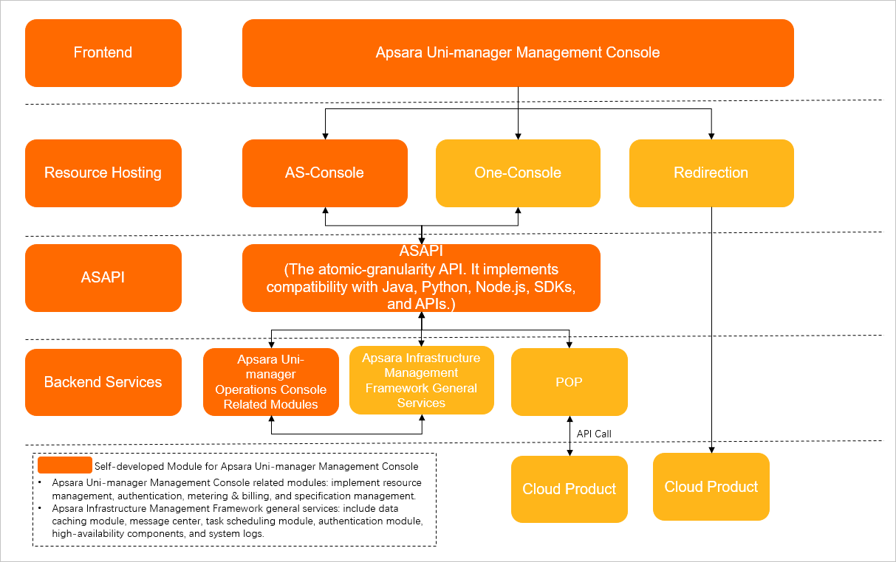

These modules provide the following features:

- AS-Console: hosts the in-house console page (such as the ECS console) of the Apsara Uni-manager Management Console.

- Resource hosting: includes AS-Console and One-Console. They can host static files used at the frontend of different cloud products and provide unified API calling and configuration services for the frontend.

- ASAPI: acts as the unified gateway of the Apsara Uni-manager Management Console. It implements compatibility with SDKsfor Java, Python, or Node.js, and APIs, receives requests from the frontend and SDKs, and manages APIs in the cloud. This component provides the following features:

  - Allows you to use SDKs to call APIs of cloud products.

  - Provides account verification, automatic routing, throttling, and log auditing.

  - Calls APIs of cloud products, modules of Apsara Uni-manager Management Console, and third-party integrated systems.

  - Adopts the asynchronous and highly concurrent request solution to provide Jetty, NIO, and Servlet 3.0 non-blocking asynchronous requests, and features high concurrency and high throughput.

  - Uses the thread pool isolation technology to boost request processing speed by dividing threads within ASAPI into business processing threads, routing threads, and result processing threads.

- Backend services: include modules of Apsara Uni-manager Management Console, general services of Apsara Infrastructure Management, and POP. They offer the following features:

  - Apsara Uni-manager Management Console modules: implement resource management, authentication and authorization, metering and billing, and specifications management.

  - General services of Apsara Infrastructure Management: include the data caching module, message center, task scheduling module, authentication module, high-availability components, and system logs.

  - POP: acts as the unified gateway for cloud computing. After API requests are processed by ASAPI, they are forwarded to POP which then forwards them to cloud products for resource processing.

<a id="section-3-2"></a>

## 3.2. Deployment architecture

This topic describes how components are deployed in the Apsara Uni-manager Management Console.

| Component | Deployment |
| --- | --- |
| Portal | Cluster deployment. Portal is generally deployed in two-node mode. |
| OneConsole | Cluster deployment. OneConsole is generally deployed in two-node mode. |
| ASAPI | Cluster deployment. ASAPI is generally deployed in two-node mode. |
| Auth | Cluster deployment. Auth is generally deployed in two-node mode. |
| Common | Cluster deployment. Common is generally deployed in two-node mode. |
| Manage | Cluster deployment. Manage is generally deployed in two-node mode. |
| ResourceMgr | Cluster deployment. ResourceMgr is generally deployed in two-node mode. |
| Metering | Cluster deployment. Metering is generally deployed in two-node mode. |
| Billing | Cluster deployment. Billing is generally deployed in two-node mode. |
| Cosmos | Cluster deployment. Cosmos is generally deployed in two-node mode. |

<a id="section-3-3"></a>

## 3.3. Architecture

This topic describes the components in the Apsara Uni-manager Management Console.

| Component | SR on Apsara Infrastructure Management | Description |
| --- | --- | --- |
| Portal | ascm-portal.Portal# | Displays at the frontend pages of self-developed product consoles. |
| One-Console | oneService.one-console-aliyun-com# | Hosts cloud product console pages and processes page requests. The ASConsole feature has been incorporated into OneConsole. |
| ASAPI | asapi.ApiServer# | The API gateway, which is used to process all internal and external calls that the Apsara Uni-manager Management Console received. SDKs are used to initiate calls. |
| Auth | • V3.14.0 and later: unimanager-base.IdentityService#<br>• Versions earlier than V3.14.0: ascm-brm.Auth# | Implements authentication for organizations, users, and permissions. |
| Common | • V3.14.0 and later: unimanager-base.CommonServer#<br>• Versions earlier than V3.14.0: ascm-common.CommonSrv# | Used for basic services such as pulling basic data (endpoints) and menu configuration of cloud services. |
| Manage | ascm-brm.Manage# | Handles the core processes for Apsara Stack resource management, such as the processes to create, modify, query, and delete cloud resources. |
| ResourceMgr | ascm-brm.ResourceMgr# | Used for the scheduled synchronization of cloud service resource information. |
| Metering | ascm-metering.metering_server# | Metering features. |
| Billing | unimanager-billing.billing# | Billing features. |
| Cosmos | ascm-cosmos.studio# | Dashboard displays. |

The following figure shows the key dependencies between components.

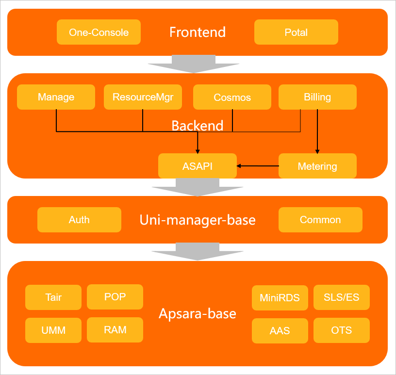

<a id="section-3-4"></a>

## 3.4. Architecture difference

<a id="section-3-4-1"></a>

### 3.4.1. Deployment architecture

This topic describes the differences between the old and new deployment architectures.

**Comparison between deployment architectures**

The following figure shows the deployment architecture of Enterprise Edition V3.14.0 and later.

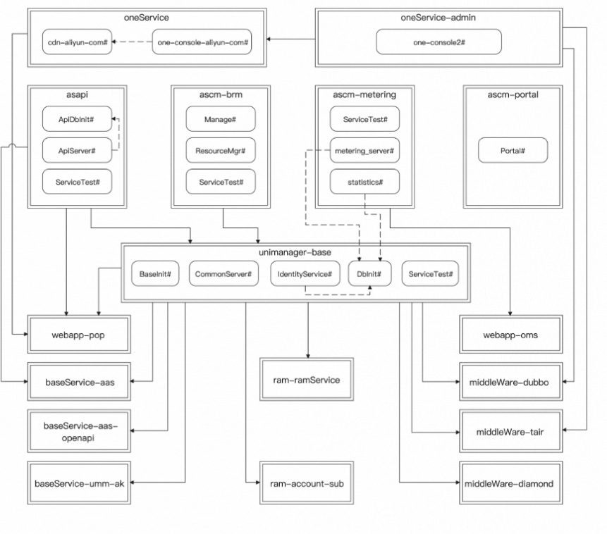

Compared with the old architecture (deployment architecture of V3.13.0 and earlier), the new architecture reduces the number of services in a cluster from eight to four in the Apsara Uni-manager Management Console, has the UniManagerBase cluster added, and migrates some underlying services (such as users and CommonServer) to the cluster. The new architecture makes hierarchical dependencies of services clearer and reduces resource consumption by streamlining service roles.

**Service role in the**

**Service role in the**

**Cluster**

**Service**

**Description**

**old architecture**

**new architecture**

cdn-aliyun-com#

cdn-aliyun-com#

None

one-console-aliyun-

None

com#

oneService

one-console-aliyun-

one-console2#

None

com#

one-console2-router#

None

OneConsole

console-common-

None

service#

vipernew-aliyun-inc-

oneService-admin

one-console2#

None

com#

console-common-

None

service-init#

ApiDbInit#

ApiDbInit#

None

asapi

ApiServer#

ApiServer#

None

ServiceTest#

ServiceTest#

None

Manage#

Manage#

None

ResourceMgr#

ResourceMgr#

None

ServiceTest#

ServiceTest#

None

New architecture

ascm-brm

ManageInit#

migrated to unimanager-base.BaseInit#

None

New architecture migrated to

Auth#

unimanager-base.IdentitySe rvice#

New architecture migrated to unimanager-

ascm-init

DbInit#

None

base.DbInit#

ASCM

New architecture deleted and

ascm-saleconf

salereconf#

None

features integrated into ascm-brm.Manage#

ascm-portal

Portal#

Portal#

None

CommonSrv#

None

New architecture migrated to

ascm-common

unimanager-base.CommonS

ServiceTest#

None

erver#

SkylineDbInit#

None

New architecture deleted and

ascm-skyline

dependencies on skyline

SkylineUnit#

None

removed from business

ServiceTest#

ServiceTest#

None

metering_server#

metering_server#

None

ascm-metering

New server roles added for

None

statistics#

improving operations efficiency

BaseInit#

Underlying services of the Apsara Uni-

CommonServer#

manager Management

UniManagerB

Console of the

unimanager-base

None

IdentityService#

ase

new architecture, such as

DbInit#

initialization, auth, and commonServer

ServiceTest#

<a id="section-3-4-2"></a>

### 3.4.2. Technical architecture

This topic describes the differences between the new and old technical architectures.

**Technical architecture comparison**

The technical architecture of Enterprise Edition V3.15.0 and later resolves the issue of unauthorized access and improves security. It enhances account permission management, RAM authentication, and POP authentication in terms of security.

- Account security enhancement

  - In Enterprise Edition V3.14.0 and earlier, you can use an Apsara Stack account to access cloud product APIs by exchanging the AccessKey pair for the Apsara Stack account corresponding to a Level-1 organization.

  - In Enterprise Edition V3.15.0 and later, RAM users are granted STS tokens to access specific cloud resources.

- RAM authentication enhancement

  - In Enterprise Edition V3.14.0 and earlier versions, you can access cloud services by changing your Apsara Stack account. If RAM authentication is in the pass state, no authentication is performed.

  - In Enterprise Edition V3.15.0 and later, RAM users can access specific cloud resources with temporarily granted STS tokens. RAM proxies are added to obtain information about access permissions of organizations and resource sets from the Apsara Uni-manager Management Console for RAM authentication.

- POP-side authentication

  - In Enterprise Edition V3.14.0 and earlier, cloud service APIs can be directly called through POP. No user authentication is implemented on the Apsara Uni-manager Management Console for access to organizations or resource sets.

  - In Enterprise Edition V3.15.0 and later, POP proxies are added for POP-side authentication . When cloud service APIs are called, the POP proxy authenticates the cloud service on the Apsara Uni-manager Management Console. The call is made after the authentication succeeds.

The following figure shows the technical architecture of Apsara Stack Enterprise Edition V3.14.0 and earlier. The following figure shows the technical architecture of Apsara Stack Enterprise Edition V3.15.0 and later.

<a id="section-3-5"></a>

## 3.5. Dependent base services

This topic describes the base services that the Apsara Uni-manager Management Console depends on.

Whether base services are normal is critical to the stability of the Apsara Uni-manager Management Console. The Apsara Uni-manager Management Console depends on the following base services:

- MiniRDS: used for business data persistency, such as storing organization and resource set data.

- Tair: caches frequently accessed data, such as the cloud resource list.

- UMM: used to obtain your AccessKey ID and AccessKey secret for authentication.

- POP: the access gateway of cloud products, used to call product API operations.

- RAM: implements user authorization and controls operation permissions on resources.

- AAS: used for account management.

- Tablestore: processes message data and time series data, such as message push and metering.

- Log Service: stores call logs, including backend service logs (such as access, call, and main) and API call audit logs.

<a id="section-3-6"></a>

## 3.6. Server roles

This topic describes the server roles of the Apsara Uni-manager Management Console and their features.

The following table describes the server roles of the Apsara Uni-manager Management Console.

Project

Cluster

Service

Server role

Description

A core component of ASAPI. Almost all features related to the Apsara Uni-manager Management Console depend on ASAPI for forwarding API requests.

ApiServer#

ApiServer# depends on ApiDbInit# and on middleWare-tair, webapp-pop, ram-ramService, baseService-umm-ak, MinRDS, and unimanager-base in base services.

Asapi

Used for DB initialization (API definition

ApiDbInit#

initialization). It is executed only once during deployment or upgrade.

ServiceTest

Checks the service status.

#

The core business logic for resource

Manage#

management.

ResourceM

ascm-brm

The scheduled resource call task.

gr#

ServiceTest

Checks the service status.

#

metering_s

Meters core services.

ascm

erver#

ascm-metering

ServiceTest

Checks the service status.

#

ascm

A self-developed frontend service (will be

ascm-portal

Portal#

integrated into OneConsole).

DbInit#

Used for DB initialization.

IdentitySer

Used for users, roles, and permissions.

vice#

Initializes configuration data (cloud service

unimanager

BaseInit#

configuration metadata).

-base

A public component, used to provide cloud

CommonSe

service metadata services and configure

rver#

menus.

ServiceTest

Checks the service status.

#

studio#

The frontend of the dashboard.

insight#

The backend of the dashboard.

ascmcomm

ascm-

ander

cosmos

DbInit#

Used for DB initialization.

ServiceTest

Checks the service status.

#

cdn-aliyun-

The frontend static resource server.

com#

oneConsole

oneService

Cluster

one-

Used for frontend service hosting, including

console-

the DB initialization script, foreground page

oneConsole

aliyun-

rendering and data APIs, and DB operation

com#

module and VIPER configuration module.

oneService

Encapsulates API calls for some non-POP

oneService-

one-

AdminClust

services, including Tablestore, Object

admin

console2#

er

Storage Service (OSS), and API Gateway.

<a id="section-4"></a>

# 4.Routine maintenance

<a id="section-4-1"></a>

## 4.1. Monitoring metrics

This topic describes monitoring metrics and how to view them.

**View monitoring metrics**

You can use one of the following methods to view monitoring metrics:

- Use ASD

  <ol type="i">

  <li>

  Log in to Apsara Stack Doctor (ASD).

  </li>

  <li>

  In the left-side navigation pane, choose **Trace Diagnostics** > **Call Trace Analysis**.

  </li>

  <li>

  On the Call Trace Analysis page, enter a trace ID in the TraceId field, specify a time range in

  </li>

  </ol>

  the Time Range field, and then click **Search**.

  <ol type="i" start="4">

  <li>

  On the **Topology Analysis** tab, click the required service role card to view the trend charts of related metrics.

  </li>

  </ol>

- Use Linux commands

  The available Linux commands include vmstat, top, tsar, and jstat (/opt/taobao/java/bin). The Apsara Uni-manager Management Console provides common O&M scripts. For more information, see Common O&M commands.

**Monitoring metrics**

| Metric | Description | Anomaly criteria |
| --- | --- | --- |
| CPU | CPU utilization | The CPU utilization is high, such as more than 70%. |
| Memory | Container memory usage | The memory usage is high, such as more than 70%, or keeps growing over a period of time. |
| Load | Average CPU load | An anomaly can be determined based on the daily average baseline. In most cases, if the load value is greater than 0.7 × CPU utilization, it is regarded as high load. |
| I/O usage (%) | Disk I/O usage | An anomaly can be determined based on the daily average baseline. In most cases, if the I/O usage is greater than 70%, it is regarded as high I/O usage. |
| TCP retransmission rate (%) | TCP retransmission rate, which reflects the network transmission condition | For example, the TCP retransmission rate can be at most 5%. |
| Network traffic | Traffic over your network | An anomaly can be determined based on the daily average baseline. Pay special attention when traffic surges. |
| GC operations | Memory usage status of Java applications | Pay special attention to full garbage collection (GC) operations when the Concurrent Mark Sweep (CMS) collector is used. |
| GC duration | Memory usage status of Java applications | In most cases, a GC duration of tens of milliseconds is normal. Pay special attention if the GC duration lasts for seconds. |
| JVM memory usage (MB) | Java virtual machine (JVM) memory usage | An anomaly can be determined based on the GC metrics and JVM configurations. |
| netstat | Details of TCP connections | An anomaly can be determined based on the daily average baseline. Pay special attention to the TIME_WAIT value surges. |

<a id="section-4-2"></a>

## 4.2. Routine inspections

This topic describes how to perform routine inspections.

**Routine inspections by using Apsara Infrastructure Management**

1. Log on to the Apsara Infrastructure Management Console.

2. In the left-side navigation pane, click **Project & Cluster O&M**.

3. In the **Project | Cluster** search box, enter  `ascm` .

4. In the project list, check whether the cluster reaches the desired state in the **Status** column.

5. (Optional) Find the cluster that you want to view and click **Status Details** in the **Actions** column. On the **Product Detail** page, check whether all services and components in the cluster have reached the desired state. Alternatively, click **Cluster Details** in the **Actions** column. On the **Cluster Detail** page, click the **Services** tab. On the **Services** tab, check whether each service reaches the desired status.

**Manual inspections**

The inspection steps are the same for different services. The ASAPI service is used in this example.

1. Log on to the Apsara Infrastructure Management Console.

2. In the left-side navigation pane, click **Project & Cluster O&M**.

3. In the **Project | Cluster** search box, enter  `ascm` .

4. Find the cluster that you want to view and click **Cluster Details** in the **Actions** column. On the **Cluster Detail** page, click the **Services** tab.

5. Click **Details** in the **Actions** column of the **asapi** service.

6. In **Components**, click the target component. Then, click the **Instances** tab.

7. Find the target instance, and click **Terminal** in the **Actions** column of the instance.

You can run the following commands to perform inspections:

<table>
  <tr>
    <td>Project</td>
    <td>Cluster</td>
    <td>Service</td>
    <td>Server role</td>
    <td>Health check</td>
  </tr>
</table>

Run the following command in the container:  `curl http://127.0.0.1:7001/api/version` Th e output for a successful command execution:

ApiServer#

```json
 {"version":"v3.13","code":"200","api
```

```text
Count":13122,"desc":"update xml 
```

```text
pretty"} 
```

asapi

Typically, the container will automatically exit after an execution of about 5 to 10 minutes. If the container has not exited for a long time (Apsara Infrastructure Management has not reached the desired state), you can check the error information in the log:

ApiDbInit#

```bash
 docker logs <dockerid> 
```

The output for a successful command execution:

```text
 Progress is 100% 
```

Run the following command in the container:

```text
 /alidata/bin/check_health.sh 
```

Manage#

The output for a successful command execution:

```text
 ok 
```

ascm-brm

Run the following command in the container:

```text
 /alidata/bin/check_health.sh 
```

ResourceM gr#

The output for a successful command execution:

```text
 ok 
```

Run the following command in the container:

```text
 /alidata/bin/check_health.sh 
```

ascm-

metering_s

metering

erver#

The output for a successful command execution:

```text
 ok 
```

ascm

Run the following command in the container:

```bash
  curl -s 
http://127.0.0.1/check.node 
```

ascm-portal

Portal#

The output for a successful command execution:

```text
 success 
```

Run the following command in the

ascm

container:

```text
 /alidata/bin/check_health.sh 
```

unimanager

billing#

-billing

The output for a successful command execution:

```text
 ok 
```

Run the following command in the container:

DbInit#

```bash
 docker logs <dockerid> 
```

View the execution results.

Run the following command in the container:

```text
 /alidata/bin/check_health.sh 
```

IdentityServ ice#

The output for a successful command execution:

```text
 ok 
```

Run the following command in the container:

BaseInit#

unimanager

```bash
 docker logs <dockerid> 
```

-base

Check the command output.

Run the following command in the container:

```bash
 curl --location --request GET 
```

CommonSe

```text
'localhost:8008/ascm/basic/welcome' 
```

rver#

The output for a successful command execution:

```text
 welcome to basic. 
```

Run the following command in the container:

```text
 /alidata/bin/check_health.sh 
```

studio#

The output for a successful command execution:

```text
 ok 
```

Run the following command in the container:

ascmcomm

ascm-

ander

cosmos

```text
 /alidata/bin/check_health.sh 
```

insight#

The output for a successful command execution:

```text
 ok 
```

Run the following command in the container:

DbInit#

```bash
 docker logs <dockerid> 
```

View the execution results.

Run the following command in the container:

```bash
 curl <The IP address of the 
```

```text
             container>:80/api/console/check-
cdn-aliyun-
```

```text
health 
```

com#

The output for a successful command execution:

```text
 ok 
```

oneConsole

oneService

Cluster

Run the following command in the container:

one-

```bash
 curl 
```

oneConsole

console-

```text
http://127.0.0.1:7003/preload.htm 
```

aliyun-

The output for a successful command

com#

execution:

```text
 success 
```

Run the following command in the container:

oneService

```bash
 curl 127.0.0.1:7001/preload.htm 
```

oneService-

one-

AdminClust

admin

console2#

The output for a successful command

er

execution:

```text
 success 
```

<a id="section-5"></a>

# 5.Security maintenance

During the maintenance of the Apsara Uni-manager Management Console, you must pay attention to password maintenance and log audit.

**Password maintenance**

A global role, such as the operations administrator of the Apsara Uni-manager Management Console, has the management permissions on all resources. Therefore, you must keep relevant passwords confidential. We recommend that you adopt complex password policies and regularly update passwords.

**Log audit**

The Apsara Uni-manager Management Console allows you to audit operation logs and API call logs.

- Operation log audit

  For more information about how to view operation logs, see the "View operation logs" topic in *Apsara Uni-manager Operations Console User Guide*.

- API call audit

  <ol type="i">

  <li>

  Log in to Apsara Stack Doctor (ASD).

  </li>

  <li>

  In the left-side navigation pane, click **Log Analysis** > **API Audit Logs**.

  </li>

  <li>

  On the API Audit Logs page, click Advanced Filter, specify filter conditions, and then click

  </li>

  </ol>

  **Search**.

  <ol type="i" start="4">

  <li>

  In the trace list, view the API call information.

  </li>

  <li>

  Find the trace that you want to view and click **Details** in the **Actions** column. In the API Operation Audit Details dialog box, view the request parameters, response, and call logs.

  </li>

  </ol>

Due to the limitation of storage space in the base, the preceding logs cannot be stored for a long period. The logs can be stored for seven days at most.

To store logs for more than seven days, dump them to Simple Log Service (SLS). For more information, consult the SLS team.

<a id="section-6"></a>

# 6.Troubleshooting

<a id="section-6-1"></a>

## 6.1. Identify fault impact

This topic describes how to identify fault impact.

1. Identify fault impact. Example:

   - Whether the physical environment is normal (such as the network, DNS device, and firewall).

   - Whether the base environment is normal (whether the base services have reached the desired state on Apsara Infrastructure Management, especially the base services that the Apsara Uni-manager Management Console depends on).

   - Whether the Apsara Uni-manager Management Console can be logged on.

   - Which region is affected.

   - Which products are affected.

   - Which feature is affected.

2. Identify fault types. Example:

   - Physical environment faults (contact hardware vendors)

   - Base environment faults (contact onsite Apsara Stack O&M engineers)

   - Product performance issues

   - Product feature issues

<a id="section-6-2"></a>

## 6.2. Collect fault logs

This topic describes how to collect fault logs.

1. Use the following template to collect fault information.

   | Item | Example |
   | --- | --- |
   | Operator | An operator |
   | Operator role | Organization administrator |
   | Organization (level) | Level-2 organization |
   | Resource set | Default resource set |
   | Product | ECS |
   | Operation | Create an ECS instance |
   | Console exception screenshot | Failed to create an ECS instance (screenshot) |
   | Screenshot for abnormal return values | View the request and response parameters on the browser |
   | Exception condition | An exception occurs if you select Zone B |
   | Reproducible or not | Yes |

2. Collect fault logs.

   <ol type="i">

   <li>

   Obtain the EagleEye ID when the fault occurred.

   - If you can log on to the Apsara Uni-manager Management Console and reproduce the fault, you can obtain the EagleEye ID from the browser by pressing F12. The eagleeye-traceid from the ResponseHeaders is preferred, followed by the eagleEyeTraceId from the response.

     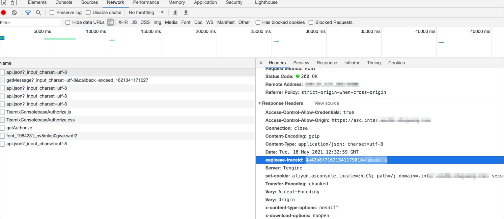

   - If you can log on to the Apsara Uni-manager Management Console but cannot reproduce the fault, you can query the API call logs when the fault occurred. For more information, see Security maintenance.

   - If you cannot log on to the Apsara Uni-manager Management Console but can query the access and call logs in the ASAPI dockers, you can obtain the EagleEye ID from the container logs by using filters such as API names and other accessible key parameters for further analysis.

   </li>

   <li>

   Obtain API operation call trace logs.

   - Use API audit to obtain API operation call records. For more information, see Security maintenance.

   - Use trace details in Apsara Stack Doctor to view logs. For more information, see View logs.

   - Use Log Service to query API operation call logs. For more information, see View logs.

   - Use the ASAPI containers to query API operation call logs. For more information, see Module logs.

   </li>

   </ol>

<a id="section-6-3"></a>

## 6.3. Troubleshoot issues

This topic describes how to troubleshoot different types of issues.

**Procedure**

1. Troubleshoot issues in the base environment.

   <ol type="i">

   <li>

   Use different test environments to check whether the client issues are caused by browsers, networks, firewalls, or proxies.

   </li>

   <li>

   Check whether services have reached the desired state or alerts occur in Apsara

   </li>

   </ol>

   Infrastructure Management and the Apsara Uni-manager Operations Console.

   <ol type="i" start="3">

   <li>

   Check the network connectivity and whether DNS can resolve IP addresses.

   </li>

   </ol>

2. Locate causes for business exceptions.

   Locate the causes of exceptions based on the exception information in the Apsara Uni-manager Management Console and API call logs. For more information, see Appendix: Common error codes.

   <table>
     <tr>
       <th>Key</th>
       <th>Description</th>
       <th>Purpose</th>
     </tr>
     <tr>
       <td>API</td>
       <td>The abnormal API call, including the service name and version.</td>
       <td rowspan="3">Effectively locate the abnormal service or module.</td>
     </tr>
     <tr>
       <td>domain</td>
       <td>The domain name of an API request.</td>
     </tr>
     <tr>
       <td>serverRole</td>
       <td>The server role with exceptions.</td>
     </tr>
     <tr>
       <td>ASAPIErrorCode</td>
       <td>The error code.</td>
       <td rowspan="3">Effectively locate the causes for exceptions.</td>
     </tr>
     <tr>
       <td>ASAPIErrorMessge</td>
       <td>The error message.</td>
     </tr>
     <tr>
       <td>ASAPISuccess</td>
       <td>Indicates whether the request is successful.</td>
     </tr>
     <tr>
       <td>eagleEyeTraceId</td>
       <td>The EagleEye ID of a trace.</td>
       <td rowspan="2">Used to query logs of backend services.</td>
     </tr>
     <tr>
       <td>ASAPIRequestId</td>
       <td>The ID of the request for calling a backend service.</td>
     </tr>
   </table>

   To further troubleshoot exceptions, you can query the logs of the backend service based on the EagleEye ID of the trace to obtain more details.

3. Troubleshoot performance issues by using Apsara Stack Doctor (ASD).

   <ol type="i">

   <li>

   View statistics on slow API calls.

   <ol type="a">

   <li>

   Log in to ASD.

   </li>

   <li>

   In the left-side navigation pane of the console, choose **Trace Diagnostics** > **Query Call Trace**.

   </li>

   </ol>

   <ol type="i" start="100">

   <li>

   On the Query Call Trace page, specify filter conditions, such as the server role, API operation, duration threshold, and time range, turn on or off Call Failed, and then click **Search**.

   </li>

   </ol>

   </li>

   <li>

   View the details of a single slow API call. You can enter the EagleEye ID of a trace and specify

   </li>

   </ol>

   a time range on the Call Trace Analysis page to view the trace details.

   <ol type="a">

   <li>

   Log in to ASD.

   </li>

   <li>

   In the left-side navigation pane, choose **Trace Diagnostics** > **Call Trace Analysis**.

   </li>

   </ol>

   <ol type="i" start="100">

   <li>

   On the Call Trace Analysis page, enter the EagleEye ID of a trace in the **TraceId** field, specify a time range in the Time Range field, and then click **Search**. On the **Trace Details** tab, view the trace details.

   </li>

   <li value="3">

   Query the performance metrics of machines.

   </li>

   </ol>

   For more information about how to view the metrics, see Monitoring metrics.

<a id="section-7"></a>

# 7.Alert handling

<a id="section-7-1"></a>

## 7.1. identity_service_request_error_alarm

An error occurs for the API operation that is called by OneConsole to log on to the authentication service.

**Alert attributes**

<table>
  <tr>
    <td>Alert name</td>
    <td>Alert source</td>
    <td>Alert severity</td>
    <td>Service</td>
    <td>Trigger condition</td>
    <td>Alert module</td>
    <td>Trigger cycle</td>
  </tr>
  <tr>
    <td>identity_ser vice_reques t_error_alar m</td>
    <td>tianjimon</td>
    <td>2</td>
    <td>oneConsole</td>
    <td>$business_e rror_count &gt; 0</td>
    <td>oneConsole</td>
    <td>{{interval| 60}}</td>
  </tr>
</table>

**Applicable versions**

Applicable to oneConsole Enterprise Edition enterprise_v318_1_ST.

**dimensions parameters**

| Parameter | Description |
| --- | --- |
| EntityType | The product of the API where the error occurred. |
| ErrorType | The error type. |
| OperateType | The action of the API where the error occurred. |

**Alert causes**

An error occurs on the API operation that is called to log on to the authentication service.

**Alert impacts**

The console logon may fail.

**Solutions**

> **Warning**
>
> If a solution requires that you modify product configurations, you must initiate a production change process to confirm the feasibility and standardization of the solution. Even in an emergency, you must obtain consent from the TAM before you can perform the steps of the solution.

1. Contact the R&D personnel to log on to the authentication service to locate and resolve the issue based on the specific error.

> **Note**
>
> If the alert persists after you perform the preceding steps, submit a ticket to contact Alibaba Cloud technical support.

<a id="section-7-2"></a>

## 7.2. one_router_business_error_alarm

This alert indicates that an internal error occurs when the oneConsole2 service processes a request. As a result, the consoles of services such as Object Storage Service (OSS) and Tablestore may become unavailable.

**Alert attributes**

<table>
  <tr>
    <td>Alert name</td>
    <td>Alert source</td>
    <td>Alert severity</td>
    <td>Service</td>
    <td>Trigger condition</td>
    <td>Alert module</td>
    <td>Trigger cycle</td>
  </tr>
  <tr>
    <td>one_router_business_er ror_alarm</td>
    <td>tianjimon</td>
    <td>2</td>
    <td>oneConsole</td>
    <td>$business_e rror_count &gt; 0</td>
    <td>oneConsole</td>
    <td>{{interval| 60}}</td>
  </tr>
</table>

**Applicable versions**

Applicable to oneConsole Enterprise Edition enterprise_v318_1_ST.

**dimensions parameters**

| Parameter | Description |
| --- | --- |
| EntityType | The product of the API where the error occurred. |
| ErrorType | The error type. |
| LocalIp | The IP address of the Docker where the error occurred. |
| OperateType | The action of the API where the error occurred. |

**Alert causes**

An error occurs when the oneConsole2 service processes the request.

**Alert impacts**

The consoles of services such as OSS and Tablestore may become unavailable.

**Solutions**

> **Warning**
>
> If a solution requires that you modify product configurations, you must initiate a production change process to confirm the feasibility and standardization of the solution. Even in an emergency, you must obtain consent from the TAM before you can perform the steps of the solution.

1. Copy the EagleEye ID (Eagleeye-Traceid) of the error request and enter the Docker of SR:oneService-admin.one-console2#. In the /logs/asconsole-logger directory, run the following command to view the log:

   ```text
   grep <EagleEye ID of the error report> *
   ```

   Check the log related to the error code.

2. Contact the OneConsole R&D personnel to locate and resolve the issue.

> **Note**
>
> If the alert persists after you perform the preceding steps, submit a ticket to contact Alibaba Cloud technical support.

<a id="section-7-3"></a>

## 7.3. one_console_slow_request_alarm

An error occurs when the response time exceeds 5 seconds after OneConsole calls an API operation of another service.

**Alert attributes**

<table>
  <tr>
    <td>Alert name</td>
    <td>Alert source</td>
    <td>Alert severity</td>
    <td>Service</td>
    <td>Trigger condition</td>
    <td>Alert module</td>
    <td>Trigger cycle</td>
  </tr>
  <tr>
    <td>one_consol e_slow_req uest_alarm</td>
    <td>tianjimon</td>
    <td>3</td>
    <td>oneConsole</td>
    <td>$slow_requ est_count &gt; 0</td>
    <td>oneConsole</td>
    <td>{{interval| 60}}</td>
  </tr>
</table>

**Applicable versions**

Applicable to oneConsole Enterprise Edition enterprise_v318_1_ST.

**dimensions parameters**

| Parameter | Description |
| --- | --- |
| method_name | The action for the error request. |
| product_name | The product for the error request. |

**Alert causes**

An error occurs when the response time exceeds 5 seconds after OneConsole calls an API operation of another service.

**Alert impacts**

The console may respond slowly.

**Solutions**

> **Warning**
>
> If a solution requires that you modify product configurations, you must initiate a production change process to confirm the feasibility and standardization of the solution. Even in an emergency, you must obtain consent from the TAM before you can perform the steps of the solution.

1. Locate the service to which the API belongs based on the product and action.

2. Contact the R&D personnel of the service to which the API belongs to locate and resolve the issue.

> **Note**
>
> If the alert persists after you perform the preceding steps, submit a ticket to contact Alibaba Cloud technical support.

<a id="section-7-4"></a>

## 7.4. one_console_request_timeout_alarm

An error occurs when the response time exceeds 30 seconds after OneConsole calls an API operation of another service.

**Alert attributes**

<table>
  <tr>
    <td>Alert name</td>
    <td>Alert source</td>
    <td>Alert severity</td>
    <td>Service</td>
    <td>Trigger condition</td>
    <td>Alert module</td>
    <td>Trigger cycle</td>
  </tr>
  <tr>
    <td>one_consol e_request_ti meout_alar m</td>
    <td>tianjimon</td>
    <td>2</td>
    <td>oneConsole</td>
    <td>$timeout_re quest_coun t &gt; 0</td>
    <td>oneConsole</td>
    <td>{{interval| 60}}</td>
  </tr>
</table>

**Applicable versions**

Applicable to oneConsole Enterprise Edition enterprise_v318_1_ST.

**dimensions parameters**

| Parameter | Description |
| --- | --- |
| method_name | The action for the error request. |
| product_name | The product for the error request. |

**Alert causes**

An error occurs when the response time exceeds 30 seconds after OneConsole calls an API operation of another service.

**Alert impacts**

Requests initiated by other service consoles may time out, causing the consoles to be unavailable.

**Solutions**

> **Warning**
>
> If a solution requires that you modify product configurations, you must initiate a production change process to confirm the feasibility and standardization of the solution. Even in an emergency, you must obtain consent from the TAM before you can perform the steps of the solution.

1. Locate the service to which the API belongs based on the product and action.

2. Contact the R&D personnel of the service to which the API belongs to locate and resolve the issue.

> **Note**
>
> If the alert persists after you perform the preceding steps, submit a ticket to contact Apsara Stack technical support.

<a id="section-8"></a>

# 8.Appendixes

<a id="section-8-1"></a>

## 8.1. Module logs

This topic describes the features of different log files.

**Component**

**Log file**

**Description**

/logs/asapi-logger/access_trace.log

The log path of Enterprise Edition

Logs that ASAPI receives API operation

V3.10.0:

call requests

/opt/api-server/logs/apiServer-access.log

/logs/asapi-logger/call_trace.log

The log path of Enterprise Edition

Logs that ASAPI calls backend services

V3.10.0:

and products

/opt/api-server/logs/apiServer-call.log

asapi.ApiServer#

/logs/asapi-logger/main_trace.log

The log path of Enterprise Edition

ASAPI debugging logs

V3.10.0: /opt/api-server/logs/server.log /opt/api-server/logs/error.log

/logs/asapi-logger/exception_trace.log

The log path of Enterprise Edition V3.10.0:

ASAPI exception logs

/opt/api-server/logs/apiServer-exception.log

asapi.ApiDbInit#

docker logs

Container startup logs

/root/logs/ascm-portal/ascm-error.log

Portal exception logs

Logs that Portal receives page call

/root/logs/ascm-portal/ascm-access.log

requests

/root/logs/ascm-portal/ascm-agent.log

Portal process logs

ascm-

/root/logs/ascm-portal/ascm-web.log

Portal application logs

portal.Portal#

/root/logs/ascm-portal/egg-schedule.log

Portal scheduled task logs

/root/logs/ascm-portal/egg-web.log

Portal framework kernel and plug-in logs

**Component**

**Log file**

**Description**

Logs that Manage receives ASAPI

/logs/ascm-logger/access_trace.log

requests

/logs/ascm-logger/call_trace.log

Logs that Manage calls ASAPI

ascm-brm.Manage#

/logs/ascm-logger/exception_trace.log

Manage exception logs

/logs/ascm-logger/main_trace.log

Manage debugging logs

/logs/ascm-logger/access_trace.log

Logs that Manage receives requests

/logs/ascm-logger/call_trace.log

Logs that scheduled tasks call ASAPI

ascm-brm.ResourceMgr #

/logs/ascm-logger/exception_trace.log

Scheduled task exception logs

/logs/ascm-logger/main_trace.log

Scheduled task debugging logs

/logs/metering/access_trace.log

Logs that Metering receives requests

Logs that Metering calls other ascm

/logs/metering/call_trace.log

services

ascm-metering.meterin g_server#

/logs/metering/exception_trace.log

Metering exception logs

/logs/metering/main_trace.log

Metering debugging logs

/logs/billing/access_trace.log

Logs that Billing receives requests

Logs that Billing calls other ascm

/logs/billing/call_trace.log

services

unimanager-billing.billing#

/logs/billing/exception_trace.log

Billing exception logs

/logs/billing/main_trace.log

Billing debugging logs

unimanager-

docker logs

Container startup logs

base.DbInit#

**Component**

**Log file**

**Description**

unimanager-

docker logs

Container startup logs

base.BaseInit#

Logs that IDENTITYSERVICE/Auth

- Enterprise

  /logs/ascm-logger/access_trace.log

  receives requests

  Edition V3.14.0 and later: unimanager-base.

  Logs that IDENTITYSERVICE/Auth calls

  /logs/ascm-logger/call_trace.log

  IdentityService

  other base services such as RAM

  #

- Enterprise

  /logs/ascm-logger/exception_trace.log

  IDENTITYSERVICE/Auth exception logs

  Edition V3.13.0 and earlier: ascm-brm.Auth#

  /logs/ascm-logger/main_trace.log

  IDENTITYSERVICE/Auth debugging logs

- Enterprise

  /ascm/.logs/basic.log

  CommonServer application logs

  Edition V3.14.0 and later: unimanager-base. CommonServer #

- Enterprise

  /ascm/.logs/basic-error.log

  CommonServer exception logs

  Edition V3.13.0 and earlier: ascm-common.Comm onSrv#

  /logs/data-processor/access_trace.log

  Logs that INSIGHT receives requests

  Logs that INSIGHT calls other ascm

  /logs/data-processor/call_trace.log

  services

ascm-cosmos.insight#

/logs/data-processor/exception_trace.log

INSIGHT exception logs

/logs/data-processor/main_trace.log

INSIGHT debugging logs

ascm-

docker logs

Container startup logs

cosmos.DbInit#

Logs that ONE-CONSOLE-ALIYUN-COM

/home/admin/logs/access_trace.log

receives requests

Logs that ONE-CONSOLE-ALIYUN-COM

/home/admin/logs/call_trace.log

calls ASAPI

oneService.one-console-aliyun-**Component**

**Log file**

**Description**

com#

ONE-CONSOLE-ALIYUN-COM exception

/home/admin/logs/exception_trace.log

logs

ONE-CONSOLE-ALIYUN-COM debugging

/home/admin/logs/main_trace.log

logs

/home/admin/one-console2/logs/ascm-

Logs that One-Console2 receives

logger/access_trace.log

requests

/home/admin/one-console2/logs/ascm-

Logs that One-Console2 calls cloud

logger/call_trace.log

services

oneService-admin.one-console2#

/home/admin/one-console2/logs/ascm-

One-Console2 exception logs

logger/exception_trace.log

/home/admin/one-console2/logs/ascm-

One-Console2 debugging logs

logger/main_trace.log

<a id="section-8-2"></a>

## 8.2. Common error codes

This topic describes common error codes and their solutions.

Module

Error code

Description

Solution

Perform the following operations on Apsara Infrastructure Management:

- Check whether the

ASAPI failed to request the

asapi.server.request.unkno

product is deployed.

domain name of a backend

wn.host

product.

- Check whether the domain name exists.

- Use the ASAPI container to disable the domain name link.

Perform the following operations:

- Check whether the

ASAPI could not find the API

request parameters are

asapi.server.api.notfound

operation to be called.

correct.

- Check whether the API operation is registered in the ASAPI database.

Perform the following operations:

1. Check whether the corresponding product is

ASAPI could not obtain the

deployed in the

asapi.server.endpoint.notfo

endpoint of the API

environment and has

und

operation to be called.

reached the desired state.

2. Then contact ascm_common O&M engineers.

An internal error occurred

Contact ascm_asapi O&M

asapi.server.internal.error

in ASAPI.

engineers.

An error occurred when

asapi.server.endpoint.notm

ASAPI obtains the endpoint

Contact ascm_common

atch

of the API operation to be

O&M engineers.

called.

A timeout occurred when

asapi.server.timeout.conne

Contact ascm_asapi O&M

ASAPI connects to the

ct

engineers.

server

ASCM-

Perform the following

>asapi

operations:

- Check whether the

The AccessKey pair is

AccessKey ID and

asapi.server.request.param

invalid or the AccessKey

AccessKey Secret are

eter.accesskeyid.error

secret could not be

correct in the request

obtained.

parameters.

- Consult ascm_asapi O&M engineers for troubleshooting.

Check whether

asapi.server.request.param

The desired region ID could

`regionId`  is empty in

eter.regionid.not.found

not be found.

the request parameters.

Perform the following operations:

- Check whether ASAPI

asapi.server.request.validat

ASAPI failed to verify the

SDKs are used to initiate

e.signature.failed

signature.

the call.

- Contact ascm_asapi O&M engineers.

Perform the following operations:

- Check whether stress testing is performed in

asapi.server.request.flow.c

The operation is subject to

the current environment.

ontrol

throttling.

- Contact ascm_asapi O&M engineers.

asapi.server.request.upload

An error occurred when a

Contact ascm_asapi O&M

.file.error

file is upload.

engineers.

asapi.server.request.downl

An error occurred when a

Contact ascm_asapi O&M

oad.file.error

file is downloaded.

engineers.

The permission is

asapi.server.api.no.permissi

Contact ascm_asapi O&M

insufficient for calling an

on.operate

engineers.

API operation.

ascm.manage.InvalidParam

An account can be bound to

eter.CloudAccount.OnlySup

None.

only level-1 organizations.

portAttachToTopOrg

ascm.manage.EntityNotExis

The account does not exist.

Create an account.

t.CloudAccount

ascm.manage.DeleteConflic

Before you delete an

Refresh the page and try

t.CloudAccount.Organizatio

account, you must unbind it

again.

n

from the organization.

ascm.manage.EntityNotExis

The AccessKey pair does

Create an AccessKey pair.

t.AccessKey

not exist.

ascm.manage.EntityNotExis

The instance is not found.

Create an instance.

t.Instance

ascm.manage.EntityNotExis

The role does not exist.

Create a role.

t.Role

ASCM->Manage

Create a role that is visible

ascm.manage.InvalidParam

The role is not visible to the

to this user, or change the

eter.Role.NotVisibleToTheU

user.

role attributes to make it

ser

visible to the user.

ascm.manage.EntityNotExis

The organization does not

Create an organization.

t.Organization

exist.

ascm.manage.EntityNotExis

The resource set does not

Create a resource set.

t.ResourceSet

exist.

ascm.manage.EntityAlread

Refresh the page and try

The user already exists.

yExisted.User

again.

ascm.manage.EntityAlread

The username already

Change the username.

yExisted.User.UserName

exists.

ascm.auth.invalidParameter

The token is invalid.

Use a valid token.

.token

Recover the user as an administrator and use the

ascm.auth.account.deleted

The user has been deleted.

user account to log on again.

Enable the user as an administrator and use the

ascm.auth.account.inactive

The user has been disabled.

user account to log on again.

ascm.auth.account.type.not

This account type is not

Refresh the page and try

Supported

supported.

again.

The user has not logged on,

ascm.auth.account.notLogg

Use the user account to log

or the logon status is

edIn

on again.

invalid.

The username is not

ascm.auth.username.null

Enter a username

specified.

The password is not

ascm.auth.password.null

Enter a password.

specified.

Reset the password as an

ascm.auth.password.expire

administrator and use the

The password expired.

d

new password to log on again.

Logon failed because the

ascm.auth.account.userna

Enter a correct username

username or password is

meOrPasswordError

and password.

incorrect.

ascm.auth.organizationId.n

The organization ID is not

Enter an organization ID.

ull

specified.

ascm.auth.organization.roo

The root organization is not

Refresh the page and try

tNotSupported

supported.

again.

The user could not log on

Enable the logon policy as

ascm.auth.loginPolicy.deAct

because the logon policy

an administrator and use

ive

bound to the user has been

the user account to log on

disabled.

again.

The operation could not be

Enable the role as an

performed because the

administrator and use the

ascm.auth.role.deActive

current role of the user has

user account to log on

been disabled.

again.

Perform the following operations:

An error occurred when

ASCM-

exposed resource not found

- Obtain DNS information

ASAPI obtains DNS

>Common

&lt;region.Identifier.dns>

again

information.

- Contact ascm_common O&M engineers.

Perform the following operations:

- Obtain the signature

Signature verification

signature.verification.failed

again and verify it.

failed.

- Contact ascm_ONE-CONSOLE O&M engineers.

An input parameter is

Contact ascm_ONE-

console.invalid.parameters

invalid.

CONSOLE O&M engineers.

ASCM->ONE-

Refresh the page and try

console.need.login

Log on again.

CONSOLE

again.

A Console system error

Contact ascm_ONE-

console.system.error

occurred.

CONSOLE O&M engineers.

An error occurred when

Contact ascm_ONE-

console.api.error

ONE-CONSOLE calls ASAPI.

CONSOLE O&M engineers.

Failed to obtain x-as-

Refresh the page and try

console.token.not.found

console-token.

again.

<a id="section-8-3"></a>

## 8.3. Common O&M commands

This topic describes common O&M commands for the Apsara Uni-manager Operations Console.

- top The  `top`  commands can dynamically display the current process and other conditions. You can continuously refresh the current status. If you run the command in the foreground, the command will exclusively occupy the foreground until you terminate the command.

  Command syntax:  `top <Parameter>` .

  | Command | Description |
  | --- | --- |
  | top -b | Enables the batch mode. |
  | top -c | Displays the complete command. |
  | top -l | Ignores failed processes. |
  | top -s | Enables the secure mode. |
  | top -S | Enables the cumulative mode. |
  | top -i &lt;Time&gt; | Sets a time interval. |
  | top -u &lt;Username&gt; | Specifies the username. |
  | top -p &lt;Process ID&gt; | Specifies the process. |
  | top -n &lt;Number&gt; | Specifies the maximum number of iterations. |

- vmstat

  The  `vmstat`  command is the most common monitoring tool in Linux and UNIX. It can display the monitoring metrics of the server at a given time interval, including the CPU utilization, memory usage, virtual memory swapping, and I/O usage.

  Command syntax:  `vmstat [<Parameter>]` .

  | Command | Description |
  | --- | --- |
  | vmstat -a | Displays active and inactive memory. |
  | vmstat -f | Displays the number of forks since system startup. |
  | vmstat -m | Displays slab statistics. |
  | vmstat -n | Displays the header only once. |
  | vmstat -s | Displays a table of various event counters and memory statistics. |
  | vmstat delay | Specifies the refresh interval. If this parameter is not specified, only one result is displayed. |
  | vmstat count | Specifies the number of refreshes. If the number of refreshes is not specified but the refresh interval is specified, the number of refreshes is infinite. |
  | vmstat -d | Displays disk statistics. |
  | vmstat -p | Display detailed partition statistics. |
  | vmstat -S | Specifies output units. Valid values: k, K, m, and M, which represent 1000, 1024, 1000000, and 1048576 bytes. Default value: K (1024 bytes). |
  | vmstat -V | Displays version information. |

- tsar

  The  `tsar`  command is a collection tool independently developed by Taobao. It is mainly used to collect server system information such as CPU, I/O, memory, and TCP, and data of applications such as squid, HAproxy, and NGINX. The collected data is stored on disks, to allow you to query historical information at any time and provide diverse output methods. To run the tsar command to display data, you can specify a module and merge data with multiple pieces of information. When the  `-live`  parameter is used, real-time data can be displayed in seconds.

  Command syntax:  `tsar <Modules enabled> -i 1 -l <option>`

  The following table describes the option parameters.

  | Parameter | Description |
  | --- | --- |
  | -check | Displays the last collected data. |
  | --check/-C | Displays the last help information of tsar. |
  | --cron/-c | Use tsar in crond mode. |
  | --interval/-i | Specifies the display interval of tsar. Unit: minutes. Default value: 5.<br>When the <code> -live </code> parameter is used, the unit is seconds and the default value is 5. |
  | --list/-L | Lists enabled modules. |
  | --live/-l | Enables real-time mode. It is similar to iostat and can be used with the -i and module parameters. |
  | --file/-f | Specifies the input file. |
  | --ndays/-n | Displays the historical data of a specified time range. Default value: 1 day. |
  | --date/-d | Specifies the date. It is in the format of YYYYMMDD or n (indicates n days ago). |
  | --detail/-D | Specifies whether to view the main fields or all fields of the module. |
  | --spec/-s | Displays the field after the -s value. Example: <code> tsar -cpu -s </code> <code>sys,util </code>. |
  | --watch/-w | Displays the historical records of last N minutes. |
  | --merge/-m | Aggregates the displayed data. If three squid applications are run on the machine, you can run the <code> tsar-squid -m </code> command to aggregate the data. |
  | --item/-I | Displays data of the specified items. |
  | --help/-h | Displays help information and module information. |

  The following table describes the modules enabled parameters.

  | Parameter | Description |
  | --- | --- |
  | --cpu | CPU utilization data. |
  | --mem | Physical memory usage data. |
  | --swap | Virtual memory usage data. |
  | --tcp | TCP IPv4 data. |
  | --udp | UDP IPv4 data. |
  | --traffic | Network traffic data. |
  | --io | Linux I/O data. |
  | --pcsw | Process start and context switch. |
  | --partition | Disk usage data. |
  | --tcpx | TCP connection data. |
  | --load | System load data. |

- jstat

  The jstat command can display the usage of each part of the heap memory and the number of loaded classes.

  Command syntax:

  ```text
   jstat -<option> [-t] [-h<lines>]<vmid> [<interval> [<count>]] 
   jstat [ generalOption | outputOptions vmid[interval[s|ms] [count]] ] 
  ```

  Parameters:

  - `generalOption` : a single common command line option, such as  `-help` ,  `-options` , or  `-version` .

  - `outputOptions` : one or more output options, consisting of individual statOption options. They can be used with options such as  `-t` ,  `-h` , and  `-J` .

  The following table describes the option parameters.

  | Parameter | Description |
  | --- | --- |
  | # -t | Adds a Timestamp column to the printed column to show the running time of the system. |
  | # -h | Specifies a header is added after how many rows when periodical data collection is used. |
  | # vmid | Virtual machine ID (PID). |
  | # interval | The execution interval. Unit: milliseconds. |
  | # count | Specifies how many records are displayed. No upper limit is set by default. |

  The following table describes the jstat parameters.

  | Parameter | Description |
  | --- | --- |
  | -class | Displays ClassLoad information. |
  | -compiler | Displays JIT compilation information. |
  | -gc | Displays GC-related heap information. |
  | -gccapacity | Displays information about the capacities of the generations and their usage. |
  | -gcmetacapacity | Displays the sizes of metaspace. |
  | -gcnew | Displays information about the new generation. |
  | -gcnewcapacity | Displays information about the capacities of the new generation and their usage. |
  | -gcold | Displays information about the old generation and the permanent generation. |
  | -gcoldcapacity | Displays information about the capacities of the old generation. |
  | -gcutil | Displays a summary about GC information. |
  | -gccause | Displays a summary about GC information (same as -gcutil), with the cause of the last and current GC events. |
  | -printcompilation | Displays JIT compilation method information. |

<a id="section-8-4"></a>

## 8.4. View logs

This topic describes how to view API call logs in Apsara Stack Doctor (ASD) and Simple Log Service (SLS).

**View logs in ASD**

1. Log in to ASD.

2. In the left-side navigation pane, choose **Trace Diagnostics** > **Trace Logs**.

3. On the Trace Logs page, enter the EagleEye ID of a trace in the **TraceId** field, specify a time range in the **Time Range** field, and then click **Search** to view the trace details.

**View logs in SLS**

1. Access the container for ASAPI (serverRole:asapi.ApiServer#). For more information about how to access the container, see Routine inspections

2. Run the following command to obtain the endpoint, AccessKey ID, and AccessKey secret:

   ```text
   env | grep sls
   ```

3. Replace  `data`  in the  `domain_dataendpoint`  value in the returned code with  `portal`  to obtain the endpoint of SLS.

4. Enter the endpoint of SLS in a browser. The account and password are the AccessKey ID and AccessKey secret obtained in Step 2.

5. Select the project to view logs in the Logstore.

<a id="section-8-5"></a>

## 8.5. Common commands for Apsara Stack Agility PaaS

Apsara Stack Agility PaaS uses the Kubernetes base. This topic describes common Kubernetes commands for accessing ASAPI containers.

The following O&M commands are commonly used in the PaaS environment:

- Obtain the endpoint of the Apsara Uni-manager Management Console.

  ```bash
  For #ascm
  kubectl get ingress -n ascm
  For #oneconsole
  kubectl get ingress -n oneconsole
  ```

- Obtain pods.

  ```bash
  For #ascm
  kubectl get pods -n ascm
  For #oneconsole
  kubectl get pods -n oneconsole
  ```

- Access pods.

  ```bash
  For #ascm
  kubectl exec -it asapiapiserver-0 bash -n ascm
  For #oneconsole
  kubectl exec -it oneserviceoneconsole-0 bash -n oneconsole
  ```

- View docker logs.

  ```bash
  For #ascm
  kubectl logs -f asapiapidbinit-jqzk6 -n ascm
  For #oneconsole
  kubectl logs -f  oneserviceoneconsole-0 bash -n oneconsole
  ```

- Restart pods.

  ```bash
  kubectl get pod asapiapidbinit-6wjvm  -n ascm  -o yaml | kubectl replace --force -f -
  // Delete the existing one and create another.
  ```

- View pod details.

  ```bash
  kubectl describe pod  asapiapiserver-0 -n ascm
  ```

- Exit the PaaS environment.

  ```text
  exit
  ```

<a id="section-8-6"></a>

## 8.6. Commands of the Apsara Uni-manager Management Console

This topic describes the commands of the Apsara Uni-manager Management Console.

Query the EagleEye IDs and execution durations of Elastic Compute Service (ECS) DescribeInstances requests that took more than 2 seconds to be processed in the ASAPI container.

```bash
# Apsara Stack Enterprise Edition V3.16.0 and later
cat /logs/asapi-logger/access_trace.* | grep Ecs | grep DescribeInstances | awk -F '[|][|]
' '$13 > 2000 {print $8,$15}'C
# Apsara Stack Enterprise Edition V3.12.0 and later
cat /logs/asapi-logger/access_trace.* | grep Ecs | grep DescribeInstances | awk -F '[|][|]
' '$13 > 2000 {print $6,$13}'C
# Apsara Stack Enterprise Edition V3.10.0
cat /opt/api-server/logs/apiServer-access.* | grep Ecs | grep DescribeInstances | awk -F '
[|][|]' '$13 > 2000 {print $6,$13}'
```

The following figure shows sample command output.

The first column displays EagleEye IDs, and the second column displays the actual time consumed at the ASAPI side. You can obtain more detailed logs based on the EagleEye IDs.

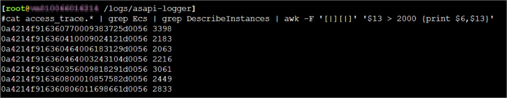

<a id="section-8-7"></a>

## 8.7. ASAPI domain names

This topic describes the different types of ASAPI domain names and their limits.

| Domain name | Category | Limit |
| --- | --- | --- |
| public.asapi.${global:region}.${global:internet-domain} | Business network domain, a new external domain name | It supports only HTTPS (tengine uses port 7443 to forward requests to ASAPI). |
| server.asapi.${global:region}.${global:intranet-domain} | Business network domain, a historical external domain name | It is no longer available to the public. It supports only HTTP. In Enterprise Edition V3.14.0, tengine uses port 8080 to forward requests to ASAPI. In Enterprise Edition V3.13.0 and Enterprise Edition V3.12.0, port 7001 of ASAPI is directly used. |
| internal.asapi.${global:region}.$ {global:intranet-domain} | Management network domain, a new internal domain name | It uses HTTP and is directly mapped to port 7001 of ASAPI. |
| asapi.${global:region}.${global:i ntranet-domain} | O&amp;M network domain, a historical domain name | It uses HTTPS (HTTPS Proxy, port 8082 of the tengine for forwarding information to ASAPI). |

<a id="section-9"></a>

# 9.Troubleshooting

<a id="section-9-1"></a>

## 9.1. What do I do if an error occurs when I log on to the Apsara Uni-manager Management Console?

This topic describes how to troubleshoot the error that occurs when you log on to the Apsara Uni-manager Management Console.

**Issue**

The page does not respond or an internal error is reported after you log on to the Apsara Uni-manager Management Console with the correct account and password.

**Cause**

The console logon may fail due to the following reasons:

- A network issue occurs.

- An error occurs when the ascm-auth service calls the ASS service.

- The services in the Apsara Uni-manager Management Console and the base services (ASS, RAM, Tair, and Ummak) that the Apsara Uni-manager Management Console depends on have not reached the desired state.

**Solution**

1. In the Apsara Infrastructure Management console, check whether the services in the Apsara Uni-manager Management Console cluster have reached the desired state.

   <ol type="i">

   <li>

   Log on to the Apsara Infrastructure Management console.

   </li>

   <li>

   In the left-side navigation pane, click **Project & Cluster O&M**.

   </li>

   <li>

   Enter  `ascm`  in the **Product | Cluster** field.

   </li>

   <li>

   Find the cluster that you want to view and click **Cluster Details** in the **Actions** column. On the **Cluster Detail** page, click the **Services** tab. View the status of each service in the **Status** column.

   If a service has not reached the desired state, set the service to the desired state. Log on to the Apsara Uni-manager Management Console again.

   </li>

   </ol>

2. If all services in the cluster have reached the desired state but the fault persists, you can check network issues in the order of frontend page > Portal container > ASAPI container > Auth/Manager container.

   Troubleshooting: Run the  `curl`  command in each container to connect to the endpoint of the next service.

   <ol type="i">

   <li>

   Click **Machines**.

   </li>

   <li>

   Find the desired machine and click **Terminal** in the **Actions** column.

   </li>

   <li>

   In the machine list, click the desired machine and run the following command:

   </li>

   </ol>

   ```text
   bash -c bash
   ```

   <ol type="i" start="4">

   <li>

   Run the following command to query the ID of the container:

   ```bash
   docker ps
   ```

   </li>

   <li>

   Run the following command to access the container:

   ```bash
   sudo docker exec -it <Container ID> bash 
   ```

   </li>

   <li>

   Perform necessary operations in the container.

   If the container cannot connect to an endpoint, contact the on-site network engineer to resolve the network issue.

   </li>

   </ol>

3. If no network issues are found between containers, check logs to identify the issue.

   <ol type="i">

   <li>

   Log on to the Apsara Uni-manager Management Console, enter the account and password, and press F12.

   </li>

   <li>

   Click **Log On**.

   </li>

   <li>

   Click the Headers tab to obtain the  `eagleeye-traceid` .

   </li>

   <li>

   Perform the operations in step 2 to access the **ascm-portal. Portal#** container.

   </li>

   <li>

   Run the following command in the container:

   ```text
   grep <eagleeye-traceid>/root/logs/ascm-portal/ascm-error.log*
   ```

   Find the service that returns errors based on the error logs. Contact onsite O&M engineers to further locate possible causes.

   </li>

   </ol>

4. If the Auth container is working properly, the username and password are correct, but the fault persists, an error may have occurred when the ascm-auth service calls the ASS service.

   <ol type="i">

   <li>

   Run the following command in the Auth container:

   ```text
   grep {eagleeye-traceid} /logs/ascm-logger/*.log -5
   ```

   </li>

   <li>

   If an error is reported in the return value in the log, an error may have occurred when the

   </li>

   </ol>

   ascm-auth service calls the ASS service. Contact AAS O&M engineers for further troubleshooting.

<a id="section-9-2"></a>

## 9.2. Configure a redirection page for a cloud service

You can turn on or off the switch for removing a redirection page in the Remove Redirection Page Configuration column of the Redirection Page Configuration page based on your business requirements.

**Prerequisites**

You are a platform administrator.

**Procedure**

1. Log in to the Apsara Uni-manager Management Console.

2. In the top navigation bar, click **Configurations**.

3. In the left-side navigation pane, choose **Menu Settings** > **Redirection Page Configuration**.

4. On the Redirection Page Configuration page, turn on or off the switch for removing a redirection page in the **Remove Redirection Page Configuration** column.

   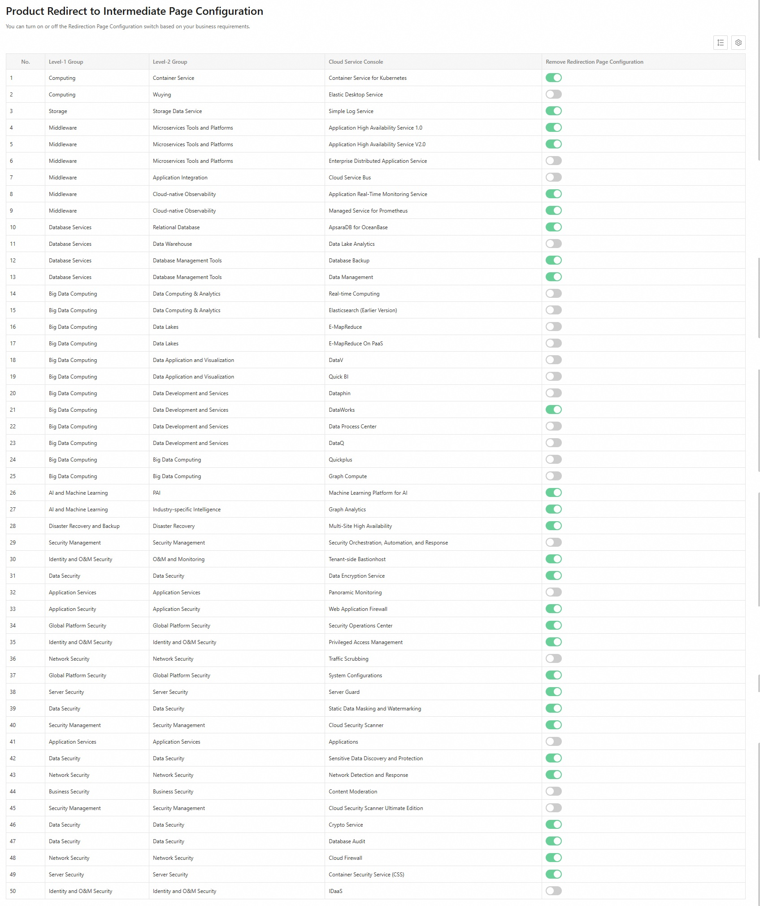

    indicates that the switch for removing a redirection page is turned on. After you turn on

   the switch, the redirection page does not pop up when you log in to the console of the corresponding cloud service. By default, the redirection page is displayed in the floating menu. You can switch accounts in the floating menu.

   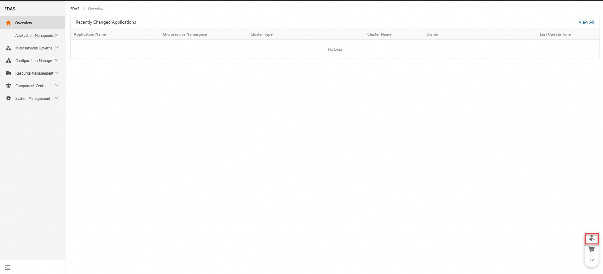

    indicates that the switch for removing a redirection page is turned off. After you turn off

   the switch, the redirection page pops up when you log in to the console of the corresponding cloud service. After you log in to the console, the redirection page is displayed in the floating menu. You can switch accounts in the floating menu.

   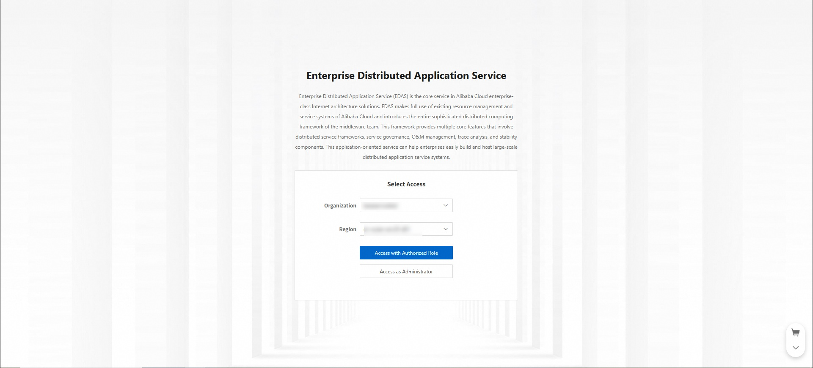

<a id="section-9-3"></a>

## 9.3. What do I do if a timeout error occurs when I call the API operations of VPC, ECS, SLB, or ApsaraDB RDS in the Apsara Uni-manager Management Console?

This topic describes how to troubleshoot a timeout error that occurs when you call the API operations of a cloud service such as Virtual Private Cloud (VPC), Elastic Compute Service (ECS), Server Load Balancer (SLB), or ApsaraDB RDS in the Apsara Uni-manager Management Console.

**Issue**

A timeout error occurs when you call the API operations of a cloud service such as VPC, ECS, SLB, or ApsaraDB RDS in the Apsara Uni-manager Management Console.

**Cause**

The timeout error may be caused by full garbage collection (GC) processes that are frequently run on Portable OpenAPI Proxy (POP).

**Solution**

1. Access the  `webapp-pop.PopAliyunCom#`  container. For more information about how to access the container, see Routine inspections.

2. Run the following command in the container:

   ```text
   tail -f/home/admin/logs/eagleeye/stat-eagleeye-jvm.log | grep gc
   ```

   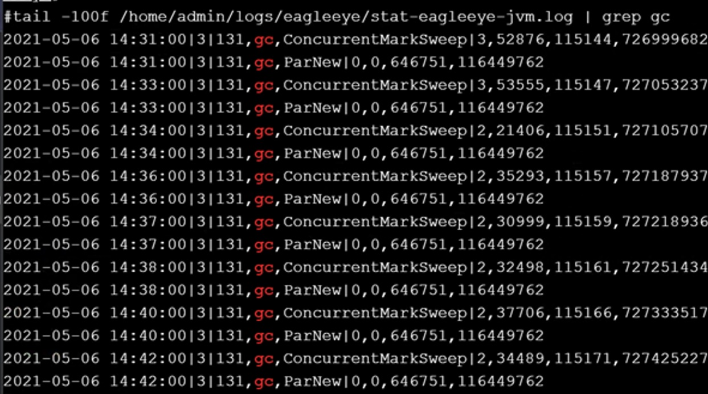

   ConcurrentMarkSweep indicates the logs of the full GC processes. A full GC process is run every 1 or 2 minutes.

3. Restart the containers in the following sequence: POP > ASAPI > Manage > ResourceManage > OneConsole.

4. After the containers are restarted, view the full GC processes that are run on POP.

   If the issue persists, contact on-site O&M engineers.

<a id="section-9-4"></a>

## 9.4. What do I do if a timeout error occurs when I create an ACK cluster in the Apsara Uni-manager Management Console?

This topic describes how to troubleshoot a timeout error that occurs when you create a Container Service for Kubernetes (ACK) cluster in the Apsara Uni-manager Management Console.

**Issue**

An error is reported when you create an ACK cluster in the Apsara Uni-manager Management Console. The error message "java.net.SocketTimeoutException:Read timed out" is returned.

**Cause**

The issue may occur due to the following reasons:

- Network issues occur.

- Performance is degraded due to the high load of the backend service.

**Solution**

1. Find the call logs for Apsara Stack API (ASAPI) and Portable OpenAPI Proxy (POP).

   <ol type="i">

   <li>

   Press the F12 key. Click **Create** again.

   </li>

   <li>

   Obtain the request ID from the response.

   </li>

   <li>

   Log on to the Apsara Infrastructure Management console and then access the

   </li>

   </ol>

   **asapi.ApiServer#** container.

   <ol type="i" start="4">

   <li>

   Run the following command in the container to query the EagleEye ID:

   ```text
   grep <requestid> /logs/asapi-logger/*
   ```

   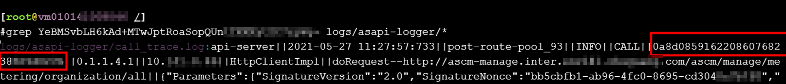

   </li>

   <li>

   Run the following command to query the duration on ASAPI based on the EagleEye ID:

   ```text
   grep <EagleEye ID> / logs/asapi-logger/*
   ```

   </li>

   <li>

   Access the **webapp-pop.PopAliyunCom#** container and run the following command to query the logs from POP and the duration on POP:

   ```text
   grep <EagleEye ID> /opt/tianji/alidata/www/logs/java/gateway/logs/trace/*
   ```

   </li>

   </ol>

2. Compare the duration on ASAPI with that on POP.

   - If the duration on POP is slightly longer than that on ASAPI, such as a time difference within 1 second to 2 seconds, contact service engineers to further troubleshoot the timeout error.

   - If the duration on ASAPI is much longer than that on POP, you can check whether full garbage collection (GC) processes are run on POP. For more information, see What do I do if a timeout error occurs when I call the API operations of VPC, ECS, SLB, or ApsaraDB RDS in the Apsara Uni-manager Management Console?

<a id="section-9-5"></a>

## 9.5. Timeout when obtaining ACK clusters in the Apsara Uni-manager Management Console

This topic describes how to troubleshoot the timeout error when you obtain Container Service for Kubernetes (ACK) clusters in the Apsara Uni-manager Management Console.

**Problem description**

An error is reported when you obtain ACK clusters in the Apsara Uni-manager Management Console. The error message is **"java.net.SocketTimeoutExeption:Read timed out"**.

**Possible causes**

The error may occur due to the following reasons:

- Network issue

- Performance degradation caused by the high load of the backend service

**Solution**

1. Press F12. Refresh the page and obtain the list of ACK clusters again.

   On the **Headers**tab, find the  `_preventCache`  field.

   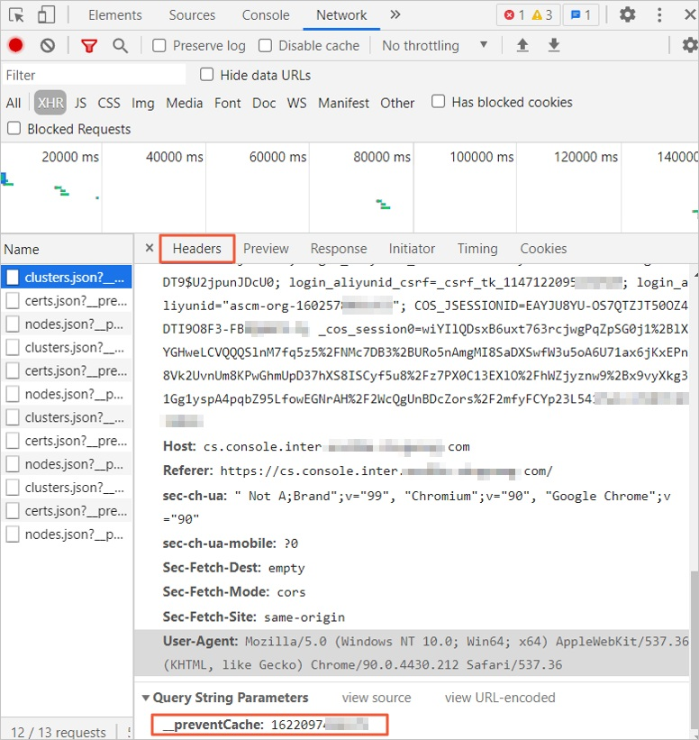

2. Access the **asapi.ApiServer#** container.

   <ol type="i">

   <li>

   Run the following command to obtain Manage logs by using _preventCache:

   ```bash
   cat /logs/ascm-logger/main_trace* | grep <_preventCache>
   ```

   </li>

   <li>

   Obtain the EagleEye ID from the Manage logs. Run the following command to find the logs on

   </li>

   </ol>

   API operations called by Manage from ASAPI:

   ```text
   grep /logs/ascm-logger/* | grep <EagleEye ID>
   ```

   <ol type="i" start="3">

   <li>

   Run the following command to obtain the logs on the API operations called by ASAPI through

   </li>

   </ol>

   POP based on the EagleEye ID:

   ```text
   grep <EagleEye ID> / logs/asapi-logger/*
   ```

   Obtain the  `x-acs-signature-nonce`  value.

3. Query POP logs.

   - Method 1:

     <ol type="a">

     <li>

     Enter the VM where the server role PopAliyunCom# is located.

     </li>

     <li>

     Access the **pop-aliyun-com** container. Run the following command to query the logs on POP calls:

     ```text
     grep <EagleEye ID> /opt/tianji/alidata/www/logs/java/gateway/logs/trace/trace.log
     ```

     > **Important**
     >
     > The logs in the container will be refreshed soon. Up to 20 minutes are required to access the POP container and obtain the logs.

     </li>

     </ol>

   - Method 2:

     <ol type="a">

     <li>

     Log on to the Simple Log Service console.

     For more information about how to view logs in Simple Log Service, see View logs.

     </li>

     <li>

     Select **ali-pop-log** for Project and **pop_rpc_trace_log** for Logstore.

     </li>

     </ol>

     <ol type="i" start="100">

     <li>

     If you cannot query desired logs by using the EagleEye ID, use  `CS and DescribeClusters` as the filter condition, and select a small time range for calling the API operation.

     </li>

     </ol>

4. Based on the preceding logs, analyze which module consumes longer time.

<a id="section-9-6"></a>

## 9.6. What do I do if an error is returned when I call the API operations of Blink in the Apsara Uni-manager Management Console?

This topic describes how to troubleshoot an error that is returned when you call the API operations of Blink in the Apsara Uni-manager Management Console.

**Issue**

An error is reported when you call the API operations of Blink in the Apsara Uni-manager Management Console. The error message "ascm.manage.EntityNotExist.Instance" is returned.

**Solution**

1. Access the **ascm-brm.Manage#** container. For more information about how to access the container, see Routine inspections.

2. Run the following command in the container to access the BRM database:

   ```text
   mysql -u${db_user} -h${db_host} -p${db_password} -D${db_name} -P${db_port}
   ```

3. Run the following command in the BRM database to check whether the value of the  `resource_instance.no_show_count`  parameter is 1 and whether the value of the  `instance_id`  parameter contains uppercase letters in the results:

   ```sql
   select * from resource_instance where type ='foas_project' and instance_id = 
   '$project_name' ;
   ```

   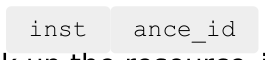

   - If the value of the  `inst  ance_id`  parameter contains uppercase letters, run the following commands to back up the resource_instance table and change the value of the  `instance_id`  parameter to a value that contains only lowercase letters.

     If the value of the  `no_show_count`  parameter is automatically changed to 0 after 10 minutes, skip the subsequent steps.

     ```sql
     create table resource_instance_bak20210204 as select * from resource_instance;
     updateresource_instance set instance_id = lower(instance_id) where type 
     ='foas_project';
     ```

   - If the value of the  `instance_id`  parameter does not contain uppercase letters and the value of the  `no_show_count`  parameter is 1, run the following commands to query logs in the **ascm-brm. ResourceMgr#** container:

     ```bash
     cat /logs/ascm-logger/call_trace* |grep foas |grep ListProject |grep ECONNREFUSED |tail -5
     cat /logs/ascm-logger/call_trace* |grep foas |grep ListProject |grep 
     ServiceUnavailable | tail -5
     cat /logs/ascm-logger/call_trace* |grep foas |grep ListProject |grep '\"Code\"' | tail-5
     cat /logs/ascm-logger/call_trace* |grep foas |grep ListProject |grep 
     ResponseTimeoutError | tail -5
     cat /logs/ascm-logger/call_trace* |grep foas |grep ListProject |grep InternalError| tail -5
     ```

     If no query results are returned, run the following commands to query logs:

     ```bash
     cat /logs/ascm-logger/call_trace.log|grep foas |grep ListProject| grep Region ID of $project |grep AccessKey pair of the organization of $project |grep $project_name | tail-5
     cat /logs/ascm-logger/call_trace.log |grep foas |grep ListProject| grep Region ID of $project |grep AccessKey pair of the organization of $project | tail -5
     ```

4. Provide the collected logs for the on-site O&M engineers of the Apsara Uni-manager Management Console.

<a id="section-9-7"></a>

## 9.7. What do I do if I do not have the required permissions when I perform operations in the Apsara Uni-manager Management Console?

This topic describes how to troubleshoot the insufficient permissions issue when you create instances in the Apsara Uni-manager Management Console.

**Issue**

When you create instances in the Apsara Uni-manager Management Console, the system prompts insufficient permissions.

> **Note**
>
> This topic describes a general method for determining permissions. Creating an instance is used in the example.

**Solution**

1. Press F12 and create an instance again. Obtain the  `asapiErrorCode`  value on the **Preview** tab of the developer tool.

2. Access the **ascm-brm.Manage#** container.

3. Run the following command to access the BRM database:

   ```text
   mysql -u${db_user} -h${db_host} -p${db_password} -D${db_name} -P${db_port} 
   ```

4. Run the following command to confirm the permissions:

   ```sql
   select * from ascm_privilege wherecode='<asapiErrorCode>'\G
   ```

5. Check whether the permissions of the current user are selected.

   <ol type="i">

   <li>

   Log on to the Apsara Uni-manager Management Console as an administrator.

   </li>

   <li>

   In the top navigation bar, click **Enterprise**.

   </li>

   <li>

   In the left-side navigation pane, choose **Users > Users**.

   </li>

   <li>

   Find the user for which an insufficient permissions error is reported and click the username.

   </li>

   <li>

   View the user role next to the user profile.

   </li>

   <li>

   In the top navigation bar, click **Enterprise**.

   </li>

   <li>

   In the left-side navigation pane, click **Roles**.

   </li>

   <li>

   Find the role and click the role name. Check whether the permissions confirmed in Step 4

   </li>

   </ol>

   are selected.

> **Note**
>
> You can modify only the permissions of custom roles. If the preset roles do not meet the requirements, create a custom role and grant permissions. For more information about how to create a role and grant permissions, see *Apsara Uni-manager Management Console User Guide*.

<a id="section-9-8"></a>

## 9.8. An API operation called by using an SDK is not found

This topic describes how to trouble the issue that an API operation called by using an SDK is not found.

**Problem description**

When an SDK is used to call an API operation, the Apsara Uni-manager Management Console displays "API not found".

**Possible causes**

- The values of the Product, Action, Version fields of the request were invalid.

- The requested API operation does not exist in the current the Apsara Uni-manager Management Console.

**Solution**

1. Access the **asapi.ApiServer#** container and run the following command to access the ASAPI database:

   ```text
   mysql -h${db_asapi_db_host} -P${db_asapi_port} -u${db_asapi_user} -p${db_asapi_password} 
   asapi
   ```

2. Run the following SQL statement to check whether the requested API operation exists in the ASAPI database:

   ```sql
   select * from ops_api where name = "API name" and namespace = "Product name" and api_version = "Version number" and category_id = "privateCloud"\G
   ```

3. Check whether the API operation is called through POP.

   ```sql
   select * from asapi_product where name = "Product Name";
   ```

   If no search result is displayed, you need to contact the relevant personnel of Alibaba Cloud to register this API operation in ASAPI.

4. Access the **asapi.ApiServer#** container and try to call the API operation through POP.

   ```bash
   cd /alidata/tools
   # Use a tool to synchronize API operations from POP
   ./asapiTools pop -p product name-v version
   Example:
   ./asapiTools pop -p Ecs -v 2014-05-26
   ```

5. Check whether the API operation list contains the API operation that you want to call. If no, contact the relevant personnel of Alibaba Cloud to check whether the API operation is registered in POP. If yes, initiate the call again for testing.

<a id="section-9-9"></a>

## 9.9. Inaccessible HTTPS domain name for ASAPI

This topic describes how to troubleshoot the issue of an inaccessible HTTPS domain name for ASAPI.

**Problem description**

The HTTPS domain name for ASAPI is not accessible.

**Possible causes**

The HTTPS certificate is not updated.

Use the  `curl`  command to check whether the HTTPS certificate is updated. Access the **asapi.ApiServer#** container and run the following command:

```bash
curl https://127.0.0.1:7443/api/version -k
Or
curl https://public.asapi..../api/verison -k
```

If the following information is returned, the HTTPS certificate is updated.

```json
{"version":"v3.13","code":"200","apiCount":14071,"desc":"update xml pretty"}
```

If the following information is returned, the HTTPS certificate is not updated, and you need to update it.

```text
curl: (35) Peer reports it experienced an internal error.
curl: (35) error:1407742E: SSL routines: SSL_23_GET_SERVER_HELLO:tlsvl alert protocol version
```

**Solution**

1. Obtain the environment configuration information.

   <ol type="i">

   <li>

   Obtain TianJi System_Id.

   </li>

   <li>

   Obtain the JSON file planned by Apsara Stack Deployment Planner.

   </li>

   </ol>

2. Generate a certificate file.

   Contact the Alibaba Cloud HTTPSPROXY R&D team to generate a certificate for ASAPI.

   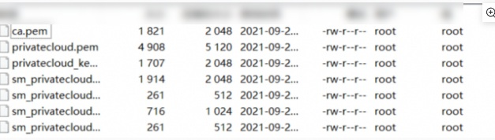

3. The Apsara Infrastructure Management issues a certificate.

   <ol type="i">

   <li>

   Open the cluster configuration file of the **ascm** Apsara Infrastructure Management.

   </li>

   <li>

   In the **asapi** folder, create a user file directory and its subordinate one, and put the obtained

   </li>

   </ol>

   certificate file into the **cert** folder.

   <ol type="i" start="3">

   <li>

   Click **Save and Submit**.

   </li>

   </ol>

<a id="section-9-10"></a>

## 9.10. What do I do if a cloud service API is unregistered?

This topic describes how to troubleshoot the issue that a cloud service API is not registered in the Apsara Uni-manager Management Console.

**Issue**

When you perform an operation in the Apsara Uni-manager Management Console, a message is prompted, indicating that the cloud service API is not registered.

**Solution**

1. Obtain the service name and version number of the API through the audit of API call logs.

   For more information, see Log Audit.

2. Access the  `asapi.ApiServer#`  container.

   <ol type="i">

   <li>

   Log on to the Apsara Infrastructure Management Console.

   </li>

   <li>

   In the left-side navigation pane, click **Project & Cluster O&M**.

   </li>

   <li>

   Enter  `ascm`  in the **Product | Cluster** field.

   </li>

   <li>

   Find the desired cluster and click **Cluster Details** in the **Actions** column. On the **Cluster Details** page, click the **Machines** tab.

   </li>

   <li>

   Find the desired machine and click **Terminal** in the **Actions** column.

   </li>

   <li>

   In the machine list, click the desired machine and run the following command:

   ```text
   bash -c bash
   ```

   </li>

   <li>

   Run the following command to query the ID of the container:

   </li>

   </ol>

   ```bash
   docker ps
   ```

   <ol type="i" start="8">

   <li>

   Run the following command to access the container:

   </li>

   </ol>

   ```bash
   sudo docker exec -it <Container ID> bash 
   ```

3. Run the command  `cd /alidata/tools/`  to go to the directory of registration tools.

   The tool used in the X86 architecture is asapiTools, and the tool used in the ARM architecture is asapiTools-arm64.

4. Run the following code to synchronize all API operations from POP to ASAPI:

   > **Important**
   >
   > In this command, the service name is case-sensitive. Enter the actual service name.

   ```text
   ./asapiTools pop -p <Service name> <Version number>
   ```

   After the API is obtained, the system displays the detailed API names. Check whether the API operation list contains the missing API. If no, check whether the service name and version number are correct. If the fault persists, contact the on-site O&M engineers of Apsara Stack.

5. After the synchronization is successful, perform the operation that reports the error again.

<a id="section-9-11"></a>

## 9.11. What do I do if a timeout error occurs when ASAPI calls an API operation in the Apsara Uni-manager Management Console?

This topic describes how to troubleshoot the timeout error when ASAPI calls an API operation of a cloud service.

**Issue**

A timeout error occurs in the Apsara Uni-manager Management Console when ASAPI calls an API operation of a cloud service.

**Solution**

1. Obtain the EagleEye ID when the error occurred.

   <ol type="i">

   <li>

   Press the F12 key. Then, refresh the page and call the API operation again.

   </li>

   <li>

   Click the **Headers** tab, and obtain the  `eagleeye-traceid`  value.

   </li>

   </ol>

2. Use the  `eagleeye-traceid`  value to obtain the service name and version number for the API operation where the error occurred in the API call log.

   For more information, see Preview logs.

3. Access the  `asapi.ApiServer#`  container.

   <ol type="i">

   <li>

   Log on to the Apsara Infrastructure Management console.

   </li>

   <li>

   In the left-side navigation pane, click **Project & Cluster O&M**.

   </li>

   <li>

   Enter `ascm`  in the **Product | Cluster** field.

   </li>

   <li>

   Find the desired cluster and click **Cluster Details** in the **Actions** column. On the **Cluster Details** page, click the **Machines** tab.

   </li>

   <li>

   Find the desired machine and click **Terminal** in the **Actions** column.

   </li>

   <li>

   In the machine list, click the desired machine and run the following command:

   ```text
   bash -c bash
   ```

   </li>

   <li>

   Run the following command to query the ID of the container:

   </li>

   </ol>

   ```bash
   docker ps
   ```

   <ol type="i" start="8">

   <li>

   Run the following command to access the container:

   </li>

   </ol>

   ```bash
   sudo docker exec -it <Container ID> bash 
   ```

4. Run the following command to access the database of ASAPI:

   ```text
   mysql -h <db_asapi_db_host> -P<db_asapi_port> -u<db_asapi_user> -p<db_asapi_password> asapi
   ```

5. Run the following command in the database:

   ```sql
   # The PolarDB-X API operation is called in the following example. Modify the timeout period based on the actual time for the backend API operation.
   update ops_api set timeout = 30000 where namespace = "Drds" and name 
   ="DescribeDrdsRdsInstances" and api_version = "2019-01-23";
   ```

   ```sql
   insert into api_timeout_unlimited(namespace,name,api_version,category_id) values ("Drds 
   "," DescribeDrdsRdsInstances ","2019-01-23","privateCloud");
   ```

   > **Note**
   >
   > If the table api_timeout_unlimited is not provided in the current version, you can skip the second part of the command.

6. After the execution is successful, wait for 5 minutes. Configure ASAPI to call the API operation again.

   If the fault persists, contact the O&M support personnel of Apsara Stack.

<a id="section-9-12"></a>

## 9.12. What do I do if an alert occurs when I log in to the Apsara Uni-manager Management Console by calling the login operation?

**Background information**

The Apsara Uni-manager Management Console generates alerts when exceptions occur during the health check of the login process and the regular inspection of the login API operation.

The **ascm_login_check_health_alarm** and **ascm_login_api_inspect_alert** alerts indicate that the login process of the Apsara Uni-manager Management Console is abnormal and must be troubleshooted at the earliest opportunity.

**Alert attributes**

| Metric | Alert source | Alert level | Service | Trigger condition | Interval |
| --- | --- | --- | --- | --- | --- |
| ascm_login_ch eck_health_ala rm | ascm | P1 | Apsara Uni-manager Management Console | None | The metric is checked at an interval of one minute. Alerts are generated at an interval of five minutes. |
| ascm_login_ap i_inspect_alert | asd | P1 | Apsara Uni-manager Management Console | Login API inspection fails for three consecutive times. | The metric is checked at an interval of one minute. Alerts are generated at an interval of ten minutes. |

**Issue**

You cannot log in to the Apsara Uni-manager Management Console as expected.

**Cause**

The alerts are generated due to two reasons:

- The unimanager-base.IdentityService# service is abnormal, which results in the failures of the login API calls.

- The dependent basic services of the unimanager-base.IdentityService# service are abnormal, which results in the failures of the login API calls.

**Solutions**

1. Obtain the causes of the alerts and corresponding trace IDs from the alert sources.

   > **Note**
   >
   > - The source of the ascm_login_api_inspect_alert alert is Apsara Stack Doctor (ASD).
   >
   > - The source of the ascm_login_check_health_alarm alert is the ASAPI gateway of the Apsara Uni-manager Management Console.

   <ol type="i">

   <li>

   Log in to the SlsInner console.

   </li>

   <li>

   Query logs related to the ascm_login_api_inspect_alert alert in the biz_alert_log Logstore of

   </li>

   </ol>

   the tjm-asd-console project by specifying BizExType:AscmLoginFault as the query condition. Query logs related to the ascm_login_check_health_alarm alert in the tjmcollector_biz_alert_log_ascm_asapi Logstore of the tjm-asapi project by specifying BizExType:AsapiHealthCheck as the query condition.

   The following figure shows the SLS log related to a ascm_login_api_inspect_alert alert from ASD. You can obtain the EagleEye ID of the trace corresponding to the alert. In the log, EntityType indicates the abnormal component or service, and ErrorType indicates the error code that can be used to locate the component or service that affects the login to the Apsara Uni-manager Management Console. If the value of EntityType is Ram, Aas, ummak, Pop, or Tair, the alert is generated because the basic services are abnormal.

   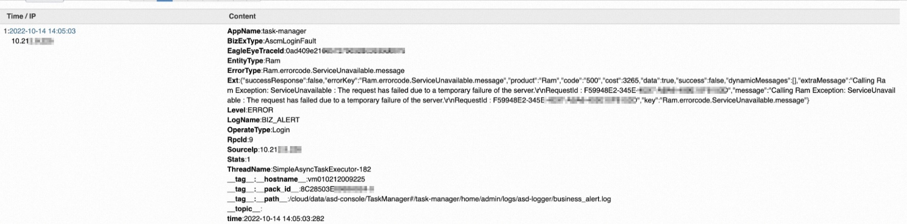

2. Handle login API alerts caused by basic service exceptions.

   <ol type="i">

   <li>

   Use ASD to query the cause and logs of the alerts.

   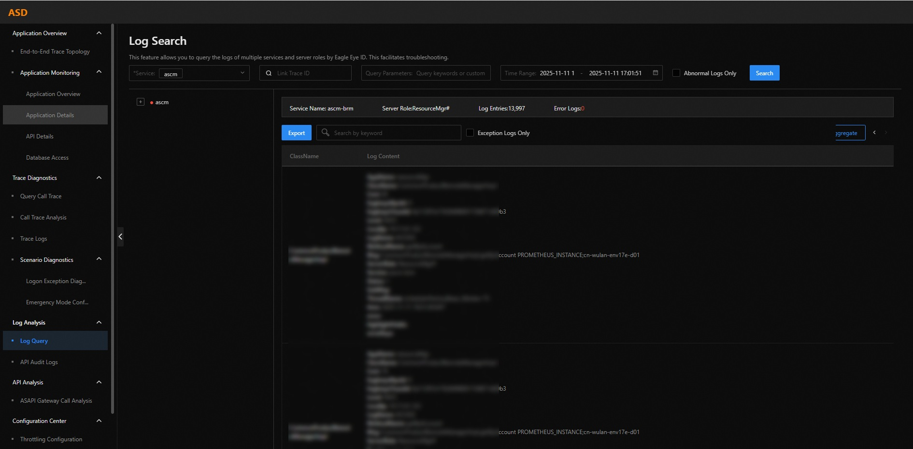

   </li>

   <li>

   Use the emergency mode of the Apsara Uni-manager Management Console.

   <ol type="a">

   <li>

   Enable the emergency mode if you cannot log in to the Apsara Uni-manager Management Console.

   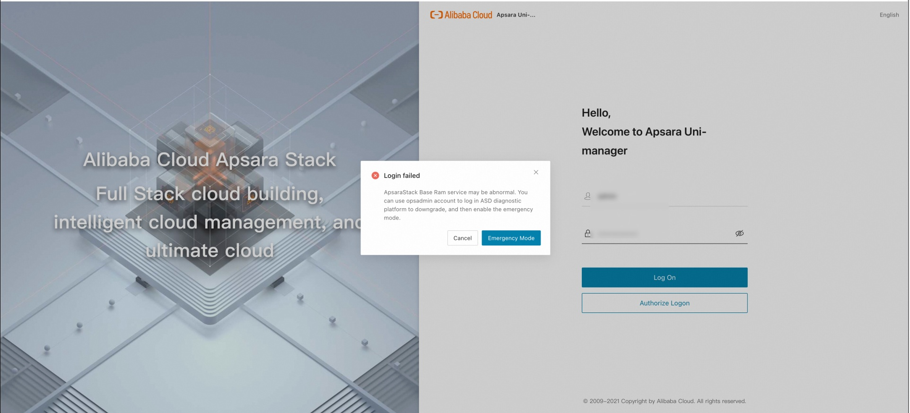

   </li>

   <li>

   Click Emergency Mode.

   </li>

   </ol>

   <ol type="i" start="100">

   <li>

   Log in to ASD to troubleshoot the alerts and enable the emergency mode.

   > **Note**
   >
   > Log in to ASD from the Apsara Uni-manager Operations Console. If you cannot log in to the Apsara Uni-manager Operations Console, you can use the emergency mode of the Apsara Uni-manager Operations Console.

   </li>

   <li value="500">

   ASD performs diagnostics and prompts you to enable the emergency mode.

   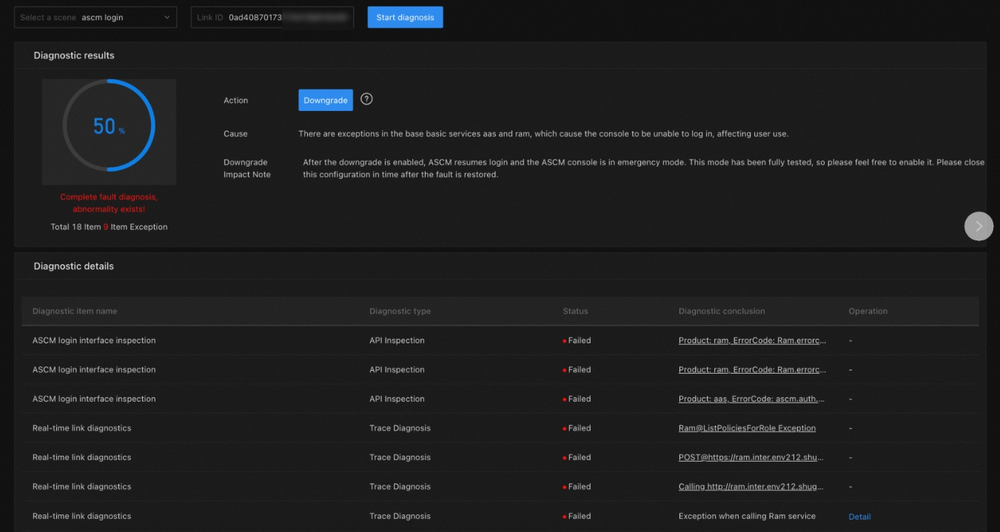

   </li>

   </ol>

   <ol type="a" start="5">

   <li>

   Click Downgrade to restore login to the Apsara Uni-manager Management Console. Then, you can log in to the Apsara Uni-manager Management Console as expected for further operations. A notice is displayed on the top navigation bar of the Apsara Uni-manager Management Console.

   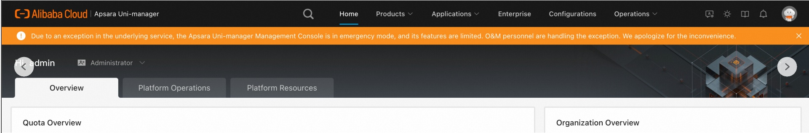

   </li>

   <li>

   Optional. Disable the emergency mode in the downgrade configurations of ASD.

   </li>

   </ol>

   </li>

   </ol>

3. Handle login API alerts caused by the Apsara Uni-manager Management Console exceptions.

   <ol type="i">

   <li>

   Log in to ASD.

   </li>

   <li>

   Query the logs related to the unimanager-base.IdentityService# service role.

   </li>

   <li>

   Send the logs to the R&D engineers for troubleshooting.

   </li>

   </ol>

<a id="section-9-13"></a>

## 9.13. How do I turn off the switch that enforces attribution of interaction between instance resources?

This topic describes how to turn off the switch that enforces attribution of interaction between instance resources.

**Interactions between resources and the display rule**

**Strong isolation**

Isolation between Apsara Stack tenant accounts. Strong isolation applies to Apsara Stack resources between Apsara Stack tenant accounts. Apsara Stack tenant accounts correspond to level-1 organizations of Apsara Stack. That is, the resources of level-1 organizations are strongly isolated by default.

**Weak isolation**

Isolation between resource sets in the Apsara Uni-manager Management Console. For GUI-based operations in the Apsara Uni-manager Management Console, interactions between resources are confined to within a single resource set. This prevents unauthorized cross-resource access when you perform GUI-based operations in Apsara Uni-manager Management Console. For example, if Elastic Compute Service (ECS) instances are associated with a security group, only the ECS instances on which the user has permissions are displayed, rather than displaying all the ECS instances bound to the security group. If all ECS instances are displayed in this case, unauthorized access may occur.

**Resource sharing**

For resources such as virtual private clouds (VPCs) and ECS security groups that have strong cross-resource interaction requirements, the Apsara Uni-manager Management Console provides resource sharing capabilities to support resource sharing within the current organization and between the current organization and subordinate organizations, which meets the requirements of resource interactions among different resource sets. For example, if an ECS security group is configured to be shared within the current-level organization, the ECS security group can be associated with ECS instances that have different resource sets in the current-level organization.

**Procedure**

1. Log in to the Apsara Uni-manager Operations Console by using the opsadmin account.

2. In the top navigation bar, choose **Platform Operation** > **Management and control service operation and maintenance** > **UniConsole**. The Products page is displayed by default.

   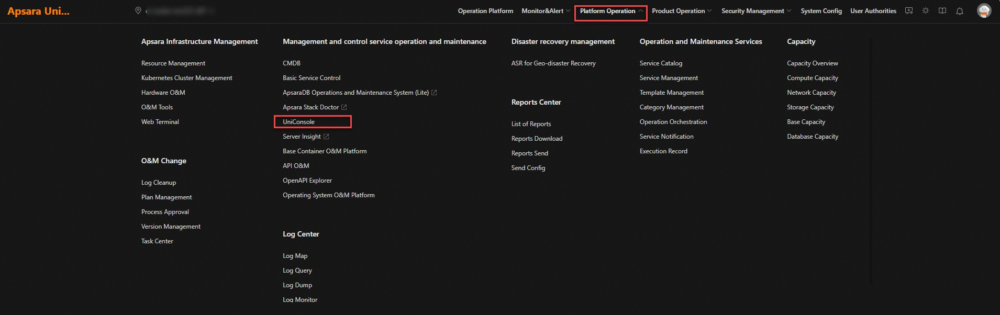

3. On the **Products** page, enter the service whose information you want to change and click **Search**.

   > **Note**
   >
   > Currently, vpc and slb are supported. vpc is used in this example.

4. Find the desired service and click **Switch List** in the Actions column.

   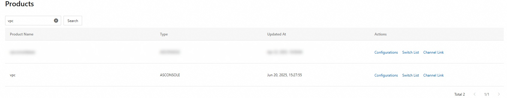

5. Search for  `strictOwnership`  in the switch list and check whether the Current Value switch is turned on. If this switch is turned on, click **Change Switch Status** in the Actions column.

   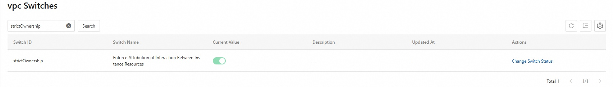

6. In the dialog box that appears, turn off the **Current Value** switch and then click **OK**.

   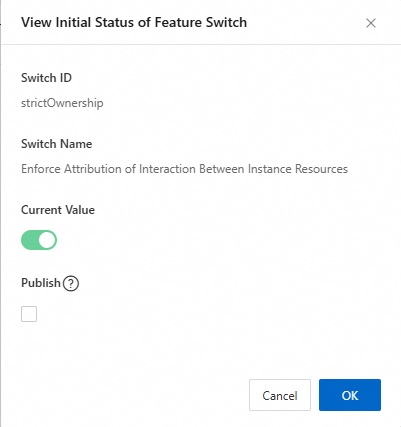

7. After the modification is successful, the page is automatically refreshed to show whether the modification is successful.

   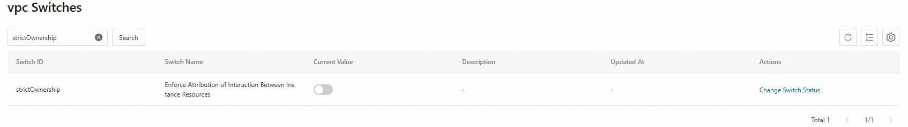

8. Wait about 10 minutes and log in to the Apsara Uni-manager Management Console again.

<a id="section-9-14"></a>

## 9.14. Configure public internet exposure for the portal

**Overview**

Public internet exposure for the portal enables network connectivity from the portal to the customer's VPC. You must configure the network path from the VPC to the public internet yourself.

**Dependencies for portal public internet exposure**

- Portal public internet exposure depends on the entire Apsara Stack supporting outbound public internet access.

- You must have a publicly accessible domain name.

**Configure public internet access for the portal**

**Obtain the public internet domain name**

Obtain the customer's public internet domain name. When in use, ensure that the domain name remains accessible.

Example: Use site000002-t1.operation.inter.env\*\*\*.shuguang.com as the public internet address for portal access.

**Configure the public internet domain name for ComsCms**

Enter the ComsCms container and modify  `/opt/taobao/tengine/conf/public_domain.lua` . Set the value of config.public_domain to the public internet domain name.

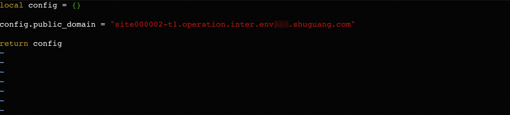

**Reload the configuration**

In the container, navigate to the directory cd  `/opt/taobao/tengine/bin`  and run  `#sh nginxctl reload`  to reload the configuration.

```bash
cd /opt/taobao/tengine/bin
sh nginxctl reload
```

**Establish network connectivity between instances and the ComsCms container**

**Obtain the realServer IP of ComsCms**

**Obtain the VIP of the ComsCms domain name**

Log in to TianJi, view the serviceManagement cluster details, and check the value of the registration variable "unimanager-coms-cms-vip-biz.vip_ip" for unimanager-cosm.ComsCms.

> **Note**
>
> If you need IPv6 support, contact Alibaba Cloud technical support.

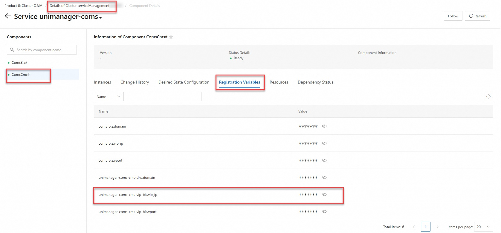

**View the realServer IP**

Based on the VIP address of unimanager-coms-cms-vip-biz.vip_ip, view the corresponding realServer IP address on the SLB.

Enter the slb-controller.SlbAg# container and access the corresponding SLB console.

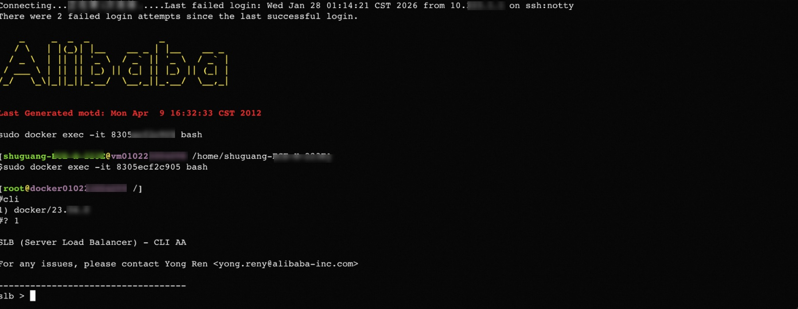

Run the command to view the realServer corresponding to the SLB listener's VIP.

```text
info admin eip_or_lb address_or_lb_id ${vip}
```

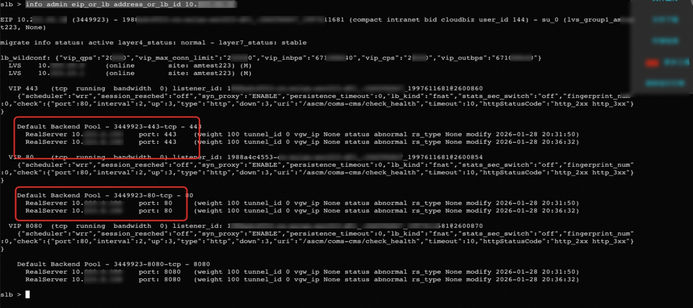

**Configure singleTunnel from the instance to comsCms**

1. Log in to the Apsara Uni-manager Operations Console.

2. Go to **Product Operation** > **Network Operations Console**.

   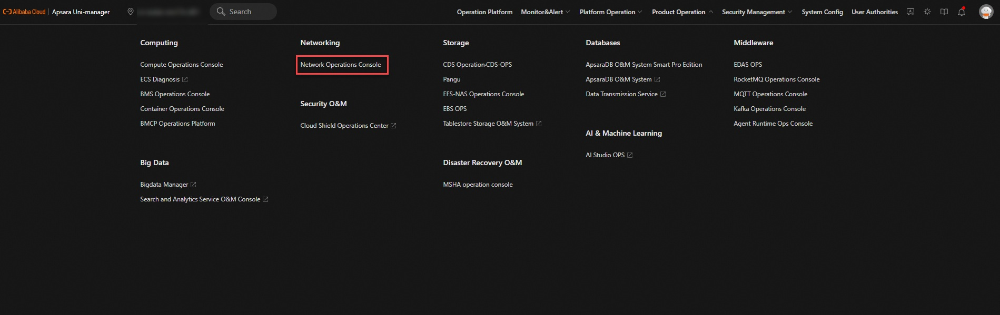

3. In the left-side navigation pane, click **Network Resources** > **Cloud Instance Management**.

4. Click **Create Instance** > **Create Instance**.

   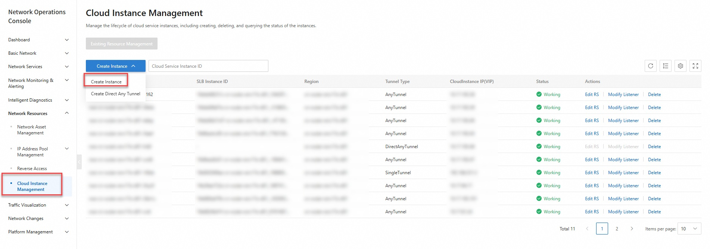

5. On the **Create Instance** page, configure the corresponding IP address and front-end/back-end ports. Configure ports 80 and 443.

   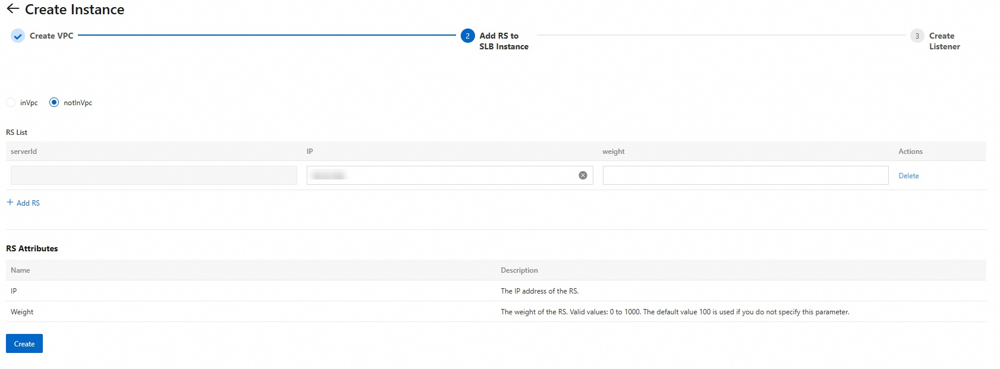

   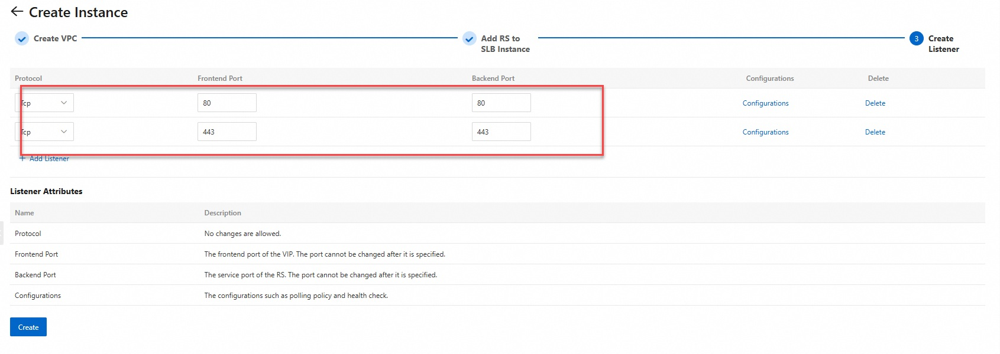

6. Obtain the corresponding anyTunel VIP.

   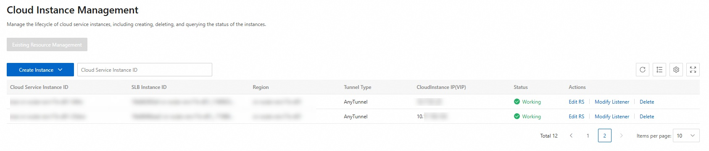

**Configure hosts in the instance**

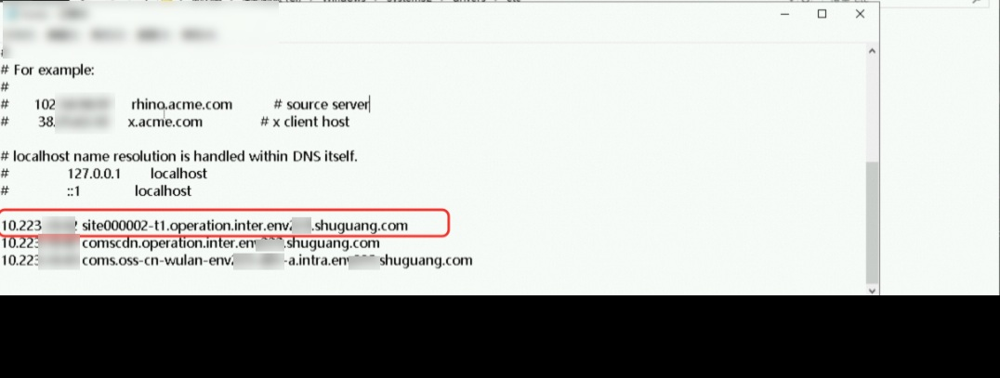

In the terminal, ping the corresponding domain name. If the ping succeeds, the domain is accessible.
