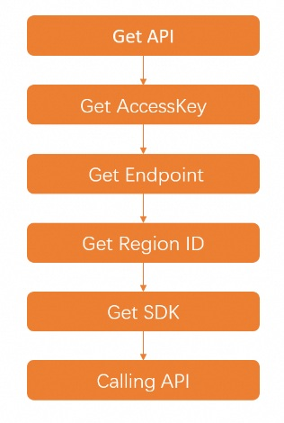
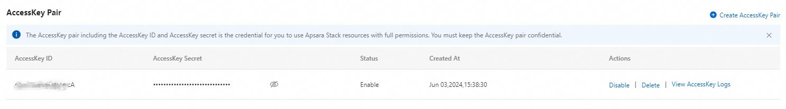
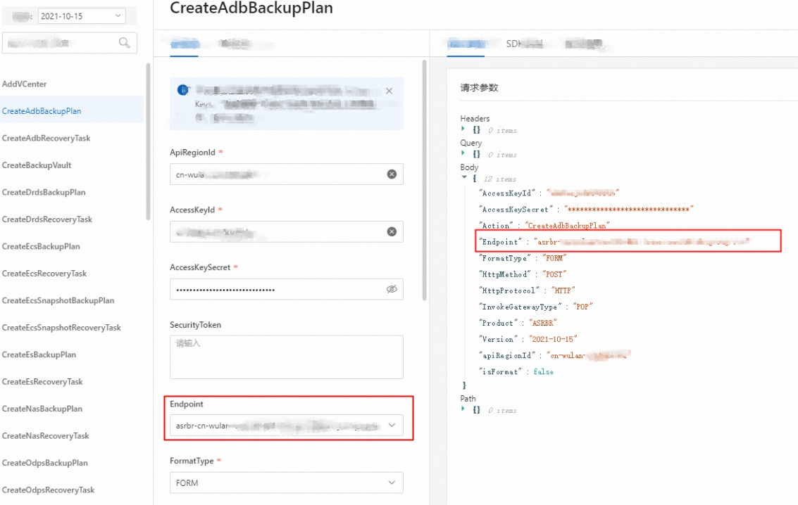
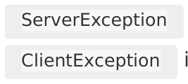

Alibaba Cloud  
Apsara Stack  
Apsara Stack Resilience  
ASR for Backup and Recovery  
Developer Guide  
Product Version: V3.18.6  
Document Version: 20260701

**Table of Contents**

- [1.Procedure for API calls](#section-1)
- [2.Preparations](#section-2)
    - [2.1. Obtain an AccessKey pair](#section-2-1)
    - [2.2. Obtain the information and the endpoint of an API operation](#section-2-2)
    - [2.3. Obtain SDKs](#section-2-3)
- [3.Use SDK for Java](#section-3)
    - [3.1. Install SDK for Java](#section-3-1)
    - [3.2. Configure authentication credentials](#section-3-2)
    - [3.3. Initiate a request](#section-3-3)
    - [3.4. Handle errors](#section-3-4)
- [4.API Reference](#section-4)
    - [4.1. Instance information initialization](#section-4-1)
        - [4.1.1. InitCloudInfo](#section-4-1-1)
    - [4.2. Backup vaults](#section-4-2)
        - [4.2.1. CreateBackupVault](#section-4-2-1)
        - [4.2.2. DescribeVaultUseageDetail](#section-4-2-2)
        - [4.2.3. DescribeBackupVault](#section-4-2-3)
        - [4.2.4. DescribeBackupVaultList](#section-4-2-4)
    - [4.3. Backup schedules](#section-4-3)
        - [4.3.1. ECS backup client installation](#section-4-3-1)
            - [4.3.1.1. InstallEcsClient](#section-4-3-1-1)
        - [4.3.2. Backup schedule creation](#section-4-3-2)
            - [4.3.2.1. CreateAdbBackupPlan](#section-4-3-2-1)
            - [4.3.2.2. CreateDrdsBackupPlan](#section-4-3-2-2)
            - [4.3.2.3. CreateEsBackupPlan](#section-4-3-2-3)
            - [4.3.2.4. CreateEcsBackupPlan](#section-4-3-2-4)
            - [4.3.2.5. CreateEcsSnapshotBackupPlan](#section-4-3-2-5)
            - [4.3.2.6. CreateNasBackupPlan](#section-4-3-2-6)
            - [4.3.2.7. CreateOdpsBackupPlan](#section-4-3-2-7)
            - [4.3.2.8. CreateOssBackupPlan](#section-4-3-2-8)
            - [4.3.2.9. CreateRdsBackupPlan](#section-4-3-2-9)
        - [4.3.3. Backup schedule management](#section-4-3-3)
            - [4.3.3.1. DeleteBackupPlan](#section-4-3-3-1)
            - [4.3.3.2. DescribeBackupPlanList](#section-4-3-3-2)
            - [4.3.3.3. DescribeBackupPlan](#section-4-3-3-3)
            - [4.3.3.4. DisableBackupPlan](#section-4-3-3-4)
            - [4.3.3.5. EnableBackupPlan](#section-4-3-3-5)
            - [4.3.3.6. ExecuteBackupPlan](#section-4-3-3-6)
            - [4.3.3.7. ModifyBackupPolicy](#section-4-3-3-7)
    - [4.4. Backup records](#section-4-4)
        - [4.4.1. DescribeBackupInstanceRecordList](#section-4-4-1)
    - [4.5. Restoration tasks](#section-4-5)
        - [4.5.1. Restoration task creation](#section-4-5-1)
            - [4.5.1.1. CreateAdbRecoveryTask](#section-4-5-1-1)
            - [4.5.1.2. CreateDrdsRecoveryTask](#section-4-5-1-2)
            - [4.5.1.3. CreateEcsRecoveryTask](#section-4-5-1-3)
            - [4.5.1.4. CreateEcsSnapshotRecoveryTask](#section-4-5-1-4)
            - [4.5.1.5. CreateEsRecoveryTask](#section-4-5-1-5)
            - [4.5.1.6. CreateNasRecoveryTask](#section-4-5-1-6)
            - [4.5.1.7. CreateOdpsRecoveryTask](#section-4-5-1-7)
            - [4.5.1.8. CreateOssRecoveryTask](#section-4-5-1-8)
            - [4.5.1.9. CreateRdsRecoveryTask](#section-4-5-1-9)
        - [4.5.2. Restoration task management](#section-4-5-2)
            - [4.5.2.1. DescribeRecoverableDiskList](#section-4-5-2-1)
            - [4.5.2.2. DescribeRecoverableDrdsDbEngine](#section-4-5-2-2)
            - [4.5.2.3. DescribeRecoverableDrdsDbSepc](#section-4-5-2-3)
            - [4.5.2.4. DescribeRecoverableInstanceList](#section-4-5-2-4)
            - [4.5.2.5. DescribeRecoverableInstanceRecordList](#section-4-5-2-5)
            - [4.5.2.6. DescribeRecoveryTaskList](#section-4-5-2-6)
            - [4.5.2.7. DescribeRecoveryTask](#section-4-5-2-7)
            - [4.5.2.8. DisableRecoveryTask](#section-4-5-2-8)
            - [4.5.2.9. EnableRecoveryTask](#section-4-5-2-9)
            - [4.5.2.10. RestartRecoveryTask](#section-4-5-2-10)
            - [4.5.2.11. DescribeAvailableRecoveryTime](#section-4-5-2-11)
    - [4.6. VMware backup, restoration, and migration](#section-4-6)
        - [4.6.1. CreateVmwareBackupPlan](#section-4-6-1)
        - [4.6.2. CreateVmwareLocalRecovery](#section-4-6-2)
        - [4.6.3. CreateVmwareRestoreToCloud](#section-4-6-3)
        - [4.6.4. DescribeVmwareBackupPlanList](#section-4-6-4)
        - [4.6.5. DescribeVmwareBackupPlan](#section-4-6-5)
    - [4.7. vCenter management](#section-4-7)
        - [4.7.1. AddVCenter](#section-4-7-1)
        - [4.7.2. ModifyvCenterInfo](#section-4-7-2)
        - [4.7.3. DeleteVCenter](#section-4-7-3)
        - [4.7.4. DescribeVCenterComputeResourceList](#section-4-7-4)
        - [4.7.5. DescribeVCenterDataCenterList](#section-4-7-5)
        - [4.7.6. DescribeVCenterList](#section-4-7-6)
        - [4.7.7. DescribeVCenterNetworkList](#section-4-7-7)
        - [4.7.8. DescribeVCenterRegisterCode](#section-4-7-8)
        - [4.7.9. DescribeVCenterStorageResourceList](#section-4-7-9)
    - [4.8. Storage pool management](#section-4-8)
        - [4.8.1. DescribeStoragePoolList](#section-4-8-1)

<a id="section-1"></a>

# 1.Procedure for API calls

You can use the POP gateway to call API operations in ASR for Backup and Recovery.

**Flowchart**

The following figure shows the flowchart for calling API operations in ASR for Backup and Recovery.



**Procedure**

1. Obtain API information.

   For more information, see API Reference.

2. Obtain the AccessKey ID and AccessKey secret. For more information, see Obtain an AccessKey pair.

3. Obtain the endpoint of ASR for Backup and Recovery. For more information, see Obtain the information and the endpoint of an API operation.

4. Obtain the region ID of ASR for Backup and Recovery. For more information, see Obtain a region ID.

5. Obtain the ASR for Backup and Recovery SDK and SDK core library. For more information, see Obtain the SDK package.

6. Call API operations in ASR for Backup and Recovery.

   > **Note**
   >
   > Only users who are granted the permissions of the organization backup administrator role can call API operations in ASR for Backup and Recovery. For more information about how to add the organization backup administrator role, see **Manage authorizations of System Management** in *ASR for Backup and Recovery User Guide*.

<a id="section-2"></a>

# 2.Preparations

<a id="section-2-1"></a>

## 2.1. Obtain an AccessKey pair

This topic describes how to obtain the AccessKey ID and AccessKey secret.

**Background information**

An AccessKey pair is used to verify the identity of a request sender. An AccessKey pair consists of an AccessKey ID and an AccessKey secret that are used to implement symmetric encryption. The AccessKey ID is used to identify a user. The AccessKey secret is a string that is used to encrypt a signature.

**Obtain an AccessKey pair**

The Apsara Uni-manager Management Console provides AccessKey pairs to personal accounts and organizations. We recommend that you use the AccessKey pairs of personal accounts to call the operations

> **Note**
>
> - Only the administrators of level-1 organizations and operations administrators can obtain the AccessKey pairs of organizations.
>
> - When you obtain the AccessKey pair of your personal account, make sure that you have the permissions of the organization backup administrator role. Otherwise, you may fail to call the operations.

**Obtain the AccessKey credentials of a personal account**

1. Log on to the Apsara Uni-manager Management Console.

2. In the upper-right corner of the homepage, click the profile picture and then select **User Information**.

3. In the **AccessKey Pair** section, view the AccessKey credentials of the personal account.

   

   > **Important**
   >
   > The AccessKey pair provides full access to cloud resources within your Apsara Stack tenant account. You must keep the AccessKey pair confidential.

**Obtain the AccessKey credentials of an organization**

> **Warning**
>
> The AccessKey pair of a personal account is managed by the permission system of the Apsara Uni-manager Management Console. If you need to obtain the AccessKey pair of an organization, make sure that your operation is allowed by an administrator. This ensures security.

1. Log on to the Apsara Uni-manager Management Console as an administrator.

2. In the top navigation bar, click **Enterprise**.

3. In the left-side navigation pane, choose **Resources** > **Organizations**.

4. In the organization list, click the name of the level-1 organization whose AccessKey pair you want to obtain.

5. Click **Management AccessKey** on the right side of the page.

6. In the dialog box that appears, view the AccessKey pair of the organization.

<a id="section-2-2"></a>

## 2.2. Obtain the information and the endpoint of an API operation

To call an API operation, you must obtain the information about the operation, including the service code, operation name, and API version.

**Background information**

The API information on the debugging page of the Apsara Uni-manager Management Console is for reference only. For more information about how to call API operations, see the ASR for Backup and Recovery Developer Guide. If the information on the API Directory page is different from the information in the developer guide of a cloud service, the information in the developer guide takes precedence.

**Procedure**

1. Log on to the Apsara Uni-manager Management Console.

2. In the top navigation bar, choose **Products > Development Tools > API & SDK > OpenAPI Explorer**.

3. On the **OpenAPI Explorer** page, choose **API Integration** > **API Debugging**.

   

4. In the left-side navigation pane, select **ASR**.

5. Select an API version from the **Version** drop-down list.

6. In the API list, you can view all API operations of the current version.

7. Click the operation that you want to call. Obtain the information such as endpoint and region ID on the Parameter tab.

   

<a id="section-2-3"></a>

## 2.3. Obtain SDKs

If you want to use the POP gateway to call API operations in ASR for Backup and Recovery, you must use the SDK core library in SDK Center and the ASR for Backup and Recovery SDK in the Apsara Stack Help Center.

- To obtain the SDK core library: Go to SDK Center and download the **SDK core library** for your programming language.

- To obtain the ASR for Backup and Recovery SDK: Go to Apsara Stack Help Center. In the **Other Resources** section at the bottom, download ASR for Backup and Recovery SDK.

> **Note**
>
> - We recommend that you use the SDK core library that is provided on the Alibaba Cloud official website. The SDK core library is shared by all cloud services and is compatible with Apsara Stack.
>
> - ASR for Backup and Recovery SDK supports Java.

<a id="section-3"></a>

# 3.Use SDK for Java

<a id="section-3-1"></a>

## 3.1. Install SDK for Java

This topic describes how to install ASR for Backup and Recovery SDK for Java.

**Prerequisites**

Apsara Stack SDK for Java supports Java Development Kit (JDK) 1.8 or later.

**Install Apsara Stack SDK for Java**

If you use Apache Maven to manage Java projects, you only need to copy the content of the JAR file to the pom.xml file of the project.

To call SDK for Java, you must install the SDK core library and ASR for Backup and Recovery SDK. We recommend that you use the core library version 4.5.17 or later and use the SDK version 1.0.0.

The following example configures the Java pom file.

```xml
<dependencies>
    <!--Required dependencies-->
    <dependency>
        <groupId>com.aliyun</groupId>
        <artifactId>aliyun-java-sdk-asrbr</artifactId>
        <version>1.0.0</version>
    </dependency>
    <dependency>
        <groupId>com.aliyun</groupId>
        <artifactId>aliyun-java-sdk-core</artifactId>
        <version>4.6.0</version>
    </dependency>
</dependencies>
```

<a id="section-3-2"></a>

## 3.2. Configure authentication credentials

When you use Apsara Stack SDKs to access Apsara Stack services, you must provide an Apsara Stack tenant account for identity verification.

Apsara Stack SDK for Java supports authentication by using AccessKey pairs. For more information about how to obtain an AccessKey pair, see Obtain an AccessKey pair. For more information about how to obtain an endpoint, Obtain the information and the endpoint of an API operation. For more information about how to obtain a region ID, see Obtain a region ID.

If you want to use your AccessKey pair to access Apsara Stack, you must configure the AccessKey pair as the credentials when you initialize the client.

> **Important**
>
> Do not disclose any code that contains your AccessKey pair. For example, do not commit the code to public GitHub projects. Otherwise, your account may be exposed to risks.

```text
//Configure the request endpoint.
DefaultProfile.addEndpoint(
    "<EndpointName>", //Replace it with your actual endpoint name.
    "<RegionId>", //Replace it with your actual region ID.
    "<ProductCode>", //Replace it with your actual product code.
    "<Endpoint>" //Replace it with your actual product domain name.
);
//Configure authentication credentials.
DefaultProfile profile = DefaultProfile.getProfile(
    "<yourRegionID>",          // Enter the region ID.
    "<yourAccessKeyID>",      // Enter your AccessKey ID.
    "<yourAccessKeySecret>"    // Enter your AccessKey secret.
);
```

> **Note**
>
> - In the preceding sample code, replace the variables  `<yourRegionID>` ,  `<yourAccessKeyID>` , and  `<yourAccessKeySecret>`  with actual values and remove the angle brackets (<>) from the final code.
>
> - Only users who are granted the permissions of the organization backup administrator role can call API operations in ASR for Backup and Recovery.

<a id="section-3-3"></a>

## 3.3. Initiate a request

This topic describes how to use the SDK for Java to initiate a request.

**Procedure**

1. Create an AcsClient instance.

   ```text
   DefaultAcsClient client = new DefaultAcsClient(profile);
   ```

2. Create a request.

   

   Name the request in the  ${apiName}Request . Replace **${apiName}** with the name of the API operation, such as CreateEcsSnapshotBackupPlan.

   ```text
   CreateEcsSnapshotBackupPlanRequest request = new 
   CreateEcsSnapshotBackupPlanRequest();
   ```

3. Initiate a request and handle exceptions.

   ```text
   # Initiate a request and view the result.
   AcsResponse response = client.getAcsResponse(request);
   ```

**Complete sample code**

The following example calls the  `CreateEcsSnapshotBackupPlan`  operation of ASR for Backup and Recovery.

```java
import com.alibaba.fastjson.JSON;
import com.aliyuncs.AcsResponse;
import com.aliyuncs.DefaultAcsClient;
import com.aliyuncs.asrbr.model.v20211015.*;
import com.aliyuncs.exceptions.ClientException;
import com.aliyuncs.profile.DefaultProfile;

import java.util.ArrayList;
import java.util.HashMap;
import java.util.List;
import java.util.Map;

public class TestBackupApi {
    public static void main(String[] args) throws ClientException {

        //Configure the request endpoint.
        DefaultProfile.addEndpoint(
            "<EndpointName>", //Replace it with your actual endpoint name.
            "<RegionId>", //Replace it with your actual region ID.
            "<ProductCode>", //Replace it with your actual product code.
            "<Endpoint>" //Replace it with your actual product domain name.
        );
        //Configure authentication credentials.
        DefaultProfile profile = DefaultProfile.getProfile(
            "<yourRegionID>",          // Replace the variable parameter with your regio
n ID.
            "<yourAccessKeyID>",      // Replace the variable parameter with your Access
Key ID.
            "<yourAccessKeySecret>")  // Replace it with your AccessKey secret.
        );
    //Construct a call client.
        DefaultAcsClient client = new DefaultAcsClient(profile);

        //Create an ECS instance backup schedule.
        //Construct request parameters.
        CreateEcsSnapshotBackupPlanRequest request = new 
CreateEcsSnapshotBackupPlanRequest() ;
        request.setClientToken("12asd-dfsdfest1201123123-100aa0111");
        request.setPlanName("udmecs-backup");
        //Construct a backup instance.    
        Map<Object,Object> backupInstance = new HashMap<>();
        backupInstance.put("instanceId","i-q1f0********89b5");
        request.setBackupInstance(backupInstance);
        //Construct a backup policy.
        List<Integer> preferredBackupPeriodList = new ArrayList<>();
        preferredBackupPeriodList.add(2);
        Map<Object,Object> backupPolicy = new HashMap<>();
        backupPolicy.put("preferredBackupPeriod",preferredBackupPeriodList);
        backupPolicy.put("preferredBackupTime",System.currentTimeMillis());
        backupPolicy.put("vaultId","c59f9c6b-********9a686a26");
        backupPolicy.put("backupRetentionPeriod",8);
        List<Integer> preferredBackupPeriodFullList = new ArrayList<>();
        preferredBackupPeriodFullList.add(7);
        backupPolicy.put("preferredBackupPeriodFull",preferredBackupPeriodFullList);
        backupPolicy.put("preferredCycleType","BY_DAY");
        request.setBackupPolicy(backupPolicy);

        //Call the API operation.
        AcsResponse response = client.getAcsResponse(request);
    }

}
```

<a id="section-3-4"></a>

## 3.4. Handle errors

If the server or SDK encounters an error when you use the SDK for Java, the SDK returns an error response. The error response contains an error code and an error message.

In most cases, you do not need to handle the errors returned by the Java SDK. You only need to handle server errors based on error messages generated on the server side.



- ServerException  indicates a server error.

- ClientException  indicates an error returned by the SDK.

For example, when the following error occurs, you can modify the AccessKey ID based on the error message to solve the problem:

```text
com.aliyuncs.exceptions.ClientException: InvalidAccessKeyId.NotFound : Specified accesskey is not found.
```

If you want to handle the SDK errors, refer to the following example to write your code:

```java
try {
    AcsResponse response = client.getAcsResponse(request);
    //Handle the response.
    // ...
} catch (ClientException e) {
    //You can add your error handling logic here.
    //For example, you can obtain the error information.
    System.out.println("ErrorCode=" + e.getErrCode());
    System.out.println("ErrorMessage=" + e.getErrMsg());
    e.printStackTrace();
} catch (ServerException e) {
    e.printStackTrace();
}
```

<a id="section-4"></a>

# 4.API Reference

<a id="section-4-1"></a>

## 4.1. Instance information initialization

<a id="section-4-1-1"></a>

### 4.1.1. InitCloudInfo

Initializes the information of instances.

**Request headers**

This operation does not have operation-specific request headers and uses only common request headers. For more information, see the "Common request parameters" section of the Common parameters topic.

**Request parameters**

| Parame ter | Typ e | Positi on | Require d | Example | Description |
| --- | --- | --- | --- | --- | --- |
| Organizati onId | Integ er | Query | No | 2 | The organization ID. |
| Resource GroupId | Integ er | Query | No | 32 | The resource set ID. |
| ClientToke n | Strin g | Query | Yes | 123e4567\*\*\*\*\*\*\*\*55440 000 | The client token that you want to use to ensure the idempotence of the request. You can use the client to generate the token, but you must make sure that the token is unique among different requests. The token can contain only ASCII characters and cannot exceed 64 characters in length. |
| AccessKey | Strin g | Body | Yes | wsdf2321df\*\*\*\*\*\* | The AccessKey ID of the organization. |
| AccessSec ret | Strin g | Body | Yes | wuqyewyriuiwe\*\*\*\*\* | The AccessKey secret of the organization. |

**Response parameters**

| Parameter | Type | Example | Description |
| --- | --- | --- | --- |
| requestId | String | C8B26B44-0189-443E-9816-\*\*\*\*\*\*\* | The request ID. |
| success | Boolean | true | Indicates whether the request is successful. |
| code | String | 200 | The returned HTTP status code. 200: The request is successful. |
| errorMessage | String | InternalFailure | The error message. |
| errorCode | String | 500 | The error code. |
| path | String | /asrbr/\*/\* | The request path. |
| cost | Long | 20 | The time consumed by the operation.Unit: milliseconds. |
| cloudInfo | Struct |  | The information of the instance. |
| -cloudId | String | d202309c-0c20-44e2-9e02-bacf\*\*\*\*\*\* | The ID of the instance. |

**Examples**

Sample requests

```text
http(s)://[Endpoint]/?Action=InitCloudInfo
&ClientToken=123e4567********55440000
&AccessKey=wsdf2321df******
&AccessSecret=wuqyewyriuiwe*****
&Common request parameters
```

Sample success responses

`JSON`  format

```json
{
 "Path":"/asrbr/*/*",
 "RequestId":"C8B26B44-0189-443E-9816-*******",
 "CloudInfo":{
  "CloudId":"d202309c-0c20-44e2-9e02-bacf******"
 },
 "ErrorCode":"500",
 "ErrorMessage":"InternalFailure",
 "Code":"200",
 "Cost":20,
 "Success":true
}
```

`XML`  format

```xml
<Path>/asrbr/*/*</Path>
<RequestId>C8B26B44-0189-443E-9816-*******</RequestId>
<CloudInfo>
 <CloudId>d202309c-0c20-44e2-9e02-bacf******</CloudId>
</CloudInfo>
<ErrorCode>500</ErrorCode>
<ErrorMessage>InternalFailure</ErrorMessage>
<Code>200</Code>
<Cost>20</Cost>
<Success>true</Success>
```

<a id="section-4-2"></a>

## 4.2. Backup vaults

<a id="section-4-2-1"></a>

### 4.2.1. CreateBackupVault

Creates a backup vault.

**Request headers**

This operation does not have operation-specific request headers and uses only common request headers. For more information, see the "Common request parameters" section of the Common parameters topic.

**Request parameters**

| Parame ter | Typ e | Positi on | Require d | Example | Description |
| --- | --- | --- | --- | --- | --- |
| Organizati onId | Integ er | Query | No | 1234 | The organization ID. |
| Resource GroupId | Integ er | Query | No | 16253egdcf | The resource set ID. |
| ClientToke n | Strin g | Body | Yes | 123e4567\*\*\*\*\*\*\*\*55440 000 | The client token that you want to use to ensure the idempotence of the request. You can use the client to generate the token, but you must make sure that the token is unique among different requests. The token can contain only ASCII characters and cannot exceed 64 characters in length. |
| VaultNam e | Strin g | Body | Yes | asrbr_vault | The name of the backup vault. |
| InstanceT ype | Strin g | Body | Yes | OSS | The category of the instance. Valid values: OSS, ECS, NAS, ADB, RDS, PolarDB-X, MaxCompute, Elasticsearch, and VMware. |
| StorageSp ace | Long | Body | Yes | 2048 | The size of the storage space. Unit: bytes. |
| StorageId | Strin g | Body | Yes | 123e4567-e89b-12d3-a456-4266\*\*\*\*\*\*\*\*\* | The ID of the storage pool. |
| UseHttps | Integ er | Body | No | 1 | Specifies whether it is an HTTPS repository. |
| VaultType | Strin g | Body | No | OSS | The backup vault type.Valid values: OSS, MINIOSS, CDS_OSS, PANGUSTOR, and SDS.Default value: OSS. |
| Descriptio n | Strin g | Body | No | test | The description of the backup vault. |

**Response parameters**

| Parameter | Type | Example | Description |
| --- | --- | --- | --- |
| requestId | String | C8B26B44-0189-443E-9816-\*\*\*\*\*\*\* | The request ID. |
| success | Boolean | true | Indicates whether the request is successful. |
| code | String | 200 | The returned HTTP status code. 200: The request is successful. |
| errorMessage | String | failed | The error message. |
| errorCode | String | 403 | The error code. 403: You do not have permissions. |
| path | String | /asrbr/\*/\* | The request path. |
| cost | Long | 32 | The time consumed by the operation.Unit: milliseconds. |
| backupVaultIn ner | Struct |  | The information of the backup vault. |
| -products | String | OSS | The storage services that can be backed up. |
| -vaultId | String | efa6d59b-83492342399\*\*\*\*\* \*\*\*\*\*\* | The ID of the backup vault. |
| -vaultName | String | asrbr_vault | The name of the backup vault. |
| -status | String | success | The state of the backup vault.<br>• creating: being created<br>• success: is created<br>• failed: is failed<br>• unavailable: is unavailable |
| -vaultType | String | OSS | The backup vault type. Valid values: OSS, MINIOSS, CDS_OSS, PANGUSTOR, and SDS. Default value: OSS. |
| -storageId | String | efa6d59b-8288-48c2-8ef5-46\*\*\*\*\*\*\*\*\*\*\* | The ID of the storage pool. |
| -storageName | String | storage pool | The name of the storage pool. |
| -storageSpace | Long | 2048 | The size of the storage space. Unit: bytes. |
| -ossEndpoint | String | oss-cn-hangzhou\*\*\*\*\*\*\*\*\* | The storage endpoint. |
| -organizationId | Integer | 2 | The organization ID. |
| -organizationN ame | String | test | The organization name. |
| -creator | String | ascm-org-16678\*\*\*\*\*\*\*\*\*\*\* | The user who creates the backup vault. |
| -ctime | Long | 1677825909000 | The time when the backup vault is created. Unit: milliseconds. |

**Examples**

Sample requests

```text
http(s)://[Endpoint]/?Action=CreateBackupVault
&ClientToken=123e4567********55440000
&VaultName=asrbr_vault
&InstanceType=OSS
&StorageSpace=2048
&StorageId=123e4567-e89b-12d3-a456-4266*********
&Common request parameters
```

Sample success responses

`JSON`  format

```json
{
 "Path":"/asrbr/*/*",
 "BackupVaultInner":{
  "Status":"success",
  "OrganizationName":"test",
  "Products":"OSS",
  "VaultName":"asrbr_vault",
  "OrganizationId":2,
  "Creator":"ascm-org-16678***********",
  "VaultId":"efa6d59b-83492342399***********",
  "StorageId":"efa6d59b-8288-48c2-8ef5-46***********",
  "VaultType":"OSS",
  "OssEndpoint":"oss-cn-hangzhou*********",
  "StorageName":"storage pool",
  "StorageSpace":"2048",
  "Ctime":1677825909000
 },
 "RequestId":"C8B26B44-0189-443E-9816-*******",
 "ErrorCode":"403",
 "ErrorMessage":"failed",
 "Code":"200",
 "Cost":32,
 "Success":true
}
```

`XML`  format

```xml
<Path>/asrbr/*/*</Path>
<BackupVaultInner>
 <Status>success</Status>
 <OrganizationName>test</OrganizationName>
 <Products>OSS</Products>
 <VaultName>asrbr_vault</VaultName>
 <OrganizationId>2</OrganizationId>
 <Creator>ascm-org-16678***********</Creator>
 <VaultId>efa6d59b-83492342399***********</VaultId>
 <StorageId>efa6d59b-8288-48c2-8ef5-46***********</StorageId>
 <VaultType>OSS</VaultType>
 <OssEndpoint>oss-cn-hangzhou*********</OssEndpoint>
 <StorageName>storage pool</StorageName>
 <StorageSpace>2048</StorageSpace>
 <Ctime>1677825909000</Ctime>
</BackupVaultInner>
<RequestId>C8B26B44-0189-443E-9816-*******</RequestId>
<ErrorCode>403</ErrorCode>
<ErrorMessage>failed</ErrorMessage>
<Code>200</Code>
<Cost>32</Cost>
<Success>true</Success>
```

<a id="section-4-2-2"></a>

### 4.2.2. DescribeVaultUseageDetail

Queries the usage details of a backup vault.

**Request headers**

This operation does not have operation-specific request headers and uses only common request headers. For more information, see the "Common request parameters" section of the "Common parameters" topic.

**Request parameters**

| Parame ter | Typ e | Positi on | Require d | Example | Description |
| --- | --- | --- | --- | --- | --- |
| Organizati onId | Strin g | Query | No | 2 | The organization ID. |
| VaultNam e | Strin g | Query | No | backup-vault | The name of the backup vault. |
| PageNum | Integ er | Query | No | 1 | The page number. |
| PageSize | Integ er | Query | No | 2 | The number of entries per page. |

**Response parameters**

| Parameter | Type | Example | Description |
| --- | --- | --- | --- |
| Data | Array |  | The response parameters. |
| -VaultName | String | backup-vault | The name of the backup vault. |
| -OrganizationId | Integer | 4 | The organization ID. |
| -OrganizationN ame | String | current-org | The organization name. |
| -UsedStorageC apacity | Long | 204800000 | The used storage space. Unit: bytes. |
| -AvailableStora geCapacity | Long | 102400000 | The free storage space. Unit: bytes. |
| -ParentOrganiz ationId | Integer | 2 | The ID of the parent organization. |
| -ParentOrganiz ationName | String | backup-test | The name of the parent organization. |
| -RootOrganizati onId | Integer | 1 | The ID of the root organization. |
| RequestId | String | C8B26B44-0189-443E-9816-\*\*\*\*\*\*\* | The request ID. |
| Success | Boolean | true | Indicates whether the request is successful. |
| Code | String | 200 | The returned HTTP status code. 200: The request is successful. |
| Message | String | success | The error message. |
| PageNum | Integer | 1 | The page number. |
| PageSize | Integer | 10 | The number of entries per page. |
| TotalSize | Integer | 1 | The total number of entries returned. |

**Examples**

Sample requests

```text
http(s)://[Endpoint]/?Action=DescribeVaultUseageDetail
&Common request parameters
```

Sample success responses

`JSON`  format

```json
{
 "RequestId":"C8B26B44-0189-443E-9816-*******",
 "Message":"success",
 "PageNum":1,
 "PageSize":10,
 "Data":{
  "OrganizationName":"current-org",
  "RootOrganizationId":1,
  "UsedStorageCapacity":204800000,
  "ParentOrganizationId":2,
  "VaultName":"backup-vault",
  "ParentOrganizationName":"backup-test",
  "OrganizationId":4,
  "AvailableStorageCapacity":102400000
 },
 "TotalSize":1,
 "Code":"200",
 "Success":true
}
```

`XML`  format

```xml
<RequestId>C8B26B44-0189-443E-9816-*******</RequestId>
<Message>success</Message>
<PageNum>1</PageNum>
<PageSize>10</PageSize>
<Data>
 <OrganizationName>current-org</OrganizationName>
 <RootOrganizationId>1</RootOrganizationId>
 <UsedStorageCapacity>204800000</UsedStorageCapacity>
 <ParentOrganizationId>2</ParentOrganizationId>
 <VaultName>backup-vault</VaultName>
 <ParentOrganizationName>backup-test</ParentOrganizationName>
 <OrganizationId>4</OrganizationId>
 <AvailableStorageCapacity>102400000</AvailableStorageCapacity>
</Data>
<TotalSize>1</TotalSize>
<Code>200</Code>
<Success>true</Success>
```

<a id="section-4-2-3"></a>

### 4.2.3. DescribeBackupVault

Queries a backup vault.

**Request headers**

This operation does not have operation-specific request headers and uses only common request headers. For more information, see the "Common request parameters" section of the "Common parameters" topic.

**Request parameters**

| Parame ter | Typ e | Positi on | Require d | Example | Description |
| --- | --- | --- | --- | --- | --- |
| Organizati onId | Integ er | Query | No | 12 | The organization ID. |
| Resource GroupId | Integ er | Query | No | 21 | The resource set ID. |
| VaultId | Strin g | Query | Yes | c59f9c6b-effd-4d5c-841b-c14d9\*\*\*\* | The ID of the backup vault. |

**Response parameters**

| Parameter | Type | Example | Description |
| --- | --- | --- | --- |
| requestId | String | C8B26B44-0189-443E-9816-\*\*\*\*\*\*\* | The request ID. |
| success | Boolean | true | Indicates whether the request is successful. |
| code | String | 200 | The returned HTTP status code. 200: The request is successful. |
| errorMessage | String | Not Found Backup Vault for current operate. | The error message. |
| errorCode | String | BackupVaultNotFo und | The error code. |
| path | String | /asrbr/\*/\* | The request path. |
| cost | Long | 20 | The time consumed by the operation.Unit: milliseconds. |
| backupVaultIn ner | Struct |  | The information of the backup vault. |
| -products | String | \["OSS", "ECS", "VMWARE", "ADB"\] | The storage services that can be backed up. |
| -vaultId | String | c59f9c6b-effd-4d5c-841b-c14d9\*\*\*\* | The ID of the backup vault. |
| -vaultName | String | backup-vault | The name of the backup vault. |
| -status | String | success | The state of the backup vault.<br>• creating: being created<br>• success: is created<br>• failed: is failed<br>• unavailable: is unavailable |
| -vaultType | String | OSS | The storage type. Valid values: OSS and MiniOSS. Default value: OSS. |
| -storageId | String | efa6d59b-8288-48c2-8ef5-46\*\*\*\*\*\*\*\*\*\*\* | The ID of the storage pool. |
| -storageName | String | storage pool | The name of the storage pool. |
| -storageSpace | Long | 20 | The storage capacity. Unit: TB. |
| -ossEndpoint | String | oss-cn-hangzhou\*\*\*\*\*\*\*\*\* | The storage endpoint. |
| -organizationId | Integer | 2 | The organization ID. |
| -organizationN ame | String | test | The organization name. |
| -creator | String | ascm-org-16678\*\*\*\*\*\*\*\*\*\*\* | The user who creates the backup. |
| -ctime | Long | 1677825909000 | The time when the backup is created.Unit: milliseconds. |
| -usedCapacity | Long | 612 | The usage of the backup vault. Unit: bytes. |
| -storageLocatio n | String | LOCAL | The storage location of the storage pool.Default value: REMOTE. Valid values:<br>• LOCAL<br>• REMOTE |
| -replicationVaul tNum | Integer | 5 | The number of image repositories. |
| -usedCapacityP ercentage | String | 0.0000% | The usage of the backup vault. |
| -storagePoolCa pacity | Long | 10 | The capacity of the storage pool. |
| -storagePoolUs edCapacity | Long | 612 | The used space of the storage pool. |
| -storagePoolPer centage | String | 0.0000% | The usage of the storage pool. |
| -lastModifier | String | admin | The user that modified the backup vault last time. |
| -description | String | test | The description of the backup vault. |
| -useHttps | Integer | 1 | Indicates whether HTTPS is used. |
| -mtime | Long | 1705403404000 | The time when the backup vault was modified last time. |

**Examples**

Sample requests

```text
http(s)://[Endpoint]/?Action=DescribeBackupVault
&VaultId=c59f9c6b-effd-4d5c-841b-c14d9****
&Common request parameters
```

Sample success responses

`JSON`  format

```json
{
 "path":"/asrbr/*/*",
 "code":"200",
 "cost":20,
 "requestId":"C8B26B44-0189-443E-9816-*******",
 "success":true,
 "backupVaultInner":{
  "vaultType":"OSS",
  "ossEndpoint":"oss-cn-hangzhou*********",
  "creator":"ascm-org-16678***********",
  "organizationName":"test",
  "usedCapacityPercentage":"0.0000%",
  "vaultId":"c59f9c6b-effd-4d5c-841b-c14d9****",
  "usedCapacity":612,
  "storageLocation":"LOCAL",
  "lastModifier":"admin",
  "description":"test",
  "mtime":1705403404000,
  "replicationVaultNum":5,
  "products":"[\"OSS\", \"ECS\", \"VMWARE\", \"ADB\"]",
  "storageName":"storage pool",
  "organizationId":2,
  "storagePoolPercentage":"0.0000%",
  "vaultName":"backup-vault",
  "storagePoolCapacity":10,
  "storageSpace":20,
  "useHttps":1,
  "ctime":1677825909000,
  "storagePoolUsedCapacity":612,
  "status":"success",
  "storageId":"efa6d59b-8288-48c2-8ef5-46***********"
 },
 "errorMessage":"Not Found Backup Vault for current operate.",
 "errorCode":"BackupVaultNotFound"
}
```

`XML`  format

```xml
<path>/asrbr/*/*</path>
<code>200</code>
<cost>20</cost>
<requestId>C8B26B44-0189-443E-9816-*******</requestId>
<success>true</success>
<backupVaultInner>
 <vaultType>OSS</vaultType>
 <ossEndpoint>oss-cn-hangzhou*********</ossEndpoint>
 <creator>ascm-org-16678***********</creator>
 <organizationName>test</organizationName>
 <usedCapacityPercentage>0.0000%</usedCapacityPercentage>
 <vaultId>c59f9c6b-effd-4d5c-841b-c14d9****</vaultId>
 <usedCapacity>612</usedCapacity>
 <storageLocation>LOCAL</storageLocation>
 <lastModifier>admin</lastModifier>
 <description>test</description>
 <mtime>1705403404000</mtime>
 <replicationVaultNum>5</replicationVaultNum>
 <products>[&quot;OSS&quot;, &quot;ECS&quot;, &quot;VMWARE&quot;, &quot;ADB&quot;]</products>
 <storageName>storage pool</storageName>
 <organizationId>2</organizationId>
 <storagePoolPercentage>0.0000%</storagePoolPercentage>
 <vaultName>backup-vault</vaultName>
 <storagePoolCapacity>10</storagePoolCapacity>
 <storageSpace>20</storageSpace>
 <useHttps>1</useHttps>
 <ctime>1677825909000</ctime>
 <storagePoolUsedCapacity>612</storagePoolUsedCapacity>
 <status>success</status>
 <storageId>efa6d59b-8288-48c2-8ef5-46***********</storageId>
</backupVaultInner>
<errorMessage>Not Found Backup Vault for current operate.</errorMessage>
<errorCode>BackupVaultNotFound</errorCode>
```

<a id="section-4-2-4"></a>

### 4.2.4. DescribeBackupVaultList

Queries the list of backup vaults.

**Request headers**

This operation does not have operation-specific request headers and uses only common request headers. For more information, see the "Common request parameters" section of the Common parameters topic.

**Request parameters**

| Parame ter | Typ e | Positi on | Require d | Example | Description |
| --- | --- | --- | --- | --- | --- |
| Organizati onId | Integ er | Query | No | 1 | The organization ID. |
| Resource GroupId | Integ er | Query | No | 2 | The resource set ID. |
| InstanceT ype | Strin g | Query | No | OSS | The category of the instance. Valid values: OSS, ECS, NAS, ADB, RDS, PolarDB-X, MaxCompute, Elasticsearch, and VMware. |
| Status | Strin g | Query | No | success | The state of the backup vault. creating: being created success: is created failed: is failed unavailable: is unavailable |
| StorageLo cation | Strin g | Query | No | REMOTE | The storage location of the storage pool.Default value: REMOTE.Valid values: LOCAL and REMOTE. |
| VaultType | Strin g | Query | No | OSS | The backup vault type.Valid values:<br>• OSS<br>• MINIOSS<br>• CDS-OSS<br>• SDS<br>• PANGUSTOR |
| VaultNam e | Strin g | Query | No | test | The name of the backup vault. |
| PageNum | Integ er | Query | No | 1 | The page number. |
| PageSize | Integ er | Query | No | 10 | The number of entries per page. |

**Response parameters**

| Parameter | Type | Example | Description |
| --- | --- | --- | --- |
| data | Array |  | The response data. |
| -products | String | \[ "OSS", "ECS", "VMWARE", "ADB"\] | The storage services that can be backed up. |
| -vaultId | String | c59f9c6b-effd-4d5c-841b-c14d9\*\*\*\* | The ID of the backup vault. |
| -vaultName | String | backup-vault | The name of the backup vault. |
| -status | String | success | The state of the backup vault. creating: being created success: is created failed: is failed unavailable: is unavailable |
| -vaultType | String | OSS | The backup vault type. Valid values: OSS, MINIOSS, PANGUSTOR, CDS-OSS, and SDS.Default value: OSS. |
| -storageId | String | efa6d59b-8288-48c2-8ef5-46\*\*\*\*\*\*\*\*\*\*\* | The ID of the storage pool. |
| -storageName | String | storage pool | The name of the storage pool. |
| -storageSpace | String | 200 | The size of the storage space. Unit: TB. |
| -ossEndpoint | String | oss-cn-hangzhou\*\*\*\*\*\*\*\*\* | The storage endpoint. |
| -organizationId | Integer | 12 | The organization ID. |
| -organizationN ame | String | test | The organization name. |
| -creator | String | ascm-org-16678\*\*\*\*\*\*\*\*\*\*\* | The user who creates the backup vault. |
| -ctime | Long | 1677825909000 | The time when the backup vault is created. Unit: milliseconds. |
| -usedCapacity | String | 1024 | The usage of the backup vault. Unit: bytes. |
| -storageLocatio n | String | local | The storage location. |
| -bucketName | String | lengjuetest | The name of the backup vault. |
| -usedCapacityP ercentage | String | 32 | The usage of the backup vault. |
| -storagePoolPer centage | String | 55 | The usage of the storage pool. |
| -ddrType | String | HBR | The data dump type. Valid values:<br>• GULLTOPPR<br>• HBR<br>• DEDUPLICATION |
| -replicationVaul tNum | Integer | 56 | The number of image repositories. |
| requestId | String | C8B26B44-0189-443E-9816-\*\*\*\*\*\*\* | The request ID. |
| success | Boolean | true | Indicates whether the request is successful. |
| code | String | 200 | The returned HTTP status code. 200: The request is successful. |
| errorMessage | String | Not Found Backup Vault for current operate. | The error message. |
| errorCode | String | BackupVaultNotFo und | The error code. |
| path | String | /asrbr/\*/\* | The request path. |
| cost | Long | 20 | The time consumed by the operation.Unit: milliseconds. |
| pageNum | Integer | 1 | The page number. |
| pageSize | Integer | 10 | The number of entries per page. |
| totalSize | Integer | 50 | The total number of entries returned. |

**Examples**

Sample requests

```text
http(s)://[Endpoint]/?Action=DescribeBackupVaultList
&Common request parameters
```

Sample success responses

`JSON`  format

```json
{
 "path":"/asrbr/*/*",
 "code":"200",
 "cost":20,
 "totalSize":50,
 "data":{
  "vaultType":"OSS",
  "bucketName":"lengjuetest",
  "ossEndpoint":"oss-cn-hangzhou*********",
  "creator":"ascm-org-16678***********",
  "organizationName":"test",
  "usedCapacityPercentage":"32",
  "vaultId":"c59f9c6b-effd-4d5c-841b-c14d9****",
  "usedCapacity":"1024",
  "storageLocation":"local",
  "replicationVaultNum":56,
  "ddrType":"HBR",
  "products":"[            \"OSS\",            \"ECS\",            \"VMWARE\",           
\"ADB\"]",
  "storageName":"storage pool",
  "organizationId":12,
  "storagePoolPercentage":"55",
  "vaultName":"backup-vault",
  "storageSpace":"200",
  "ctime":1677825909000,
  "status":"success",
  "storageId":"efa6d59b-8288-48c2-8ef5-46***********"
 },
 "requestId":"C8B26B44-0189-443E-9816-*******",
 "success":true,
 "errorMessage":"Not Found Backup Vault for current operate.",
 "errorCode":"BackupVaultNotFound",
 "pageSize":10,
 "pageNum":1
}
```

`XML`  format

```xml
<path>/asrbr/*/*</path>
<code>200</code>
<cost>20</cost>
<totalSize>50</totalSize>
<data>
 <vaultType>OSS</vaultType>
 <bucketName>lengjuetest</bucketName>
 <ossEndpoint>oss-cn-hangzhou*********</ossEndpoint>
 <creator>ascm-org-16678***********</creator>
 <organizationName>test</organizationName>
 <usedCapacityPercentage>32</usedCapacityPercentage>
 <vaultId>c59f9c6b-effd-4d5c-841b-c14d9****</vaultId>
 <usedCapacity>1024</usedCapacity>
 <storageLocation>local</storageLocation>
 <replicationVaultNum>56</replicationVaultNum>
 <ddrType>HBR</ddrType>
 <products>[
            &quot;OSS&quot;,
            &quot;ECS&quot;,
            &quot;VMWARE&quot;,
            &quot;ADB&quot;
]</products>
  <storageName>storage pool</storageName>
  <organizationId>12</organizationId>
  <storagePoolPercentage>55</storagePoolPercentage>
  <vaultName>backup-vault</vaultName>
  <storageSpace>200</storageSpace>
  <ctime>1677825909000</ctime>
  <status>success</status>
  <storageId>efa6d59b-8288-48c2-8ef5-46***********</storageId>
 </data>
 <requestId>C8B26B44-0189-443E-9816-*******</requestId>
 <success>true</success>
 <errorMessage>Not Found Backup Vault for current operate.</errorMessage>
 <errorCode>BackupVaultNotFound</errorCode>
 <pageSize>10</pageSize>
 <pageNum>1</pageNum>
```

<a id="section-4-3"></a>

## 4.3. Backup schedules

<a id="section-4-3-1"></a>

### 4.3.1. ECS backup client installation

<a id="section-4-3-1-1"></a>

#### 4.3.1.1. InstallEcsClient

Installs an ECS backup client.

**Request headers**

This operation does not have operation-specific request headers and uses only common request headers. For more information, see the "Common request parameters" section of the Common parameters topic.

**Request parameters**

| Parame ter | Typ e | Positi on | Require d | Example | Description |
| --- | --- | --- | --- | --- | --- |
| Organizati onId | Integ er | Query | No | 12 | The organization ID. |
| Resource GroupId | Integ er | Query | No | 32 | The resource set ID. |
| ClientToke n | Strin g | Query | Yes | 123e4567\*\*\*\*\*\*\*\*55440 000 | The client token that you want to use to ensure the idempotence of the request. You can use the client to generate the token, but you must make sure that the token is unique among different requests. The token can contain only ASCII characters and cannot exceed 64 characters in length. |
| InstanceId | Strin g | Query | Yes | i-rtstedsfsd\*\*\*\*\*\*\*\* | The ID of the instance. |
| InstallPath | Strin g | Query | No | /root/ | The absolute path to install the backup client.We recommend that you install the backup client on the data disk. |
| MaxCpuC ore | Integ er | Query | No | 1 | The maximum CPU usage. Default value: 1. |
| MaxWorke r | Integ er | Query | No | 10 | The maximum number of worker threads.Default value: 10. |

**Response parameters**

| Parameter | Type | Example | Description |
| --- | --- | --- | --- |
| requestId | String | C8B26B44-0189-443E-9816-\*\*\*\*\*\*\* | The request ID. |
| success | Boolean | true | Indicates whether the request is successful. |
| code | String | 200 | The returned HTTP status code. 200: The request is successful. |
| errorMessage | String | InternalFailure | The error message. |
| errorCode | String | 500 | The error code. |
| path | String | /asrbr/\*/\* | The request path. |
| cost | Long | 20 | The time consumed by the operation.Unit: milliseconds. |
| data | Struct |  | The information of the backup client. |
| -errorCode | String | 500 | The error code. |
| -errorMessage | String | false | The error message. |
| -exitCode | String | 400 | The exit code. |
| -invokeId | String | t-rg43883drsg8ow | The call ID. |
| -output | String | success | Test request output. |
| -status | String | RUNNING | The state of the backup client. |

**Examples**

Sample requests

```text
http(s)://[Endpoint]/?Action=InstallEcsClient
&ClientToken=123e4567********55440000
&InstanceId=i-rtstedsfsd********
&Common request parameters
```

Sample success responses `JSON`  format

```json
{
 "path":"/asrbr/*/*",
 "code":"200",
 "cost":20,
 "data":{
  "invokeId":"t-rg43883drsg8ow",
  "output":"success",
  "errorMessage":"false",
  "errorCode":"500",
  "exitCode":"400",
  "status":"RUNNING"
 },
 "requestId":"C8B26B44-0189-443E-9816-*******",
 "success":true,
 "errorMessage":"InternalFailure",
 "errorCode":"500"
}
```

`XML`  format

```xml
<path>/asrbr/*/*</path>
<code>200</code>
<cost>20</cost>
<data>
 <invokeId>t-rg43883drsg8ow</invokeId>
 <output>success</output>
 <errorMessage>false</errorMessage>
 <errorCode>500</errorCode>
 <exitCode>400</exitCode>
 <status>RUNNING</status>
</data>
<requestId>C8B26B44-0189-443E-9816-*******</requestId>
<success>true</success>
<errorMessage>InternalFailure</errorMessage>
<errorCode>500</errorCode>
```

<a id="section-4-3-2"></a>

### 4.3.2. Backup schedule creation

<a id="section-4-3-2-1"></a>

#### 4.3.2.1. CreateAdbBackupPlan

Creates an AnalyticDB backup schedule.

**Request headers**

This operation does not have operation-specific request headers and uses only common request headers. For more information, see the "Common request parameters" section of the Common parameters topic.

**Request parameters**

| Parame ter | Typ e | Positi on | Require d | Example | Description |
| --- | --- | --- | --- | --- | --- |
| Organizati onId | Integ er | Query | No | 1 | The organization ID. |
| Resource GroupId | Integ er | Query | No | 2 | The resource set ID. |
| ClientToke n | Strin g | Query | Yes | 123e4567\*\*\*\*\*\*\*\*55440 000 | The client token that you want to use to ensure the idempotence of the request. You can use the client to generate the token, but you must make sure that the token is unique among different requests. The token can contain only ASCII characters and cannot exceed 64 characters in length. |
| PlanName | Strin g | Query | Yes | ADB backup schedule | The name of the backup schedule. |
| Descriptio n | Strin g | Body | No | ADB backup schedule | The description for the ADB backup schedule. |
| BackupIns tance | Json | Body | Yes | {"instanceId": "am-c3kn4r00sh\*\*\*\*\*" } | The information of the instance. instanceId: the ID of the instance. |
| BackupPol icy | Json | Body | Yes | \[ {"preferredBackupPeriod": \[ "Thursday","Sunday"\], "preferredBackupTime": "19:00Z-20:00Z", "backupRetentionPeriod ": 7, "preferredCycleType": "BY_WEEK", "vaultId": "47c5862e-978b-\*\*\*\*\*\*\*" } \] | The backup policy.<br>• preferredBackupPerio d: The backup cycle.Valid values: Monday, Tuesday, Wednesday, Thursday, Friday, Saturday, and Sunday.<br>• preferredBackupTime: the time to execute the backup. The time must be in UTC.<br>• backupRetentionPerio d: the retention period of backup files.Unit: days.<br>• preferredCycleType: the type of the backup cycle.<br>• vaultId: the ID of the backup vault. |
| EnableSta rt | Boole an | Body | No | true | Specifies whether to immediately run the backup schedule. Valid values:<br>• true<br>• false |

**Response parameters**

| Parameter | Type | Example | Description |
| --- | --- | --- | --- |
| requestId | String | C8B26B44-0189-443E-9816-\*\*\*\*\*\*\* | The request ID. |
| success | Boolean | true | Indicates whether the request was successful. |
| code | String | 200 | The status code. 200: The request was successful. |
| errorMessage | String | failed | The error message. |
| errorCode | String | 403 | The error code. 403: You do not have permissions. |
| path | String | /asrbr/\*/\* | The request path. |
| cost | Long | 32 | The time consumed by the operation.Unit: milliseconds. |
| backupPlanInn er | Struct |  | The information of the backup schedule. |
| -planId | String | 108e46be-c321-4694-9c2d-b478b\*\*\*\*\*\*\* | The ID of the backup schedule. |
| -planName | String | adb-test | The name of the backup schedule. |
| -status | String | CREATING | The state of the backup schedule. Valid values:<br>• NOT_RUN<br>• CREATING<br>• CREATED<br>• STARTING<br>• RUNNING<br>• BACKING_UP<br>• STOPPING<br>• STOPPED<br>• DELETED<br>• DELETING |
| -backupType | String | ECS_FILE | The backup type. This parameter is valid only for an ECS instance. Valid values:<br>• ECS_FILE: ECS files<br>• ECS_DISK: ECS disks |
| -instanceType | String | ADB | The category of the instance. Valid values: OSS, ECS, NAS, ADB, RDS, PolarDB-X, MaxCompute, Elasticsearch, and VMware. |
| -nextBackupTi me | Long | 1677825909000 | The next backup time. Unit: milliseconds. |
| -lastResult | String | NOT_RUN | The result of the last backup. Valid values:<br>• NOT_RUN<br>• BACKUPING<br>• SUCCESS<br>• PART_FINISHED<br>• FAILED<br>• MIGRATING<br>• BLOCKED |
| -organizationId | Integer | 12 | The organization ID. |
| -organizationN ame | String | test | The organization name. |
| -regionId | String | cn-hangzhou\*\*\*\*\*\* | The region ID. |
| -regionName | String | cn-hangzhou\*\*\*\*\* | The region name. |
| -creator | String | ascm-org-\*\*\*\* | The user who created the backup schedule. |
| -creatorId | Integer | 5612 | The ID of the user who created the backup schedule. |
| -ctime | Long | 1677825909000 | The time when the backup schedule was created. Unit: milliseconds. |
| -mtime | Long | 1677825909000 | The time when the backup schedule was modified. Unit: milliseconds. |

**Example**

Sample requests

```text
http(s)://[Endpoint]/?Action=CreateAdbBackupPlan
&ClientToken=123e4567********55440000
&PlanName=ADB backup schedule
&BackupInstance={"instanceId": "am-c3kn4r00sh*****" }
&BackupPolicy=[ { "preferredBackupPeriod": [ "Thursday","Sunday" ], 
"preferredBackupTime": "19:00Z-20:00Z", "backupRetentionPeriod": 7, 
"preferredCycleType": "BY_WEEK", "vaultId": "47c5862e-978b-*******" } ]
&Common request parameters
```

Sample success responses

`JSON`  format

```json
{
 "path":"/asrbr/*/*",
 "code":"200",
 "cost":32,
 "requestId":"C8B26B44-0189-443E-9816-*******",
 "success":true,
 "errorMessage":"failed",
 "errorCode":"403",
 "backupPlanInner":{
  "creator":"ascm-org-****",
  "organizationName":"test",
  "lastResult":"NOT_RUN",
  "instanceType":"ADB",
  "regionName":"cn-hangzhou*****",
  "nextBackupTime":1677825909000,
  "creatorId":5612,
  "planName":"adb-test",
  "mtime":1677825909000,
  "backupType":"ECS_FILE",
  "organizationId":12,
  "regionId":"cn-hangzhou******",
  "ctime":1677825909000,
  "planId":"108e46be-c321-4694-9c2d-b478b*******",
  "status":"CREATING"
 }
}
```

`XML`  format

```xml
<path>/asrbr/*/*</path>
<code>200</code>
<cost>32</cost>
<requestId>C8B26B44-0189-443E-9816-*******</requestId>
<success>true</success>
<errorMessage>failed</errorMessage>
<errorCode>403</errorCode>
<backupPlanInner>
 <creator>ascm-org-****</creator>
 <organizationName>test</organizationName>
 <lastResult>NOT_RUN</lastResult>
 <instanceType>ADB</instanceType>
 <regionName>cn-hangzhou*****</regionName>
 <nextBackupTime>1677825909000</nextBackupTime>
 <creatorId>5612</creatorId>
 <planName>adb-test</planName>
 <mtime>1677825909000</mtime>
 <backupType>ECS_FILE</backupType>
 <organizationId>12</organizationId>
 <regionId>cn-hangzhou******</regionId>
 <ctime>1677825909000</ctime>
 <planId>108e46be-c321-4694-9c2d-b478b*******</planId>
 <status>CREATING</status>
</backupPlanInner>
```

<a id="section-4-3-2-2"></a>

#### 4.3.2.2. CreateDrdsBackupPlan

Creates a PolarDB-X backup schedule.

**Request headers**

This operation does not have operation-specific request headers and uses only common request headers. For more information, see the "Common request parameters" section of the Common parameters topic.

**Request parameters**

| Parame ter | Typ e | Positi on | Require d | Example | Description |
| --- | --- | --- | --- | --- | --- |
| Organizati onId | Integ er | Query | No | 12233 | The organization ID. |
| Resource GroupId | Integ er | Query | No | 34455 | The resource set ID. |
| ClientToke n | Strin g | Query | Yes | 123e4567\*\*\*\*\*\*\*\*55440 000 | The client token that you want to use to ensure the idempotence of the request. You can use the client to generate the token, but you must make sure that the token is unique among different requests. The token can contain only ASCII characters and cannot exceed 64 characters in length. |
| PlanName | Strin g | Query | Yes | PolarDB-X backup schedule | The name of the backup schedule. |
| Descriptio n | Strin g | Body | No | PolarDB-X backup schedule | The description for the PolarDB-X backup schedule. |
| BackupIns tance | Json | Body | Yes | { "instanceId": "drdsusrz38g\*\*\*\*", } | The information of the instance. instanceId: the ID of the instance. |
| BackupPol icy | Json | Body | Yes | \[ {"backupMode":"CONSIST ENT", "preferredBackupPeriod": \[ "Monday", "Friday" \], "preferredBackupTime": "19:00Z-20:00Z" , "backupRetentionPeriod ": 7, "preferredCycleType": "BY_WEEK", "vaultId": "47c5862e-978b-48fc-a\*\*\*\*\*\*\*\*" } \] | The backup policy. Valid values:<br>• preferredBackupPerio d: The backup cycle.Valid values: Monday, Tuesday, Wednesday, Thursday, Friday, Saturday, and Sunday.<br>• preferredBackupTime: the time to execute the backup. The time must be in UTC.<br>• backupRetentionPerio d: the retention period of backup files.Unit: days.<br>• preferredCycleType: the type of the backup cycle.<br>• vaultId: the ID of the backup vault. |
| EnableSta rt | Boole an | Body | No | true | Specifies whether to immediately run the backup schedule. Valid values:<br>• true<br>• false |

**Response parameters**

| Parameter | Type | Example | Description |
| --- | --- | --- | --- |
| requestId | String | C8B26B44-0189-443E-9816-\*\*\*\*\*\*\* | The request ID. |
| success | Boolean | true | Indicates whether the request was successful. |
| code | String | 200 | The status code. 200: The request was successful. |
| errorMessage | String | failed | The error message. |
| errorCode | String | 403 | The error code. 403: You do not have permissions. |
| path | String | /asrbr/\*/\* | The request path. |
| cost | Long | 20 | The time consumed by the operation.Unit: milliseconds. |
| backupPlanInn er | Struct |  | The information of the backup schedule. |
| -planId | String | 108e46be-c321-4694-9c2d-b478b\*\*\*\*\*\*\* | The ID of the backup schedule. |
| -planName | String | PolarDB-X backup schedule | The name of the backup schedule. |
| -status | String | CREATING | The state of the backup schedule. Valid values:<br>• NOT_RUN<br>• CREATING<br>• CREATED<br>• STARTING<br>• RUNNING<br>• BACKING_UP<br>• STOPPING<br>• STOPPED<br>• DELETED<br>• DELETING |
| -backupType | String |  | The backup type. This parameter is valid only for an ECS instance. Valid values:<br>• ECS_FILE: ECS files<br>• ECS_DISK: ECS disks |
| -instanceType | String | PolarDB-X | The category of the instance. Valid values: OSS, ECS, NAS, ADB, RDS, PolarDB-X, MaxCompute, Elasticsearch, and VMware. |
| -nextBackupTi me | Long | 1677825909000 | The next backup time. Unit: milliseconds. |
| -lastResult | String | NOT_RUN | The result of the last backup. Valid values:<br>• NOT_RUN<br>• BACKUPING<br>• SUCCESS<br>• PART_FINISHED<br>• FAILED<br>• MIGRATING<br>• BLOCKED |
| -organizationId | Integer | 12 | The organization ID. |
| -organizationN ame | String | test | The organization name. |
| -regionId | String | cn-hangzhou\*\*\*\*\*\* | The region ID. |
| -regionName | String | cn-hangzhou\*\*\*\*\*\* | The region name. |
| -creator | String | ascm-org-\*\*\*\* | The user who created the backup schedule. |
| -creatorId | Integer | 5612 | The ID of the user who created the backup schedule. |
| -ctime | Long | 1677825909000 | The time when the backup schedule was created. Unit: milliseconds. |
| -mtime | Long | 1677825909000 | The time when the backup schedule was modified. Unit: milliseconds. |

**Example**

Sample requests

```text
http(s)://[Endpoint]/?Action=CreateDrdsBackupPlan
&ClientToken=123e4567********55440000
&PlanName=PolarDB-X backup schedule
&BackupInstance={
        "instanceId": "drdsusrz38g****",
}
&BackupPolicy=[ { "backupMode":"CONSISTENT", "preferredBackupPeriod": [ "Monday", "Friday" ], "preferredBackupTime":"19:00Z-20:00Z" , "backupRetentionPeriod": 7, 
"preferredCycleType": "BY_WEEK", "vaultId": "47c5862e-978b-48fc-a********" } ]
&Common request parameters
```

Sample success responses

`JSON`  format

```json
{
 "Path":"/asrbr/*/*",
 "BackupPlanInner":{
  "Status":"CREATING",
  "OrganizationName":"test",
  "VaultName":"backup-vault",
  "CreatorId":5612,
  "PlanId":"108e46be-c321-4694-9c2d-b478b*******",
  "Mtime":1677825909000,
  "OrganizationId":12,
  "Creator":"ascm-org-****",
  "PlanName":"PolarDB-X backup schedule",
  "VaultId":"c59f9c6b-effd-4d5c-841b-c14d9****",
  "NextBackupTime":1677825909000,
  "RegionName":"cn-hangzhou******",
  "Ctime":1677825909000,
  "BackupType":"",
  "LastResult":"NOT_RUN",
  "RegionId":"cn-hangzhou******",
  "InstanceType":"PolarDB-X"
 },
 "RequestId":"C8B26B44-0189-443E-9816-*******",
 "ErrorCode":"403",
 "ErrorMessage":"failed",
 "Code":"200",
 "Cost":20,
 "Success":true
}
```

`XML`  format

```xml
<Path>/asrbr/*/*</Path>
<BackupPlanInner>
 <Status>CREATING</Status>
 <OrganizationName>test</OrganizationName>
 <VaultName>backup-vault</VaultName>
 <CreatorId>5612</CreatorId>
 <PlanId>108e46be-c321-4694-9c2d-b478b*******</PlanId>
 <Mtime>1677825909000</Mtime>
 <OrganizationId>12</OrganizationId>
 <Creator>ascm-org-****</Creator>
 <PlanName>PolarDB-X backup schedule</PlanName>
 <VaultId>c59f9c6b-effd-4d5c-841b-c14d9****</VaultId>
 <NextBackupTime>1677825909000</NextBackupTime>
 <RegionName>cn-hangzhou******</RegionName>
 <Ctime>1677825909000</Ctime>
 <BackupType  />
 <LastResult>NOT_RUN</LastResult>
 <RegionId>cn-hangzhou******</RegionId>
 <InstanceType>PolarDB-X</InstanceType>
</BackupPlanInner>
<RequestId>C8B26B44-0189-443E-9816-*******</RequestId>
<ErrorCode>403</ErrorCode>
<ErrorMessage>failed
</ErrorMessage>
<Code>200</Code>
<Cost>20</Cost>
<Success>true</Success>
```

<a id="section-4-3-2-3"></a>

#### 4.3.2.3. CreateEsBackupPlan

Creates an Elasticsearch backup schedule.

**Request headers**

This operation does not have operation-specific request headers and uses only common request headers. For more information, see the "Common request parameters" section of the "Common parameters" topic.

**Request parameters**

| Parame ter | Typ e | Positi on | Require d | Example | Description |
| --- | --- | --- | --- | --- | --- |
| Organizati onId | Integ er | Query | No | 12 | The organization ID. |
| Resource GroupId | Integ er | Query | No. | 32 | The resource set ID. |
| ClientToke n | Strin g | Query | Yes | 123e4567\*\*\*\*\*\*\*\*55440 000 | The client token that you want to use to ensure the idempotence of the request. You can use the client to generate the token, but you must make sure that the token is unique among different requests. The token can contain only ASCII characters and cannot exceed 64 characters in length. |
| PlanName | Strin g | Query | Yes | Elasticsearch backup | The name of the backup schedule. |
| Descriptio n | Strin g | Body | No | test | The description of the backup schedule. |
| BackupIns tance | Json | Body | Yes | { "instanceId": "source-6-8-\*\*\*\*\*\*\*\*\*", "userName":"admin", "passWord":"\*\*\*\*\*\*\*" } | The information of the instance.<br>• instanceId: the ID of the instance.<br>• userName: the Elasticsearch username.<br>• passWord: the Elasticsearch password. |
| BackupPol icy | Json | Body | Yes | \[ {"preferredBackupPeriod": \[ 1 \], "preferredBackupTime": 1666072782336, "backupRetentionPeriod ": 7, "preferredCycleType": "BY_DAY", "vaultId": "47c5862e-978b-48fc-a\*\*\*\*", "preferredBackupPeriod Full": \[ 3 \], vaultId:"213aawwwq"} \] | The backup policy.<br>• preferredBackupPerio d: the backup cycle.This value must be an integer. For example, a value of 1 indicates that the backup schedule is run every day.<br>• preferredBackupTime: the time to run the backup schedule.<br>• backupRetentionPerio d: the retention period of backup files.Unit: days.<br>• preferredCycleType: the type of the backup cycle. Valid values: BY_HOUR and BY_DAY.<br>• vaultId: the ID of the backup vault.<br>• preferredBackupPerio dFull: the full backup cycle. |
| EnableSta rt | Boole an | Body | No | true | Specifies whether to immediately run the backup schedule.<br>• true<br>• false |

**Response parameters**

| Parameter | Type | Example | Description |
| --- | --- | --- | --- |
| requestId | String | C8B26B44-0189-443E-9816-\*\*\*\*\*\*\* | The request ID. |
| success | Boolean | true | Indicates whether the request was successful. |
| code | String | 200 | The status code. 200: The request was successful. |
| errorMessage | String | failed | The returned message. |
| errorCode | String | 403 | The error code. 403: You do not have the required permissions. |
| path | String | /asrbr/\*/\* | The request path. |
| cost | Long | 20 | The time consumed by the operation.Unit: milliseconds. |
| backupPlanInn er | Struct |  | The information of the backup schedule. |
| -planId | String | 108e46be-c321-4694-9c2d-b478b\*\*\*\*\*\*\* | The ID of the backup schedule. |
| -planName | String | Elasticsearch backup | The name of the backup schedule. |
| -status | String | RUNNING | The status of the backup schedule. Valid values:<br>• NOT_RUN: not running<br>• CREATING: being created<br>• CREATED: created<br>• STARTING: being started<br>• RUNNING: running<br>• BACKING_UP: being backed up<br>• STOPPING: being stopped<br>• STOPPED: stopped<br>• DELETED: deleted<br>• DELETING: being deleted |
| -backupType | String |  | The backup type. This parameter is valid only for an Elastic Compute Service (ECS) instance.<br>• ECS_FILE: ECS files<br>• ECS_DISK: ECS disks |
| -instanceType | String | Elasticsearch | The category of the instance. Valid values: OSS, ECS, NAS, ADB, RDS, PolarDB-X, MaxCompute, Elasticsearch, and VMware. |
| -nextBackupTi me | Long | 1677825909000 | The next backup time. Unit: milliseconds. |
| -lastResult | String | SUCCESS | The result of the last backup. Valid values:<br>• NOT_RUN: not running<br>• BACKUPING: being backed up<br>• SUCCESS: successful backup<br>• PART_FINISHED: partially completed<br>• FAILED: failed<br>• MIGRATING: data migration in process<br>• BLOCKED: blocked |
| -organizationId | Integer | 12 | The organization ID. |
| -organizationN ame | String | test | The organization name. |
| -regionId | String | cn-hangzhou\*\*\*\*\*\* | The region ID. |
| -regionName | String | cn-hangzhou\*\*\*\*\*\* | The region name. |
| -creator | String | ascm-org-\*\*\*\*\*\*\* | The user who created the backup schedule. |
| -creatorId | Integer | 5612 | The ID of the user who created the backup schedule. |
| -ctime | Long | 1677825909000 | The time when the backup schedule was created. Unit: milliseconds. |
| -mtime | Long | 1677825909000 | The time when the backup schedule was last modified. Unit: milliseconds. |

**Examples**

Sample requests

```text
http(s)://[Endpoint]/?Action=CreateEsBackupPlan
&ClientToken=123e4567********55440000
&PlanName=Elasticsearch backup
&BackupInstance= {
        "instanceId": "source-6-8-*********",
        "userName":"admin",
        "passWord":"*******"
    }
&BackupPolicy=[ { "preferredBackupPeriod": [ 1 ], "preferredBackupTime": 1666072782336, 
"backupRetentionPeriod": 7, "preferredCycleType": "BY_DAY", "vaultId": "47c5862e-978b-48fc-a****", "preferredBackupPeriodFull": [ 3 ], vaultId:"213aawwwq"} ]
&<Common request parameters>
```

Sample success responses

`JSON`  format

```json
{
 "Path":"/asrbr/*/*",
 "BackupPlanInner":{
  "Status":"RUNNING",
  "OrganizationName":"test",
  "VaultName":"backup-vault",
  "CreatorId":5612,
  "PlanId":"108e46be-c321-4694-9c2d-b478b*******",
  "Mtime":1677825909000,
  "OrganizationId":12,
  "Creator":"ascm-org-*******",
  "PlanName":"Elasticsearch backup",
  "VaultId":"c59f9c6b-effd-4d5c-841b-c14d9****",
  "NextBackupTime":1677825909000,
  "RegionName":"cn-hangzhou******",
  "Ctime":1677825909000,
  "BackupType":"",
  "LastResult":"SUCCESS",
  "RegionId":"cn-hangzhou******",
  "InstanceType":"Elasticsearch"
 },
 "RequestId":"C8B26B44-0189-443E-9816-*******",
 "ErrorCode":"403",
 "ErrorMessage":"failed",
 "Code":"200",
 "Cost":20,
 "Success":true
}
```

`XML`  format

```xml
<Path>/asrbr/*/*</Path>
<BackupPlanInner>
 <Status>RUNNING</Status>
 <OrganizationName>test</OrganizationName>
 <VaultName>backup-vault</VaultName>
 <CreatorId>5612</CreatorId>
 <PlanId>108e46be-c321-4694-9c2d-b478b*******</PlanId>
 <Mtime>1677825909000</Mtime>
 <OrganizationId>12</OrganizationId>
 <Creator>ascm-org-*******</Creator>
 <PlanName>Elasticsearch backup</PlanName>
 <VaultId>c59f9c6b-effd-4d5c-841b-c14d9****</VaultId>
 <NextBackupTime>1677825909000</NextBackupTime>
 <RegionName>cn-hangzhou******</RegionName>
 <Ctime>1677825909000</Ctime>
 <BackupType  />
 <LastResult>SUCCESS</LastResult>
 <RegionId>cn-hangzhou******</RegionId>
 <InstanceType>Elasticsearch</InstanceType>
</BackupPlanInner>
<RequestId>C8B26B44-0189-443E-9816-*******</RequestId>
<ErrorCode>403</ErrorCode>
<ErrorMessage>failed</ErrorMessage>
<Code>200</Code>
<Cost>20</Cost>
<Success>true</Success>
```

<a id="section-4-3-2-4"></a>

#### 4.3.2.4. CreateEcsBackupPlan

Creates an Elastic Compute Service (ECS) backup schedule.

**Request headers**

This operation does not have operation-specific request headers and uses only common request headers. For more information, see the "Common request parameters" section of the "Common parameters" topic.

**Request parameters**

| Parame ter | Typ e | Positi on | Require d | Example | Description |
| --- | --- | --- | --- | --- | --- |
| Organizati onId | Integ er | Query | No | 1234 | The organization ID. |
| Resource GroupId | Integ er | Query | No | 2234 | The resource set ID. |
| ClientToke n | Strin g | Query | Yes | 123e4567\*\*\*\*\*\*\*\*55440 000 | The client token that you want to use to ensure the idempotence of the request. You can use the client to generate the token, but you must make sure that the token is unique among different requests. The token can contain only ASCII characters and cannot exceed 64 characters in length. |
| PlanName | Strin g | Query | Yes | ECS backup schedule | The name of the backup schedule. |
| Descriptio n | Strin g | Body | No | ECS backup schedule | The description of the backup schedule. |
| BackupIns tance | Json | Body | Yes | { "instanceId": "i-nn901lg2s5pb\*\*\*\*\*", "prefix": "/", "excludeFileList": \["/home" \], "speedLimit": "6:12:5120\|12:18:2560"} | The information of the instance.<br>• instanceId: the ID of the instance.<br>• prefix: the backup directory.<br>• excludeFileList: the list of excluded files.<br>• speedLimit: the backup throttling. |
| BackupPol icy | Json | Body | Yes | \[ {"preferredBackupPeriod": \[ 1 \], "preferredBackupTime": 1666062748312, "backupRetentionPeriod ": 7, "preferredCycleType": "BY_DAY", "vaultId": "47c5862e-978b-48fc-a831\*\*\*" } \] | The backup policy.<br>• preferredBackupPerio d: the backup cycle.This value must be an integer. For example, a value of 1 indicates that the backup schedule is run every day.<br>• preferredBackupTime: the time to run the backup schedule.<br>• backupRetentionPerio d: the retention period of backup files.Unit: days.<br>• preferredCycleType: the type of the backup cycle. Valid values: BY_HOUR and BY_DAY.<br>• vaultId: the ID of the backup vault. |
| EnableSta rt | Boole an | Body | No | true | Specifies whether to immediately run the backup schedule. Valid values:<br>• true<br>• false |

**Response parameters**

| Parameter | Type | Example | Description |
| --- | --- | --- | --- |
| requestId | String | C8B26B44-0189-443E-9816-\*\*\*\*\*\*\* | The request ID. |
| success | Boolean | true | Indicates whether the request was successful. |
| code | String | 200 | The status code. 200: The request was successful |
| errorMessage | String | failed | The returned message. |
| errorCode | String | 403 | The error code. 403: You do not have the required permissions. |
| path | String | /asrbr/\*/\* | The request path. |
| cost | Long | 20 | The time consumed by the operation.Unit: milliseconds. |
| backupPlanInn er | Struct |  | The information of the backup schedule. |
| -planId | String | 108e46be-c321-4694-9c2d-b478b\*\*\*\*\*\*\* | The ID of the backup schedule. |
| -planName | String | ECS backup schedule | The name of the backup schedule. |
| -status | String | CREATING | The status of the backup schedule. Valid values:<br>• NOT_RUN: not running<br>• CREATING: being created<br>• CREATED: created<br>• STARTING: being started<br>• RUNNING: running<br>• BACKING_UP: being backed up<br>• STOPPING: being stopped<br>• STOPPED: stopped<br>• DELETED: deleted<br>• DELETING: being deleted |
| -backupType | String | ECS_FILE | The backup type. Valid values:<br>• ECS_FILE: ECS files<br>• ECS_DISK: ECS disks |
| -instanceType | String | ECS | The category of the instance. Valid values: OSS, ECS, NAS, ADB, RDS, PolarDB-X, MaxCompute, Elasticsearch, and VMware. |
| -nextBackupTi me | Long | 1677825909000 | The next backup time. Unit: milliseconds. |
| -lastResult | String | NOT_RUN | The result of the last backup. Valid values:<br>• NOT_RUN: not running<br>• BACKUPING: being backed up<br>• SUCCESS: successful backup<br>• PART_FINISHED: partially completed<br>• FAILED: failed<br>• MIGRATING: data migration in process<br>• BLOCKED: blocked |
| -organizationId | Integer | 12 | The organization ID. |
| -organizationN ame | String | test | The organization name. |
| -regionId | String | cn-hangzhou\*\*\*\*\*\* | The region ID. |
| -regionName | String | cn-hangzhou\*\*\*\*\*\* | The region name. |
| -creator | String | ascm-org-\*\*\*\* | The user who created the backup schedule. |
| -creatorId | Integer | 5612 | The ID of the user who created the backup schedule. |
| -ctime | Long | 1677825909000 | The time when the backup schedule was created. Unit: milliseconds. |
| -mtime | Long | 1677825909000 | The time when the backup schedule was last modified. Unit: milliseconds. |

**Examples**

Sample requests

```text
http(s)://[Endpoint]/?Action=CreateEcsBackupPlan
&ClientToken=123e4567********55440000
&PlanName=ECS backup schedule
&BackupInstance={
        "instanceId": "i-nn901lg2s5pb*****",
        "prefix": "/",
        "excludeFileList": [
            "/home"
        ],
        "speedLimit": "6:12:5120|12:18:2560"
    }
&BackupPolicy=[ { "preferredBackupPeriod": [ 1 ], "preferredBackupTime": 1666062748312, 
"backupRetentionPeriod": 7, "preferredCycleType": "BY_DAY", "vaultId": "47c5862e-978b-48fc-a831***" } ]
&<Common request parameters>
```

Sample success responses

`JSON`  format

```json
{
 "Path":"/asrbr/*/*",
 "BackupPlanInner":{
  "Status":"CREATING",
  "OrganizationName":"test",
  "VaultName":"backup-vault",
  "CreatorId":5612,
  "PlanId":"108e46be-c321-4694-9c2d-b478b*******",
  "Mtime":1677825909000,
  "OrganizationId":12,
  "Creator":"ascm-org-****",
  "PlanName":"ECS backup schedule",
  "VaultId":"c59f9c6b-effd-4d5c-841b-c14d9****",
  "NextBackupTime":1677825909000,
  "RegionName":"cn-hangzhou******",
  "Ctime":1677825909000,
  "BackupType":"ECS_FILE",
  "LastResult":"NOT_RUN",
  "RegionId":"cn-hangzhou******",
  "InstanceType":"ECS"
 },
 "RequestId":"C8B26B44-0189-443E-9816-*******",
 "ErrorCode":"403",
 "ErrorMessage":"failed",
 "Code":"200",
 "Cost":20,
 "Success":true
}
```

`XML`  format

```xml
<Path>/asrbr/*/*</Path>
<BackupPlanInner>
 <Status>CREATING</Status>
 <OrganizationName>test</OrganizationName>
 <VaultName>backup-vault</VaultName>
 <CreatorId>5612</CreatorId>
 <PlanId>108e46be-c321-4694-9c2d-b478b*******</PlanId>
 <Mtime>1677825909000</Mtime>
 <OrganizationId>12</OrganizationId>
 <Creator>ascm-org-****</Creator>
 <PlanName>ECS backup schedule</PlanName>
 <VaultId>c59f9c6b-effd-4d5c-841b-c14d9****</VaultId>
 <NextBackupTime>1677825909000</NextBackupTime>
 <RegionName>cn-hangzhou******</RegionName>
 <Ctime>1677825909000</Ctime>
 <BackupType>ECS_FILE</BackupType>
 <LastResult>NOT_RUN</LastResult>
 <RegionId>cn-hangzhou******</RegionId>
 <InstanceType>ECS</InstanceType>
</BackupPlanInner>
<RequestId>C8B26B44-0189-443E-9816-*******</RequestId>
<ErrorCode>403</ErrorCode>
<ErrorMessage>failed</ErrorMessage>
<Code>200</Code>
<Cost>20</Cost>
<Success>true</Success>
```

<a id="section-4-3-2-5"></a>

#### 4.3.2.5. CreateEcsSnapshotBackupPlan

Creates an ECS snapshot backup schedule.

**Request headers**

This operation does not have operation-specific request headers and uses only common request headers. For more information, see the "Common request parameters" section of the Common parameters topic.

**Request parameters**

| Parameter | Type | Posit ion | Required | Example | Description |
| --- | --- | --- | --- | --- | --- |
| Organizati onId | Integ er | Quer y | No | 12 | The organization ID. |
| ResourceG roupId | Integ er | Quer y | No | 13 | The resource set ID. |
| ClientToke n | Strin g | Quer y | Yes | 123e4567\*\*\*\*\*\*\*\*554400 00 | The client token that you want to use to ensure the idempotence of the request. You can use the client to generate the token, but you must make sure that the token is unique among different requests. The token can contain only ASCII characters and cannot exceed 64 characters in length. |
| PlanName | Strin g | Quer y | Yes | ECS snapshot backup | The name of the backup schedule. |
| Descriptio n | Strin g | Body | No | ECS snapshot backup task | The description for the backup schedule. |
| BackupInst ance | Json | Body | Yes | { "instanceId": "i-nn901lg2uex8\*\*\*\*\*\*", } | The information of the instance. instanceId: the ID of the instance. |
| BackupPoli cy | Json | Body | Yes | \[ {"preferredBackupPeriod": \[ 3 \], "preferredBackupTime": 1666072782336, "backupRetentionPeriod": 7, "preferredCycleType": "BY_DAY", "vaultId": "47c5862e-978b-48fc-a\*\*\*\*" } \] | The backup policy. Valid values:<br>• preferredBackupPeriod: the backup cycle. This value must be an integer. For example, a value of 3 indicates that the backup is performed every three days.<br>• preferredBackupTime: the time to execute the backup.<br>• backupRetentionPeriod: the retention period of backup files. Unit: days.<br>• preferredCycleType: the type of the backup cycle. Valid values: BY_HOUR and BY_DAY.<br>• vaultId: the ID of the backup vault. |
| EnableStar t | Bool ean | Body | No | true | Specifies whether to immediately run the backup schedule. Valid values:<br>• true<br>• false |

**Response parameters**

| Parameter | Type | Example | Description |
| --- | --- | --- | --- |
| requestId | String | C8B26B44-0189-443E-9816-\*\*\*\*\*\*\* | The request ID. |
| success | Boolean | true | Indicates whether the request was successful. |
| code | String | 200 | The status code. 200: The request was successful. |
| errorMessage | String | failed | The error message. |
| errorCode | String | 403 | The error code. 403: You do not have permissions. |
| path | String | /asrbr/\*/\* | The request path. |
| cost | Long | 20 | The time consumed by the operation.Unit: milliseconds. |
| backupPlanInn er | Struct |  | The information of the backup schedule. |
| -planId | String | 108e46be-c321-4694-9c2d-b478b\*\*\*\*\*\*\* | The ID of the backup schedule. |
| -planName | String | ECS snapshot backup | The name of the backup schedule. |
| -status | String | CREATING | The state of the backup schedule. Valid values:<br>• NOT_RUN<br>• CREATING<br>• CREATED<br>• STARTING<br>• RUNNING<br>• BACKING_UP<br>• STOPPING<br>• STOPPED<br>• DELETED<br>• DELETING |
| -backupType | String | ECS_DISK | The backup type. Valid values:<br>• ECS_FILE: ECS files<br>• ECS_DISK: ECS disks |
| -instanceType | String | ECS | The category of the instance. Valid values: OSS, ECS, NAS, ADB, RDS, PolarDB-X, MaxCompute, Elasticsearch, and VMware. |
| -nextBackupTi me | Long | 1677825909000 | The next backup time. Unit: milliseconds. |
| -lastResult | String | SUCCESS | The result of the last backup. Valid values:<br>• NOT_RUN<br>• BACKUPING<br>• SUCCESS<br>• PART_FINISHED<br>• FAILED<br>• MIGRATING<br>• BLOCKED |
| -organizationId | Integer | 12 | The organization ID. |
| -organizationN ame | String | test | The organization name. |
| -regionId | String | cn-hangzhou\*\*\*\*\*\* | The region ID. |
| -regionName | String | cn-hangzhou\*\*\*\*\*\* | The region name. |
| -resourceGroup Id | Integer | 3 | The ID of the resource set. |
| -resourceGroup Name | String | ResourceSet(test) | The resource set name. |
| -creator | String | ascm-org-\*\*\*\*\*\*\* | The user who created the backup schedule. |
| -creatorId | Integer | 5612 | The ID of the user who created the backup schedule. |
| -ctime | Long | 1677825909000 | The time when the backup schedule was created. Unit: milliseconds. |
| -mtime | Long | 1677825909000 | The time when the backup schedule was modified. Unit: milliseconds. |

**Example**

Sample requests

```text
http(s)://[Endpoint]/?Action=CreateEcsSnapshotBackupPlan
&ClientToken=123e4567********55440000
&PlanName=ECS snapshot backup
&BackupInstance= {
        "instanceId": "i-nn901lg2uex8******",
    }
&BackupPolicy=[ { "preferredBackupPeriod": [ 3 ], "preferredBackupTime": 1666072782336, 
"backupRetentionPeriod": 7, "preferredCycleType": "BY_DAY", "vaultId": "47c5862e-978b-48fc-a****" } ]
&Common request parameters
```

Sample success responses

`JSON`  format

```json
{
 "Path":"/asrbr/*/*",
 "BackupPlanInner":{
  "Status":"CREATING",
  "OrganizationName":"test",
  "ResourceGroupId":3,
  "VaultName":"backup-vault",
  "CreatorId":5612,
  "PlanId":"108e46be-c321-4694-9c2d-b478b*******",
  "Mtime":1677825909000,
  "OrganizationId":12,
  "Creator":"ascm-org-*******",
  "PlanName":"ECS snapshot backup",
  "VaultId":"c59f9c6b-effd-4d5c-841b-c14d9****",
  "NextBackupTime":1677825909000,
  "RegionName":"cn-hangzhou******",
  "Ctime":1677825909000,
  "BackupType":"ECS_DISK",
  "LastResult":"SUCCESS",
  "RegionId":"cn-hangzhou******",
  "InstanceType":"ECS",
  "ResourceGroupName":"ResourceSet(test)"
 },
 "RequestId":"C8B26B44-0189-443E-9816-*******",
 "ErrorCode":"403",
 "ErrorMessage":"failed",
 "Code":"200",
 "Cost":20,
 "Success":true
}
```

`XML`  format

```xml
<Path>/asrbr/*/*</Path>
<BackupPlanInner>
 <Status>CREATING</Status>
 <OrganizationName>test</OrganizationName>
 <ResourceGroupId>3</ResourceGroupId>
 <VaultName>backup-vault</VaultName>
 <CreatorId>5612</CreatorId>
 <PlanId>108e46be-c321-4694-9c2d-b478b*******</PlanId>
 <Mtime>1677825909000</Mtime>
 <OrganizationId>12</OrganizationId>
 <Creator>ascm-org-*******</Creator>
 <PlanName>ECS snapshot backup</PlanName>
 <VaultId>c59f9c6b-effd-4d5c-841b-c14d9****</VaultId>
 <NextBackupTime>1677825909000</NextBackupTime>
 <RegionName>cn-hangzhou******</RegionName>
 <Ctime>1677825909000</Ctime>
 <BackupType>ECS_DISK</BackupType>
 <LastResult>SUCCESS</LastResult>
 <RegionId>cn-hangzhou******</RegionId>
 <InstanceType>ECS</InstanceType>
 <ResourceGroupName>ResourceSet(test)</ResourceGroupName>
</BackupPlanInner>
<RequestId>C8B26B44-0189-443E-9816-*******</RequestId>
<ErrorCode>403</ErrorCode>
<ErrorMessage>failed</ErrorMessage>
<Code>200</Code>
<Cost>20</Cost>
<Success>true</Success>
```

ASRBR

2021-10-15

CreateEcsSnapshotBackupPlan

<a id="section-4-3-2-6"></a>

#### 4.3.2.6. CreateNasBackupPlan

Creates a NAS backup schedule.

**Request headers**

This operation does not have operation-specific request headers and uses only common request headers. For more information, see the "Common request parameters" section of the "Common parameters" topic.

**Request parameters**

| Parame ter | Typ e | Positi on | Require d | Example | Description |
| --- | --- | --- | --- | --- | --- |
| Organizati onId | Integ er | Query | No | 12 | The organization ID. |
| Resource GroupId | Integ er | Query | No | 23 | The resource set ID. |
| ClientToke n | Strin g | Query | Yes | 123e4567\*\*\*\*\*\*\*\*55440 000 | The client token that you want to use to ensure the idempotence of the request. You can use the client to generate the token, but you must make sure that the token is unique among different requests. The token can contain only ASCII characters and cannot exceed 64 characters in length. |
| PlanName | Strin g | Query | Yes | NAS backup | The name of the backup schedule. |
| Descriptio n | Strin g | Body | No | test | The description of the backup schedule. |
| BackupIns tance | Json | Body | Yes | { "instanceId": "171a64\*\*\*\*\*\*", "prefix": "/" } | The information of the instance.<br>• instanceId: the ID of the instance.<br>• prefix: the backup directory. |
| BackupPol icy | Json | Body | Yes | \[ {"preferredBackupPeriod": \[ 3 \], "preferredBackupTime": 1666072782336, "backupRetentionPeriod ": 7, "preferredCycleType": "BY_DAY", "vaultId": "47c5862e-978b-48fc-a831\*\*\*\*\*" } \] | The backup policy.<br>• preferredBackupPerio d: the backup cycle.This value must be an integer. For example, a value of 1 indicates that the backup schedule is run every day.<br>• preferredBackupTime: the time to run the backup schedule.<br>• backupRetentionPerio d: the retention period of backup files.Unit: days.<br>• preferredCycleType: the type of the backup cycle. Valid values: BY_HOUR and BY_DAY.<br>• vaultId: the ID of the backup vault. |
| EnableSta rt | Boole an | Body | No | true | Specifies whether to immediately run the backup schedule. Valid values:<br>• true<br>• false |

**Response parameters**

| Parameter | Type | Example | Description |
| --- | --- | --- | --- |
| requestId | String | C8B26B44-0189-443E-9816-\*\*\*\*\*\*\* | The request ID. |
| success | Boolean | true | Indicates whether the request was successful. |
| code | String | 200 | The status code. 200: The request was successful |
| errorMessage | String | failed | The returned message. |
| errorCode | String | 403 | The error code. 403: You do not have the required permissions. |
| path | String | /asrbr/\*/\* | The request path. |
| cost | Long | 20 | The time consumed by the operation.Unit: milliseconds. |
| backupPlanInn er | Struct |  | The information of the backup schedule. |
| -planId | String | 108e46be-c321-4694-9c2d-b478b\*\*\*\*\*\*\* | The ID of the backup schedule. |
| -planName | String | NAS backup | The name of the backup schedule. |
| -status | String | RUNNING | The status of the backup schedule. Valid values:<br>• NOT_RUN: not running<br>• CREATING: being created<br>• CREATED: created<br>• STARTING: being started<br>• RUNNING: running<br>• BACKING_UP: being backed up<br>• STOPPING: being stopped<br>• STOPPED: stopped<br>• DELETED: deleted<br>• DELETING: being deleted |
| -backupType | String |  | The backup type. Valid values: This parameter is valid only for an Elastic Compute Service (ECS) instance.<br>• ECS_FILE: ECS files<br>• ECS_DISK: ECS disks |
| -instanceType | String | NAS | The category of the instance. Valid values: OSS, ECS, NAS, ADB, RDS, PolarDB-X, MaxCompute, Elasticsearch, and VMware. |
| -nextBackupTi me | Long | 1677825909000 | The next backup time. Unit: milliseconds. |
| -lastResult | String | SUCCESS | The result of the last backup. Valid values:<br>• NOT_RUN: not running<br>• BACKUPING: being backed up<br>• SUCCESS: successful backup<br>• PART_FINISHED: partially completed<br>• FAILED: failed<br>• MIGRATING: data migration in process<br>• BLOCKED: blocked |
| -vaultId | String | c59f9c6b-effd-4d5c-841b-c14d9\*\*\*\* | The ID of the backup vault. |
| -vaultName | String | backup-vault | The name of the backup vault. |
| -organizationId | Integer | 12 | The organization ID. |
| -organizationN ame | String | test | The organization name. |
| -regionId | String | cn-hangzhou\*\*\*\*\*\* | The region ID. |
| -regionName | String | cn-hangzhou\*\*\*\*\*\* | The region name. |
| -creator | String | ascm-org-\*\*\*\*\*\*\* | The user who created the backup schedule. |
| -creatorId | Integer | 5612 | The ID of the user who created the backup schedule. |
| -ctime | Long | 1677825909000 | The time when the backup schedule was created. Unit: milliseconds. |
| -mtime | Long | 1677825909000 | The time when the backup schedule was last modified. Unit: milliseconds. |

**Examples**

Sample requests

```text
http(s)://[Endpoint]/?Action=CreateNasBackupPlan
&ClientToken=123e4567********55440000
&PlanName=NAS backup
&BackupInstance={
        "instanceId": "171a64******",
        "prefix": "/"
    }
&BackupPolicy=[ { "preferredBackupPeriod": [ 3 ], "preferredBackupTime": 1666072782336, 
"backupRetentionPeriod": 7, "preferredCycleType": "BY_DAY", "vaultId": "47c5862e-978b-48fc-a831*****" } ]
&<Common request parameters>
```

Sample success responses

`JSON`  format

```json
{
 "Path":"/asrbr/*/*",
 "BackupPlanInner":{
  "Status":"RUNNING",
  "OrganizationName":"test",
  "VaultName":"backup-vault",
  "CreatorId":5612,
  "PlanId":"108e46be-c321-4694-9c2d-b478b*******",
  "Mtime":1677825909000,
  "OrganizationId":12,
  "Creator":"ascm-org-*******",
  "PlanName":"NAS backup",
  "VaultId":"c59f9c6b-effd-4d5c-841b-c14d9****",
  "NextBackupTime":1677825909000,
  "RegionName":"cn-hangzhou******",
  "Ctime":1677825909000,
  "BackupType":"",
  "LastResult":"SUCCESS",
  "RegionId":"cn-hangzhou******",
  "InstanceType":"NAS"
 },
 "RequestId":"C8B26B44-0189-443E-9816-*******",
 "ErrorCode":"403",
 "ErrorMessage":"failed",
 "Code":"200",
 "Cost":20,
 "Success":true
}
```

`XML`  format

```xml
<Path>/asrbr/*/*</Path>
<BackupPlanInner>
 <Status>RUNNING</Status>
 <OrganizationName>test</OrganizationName>
 <VaultName>backup-vault</VaultName>
 <CreatorId>5612</CreatorId>
 <PlanId>108e46be-c321-4694-9c2d-b478b*******</PlanId>
 <Mtime>1677825909000</Mtime>
 <OrganizationId>12</OrganizationId>
 <Creator>ascm-org-*******</Creator>
 <PlanName>NAS backup</PlanName>
 <VaultId>c59f9c6b-effd-4d5c-841b-c14d9****</VaultId>
 <NextBackupTime>1677825909000</NextBackupTime>
 <RegionName>cn-hangzhou******</RegionName>
 <Ctime>1677825909000</Ctime>
 <BackupType  />
 <LastResult>SUCCESS</LastResult>
 <RegionId>cn-hangzhou******</RegionId>
 <InstanceType>NAS</InstanceType>
</BackupPlanInner>
<RequestId>C8B26B44-0189-443E-9816-*******</RequestId>
<ErrorCode>403</ErrorCode>
<ErrorMessage>failed</ErrorMessage>
<Code>200</Code>
<Cost>20</Cost>
<Success>true</Success>
```

<a id="section-4-3-2-7"></a>

#### 4.3.2.7. CreateOdpsBackupPlan

Creates a MaxCompute backup schedule.

**Request headers**

This operation does not have operation-specific request headers and uses only common request headers. For more information, see the "Common request parameters" section of the "Common parameters" topic.

**Request parameters**

| Parame ter | Typ e | Positi on | Require d | Example | Description |
| --- | --- | --- | --- | --- | --- |
| Organizati onId | Integ er | Query | No | 32 | The organization ID. |
| Resource GroupId | Integ er | Query | No | 31 | The resource set ID. |
| ClientToke n | Strin g | Query | Yes | 123e4567\*\*\*\*\*\*\*\*55440 000 | The client token that you want to use to ensure the idempotence of the request. You can use the client to generate the token, but you must make sure that the token is unique among different requests. The token can contain only ASCII characters and cannot exceed 64 characters in length. |
| PlanName | Strin g | Query | Yes | MaxCompute backup | The name of the backup schedule. |
| Descriptio n | Strin g | Body | No | test | The description of the backup schedule. |
| BackupIns tance | Json | Body | Yes | { "instanceId": "bigdata\*\*\*\*", "specifyProject":"test", "dataTypeVersion":"2.0"} | The information of the instance.<br>• instanceId: the ID of the instance.<br>• specifyProject: the project.<br>• dataTypeVersion: the data type of the project. |
| BackupPol icy | Json | Body | Yes | \[ {"preferredBackupPeriod": \[ 3 \], "preferredBackupTime": 1666072782336, "backupRetentionPeriod ": 7, "preferredCycleType": "BY_DAY", "vaultId": "47c5862e-978b-48fc-a831\*\*\*\*\*" } \] | The backup policy.<br>• preferredBackupPerio d: the backup cycle.This value must be an integer. For example, a value of 3 indicates that the backup schedule is run every three days.<br>• preferredBackupTime: the time to run the backup schedule.<br>• backupRetentionPerio d: the retention period of backup files.Unit: days.<br>• preferredCycleType: the type of the backup cycle. Valid values: BY_HOUR and BY_DAY.<br>• vaultId: the ID of the backup vault. |
| EnableSta rt | Boole an | Body | No | true | Specifies whether to immediately run the backup schedule. Valid values:<br>• true<br>• false |

**Response parameters**

| Parameter | Type | Example | Description |
| --- | --- | --- | --- |
| requestId | String | C8B26B44-0189-443E-9816-\*\*\*\*\*\*\* | The request ID. |
| success | Boolean | true | Indicates whether the request was successful. |
| code | String | 200 | The status code. 200: The request was successful. |
| errorMessage | String | failed | The returned message. |
| errorCode | String | 403 | The error code. 403: You do not have the required permissions. |
| path | String | /asrbr/\*/\* | The request path. |
| cost | Long | 20 | The time consumed by the operation.Unit: milliseconds. |
| backupPlanInn er | Struct |  | The information of the backup schedule. |
| -planId | String | 108e46be-c321-4694-9c2d-b478b\*\*\*\*\*\*\* | The ID of the backup schedule. |
| -planName | String | MaxCompute backup | The name of the backup schedule. |
| -status | String | CREATING | The status of the backup schedule. Valid values:<br>• NOT_RUN: not running<br>• CREATING: being created<br>• CREATED: created<br>• STARTING: being started<br>• RUNNING: running<br>• BACKING_UP: being backed up<br>• STOPPING: being stopped<br>• STOPPED: stopped<br>• DELETED: deleted<br>• DELETING: being deleted |
| -backupType | String |  | The backup type. This parameter is valid only for an Elastic Compute Service (ECS) instance.<br>• ECS_FILE: ECS files<br>• ECS_DISK: ECS disks |
| -instanceType | String | MaxCompute | The category of the instance. Valid values: OSS, ECS, NAS, ADB, RDS, PolarDB-X, MaxCompute, Elasticsearch, and VMware. |
| -nextBackupTi me | Long | 1677825909000 | The next backup time. Unit: milliseconds. |
| -lastResult | String | SUCCESS | The result of the last backup. Valid values:<br>• NOT_RUN: not running<br>• BACKUPING: being backed up<br>• SUCCESS: successful backup<br>• PART_FINISHED: partially completed<br>• FAILED: failed<br>• MIGRATING: data migration in process<br>• BLOCKED: blocked |
| -organizationId | Integer | 12 | The organization ID. |
| -organizationN ame | String | test | The organization name. |
| -regionId | String | cn-hangzhou\*\*\*\*\*\* | The region ID. |
| -regionName | String | cn-hangzhou\*\*\*\*\*\* | The region name. |
| -creator | String | ascm-org-\*\*\*\*\*\*\* | The user who created the backup schedule. |
| -creatorId | Integer | 5612 | The ID of the user who created the backup schedule. |
| -ctime | Long | 1677825909000 | The time when the backup schedule was created. Unit: milliseconds. |
| -mtime | Long | 1677825909000 | The time when the backup schedule was last modified. Unit: milliseconds. |

**Examples**

Sample requests

```text
http(s)://[Endpoint]/?Action=CreateOdpsBackupPlan
&ClientToken=123e4567********55440000
&PlanName=MaxCompute backup
&BackupInstance={
        "instanceId": "bigdata****",
        "specifyProject":"test",
        "dataTypeVersion":"2.0"
    }
&BackupPolicy=[ { "preferredBackupPeriod": [ 3 ], "preferredBackupTime": 1666072782336, 
"backupRetentionPeriod": 7, "preferredCycleType": "BY_DAY", "vaultId": "47c5862e-978b-48fc-a831*****" } ]
&<Common request parameters>
```

Sample success responses

`JSON`  format

```json
{
 "Path":"/asrbr/*/*",
 "BackupPlanInner":{
  "Status":"CREATING",
  "OrganizationName":"test",
  "VaultName":"backup-vault",
  "CreatorId":5612,
  "PlanId":"108e46be-c321-4694-9c2d-b478b*******",
  "Mtime":1677825909000,
  "OrganizationId":12,
  "Creator":"ascm-org-*******",
  "PlanName":"MaxCompute backup",
  "VaultId":"c59f9c6b-effd-4d5c-841b-c14d9****",
  "NextBackupTime":1677825909000,
  "RegionName":"cn-hangzhou******",
  "Ctime":1677825909000,
  "BackupType":"",
  "LastResult":"SUCCESS",
  "RegionId":"cn-hangzhou******",
  "InstanceType":"MaxCompute"
 },
 "RequestId":"C8B26B44-0189-443E-9816-*******",
 "ErrorCode":"403",
 "ErrorMessage":"failed",
 "Code":"200",
 "Cost":20,
 "Success":true
}
```

`XML`  format

```xml
<Path>/asrbr/*/*</Path>
<BackupPlanInner>
 <Status>CREATING</Status>
 <OrganizationName>test</OrganizationName>
 <VaultName>backup-vault</VaultName>
 <CreatorId>5612</CreatorId>
 <PlanId>108e46be-c321-4694-9c2d-b478b*******</PlanId>
 <Mtime>1677825909000</Mtime>
 <OrganizationId>12</OrganizationId>
 <Creator>ascm-org-*******</Creator>
 <PlanName>MaxCompute backup</PlanName>
 <VaultId>c59f9c6b-effd-4d5c-841b-c14d9****</VaultId>
 <NextBackupTime>1677825909000</NextBackupTime>
 <RegionName>cn-hangzhou******</RegionName>
 <Ctime>1677825909000</Ctime>
 <BackupType  />
 <LastResult>SUCCESS</LastResult>
 <RegionId>cn-hangzhou******</RegionId>
 <InstanceType>MaxCompute</InstanceType>
</BackupPlanInner>
<RequestId>C8B26B44-0189-443E-9816-*******</RequestId>
<ErrorCode>403</ErrorCode>
<ErrorMessage>failed</ErrorMessage>
<Code>200</Code>
<Cost>20</Cost>
<Success>true</Success>
```

<a id="section-4-3-2-8"></a>

#### 4.3.2.8. CreateOssBackupPlan

Creates an Object Storage Service (OSS) backup schedule.

**Request headers**

This operation does not have operation-specific request headers and uses only common request headers. For more information, see the "Common request parameters" section of the "Common parameters" topic.

**Request parameters**

| Parame ter | Typ e | Positi on | Require d | Example | Description |
| --- | --- | --- | --- | --- | --- |
| Organizati onId | Integ er | Query | No | 32 | The organization ID. |
| Resource GroupId | Integ er | Query | No | 41 | The resource set ID. |
| ClientToke n | Strin g | Query | Yes | 123e4567\*\*\*\*\*\*\*\*55440 000 | The client token that you want to use to ensure the idempotence of the request. You can use the client to generate the token, but you must make sure that the token is unique among different requests. The token can contain only ASCII characters and cannot exceed 64 characters in length. |
| PlanName | Strin g | Query | Yes | OSS backups | The name of the backup schedule. |
| Descriptio n | Strin g | Body | No | test | The description of the backup schedule. |
| BackupIns tance | Json | Body | Yes | { "instanceId": "bucket-\*\*\*\*\*", "prefix": "/test" } | The information of the instance.<br>• instanceId: the ID of the instance.<br>• prefix: the backup directory. |
| BackupPol icy | Json | Body | Yes | \[ {"preferredBackupPeriod": \[ 1 \], "preferredBackupTime": 1666169989013, "backupRetentionPeriod ": 7, "preferredCycleType": "BY_DAY", "vaultId": "47c5862e-978b-48fc-a831\*\*\*\*\*\*\*" } \] | The backup policy.<br>• preferredBackupPerio d: the backup cycle.This value must be an integer. For example, a value of 1 indicates that the backup is performed every day.<br>• preferredBackupTime: the time to execute the backup.<br>• backupRetentionPerio d: the retention period of backup files.Unit: days.<br>• preferredCycleType: the type of the backup cycle. Valid values: BY_HOUR and BY_DAY.<br>• vaultId: the ID of the backup vault. |
| EnableSta rt | Boole an | Body | No | true | Specifies whether to immediately run the backup schedule. Valid values:<br>• true<br>• false |

**Response parameters**

| Parameter | Type | Example | Description |
| --- | --- | --- | --- |
| requestId | String | C8B26B44-0189-443E-9816-\*\*\*\*\*\*\* | The request ID. |
| success | Boolean | true | Indicates whether the request was successful. |
| code | String | 200 | The status code. 200: The request was successful. |
| errorMessage | String | failed | The returned message. |
| errorCode | String | 403 | The error code. 403: You do not have permissions. |
| path | String | /asrbr/\*/\* | The request path. |
| cost | Long | 20 | The time consumed by the operation.Unit: milliseconds. |
| backupPlanInn er | Struct |  | The information of the backup schedule. |
| -planId | String | 108e46be-c321-4694-9c2d-b478b\*\*\*\*\*\*\* | The ID of the backup schedule. |
| -planName | String | OSS backups | The name of the backup schedule. |
| -status | String | RUNNING | The status of the backup schedule. Valid values:<br>• NOT_RUN<br>• CREATING<br>• CREATED<br>• STARTING<br>• RUNNING<br>• BACKING_UP<br>• STOPPING<br>• STOPPED<br>• DELETED<br>• DELETING |
| -backupType | String |  | The backup type. This parameter is valid only for an Elastic Compute Service (ECS) instance. Valid values:<br>• ECS_FILE: ECS files<br>• ECS_DISK: ECS disks |
| -instanceType | String | OSS | The category of the instance. Valid values: OSS, ECS, NAS, ADB, RDS, PolarDB-X, MaxCompute, Elasticsearch, and VMware. |
| -nextBackupTi me | Long | 1677825909000 | The next backup time. Unit: milliseconds. |
| -lastResult | String | SUCCESS | The result of the last backup. Valid values:<br>• NOT_RUN<br>• BACKUPING<br>• SUCCESS<br>• PART_FINISHED<br>• FAILED<br>• MIGRATING<br>• BLOCKED |
| -organizationId | Integer | 12 | The organization ID. |
| -organizationN ame | String | test | The organization name. |
| -regionId | String | cn-hangzhou\*\*\*\*\*\* | The region ID. |
| -regionName | String | cn-hangzhou\*\*\*\*\*\* | The region name. |
| -creator | String | ascm-org-\*\*\*\*\*\*\*\* | The user who created the backup schedule. |
| -creatorId | Integer | 5612 | The ID of the user who created the backup schedule. |
| -ctime | Long | 1677825909000 | The time when the backup schedule was created. Unit: milliseconds. |
| -mtime | Long | 1677825909000 | The time when the backup schedule was last modified. Unit: milliseconds. |

**Examples**

Sample requests

```text
http(s)://[Endpoint]/?Action=CreateOssBackupPlan
&ClientToken=123e4567********55440000
&PlanName=OSS backup
&BackupInstance={
        "instanceId": "bucket-*****",
        "prefix": "/test"
    }
&BackupPolicy=[

{ "preferredBackupPeriod": [ 1 ], "preferredBackupTime": 1666169989013, 
"backupRetentionPeriod": 7, "preferredCycleType": "BY_DAY", "vaultId": "47c5862e-978b-48fc-a831*******" }

]
&<Common request parameters>
```

Sample success responses

`JSON`  format

```json
{
 "Path":"/asrbr/*/*",
 "BackupPlanInner":{
  "Status":"RUNNING",
  "OrganizationName":"test",
  "VaultName":"backup-vault",
  "CreatorId":5612,
  "PlanId":"108e46be-c321-4694-9c2d-b478b*******",
  "Mtime":1677825909000,
  "OrganizationId":12,
  "Creator":"ascm-org-********",
  "PlanName":"OSS backup",
  "VaultId":"c59f9c6b-effd-4d5c-841b-c14d9****",
  "NextBackupTime":1677825909000,
  "RegionName":"cn-hangzhou******",
  "Ctime":1677825909000,
  "BackupType":"",
  "LastResult":"SUCCESS",
  "RegionId":"cn-hangzhou******",
  "InstanceType":"OSS"
 },
 "RequestId":"C8B26B44-0189-443E-9816-*******",
 "ErrorCode":"403",
 "ErrorMessage":"failed",
 "Code":"200",
 "Cost":20,
 "Success":true
}
```

`XML`  format

```xml
<Path>/asrbr/*/*</Path>
<BackupPlanInner>
 <Status>RUNNING</Status>
 <OrganizationName>test</OrganizationName>
 <VaultName>backup-vault</VaultName>
 <CreatorId>5612</CreatorId>
 <PlanId>108e46be-c321-4694-9c2d-b478b*******</PlanId>
 <Mtime>1677825909000</Mtime>
 <OrganizationId>12</OrganizationId>
 <Creator>ascm-org-********</Creator>
 <PlanName>OSS backup</PlanName>
 <VaultId>c59f9c6b-effd-4d5c-841b-c14d9****</VaultId>
 <NextBackupTime>1677825909000</NextBackupTime>
 <RegionName>cn-hangzhou******</RegionName>
 <Ctime>1677825909000</Ctime>
 <BackupType  />
 <LastResult>SUCCESS</LastResult>
 <RegionId>cn-hangzhou******</RegionId>
 <InstanceType>OSS</InstanceType>
</BackupPlanInner>
<RequestId>C8B26B44-0189-443E-9816-*******</RequestId>
<ErrorCode>403</ErrorCode>
<ErrorMessage>failed</ErrorMessage>
<Code>200</Code>
<Cost>20</Cost>
<Success>true</Success>
```

<a id="section-4-3-2-9"></a>

#### 4.3.2.9. CreateRdsBackupPlan

Creates an RDS backup schedule.

**Request headers**

This operation does not have operation-specific request headers and uses only common request headers. For more information, see the "Common request parameters" section of the "Common parameters" topic.

**Request parameters**

| Parame ter | Typ e | Positi on | Require d | Example | Description |
| --- | --- | --- | --- | --- | --- |
| Organizati onId | Integ er | Query | No | 32 | The organization ID. |
| Resource GroupId | Integ er | Query | No | 31 | The resource set ID. |
| ClientToke n | Strin g | Query | Yes | 123e4567\*\*\*\*\*\*\*\*55440 000 | The client token that you want to use to ensure the idempotence of the request. You can use the client to generate the token, but you must make sure that the token is unique among different requests. The token can contain only ASCII characters and cannot exceed 64 characters in length. |
| PlanName | Strin g | Query | Yes | RDS backup | The name of the backup schedule. |
| Descriptio n | Strin g | Body | No | test | The description of the backup schedule. |
| BackupIns tance | Json | Body | Yes | { "instanceId": "rm-c3kkw34\*\*\*\*\*\*\*\*\*", } | The information of the instance. instanceId: the ID of the instance. |
| BackupPol icy | Json | Body | Yes | \[ {"preferredBackupPeriod": \[ "Thursday","Sunday"\], "preferredBackupTime": "19:00Z-20:00Z", "backupRetentionPeriod ": 7, "preferredCycleType": "BY_WEEK", "vaultId": "df4d9ba9-9a15-4c96-981b-d2\*\*\*\*\*\*" } \] | The backup policy.<br>• preferredBackupPerio d: The backup cycle.Valid values: Monday, Tuesday, Wednesday, Thursday, Friday, Saturday, and Sunday.<br>• preferredBackupTime: the time to execute the backup. The time must be in UTC.<br>• backupRetentionPerio d: the retention period of backup files.Unit: days.<br>• preferredCycleType: the type of the backup cycle. Set the value to BY_WEEK (weekly).<br>• vaultId: the ID of the backup vault. |
| EnableSta rt | Boole an | Body | No | true | Specifies whether to immediately run the backup schedule. Valid values:<br>• true<br>• false |

**Response parameters**

| Parameter | Type | Example | Description |
| --- | --- | --- | --- |
| requestId | String | C8B26B44-0189-443E-9816-\*\*\*\*\*\*\* | The request ID. |
| success | Boolean | true | Indicates whether the request was successful. |
| code | String | 200 | The status code. 200: The request was successful. |
| errorMessage | String | failed | The returned message. |
| errorCode | String | 403 | The error code. 403: You do not have permissions. |
| path | String | /asrbr/\*/\* | The request path. |
| cost | Long | 20 | The time consumed by the operation.Unit: milliseconds. |
| backupPlanInn er | Struct |  | The information of the backup schedule. |
| -planId | String | 108e46be-c321-4694-9c2d-b478b\*\*\*\*\*\*\* | The ID of the backup schedule. |
| -planName | String | RDS backup | The name of the backup schedule. |
| -status | String | RUNNING | The status of the backup schedule. Valid values:<br>• NOT_RUN<br>• CREATING<br>• CREATED<br>• STARTING<br>• RUNNING<br>• BACKING_UP<br>• STOPPING<br>• STOPPED<br>• DELETED<br>• DELETING |
| -backupType | String |  | The backup type. This parameter is valid only for an Elastic Compute Service (ECS) instance. Valid values:<br>• ECS_FILE: ECS files<br>• ECS_DISK: ECS disks |
| -instanceType | String | RDS | The category of the instance. Valid values: OSS, ECS, NAS, ADB, RDS, PolarDB-X, MaxCompute, Elasticsearch, and VMware. |
| -nextBackupTi me | Long | 1677825909000 | The next backup time. Unit: milliseconds. |
| -lastResult | String | SUCCESS | The result of the last backup. Valid values:<br>• NOT_RUN<br>• BACKUPING<br>• SUCCESS<br>• PART_FINISHED<br>• FAILED<br>• MIGRATING<br>• BLOCKED |
| -organizationId | Integer | 12 | The organization ID. |
| -organizationN ame | String | test | The organization name. |
| -regionId | String | cn-hangzhou\*\*\*\*\*\* | The region ID. |
| -regionName | String | cn-hangzhou\*\*\*\*\*\* | The region name. |
| -creator | String | ascm-org-\*\*\*\*\*\*\*\* | The user who created the backup schedule. |
| -creatorId | Integer | 5612 | The ID of the user who created the backup schedule. |
| -ctime | Long | 1677825909000 | The time when the backup schedule was created. Unit: milliseconds. |
| -mtime | Long | 1677825909000 | The time when the backup schedule was last modified. Unit: milliseconds. |

**Examples**

Sample requests

```text
http(s)://[Endpoint]/?Action=CreateRdsBackupPlan
&ClientToken=123e4567********55440000
&PlanName=RDS backup
&BackupInstance={
        "instanceId": "rm-c3kkw34*********",
    }
&BackupPolicy=[ { "preferredBackupPeriod": [ "Thursday","Sunday" ], 
"preferredBackupTime": "19:00Z-20:00Z", "backupRetentionPeriod": 7, 
"preferredCycleType": "BY_WEEK", "vaultId": "df4d9ba9-9a15-4c96-981b-d2******" } ]
&<Common request parameters>
```

Sample success responses

`JSON`  format

```json
{
 "Path":"/asrbr/*/*",
 "BackupPlanInner":{
  "Status":"RUNNING",
  "OrganizationName":"test",
  "VaultName":"backup-vault",
  "CreatorId":5612,
  "PlanId":"108e46be-c321-4694-9c2d-b478b*******",
  "Mtime":1677825909000,
  "OrganizationId":12,
  "Creator":"ascm-org-********",
  "PlanName":"RDS backup",
  "VaultId":"c59f9c6b-effd-4d5c-841b-c14d9****",
  "NextBackupTime":1677825909000,
  "RegionName":"cn-hangzhou******",
  "Ctime":1677825909000,
  "BackupType":"",
  "LastResult":"SUCCESS",
  "RegionId":"cn-hangzhou******",
  "InstanceType":"RDS"
 },
 "RequestId":"C8B26B44-0189-443E-9816-*******",
 "ErrorCode":"403",
 "ErrorMessage":"failed",
 "Code":"200",
 "Cost":20,
 "Success":true
}
```

`XML`  format

```xml
<Path>/asrbr/*/*</Path>
<BackupPlanInner>
 <Status>RUNNING</Status>
 <OrganizationName>test</OrganizationName>
 <VaultName>backup-vault</VaultName>
 <CreatorId>5612</CreatorId>
 <PlanId>108e46be-c321-4694-9c2d-b478b*******</PlanId>
 <Mtime>1677825909000</Mtime>
 <OrganizationId>12</OrganizationId>
 <Creator>ascm-org-********</Creator>
 <PlanName>RDS backup</PlanName>
 <VaultId>c59f9c6b-effd-4d5c-841b-c14d9****
 </VaultId>
 <NextBackupTime>1677825909000</NextBackupTime>
 <RegionName>cn-hangzhou******</RegionName>
 <Ctime>1677825909000</Ctime>
 <BackupType  />
 <LastResult>SUCCESS</LastResult>
 <RegionId>cn-hangzhou******</RegionId>
 <InstanceType>RDS</InstanceType>
</BackupPlanInner>
<RequestId>C8B26B44-0189-443E-9816-*******</RequestId>
<ErrorCode>403</ErrorCode>
<ErrorMessage>failed</ErrorMessage>
<Code>200</Code>
<Cost>20</Cost>
<Success>true</Success>
```

<a id="section-4-3-3"></a>

### 4.3.3. Backup schedule management

<a id="section-4-3-3-1"></a>

#### 4.3.3.1. DeleteBackupPlan

Deletes a backup schedule.

**Request headers**

This operation does not have operation-specific request headers and uses only common request headers. For more information, see the "Common request parameters" section of the "Common parameters" topic.

**Request parameters**

| Parame ter | Typ e | Positi on | Require d | Example | Description |
| --- | --- | --- | --- | --- | --- |
| Organizati onId | Integ er | Query | No | 12 | The organization ID. |
| Resource GroupId | Integ er | Query | No | 32 | The resource set ID. |
| PlanId | Strin g | Query | Yes | 108e46be-c321-4694-9c2d-b478b\*\*\*\*\*\*\* | The ID of the backup schedule. |
| InstanceId | Strin g | Query | No | rm-ss23d7fgd\*\*\*\*\*\*\*\* | The ID of the instance. |

**Response parameters**

| Parameter | Type | Example | Description |
| --- | --- | --- | --- |
| requestId | String | C8B26B44-0189-443E-9816-\*\*\*\*\*\*\* | The request ID. |
| success | Boolean | true | Indicates whether the request is successful. |
| code | String | 200 | The returned HTTP status code. 200: The request is successful. |
| errorMessage | String | failed | The error message. |
| errorCode | String | 403 | The error code. 403: You do not have permissions. |
| path | String | /asrbr/\*/\* | The request path. |
| cost | Long | 20 | The time consumed by the operation.Unit: millisecond. |
| data | Struct |  | The returned data. |
| -result | Boolean | true | The result of the request. Valid values:<br>• true: succeeded<br>• false: failed |

**Examples**

Sample requests

```text
http(s)://[Endpoint]/?Action=DeleteBackupPlan
&PlanId=108e46be-c321-4694-9c2d-b478b*******
&Common request parameters
```

Sample success responses `JSON`  format

```json
{
 "Path":"/asrbr/*/*",
 "RequestId":"C8B26B44-0189-443E-9816-*******",
 "Data":{
  "Result":true
 },
 "ErrorCode":"403",
 "ErrorMessage":"failed",
 "Code":"200",
 "Cost":20,
 "Success":true
}
```

`XML`  format

```xml
<Path>/asrbr/*/*</Path>
<RequestId>C8B26B44-0189-443E-9816-*******</RequestId>
<Data>
 <Result>true</Result>
</Data>
<ErrorCode>403</ErrorCode>
<ErrorMessage>failed</ErrorMessage>
<Code>200</Code>
<Cost>20</Cost>
<Success>true</Success>
```

<a id="section-4-3-3-2"></a>

#### 4.3.3.2. DescribeBackupPlanList

Queries the list of backup schedules.

**Request headers**

This operation does not have operation-specific request headers and uses only common request headers. For more information, see the "Common request parameters" section of the "Common parameters" topic.

**Request parameters**

| Parame ter | Typ e | Positi on | Require d | Example | Description |
| --- | --- | --- | --- | --- | --- |
| Organizati onId | Integ er | Query | No | 21 | The organization ID. |
| Resource GroupId | Integ er | Query | No | 22 | The resource set ID. |
| PlanId | Strin g | Query | No | 108e46be-c321-4694-9c2d-b478b\*\*\*\*\*\*\* | The ID of the backup schedule. |
| InstanceT ype | Strin g | Query | No | OSS | The category of the instance. Valid values: OSS, ECS, NAS, ADB, RDS, PolarDB-X, MaxCompute, Elasticsearch, and VMware. |
| InstanceId | Strin g | Query | No | oss-test | The ID of the instance. |
| InstanceN ame | Strin g | Query | No | ASDE | The name of the instance. |
| PlanName | Strin g | Query | No | OSS backup | The name of the backup schedule. |
| VaultId | Strin g | Query | No | qwrr3 | The ID of the backup vault. |
| Status | Strin g | Query | No | RUNNING | The state of the backup schedule.<br>• NOT_RUN: not running<br>• CREATING: being created<br>• CREATED: is created<br>• STARTING: is starting<br>• RUNNING: is running<br>• BACKING_UP: being backed up<br>• STOPPING: being stopped<br>• STOPPED: is stopped<br>• DELETED: is deleted<br>• DELETING: being deleted |
| PageNum | Integ er | Query | No | 1 | The page number. |
| PageSize | Integ er | Query | No | 10 | The number of entries per page. |

**Response parameters**

| Parameter | Type | Example | Description |
| --- | --- | --- | --- |
| data | Array |  | Query and analysis results |
| -planId | String | 108e46be-c321-4694-9c2d-b478b\*\*\*\*\*\*\* | The information of the backup schedule. |
| -planName | String | OSS backup | The name of the backup schedule. |
| -status | String | RUNNING | The state of the backup schedule.<br>• NOT_RUN: not running<br>• CREATING: being created<br>• CREATED: is created<br>• STARTING: is starting<br>• RUNNING: is running<br>• BACKING_UP: being backed up<br>• STOPPING: being stopped<br>• STOPPED: is stopped<br>• DELETED: is deleted<br>• DELETING: being deleted |
| -backupType | String |  | The backup type. This parameter is valid only for an ECS instance.<br>• ECS_DISK: ECS disks<br>• ECS_FILE: ECS files |
| -instanceType | String | OSS | The category of the instance. Valid values: OSS, ECS, NAS, ADB, RDS, PolarDB-X, MaxCompute, Elasticsearch, and VMware. |
| -nextBackupTi me | Long | 1677825909000 | The next backup time. Unit: milliseconds. |
| -lastResult | String | SUCCESS | The result of the last backup. Valid values:<br>• NOT_RUN: not running<br>• BACKUPING: being backed up<br>• SUCCESS: successful backup<br>• PART_FINISHED: partially completed<br>• FAILED: is failed<br>• MIGRATING: data migration in process<br>• BLOCKED: is blocked |
| -organizationId | Integer | 12 | The organization ID. |
| -organizationN ame | String | test | The organization name. |
| -regionId | String | cn-hangzhou\*\*\*\*\*\* | The region ID. |
| -regionName | String | cn-hangzhou\*\*\*\*\*\* | The region name. |
| -resourceGroup Id | Integer | 4 | The resource set ID. |
| -resourceGroup Name | String | ResourceSet(test) | The resource set name. |
| -creator | String | ascm-org-\*\*\*\*\*\*\* | The user who creates the backup. |
| -creatorId | Integer | 5612 | The ID of the user who creates the backup. |
| -ctime | Long | 1677825909000 | The time when the backup is created.Unit: milliseconds. |
| -mtime | Long | 1677825909000 | The time when the backup is modified.Unit: milliseconds. |
| -instanceId | String | 69987589-\*\*\*\*-437b-9013-2391\*\*\*\* | The ID of the instance. |
| -instanceName | String | oss-test | The name of the instance. |
| -storageLocatio n | String | EMOTE | The storage location. Valid values:<br>• REMOTE: remote<br>• PUBLIC_CLOUD: Alibaba Cloud public cloud |
| -localStorageLo cation | String | LOCAL | The local storage location. Set the value to LOCAL. |
| -description | String | The details of the backup schedule. | The description of the backup schedule. |
| requestId | String | C8B26B44-0189-443E-9816-\*\*\*\*\*\*\* | The request ID. |
| success | Boolean | true | Indicates whether the request is successful. |
| code | String | 200 | The returned HTTP status code. 200: The request is successful. |
| errorMessage | String | Not Found BackupPlan for current operate. | The error message. |
| errorCode | String | BackupPlanNotFou nd | The error code. |
| path | String | /asrbr/\*/\* | The request path. |
| cost | Long | 20 | The time consumed by the operation.Unit: milliseconds. |
| pageNum | Integer | 1 | The page number. |
| pageSize | Integer | 10 | The number of entries per page. |
| totalSize | Integer | 50 | The total number of entries returned. |

**Examples**

Sample requests

```text
http(s)://[Endpoint]/?Action=DescribeBackupPlanList
&Common request parameters
```

Sample success responses

`JSON`  format

```json
{
 "Path":"/asrbr/*/*",
 "RequestId":"C8B26B44-0189-443E-9816-*******",
 "PageNum":1,
 "PageSize":10,
 "Data":{
  "Status":"RUNNING",
  "OrganizationName":"test",
  "ResourceGroupId":4,
  "VaultName":"backup-vault",
  "CreatorId":5612,
  "PlanId":"108e46be-c321-4694-9c2d-b478b*******",
  "Mtime":1677825909000,
  "OrganizationId":12,
  "Creator":"ascm-org-*******",
  "PlanName":"OSS backup",
  "VaultId":"c59f9c6b-effd-4d5c-841b-c14d9****",
  "NextBackupTime":1677825909000,
  "RegionName":"cn-hangzhou******",
  "Ctime":1677825909000,
  "BackupType":"",
  "LastResult":"SUCCESS",
  "RegionId":"cn-hangzhou******",
  "InstanceType":"OSS",
  "ResourceGroupName":"ResourceSet(test)"
 },
 "ErrorCode":"BackupPlanNotFound",
 "ErrorMessage":"Not Found BackupPlan for current operate.",
 "TotalSize":50,
 "Code":"200",
 "Cost":20,
 "Success":true
}
```

`XML`  format

```xml
<Path>/asrbr/*/*</Path>
<RequestId>C8B26B44-0189-443E-9816-*******</RequestId>
<PageNum>1</PageNum>
<PageSize>10</PageSize>
<Data>
 <Status>RUNNING</Status>
 <OrganizationName>test</OrganizationName>
 <ResourceGroupId>4</ResourceGroupId>
 <VaultName>backup-vault</VaultName>
 <CreatorId>5612</CreatorId>
 <PlanId>108e46be-c321-4694-9c2d-b478b*******</PlanId>
 <Mtime>1677825909000</Mtime>
 <OrganizationId>12</OrganizationId>
 <Creator>ascm-org-*******</Creator>
 <PlanName>OSS backup</PlanName>
 <VaultId>c59f9c6b-effd-4d5c-841b-c14d9****</VaultId>
 <NextBackupTime>1677825909000</NextBackupTime>
 <RegionName>cn-hangzhou******</RegionName>
 <Ctime>1677825909000</Ctime>
 <BackupType  />
 <LastResult>SUCCESS</LastResult>
 <RegionId>cn-hangzhou******</RegionId>
 <InstanceType>OSS</InstanceType>
 <ResourceGroupName>ResourceSet(test)</ResourceGroupName>
</Data>
<ErrorCode>BackupPlanNotFound</ErrorCode>
<ErrorMessage>Not Found BackupPlan for current operate.</ErrorMessage>
<TotalSize>50</TotalSize>
<Code>200</Code>
<Cost>20</Cost>
<Success>true</Success>
```

<a id="section-4-3-3-3"></a>

#### 4.3.3.3. DescribeBackupPlan

Queries the details of a backup schedule.

**Request headers**

This operation does not have operation-specific request headers and uses only common request headers. For more information, see the "Common request parameters" section of the "Common parameters" topic.

**Request parameters**

| Parame ter | Typ e | Positi on | Require d | Example | Description |
| --- | --- | --- | --- | --- | --- |
| Organizati onId | Integ er | Query | No | 32 | The organization ID. |
| Resource GroupId | Integ er | Query | No | 2 | The resource set ID. |
| PlanId | Strin g | Query | Yes | d202309c-0c20-44e2-9e02-bacf\*\*\*\*\*\* | The ID of the backup schedule. |

**Response parameters**

| Parameter | Type | Example | Description |
| --- | --- | --- | --- |
| requestId | String | C8B26B44-0189-443E-9816-\*\*\*\*\*\*\* | The request ID. |
| success | Boolean | true | Indicates whether the request is successful. |
| code | String | 200 | The returned HTTP status code. 200: The request is successful. |
| errorMessage | String | Not Found BackupPlan for current operate. | The error message. |
| errorCode | String | BackupPlanNotFou nd | The error code. |
| path | String | /asrbr/\*/\* | The request path. |
| cost | Long | 20 | The time consumed by the operation.Unit: milliseconds. |
| backupPlanDe tailInner | Struct |  | The details of the backup schedule. |
| -backupPolicyLi st | Array |  | The list of backup policies. |
| --preferredBack upPeriod | String | \["2"\] | The backup cycle. Valid values: For RDS and PolarDB-X: SUNDAY and MONDAY, indicating the backup performed every Sunday and Monday. For other products: 2, indicating the backup performed every two days or two hours. |
| --preferredBack upPeriodFull | String | \["7"\] | The full backup cycle. |
| --backupRetenti onPeriod | Integer | 14 | The retention period of backup files. Unit: days. |
| --policyType | String | INCREMENTAL | The type of the backup policy. Valid values:<br>• FULL: full backup<br>• INCREMENTAL: incremental backup<br>• FULL_INCREMENTAL: full and Increment backup |
| --preferredBack upTime | String | 1677815157665 | The time to execute the backup. The time is in UTC. Valid values: For RDS and PolarDB-X: 10:00Z-11:00Z (in UTC) For others: 1677576600519. Unit: milliseconds |
| --preferredBack upType | String | BY_TIME | The storage type of the backup. Set the value to BY_TIME. |
| --preferredCycle Type | String | BY_INTERVAL | The type of the backup cycle. Valid values:<br>• BY_HOUR: hourly<br>• BY_INTERVAL: daily |
| --vaultId | String | 1231---231231231236 | The ID of the backup vault. |
| --vaultName | String | asd | The name of the backup vault. |
| --backupMode | String | normal | The backup method. |
| --storagePositio n | String | LOCAL | The storage location. Valid values:<br>• REMOTE<br>• LOCAL |
| --logBackupRete ntionPeriod | Integer | 2 | The retention period of log backup files.Unit: days. |
| -planId | String | d202309c-0c20-44e2-9e02-bacf\*\*\*\*\*\* | The ID of the backup schedule. |
| -planName | String | NAS backup | The name of the backup schedule. |
| -status | String | RUNNING | The state of the backup schedule.<br>• NOT_RUN: not running<br>• CREATING: being created<br>• CREATED: is created<br>• STARTING: is starting<br>• RUNNING: is running<br>• BACKING_UP: being backed up<br>• STOPPING: being stopped<br>• STOPPED: is stopped<br>• DELETED: is deleted<br>• DELETING: being deleted |
| -backupType | String | ECSFILE | The backup type. Valid values:<br>• ECSFILE: ECS files<br>• ECSDISK: ECS disks |
| -instanceType | String | NAS | The category of the instance. Valid values: OSS, ECS, NAS, ADB, RDS, PolarDB-X, MaxCompute, Elasticsearch, and VMware. |
| -nextBackupTi me | Long | 1677825909000 | The next backup time. Unit: milliseconds. |
| -lastResult | String | SUCCESS | The result of the last backup. Valid values:<br>• NOT_RUN: not running<br>• BACKUPING: being backed up<br>• SUCCESS: successful backup<br>• PART_FINISHED: partially completed<br>• FAILED: is failed<br>• MIGRATING: data migration in process<br>• BLOCKED: is blocked |
| -lastBackupTim e | Long | 1677825909000 | The last backup time. |
| -organizationId | Integer | 12 | The organization ID. |
| -organizationN ame | String | test | The organization name. |
| -regionId | String | cn-hangzhou\*\*\*\*\*\* | The region ID. |
| -regionName | String | cn-hangzhou\*\*\*\*\*\* | The region name. |
| -resourceGroup Id | Integer | 4 | The resource set ID. |
| -resourceGroup Name | String | ResourceSet(test) | The resource set name. |
| -creator | String | ascm-org-\*\*\*\*\*\*\*\* | The user who creates the backup. |
| -creatorId | Integer | 5612 | The ID of the user who creates the backup. |
| -ctime | Long | 1677825909000 | The time when the backup is created.Unit: milliseconds. |
| -mtime | Long | 1677825909000 | The time when the backup is modified.Unit: milliseconds. |
| -instance | Struct |  | The information of the instance. |
| --whitelist | String | "\*bacup-test,\*temp-table" | The whitelist. |
| --blacklist | String | "temp-arst,black-tes" | The blacklist. |
| --instanceId | String | 1ase4\*\*\*\*\*\* | The ID of the instance |
| --instanceName | String | 1ase4\*\*\*\*\*\* | The name of the instance. |
| --instanceBacku pType | String | UDM_ECS | The backup type of the ECS instance.<br>• UDM_ECSV: ECS instance backup<br>• UDM_ECSV_DISK: ECS disk backup |
| --prefix | String | /root/ | The backup directory. |
| --speedLimit | String | 8:10:10240\|12:18: 5120 | The backup throttling. |
| --cloudDiskList | String | \["d-sddgerttr224\*\*\*\*\*\* "\] | The disk list for ECS snapshot backup. |
| --consistentLeve l | String | CRASH | The consistency level for ECS snapshot backup. Set the value to CRASH (crash consistency). |
| --instanceResou rcesType | String | CATALOG | The resource backup type. Default value: CATALOG. Valid values:<br>• CATALOG: the project backup. By default, all data of the TABLE, RESOURCE, and FUNCTION types in the project is backed up. You can configure a blacklist or a whitelist to control the tables that are backed up.<br>• TABLE: The table backup. This backup type depends on the specified whitelist.The whitelist parameter must be specified if this value is selected. |
| --specifyProject | String | test | The backup project. |
| --tempTablePref ix | String | awd | The name prefix of the temporary table.The name is case-insensitive and cannot contain special characters. It can contain only lowercase and uppercase letters, digits, and underscores (_). We recommend that you start the name with a letter. The name can be up to 64 bytes in length. |

**Examples**

Sample requests

```text
http(s)://[Endpoint]/?Action=DescribeBackupPlan
&PlanId=d202309c-0c20-44e2-9e02-bacf******
&Common request parameters
```

Sample success responses

`JSON`  format

```json
{
 "path":"/asrbr/*/*",
 "code":"200",
 "cost":20,
 "requestId":"C8B26B44-0189-443E-9816-*******",
 "success":true,
 "backupPlanDetailInner":{
  "creator":"ascm-org-********",
  "resourceGroupName":"ResourceSet(test)",
  "organizationName":"test",
  "lastResult":"SUCCESS",
  "instanceType":"NAS",
  "regionName":"cn-hangzhou******",
  "nextBackupTime":1677825909000,
  "creatorId":5612,
  "planName":"NAS backup",
  "mtime":1677825909000,
  "backupType":"ECSFILE",
  "lastBackupTime":1677825909000,
  "organizationId":12,
  "regionId":"cn-hangzhou******",
  "-backupPolicyList":{
   "preferredBackupPeriod":"[\"2\"]",
   "preferredBackupTime":"1677815157665",
   "vaultName":"asd",
   "logBackupRetentionPeriod":2,
   "vaultId":"1231---231231231236",
   "backupMode":"normal",
   "policyType":"INCREMENTAL",
   "storagePosition":"LOCAL",
   "backupRetentionPeriod":14,
   "preferredBackupPeriodFull":"[\"7\"]",
   "preferredCycleType":"BY_INTERVAL",
   "preferredBackupType":"BY_TIME"
  },
  "ctime":1677825909000,
  "planId":"d202309c-0c20-44e2-9e02-bacf******",
  "resourceGroupId":4,
  "-instance":{
   "tempTablePrefix":"awd",
   "instanceId":"1ase4******",
   "consistentLevel":"CRASH",
   "instanceResourcesType":"CATALOG",
   "instanceName":"1ase4******",
   "prefix":"/root/",
   "cloudDiskList":"[\"d-sddgerttr224******\"]",
   "blacklist":"\"temp-arst,black-tes\"",
   "whitelist":"\"*bacup-test,*temp-table\"",
   "speedLimit":"8:10:10240|12:18:5120",
   "instanceBackupType":"UDM_ECS",
   "specifyProject":"test"
  },
  "status":"RUNNING"
 },
 "errorMessage":"Not Found BackupPlan for current operate.",
 "errorCode":"BackupPlanNotFound"
}
```

`XML`  format

```xml
<path>/asrbr/*/*</path>
<code>200</code>
<cost>20</cost>
<requestId>C8B26B44-0189-443E-9816-*******</requestId>
<success>true</success>
<backupPlanDetailInner>
 <creator>ascm-org-********</creator>
 <resourceGroupName>ResourceSet(test)</resourceGroupName>
 <organizationName>test</organizationName>
 <lastResult>SUCCESS</lastResult>
 <instanceType>NAS</instanceType>
 <regionName>cn-hangzhou******</regionName>
 <nextBackupTime>1677825909000</nextBackupTime>
 <creatorId>5612</creatorId>
 <planName>NAS backup</planName>
 <mtime>1677825909000</mtime>
 <backupType>ECSFILE</backupType>
 <lastBackupTime>1677825909000</lastBackupTime>
 <organizationId>12</organizationId>
 <regionId>cn-hangzhou******</regionId>
 <-backupPolicyList>
  <preferredBackupPeriod>[&quot;2&quot;]</preferredBackupPeriod>
  <preferredBackupTime>1677815157665</preferredBackupTime>
  <vaultName>asd</vaultName>
  <logBackupRetentionPeriod>2</logBackupRetentionPeriod>
  <vaultId>1231---231231231236</vaultId>
  <backupMode>normal</backupMode>
  <policyType>INCREMENTAL</policyType>
  <storagePosition>LOCAL</storagePosition>
  <backupRetentionPeriod>14</backupRetentionPeriod>
  <preferredBackupPeriodFull>[&quot;7&quot;]</preferredBackupPeriodFull>
  <preferredCycleType>BY_INTERVAL</preferredCycleType>
  <preferredBackupType>BY_TIME</preferredBackupType>
 </-backupPolicyList>
 <ctime>1677825909000</ctime>
 <planId>d202309c-0c20-44e2-9e02-bacf******</planId>
 <resourceGroupId>4</resourceGroupId>
 <-instance>
  <tempTablePrefix>awd</tempTablePrefix>
  <instanceId>1ase4******</instanceId>
  <consistentLevel>CRASH</consistentLevel>
  <instanceResourcesType>CATALOG</instanceResourcesType>
  <instanceName>1ase4******</instanceName>
  <prefix>/root/</prefix>
  <cloudDiskList>[&quot;d-sddgerttr224******&quot;]</cloudDiskList>
  <blacklist>&quot;temp-arst,black-tes&quot;</blacklist>
  <whitelist>
&quot;*bacup-test,*temp-table&quot;</whitelist>
   <speedLimit>8:10:10240|12:18:5120</speedLimit>
   <instanceBackupType>UDM_ECS</instanceBackupType>
   <specifyProject>test</specifyProject>
  </-instance>
  <status>RUNNING</status>
 </backupPlanDetailInner>
 <errorMessage>Not Found BackupPlan for current operate.</errorMessage>
 <errorCode>BackupPlanNotFound</errorCode>
```

<a id="section-4-3-3-4"></a>

#### 4.3.3.4. DisableBackupPlan

Disables a backup schedule.

**Request headers**

This operation does not have operation-specific request headers and uses only common request headers. For more information, see the "Common request parameters" section of the Common parameters topic.

**Request parameters**

| Parame ter | Typ e | Positi on | Require d | Example | Description |
| --- | --- | --- | --- | --- | --- |
| Organizati onId | Integ er | Query | No | 12 | The organization ID. |
| Resource GroupId | Integ er | Query | No | 2 | The resource set ID. |
| PlanId | Strin g | Query | Yes | d202309c-0c20-44e2-9e02-bacf\*\*\*\*\*\* | The ID of the backup schedule. |

**Response parameters**

| Parameter | Type | Example | Description |
| --- | --- | --- | --- |
| requestId | String | C8B26B44-0189-443E-9816-\*\*\*\*\*\*\* | The request ID. |
| success | Boolean | true | Indicates whether the request is successful. |
| code | String | 200 | The returned HTTP status code. 200: The request is successful. |
| errorMessage | String | Not Found BackupPlan for current operate. | The error message. |
| errorCode | String | BackupPlanNotFou nd | The error code. |
| path | String | /asrbr/\*/\* | The request path. |
| cost | Long | 20 | The time consumed by the operation.Unit: milliseconds. |
| backupPlanInn er | Struct |  | The details of the backup schedule. |
| -result | Boolean | true | The result of the request. Valid values:<br>• true<br>• false |
| -planId | String | d202309c-0c20-44e2-9e02-bacf\*\*\*\*\*\* | The ID of the backup schedule. |
| -state | String | STOPPED | The state of the backup schedule.<br>• NOT_RUN: not running<br>• CREATING: being created<br>• CREATED: is created<br>• STARTING: is starting<br>• RUNNING: is running.<br>• BACKING_UP: being backed up<br>• STOPPING: being stopped<br>• STOPPED: is stopped<br>• DELETED: is deleted<br>• DELETING: being deleted |

**Examples**

Sample requests

```text
http(s)://[Endpoint]/?Action=DisableBackupPlan
&PlanId=d202309c-0c20-44e2-9e02-bacf******
&Common request parameters
```

Sample success responses

`JSON`  format

```json
{
 "Path":"/asrbr/*/*",
 "BackupPlanInner":{
  "State":"STOPPED",
  "PlanId":"d202309c-0c20-44e2-9e02-bacf******",
  "Result":true
 },
 "RequestId":"C8B26B44-0189-443E-9816-*******",
 "ErrorCode":"BackupPlanNotFound",
 "ErrorMessage":"Not Found BackupPlan for current operate.",
 "Code":"200",
 "Cost":20,
 "Success":true
}
```

`XML`  format

```xml
<Path>/asrbr/*/*</Path>
<BackupPlanInner>
 <State>STOPPED</State>
 <PlanId>d202309c-0c20-44e2-9e02-bacf******</PlanId>
 <Result>true</Result>
</BackupPlanInner>
<RequestId>C8B26B44-0189-443E-9816-*******</RequestId>
<ErrorCode>BackupPlanNotFound</ErrorCode>
<ErrorMessage>Not Found BackupPlan for current operate.</ErrorMessage>
<Code>200</Code>
<Cost>20</Cost>
<Success>true</Success>
```

<a id="section-4-3-3-5"></a>

#### 4.3.3.5. EnableBackupPlan

Enables a backup schedule.

**Request headers**

This operation does not have operation-specific request headers and uses only common request headers. For more information, see the "Common request parameters" section of the "Common parameters" topic.

**Request parameters**

| Parame ter | Typ e | Positi on | Require d | Example | Description |
| --- | --- | --- | --- | --- | --- |
| PlanId | Strin g | Query | Yes | d202309c-0c20-44e2-9e02-bacf\*\*\*\*\*\* | The ID of the backup schedule. |

**Response parameters**

| Parameter | Type | Example | Description |
| --- | --- | --- | --- |
| RequestId | String | C8B26B44-0189-443E-9816-\*\*\*\*\*\*\* | The request ID. |
| Success | Boolean | true | Indicates whether the request is successful. |
| Code | String | 200 | The returned HTTP status code. 200: The request is successful. |
| ErrorMessage | String | Not Found BackupPlan for current operate. | The error message. |
| ErrorCode | String | BackupPlanNotFou nd | The error code. |
| Path | String | /asrbr/\*/\* | The request path. |
| Cost | Long | 20 | The time consumed by the operation.Unit: milliseconds. |
| BackupPlanInn er | Struct |  | The details of the backup schedule. |
| -Result | Boolean | true | The result of the request. Valid values:<br>• true<br>• false |
| -PlanId | String | d202309c-0c20-44e2-9e02-bacf\*\*\*\*\*\* | The ID of the backup schedule. |
| -State | String | RUNNING | The state of the backup schedule.<br>• NOT_RUN: not running<br>• CREATING: being created<br>• CREATED: is created<br>• STARTING: is starting<br>• RUNNING: is running<br>• BACKING_UP: being backed up<br>• STOPPING: being stopped<br>• STOPPED: is stopped<br>• DELETED: is deleted<br>• DELETING: being deleted |

**Examples**

Sample requests

```text
http(s)://[Endpoint]/?Action=EnableBackupPlan
&PlanId=d202309c-0c20-44e2-9e02-bacf******
&Common request parameters
```

Sample success responses

`JSON`  format

```json
{
 "Path":"/asrbr/*/*",
 "BackupPlanInner":{
  "State":"RUNNING",
  "PlanId":"d202309c-0c20-44e2-9e02-bacf******",
  "Result":true
 },
 "RequestId":"C8B26B44-0189-443E-9816-*******",
 "ErrorCode":"BackupPlanNotFound",
 "ErrorMessage":"Not Found BackupPlan for current operate.",
 "Code":"200",
 "Cost":20,
 "Success":true
}
```

`XML`  format

```xml
<Path>/asrbr/*/*</Path>
<BackupPlanInner>
 <State>RUNNING</State>
 <PlanId>d202309c-0c20-44e2-9e02-bacf******</PlanId>
 <Result>true</Result>
</BackupPlanInner>
<RequestId>C8B26B44-0189-443E-9816-*******</RequestId>
<ErrorCode>BackupPlanNotFound</ErrorCode>
<ErrorMessage>Not Found BackupPlan for current operate.</ErrorMessage>
<Code>200</Code>
<Cost>20</Cost>
<Success>true</Success>
```

<a id="section-4-3-3-6"></a>

#### 4.3.3.6. ExecuteBackupPlan

Immediately executes a backup schedule.

**Request headers**

This operation does not have operation-specific request headers and uses only common request headers. For more information, see the "Common request parameters" section of the Common parameters topic.

**Request parameters**

| Parame ter | Typ e | Positi on | Require d | Example | Description |
| --- | --- | --- | --- | --- | --- |
| Organizati onId | Integ er | Query | No | 21 | The organization ID. |
| Resource GroupId | Integ er | Query | No | 322 | The resource set ID. |
| PlanId | Strin g | Query | Yes | d202309c-0c20-44e2-9e02-bacf\*\*\*\*\*\* | The ID of the backup schedule. |
| InstanceId | Strin g | Query | No | i-deriqa1\*\*\*\*\*\*\*\* | The ID of the instance. |

**Response parameters**

| Parameter | Type | Example | Description |
| --- | --- | --- | --- |
| requestId | String | C8B26B44-0189-443E-9816-\*\*\*\*\*\*\* | The request ID. |
| success | Boolean | true | Indicates whether the request is successful. |
| code | String | 200 | The returned HTTP status code. 200: The request is successful. |
| errorMessage | String | Not Found BackupPlan for current operate. | The error message. |
| errorCode | String | BackupPlanNotFou nd | The error code. |
| path | String | /asrbr/\*/\* | The request path. |
| cost | Long | 20 | The time consumed by the operation.Unit: milliseconds. |
| backupPlanInn er | Struct |  | The details of the backup schedule. |
| -result | Boolean | true | The result of the request. Valid values:<br>• true<br>• false |
| -planId | String | d202309c-0c20-44e2-9e02-bacf\*\*\*\*\*\* | The ID of the backup schedule. |
| -state | String | RUNNING | The state of the backup schedule.<br>• NOT_RUN: not running<br>• CREATING: being created<br>• CREATED: is created<br>• STARTING: is starting<br>• RUNNING: is running.<br>• BACKING_UP: being backed up<br>• STOPPING: being stopped<br>• STOPPED: is stopped<br>• DELETED: is deleted<br>• DELETING: being deleted |

**Examples**

Sample requests

```text
http(s)://[Endpoint]/?Action=ExecuteBackupPlan
&PlanId=d202309c-0c20-44e2-9e02-bacf******
&Common request parameters
```

Sample success responses

`JSON`  format

```json
{
 "path":"/asrbr/*/*",
 "code":"200",
 "cost":20,
 "requestId":"C8B26B44-0189-443E-9816-*******",
 "success":true,
 "errorMessage":"Not Found BackupPlan for current operate.",
 "errorCode":"BackupPlanNotFound",
 "backupPlanInner":{
  "result":true,
  "planId":"d202309c-0c20-44e2-9e02-bacf******",
  "state":"RUNNING"
 }
}
```

`XML`  format

```xml
<path>/asrbr/*/*</path>
<code>200</code>
<cost>20</cost>
<requestId>C8B26B44-0189-443E-9816-*******</requestId>
<success>true</success>
<errorMessage>Not Found BackupPlan for current operate.</errorMessage>
<errorCode>BackupPlanNotFound</errorCode>
<backupPlanInner>
 <result>true</result>
 <planId>d202309c-0c20-44e2-9e02-bacf******</planId>
 <state>RUNNING</state>
</backupPlanInner>
```

<a id="section-4-3-3-7"></a>

#### 4.3.3.7. ModifyBackupPolicy

Modifies the backup policy of a backup schedule.

**Request headers**

This operation does not have operation-specific request headers and uses only common request headers. For more information, see the "Common request parameters" section of the Common parameters topic.

**Request parameters**

| Parame ter | Typ e | Positi on | Require d | Example | Description |
| --- | --- | --- | --- | --- | --- |
| Organizati onId | Integ er | Query | No | 12 | The organization ID. |
| Resource GroupId | Integ er | Query | No | 32 | The resource set ID. |
| PlanId | Strin g | Query | Yes | d202309c-0c20-44e2-9e02-bacf\*\*\*\*\*\* | The ID of the backup schedule. |
| BackupPol icy | Json | Body | Yes | \[ {"preferredBackupPeriod":\[ 1 \], "preferredBackupTime": 1669918794351, "backupRetentionPeriod ":10, "preferredBackupPeriod Full":\[ 8 \], "preferredCycleType":"B Y_DAY","vaultId":"123as qwqweqw\*\*\*\*\*"} \] | The backup policy.<br>• preferredBackupPerio d: The backup cycle.Valid values for RDS, PolarDB-X, and ADB: Monday, Tuesday, Wednesday, Thursday, Friday, Saturday, Sunday, and Sunday. For other services, the value must be an integer.For example, a value of 1 indicates that the backup is performed every day.<br>• preferredBackupTime: the time to execute the backup. This value for RDS, PolarDB-X, and ADB must be in UTC.Example: 10:00Z-11:00Z. This value for other service is a timestamp. Example: 1669918794351.<br>• backupRetentionPerio d: the retention period of backup files.Unit: days.<br>• preferredCycleType: the type of the backup cycle. Valid values: BY_HOUR and BY_DAY.<br>• preferredBackupPerio dFull: the full backup cycle.<br>• vaultId: the ID of the backup vault. |

**Response parameters**

| Parameter | Type | Example | Description |
| --- | --- | --- | --- |
| requestId | String | C8B26B44-0189-443E-9816-\*\*\*\*\*\*\* | The request ID. |
| success | Boolean | true | Indicates whether the request is successful. |
| code | String | 200 | The returned HTTP status code. 200: The request is successful. |
| errorMessage | String | Not Found BackupPlan for current operate. | The error message. |
| errorCode | String | BackupPlanNotFou nd | The error code. |
| path | String | /asrbr/\*/\* | The request path. |
| cost | Long | 20 | The time consumed by the operation.Unit: milliseconds. |
| backupPlanDe tailInner | Struct |  | The details of the backup schedule. |
| -backupPolicyLi st | Array |  | The list of backup policies. |
| --preferredBack upPeriod | String | 2 | The backup cycle. Valid values:<br>• For RDS and PolarDB-X: SUNDAY and MONDAY, indicating the backup performed every Sunday and Monday.<br>• For other products: 2, indicating the backup performed every two days or two hours. |
| --preferredBack upPeriodFull | String | 7 | The full backup cycle. |
| --backupRetenti onPeriod | Integer | 14 | The retention period of backup files. Unit: days. |
| --policyType | String | INCREMENTAL | The type of the backup policy. Valid values:<br>• FULL: full backup<br>• INCREMENTAL: incremental backup<br>• FULL_INCREMENTAL: full and Increment backup |
| --preferredBack upTime | String | 1677825909000 | The time to execute the backup. The time is in UTC. Valid values:<br>• For RDS and PolarDB-X: 10:00Z-11:00Z (in UTC)<br>• For others: 1677576600519, unit: milliseconds |
| --preferredBack upType | String | BY_TIME | The storage type of the backup. Valid values: BY_TIME |
| --preferredCycle Type | String | BY_INTERVAL | The type of the backup cycle. Valid values:<br>• BY_HOUR: hourly<br>• BY_INTERVAL: daily |
| --vaultId | String | c59f9c6b-effd-4d5c-841b-c14d9a686a26 | The ID of the backup vault. |
| --vaultName | String | lengjuetest | The name of the backup vault. |
| --storagePositio n | String | LOCATION | The storage location, which is used to determine whether it is local or remote backup policy. Valid values:<br>• LOCATION: local<br>• REMOTE: remote<br>• PUBLIC_CLOUD: Alibaba Cloud public cloud |
| --backupMode | String | ALL | The backup method. |
| --logBackupRete ntionPeriod | Integer | 23 | The retention period of log backup files. |
| -planId | String | d202309c-0c20-44e2-9e02-bacf\*\*\*\*\*\* | The ID of the backup schedule. |
| -planName | String | NAS backup | The name of the backup schedule. |
| -status | String | RUNNING | The state of the backup schedule.<br>• NOT_RUN: not running<br>• CREATING: being created<br>• CREATED: is created<br>• STARTING: is starting<br>• RUNNING: is running.<br>• BACKING_UP: being backed up<br>• STOPPING: being stopped<br>• STOPPED: is stopped<br>• DELETED {Deleted}<br>• DELETING: being deleted |
| -backupType | String |  | The ECS backup type. This parameter is valid only for an ECS instance. Valid values:<br>• ECS_FILE: ECS files<br>• ECS_DISK: ECS disks |
| -instanceType | String | NAS | The category of the instance. Valid values: OSS, ECS, NAS, ADB, RDS, PolarDB-X, MaxCompute, Elasticsearch, and VMware. |
| -nextBackupTi me | Long | 1677825909000 | The next backup time. Unit: milliseconds. |
| -lastResult | Integer | 1 | The result of the last backup. Valid values:<br>• NOT_RUN: not running<br>• BACKUPING: being backed up<br>• SUCCESS: successful backup<br>• PART_FINISHED: partially completed<br>• FAILED: is failed<br>• MIGRATING: data migration in process<br>• BLOCKED: is blocked |
| -organizationId | Integer | 12 | The organization ID. |
| -organizationN ame | String | test | The organization name. |
| -regionId | String | cn-hangzhou\*\*\*\*\*\* | The region ID. |
| -regionName | String | cn-hangzhou\*\*\*\*\*\* | The region name. |
| -resourceGroup Id | Integer | 4 | The resource set ID. |
| -resourceGroup Name | String | ResourceSet(test) | The resource set name. |
| -creator | String | ascm-org-\*\*\*\*\*\*\*\* | The user who creates the backup. |
| -creatorId | Integer | 5612 | The ID of the user who creates the backup. |
| -ctime | Long | 1677825909000 | The time when the backup is created.Unit: milliseconds. |
| -mtime | Long | 1677825909000 | The time when the backup is modified.Unit: milliseconds. |

**Examples**

Sample requests

```text
http(s)://[Endpoint]/?Action=ModifyBackupPolicy
&PlanId=d202309c-0c20-44e2-9e02-bacf******
&BackupPolicy=[

{ "preferredBackupPeriod":[ 1 ], "preferredBackupTime":1669918794351, 
"backupRetentionPeriod":10, "preferredBackupPeriodFull":[ 8 ], 
"preferredCycleType":"BY_DAY","vaultId":"123asqwqweqw*****"}

]
&Common request parameters
```

Sample success responses

`JSON`  format

```json
{
 "path":"/asrbr/*/*",
 "code":"200",
 "cost":20,
 "requestId":"C8B26B44-0189-443E-9816-*******",
 "success":true,
 "backupPlanDetailInner":{
  "creator":"ascm-org-********",
  "resourceGroupName":"ResourceSet(test)",
  "organizationName":"test",
  "lastResult":1,
  "instanceType":"NAS",
  "regionName":"cn-hangzhou******",
  "nextBackupTime":1677825909000,
  "creatorId":5612,
  "planName":"NAS backup",
  "mtime":1677825909000,
  "backupType":"",
  "organizationId":12,
  "regionId":"cn-hangzhou******",
  "-backupPolicyList":{
   "preferredBackupPeriod":"2",
   "preferredBackupTime":"1677825909000",
   "vaultName":"lengjuetest",
   "logBackupRetentionPeriod":23,
   "vaultId":"c59f9c6b-effd-4d5c-841b-c14d9a686a26",
   "backupMode":"ALL",
   "policyType":"INCREMENTAL",
   "storagePosition":"LOCATION",
   "backupRetentionPeriod":14,
   "preferredBackupPeriodFull":"7",
   "preferredCycleType":"BY_INTERVAL",
   "preferredBackupType":"BY_TIME"
  },
  "ctime":1677825909000,
  "planId":"d202309c-0c20-44e2-9e02-bacf******",
  "resourceGroupId":4,
  "status":"RUNNING"
 },
 "errorMessage":"Not Found BackupPlan for current operate.",
 "errorCode":"BackupPlanNotFound"
}
```

`XML`  format

```xml
<path>/asrbr/*/*</path>
<code>200</code>
<cost>20</cost>
<requestId>C8B26B44-0189-443E-9816-*******</requestId>
<success>true</success>
<backupPlanDetailInner>
 <creator>ascm-org-********</creator>
 <resourceGroupName>ResourceSet(test)</resourceGroupName>
 <organizationName>test</organizationName>
 <lastResult>1</lastResult>
 <instanceType>NAS</instanceType>
 <regionName>cn-hangzhou******</regionName>
 <nextBackupTime>1677825909000</nextBackupTime>
 <creatorId>5612</creatorId>
 <planName>NAS backup</planName>
 <mtime>1677825909000</mtime>
 <backupType  />
 <organizationId>12</organizationId>
 <regionId>cn-hangzhou******</regionId>
 <-backupPolicyList>
  <preferredBackupPeriod>2</preferredBackupPeriod>
  <preferredBackupTime>1677825909000</preferredBackupTime>
  <vaultName>lengjuetest</vaultName>
  <logBackupRetentionPeriod>23</logBackupRetentionPeriod>
  <vaultId>c59f9c6b-effd-4d5c-841b-c14d9a686a26</vaultId>
  <backupMode>ALL</backupMode>
  <policyType>INCREMENTAL</policyType>
  <storagePosition>LOCATION</storagePosition>
  <backupRetentionPeriod>14</backupRetentionPeriod>
  <preferredBackupPeriodFull>7</preferredBackupPeriodFull>
  <preferredCycleType>BY_INTERVAL</preferredCycleType>
  <preferredBackupType>BY_TIME</preferredBackupType>
 </-backupPolicyList>
 <ctime>1677825909000</ctime>
 <planId>d202309c-0c20-44e2-9e02-bacf******</planId>
 <resourceGroupId>4</resourceGroupId>
 <status>RUNNING</status>
</backupPlanDetailInner>
<errorMessage>Not Found BackupPlan for current operate.</errorMessage>
<errorCode>BackupPlanNotFound</errorCode>
```

<a id="section-4-4"></a>

## 4.4. Backup records

<a id="section-4-4-1"></a>

### 4.4.1. DescribeBackupInstanceRecordList

Queries the list of backup records for an instance.

**Request headers**

This operation does not have operation-specific request headers and uses only common request headers. For more information, see the "Common request parameters" section of the "Common parameters" topic.

**Request parameters**

| Parame ter | Typ e | Positi on | Require d | Example | Description |
| --- | --- | --- | --- | --- | --- |
| Organizati onId | Integ er | Query | No | 21 | The organization ID. |
| Resource GroupId | Integ er | Query | No | 332 | The resource set ID. |
| PlanId | Strin g | Query | No | d202309c-0c20-44e2-9e02-bacf\*\*\*\*\*\* | The ID of the backup schedule. |
| InstanceId | Strin g | Query | No | rm-sf234dsfellre0\*\*\*\*\*\* | The ID of the instance. |
| InstanceT ype | Strin g | Query | No | RDS | The category of the instance. Valid values: OSS, ECS, NAS, ADB, RDS, PolarDB-X, MaxCompute, Elasticsearch, and VMware. |
| Result | Strin g | Query | No | SUCCESS | The result of the backup record. |
| MinBeginT ime | Long | Query | No | 170025634 | The minimum start time. |
| MaxBegin Time | Long | Query | No | 192202365 | The maximum start time. |
| PageNum | Integ er | Query | No | 1 | The page number. |
| PageSize | Integ er | Query | No | 10 | The number of entries per page. |

**Response parameters**

| Parameter | Type | Example | Description |
| --- | --- | --- | --- |
| data | Array |  | The response data. |
| -recordId | Integer | 1 | The ID of the backup record. |
| -planId | String | d202309c-0c20-44e2-9e02-bacf\*\*\*\*\*\* | The ID of the backup schedule. |
| -planRecordId | String | fghres26s58-0189-4sdf-88hj-\*\*\*\*\*\*\* | The ID of the backup record. |
| -backupMode | String | QUICK | The backup method. CONSISTENCY: consistent backup QUICK: fast backup |
| -backupType | String | ECS_FILE | The ECS backup type. Valid values:<br>• ECS_DISK: ECS disks<br>• ECS_FILE: ECS files |
| -backupDataTy pe | String | string | The data type of the backup record. |
| -beginTime | Long | 1677825909000 | The start time of the backup. |
| -endTime | Long | 1677825909000 | The end time of the backup. |
| -ctime | Long | 1677825909000 | The time when the backup is created. |
| -expireDate | Long | 1677825909000 | The time when the backup expires. |
| -expireStatus | Integer | 0 | Indicates whether the backup expires.Valid values: 0: no 1: yes |
| -instanceId | String | rm-sf234dsfellre0\*\*\*\*\* \* | The ID of the instance. |
| -instanceName | String | rm-sf234dsfellre0\*\*\*\*\* \* | The name of the instance. |
| -progress | Integer | 10000 | The backup progress. 10000 stands for 100%. |
| -snapshotId | String | s-000020swb2\*\*\*\*\*\* \*\*\*\* | The ID of the snapshot. |
| -snapshotHash | String | b0f20b06ab5\*\*\*\*\*\* \*\*\*\*\*322e34faa9a | The hash value of the snapshot. |
| -vaultId | String | 4a0b3d3d\*\*\*\*\*\*\*\*7 9a12620b | The ID of the backup vault. |
| -result | String | SUCCESS | The result of the backup record.<br>• IN_QUEUE(0): in a queue<br>• BACKUPING(1): being backed up<br>• SUCCESS(2): successful backup<br>• FAILED(3): is failed.<br>• UNABLE(4): expired<br>• PARTIAL_COMPLETE(5): partially completed<br>• BLOCKED(6): is blocked<br>• DELETED(7): is deleted<br>• DELETEDING(8): being deleted<br>• DELETED_FAILED(9): failed to be deleted<br>• CANCELED(10): is canceled<br>• EXECUTE_INIT(11): in initialization |
| -size | Long | 1024 | The size of the backup set. Unit: bytes. |
| -replication | Boolean | true | Indicates whether image replication is used. Valid values:<br>• true<br>• false |
| -storageLocatio n | String | REMOTE | The storage location. Valid values:<br>• LOCAL<br>• REMOTE |
| -containSystem Disk | Integer | 0 | Indicates whether the system disk is included.<br>• 0: no.<br>• 1: yes. |
| requestId | String | C8B26B44-0189-443E-9816-\*\*\*\*\*\*\* | The request ID. |
| success | Boolean | true | Indicates whether the request is successful. |
| code | String | 200 | The returned HTTP status code. 200: The request is successful. |
| errorMessage | String | failed | The error message. |
| errorCode | String | 403 | The error code. 403: You do not have permissions. |
| path | String | /asrbr/\*/\* | The request path. |
| cost | Long | 100 | The time consumed by the operation.Unit: milliseconds. |
| pageNum | Integer | 1 | The page number. |
| pageSize | Integer | 10 | The number of entries per page. |
| totalSize | Integer | 20 | The total number of entries returned. |

**Examples**

Sample requests

```text
http(s)://[Endpoint]/?Action=DescribeBackupInstanceRecordList
&Common request parameters
```

Sample success responses

`JSON`  format

```json
{
 "path":"/asrbr/*/*",
 "code":"200",
 "cost":100,
 "totalSize":20,
 "data":{
  "replication":"",
  "snapshotId":"s-000020swb2**********",
  "instanceName":"rm-sf234dsfellre0******",
  "vaultId":"4a0b3d3d********79a12620b",
  "snapshotHash":"b0f20b06ab5***********322e34faa9a",
  "storageLocation":"REMOTE",
  "backupType":"ECS_FILE",
  "recordId":1,
  "result":"SUCCESS",
  "planRecordId":"fghres26s58-0189-4sdf-88hj-*******",
  "backupDataType":"string",
  "instanceId":"rm-sf234dsfellre0******",
  "size":1024,
  "backupMode":"QUICK",
  "ctime":1677825909000,
  "progress":10000,
  "planId":"d202309c-0c20-44e2-9e02-bacf******",
  "expireDate":1677825909000,
  "expireStatus":0,
  "containSystemDisk":0,
  "beginTime":1677825909000,
  "endTime":1677825909000
 },
 "requestId":"C8B26B44-0189-443E-9816-*******",
 "success":true,
 "errorMessage":"failed",
 "errorCode":"403",
 "pageSize":10,
 "pageNum":1
}
```

`XML`  format

```xml
<path>/asrbr/*/*</path>
<code>200</code>
<cost>100</cost>
<totalSize>20</totalSize>
<data>
 <replication  />
 <snapshotId>s-000020swb2**********</snapshotId>
 <instanceName>rm-sf234dsfellre0******</instanceName>
 <vaultId>4a0b3d3d********79a12620b</vaultId>
 <snapshotHash>b0f20b06ab5***********322e34faa9a</snapshotHash>
 <storageLocation>REMOTE</storageLocation>
 <backupType>ECS_FILE</backupType>
 <recordId>1</recordId>
 <result>SUCCESS</result>
 <planRecordId>fghres26s58-0189-4sdf-88hj-*******</planRecordId>
 <backupDataType>string</backupDataType>
 <instanceId>rm-sf234dsfellre0******</instanceId>
 <size>1024</size>
 <backupMode>QUICK</backupMode>
 <ctime>1677825909000</ctime>
 <progress>10000</progress>
 <planId>d202309c-0c20-44e2-9e02-bacf******</planId>
 <expireDate>1677825909000</expireDate>
 <expireStatus>0</expireStatus>
 <containSystemDisk>0</containSystemDisk>
 <beginTime>1677825909000</beginTime>
 <endTime>1677825909000</endTime>
</data>
<requestId>C8B26B44-0189-443E-9816-*******</requestId>
<success>true</success>
<errorMessage>failed</errorMessage>
<errorCode>403</errorCode>
<pageSize>10</pageSize>
<pageNum>1</pageNum>
```

<a id="section-4-5"></a>

## 4.5. Restoration tasks

<a id="section-4-5-1"></a>

### 4.5.1. Restoration task creation

<a id="section-4-5-1-1"></a>

#### 4.5.1.1. CreateAdbRecoveryTask

Creates an AnalyticDB restoration task.

**Request headers**

This operation does not have operation-specific request headers and uses only common request headers. For more information, see the "Common request parameters" section of the "Common parameters" topic.

**Request parameters**

| Parame ter | Typ e | Positi on | Require d | Example | Description |
| --- | --- | --- | --- | --- | --- |
| Organizati onId | Integ er | Query | No | 1 | The organization ID. |
| Resource GroupId | Integ er | Query | No | 2 | The resource set ID. |
| ClientToke n | Strin g | Query | Yes | 123e4567\*\*\*\*\*\*\*\*55440 000 | The client token that you want to use to ensure the idempotence of the request. You can use the client to generate the token, but you must make sure that the token is unique among different requests. The token can contain only ASCII characters and cannot exceed 64 characters in length. |
| TaskName | Strin g | Query | Yes | adb-task | The name of the restoration task. |
| Descriptio n | Strin g | Body | No | ADB restoration task | The description of the restoration task. |
| RecoveryI nstance | Json | Body | Yes | { "instanceId":"am-c3k97d2k8yn\*\*\*", "recordId":"1", "recoveryInstanceName":"adb-restore", "vpcId":"vpc-q1fxs39dm3\*\*\*", "vSwitchId":"vsw-q1flt5ccjklh3pz\*\*\*\*", "organizationId":2, "resourceGroupId":4, "zoneId":"azone-\*\*\*\*\*\*\*\*" } | The information of the instance.<br>• instanceId: the ID of the source instance.<br>• recordId: the ID of the backup record.<br>• recoveryInstanceNam e: the name of the destination instance.<br>• VpcId: the virtual private cloud (VPC) ID<br>• vSwitchId: the vSwitch ID.<br>• organizationId: the organization ID.<br>• resourceGroupId: the resource set ID.<br>• zoneId: the zone ID. |
| EnableSta rt | Boole an | Body | No | true | Specifies whether to immediately run the restoration task. Valid values:<br>• true<br>• false |

**Response parameters**

| Parameter | Type | Example | Description |
| --- | --- | --- | --- |
| requestId | String | C8B26B44-0189-443E-9816-\*\*\*\*\*\*\* | The request ID. |
| success | Boolean | true | Indicates whether the request was successful. |
| code | String | 200 | The status code. 200: The request was successful. |
| errorMessage | String | failed | The returned message. |
| errorCode | String | 403 | The error code. 403: You do not have permissions. |
| path | String | /asrbr/\*/\* | The request path. |
| cost | Long | 32 | The time consumed by the operation.Unit: milliseconds. |
| recoveryTaskI nner | Struct |  | The information of the restoration task. |
| -taskId | String | d202309c-0c20-44e2-9e02-bacf\*\*\*\*\*\* | The ID of the restoration task. |
| -taskName | String | adb-task | The name of the restoration task. |
| -instanceType | String | ADB | The category of the instance. Valid values: OSS, ECS, NAS, ADB, RDS, PolarDB-X, MaxCompute, Elasticsearch, and VMware. |
| -status | String | RECOVERYING | The status of the restoration task. Valid values:<br>• NOT_RUN<br>• RECOVERYING<br>• FAILED<br>• SUCCESS<br>• STOPPED<br>• PART_FINISHED |
| -instanceNum | Integer | 1 | The total number of instances. |
| -organizationId | Integer | 2 | The organization ID. |
| -organizationN ame | String | test | The organization name. |
| -recoveryType | String | ECS_FILE | The restoration type. This parameter is valid only for an Elastic Compute Service (ECS) instance. Valid values:<br>• ECS_FILE: ECS files<br>• ECS_DISK: ECS disks |
| -regionId | String | cn-hangzhou\*\*\*\*\*\* | The region ID. |
| -regionName | String | cn-hangzhou\*\*\*\*\* | The region name. |
| -creator | String | ascm-org-\*\*\*\* | The user who created the restoration task. |
| -creatorId | Integer | 5612 | The ID of the user who created the restoration task. |
| -ctime | Long | 1677825909000 | The time when the restoration task was created. Unit: milliseconds. |
| -deleted | Integer | 0 | Indicates whether the restoration task is deleted. Valid values:<br>• 0: The restoration task is not deleted.<br>• 1: The restoration task is deleted. |
| -beginTime | Long | 1677825909000 | The start time of the restoration task. Unit: milliseconds. |
| -endTime | Long | 1677825909000 | The end time of the restoration task. Unit: milliseconds. |
| -mtime | Long | 1677825909000 | The time when the restoration task was last modified. Unit: milliseconds. |

**Examples**

Sample requests

```text
http(s)://[Endpoint]/?Action=CreateAdbRecoveryTask
&ClientToken=123e4567********55440000
&TaskName=adb-task
&RecoveryInstance={
        "instanceId":"am-c3k97d2k8yn***",
        "recordId":"1",
        "recoveryInstanceName":"adb-restore",
        "vpcId":"vpc-q1fxs39dm3***",
        "vSwitchId":"vsw-q1flt5ccjklh3pz****",
        "organizationId":2,
        "resourceGroupId":4,
        "zoneId":"azone-********"
    }
&<Common request parameters>
```

Sample success responses

`JSON`  format

```json
{
 "path":"/asrbr/*/*",
 "code":"200",
 "cost":32,
 "requestId":"C8B26B44-0189-443E-9816-*******",
 "success":true,
 "errorMessage":"failed",
 "errorCode":"403",
 "recoveryTaskInner":{
  "creator":"ascm-org-****",
  "instanceNum":1,
  "organizationName":"test",
  "instanceType":"ADB",
  "regionName":"cn-hangzhou*****",
  "creatorId":5612,
  "mtime":1677825909000,
  "recoveryType":"ECS_FILE",
  "organizationId":2,
  "deleted":0,
  "regionId":"cn-hangzhou******",
  "ctime":1677825909000,
  "taskName":"adb-task",
  "beginTime":1677825909000,
  "endTime":1677825909000,
  "taskId":"d202309c-0c20-44e2-9e02-bacf******",
  "status":"RECOVERYING"
 }
}
```

`XML`  format

```xml
<path>/asrbr/*/*</path>
<code>200</code>
<cost>32</cost>
<requestId>C8B26B44-0189-443E-9816-*******</requestId>
<success>true</success>
<errorMessage>failed</errorMessage>
<errorCode>403</errorCode>
<recoveryTaskInner>
 <creator>ascm-org-****</creator>
 <instanceNum>1</instanceNum>
 <organizationName>test</organizationName>
 <instanceType>ADB</instanceType>
 <regionName>cn-hangzhou*****</regionName>
 <creatorId>5612</creatorId>
 <mtime>1677825909000</mtime>
 <recoveryType>ECS_FILE</recoveryType>
 <organizationId>2</organizationId>
 <deleted>0</deleted>
 <regionId>cn-hangzhou******</regionId>
 <ctime>1677825909000</ctime>
 <taskName>adb-task</taskName>
 <beginTime>1677825909000</beginTime>
 <endTime>1677825909000</endTime>
 <taskId>d202309c-0c20-44e2-9e02-bacf******</taskId>
 <status>RECOVERYING</status>
</recoveryTaskInner>
```

<a id="section-4-5-1-2"></a>

#### 4.5.1.2. CreateDrdsRecoveryTask

Creates a PolarDB-X restoration task.

**Request headers**

This operation does not have operation-specific request headers and uses only common request headers. For more information, see the "Common request parameters" section of the "Common parameters" topic.

**Request parameters**

| Parame ter | Typ e | Positi on | Require d | Example | Description |
| --- | --- | --- | --- | --- | --- |
| Organizati onId | Integ er | Query | No | 123421 | The organization ID. |
| Resource GroupId | Integ er | Query | No | 12456 | The resource set ID. |
| ClientToke n | Strin g | Query | Yes | 123e4567\*\*\*\*\*\*\*\*55440 000 | The client token that you want to use to ensure the idempotence of the request. You can use the client to generate the token, but you must make sure that the token is unique among different requests. The token can contain only ASCII characters and cannot exceed 64 characters in length. |
| TaskName | Strin g | Query | Yes | PolarDB-X restoration | The name of the restoration task. |
| Descriptio n | Strin g | Body | No | PolarDB-X restoration | The description of the restoration task. |
| RecoveryI nstance | Json | Body | Yes | {"instanceId":"drdsusrz30 8\*\*\*", "recordId":"1", "recoveryInstanceName":"drdsrestore-test", "vpcId":"vpc-q1fxs39dm3cc2wk6jcut0 ", "vSwitchId":"vsw-q1flt5ccjklh38qxm51pz", "organizationId":2, "resourceGroupId":4, "dbInstanceSpec":"mysq l.x4.large.2", "dbInstanceStorage":20 0, "engine":"mysql", "engineVersion":"5.7", "zoneId":"azone-atest-0923421" } | The information of the instance.<br>• instanceId: the ID of the source instance.<br>• recordId: the ID of the backup record.<br>• recoveryInstanceNam e: the name of the destination instance.<br>• VpcId: the virtual private cloud (VPC) ID<br>• vSwitchId: the vSwitch ID.<br>• organizationId: the organization ID.<br>• resourceGroupId: the resource set ID.<br>• dbInstanceSpec: the instance type.<br>• dbInstanceStorage: the instance storage.<br>• Engine: the database engine type of the host.<br>• engineVersion: the version of the database engine.<br>• zoneId: the zone ID. |
| EnableSta rt | Boole an | Body | No | true | Specifies whether to immediately run the restoration task. Valid values:<br>• true<br>• false |

**Response parameters**

| Parameter | Type | Example | Description |
| --- | --- | --- | --- |
| requestId | String | C8B26B44-0189-443E-9816-\*\*\*\*\*\*\* | The request ID. |
| success | Boolean | true | Indicates whether the request was successful. |
| code | String | 200 | The status code. 200: The request was successful. |
| errorMessage | String | failed | The returned message. |
| errorCode | String | 403 | The error code. 403: You do not have permissions. |
| path | String | /asrbr/\*/\* | The request path. |
| cost | Long | 10 | The time consumed by the operation.Unit: milliseconds. |
| RecoveryTaskI nner | Struct |  | The information of the restoration task. |
| -taskId | String | d202309c-0c20-44e2-9e02-bacf\*\*\*\*\*\* | The ID of the restoration task. |
| -taskName | String | PolarDB-X restoration | The name of the restoration task. |
| -instanceType | String | PolarDB-X | The category of the instance. Valid values: OSS, ECS, NAS, ADB, RDS, PolarDB-X, MaxCompute, Elasticsearch, and VMware. |
| -status | String | RECOVERYING | The status of the restoration task. Valid values:<br>• NOT_RUN<br>• RECOVERYING<br>• FAILED<br>• SUCCESS<br>• STOPPED<br>• PART_FINISHED |
| -instanceNum | Integer | 1 | The total number of instances. |
| -organizationId | Integer | 12 | The organization ID. |
| -organizationN ame | String | test | The organization name. |
| -recoveryType | String |  | The restoration type. This parameter is valid only for an Elastic Compute Service (ECS) instance. Valid values:<br>• ECS_FILE: ECS files<br>• ECS_DISK: ECS disks |
| -regionId | String | cn-hangzhou\*\*\*\*\* | The region ID. |
| -regionName | String | cn-hangzhou\*\*\*\*\* | The region name. |
| -creator | String | ascm-org-\*\*\*\* | The user who created the restoration task. |
| -creatorId | Integer | 5612 | The ID of the user who created the restoration task. |
| -ctime | Long | 1677825909000 | The time when the restoration task was created. Unit: milliseconds. |
| -deleted | Integer | 0 | Indicates whether the restoration task is deleted. Valid values:<br>• 0: The restoration task is not deleted.<br>• 1: The restoration task is deleted. |
| -beginTime | Long | 1677825909000 | The start time of the restoration task. Unit: milliseconds. |
| -endTime | Long | 1677825909000 | The end time of the restoration task. Unit: milliseconds. |
| -mtime | Long | 1677825909000 | The time when the restoration task was last modified. Unit: milliseconds. |

**Examples**

Sample requests

```text
http(s)://[Endpoint]/?Action=CreateDrdsRecoveryTask
&ClientToken=123e4567********55440000
&TaskName=PolarDB-X restoration
&RecoveryInstance={
"instanceId":"drdsusrz308***",
"recordId":"1",
"recoveryInstanceName":"drdsrestore-test",
"vpcId":"vpc-q1fxs39dm3cc2wk6jcut0",
"vSwitchId":"vsw-q1flt5ccjklh38qxm51pz",
"organizationId":2,
"resourceGroupId":4,
"dbInstanceSpec":"mysql.x4.large.2",
"dbInstanceStorage":200,
"engine":"mysql",
"engineVersion":"5.7",
"zoneId":"azone-atest-0923421"
}
&<Common request parameters>
```

Sample success responses

`JSON`  format

```json
{
 "path":"/asrbr/*/*",
 "code":"200",
 "cost":10,
 "requestId":"C8B26B44-0189-443E-9816-*******",
 "success":true,
 "errorMessage":"failed",
 "errorCode":"403",
 "RecoveryTaskInner":{
  "creator":"ascm-org-****",
  "instanceNum":1,
  "organizationName":"test",
  "instanceType":"PolarDB-X",
  "regionName":"cn-hangzhou*****",
  "creatorId":5612,
  "mtime":1677825909000,
  "recoveryType":"",
  "organizationId":12,
  "deleted":0,
  "regionId":"cn-hangzhou*****",
  "ctime":1677825909000,
  "taskName":"PolarDB-X restoration",
  "beginTime":1677825909000,
  "endTime":1677825909000,
  "taskId":"d202309c-0c20-44e2-9e02-bacf******",
  "status":"RECOVERYING"
 }
}
```

`XML`  format

```xml
<path>/asrbr/*/*</path>
<code>200</code>
<cost>10</cost>
<requestId>C8B26B44-0189-443E-9816-*******</requestId>
<success>true</success>
<errorMessage>failed</errorMessage>
<errorCode>403</errorCode>
<RecoveryTaskInner>
 <creator>ascm-org-****</creator>
 <instanceNum>1</instanceNum>
 <organizationName>test</organizationName>
 <instanceType>PolarDB-X</instanceType>
 <regionName>cn-hangzhou*****</regionName>
 <creatorId>5612</creatorId>
 <mtime>1677825909000</mtime>
 <recoveryType  />
 <organizationId>12</organizationId>
 <deleted>0</deleted>
 <regionId>cn-hangzhou*****</regionId>
 <ctime>1677825909000</ctime>
 <taskName>PolarDB-X restoration</taskName>
 <beginTime>1677825909000</beginTime>
 <endTime>1677825909000</endTime>
 <taskId>d202309c-0c20-44e2-9e02-bacf******</taskId>
 <status>RECOVERYING</status>
</RecoveryTaskInner>
```

<a id="section-4-5-1-3"></a>

#### 4.5.1.3. CreateEcsRecoveryTask

Creates an Elastic Compute Service (ECS) restoration task.

**Request headers**

This operation does not have operation-specific request headers and uses only common request headers. For more information, see the "Common request parameters" section of the "Common parameters" topic.

**Request parameters**

| Parame ter | Typ e | Positi on | Require d | Example | Description |
| --- | --- | --- | --- | --- | --- |
| Organizati onId | Integ er | Query | No | 12 | The organization ID. |
| Resource GroupId | Integ er | Query | No | 13 | The resource set ID. |
| ClientToke n | Strin g | Query | Yes | 123e4567\*\*\*\*\*\*\*\*55440 000 | The client token that you want to use to ensure the idempotence of the request. You can use the client to generate the token, but you must make sure that the token is unique among different requests. The token can contain only ASCII characters and cannot exceed 64 characters in length. |
| TaskName | Strin g | Query | Yes | ecs-task | The name of the restoration task. |
| TaskType | Strin g | Query | No | REGULAR | The type of the restoration task. |
| Descriptio n | Strin g | Body | No | ECS restoration | The description of the restoration task. |
| RecoveryI nstance | Json | Body | Yes | { "recordId":"1", "instanceId":"i-q1f01emdyy9a\*\*\*\*\*\*\*", "targetPrefix":"/", "recoveryInstanceId":"i-q1f01em9an\*\*\*" } | The information of the instance.<br>• instanceId: the ID of the source instance<br>• recordId: the ID of the backup record<br>• targetPrefix: the destination directory<br>• recoveryInstanceId: the ID of the destination instance |
| IsDisaster Recovery | Boole an | Query | No | false | Specifies whether the restoration task is for disaster recovery. Valid values:<br>• true<br>• false |
| EnableSta rt | Boole an | Body | No | true | Specifies whether to immediately run the restoration task. Valid values:<br>• true<br>• false |

**Response parameters**

| Parameter | Type | Example | Description |
| --- | --- | --- | --- |
| requestId | String | C8B26B44-0189-443E-9816-\*\*\*\*\*\*\* | The request ID. |
| success | Boolean | true | Indicates whether the request was successful. |
| code | String | 200 | The status code. 200: The request was successful. |
| errorMessage | String | failed | The returned message. |
| errorCode | String | 403 | The error code. 403: You do not have the required permissions. |
| path | String | /asrbr/\*/\* | The request path. |
| cost | Long | 10 | The time consumed by the operation.Unit: milliseconds. |
| recoveryTaskI nner | Struct |  | The information of the restoration task. |
| -taskId | String | d202309c-0c20-44e2-9e02-bacf\*\*\*\*\*\* | The ID of the restoration task. |
| -taskName | String | ecs-task | The name of the restoration task. |
| -instanceType | String | ECS | The category of the instance. Valid values: OSS, ECS, NAS, ADB, RDS, PolarDB-X, MaxCompute, Elasticsearch, and VMware. |
| -status | String | RECOVERYING | The status of the restoration task. Valid values:<br>• NOT_RUN: not running<br>• RECOVERYING: being restored<br>• FAILED: failed<br>• SUCCESS: successful restoration<br>• STOPPED: stopped<br>• PART_FINISHED: partially completed |
| -instanceNum | Integer | 1 | The total number of instances. |
| -organizationId | Integer | 12 | The organization ID. |
| -organizationN ame | String | test | The organization name. |
| -recoveryType | String | ECS_FILE | The restoration type. Valid values:<br>• ECS_FILE: ECS files<br>• ECS_DISK: ECS disks |
| -regionId | String | cn-hangzhou\*\*\*\*\* | The region ID. |
| -regionName | String | cn-hangzhou\*\*\*\*\* | The region name. |
| -creator | String | ascm-org-\*\*\*\*\*\* | The user who created the restoration task. |
| -creatorId | Integer | 5612 | The ID of the user who created the restoration task. |
| -ctime | Long | 1677825909000 | The time when the restoration task was created. Unit: milliseconds. |
| -deleted | Integer | 0 | Indicates whether the restoration task is deleted.<br>• 0: The restoration task is not deleted.<br>• 1: The restoration task is deleted. |
| -beginTime | Long | 1677825909000 | The start time of the restoration task. Unit: milliseconds. |
| -endTime | Long | 1677825909000 | The end time of the restoration task. Unit: milliseconds. |
| -mtime | Long | 1677825909000 | The time when the restoration task was last modified. Unit: milliseconds. |

**Examples**

Sample requests

```text
http(s)://[Endpoint]/?Action=CreateEcsRecoveryTask
&ClientToken=123e4567********55440000
&TaskName=ecs-task
&RecoveryInstance={
        "recordId":"1",
        "instanceId":"i-q1f01emdyy9a*******",
        "targetPrefix":"/",
        "recoveryInstanceId":"i-q1f01em9an***"
    }
&<Common request parameters>
```

Sample success responses

`JSON`  format

```json
{
 "Path":"/asrbr/*/*",
 "RequestId":"C8B26B44-0189-443E-9816-*******",
 "RecoveryTaskInner":{
  "Status":"RECOVERYING",
  "OrganizationName":"test",
  "RecoveryType":"ECS_FILE",
  "TaskId":"d202309c-0c20-44e2-9e02-bacf******",
  "EndTime":1677825909000,
  "CreatorId":5612,
  "BeginTime":1677825909000,
  "Mtime":1677825909000,
  "OrganizationId":12,
  "Creator":"ascm-org-******",
  "InstanceNum":1,
  "TaskName":"ecs-task",
  "RegionName":"cn-hangzhou*****",
  "Ctime":1677825909000,
  "RegionId":"cn-hangzhou*****",
  "Deleted":0,
  "InstanceType":"ECS"
 },
 "ErrorCode":"403",
 "ErrorMessage":"failed",
 "Code":"200",
 "Cost":10,
 "Success":true
}
```

`XML`  format

```xml
<Path>/asrbr/*/*
</Path>
<RequestId>C8B26B44-0189-443E-9816-*******</RequestId>
<RecoveryTaskInner>
 <Status>RECOVERYING</Status>
 <OrganizationName>test</OrganizationName>
 <RecoveryType>ECS_FILE</RecoveryType>
 <TaskId>d202309c-0c20-44e2-9e02-bacf******
 </TaskId>
 <EndTime>1677825909000</EndTime>
 <CreatorId>5612</CreatorId>
 <BeginTime>1677825909000</BeginTime>
 <Mtime>1677825909000</Mtime>
 <OrganizationId>12</OrganizationId>
 <Creator>ascm-org-******</Creator>
 <InstanceNum>1</InstanceNum>
 <TaskName>ecs-task</TaskName>
 <RegionName>cn-hangzhou*****</RegionName>
 <Ctime>1677825909000</Ctime>
 <RegionId>cn-hangzhou*****</RegionId>
 <Deleted>0</Deleted>
 <InstanceType>ECS</InstanceType>
</RecoveryTaskInner>
<ErrorCode>403</ErrorCode>
<ErrorMessage>failed</ErrorMessage>
<Code>200</Code>
<Cost>10</Cost>
<Success>true</Success>
```

<a id="section-4-5-1-4"></a>

#### 4.5.1.4. CreateEcsSnapshotRecoveryTask

Creates a snapshot-based restoration task for Elastic Compute Service (ECS).

**Request headers**

This operation does not have operation-specific request headers and uses only common request headers. For more information, see the "Common request parameters" section of the "Common parameters" topic.

**Request parameters**

| Parame ter | Typ e | Positi on | Require d | Example | Description |
| --- | --- | --- | --- | --- | --- |
| Organizati onId | Integ er | Query | No | 12 | The organization ID. |
| Resource GroupId | Integ er | Query | No | 13 | The resource set ID. |
| ClientToke n | Strin g | Query | Yes | 123e4567\*\*\*\*\*\*\*\*55440 000 | The client token that you want to use to ensure the idempotence of the request. You can use the client to generate the token, but you must make sure that the token is unique among different requests. The token can contain only ASCII characters and cannot exceed 64 characters in length. |
| TaskName | Strin g | Query | Yes | ECS snapshot-based restoration | The name of the restoration task. |
| TaskType | Strin g | Query | No | REGULAR | The type of the restoration task. Valid values:<br>• REGULAR: regular restoration<br>• DISASTER: disaster recovery |
| Descriptio n | Strin g | Body | No | Snapshot-based restoration | The description of the restoration task. |
| RecoveryI nstance | Json | Body | Yes | { "recordId":"3", "instanceId":"i-q1f01emdyy9a\*\*\*\*\*\*\*", "recoveryInstanceId":"i-q1f01gxfpx1\*\*\*", "diskId":"d-q1f01emdyy9a\*\*\*\*", "diskCategory":"cloud_ef ficiency", "recoveryInstanceName":"test-backup" } | The information of the instance.<br>• instanceId: the ID of the source instance.<br>• recordId: the ID of the backup record.<br>• recoveryInstanceId: the ID of the destination instance.<br>• diskId: the ID of the disk on the destination instance.<br>• diskCategory: the category of the disk.Valid values: cloud_efficiency (ultra disks), cloud_pperf (premium performance disks), cloud_ssd (standard SSDs), and cloud_sperf (standard performance disks).<br>• recoveryInstanceNam e: the name of the destination instance. |
| IsDisaster Recovery | Boole an | Query | No | true | Specifies whether the restoration task is for disaster recovery. Valid values:<br>• true<br>• false |
| EnableSta rt | Boole an | Body | No | true | Specifies whether to immediately run the restoration task. Valid values:<br>• true<br>• false |

**Response parameters**

| Parameter | Type | Example | Description |
| --- | --- | --- | --- |
| requestId | String | C8B26B44-0189-443E-9816-\*\*\*\*\*\*\* | The request ID. |
| success | Boolean | true | Indicates whether the request was successful. |
| code | String | 200 | The status code. 200: The request was successful. |
| errorMessage | String | failed | The returned message. |
| errorCode | String | 403 | The error code. 403: You do not have the required permissions. |
| path | String | /asrbr/\*/\* | The request path. |
| cost | Long | 20 | The time consumed by the operation.Unit: milliseconds. |
| recoveryTaskI nner | Struct |  | The information of the restoration task. |
| -taskId | String | d202309c-0c20-44e2-9e02-bacf\*\*\*\*\*\* | The ID of the restoration task. |
| -taskName | String | ECS snapshot-based restoration | The name of the restoration task. |
| -instanceType | String | ECS | The category of the instance. Valid values: OSS, ECS, NAS, ADB, RDS, PolarDB-X, MaxCompute, Elasticsearch, and VMware. |
| -status | String | RECOVERYING | The status of the restoration task. Valid values:<br>• NOT_RUN: not running<br>• RECOVERYING: being restored<br>• FAILED: failed<br>• SUCCESS: successful restoration<br>• STOPPED: stopped<br>• PART_FINISHED: partially completed |
| -instanceNum | Integer | 1 | The total number of instances. |
| -organizationId | Integer | 12 | The organization ID. |
| -organizationN ame | String | test | The organization name. |
| -recoveryType | String | ECS_DISK | The restoration type. Valid values:<br>• ECS_FILE: ECS files<br>• ECS_DISK: ECS disks |
| -regionId | String | cn-hangzhou-\*\*\*\*\*\*\*\* | The region ID. |
| -regionName | String | cn-hangzhou-\*\*\*\*\*\*\*\* | The region name. |
| -creator | String | ascm-org-\*\*\*\*\*\* | The user who created the restoration task. |
| -creatorId | Integer | 5612 | The ID of the user who created the restoration task. |
| -ctime | Long | 1677825909000 | The time when the restoration task was created. Unit: milliseconds. |
| -deleted | Integer | 0 | Indicates whether the restoration task is deleted.<br>• 0: The restoration task is not deleted.<br>• 1: The restoration task is deleted. |
| -beginTime | Long | 1677825909000 | The start time of the restoration task. Unit: milliseconds. |
| -endTime | Long | 1677825909000 | The end time of the restoration task. Unit: milliseconds. |
| -mtime | Long | 1677825909000 | The time when the restoration task was last modified. Unit: milliseconds. |

**Examples**

Sample requests

```text
http(s)://[Endpoint]/?Action=CreateEcsSnapshotRecoveryTask
&ClientToken=123e4567********55440000
&TaskName=ECS snapshot-based restoration
&RecoveryInstance={
        "recordId":"3",
        "instanceId":"i-q1f01emdyy9a*******",
        "recoveryInstanceId":"i-q1f01gxfpx1***",
        "diskId":"d-q1f01emdyy9a****",
        "diskCategory":"cloud_efficiency",
        "recoveryInstanceName":"test-backup"
    }
&<Common request parameters>
```

Sample success responses

`JSON`  format

```json
{
 "Path":"/asrbr/*/*",
 "RequestId":"C8B26B44-0189-443E-9816-*******",
 "RecoveryTaskInner":{
  "Status":"RECOVERYING",
  "OrganizationName":"test",
  "RecoveryType":"ECS_DISK",
  "TaskId":"d202309c-0c20-44e2-9e02-bacf******",
  "EndTime":1677825909000,
  "CreatorId":5612,
  "BeginTime":1677825909000,
  "Mtime":1677825909000,
  "OrganizationId":12,
  "Creator":"ascm-org-******",
  "InstanceNum":1,
  "TaskName":"ECS snapshot-based restoration",
  "RegionName":"cn-hangzhou-********",
  "Ctime":1677825909000,
  "RegionId":"cn-hangzhou-********",
  "Deleted":0,
  "InstanceType":"ECS"
 },
 "ErrorCode":"403",
 "ErrorMessage":"failed",
 "Code":"200",
 "Cost":20,
 "Success":true
}
```

`XML`  format

```xml
<Path>/asrbr/*/*</Path>
<RequestId>C8B26B44-0189-443E-9816-*******</RequestId>
<RecoveryTaskInner>
 <Status>RECOVERYING</Status>
 <OrganizationName>test</OrganizationName>
 <RecoveryType>ECS_DISK</RecoveryType>
 <TaskId>d202309c-0c20-44e2-9e02-bacf******</TaskId>
 <EndTime>1677825909000</EndTime>
 <CreatorId>5612</CreatorId>
 <BeginTime>1677825909000</BeginTime>
 <Mtime>1677825909000</Mtime>
 <OrganizationId>12</OrganizationId>
 <Creator>ascm-org-******</Creator>
 <InstanceNum>1</InstanceNum>
 <TaskName>ECS snapshot-based restoration</TaskName>
 <RegionName>cn-hangzhou-********</RegionName>
 <Ctime>1677825909000</Ctime>
 <RegionId>cn-hangzhou-********</RegionId>
 <Deleted>0</Deleted>
 <InstanceType>ECS</InstanceType>
</RecoveryTaskInner>
<ErrorCode>403</ErrorCode>
<ErrorMessage>failed</ErrorMessage>
<Code>200</Code>
<Cost>20</Cost>
<Success>true</Success>
```

<a id="section-4-5-1-5"></a>

#### 4.5.1.5. CreateEsRecoveryTask

Creates an Elasticsearch restoration task.

**Request headers**

This operation does not have operation-specific request headers and uses only common request headers. For more information, see the "Common request parameters" section of the "Common parameters" topic.

**Request parameters**

| Parame ter | Typ e | Positi on | Require d | Example | Description |
| --- | --- | --- | --- | --- | --- |
| Organizati onId | Integ er | Query | No | 12 | The organization ID. |
| Resource GroupId | Integ er | Query | No | 32 | The resource set ID. |
| ClientToke n | Strin g | Query | Yes | 123e4567\*\*\*\*\*\*\*\*55440 000 | The client token that you want to use to ensure the idempotence of the request. You can use the client to generate the token, but you must make sure that the token is unique among different requests. The token can contain only ASCII characters and cannot exceed 64 characters in length. |
| TaskName | Strin g | Query | Yes | Elasticsearch restoration task | The name of the restoration task. |
| TaskType | Strin g | Query | No | REGULAR | The type of the restoration task. Valid values:<br>• REGULAR: regular restoration<br>• DISASTER: disaster recovery |
| Descriptio n | Strin g | Body | No | test | The description of the restoration task. |
| RecoveryI nstance | Json | Body | Yes | { "recordId":"1", "instanceId":"source-6-8-\*\*\*\*\*\*\*\*\*", "recoveryInstanceId":"ta rget-6-8-\*\*\*\*\*" } | The information of the instance.<br>• instanceId: the ID of the source instance<br>• recordId: the ID of the backup record<br>• recoveryInstanceId: the ID of the destination instance |
| IsDisaster Recovery | Boole an | Query | No | true | Specifies whether the restoration task is for disaster recovery. Valid values:<br>• true<br>• false |
| EnableSta rt | Boole an | Body | No | true | Specifies whether to immediately run the restoration task. Valid values:<br>• true<br>• false |

**Response parameters**

| Parameter | Type | Example | Description |
| --- | --- | --- | --- |
| requestId | String | C8B26B44-0189-443E-9816-\*\*\*\*\*\*\* | The request ID. |
| success | Boolean | true | Indicates whether the request was successful. |
| code | String | 200 | The status code. 200: The request was successful. |
| errorMessage | String | failed | The returned message. |
| errorCode | String | 403 | The error code. 403: You do not have the required permissions. |
| path | String | /asrbr/\*/\* | The request path. |
| cost | Long | 20 | The time consumed by the operation.Unit: milliseconds. |
| recoveryTaskI nner | Struct |  | The information of the restoration task. |
| -taskId | String | d202309c-0c20-44e2-9e02-bacf\*\*\*\*\*\* | The ID of the restoration task. |
| -taskName | String | Elasticsearch restoration task | The name of the restoration task. |
| -instanceType | String | Elasticsearch | The category of the instance. Valid values: OSS, ECS, NAS, ADB, RDS, PolarDB-X, MaxCompute, Elasticsearch, and VMware. |
| -status | String | RECOVERYING | The status of the restoration task. Valid values:<br>• NOT_RUN: not running<br>• RECOVERYING: being restored<br>• FAILED: failed<br>• SUCCESS: successful restoration<br>• STOPPED: stopped<br>• PART_FINISHED: partially completed |
| -instanceNum | Integer | 1 | The total number of instances. |
| -organizationId | Integer | 12 | The organization ID. |
| -organizationN ame | String | test | The organization name. |
| -recoveryType | String |  | The restoration type. This parameter is valid only for an Elastic Compute Service (ECS) instance. Valid values:<br>• ECS_FILE: ECS files<br>• ECS_DISK: ECS disks |
| -regionId | String | cn-hangzhou-\*\*\*\*\*\*\*\* | The region ID. |
| -regionName | String | cn-hangzhou-\*\*\*\*\*\*\*\* | The region name. |
| -creator | String | ascm-org-\*\*\*\*\*\*\*\*\*\* | The user who created the restoration task. |
| -creatorId | Integer | 5612 | The ID of the user who created the restoration task. |
| -ctime | Long | 1677825909000 | The time when the restoration task was created. Unit: milliseconds. |
| -deleted | Integer | 0 | Indicates whether the restoration task is deleted.<br>• 0: The restoration task is not deleted.<br>• 1: The restoration task is deleted. |
| -beginTime | Long | 1677825909000 | The start time of the restoration task. Unit: milliseconds. |
| -endTime | Long | 1677825909000 | The end time of the restoration task. Unit: milliseconds. |
| -mtime | Long | 1677825909000 | The time when the restoration task was last modified. Unit: milliseconds. |

**Examples**

Sample requests

```text
http(s)://[Endpoint]/?Action=CreateEsRecoveryTask
&ClientToken=123e4567********55440000
&TaskName=Elasticsearch restoration task
&RecoveryInstance={
        "recordId":"1",
        "instanceId":"source-6-8-*********",
        "recoveryInstanceId":"target-6-8-*****"
    }
&<Common request parameters>
```

Sample success responses

`JSON`  format

```json
{
 "Path":"/asrbr/*/*",
 "RequestId":"C8B26B44-0189-443E-9816-*******",
 "RecoveryTaskInner":{
  "Status":"RECOVERYING",
  "OrganizationName":"test",
  "RecoveryType":"",
  "TaskId":"d202309c-0c20-44e2-9e02-bacf******",
  "EndTime":1677825909000,
  "CreatorId":5612,
  "BeginTime":1677825909000,
  "Mtime":1677825909000,
  "OrganizationId":12,
  "Creator":"ascm-org-**********",
  "InstanceNum":1,
  "TaskName":"Elasticsearch restoration task",
  "RegionName":"cn-hangzhou-********",
  "Ctime":1677825909000,
  "RegionId":"cn-hangzhou-********",
  "Deleted":0,
  "InstanceType":"Elasticsearch"
 },
 "ErrorCode":"403",
 "ErrorMessage":"failed",
 "Code":"200",
 "Cost":20,
 "Success":true
}
```

`XML`  format

```xml
<Path>/asrbr/*/*
</Path>
<RequestId>C8B26B44-0189-443E-9816-*******</RequestId>
<RecoveryTaskInner>
 <Status>RECOVERYING</Status>
 <OrganizationName>test</OrganizationName>
 <RecoveryType  />
 <TaskId>d202309c-0c20-44e2-9e02-bacf******</TaskId>
 <EndTime>1677825909000</EndTime>
 <CreatorId>5612</CreatorId>
 <BeginTime>1677825909000</BeginTime>
 <Mtime>1677825909000</Mtime>
 <OrganizationId>12</OrganizationId>
 <Creator>ascm-org-**********</Creator>
 <InstanceNum>1</InstanceNum>
 <TaskName>Elasticsearch restoration task</TaskName>
 <RegionName>cn-hangzhou-********</RegionName>
 <Ctime>1677825909000</Ctime>
 <RegionId>cn-hangzhou-********</RegionId>
 <Deleted>0</Deleted>
 <InstanceType>Elasticsearch</InstanceType>
</RecoveryTaskInner>
<ErrorCode>403</ErrorCode>
<ErrorMessage>failed</ErrorMessage>
<Code>200</Code>
<Cost>20</Cost>
<Success>true</Success>
```

<a id="section-4-5-1-6"></a>

#### 4.5.1.6. CreateNasRecoveryTask

Creates a NAS restoration task.

**Request headers**

This operation does not have operation-specific request headers and uses only common request headers. For more information, see the "Common request parameters" section of the "Common parameters" topic.

**Request parameters**

| Parame ter | Typ e | Positi on | Require d | Example | Description |
| --- | --- | --- | --- | --- | --- |
| Organizati onId | Integ er | Query | No | 23 | The organization ID. |
| Resource GroupId | Integ er | Query | No. | 31 | The resource set ID. |
| ClientToke n | Strin g | Query | Yes | 123e4567\*\*\*\*\*\*\*\*55440 000 | The client token that you want to use to ensure the idempotence of the request. You can use the client to generate the token, but you must make sure that the token is unique among different requests. The token can contain only ASCII characters and cannot exceed 64 characters in length. |
| TaskName | Strin g | Query | Yes | NAS restoration | The name of the restoration task. |
| TaskType | Strin g | Query | No | REGULAR | The type of the restoration task. Valid values:<br>• REGULAR: regular restoration<br>• DISASTER: disaster recovery |
| Descriptio n | Strin g | Body | No | test | The description of the restoration task. |
| RecoveryI nstance | Json | Body | Yes | { "recordId":"1", "instanceId":"15bf74\*\*\*\* ", "targetPrefix":"/", "recoveryInstanceId":"1 9d824\*\*\*\*" } | The information of the instance.<br>• instanceId: the ID of the source instance<br>• recordId: the ID of the backup record<br>• targetPrefix: the destination directory<br>• recoveryInstanceId: the ID of the destination instance |
| IsDisaster Recovery | Boole an | Query | No | true | Specifies whether the restoration task is for disaster recovery. Valid values:<br>• true<br>• false |
| EnableSta rt | Boole an | Body | No | true | Specifies whether to immediately run the restoration task. Valid values:<br>• true<br>• false |

**Response parameters**

| Parameter | Type | Example | Description |
| --- | --- | --- | --- |
| requestId | String | C8B26B44-0189-443E-9816-\*\*\*\*\*\*\* | The request ID. |
| success | Boolean | true | Indicates whether the request was successful. |
| code | String | 200 | The status code. 200: The request was successful. |
| errorMessage | String | failed | The returned message. |
| errorCode | String | 403 | The error code. 403: You do not have the required permissions. |
| path | String | /asrbr/\*/\* | The request path. |
| cost | Long | 20 | The time consumed by the operation.Unit: milliseconds. |
| recoveryTaskI nner | Struct |  | The information of the restoration task. |
| -taskId | String | d202309c-0c20-44e2-9e02-bacf\*\*\*\*\*\* | The ID of the restoration task. |
| -taskName | String | NAS restoration | The name of the restoration task. |
| -instanceType | String | NAS | The category of the instance. Valid values: OSS, ECS, NAS, ADB, RDS, PolarDB-X, MaxCompute, Elasticsearch, and VMware. |
| -status | String | RECOVERYING | The status of the restoration task. Valid values:<br>• NOT_RUN: not running<br>• RECOVERYING: being restored<br>• FAILED: failed<br>• SUCCESS: successful restoration<br>• STOPPED: stopped<br>• PART_FINISHED: partially completed |
| -instanceNum | Integer | 1 | The total number of instances. |
| -organizationId | Integer | 12 | The organization ID. |
| -organizationN ame | String | test | The organization name. |
| -recoveryType | String |  | The restoration type. This parameter is valid only for an Elastic Compute Service (ECS) instance. Valid values:<br>• ECS_FILE: ECS files<br>• ECS_DISK: ECS disks |
| -regionId | String | cn-hangzhou-\*\*\*\*\*\*\*\* | The region ID. |
| -regionName | String | cn-hangzhou-\*\*\*\*\*\*\*\* | The region name. |
| -creator | String | ascm-org-\*\*\*\*\*\*\* | The user who created the restoration task. |
| -creatorId | Integer | 5612 | The ID of the user who created the restoration task. |
| -ctime | Long | 1677825909000 | The time when the restoration task was created. Unit: milliseconds. |
| -deleted | Integer | 0 | Indicates whether the restoration task is deleted.<br>• 0: The restoration task is not deleted.<br>• 1: The restoration task is deleted. |
| -beginTime | Long | 1677825909000 | The start time of the restoration task. Unit: milliseconds. |
| -endTime | Long | 1677825909000 | The end time of the restoration task. Unit: milliseconds. |
| -mtime | Long | 1677825909000 | The time when the restoration task was last modified. Unit: milliseconds. |

**Examples**

Sample requests

```text
http(s)://[Endpoint]/?Action=CreateNasRecoveryTask
&ClientToken=123e4567********55440000
&TaskName=NAS restoration
&RecoveryInstance={
        "recordId":"1",
        "instanceId":"15bf74****",
        "targetPrefix":"/",
        "recoveryInstanceId":"19d824****"
    }
&<Common request parameters>
```

Sample success responses

`JSON`  format

```json
{
 "Path":"/asrbr/*/*",
 "RequestId":"C8B26B44-0189-443E-9816-*******",
 "RecoveryTaskInner":{
  "Status":"RECOVERYING",
  "OrganizationName":"test",
  "RecoveryType":"",
  "TaskId":"d202309c-0c20-44e2-9e02-bacf******",
  "EndTime":1677825909000,
  "CreatorId":5612,
  "BeginTime":1677825909000,
  "Mtime":1677825909000,
  "OrganizationId":12,
  "Creator":"ascm-org-*******",
  "InstanceNum":1,
  "TaskName":"NAS restoration",
  "RegionName":"cn-hangzhou-********",
  "Ctime":1677825909000,
  "RegionId":"cn-hangzhou-********",
  "Deleted":0,
  "InstanceType":"NAS"
 },
 "ErrorCode":"403",
 "ErrorMessage":"failed",
 "Code":"200",
 "Cost":20,
 "Success":true
}
```

`XML`  format

```xml
<Path>/asrbr/*/*</Path>
<RequestId>C8B26B44-0189-443E-9816-*******</RequestId>
<RecoveryTaskInner>
 <Status>RECOVERYING</Status>
 <OrganizationName>test</OrganizationName>
 <RecoveryType  />
 <TaskId>d202309c-0c20-44e2-9e02-bacf******</TaskId>
 <EndTime>1677825909000</EndTime>
 <CreatorId>5612</CreatorId>
 <BeginTime>1677825909000</BeginTime>
 <Mtime>1677825909000</Mtime>
 <OrganizationId>12</OrganizationId>
 <Creator>ascm-org-*******</Creator>
 <InstanceNum>1</InstanceNum>
 <TaskName>NAS restoration</TaskName>
 <RegionName>cn-hangzhou-********</RegionName>
 <Ctime>1677825909000</Ctime>
 <RegionId>cn-hangzhou-********</RegionId>
 <Deleted>0</Deleted>
 <InstanceType>NAS</InstanceType>
</RecoveryTaskInner>
<ErrorCode>403</ErrorCode>
<ErrorMessage>failed</ErrorMessage>
<Code>200</Code>
<Cost>20</Cost>
<Success>true</Success>
```

<a id="section-4-5-1-7"></a>

#### 4.5.1.7. CreateOdpsRecoveryTask

Creates a MaxCompute restoration task.

**Request headers**

This operation does not have operation-specific request headers and uses only common request headers. For more information, see the "Common request parameters" section of the "Common parameters" topic.

**Request parameters**

| Parame ter | Typ e | Positi on | Require d | Example | Description |
| --- | --- | --- | --- | --- | --- |
| Organizati onId | Integ er | Query | No | 32 | The organization ID. |
| Resource GroupId | Integ er | Query | No | 43 | The resource set ID. |
| ClientToke n | Strin g | Query | Yes | 123e4567\*\*\*\*\*\*\*\*55440 000 | The client token that you want to use to ensure the idempotence of the request. You can use the client to generate the token, but you must make sure that the token is unique among different requests. The token can contain only ASCII characters and cannot exceed 64 characters in length. |
| TaskName | Strin g | Query | Yes | MaxCompute restoration | The name of the restoration task. |
| TaskType | Strin g | Query | No | REGULAR | The type of the restoration task. Valid values:<br>• REGULAR: regular restoration<br>• DISASTER: disaster recovery |
| Descriptio n | Strin g | Body | No | test | The description of the restoration task. |
| RecoveryI nstance | Json | Body | Yes | { "recordId":"3", "instanceId":"odps-q1f01em\*\*\*\*", "recoveryInstanceId":"od ps-q1f01gxfp\*\*\*\*\*\*\*" } | The information of the instance.<br>• instanceId: the ID of the source instance<br>• recordId: the ID of the backup record<br>• recoveryInstanceId: the ID of the destination instance |
| IsDisaster Recovery | Boole an | Query | No | true | Specifies whether the restoration task is for disaster recovery. Valid values:<br>• true<br>• false |
| EnableSta rt | Boole an | Body | No | true | Specifies whether to immediately run the restoration task. Valid values:<br>• true<br>• false |

**Response parameters**

| Parameter | Type | Example | Description |
| --- | --- | --- | --- |
| requestId | String | C8B26B44-0189-443E-9816-\*\*\*\*\*\*\* | The request ID. |
| success | Boolean | true | Indicates whether the request was successful. |
| code | String | 200 | The status code. 200: The request was successful. |
| errorMessage | String | failed | The returned message. |
| errorCode | String | 403 | The error code. 403: You do not have the required permissions. |
| path | String | /asrbr/\*/\* | The request path. |
| cost | Long | 20 | The time consumed by the operation.Unit: milliseconds. |
| recoveryTaskI nner | Struct |  | The information of the restoration task. |
| -taskId | String | d202309c-0c20-44e2-9e02-bacf\*\*\*\*\*\* | The ID of the restoration task. |
| -taskName | String | MaxCompute restoration | The name of the restoration task. |
| -instanceType | String | MaxCompute | The category of the instance. Valid values: OSS, ECS, NAS, ADB, RDS, PolarDB-X, MaxCompute, Elasticsearch, and VMware. |
| -status | String | RECOVERYING | The status of the restoration task.<br>• NOT_RUN: not running<br>• RECOVERYING: being restored<br>• FAILED: failed<br>• SUCCESS: succeeded<br>• STOPPED: stopped<br>• PART_FINISHED: partially completed |
| -instanceNum | Integer | 1 | The total number of instances. |
| -organizationId | Integer | 12 | The organization ID. |
| -organizationN ame | String | test | The organization name. |
| -recoveryType | String |  | The restoration type. This parameter is valid only for an Elastic Compute Service (ECS) instance. Valid values:<br>• ECS_FILE: ECS files<br>• ECS_DISK: ECS disks |
| -regionId | String | cn-hangzhou-\*\*\*\*\*\*\*\* | The region ID. |
| -regionName | String | cn-hangzhou-\*\*\*\*\*\*\*\* | The region name. |
| -creator | String | ascm-org-\*\*\*\*\*\*\*\*\*\*\*\*\*\* | The user who created the restoration task. |
| -creatorId | Integer | 5612 | The ID of the user who created the restoration task. |
| -ctime | Long | 1677825909000 | The time when the restoration task was created. Unit: milliseconds. |
| -deleted | Integer | 0 | Indicates whether the restoration task is deleted.<br>• 0: The restoration task is not deleted.<br>• 1: The restoration task is deleted. |
| -beginTime | Long | 1677825909000 | The start time of the restoration task. Unit: milliseconds. |
| -endTime | Long | 1677825909000 | The end time of the restoration task. Unit: milliseconds. |
| -mtime | Long | 1677825909000 | The time when the restoration task was last modified. Unit: milliseconds. |

**Examples**

Sample requests

```text
http(s)://[Endpoint]/?Action=CreateOdpsRecoveryTask
&ClientToken=123e4567********55440000
&TaskName=MaxCompute restoration
&RecoveryInstance={
        "recordId":"3",
        "instanceId":"odps-q1f01em****",
        "recoveryInstanceId":"odps-q1f01gxfp*******"
    }
&<Common request parameters>
```

Sample success responses

`JSON`  format

```json
{
 "Path":"/asrbr/*/*",
 "RequestId":"C8B26B44-0189-443E-9816-*******",
 "RecoveryTaskInner":{
  "Status":"RECOVERYING",
  "OrganizationName":"test",
  "RecoveryType":"",
  "TaskId":"d202309c-0c20-44e2-9e02-bacf******",
  "EndTime":1677825909000,
  "CreatorId":5612,
  "BeginTime":1677825909000,
  "Mtime":1677825909000,
  "OrganizationId":12,
  "Creator":"ascm-org-**************",
  "InstanceNum":1,
  "TaskName":"MaxCompute restoration",
  "RegionName":"cn-hangzhou-********",
  "Ctime":1677825909000,
  "RegionId":"cn-hangzhou-********",
  "Deleted":0,
  "InstanceType":"MaxCompute"
 },
 "ErrorCode":"403",
 "ErrorMessage":"failed",
 "Code":"200",
 "Cost":20,
 "Success":true
}
```

`XML`  format

```xml
<Path>/asrbr/*/*</Path>
<RequestId>C8B26B44-0189-443E-9816-*******</RequestId>
<RecoveryTaskInner>
 <Status>RECOVERYING</Status>
 <OrganizationName>test</OrganizationName>
 <RecoveryType  />
 <TaskId>d202309c-0c20-44e2-9e02-bacf******</TaskId>
 <EndTime>1677825909000</EndTime>
 <CreatorId>5612</CreatorId>
 <BeginTime>1677825909000</BeginTime>
 <Mtime>1677825909000</Mtime>
 <OrganizationId>12</OrganizationId>
 <Creator>ascm-org-**************</Creator>
 <InstanceNum>1</InstanceNum>
 <TaskName>MaxCompute restoration</TaskName>
 <RegionName>cn-hangzhou-********</RegionName>
 <Ctime>1677825909000</Ctime>
 <RegionId>cn-hangzhou-********</RegionId>
 <Deleted>0</Deleted>
 <InstanceType>MaxCompute</InstanceType>
</RecoveryTaskInner>
<ErrorCode>403</ErrorCode>
<ErrorMessage>failed</ErrorMessage>
<Code>200</Code>
<Cost>20</Cost>
<Success>true</Success>
```

<a id="section-4-5-1-8"></a>

#### 4.5.1.8. CreateOssRecoveryTask

Create an Object Storage Service (OSS) restoration task.

**Request headers**

This operation does not have operation-specific request headers and uses only common request headers. For more information, see the "Common request parameters" section of the "Common parameters" topic.

**Request parameters**

| Parame ter | Typ e | Positi on | Require d | Example | Description |
| --- | --- | --- | --- | --- | --- |
| Organizati onId | Integ er | Query | No | 32 | The organization ID. |
| Resource GroupId | Integ er | Query | No | 43 | The resource set ID. |
| ClientToke n | Strin g | Query | Yes | 123e4567\*\*\*\*\*\*\*\*55440 000 | The client token that you want to use to ensure the idempotence of the request. You can use the client to generate the token, but you must make sure that the token is unique among different requests. The token can contain only ASCII characters and cannot exceed 64 characters in length. |
| TaskName | Strin g | Query | Yes | OSS restoration | The name of the restoration task. |
| TaskType | Strin g | Query | No | REGULAR | The type of the restoration task. Valid values:<br>• REGULAR: regular restoration<br>• DISASTER: disaster recovery |
| Descriptio n | Strin g | Body | No | test | The description of the restoration task. |
| RecoveryI nstance | Json | Body | Yes | { "instanceId":"bucket-test\*\*\*\*\*", "recordId":"1", "recoveryInstanceName":"restore-\*\*\*\*", "recoveryInstanceId":"re store-\*\*\*\*", "targetPrefix":"recovery/" } | The information of the instance.<br>• instanceId: the ID of the source instance<br>• recordId: the ID of the backup record<br>• recoveryInstanceNam e: the name of the destination instance<br>• recoveryInstanceId: the ID of the destination instance<br>• targetPrefix: the destination directory |
| IsDisaster Recovery | Boole an | Query | No | true | Specifies whether the restoration task is for disaster recovery. Valid values:<br>• true<br>• false |
| EnableSta rt | Boole an | Body | No | true | Specifies whether to immediately run the restoration task. Valid values:<br>• true<br>• false |

**Response parameters**

| Parameter | Type | Example | Description |
| --- | --- | --- | --- |
| requestId | String | C8B26B44-0189-443E-9816-\*\*\*\*\*\*\* | The request ID. |
| success | Boolean | true | Indicates whether the request was successful. |
| code | String | 200 | The status code. 200: The request was successful. |
| errorMessage | String | failed | The returned message. |
| errorCode | String | 403 | The error code. 403: You do not have the required permissions. |
| path | String | /asrbr/\*/\* | The request path. |
| cost | Long | 20 | The time consumed by the operation.Unit: milliseconds. |
| recoveryTaskI nner | Struct |  | The information of the restoration task. |
| -taskId | String | d202309c-0c20-44e2-9e02-bacf\*\*\*\*\*\* | The ID of the restoration task. |
| -taskName | String | OSS restoration | The name of the restoration task. |
| -instanceType | String | OSS | The category of the instance. Valid values: OSS, ECS, NAS, ADB, RDS, PolarDB-X, MaxCompute, Elasticsearch, and VMware. |
| -status | String | RECOVERYING | The status of the restoration task. Valid values:<br>• NOT_RUN: not running<br>• RECOVERYING: being restored<br>• FAILED: failed<br>• SUCCESS: succeeded<br>• STOPPED: stopped<br>• PART_FINISHED: partially completed |
| -instanceNum | Integer | 1 | The total number of instances. |
| -organizationId | Integer | 12 | The organization ID. |
| -organizationN ame | String | test | The organization name. |
| -recoveryType | String |  | The restoration type. This parameter is valid only for an Elastic Compute Service (ECS) instance. Valid values:<br>• ECS_FILE: ECS files<br>• ECS_DISK: ECS disks |
| -regionId | String | cn-hangzhou-\*\*\*\*\*\*\*\* | The region ID. |
| -regionName | String | cn-hangzhou-\*\*\*\*\*\*\*\* | The region name. |
| -creator | String | ascm-org-\*\*\*\*\*\*\*\*\* | The user who created the restoration task. |
| -creatorId | Integer | 5612 | The ID of the user who created the restoration task. |
| -ctime | Long | 1677825909000 | The time when the restoration task was created. Unit: milliseconds. |
| -deleted | Integer | 0 | Indicates whether the restoration task is deleted.<br>• 0: The restoration task is not deleted.<br>• 1: The restoration task is deleted. |
| -beginTime | Long | 1677825909000 | The start time of the restoration task. Unit: milliseconds. |
| -endTime | Long | 1677825909000 | The end time of the restoration task. Unit: milliseconds. |
| -mtime | Long | 1677825909000 | The time when the restoration task was last modified. Unit: milliseconds. |

**Examples**

Sample requests

```text
http(s)://[Endpoint]/?Action=CreateOssRecoveryTask
&ClientToken=123e4567********55440000
&TaskName=OSS restoration
&RecoveryInstance={
        "instanceId":"bucket-test*****",
        "recordId":"1",
        "recoveryInstanceName":"restore-****",
        "recoveryInstanceId":"restore-****",
        "targetPrefix":"recovery/"
    }
&<Common request parameters>
```

Sample success responses

`JSON`  format

```json
{
 "Path":"/asrbr/*/*",
 "RequestId":"C8B26B44-0189-443E-9816-*******",
 "RecoveryTaskInner":{
  "Status":"RECOVERYING",
  "OrganizationName":"test",
  "RecoveryType":"",
  "TaskId":"d202309c-0c20-44e2-9e02-bacf******",
  "EndTime":1677825909000,
  "CreatorId":5612,
  "BeginTime":1677825909000,
  "Mtime":1677825909000,
  "OrganizationId":12,
  "Creator":"ascm-org-*********",
  "InstanceNum":1,
  "TaskName":"OSS restoration",
  "RegionName":"cn-hangzhou-********",
  "Ctime":1677825909000,
  "RegionId":"cn-hangzhou-********",
  "Deleted":0,
  "InstanceType":"OSS"
 },
 "ErrorCode":"403",
 "ErrorMessage":"failed",
 "Code":"200",
 "Cost":20,
 "Success":true
}
```

`XML`  format

```xml
<Path>/asrbr/*/*</Path>
<RequestId>C8B26B44-0189-443E-9816-*******</RequestId>
<RecoveryTaskInner>
 <Status>RECOVERYING</Status>
 <OrganizationName>test</OrganizationName>
 <RecoveryType  />
 <TaskId>d202309c-0c20-44e2-9e02-bacf******
 </TaskId>
 <EndTime>1677825909000</EndTime>
 <CreatorId>5612</CreatorId>
 <BeginTime>1677825909000</BeginTime>
 <Mtime>1677825909000</Mtime>
 <OrganizationId>12</OrganizationId>
 <Creator>ascm-org-*********</Creator>
 <InstanceNum>1</InstanceNum>
 <TaskName>OSS restoration</TaskName>
 <RegionName>cn-hangzhou-********</RegionName>
 <Ctime>1677825909000</Ctime>
 <RegionId>cn-hangzhou-********</RegionId>
 <Deleted>0</Deleted>
 <InstanceType>OSS</InstanceType>
</RecoveryTaskInner>
<ErrorCode>403</ErrorCode>
<ErrorMessage>failed</ErrorMessage>
<Code>200</Code>
<Cost>20</Cost>
<Success>true</Success>
```

<a id="section-4-5-1-9"></a>

#### 4.5.1.9. CreateRdsRecoveryTask

Creates an RDS restoration task.

**Request headers**

This operation does not have operation-specific request headers and uses only common request headers. For more information, see the "Common request parameters" section of the "Common parameters" topic.

**Request parameters**

| Parame ter | Typ e | Positi on | Require d | Example | Description |
| --- | --- | --- | --- | --- | --- |
| Organizati onId | Integ er | Query | No | 32 | The organization ID. |
| Resource GroupId | Integ er | Query | No | 21 | The resource set ID. |
| ClientToke n | Strin g | Query | Yes | 123e4567\*\*\*\*\*\*\*\*55440 000 | The client token that you want to use to ensure the idempotence of the request. You can use the client to generate the token, but you must make sure that the token is unique among different requests. The token can contain only ASCII characters and cannot exceed 64 characters in length. |
| TaskName | Strin g | Query | Yes | RDS restoration | The name of the restoration task. |
| TaskType | Strin g | Query | No | REGULAR | The type of the restoration task. Valid values:<br>• REGULAR: regular restoration<br>• DISASTER: disaster recovery |
| Descriptio n | Strin g | Body | No | test | The description of the restoration task. |
| RecoveryI nstance | Json | Body | Yes | { "instanceId":"rm-c3ksc7g4\*\*\*\*\*\*\*", "recordId":"1", "recoveryInstanceName":"rds-restore", "vpcId":"vpc-q1fxs39dm3cc\*\*\*\*\*", "vSwitchId":"vsw-q1flt5ccjklh38\*\*\*\*\*\*", "organizationId":2, "resourceGroupId":4, "zoneId":"zone-a-\*\*\*\*\*\*\*\*\*\*" } | The information of the instance.<br>• instanceId: the ID of the source instance<br>• recordId: the ID of the backup record<br>• recoveryInstanceNam e: the name of the destination instance<br>• VpcId: the virtual private cloud (VPC) ID<br>• vSwitchId: the vSwitch ID<br>• organizationId: the organization ID<br>• resourceGroupId: the resource set ID<br>• zoneId: the zone ID |
| IsDisaster Recovery | Boole an | Query | No | true | Specifies whether the restoration task is for disaster recovery. Valid values:<br>• true<br>• false |
| EnableSta rt | Boole an | Body | No | true | Specifies whether to immediately run the restoration task. Valid values:<br>• true<br>• false |

**Response parameters**

| Parameter | Type | Example | Description |
| --- | --- | --- | --- |
| requestId | String | C8B26B44-0189-443E-9816-\*\*\*\*\*\*\* | The request ID. |
| success | Boolean | true | Indicates whether the request was successful. |
| code | String | 200 | The status code. 200: The request was successful. |
| errorMessage | String | failed | The returned message. |
| errorCode | String | 403 | The error code. 403: You do not have the required permissions. |
| path | String | /asrbr/\*/\* | The request path. |
| cost | Long | 20 | The time consumed by the operation.Unit: milliseconds. |
| recoveryTaskI nner | Struct |  | The information of the restoration task. |
| -taskId | String | d202309c-0c20-44e2-9e02-bacf\*\*\*\*\*\* | The ID of the restoration task. |
| -taskName | String | RDS restoration | The name of the restoration task. |
| -instanceType | String | RDS | The category of the instance. Valid values: OSS, ECS, NAS, ADB, RDS, PolarDB-X, MaxCompute, Elasticsearch, and VMware. |
| -status | String | RECOVERYING | The status of the restoration task. Valid values:<br>• NOT_RUN: not running<br>• RECOVERYING: being restored<br>• FAILED: failed<br>• SUCCESS: succeeded<br>• STOPPED: stopped<br>• PART_FINISHED: partially completed |
| -instanceNum | Integer | 1 | The total number of instances. |
| -organizationId | Integer | 12 | The organization ID. |
| -organizationN ame | String | test | The organization name. |
| -recoveryType | String |  | The restoration type. This parameter is valid only for an Elastic Compute Service (ECS) instance. Valid values:<br>• ECS_FILE: ECS files<br>• ECS_DISK: ECS disks |
| -regionId | String | cn-hangzhou-\*\*\*\*\*\*\*\* | The region ID. |
| -regionName | String | cn-hangzhou-\*\*\*\*\*\*\*\* | The region name. |
| -creator | String | ascm-org-\*\*\*\*\*\*\*\*\*\* | The user who created the restoration task. |
| -creatorId | Integer | 5612 | The ID of the user who created the restoration task. |
| -ctime | Long | 1677825909000 | The time when the restoration task was created. Unit: milliseconds. |
| -deleted | Integer | 0 | Indicates whether the restoration task is deleted.<br>• 0: The restoration task is not deleted.<br>• 1: The restoration task is deleted. |
| -beginTime | Long | 1677825909000 | The start time of the restoration task. Unit: milliseconds. |
| -endTime | Long | 1677825909000 | The end time of the restoration task. Unit: milliseconds. |
| -mtime | Long | 1677825909000 | The time when the restoration task was last modified. Unit: milliseconds. |

**Examples**

Sample requests

```text
http(s)://[Endpoint]/?Action=CreateRdsRecoveryTask
&ClientToken=123e4567********55440000
&TaskName=RDS restoration
&RecoveryInstance={
        "instanceId":"rm-c3ksc7g4*******",
        "recordId":"1",
        "recoveryInstanceName":"rds-restore",
        "vpcId":"vpc-q1fxs39dm3cc*****",
        "vSwitchId":"vsw-q1flt5ccjklh38******",
        "organizationId":2,
        "resourceGroupId":4,
        "zoneId":"zone-a-**********"
    }
&<Common request parameters>
```

Sample success responses

`JSON`  format

```json
{
 "Path":"/asrbr/*/*",
 "RequestId":"C8B26B44-0189-443E-9816-*******",
 "RecoveryTaskInner":{
  "Status":"RECOVERYING",
  "OrganizationName":"test",
  "RecoveryType":"",
  "TaskId":"d202309c-0c20-44e2-9e02-bacf******",
  "EndTime":1677825909000,
  "CreatorId":5612,
  "BeginTime":1677825909000,
  "Mtime":1677825909000,
  "OrganizationId":12,
  "Creator":"ascm-org-**********",
  "InstanceNum":1,
  "TaskName":"RDS restoration",
  "RegionName":"cn-hangzhou-********",
  "Ctime":1677825909000,
  "RegionId":"cn-hangzhou-********",
  "Deleted":0,
  "InstanceType":"RDS"
 },
 "ErrorCode":"403",
 "ErrorMessage":"failed",
 "Code":"200",
 "Cost":20,
 "Success":true
}
```

`XML`  format

```xml
<Path>/asrbr/*/*</Path>
<RequestId>C8B26B44-0189-443E-9816-*******</RequestId>
<RecoveryTaskInner>
 <Status>RECOVERYING</Status>
 <OrganizationName>test</OrganizationName>
 <RecoveryType  />
 <TaskId>d202309c-0c20-44e2-9e02-bacf******</TaskId>
 <EndTime>1677825909000</EndTime>
 <CreatorId>5612</CreatorId>
 <BeginTime>1677825909000</BeginTime>
 <Mtime>1677825909000</Mtime>
 <OrganizationId>12</OrganizationId>
 <Creator>ascm-org-**********</Creator>
 <InstanceNum>1</InstanceNum>
 <TaskName>RDS restoration</TaskName>
 <RegionName>cn-hangzhou-********</RegionName>
 <Ctime>1677825909000</Ctime>
 <RegionId>cn-hangzhou-********</RegionId>
 <Deleted>0</Deleted>
 <InstanceType>RDS</InstanceType>
</RecoveryTaskInner>
<ErrorCode>403</ErrorCode>
<ErrorMessage>failed</ErrorMessage>
<Code>200</Code>
<Cost>20</Cost>
<Success>true</Success>
```

<a id="section-4-5-2"></a>

### 4.5.2. Restoration task management

<a id="section-4-5-2-1"></a>

#### 4.5.2.1. DescribeRecoverableDiskList

Queries the list of recoverable disks.

**Request headers**

This operation does not have operation-specific request headers and uses only common request headers. For more information, see the "Common request parameters" section of the "Common parameters" topic.

**Request parameters**

| Parame ter | Typ e | Positi on | Require d | Example | Description |
| --- | --- | --- | --- | --- | --- |
| RecordId | Strin g | Query | Yes | 3 | The ID of the ECS backup record. |

**Response parameters**

| Parameter | Type | Example | Description |
| --- | --- | --- | --- |
| Data | Array |  | The response data. |
| -DiskId | String | d-asdfew134ss\*\*\*\*\*\* \*\*\* | The ID of the disk. |
| -DiskName | String | System disk | The name of the disk. |
| -StorageSpace | Long | 2048000000 | The size of the disk. Unit: bytes. |
| -DiskType | String | system | The category of the disk.<br>• system<br>• data |
| -ConsistentLev el | String | CRASH | The consistency level.CRASH: crash consistency. |
| -BackupDataTy pe | String | FULL | The data backup method.<br>• FULL: full backup<br>• INCREMENTAL: incremental backup |
| -StorageLocatio n | String | LOCAL | The storage location. Valid values:<br>• LOCAL<br>• REMOTE |
| -DiskCategory | String | cloud_efficiency | The type of the disk. Valid values:<br>• cloud_efficiency: ultra disks.<br>• cloud_pperf: high-performance disks<br>• cloud_ssd: standard SSDs<br>• cloud_sperf: standard performance disks |
| RequestId | String | C8B26B44-0189-443E-9816-\*\*\*\*\*\*\* | The request ID. |
| Success | Boolean | true | Indicates whether the request is successful. |
| Code | String | 200 | The returned HTTP status code.200: The request is successful. |
| ErrorMessage | String | The request is missing a ecsRecordId parameter. | The error message. |
| ErrorCode | String | MissingParam.EcsR ecordId | The error code. |
| Path | String | /asrbr/\*/\* | The request path. |
| Cost | Long | 20 | The time consumed by the operation.Unit: milliseconds. |

**Examples**

Sample requests

```text
http(s)://[Endpoint]/?Action=DescribeRecoverableDiskList
&RecordId=3
&Common request parameters
```

Sample success responses

`JSON`  format

```json
{
 "Path":"/asrbr/*/*",
 "RequestId":"C8B26B44-0189-443E-9816-*******",
 "Data":{
  "DiskType":"system",
  "ConsistentLevel":"CRASH",
  "StorageSpace":2048000000,
  "DiskCategory":"cloud_efficiency",
  "DiskName":"System disk",
  "StorageLocation":"LOCAL",
  "BackupDataType":"FULL",
  "DiskId":"d-asdfew134ss*********"
 },
 "ErrorCode":"MissingParam.EcsRecordId",
 "ErrorMessage":"The request is missing a ecsRecordId parameter.",
 "Code":"200",
 "Cost":20,
 "Success":true
}
```

`XML`  format

```xml
<Path>/asrbr/*/*</Path>
<RequestId>C8B26B44-0189-443E-9816-*******</RequestId>
<Data>
 <DiskType>system</DiskType>
 <ConsistentLevel>CRASH</ConsistentLevel>
 <StorageSpace>2048000000</StorageSpace>
 <DiskCategory>cloud_efficiency</DiskCategory>
 <DiskName> System disk</DiskName>
 <StorageLocation>LOCAL</StorageLocation>
 <BackupDataType>FULL</BackupDataType>
 <DiskId>d-asdfew134ss*********</DiskId>
</Data>
<ErrorCode>MissingParam.EcsRecordId</ErrorCode>
<ErrorMessage>The request is missing a ecsRecordId parameter.</ErrorMessage>
<Code>200</Code>
<Cost>20</Cost>
<Success>true</Success>
```

<a id="section-4-5-2-2"></a>

#### 4.5.2.2. DescribeRecoverableDrdsDbEngine

Queries the database engines available for PolarDB-X restoration.

**Request headers**

This operation does not have operation-specific request headers and uses only common request headers. For more information, see the "Common request parameters" section of the "Common parameters" topic.

**Request parameters**

| Parame ter | Typ e | Positi on | Require d | Example | Description |
| --- | --- | --- | --- | --- | --- |
| Organizati onId | Integ er | Query | No | 23 | The organization ID. |
| Resource GroupId | Integ er | Query | No | 43 | The resource set ID. |
| InstanceId | Strin g | Query | Yes | drdswesd\*\*\*\*\*\* | The ID of the instance. |

**Response parameters**

| Parameter | Type | Example | Description |
| --- | --- | --- | --- |
| data | Array |  | The response data. |
| -engineVersion s | String | 5.6 | The database engine version. Valid values: 5.6 and 5.7. |
| -engine | String | mysql | The database engine type. Only MySQL is supported. |
| requestId | String | C8B26B44-0189-443E-9816-\*\*\*\*\*\*\* | The request ID. |
| success | Boolean | true | Indicates whether the request is successful. |
| code | String | 200 | The returned HTTP status code. 200: The request is successful. |
| errorMessage | String | The parameter of instanceId is null. | The error message. |
| errorCode | String | InstanceIdIsNull | The error code. |
| path | String | /asrbr/\*/\* | The request path. |
| cost | Long | 20 | The time consumed by the operation.Unit: milliseconds. |

**Examples**

Sample requests

```text
http(s)://[Endpoint]/?Action=DescribeRecoverableDrdsDbEngine
&InstanceId=drdswesd******
&Common request parameters
```

Sample success responses

`JSON`  format

```json
{
 "Path":"/asrbr/*/*",
 "RequestId":"C8B26B44-0189-443E-9816-*******",
 "Data":{
  "Engine":"mysql",
  "EngineVersions":"5.6"
 },
 "ErrorCode":"InstanceIdIsNull",
 "ErrorMessage":"The parameter of instanceId is null.",
 "Code":"200",
 "Cost":20,
 "Success":true
}
```

`XML`  format

```xml
<Path>/asrbr/*/*</Path>
<RequestId>C8B26B44-0189-443E-9816-*******</RequestId>
<Data>
 <Engine>mysql</Engine>
 <EngineVersions>5.6</EngineVersions>
</Data>
<ErrorCode>InstanceIdIsNull</ErrorCode>
<ErrorMessage>The parameter of instanceId is null.</ErrorMessage>
<Code>200</Code>
<Cost>20</Cost>
<Success>true</Success>
```

<a id="section-4-5-2-3"></a>

#### 4.5.2.3. DescribeRecoverableDrdsDbSepc

Queries the database specifications available for PolarDB-X restoration.

**Request headers**

This operation does not have operation-specific request headers and uses only common request headers. For more information, see the "Common request parameters" section of the "Common parameters" topic.

**Request parameters**

| Parame ter | Typ e | Positi on | Require d | Example | Description |
| --- | --- | --- | --- | --- | --- |
| Organizati onId | Integ er | Query | No | 32 | The organization ID. |
| Resource GroupId | Integ er | Query | No | 23 | The resource set ID. |
| NetworkT ype | Strin g | Query | Yes | CLASSIC | The network type. Valid values:<br>• VPC: a virtual private cloud<br>• CLASSIC: the classic network |
| Engine | Strin g | Query | Yes | mysql | The database engine type. Only MySQL is supported. |
| EngineVer sion | Strin g | Query | Yes | 5.7 | The database engine version. Valid values: 5.6 and 5.7. |

**Response parameters**

| Parameter | Type | Example | Description |
| --- | --- | --- | --- |
| data | Array |  | The response data. |
| -dbInstanceCla ss | String | mysql.x4.\*\*\*\*\*\* | The instance type. |
| -category | String | HighAvailability | The instance edition. Set the value to HighAvailability (High-availability Edition). |
| -engine | String | mysql | The database engine type. Only MySQL is supported. |
| -engineVersion | String | 5.7 | The database engine version. Valid values: 5.6 and 5.7. |
| -networkType | String | VPC | The network type. Valid values:<br>• VPC: a virtual private cloud<br>• CLASSIC: the classic network |
| -storageType | String | local_ssd | The storage type. |
| -storageStep | Integer | 5 | The storage step. |
| -minStorage | Integer | 5 | The minimum storage capacity. |
| -maxStorage | Integer | 2000 | The maximum storage capacity. |
| requestId | String | C8B26B44-0189-443E-9816-\*\*\*\*\*\*\* | The request ID. |
| success | Boolean | true | Indicates whether the request is successful. |
| code | String | 200 | The returned HTTP status code. 200: The request is successful. |
| errorMessage | String | The request is missing a DbInstanceSpec parameter. | The error message. |
| errorCode | String | MissingParam.DbIn stanceSpec | The error code. |
| path | String | /asrbr/\*/\* | The request path. |
| cost | Long | 20 | The time consumed by the operation.Unit: milliseconds. |

**Examples**

Sample requests

```text
http(s)://[Endpoint]/?Action=DescribeRecoverableDrdsDbSepc
&NetworkType=CLASSIC
&Engine=mysql
&EngineVersion=5.7
&Common request parameters
```

Sample success responses

`JSON`  format

```json
{
 "path":"/asrbr/*/*",
 "code":"200",
 "cost":20,
 "data":{
  "engineVersion":"5.7",
  "dbInstanceClass":"mysql.x4.******",
  "engine":"mysql",
  "storageType":"local_ssd",
  "minStorage":5,
  "storageStep":5,
  "category":"HighAvailability",
  "networkType":"VPC",
  "maxStorage":2000
 },
 "requestId":"C8B26B44-0189-443E-9816-*******",
 "success":true,
 "errorMessage":"The request is missing a DbInstanceSpec parameter.",
 "errorCode":"MissingParam.DbInstanceSpec"
}
```

`XML`  format

```xml
<Path>/asrbr/*/*</Path>
<RequestId>C8B26B44-0189-443E-9816-*******</RequestId>
<Data>
 <engineVersion>5.7</engineVersion>
 <availableStatus>1</availableStatus>
 <dbInstanceClass>mysql.x4.******</dbInstanceClass>
 <engine>mysql</engine>
 <category>HighAvailability</category>
 <networkType>VPC</networkType>
</Data>
<ErrorCode>MissingParam.DbInstanceSpec</ErrorCode>
<ErrorMessage>The request is missing a DbInstanceSpec parameter.</ErrorMessage>
<Code>200</Code>
<Cost>20</Cost>
<Success>true</Success>
```

<a id="section-4-5-2-4"></a>

#### 4.5.2.4. DescribeRecoverableInstanceList

Queries the list of instances available for restoration.

**Request headers**

This operation does not have operation-specific request headers and uses only common request headers. For more information, see the "Common request parameters" section of the "Common parameters" topic.

**Request parameters**

| Parame ter | Typ e | Positi on | Require d | Example | Description |
| --- | --- | --- | --- | --- | --- |
| Organizati onId | Integ er | Query | No | 32 | The organization ID. |
| Resource GroupId | Integ er | Query | No | 21 | The resource set ID. |
| InstanceT ype | Strin g | Query | Yes | OSS | The category of the instance. Valid values: OSS, ECS, NAS, ADB, RDS, PolarDB-X, MaxCompute, Elasticsearch, and VMware. |
| RecoveryT ype | Strin g | Query | No | ECS_FILE | The ECS restoration type. This parameter is valid only for an ECS instance.<br>• ECS_FILE: ECS files<br>• ECS_DISK: ECS disks |
| PageNum | Integ er | Query | No | 1 | The page number. |
| PageSize | Integ er | Query | No | 10 | The number of entries per page. |
| IsDisaster Recovery | Boole an | Query | No | true | Specifies whether it is disaster recovery. Valid values:<br>• true<br>• false |

**Response parameters**

| Parameter | Type | Example | Description |
| --- | --- | --- | --- |
| data | Array |  | The response data. |
| -formerName | String | Test instance | The alias of the instance. |
| -instanceId | String | test-bucket | The ID of the instance. |
| -metaInfo | String | "metaInfo": {"architecture": "x86_64", "clusterId": "", "zoneId": "cn-qingdao-env17-amtest17001-a" } | The metadata information. This information depends on specified services. |
| requestId | String | C8B26B44-0189-443E-9816-\*\*\*\*\*\*\* | The request ID. |
| success | Boolean | true | Indicates whether the request is successful. |
| code | String | 200 | The returned HTTP status code. 200: The request is successful. |
| errorMessage | String | The request is missing a recoveryType parameter. | The error message. |
| errorCode | String | MissingParam.Reco veryType | The error code. |
| path | String | /asrbr/\*/\* | The request path. |
| cost | Long | 20 | The time consumed by the operation.Unit: milliseconds. |
| pageNum | Integer | 1 | The page number. |
| pageSize | Integer | 10 | The number of entries per page. |
| totalSize | Integer | 50 | The total number of entries returned. |

**Examples**

Sample requests

```text
http(s)://[Endpoint]/?Action=DescribeRecoverableInstanceList
&InstanceType=OSS
&Common request parameters
```

Sample success responses

`JSON`  format

```json
{
 "path":"/asrbr/*/*",
 "code":"200",
 "cost":20,
 "totalSize":50,
 "data":{
  "metaInfo":"\"metaInfo\": {                    \"architecture\": \"x86_64\",          
\"clusterId\": \"\",                    \"zoneId\": \"cn-qingdao-env17-amtest17001-a\"  
}",
  "instanceId":"test-bucket",
  "formerName":"Test instance"
 },
 "requestId":"C8B26B44-0189-443E-9816-*******",
 "success":true,
 "errorMessage":"The request is missing a recoveryType parameter.",
 "errorCode":"MissingParam.RecoveryType",
 "pageSize":10,
 "pageNum":1
}
```

`XML`  format

```xml
<path>/asrbr/*/*</path>
<code>200</code>
<cost>20</cost>
<totalSize>50</totalSize>
<data>
 <metaInfo>&quot;metaInfo&quot;: {
                    &quot;architecture&quot;: &quot;x86_64&quot;,
                    &quot;clusterId&quot;: &quot;&quot;,
                    &quot;zoneId&quot;: &quot;cn-qingdao-env17-amtest17001-a&quot;
                }</metaInfo>
  <instanceId>test-bucket</instanceId>
  <formerName> Test instance</formerName>
 </data>
 <requestId>C8B26B44-0189-443E-9816-*******</requestId>
 <success>true</success>
 <errorMessage>The request is missing a recoveryType parameter.</errorMessage>
 <errorCode>MissingParam.RecoveryType</errorCode>
 <pageSize>10</pageSize>
 <pageNum>1</pageNum>
```

<a id="section-4-5-2-5"></a>

#### 4.5.2.5. DescribeRecoverableInstanceRecordList

Queries the list of recoverable records for an instance.

**Request headers**

This operation does not have operation-specific request headers and uses only common request headers. For more information, see the "Common request parameters" section of the "Common parameters" topic.

**Request parameters**

| Parame ter | Typ e | Positi on | Require d | Example | Description |
| --- | --- | --- | --- | --- | --- |
| Organizati onId | Integ er | Query | No | 32 | The organization ID. |
| Resource GroupId | Integ er | Query | No | 2 | The resource set ID. |
| InstanceId | Strin g | Query | Yes | i-edsewr32\*\*\*\*\*\*\*\*\* | The ID of the instance. |
| InstanceT ype | Strin g | Query | Yes | ECS | The category of the instance. Valid values: OSS, ECS, NAS, ADB, RDS, PolarDB-X, MaxCompute, Elasticsearch, and VMware. |
| RecoveryT ype | Strin g | Query | No | ECS_FILE | The ECS restoration type. This parameter is valid only for an ECS instance.<br>• ECS_FILE: ECS files<br>• ECS_DISK: ECS disks |
| PageNum | Integ er | Query | No | 1 | The page number. |
| PageSize | Integ er | Query | No | 10 | The number of entries per page. |
| IsDisaster Recovery | Boole an | Query | No | true | Specifies whether it is disaster recovery. Valid values:<br>• true<br>• false |

**Response parameters**

| Parameter | Type | Example | Description |
| --- | --- | --- | --- |
| data | Array |  | The response data. |
| -instanceResou rcesType | String | rds | The instance resource type. |
| -recordId | String | ASD26B44-0189-443E-9816-\*\*\*\*\*\*\* | The ID of the backup record. |
| -planId | String | d202309c-0c20-44e2-9e02-bacf\*\*\*\*\*\* | The ID of the backup schedule. |
| -planRecordId | String | fghres26s58-0189-4sdf-88hj-\*\*\*\*\*\*\* | The ID of the backup record. |
| -backupMode | String | QUICK | The backup method.<br>• CONSISTENCY: consistent backup<br>• QUICK: fast backup |
| -beginTime | Long | 1677825909000 | The start time of the backup. |
| -endTime | Long | 1677825909000 | The end time of the backup. |
| -ctime | Long | 1677825909000 | The time when the backup is created. |
| -expireDate | Long | 1677825909000 | The time when the backup expires. |
| -expireStatus | Integer | 0 | Indicates whether the backup expires.Valid values:<br>• 0: no<br>• 1: yes |
| -instanceId | String | rm-sf234dsfellre0\*\*\*\*\* \* | The ID of the instance. |
| -instanceName | String | rm-sf234dsfellre0\*\*\*\*\* \* | The name of the instance. |
| -jobId | String | j-sa33ds4345\*\*\*\*\*\*\* | The ID of the backup task. |
| -prefix | String | /root/ | The backup directory. |
| -progress | Integer | 10000 | The backup progress. 10000 stands for 100%. |
| -snapshotId | String | s-000020swb2p\*\*\*\*\* \*\*\*\*\* | The ID of the snapshot. |
| -snapshotHash | String | b0f20b06ab5219\*\* \*\*\*\*\*\*\*\*847a2322e 34faa9a | The hash value of the snapshot. |
| -vaultId | String | 4a0b3d3d-2\*\*\*\*\*\*\*\*79a12620 b | The ID of the backup vault. |
| -result | String | SUCCESS | The result of the backup record.<br>• INQUEUE(0): in a queue<br>• BACKUPING(1): being backed up<br>• SUCCESS(2): successful backup<br>• FAILED(3): is failed.<br>• UNABLE(4): expired<br>• PARTIAL_COMPLETE(5): partially completed<br>• BLOCKED(6): is blocked<br>• DELETED(7): is deleted<br>• DELETEDING(8): being deleted<br>• DELETED_FAILED(9): failed to be deleted<br>• CANCELED(10): is canceled<br>• EXECUTE_INIT(11): in initialization |
| -size | Long | 1024 | The size of the backup set. Unit: bytes. |
| -storageLocatio n | String | REMOTE | The storage location. Valid values:<br>• LOCAL<br>• REMOTE |
| -containSystem Disk | Integer | 1 | Indicates whether the system disk is included.<br>• 0: no.<br>• 1: yes. |
| requestId | String | C8B26B44-0189-443E-9816-\*\*\*\*\*\*\* | The request ID. |
| success | Boolean | true | Indicates whether the request is successful. |
| code | String | 200 | The returned HTTP status code. 200: The request is successful. |
| errorMessage | String | The request is missing a recoveryType parameter. | The error message. |
| errorCode | String | MissingParam.Reco veryType | The error code. |
| path | String | /asrbr/\*/\* | The request path. |
| cost | Long | 20 | The time consumed by the operation.Unit: milliseconds. |
| pageNum | Integer | 1 | The page number. |
| pageSize | Integer | 10 | The number of entries per page. |
| totalSize | Integer | 50 | The total number of entries returned. |

**Examples**

Sample requests

```text
http(s)://[Endpoint]/?Action=DescribeRecoverableInstanceRecordList
&InstanceId=i-edsewr32*********
&InstanceType=ECS
&Common request parameters
```

Sample success responses

`JSON`  format

```json
{
 "Path":"/asrbr/*/*",
 "RequestId":"C8B26B44-0189-443E-9816-*******",
 "PageNum":1,
 "PageSize":10,
 "Data":{
  "Progress":10000,
  "PlanRecordId":"fghres26s58-0189-4sdf-88hj-*******",
  "EndTime":1677825909000,
  "ExpireDate":1677825909000,
  "InstanceId":"rm-sf234dsfellre0******",
  "Size":1024,
  "PlanId":"d202309c-0c20-44e2-9e02-bacf******",
  "BackupMode":"QUICK",
  "ExpireStatus":0,
  "BeginTime":1677825909000,
  "Prefix":"/root/",
  "VaultId":"4a0b3d3d-2********79a12620b",
  "SnapshotHash":"b0f20b06ab5219**********847a2322e34faa9a",
  "Result":"SUCCESS",
  "InstanceName":"rm-sf234dsfellre0******",
  "SnapshotId":"s-000020swb2p**********",
  "Ctime":1677825909000,
  "RecordId":"ASD26B44-0189-443E-9816-*******",
  "StorageLocation":"REMOTE",
  "JobId":"j-sa33ds4345*******",
  "ContainSystemDisk":1
 },
 "ErrorCode":"MissingParam.RecoveryType",
 "ErrorMessage":"The request is missing a recoveryType parameter.",
 "TotalSize":50,
 "Code":"200",
 "Cost":20,
 "Success":true
}
```

`XML`  format

```xml
<Path>/asrbr/*/*</Path>
<RequestId>C8B26B44-0189-443E-9816-*******</RequestId>
<PageNum>1</PageNum>
<PageSize>10</PageSize>
<Data>
 <Progress>10000</Progress>
 <PlanRecordId>fghres26s58-0189-4sdf-88hj-*******</PlanRecordId>
 <EndTime>1677825909000</EndTime>
 <ExpireDate>1677825909000</ExpireDate>
 <InstanceId>rm-sf234dsfellre0******</InstanceId>
 <Size>1024</Size>
 <PlanId>d202309c-0c20-44e2-9e02-bacf******</PlanId>
 <BackupMode>QUICK</BackupMode>
 <ExpireStatus>0</ExpireStatus>
 <BeginTime>1677825909000</BeginTime>
 <Prefix>/root/</Prefix>
 <VaultId>4a0b3d3d-2********79a12620b</VaultId>
 <SnapshotHash>b0f20b06ab5219**********847a2322e34faa9a</SnapshotHash>
 <Result>SUCCESS</Result>
 <InstanceName>rm-sf234dsfellre0******</InstanceName>
 <SnapshotId>s-000020swb2p**********</SnapshotId>
 <Ctime>1677825909000</Ctime>
 <RecordId>ASD26B44-0189-443E-9816-*******</RecordId>
 <StorageLocation>REMOTE</StorageLocation>
 <JobId>j-sa33ds4345*******</JobId>
 <ContainSystemDisk>1</ContainSystemDisk>
</Data>
<ErrorCode>MissingParam.RecoveryType</ErrorCode>
<ErrorMessage>The request is missing a recoveryType parameter.</ErrorMessage>
<TotalSize>50</TotalSize>
<Code>200</Code>
<Cost>20</Cost>
<Success>true</Success>
```

<a id="section-4-5-2-6"></a>

#### 4.5.2.6. DescribeRecoveryTaskList

Queries the list of restoration tasks.

**Request headers**

This operation does not have operation-specific request headers and uses only common request headers. For more information, see the "Common request parameters" section of the "Common parameters" topic.

**Request parameters**

| Parame ter | Typ e | Positi on | Require d | Example | Description |
| --- | --- | --- | --- | --- | --- |
| Organizati onId | Integ er | Query | No | 21 | The organization ID. |
| Resource GroupId | Integ er | Query | No | 22 | The resource set ID. |
| InstanceT ype | Strin g | Query | No | ECS | The category of the instance. Valid values: OSS, ECS, NAS, ADB, RDS, PolarDB-X, MaxCompute, Elasticsearch, and VMware. |
| TaskName | Strin g | Query | No | ECS restoration | The name of the restoration task. |
| Status | Strin g | Query | No | SUCCESS | The state of the restoration task.<br>• NOT_RUN: not running<br>• RECOVERYING: being restored<br>• FAILED: is failed<br>• SUCCESS: successful restoration<br>• STOPPED: is stopped<br>• PART_FINISHED: partially completed |
| TaskType | Strin g | Query | No | REGULAR | The type of the restoration task. Valid values:<br>• REGULAR: regular restoration<br>• DISASTER: disaster recovery<br>• LOCAL: local VMware restoration<br>• CLOUD: cloud VMware restoration |
| PageNum | Integ er | Query | No | 1 | The page number. |
| PageSize | Integ er | Query | No | 10 | The number of entries per page. |

**Response parameters**

| Parameter | Type | Example | Description |
| --- | --- | --- | --- |
| data | Array |  | The response data. |
| -taskId | String | d202309c-0c20-44e2-9e02-bacf\*\*\*\*\*\* | The ID of the restoration task. |
| -taskName | String | ECS restoration | The name of the restoration task. |
| -instanceType | String | ECS | The category of the instance. Valid values: OSS, ECS, NAS, ADB, RDS, PolarDB-X, MaxCompute, Elasticsearch, and VMware. |
| -status | String | SUCCESS | The state of the restoration task.<br>• NOT_RUN: not running<br>• RECOVERYING: being restored<br>• FAILED: is failed<br>• SUCCESS: successful restoration<br>• STOPPED: is stopped<br>• PART_FINISHED: partially completed |
| -instanceNum | Integer | 1 | The total number of instances. |
| -organizationId | Integer | 12 | The organization ID. |
| -organizationN ame | String | test | The organization name. |
| -recoveryType | String | ECS_FILE | The ECS restoration type. This parameter is valid only for an ECS instance. Valid values:<br>• ECS_FILE: ECS files<br>• ECS_DISK: ECS disks |
| -regionId | String | cn-hangzhou\*\*\*\*\* | The region ID. |
| -regionName | String | cn-hangzhou\*\*\*\*\* | The region name. |
| -creator | String | ascm-org-\*\*\*\*\*\* | The user who creates the restoration. |
| -creatorId | Integer | 5612 | The ID of the user who creates the restoration. |
| -ctime | Long | 1677825909000 | The time when the restoration is created.Unit: milliseconds. |
| -deleted | Integer | 0 | Indicates whether the restoration is deleted.<br>• 0: no.<br>• 1: yes. |
| -beginTime | Long | 1677825909000 | The start time. Unit: milliseconds. |
| -endTime | Long | 1677825909000 | The end time. Unit: milliseconds. |
| -mtime | Long | 1677825909000 | The time when the restoration is modified.Unit: milliseconds. |
| -description | String | test | The description of the restoration task. |
| -taskType | String | REGULAR | The type of the restoration task.<br>• REGULAR: regular restoration<br>• DISASTER: disaster recovery<br>• LOCAL: local restoration<br>• CLOUD: cloud restoration |
| requestId | String | C8B26B44-0189-443E-9816-\*\*\*\*\*\*\* | The request ID. |
| success | Boolean | true | Indicates whether the request is successful. |
| code | String | 200 | The returned HTTP status code. 200: The request is successful. |
| errorMessage | String | The product does not support. | The error message. |
| errorCode | String | ProductNotSupport | The error code. |
| path | String | /asrbr/\*/\* | The request path. |
| cost | Long | 20 | The time consumed by the operation.Unit: milliseconds. |
| pageNum | Integer | 1 | The page number. |
| pageSize | Integer | 10 | The number of entries per page. |
| totalSize | Integer | 50 | The total number of entries returned. |

**Examples**

Sample requests

```text
http(s)://[Endpoint]/?Action=DescribeRecoveryTaskList
&Common request parameters
```

Sample success responses

`JSON`  format

```json
{
 "path":"/asrbr/*/*",
 "code":"200",
 "cost":20,
 "totalSize":50,
 "data":{
  "creator":"ascm-org-******",
  "instanceNum":1,
  "organizationName":"test",
  "instanceType":"ECS",
  "regionName":"cn-hangzhou*****",
  "creatorId":5612,
  "description":"test",
  "mtime":1677825909000,
  "recoveryType":"ECS_FILE",
  "organizationId":12,
  "taskType":"REGULAR",
  "deleted":0,
  "regionId":"cn-hangzhou*****",
  "ctime":1677825909000,
  "TaskName":"ECS restoration",
  "beginTime":1677825909000,
  "endTime":1677825909000,
  "taskId":"d202309c-0c20-44e2-9e02-bacf******",
  "status":"SUCCESS"
 },
 "requestId":"C8B26B44-0189-443E-9816-*******",
 "success":true,
 "errorMessage":"The product does not support.",
 "errorCode":"ProductNotSupport",
 "pageSize":10,
 "pageNum":1
}
```

`XML`  format

```xml
<path>/asrbr/*/*</path>
<code>200</code>
<cost>20</cost>
<totalSize>50</totalSize>
<data>
 <creator>ascm-org-******</creator>
 <instanceNum>1</instanceNum>
 <organizationName>test</organizationName>
 <instanceType>ECS</instanceType>
 <regionName>cn-hangzhou*****</regionName>
 <creatorId>5612</creatorId>
 <description>test</description>
 <mtime>1677825909000</mtime>
 <recoveryType>ECS_FILE</recoveryType>
 <organizationId>12</organizationId>
 <taskType>REGULAR</taskType>
 <deleted>0</deleted>
 <regionId>cn-hangzhou*****</regionId>
 <ctime>1677825909000</ctime>
 <TaskName>ECS restoration</TaskName>
 <beginTime>1677825909000</beginTime>
 <endTime>1677825909000</endTime>
 <taskId>d202309c-0c20-44e2-9e02-bacf******</taskId>
 <status>SUCCESS</status>
</data>
<requestId>C8B26B44-0189-443E-9816-*******</requestId>
<success>true</success>
<errorMessage>The product does not support.</errorMessage>
<errorCode>ProductNotSupport</errorCode>
<pageSize>10</pageSize>
<pageNum>1</pageNum>
```

<a id="section-4-5-2-7"></a>

#### 4.5.2.7. DescribeRecoveryTask

Queries a restoration task.

**Request headers**

This operation does not have operation-specific request headers and uses only common request headers. For more information, see the "Common request parameters" section of the "Common parameters" topic.

**Request parameters**

| Parame ter | Typ e | Positi on | Require d | Example | Description |
| --- | --- | --- | --- | --- | --- |
| Organizati onId | Integ er | Query | No | 12 | The organization ID. |
| Resource GroupId | Integ er | Query | No | 22 | The resource set ID. |
| TaskId | Strin g | Query | Yes | d202309c-0c20-44e2-9e02-bacf\*\*\*\*\*\* | The ID of the restoration task. |

**Response parameters**

| Parameter | Type | Example | Description |
| --- | --- | --- | --- |
| requestId | String | C8B26B44-0189-443E-9816-\*\*\*\*\*\*\* | The request ID. |
| success | Boolean | true | Indicates whether the request is successful. |
| code | String | 200 | The returned HTTP status code. 200: The request is successful. |
| errorMessage | String | The request is missing a taskId parameter. | The error message. |
| errorCode | String | MissingParam.Task Id | The error code. |
| path | String | /asrbr/\*/\* | The request path. |
| cost | Long | 20 | The time consumed by the operation.Unit: milliseconds. |
| recoveryTaskI nner | Struct |  | The information of the restoration task. |
| -recoveryInstan ces | Array |  | The list of destination instances. |
| --instanceId | String | i-sidllewqw12\*\*\*\*\*\*\* | The ID of the source instance. |
| --instanceName | String | i-sidllewqw12\*\*\*\*\*\*\* | The name of the source instance. |
| --recoveryInstan ceId | String | i-wdlsfgolpo9\*\*\*\*\*\*\* | The ID of the destination instance. |
| --recoveryInstan ceName | String | i-wdlsfgolpo9\*\*\*\*\*\*\* | The name of the destination instance. |
| --backupPlanRe cordId | String | 2 | The ID of the backup record. |
| --regionId | String | cn-hangzhou\*\*\*\*\* | The region ID. |
| --regionName | String | cn-hangzhou\*\*\*\*\* | The region name. |
| --organizationId | Integer | 12 | The organization ID. |
| --organizationN ame | String | test | The organization name. |
| --resourceGroup Id | Integer | 4 | The ID of the resource set. |
| --resourceGroup Name | String | ResourceSet(test) | The name of a resource set. |
| --progress | Long | 10000 | The restoration progress. 10000 stands for 100%. |
| --beginTime | Long | 1677825909000 | The start time of the restoration task. |
| --endTime | Long | 1677825909000 | The end time of the restoration task. |
| --result | String | SUCCESS | The result of the restoration task.<br>• NOT_RUN: not running<br>• RECOVERYING: being restored<br>• SUCCESS: successful restoration<br>• FAILED: is failed<br>• PENDING: in a queue<br>• CREATING: being created<br>• CREATED: is created<br>• STOPPING: being stopped<br>• STARTING: is starting<br>• DELETING: being deleted<br>• DELETED: is deleted<br>• STOPPED: is stopped<br>• CANCELED: is canceled<br>• PART_FINISHED: partially completed |
| --taskInstanceId | String | 12343asgdg\*\*\* | The ID of the instance. |
| -taskId | String | d202309c-0c20-44e2-9e02-bacf\*\*\*\*\*\* | The ID of the restoration task. |
| -taskName | String | ECS restoration | The name of the restoration task. |
| -instanceType | String | ECS | The category of the instance. Valid values: OSS, ECS, NAS, ADB, RDS, PolarDB-X, MaxCompute, Elasticsearch, and VMware. |
| -status | String | SUCCESS | The state of the restoration task.<br>• NOT_RUN: not running<br>• RECOVERYING: being restored<br>• FAILED: is failed<br>• SUCCESS: successful restoration<br>• STOPPED: is stopped<br>• PART_FINISHED: partially completed |
| -progress | Long | 30 | The restoration progress. |
| -instanceNum | Integer | 1 | The total number of instances. |
| -organizationId | Integer | 12 | The organization ID. |
| -organizationN ame | String | test | The organization name. |
| -recoveryType | String | ECS_FILE | The ECS restoration type. ECS_FILE: ECS files ECS_DISK: ECS disks |
| -taskType | String | REGULAR | The type of the restoration task. Valid values:<br>• REGULAR: regular restoration<br>• DISASTER: disaster recovery<br>• LOCAL: local restoration<br>• CLOUD: cloud restoration |
| -regionId | String | cn-hangzhou\*\*\*\*\* | The region ID. |
| -regionName | String | cn-hangzhou\*\*\*\*\* | The region name. |
| -creator | String | ascm-org-\*\*\*\*\*\* | The user who creates the restoration. |
| -creatorId | Integer | 5612 | The ID of the user who creates the restoration. |
| -ctime | Long | 1677825909000 | The time when the restoration is created.Unit: milliseconds. |
| -deleted | Integer | 0 | Indicates whether the restoration is deleted. 0: no 1: yes |
| -beginTime | Long | 1677825909000 | The start time. Unit: milliseconds. |
| -endTime | Long | 1677825909000 | The end time. Unit: milliseconds. |
| -mtime | Long | 1677825909000 | The time when the restoration is modified.Unit: milliseconds. |
| -description | String | test | The description of the restoration task. |

**Examples**

Sample requests

```text
http(s)://[Endpoint]/?Action=DescribeRecoveryTask
&TaskId=d202309c-0c20-44e2-9e02-bacf******
&Common request parameters
```

Sample success responses

`JSON`  format

```json
{
 "path":"/asrbr/*/*",
 "code":"200",
 "cost":20,
 "requestId":"C8B26B44-0189-443E-9816-*******",
 "success":true,
 "errorMessage":"The request is missing a taskId parameter.",
 "errorCode":"MissingParam.TaskId",
 "recoveryTaskInner":{
  "creator":"ascm-org-******",
  "instanceNum":1,
  "organizationName":"test",
  "instanceType":"ECS",
  "regionName":"cn-hangzhou*****",
  "creatorId":5612,
  "description":"test",
  "mtime":1677825909000,
  "recoveryType":"ECS_FILE",
  "-recoveryInstances":{
   "backupPlanRecordId":"2",
   "resourceGroupName":"ResourceSet(test)",
   "organizationName":"test",
   "instanceName":"i-sidllewqw12*******",
   "regionName":"cn-hangzhou*****",
   "taskInstanceId":"12343asgdg***",
   "organizationId":12,
   "result":"SUCCESS",
   "instanceId":"i-sidllewqw12*******",
   "regionId":"cn-hangzhou*****",
   "recoveryInstanceId":"i-wdlsfgolpo9*******",
   "progress":10000,
   "resourceGroupId":4,
   "beginTime":1677825909000,
   "endTime":1677825909000,
   "recoveryInstanceName":"i-wdlsfgolpo9*******"
  },
  "organizationId":12,
  "taskType":"REGULAR",
  "deleted":0,
  "regionId":"cn-hangzhou*****",
  "progress":30,
  "ctime":1677825909000,
  "TaskName":"ECS restoration",
  "beginTime":1677825909000,
  "endTime":1677825909000,
  "taskId":"d202309c-0c20-44e2-9e02-bacf******",
  "status":"SUCCESS"
 }
}
```

`XML`  format

```xml
<path>/asrbr/*/*</path>
<code>200</code>
<cost>20</cost>
<requestId>C8B26B44-0189-443E-9816-*******
</requestId>
<success>true</success>
<errorMessage>The request is missing a taskId parameter.</errorMessage>
<errorCode>MissingParam.TaskId</errorCode>
<recoveryTaskInner>
 <creator>ascm-org-******</creator>
 <instanceNum>1</instanceNum>
 <organizationName>test</organizationName>
 <instanceType>ECS</instanceType>
 <regionName>cn-hangzhou*****</regionName>
 <creatorId>5612</creatorId>
 <description>test</description>
 <mtime>1677825909000</mtime>
 <recoveryType>ECS_FILE</recoveryType>
 <-recoveryInstances>
  <backupPlanRecordId>2</backupPlanRecordId>
  <resourceGroupName>ResourceSet(test)</resourceGroupName>
  <organizationName>test</organizationName>
  <instanceName>i-sidllewqw12*******</instanceName>
  <regionName>cn-hangzhou*****</regionName>
  <taskInstanceId>12343asgdg***</taskInstanceId>
  <organizationId>12</organizationId>
  <result>SUCCESS</result>
  <instanceId>i-sidllewqw12*******</instanceId>
  <regionId>cn-hangzhou*****</regionId>
  <recoveryInstanceId>i-wdlsfgolpo9*******</recoveryInstanceId>
  <progress>10000</progress>
  <resourceGroupId>4</resourceGroupId>
  <beginTime>1677825909000</beginTime>
  <endTime>1677825909000</endTime>
  <recoveryInstanceName>i-wdlsfgolpo9*******</recoveryInstanceName>
 </-recoveryInstances>
 <organizationId>12</organizationId>
 <taskType>REGULAR</taskType>
 <deleted>0</deleted>
 <regionId>cn-hangzhou*****</regionId>
 <progress>30</progress>
 <ctime>1677825909000</ctime>
 <TaskName>ECS restoration</TaskName>
 <beginTime>1677825909000</beginTime>
 <endTime>1677825909000</endTime>
 <taskId>d202309c-0c20-44e2-9e02-bacf******</taskId>
 <status>SUCCESS</status>
</recoveryTaskInner>
```

<a id="section-4-5-2-8"></a>

#### 4.5.2.8. DisableRecoveryTask

Disables a restoration task.

**Request headers**

This operation does not have operation-specific request headers and uses only common request headers. For more information, see the "Common request parameters" section of the Common parameters topic.

**Request parameters**

| Parame ter | Typ e | Positi on | Require d | Example | Description |
| --- | --- | --- | --- | --- | --- |
| Organizati onId | Integ er | Query | No | 1 | The organization ID. |
| Resource GroupId | Integ er | Query | No | 2 | The resource set ID. |
| TaskId | Strin g | Query | Yes | d202309c-0c20-44e2-9e02-bacf\*\*\*\*\*\* | The ID of the restoration task. |

**Response parameters**

| Parameter | Type | Example | Description |
| --- | --- | --- | --- |
| requestId | String | C8B26B44-0189-443E-9816-\*\*\*\*\*\*\* | The request ID. |
| success | Boolean | true | Indicates whether the request is successful. |
| code | String | 200 | The returned HTTP status code. 200: The request is successful. |
| errorMessage | String | The parameter of recoveryTask is null. | The error message. |
| errorCode | String | RecoveryTaskIsNull | The error code. |
| path | String | /asrbr/\*/\* | The request path. |
| cost | Long | 20 | The time consumed by the operation.Unit: milliseconds. |
| recoveryTaskI nner | Struct |  | The information of the restoration task. |
| -status | String | STOPPED | The state of the restoration task.<br>• NOT_RUN: not running<br>• RECOVERYING: being restored<br>• FAILED: is failed<br>• SUCCESS: successful backup<br>• STOPPED: is stopped<br>• STOPPING: being stopped<br>• PART_FINISHED: partially completed |
| -taskId | String | d202309c-0c20-44e2-9e02-bacf\*\*\*\*\*\* | The ID of the restoration task. |

**Examples**

Sample requests

```text
http(s)://[Endpoint]/?Action=DisableRecoveryTask
&TaskId=d202309c-0c20-44e2-9e02-bacf******
&Common request parameters
```

Sample success responses

`JSON`  format

```json
{
 "Path":"/asrbr/*/*",
 "RequestId":"C8B26B44-0189-443E-9816-*******",
 "RecoveryTaskInner":{
  "Status":"STOPPED",
  "TaskId":"d202309c-0c20-44e2-9e02-bacf******"
 },
 "ErrorCode":"RecoveryTaskIsNull",
 "ErrorMessage":"The parameter of recoveryTask is null.",
 "Code":"200",
 "Cost":20,
 "Success":true
}
```

`XML`  format

```xml
<Path>/asrbr/*/*</Path>
<RequestId>C8B26B44-0189-443E-9816-*******</RequestId>
<RecoveryTaskInner>
 <Status>STOPPED</Status>
 <TaskId>d202309c-0c20-44e2-9e02-bacf******</TaskId>
</RecoveryTaskInner>
<ErrorCode>RecoveryTaskIsNull</ErrorCode>
<ErrorMessage>The parameter of recoveryTask is null.</ErrorMessage>
<Code>200</Code>
<Cost>20</Cost>
<Success>true</Success>
```

<a id="section-4-5-2-9"></a>

#### 4.5.2.9. EnableRecoveryTask

Enables a restoration task.

**Request headers**

This operation does not have operation-specific request headers and uses only common request headers. For more information, see the "Common request parameters" section of the Common parameters topic.

**Request parameters**

| Parame ter | Typ e | Positi on | Require d | Example | Description |
| --- | --- | --- | --- | --- | --- |
| Organizati onId | Integ er | Query | No | 12 | The organization ID. |
| Resource GroupId | Integ er | Query | No | 32 | The resource set ID. |
| TaskId | Strin g | Query | Yes | d202309c-0c20-44e2-9e02-bacf\*\*\*\*\*\* | The ID of the restoration task. |

**Response parameters**

| Parameter | Type | Example | Description |
| --- | --- | --- | --- |
| requestId | String | C8B26B44-0189-443E-9816-\*\*\*\*\*\*\* | The request ID. |
| success | Boolean | true | Indicates whether the request is successful. |
| code | String | 200 | The returned HTTP status code. 200: The request is successful. |
| errorMessage | String | The parameter of recoveryTask is null. | The error message. |
| errorCode | String | RecoveryTaskIsNull | The error code. |
| path | String | /asrbr/\*/\* | The request path. |
| cost | Long | 20 | The time consumed by the operation.Unit: milliseconds. |
| recoveryTaskI nner | Struct |  | The information of the restoration task. |
| -status | String | RECOVERYING | The state of the restoration task.<br>• NOT_RUN: not running<br>• RECOVERYING: being restored<br>• FAILED: is failed<br>• SUCCESS: successful restoration<br>• STOPPED: is stopped<br>• PART_FINISHED: partially completed |
| -taskId | String | d202309c-0c20-44e2-9e02-bacf\*\*\*\*\*\* | The ID of the restoration task. |

**Examples**

Sample requests

```text
http(s)://[Endpoint]/?Action=EnableRecoveryTask
&TaskId=d202309c-0c20-44e2-9e02-bacf******
&Common request parameters
```

Sample success responses

`JSON`  format

```json
{
 "Path":"/asrbr/*/*",
 "RequestId":"C8B26B44-0189-443E-9816-*******",
 "RecoveryTaskInner":{
  "Status":"RECOVERYING",
  "TaskId":"d202309c-0c20-44e2-9e02-bacf******"
 },
 "ErrorCode":"RecoveryTaskIsNull",
 "ErrorMessage":"The parameter of recoveryTask is null.",
 "Code":"200",
 "Cost":20,
 "Success":true
}
```

`XML`  format

```xml
<Path>/asrbr/*/*</Path>
<RequestId>C8B26B44-0189-443E-9816-*******</RequestId>
<RecoveryTaskInner>
 <Status>RECOVERYING</Status>
 <TaskId>d202309c-0c20-44e2-9e02-bacf******</TaskId>
</RecoveryTaskInner>
<ErrorCode>RecoveryTaskIsNull</ErrorCode>
<ErrorMessage>The parameter of recoveryTask is null.</ErrorMessage>
<Code>200</Code>
<Cost>20</Cost>
<Success>true</Success>
```

<a id="section-4-5-2-10"></a>

#### 4.5.2.10. RestartRecoveryTask

Restarts a restoration task.

**Request headers**

This operation does not have operation-specific request headers and uses only common request headers. For more information, see the "Common request parameters" section of the "Common parameters" topic.

**Request parameters**

| Parame ter | Typ e | Positi on | Require d | Example | Description |
| --- | --- | --- | --- | --- | --- |
| Organizati onId | Integ er | Query | No | 32 | The organization ID. |
| Resource GroupId | Integ er | Query | No | 33 | The resource set ID. |
| TaskId | Strin g | Query | Yes | d202309c-0c20-44e2-9e02-bacf\*\*\*\*\*\* | The ID of the restoration task. |

**Response parameters**

| Parameter | Type | Example | Description |
| --- | --- | --- | --- |
| requestId | String | C8B26B44-0189-443E-9816-\*\*\*\*\*\*\* | The request ID. |
| success | Boolean | true | Indicates whether the request is successful. |
| code | String | 200 | The returned HTTP status code. 200: The request is successful. |
| errorMessage | String | The parameter of recoveryTask is null. | The error message. |
| errorCode | String | RecoveryTaskIsNull | The error code. |
| path | String | /asrbr/\*/\* | The request path. |
| cost | Long | 20 | The time consumed by the operation.Unit: milliseconds. |
| recoveryTaskI nner | Struct |  | The details of the restoration task. |
| -status | String | RECOVERYING | The state of the restoration task.<br>• NOT_RUN: not running<br>• RECOVERYING: being restored<br>• FAILED: is failed<br>• SUCCESS: successful restoration<br>• STOPPED: is stopped<br>• PART_FINISHED: partially completed |
| -taskId | String | d202309c-0c20-44e2-9e02-bacf\*\*\*\*\*\* | The ID of the restoration task. |

**Examples**

Sample requests

```text
http(s)://[Endpoint]/?Action=RestartRecoveryTask
&TaskId=d202309c-0c20-44e2-9e02-bacf******
&Common request parameters
```

Sample success responses

`JSON`  format

```json
{
 "Path":"/asrbr/*/*",
 "RequestId":"C8B26B44-0189-443E-9816-*******",
 "RecoveryTaskInner":{
  "Status":"RECOVERYING",
  "TaskId":"d202309c-0c20-44e2-9e02-bacf******"
 },
 "ErrorCode":"RecoveryTaskIsNull",
 "ErrorMessage":"The parameter of recoveryTask is null.",
 "Code":"200",
 "Cost":20,
 "Success":true
}
```

`XML`  format

```xml
<Path>/asrbr/*/*</Path>
<RequestId>C8B26B44-0189-443E-9816-*******</RequestId>
<RecoveryTaskInner>
 <Status>RECOVERYING</Status>
 <TaskId>d202309c-0c20-44e2-9e02-bacf******</TaskId>
</RecoveryTaskInner>
<ErrorCode>RecoveryTaskIsNull</ErrorCode>
<ErrorMessage>The parameter of recoveryTask is null.</ErrorMessage>
<Code>200</Code>
<Cost>20</Cost>
<Success>true</Success>
```

<a id="section-4-5-2-11"></a>

#### 4.5.2.11. DescribeAvailableRecoveryTime

Queries the RDS restoration time range.

**Request headers**

This operation does not have operation-specific request headers and uses only common request headers. For more information, see the "Common request parameters" section of the "Common parameters" topic.

**Request parameters**

| Parame ter | Typ e | Positi on | Require d | Example | Description |
| --- | --- | --- | --- | --- | --- |
| Organizati onId | Integ er | Query | No | 32 | The organization ID. |
| Resource GroupId | Integ er | Query | No | 12 | The resource set ID. |
| InstanceId | Strin g | Query | Yes | rm-ad23dsflkj43\*\*\*\*\*\*\* | The ID of the instance |
| Location | Strin g | Query | Yes | REMOTE | The restoration source location. Valid values:<br>• LOCAL<br>• REMOTE |

**Response parameters**

| Parameter | Type | Example | Description |
| --- | --- | --- | --- |
| requestId | String | C8B26B44-0189-443E-9816-\*\*\*\*\*\*\* | The request ID. |
| success | Boolean | true | Indicates whether the request is successful. |
| code | String | 200 | The returned HTTP status code. 200: The request is successful. |
| errorMessage | String | failed | The error message. |
| errorCode | String | 403 | The error code. 403: You do not have permissions. |
| path | String | /asrbr/\*/\* | The request path. |
| cost | Long | 20 | The time consumed by the operation.Unit: milliseconds. |
| recoveryTimeI nner | Struct |  | The returned data. |
| -instanceId | String | rm-ad2343er\*\*\*\*\*\*\* | The ID of the instance |
| -recoveryBegin Time | Long | 1677825909000 | The restoration start time. |
| -recoveryEndTi me | Long | 1677825909000 | The restoration end time. |

**Examples**

Sample requests

```text
http(s)://[Endpoint]/?Action=DescribeAvailableRecoveryTime
&InstanceId=rm-ad23dsflkj43*******
&Location=REMOTE
&Common request parameters
```

Sample success responses

`JSON`  format

```json
{
 "Path":"/asrbr/*/*",
 "RequestId":"C8B26B44-0189-443E-9816-*******",
 "RecoveryTimeInner":{
  "RecoveryEndTime":1677825909000,
  "RecoveryBeginTime":1677825909000,
  "InstanceId":"rm-ad2343er*******"
 },
 "ErrorCode":"403",
 "ErrorMessage":"failed",
 "Code":"200",
 "Cost":20,
 "Success":true
}
```

`XML`  format

```xml
<Path>/asrbr/*/*</Path>
<RequestId>C8B26B44-0189-443E-9816-*******</RequestId>
<RecoveryTimeInner>
 <RecoveryEndTime>1677825909000</RecoveryEndTime>
 <RecoveryBeginTime>1677825909000</RecoveryBeginTime>
 <InstanceId>rm-ad2343er*******</InstanceId>
</RecoveryTimeInner>
<ErrorCode>403</ErrorCode>
<ErrorMessage>failed</ErrorMessage>
<Code>200</Code>
<Cost>20</Cost>
<Success>true</Success>
```

<a id="section-4-6"></a>

## 4.6. VMware backup, restoration, and migration

<a id="section-4-6-1"></a>

### 4.6.1. CreateVmwareBackupPlan

Creates a VMware backup schedule.

**Request headers**

This operation does not have operation-specific request headers and uses only common request headers. For more information, see the "Common request parameters" section of the "Common parameters" topic.

**Request parameters**

| Parame ter | Typ e | Positi on | Require d | Example | Description |
| --- | --- | --- | --- | --- | --- |
| Organizati onId | Integ er | Query | No | 32 | The organization ID. |
| Resource GroupId | Integ er | Query | No | 31 | The resource set ID. |
| ClientToke n | Strin g | Query | Yes | 123e4567\*\*\*\*\*\*\*\*55440 000 | The client token that you want to use to ensure the idempotence of the request. You can use the client to generate the token, but you must make sure that the token is unique among different requests. The token can contain only ASCII characters and cannot exceed 64 characters in length. |
| PlanName | Strin g | Query | Yes | VMware backup | The name of the backup schedule. |
| Descriptio n | Strin g | Body | No | test | The description of the backup schedule. |
| BackupIns tance | Json | Body | Yes | {"datacenterName":"data center", "instanceName":"smj_an 23_x86", "clusterName":"asrbr_cl uster", "vcenterId":"90c83761-148b-4aa9-968c-4\*\*\*\*\*\*", "serverId":"svr-00001xuhgg\*\*\*\*\*\*" } | The information of the instance.<br>• datacenterName: the name of the data center.<br>• instanceName: the name of the instance.<br>• clusterName: the name of the cluster.<br>• vcenterId: the vCenter ID.<br>• serverId: the ID of the vCenter server. |
| BackupPol icy | Json | Body | Yes | {"preferredBackupPeriod":\[ 1 \], "preferredBackupTime": 1669800995050, "vaultId":"952dab58-c8a1-4868-89b4-67\*\*\*\*\*", "backupRetentionPeriod ":7 } | The backup policy.<br>• preferredBackupPerio d: the backup cycle.This value must be an integer. For example, a value of 1 indicates that the backup is performed every day.<br>• preferredBackupTime: the time to execute the backup.<br>• backupRetentionPerio d: the retention period of backup files.Unit: days.<br>• vaultId: the ID of the backup vault. |
| Increment alPolicy | Json | Body | No | {"preferredBackupPeriod":\[ 1 \], "preferredBackupTime": 1669800995050, "vaultId":"952dab58-c8a1-4868-89b4-67\*\*\*\*\*", "backupRetentionPeriod ":7 } | The incremental backup policy. |

**Response parameters**

| Parameter | Type | Example | Description |
| --- | --- | --- | --- |
| requestId | String | C8B26B44-0189-443E-9816-\*\*\*\*\*\*\* | The request ID. |
| success | Boolean | true | Indicates whether the request is successful. |
| code | String | 200 | The returned HTTP status code. 200: The request is successful. |
| errorMessage | String | failed | The error message. |
| errorCode | String | 403 | The error code. 403: You do not have permissions. |
| path | String | /asrbr/\*/\* | The request path. |
| cost | Long | 20 | The time consumed by the operation.Unit: millisecond. |
| backupPlanInn er | Struct |  | The information of the backup schedule. |
| -planId | String | 108e46be-c321-4694-9c2d-b478b\*\*\*\*\*\*\* | The ID of the backup schedule. |
| -planName | String | VMware backup | The name of the backup schedule. |
| -status | String | RUNNING | The state of the backup schedule.<br>• NOT_RUN: not running<br>• CREATING: being created<br>• CREATED: is created<br>• STARTING: is starting<br>• RUNNING: is running<br>• BACKING_UP: being backed up<br>• STOPPING: being stopped<br>• STOPPED: is stopped<br>• DELETED: is deleted<br>• DELETING: being deleted |
| -backupType | String |  | The backup type. This parameter is valid only for an ECS instance. Valid values:<br>• ECS_FILE: ECS files<br>• ECS_DISK: ECS disks |
| -instanceType | String | VMware | The category of the instance. Valid values: OSS, ECS, NAS, ADB, RDS, PolarDB-X, MaxCompute, Elasticsearch, and VMware. |
| -nextBackupTi me | Long | 1677825909000 | The next backup time. Unit: milliseconds. |
| -lastResult | String | SUCCESS | The result of the last backup. Valid values:<br>• NOT_RUN: not running<br>• BACKUPING: being backed up<br>• SUCCESS: successful backup<br>• PART_FINISHED: partially completed<br>• FAILED: is failed<br>• MIGRATING: data migration in process<br>• BLOCKED: is blocked |
| -organizationId | Integer | 12 | The organization ID. |
| -organizationN ame | String | test | The organization name. |
| -regionId | String | cn-hangzhou\*\*\*\*\*\* | The region ID. |
| -regionName | String | cn-hangzhou\*\*\*\*\*\* | The region name. |
| -resourceGroup Id | Integer | 3 | The resource set ID. |
| -resourceGroup Name | String | ResourceSet(test) | The resource set name. |
| -creator | String | ascm-org-\*\*\*\*\*\*\*\*\* | The user who creates the backup. |
| -creatorId | Integer | 5612 | The ID of the user who creates the backup. |
| -ctime | Long | 1677825909000 | The time when the backup is created.Unit: milliseconds. |
| -mtime | Long | 1677825909000 | The time when the backup is modified.Unit: milliseconds. |

**Examples**

Sample requests

```text
http(s)://[Endpoint]/?Action=CreateVmwareBackupPlan
&ClientToken=123e4567********55440000
&PlanName=VMware backup
&BackupInstance={
        "datacenterName":"datacenter",
        "instanceName":"smj_an23_x86",
        "clusterName":"asrbr_cluster",
        "vcenterId":"90c83761-148b-4aa9-968c-4******",
        "serverId":"svr-00001xuhgg******"
    }
&BackupPolicy={
        "preferredBackupPeriod":[
            1
        ],
        "preferredBackupTime":1669800995050,
        "vaultId":"952dab58-c8a1-4868-89b4-67*****",
        "backupRetentionPeriod":7
    }
&Common request parameters
```

Sample success responses

`JSON`  format

```json
{
 "Path":"/asrbr/*/*",
 "BackupPlanInner":{
  "Status":"RUNNING",
  "OrganizationName":"test",
  "ResourceGroupId":3,
  "VaultName":"backup-vault",
  "CreatorId":5612,
  "PlanId":"108e46be-c321-4694-9c2d-b478b*******",
  "Mtime":1677825909000,
  "OrganizationId":12,
  "Creator":"ascm-org-*********",
  "planName":"VMware backup",
  "VaultId":"c59f9c6b-effd-4d5c-841b-c14d9****",
  "NextBackupTime":1677825909000,
  "RegionName":"cn-hangzhou******",
  "Ctime":1677825909000,
  "BackupType":"",
  "LastResult":"SUCCESS",
  "RegionId":"cn-hangzhou******",
  "InstanceType":"VMware",
  "ResourceGroupName":"ResourceSet(test)"
 },
 "RequestId":"C8B26B44-0189-443E-9816-*******",
 "ErrorCode":"403",
 "ErrorMessage":"failed",
 "Code":"200",
 "Cost":20,
 "Success":true
}
```

`XML`  format

```xml
<Path>/asrbr/*/*</Path>
<BackupPlanInner>
 <Status>RUNNING</Status>
 <OrganizationName>test</OrganizationName>
 <ResourceGroupId>3</ResourceGroupId>
 <VaultName>backup-vault
 </VaultName>
 <CreatorId>5612</CreatorId>
 <PlanId>108e46be-c321-4694-9c2d-b478b*******</PlanId>
 <Mtime>1677825909000</Mtime>
 <OrganizationId>12</OrganizationId>
 <Creator>ascm-org-*********</Creator>
 <planName>VMware backup</planName>
 <VaultId>c59f9c6b-effd-4d5c-841b-c14d9****</VaultId>
 <NextBackupTime>1677825909000</NextBackupTime>
 <RegionName>cn-hangzhou******</RegionName>
 <Ctime>1677825909000</Ctime>
 <BackupType  />
 <LastResult>SUCCESS</LastResult>
 <RegionId>cn-hangzhou******</RegionId>
 <InstanceType>VMware</InstanceType>
 <ResourceGroupName>ResourceSet(test)</ResourceGroupName>
</BackupPlanInner>
<RequestId>C8B26B44-0189-443E-9816-*******</RequestId>
<ErrorCode>403</ErrorCode>
<ErrorMessage>failed</ErrorMessage>
<Code>200</Code>
<Cost>20</Cost>
<Success>true</Success>
```

<a id="section-4-6-2"></a>

### 4.6.2. CreateVmwareLocalRecovery

Create a local VMware restoration task.

**Request headers**

This operation does not have operation-specific request headers and uses only common request headers. For more information, see the "Common request parameters" section of the "Common parameters" topic.

**Request parameters**

| Parame ter | Typ e | Positi on | Require d | Example | Description |
| --- | --- | --- | --- | --- | --- |
| Organizati onId | Integ er | Query | No | 32 | The organization ID. |
| Resource GroupId | Integ er | Query | No | 41 | The resource set ID. |
| ClientToke n | Strin g | Query | Yes | 123e4567\*\*\*\*\*\*\*\*55440 000 | The client token that you want to use to ensure the idempotence of the request. You can use the client to generate the token, but you must make sure that the token is unique among different requests. The token can contain only ASCII characters and cannot exceed 64 characters in length. |
| TaskName | Strin g | Query | Yes | Local VMware restoration | The name of the restoration task. |
| Descriptio n | Strin g | Body | No | test | The description of the restoration task. |
| RecoveryI nstance | Json | Body | Yes | { "recordId":2, "path":{"computeResourceName ":"asrbrDatacenter/host/asrbrCluster", "locationName":"asrbrD atacenter", "datacenterName":"asrb rDatacenter", "resourcePoolId":"resgro up\*\*\*", "networkMoReference":" network\*\*\*\*\*", "datastoreName":"asrbr Datacenter/host/asrbrCl uster/Resources/Datasto re\*\*\*", "datastoreId":"datastore -\*\*\*\*\*", "folderId":"group-\*\*\*\*\*\*"}, "instanceId":"52e53ab8-2f7d-0385-f662-1e\*\*\*\*\*\*", "instanceName":"smj_an 23\*\*\*\*\*", "vcenterId":"90c83761-148b-4aa9-968c-4fb8\*\*\*\*\*\*\*\*", "serverId":"svr-00001xuhgga\*\*\*\*\*\*\*\*\*"} } | The information of the instance.<br>• recordId: the ID of the backup record<br>• instanceId: the ID of the instance.<br>• instanceName: the name of the instance.<br>• vcenterId: the vCenter ID.<br>• serverId: the ID of the vCenter server.<br>• path: the path of the restoration task.<br>• computeResourceNa me: the name of the compute cluster.<br>• locationName: the name of the data center.<br>• datacenterName: the name of the data center.<br>• resourcePoolId: the ID of the resource pool.<br>• networkMoReference: the network module.<br>• datastoreName: the name of the data store.<br>• datastoreId: the ID of the data store.<br>• folderId: the ID of the directory. |

**Response parameters**

| Parameter | Type | Example | Description |
| --- | --- | --- | --- |
| requestId | String | C8B26B44-0189-443E-9816-\*\*\*\*\*\*\* | The request ID. |
| success | Boolean | true | Indicates whether the request is successful. |
| code | String | 200 | The returned HTTP status code. 200: The request is successful. |
| errorMessage | String | failed | The error message. |
| errorCode | String | 403 | The error code. 403: You do not have permissions. |
| path | String | /asrbr/\*/\* | The request path. |
| cost | Long | 20 | The time consumed by the operation.Unit: millisecond. |
| recoveryTaskI nner | Struct |  | The information of the restoration task. |
| -taskId | String | d202309c-0c20-44e2-9e02-bacf\*\*\*\*\*\* | The ID of the restoration task. |
| -taskName | String | Local VMware restoration | The name of the restoration task. |
| -instanceType | String | VMware | The category of the instance. Valid values: OSS, ECS, NAS, ADB, RDS, PolarDB-X, MaxCompute, Elasticsearch, and VMware. |
| -status | String | RECOVERYING | The state of the restoration task.<br>• NOT_RUN: not running<br>• RECOVERYING: being restored<br>• FAILED: is failed<br>• SUCCESS: successful restoration<br>• STOPPED: is stopped<br>• PART_FINISHED: partially completed |
| -instanceNum | Integer | 1 | The total number of instances. |
| -organizationId | Integer | 12 | The organization ID. |
| -organizationN ame | String | test | The organization name. |
| -recoveryType | String |  | The restoration type. This parameter is valid only for an ECS instance. Valid values:<br>• ECS_FILE: ECS files<br>• ECS_DISK: ECS disks |
| -regionId | String | cn-hangzhou-\*\*\*\*\*\*\*\* | The region ID. |
| -regionName | String | cn-hangzhou-\*\*\*\*\*\*\*\* | The region name. |
| -creator | String | ascm-org-\*\*\*\*\*\*\*\*\* | The user who creates the restoration. |
| -creatorId | Integer | 5612 | The ID of the user who creates the restoration. |
| -ctime | Long | 1677825909000 | The time when the restoration is created.Unit: milliseconds. |
| -deleted | Integer | 0 | Indicates whether the restoration is deleted.<br>• 0: no<br>• 1: yes |
| -beginTime | Long | 1677825909000 | The start time. Unit: milliseconds. |
| -endTime | Long | 1677825909000 | The end time. Unit: milliseconds. |
| -mtime | Long | 1677825909000 | The time when the restoration is modified.Unit: milliseconds. |

**Examples**

Sample requests

```text
http(s)://[Endpoint]/?Action=CreateVmwareLocalRecovery
&ClientToken=123e4567********55440000
&TaskName=Local VMware restoration
&RecoveryInstance={
        "recordId":2,
        "path":{
            "computeResourceName":"asrbrDatacenter/host/asrbrCluster",
            "locationName":"asrbrDatacenter",
            "datacenterName":"asrbrDatacenter",
            "resourcePoolId":"resgroup***",
            "networkMoReference":"network*****",
            "datastoreName":"asrbrDatacenter/host/asrbrCluster/Resources/Datastore***",
            "datastoreId":"datastore-*****",
            "folderId":"group-******"
        },
        "instanceId":"52e53ab8-2f7d-0385-f662-1e******",
        "instanceName":"smj_an23*****",
        "vcenterId":"90c83761-148b-4aa9-968c-4fb8********",
        "serverId":"svr-00001xuhgga*********"
    }
}
&Common request parameters
```

Sample success responses

`JSON`  format

```json
{
 "Path":"/asrbr/*/*",
 "RequestId":"C8B26B44-0189-443E-9816-*******",
 "RecoveryTaskInner":{
  "Status":"RECOVERYING",
  "OrganizationName":"test",
  "RecoveryType":"",
  "TaskId":"d202309c-0c20-44e2-9e02-bacf******",
  "EndTime":1677825909000,
  "CreatorId":5612,
  "BeginTime":1677825909000,
  "Mtime":1677825909000,
  "OrganizationId":12,
  "Creator":"ascm-org-*********",
  "InstanceNum":1,
  "TaskName":"Local VMware restoration",
  "RegionName":"cn-hangzhou-********",
  "Ctime":1677825909000,
  "RegionId":"cn-hangzhou-********",
  "Deleted":0,
  "InstanceType":"VMware"
 },
 "ErrorCode":"403",
 "ErrorMessage":"failed",
 "Code":"200",
 "Cost":20,
 "Success":true
}
```

`XML`  format

```xml
<Path>/asrbr/*/*</Path>
<RequestId>C8B26B44-0189-443E-9816-*******</RequestId>
<RecoveryTaskInner>
 <Status>RECOVERYING</Status>
 <OrganizationName>test</OrganizationName>
 <RecoveryType  />
 <TaskId>d202309c-0c20-44e2-9e02-bacf******</TaskId>
 <EndTime>1677825909000</EndTime>
 <CreatorId>5612</CreatorId>
 <BeginTime>1677825909000</BeginTime>
 <Mtime>1677825909000</Mtime>
 <OrganizationId>12</OrganizationId>
 <Creator>ascm-org-*********</Creator>
 <InstanceNum>1</InstanceNum>
 <TaskName>Local VMware restoration</TaskName>
 <RegionName>cn-hangzhou-********</RegionName>
 <Ctime>1677825909000</Ctime>
 <RegionId>cn-hangzhou-********</RegionId>
 <Deleted>0</Deleted>
 <InstanceType>VMware</InstanceType>
</RecoveryTaskInner>
<ErrorCode>403</ErrorCode>
<ErrorMessage>failed</ErrorMessage>
<Code>200</Code>
<Cost>20</Cost>
<Success>true</Success>
```

<a id="section-4-6-3"></a>

### 4.6.3. CreateVmwareRestoreToCloud

Create a cloud VMware restoration task.

**Request headers**

This operation does not have operation-specific request headers and uses only common request headers. For more information, see the "Common request parameters" section of the "Common parameters" topic.

**Request parameters**

| Parame ter | Typ e | Positi on | Require d | Example | Description |
| --- | --- | --- | --- | --- | --- |
| Organizati onId | Integ er | Query | No | 32 | The organization ID. |
| Resource GroupId | Integ er | Query | No | 2 | The resource set ID. |
| ClientToke n | Strin g | Query | Yes | 123e4567\*\*\*\*\*\*\*\*55440 000 | The client token that you want to use to ensure the idempotence of the request. You can use the client to generate the token, but you must make sure that the token is unique among different requests. The token can contain only ASCII characters and cannot exceed 64 characters in length. |
| TaskName | Strin g | Query | Yes | Cloud VMware restoration | The name of the restoration task. |
| Descriptio n | Strin g | Body | No | test | The description of the restoration task. |
| RecoveryI nstance | Json | Body | Yes | { "recordId":2, "securityGroupId":"sg-q1f01emdyy96\*\*\*\*\*", "organizationId":4, "instanceId":"52e53ab8-2f7d-0385-f662-1e9\*\*\*\*\*\*", "classic":"ecs.sn2ne.larg e", "instanceName":"smj_an 23\*\*\*", "vSwitchId":"vsw-q1flt5ccjklh38\*\*\*\*\*\*", "vpcId":"vpc-q1fxs39dm3\*\*\*\*\*", "restoreHostName":"rest oretoecs", "resourceGroupId":3, "diskCategory":"cloud_ef ficiency", "recoveryInstanceName":"restoretoecs" } | The information of the instance.<br>• recordId: the ID of the backup record<br>• SecurityGroupId: the ID of the security group.<br>• organizationId: the organization ID<br>• instanceId: the ID of the source instance<br>• classic: the ECS instance type<br>• instanceName: the name of the instance.<br>• vSwitchId: the vSwitch ID<br>• VpcId: the VPC ID<br>• restoreHostName: the hostname<br>• resourceGroupId: the resource set ID<br>• The type of the disk.Valid values: cloud_efficiency (ultra disks), cloud_pperf (premium performance disks), cloud_ssd (standard SSDs), and cloud_sperf (standard performance disks).<br>• recoveryInstanceNam e: the name of the instance. |

**Response parameters**

| Parameter | Type | Example | Description |
| --- | --- | --- | --- |
| requestId | String | C8B26B44-0189-443E-9816-\*\*\*\*\*\*\* | The request ID. |
| success | Boolean | true | Indicates whether the request is successful. |
| code | String | 200 | The returned HTTP status code. 200: The request is successful. |
| errorMessage | String | failed | The error message. |
| errorCode | String | 403 | The error code. 403: You do not have permissions. |
| path | String | /asrbr/\*/\* | The request path. |
| cost | Long | 20 | The time consumed by the operation.Unit: millisecond. |
| recoveryTaskI nner | Struct |  | The information of the restoration task. |
| -taskId | String | d202309c-0c20-44e2-9e02-bacf\*\*\*\*\*\* | The ID of the restoration task. |
| -taskName | String | Cloud VMware restoration | The name of the restoration task. |
| -instanceType | String | VMware | The category of the instance. Valid values: OSS, ECS, NAS, ADB, RDS, PolarDB-X, MaxCompute, Elasticsearch, and VMware. |
| -status | String | RECOVERYING | The state of the restoration task.<br>• NOT_RUN: not running<br>• RECOVERYING: being restored<br>• FAILED: is failed<br>• SUCCESS: successful restoration<br>• STOPPED: is stopped<br>• PART_FINISHED: partially completed |
| -instanceNum | Integer | 1 | The total number of instances. |
| -organizationId | Integer | 12 | The organization ID. |
| -organizationN ame | String | test | The organization name. |
| -recoveryType | String |  | The restoration type. This parameter is valid only for an ECS instance. Valid values:<br>• ECS_FILE: ECS files<br>• ECS_DISK: ECS disks |
| -regionId | String | cn-hangzhou-\*\*\*\*\*\*\*\* | The region ID. |
| -regionName | String | cn-hangzhou-\*\*\*\*\*\*\*\* | The region name. |
| -creator | String | ascm-org-\*\*\*\*\*\*\*\*\* | The user who creates the restoration. |
| -creatorId | Integer | 5612 | The ID of the user who creates the restoration. |
| -ctime | Long | 1677825909000 | The time when the restoration is created.Unit: milliseconds. |
| -deleted | Integer | 0 | Indicates whether the restoration is deleted.<br>• 0: no<br>• 1: yes |
| -beginTime | Long | 1677825909000 | The start time. Unit: milliseconds. |
| -endTime | Long | 1677825909000 | The end time. Unit: milliseconds. |
| -mtime | Long | 1677825909000 | The time when the restoration is modified.Unit: milliseconds. |

**Examples**

Sample requests

```text
http(s)://[Endpoint]/?Action=CreateVmwareRestoreToCloud
&ClientToken=123e4567********55440000
&TaskName=Cloud VMware restoration
&RecoveryInstance={
        "recordId":2,
        "securityGroupId":"sg-q1f01emdyy96*****",
        "organizationId":4,
        "instanceId":"52e53ab8-2f7d-0385-f662-1e9******",
        "classic":"ecs.sn2ne.large",
        "instanceName":"smj_an23***",
        "vSwitchId":"vsw-q1flt5ccjklh38******",
        "vpcId":"vpc-q1fxs39dm3*****",
        "restoreHostName":"restoretoecs",
        "resourceGroupId":3,
        "diskCategory":"cloud_efficiency",
        "recoveryInstanceName":"restoretoecs"
    }
&Common request parameters
```

Sample success responses `JSON`  format

```json
{
 "Path":"/asrbr/*/*",
 "RequestId":"C8B26B44-0189-443E-9816-*******",
 "RecoveryTaskInner":{
  "Status":"RECOVERYING",
  "OrganizationName":"test",
  "RecoveryType":"",
  "TaskId":"d202309c-0c20-44e2-9e02-bacf******",
  "EndTime":1677825909000,
  "CreatorId":5612,
  "BeginTime":1677825909000,
  "Mtime":1677825909000,
  "OrganizationId":12,
  "Creator":"ascm-org-*********",
  "InstanceNum":1,
  "TaskName":"Cloud VMware restoration",
  "RegionName":"cn-hangzhou-********",
  "Ctime":1677825909000,
  "RegionId":"cn-hangzhou-********",
  "Deleted":0,
  "InstanceType":"VMware"
 },
 "ErrorCode":"403",
 "ErrorMessage":"failed",
 "Code":"200",
 "Cost":20,
 "Success":true
}
```

`XML`  format

```xml
<Path>/asrbr/*/*</Path>
<RequestId>C8B26B44-0189-443E-9816-*******</RequestId>
<RecoveryTaskInner>
 <Status>RECOVERYING</Status>
 <OrganizationName>test</OrganizationName>
 <RecoveryType  />
 <TaskId>d202309c-0c20-44e2-9e02-bacf******</TaskId>
 <EndTime>1677825909000</EndTime>
 <CreatorId>5612</CreatorId>
 <BeginTime>1677825909000</BeginTime>
 <Mtime>1677825909000</Mtime>
 <OrganizationId>12</OrganizationId>
 <Creator>ascm-org-*********</Creator>
 <InstanceNum>1</InstanceNum>
 <TaskName>Cloud VMware restoration</TaskName>
 <RegionName>cn-hangzhou-********</RegionName>
 <Ctime>1677825909000</Ctime>
 <RegionId>cn-hangzhou-********</RegionId>
 <Deleted>0</Deleted>
 <InstanceType>VMware</InstanceType>
</RecoveryTaskInner>
<ErrorCode>403</ErrorCode>
<ErrorMessage>failed</ErrorMessage>
<Code>200</Code>
<Cost>20</Cost>
<Success>true</Success>
```

<a id="section-4-6-4"></a>

### 4.6.4. DescribeVmwareBackupPlanList

Queries the list of VMware backup schedules.

**Request headers**

This operation does not have operation-specific request headers and uses only common request headers. For more information, see the "Common request parameters" section of the Common parameters topic.

**Request parameters**

| Parame ter | Typ e | Positi on | Require d | Example | Description |
| --- | --- | --- | --- | --- | --- |
| Organizati onId | Integ er | Query | No | 1 | The organization ID. |
| Resource GroupId | Integ er | Query | No | 2 | The resource set ID. |
| PlanName | Strin g | Query | No | VMware backup | The name of the backup schedule. |

**Response parameters**

| Parameter | Type | Example | Description |
| --- | --- | --- | --- |
| data | Array |  | The response data. |
| -planId | String | d202309c-0c20-44e2-9e02-bacf\*\*\*\*\*\* | The ID of the backup schedule. |
| -planName | String | VMware backup | The name of the backup schedule. |
| -status | String | RUNNING | The state of the backup schedule.<br>• NOT_RUN: not running<br>• CREATING: being created<br>• CREATED: is created<br>• STARTING: is starting<br>• RUNNING: is running.<br>• BACKING_UP: being backed up<br>• STOPPING: being stopped<br>• STOPPED: is stopped<br>• DELETED: is deleted<br>• DELETING: being deleted |
| -backupType | String |  | The ECS backup type. This parameter is valid only for an ECS instance. Valid values:<br>• ECS_FILE: ECS files<br>• ECS_DISK: ECS disks |
| -instanceType | String | VMware | The category of the instance. Valid values: OSS, ECS, NAS, ADB, RDS, PolarDB-X, MaxCompute, Elasticsearch, and VMware. |
| -nextBackupTi me | Long | 1677825909000 | The next backup time. Unit: milliseconds. |
| -lastResult | String | SUCCESS | The result of the last backup. Valid values:<br>• NOT_RUN: not running<br>• BACKUPING: being backed up<br>• SUCCESS: successful backup<br>• PART_FINISHED: partially completed<br>• FAILED: is failed<br>• MIGRATING: data migration in process<br>• BLOCKED: is blocked |
| -organizationId | Integer | 12 | The organization ID. |
| -organizationN ame | String | test | The organization name. |
| -regionId | String | cn-hangzhou\*\*\*\*\*\* | The region ID. |
| -regionName | String | cn-hangzhou\*\*\*\*\*\* | The region name. |
| -resourceGroup Id | Integer | 4 | The resource set ID. |
| -resourceGroup Name | String | ResourceSet(test) | The resource set name. |
| -creator | String | ascm-org-\*\*\*\*\*\*\*\* | The user who creates the backup. |
| -creatorId | Integer | 5612 | The ID of the user who creates the backup. |
| -ctime | Long | 1677825909000 | The time when the backup is created.Unit: milliseconds. |
| -mtime | Long | 1677825909000 | The time when the backup is modified.Unit: milliseconds. |
| requestId | String | C8B26B44-0189-443E-9816-\*\*\*\*\*\*\* | The request ID. |
| success | Boolean | true | Indicates whether the request is successful. |
| code | String | 200 | The returned HTTP status code. 200: The request is successful. |
| errorMessage | String | Not Found BackupPlan for current operate. | The error message. |
| errorCode | String | BackupPlanNotFou nd | The error code. |
| path | String | /asrbr/\*/\* | The request path. |
| cost | Long | 20 | The time consumed by the operation.Unit: milliseconds. |
| pageNum | Integer | 1 | The page number. |
| pageSize | Integer | 10 | The number of entries per page. |
| totalSize | Integer | 10 | The total number of entries returned. |

**Examples**

Sample requests

```text
http(s)://[Endpoint]/?Action=DescribeVmwareBackupPlanList
&Common request parameters
```

Sample success responses

`JSON`  format

```json
{
 "Path":"/asrbr/*/*",
 "RequestId":"C8B26B44-0189-443E-9816-*******",
 "PageNum":1,
 "PageSize":10,
 "Data":{
  "Status":"RUNNING",
  "OrganizationName":"test",
  "ResourceGroupId":4,
  "VaultName":"backup-vault",
  "CreatorId":5612,
  "PlanId":"d202309c-0c20-44e2-9e02-bacf******",
  "Mtime":1677825909000,
  "OrganizationId":12,
  "Creator":"ascm-org-********",
  "PlanName":"VMware backup",
  "VaultId":"c59f9c6b-effd-4d5c-841b-c14d9****",
  "NextBackupTime":1677825909000,
  "RegionName":"cn-hangzhou******",
  "Ctime":1677825909000,
  "BackupType":"",
  "LastResult":"SUCCESS",
  "RegionId":"cn-hangzhou******",
  "InstanceType":"VMware",
  "ResourceGroupName":"ResourceSet(test)"
 },
 "ErrorCode":"BackupPlanNotFound",
 "ErrorMessage":"Not Found BackupPlan for current operate.",
 "TotalSize":10,
 "Code":"200",
 "Cost":20,
 "Success":true
}
```

`XML`  format

```xml
<Path>/asrbr/*/*</Path>
<RequestId>C8B26B44-0189-443E-9816-*******</RequestId>
<PageNum>1</PageNum>
<PageSize>10</PageSize>
<Data>
 <Status>RUNNING</Status>
 <OrganizationName>test</OrganizationName>
 <ResourceGroupId>4</ResourceGroupId>
 <VaultName>backup-vault</VaultName>
 <CreatorId>5612</CreatorId>
 <PlanId>d202309c-0c20-44e2-9e02-bacf******</PlanId>
 <Mtime>1677825909000</Mtime>
 <OrganizationId>12</OrganizationId>
 <Creator>ascm-org-********</Creator>
 <PlanName>VMware backup</PlanName>
 <VaultId>c59f9c6b-effd-4d5c-841b-c14d9****</VaultId>
 <NextBackupTime>1677825909000</NextBackupTime>
 <RegionName>cn-hangzhou******</RegionName>
 <Ctime>1677825909000</Ctime>
 <BackupType  />
 <LastResult>SUCCESS</LastResult>
 <RegionId>cn-hangzhou******</RegionId>
 <InstanceType>VMware</InstanceType>
 <ResourceGroupName>ResourceSet(test)</ResourceGroupName>
</Data>
<ErrorCode>BackupPlanNotFound</ErrorCode>
<ErrorMessage>Not Found BackupPlan for current operate.</ErrorMessage>
<TotalSize>10</TotalSize>
<Code>200</Code>
<Cost>20</Cost>
<Success>true</Success>
```

<a id="section-4-6-5"></a>

### 4.6.5. DescribeVmwareBackupPlan

Queries a VMware backup schedule.

**Request headers**

This operation does not have operation-specific request headers and uses only common request headers. For more information, see the "Common request parameters" section of the Common parameters topic.

**Request parameters**

| Parameter | Type | Posit ion | Required | Example | Description |
| --- | --- | --- | --- | --- | --- |
| Organizati onId | Integ er | Quer y | No | 1 | The organization ID. |
| ResourceG roupId | Integ er | Quer y | No | 2 | The resource set ID. |
| PlanId | Strin g | Quer y | Yes | d202309c-0c20-44e2-9e02-bacf\*\*\*\*\*\* | The ID of the backup schedule. |

**Response parameters**

| Parameter | Type | Example | Description |
| --- | --- | --- | --- |
| requestId | String | C8B26B44-0189-443E-9816-\*\*\*\*\*\*\* | The request ID. |
| success | Boolean | true | Indicates whether the request is successful. |
| code | String | 200 | The returned HTTP status code. 200: The request is successful. |
| errorMessage | String | Not Found BackupPlan for current operate. | The error message. |
| errorCode | String | BackupPlanNotFou nd | The error code. |
| path | String | /asrbr/\*/\* | The request path. |
| cost | Long | 20 | The time consumed by the operation.Unit: milliseconds. |
| data | Struct |  | The response data. |
| -backupPolicyLi st | Array |  | The list of backup policies. |
| --preferredBack upPeriod | String | 2 | The backup cycle. Valid values:<br>• For RDS and PolarDB-X: SUNDAY and MONDAY, indicating the backup performed every Sunday and Monday.<br>• For other products: 2, indicating the backup performed every two days or two hours. |
| --preferredBack upPeriodFull | String | 7 | The full backup cycle. |
| --backupRetenti onPeriod | Integer | 14 | The retention period of backup files. Unit: days. |
| --policyType | String | INCREMENTAL | The type of the backup policy. Valid values:<br>• FULL: full backup<br>• INCREMENTAL: incremental backup<br>• FULL_INCREMENTAL: full and Increment backup |
| --preferredBack upTime | String | 1677825909000 | The time to execute the backup. The time is in UTC. Valid values:<br>• For RDS and PolarDB-X: 10:00Z-11:00Z (in UTC)<br>• For others: 1677576600519. Unit: milliseconds |
| --preferredBack upType | String | BY_TIME | The storage type of the backup. Set the value to BY_TIME. |
| --preferredCycle Type | String | BY_INTERVAL | The type of the backup cycle. Valid values:<br>• BY_HOUR: hourly<br>• BY_INTERVAL: daily |
| --vaultId | String | d202309c-0c20-44e2-9e02- | The ID of the backup vault. |
| --vaultName | String | ASRBR | The name of the backup vault. |
| -planId | String | d202309c-0c20-44e2-9e02-bacf\*\*\*\*\*\* | The ID of the backup schedule. |
| -planName | String | VMware backup | The name of the backup schedule. |
| -status | String | RUNNING | The state of the backup schedule.<br>• NOT_RUN: not running<br>• CREATING: being created<br>• CREATED: is created<br>• STARTING: is starting<br>• RUNNING: is running.<br>• BACKING_UP: being backed up<br>• STOPPING: being stopped<br>• STOPPED: is stopped<br>• DELETED: is deleted<br>• DELETING: being deleted |
| -backupType | String |  | The ECS backup type. This parameter is valid only for an ECS instance. Valid values:<br>• ECS_FILE: ECS files<br>• ECS_DISK: ECS disks |
| -instanceType | String | VMware | The category of the instance. Valid values: OSS, ECS, NAS, ADB, RDS, PolarDB-X, MaxCompute, Elasticsearch, and VMware. |
| -nextBackupTi me | Long | 1677825909000 | The next backup time. Unit: milliseconds. |
| -lastResult | String | SUCCESS | The result of the last backup. Valid values:<br>• NOT_RUN: not running<br>• BACKUPING: being backed up<br>• SUCCESS: successful backup<br>• PART_FINISHED: partially completed<br>• FAILED: is failed<br>• MIGRATING: data migration in process<br>• BLOCKED: is blocked |
| -organizationId | Integer | 12 | The organization ID. |
| -organizationN ame | String | test | The organization name. |
| -regionId | String | cn-hangzhou\*\*\*\*\*\* | The region ID. |
| -regionName | String | cn-hangzhou\*\*\*\*\*\* | The region name. |
| -resourceGroup Id | Integer | 4 | The resource set ID. |
| -resourceGroup Name | String | ResourceSet(test) | The resource set name. |
| -creator | String | ascm-org-\*\*\*\*\*\*\*\* | The user who creates the backup. |
| -creatorId | Integer | 5612 | The ID of the user who creates the backup. |
| -ctime | Long | 1677825909000 | The time when the backup is created.Unit: milliseconds. |
| -mtime | Long | 1677825909000 | The time when the backup is modified.Unit: milliseconds. |
| -instance | Struct |  | The information of the instance. |
| --instanceId | String | vm-as312wer1\*\*\*\*\*\* | The ID of the instance. |
| --instanceName | String | vm-as312wer1\*\*\*\*\*\* | The name of the instance. |

**Examples**

Sample requests

```text
http(s)://[Endpoint]/?Action=DescribeVmwareBackupPlan
&PlanId=d202309c-0c20-44e2-9e02-bacf******
&Common request parameters
```

Sample success responses

`JSON`  format

```json
{
 "path":"/asrbr/*/*",
 "code":"200",
 "cost":20,
 "data":{
  "creator":"ascm-org-********",
  "resourceGroupName":"ResourceSet(test)",
  "organizationName":"test",
  "lastResult":"SUCCESS",
  "instanceType":"VMware",
  "regionName":"cn-hangzhou******",
  "nextBackupTime":1677825909000,
  "creatorId":5612,
  "planName":"VMware backup",
  "mtime":1677825909000,
  "backupType":"",
  "organizationId":12,
  "regionId":"cn-hangzhou******",
  "-backupPolicyList":{
   "preferredBackupPeriod":"2",
   "preferredBackupTime":"1677825909000",
   "vaultName":"ASRBR",
   "vaultId":"d202309c-0c20-44e2-9e02-",
   "policyType":"INCREMENTAL",
   "backupRetentionPeriod":14,
   "preferredBackupPeriodFull":"7",
   "preferredCycleType":"BY_INTERVAL",
   "preferredBackupType":"BY_TIME"
  },
  "ctime":1677825909000,
  "planId":"d202309c-0c20-44e2-9e02-bacf******",
  "resourceGroupId":4,
  "-instance":{
   "instanceId":"vm-as312wer1******",
   "instanceName":"vm-as312wer1******"
  },
  "status":"RUNNING"
 },
 "requestId":"C8B26B44-0189-443E-9816-*******",
 "success":true,
 "errorMessage":"Not Found BackupPlan for current operate.",
 "errorCode":"BackupPlanNotFound"
}
```

`XML`  format

```xml
<path>/asrbr/*/*</path>
<code>200</code>
<cost>20</cost>
<data>
 <creator>ascm-org-********</creator>
 <resourceGroupName>ResourceSet(test)</resourceGroupName>
 <organizationName>test</organizationName>
 <lastResult>SUCCESS</lastResult>
 <instanceType>VMware</instanceType>
 <regionName>cn-hangzhou******</regionName>
 <nextBackupTime>1677825909000</nextBackupTime>
 <creatorId>5612</creatorId>
 <planName>VMware backup</planName>
 <mtime>1677825909000</mtime>
 <backupType  />
 <organizationId>12</organizationId>
 <regionId>cn-hangzhou******</regionId>
 <-backupPolicyList>
  <preferredBackupPeriod>2</preferredBackupPeriod>
  <preferredBackupTime>1677825909000</preferredBackupTime>
  <vaultName>ASRBR</vaultName>
  <vaultId>d202309c-0c20-44e2-9e02-</vaultId>
  <policyType>INCREMENTAL</policyType>
  <backupRetentionPeriod>14</backupRetentionPeriod>
  <preferredBackupPeriodFull>7</preferredBackupPeriodFull>
  <preferredCycleType>BY_INTERVAL</preferredCycleType>
  <preferredBackupType>BY_TIME</preferredBackupType>
 </-backupPolicyList>
 <ctime>1677825909000</ctime>
 <planId>d202309c-0c20-44e2-9e02-bacf******</planId>
 <resourceGroupId>4</resourceGroupId>
 <-instance>
  <instanceId>vm-as312wer1******</instanceId>
  <instanceName>vm-as312wer1******</instanceName>
 </-instance>
 <status>RUNNING</status>
</data>
<requestId>C8B26B44-0189-443E-9816-*******</requestId>
<success>true</success>
<errorMessage>Not Found BackupPlan for current operate.</errorMessage>
<errorCode>BackupPlanNotFound</errorCode>
```

<a id="section-4-7"></a>

## 4.7. vCenter management

<a id="section-4-7-1"></a>

### 4.7.1. AddVCenter

Adds a vCenter server.

**Request headers**

This operation does not have operation-specific request headers and uses only common request headers. For more information, see the "Common request parameters" section of the Common parameters topic.

**Request parameters**

| Parame ter | Typ e | Positi on | Require d | Example | Description |
| --- | --- | --- | --- | --- | --- |
| Organizati onId | Integ er | Query | No | 1 | The organization ID. |
| Resource GroupId | Integ er | Query | No | 2 | The resource set ID. |
| ClientToke n | Strin g | Query | Yes | 123e4567-e89b-12d3-a456-426655440000 | The client token that you want to use to ensure the idempotence of the request. You can use the client to generate the token, but you must make sure that the token is unique among different requests. The token can contain only ASCII characters and cannot exceed 64 characters in length. |
| Host | Strin g | Query | Yes | 192.168.\*.\* | The endpoint of the vCenter host. |
| Password | Strin g | Body | Yes | \*\*\*\*\*\*\*\*\*\*\* | The username used to log on to the vCenter server. |
| UserName | Strin g | Body | Yes | admin\*\*\*\*\*\*\*\*\* | The password used to log on to the vCenter server. |

**Response parameters**

| Parameter | Type | Example | Description |
| --- | --- | --- | --- |
| requestId | String | C8B26B44-0189-443E-9816-\*\*\*\*\*\*\* | The request ID. |
| success | Boolean | true | Indicates whether the request is successful. |
| code | String | 200 | The returned HTTP status code. 200: The request is successful. |
| errorMessage | String | failed | The error message. |
| errorCode | String | 403 | The error code. 403: You do not have permissions. |
| path | String | /asrbr/\*/\* | The request path. |
| cost | Long | 32 | The time consumed by the operation.Unit: milliseconds. |
| vcenterInfo | Struct |  | The information of the vCenter server. |
| -host | String | 192.168.\*.\* | The endpoint of the vCenter host. |
| -serverId | String | svr-00001xuhggafmr\*\* \*\*\*\*\*\* | The ID of the vCenter server. |
| -vCenterId | String | 90c83761-148b-4aa9-968c-4fb84\*\*\*\*\* | The vCenter ID. |
| -serverStatus | String | ACTIVE | The state of the vCenter server. |
| -userName | String | admin\*\*\*\*\*\*\*\*\* | The username used to log on to the vCenter server. |

**Examples**

Sample requests

```text
http(s)://[Endpoint]/?Action=AddVCenter
&ClientToken=123e4567-e89b-12d3-a456-426655440000
&Host=192.168.*.*
&Password=***********
&UserName=admin*********
&Common request parameters
```

Sample success responses `JSON`  format

```json
{
 "path":"/asrbr/*/*",
 "code":"200",
 "cost":32,
 "requestId":"C8B26B44-0189-443E-9816-*******",
 "success":true,
 "errorMessage":"failed",
 "errorCode":"403",
 "vcenterInfo":{
  "vCenterId":"90c83761-148b-4aa9-968c-4fb84*****",
  "serverStatus":"ACTIVE",
  "host":"192.168.*.*",
  "userName":"admin*********",
  "serverId":"svr-00001xuhggafmr********"
 }
}
```

`XML`  format

```xml
<Path>/asrbr/*/*</Path><RequestId>C8B26B44-0189-443E-9816-*******</RequestId><VcenterInfo><-vCenterId>90c83761-148b-4aa9-968c-4fb84*****</-vCenterId><-ServerStatus>ACTIVE</-ServerStatus><-Host>192.168.*.*</-Host><-ServerId>svr-00001xuhggafmr********</-ServerId>
<-UserName>admin*********</-UserName></VcenterInfo><ErrorCode>403</ErrorCode><ErrorMessage>failed</ErrorMessage><Code>200</Code><Cost>32</Cost><Success>true</Success>
```

<a id="section-4-7-2"></a>

### 4.7.2. ModifyvCenterInfo

Modifies vCenter information.

**Request headers**

This operation does not have operation-specific request headers and uses only common request headers. For more information, see the "Common request parameters" section of the "Common parameters" topic.

**Request parameters**

| Parame ter | Typ e | Positi on | Require d | Example | Description |
| --- | --- | --- | --- | --- | --- |
| Organizati onId | Integ er | Query | No | 21 | The organization ID. |
| Resource GroupId | Integ er | Query | No | 32 | The resource set ID. |
| VCenterId | Strin g | Query | Yes | 98357fa5-\*\*\*\*-4bd8-9787-3e614cc\*\*\*\* | VCenterID |
| Host | Strin g | Body | Yes | 192.168.\*.\* | The endpoint of the vCenter host. |
| Password | Strin g | Body | Yes | \*\*\*\*\*\*\*\*\*\*\*\* | The password used to log on to the vCenter server. |
| UserName | Strin g | Body | Yes | admin\*\*\*\*\*\*\*\*\* | The username used to log on to the vCenter server. |

**Response parameters**

| Parameter | Type | Example | Description |
| --- | --- | --- | --- |
| requestId | String | C8B26B44-0189-443E-9816-\*\*\*\*\*\*\* | The request ID. |
| success | Boolean | true | Indicates whether the request is successful. |
| code | String | 200 | The returned HTTP status code. 200: The request is successful. |
| errorMessage | String | The vcenter not found. | The error message. |
| errorCode | String | VcenterNotExists | The error code. |
| path | String | /asrbr/\*/\* | The request path. |
| cost | Long | 20 | The time consumed by the operation.Unit: milliseconds. |
| data | String | success | The returned data. |

**Examples**

Sample requests

```text
http(s)://[Endpoint]/?Action=ModifyvCenterInfo
&VCenterId=98357fa5-****-4bd8-9787-3e614cc****
&Host=192.168.*.*
&Password=************
&UserName=admin*********
&Common request parameters
```

Sample success responses `JSON`  format

```json
{
 "Path":"/asrbr/*/*",
 "RequestId":"C8B26B44-0189-443E-9816-*******",
 "Data":"success",
 "ErrorCode":"VcenterNotExists",
 "ErrorMessage":"The vcenter not found.",
 "Code":"200",
 "Cost":"20",
 "Success":"true"
}
```

`XML`  format

```xml
<Path>/asrbr/*/*</Path>
<RequestId>C8B26B44-0189-443E-9816-*******</RequestId>
<Data>success</Data>
<ErrorCode>VcenterNotExists</ErrorCode>
<ErrorMessage>The vcenter not found.</ErrorMessage>
<Code>200</Code>
<Cost>20</Cost>
<Success>true</Success>
```

<a id="section-4-7-3"></a>

### 4.7.3. DeleteVCenter

Deletes a vCenter server.

**Request headers**

This operation does not have operation-specific request headers and uses only common request headers. For more information, see the "Common request parameters" section of the "Common parameters" topic.

**Request parameters**

| Parame ter | Typ e | Positi on | Require d | Example | Description |
| --- | --- | --- | --- | --- | --- |
| Organizati onId | Integ er | Query | No | 32 | The organization ID. |
| Resource GroupId | Integ er | Query | No | 23 | The resource set ID. |
| VCenterId | Strin g | Query | Yes | 90c83761-148b-4aa9-968c-4fb84\*\*\*\*\* | VCenterID |

**Response parameters**

| Parameter | Type | Example | Description |
| --- | --- | --- | --- |
| requestId | String | C8B26B44-0189-443E-9816-\*\*\*\*\*\*\* | The request ID. |
|  |  |  |  |
| Parameter | Type | Example | Description |

<table>
  <tr>
    <td>success</td>
    <td>Boolean</td>
    <td>true</td>
    <td>Indicates whether the request is successful.</td>
  </tr>
  <tr>
    <td>code</td>
    <td>String</td>
    <td>200</td>
    <td>The returned HTTP status code. 200: The request is successful.</td>
  </tr>
  <tr>
    <td>errorMessage</td>
    <td>String</td>
    <td>failed</td>
    <td>The error message.</td>
  </tr>
  <tr>
    <td>errorCode</td>
    <td>String</td>
    <td>403</td>
    <td>The error code. 403: You do not have permissions.</td>
  </tr>
  <tr>
    <td>path</td>
    <td>String</td>
    <td>/asrbr/*/*</td>
    <td>The request path.</td>
  </tr>
  <tr>
    <td>cost</td>
    <td>Long</td>
    <td>20</td>
    <td>The time consumed by the operation.Unit: millisecond.</td>
  </tr>
  <tr>
    <td>data</td>
    <td>Struct</td>
    <td></td>
    <td>The returned data.</td>
  </tr>
  <tr>
    <td>-result</td>
    <td>Boolean</td>
    <td>true</td>
    <td>The result of the request.<br>• true: succeeded<br>• false: failed</td>
  </tr>
</table>

**Examples**

Sample requests

```text
http(s)://[Endpoint]/?Action=DeleteVCenter
&vCenterId=90c83761-148b-4aa9-968c-4fb84*****
&Common request parameters
```

Sample success responses

`JSON`  format

```json
{
 "Path":"/asrbr/*/*",
 "RequestId":"C8B26B44-0189-443E-9816-*******",
 "Data":{
  "Result":true
 },
 "ErrorCode":"403",
 "ErrorMessage":"failed",
 "Code":"200",
 "Cost":20,
 "Success":true
}
```

`XML`  format

```xml
<Path>/asrbr/*/*</Path>
<RequestId>C8B26B44-0189-443E-9816-*******</RequestId>
<Data>
 <Result>true</Result>
</Data>
<ErrorCode>403</ErrorCode>
<ErrorMessage>failed</ErrorMessage>
<Code>200</Code>
<Cost>20</Cost>
<Success>true</Success>
```

<a id="section-4-7-4"></a>

### 4.7.4. DescribeVCenterComputeResourceList

Queries the list of vCenter compute resources.

**Request headers**

This operation does not have operation-specific request headers and uses only common request headers. For more information, see the "Common request parameters" section of the "Common parameters" topic.

**Request parameters**

| Parame ter | Typ e | Positi on | Require d | Example | Description |
| --- | --- | --- | --- | --- | --- |
| Organizati onId | Integ er | Query | No | 2 | The organization ID. |
| Resource GroupId | Integ er | Query | No | 1 | The resource set ID. |
| VCenterId | Strin g | Query | Yes | 98357fa5-bd33-4bd8-9787-3e614cc1dbad | VCenterID |
| DataCent erPath | Strin g | Query | Yes | asrbrDatacenter | The path of the data center. |
| purpose | Strin g | Query | No | restore | The query purpose. |

**Response parameters**

| Parameter | Type | Example | Description |
| --- | --- | --- | --- |
| requestId | String | C8B26B44-0189-443E-9816-\*\*\*\*\*\*\* | The request ID. |
| success | Boolean | true | Indicates whether the request is successful. |
| code | String | 200 | The returned HTTP status code. 200: The request is successful. |
| errorMessage | String | The parameter of vcenterId is empty. | The error message. |
| errorCode | String | VcenterIdIsEmpty | The error code. |
| path | String | /asrbr/\*/\* | The request path. |
| cost | Long | 20 | The time consumed by the operation.Unit: milliseconds. |
| pageNum | Integer | 1 | The page number. |
| pageSize | Integer | 10 | The number of entries per page. |
| totalSize | Integer | 50 | The total number of entries returned. |
| data | Struct |  | The response data. |
| -inventories | Array |  | The list of resources. |
| --moId | String | domain-c8 | The ID of the module. |
| --computeResou rceName | String | asrbr cluster | The name of the compute resource. |
| --computeResou rcePath | String | asrbrDatacenter/ho st/asrbr cluster | The path of the compute resource. |
| --type | String | ClusterComputeRe source | The resource type. |
| --properties | Struct |  | The information of the properties. |
| ---hasHost | Boolean | true | Indicates whether the vCenter host has an endpoint. |
| ---resourcePoolId | String | resgroup-\*\*\*\*\* | The ID of the resource pool. |
| -totalCount | String | 50 | The total number of entries returned. |

**Examples**

Sample requests

```text
http(s)://[Endpoint]/?Action=DescribeVCenterComputeResourceList
&VCenterId=98357fa5-bd33-4bd8-9787-3e614cc1dbad
&DataCenterPath=asrbrDatacenter
&Common request parameters
```

Sample success responses

`JSON`  format

```json
{
 "Path":"/asrbr/*/*",
 "RequestId":"C8B26B44-0189-443E-9816-*******",
 "PageNum":1,
 "PageSize":10,
 "Data":{
  "TotalCount":"50",
  "-Inventories":{
   "Type":"ClusterComputeResource",
   "ComputeResourceName":"asrbr cluster",
   "MoId":"domain-c8",
   "ComputeResourcePath":"asrbrDatacenter/host/asrbr cluster",
   "--Properties":{
    "HasHost":true,
    "ResourcePoolId":"resgroup-*****"
   }
  }
 },
 "ErrorCode":"VcenterIdIsEmpty",
 "ErrorMessage":"The parameter of vcenterId is empty.",
 "TotalSize":50,
 "Code":"200",
 "Cost":20,
 "Success":true
}
```

`XML`  format

```xml
<Path>/asrbr/*/*</Path>
<RequestId>C8B26B44-0189-443E-9816-*******</RequestId>
<PageNum>1</PageNum>
<PageSize>10</PageSize>
<Data>
 <TotalCount>50</TotalCount>
 <-Inventories>
  <Type>ClusterComputeResource</Type>
  <ComputeResourceName>asrbr cluster</ComputeResourceName>
  <MoId>domain-c8</MoId>
  <ComputeResourcePath>asrbrDatacenter/host/asrbr cluster</ComputeResourcePath>
  <--Properties>
   <HasHost>true</HasHost>
   <ResourcePoolId>resgroup-*****</ResourcePoolId>
  </--Properties>
 </-Inventories>
</Data>
<ErrorCode>VcenterIdIsEmpty</ErrorCode>
<ErrorMessage>The parameter of vcenterId is empty.</ErrorMessage>
<TotalSize>50</TotalSize>
<Code>200</Code>
<Cost>20</Cost>
<Success>true</Success>
```

<a id="section-4-7-5"></a>

### 4.7.5. DescribeVCenterDataCenterList

Queries the list of vCenter data centers.

**Request headers**

This operation does not have operation-specific request headers and uses only common request headers. For more information, see the "Common request parameters" section of the "Common parameters" topic.

**Request parameters**

| Parame ter | Typ e | Positi on | Require d | Example | Description |
| --- | --- | --- | --- | --- | --- |
| Organizati onId | Integ er | Query | No | 1 | The organization ID. |
| Resource GroupId | Integ er | Query | No | 2 | The resource set ID. |
| VCenterId | Strin g | Query | Yes | v-test12s\*\*\*\* | VCenter ID |

**Response parameters**

| Parameter | Type | Example | Description |
| --- | --- | --- | --- |
| requestId | String | C8B26B44-0189-443E-9816-\*\*\*\*\*\*\* | The request ID. |
| success | Boolean | true | Indicates whether the request is successful. |
| code | String | 200 | The returned HTTP status code. 200: The request is successful. |
| errorMessage | String | The parameter of vcenterId is empty. | The error message. |
| errorCode | String | VcenterIdIsEmpty | The error code. |
| path | String | /asrbr/\*/\* | The request path. |
| cost | Long | 20 | The time consumed by the operation.Unit: milliseconds. |
| pageNum | Integer | 1 | The page number. |
| pageSize | Integer | 10 | The number of entries per page. |
| totalSize | Integer | 5 | The total number of entries returned. |
| data | Struct |  | The response data. |
| -inventories | Array |  | The list of resources. |
| --moId | String | datacenter-3 | The ID of the module. |
| --dataCenterPat h | String | asrbrDatacenter | The path of the data center. |
| --dataCenterNa me | String | asrbrDatacenter | The name of the data center. |
| --type | String | Datacenter | The resource type. |
| --properties | Struct |  | The information of the properties. |
| ---folderId | String | group-v4 | The folder ID. |
| ---hasHost | Boolean | false | Indicates whether the vCenter host has an endpoint. |
| -totalCount | String | 5 | The total number of entries returned. |

**Examples**

Sample requests

```text
http(s)://[Endpoint]/?Action=DescribeVCenterDataCenterList
&VCenterId=v-test12s****
&Common request parameters
```

Sample success responses

`JSON`  format

```json
{
 "Path":"/asrbr/*/*",
 "RequestId":"C8B26B44-0189-443E-9816-*******",
 "PageNum":1,
 "PageSize":10,
 "Data":{
  "TotalCount":"5",
  "-Inventories":{
   "Type":"Datacenter",
   "DataCenterPath":"asrbrDatacenter",
   "MoId":"datacenter-3",
   "DataCenterName":"asrbrDatacenter",
   "--Properties":{
    "FolderId":"group-v4",
    "HasHost":false
   }
  }
 },
 "ErrorCode":"VcenterIdIsEmpty",
 "ErrorMessage":"The parameter of vcenterId is empty.",
 "TotalSize":5,
 "Code":"200",
 "Cost":20,
 "Success":true
}
```

`XML`  format

```xml
<Path>/asrbr/*/*</Path>
<RequestId>C8B26B44-0189-443E-9816-*******</RequestId>
<PageNum>1</PageNum>
<PageSize>10</PageSize>
<Data>
 <TotalCount>5</TotalCount>
 <-Inventories>
  <Type>Datacenter</Type>
  <DataCenterPath>asrbrDatacenter</DataCenterPath>
  <MoId>datacenter-3</MoId>
  <DataCenterName>asrbrDatacenter</DataCenterName>
  <--Properties>
   <FolderId>group-v4</FolderId>
   <HasHost>false</HasHost>
  </--Properties>
 </-Inventories>
</Data>
<ErrorCode>VcenterIdIsEmpty</ErrorCode>
<ErrorMessage>The parameter of vcenterId is empty.</ErrorMessage>
<TotalSize>5</TotalSize>
<Code>200</Code>
<Cost>20</Cost>
<Success>true</Success>
```

<a id="section-4-7-6"></a>

### 4.7.6. DescribeVCenterList

Queries the list of vCenters.

**Request headers**

This operation does not have operation-specific request headers and uses only common request headers. For more information, see the "Common request parameters" section of the "Common parameters" topic.

**Request parameters**

| Parame ter | Typ e | Positi on | Require d | Example | Description |
| --- | --- | --- | --- | --- | --- |
| Organizati onId | Integ er | Query | No | 12 | The organization ID. |
| Resource GroupId | Integ er | Query | No | 2 | The resource set ID. |
| PageNum | Integ er | Query | No | 1 | The page number. |
| PageSize | Integ er | Query | No | 10 | The number of entries per page. |

**Response parameters**

| Parameter | Type | Example | Description |
| --- | --- | --- | --- |
| data | Array |  | The response data. |
| -host | String | 192.168.\*.\* | The endpoint of the vCenter host. |
| -serverId | String | svr-00001xuhggafmr\*\* \*\*\*\*\* | The ID of the vCenter server. |
| -serverStatus | String | ACTIVE | The state of the vCenter server. Valid values:<br>• UNKNOWN<br>• ACTIVE |
| -userName | String | admin\*\*\*\*\*\*\*\*\* | The username used to log on to the vCenter server. |
| -vCenterId | String | 90c83761\*\*\*\*\*\*\*\*4 44daa69 | The vCenter ID. |
| requestId | String | C8B26B44-0189-443E-9816-\*\*\*\*\*\*\* | The request ID. |
| success | Boolean | true | Indicates whether the request is successful. |
| code | String | 200 | The returned HTTP status code. 200: The request is successful. |
| errorMessage | String | The vcenter not found. | The error message. |
| errorCode | String | VcenterNotExists | The error code. |
| path | String | /asrbr/\*/\* | The request path. |
| cost | Long | 20 | The time consumed by the operation.Unit: milliseconds. |
| pageNum | Integer | 1 | The page number. |
| pageSize | Integer | 10 | The number of entries per page. |
| totalSize | Integer | 50 | The total number of entries returned. |

**Examples**

Sample requests

```text
http(s)://[Endpoint]/?Action=DescribeVCenterList
&Common request parameters
```

Sample success responses

`JSON`  format

```json
{
 "Path":"/asrbr/*/*",
 "RequestId":"C8B26B44-0189-443E-9816-*******",
 "PageNum":1,
 "PageSize":10,
 "Data":{
  "vCenterId":"90c83761********444daa69",
  "ServerId":"svr-00001xuhggafmr*******",
  "UserName":"admin*********",
  "ServerStatus":"ACTIVE",
  "Host":"192.168.*.*"
 },
 "ErrorCode":"VcenterNotExists",
 "ErrorMessage":"The vcenter not found.",
 "TotalSize":50,
 "Code":"200",
 "Cost":20,
 "Success":true
}
```

`XML`  format

```xml
<Path>/asrbr/*/*</Path>
<RequestId>C8B26B44-0189-443E-9816-*******</RequestId>
<PageNum>1</PageNum>
<PageSize>10</PageSize>
<Data>
 <vCenterId>90c83761********444daa69</vCenterId>
 <ServerId>svr-00001xuhggafmr*******</ServerId>
 <UserName>admin*********</UserName>
 <ServerStatus>ACTIVE</ServerStatus>
 <Host>192.168.*.*</Host>
</Data>
<ErrorCode>VcenterNotExists</ErrorCode>
<ErrorMessage>The vcenter not found.</ErrorMessage>
<TotalSize>50</TotalSize>
<Code>200</Code>
<Cost>20</Cost>
<Success>true</Success>
```

<a id="section-4-7-7"></a>

### 4.7.7. DescribeVCenterNetworkList

Queries the list of vCenter network resources.

**Request headers**

This operation does not have operation-specific request headers and uses only common request headers. For more information, see the "Common request parameters" section of the "Common parameters" topic.

**Request parameters**

| Parame ter | Typ e | Positi on | Require d | Example | Description |
| --- | --- | --- | --- | --- | --- |
| Organizati onId | Integ er | Query | No | 1 | The organization ID. |
| Resource GroupId | Integ er | Query | No | 2 | The resource set ID. |
| VCenterId | Strin g | Query | Yes | 0ac81caa170858459101 27329e0034 | VCenterID |
| ClusterNa mePath | Strin g | Query | Yes | asrbrDatacenter/host/as rbr cluster | The path of the vCenter cluster. |

**Response parameters**

| Parameter | Type | Example | Description |
| --- | --- | --- | --- |
| requestId | String | C8B26B44-0189-443E-9816-\*\*\*\*\*\*\* | The request ID. |
| success | Boolean | true | Indicates whether the request is successful. |
| code | String | 200 | The returned HTTP status code. 200: The request is successful. |
| errorMessage | String | The vcenter not found. | The error message. |
| errorCode | String | VcenterNotExists | The error code. |
| path | String | /asrbr/\*/\* | The request path. |
| cost | Long | 20 | The time consumed by the operation.Unit: milliseconds. |
| pageNum | Integer | 1 | The page number. |
| pageSize | Integer | 10 | The number of entries per page. |
| totalSize | Integer | 1 | The total number of entries returned. |
| data | Struct |  | The response data. |
| -inventories | Array |  | The list of resources. |
| --networkMoRef erence | String | network-16 | The network module. |
| --name | String | VM Network | The name of the network resource. |
| --path | String | asrbrDatacenter/ho st/asrbr cluster/Resources/VM Network | The path of network resource. |
| --type | String | Network | The resource type. |
| --properties | Struct |  | The information of the properties. |
| ---hasHost | Boolean | true | Indicates whether the vCenter host has an endpoint. |
| ---capacity | String | 3840506068992 | The storage capacity. |
| ---freeSpace | String | 2294717349888 | The free storage space. |
| -totalCount | String | 1 | The total number of entries returned. |

**Examples**

Sample requests

```text
http(s)://[Endpoint]/?Action=DescribeVCenterNetworkList
&VCenterId=0ac81caa17085845910127329e0034
&ClusterNamePath=asrbrDatacenter/host/asrbr cluster
&Common request parameters
```

Sample success responses

`JSON`  format

```json
{
 "Path":"/asrbr/*/*",
 "RequestId":"C8B26B44-0189-443E-9816-*******",
 "PageNum":1,
 "PageSize":10,
 "Data":{
  "TotalCount":"1",
  "-Inventories":{
   "Path":"asrbrDatacenter/host/asrbr cluster/Resources/VM Network",
   "Type":"Network",
   "NetworkMoReference":"network-16",
   "Name":"VM Network",
   "--Properties":{
    "Capacity":"3840506068992",
    "FreeSpace":"2294717349888",
    "HasHost":true
   }
  }
 },
 "ErrorCode":"VcenterNotExists",
 "ErrorMessage":"The vcenter not found.",
 "TotalSize":1,
 "Code":"200",
 "Cost":20,
 "Success":true
}
```

`XML`  format

```xml
<Path>/asrbr/*/*</Path>
<RequestId>C8B26B44-0189-443E-9816-*******</RequestId>
<PageNum>1</PageNum>
<PageSize>10</PageSize>
<Data>
 <TotalCount>1</TotalCount>
 <-Inventories>
  <Path>asrbrDatacenter/host/asrbr cluster/Resources/VM Network</Path>
  <Type>Network</Type>
  <NetworkMoReference>network-16</NetworkMoReference>
  <Name>VM Network</Name>
  <--Properties>
   <Capacity>3840506068992</Capacity>
   <FreeSpace>2294717349888</FreeSpace>
   <HasHost>true</HasHost>
  </--Properties>
 </-Inventories>
</Data>
<ErrorCode>VcenterNotExists</ErrorCode>
<ErrorMessage>The vcenter not found.</ErrorMessage>
<TotalSize>1</TotalSize>
<Code>200</Code>
<Cost>20</Cost>
<Success>true</Success>
```

<a id="section-4-7-8"></a>

### 4.7.8. DescribeVCenterRegisterCode

Queries the vCenter registration code.

**Request headers**

This operation does not have operation-specific request headers and uses only common request headers. For more information, see the "Common request parameters" section of the "Common parameters" topic.

**Request parameters**

| Parame ter | Typ e | Positi on | Require d | Example | Description |
| --- | --- | --- | --- | --- | --- |
| Organizati onId | Integ er | Query | No | 12 | The organization ID. |
| Resource GroupId | Integ er | Query | No | 21 | The resource set ID. |

**Response parameters**

| Parameter | Type | Example | Description |
| --- | --- | --- | --- |
| requestId | String | C8B26B44-0189-443E-9816-\*\*\*\*\*\*\* | The request ID. |
| success | Boolean | true | Indicates whether the request is successful. |
| code | String | 200 | The returned HTTP status code. 200: The request is successful. |
| errorMessage | String | InternalFailure | The error message. |
| errorCode | String | 500 | The error code. |
| path | String | /asrbr/\*/\* | The request path. |
| cost | Long | 20 | The time consumed by the operation.Unit: milliseconds. |
| data | Struct |  | The response data. |
| -expireTime | Long | 1677825909000 | The expiration time. Unit: milliseconds. |
| -rabbitMqHost | String | cn-hangzhou.hbr-mq\*\*\*\*\*\* | The hostname to obtain the registration code. |
| -rabbitMqPort | Long | 5628 | The port to obtain the registration code. |
| -token | String | 00YN\*\*\*\*\* | The registration code. |

**Examples**

Sample requests

```text
http(s)://[Endpoint]/?Action=DescribeVCenterRegisterCode
&Common request parameters
```

Sample success responses

`JSON`  format

```json
{
 "Path":"/asrbr/*/*",
 "RequestId":"C8B26B44-0189-443E-9816-*******",
 "Data":{
  "RabbitMqHost":"cn-hangzhou.hbr-mq******",
  "Token":"00YN*****",
  "ExpireTime":1677825909000,
  "RabbitMqPort":5628
 },
 "ErrorCode":"500",
 "ErrorMessage":"InternalFailure",
 "Code":"200",
 "Cost":20,
 "Success":true
}
```

`XML`  format

```xml
<Path>/asrbr/*/*</Path>
<RequestId>C8B26B44-0189-443E-9816-*******</RequestId>
<Data>
 <RabbitMqHost>cn-hangzhou.hbr-mq******</RabbitMqHost>
 <Token>00YN*****</Token>
 <ExpireTime>1677825909000</ExpireTime>
 <RabbitMqPort>5628</RabbitMqPort>
</Data>
<ErrorCode>500</ErrorCode>
<ErrorMessage>InternalFailure</ErrorMessage>
<Code>200</Code>
<Cost>20</Cost>
<Success>true</Success>
```

<a id="section-4-7-9"></a>

### 4.7.9. DescribeVCenterStorageResourceList

Queries the list of vCenter storage resources.

**Request headers**

This operation does not have operation-specific request headers and uses only common request headers. For more information, see the "Common request parameters" section of the "Common parameters" topic.

**Request parameters**

| Parame ter | Typ e | Positi on | Require d | Example | Description |
| --- | --- | --- | --- | --- | --- |
| Organizati onId | Integ er | Query | No | 12 | The organization ID. |
| Resource GroupId | Integ er | Query | No | 13 | The resource set ID. |
| VCenterId | Strin g | Query | Yes | 0ac81caa170858459101 27329e0034 | VCenterID |
| ClusterNa mePath | Strin g | Query | Yes | asrbrDatacenter/host/as rbr cluster | The path of the vCenter cluster. |

**Response parameters**

| Parameter | Type | Example | Description |
| --- | --- | --- | --- |
| requestId | String | C8B26B44-0189-443E-9816-\*\*\*\*\*\*\* | The request ID. |
| success | Boolean | true | Indicates whether the request is successful. |
| code | String | 200 | The returned HTTP status code. 200: The request is successful. |
| errorMessage | String | The vcenter not found. | The error message. |
| errorCode | String | VcenterNotExists | The error code. |
| path | String | /asrbr/\*/\* | The request path. |
| cost | Long | 20 | The time consumed by the operation.Unit: milliseconds. |
| pageNum | Integer | 1 | The page number. |
| pageSize | Integer | 10 | The number of entries per page. |
| totalSize | Integer | 1 | The total number of entries returned. |
| data | Struct |  | The response data. |
| -inventories | Array |  | The list of resources. |
| --datastoreId | String | datastore-14 | The ID of the storage resource. |
| --name | String | datastore | The name of the storage resource. |
| --datastoreNam e | String | asrbrDatacenter/ho st/asrbr cluster/Resources/datastore | The storage path. |
| --type | String | Datastore | The resource type. |
| --properties | Struct |  | The information of the properties. |
| ---hasHost | Boolean | false | Indicates whether the vCenter host has an endpoint. |
| ---capacity | String | 3840506068992 | The storage capacity. Unit: bytes. |
| ---freeSpace | String | 2294717349888 | The free storage space. Unit: bytes. |
| -totalCount | String | 1 | The total number of entries returned. |

**Examples**

Sample requests

```text
http(s)://[Endpoint]/?Action=DescribeVCenterStorageResourceList
&VCenterId=0ac81caa17085845910127329e0034

&ClusterNamePath=asrbrDatacenter/host/asrbr cluster
&Common request parameters
```

Sample success responses

`JSON`  format

```json
{
 "Path":"/asrbr/*/*",
 "RequestId":"C8B26B44-0189-443E-9816-*******",
 "PageNum":1,
 "PageSize":10,
 "Data":{
  "TotalCount":"1",
  "-Inventories":{
   "Type":"Datastore",
   "DatastoreId":"datastore-14",
   "DatastoreName":"asrbrDatacenter/host/asrbr cluster/Resources/datastore",
   "Name":"datastore",
   "--Properties":{
    "Capacity":"3840506068992",
    "FreeSpace":"2294717349888",
    "HasHost":false
   }
  }
 },
 "ErrorCode":"VcenterNotExists",
 "ErrorMessage":"The vcenter not found.",
 "TotalSize":1,
 "Code":"200",
 "Cost":20,
 "Success":true
}
```

`XML`  format

```xml
<Path>/asrbr/*/*</Path>
<RequestId>C8B26B44-0189-443E-9816-*******</RequestId>
<PageNum>1</PageNum>
<PageSize>10</PageSize>
<Data>
 <TotalCount>1</TotalCount>
 <-Inventories>
  <Type>Datastore</Type>
  <DatastoreId>datastore-14</DatastoreId>
  <DatastoreName>asrbrDatacenter/host/asrbr cluster/Resources/datastore</DatastoreName>
  <Name>datastore</Name>
  <--Properties>
   <Capacity>3840506068992</Capacity>
   <FreeSpace>2294717349888</FreeSpace>
   <HasHost>false</HasHost>
  </--Properties>
 </-Inventories>
</Data>
<ErrorCode>VcenterNotExists</ErrorCode>
<ErrorMessage>The vcenter not found.</ErrorMessage>
<TotalSize>1</TotalSize>
<Code>200</Code>
<Cost>20</Cost>
<Success>true</Success>
```

<a id="section-4-8"></a>

## 4.8. Storage pool management

<a id="section-4-8-1"></a>

### 4.8.1. DescribeStoragePoolList

Queries the list of storage pools.

**Request headers**

This operation does not have operation-specific request headers and uses only common request headers. For more information, see the "Common request parameters" section of the "Common parameters" topic.

**Request parameters**

| Parame ter | Typ e | Positi on | Require d | Example | Description |
| --- | --- | --- | --- | --- | --- |
| Name | Strin g | Query | No | storage pool | The name of the storage pool. |

**Response parameters**

| Parameter | Type | Example | Description |
| --- | --- | --- | --- |
| StoragePool | Array |  | The information of the storage pool. |
| -StorageId | String | efa6d59b-8288-48c2-8ef5-46\*\*\*\*\*\*\*\*\*\*\* | The ID of the storage pool. |
| -Name | String | storage pool | The name of the storage pool. |
| -Endpoint | String | oss-cn-hangzhou\*\*\*\*\*\*\*\*\* | The storage endpoint. |
| -AccessKeyId | String | sdflee123\*\*\*\*\*\*\*\* | The AccessKey ID. |
| -StorageType | String | OSS | The storage type. Valid values: OSS and MiniOSS.Default value: OSS. |
| -TrashBucket | String | trusn-des12fr\*\*\*\*\*\*\* | The recycle bin. |
| -RegionId | String | cn-hangzhou\*\*\*\*\* | The region ID. |
| -Authority | String | owner | The user permissions.Set the value to owner. |
| -StorageCapaci ty | Long | 20 | The storage capacity. Unit: TB. |
| -UsedCapacity | Long | 8695761428 | The used storage space. Unit: bytes. |
| -Description | String | Data storage | The description of the storage pool. |
| RequestId | String | C8B26B44-0189-443E-9816-\*\*\*\*\*\*\* | The request ID. |
| Success | Boolean | true | Indicates whether the request is successful. |
| Code | String | 200 | The returned HTTP status code.200: The request is successful. |
| ErrorMessage | String | Not Found StoragePool for current operate. | The error message. |
| ErrorCode | String | StoragePoolNotFou nd | The error code. |
| Path | String | /asrbr/\*/\* | The request path. |
| Cost | Long | 20 | The time consumed by the operation.Unit: milliseconds. |
| PageNum | Integer | 1 | The page number. |
| PageSize | Integer | 10 | The number of entries per page. |
| TotalSize | Integer | 50 | The total number of entries returned. |

**Examples**

Sample requests

```text
http(s)://[Endpoint]/?Action=DescribeStoragePoolList
&Common request parameters
```

Sample success responses

`JSON`  format

```json
{
 "Path":"/asrbr/*/*",
 "StoragePool":{
  "StorageType":"OSS",
  "Description":"Data storage",
  "Endpoint":"oss-cn-hangzhou*********",
  "StorageCapacity":20,
  "Authority":"owner",
  "AccessKeyId":"sdflee123********",
  "TrashBucket":"trusn-des12fr*******",
  "RegionId":"cn-hangzhou*****",
  "UsedCapacity":8695761428,
  "StorageId":"efa6d59b-8288-48c2-8ef5-46***********",
  "Name":"storage pool"
 },
 "RequestId":"C8B26B44-0189-443E-9816-*******",
 "PageNum":1,
 "PageSize":10,
 "ErrorCode":"StoragePoolNotFound",
 "ErrorMessage":"Not Found StoragePool for current operate.",
 "TotalSize":50,
 "Code":"200",
 "Cost":20,
 "Success":true
}
```

`XML`  format

```xml
<Path>/asrbr/*/*</Path>
<StoragePool>
 <StorageType>OSS</StorageType>
 <Description>Data storage</Description>
 <Endpoint>oss-cn-hangzhou*********</Endpoint>
 <StorageCapacity>20</StorageCapacity>
 <Authority>owner</Authority>
 <AccessKeyId>sdflee123********</AccessKeyId>
 <TrashBucket>trusn-des12fr*******</TrashBucket>
 <RegionId>cn-hangzhou*****</RegionId>
 <UsedCapacity>8695761428</UsedCapacity>
 <StorageId>efa6d59b-8288-48c2-8ef5-46***********</StorageId>
 <Name>storage pool</Name>
</StoragePool>
<RequestId>C8B26B44-0189-443E-9816-*******</RequestId>
<PageNum>1</PageNum>
<PageSize>10</PageSize>
<ErrorCode>StoragePoolNotFound</ErrorCode>
<ErrorMessage>Not Found StoragePool for current operate.</ErrorMessage>
<TotalSize>50</TotalSize>
<Code>200</Code>
<Cost>20</Cost>
<Success>true</Success>
```
