Alibaba Cloud  
Apsara Stack  
Apsara Stack Resilience  
ASR for Backup and Recovery  
Operations and Maintenance  
Guide  
Product Version: V3.18.6  
Document Version: 20260701

**Table of Contents**

- [1.Overview](#section-1)
- [2.Roles and permissions](#section-2)
- [3.Architecture](#section-3)
    - [3.1. System architecture in single-region scenarios](#section-3-1)
    - [3.2. System architecture for cross-region backup](#section-3-2)
    - [3.3. Component architecture](#section-3-3)
    - [3.4. Component list](#section-3-4)
    - [3.5. Deployment architecture](#section-3-5)
- [4.Log management](#section-4)
    - [4.1. Log paths](#section-4-1)
    - [4.2. Query and view logs](#section-4-2)
    - [4.3. Log fields](#section-4-3)
- [5.Routine inspections](#section-5)
- [6.Alert management](#section-6)
    - [6.1. Alerts related to tianjimon](#section-6-1)
        - [6.1.1. Alerts](#section-6-1-1)
        - [6.1.2. check_backup_disk](#section-6-1-2)
        - [6.1.3. tjmon_alerts_srs-client_check_ctk_quota](#section-6-1-3)
        - [6.1.4. tjmon_alerts_srs-client_check_cat_iptables_syslog](#section-6-1-4)
        - [6.1.5. tjmon_alerts_srs_client_check_service_status](#section-6-1-5)
        - [6.1.6. tjmon_alerts_srs_client_check_nf_conntrack](#section-6-1-6)
        - [6.1.7. tjmon_asrbr-backup-application_proc_restart_alarm](#section-6-1-7)
        - [6.1.8. tjmon_asrbr-backup-application_proc_not_exist_alarm](#section-6-1-8)
        - [6.1.9. tjmon_asrbr-backup-service_available_alarm](#section-6-1-9)
        - [6.1.10. tjmon_hbr-console-application_proc_restart_alarm](#section-6-1-10)
        - [6.1.11. tjmon_hbr-console-application_proc_not_exist_alarm](#section-6-1-11)
        - [6.1.12. tjmon_hbr-console-service_available_alarm](#section-6-1-12)
        - [6.1.13. tjmon_pop-aliyun-com-application_proc_restart_alarm](#section-6-1-13)
        - [6.1.14. tjmon_pop-aliyun-com-application_proc_not_exist_alarm](#section-6-1-14)
        - [6.1.15. tjmon_pop-aliyun-com-service_available_alarm](#section-6-1-15)
        - [6.1.16. tjmon_pop-api-aliyun-com-application_proc_restart_alarm](#section-6-1-16)
        - [6.1.17. tjmon_pop-api-aliyun-com-application_proc_not_exist_alarm](#section-6-1-17)
        - [6.1.18. tjmon_pop-api-aliyun-com-service_available_alarm](#section-6-1-18)
    - [6.2. Backup plan-related alerts](#section-6-2)
        - [6.2.1. Alerts](#section-6-2-1)
        - [6.2.2. BACKUP_START_INSTANCE_POLICY_FAILED](#section-6-2-2)
        - [6.2.3. BACKUP_STOP_FAILED](#section-6-2-3)
        - [6.2.4. BACKUP_ENABLE_FAILED](#section-6-2-4)
        - [6.2.5. BACKUP_CREATE_INSTANCE_BACKUP_PLAN_FAILED](#section-6-2-5)
        - [6.2.6. BACKUP_STOP_INSTANCE_POLICY_FAILED](#section-6-2-6)
        - [6.2.7. BACKUP_EXCUTE_INSTANCE_BACKUP_FAILED](#section-6-2-7)
        - [6.2.8. BACKUP_SYNC_INSTANCE_BACKUP_RECORD_FAILED](#section-6-2-8)
        - [6.2.9. BACKUP_SYNC_INSTANCE_BACKUP_RECORD_BOLCKED](#section-6-2-9)
        - [6.2.10. BACKUP_MODIFY_INSTANCE_POLICY_FAILED](#section-6-2-10)
        - [6.2.11. ECS_DISK_BK_START_INSTANCE_POLICY_FAILED](#section-6-2-11)
        - [6.2.12. ECS_DISK_BK_STOP_FAILED](#section-6-2-12)
        - [6.2.13. ECS_DISK_BK_ENABLE_FAILED](#section-6-2-13)
        - [6.2.14. ECS_DISK_BK_STOP_INSTANCE_POLICY_FAILED](#section-6-2-14)
        - [6.2.15. ECS_DISK_BK_CREATE_INSTANCE_BACKUP_PLAN_FAILED](#section-6-2-15)
        - [6.2.16. ECS_DISK_BK_EXCUTE_INSTANCE_BACKUP_FAILED](#section-6-2-16)
        - [6.2.17. ECS_DISK_BK_SYNC_INSTANCE_BACKUP_RECORD_FAILED](#section-6-2-17)
        - [6.2.18. ECS_DISK_BK_SYNC_INSTANCE_BACKUP_RECORD_BLOCKED](#section-6-2-18)
        - [6.2.19. ECS_DISK_BK_MODIFY_INSTANCE_POLICY_FAILED](#section-6-2-19)
    - [6.3. Recovery job-related alerts](#section-6-3)
        - [6.3.1. Alerts](#section-6-3-1)
        - [6.3.2. RECOVERY_CREATE_TASK_FAILED](#section-6-3-2)
        - [6.3.3. RECOVERY_START_TASK_FAILED](#section-6-3-3)
        - [6.3.4. RECOVERY_REDO_INSTANCE_FAILED](#section-6-3-4)
        - [6.3.5. RECOVERY_REDO_TASK_FAILED](#section-6-3-5)
        - [6.3.6. RECOVERY_UPDATE_RECOVERY_TASK_FAILED](#section-6-3-6)
        - [6.3.7. RECOVERY_UPDATE_RECOVERY_INSTANCE_TASK_FAILED](#section-6-3-7)
    - [6.4. License-related alerts](#section-6-4)
        - [6.4.1. Alerts](#section-6-4-1)
        - [6.4.2. LICENSE_REACH_THRESHOD_REMIND_MSG](#section-6-4-2)
        - [6.4.3. LICENSE_NOT_ENOUGH_REMIND_MSG](#section-6-4-3)
        - [6.4.4. LICENSE_STOP_ALL_PLAN_REMIND_MSG](#section-6-4-4)
        - [6.4.5. LICENSE_SYNC_REMIND_MSG](#section-6-4-5)
        - [6.4.6. HBR_LITE_LICENSE_NOT_ENOUGH_REMIND_MSG](#section-6-4-6)
        - [6.4.7. HBR_LITE_LICENSE_REACH_THRESHOD_REMIND_MSG](#section-6-4-7)
    - [6.5. Storage-related alerts](#section-6-5)
        - [6.5.1. Alerts](#section-6-5-1)
        - [6.5.2. STORAGE_POOL_CHECK_STORAGE_POOL_SIZE_CAPACITY_USED_UP](#section-6-5-2)
        - [6.5.3. STORAGE_POOL_CHECK_STORAGE_POOL_SIZE_CINSUFFICIENT_MARGIN](#section-6-5-3)
        - [6.5.4. USE_MORE_THAN_70](#section-6-5-4)
        - [6.5.5. USE_MORE_THAN_90](#section-6-5-5)
        - [6.5.6. CAPACITY_USED_UP](#section-6-5-6)
        - [6.5.7. ABNORMAL_STATUS](#section-6-5-7)
    - [6.6. Other alerts](#section-6-6)
        - [6.6.1. Alerts](#section-6-6-1)
        - [6.6.2. META_DB_METADATA_BACKUP_FAILED](#section-6-6-2)
        - [6.6.3. META_DB_METADATA_BACKUP_OUT_OF_PERIOD](#section-6-6-3)
        - [6.6.4. META_DB_METADATA_DATABASE_UPDATE_FAILED](#section-6-6-4)
        - [6.6.5. META_DB_METADATA_BACKUP_MANAGE_FAILED](#section-6-6-5)
        - [6.6.6. LICENSE_CHECK_LICENSE_SIZE_CAPACITY_USED_UP](#section-6-6-6)
        - [6.6.7. LICENSE_CHECK_LICENSE_SIZE_CAPACITY_INSUFFICIENT_MARGIN](#section-6-6-7)
- [7.Scale-up in miniature scenarios](#section-7)
    - [7.1. Scale up HBR](#section-7-1)
    - [7.2. Scale up ASR for Backup and Recovery](#section-7-2)
- [8.FAQ](#section-8)
    - [8.1. What do I do if a hybrid cloud backup fails?](#section-8-1)
        - [8.1.1. Problem description](#section-8-1-1)
        - [8.1.2. Install an HBR agent on an ECS instance](#section-8-1-2)
    - [8.2. What do I do if an ECS instance fails to be backed up?](#section-8-2)
    - [8.3. What do I do if the 500 error is displayed on pages of the ASR for Backup and Recovery console?](#section-8-3)
    - [8.4. What do I do if ECS files fail to be backed up or restored?](#section-8-4)
    - [8.5. What do I do if a backup vault fails to be created?](#section-8-5)
    - [8.6. What do I do if an error is returned when I log on to the ASR for Backup and Recovery console as a common user?](#section-8-6)
    - [8.7. What do I do if an AccessKey pair error or the "AccessDenied" error message is reported when I create a storage pool?](#section-8-7)
- [9.High-risk operations](#section-9)
- [10.Troubleshooting](#section-10)
    - [10.1. Fault response mechanism](#section-10-1)
    - [10.2. Troubleshooting owners](#section-10-2)
    - [10.3. Troubleshooting methods](#section-10-3)
    - [10.4. Common faults and solutions](#section-10-4)
        - [10.4.1. What do I do if ECS files fail to be backed up due to service exceptions?](#section-10-4-1)
        - [10.4.2. What do I do if backup data is unavailable due to insufficient disk space?](#section-10-4-2)
        - [10.4.3. What do I do if services are not at desired state during deployment or upgrade?](#section-10-4-3)
- [11.Appendix](#section-11)
    - [11.1. Log on to a terminal](#section-11-1)

<a id="section-1"></a>

# 1.Overview

This topic describes the purpose of, requirements on, and usage notes for performing O&M operations on ASR for Backup and Recovery (ASR-BR). This topic also describes how to contact technical support.

**Purpose**

This guide helps O&M engineers perform preventive maintenance to ensure the long-term system stability. O&M engineers can follow the instructions in this guide to handle the system issues that are identified during maintenance. If O&M engineers encounter system issues that are not covered in this guide, they can contact Apsara Stack technical support.

**Requirements**

- O&M engineers must possess IT skills, including the knowledge of computer networks, computer operations, and troubleshooting.

- O&M engineers must pass the pre-job training and learn the knowledge for the Apsara Stack system. The required knowledge for the system includes system principles, networking, features, and the usage of maintenance tools.

> **Important**
>
> During the maintenance, O&M engineers must comply with operation procedures to ensure personal safety and system security. No part of user data may be copied or disseminated in any form or by any means without prior written consent from users.

**Usage notes**

To ensure a stable system and prevent unexpected events, O&M engineers must comply with the following guidelines:

- Hierarchical permission management

  Permissions on networks, devices, systems, and data are granted based on the services and roles of O&M engineers. This prevents system faults that are caused by unauthorized operations.

- System security

  - Before O&M engineers perform operations on the system, they must be clearly aware of the impacts of the operations. This ensures that the system is not affected by high-risk operations.

  - O&M engineers must clearly record the details about the issues that are encountered during the operations. This helps O&M engineers troubleshoot the issues.

- Personal safety and data security

  - O&M engineers must take measures to ensure safety based on device manuals when they use electrical equipment.

  - O&M engineers must use secure devices to access the business network.

  - Unauthorized data replication and dissemination are prohibited.

**Technical support**

O&M engineers can contact Apsara Stack technical support for help during the maintenance.

<a id="section-2"></a>

# 2.Roles and permissions

The Apsara Stack Resilience for Backup and Recovery (ASR-BR) platform supports default system roles and custom roles. This topic describes the logon methods and permissions of four default system roles: operations administrator, organization administrator, resource auditor, and organization resource auditor.

**Roles**

The following table describes the logon methods of different roles.

| Role | Logon method |
| --- | --- |
| Operations administrator | Log on to the Apsara Uni-manager Management Console as an operations administrator and select the root organization to log on to the ASR-BR console. |
| Organization administrator | • Log on to the Apsara Uni-manager Management Console as an organization administrator and select the belonging organization to log on to the ASR-BR console.<br>• Log on to the Apsara Uni-manager Management Console as an operations administrator and select a non-root organization to log on to the ASR-BR console. |
| Resource auditor | • Log on to the Apsara Uni-manager Management Console as a resource auditor and select an organization to log on to the ASR-BR console. |
| Organization resource auditor | Log on to the Apsara Uni-manager Management Console as an organization resource auditor and select the belonging organization to log on to the ASR-BR console. |

**Permissions**

The following table describes the permissions of different roles on the ASR-BR console.

> **Note**
>
> - The operations administrator and resource auditor can perform operations on all organizations.
>
> - The organization administrator and organization resource auditor can perform operations only on the organization to which they belong and the subordinate organizations.

**Operations**

**Organization**

**Organization resource**

**Feature**

**Permission**

**Resource auditor**

**administrator**

**administrator**

**auditor**

Overview

View

Supported

Supported

Supported

Supported

Cloud instances

View

Supported

Supported

Supported

Supported

Create

Not supported

Supported

Not supported

Not supported

View

Supported

Supported

Supported

Supported

Backup vaults

Delete

Not supported

Supported

Not supported

Not supported

Modify

Supported

Supported

Not supported

Not supported

Query details

Supported

Supported

Supported

Supported

Create

Not supported

Supported

Not supported

Not supported

Query/View

Supported

Supported

Supported

Supported

Configure/Backup

Not supported

Supported

Not supported

Not supported

now

Backup plans

Delete

Not supported

Supported

Not supported

Not supported

Handle events

Not supported

Supported

Not supported

Not supported

<table>
  <tr>
    <td rowspan="3">Backup records</td>
    <td>Query</td>
    <td>Supported</td>
    <td>Supported</td>
    <td>Supported</td>
    <td>Supported</td>
  </tr>
  <tr>
    <td>View</td>
    <td>Supported</td>
    <td>Supported</td>
    <td>Supported</td>
    <td>Supported</td>
  </tr>
  <tr>
    <td>Delete</td>
    <td>Not supported</td>
    <td>Supported</td>
    <td>Not supported</td>
    <td>Not supported</td>
  </tr>
  <tr>
    <td rowspan="2">Recovery jobs</td>
    <td>Create</td>
    <td>Not supported</td>
    <td>Supported</td>
    <td>Not supported</td>
    <td>Not supported</td>
  </tr>
  <tr>
    <td>Handle events</td>
    <td>Not supported</td>
    <td>Supported</td>
    <td>Not supported</td>
    <td>Not supported</td>
  </tr>
  <tr>
    <td>Migration plans</td>
    <td>Create</td>
    <td>Not supported</td>
    <td>Supported</td>
    <td>Not supported</td>
    <td>Not supported</td>
  </tr>
  <tr>
    <td>Alerts</td>
    <td>Handle</td>
    <td>Supported</td>
    <td>Supported</td>
    <td>Not supported</td>
    <td>Not supported</td>
  </tr>
  <tr>
    <td rowspan="3">Storage pools</td>
    <td>Create</td>
    <td>Supported</td>
    <td rowspan="3">Not supported</td>
    <td rowspan="3">Not supported</td>
    <td rowspan="3">Not supported</td>
  </tr>
  <tr>
    <td>Modify</td>
    <td>Supported</td>
  </tr>
  <tr>
    <td>Delete</td>
    <td>Supported</td>
  </tr>
  <tr>
    <td rowspan="2">Self-backup records</td>
    <td>Create/Modify/Can cel</td>
    <td>Supported</td>
    <td>Not supported</td>
    <td>Not supported</td>
    <td>Not supported</td>
  </tr>
  <tr>
    <td>Delete</td>
    <td>Supported</td>
    <td>Not supported</td>
    <td>Not supported</td>
    <td>Not supported</td>
  </tr>
  <tr>
    <td>Disaster recovery</td>
    <td>Create/Handle</td>
    <td>Supported</td>
    <td>Not supported</td>
    <td>Not supported</td>
    <td>Not supported</td>
  </tr>
  <tr>
    <td>vCenters</td>
    <td>Create</td>
    <td>Not supported</td>
    <td>Supported</td>
    <td>Not supported</td>
    <td>Not supported</td>
  </tr>
  <tr>
    <td rowspan="2">Authorization management</td>
    <td>Synchronize authorization</td>
    <td>Supported</td>
    <td>Not supported</td>
    <td rowspan="2">Not supported</td>
    <td rowspan="2">Not supported</td>
  </tr>
  <tr>
    <td>Assign authorization</td>
    <td>Supported</td>
    <td>Supported</td>
  </tr>
  <tr>
    <td rowspan="6">O&amp;M management</td>
    <td>Configure throttling</td>
    <td>Supported</td>
    <td>Configure throttling for a gateway used for VMware backup and disaster recovery</td>
    <td>Not supported</td>
    <td>Not supported</td>
  </tr>
  <tr>
    <td>View engine metrics</td>
    <td>Supported</td>
    <td>Supported</td>
    <td>Supported</td>
    <td>Supported</td>
  </tr>
  <tr>
    <td>View resource statistics</td>
    <td>Supported</td>
    <td>Supported</td>
    <td>Supported</td>
    <td>Supported</td>
  </tr>
  <tr>
    <td>Manage logs</td>
    <td>Supported</td>
    <td>Supported</td>
    <td>Supported</td>
    <td>Supported</td>
  </tr>
  <tr>
    <td>Configure parameters</td>
    <td>Supported</td>
    <td>Not supported</td>
    <td>Not supported</td>
    <td>Not supported</td>
  </tr>
  <tr>
    <td>Manage events</td>
    <td>Supported</td>
    <td>Supported</td>
    <td>Not supported</td>
    <td>Not supported</td>
  </tr>
</table>

<a id="section-3"></a>

# 3.Architecture

<a id="section-3-1"></a>

## 3.1. System architecture in single-region scenarios

This topic describes the system architecture of ASR for Backup and Recovery in single-region scenarios.

The following figure shows the logical architecture of ASR for Backup and Recovery in single-region scenarios.

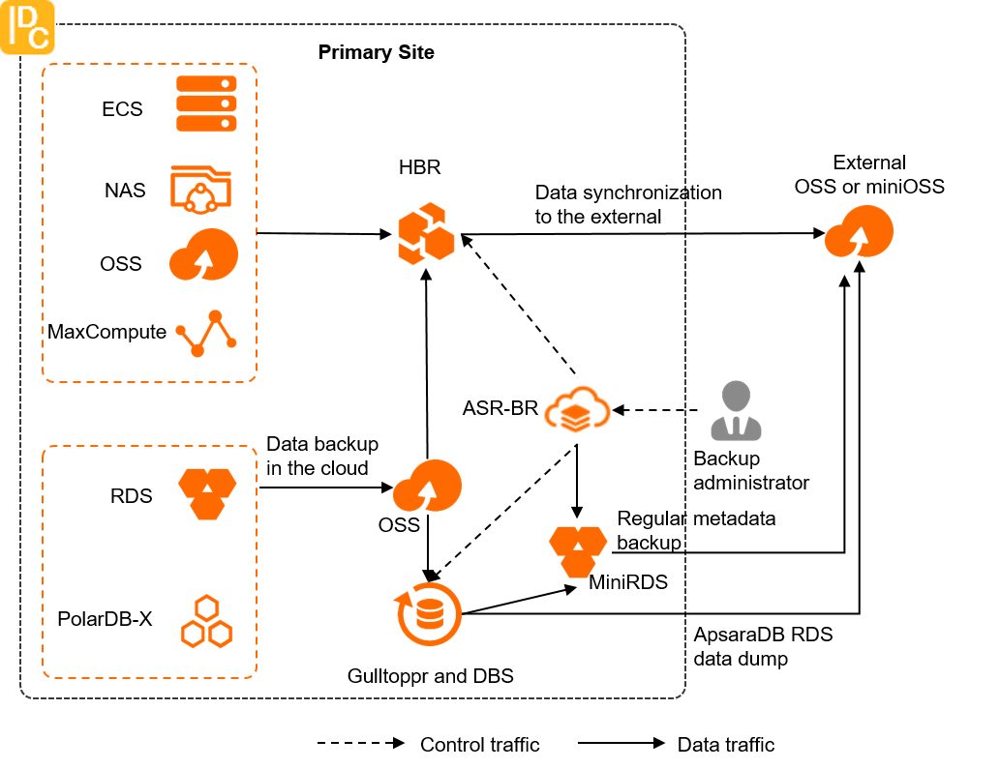

> **Note**
>
> You can deploy only Apsara Stack on the primary site.

The asrbr.StandardAsrBr, asrbr.StandardAsrbrBkEngine, and dbs.dbs_base backup components are deployed on the primary site.

You can use the following storage media as the backup vaults to store backup data outside the cloud:

- miniOSS independently deployed in the data centers of customers.

- Apsara Stack Agility OSS or miniOSS

- Apsara Stack OSS

ASR for Backup and Recovery allows you to configure self-backup policies to periodically back up the metadata of the primary cloud to the specified OSS buckets. This way, if the primary cloud is damaged, you can restore the backup data. We recommend that you store the backup metadata in remote OSS buckets. If the primary site is damaged, you need to restore the backup metadata first and then restore the business data.

<a id="section-3-2"></a>

## 3.2. System architecture for cross-region backup

This topic describes the system architecture for cross-region backup in ASR-BR.

The following figure shows the system architecture for cross-region backup.

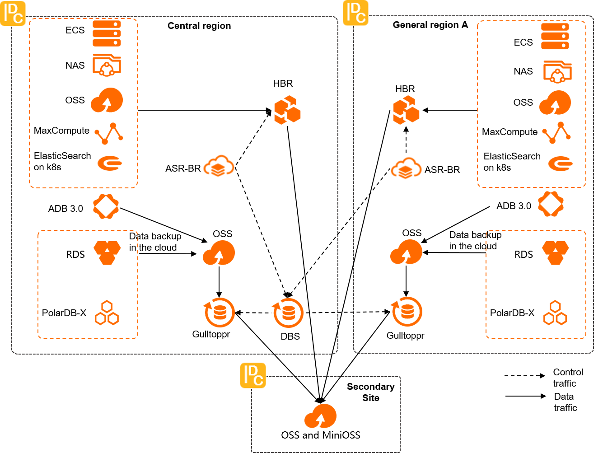

Architecture description

- The ASR-BR, HBR, and Gulltoppr components are deployed in the primary region. The DBS component is deployed in the central region.

- The operations administrator logs on to the ASR-BR console in each region and backs up data for storage services in these regions.

- The HBR component asynchronously backs up data from OSS buckets, Apsara File Storage NAS file systems, and Elastic Compute Service (ECS) instances in the primary region to OSS or MiniOSS buckets in the secondary region.

- The Gulltoppr component asynchronously backs up data from ApsaraDB RDS or PolarDB-X instances to OSS or MiniOSS buckets in the secondary region.

<a id="section-3-3"></a>

## 3.3. Component architecture

The following table describes the components of ASR for Backup and Recovery (ASR-BR).

**Service**

**Component**

**Description**

Gulltoppr

Serves as the database dump engine.

service-rds-gulltoppr

DbInit

Initializes the metadata of the database dump engine.

- Backs up Elastic Compute Service (ECS) files, provides proxy services for ECS instances, and downloads Agent.

DdrProxy

- Restores ApsaraDB RDS for SQL Server instances.

service-rds-ddr-proxy

Provides proxy services for ECS instances in scenarios in

DdrProxyDocker

which only software is used for data processing.

service-asrbr-backup

Backup

Manages backend services.

service-asrbr-portal

Portal

Manages frontend services.

Serves as the backup engine for Object Storage Service

Agent

(OSS) and File Storage NAS (NAS).

service-hbr-agent

Backupworker

Serves as the backup engine for ECS instances.

Serves as the backup engine for ECS instances in scenarios

BackupworkerDocker

in which only software is used for data processing.

Provides OSS protocol headers and implements data

service-hbr-storage

Storage

deduplication.

Backend

Deletes the expired data of storage services.

service-hbr-backend

Deletes the expired data of ECS instances in scenarios in

BackendDocker

which only software is used for data processing.

Manages Hybrid Backup Recovery (HBR) and provides API

service-hbr-console

Console

operations for the Backup component to back up and restore the data of storage services.

Message queues that transmit data between the Console

service-hbr-rabbitmq

RabbitMQ

component and backup engines such as the ECS backup engine and the backup engine of VMware VMs.

Backend

Provides backend services.

service-external-utils

MMA

Backs up and restores MaxCompute data.

TrafficControl

Enables throttling.

<a id="section-3-4"></a>

## 3.4. Component list

The following table describes the components of ASR for Backup and Recovery.

**Service**

**SR**

**Description**

Gulltoppr

Serves as the database dump engine.

service-rds-gulltoppr

DbInit

Initializes the metadata of the database dump engine.

- Backs up Elastic Compute Service (ECS) files, provides proxy services for ECS instances, and downloads Agent.

DdrProxy

- Restores ApsaraDB RDS for SQL Server instances.

service-rds-ddr-proxy

Provides proxy services for ECS instances in scenarios in

DdrProxyDocker

which only software is used for data processing.

service-asrbr-backup

Backup

Manages backend services.

service-asrbr-portal

Portal

Manages frontend services.

Serves as the backup engine for Object Storage Service

Agent

(OSS) and File Storage NAS (NAS).

service-hbr-agent

Backupworker

Serves as the backup engine for ECS instances.

Serves as the backup engine for ECS instances in scenarios

BackupworkerDocker

in which only software is used for data processing.

Provides OSS protocol headers and implements data

service-hbr-storage

Storage

deduplication.

Backend

Deletes the expired data of storage services.

service-hbr-backend

Deletes the expired data of ECS instances in scenarios in

BackendDocker

which only software is used for data processing.

<table>
  <tr>
    <td>service-hbr-console</td>
    <td>Console</td>
    <td>Manages Hybrid Backup Recovery (HBR) and provides API operations for the Backup component to back up and restore the data of storage services.</td>
  </tr>
  <tr>
    <td>service-hbr-rabbitmq</td>
    <td>RabbitMQ</td>
    <td>Message queues that transmit data between the console and backup agent in ECS backup and VMware backup scenarios.</td>
  </tr>
  <tr>
    <td rowspan="3">service-external-utils</td>
    <td>Backend</td>
    <td>Provides backend services.</td>
  </tr>
  <tr>
    <td>MMA</td>
    <td>Backs up and restores MaxCompute data.</td>
  </tr>
  <tr>
    <td>TrafficControl</td>
    <td>Enables throttling.</td>
  </tr>
</table>

<a id="section-3-5"></a>

## 3.5. Deployment architecture

The following table describes how the components of ASR for Backup and Recovery (ASR-BR) are deployed.

<table>
  <tr>
    <th>Service</th>
    <th>Server role</th>
    <th>Description</th>
  </tr>
  <tr>
    <td>service-rds-gulltoppr</td>
    <td>Gulltoppr#</td>
    <td>Gulltoppr is deployed in a two-node cluster. The primary node distributes dump tasks to implement cross-region dump for ApsaraDB RDS and PolarDB-X 1.0 instances.</td>
  </tr>
  <tr>
    <td>service-rds-ddr-proxy</td>
    <td>DdrProxy#</td>
    <td>DdrProxy is deployed in a two-node cluster. The component is used to back up and restore Elastic Compute Service (ECS) files, restore ECS instances, back up and restore ApsaraDB RDS for SQL Server instances, and download Agent. Agent is the ECS file backup client.</td>
  </tr>
  <tr>
    <td>service-asrbr-backup</td>
    <td>Backup#</td>
    <td>Backup is deployed in a two-node cluster to manage the backend services of ASR-BR.</td>
  </tr>
  <tr>
    <td>service-asrbr-portal</td>
    <td>Portal#</td>
    <td>Portal is deployed in a two-node cluster to manage the frontend services of ASR-BR.</td>
  </tr>
  <tr>
    <td rowspan="2">service-hbr-agent</td>
    <td>Agent#</td>
    <td>Agent is deployed in a two-node cluster to back up and restore Object Storage Service (OSS) and File Storage NAS (NAS) data.</td>
  </tr>
  <tr>
    <td>Backupworker#</td>
    <td>Backupworker is deployed in a two-node cluster to back up ECS instances.</td>
  </tr>
  <tr>
    <td>service-hbr-storage</td>
    <td>Storage#</td>
    <td>Storage is deployed in a two-node cluster to implement OSS protocol-based data deduplication and storage. The component is used to store the data of services such as MaxCompute and Elasticsearch on Kubernetes to OSS.</td>
  </tr>
  <tr>
    <td>service-hbr-backend</td>
    <td>Backend#</td>
    <td>Backend is deployed in a two-node cluster to clear the expired data of Hybrid Backup Recovery (HBR) and run data inspections.</td>
  </tr>
  <tr>
    <td>service-hbr-console</td>
    <td>Console#</td>
    <td>Console is deployed in a two-node cluster. The component manages HBR and provides API operations to distribute the backup plans and restore tasks of storage services.</td>
  </tr>
  <tr>
    <td>service-hbr-rabbitmq</td>
    <td>HBRRabbitMQ#</td>
    <td>HBRRabbitMQ is an internal message queue component for HBR. The component is deployed in a two-node cluster to transmit data between Console and backup engines such as Backupworker and the backup engine of VMware VMs.</td>
  </tr>
  <tr>
    <td rowspan="3">service-external-utils</td>
    <td>Backend#</td>
    <td>Backend is deployed in a two-node cluster. The component is used to generate snapshots for MaxCompute backup data, delete expired MaxCompute backup data, and implement self-backup.</td>
  </tr>
  <tr>
    <td>TrafficControl#</td>
    <td>TrafficControl is deployed in a two-node cluster. The component is the throttling client of ASR-BR and can be used to report throttling data and configure throttling policies.</td>
  </tr>
  <tr>
    <td>mma#</td>
    <td>mma is deployed in a two-node cluster to migrate MaxCompute backup data and orchestrate MaxCompute backup tasks.</td>
  </tr>
</table>

<a id="section-4"></a>

# 4.Log management

<a id="section-4-1"></a>

## 4.1. Log paths

The following table describes the log paths of Apsara Stack Resilience for Backup and Recovery (ASR-BR).

**SR**

**Log path**

**Description**

/home/bifrost/log/gulltoppr.log

The path to database backup logs.

Gulltoppr

/home/bifrost/log/gulltoppr_uploader.log

The path to database backup upload logs.

/home/bifrost/log/gulltoppr_access.log

The path to access logs.

/log/proxy/nginx/download.log

The path to download logs.

DdrProxy

/log/proxy/nginx/proxy.log

The path to proxy logs.

/log/proxy/nginx/error.log

The path to error logs.

/alidata/logs/proxy.log

The path to proxy logs.

DdrProxyDocker

/alidata/logs/error.log

The path to error logs.

/alidata/logs/asrbr-backup/asrbr-backup.log

The path to backup control application logs.

Backup

/alidata/logs/asrbr-backup/asrbr-backup-error.log

The path to error logs.

/alidata/logs/asrbr-backup/event-info.log

The path to event logs.

/var/log/nginx/access.log

The path to access logs.

Portal

/var/log/nginx/error.log

The path to error logs.

The path to logs for communication between the agent and the

/log/hbr/agent/hbr-agent-as.log

control plane during Object Storage Service (OSS) or File Storage NAS (NAS) backup and restoration.

/log/hbr/agent/${datetime}/(oss)_backup_job_${datetime}.log

The path to logs of OSS or NAS backup jobs.

Agent

/log/hbr/agent/${datetime}/(oss)_backup_task_${datetime}.lo

The path to logs of OSS or NAS backup tasks.

g

/log/hbr/agent/${date}/(oss)_restore_job_${datetime}.log

The path to logs of OSS or NAS restoration jobs.

/log/hbr/agent/${datetime}/(oss)_restore_task_${datetime}.lo

The path to logs of OSS or NAS restoration tasks.

g

The path to task dispatching logs for Elastic Compute Service

/log/hbr/backupworker/dispatcher.log

(ECS) instance backup and restoration.

/log/hbr/backupworker/ecs-disk-task.log

The path to control logs of disk backup tasks.

/log/hbr/backupworker/ecs-task.log

The path to control logs of ECS instance backup tasks.

Backupworker

The path to logs for reading data from Elastic Block Storage

/log/hbr/backupworker/${date}/ebsplugin_${datetime}.log

(EBS) during backups of ECS instances.

The path to logs for writing data to backup storage during

/log/hbr/backupworker/${date}/ids_${datetime}.log

backups of ECS instances.

<table>
  <tr>
    <td rowspan="3">Console</td>
    <td>/alidata/logs/hbr-console-as.log</td>
    <td>The path to Hybrid Backup Recovery (HBR) interface layer logs.</td>
  </tr>
  <tr>
    <td>/alidata/logs/audit.log</td>
    <td>The path to HBR call audit logs.</td>
  </tr>
  <tr>
    <td>/alidata/logs/hbr-console/yyyy-MM-dd/ids.log</td>
    <td>The path to backup vault creation logs.</td>
  </tr>
  <tr>
    <td rowspan="4">Backend</td>
    <td>/log/hbr/backend/dispatcher/dispatcher.log</td>
    <td>The path to task dispatching logs.</td>
  </tr>
  <tr>
    <td>/log/hbr/backend/dispatcher/prune-scan_${datetime}.log</td>
    <td>The path to logs for scheduling tasks that delete expired data.</td>
  </tr>
  <tr>
    <td>/log/hbr/backend/sched/scan/${datetime}/prune-scan_${datetime}.log</td>
    <td>The path to logs for inspecting a backup vault for expired jobs that need to be deleted.</td>
  </tr>
  <tr>
    <td>/log/hbr/backend/sched/prune/${datetime}/prune-scan_${datetime}.log</td>
    <td>The path to logs for deleting expired data from a backup vault.</td>
  </tr>
  <tr>
    <td rowspan="3">Storage</td>
    <td>/log/hbr/storage/${ip}-audit.log</td>
    <td>The path to deduplication audit logs.</td>
  </tr>
  <tr>
    <td>/log/hbr/storage/${date}/minioss_${datetime}_1.log</td>
    <td>The path to request logs.</td>
  </tr>
  <tr>
    <td>/log/hbr/storage/prune_data/${date}/cmd_prune_${datetime}.log</td>
    <td>The path to deduplication logs.</td>
  </tr>
  <tr>
    <td rowspan="2">Backend</td>
    <td>/alidata/logs/asrbr-backend-platform/asrbr-backend-platform.log</td>
    <td>The path to INFO logs for the version generation and self-backup features of MaxCompute.</td>
  </tr>
  <tr>
    <td>/alidata/logs/asrbr-backend-platform/asrbr-backend-platform-error.log</td>
    <td>The path to error logs for the version generation and self-backup features of MaxCompute.</td>
  </tr>
  <tr>
    <td>MMA</td>
    <td>/alidata/logs/mma/ com.aliyun.odps.mma.log</td>
    <td>The path to logs of MaxCompute backup and restoration tasks.</td>
  </tr>
  <tr>
    <td rowspan="3">TrafficControl</td>
    <td>/log/traffic/nc_traffic.log</td>
    <td>The path to overall upload and download traffic logs of a physical machine.</td>
  </tr>
  <tr>
    <td>/log/traffic/trace_by_iptables.log</td>
    <td>The path to detailed traffic logs of a storage pool group.</td>
  </tr>
  <tr>
    <td>/log/traffic/ASRBR_tc_start.log</td>
    <td>The path to throttling service startup logs.</td>
  </tr>
  <tr>
    <td>HBRRabbitMQ</td>
    <td>/alidata/logs/hbr-rabbitmq</td>
    <td>The path to message queue (MQ) logs.</td>
  </tr>
</table>

<a id="section-4-2"></a>

## 4.2. Query and view logs

This topic describes the types and scenarios of ASR for Backup and Recovery (ASR-BR) logs. This topic also describes how to query ASR-BR logs.

ASR-BR logs are categorized into two types: API logs and event logs. The following table describes the log types.

| Type | Description | GUID | Query method |
| --- | --- | --- | --- |
| API log | The ASR-BR Console component provides API operations. After the frontend calls an API operation to use a backend service, a request ID that uniquely identifies the call is contained in the returned results. | requestId | Obtain the request ID of an API call and view the corresponding API logs. |
| Event log | An event is the basic unit for asynchronous business transfer in ASR-BR. An action or operation performed on an ASR-BR module, such as a backup plan, restore task, migration plan, or backup vault, consists of one or more events. You can view the cause of an event error in the corresponding event logs. | eventId | Obtain the ID of an event and view the corresponding event logs. |

**Obtain a request ID**

In this example, an error occurs when you back up the logs of an ApsaraDB RDS instance.

1. Log on to the ASR-BR console. Find the ApsaraDB RDS instance and go to the instance details page. On the Log Backup tab, press the F12 key to use DevTools. In the panel that appears, click the **Network** tab. On this tab, the requests are displayed.

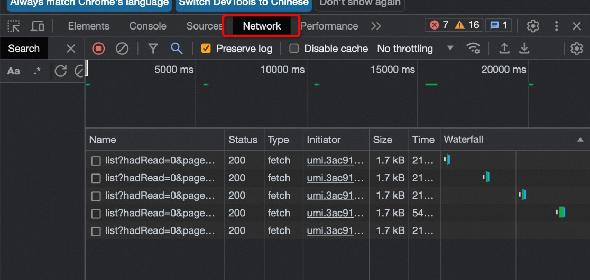

2. Click the error message. The request from which the error is reported is displayed in the panel.

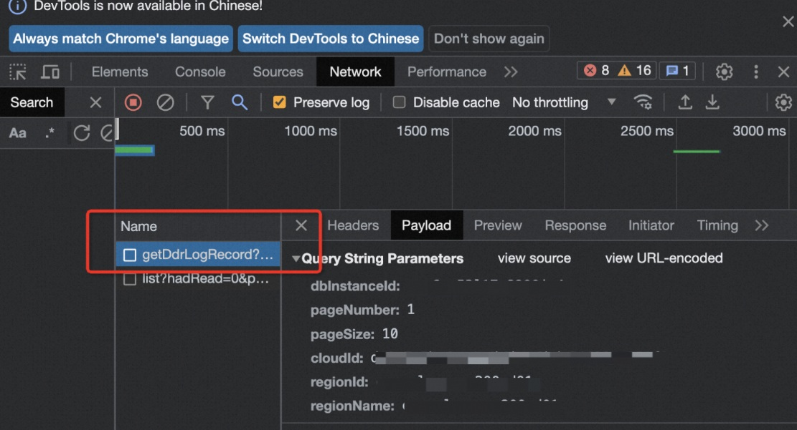

3. Click the name of the request. The information is displayed on various tabs, as shown in the following figure.

> **Note**
>
> - The Headers tab displays the request information, including the request URL and headers.
>
> - The Payload tab displays the request parameters.
>
> - The Preview and Response tabs display the returned results. The data on the Preview tab is unformatted, whereas the data on the Response tab is formatted.

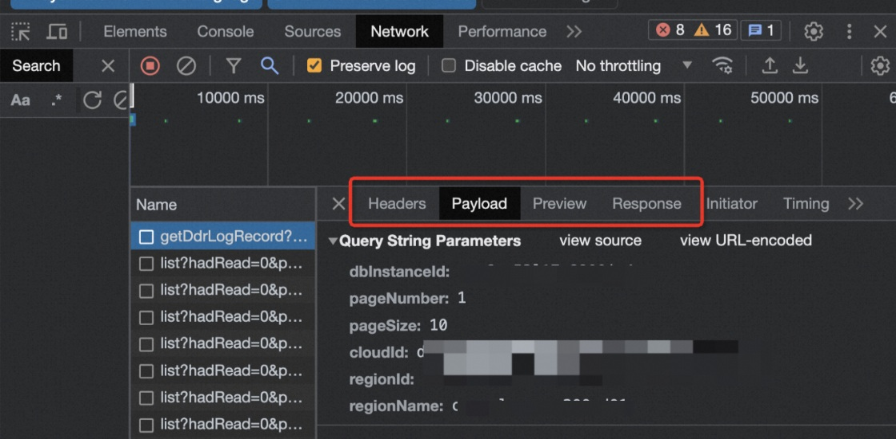

4. Click the **Response** tab to view the requestId parameter.

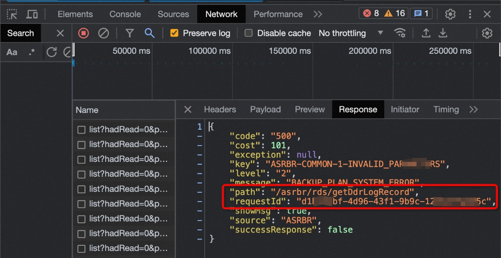

**Obtain an event ID**

In this example, a backup plan is used.

1. On the Backup Events tab of the backup plan details page, press the F12 key to use DevTools. In the panel that appears, click the **Network** tab.

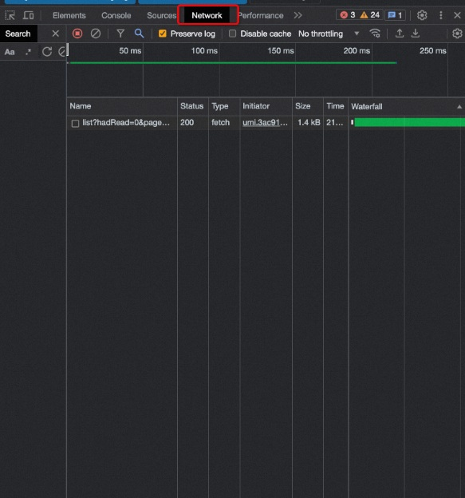

2. Click the  icon next to a sub-event. In the panel that appears, view the logs of the sub-event. Click the **Payload** tab to view the eventId

   parameter.

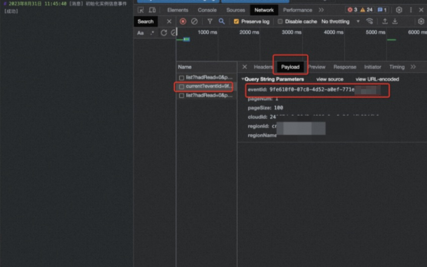

**View logs**

1. Log on to a terminal server.

2. Log on to two VMs or Docker containers and run the following commands:

```bash
cd /alidata/logs/asrbr-backup/

grep -r "d1b14ebf-4d96-43f1-9b9c-12b547fa405c" asrbr-backup.log
```

> **Note**
>
> Replace the keyword after the grep -r command with the request ID or event ID that you obtained.

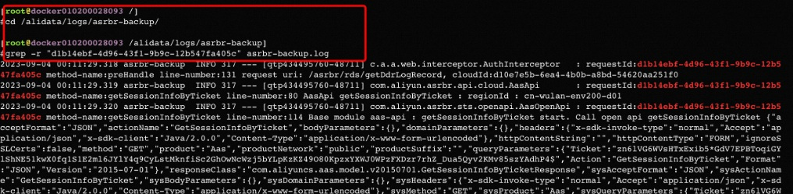

3. View the error logs.

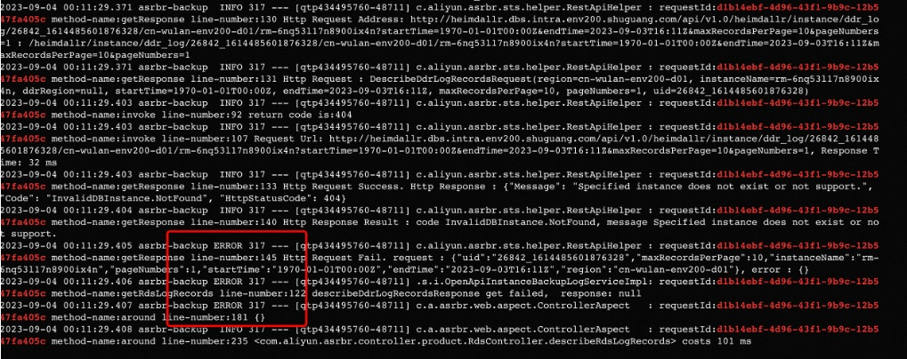

4. Run the vi or vim command to open the corresponding log file to view a specific error message. Sample code:

```text
vi asrbr-backup.log

To search for d1b14ebf-4d96-43f1-9b9c-12b547fa405c, enter /d1b14ebf-4d96-43f1-9b9c-12b547fa405c.
Enter N to find the next matched result until you find the error message.
```

> **Note**
>
> You need to query the details of an error based on the request ID or event ID.

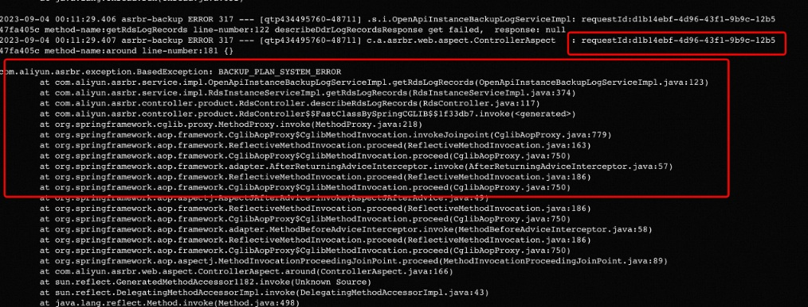

> **Note**
>
> - The asrbr-backup file stores the logs that are generated within the previous 14 days in the /alidata/logs/asrbr-backup/bak directory. You can query log files based on the date on which the logs are generated.
>
> - You can also run the  `cd /alidata/logs/asrbr-backup/bak`  command to query log files.

<a id="section-4-3"></a>

## 4.3. Log fields

- **/home/bifrost/log/gulltoppr.log**

  The database backup logs. Sample log:

  ```text
  2023-03-13 17:34:27.078 INFO service/metric.go:70 
  |METRIC|gulltoppr[host=10.172.3.11]cpu=0.10,mem_used=21.77M,sys_alloc=72.89M,heap_sys=62.56M,heap
  _alloc=2.73M,heap_inuse=4.09M,stack_sys=1.34M,stack_inuse=1.34M,num_gc=0,all_num_gc=54,pause_ns=0,live_objects=6461,goroutines=20,rea
  tflow=0.00M/s,ma
  x_netflow=1125.00M/s
  ```

  The following table describes the keys in a log entry.

  | Key | Description |
  | --- | --- |
  | datetime | The time when the log entry was generated. |
  | level | The log level. Valid values:<br>• INFO<br>• WARN<br>• ERROR |
  | file | The name of the code file and the line number from which the log entry was generated. |
  | detail | The detailed log information, including the task distribution and processing information, metric information, and performance information. |

- **/home/bifrost/log/gulltoppr_uploader.log**

  The logs generated when the Object Storage Service (OSS) API is called to dump backup data to cross-region backup storage. The backup data is stored in backup sets and binary log files. Sample log:

  ```text
  2023-04-09 11:21:17.491 INFO service/upload_framework.go:96 put new upload ddr_job[custins_id=2211,ddr_region=3ce97352-54df-****-bdff-b2f*****a87ff,sr
  c_type=log,src_id=25057,failed_count=0,error_type=0,hostins_id=2643,logname=mysql-bin.000184]
  ```

  The following table describes the keys in a log entry.

  | Key | Description |
  | --- | --- |
  | datetime | The time when the log entry was generated. |
  | level | The log level. Valid values:<br>• INFO<br>• WARN<br>• ERROR |
  | file | The name of the code file and the line number from which the log entry was generated. |
  | detail | The detailed log information about calling the specified OSS API operation. |

- **/home/bifrost/log/gulltoppr_access.log**

  The logs of the requests to access Gulltoppr. Sample logs:

  ```text
  2023/04/08 23:40:53 10.66.5.5:30800 - - "GET /api/v1.0/gulltoppr/ddr_job?identity=log_25056 HTTP/1.1" 200 0 52.036µs
  2023/04/08 23:40:53 10.66.5.5:30800 - - "GET /api/v1.0/gulltoppr/ddr_job?identity=log_25142 HTTP/1.1" 200 0 53.315µs
  2023/04/08 23:40:53 10.66.5.5:30800 - - "GET /api/v1.0/gulltoppr/ddr_job?identity=log_25143 HTTP/1.1" 200 0 34.057µs
  2023/04/08 23:40:53 10.66.5.5:30800 - - "GET /api/v1.0/gulltoppr/ddr_job?identity=log_25226 HTTP/1.1" 200 0 34.037µs
  2023/04/08 23:40:53 10.66.5.5:30800 - - "GET /api/v1.0/gulltoppr/ddr_job?identity=log_25227 HTTP/1.1" 200 0 44.289µs
  2023/04/08 23:40:53 10.66.5.5:30800 - - "GET /api/v1.0/gulltoppr/ddr_job?identity=log_25310 HTTP/1.1" 200 0 38.049µs
  2023/04/08 23:40:53 10.66.5.5:30800 - - "GET /api/v1.0/gulltoppr/ddr_job?identity=log_25311 HTTP/1.1" 200 0 40.916µs
  ```

  The following table describes the keys in a log entry.

  | Key | Description |
  | --- | --- |
  | datetime | The time when the log entry was generated. |
  | ip:port | The IP address and port number of the client from which the request was sent. |
  | method | The request method. |
  | uri | The request uniform resource identifier (URI). |
  | protocol | The request protocol. In this example, the HTTP protocol is used. |
  | code | The returned HTTP status code. Valid values: 200, 404, and 500. |
  | size | The size of the response body. |
  | time | The amount of time consumed by the request. |

- **/log/proxy/nginx/download.log**

  The download logs. Sample logs:

  ```text
  127.0.0.1 - - [10/Apr/2023:07:25:33 +0800] "GET /download/nginx_status HTTP/1.1" 200 0 "-" "curl/7.29.0" "-" 0.000 -
  127.0.0.1 - - [10/Apr/2023:07:25:43 +0800] "GET /download/nginx_status HTTP/1.1" 200 0 "-" "curl/7.29.0" "-" 0.000 -
  127.0.0.1 - - [10/Apr/2023:07:25:53 +0800] "GET /download/nginx_status HTTP/1.1" 200 0 "-" "curl/7.29.0" "-" 0.000 -
  127.0.0.1 - - [10/Apr/2023:07:26:03 +0800] "GET /download/nginx_status HTTP/1.1" 200 0 "-" "curl/7.29.0" "-" 0.000 -
  ```

  The following table describes the keys in a log entry.

  | Key | Description |
  | --- | --- |
  | remote_addr | The IP address of the client from which the request was sent. |
  | remote_user | The username. |
  | time_local | The time when the log entry was generated. |
  | request | The request method. |
  | status | The returned HTTP status code. |
  | body_bytes_sent | The size of the response body. |
  | http_referer | The page on which the request was sent. |
  | http_user_agent | The agent information about the client. |
  | http_x_forwarded_for | The information about request headers. |
  | request_time | The request duration. |
  | upstream_response_time | The duration from when the upstream server received the forwarded request until the response was returned. |

- **/log/proxy/nginx/proxy.log or alidata/logs/proxy.log**

  The logs of requests forwarded by a proxy server. Sample log:

  ```text
  10.158.78.137 - - [10/Apr/2023:15:15:20 +0800] "GET http://hbr-00001z80hn560pnhh9r6.oss-cn-hangzhou-arm-***-
  a.****.ops.arm.com/alibackup%2Fkeys%2Fbf784c9cf9888c26994e0ad745644b6a9c3bf5d734188ff81ca16961980e7333 HTTP/1.1" 200 457 "-" 
  "aliyun-sdk-go/v2.1.8 (Linux/4.19.90-23.28.v2101.ky10.aarch64/aarch64;go
  1.13.14)" "-" 0.002 0.00210.158.78.137 - - [10/Apr/2023:15:15:20 +0800] "GET http://hbr-00001z80hn560pnhh9r6.oss-cn-hangzhou-arm-d01-a.env58.ops.arm.com/?encoding-type=url&marker=&max-keys=1000&prefix=alibackup%2Fkeys%2F HTTP/1.1" 200 729 "-" "aliyun-sdk-
  go/v2.1.8 (Linux/4.19.90-23.28.v2101.ky10.aarch64/aarch64;go1.13.14)" "-" 0.
  002 0.002
  ```

  The following table describes the keys in a log entry.

  | Key | Description |
  | --- | --- |
  | remote_addr | The IP address of the client from which the request was sent. |
  | remote_user | The username. |
  | time_local | The time when the log entry was generated. |
  | request | The request method. |
  | status | The returned HTTP status code. |
  | body_bytes_sent | The size of the response body. |
  | http_referer | The page on which the request was sent. |
  | http_user_agent | The agent information about the client. |
  | http_x_forwarded_for | The information about request headers. |
  | request_time | The request duration. |
  | upstream_response_time | The duration from when the upstream server received the forwarded request until the response was returned. |

- **/log/proxy/nginx/error.log or /alidata/logs/error.log**

  The error logs. Sample logs:

  ```text
  2023/04/11 12:57:16 [error] 42612#42612: *6882153 upstream timed out (110: Connection timed out) while connecting to upstream, clie
  nt: 10.158.78.37, serv
  er: , request: "HEAD http://hbr-00001z80hn560pnhh9r6.oss-cn-hangzhou-arm-***-
  a.****.ops.arm.com/alibackup%2Fdata%2F83%2F83954317484b63d32b0f76a7eae8fb69
  93b5d5fe89aac48bf5601c8889b9ac55?objectMeta HTTP/1.1", upstream: 
  "http://10.158.72.28:80/alibackup%2Fdata%2F83%2F83954317484b63d32b0f76a7eae8fb6993b5d5fe
  89aac48bf5601c8889b9ac55?objectMeta", host: "hbr-00001z80hn560pnhh9r6.oss-cn-hangzhou-arm-d01-a.env58.ops.arm.com"
  2023/04/11 12:58:08 [error] 42612#42612: *6920698 upstream timed out (110: Connection timed out) while connecting to upstream, clie
  nt: 10.158.78.157, ser
  ver: , request: "HEAD http://hbr-00001z80hn560pnhh9r6.oss-cn-hangzhou-arm-***-
  a.****.ops.arm.com/alibackup%2Fdata%2F60%2F60da507b6aacdc60b8ce95d5c458b3c
  9eabafbbefe24739d69439e7cec93a049?objectMeta HTTP/1.1", upstream: 
  "http://10.158.72.28:80/alibackup%2Fdata%2F60%2F60da507b6aacdc60b8ce95d5c458b3c9eabafbb
  efe24739d69439e7cec93a049?objectMeta", host: "hbr-00001z80hn560pnhh9r6.oss-cn-hangzhou-arm-d01-a.env58.ops.arm.com"
  ```

  For more information about the keys in a log entry, see the description of NGINX error logs.

- **/alidata/logs/asrbr-backup/asrbr-backup.log or /alidata/logs/asrbr-backup/asrbr-backup-error.log**

  The backend service logs and error logs of the ASR for Backup and Recovery (ASR-BR) console. Sample logs:

  ```text
  2023-04-11 00:00:01.945 asrbr-backup INFO 142 --- [listener-pool_4] c.a.a.web.listener.AsrbrEventListener : requestId:5d2f7882-
  898a-****-9eb0-81****f3fc82af2 method-name:retryEventByStatus line-number:430
  retryEventByStatus total = 0, Update count = 0,status:CREATING
  2023-04-11 00:00:01.948 asrbr-backup INFO 142 --- [listener-pool_2] c.a.a.listener.HbrAlarmMonitorListener : requestId:b86bd34d-b0a
  1-****-98bf-2f****c8c31d method-name:lambda$runnable$3 line-number:99
  HbrAlarmMonitorListener lock get failure
  2023-04-11 00:00:01.949 asrbr-backup INFO 142 --- [listener-pool_2] c.a.a.listener.HbrAlarmMonitorListener : requestId:b86bd34d-b0a
  1-****-98bf-2f7****8c31d method-name:lambda$runnable$3 line-number:182
  HbrAlarmMonitorListener complete.
  ```

  The following table describes the keys in a log entry.

  | Key | Description |
  | --- | --- |
  | time_local | The time when the log entry was generated. |
  | app | The name of the application. In this example, asrbr-backup is used. |
  | pid | The process ID. |
  | level | The log level. |
  | thread | The name of the thread pool. |
  | class | The name of the class. |
  | requestId | The request ID. |
  | method-name | The name of the method. |
  | line-number | The line number. |
  | detail | The log details. |

- **/var/log/nginx/access.log**

  The request logs. Sample logs:

  ```text
  10.172.17.106 - - [10/Apr/2023:10:09:48 +0800] "GET /asrbr/message/list?
  hadRead=0&pageNum=1&pageSize=5&type=global&useName=littleBell&organizationId=3&cloudId=e8001bbb-62dc-****-853e-
  a8eaf****f3f&regionId=cn-neimeng-arm172-d01&regionName=cn-neimeng-****-d01 HTTP/1.1" 200 5442 "https://asrbr-
  portal.****.cloud.arm.com/" "Mozilla/5.0 (Macintosh; Intel Mac OS X 10_15_7) AppleWebKit/537.36 (KHTML, like Gecko) Chrome/*.*.*.* 
  Safari/537.36" "10.172.1.1"
  10.172.17.106 - - [10/Apr/2023:10:09:48 +0800] "GET /asrbr/dashboard/plan/record?cloudId=e8001bbb-62dc-4d27-****-
  a8eaf****f3f&regionId=cn-neimeng-****-d01&regionName=cn-neimeng-****-d01 HTTP/1.1" 200 308 "https://asrbr-
  portal.****.cloud.arm.com/" "Mozilla/5.0 (Macintosh; Intel Mac OS X 10_15_7) AppleWebKit/537.36 (KHTML, like Gecko) Chrome/*.*.*.* 
  Safari/537.36" "10.172.1.1"
  ```

  The following table describes the keys in a log entry.

  | Key | Description |
  | --- | --- |
  | remote_addr | The IP address of the client from which the request was sent. |
  | remote_user | The username. |
  | time_local | The time when the log entry was generated. |
  | request | The request method. |
  | status | The returned HTTP status code. |
  | body_bytes_sent | The size of the response body. |
  | http_referer | The page on which the request was sent. |
  | http_user_agent | The agent information about the client. |
  | http_x_forwarded_for | The information about request headers. |

- **/var/log/nginx/error.log**

  The error logs. Sample logs:

  ```text
  2023/04/11 12:57:16 [error] 42612#42612: *6882153 upstream timed out (110: Connection timed out) while connecting to upstream, clie
  nt: 10.158.78.37, serv
  er: , request: "HEAD http://hbr-00001z80hn560pnhh9r6.oss-cn-hangzhou-arm-d01-
  a.****.ops.arm.com/alibackup%2Fdata%2F83%2F83954317484b63d32b0f76a7eae8fb69
  93b5d5fe89aac48bf5601c8889b9ac55?objectMeta HTTP/1.1", upstream: 
  "http://10.158.72.28:80/alibackup%2Fdata%2F83%2F83954317484b63d32b0f76a7eae8fb6993b5d5fe
  89aac48bf5601c8889b9ac55?objectMeta", host: "hbr-00001z80hn560pnhh9r6.oss-cn-hangzhou-arm-d01-a.env58.ops.arm.com"
  2023/04/11 12:58:08 [error] 42612#42612: *6920698 upstream timed out (110: Connection timed out) while connecting to upstream, clie
  nt: 10.158.78.157, ser
  ver: , request: "HEAD http://hbr-00001z80hn560pnhh9r6.oss-cn-hangzhou-arm-d01-
  a.****.ops.arm.com/alibackup%2Fdata%2F60%2F60da507b6aacdc60b8ce95d5c458b3c
  9eabafbbefe24739d69439e7cec93a049?objectMeta HTTP/1.1", upstream: 
  "http://10.158.72.28:80/alibackup%2Fdata%2F60%2F60da507b6aacdc60b8ce95d5c458b3c9eabafbb
  efe24739d69439e7cec93a049?objectMeta", host: "hbr-00001z80hn560pnhh9r6.oss-cn-hangzhou-arm-d01-a.****.ops.arm.com"
  ```

  For more information about the keys in a log entry, see the description of NGINX error logs.

- **/log/hbr/agent/hbr-agent-as.log**

  The logs of OSS and File Storage NAS (NAS) backups. Sample logs:

  ```text
  2023-04-11 03:26:27.561 INFO --- [Thread-14] c.a.h.m.m.c.HbrOssRestoreTaskConsumer : OssRestoreJobMsgHandler, 
  topic:HBR_OSS_RESTORE_TASK, tag:null, message:
  {"accessKeySecret":"*****se5a3Iv******ApOZf******=","ownerId":1808978880764210,"resticPassword":"bYrr********3Qn1u****==","restoreId"
  00002017u7itwdfx113f","snapshotId":"9eefabfba7d40f7446aa00b939dbeb4f741cb49e9f46a629d8a2509b9f71409f","targetAccessKeySecret":"","tas
  :"rk_d55dc465-14d6-4a0d-9895-2a4f169f1b75"}
  2023-04-11 03:26:27.561 INFO --- [Thread-14] c.a.hbr.service.OssRestoreJobService : Run oss restore task start : OssRestoreTask(own
  erId=180897****764210, restoreId=r-0000****u7itwdfx113f, taskId=rk_d55dc465-****-4a0d-9895-2a4f169f1b75, 
  snapshotId=9eefa****0f7446aa00b****b49e9f46a629d8a****9f71409f)
  2023-04-11 03:26:27.562 INFO --- [Thread-14] com.alicloud.hbr.service.BaseJobService : Start oss_restore_task job rk_d55dc465-
  14d6-****-9895-2a4f1****1b75
  ```

  The following table describes the keys in a log entry.

  | Key | Description |
  | --- | --- |
  | datetime | The time when the log entry was generated. |
  | level | The log level. Valid values:<br>• INFO<br>• WARN<br>• ERROR |
  | thread | The name of the thread. |
  | class | The name of the class. |
  | detail | The log details. |

- **/log/hbr/agent/${datetime}/(oss)_backup_job_${datetime}.log**

  The logs of summarized information about OSS and NAS backup tasks. Sample logs:

  ```text
  2023/04/11 00:56:36 [INFO][null] hbr/cmd_oss_job.go:23 main.glob..func23 1 Aliyun ids service, Platform: linux, Arch: amd64, 
  Build: not set, Ver
  sion: oss-backupagent-v3.15xR-57-g8398783
  2023/04/11 00:56:36 [INFO][null] config/config.go:308 config.Load 1 Loading application config from 
  /opt/alibabacloud/hbr/agent/bin/application.cfg
  2023/04/11 00:56:36 [INFO][null] config/config.go:321 config.Load 1 Application config loadded: {Env:staging 
  ContextEncryption:true Region:cn-qingdao-****-d01 VpcId: ResourceAccountInfo:{AccountID:0 AccountName: Credential:
  {AccessKeyID:*******B**** AccessKeySecret:*****mMN******QY4hs****}} ServiceAccountInfo:{AccountID:0 AccountName: Credential:
  {AccessKeyID:*******B**** AccessKeySecret:*******Nh7********4hs****}} StsEndpoint:sts.inter.env66.shuguang.com SlrAccountInfo:{Acco
  untID:1000000070 AccountName: Credential:{AccessKeyID:*******dE1j**** AccessKeySecret:*******PKY1G*****6Wf****}} MNS:{AccountInfo:{
  AccountID:0 AccountName: Credential:{AccessKeyID: AccessKeySecret:}} Endpoint: MaxDeQueueCount:0 BackupJobHandler:0 BackupTaskHandl
  er:0 RestoreJobHandler:0 RestoreTaskHandler:0 CancelTaskHandler:0} OSS:{Endpoint:oss-cn-qingdao-env66-d01-
  a.intra.env66.shuguang.com OSSAccount:[{AccountID:999999999 AccountName:aliyuntest Credential:{AccessKeyID:*******RnB**** 
  AccessKeySecret:*******bmM*****QY4hs****}}]} OTS:{AccountInfo:{AccountID:0 AccountName: Credential:{AccessKeyID:*******ul**** Acces
  sKeySecret:******O0k*******}} Endpoint:http://hbragentots.cn-qingdao-****-d01.ots.inter.env66.shuguang.com 
  InstanceName:hbragentots BackupTableName:backup_tasks RestoreTableName:restore_tasks OssBackupTableName:oss_b=ackup_tasks OssRestor
  eTableName:oss_restore_tasks ConfigTableName:} Redis:{Address: Password: DB:0} NAS:{MountPrefix:/share HeartBeatPath: MountRetryCou
  nt:0 MountRetryInterval:0} Cache:{Path:/data/cache} POP:{AccountInfo:{AccountID:146290*****13436 AccountName: Credential:
  {AccessKeyID:*******nB**** AccessKeySecret:*******2wy***4hs****}} Protocol:https Endpoint:cn-qingdao-env66-d01-
  pop.hbr.intra.****.shuguang.com} Internal:{LimiterGetInterval:0 MaxSubTasks:0 HeartBeatTimeoutInMinutes:0}}
  ```

  The following table describes the keys in a log entry.

  | Key | Description |
  | --- | --- |
  | datetime | The time when the log entry was generated. |
  | level | The log level. Valid values:<br>• INFO<br>• WARN<br>• ERROR |
  | thread | The name of the thread. |
  | file | The name of the code file from which the log entry was generated. |
  | class | The name of the class. |
  | detail | The log details. |

- **/log/hbr/agent/${datetime}/(oss)_backup_task_${datetime}.log**

  The logs of detailed information about OSS and NAS backup tasks. Sample logs:

  ```text
  2023/04/11 17:22:19 [INFO][null] ossjob/ossbackuptask.go:38 ossjob.(*OssBackupTask).Run 1 Execute sub oss task : OssBackupTask: {OwnerId : 12702709
  15256910, RestoreId : j-00001yy24rb9hha80trn, TaskId: oss_tk_aa254c50-****-4ec9-9768-f473****67b5, SnapshotId : oss://asrbr-
  test.oss-cn-qingdao-****-d01
  -a.intra.e****.shuguang.com/}
  2023/04/11 17:22:21 [INFO][null] ossjob/ossbackuptask.go:196 ossjob.(*OssBackupTask).runTask 1 execute oss backup task : 
  oss_tk_aa254c50-7441-4ec9-9
  768-f473b16967b5
  2023/04/11 17:22:21 [INFO][null] ossjob/ossbackuptask.go:241 ossjob.(*OssBackupTask).runTask 1 ExecuteBackupTask : ( repository: 
  ali:http://oss-cn-h
  angzhou.aliyuncs.com:9803/qixiu-test-asrbr-storage, parentsnapshot : 
  32eb5464abf25ec6199c4dc670c0fe2779e9f1521462c1f460193167dd4e3b67, clientId: OSS_asrb
  r-test, retention: %!d(string=7), path: oss://asrbr-test.oss-cn-qingdao-env66-d01-a.intra.env66.shuguang.com/, extended map[]
  2023/04/11 17:22:21 [INFO][null] ossjob/ossbackuptask.go:267 ossjob.(*OssBackupTask).runTask 1 InventoryInfo : {UseInventory:false 
  InventoryId: OssB
  ucketDestination:{AccountId:0 Bucket: Format: Prefix: RoleArn:} CleanupPolicy:}
  ```

  The following table describes the keys in a log entry.

  | Key | Description |
  | --- | --- |
  | datetime | The time when the log entry was generated. |
  | level | The log level. Valid values:<br>• INFO<br>• WARN<br>• ERROR |
  | thread | The name of the thread. |
  | file | The name of the code file from which the log entry was generated. |
  | class | The name of the class. |
  | detail | The log details. |

- **/log/hbr/agent/${datetime}/(oss)_restore_job_${datetime}.log**

  The logs of summarized information about OSS and NAS restore tasks. Sample logs:

  ```text
  2023/04/11 11:26:09 [INFO][null] ossjob/ossrestorejob.go:186 ossjob.(*OssRestoreJob).Run 1 input oss endpoint: oss00fb-cn-neimeng-arm172-d01-a.env172.ops.arm.com, target: oss://asrbr-renew-2.oss00fb-cn-neimeng-****-d01-a.****.ops.arm.com/
  2023/04/11 11:26:09 [INFO][null] ossjob/ossrestorejob.go:194 ossjob.(*OssRestoreJob).Run 1 OssRestoreJob start: OssRestoreJob {"Sen
  derType":"METAQ","OwnerId":1808****80764210,"VaultId":"","RestoreId":"r-
  0000201****twdfx113f","SnapshotId":"9eefabfba7d4****9d8a2509****1409f","ExpireTime":1681187168,"Option":
  {"ResticPassword":"*****","ClientId":"OSS_arm-oss-test","Repository":"ali:http://oss-cn-neimeng-****-d01-a.e****.ops.arm.com/hbr-
  00002017u7itvby6agk1","Target":"oss://asrbr-renew-2.oss00fb-cn-neimeng-****-d01-
  a.****.ops.arm.com/","ExcludeList":null,"IncludeList":null,"AccessKeyId":"***********0ubX12","AccessKeySecret":"*****","TargetBucket"
  rbr-renew-2","TargetPrefix":"","TargetAccessKeyId":"","TargetAccessKeySecret":"*****","RestoreAccountId":0,"OssEndpoint":"oss00fb-c
  n-neimeng-****-d01-a.****.ops.arm.com","ExternalOptions":"{\"OssRCCSetting\":
  {\"MaxBackends\":64,\"BlobReadWorkers\":64,\"BlobCopyWorkers\":64,\"BlobUploadWorkers\":64,\"ObjWorkers\":64}}"}}
  ```

  The following table describes the keys in a log entry.

  | Key | Description |
  | --- | --- |
  | datetime | The time when the log entry was generated. |
  | level | The log level. Valid values:<br>• INFO<br>• WARN<br>• ERROR |
  | thread | The name of the thread. |
  | file | The name of the code file from which the log entry was generated. |
  | class | The name of the class. |
  | detail | The log details. |

- **/log/hbr/agent/${datetime}/(oss)_restore_task_${datetime}.log**

  The logs of detailed information about OSS and NAS restore tasks. Sample logs:

  ```text
  2023/04/11 11:26:28 [INFO][null] ossjob/ossrestoretask.go:36 ossjob.(*OssRestoreTask).Run 1 Execute sub snapshot task : OwnerId : 
  18089****764210, RestoreId : r-00002017u7****x113f, TaskId: rk_d55dc465-14d6-****-9895-2a4f****1b75, SnapshotId : 9eefa****6aa0****
  dbeb4f74****9f46a6****a2
  509b9f71409f
  2023/04/11 11:26:32 [INFO][null] ossjob/ossrestoretask.go:87 ossjob.(*OssRestoreTask).executeTask 1 receive task rk_d55dc465-14d6-4
  a0d-9895-2a4f1
  69f1b75 have already been dispatched, skip it.
  2023/04/11 11:26:32 [INFO][null] hbr/cmd_oss_job.go:92 main.start_oss_job 1 Job run successful.
  2023/04/11 11:26:32 [INFO][null] hbr/lock.go:112 main.unlockAll 1 unlocking 0 locks
  ```

  The following table describes the keys in a log entry.

  | Key | Description |
  | --- | --- |
  | datetime | The time when the log entry was generated. |
  | level | The log level. Valid values:<br>• INFO<br>• WARN<br>• ERROR |
  | thread | The name of the thread. |
  | file | The name of the code file from which the log entry was generated. |
  | class | The name of the class. |
  | detail | The log details. |

- **/log/hbr/backupworker/dispatcher.log**

  The logs of distributing tasks for backing up Elastic Compute Service (ECS) instances. Sample logs:

  ```text
  time="2022-12-13T20:43:45.488322643+08:00" level=info msg="registering tasks" file=task.go gid=1 line=26 pid=6
  time="2022-12-13T20:43:45.488358024+08:00" level=info msg="Registered cmd task for worker type ECS_LONG_TERM_TASK" file=task.go 
  gid=1 line=54 pid=6
  time="2022-12-13T20:43:45.488399429+08:00" level=info msg="Registered cmd task for worker type ECS_DISK_LONG_TERM_TASK" 
  file=task.go gid=1 line=54 pid=6
  time="2022-12-13T20:43:45.488417925+08:00" level=info msg="HTTP server is listening on port: 31080" file=router.go gid=78 line=43 p
  id=6
  time="2022-12-13T20:43:45.488436443+08:00" level=info msg="initializing worker factory, workerConfig: [{Disable:false Type:ECS_LONG
  _TERM_TASK Sources:[rabbitmq] YamlFile:/hbr/backupworker/dispatcher-config/ecs_task.yaml MaxTasks:4 Image: Version: Namespace: 
  MessageType: Queue: Topic: RoutingKey:ecs-backup-long-term-job} {Disable:false Type:ECS_DISK_LONG_TERM_TASK Sources:[rabbitmq] 
  YamlFile:/hbr/backupworker/dispatcher-config/ecs_disk_task.yaml MaxTasks:1 Image: Version: Namespace: MessageType: Queue: Topic: 
  RoutingKey:ecs-disk-backup-long-term-job}]: " file=worker.go gid=1 line=31 pid=6
  time="2022-12-13T20:43:45.488626245+08:00" level=info msg="registering worker, type: ECS_LONG_TERM_TASK, source: rabbitmq" file=cre
  ator.go gid=1 line=16
  pid=6
  ```

  The following table describes the keys in a log entry.

  | Key | Description |
  | --- | --- |
  | time | The time when the log entry was generated. |
  | level | The log level. Valid values:<br>• info<br>• warn<br>• error |
  | msg | The log details. |
  | file | The name of the code file from which the log entry was generated. |
  | gid | The group ID. |
  | line | The line number from which the log entry was generated. |
  | pid | The process ID. |

- **/log/hbr/backupworker/${date}/ids_${datetime}.log**

  The backup storage logs generated during ECS instance backups. Sample logs:

  ```text
  time="2023-03-26T15:59:14.20895596+08:00" level=info msg="index block count:242" file=hbrdiskstorage_writer.go gid=1 line=191 pid=4
  0772
  time="2023-03-26T15:59:14.22116667+08:00" level=info msg="save section data index 0 with id 
  ad199e36d2459b415612a549f90320fbb89ffe1d3cb15746711d6230b8459
  373" file=hbrdiskstorage_writer.go gid=1 line=213 pid=40772
  time="2023-03-26T15:59:14.229168656+08:00" level=info msg="save all data index id : 
  5486b53ee473f3097166971be5ccd516d41d85c1e7b34a918262fcd48acd6e58" fil
  e=hbrdiskstorage_writer.go gid=1 line=231 pid=40772
  time="2023-03-26T15:59:14.239181069+08:00" level=info msg="Save root blob 
  98a6c74556bdaaaabddd1ab81318aabbba90869d1267e9f33caba8ada8b474ac, data length 9
  4063, all count 1402, unique count 1402" file=blobcache_oss_saver.go gid=78 line=96 pid=40772
  ```

  The following table describes the keys in a log entry.

  | Key | Description |
  | --- | --- |
  | time | The time when the log entry was generated. |
  | level | The log level. Valid values:<br>• info<br>• warn<br>• error |
  | msg | The log details. |
  | file | The name of the code file from which the log entry was generated. |
  | gid | The group ID. |
  | line | The line number from which the log entry was generated. |
  | pid | The process ID. |

- **/log/hbr/backupworker/${date}/ebsplugin_${datetime}.log**

  The logs generated when snapshot data is read from Elastic Block Storage (EBS) during ECS instance backups. Sample logs:

  ```text
  time="2023-03-26T15:59:14.871798405+08:00" level=info msg="Start to run ids command: '/hbr/backupworker/bin/idsagent' instance_back
  up --clientid 'ecs-i-9
  zq053zljc3qt1hhdhzb' --jobid 'j-00001zpqr32cr93ba5wj' --taskid 'j-00001zpqr32cr93ba5wj' --executionid '611708bd-36c5-4861-95b3-b572
  35b664ab' --instanceid
   'i-9zq053zljc3qt1hhdhzb' --retention '7' --snapshotdbkey '611708bd-36c5-4861-95b3-b57235b664ab' --source-type UDM_ECS --tag 
  'ECS:SNAPSHOT'" file=runner.
  go gid=39 line=61 pid=42360
  time="2023-03-26T15:59:15.311995901+08:00" level=info msg="Runner returns with no error" file=runner.go gid=39 line=79 pid=42360
  ```

  The following table describes the keys in a log entry.

  | Key | Description |
  | --- | --- |
  | time | The time when the log entry was generated. |
  | level | The log level. Valid values:<br>• info<br>• warn<br>• error |
  | msg | The log details. |
  | file | The name of the code file from which the log entry was generated. |
  | gid | The group ID. |
  | line | The line number from which the log entry was generated. |
  | pid | The process ID. |

- **/log/hbr/backupworker/ecs-disk-task.log**

  The logs of the disk backup client during ECS instance backups. Sample logs:

  ```text
  time="2023-03-26T15:59:06.052366124+08:00" level=info msg="PUT /api/ids/v1/job/j-00001zpqr32crb2ce7vo/execution/6bab2a96-c9f2-4145-
  9564-0db191ea8ee9/prog
  ress 200 (2.986639ms)" file=middleware.go gid=197 line=32 pid=40735 requestID=e2475463-6b2e-413e-8b31-d3b017899a54
  time="2023-03-26T15:59:07.903097574+08:00" level=info msg="PUT /api/ids/v1/job/j-00001zpqr32crb2ce7vo/execution/6bab2a96-c9f2-4145-
  9564-0db191ea8ee9/snap
  shot from 127.0.0.1 Go-http-client/1.1" file=middleware.go gid=197 line=23 pid=40735 requestID=4727a1f4-6a4d-4e3b-b826-
  5207fd268fa3
  time="2023-03-26T15:59:07.903379462+08:00" level=info msg="creating snapshot. jobID: j-00001zpqr32crb2ce7vo, executionID: 6bab2a96-
  c9f2-4145-9564-0db191e
  a8ee9, snapshot: {SnapshotId:s-9zq06ml5kj027d4o365k}" file=handler.go gid=197 line=263 pid=40735
  ```

  The following table describes the keys in a log entry.

  | Key | Description |
  | --- | --- |
  | time | The time when the log entry was generated. |
  | level | The log level. Valid values:<br>• info<br>• warn<br>• error |
  | msg | The log details. |
  | file | The name of the code file from which the log entry was generated. |
  | gid | The group ID. |
  | line | The line number from which the log entry was generated. |
  | pid | The process ID. |

- **/log/hbr/backupworker/ecs-task.log**

  The logs of the instance backup client during ECS instance backups. Sample logs:

  ```text
  time="2023-02-21T15:44:12.188951254+08:00" level=info msg="no hbr.config.txt file, ignored\n" file=config.go gid=1 line=237 pid=124
  174
  time="2023-02-21T15:44:12.18899049+08:00" level=info msg="no hbr.config file, ignored\n" file=config.go gid=1 line=237 pid=124174
  time="2023-02-21T15:44:12.189027857+08:00" level=info msg="no need to set cpu procs, maxProcs=-1, maxCPUs=32" file=config.go gid=1 
  line=200 pid=124174
  time="2023-02-21T15:44:12.189070122+08:00" level=info msg="job status report is enabled..." file=run.go gid=1 line=103 pid=124174
  time="2023-02-21T15:44:12.18913558+08:00" level=info msg="Init new worker mode" file=worker.go gid=1 line=147 pid=124174
  time="2023-02-21T15:44:12.189213511+08:00" level=info msg="Creating new MNS listener for message 
  ExecuteEcsLongTermBackupTaskMessage" file=dispatcherlist
  ```

  The following table describes the keys in a log entry.

  | Key | Description |
  | --- | --- |
  | time | The time when the log entry was generated. |
  | level | The log level. Valid values:<br>• info<br>• warn<br>• error |
  | msg | The log details. |
  | file | The name of the code file from which the log entry was generated. |
  | gid | The group ID. |
  | line | The line number from which the log entry was generated. |
  | pid | The process ID. |

- **/alidata/logs/hbr-console-as.log**

  The logs of the hbr-console service. Sample logs:

  ```text
  2023-04-11 00:00:00.072 INFO --- [DubboServerHandler-10.66.8.109:20880-thread-196] c.alicloud.hbr.bootstrap.aop.LogAspect : request
  Id:[9D00CC48-1392-4FCF-B49E-0B854B3ABB43] accountId:[999999999] describeAgentHostInfo [customer] 
  {"accessKeyId":"********RnB****","akMfaPresent":false,"appIp":"10.66.28.53","callerBid":26842,"callerParentId":26842,"callerType":"cu
  er","callerUid":999999999,"ownerId":999999999,"proxyOriginalSecurityTransport":false,"proxyTrustTransportInfo":false,"requestId":"9D0
  8-1392-****-B49E-
  0B******BB43","securityTransport":true,"serviceProxyCall":false,"stsTokenCallerBid":0,"stsTokenCallerUid":0,"stsTokenPlayerUid":0,"us
  countId":0}
  2023-04-11 00:00:17.991 INFO --- [DubboServerHandler-10.66.8.109:20880-thread-196] c.alicloud.hbr.bootstrap.aop.LogAspect : request
  Id:[AE9CC8E9-CEDB-462E-A498-AB1BC704EDB5] accountId:[1018771697088368] describeRestoreJobs [AssumedRoleUser] 
  {"accessKeyId":"STS.*****b4j*******CAUK****","akMfaPresent":false,"appIp":"10.66.28.53","callerBid":0,"callerParentId":0,"callerType"
  sumedRoleUser","callerUid":0,"filters":[{"key":"RestoreId","values":["r-
  00001yy2bemy32ttelq2"]}],"ownerId":1018771697088368,"pageNumber":1,"pageSize":10,"proxyOriginalSecurityTransport":false,"proxyTrustTr
  ortInfo":false,"requestId":"AE9CC8E9-CEDB-****-A498-
  AB1B******B5","restoreType":"OSS","securityToken":"******Ft5B6yfSjI0****+tLw5DeaFT********RsHDGAXt*****g+nGtX6/gci*****svs","security
  sport":true,"serviceProxyCall":false,"stsTokenCallerBid":26842,"stsTokenCallerUid":1018771697088368,"stsTokenPlayerUid":1000000061,"u
  ccountId":0}
  ```

  The following table describes the keys in a log entry.

  | Key | Description |
  | --- | --- |
  | time | The time when the log entry was generated. |
  | level | The log level. Valid values:<br>• INFO<br>• WARN<br>• ERROR |
  | thread | The thread information. |
  | class | The Java class. |
  | requestId | The request ID. |
  | accountId | The user ID. |
  | requestName | The request method. |
  | callerType | The type of the user that sends the request. Valid values:<br>• AssumedRoleUser: a Resource Access Management (RAM) user that assumes a role by using a Security Token Service (STS) token.<br>• customer: the Apsara Stack tenant account. |
  | msg | The log details. |

- **/alidata/logs/audit.log**

  The audit logs of the hbr-console service. Sample logs:

  ```text
  2023-04-11 00:00:00.072 describeAgentHostInfo [customer] 
  {"accessKeyId":"********B****","akMfaPresent":false,"appIp":"10.66.28.53","callerBid":26842,"callerParentId":26842,"callerType":"cust
  ","callerUid":999999999,"ownerId":999999999,"proxyOriginalSecurityTransport":false,"proxyTrustTransportInfo":false,"requestId":"9D00C
  1392-****-B49E-
  0B8*****BB43","securityTransport":true,"serviceProxyCall":false,"stsTokenCallerBid":0,"stsTokenCallerUid":0,"stsTokenPlayerUid":0,"us
  countId":0}
  2023-04-11 00:00:17.991 describeRestoreJobs [AssumedRoleUser] 
  {"accessKeyId":"STS.3******tR5j*****CAUK****","akMfaPresent":false,"appIp":"10.66.28.53","callerBid":0,"callerParentId":0,"callerType
  ssumedRoleUser","callerUid":0,"filters":[{"key":"RestoreId","values":["r-
  00001yy2bemy32ttelq2"]}],"ownerId":1018771697088368,"pageNumber":1,"pageSize":10,"proxyOriginalSecurityTransport":false,"proxyTrustTr
  ortInfo":false,"requestId":"AE9CC8E9-CEDB-462E-****-
  AB1B*****EDB5","restoreType":"OSS","securityToken":"CAIShwJ4T*******uMA9bi+MuA","securityTransport":true,"serviceProxyCall":false,"st
  enCallerBid":26842,"stsTokenCallerUid":101877169****368,"stsTokenPlayerUid":1000000061,"userAccountId":0}
  ```

  The following table describes the keys in a log entry.

  | Key | Description |
  | --- | --- |
  | callerType | The type of the user that sends the request. Valid values:<br>• AssumedRoleUser: a RAM user that assumes a role by using an STS token.<br>• customer: the Apsara Stack tenant account. |
  | time | The time when the log entry was generated. |
  | requestName | The request method. |
  | msg | The request parameters. |

- **/log/hbr/backend/dispatcher/prune-scan_${datetime}.log**

  The logs of scheduling tasks to delete expired data. Sample logs:

  ```text
  time="2023-03-15T01:44:44.996444703+08:00" level=info msg="found default layout at alibackup" file=backend/layout.go gid=1 line=136
  pid=98332
  time="2023-03-15T01:44:44.996535469+08:00" level=info msg="layout detected: <DefaultLayout>" file=backend/layout.go gid=1 line=187 
  pid=98332
  time="2023-03-15T01:44:44.996584527+08:00" level=info msg="succeeded to open repo [ali:http://oss-cn-qingdao-env66-d01-a.intra.env6
  6.shuguang.com/hbr-000
  01yy24r9sj7k7zjv2], enable_read_source_speed_limiter=false, SpeedLimiter=" file=common/storage.go gid=1 line=102 pid=98332
  time="2023-03-15T01:44:44.996650409+08:00" level=info msg="compression env : " file=repository/repository.go gid=1 line=123 
  pid=98332
  time="2023-03-15T01:44:44.996689832+08:00" level=info msg="New Repo with compression algorithm 1 (0 disabled, 1 snappy, 2 Lz4, 3 
  Gzip, 4 Zstd)" file=repo
  sitory/repository.go gid=1 line=158 pid=98332
  ```

  The following table describes the keys in a log entry.

  | Key | Description |
  | --- | --- |
  | time | The time when the log entry was generated. |
  | level | The log level. Valid values:<br>• info<br>• warn<br>• error |
  | msg | The log details. |
  | file | The name of the code file from which the log entry was generated. |
  | gid | The group ID. |
  | line | The line number from which the log entry was generated. |
  | pid | The process ID. |

- **/log/hbr/backend/sched/scan/${datetime}/prune-scan_${datetime}.log**

  The logs of the expired tasks that need to be deleted during backup vault inspections. Sample logs:

  ```text
  time="2023-04-07T17:25:33.395009079+08:00" level=info msg="job pool is full" file=sched/schedulejob.go gid=64 line=251 pid=1
  time="2023-04-07T17:26:03.395421975+08:00" level=warning msg="failed to submit new job, retrying again. error: job pool is full" 
  file=sched/schedulejob.g
  o gid=64 line=146 pid=1
  time="2023-04-07T17:26:03.396932235+08:00" level=info msg="got new vault to schedule, vault ID: hbr-00001yy2bemwzq5kp9tt" file=sche
  d/schedulejob.go gid=6
  4 line=112 pid=1
  time="2023-04-07T17:26:03.403204467+08:00" level=info msg="trying to dispatch Job from vault &{Model:{ID:26702 CreatedAt:2023-04-
  07 17:24:30.964 +0800 CS
  T UpdatedAt:2023-04-07 17:24:30.964 +0800 CST DeletedAt:{Time:0001-01-01 00:00:00 +0000 UTC Valid:false}} Status:New BucketSize:950
  30276332 VaultId:hbr-0
  0001yy2bemwzq5kp9tt RoundId:1680859470 SchedulerName:prune-scan-sched VaultName:file-local-nohttps1_REMOTE_Hiv9X Description: Vault
  RegionId: VaultType:ST
  ANDARD ChargeType: VaultStorageClass:STANDARD VaultStatusMessage: Endpoint:oss-cn-qingdao-env66-d01-a.intra.env66.shuguang.com Vaul
  tUrl:ali:http://oss-cn
  -qingdao-env66-d01-a.intra.env66.shuguang.com/hbr-00001yy2bemwzq5kp9tt BucketName:hbr-00001yy2bemwzq5kp9tt 
  AccessCode:ymn2fi8ox8VK****/VtCLQ== AccessKeyI
  d:******rbuc**** AccessKeySecret:******ny**********rsXJF****/qRs= ResourceAccountId:101877****088368 OwnerId:10187****7088368 Reaso
  n:}" fil
  e=sched/schedulejob.go gid=64 line=239 pid=1
  ```

  The following table describes the keys in a log entry.

  | Key | Description |
  | --- | --- |
  | time | The time when the log entry was generated. |
  | level | The log level. Valid values:<br>• info<br>• warn<br>• error |
  | msg | The log details. |
  | file | The name of the code file from which the log entry was generated. |
  | gid | The group ID. |
  | line | The line number from which the log entry was generated. |
  | pid | The process ID. |

- **/log/hbr/backend/sched/prune/${datetime}/prune-scan_${datetime}.log**

  The logs of deleting expired data from backup vaults. Sample logs:

  ```text
  time="2023-04-08T02:55:03.289664635+08:00" level=info msg="leader is : a34a13065.cloud.a13.amtest66" file=leader/leaderelection.go 
  gid=132 line=62 pid=1
  time="2023-04-08T03:25:03.157249765+08:00" level=info msg="get hostname : a34a13064.cloud.a13.amtest66" 
  file=leader/leaderelection.go gid=105 line=24 pid=1
  time="2023-04-08T03:25:03.167086812+08:00" level=info msg="leader selection sql paras: 
  hbr_backend_sched:a34a13064.cloud.a13.amtest66:10800" file=db/lead
  er.go gid=105 line=103 pid=1
  time="2023-04-08T03:25:03.168197661+08:00" level=info msg="leader is : a34a13065.cloud.a13.amtest66" file=leader/leaderelection.go 
  gid=105 line=62 pid=1
  time="2023-04-08T03:25:03.289965686+08:00" level=info msg="get hostname : a34a13064.cloud.a13.amtest66" 
  file=leader/leaderelection.go gid=132 line=24 pid
  =1
  time="2023-04-08T03:25:03.321939853+08:00" level=info msg="leader selection sql paras: 
  hbr_backend_sched:a34a13064.cloud.a13.amtest66:10800" file=db/lead
  er.go gid=132 line=103 pid=1
  ```

  The following table describes the keys in a log entry.

  | Key | Description |
  | --- | --- |
  | time | The time when the log entry was generated. |
  | level | The log level. Valid values:<br>• info<br>• warn<br>• error |
  | msg | The log details. |
  | file | The name of the code file from which the log entry was generated. |
  | gid | The group ID. |
  | line | The line number from which the log entry was generated. |
  | pid | The process ID. |

- **/log/hbr/storage/${ip}-audit.log**

  The audit logs generated when the backup data of big data services is written to OSS for storage. Sample logs:

  ```json
  {"level":"info","ts":1675755171.5768666,"msg":"2023-02-07T07:32:51.576853762Z","Remote Host":"10.66.97.90","User Agent":"ANCHASHI-S
  CAN(a0bc6bd8-a6b9-11ed-91b9-0242ac11000e)","Request ID":"","AccessKey ID":"","Time":"2023-02-
  07T07:32:51.576853762Z","API":"GetObjectMeta","Bucket":"qixiu-test-asrbr-
  rds","Object":"odps_mma/export_objects/4ec1b50cdd954b95bc38e3fe86d714ee/DATA/test1/config/","StatusCode":"Forbidden","StatusCode":403

  {"level":"info","ts":1675755172.5090332,"msg":"2023-02-07T07:32:52.509020708Z","Remote Host":"10.66.97.90","User Agent":"aliyun-sdk
  -java/3.10.2(Mac OS X/
  10.16/x86_64;1.8.0_291)","Request ID":"","AccessKey ID":"","Time":"2023-02-
  07T07:32:52.509020708Z","API":"GetObjectMeta","Bucket":"qixiu-test-asrbr-rds",
  "Object":"odps_mma/export_objects/4ec1b50cdd954b95bc38e3fe86d714ee/DATA/test1/config/.odps/","StatusCode":"Forbidden","StatusCode":40

  {"level":"info","ts":1675755172.6266901,"msg":"2023-02-07T07:32:52.62668112Z","Remote Host":"10.66.97.90","User Agent":"aliyun-sdk-
  java/3.10.2(Mac OS X/1
  0.16/x86_64;1.8.0_291)","Request ID":"","AccessKey ID":"","Time":"2023-02-
  07T07:32:52.62668112Z","API":"GetObjectMeta","Bucket":"qixiu-test-asrbr-rds","O
  bject":"odps_mma/export_objects/4ec1b50cdd954b95bc38e3fe86d714ee/DATA/test1/config/","StatusCode":"Forbidden","StatusCode":403}
  ```

  The following table describes the keys in a log entry.

  | Key | Description |
  | --- | --- |
  | level | The log level. Valid values:<br>• info<br>• warn<br>• error |
  | ts | The time when the log entry was generated. |
  | msg | The log details. |
  | Remote Host | The IP address of the client from which the request was sent. |
  | User Agent | The agent information about the client. |
  | Request ID | The request ID. |
  | Time | The time when the OSS API operation was called. |
  | API | That OSS API operation that is called. |
  | Bucket | The name of the OSS bucket. |
  | Object | The name of the object. |
  | StatusCode | The returned HTTP status code. |

- **/log/hbr/storage/${date}/minioss_${datetime}_1.log**

  The API logs generated when the backup data of big data services is written to OSS for storage. Sample log:

  ```text
  time="2023-04-08T10:05:00.175843511+08:00" level=info msg="\nAPI: DeleteObject(bucket=asrbr-dedup-b1edysrman, 
  object=odps_mma/export_objects/e7d89c5_LOCA
  L_test_cao1/DATA/test_cao1/bank_data_transactional/.odps/20230407022131275g1ztpy9/M1_0_0-0_1_TableSink1)\tTime: 10:05:00 CST 
  04/08/2023\nRemoteHost: 10.6
  6.97.100\nUserAgent: aliyun-sdk-java/3.10.2(Linux/4.19.91-007.ali4000.alios7.x86_64/amd64;1.8.0_152)\tWARNING: Delete object 
  [asrbr-dedup-b1edysrman odps
  _mma/export_objects/e7d89c5_LOCAL_test_cao1/DATA/test_cao1/bank_data_transactional/.odps/20230407022131275g1ztpy9/M1_0_0-0_1_TableS
  ink1]\t" file=fs-v2.go
   gid=253206 line=419 pid=1
  ```

  The following table describes the keys in a log entry.

  | Key | Description |
  | --- | --- |
  | time | The time when the log entry was generated. |
  | level | The log level. Valid values:<br>• info<br>• warn<br>• error |
  | msg | The log details. |
  | file | The name of the code file from which the log entry was generated. |
  | gid | The group ID. |
  | line | The line number from which the log entry was generated. |
  | pid | The process ID. |

- **/log/hbr/storage/prune_data/${date}/cmd_prune_${datetime}.log**

The logs generated when data deduplication is implemented during the backups of big data services. Sample logs:

```text
time="2023-04-11T06:00:01.683287396+08:00" level=info msg="\nAPI: prune(bucket=asrbr-dedup-z8qgkojcia)\tTime: 06:00:01 CST 04/11/2023
\tINFO: Download db
file start\t" file=kv_rocks.go gid=1 line=269 pid=45
time="2023-04-11T06:00:01.683397039+08:00" level=info msg="\nAPI: prune(bucket=asrbr-dedup-z8qgkojcia)\tTime: 06:00:01 CST 04/11/2023
\tINFO: vaultInfo :
&{VaultInfo:{VaultURL:ali:oss-cn-qingdao-****-d01-a.intra.****.shuguang.com/asrbr-dedup-z8qgkojciahttp://oss-cn-qingdao-****-d01-a.intra.****.shuguan
g.com/asrbr-dedup-z8qgkojcia AccessCode: AccessKeyID:*******Hr**** AccessKeySecret:********I3o******yF**** ProxyConfig:<nil> 
ResourceAccountID:
0 RegionID:} StorageClass:}\t" file=kv_rocks.go gid=1 line=217 pid=45
```

The following table describes the keys in a log entry.

| Key | Description |
| --- | --- |
| time | The time when the log entry was generated. |
| level | The log level. Valid values:<br>• info<br>• warn<br>• error |
| msg | The log details. |
| file | The name of the code file from which the log entry was generated. |
| gid | The group ID. |
| line | The line number from which the log entry was generated. |
| pid | The process ID. |

- **/alidata/logs/asrbr-backend-platform/asrbr-backend-platform.log /asrbr-backend-platform-error.log**

  The logs that record the information about the version generation and self-backup features of MaxCompute. Sample log:

```text
2023-07-27 00:00:01.130 asrbr-backend-platform  WARN 16 --- [listener-pool_4] c.a.a.w.l.SyncOdpsDataReadListener      : 
requestId:e9060656-1877-****-ae0a-d****649d56f method-name:lambda$runnable$0 line-number:214
syncOdpsDataReadListener copyBatchNo is existed, skip read .copyDataRecordQuery:CopyDataRecordQuery(id=null, 
parentRecordIdIsEmpty=is empty, parentRecordIdNotEmpty=null, fileNameIsEmpty=null, fileNameNotEmpty=null, inMultiStatus=null, notInMultiStatus=null, gtId=null, gteId=null, lteId=null)
```

The following table describes the keys in a log entry.

| Key | Description |
| --- | --- |
| datetime | The time when the log entry was generated. |
| application name | The name of the application. |
| Log Level | The log level. Valid values: INFO WARN ERROR |
| PID | The process ID. |
| Thread Id | The thread ID. |
| Class Name | The name of the class. |
| requestId | The request ID. |
| method-name | The name of the method. |
| line-number | The line number from which the log entry was generated. |
| message | The business log information. |

- **/alidata/logs/mma/com.aliyun.odps.mma.log**

The logs of the tasks that backs up or restores MaxCompute data. Sample log:

```text
2023-07-26 18:29:21.248  INFO 28 --- [Thread-8] c.a.odps.mma.meta.DataSourceMetaLoader   : save 0 new dbs to database
```

The following table describes the keys in a log entry.

| Key | Description |
| --- | --- |
| datetime | The time when the log entry was generated. |
| Log Level | The log level. Valid values: INFO WARN ERROR |
| PID | The process ID. |
| Thread Id | The thread ID. |
| Class Name | The name of the class. |
| message | The business log information. |

- /log/traffic/nc_traffic.log

The logs of data downloads and uploads by using physical servers. Sample logs:

```text
8010    0   912 0   1688652192563   2023-07-06 22:03:12
140 0   0   0   1688652312639   2023-07-06 22:05:12
84  0   0   0   1688652432729   2023-07-06 22:07:12
96  0   7   0   1688652552801   2023-07-06 22:09:12
177 0   0   0   1688652672861   2023-07-06 22:11:12
133 0   0   0   1688652792939   2023-07-06 22:13:12
129 0   5   0   1688652913051   2023-07-06 22:15:13
563 0   0   0   1688653033118   2023-07-06 22:17:13
192 0   3   0   1688653153193   2023-07-06 22:19:13
556 0   656 0   1688653273289   2023-07-06 22:21:13
562 0   0   0   1688653393350   2023-07-06 22:23:13
177 0   0   0   1688653513425   2023-07-06 22:25:13
177 0   1895    0   1688653633513   2023-07-06 22:27:13
```

The following table describes the keys in a log entry.

| Key | Description |
| --- | --- |
| all_download_traffic | The speed at which data is downloaded. Unit: KB/s. |
| download_ratio | The data download threshold. Unit: 100 × 100%. |
| all_upload_traffic | The speed at which data is uploaded. Unit: KB/s. |
| upload_ratio | The data upload threshold. Unit: 100 × 100%. |
| Class Name | The timestamp. |
| message | The time. |

- **/log/traffic/trace_by_iptables.log**

The traffic logs of storage pool groups. Sample logs:

```text
Average speed of 10.200.2.1 is 0 KB/s in 30 at 2023-07-10 05:21:20
Average speed of oss-cn-hangzhou.aliyuncs.com:9800 is 0 KB/s in 30 at 2023-07-10 05:21:20
Average speed of 10.200.5.2 is 0 KB/s in 30 at 2023-07-10 05:21:20
Average speed of oss-cn-wulan-e****-d01-a.intra.****.shuguang.com is 1 KB/s in 30 at 2023-07-10 05:23:20
```

The following table describes the keys in a log entry.

| Key | Description |
| --- | --- |
| message | The average speed at which data is uploaded across all ports of a specific storage pool group. Format: Average speed of &lt;IP address of the storage pool group&gt; is &lt;Average speed&gt; in &lt;Time range for monitoring (Unit: seconds)&gt; at &lt;Start of the time range for monitoring&gt;. |

- **/log/traffic/ASRBR_tc_start.log**

The logs of throttling management. Sample logs:

```text
07-27 00:00:22 INFO 140196223977280 moniter.py:113 Average speed of 10.200.2.1 is 0 KB/s in 30 at 2023-07-27 00:00:22

07-27 00:00:22 INFO 140196223977280 utils.py:14 Execute cmd:[iptables -nvxL -t filter | grep 'ASRBR traffic control rule for 
10.200.5.2.' |  awk
 '{print $2}']
 returns out:[0
0
]
 returns err:[None]
07-27 00:00:22 INFO 140196223977280 moniter.py:113 Average speed of 10.200.5.2 is 0 KB/s in 30 at 2023-07-27 00:00:22

07-27 00:00:22 INFO 140196223977280 utils.py:14 Execute cmd:[iptables -nvxL -t filter | grep 'ASRBR traffic control rule for oss-cn-hangzhou.ali
yuncs.com:9800.' |  awk '{print $2}']
 returns out:[0
]
 returns err:[None]
```

The following table describes the keys in a log entry.

| Key | Description |
| --- | --- |
| asctime | The time when the log entry was generated. |
| levelname | The log level. Valid values: INFO WARN ERROR |
| thread | The thread ID. |
| filename | The name of the code file from which the log entry was generated. |
| lineno | The number of the code line from which the log entry was generated. |
| message | The business log information. |

<a id="section-5"></a>

# 5.Routine inspections

**Perform routine inspections on backup records**

Log in to the Apsara Stack Resilience for Backup and Recovery (ASR-BR) console as a backup operations administrator. In the left-side navigation pane, click **Backup Records**. In the Backup History section of the Backup Record page, check whether failed backups exist.

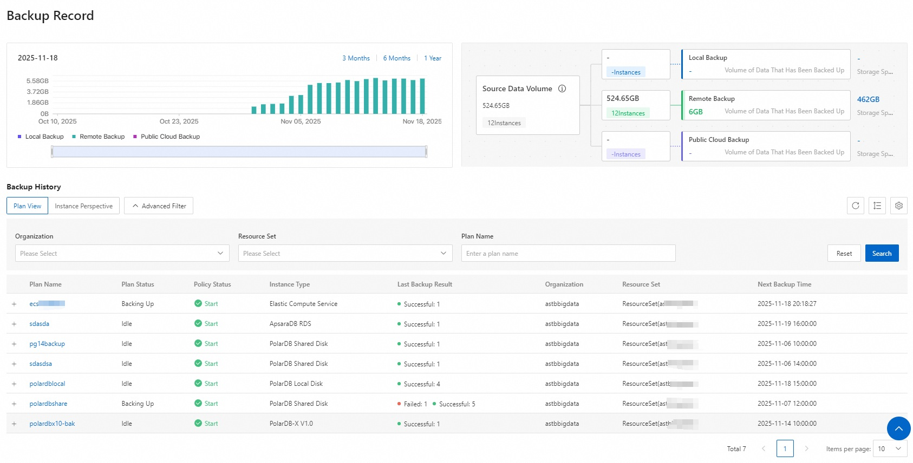

> **Note**
>
> Find the backup plan that you want to manage and click the  icon. Find the backup record that you want to view and click **View**
>
> **Details** in the Actions column. On the Backup Record tab, click the  icon. Find the instance that you want to view and click **Details** in
>
> the Actions column. In the Backup Record Details dialog box, view the backup record details.

**Perform inspections on bandwidth usage**

Log in to the ASR-BR console as a backup operations administrator in standard deployment mode. In the left-side navigation pane, choose **O&M Management > Engine Monitoring**. On the Traffic Monitoring tab of the Engine Monitoring page, view the transmission traffic of the backup engine.

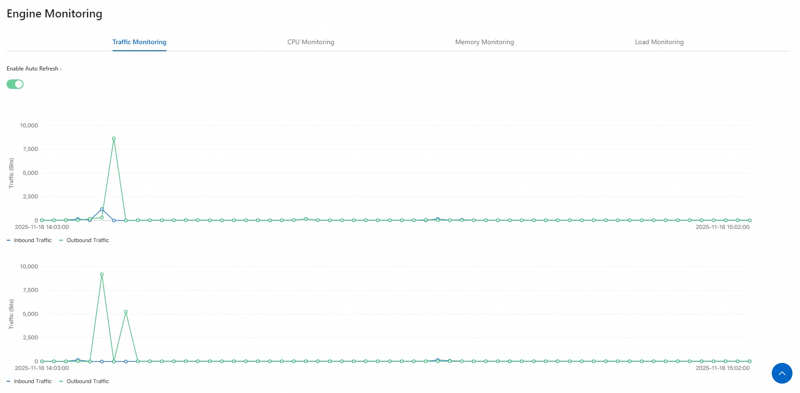

> **Note**
>
> - If ASR-BR is deployed in lightweight mode, you cannot perform routine inspections on bandwidth usage.
>
> - To view the total traffic usage of the backup and restore engines, you can choose **O&M Management > Throttling Configuration** in the left-side navigation pane of the ASR-BR console. If the total traffic usage reaches 90% of the specified backup throttling threshold, you can perform the following operations:
>
>   - Modify the backup throttling threshold on the premise that backup bandwidth is sufficient.
>
>   - Modify the backup policy to reduce the backup frequency or the number of backup instances.
>
>   - If 80% of the backup bandwidth is used, you can upgrade the bandwidth.

**Perform inspections on storage pool usage**

Log in to the ASR-BR console as a backup operations administrator. In the left-side navigation pane, choose **System Management** > **Storage Pool Groups**. On the Manage Storage Pool Group page, find the storage pool group that you want to manage and click its name. On the details page of the storage pool group, view the storage used by the storage pools in the group.

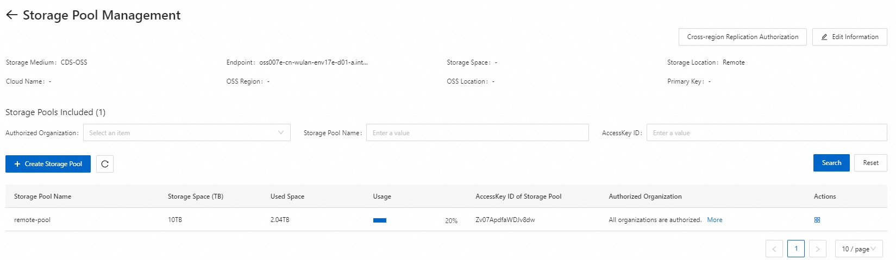

> **Note**
>
> If the storage used by the storage pools exceeds 80% of the total bucket storage, we recommend that you expand the storage or modify the data retention period in the backup policy to delete data at the earliest opportunity.

**Perform inspections on alerts**

Log in to the ASR-BR console as a backup operations administrator or an organization backup administrator. In the left-side navigation pane, choose **O&M Management > Alerts**. On the Alerts page, view the alert information and handle alerts.

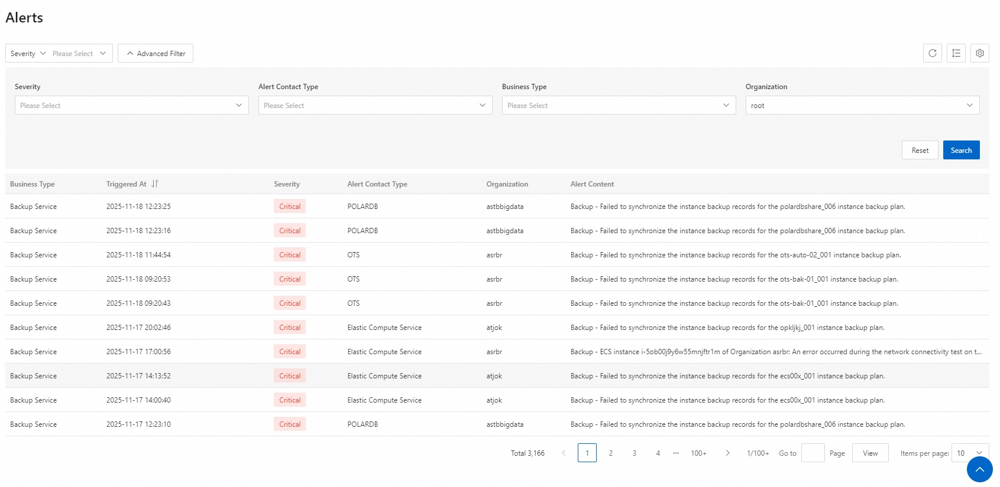

**Perform inspections on self-backups**

Log in to the ASR-BR console as a backup operations administrator. In the left-side navigation pane, choose **System Management > Self-backup Management**. On the page that appears, check whether self-backup management is enabled. If self-backup management is disabled, you must manually enable self-backup management and configure related policies. If self-backup management is enabled, check whether historical self-backups are successful.

<a id="section-6"></a>

# 6.Alert management

<a id="section-6-1"></a>

## 6.1. Alerts related to tianjimon

<a id="section-6-1-1"></a>

### 6.1.1. Alerts

| Alert name | Description | Source | Severity | Service |
| --- | --- | --- | --- | --- |
| check_backup_disk | The disk usage of the host on which the asrbr-backup service is deployed exceeds 70%. | tianjimon | P1 | asrbr |
| tjmon_alerts_srs-client_check_ctk_quota | The ctk_session usage ratio of the srs-client service is excessively high. | tianjimon | P1 | asrbr |
| tjmon_alerts_srs-client_check_cat_iptables_syslog | Packet loss records are generated in the srs_iptables.drop log file of the srs-client service. | tianjimon | P1 | asrbr |
| tjmon_alerts_srs_client_check_service_sta tus | The srs-client service becomes unavailable. | tianjimon | P1 | asrbr |
| tjmon_alerts_srs_client_check_nf_conntra ck | The nf_conntrack session usage ratio of the srs-client services is excessively high. | tianjimon | P1 | asrbr |
| tjmon_asrbr-backup-application_proc_restart_alarm | The Java process of the asrbr-backup service is frequently restarted. | tianjimon | P1 | asrbr |
| tjmon_asrbr-backup-application_proc_not_exist_alarm | The Java process of the asrbr-backup service does not exist. | tianjimon | P1 | asrbr |
| tjmon_asrbr-backup-service_available_alarm | The asrbr-backup service becomes unavailable. | tianjimon | P1 | asrbr |
| tjmon_asrbr-portal-application_proc_restart_alarm | The Java process of the asrbr-portal service is frequently restarted. | tianjimon | P1 | asrbr |
| tjmon_asrbr-portal-application_proc_not_exist_alarm | The Java process of the asrbr-portal service does not exist. | tianjimon | P1 | asrbr |
| tjmon_asrbr-portal-service_available_alarm | The asrbr-portal service becomes unavailable. | tianjimon | P1 | asrbr |
| tjmon_hbr-console-application_proc_restart_alarm | The Java process of the hbr-console service is frequently restarted. | tianjimon | P1 | asrbr |
| tjmon_hbr-console-application_proc_not_exist_alarm | The Java process of the hbr-console service does not exist. | tianjimon | P1 | asrbr |
| tjmon_hbr-console-service_available_alarm | The hbr-console service becomes unavailable. | tianjimon | P1 | asrbr |
| tjmon_pop-aliyun-com-application_proc_restart_alarm | The Java process of the PopAliyunCom component is frequently restarted. | tianjimon | P1 | asrbr |
| tjmon_pop-aliyun-com-application_proc_not_exist_alarm | The Java process of the PopAliyunCom component does not exist. | tianjimon | P1 | asrbr |
| tjmon_pop-aliyun-com-service_available_alarm | The PopAliyunCom component becomes unavailable. | tianjimon | P1 | asrbr |
| tjmon_pop-api-aliyun-com-application_proc_restart_alarm | The Java process of the PopApiAliyunCom component is frequently restarted. | tianjimon | P1 | asrbr |
| tjmon_pop-api-aliyun-com-application_proc_not_exist_alarm | The Java process of the PopApiAliyunCom component does not exist. | tianjimon | P1 | asrbr |
| tjmon_pop-api-aliyun-com-service_available_alarm | The PopApiAliyunCom component becomes unavailable. | tianjimon | P1 | asrbr |

<a id="section-6-1-2"></a>

### 6.1.2. check_backup_disk

This alert is used to monitor the disk usage of the host on which the asrbr-backup service is deployed. This alert is triggered when the disk usage of the host on which the asrbr-backup service is deployed is excessively high. In this case, you must identify and resolve the issue at the earliest opportunity.

**Alert attributes**

<table>
  <tr>
    <td>Alert name</td>
    <td>Metric</td>
    <td>Source</td>
    <td>Severity</td>
    <td>Service</td>
    <td>Check interval</td>
    <td>Trigger condition</td>
  </tr>
  <tr>
    <td>check_backup_disk</td>
    <td>tjmon_check_ba ckup_disk</td>
    <td>tianjimon</td>
    <td>P1</td>
    <td>asrbr</td>
    <td>Every 60 seconds</td>
    <td>p1_expressin|$status==1</td>
  </tr>
</table>

**Applicable versions**

Apsara Stack Enterprise V3.16 and later

**Causes**

The disk usage of log files is excessively high.

**Impacts**

When the disk usage reaches 100%, the asrbr-backup service is abnormal and becomes unavailable.

**Solutions**

> **Warning**
>
> If a solution requires that you modify product configurations, you must initiate a production change process to confirm the feasibility and standardization of the solution. Even in an emergency, you must obtain consent from the customer and TAM before you can perform the steps of the solution.

1. Log on to the Apsara Infrastructure Management console.

2. In the left-side navigation pane, choose **Resources > Product & Cluster O&M**.

3. Enter asrbr in the search box and click **Cluster Details** in the **Actions** column of the cluster.

   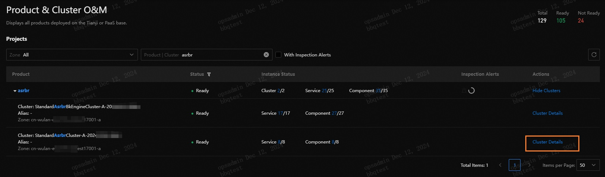

4. On the Cluster Details page, click the **Services** tab and then click asrbr-backup.

   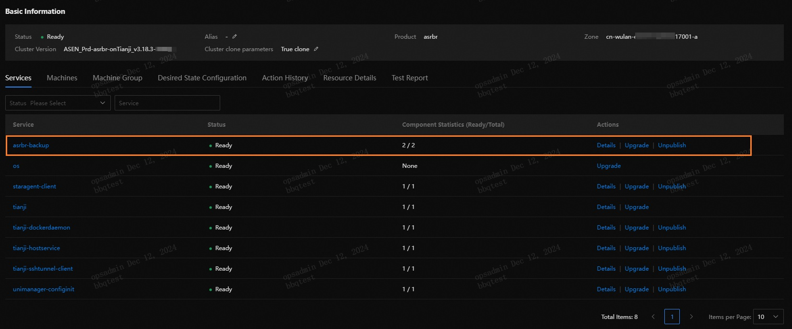

5. In the **Components** navigation pane, click **Backup#**.

6. On the **Instances** tab, check whether the VM status is normal.

   > **Note**
   >
   > The status of the VM on which the asrbr-backup service is deployed is abnormal when this alert is present.

   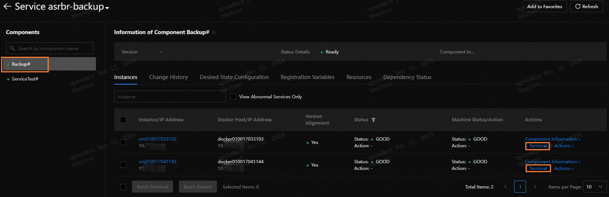

7. Click **Terminal** in the Actions column of a VM whose status is abnormal.

8. Execute the following command to check disk usage. If the disk usage in the root directory exceeds 70%, clean the log files.

   ```text
   df -h
   ```

   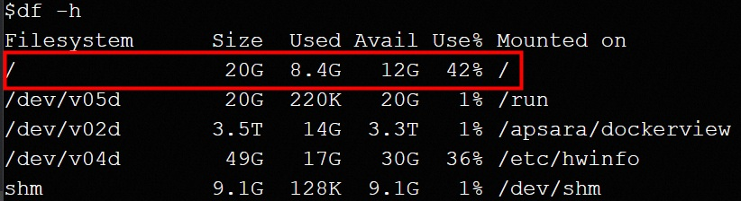

9. Execute the following command to find the files or directories that occupy a large amount of disk space in the logs.

   ```bash
   cd /alidata/logs/asrbr-backup/
   du -sh * | grep G
   ```

   

0. Manually clear logs.

   - Execute the  `rm -rf bak/`  command to clear historical logs in the bak directory.

   - If the asrbr-backup.log file occupies more than 5 GB of disk space, run the  `echo "" > asrbr-back.log`  command to clear logs.

> **Note**
>
> If the alert persists after you perform the preceding steps, submit a ticket to contact technical support.

<a id="section-6-1-3"></a>

### 6.1.3. tjmon_alerts_srs-client_check_ctk_quota

This alert is used to monitor the ctk_session usage of the srs-client service. This alert is triggered when the ctk_session usage ratio is excessively high. In this case, the srs-client service may fail to run as expected.

**Alert attributes**

<table>
  <tr>
    <td>Alert name</td>
    <td>Metric</td>
    <td>Source</td>
    <td>Severity</td>
    <td>Service</td>
    <td>Trigger condition</td>
    <td>Check interval</td>
  </tr>
  <tr>
    <td>tjmon_alerts_srs-client_check_ctk_q uota</td>
    <td>tjmon_table_srs-client_check_ctk_q uota</td>
    <td>tianjimon</td>
    <td>P1</td>
    <td>asrbr</td>
    <td>p1_expressin|$coll ection_flag!=0</td>
    <td>Every 60 seconds</td>
  </tr>
</table>

**Applicable versions**

Apsara Stack Enterprise V3.12 and later

**Causes**

The ctk_session usage ratio is excessively high.

**Impacts**

The srs-client service may fail to run as expected.

**Solutions**

> **Warning**
>
> If a solution requires that you modify product configurations, you must initiate a production change process to confirm the feasibility and standardization of the solution. Even in an emergency, you must obtain consent from the customer and TAM before you can perform any steps of the solution.

**Versions earlier than V3.16**

Check whether SRS is disabled, and then disable the alert.

- If the alert is reported in the Apsara Infrastructure Management console, perform the following steps:

  <ol type="i">

  <li>

  Log on to the Apsara Infrastructure Management console.

  </li>

  <li>

  In the left-side navigation pane, click **Home**. Search for the srs-master service.

  </li>

  </ol>

  - If the srs-master service does not exist, the srs-master service is not deployed. Select the document in the appendix based on the service version to disable the alert.

  - If the srs-master service exists, proceed with the following steps.

- If the alert is reported in the Apsara Uni-manager Operations Console, perform the following steps:

  <ol type="i">

  <li>

  Log on to the Apsara Uni-manager Operations Console.

  </li>

  <li>

  In the top navigation bar, click **Product Operation** to check whether **SRS Management** is available.

  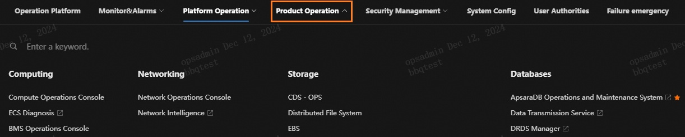

  </li>

  </ol>

  - If the **SRS Management** page is available, go to the page to check whether SRS is enabled.

    - If SRS is enabled, contact R&D.

    - If SRS is disabled, select the document in the appendix based on the service version to disable the alert.

  - If the **SRS Management** page is unavailable, go to the srs-master.Server# container to check whether SRS is enabled.

    <ol type="a">

    <li>

    Log on to the srs-master.Server container

    <ol type="a">

    <li>

    Log on to the Apsara Infrastructure Management console.

    </li>

    <li>

    In the left-side navigation pane, click **Home**. Search for the srs-master service and click Instance Details on the right side of the search results.

    </li>

    </ol>

    <ol type="i" start="100">

    <li>

    On the **Service Management** page, click the **Service Instances** tab and then click **Instance Details** in the **Actions** column of the cluster.

    </li>

    <li value="500">

    In the Components pane, click **Server#**.

    </li>

    </ol>

    <ol type="a" start="5">

    <li>

    On the **Instances** tab, click **Terminal** in the **Actions** column of a server to log on to the server.

    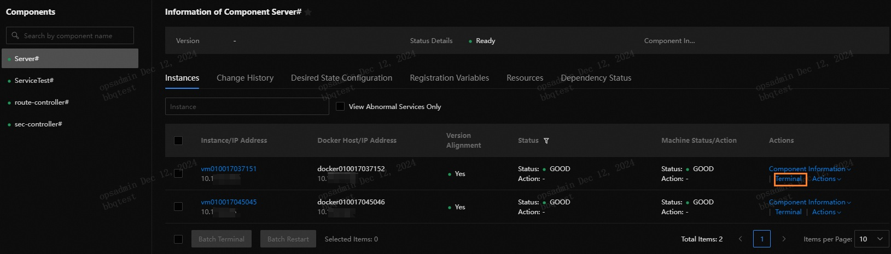

    </li>

    <li>

    Log on to the container.

    ```bash
    docker exec -it `docker ps | grep server | awk '{print $1}'` bash
    ```

    </li>

    </ol>

    </li>

    <li>

    Check whether SRS is disabled:

    ```bash
    curl --connect-timeout 10 -s -u $secure_defaultUser_accesskey_id:$secure_defaultUser_accesskey_secret 
    '127.0.0.1:8088/statess'
    ```

    A result as the one shown in the following figure is displayed.

    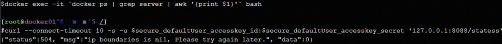

    - If the return value is '{"status":200, "msg":"success", "data":0}', or '{"status":504, "msg":"xxxxxx", "data":0}', SRS is disabled. Select the document in the appendix based on the service version to disable the alert.

    - For other returned values, contact R&D.

    </li>

    </ol>

**V3.16 or later**

Check and modify the ctk configuration.

1. Log on to the Apsara Infrastructure Management console.

2. In the left-side navigation pane, choose **Products & Clusters O&M**.

3. On the **Projects** page, enter asrbr in the Product | Cluster search box. In the search result, find the cluster and click **Cluster Details** in the **Actions** column.

   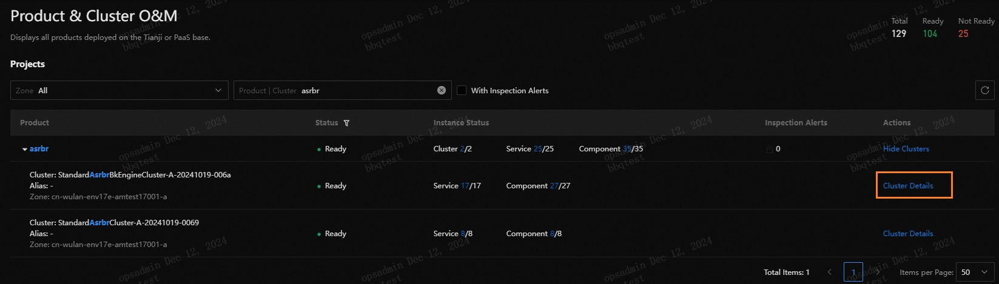

4. On the **Services** tab, click **srs-client** in the Service column.

5. In the **Components** pane, click **srs-client#**.

6. On the **Instances** page, click **Terminal** in the **Actions** column of a host to log on to the host.

   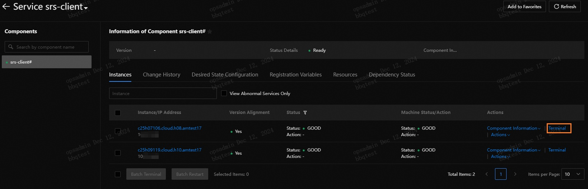

7. Check whether the files exist and whether the files are empty.

   ```bash
   cat /proc/net/ctk_current_conn_count
   cat /proc/sys/net/ipv4/ctk_session/conn_max_count
   ```

   - If the files do not exist, submit a ticket (service request form) to contact the network-side R&D team for processing.

   - If the files exist, check the values of the ctk_current_conn_count and conn_max_count fields separately to identify if the ctk_current_conn_count/conn_max_count value exceeds 60%.

     - If the value exceeds 60%, the current network load is high. We recommend that you wait for a period of time to observe.

       > **Note**
       >
       > If this condition persists for a long period of time, submit a ticket to contact the network-side R&D team to confirm whether to increase the value of the conn_max_count field.

     - If the value does not exceed 60%, submit a ticket to contact the network-side R&D team for processing.

> **Note**
>
> If the alert persists after you perform the preceding steps, submit a ticket to contact technical support.

<a id="section-6-1-4"></a>

### 6.1.4. tjmon_alerts_srs-client_check_cat_iptables_syslog

This alert is used to check whether packet loss records are generated in the srs_iptables.drop logs of the srs-client service. This alert is triggered when packet loss records are generated. In this case, the service is not immediately affected. However, you must take note of the packet loss information to prevent potential issues from occurring.

**Alert attributes**

| Alert name | Metric | Source | Severity | Service | Trigger condition | Check interval |
| --- | --- | --- | --- | --- | --- | --- |
| tjmon_alerts_srs-client_check_cat_ip tables_syslog | tjmon_table_srs-client_check_cat_ip tables_syslog | tianjimon | P1 | asrbr | p1_expressin\|$coll ection_flag!=0 | Every 60 seconds |

**Applicable versions**

Apsara Stack Enterprise V3.12 and later

**Causes**

Packet loss records are generated.

**Impacts**

The service is not immediately affected. However, you must take note of the packet loss information to prevent potential issues from occurring.

**Solutions**

> **Warning**
>
> If a solution requires that you modify product configurations, you must initiate a production change process to confirm the feasibility and standardization of the solution. Even in an emergency, you must obtain consent from the customer and TAM before you can perform any steps of the solution.

**Versions earlier than V3.16**

Check whether SRS is disabled, and then disable the alert.

- If the alert is reported in the Apsara Infrastructure Management console, perform the following steps:

  <ol type="i">

  <li>

  Log on to the Apsara Infrastructure Management console.

  </li>

  <li>

  In the left-side navigation pane, click **Home**. Search for the srs-master service.

  </li>

  </ol>

  - If the srs-master service does not exist, the srs-master service is not deployed. Select the document in the appendix based on the service version to disable the alert.

  - If the srs-master service exists, proceed with the following steps.

- If the alert is reported in the Apsara Uni-manager Operations Console, perform the following steps:

  <ol type="i">

  <li>

  Log on to the Apsara Uni-manager Operations Console.

  </li>

  <li>

  In the top navigation bar, click **Product Operation** to check whether **SRS Management** is available.

  

  </li>

  </ol>

  - If the **SRS Management** page is available, go to the page to check whether SRS is enabled.

    - If SRS is enabled, contact R&D.

    - If SRS is disabled, select the document in the appendix based on the service version to disable the alert.

  - If the **SRS Management** page is unavailable, go to the srs-master.Server# container to check whether SRS is enabled.

    <ol type="a">

    <li>

    Log on to the srs-master.Server container

    <ol type="a">

    <li>

    Log on to the Apsara Infrastructure Management console.

    </li>

    <li>

    In the left-side navigation pane, click **Home**. Search for the srs-master service and click Instance Details on the right side of the search results.

    </li>

    </ol>

    <ol type="i" start="100">

    <li>

    On the **Service Management** page, click the **Service Instances** tab and then click **Instance Details** in the **Actions** column of the cluster.

    </li>

    <li value="500">

    In the Components pane, click **Server#**.

    </li>

    </ol>

    <ol type="a" start="5">

    <li>

    On the **Instances** tab, click **Terminal** in the **Actions** column of a server to log on to the server.

    

    </li>

    <li>

    Log on to the container.

    ```bash
    docker exec -it `docker ps | grep server | awk '{print $1}'` bash
    ```

    </li>

    </ol>

    </li>

    <li>

    Check whether SRS is disabled:

    ```bash
    curl --connect-timeout 10 -s -u $secure_defaultUser_accesskey_id:$secure_defaultUser_accesskey_secret 
    '127.0.0.1:8088/statess'
    ```

    A result as the one shown in the following figure is displayed.

    

    - If the return value is '{"status":200, "msg":"success", "data":0}', or '{"status":504, "msg":"xxxxxx", "data":0}', SRS is disabled. Select the document in the appendix based on the service version to disable the alert.

    - For other returned values, contact R&D.

    </li>

    </ol>

**V3.16 or later**

Check for packet loss.

1. Log on to the Apsara Infrastructure Management console.

2. In the left-side navigation pane, choose **Products & Clusters O&M**.

3. On the **Projects** page, enter asrbr in the Product | Cluster search box. In the search result, find the cluster and click **Cluster Details** in the **Actions** column.

   

4. On the **Services** tab, click **srs-client** in the Service column.

5. In the **Components** pane, click **srs-client#**.

6. On the **Instances** page, click **Terminal** in the **Actions** column of a host to log on to the host.

   

7. Query logs to view the source address of lost packets.

   ```bash
   cat /var/log/srs_iptables.drop.log
   ```

   Sample result:

   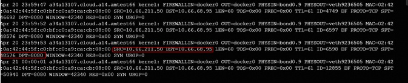

8. Check whether the source address of lost packets is in the trusted address set.

   ```text
   ipset test ipset_srs ${Source address of lost packets}
   ```

   

   - If the source address of lost packets is in the trusted address set:

     - If packet loss occasionally occurs (several packet loss logs), the session may time out. You can ignore the issue.

     - If packets are continuously lost, disable SRS and contact the R&D team.

   - If the source address of lost packets is not in the trusted address set:

     - Check whether the source address segment of the dropped packets is within the planned range or is a non-standard extended address segment such as an address segment directly expanded by RAMA on Deployment Planner. If the source address range is within the planned range or is a non-standard expansion address range, disable SRS and add the address segment to the SRS whitelist. Then, enable SRS after you confirm that SRS can collect data from the address segment.

     - If the address segment is outside the planned range, we recommend that you add the address segment to the SRS blacklist.

> **Note**
>
> If the alert persists after you perform the preceding steps, submit a ticket to contact technical support.

<a id="section-6-1-5"></a>

### 6.1.5. tjmon_alerts_srs_client_check_service_status

This alert is used to monitor the availability of the srs_client service. This alert is triggered when the srs-client service becomes unavailable. For versions earlier than V3.16, disable the alert. If this alert occurs, first check whether SRS is disabled, and then disable the alert. In V3.16 and later versions, you must resolve the issue based on client logs.

**Alert attributes**

| Alert name | Metric | Source | Severity | Service | Trigger condition | Check interval |
| --- | --- | --- | --- | --- | --- | --- |
| tjmon_alerts_srs_cl ient_check_service _status | tjmon_table_srs_cli ent_check_service_status | tianjimon | P1 | asrbr | p1_expressin\|$coll ection_flag!=0 | Every 60 seconds |

**Applicable versions**

Apsara Stack Enterprise V3.12 and later

**Causes**

The srs-client service becomes unavailable.

**Impacts**

The srs-client service may fail to run as expected.

**Solutions**

> **Warning**
>
> If a solution requires that you modify product configurations, you must initiate a production change process to confirm the feasibility and standardization of the solution. Even in an emergency, you must obtain consent from the customer and TAM before you can perform the steps of the solution.

**Versions earlier than V3.16**

Check whether SRS is disabled, and then disable the alert.

- If the alert is reported in the Apsara Infrastructure Management console, perform the following steps:

  <ol type="i">

  <li>

  Log on to the Apsara Infrastructure Management console.

  </li>

  <li>

  In the left-side navigation pane, click **Home**. Search for the srs-master service.

  </li>

  </ol>

  - If the srs-master service does not exist, the srs-master service is not deployed. Select the document in the appendix based on the service version to disable the alert.

  - If the srs-master service exists, proceed with the following steps.

- If the alert is reported in the Apsara Uni-manager Operations Console, perform the following steps:

  <ol type="i">

  <li>

  Log on to the Apsara Uni-manager Operations Console.

  </li>

  <li>

  In the top navigation bar, click **Product Operation** to check whether **SRS Management** is available.

  

  </li>

  </ol>

  - If the **SRS Management** page is available, go to the page to check whether SRS is enabled.

    - If SRS is enabled, contact R&D.

    - If SRS is disabled, select the document in the appendix based on the service version to disable the alert.

  - If the **SRS Management** page is unavailable, go to the srs-master.Server# container to check whether SRS is enabled.

    <ol type="a">

    <li>

    Log on to the srs-master.Server container

    <ol type="a">

    <li>

    Log on to the Apsara Infrastructure Management console.

    </li>

    <li>

    In the left-side navigation pane, click **Home**. Search for the srs-master service and click Instance Details on the right side of the search results.

    </li>

    </ol>

    <ol type="i" start="100">

    <li>

    On the **Service Management** page, click the **Service Instances** tab and then click **Instance Details** in the **Actions** column of the cluster.

    </li>

    <li value="500">

    In the Components pane, click **Server#**.

    </li>

    </ol>

    <ol type="a" start="5">

    <li>

    On the **Instances** tab, click **Terminal** in the **Actions** column of a server to log on to the server.

    

    </li>

    <li>

    Log on to the container.

    ```bash
    docker exec -it `docker ps | grep server | awk '{print $1}'` bash
    ```

    </li>

    </ol>

    </li>

    <li>

    Check whether SRS is disabled:

    ```bash
    curl --connect-timeout 10 -s -u $secure_defaultUser_accesskey_id:$secure_defaultUser_accesskey_secret 
    '127.0.0.1:8088/statess'
    ```

    A result as the one shown in the following figure is displayed.

    

    - If the return value is '{"status":200, "msg":"success", "data":0}', or '{"status":504, "msg":"xxxxxx", "data":0}', SRS is disabled. Select the document in the appendix based on the service version to disable the alert.

    - For other returned values, contact R&D.

    </li>

    </ol>

**V3.16 or later**

1. Log on to the Apsara Infrastructure Management console.

2. In the left-side navigation pane, choose **Products & Clusters O&M**.

3. On the **Projects** page, enter asrbr in the Product | Cluster search box. In the search result, find the cluster and click **Cluster Details** in the **Actions** column.

   

4. On the **Services** tab, click **srs-client** in the Service column.

5. In the **Components** pane, click **srs-client#**.

6. On the **Instances** page, click **Terminal** in the **Actions** column of a host to log on to the host.

   

7. Query the client startup logs. Collect exception information from the logs and contact R&D.

   Log path:  `/cloud/app/srs-client/srs-client#/srsclient_post_check_app/current/log/tianji/stderr`

> **Note**
>
> If the alert persists after you perform the preceding steps, submit a ticket to contact technical support.

<a id="section-6-1-6"></a>

### 6.1.6. tjmon_alerts_srs_client_check_nf_conntrack

This alert is used to monitor the nf_conntrack session usage of the srs-client service. This alert is triggered when the nf_conntrack session usage ratio is excessively high. In this case, the srs-client service may fail to run as expected.

**Alert attributes**

| Alert name | Metric | Source | Severity | Service | Trigger condition | Check interval |
| --- | --- | --- | --- | --- | --- | --- |
| tjmon_alerts_srs_cl ient_check_nf_con ntrack | tjmon_table_srs_cli ent_check_nf_conn track | tianjimon | P1 | asrbr | p1_expressin\|$coll ection_flag!=0 | Every 60 seconds |

**Applicable versions**

Apsara Stack Enterprise V3.16 and later

**Causes**

The nf_conntrack session usage ratio exceeds 60%.

**Impacts**

The srs-client service may fail to run as expected.

**Solutions**

> **Warning**
>
> If a solution requires that you modify product configurations, you must initiate a production change process to confirm the feasibility and standardization of the solution. Even in an emergency, you must obtain consent from the customer and TAM before you can perform the steps of the solution.

**Versions earlier than V3.16**

Check whether SRS is disabled, and then disable the alert.

- If the alert is reported in the Apsara Infrastructure Management console, perform the following steps:

  <ol type="i">

  <li>

  Log on to the Apsara Infrastructure Management console.

  </li>

  <li>

  In the left-side navigation pane, click **Home**. Search for the srs-master service.

  </li>

  </ol>

  - If the srs-master service does not exist, the srs-master service is not deployed. Select the document in the appendix based on the service version to disable the alert.

  - If the srs-master service exists, proceed with the following steps.

- If the alert is reported in the Apsara Uni-manager Operations Console, perform the following steps:

  <ol type="i">

  <li>

  Log on to the Apsara Uni-manager Operations Console.

  </li>

  <li>

  In the top navigation bar, click **Product Operation** to check whether **SRS Management** is available.

  

  </li>

  </ol>

  - If the **SRS Management** page is available, go to the page to check whether SRS is enabled.

    - If SRS is enabled, contact R&D.

    - If SRS is disabled, select the document in the appendix based on the service version to disable the alert.

  - If the **SRS Management** page is unavailable, go to the srs-master.Server# container to check whether SRS is enabled.

    <ol type="a">

    <li>

    Log on to the srs-master.Server container

    <ol type="a">

    <li>

    Log on to the Apsara Infrastructure Management console.

    </li>

    <li>

    In the left-side navigation pane, click **Home**. Search for the srs-master service and click Instance Details on the right side of the search results.

    </li>

    </ol>

    <ol type="i" start="100">

    <li>

    On the **Service Management** page, click the **Service Instances** tab and then click **Instance Details** in the **Actions** column of the cluster.

    </li>

    <li value="500">

    In the Components pane, click **Server#**.

    </li>

    </ol>

    <ol type="a" start="5">

    <li>

    On the **Instances** tab, click **Terminal** in the **Actions** column of a server to log on to the server.

    

    </li>

    <li>

    Log on to the container.

    ```bash
    docker exec -it `docker ps | grep server | awk '{print $1}'` bash
    ```

    </li>

    </ol>

    </li>

    <li>

    Check whether SRS is disabled:

    ```bash
    curl --connect-timeout 10 -s -u $secure_defaultUser_accesskey_id:$secure_defaultUser_accesskey_secret 
    '127.0.0.1:8088/statess'
    ```

    A result as the one shown in the following figure is displayed.

    

    - If the return value is '{"status":200, "msg":"success", "data":0}', or '{"status":504, "msg":"xxxxxx", "data":0}', SRS is disabled. Select the document in the appendix based on the service version to disable the alert.

    - For other returned values, contact R&D.

    </li>

    </ol>

**V3.16 or later**

Check and modify the nf_conntreack configuration.

1. Log on to the Apsara Infrastructure Management console.

2. In the left-side navigation pane, choose **Products & Clusters O&M**.

3. On the **Projects** page, enter asrbr in the Product | Cluster search box. In the search result, find the cluster and click **Cluster Details** in the **Actions** column.

   

4. On the **Services** tab, click **srs-client** in the Service column.

5. In the **Components** pane, click **srs-client#**.

6. On the **Instances** page, click **Terminal** in the **Actions** column of a host to log on to the host.

   

7. Check whether the file exists and whether the file is empty.

   ```bash
   cat /proc/sys/net/nf_conntrack_max
   cat /proc/sys/net/netfilter/nf_conntrack_count
   ```

   - If the file does not exist, submit a ticket to contact the R&D team responsible for operating system images.

   - If the file exists, perform the following steps:

8. Check whether the /home/admin/srs-client/conf/configured_info.json file exists and whether the file is empty.

   - If the file does not exist, contact the R&D team to identify the cause.

   - If the file exists, check the values of the nf_conntrack_count and nf_conntrack_max fields to identify if nf_conntrack_count/nf_conntrack_max exceeds 60%.

     - If the value exceeds 60%, the current network load is high. We recommend that you wait for a period of time to observe.

       > **Note**
       >
       > If this condition persists for a long period of time, submit a ticket to contact the network-side R&D team to confirm whether to increase the value of the nf_conntrack_max field.

     - If the value does not exceed 60%, contact the R&D team for technical support.

> **Note**
>
> If the alert persists after you perform the preceding steps, submit a ticket to contact technical support.

<a id="section-6-1-7"></a>

### 6.1.7. tjmon_asrbr-backup-application_proc_restart_alarm

This alert is used to check whether the Java process of the asrbr-backup service is frequently restarted. This alert is triggered when the Java process of the asrbr-backup service is frequently restarted. In this case, the asrbr service may be interrupted.

**Alert attributes**

<table>
  <tr>
    <td>Alert name</td>
    <td>Metric</td>
    <td>Source</td>
    <td>Severity</td>
    <td>Service</td>
    <td>Check interval</td>
    <td>Trigger condition</td>
  </tr>
  <tr>
    <td>tjmon_asrbr-backup-application_proc_re start_alarm</td>
    <td>tjmon_asrbr-backup-check_application_pr oc_state_cluster_serv errole</td>
    <td>tianjimon</td>
    <td>P1</td>
    <td>asrbr</td>
    <td>Every 60 seconds</td>
    <td>p1_expressin|$_status==1</td>
  </tr>
</table>

**Applicable versions**

Apsara Stack Enterprise V3.16 and later

**Causes**

The Java process of the asrbr-backup service is frequently restarted.

**Impacts**

- If this error occurs on one of the two nodes, service load balancing is affected, but the service remains available.

- If this error occurs on both nodes, the service becomes unavailable.

**Solutions**

> **Warning**
>
> If a solution requires that you modify product configurations, you must initiate a production change process to confirm the feasibility and standardization of the solution. Even in an emergency, you must obtain consent from the customer and TAM before you can perform any steps of the solution.

1. Log on to the Apsara Infrastructure Management console.

2. In the left-side navigation pane, choose **Resources > Product & Cluster O&M**.

3. On the Cluster Details page, click the **Services** tab and then click asrbr-backup.

   

4. In the **Components** navigation pane, click **Backup#**.

5. On the **Instances** tab, check whether the VM status is normal.

   > **Note**
   >
   > The status of the VM on which the asrbr-backup service is deployed is abnormal when this alert is present. Restart the SR to resolve the issue.

   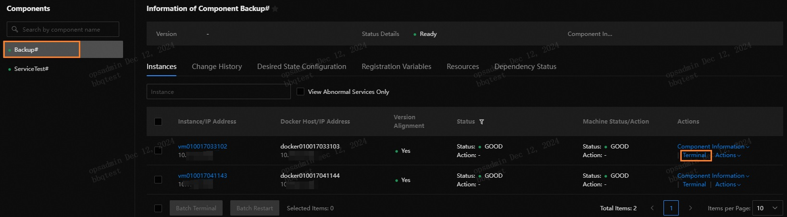

6. After you restart the SR, click **Terminal** in the Actions column of the VM whose status is abnormal to log on to the terminal.

7. Log on to the asrbr-backup.Backup# container.

   <ol type="i">

   <li>

   Obtain the ID of the container.

   ```bash
   docker ps | grep backup
   ```

   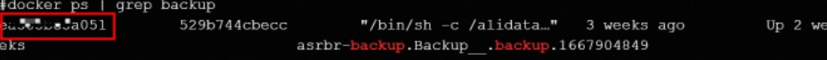

   </li>

   <li>

   Log on to the container.

   ```bash
   docker exec -it <Container ID> /bin/bash
   ```

   </li>

   </ol>

8. Check whether the Java process is frequently restarted.

   ```text
   ps -eo pid,lstart,etime,cmd | grep java
   ```

   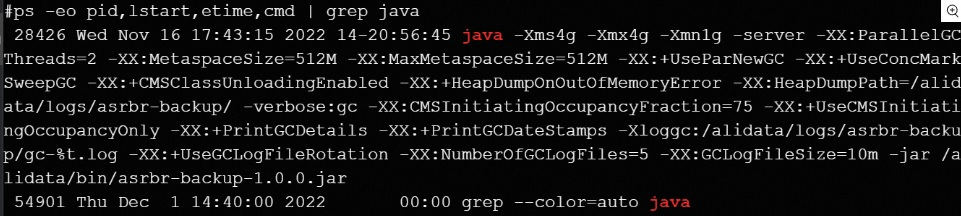

   - If a result similar to the one shown in the preceding figure is displayed, the status of the Java process is normal.

   - If the Java process is frequently restarted, restart the container.

9. Restart the container.

   ```bash
   docker stop <Container ID>
   docker start <Container ID>
   ```

0. After the container is restarted, check the status of the asrbr-backup service. If the status is normal, the issue is resolved. If the issue persists, resolve the issue based on the logs.

   - Java process log path:  `alidata/logs/asrbr-backup`

   - Container log query command: `docker logs<Container ID>`

> **Note**
>
> If the alert persists after you perform the preceding steps, submit a ticket to contact technical support.

<a id="section-6-1-8"></a>

### 6.1.8. tjmon_asrbr-backup-application_proc_not_exist_alarm

This alert is used to check whether the Java process of the asrbr-backup service is running. This alert is triggered when the Java process of the asrbr-backup service does not exist. In this case, the asrbr service may be interrupted.

**Alert attributes**

<table>
  <tr>
    <td>Alert name</td>
    <td>Metric</td>
    <td>Source</td>
    <td>Severity</td>
    <td>Service</td>
    <td>Check interval</td>
    <td>Trigger condition</td>
  </tr>
  <tr>
    <td>tjmon_asrbr-backup-application_proc_not_exi st_alarm</td>
    <td>tjmon_asrbr-backup-check_application _proc_state_clust er_serverrole</td>
    <td>tianjimon</td>
    <td>P1</td>
    <td>asrbr</td>
    <td>Every 60 seconds</td>
    <td>p1_expressin|$_status==2</td>
  </tr>
</table>

**Applicable versions**

Apsara Stack Enterprise V3.16 and later

**Causes**

The Java process of the asrbr-backup service does not exist.

**Impacts**

- If this error occurs on one of the two nodes, service load balancing is affected, but the service remains available.

- If this error occurs on both nodes, the service becomes unavailable.

**Solutions**

> **Warning**
>
> If a solution requires that you modify product configurations, you must initiate a production change process to confirm the feasibility and standardization of the solution. Even in an emergency, you must obtain consent from the customer and TAM before you can perform any steps of the solution.

1. Log on to the Apsara Infrastructure Management console.

2. In the left-side navigation pane, choose **Resources > Product & Cluster O&M**.

3. On the Cluster Details page, click the **Services** tab and then click asrbr-backup.

   

4. In the **Components** navigation pane, click **Backup#**.

5. On the **Instances** tab, check whether the VM status is normal.

   > **Note**
   >
   > The status of the VM on which the asrbr-backup service is deployed is abnormal when this alert is present. Restart the SR to resolve the issue.

   

6. After you restart the SR, click **Terminal** in the Actions column of the VM whose status is abnormal to log on to the terminal.

7. Log on to the asrbr-backup.Backup# container.

   <ol type="i">

   <li>

   Obtain the ID of the container.

   ```bash
   docker ps | grep backup
   ```

   

   </li>

   <li>

   Log on to the container.

   ```bash
   docker exec -it <Container ID> /bin/bash
   ```

   </li>

   </ol>

8. Check whether the Java process exists.

   ```text
   ps -ef | grep java
   ```

   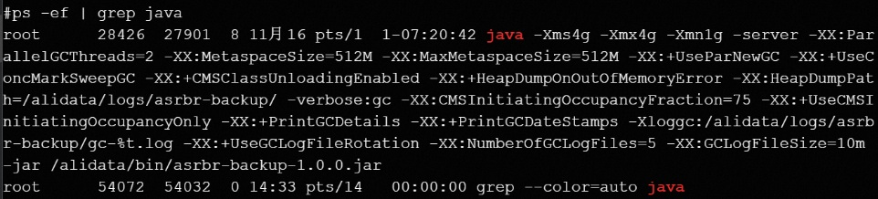

   - If a result as shown in the preceding figure is displayed, the Java process exists.

   - If the Java process does not exist, restart the container.

9. Restart the container.

   ```bash
   docker stop <Container ID>
   docker start <Container ID>
   ```

0. After the container is restarted, check the status of the asrbr-backup service. If the status is normal, the issue is resolved. If the issue persists, resolve the issue based on the logs.

   - Java process log path:  `alidata/logs/asrbr-backup`

   - Container log query command: `docker logs<Container ID>`

> **Note**
>
> If the alert persists after you perform the preceding steps, submit a ticket to contact technical support.

<a id="section-6-1-9"></a>

### 6.1.9. tjmon_asrbr-backup-service_available_alarm

This alert is used to monitor the status of the asrbr-backup service. This alert is triggered when the status of the asrbr-backup service becomes abnormal. In this case, the asrbr-backup service may become inaccessible.

**Alert attributes**

<table>
  <tr>
    <td>Alert name</td>
    <td>Metric</td>
    <td>Source</td>
    <td>Severity</td>
    <td>Service</td>
    <td>Check interval</td>
    <td>Trigger condition</td>
  </tr>
  <tr>
    <td>tjmon_asrbr-backup-service_available_alarm</td>
    <td>tjmon_asrbr-backup-check_service_avai lable_cluster_serve rrole</td>
    <td>tianjimon</td>
    <td>P1</td>
    <td>asrbr</td>
    <td>Every 60 seconds</td>
    <td>p1_expressin|$_error_flag ==1</td>
  </tr>
</table>

**Applicable versions**

Apsara Stack Enterprise V3.16 and later

**Causes**

The Java process status of the asrbr-backup service becomes abnormal.

**Impacts**

- If this error occurs on one of the two nodes, service load balancing is affected, but the service remains available.

- If this error occurs on both nodes, the service becomes unavailable.

**Solutions**

> **Warning**
>
> If a solution requires that you modify product configurations, you must initiate a production change process to confirm the feasibility and standardization of the solution. Even in an emergency, you must obtain consent from the customer and TAM before you can perform any steps of the solution.

1. Log on to the Apsara Infrastructure Management console.

2. In the left-side navigation pane, choose **Resources > Product & Cluster O&M**.

3. On the Cluster Details page, click the **Services** tab and then click asrbr-backup.

   

4. In the **Components** navigation pane, click **Backup#**.

5. On the **Instances** tab, check whether the VM status is normal.

   > **Note**
   >
   > The status of the VM on which the asrbr-backup service is deployed is abnormal when this alert is present. Restart the SR to resolve the issue.

   

6. After you restart the SR, click **Terminal** in the Actions column of the VM whose status is abnormal to log on to the terminal.

7. Log on to the asrbr-backup.Backup# container.

   <ol type="i">

   <li>

   Obtain the ID of the container.

   ```bash
   docker ps | grep backup
   ```

   

   </li>

   <li>

   Log on to the container.

   ```bash
   docker exec -it <Container ID> /bin/bash
   ```

   </li>

   </ol>

8. Check whether the Java process exists.

   ```text
   ps -ef | grep java
   ```

   

   - If a result as shown in the preceding figure is displayed, the Java process exists.

   - If the Java process does not exist, restart the container.

9. Restart the container.

   ```bash
   docker stop <Container ID>
   docker start <Container ID>
   ```

0. After the container is restarted, check the status of the asrbr-backup service. If the status is normal, the issue is resolved. If the issue persists, resolve the issue based on the logs.

   - Java process log path:  `alidata/logs/asrbr-backup`

   - Container log query command: `docker logs<Container ID>`

> **Note**
>
> If the alert persists after you perform the preceding steps, submit a ticket to contact technical support.

<a id="section-6-1-10"></a>

### 6.1.10. tjmon_hbr-console-application_proc_restart_alarm

This alert is used to check whether the Java process of the hbr-console service is frequently restarted. This alert is triggered when the Java process of the hbr-console service is frequently restarted. In this case, the asrbr service may be interrupted.

**Alert attributes**

<table>
  <tr>
    <td>Alert name</td>
    <td>Metric</td>
    <td>Source</td>
    <td>Severity</td>
    <td>Service</td>
    <td>Check interval</td>
    <td>Trigger condition</td>
  </tr>
  <tr>
    <td>tjmon_hbr-console-application_proc_restart _alarm</td>
    <td>tjmon_hbr-console-check_application_proc_state_cluster_serverrole</td>
    <td>tianjimon</td>
    <td>P1</td>
    <td>asrbr</td>
    <td>Every 60 seconds</td>
    <td>p1_expressin|$_status==1</td>
  </tr>
</table>

**Applicable versions**

Apsara Stack Enterprise V3.16 and later

**Causes**

The Java process of the hbr-console service is frequently restarted.

**Impacts**

- If this error occurs on one of the two nodes, service load balancing is affected, but the service remains available.

- If this error occurs on both nodes, the service becomes unavailable.

**Solutions**

> **Warning**
>
> If a solution requires that you modify product configurations, you must initiate a production change process to confirm the feasibility and standardization of the solution. Even in an emergency, you must obtain consent from the customer and TAM before you can perform any steps of the solution.

1. Log on to the Apsara Infrastructure Management console.

2. In the left-side navigation pane, choose **Resources > Product & Cluster O&M**.

3. In the product list, search for the asrbr service and click **Cluster Details** in the Actions column of \*\*\* AsrbrBkEngine\*\*\*\*.

   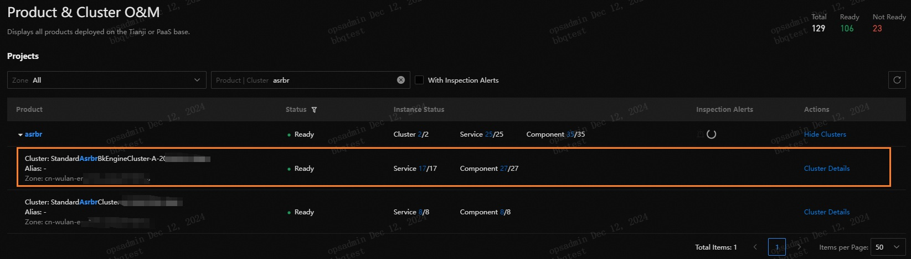

4. On the **Services** tab, click hbr-console to go to the component details page.

5. In the **Components** pane, click **Console#**.

6. On the **Instances** tab, check whether the machine status is normal.

   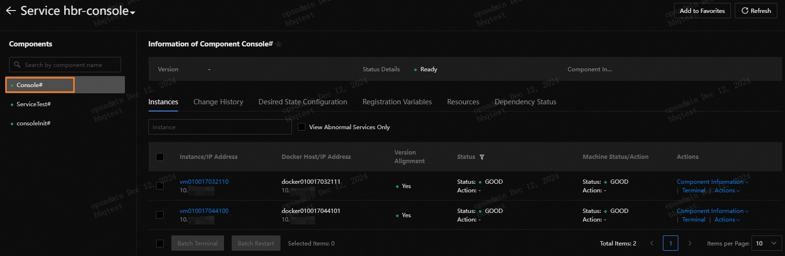

   - If the machine status is abnormal, choose **Actions** > **Restart** in the **Actions** column to restart the machine.

   - If the machine status is normal, proceed with the following steps:

7. Click **Terminal** in the **Actions** column of the machine to log on to the machine.

8. Log on to the hbr-console. Console# container.

   <ol type="i">

   <li>

   Obtain the ID of the container.

   ```bash
   docker ps
   ```

   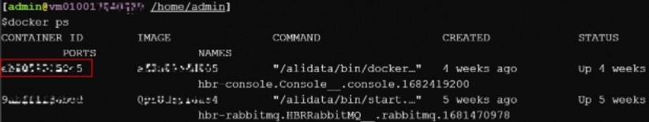

   </li>

   <li>

   Log on to the container.

   ```bash
   docker exec -it <Container ID> /bin/bash
   ```

   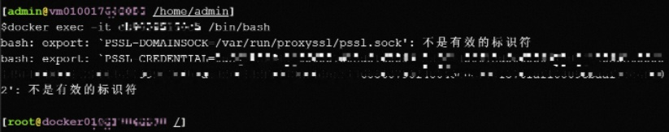

   </li>

   </ol>

9. Check whether the Java process is frequently restarted. If the process is frequently restarted, restart the container.

   ```text
   ps -eo pid,lstart,etime,cmd | grep java
   ```

   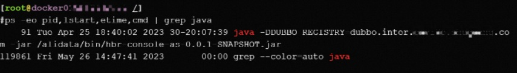

   If a result similar to the one shown in the preceding figure is displayed, the status of the Java process is normal.

0. Execute the  `exit`  command to exit the container.

1. Restart the container.

   ```bash
   docker stop <Container ID>
   docker start <Container ID>
   ```

2. After the container is restarted, check the status of the hbr-console service. If the status is normal, the issue is resolved. If the issue persists, resolve the issue based on the error information in the log.

   - Java process log path:  `alidata/logs/`

   - Container log query command: `docker logs<Container ID>`

> **Note**
>
> If the alert persists after you perform the preceding steps, submit a ticket to contact technical support.

<a id="section-6-1-11"></a>

### 6.1.11. tjmon_hbr-console-application_proc_not_exist_alarm

This alert is used to monitor whether the Java process of the hbr-console service is running. This alert is triggered when the Java process of the hbr-console service does not exist. In this case, the asrbr service may be interrupted.

**Alert attributes**

<table>
  <tr>
    <td>Alert name</td>
    <td>Metric</td>
    <td>Source</td>
    <td>Severity</td>
    <td>Service</td>
    <td>Check interval</td>
    <td>Trigger condition</td>
  </tr>
  <tr>
    <td>tjmon_hbr-console-application_proc_not_exi st_alarm</td>
    <td>tjmon_hbr-console-check_application _proc_state_clust er_serverrole</td>
    <td>tianjimon</td>
    <td>P1</td>
    <td>asrbr</td>
    <td>Every 60 seconds</td>
    <td>p1_expressin|$_status==2</td>
  </tr>
</table>

**Applicable versions**

Apsara Stack Enterprise V3.16 and later

**Causes**

The Java process of the hbr-console service does not exist.

**Impacts**

- If this error occurs on one of the two nodes, service load balancing is affected, but the service remains available.

- If this error occurs on both nodes, the service becomes unavailable.

**Solutions**

> **Warning**
>
> If a solution requires that you modify product configurations, you must initiate a production change process to confirm the feasibility and standardization of the solution. Even in an emergency, you must obtain consent from the customer and TAM before you can perform any steps of the solution.

1. Log on to the Apsara Infrastructure Management console.

2. In the product list, search for the asrbr service and click **Cluster Details** in the Actions column of \*\*\* AsrbrBkEngine\*\*\*\*.

   

3. On the **Services** tab, click hbr-console to go to the component details page.

4. In the **Components** pane, click **Console#**.

5. On the **Instances** tab, check whether the machine status is normal.

   

   - If the machine status is abnormal, choose **Actions** > **Restart** in the **Actions** column to restart the machine.

   - If the machine status is normal, proceed with the following steps:

6. Click **Terminal** in the **Actions** column of the machine to log on to the machine.

7. Log on to the hbr-console. Console# container.

   <ol type="i">

   <li>

   Obtain the ID of the container.

   ```bash
   docker ps
   ```

   

   </li>

   <li>

   Log on to the container.

   ```bash
   docker exec -it <Container ID> /bin/bash
   ```

   

   </li>

   </ol>

8. Check whether the Java process exists. If the Java process does not exist, restart the container.

   ```text
   ps -ef | grep java
   ```

   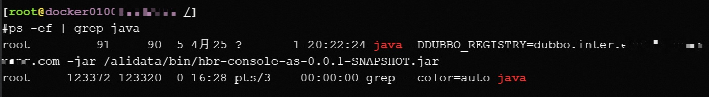

   If a result as shown in the preceding figure is displayed, the Java process exists.

9. Execute the  `exit`  command to exit the container.

0. Restart the container.

   ```bash
   docker stop <Container ID>
   docker start <Container ID>
   ```

1. After the container is restarted, check the status of the hbr-console service. If the status is normal, the issue is resolved. If the issue persists, resolve the issue based on the error information in the log.

   - Java process log path:  `alidata/logs/`

   - Container log query command: `docker logs<Container ID>`

> **Note**
>
> If the alert persists after you perform the preceding steps, submit a ticket to contact technical support.

<a id="section-6-1-12"></a>

### 6.1.12. tjmon_hbr-console-service_available_alarm

This alert is used to monitor the status of the hbr-console service. This alert is triggered when the hbr-console service becomes abnormal. In this case, the hbr-console service may be unavailable.

**Alert attributes**

<table>
  <tr>
    <td>Alert name</td>
    <td>Metric</td>
    <td>Source</td>
    <td>Severity</td>
    <td>Service</td>
    <td>Check interval</td>
    <td>Trigger condition</td>
  </tr>
  <tr>
    <td>tjmon_hbr-console-service_available_alarm</td>
    <td>tjmon_hbr-console-check_service_avai lable_cluster_serve rrole</td>
    <td>tianjimon</td>
    <td>P1</td>
    <td>asrbr</td>
    <td>Every 60 seconds</td>
    <td>p1_expressin|$_error_flag= =1</td>
  </tr>
</table>

**Applicable versions**

Apsara Stack Enterprise V3.16 and later

**Causes**

The Java process of the hbr-console service becomes abnormal.

**Impacts**

- If this error occurs on one of the two nodes, service load balancing is affected, but the service remains available.

- If this error occurs on both nodes, the service becomes unavailable.

**Solutions**

> **Warning**
>
> If a solution requires that you modify product configurations, you must initiate a production change process to confirm the feasibility and standardization of the solution. Even in an emergency, you must obtain consent from the customer and TAM before you can perform any steps of the solution.

1. Log on to the Apsara Infrastructure Management console.

2. In the product list, search for the asrbr service and click **Cluster Details** in the Actions column of \*\*\* AsrbrBkEngine\*\*\*\*.

   

3. On the **Services** tab, click hbr-console to go to the component details page.

4. In the **Components** pane, click **Console#**.

5. On the **Instances** tab, check whether the machine status is normal.

   

   - If the machine status is abnormal, choose **Actions** > **Restart** in the **Actions** column to restart the machine.

   - If the machine status is normal, proceed with the following steps:

6. Click **Terminal** in the **Actions** column of the machine to log on to the machine.

7. Log on to the hbr-console. Console# container.

   <ol type="i">

   <li>

   Obtain the ID of the container.

   ```bash
   docker ps
   ```

   

   </li>

   <li>

   Log on to the container.

   ```bash
   docker exec -it <Container ID> /bin/bash
   ```

   

   </li>

   </ol>

8. Check whether the Java process exists. If the Java process does not exist, restart the container.

   ```text
   ps -ef | grep java
   ```

   

   If a result as shown in the preceding figure is displayed, the Java process exists.

9. Execute the  `exit`  command to exit the container.

0. Restart the container.

   ```bash
   docker stop <Container ID>
   docker start <Container ID>
   ```

1. After the container is restarted, check the status of the hbr-console service. If the status is normal, the issue is resolved. If the issue persists, resolve the issue based on the error information in the log.

   - Java process log path:  `alidata/logs/`

   - Container log query command: `docker logs<Container ID>`

> **Note**
>
> If the alert persists after you perform the preceding steps, submit a ticket to contact technical support.

<a id="section-6-1-13"></a>

### 6.1.13. tjmon_pop-aliyun-com-application_proc_restart_alarm

This alert is used to check whether the Java process of the PopAliyunCom component is frequently restarted. This alert is triggered when the Java process of the PopAliyunCom component is frequently restarted. If the component is frequently restarted, the asrbr service may be interrupted.

**Alert attributes**

<table>
  <tr>
    <td>Alert name</td>
    <td>Metric</td>
    <td>Source</td>
    <td>Severity</td>
    <td>Service</td>
    <td>Check interval</td>
    <td>Trigger condition</td>
  </tr>
  <tr>
    <td>tjmon_pop-aliyun-com-application_proc_restart _alarm</td>
    <td>tjmon_pop-aliyun-com-check_application_proc_state_cluster_serverrole</td>
    <td>tianjimon</td>
    <td>P1</td>
    <td>asrbr</td>
    <td>Every 60 seconds</td>
    <td>p1_expressin|$_status==1</td>
  </tr>
</table>

**Applicable versions**

Apsara Stack Enterprise V3.16 and later

**Causes**

The Java process of the PopAliyunCom component is frequently restarted.

**Impacts**

- If this error occurs on one of the two nodes, service load balancing is affected, but the service remains available.

- If this error occurs on both nodes, the service becomes unavailable.

**Solutions**

> **Warning**
>
> If a solution requires that you modify product configurations, you must initiate a production change process to confirm the feasibility and standardization of the solution. Even in an emergency, you must obtain consent from the customer and TAM before you can perform the steps of the solution.

1. Log on to the Apsara Infrastructure Management console.

2. In the left-side navigation pane, choose **Product & Cluster O&M**. Enter asrbr in the search box and click **Cluster Details** in the **Actions** column of the search results.

   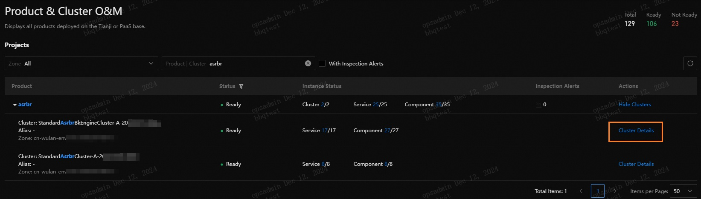

3. On the **Services** tab, click the **webapp-datapop** service.

4. In the **Components** pane, select the **PopAliyunCom#** component.

5. On the **Instances** tab, check whether the machine status is normal.

   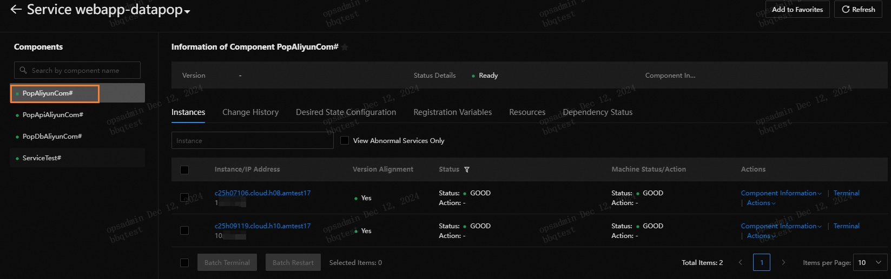

   - If the machine status is abnormal, choose **Actions** > **Restart** in the **Actions** column to restart the machine.

   - If the machine status is normal, perform the following operations:

6. Click **Terminal** in the **Actions** column of the machine to log on to the machine.

7. Check whether the Java process is frequently restarted.

   ```text
   ps -eo pid,lstart,etime,cmd | grep java
   ```

   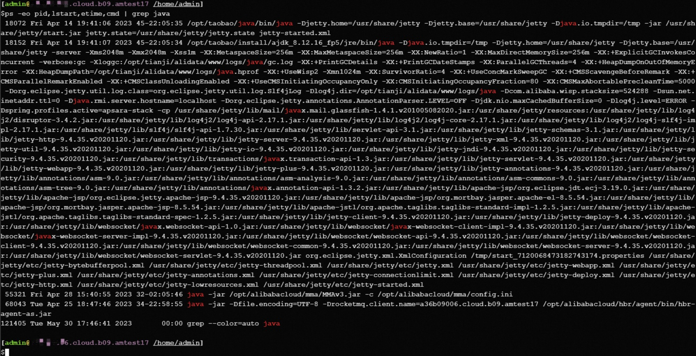

   - If a result similar to the one shown in the preceding figure is displayed, the status of the Java process is normal.

   - If the Java process is frequently restarted, contact Alibaba Cloud technical support.

> **Note**
>
> If the alert persists after you perform the preceding steps, submit a ticket to contact technical support.

<a id="section-6-1-14"></a>

### 6.1.14. tjmon_pop-aliyun-com-application_proc_not_exist_alarm

This alert is used to check whether the Java process of the PopAliyunCom component is running. This alert is triggered when the Java process of the PopAliyunCom component does not exist. In this case, the asrbr service may be interrupted.

**Alert attributes**

<table>
  <tr>
    <td>Alert name</td>
    <td>Metric</td>
    <td>Source</td>
    <td>Severity</td>
    <td>Service</td>
    <td>Check interval</td>
    <td>Trigger condition</td>
  </tr>
  <tr>
    <td>tjmon_pop-aliyun-com-application_proc_not_exi st_alarm</td>
    <td>tjmon_pop-aliyun-com-check_application _proc_state_clust er_serverrole</td>
    <td>tianjimon</td>
    <td>P1</td>
    <td>asrbr</td>
    <td>Every 60 seconds</td>
    <td>p1_expressin|$_status==2</td>
  </tr>
</table>

**Applicable versions**

Apsara Stack Enterprise V3.16 and later

**Causes**

The Java process of the PopAliyunCom component does not exist.

**Impacts**

- If this error occurs on one of the two nodes, service load balancing is affected, but the service remains available.

- If this error occurs on both nodes, the service becomes unavailable.

**Solutions**

> **Warning**
>
> If a solution requires that you modify product configurations, you must initiate a production change process to confirm the feasibility and standardization of the solution. Even in an emergency, you must obtain consent from the customer and TAM before you can perform the steps of the solution.

1. Log on to the Apsara Infrastructure Management console.

2. In the left-side navigation pane, choose **Product & Cluster O&M**. Enter asrbr in the search box and click **Cluster Details** in the **Actions** column of the search results.

   

3. On the **Services** tab, click the **webapp-datapop** service.

4. In the **Components** pane, select the **PopAliyunCom#** component.

5. On the **Instances** tab, check whether the machine status is normal.

   

   - If the machine status is abnormal, choose **Actions** > **Restart** in the **Actions** column to restart the machine.

   - If the machine status is normal, perform the following operations:

6. Click **Terminal** in the **Actions** column of the machine to log on to the machine.

7. Check whether the Java process exists.

   ```text
   ps -ef | grep java
   ```

   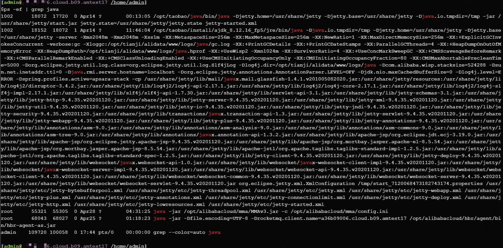

   - If a result as shown in the preceding figure is displayed, the Java process exists. Ignore the alert.

   - If the Java process does not exist, contact Alibaba Cloud technical support.

> **Note**
>
> If the alert persists after you perform the preceding steps, submit a ticket to contact technical support.

<a id="section-6-1-15"></a>

### 6.1.15. tjmon_pop-aliyun-com-service_available_alarm

This alert is used to monitor the status of the PopAliyunCom component. This alert is triggered when the status of the PopAliyunCom component becomes abnormal. In this case, the asrbr service is unavailable.

**Alert attributes**

<table>
  <tr>
    <td>Alert name</td>
    <td>Metric</td>
    <td>Source</td>
    <td>Severity</td>
    <td>Service</td>
    <td>Check interval</td>
    <td>Trigger condition</td>
  </tr>
  <tr>
    <td>tjmon_pop-aliyun-com-service_available_alarm</td>
    <td>tjmon_pop-aliyun-com-check_service_avai lable_cluster_serve rrole</td>
    <td>tianjimon</td>
    <td>P1</td>
    <td>asrbr</td>
    <td>Every 60 seconds</td>
    <td>p1_expressin|$_error_flag ==1</td>
  </tr>
</table>

**Applicable versions**

Apsara Stack Enterprise V3.16 and later

**Causes**

The Java process of the PopAliyunCom component becomes abnormal.

**Impacts**

- If this error occurs on one of the two nodes, service load balancing is affected, but the service remains available.

- If this error occurs on both nodes, the service becomes unavailable.

**Solutions**

> **Warning**
>
> If a solution requires that you modify product configurations, you must initiate a production change process to confirm the feasibility and standardization of the solution. Even in an emergency, you must obtain consent from the customer and TAM before you can perform the steps of the solution.

1. Log on to the Apsara Infrastructure Management console.

2. In the left-side navigation pane, choose **Product & Cluster O&M**. Enter asrbr in the search box and click **Cluster Details** in the **Actions** column of the search results.

   

3. On the **Services** tab, click the **webapp-datapop** service.

4. In the **Components** pane, select the **PopAliyunCom#** component.

5. On the **Instances** tab, check whether the machine status is normal.

   

   - If the machine status is abnormal, choose **Actions** > **Restart** in the **Actions** column to restart the machine.

   - If the machine status is normal, perform the following operations:

6. Click **Terminal** in the **Actions** column of the machine to log on to the machine.

7. Check whether the Java process exists.

   ```text
   ps -ef | grep java
   ```

   

   - If a result as shown in the preceding figure is displayed, the Java process exists. Ignore the alert.

   - If the Java process does not exist, contact Alibaba Cloud technical support.

> **Note**
>
> If the alert persists after you perform the preceding steps, submit a ticket to contact technical support.

<a id="section-6-1-16"></a>

### 6.1.16. tjmon_pop-api-aliyun-com-application_proc_restart_alarm

This alert is used to check whether the Java process of the PopApiAliyunCom component is frequently restarted. This alert is triggered when the Java process of the PopApiAliyunCom component is frequently restarted. In this case, the PopApiAliyunCom component is unavailable.

**Alert attributes**

<table>
  <tr>
    <td>Alert name</td>
    <td>Metric</td>
    <td>Source</td>
    <td>Severity</td>
    <td>Service</td>
    <td>Check interval</td>
    <td>Trigger condition</td>
  </tr>
  <tr>
    <td>tjmon_pop-api-aliyun-com-application_proc_restart _alarm</td>
    <td>tjmon_pop-api-aliyun-com-check_application_proc_state_cluster_serverrole</td>
    <td>tianjimon</td>
    <td>P1</td>
    <td>asrbr</td>
    <td>Every 60 seconds</td>
    <td>p1_expressin|$_status==1</td>
  </tr>
</table>

**Applicable versions**

Apsara Stack Enterprise V3.16 and later

**Causes**

The Java process of the PopApiAliyunCom component is frequently restarted.

**Impacts**

- If this error occurs on one of the two nodes, service load balancing is affected, but the service remains available.

- If this error occurs on both nodes, the service becomes unavailable.

**Solutions**

> **Warning**
>
> If a solution requires that you modify product configurations, you must initiate a production change process to confirm the feasibility and standardization of the solution. Even in an emergency, you must obtain consent from the customer and TAM before you can perform any steps of the solution.

1. Log on to the Apsara Infrastructure Management console.

2. In the left-side navigation pane, choose **Product & Cluster O&M**. Enter asrbr in the search box and click **Cluster Details** in the **Actions** column of the search results.

   

3. On the **Services** tab, click the **webapp-datapop** service.

4. In the **Components** pane, click **PopApiAliyunCom#**.

5. On the **Instances** tab, check whether the machine status is normal.

   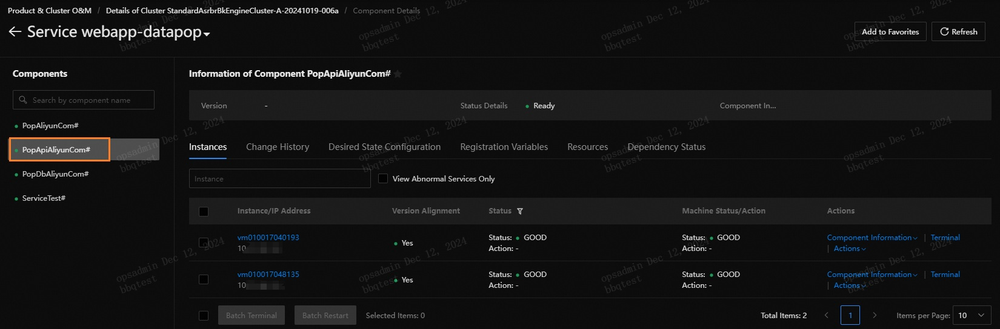

   - If the machine status is abnormal, choose **Actions** > **Restart** in the **Actions** column to restart the machine.

   - If the machine status is normal, perform the following steps:

6. Click **Terminal** in the **Actions** column of the machine to log on to the machine.

7. Log on to the webapp-datapop.PopApiAliyunCom# container.

   <ol type="i">

   <li>

   Obtain the ID of the container.

   ```bash
   docker ps
   ```

   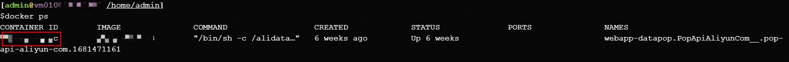

   </li>

   <li>

   Log on to the container.

   ```bash
   docker exec -it <Container ID> /bin/bash
   ```

   

   </li>

   </ol>

8. Check whether the Java process is frequently restarted. If the Java process is frequently restarted, restart the container.

   ```text
   ps -eo pid,lstart,etime,cmd | grep java
   ```

   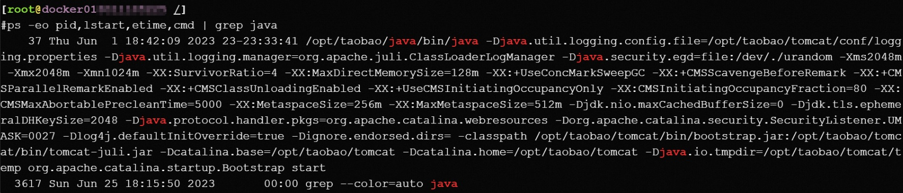

   If a result similar to the one shown in the preceding figure is displayed, the status of the Java process is normal.

9. Execute the  `exit`  command to exit the container.

0. Restart the container.

   ```bash
   docker stop <Container ID>
   docker start <Container ID>
   ```

1. After the container is restarted, check the status of the PopApiAliyunCom component. If the status is normal, the issue is resolved. If the issue persists, resolve the issue based on the logs.

   - Java process log path:  `alidata/logs/`

   - Container log query command: `docker logs<Container ID>`

> **Note**
>
> If the alert persists after you perform the preceding steps, submit a ticket to contact technical support.

<a id="section-6-1-17"></a>

### 6.1.17. tjmon_pop-api-aliyun-com-application_proc_not_exist_alarm

This alert is used to monitor whether the Java process of the PopApiAliyunCom component is running. This alert is triggered when the Java process of the PopApiAliyunCom component does not exist. In this case, the PopApiAliyunCom Component is unavailable.

**Alert attributes**

<table>
  <tr>
    <td>Alert name</td>
    <td>Metric</td>
    <td>Source</td>
    <td>Severity</td>
    <td>Service</td>
    <td>Check interval</td>
    <td>Trigger condition</td>
  </tr>
  <tr>
    <td>tjmon_pop-api-aliyun-com-application_proc_not_exi st_alarm</td>
    <td>tjmon_pop-api-aliyun-com-check_application _proc_state_clust er_serverrole</td>
    <td>tianjimon</td>
    <td>P1</td>
    <td>asrbr</td>
    <td>Every 60 seconds</td>
    <td>p1_expressin|$_status==2</td>
  </tr>
</table>

**Applicable versions**

Apsara Stack Enterprise V3.16 and later

**Causes**

The Java process of the PopApiAliyunCom component does not exist.

**Impacts**

- If this error occurs on one of the two nodes, service load balancing is affected, but the service remains available.

- If this error occurs on both nodes, the service becomes unavailable.

**Solutions**

> **Warning**
>
> If a solution requires that you modify product configurations, you must initiate a production change process to confirm the feasibility and standardization of the solution. Even in an emergency, you must obtain consent from the customer and TAM before you can perform any steps of the solution.

1. Log on to the Apsara Infrastructure Management console.

2. In the left-side navigation pane, choose **Product & Cluster O&M**. Enter asrbr in the search box and click **Cluster Details** in the **Actions** column of the search results.

   

3. On the **Services** tab, click the **webapp-datapop** service.

4. In the **Components** pane, click **PopApiAliyunCom#**.

5. On the **Instances** tab, check whether the machine status is normal.

   

   - If the machine status is abnormal, choose **Actions** > **Restart** in the **Actions** column to restart the machine.

   - If the machine status is normal, perform the following steps:

6. Click **Terminal** in the **Actions** column of the machine to log on to the machine.

7. Log on to the webapp-datapop.PopApiAliyunCom# container.

   <ol type="i">

   <li>

   Obtain the ID of the container.

   ```bash
   docker ps
   ```

   

   </li>

   <li>

   Log on to the container.

   ```bash
   docker exec -it <Container ID> /bin/bash
   ```

   

   </li>

   </ol>

8. Check whether the Java process exists. If the Java process does not exist, restart the container.

   ```text
   ps -ef | grep java
   ```

   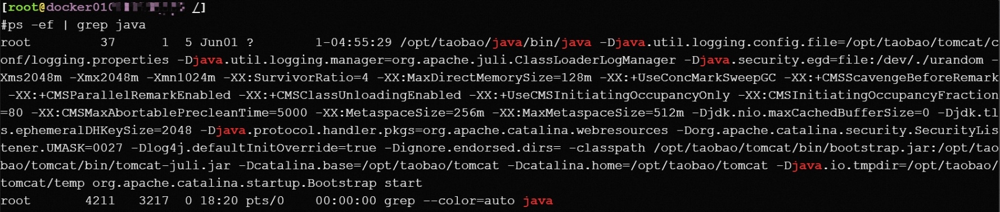

   If a result as shown in the preceding figure is displayed, the Java process exists.

9. Execute the  `exit`  command to exit the container.

0. Restart the container.

   ```bash
   docker stop <Container ID>
   docker start <Container ID>
   ```

1. After the container is restarted, check the status of the PopApiAliyunCom component. If the status is normal, the issue is resolved. If the issue persists, resolve the issue based on the logs.

   - Java process log path:  `alidata/logs/`

   - Container log query command: `docker logs<Container ID>`

> **Note**
>
> If the alert persists after you perform the preceding steps, submit a ticket to contact technical support.

<a id="section-6-1-18"></a>

### 6.1.18. tjmon_pop-api-aliyun-com-service_available_alarm

This alert is used to monitor the status of the PopApiAliyunCom component. This alert is triggered when the status of the PopApiAliyunCom component becomes abnormal.

**Alert attributes**

<table>
  <tr>
    <td>Alert name</td>
    <td>Metric</td>
    <td>Source</td>
    <td>Severity</td>
    <td>Service</td>
    <td>Check interval</td>
    <td>Trigger condition</td>
  </tr>
  <tr>
    <td>tjmon_pop-api-aliyun-com-service_available_alarm</td>
    <td>tjmon_pop-api-aliyun-com-check_service_avai lable_cluster_serve rrole</td>
    <td>tianjimon</td>
    <td>P1</td>
    <td>asrbr</td>
    <td>Every 60 seconds</td>
    <td>p1_expressin|$_error_flag ==1</td>
  </tr>
</table>

**Applicable versions**

Apsara Stack Enterprise V3.16 and later

**Causes**

The Java process of the PopApiAliyunCom component becomes abnormal.

**Impacts**

- If this error occurs on one of the two nodes, service load balancing is affected, but the service remains available.

- If this error occurs on both nodes, the service becomes unavailable.

**Solutions**

> **Warning**
>
> If a solution requires that you modify product configurations, you must initiate a production change process to confirm the feasibility and standardization of the solution. Even in an emergency, you must obtain consent from the customer and TAM before you can perform any steps of the solution.

1. Log on to the Apsara Infrastructure Management console.

2. In the left-side navigation pane, choose **Product & Cluster O&M**. Enter asrbr in the search box and click **Cluster Details** in the **Actions** column of the search results.

   

3. On the **Services** tab, click the **webapp-datapop** service.

4. In the **Components** pane, click **PopApiAliyunCom#**.

5. On the **Instances** tab, check whether the machine status is normal.

   

   - If the machine status is abnormal, choose **Actions** > **Restart** in the **Actions** column to restart the machine.

   - If the machine status is normal, perform the following steps:

6. Click **Terminal** in the **Actions** column of the machine to log on to the machine.

7. Log on to the webapp-datapop.PopApiAliyunCom# container.

   <ol type="i">

   <li>

   Obtain the ID of the container.

   ```bash
   docker ps
   ```

   

   </li>

   <li>

   Log on to the container.

   ```bash
   docker exec -it <Container ID> /bin/bash
   ```

   

   </li>

   </ol>

8. Check whether the Java process exists. If the Java process does not exist, restart the container.

   ```text
   ps -ef | grep java
   ```

   

   If a result as shown in the preceding figure is displayed, the Java process exists.

9. Execute the  `exit`  command to exit the container.

0. Restart the container.

   ```bash
   docker stop <Container ID>
   docker start <Container ID>
   ```

1. After the container is restarted, check the status of the PopApiAliyunCom component. If the status is normal, the issue is resolved. If the issue persists, resolve the issue based on the logs.

   - Java process log path:  `alidata/logs/`

   - Container log query command: `docker logs<Container ID>`

> **Note**
>
> If the alert persists after you perform the preceding steps, submit a ticket to contact technical support.

<a id="section-6-2"></a>

## 6.2. Backup plan-related alerts

<a id="section-6-2-1"></a>

### 6.2.1. Alerts

| Alert name | Description | Source | Severity | Service |
| --- | --- | --- | --- | --- |
| BACKUP_START_INSTANCE_POLICY_FAILED | A backup policy for an instance fails to be started. | asrbr-backup | P2 | asrbr |
| BACKUP_STOP_FAILED | A backup plan fails to be stopped. | asrbr-backup | P2 | asrbr |
| BACKUP_ENABLE_FAILED | A backup plan fails to be started. | asrbr-backup | P2 | asrbr |
| BACKUP_CREATE_INSTANCE_BACKUP_PLAN _FAILED | A backup plan for an instance fails to be created. | asrbr-backup | P2 | asrbr |
| BACKUP_STOP_INSTANCE_POLICY_FAILED | A backup plan for an instance fails to be stopped. | asrbr-backup | P2 | asrbr |
| BACKUP_EXCUTE_INSTANCE_BACKUP_FAIL ED | An immediate backup for an instance fails. | asrbr-backup | P2 | asrbr |
| BACKUP_SYNC_INSTANCE_BACKUP_RECOR D_FAILED | A backup record fails to be generated for an instance backup. | asrbr-backup | P2 | asrbr |
| BACKUP_SYNC_INSTANCE_BACKUP_RECOR D_BOLCKED | The generation of a backup record for an instance backup is blocked. | asrbr-backup | P2 | asrbr |
| BACKUP_MODIFY_INSTANCE_POLICY_FAILE D | A backup policy for an instance fails to be modified. | asrbr-backup | P2 | asrbr |
| ECS_DISK_BK_START_INSTANCE_POLICY_FA ILED | A backup policy for an ECS instance fails to be started. | asrbr-backup | P2 | asrbr |
| ECS_DISK_BK_STOP_FAILED | A backup plan for an ECS instance fails to be stopped. | asrbr-backup | P2 | asrbr |
| ECS_DISK_BK_ENABLE_FAILED | A backup plan for an ECS instance fails to be enabled. | asrbr-backup | P2 | asrbr |
| ECS_DISK_BK_STOP_INSTANCE_POLICY_FAI LED | A backup policy for an ECS instance fails to be stopped. | asrbr-backup | P2 | asrbr |
| ECS_DISK_BK_CREATE_INSTANCE_BACKUP_PLAN_FAILED | A backup plan for an ECS instance fails to be created. | asrbr-backup | P2 | asrbr |
| ECS_DISK_BK_EXCUTE_INSTANCE_BACKUP_FAILED | A backup plan for an ECS instance fails to be executed. | asrbr-backup | P2 | asrbr |
| ECS_DISK_BK_SYNC_INSTANCE_BACKUP_RE CORD_FAILED | A backup record fails to be generated for an ECS instance backup. | asrbr-backup | P2 | asrbr |
| ECS_DISK_BK_SYNC_INSTANCE_BACKUP_RE CORD_BLOCKED | The generation of a backup record for an ECS instance backup is blocked. | asrbr-backup | P2 | asrbr |
| ECS_DISK_BK_MODIFY_INSTANCE_POLICY_F AILED | A backup policy for an ECS instance fails to be modified. | asrbr-backup | P2 | asrbr |

<a id="section-6-2-2"></a>

### 6.2.2. BACKUP_START_INSTANCE_POLICY_FAILED

This alert is used to check whether a backup policy for an instance is successfully started. This alert is triggered when a backup policy for an instance fails to be started. In this case, the instance cannot be backed up by using the backup policy.

**Alert attributes**

<table>
  <tr>
    <td>Alert name</td>
    <td>Source</td>
    <td>Severity</td>
    <td>Service</td>
    <td>Check interval</td>
    <td>Trigger condition</td>
  </tr>
  <tr>
    <td>BACKUP_START_INSTAN CE_POLICY_FAILED</td>
    <td>asrbr-backup</td>
    <td>P2</td>
    <td>asrbr</td>
    <td>One-time check</td>
    <td>A backup policy for an instance fails to be started due to the failure to call the related databases and HBR APIs.</td>
  </tr>
</table>

**Applicable versions**

Apsara Stack Enterprise V3.12 and later

**Causes**

A backup policy for an instance fails to be started due to the failure to call the related databases and HBR APIs.

**Impacts**

The instance cannot be backed up by using the backup policy.

**Solutions**

> **Warning**
>
> If a solution requires that you modify product configurations, you must initiate a production change process to confirm the feasibility and standardization of the solution. Even in an emergency, you must obtain consent from the customer and TAM before you can perform any steps of the solution.

1. Log on to the ASR for Backup and Recovery console.

2. In the left-side navigation pane, click **Backup Plans**.

3. Find the backup plan based on the plan name in the alert information and click the plan name  .

   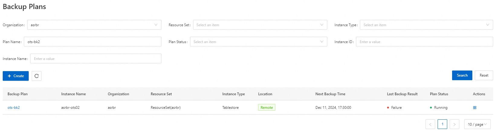

4. Click the **Backup Events** tab and then click the  icon to the left of the event to view all sub-events.

5. Click the  button to the right of the sub-event to view the corresponding event logs.

   - If an error message is found, take actions based on the error message.

   - If no error message is found, perform the following steps:

     <ol type="a">

     <li>

     Refresh the list, press the F12 key, and then click the  icon to the left of the event to open the sub-event list and view the event_id of

     the current event.

     </li>

     <li>

     Log on to the asrbr-backup.Backup# terminal.

     </li>

     </ol>

     <ol type="i" start="100">

     <li>

     Execute the  `cd /alidata/logs/asrbr-backup/`  command to view the asrbr-backup.log.

     > **Note**
     >
     > You can view historical logs in the bak directory.

     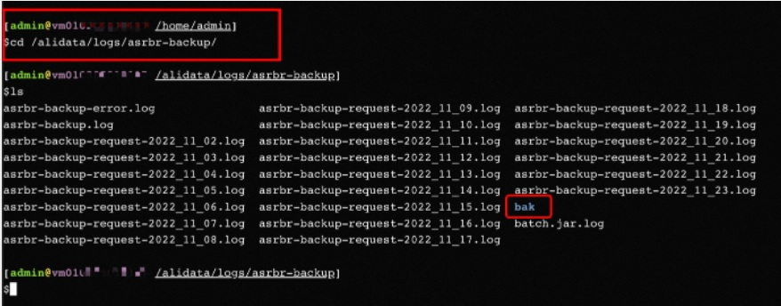

     </li>

     <li value="500">

     Execute the  `grep -r "<event_id>" asrbr-backup.log`  command to search for logs. Replace  `<event_id>`  in the command with the event ID obtained in the preceding step. Take actions based on the specific error information in the logs.

     </li>

     </ol>

> **Note**
>
> If the alert persists after you perform the preceding steps, submit a ticket to contact technical support.

<a id="section-6-2-3"></a>

### 6.2.3. BACKUP_STOP_FAILED

This alert is used to check whether a backup plan for an instance is successfully stopped. This alert is triggered when a backup plan for an instance fails to be stopped. The instance may still be undergoing the backup process. You must take immediate actions to identify and resolve the issue.

**Alert attributes**

<table>
  <tr>
    <td>Alert name</td>
    <td>Source</td>
    <td>Severity</td>
    <td>Service</td>
    <td>Check interval</td>
    <td>Trigger condition</td>
  </tr>
  <tr>
    <td>BACKUP_STOP_FAILED</td>
    <td>asrbr-backup</td>
    <td>P2</td>
    <td>asrbr</td>
    <td>One-time check</td>
    <td>A backup plan fails to be stopped.</td>
  </tr>
</table>

**Applicable versions**

Apsara Stack Enterprise V3.12 and later

**Causes**

An API of a related business failed to be called during the process.

**Impacts**

The instance may still be undergoing the backup process. You must take immediate actions to identify and resolve the issue.

**Solutions**

> **Warning**
>
> If a solution requires that you modify product configurations, you must initiate a production change process to confirm the feasibility and standardization of the solution. Even in an emergency, you must obtain consent from the customer and TAM before you can perform any steps of the solution.

1. Log on to the ASR for Backup and Recovery console.

2. In the left-side navigation pane, click **Backup Plans**.

3. Find the backup plan based on the plan name in the alert information and click the plan name  .

   

4. Click the **Backup Events** tab and then click the  icon to the left of the event to view all sub-events.

5. Click the  button to the right of the sub-event to view the corresponding event logs.

   - If an error message is found, take actions based on the error message.

   - If no error message is found, perform the following steps:

     <ol type="a">

     <li>

     Refresh the list, press the F12 key, and then click the  icon to the left of the event to open the sub-event list and view the event_id of

     the current event.

     </li>

     <li>

     Log on to the asrbr-backup.Backup# terminal.

     </li>

     </ol>

     <ol type="i" start="100">

     <li>

     Execute the  `cd /alidata/logs/asrbr-backup/`  command to view the asrbr-backup.log.

     > **Note**
     >
     > You can view historical logs in the bak directory.

     

     </li>

     <li value="500">

     Execute the  `grep -r "<event_id>" asrbr-backup.log`  command to search for logs. Replace  `<event_id>`  in the command with the event ID obtained in the preceding step. Take actions based on the specific error information in the logs.

     </li>

     </ol>

> **Note**
>
> If the alert persists after you perform the preceding steps, submit a ticket to contact technical support.

<a id="section-6-2-4"></a>

### 6.2.4. BACKUP_ENABLE_FAILED

This alert is used to check whether a backup plan for an instance is successfully enabled. This alert is triggered when a backup plan for an instance fails to be enabled. In this case, the instance cannot be backed up by using the backup plan.

**Alert attributes**

<table>
  <tr>
    <td>Alert name</td>
    <td>Source</td>
    <td>Severity</td>
    <td>Service</td>
    <td>Check interval</td>
    <td>Trigger condition</td>
  </tr>
  <tr>
    <td>BACKUP_ENABLE_FAILE D</td>
    <td>asrbr-backup</td>
    <td>P2</td>
    <td>asrbr</td>
    <td>One-time check</td>
    <td>A backup plan for an instance fails to be enabled, possibly due to a failure to call related databases and HBR interfaces.</td>
  </tr>
</table>

**Applicable versions**

Apsara Stack Enterprise V3.12 and later

**Causes**

Related databases and HBR interfaces failed to be called during the process.

**Impacts**

The instance cannot be backed up by using the backup plan.

**Solutions**

> **Warning**
>
> If a solution requires that you modify product configurations, you must initiate a production change process to confirm the feasibility and standardization of the solution. Even in an emergency, you must obtain consent from the customer and TAM before you can perform any steps of the solution.

1. Log on to the ASR for Backup and Recovery console.

2. In the left-side navigation pane, click **Backup Plans**.

3. Find the backup plan based on the plan name in the alert information and click the plan name  .

   

4. Click the **Backup Events** tab and then click the  icon to the left of the event to view all sub-events.

5. Click the  button to the right of the sub-event to view the corresponding event logs.

   - If an error message is found, take actions based on the error message.

   - If no error message is found, perform the following steps:

     <ol type="a">

     <li>

     Refresh the list, press the F12 key, and then click the  icon to the left of the event to open the sub-event list and view the event_id of

     the current event.

     </li>

     <li>

     Log on to the asrbr-backup.Backup# terminal.

     </li>

     </ol>

     <ol type="i" start="100">

     <li>

     Execute the  `cd /alidata/logs/asrbr-backup/`  command to view the asrbr-backup.log.

     > **Note**
     >
     > You can view historical logs in the bak directory.

     

     </li>

     <li value="500">

     Execute the  `grep -r "<event_id>" asrbr-backup.log`  command to search for logs. Replace  `<event_id>`  in the command with the event ID obtained in the preceding step. Take actions based on the specific error information in the logs.

     </li>

     </ol>

> **Note**
>
> If the alert persists after you perform the preceding steps, submit a ticket to contact technical support.

<a id="section-6-2-5"></a>

### 6.2.5. BACKUP_CREATE_INSTANCE_BACKUP_PLAN_FAILED

This alert is used to check whether a backup plan is successfully created for an instance. This alert is triggered when a backup plan fails to be created for an instance. In this case, the instance is not backed up by using the backup plan.

**Alert attributes**

<table>
  <tr>
    <td>Alert name</td>
    <td>Source</td>
    <td>Severity</td>
    <td>Service</td>
    <td>Check interval</td>
    <td>Trigger condition</td>
  </tr>
  <tr>
    <td>BACKUP_CREATE_INSTA NCE_BACKUP_PLAN_FAIL ED</td>
    <td>asrbr-backup</td>
    <td>P2</td>
    <td>asrbr</td>
    <td>One-time check</td>
    <td>A backup plan fails to be created.</td>
  </tr>
</table>

**Applicable versions**

Apsara Stack Enterprise V3.12 and later

**Causes**

An API of a related business failed to be called during the process.

**Impacts**

The instance is not backed up by using the backup plan.

**Solutions**

> **Warning**
>
> If a solution requires that you modify product configurations, you must initiate a production change process to confirm the feasibility and standardization of the solution. Even in an emergency, you must obtain consent from the customer and TAM before you can perform any steps of the solution.

1. Log on to the ASR for Backup and Recovery console.

2. In the left-side navigation pane, click **Backup Plans**.

3. Find the backup plan based on the plan name in the alert information and click the plan name  .

   

4. Click the **Backup Events** tab and then click the  icon to the left of the event to view all sub-events.

5. Click the  button to the right of the sub-event to view the corresponding event logs.

   - If an error message is found, take actions based on the error message.

   - If no error message is found, perform the following steps:

     <ol type="a">

     <li>

     Refresh the list, press the F12 key, and then click the  icon to the left of the event to open the sub-event list and view the event_id of

     the current event.

     </li>

     <li>

     Log on to the asrbr-backup.Backup# terminal.

     </li>

     </ol>

     <ol type="i" start="100">

     <li>

     Execute the  `cd /alidata/logs/asrbr-backup/`  command to view the asrbr-backup.log.

     > **Note**
     >
     > You can view historical logs in the bak directory.

     

     </li>

     <li value="500">

     Execute the  `grep -r "<event_id>" asrbr-backup.log`  command to search for logs. Replace  `<event_id>`  in the command with the event ID obtained in the preceding step. Take actions based on the specific error information in the logs.

     </li>

     </ol>

> **Note**
>
> If the alert persists after you perform the preceding steps, submit a ticket to contact technical support.

<a id="section-6-2-6"></a>

### 6.2.6. BACKUP_STOP_INSTANCE_POLICY_FAILED

This alert is used to check whether a backup plan for an instance is successfully stopped. This alert is triggered when a backup plan for an instance fails to be stopped. In this case, the instance may still be undergoing the backup process. You must take actions at the earliest opportunity.

**Alert attributes**

<table>
  <tr>
    <td>Alert name</td>
    <td>Source</td>
    <td>Severity</td>
    <td>Service</td>
    <td>Check interval</td>
    <td>Trigger condition</td>
  </tr>
  <tr>
    <td>BACKUP_STOP_INSTANC E_POLICY_FAILED</td>
    <td>asrbr-backup</td>
    <td>P2</td>
    <td>asrbr</td>
    <td>One-time check</td>
    <td>A backup plan for an instance fails to be stopped.</td>
  </tr>
</table>

**Applicable versions**

Apsara Stack Enterprise V3.16 and later

**Causes**

A backup plan for an instance fails to be stopped, possibly due to a failure to call an API of a related business.

**Impacts**

The instance may still be undergoing the backup process.

**Solutions**

> **Warning**
>
> If a solution requires that you modify product configurations, you must initiate a production change process to confirm the feasibility and standardization of the solution. Even in an emergency, you must obtain consent from the customer and TAM before you can perform any steps of the solution.

1. Log on to the ASR for Backup and Recovery console.

2. In the left-side navigation pane, click **Backup Plans**.

3. Find the backup plan based on the plan name in the alert information and click the plan name  .

   

4. Click the **Backup Events** tab and then click the  icon to the left of the event to view all sub-events.

5. Click the  button to the right of the sub-event to view the corresponding event logs.

   - If an error message is found, take actions based on the error message.

   - If no error message is found, perform the following steps:

     <ol type="a">

     <li>

     Refresh the list, press the F12 key, and then click the  icon to the left of the event to open the sub-event list and view the event_id of

     the current event.

     </li>

     <li>

     Log on to the asrbr-backup.Backup# terminal.

     </li>

     </ol>

     <ol type="i" start="100">

     <li>

     Execute the  `cd /alidata/logs/asrbr-backup/`  command to view the asrbr-backup.log.

     > **Note**
     >
     > You can view historical logs in the bak directory.

     

     </li>

     <li value="500">

     Execute the  `grep -r "<event_id>" asrbr-backup.log`  command to search for logs. Replace  `<event_id>`  in the command with the event ID obtained in the preceding step. Take actions based on the specific error information in the logs.

     </li>

     </ol>

> **Note**
>
> If the alert persists after you perform the preceding steps, submit a ticket to contact technical support.

<a id="section-6-2-7"></a>

### 6.2.7. BACKUP_EXCUTE_INSTANCE_BACKUP_FAILED

This alert is used to check whether an immediate backup for an instance is successful. This alert is triggered when an immediate backup for an instance fails. In this case, the instance is not backed up. You must identify the cause or perform another immediate backup.

**Alert attributes**

<table>
  <tr>
    <td>Alert name</td>
    <td>Source</td>
    <td>Severity</td>
    <td>Service</td>
    <td>Check interval</td>
    <td>Trigger condition</td>
  </tr>
  <tr>
    <td>BACKUP_EXCUTE_INSTA NCE_BACKUP_FAILED</td>
    <td>asrbr-backup</td>
    <td>P2</td>
    <td>asrbr</td>
    <td>One-time check</td>
    <td>An immediate backup for an instance fails.</td>
  </tr>
</table>

**Applicable versions**

Apsara Stack Enterprise V3.16 and later

**Causes**

An API of a related business failed to be called during the process.

**Impacts**

The instance is not backed up. You must identify the cause or perform another immediate backup.

**Solutions**

> **Warning**
>
> If a solution requires that you modify product configurations, you must initiate a production change process to confirm the feasibility and standardization of the solution. Even in an emergency, you must obtain consent from the customer and TAM before you can perform any steps of the solution.

1. Log on to the ASR for Backup and Recovery console.

2. In the left-side navigation pane, click **Backup Plans**.

3. Find the backup plan based on the plan name in the alert information and click the plan name  .

   

4. Click the **Backup Events** tab and then click the  icon to the left of the event to view all sub-events.

5. Click the  button to the right of the sub-event to view the corresponding event logs.

   - If an error message is found, take actions based on the error message.

   - If no error message is found, perform the following steps:

     <ol type="a">

     <li>

     Refresh the list, press the F12 key, and then click the  icon to the left of the event to open the sub-event list and view the event_id of

     the current event.

     </li>

     <li>

     Log on to the asrbr-backup.Backup# terminal.

     </li>

     </ol>

     <ol type="i" start="100">

     <li>

     Execute the  `cd /alidata/logs/asrbr-backup/`  command to view the asrbr-backup.log.

     > **Note**
     >
     > You can view historical logs in the bak directory.

     

     </li>

     <li value="500">

     Execute the  `grep -r "<event_id>" asrbr-backup.log`  command to search for logs. Replace  `<event_id>`  in the command with the event ID obtained in the preceding step. Take actions based on the specific error information in the logs.

     </li>

     </ol>

> **Note**
>
> If the alert persists after you perform the preceding steps, submit a ticket to contact technical support.

<a id="section-6-2-8"></a>

### 6.2.8. BACKUP_SYNC_INSTANCE_BACKUP_RECORD_FAILED

This alert is used to check whether a backup record is successfully generated for a backup. This alert is triggered when a backup record fails to be generated for a backup. You must identify the cause.

**Alert attributes**

<table>
  <tr>
    <td>Alert name</td>
    <td>Source</td>
    <td>Severity</td>
    <td>Service</td>
    <td>Check interval</td>
    <td>Trigger condition</td>
  </tr>
  <tr>
    <td>BACKUP_SYNC_INSTANC E_BACKUP_RECORD_FAI LED</td>
    <td>asrbr-backup</td>
    <td>P2</td>
    <td>asrbr</td>
    <td>One-time check</td>
    <td>No backup record is generated for a periodical backup or an immediate backup.</td>
  </tr>
</table>

**Applicable versions**

Apsara Stack Enterprise V3.16 and later

**Causes**

The backup failed, or the backup job ID is not generated within in the specified period of time.

**Impacts**

The backup record fails to be generated. You must identify the cause of the failure.

**Solutions**

> **Warning**
>
> If a solution requires that you modify product configurations, you must initiate a production change process to confirm the feasibility and standardization of the solution. Even in an emergency, you must obtain consent from the customer and TAM before you can perform any steps of the solution.

1. Log on to the ASR for Backup and Recovery console.

2. In the left-side navigation pane, click **Backup Plans**.

3. Find the backup plan based on the plan name in the alert information and click the plan name  .

   

4. Click the **Backup Events** tab and then click the  icon to the left of the event to view all sub-events.

5. Click the  button to the right of the sub-event to view the corresponding event logs.

   - If an error message is found, take actions based on the error message.

   - If no error message is found, perform the following steps:

     <ol type="a">

     <li>

     Refresh the list, press the F12 key, and then click the  icon to the left of the event to open the sub-event list and view the event_id of

     the current event.

     </li>

     <li>

     Log on to the asrbr-backup.Backup# terminal.

     </li>

     </ol>

     <ol type="i" start="100">

     <li>

     Execute the  `cd /alidata/logs/asrbr-backup/`  command to view the asrbr-backup.log.

     > **Note**
     >
     > You can view historical logs in the bak directory.

     

     </li>

     <li value="500">

     Execute the  `grep -r "<event_id>" asrbr-backup.log`  command to search for logs. Replace  `<event_id>`  in the command with the event ID obtained in the preceding step. Take actions based on the specific error information in the logs.

     </li>

     </ol>

> **Note**
>
> If the alert persists after you perform the preceding steps, submit a ticket to contact technical support.

<a id="section-6-2-9"></a>

### 6.2.9. BACKUP_SYNC_INSTANCE_BACKUP_RECORD_BOLCKED

This alert is used to check whether the generation of a backup record is blocked. This alert is triggered when the generation of a backup record is blocked.

**Alert attributes**

<table>
  <tr>
    <td>Alert name</td>
    <td>Source</td>
    <td>Severity</td>
    <td>Service</td>
    <td>Check interval</td>
    <td>Trigger condition</td>
  </tr>
  <tr>
    <td>BACKUP_SYNC_INSTANC E_BACKUP_RECORD_BO LCKED</td>
    <td>asrbr-backup</td>
    <td>P2</td>
    <td>asrbr</td>
    <td>One-time check</td>
    <td>No backup record is generated for a periodical backup or an immediate backup.</td>
  </tr>
</table>

**Applicable versions**

Apsara Stack Enterprise V3.16 and later

**Causes**

The instance is a storage instance or a big data instance. Other backup plans of the instance are being executed.

**Impacts**

No backup record is generated for the backup event.

**Solutions**

> **Warning**
>
> If a solution requires that you modify product configurations, you must initiate a production change process to confirm the feasibility and standardization of the solution. Even in an emergency, you must obtain consent from the customer and TAM before you can perform any steps of the solution.

To prevent the backup record from being blocked, perform the following steps to change the execution time of the backup policy:

1. Log on to the ASR for Backup and Recovery console as an organization backup administrator.

2. In the left-side navigation pane, click **Backup Plans**.

3. On the **Backup Plan** page, find the backup plan that you want to view. You can specify search conditions to search for the backup plan.

4. Click the name of the backup plan.

5. In the **Backup Policy** section of the **Backup Information** tab, click **Modify Backup Policy**.

   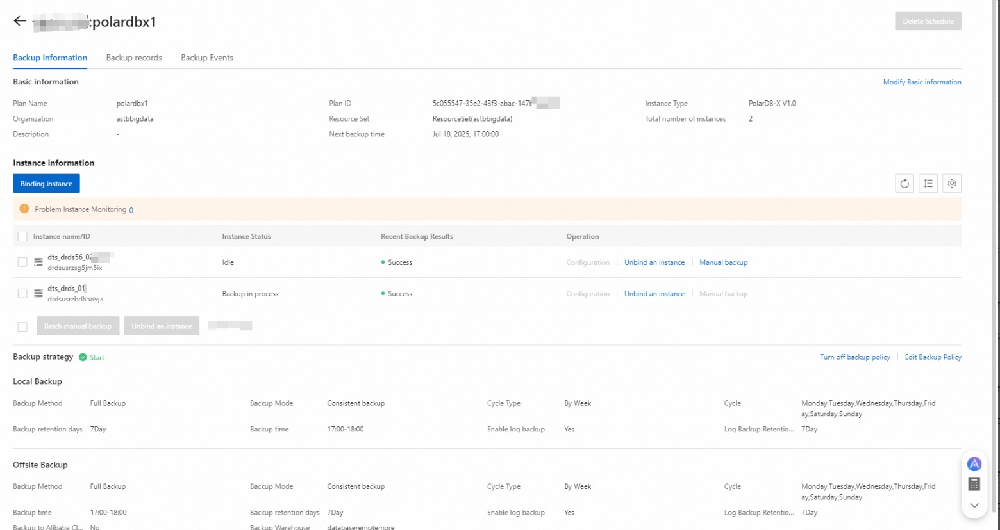

6. Modify the parameter settings of the backup policy and click **Save**.

   > **Note**
   >
   > The parameters of the backup policy vary based on the instance type. You can configure the parameters based on the on-screen instructions.

> **Note**
>
> If the alert persists after you perform the preceding steps, submit a ticket to contact technical support.

<a id="section-6-2-10"></a>

### 6.2.10. BACKUP_MODIFY_INSTANCE_POLICY_FAILED

This alert is used to check whether a backup policy is successfully modified. This alert is triggered when the modification of a backup policy fails. The original backup policy continues to be used for the backup.

**Alert attributes**

<table>
  <tr>
    <td>Alert name</td>
    <td>Source</td>
    <td>Severity</td>
    <td>Service</td>
    <td>Check interval</td>
    <td>Trigger condition</td>
  </tr>
  <tr>
    <td>BACKUP_MODIFY_INSTA NCE_POLICY_FAILED</td>
    <td>asrbr-backup</td>
    <td>P2</td>
    <td>asrbr</td>
    <td>One-time check</td>
    <td>A backup policy fails to be modified.</td>
  </tr>
</table>

**Applicable versions**

Apsara Stack Enterprise V3.16 and later

**Causes**

A backup policy fails to be modified.

**Impacts**

The original backup policy continues to be used for the backup.

**Solutions**

> **Warning**
>
> If a solution requires that you modify product configurations, you must initiate a production change process to confirm the feasibility and standardization of the solution. Even in an emergency, you must obtain consent from the customer and TAM before you can perform any steps of the solution.

1. Log on to the ASR for Backup and Recovery console.

2. In the left-side navigation pane, click **Backup Plans**.

3. Find the backup plan based on the plan name in the alert information and click the plan name  .

   

4. Click the **Backup Events** tab and then click the  icon to the left of the event to view all sub-events.

5. Click the  button to the right of the sub-event to view the corresponding event logs.

   - If an error message is found, take actions based on the error message.

   - If no error message is found, perform the following steps:

     <ol type="a">

     <li>

     Refresh the list, press the F12 key, and then click the  icon to the left of the event to open the sub-event list and view the event_id of

     the current event.

     </li>

     <li>

     Log on to the asrbr-backup.Backup# terminal.

     </li>

     </ol>

     <ol type="i" start="100">

     <li>

     Execute the  `cd /alidata/logs/asrbr-backup/`  command to view the asrbr-backup.log.

     > **Note**
     >
     > You can view historical logs in the bak directory.

     

     </li>

     <li value="500">

     Execute the  `grep -r "<event_id>" asrbr-backup.log`  command to search for logs. Replace  `<event_id>`  in the command with the event ID obtained in the preceding step. Take actions based on the specific error information in the logs.

     </li>

     </ol>

> **Note**
>
> If the alert persists after you perform the preceding steps, submit a ticket to contact technical support.

<a id="section-6-2-11"></a>

### 6.2.11. ECS_DISK_BK_START_INSTANCE_POLICY_FAILED

This alert is used to check whether a backup plan for an Elastic Compute Service (ECS) instance is successfully started. This alert is triggered when a backup plan for an ECS instance fails to be started. In this case, the ECS instance cannot be backed up by using the backup plan.

**Alert attributes**

<table>
  <tr>
    <td>Alert name</td>
    <td>Source</td>
    <td>Severity</td>
    <td>Service</td>
    <td>Check interval</td>
    <td>Trigger condition</td>
  </tr>
  <tr>
    <td>ECS_DISK_BK_START_IN STANCE_POLICY_FAILED</td>
    <td>asrbr-backup</td>
    <td>P2</td>
    <td>asrbr</td>
    <td>One-time check</td>
    <td>A backup plan for an ECS instance fails to be started.</td>
  </tr>
</table>

**Applicable versions**

Apsara Stack Enterprise V3.16 and later

**Causes**

A backup plan for an ECS instance fails to be started.

**Impacts**

The ECS instance cannot be backed up by using the backup plan.

**Solutions**

> **Warning**
>
> If a solution requires that you modify product configurations, you must initiate a production change process to confirm the feasibility and standardization of the solution. Even in an emergency, you must obtain consent from the customer and TAM before you can perform any steps of the solution.

1. Log on to the ASR for Backup and Recovery console.

2. In the left-side navigation pane, click **Backup Plans**.

3. Find the backup plan based on the plan name in the alert information and click the plan name  .

   

4. Click the **Backup Events** tab and then click the  icon to the left of the event to view all sub-events.

5. Click the  button to the right of the sub-event to view the corresponding event logs.

   - If an error message is found, take actions based on the error message.

   - If no error message is found, perform the following steps:

     <ol type="a">

     <li>

     Refresh the list, press the F12 key, and then click the  icon to the left of the event to open the sub-event list and view the event_id of

     the current event.

     </li>

     <li>

     Log on to the asrbr-backup.Backup# terminal.

     </li>

     </ol>

     <ol type="i" start="100">

     <li>

     Execute the  `cd /alidata/logs/asrbr-backup/`  command to view the asrbr-backup.log.

     > **Note**
     >
     > You can view historical logs in the bak directory.

     

     </li>

     <li value="500">

     Execute the  `grep -r "<event_id>" asrbr-backup.log`  command to search for logs. Replace  `<event_id>`  in the command with the event ID obtained in the preceding step. Take actions based on the specific error information in the logs.

     </li>

     </ol>

> **Note**
>
> If the alert persists after you perform the preceding steps, submit a ticket to contact technical support.

<a id="section-6-2-12"></a>

### 6.2.12. ECS_DISK_BK_STOP_FAILED

This alert is used to check whether a backup plan for an Elastic Compute Service (ECS) instance is successfully stopped. This alert is triggered when a backup plan for an ECS instance fails to be stopped. The backup is still in progress.

**Alert attributes**

<table>
  <tr>
    <td>Alert name</td>
    <td>Source</td>
    <td>Severity</td>
    <td>Service</td>
    <td>Check interval</td>
    <td>Trigger condition</td>
  </tr>
  <tr>
    <td>ECS_DISK_BK_STOP_FAIL ED</td>
    <td>asrbr-backup</td>
    <td>P2</td>
    <td>asrbr</td>
    <td>One-time check</td>
    <td>A backup plan for an ECS instance fails to be stopped.</td>
  </tr>
</table>

**Applicable versions**

Apsara Stack Enterprise V3.16 and later

**Causes**

A third-party API may fail to be called during the process.

**Impacts**

The ECS instance continues to be backed up by using the backup plan.

**Solutions**

> **Warning**
>
> If a solution requires that you modify product configurations, you must initiate a production change process to confirm the feasibility and standardization of the solution. Even in an emergency, you must obtain consent from the customer and TAM before you can perform any steps of the solution.

1. Log on to the ASR for Backup and Recovery console.

2. In the left-side navigation pane, click **Backup Plans**.

3. Find the backup plan based on the plan name in the alert information and click the plan name  .

   

4. Click the **Backup Events** tab and then click the  icon to the left of the event to view all sub-events.

5. Click the  button to the right of the sub-event to view the corresponding event logs.

   - If an error message is found, take actions based on the error message.

   - If no error message is found, perform the following steps:

     <ol type="a">

     <li>

     Refresh the list, press the F12 key, and then click the  icon to the left of the event to open the sub-event list and view the event_id of

     the current event.

     </li>

     <li>

     Log on to the asrbr-backup.Backup# terminal.

     </li>

     </ol>

     <ol type="i" start="100">

     <li>

     Execute the  `cd /alidata/logs/asrbr-backup/`  command to view the asrbr-backup.log.

     > **Note**
     >
     > You can view historical logs in the bak directory.

     

     </li>

     <li value="500">

     Execute the  `grep -r "<event_id>" asrbr-backup.log`  command to search for logs. Replace  `<event_id>`  in the command with the event ID obtained in the preceding step. Take actions based on the specific error information in the logs.

     </li>

     </ol>

> **Note**
>
> If the alert persists after you perform the preceding steps, submit a ticket to contact technical support.

<a id="section-6-2-13"></a>

### 6.2.13. ECS_DISK_BK_ENABLE_FAILED

This alert is used to check whether a backup plan for an Elastic Compute Service (ECS) instance is successfully started. This alert is triggered when a backup plan for an ECS instance fails to be started.

**Alert attributes**

<table>
  <tr>
    <td>Alert name</td>
    <td>Source</td>
    <td>Severity</td>
    <td>Service</td>
    <td>Check interval</td>
    <td>Trigger condition</td>
  </tr>
  <tr>
    <td>ECS_DISK_BK_ENABLE_F AILED</td>
    <td>asrbr-backup</td>
    <td>P2</td>
    <td>asrbr</td>
    <td>One-time check</td>
    <td>A backup plan for an ECS instance fails to be started.</td>
  </tr>
</table>

**Applicable versions**

Apsara Stack Enterprise V3.16 and later

**Causes**

A third-party API may fail to be called during the process.

**Impacts**

The ECS instance is not backed up by using the backup plan.

**Solutions**

> **Warning**
>
> If a solution requires that you modify product configurations, you must initiate a production change process to confirm the feasibility and standardization of the solution. Even in an emergency, you must obtain consent from the customer and TAM before you can perform any steps of the solution.

1. Log on to the ASR for Backup and Recovery console.

2. In the left-side navigation pane, click **Backup Plans**.

3. Find the backup plan based on the plan name in the alert information and click the plan name  .

   

4. Click the **Backup Events** tab and then click the  icon to the left of the event to view all sub-events.

5. Click the  button to the right of the sub-event to view the corresponding event logs.

   - If an error message is found, take actions based on the error message.

   - If no error message is found, perform the following steps:

     <ol type="a">

     <li>

     Refresh the list, press the F12 key, and then click the  icon to the left of the event to open the sub-event list and view the event_id of

     the current event.

     </li>

     <li>

     Log on to the asrbr-backup.Backup# terminal.

     </li>

     </ol>

     <ol type="i" start="100">

     <li>

     Execute the  `cd /alidata/logs/asrbr-backup/`  command to view the asrbr-backup.log.

     > **Note**
     >
     > You can view historical logs in the bak directory.

     

     </li>

     <li value="500">

     Execute the  `grep -r "<event_id>" asrbr-backup.log`  command to search for logs. Replace  `<event_id>`  in the command with the event ID obtained in the preceding step. Take actions based on the specific error information in the logs.

     </li>

     </ol>

> **Note**
>
> If the alert persists after you perform the preceding steps, submit a ticket to contact technical support.

<a id="section-6-2-14"></a>

### 6.2.14. ECS_DISK_BK_STOP_INSTANCE_POLICY_FAILED

This alert is used to check whether a backup plan for an Elastic Compute Service (ECS) instance is successfully stopped. This alert is triggered when a backup plan for an ECS instance fails to be stopped. In this case, the ECS instance continues to undergo the backup process based on the backup plan.

**Alert attributes**

<table>
  <tr>
    <td>Alert name</td>
    <td>Source</td>
    <td>Severity</td>
    <td>Service</td>
    <td>Check interval</td>
    <td>Trigger condition</td>
  </tr>
  <tr>
    <td>ECS_DISK_BK_STOP_INS TANCE_POLICY_FAILED</td>
    <td>asrbr-backup</td>
    <td>P2</td>
    <td>asrbr</td>
    <td>One-time check</td>
    <td>A backup plan for an ECS instance fails to be stopped.</td>
  </tr>
</table>

**Applicable versions**

Apsara Stack Enterprise V3.16 and later

**Causes**

A backup plan for an ECS instance fails to be stopped, possibly due to a failure to call a third-party API.

**Impacts**

The ECS instance continues to undergo the backup process based on the backup plan.

**Solutions**

> **Warning**
>
> If a solution requires that you modify product configurations, you must initiate a production change process to confirm the feasibility and standardization of the solution. Even in an emergency, you must obtain consent from the customer and TAM before you can perform any steps of the solution.

1. Log on to the ASR for Backup and Recovery console.

2. In the left-side navigation pane, click **Backup Plans**.

3. Find the backup plan based on the plan name in the alert information and click the plan name  .

   

4. Click the **Backup Events** tab and then click the  icon to the left of the event to view all sub-events.

5. Click the  button to the right of the sub-event to view the corresponding event logs.

   - If an error message is found, take actions based on the error message.

   - If no error message is found, perform the following steps:

     <ol type="a">

     <li>

     Refresh the list, press the F12 key, and then click the  icon to the left of the event to open the sub-event list and view the event_id of

     the current event.

     </li>

     <li>

     Log on to the asrbr-backup.Backup# terminal.

     </li>

     </ol>

     <ol type="i" start="100">

     <li>

     Execute the  `cd /alidata/logs/asrbr-backup/`  command to view the asrbr-backup.log.

     > **Note**
     >
     > You can view historical logs in the bak directory.

     

     </li>

     <li value="500">

     Execute the  `grep -r "<event_id>" asrbr-backup.log`  command to search for logs. Replace  `<event_id>`  in the command with the event ID obtained in the preceding step. Take actions based on the specific error information in the logs.

     </li>

     </ol>

> **Note**
>
> If the alert persists after you perform the preceding steps, submit a ticket to contact technical support.

<a id="section-6-2-15"></a>

### 6.2.15. ECS_DISK_BK_CREATE_INSTANCE_BACKUP_PLAN_FAILED

This alert is used to check whether a backup plan for an Elastic Compute Service (ECS) instance is successfully created. This alert is triggered when a backup plan for an ECS instance fails to be created.

**Alert attributes**

<table>
  <tr>
    <td>Alert name</td>
    <td>Source</td>
    <td>Severity</td>
    <td>Service</td>
    <td>Check interval</td>
    <td>Trigger condition</td>
  </tr>
  <tr>
    <td>ECS_DISK_BK_CREATE_I NSTANCE_BACKUP_PLAN _FAILED</td>
    <td>asrbr-backup</td>
    <td>P2</td>
    <td>asrbr</td>
    <td>One-time check</td>
    <td>A backup plan for an ECS instance fails to be created.</td>
  </tr>
</table>

**Applicable versions**

Apsara Stack Enterprise V3.16 and later

**Causes**

A third-party API may fail to be called during the process.

**Impacts**

The ECS instance is not backed up by using the backup plan.

**Solutions**

> **Warning**
>
> If a solution requires that you modify product configurations, you must initiate a production change process to confirm the feasibility and standardization of the solution. Even in an emergency, you must obtain consent from the customer and TAM before you can perform any steps of the solution.

1. Log on to the ASR for Backup and Recovery console.

2. In the left-side navigation pane, click **Backup Plans**.

3. Find the backup plan based on the plan name in the alert information and click the plan name  .

   

4. Click the **Backup Events** tab and then click the  icon to the left of the event to view all sub-events.

5. Click the  button to the right of the sub-event to view the corresponding event logs.

   - If an error message is found, take actions based on the error message.

   - If no error message is found, perform the following steps:

     <ol type="a">

     <li>

     Refresh the list, press the F12 key, and then click the  icon to the left of the event to open the sub-event list and view the event_id of

     the current event.

     </li>

     <li>

     Log on to the asrbr-backup.Backup# terminal.

     </li>

     </ol>

     <ol type="i" start="100">

     <li>

     Execute the  `cd /alidata/logs/asrbr-backup/`  command to view the asrbr-backup.log.

     > **Note**
     >
     > You can view historical logs in the bak directory.

     

     </li>

     <li value="500">

     Execute the  `grep -r "<event_id>" asrbr-backup.log`  command to search for logs. Replace  `<event_id>`  in the command with the event ID obtained in the preceding step. Take actions based on the specific error information in the logs.

     </li>

     </ol>

> **Note**
>
> If the alert persists after you perform the preceding steps, submit a ticket to contact technical support.

<a id="section-6-2-16"></a>

### 6.2.16. ECS_DISK_BK_EXCUTE_INSTANCE_BACKUP_FAILED

This alert is used to check whether an immediate backup for an Elastic Compute Service (ECS) instance is successful. This alert is triggered when an immediate backup for an ECS instance fails.

**Alert attributes**

<table>
  <tr>
    <td>Alert name</td>
    <td>Source</td>
    <td>Severity</td>
    <td>Service</td>
    <td>Check interval</td>
    <td>Trigger condition</td>
  </tr>
  <tr>
    <td>ECS_DISK_BK_EXCUTE_I NSTANCE_BACKUP_FAIL ED</td>
    <td>asrbr-backup</td>
    <td>P2</td>
    <td>asrbr</td>
    <td>One-time check</td>
    <td>An immediate backup for an ECS instance fails.</td>
  </tr>
</table>

**Applicable versions**

Apsara Stack Enterprise V3.16 and later

**Causes**

A third-party API may fail to be called during the process.

**Impacts**

The ECS instance is not backed up.

**Solutions**

> **Warning**
>
> If a solution requires that you modify product configurations, you must initiate a production change process to confirm the feasibility and standardization of the solution. Even in an emergency, you must obtain consent from the customer and TAM before you can perform any steps of the solution.

1. Log on to the ASR for Backup and Recovery console.

2. In the left-side navigation pane, click **Backup Plans**.

3. Find the backup plan based on the plan name in the alert information and click the plan name  .

   

4. Click the **Backup Events** tab and then click the  icon to the left of the event to view all sub-events.

5. Click the  button to the right of the sub-event to view the corresponding event logs.

   - If an error message is found, take actions based on the error message.

   - If no error message is found, perform the following steps:

     <ol type="a">

     <li>

     Refresh the list, press the F12 key, and then click the  icon to the left of the event to open the sub-event list and view the event_id of

     the current event.

     </li>

     <li>

     Log on to the asrbr-backup.Backup# terminal.

     </li>

     </ol>

     <ol type="i" start="100">

     <li>

     Execute the  `cd /alidata/logs/asrbr-backup/`  command to view the asrbr-backup.log.

     > **Note**
     >
     > You can view historical logs in the bak directory.

     

     </li>

     <li value="500">

     Execute the  `grep -r "<event_id>" asrbr-backup.log`  command to search for logs. Replace  `<event_id>`  in the command with the event ID obtained in the preceding step. Take actions based on the specific error information in the logs.

     </li>

     </ol>

> **Note**
>
> If the alert persists after you perform the preceding steps, submit a ticket to contact technical support.

<a id="section-6-2-17"></a>

### 6.2.17. ECS_DISK_BK_SYNC_INSTANCE_BACKUP_RECORD_FAILED

This alert is used to check whether a backup record is successfully generated for a backup of an Elastic Compute Service (ECS) instance. This alert is triggered when a backup record fails to be generated for a backup of an ECS instance.

**Alert attributes**

<table>
  <tr>
    <td>Alert name</td>
    <td>Source</td>
    <td>Severity</td>
    <td>Service</td>
    <td>Check interval</td>
    <td>Trigger condition</td>
  </tr>
  <tr>
    <td>ECS_DISK_BK_SYNC_INS TANCE_BACKUP_RECOR D_FAILED</td>
    <td>asrbr-backup</td>
    <td>P2</td>
    <td>asrbr</td>
    <td>One-time check</td>
    <td>A backup record fails to be generated for a backup of an ECS instance.</td>
  </tr>
</table>

**Applicable versions**

Apsara Stack Enterprise V3.16 and later

**Causes**

The backup of the ECS instance fails, or the job ID of the ECS instance backup is not generated within in the specified period of time.

**Impacts**

The back up of the ECS instance fails. No backup record is generated for the backup.

**Solutions**

> **Warning**
>
> If a solution requires that you modify product configurations, you must initiate a production change process to confirm the feasibility and standardization of the solution. Even in an emergency, you must obtain consent from the customer and TAM before you can perform any steps of the solution.

1. Log on to the ASR for Backup and Recovery console.

2. In the left-side navigation pane, click **Backup Plans**.

3. Find the backup plan based on the plan name in the alert information and click the plan name  .

   

4. Click the **Backup Events** tab and then click the  icon to the left of the event to view all sub-events.

5. Click the  button to the right of the sub-event to view the corresponding event logs.

   - If an error message is found, take actions based on the error message.

   - If no error message is found, perform the following steps:

     <ol type="a">

     <li>

     Refresh the list, press the F12 key, and then click the  icon to the left of the event to open the sub-event list and view the event_id of

     the current event.

     </li>

     <li>

     Log on to the asrbr-backup.Backup# terminal.

     </li>

     </ol>

     <ol type="i" start="100">

     <li>

     Execute the  `cd /alidata/logs/asrbr-backup/`  command to view the asrbr-backup.log.

     > **Note**
     >
     > You can view historical logs in the bak directory.

     

     </li>

     <li value="500">

     Execute the  `grep -r "<event_id>" asrbr-backup.log`  command to search for logs. Replace  `<event_id>`  in the command with the event ID obtained in the preceding step. Take actions based on the specific error information in the logs.

     </li>

     </ol>

> **Note**
>
> If the alert persists after you perform the preceding steps, submit a ticket to contact technical support.

<a id="section-6-2-18"></a>

### 6.2.18. ECS_DISK_BK_SYNC_INSTANCE_BACKUP_RECORD_BLOCKED

This alert is used to check whether a backup plan for an Elastic Compute Service (ECS) instance is blocked. This alert is triggered when a backup plan for an ECS instance is blocked. After the previous backup plan is complete, the backup plan continues to back up the ECS instance.

**Alert attributes**

<table>
  <tr>
    <td>Alert name</td>
    <td>Source</td>
    <td>Severity</td>
    <td>Service</td>
    <td>Check interval</td>
    <td>Trigger condition</td>
  </tr>
  <tr>
    <td>ECS_DISK_BK_SYNC_INS TANCE_BACKUP_RECOR D_BLOCKED</td>
    <td>asrbr-backup</td>
    <td>P2</td>
    <td>asrbr</td>
    <td>One-time check</td>
    <td>A backup plan for an ECS instance is blocked.</td>
  </tr>
</table>

**Applicable versions**

Apsara Stack Enterprise V3.16 and later

**Causes**

The previous backup plan is still running.

**Impacts**

After the previous backup plan is complete, the backup plan continues to back up the ECS instance.

**Solutions**

> **Warning**
>
> If a solution requires that you modify product configurations, you must initiate a production change process to confirm the feasibility and standardization of the solution. Even in an emergency, you must obtain consent from the customer and TAM before you can perform any steps of the solution.

To prevent a backup plan for an ECS instance from being blocked, perform the following steps to change the execution time of the backup policy:

1. Log on to the ASR for Backup and Recovery console as an organization backup administrator.

2. In the left-side navigation pane, click **Backup Plans**.

3. On the **Backup Plan** page, find the backup plan that you want to view. You can specify search conditions to search for the backup plan.

4. Click the name of the backup plan.

5. In the **Backup Policy** section of the **Backup Information** tab, click **Modify Backup Policy**.

   

6. Modify the parameter settings of the backup policy and click **Save**.

   > **Note**
   >
   > The parameters of the backup policy vary based on the instance type. You can configure the parameters based on the on-screen instructions.

> **Note**
>
> If the alert persists after you perform the preceding steps, submit a ticket to contact technical support.

<a id="section-6-2-19"></a>

### 6.2.19. ECS_DISK_BK_MODIFY_INSTANCE_POLICY_FAILED

This alert is used to check whether a backup policy for an Elastic Compute Service (ECS) instance is successfully modified. This alert is triggered when a backup policy for an ECS instance fails to be modified. The original backup policy continues to be used to back up the ECS instance.

**Alert attributes**

<table>
  <tr>
    <td>Alert name</td>
    <td>Source</td>
    <td>Severity</td>
    <td>Service</td>
    <td>Check interval</td>
    <td>Trigger condition</td>
  </tr>
  <tr>
    <td>ECS_DISK_BK_MODIFY_I NSTANCE_POLICY_FAILE D</td>
    <td>asrbr-backup</td>
    <td>P2</td>
    <td>asrbr</td>
    <td>One-time check</td>
    <td>A backup policy for an ECS instance fails to be modified.</td>
  </tr>
</table>

**Applicable versions**

Apsara Stack Enterprise V3.16 and later

**Causes**

A backup policy for an ECS instance fails to be modified.

**Impacts**

The backup policy fails to be modified. The original backup policy continues to be used to back up the ECS instance.

**Solutions**

> **Warning**
>
> If a solution requires that you modify product configurations, you must initiate a production change process to confirm the feasibility and standardization of the solution. Even in an emergency, you must obtain consent from the customer and TAM before you can perform any steps of the solution.

1. Log on to the ASR for Backup and Recovery console.

2. In the left-side navigation pane, click **Backup Plans**.

3. Find the backup plan based on the plan name in the alert information and click the plan name  .

   

4. Click the **Backup Events** tab and then click the  icon to the left of the event to view all sub-events.

5. Click the  button to the right of the sub-event to view the corresponding event logs.

   - If an error message is found, take actions based on the error message.

   - If no error message is found, perform the following steps:

     <ol type="a">

     <li>

     Refresh the list, press the F12 key, and then click the  icon to the left of the event to open the sub-event list and view the event_id of

     the current event.

     </li>

     <li>

     Log on to the asrbr-backup.Backup# terminal.

     </li>

     </ol>

     <ol type="i" start="100">

     <li>

     Execute the  `cd /alidata/logs/asrbr-backup/`  command to view the asrbr-backup.log.

     > **Note**
     >
     > You can view historical logs in the bak directory.

     

     </li>

     <li value="500">

     Execute the  `grep -r "<event_id>" asrbr-backup.log`  command to search for logs. Replace  `<event_id>`  in the command with the event ID obtained in the preceding step. Take actions based on the specific error information in the logs.

     </li>

     </ol>

> **Note**
>
> If the alert persists after you perform the preceding steps, submit a ticket to contact technical support.

<a id="section-6-3"></a>

## 6.3. Recovery job-related alerts

<a id="section-6-3-1"></a>

### 6.3.1. Alerts

| Alert name | Description | Source | Severity | Service |
| --- | --- | --- | --- | --- |
| RECOVERY_CREATE_TASK_FAILED | A recovery job for an instance fails to be created. | asrbr-backup | P2 | asrbr |
| RECOVERY_START_TASK_FAILED | A recovery job for an instance fails to be started. | asrbr-backup | P2 | asrbr |
| RECOVERY_REDO_INSTANCE_FAILED | A recovery job for an instance fails in subsequent retries. | asrbr-backup | P2 | asrbr |
| RECOVERY_REDO_TASK_FAILED | A recovery job fails in subsequent retries. | asrbr-backup | P2 | asrbr |
| RECOVERY_UPDATE_RECOVERY_TASK_FAIL ED | The result of a recovery job fails to be updated. | asrbr-backup | P2 | asrbr |
| RECOVERY_UPDATE_RECOVERY_INSTANCE_TASK_FAILED | The result of a recovery job for an instance fails to be updated. | asrbr-backup | P2 | asrbr |

<a id="section-6-3-2"></a>

### 6.3.2. RECOVERY_CREATE_TASK_FAILED

This alert is used to check whether a recovery job for an instance is successfully created. This alert is triggered when a recovery job for an instance fails to be created.

**Alert attributes**

<table>
  <tr>
    <td>Alert name</td>
    <td>Source</td>
    <td>Severity</td>
    <td>Service</td>
    <td>Check interval</td>
    <td>Trigger condition</td>
  </tr>
  <tr>
    <td>RECOVERY_CREATE_TAS K_FAILED</td>
    <td>asrbr-backup</td>
    <td>P2</td>
    <td>asrbr</td>
    <td>One-time check</td>
    <td>A recovery job for an instance fails to be asynchronously created.</td>
  </tr>
</table>

**Applicable versions**

Apsara Stack Enterprise V3.16 and later

**Causes**

A recovery job for an instance fails to be created.

**Impacts**

The instance cannot be recovered.

**Solutions**

> **Warning**
>
> If a solution requires that you modify product configurations, you must initiate a production change process to confirm the feasibility and standardization of the solution. Even in an emergency, you must obtain consent from the customer and TAM before you can perform any steps of the solution.

1. Log on to the ASR for Backup and Recovery console.

2. In the left-side navigation pane, click **Recovery Jobs**.

3. Find the recovery job based on the job name in the alert information and click the job name.

   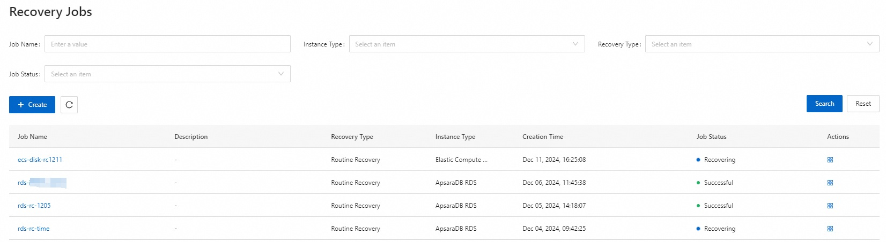

4. Click the **Recovery Events** tab, and then click the  icon next to the event to view all sub-events.

5. Click the  button to the right of the sub-event to view the corresponding event logs.

   - If an error message is found, take actions based on the error message.

   - If no error message is found, perform the following steps:

     <ol type="a">

     <li>

     Refresh the list, press the F12 key, and then click the  icon to the left of the event to open the sub-event list and view the event_id of

     the current event.

     </li>

     <li>

     Log on to the asrbr-backup.Backup# terminal.

     </li>

     </ol>

     <ol type="i" start="100">

     <li>

     Execute the  `cd /alidata/logs/asrbr-backup/`  command to view the asrbr-backup.log.

     > **Note**
     >
     > You can view historical logs in the bak directory.

     

     </li>

     <li value="500">

     Execute the  `grep -r "<event_id>" asrbr-backup.log`  command to search for logs. Replace  `<event_id>`  in the command with the event ID obtained in the preceding step. Take actions based on the specific error information in the logs.

     </li>

     </ol>

> **Note**
>
> If the alert persists after you perform the preceding steps, submit a ticket to contact technical support.

<a id="section-6-3-3"></a>

### 6.3.3. RECOVERY_START_TASK_FAILED

This alert is used to check whether a recovery job for an instance is successfully started. This alert is triggered when a recovery job for an instance fails to be started.

**Alert attributes**

<table>
  <tr>
    <td>Alert name</td>
    <td>Source</td>
    <td>Severity</td>
    <td>Service</td>
    <td>Check interval</td>
    <td>Trigger condition</td>
  </tr>
  <tr>
    <td>RECOVERY_START_TASK _FAILED</td>
    <td>asrbr-backup</td>
    <td>P2</td>
    <td>asrbr</td>
    <td>One-time check</td>
    <td>A recovery job for an instance fails to be asynchronously started.</td>
  </tr>
</table>

**Applicable versions**

Apsara Stack Enterprise V3.16 and later

**Causes**

A recovery job for an instance fails to be started.

**Impacts**

The instance cannot be recovered.

**Solutions**

> **Warning**
>
> If a solution requires that you modify product configurations, you must initiate a production change process to confirm the feasibility and standardization of the solution. Even in an emergency, you must obtain consent from the customer and TAM before you can perform any steps of the solution.

1. Log on to the ASR for Backup and Recovery console.

2. In the left-side navigation pane, click **Recovery Jobs**.

3. Find the recovery job based on the job name in the alert information and click the job name.

   

4. Click the **Recovery Events** tab, and then click the  icon next to the event to view all sub-events.

5. Click the  button to the right of the sub-event to view the corresponding event logs.

   - If an error message is found, take actions based on the error message.

   - If no error message is found, perform the following steps:

     <ol type="a">

     <li>

     Refresh the list, press the F12 key, and then click the  icon to the left of the event to open the sub-event list and view the event_id of

     the current event.

     </li>

     <li>

     Log on to the asrbr-backup.Backup# terminal.

     </li>

     </ol>

     <ol type="i" start="100">

     <li>

     Execute the  `cd /alidata/logs/asrbr-backup/`  command to view the asrbr-backup.log.

     > **Note**
     >
     > You can view historical logs in the bak directory.

     

     </li>

     <li value="500">

     Execute the  `grep -r "<event_id>" asrbr-backup.log`  command to search for logs. Replace  `<event_id>`  in the command with the event ID obtained in the preceding step. Take actions based on the specific error information in the logs.

     </li>

     </ol>

> **Note**
>
> If the alert persists after you perform the preceding steps, submit a ticket to contact technical support.

<a id="section-6-3-4"></a>

### 6.3.4. RECOVERY_REDO_INSTANCE_FAILED

This alert is used to check whether subsequent recovery efforts for an instance that previously failed to be recovered are successful. This alert is triggered when subsequent recovery efforts for an instance that previously failed to be recovered fail.

**Alert attributes**

<table>
  <tr>
    <td>Alert name</td>
    <td>Source</td>
    <td>Severity</td>
    <td>Service</td>
    <td>Check interval</td>
    <td>Trigger condition</td>
  </tr>
  <tr>
    <td>RECOVERY_REDO_INSTA NCE_FAILED</td>
    <td>asrbr-backup</td>
    <td>P2</td>
    <td>asrbr</td>
    <td>One-time check</td>
    <td>Subsequent recovery efforts for an instance that previously failed to be recovered fail.</td>
  </tr>
</table>

**Applicable versions**

Apsara Stack Enterprise V3.16 and later

**Causes**

Subsequent recovery efforts for an instance that previously failed to be recovered fail.

**Impacts**

The instance cannot be recovered.

**Solutions**

> **Warning**
>
> If a solution requires that you modify product configurations, you must initiate a production change process to confirm the feasibility and standardization of the solution. Even in an emergency, you must obtain consent from the customer and TAM before you can perform any steps of the solution.

1. Log on to the ASR for Backup and Recovery console.

2. In the left-side navigation pane, click **Recovery Jobs**.

3. Find the recovery job based on the job name in the alert information and click the job name.

   

4. Click the **Recovery Events** tab, and then click the  icon next to the event to view all sub-events.

5. Click the  button to the right of the sub-event to view the corresponding event logs.

   - If an error message is found, take actions based on the error message.

   - If no error message is found, perform the following steps:

     <ol type="a">

     <li>

     Refresh the list, press the F12 key, and then click the  icon to the left of the event to open the sub-event list and view the event_id of

     the current event.

     </li>

     <li>

     Log on to the asrbr-backup.Backup# terminal.

     </li>

     </ol>

     <ol type="i" start="100">

     <li>

     Execute the  `cd /alidata/logs/asrbr-backup/`  command to view the asrbr-backup.log.

     > **Note**
     >
     > You can view historical logs in the bak directory.

     

     </li>

     <li value="500">

     Execute the  `grep -r "<event_id>" asrbr-backup.log`  command to search for logs. Replace  `<event_id>`  in the command with the event ID obtained in the preceding step. Take actions based on the specific error information in the logs.

     </li>

     </ol>

> **Note**
>
> If the alert persists after you perform the preceding steps, submit a ticket to contact technical support.

<a id="section-6-3-5"></a>

### 6.3.5. RECOVERY_REDO_TASK_FAILED

This alert is used to check whether the subsequent running of a recovery job that previously failed is successful. This alert is triggered when the subsequent running of a recovery job that previously failed fails.

**Alert attributes**

<table>
  <tr>
    <td>Alert name</td>
    <td>Source</td>
    <td>Severity</td>
    <td>Service</td>
    <td>Check interval</td>
    <td>Trigger condition</td>
  </tr>
  <tr>
    <td>RECOVERY_REDO_TASK _FAILED</td>
    <td>asrbr-backup</td>
    <td>P2</td>
    <td>asrbr</td>
    <td>One-time check</td>
    <td>The subsequent running of a recovery job that previously failed fails.</td>
  </tr>
</table>

**Applicable versions**

Apsara Stack Enterprise V3.16 and later

**Causes**

The subsequent running of a recovery job that previously failed fails.

**Impacts**

The instance cannot be recovered.

**Solutions**

> **Warning**
>
> If a solution requires that you modify product configurations, you must initiate a production change process to confirm the feasibility and standardization of the solution. Even in an emergency, you must obtain consent from the customer and TAM before you can perform any steps of the solution.

1. Log on to the ASR for Backup and Recovery console.

2. In the left-side navigation pane, click **Recovery Jobs**.

3. Find the recovery job based on the job name in the alert information and click the job name.

   

4. Click the **Recovery Events** tab, and then click the  icon next to the event to view all sub-events.

5. Click the  button to the right of the sub-event to view the corresponding event logs.

   - If an error message is found, take actions based on the error message.

   - If no error message is found, perform the following steps:

     <ol type="a">

     <li>

     Refresh the list, press the F12 key, and then click the  icon to the left of the event to open the sub-event list and view the event_id of

     the current event.

     </li>

     <li>

     Log on to the asrbr-backup.Backup# terminal.

     </li>

     </ol>

     <ol type="i" start="100">

     <li>

     Execute the  `cd /alidata/logs/asrbr-backup/`  command to view the asrbr-backup.log.

     > **Note**
     >
     > You can view historical logs in the bak directory.

     

     </li>

     <li value="500">

     Execute the  `grep -r "<event_id>" asrbr-backup.log`  command to search for logs. Replace  `<event_id>`  in the command with the event ID obtained in the preceding step. Take actions based on the specific error information in the logs.

     </li>

     </ol>

> **Note**
>
> If the alert persists after you perform the preceding steps, submit a ticket to contact technical support.

<a id="section-6-3-6"></a>

### 6.3.6. RECOVERY_UPDATE_RECOVERY_TASK_FAILED

This alert is used to check whether the result of a recovery job is successfully updated. This alert is triggered when the result of a recovery job fails to be updated.

**Alert attributes**

<table>
  <tr>
    <td>Alert name</td>
    <td>Source</td>
    <td>Severity</td>
    <td>Service</td>
    <td>Check interval</td>
    <td>Trigger condition</td>
  </tr>
  <tr>
    <td>RECOVERY_UPDATE_RE COVERY_TASK_FAILED</td>
    <td>asrbr-backup</td>
    <td>P2</td>
    <td>asrbr</td>
    <td>One-time check</td>
    <td>The result of a recovery job fails to be updated.</td>
  </tr>
</table>

**Applicable versions**

Apsara Stack Enterprise V3.16 and later

**Causes**

The result of a recovery job fails to be updated.

**Impacts**

The recovery job fails.

**Solutions**

> **Warning**
>
> If a solution requires that you modify product configurations, you must initiate a production change process to confirm the feasibility and standardization of the solution. Even in an emergency, you must obtain consent from the customer and TAM before you can perform any steps of the solution.

1. Log on to the ASR for Backup and Recovery console.

2. In the left-side navigation pane, click **Recovery Jobs**.

3. Find the recovery job based on the job name in the alert information and click the job name.

   

4. Click the **Recovery Events** tab, and then click the  icon next to the event to view all sub-events.

5. Click the  button to the right of the sub-event to view the corresponding event logs.

   - If an error message is found, take actions based on the error message.

   - If no error message is found, perform the following steps:

     <ol type="a">

     <li>

     Refresh the list, press the F12 key, and then click the  icon to the left of the event to open the sub-event list and view the event_id of

     the current event.

     </li>

     <li>

     Log on to the asrbr-backup.Backup# terminal.

     </li>

     </ol>

     <ol type="i" start="100">

     <li>

     Execute the  `cd /alidata/logs/asrbr-backup/`  command to view the asrbr-backup.log.

     > **Note**
     >
     > You can view historical logs in the bak directory.

     

     </li>

     <li value="500">

     Execute the  `grep -r "<event_id>" asrbr-backup.log`  command to search for logs. Replace  `<event_id>`  in the command with the event ID obtained in the preceding step. Take actions based on the specific error information in the logs.

     </li>

     </ol>

> **Note**
>
> If the alert persists after you perform the preceding steps, submit a ticket to contact technical support.

<a id="section-6-3-7"></a>

### 6.3.7. RECOVERY_UPDATE_RECOVERY_INSTANCE_TASK_FAILED

This alert is used to check whether the result of a recovery job for an instance is successfully updated. This alert is triggered when the result of a recovery job for an instance fails to be updated.

**Alert attributes**

<table>
  <tr>
    <td>Alert name</td>
    <td>Source</td>
    <td>Severity</td>
    <td>Service</td>
    <td>Check interval</td>
    <td>Trigger condition</td>
  </tr>
  <tr>
    <td>RECOVERY_UPDATE_RE COVERY_INSTANCE_TAS K_FAILED</td>
    <td>asrbr-backup</td>
    <td>P2</td>
    <td>asrbr</td>
    <td>One-time check</td>
    <td>The result of a recovery job for an instance fails to be updated.</td>
  </tr>
</table>

**Applicable versions**

Apsara Stack Enterprise V3.16 and later

**Causes**

The result of a recovery job for an instance fails to be updated.

**Impacts**

The instance fails to be restored by the recovery job.

**Solutions**

> **Warning**
>
> If a solution requires that you modify product configurations, you must initiate a production change process to confirm the feasibility and standardization of the solution. Even in an emergency, you must obtain consent from the customer and TAM before you can perform any steps of the solution.

1. Log on to the ASR for Backup and Recovery console.

2. In the left-side navigation pane, click **Recovery Jobs**.

3. Find the recovery job based on the job name in the alert information and click the job name.

   

4. Click the **Recovery Events** tab, and then click the  icon next to the event to view all sub-events.

5. Click the  button to the right of the sub-event to view the corresponding event logs.

   - If an error message is found, take actions based on the error message.

   - If no error message is found, perform the following steps:

     <ol type="a">

     <li>

     Refresh the list, press the F12 key, and then click the  icon to the left of the event to open the sub-event list and view the event_id of

     the current event.

     </li>

     <li>

     Log on to the asrbr-backup.Backup# terminal.

     </li>

     </ol>

     <ol type="i" start="100">

     <li>

     Execute the  `cd /alidata/logs/asrbr-backup/`  command to view the asrbr-backup.log.

     > **Note**
     >
     > You can view historical logs in the bak directory.

     

     </li>

     <li value="500">

     Execute the  `grep -r "<event_id>" asrbr-backup.log`  command to search for logs. Replace  `<event_id>`  in the command with the event ID obtained in the preceding step. Take actions based on the specific error information in the logs.

     </li>

     </ol>

> **Note**
>
> If the alert persists after you perform the preceding steps, submit a ticket to contact technical support.

<a id="section-6-4"></a>

## 6.4. License-related alerts

<a id="section-6-4-1"></a>

### 6.4.1. Alerts

| Alert name | Description | Source | Severity | Service |
| --- | --- | --- | --- | --- |
| LICENSE_REACH_THRESHOD_REMIND_MSG | The backup data size exceeds 70% of the authorized amount. | asrbr-backup | P2 | asrbr |
| LICENSE_NOT_ENOUGH_REMIND_MSG | The backup data size exceeds the authorized amount. | asrbr-backup | P2 | asrbr |
| LICENSE_STOP_ALL_PLAN_REMIND_MS G | The backup data size exceeds the authorized amount for 30 days. | asrbr-backup | P2 | asrbr |
| LICENSE_SYNC_REMIND_MSG | The purchased licenses are synchronized with the system. | asrbr-backup | P2 | asrbr |
| HBR_LITE_LICENSE_NOT_ENOUGH_REM IND_MSG | The size of the instances to back up exceeds the authorized capacity. | asrbr-backup | P2 | asrbr |
| HBR_LITE_LICENSE_REACH_THRESHOD _REMIND_MSG | The size of the instances to back up exceeds 70% of the authorized capacity. | asrbr-backup | P2 | asrbr |

<a id="section-6-4-2"></a>

### 6.4.2. LICENSE_REACH_THRESHOD_REMIND_MSG

This alert is used to check whether the backup data size exceeds 70% of the authorized amount. This alert is triggered when the backup data size exceeds 70% of the authorized amount. After the backup data size exceeds 100% of the authorized amount, the system continues to back up existing instances but does not back up new instances.

**Alert attributes**

<table>
  <tr>
    <td>Alert name</td>
    <td>Source</td>
    <td>Severity</td>
    <td>Service</td>
    <td>Check interval</td>
    <td>Trigger condition</td>
  </tr>
  <tr>
    <td>LICENSE_REACH_THRES HOD_REMIND_MSG</td>
    <td>asrbr-backup</td>
    <td>P2</td>
    <td>asrbr</td>
    <td>Once a day</td>
    <td>The backup data size exceeds 70% of the authorized amount.</td>
  </tr>
</table>

**Applicable versions**

Apsara Stack Enterprise V3.16 and later

**Causes**

The backup data size exceeds 70% of the authorized amount. This alert is triggered for notifications.

**Impacts**

After the backup data size exceeds 100% of the authorized amount, the system continues to back up existing instances but does not back up new instances.

**Solutions**

> **Warning**
>
> If a solution requires that you modify product configurations, you must initiate a production change process to confirm the feasibility and standardization of the solution. Even in an emergency, you must obtain consent from the customer and TAM before you can perform any steps of the solution.

When the backup data size exceeds 70% of the authorized amount, the existing backup plans are not affected. We recommend that you predict the increased backup data size in the near future and determine whether to purchase additional capacity in advance. To resolve the issue, use one of the following methods:

- Method 1: Purchase additional capacity.

- Method 2: Stop specific existing backup plans.

> **Note**
>
> If the alert persists after you perform the preceding steps, submit a ticket to contact technical support.

<a id="section-6-4-3"></a>

### 6.4.3. LICENSE_NOT_ENOUGH_REMIND_MSG

This alert is used to check whether the backup data size exceeds the authorized amount. This alert is triggered when the backup data size exceeds the authorized amount. In this case, you cannot back up new instances, but you can continue to back up instances that already have backup plans.

**Alert attributes**

<table>
  <tr>
    <td>Alert name</td>
    <td>Source</td>
    <td>Severity</td>
    <td>Service</td>
    <td>Check interval</td>
    <td>Trigger condition</td>
  </tr>
  <tr>
    <td>LICENSE_NOT_ENOUGH_REMIND_MSG</td>
    <td>asrbr-backup</td>
    <td>P2</td>
    <td>asrbr</td>
    <td>Once a day</td>
    <td>The backup data size exceeds the authorized amount.</td>
  </tr>
</table>

**Applicable versions**

Apsara Stack Enterprise V3.16 and later

**Causes**

The backup data size exceeds the authorized amount.

**Impacts**

You cannot back up new instances, but you can continue to back up instances that already have backup plans.

**Solutions**

> **Warning**
>
> If a solution requires that you modify product configurations, you must initiate a production change process to confirm the feasibility and standardization of the solution. Even in an emergency, you must obtain consent from the customer and TAM before you can perform any steps of the solution.

You cannot create backup plans or perform immediate backups for new instances. To resolve the issue, use one of the following methods:

- Method 1: Purchase additional capacity.

- Method 2: Stop specific existing backup plans.

> **Note**
>
> If the alert persists after you perform the preceding steps, submit a ticket to contact technical support.

<a id="section-6-4-4"></a>

### 6.4.4. LICENSE_STOP_ALL_PLAN_REMIND_MSG

This alert is used to monitor whether the backup data size exceeds the authorized amount for a consecutive period of 30 days. This alert is triggered when the backup data size exceeds the authorized amount for a consecutive period of 30 days. In this case, you cannot back up new instances. All backup plans of the authorized instances are stopped.

**Alert attributes**

<table>
  <tr>
    <td>Alert name</td>
    <td>Source</td>
    <td>Severity</td>
    <td>Service</td>
    <td>Check interval</td>
    <td>Trigger condition</td>
  </tr>
  <tr>
    <td>LICENSE_STOP_ALL_PLA N_REMIND_MSG</td>
    <td>asrbr-backup</td>
    <td>P2</td>
    <td>asrbr</td>
    <td>Once a day</td>
    <td>The backup data size exceeds the authorized amount for a consecutive period of 30 days.</td>
  </tr>
</table>

**Applicable versions**

Apsara Stack Enterprise V3.16 and later

**Causes**

The backup data size exceeds the authorized amount for a consecutive period of 30 days.

**Impacts**

You cannot back up new instances. All backup plans of the authorized instances are stopped.

**Solutions**

> **Warning**
>
> If a solution requires that you modify product configurations, you must initiate a production change process to confirm the feasibility and standardization of the solution. Even in an emergency, you must obtain consent from the customer and TAM before you can perform any steps of the solution.

To resolve the issue, use one of the following methods:

- Method 1: Do not purchase additional capacity.

  Restart stopped backup plans to resume the backup tasks. If you do not purchase additional capacity, all backup plans are immediately stopped the next time the authorized capacity is exhausted.

- Method 2: Purchase additional capacity.

  After you purchase additional capacity, restart the stopped backup plans to resume the backup tasks. When the authorized capacity is exhausted, the backup plans have a 30-day grace period. After the grace period ends, all backup plans of the authorized instances are stopped.

> **Note**
>
> If the alert persists after you perform the preceding steps, submit a ticket to contact technical support.

<a id="section-6-4-5"></a>

### 6.4.5. LICENSE_SYNC_REMIND_MSG

This alert is used to notify that the purchased licenses are synchronized with the system. This alert is triggered when the purchased licenses are synchronized with the system.

**Alert attributes**

<table>
  <tr>
    <td>Alert name</td>
    <td>Source</td>
    <td>Severity</td>
    <td>Service</td>
    <td>Check interval</td>
    <td>Trigger condition</td>
  </tr>
  <tr>
    <td>LICENSE_SYNC_REMIND_MSG</td>
    <td>asrbr-backup</td>
    <td>P2</td>
    <td>asrbr</td>
    <td>Once a day</td>
    <td>The purchased licenses are synchronized with the system.</td>
  </tr>
</table>

**Applicable versions**

Apsara Stack Enterprise V3.16 and later

**Causes**

The purchased licenses are synchronized with the system.

**Impacts**

None.

**Solutions**

No action is required.

<a id="section-6-4-6"></a>

### 6.4.6. HBR_LITE_LICENSE_NOT_ENOUGH_REMIND_MSG

This alert is used to check whether the size of the instances to back up exceeds the authorized capacity. This alert is triggered when the size of the instances to back up exceeds the authorized capacity. In this case, you cannot back up new instances. Instances that have existing backup plans can still be backed up.

**Alert attributes**

<table>
  <tr>
    <td>Alert name</td>
    <td>Source</td>
    <td>Severity</td>
    <td>Service</td>
    <td>Check interval</td>
    <td>Trigger condition</td>
  </tr>
  <tr>
    <td>HBR_LITE_LICENSE_NOT _ENOUGH_REMIND_MSG</td>
    <td>asrbr-backup</td>
    <td>P2</td>
    <td>asrbr</td>
    <td>Once a day</td>
    <td>The size of the instances to back up exceeds the authorized capacity.</td>
  </tr>
</table>

**Applicable versions**

Apsara Stack Enterprise V3.16 and later

**Causes**

The Hybrid Backup Recovery (HBR) lightweight authorization package is exhausted. This alert is triggered for notifications.

**Impacts**

You cannot back up new instances. Instances that have existing backup plans can still be backed up.

**Solutions**

> **Warning**
>
> If a solution requires that you modify product configurations, you must initiate a production change process to confirm the feasibility and standardization of the solution. Even in an emergency, you must obtain consent from the customer and TAM before you can perform any steps of the solution.

To prevent exhaustion of the authorized capacity, perform one of the following operations:

- Method 1: Expand the capacity to support the backup of more data.

- Method 2: Disable specific existing backup plans.

> **Note**
>
> If the alert persists after you perform the preceding steps, submit a ticket to contact technical support.

<a id="section-6-4-7"></a>

### 6.4.7. HBR_LITE_LICENSE_REACH_THRESHOD_REMIND_MSG

This alert is used to check whether the size of the instances to back up exceeds 70% of the authorized capacity. This alert is triggered when the size of the instances to back up exceeds 70% of the authorized capacity. In this case, the backup features are not affected.

**Alert attributes**

<table>
  <tr>
    <td>Alert name</td>
    <td>Source</td>
    <td>Severity</td>
    <td>Service</td>
    <td>Check interval</td>
    <td>Trigger condition</td>
  </tr>
  <tr>
    <td>HBR_LITE_LICENSE_NOT _ENOUGH_REMIND_MSG</td>
    <td>asrbr-backup</td>
    <td>P2</td>
    <td>asrbr</td>
    <td>Once a day</td>
    <td>The size of the instances to back up exceeds 70% of the authorized capacity.</td>
  </tr>
</table>

**Applicable versions**

Apsara Stack Enterprise V3.16 and later

**Causes**

The size of the instances to back up exceeds 70% of the authorized capacity. This alert is triggered to notify that the remaining capacity of the HBR lightweight authorization package is running low.

**Impacts**

None.

**Solutions**

> **Warning**
>
> If a solution requires that you modify product configurations, you must initiate a production change process to confirm the feasibility and standardization of the solution. Even in an emergency, you must obtain consent from the customer and TAM before you can perform any steps of the solution.

When the size of the instances to back up exceeds 70% of the authorized capacity, the existing backup plans remain unaffected. We recommend that you assess the backup size growth against the authorized capacity to determine if the authorized capacity will be exhausted in the near future. To prevent exhaustion of the authorized capacity, perform one of the following operations:

- Method 1: Expand the capacity to support the backup of more data.

- Method 2: Disable specific existing backup plans.

> **Note**
>
> If the alert persists after you perform the preceding steps, submit a ticket to contact technical support.

<a id="section-6-5"></a>

## 6.5. Storage-related alerts

<a id="section-6-5-1"></a>

### 6.5.1. Alerts

<table>
  <tr>
    <td>Alert name</td>
    <td>Description</td>
    <td>Source</td>
    <td>Severity</td>
    <td>Service</td>
  </tr>
  <tr>
    <td>STORAGE_POOL_CHECK_STORAGE_POOL_SIZE_CAPACITY_USED_UP</td>
    <td>The amount of data stored in a storage pool reaches the maximum capacity.</td>
    <td>asrbr-backup</td>
    <td>P2</td>
    <td>asrbr</td>
  </tr>
  <tr>
    <td>STORAGE_POOL_CHECK_STORAGE_POOL_SIZE_CINSUFFICIENT_MARGIN</td>
    <td>The amount of data stored in a storage pool reaches 80% of the maximum capacity.</td>
    <td>asrbr-backup</td>
    <td>P2</td>
    <td>asrbr</td>
  </tr>
  <tr>
    <td>USE_MORE_THAN_70</td>
    <td>The amount of data stored in a backup vault reaches 70% of the maximum capacity.</td>
    <td>asrbr-backup</td>
    <td>P2</td>
    <td>asrbr</td>
  </tr>
  <tr>
    <td>USE_MORE_THAN_90</td>
    <td>The amount of data stored in a backup vault reaches 90% of the maximum capacity.</td>
    <td>asrbr-backup</td>
    <td>P1</td>
    <td>asrbr</td>
  </tr>
  <tr>
    <td>CAPACITY_USED_UP</td>
    <td>The storage capacity of a backup vault is exhausted.</td>
    <td>asrbr-backup</td>
    <td>P1</td>
    <td>asrbr</td>
  </tr>
  <tr>
    <td>ABNORMAL_STATUS</td>
    <td>A backup vault becomes unavailable.</td>
    <td>asrbr-backup</td>
    <td>P1</td>
    <td>asrbr</td>
  </tr>
</table>

<a id="section-6-5-2"></a>

### 6.5.2. STORAGE_POOL_CHECK_STORAGE_POOL_SIZE_CAPACITY_USED_UP

This alert is used to check whether the data stored in a backup storage pool reaches the user-defined maximum capacity. This alert is triggered when the data stored in a backup storage pool reaches the user-defined maximum capacity. As a result, new backup data cannot be written into the storage pool and all backup tasks that use the storage pool fail.

**Alert attributes**

<table>
  <tr>
    <td>Alert name</td>
    <td>Source</td>
    <td>Severity</td>
    <td>Service</td>
    <td>Check interval</td>
    <td>Trigger condition</td>
  </tr>
  <tr>
    <td>STORAGE_POOL_CHECK _STORAGE_POOL_SIZE_CAPACITY_USED_UP</td>
    <td>asrbr-backup</td>
    <td>P2</td>
    <td>asrbr</td>
    <td>Once a day</td>
    <td>The data stored in a backup storage pool reaches the user-defined maximum capacity.</td>
  </tr>
</table>

**Applicable versions**

Apsara Stack Enterprise V3.16 and later

**Causes**

The data stored in a backup storage pool reaches the user-defined maximum capacity.

**Impacts**

- If the actual storage space of the storage pool is exhausted, new backup data cannot be written into the storage pool and all backup tasks that use the storage pool fail.

- If the storage space of the storage pool is not a real, fixed logical space, backup operations can continue even if the user-defined upper limit is exceeded.

**Solutions**

> **Warning**
>
> If a solution requires that you modify product configurations, you must initiate a production change process to confirm the feasibility and standardization of the solution. Even in an emergency, you must obtain consent from the customer and TAM before you can perform any steps of the solution.

- If the actual storage space of the storage pool is exhausted, you can perform one of the following operations:

  - Method 1: Expand the storage capacity.

  - Method 2: Modify the backup policy to reduce the retention period of backup data and the backup frequency.

    <ol type="a">

    <li>

    Log on to the ASR for Backup and Recovery console as an organization backup administrator.

    </li>

    <li>

    In the left-side navigation pane, click **Backup Plans**.

    </li>

    </ol>

    <ol type="i" start="100">

    <li>

    On the **Backup Plan** page, find the backup plan that you want to view. You can specify search conditions to search for the backup plan.

    </li>

    <li value="500">

    Click the name of the backup plan.

    </li>

    </ol>

    <ol type="a" start="5">

    <li>

    In the **Backup Policy** section of the **Backup Information** tab, click **Modify Backup Policy**.

    

    </li>

    <li>

    Modify the parameter settings of the backup policy and click **Save**.

    > **Note**
    >
    > The parameters of the backup policy vary based on the instance type. You can configure the parameters based on the on-screen instructions.

    </li>

    </ol>

- If the storage pool has sufficient storage space, change the storage capacity of the storage pool.

  <ol type="i">

  <li>

  Log on to the ASR-BR console as a backup operations administrator.

  </li>

  <li>

  In the left-side navigation pane, choose **System Management** > **Storage Pool Groups**.

  </li>

  <li>

  Find the storage pool that you want to modify and click **Modify** in the **Actions** column.

  </li>

  <li>

  In the **Edit Storage Pool** dialog box, change the storage capacity and click **OK**.

  </li>

  </ol>

> **Note**
>
> If the alert persists after you perform the preceding steps, submit a ticket to contact technical support.

<a id="section-6-5-3"></a>

### 6.5.3. STORAGE_POOL_CHECK_STORAGE_POOL_SIZE_CINSUFFICIENT_MARGIN

This alert is used to check whether the amount of data stored in a backup storage pool exceeds 80% of the user-defined maximum capacity. This alert is triggered when the amount of data stored in a backup storage pool exceeds 80% of the user-defined maximum capacity. This situation does not immediately affect the backup functionality. However, you must expand the storage capacity or modify the backup configuration at the earliest opportunity.

**Alert attributes**

<table>
  <tr>
    <td>Alert name</td>
    <td>Source</td>
    <td>Severity</td>
    <td>Service</td>
    <td>Check interval</td>
    <td>Trigger condition</td>
  </tr>
  <tr>
    <td>STORAGE_POOL_CHECK _STORAGE_POOL_SIZE_CINSUFFICIENT_MARGIN</td>
    <td>asrbr-backup</td>
    <td>P2</td>
    <td>asrbr</td>
    <td>Once a day</td>
    <td>The amount of data stored in a backup storage pool exceeds 80% of the user-defined maximum capacity.</td>
  </tr>
</table>

**Applicable versions**

Apsara Stack Enterprise V3.16 and later

**Causes**

The amount of data stored in a backup storage pool exceeds 80% of the user-defined maximum capacity.

**Impacts**

None.

**Solutions**

> **Warning**
>
> If a solution requires that you modify product configurations, you must initiate a production change process to confirm the feasibility and standardization of the solution. Even in an emergency, you must obtain consent from the customer and TAM before you can perform any steps of the solution.

- If the actual storage space of the storage pool is exhausted, you can perform one of the following operations:

  - Method 1: Expand the storage capacity.

  - Method 2: Modify the backup policy to reduce the retention period of backup data and the backup frequency.

    <ol type="a">

    <li>

    Log on to the ASR for Backup and Recovery console as an organization backup administrator.

    </li>

    <li>

    In the left-side navigation pane, click **Backup Plans**.

    </li>

    </ol>

    <ol type="i" start="100">

    <li>

    On the **Backup Plan** page, find the backup plan that you want to view. You can specify search conditions to search for the backup plan.

    </li>

    <li value="500">

    Click the name of the backup plan.

    </li>

    </ol>

    <ol type="a" start="5">

    <li>

    In the **Backup Policy** section of the **Backup Information** tab, click **Modify Backup Policy**.

    

    </li>

    <li>

    Modify the parameter settings of the backup policy and click **Save**.

    > **Note**
    >
    > The parameters of the backup policy vary based on the instance type. You can configure the parameters based on the on-screen instructions.

    </li>

    </ol>

- If the storage pool has sufficient storage space, change the storage capacity of the storage pool.

  <ol type="i">

  <li>

  Log on to the ASR-BR console as a backup operations administrator.

  </li>

  <li>

  In the left-side navigation pane, choose **System Management** > **Storage Pool Groups**.

  </li>

  <li>

  Find the storage pool that you want to modify and click **Modify** in the **Actions** column.

  </li>

  <li>

  In the **Edit Storage Pool** dialog box, change the storage capacity and click **OK**.

  </li>

  </ol>

> **Note**
>
> If the alert persists after you perform the preceding steps, submit a ticket to contact technical support.

<a id="section-6-5-4"></a>

### 6.5.4. USE_MORE_THAN_70

This alert is used to check whether the amount of data stored in a backup vault exceeds 70% of its maximum capacity. This alert is triggered when the amount of data stored in a backup vault exceeds 70% of its maximum capacity. This does not immediately affect the backup functionality. However, you must increase the storage capacity of the backup vault or change the backup policy at the earliest opportunity.

**Alert attributes**

<table>
  <tr>
    <td>Alert name</td>
    <td>Source</td>
    <td>Severity</td>
    <td>Service</td>
    <td>Check interval</td>
    <td>Trigger condition</td>
  </tr>
  <tr>
    <td>USE_MORE_THAN_70</td>
    <td>asrbr-backup</td>
    <td>P2</td>
    <td>asrbr</td>
    <td>Every hour</td>
    <td>The amount of data stored in a backup vault exceeds 70% of its maximum capacity.</td>
  </tr>
</table>

**Applicable versions**

Apsara Stack Enterprise V3.16 and later

**Causes**

The amount of data stored in a backup vault exceeds 70% of its maximum capacity.

**Impacts**

None.

**Solutions**

> **Warning**
>
> If a solution requires that you modify product configurations, you must initiate a production change process to confirm the feasibility and standardization of the solution. Even in an emergency, you must obtain consent from the customer and TAM before you can perform any steps of the solution.

- Method 1: Increase the maximum storage capacity of the backup vault.

  <ol type="i">

  <li>

  Log on to the ASR-BR console as a backup operations administrator.

  </li>

  <li>

  In the left-side navigation pane of the ASR for Backup and Recovery console, click **Backup Vaults**.

  </li>

  <li>

  Click **Modify** in the Actions column of the backup vault.

  </li>

  <li>

  Modify the **Storage Capacity** parameter and click **OK**.

  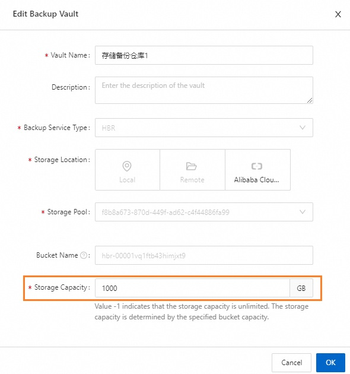

  </li>

  </ol>

- Method 2: Modify the backup policy to reduce the retention period of backup data and the backup frequency.

  <ol type="i">

  <li>

  Log on to the ASR for Backup and Recovery console as an organization backup administrator.

  </li>

  <li>

  In the left-side navigation pane, click **Backup Plans**.

  </li>

  <li>

  On the **Backup Plan** page, find the backup plan that you want to view. You can specify search conditions to search for the backup plan.

  </li>

  <li>

  Click the name of the backup plan.

  </li>

  <li>

  In the **Backup Policy** section of the **Backup Information** tab, click **Modify Backup Policy**.

  

  </li>

  <li>

  Modify the parameter settings of the backup policy and click **Save**.

  > **Note**
  >
  > The parameters of the backup policy vary based on the instance type. You can configure the parameters based on the on-screen instructions.

  </li>

  </ol>

> **Note**
>
> If the alert persists after you perform the preceding steps, submit a ticket to contact technical support.

<a id="section-6-5-5"></a>

### 6.5.5. USE_MORE_THAN_90

This alert is used to check whether the amount of data stored in a backup vault exceeds 90% of its maximum capacity. This alert is triggered when the amount of data stored in a backup vault exceeds 90% of its maximum capacity. This situation does not immediately affect the backup functionality. However, you must increase the storage capacity of the backup vault or change the backup policy at the earliest opportunity.

**Alert attributes**

<table>
  <tr>
    <td>Alert name</td>
    <td>Source</td>
    <td>Severity</td>
    <td>Service</td>
    <td>Check interval</td>
    <td>Trigger condition</td>
  </tr>
  <tr>
    <td>USE_MORE_THAN_90</td>
    <td>asrbr-backup</td>
    <td>P1</td>
    <td>asrbr</td>
    <td>Once per hour</td>
    <td>The amount of data stored in a backup vault exceeds 90% of its maximum capacity.</td>
  </tr>
</table>

**Applicable versions**

Apsara Stack Enterprise V3.16 and later

**Causes**

The amount of data stored in a backup vault exceeds 90% of its maximum capacity.

**Impacts**

None.

**Solutions**

> **Warning**
>
> If a solution requires that you modify product configurations, you must initiate a production change process to confirm the feasibility and standardization of the solution. Even in an emergency, you must obtain consent from the customer and TAM before you can perform any steps of the solution.

- Method 1: Increase the maximum storage capacity of the backup vault.

  <ol type="i">

  <li>

  Log on to the ASR-BR console as a backup operations administrator.

  </li>

  <li>

  In the left-side navigation pane of the ASR for Backup and Recovery console, click **Backup Vaults**.

  </li>

  <li>

  Click **Modify** in the Actions column of the backup vault.

  </li>

  <li>

  Modify the **Storage Capacity** parameter and click **OK**.

  

  </li>

  </ol>

- Method 2: Modify the backup policy to reduce the retention period of backup data and the backup frequency.

  <ol type="i">

  <li>

  Log on to the ASR for Backup and Recovery console as an organization backup administrator.

  </li>

  <li>

  In the left-side navigation pane, click **Backup Plans**.

  </li>

  <li>

  On the **Backup Plan** page, find the backup plan that you want to view. You can specify search conditions to search for the backup plan.

  </li>

  <li>

  Click the name of the backup plan.

  </li>

  <li>

  In the **Backup Policy** section of the **Backup Information** tab, click **Modify Backup Policy**.

  

  </li>

  <li>

  Modify the parameter settings of the backup policy and click **Save**.

  > **Note**
  >
  > The parameters of the backup policy vary based on the instance type. You can configure the parameters based on the on-screen instructions.

  </li>

  </ol>

> **Note**
>
> If the alert persists after you perform the preceding steps, submit a ticket to contact technical support.

<a id="section-6-5-6"></a>

### 6.5.6. CAPACITY_USED_UP

This alert is used to check whether the amount of data stored in a backup vault reaches the maximum capacity. This alert is triggered when the amount of data stored in a backup vault reaches the maximum capacity. In this case, the backup plans that use the backup vault fails to backup data.

**Alert attributes**

<table>
  <tr>
    <td>Alert name</td>
    <td>Source</td>
    <td>Severity</td>
    <td>Service</td>
    <td>Check interval</td>
    <td>Trigger condition</td>
  </tr>
  <tr>
    <td>CAPACITY_USED_UP</td>
    <td>asrbr-backup</td>
    <td>P1</td>
    <td>asrbr</td>
    <td>Every hour</td>
    <td>The amount of data stored in a backup vault reaches the maximum capacity.</td>
  </tr>
</table>

**Applicable versions**

Apsara Stack Enterprise V3.16 and later

**Causes**

The amount of data stored in a backup vault reaches the maximum capacity.

**Impacts**

The backup plans that use the backup vault fails to backup data.

**Solutions**

> **Warning**
>
> If a solution requires that you modify product configurations, you must initiate a production change process to confirm the feasibility and standardization of the solution. Even in an emergency, you must obtain consent from the customer and TAM before you can perform any steps of the solution.

- Method 1: Increase the maximum storage capacity of the backup vault.

  <ol type="i">

  <li>

  Log on to the ASR-BR console as a backup operations administrator.

  </li>

  <li>

  In the left-side navigation pane of the ASR for Backup and Recovery console, click **Backup Vaults**.

  </li>

  <li>

  Click **Modify** in the Actions column of the backup vault.

  </li>

  <li>

  Modify the **Storage Capacity** parameter and click **OK**.

  

  </li>

  </ol>

- Method 2: Modify the backup policy to reduce the retention period of backup data and the backup frequency.

  <ol type="i">

  <li>

  Log on to the ASR for Backup and Recovery console as an organization backup administrator.

  </li>

  <li>

  In the left-side navigation pane, click **Backup Plans**.

  </li>

  <li>

  On the **Backup Plan** page, find the backup plan that you want to view. You can specify search conditions to search for the backup plan.

  </li>

  <li>

  Click the name of the backup plan.

  </li>

  <li>

  In the **Backup Policy** section of the **Backup Information** tab, click **Modify Backup Policy**.

  

  </li>

  <li>

  Modify the parameter settings of the backup policy and click **Save**.

  > **Note**
  >
  > The parameters of the backup policy vary based on the instance type. You can configure the parameters based on the on-screen instructions.

  </li>

  </ol>

> **Note**
>
> If the alert persists after you perform the preceding steps, submit a ticket to contact technical support.

<a id="section-6-5-7"></a>

### 6.5.7. ABNORMAL_STATUS

This alert is used to check whether a backup vault is available. This alert is triggered when a backup vault becomes unavailable. In this case, the backup plans that use the backup vault cannot back up data.

**Alert attributes**

<table>
  <tr>
    <td>Alert name</td>
    <td>Source</td>
    <td>Severity</td>
    <td>Service</td>
    <td>Check interval</td>
    <td>Trigger condition</td>
  </tr>
  <tr>
    <td>ABNORMAL_STATUS</td>
    <td>asrbr-backup</td>
    <td>P1</td>
    <td>asrbr</td>
    <td>Every hour</td>
    <td>Data cannot be written to the bucket in which the backup vault is deployed.</td>
  </tr>
</table>

**Applicable versions**

Apsara Stack Enterprise V3.16 and later

**Causes**

Data cannot be written to the backup vault.

**Impacts**

The backup plans that use the backup vault cannot back up data.

**Solutions**

> **Warning**
>
> If a solution requires that you modify product configurations, you must initiate a production change process to confirm the feasibility and standardization of the solution. Even in an emergency, you must obtain consent from the customer and TAM before you can perform any steps of the solution.

1. Check whether the storage capacity of the backup vault is exhausted. If the storage capacity is exhausted, increase the storage capacity. Otherwise, perform the following steps:

   <ol type="i">

   <li>

   Log on to the ASR-BR console as a backup operations administrator.

   </li>

   <li>

   In the left-side navigation pane of the ASR for Backup and Recovery console, click **Backup Vaults**.

   </li>

   <li>

   Check the usage of the backup vault.

   </li>

   </ol>

2. Check whether the bucket in which the backup vault is deployed exists. If the bucket exists, contact the R&D team to identify the cause of the issue. If the bucket does not exist, the bucket has been deleted and contact the R&D team to handle the issue.

> **Note**
>
> If the alert persists after you perform the preceding steps, submit a ticket to contact technical support.

<a id="section-6-6"></a>

## 6.6. Other alerts

<a id="section-6-6-1"></a>

### 6.6.1. Alerts

| Alert name | Description | Source | Severity | Service |
| --- | --- | --- | --- | --- |
| META_DB_METADATA_BACKUP_FAILED | Metadata fails to be backed up. | asrbr-backup | P2 | asrbr |
| META_DB_METADATA_BACKUP_OUT_OF_PERIOD | The metadata backup interval is excessively small. | asrbr-backup | P2 | asrbr |
| META_DB_METADATA_DATABASE_UPDAT E_FAILED | The metadata database fails to be updated. | asrbr-backup | P2 | asrbr |
| META_DB_METADATA_BACKUP_MANAGE_FAILED | The metadata backup management fails. | asrbr-backup | P2 | asrbr |
| LICENSE_CHECK_LICENSE_SIZE_CAPACIT Y_USED_UP | The backup data size of an organization exceeds 80% of the authorized amount. | asrbr-backup | P2 | asrbr |
| LICENSE_CHECK_LICENSE_SIZE_CAPACIT Y_INSUFFICIENT_MARGIN | The backup data size of an organization exceeds the authorized amount. | asrbr-backup | P2 | asrbr |

<a id="section-6-6-2"></a>

### 6.6.2. META_DB_METADATA_BACKUP_FAILED

This alert is used to check whether metadata backup is successful. This alert is triggered when metadata backup in the current cycle fails. If metadata backup continues to fail for an extended period of time, the system fails to obtain the latest backup set in disaster recovery scenarios.

**Alert attributes**

<table>
  <tr>
    <td>Alert name</td>
    <td>Source</td>
    <td>Severity</td>
    <td>Service</td>
    <td>Check interval</td>
    <td>Trigger condition</td>
  </tr>
  <tr>
    <td>META_DB_METADATA_B ACKUP_FAILED</td>
    <td>asrbr-backup</td>
    <td>P2</td>
    <td>asrbr</td>
    <td>Check at the time when metadata is backed up.</td>
    <td>Metadata backup fails.</td>
  </tr>
</table>

**Applicable versions**

Apsara Stack Enterprise V3.16 and later

**Causes**

The auto-backup of the service fails.

**Impacts**

If metadata backup continues to fail for an extended period of time, the system fails to obtain the latest backup set in disaster recovery scenarios.

**Solutions**

> **Warning**
>
> If a solution requires that you modify product configurations, you must initiate a production change process to confirm the feasibility and standardization of the solution. Even in an emergency, you must obtain consent from the customer and TAM before you can perform any steps of the solution.

1. Log on to the Apsara Uni-manager Operations Console.

2. In the top navigation bar, choose **Platform Operation > Apsara Infrastructure Management > Resources**.

3. In the left-side navigation pane of the Apsara Infrastructure Management console, click **Project & Cluster O&M**.

4. Enter asrbr in the Project | Cluster search box. Find the cluster and click **Cluster Details** in the **Actions** column.

   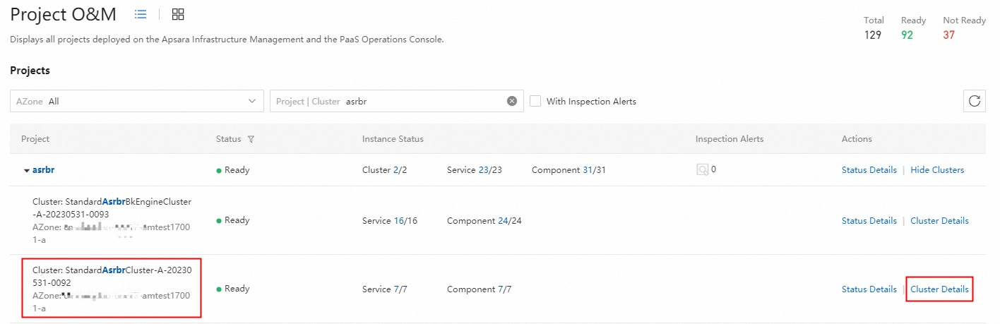

5. Click **asrbr-backup** on the **Services** tab.

6. Select the **Backup#** component from the **Components** list. For each of the two instances, choose **More** > **Restart** in the **Actions** column to restart the SR.

   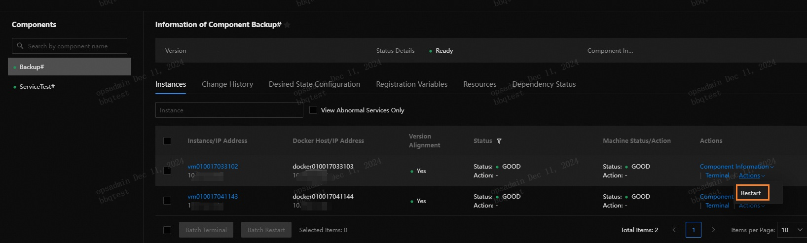

7. For each of the two instances, click **Terminal** in the **Actions** column to log on to the terminal and run the  `docker ps`  command to obtain the container ID.

   

8. Execute the following command to restart the asrbr-backup docker service and wait until the service status is normal.

   ```bash
   docker restart <Container ID>
   ```

> **Note**
>
> If the alert persists after you perform the preceding steps, submit a ticket to contact technical support.

<a id="section-6-6-3"></a>

### 6.6.3. META_DB_METADATA_BACKUP_OUT_OF_PERIOD

This alert is used to check whether the metadata backup cycle is too short. This alert is triggered when the metadata backup cycle is too short. This situation does not affect the backup functionalities.

**Alert attributes**

<table>
  <tr>
    <td>Alert name</td>
    <td>Source</td>
    <td>Severity</td>
    <td>Service</td>
    <td>Check interval</td>
    <td>Trigger condition</td>
  </tr>
  <tr>
    <td>META_DB_METADATA_B ACKUP_OUT_OF_PERIOD</td>
    <td>asrbr-backup</td>
    <td>P2</td>
    <td>asrbr</td>
    <td>Check at the time when metadata is backed up.</td>
    <td>Metadata backup ends later than the next backup time.</td>
  </tr>
</table>

**Applicable versions**

Apsara Stack Enterprise V3.16 and later

**Causes**

The metadata backup duration exceeds the backup cycle.

**Impacts**

None.However, we recommend that you increase the backup cycle.

**Solutions**

> **Warning**
>
> If a solution requires that you modify product configurations, you must initiate a production change process to confirm the feasibility and standardization of the solution. Even in an emergency, you must obtain consent from the customer and TAM before you can perform any steps of the solution.

1. Log on to the ASR-BR console as a backup operations administrator.

2. In the left-side navigation pane, choose **System Management** > **Auto-backup Management**.

3. On the **Backup Policy** page, increase the backup cycle and click **Modify**.

   

> **Note**
>
> If the alert persists after you perform the preceding steps, submit a ticket to contact technical support.

<a id="section-6-6-4"></a>

### 6.6.4. META_DB_METADATA_DATABASE_UPDATE_FAILED

This alert is used to check whether the metadata database is successfully updated. This alert is triggered when the metadata database fails to be updated. This situation does not affect the backup functionalities.

**Alert attributes**

<table>
  <tr>
    <td>Alert name</td>
    <td>Source</td>
    <td>Severity</td>
    <td>Service</td>
    <td>Check interval</td>
    <td>Trigger condition</td>
  </tr>
  <tr>
    <td>META_DB_METADATA_D ATABASE_UPDATE_FAILE D</td>
    <td>asrbr-backup</td>
    <td>P2</td>
    <td>asrbr</td>
    <td>Check at the time when metadata is backed up.</td>
    <td>The local database fails to be updated when metadata backup is complete.</td>
  </tr>
</table>

**Applicable versions**

Apsara Stack Enterprise V3.16 and later

**Causes**

Auto-backup fails to be updated.

**Impacts**

None.

**Solutions**

> **Warning**
>
> If a solution requires that you modify product configurations, you must initiate a production change process to confirm the feasibility and standardization of the solution. Even in an emergency, you must obtain consent from the customer and TAM before you can perform any steps of the solution.

1. Log on to the Apsara Uni-manager Operations Console.

2. In the top navigation bar, choose **Platform Operation > Apsara Infrastructure Management > Resources**.

3. In the left-side navigation pane of the Apsara Infrastructure Management console, click **Project & Cluster O&M**.

4. Enter asrbr in the Project | Cluster search box. Find the cluster and click **Cluster Details** in the **Actions** column.

   

5. Click **asrbr-backup** on the **Services** tab.

6. Select the **Backup#** component from the **Components** list. For each of the two instances, choose **More** > **Restart** in the **Actions** column to restart the SR.

   

7. For each of the two instances, click **Terminal** in the **Actions** column to log on to the terminal and run the  `docker ps`  command to obtain the container ID.

   

8. Execute the following command to restart the asrbr-backup docker service and wait until the service status is normal.

   ```bash
   docker restart <Container ID>
   ```

> **Note**
>
> If the alert persists after you perform the preceding steps, submit a ticket to contact technical support.

<a id="section-6-6-5"></a>

### 6.6.5. META_DB_METADATA_BACKUP_MANAGE_FAILED

This alert is used to check the execution status of metadata backup management during an automatic backup process. This alert is triggered when metadata backup management during an automatic backup process fails.Unknown exceptions or interruptions occur during backup task scheduling. As a result, subsequent backup task scheduling may fail to be performed as expected.

**Alert attributes**

<table>
  <tr>
    <td>Alert name</td>
    <td>Source</td>
    <td>Severity</td>
    <td>Service</td>
    <td>Check interval</td>
    <td>Trigger condition</td>
  </tr>
  <tr>
    <td>META_DB_METADATA_BA CKUP_MANAGE_FAILED</td>
    <td>asrbr-backup</td>
    <td>P2</td>
    <td>asrbr</td>
    <td>Check at the time when metadata is backed up.</td>
    <td>Unknown exceptions or interruptions occur during the metadata backup task scheduling.</td>
  </tr>
</table>

**Applicable versions**

Apsara Stack Enterprise V3.16 and later

**Causes**

Metadata policies and records fail to be updated during the automatic backup process.

**Impacts**

Subsequent backup task scheduling may fail to be performed as expected.

**Solutions**

> **Warning**
>
> If a solution requires that you modify product configurations, you must initiate a production change process to confirm the feasibility and standardization of the solution. Even in an emergency, you must obtain consent from the customer and TAM before you can perform any steps of the solution.

1. Log on to the Apsara Uni-manager Operations Console.

2. In the top navigation bar, choose **Platform Operation > Apsara Infrastructure Management > Resources**.

3. In the left-side navigation pane of the Apsara Infrastructure Management console, click **Project & Cluster O&M**.

4. Enter asrbr in the Project | Cluster search box. Find the cluster and click **Cluster Details** in the **Actions** column.

   

5. Click **asrbr-backup** on the **Services** tab.

6. Select the **Backup#** component from the **Components** list. For each of the two instances, choose **More** > **Restart** in the **Actions** column to restart the SR.

   

7. For each of the two instances, click **Terminal** in the **Actions** column to log on to the terminal and run the  `docker ps`  command to obtain the container ID.

   

8. Execute the following command to restart the asrbr-backup docker service and wait until the service status is normal.

   ```bash
   docker restart <Container ID>
   ```

> **Note**
>
> If the alert persists after you perform the preceding steps, submit a ticket to contact technical support.

<a id="section-6-6-6"></a>

### 6.6.6. LICENSE_CHECK_LICENSE_SIZE_CAPACITY_USED_UP

This alert is used to check whether the backup data size of an organization exceeds 80% of the authorized backup capacity. This alert is triggered when the backup data size of an organization exceeds 80% of the authorized backup capacity. This does not affect the backup functionalities. However, you must increase the backup capacity at the earliest opportunity.

**Alert attributes**

<table>
  <tr>
    <td>Alert name</td>
    <td>Source</td>
    <td>Severity</td>
    <td>Service</td>
    <td>Check interval</td>
    <td>Trigger condition</td>
  </tr>
  <tr>
    <td>LICENSE_CHECK_LICENS E_SIZE_CAPACITY_USED_UP</td>
    <td>asrbr-backup</td>
    <td>P2</td>
    <td>asrbr</td>
    <td>Once a day</td>
    <td>The size of instances to back up by an organization exceeds 80% of the authorized backup capacity.</td>
  </tr>
</table>

**Applicable versions**

Apsara Stack Enterprise V3.16 and later

**Causes**

The size of instances to back up by an organization exceeds 80% of the authorized backup capacity.

**Impacts**

None.

**Solutions**

> **Warning**
>
> If a solution requires that you modify product configurations, you must initiate a production change process to confirm the feasibility and standardization of the solution. Even in an emergency, you must obtain consent from the customer and TAM before you can perform any steps of the solution.

To prevent impact on subsequent backups when instance data backed up by an organization exceeds 80% of the authorized backup capacity, perform one of the following operations:

- Method 1: Contact the backup operations administrator to increase the authorized backup data amount for the organization.

- Method 2: Stop specific backup plans of non-essential or non-core products.

> **Note**
>
> If the alert persists after you perform the preceding steps, submit a ticket to contact technical support.

<a id="section-6-6-7"></a>

### 6.6.7. LICENSE_CHECK_LICENSE_SIZE_CAPACITY_INSUFFICIENT_MARGIN

This alert is used to check whether the backup data size of an organization exceeds the authorized backup data amount. This alert is triggered when the backup data size of an organization exceeds the authorized backup data amount. As a result, the organization cannot create backup plans for new instances or perform immediate backup operations.

**Alert attributes**

<table>
  <tr>
    <td>Alert name</td>
    <td>Source</td>
    <td>Severity</td>
    <td>Service</td>
    <td>Check interval</td>
    <td>Trigger condition</td>
  </tr>
  <tr>
    <td>LICENSE_CHECK_LICENS E_SIZE_CAPACITY_INSUF FICIENT_MARGIN</td>
    <td>asrbr-backup</td>
    <td>P2</td>
    <td>asrbr</td>
    <td>Once a day</td>
    <td>The backup data size of an organization exceeds the authorized backup data amount.</td>
  </tr>
</table>

**Applicable versions**

Apsara Stack Enterprise V3.16 and later

**Causes**

The backup data size of an organization exceeds the authorized backup data amount.

**Impacts**

The current organization cannot create backup plans for new instances or perform immediate backup operations.

**Solutions**

> **Warning**
>
> If a solution requires that you modify product configurations, you must initiate a production change process to confirm the feasibility and standardization of the solution. Even in an emergency, you must obtain consent from the customer and TAM before you can perform any steps of the solution.

To prevent impact on subsequent backups, perform one of the following operations:

- Method 1: Contact the backup operations administrator to increase the authorized backup data amount for the organization.

- Method 2: Stop specific backup plans of non-essential or non-core products.

> **Note**
>
> If the alert persists after you perform the preceding steps, submit a ticket to contact technical support.

<a id="section-7"></a>

# 7.Scale-up in miniature scenarios

<a id="section-7-1"></a>

## 7.1. Scale up HBR

This topic describes how to scale up a physical server of ASR for Backup and Recovery in a miniature scenario.

1. Log on to the ASR for Backup and Recovery of ASR for Backup and Recovery. On the **Backup Plans** and **Recovery Jobs** page, confirm that no jobs in the **Backing up** or **Recovering** state exist. You can also manually stop the backup and recovery jobs.

2. Log on to the asrbr-backup container.

   <ol type="i">

   <li>

   In the left-side navigation pane of the Apsara Infrastructure Management console, click **Project & Cluster O&M**.

   </li>

   <li>

   Enter asrbr in the Project | Cluster search box. Find the cluster and click **Cluster Details** in the **Actions** column.

   

   </li>

   <li>

   Click **asrbr-backup** on the **Services** tab.

   </li>

   <li>

   In the **Components** navigation pane, click **Backup#**. On the Instances tab, click **Terminal** in the **Actions** column.

   

   </li>

   <li>

   Run the following command to query the ID of the container:

   ```bash
   docker ps
   ```

   

   </li>

   <li>

   Run the following command to access the container:

   ```bash
   docker exec -it <container_id> /bin/bash.
   ```

   </li>

   </ol>

3. Run the following command to access the expansion directory:

   ```bash
   cd /alidata/bin/expansion/
   ```

4. Execute the exportsql.sh script to export the hbr-console data to the current directory. The file name is  `bootstrap.sql` .

5. Uninstall the miniature cluster of HBR.

6. Deploy a physical machine cluster of HBR.

7. Copy the exported hbr-console data to any directory on the OPS server.

8. Obtain the new connection information of the hbr-console database, including host, port, user, password, and dbname. Run the following command to restore the hbr-console data in the directory on the OPS server to the specified database:

   ```text
   mysql -h [host] -P[port] -u[user] -p[password] [dbname] < [Exported file] bootstrap.sql
   ```

9. After the restoration is successful, restart the **hbr-console** service.

<a id="section-7-2"></a>

## 7.2. Scale up ASR for Backup and Recovery

Scale-up scenarios include docker VM scale-up and common scale-out.

**Scale up the docker VM**

You can scale up the CPU and memory of the Docker VM for ASR for Backup and Recovery.

1. Log on to the Apsara Uni-manager Operations Console.

2. In the top navigation bar, choose **Platform Operation > Apsara Infrastructure Management > Resources**.

3. In the left-side navigation pane of the Apsara Infrastructure Management console, click **Project & Cluster O&M**.

4. Enter "asrbr" in the Project | Cluster search box. Find the cluster and click **Cluster Details** in the **Actions** column.

   

5. Click the **Desired State Configuration** tab.

6. Select **kv.conf** in the left-side navigation pane and the click **Display Content** in the right-side window. In the right-side window, modify the value of **ClusterScaleFlag** to **standard**.

   

7. Select **tag.conf** in the left-side navigation pane. In the right-side window, modify the value of **ClusterScaleFlag** to **standard**.

8. Click **Preview and Submit**. Wait until the cluster rolling is finished in Apsara Infrastructure Management.

**Common scale-out**

For more information, see General solution: how to scale out docker VMs in Apsara Stack V3.

<a id="section-8"></a>

# 8.FAQ

<a id="section-8-1"></a>

## 8.1. What do I do if a hybrid cloud backup fails?

<a id="section-8-1-1"></a>

### 8.1.1. Problem description

A hybrid cloud backup fails because no Hybrid Backup Recovery (HBR) agent is installed on the Elastic Compute Service (ECS) instance that you want to back up on the primary cloud.

For more information, see Install an HBR agent on an ECS instance.

<a id="section-8-1-2"></a>

### 8.1.2. Install an HBR agent on an ECS instance

This topic describes how to install a Hybrid Backup Recovery (HBR) agent on an Elastic Compute Service (ECS) instance in the primary cloud.

**Background information**

You must install an HBR agent on the ECS instance for which you want to perform remote backup or restoration in the primary cloud.

**Procedure**

1. Obtain the endpoint of the HBR service.

   <ol type="i">

   <li>

   Log in to the Apsara Uni-manager Operations Console in the secondary cloud.

   </li>

   <li>

   In the top navigation bar, choose **Platform Operation > Apsara Infrastructure Management > Resources**.

   </li>

   <li>

   In the left-side navigation pane, choose **O&M Tools** > **Service Registration Variable Dashboard**.

   </li>

   <li>

   Select **Service** from the drop-down list in the upper-left corner, enter rds-ddr-proxy and hbr-rabbitmq respectively in the search box, and then click the search icon.

   </li>

   <li>

   Click the  icon in the **Service Registration** column of the **rds-ddr-proxy** service, and then click the content in the Service

   Registration column. The Registration Variables dialog box appears.

   

   In the Registration Variables dialog box, view the value of the **asr.resource.domain** service registration variable.

   

   </li>

   <li>

   Click the  icon in the **Service Registration** column of the **hbr-rabbitmq** service, and then click the content in the Service

   Registration column. The Registration Variables dialog box appears.

   

   In the Registration Variables dialog box, view the value of the **hbr.rabbitmq.domain** service registration variable.

   

   </li>

   </ol>

2. Download the installation package of the HBR agent for the ECS instance from the primary cloud.

   - In Linux, run the following command to download the installation package:

     ```bash
     curl -O --basic -u guest:guest http://<hbr_resource_host>/download/<hbragent_filename>
     ```

     > **Note**
     >
     > Replace the value of hbr_resource_host with the value of **asr.resource.domain** that you obtained in Step 1.
     >
     > Replace the value of hbragent_filename with the name of the installation package of the HBR agent.
     >
     > - Package name in a 32-bit operating system: hbr-install-2.26.3-linux-32bit.tar.gz
     >
     > - Package name in a 64-bit operating system:
     >
     >   - hbr-install-2.26.3-windows-32bit.zip
     >
     >   - hbr-install-2.26.3-linux-arm64.tar.gz

   - In Windows, enter the following URL in the address bar of your browser to download the installation package:

     ```xml
     <hbr_resource_host>/download/<hbragent_filename>
     ```

     > **Note**
     >
     > Replace the value of hbr_resource_host with the value of **asr.resource.domain** that you obtained in Step 1.
     >
     > Replace the value of hbragent_filename with the name of the installation package of the HBR agent.
     >
     > - Package name in a 32-bit operating system: hbr-install-2.26.3-windows-32bit.zip
     >
     > - Package name in a 64-bit operating system: hbr-install-2.26.3-windows-64bit.zip

3. Decompress the installation package.

4. Install the HBR agent.

   - In Linux, run the following command:

     ```text
     ./setup -m ApsaraStack -h<hbr_amqp_host>
     ```

   - In Windows, run the following command:

     ```xml
     <hbragent_filename> /TYPE=ApsaraStack /host= <hbr_amqp_host>/SUPPRESSMSGBOXES /VERYSILENT
     ```

     > **Note**
     >
     > Replace the value of hbr_amqp_host with the value of **hbr.rabbitmq.domain** that you obtained in Step 1.
     >
     > Replace the value of hbragent_filename with the name of the installation package of the HBR agent.
     >
     > - Package name in a 32-bit operating system: hbr-install-2.26.3-windows-32bit.zip
     >
     > - Package name in a 64-bit operating system: hbr-install-2.26.3-windows-64bit.zip

5. Check whether the HBR service runs as expected.

   - In Linux, run the following command to check the status of the HBR service:

     ```text
     ps aux | grep hbr
     ```

     

   - In Windows, start Task Manager and check whether the **hybridbackup** service is in the **Running** state.

<a id="section-8-2"></a>

## 8.2. What do I do if an ECS instance fails to be backed up?

This topic describes how to resolve the error that an Elastic Compute Service (ECS) instance fails to be backed up.

**Problem description**

An ECS instance fails to be backed up.

**Cause**

- The backup time specified in the backup policy of the ECS instance is invalid. As a result, backup task conflicts occur.

- The ECS instance does not exist.

**Solution**

- **If the backup time specified in the backup policy is invalid, perform the following steps:**

  <ol type="i">

  <li>

  Log in to the Apsara Uni-manager Management Console.

  </li>

  <li>

  In the top navigation bar, select **Products**.

  </li>

  <li>

  In the left-side navigation pane, click **Disaster Recovery and Backup**.

  </li>

  <li>

  In the **Disaster Recovery and Backup** section, choose **Disaster Recovery > ASR for Backup and Recovery**.

  </li>

  <li>

  In the left-side navigation pane, click **Backup Plans**.

  </li>

  <li>

  On the Backup Plan page, find the backup plan for the ECS instance and click its name to go to the backup plan details page.

  </li>

  <li>

  In the **Backup Policy** section of the **Backup Information** tab, click **Modify Backup Policy**.

  </li>

  <li>

  In the Modify Backup Policy panel, set the **Backup Time** parameter to half an hour later than the original backup time.

  </li>

  <li>

  Click **Save**.

  </li>

  </ol>

- **If the ECS instance does not exist, perform the following steps:**

  <ol type="i">

  <li>

  Log in to the Apsara Uni-manager Management Console.

  </li>

  <li>

  Go to the Apsara Stack Resilience for Backup and Recovery (ASR-BR) console. In the left-side navigation pane, click **Instances**.

  </li>

  <li>

  On the Instances page, click the **Elastic Compute Service** tab to check whether the ECS instance is displayed.

  </li>

  </ol>

  - If the ECS instance does not exist, contact business staff to stop and delete the backup plan of the ECS instance.

  - If the ECS instance exists, contact the backup research and development (R&D) team for troubleshooting.

**Verify the results**

1. In the left-side navigation pane, click **Backup Plans**.

2. On the **Backup Plan** page, search for the backup plan that you want to use. You can specify search conditions such as Organization, Resource Set, Plan Name, Backup Policy Status, Instance Type, Instance ID, and Instance Name.

3. Click the name of the backup plan to go to the details page.

4. In the Instance Information section of the Backup Information tab, find the instance that you want to back up and click **Manual Backup** in the Actions column.

   To back up multiple instances, select the instances and click **Batch Manual Backup**.

5. In the message that appears, click **OK**.

<a id="section-8-3"></a>

## 8.3. What do I do if the 500 error is displayed on pages of the ASR for Backup and Recovery console?

This topic describes how to troubleshoot the 500 error on pages of the ASR for Backup and Recovery console.

**Problem description**

The 500 error is displayed in the menu section of pages and the menus cannot be displayed normally.

**Cause**

The HBR service is abnormal.

**Solution**

1. Log on to the Apsara Uni-manager Operations Console.

2. In the top navigation bar, choose **Platform > Resources** to access the Apsara Infrastructure Management console.

3. In the left-side navigation pane, choose **Resources > Product & Cluster O&M**.

4. Enter ASRBR in the **Product | Cluster** search box on the **Product & Cluster O&M** page, find the cluster, and then click **Cluster Details** in the Actions column.

5. On the **Cluster Details** page, click **hbr-console** service.

   

6. Click the Instance /IP Address to go to the **Machine Details** page.

7. Click **Restart** in the Actions column for the **Console#** component.

8. In the **Confirmation** dialog box that appears, enter **RESTART** and click **OK**.

9. After the hbr-console service is restarted, check whether the page is displayed normally by performing the steps in Verification.

**Verification**

1. Log on to the ASR for Backup and Recovery console using the current account. For more information, see Log on to the ASR for Backup and Recovery console.

2. Click any menu to access the page and check whether 500 error is displayed on the page.

   - If the page is displayed normally, the problem is solved.

   - If the 500 error is returned, contact the backup R&D team for troubleshooting.

<a id="section-8-4"></a>

## 8.4. What do I do if ECS files fail to be backed up or restored?

This topic describes how to resolve the error that an overwritten Elastic Compute Service (ECS) instance fails to be restored.

**Problem description**

- The backup plan used to back up ECS files cannot be stopped.

- The task that restores ECS files fails.

**Cause**

The lightweight edition of ASR for Backup and Recovery (ASR-BR) does not support the backups of Object Storage Service (OSS) data or ECS files. This edition supports only the local backups of ApsaraDB RDS instances, PolarDB-X instances, and AnalyticDB instances and ECS instance backups.

**Solution**

Purchase the standard edition of ASR-BR.

<a id="section-8-5"></a>

## 8.5. What do I do if a backup vault fails to be created?

This topic describes how to resolve the error that a backup vault fails to be created.

**Problem description**

- A backup vault fails to be created on the Backup Vault page in the Apsara Stack Resilience for Backup and Recovery (ASR-BR) console.

- As a result, a storage pool fails to be created.

**Cause**

- Hybrid Backup Recovery (HBR) cannot be used as expected.

- The connection to Object Storage Service (OSS) is not established over HTTPS.

**Solution**

- **If HBR cannot be used as expected, perform the following steps:**

  <ol type="i">

  <li>

  Log in to the Apsara Uni-manager Operations Console.

  </li>

  <li>

  In the top navigation bar, choose **Platform Operation > Apsara Infrastructure Management > Resource Management**.

  </li>

  <li>

  In the left-side navigation pane, choose **Resource Management > Product & Cluster O&M**.

  </li>

  <li>

  On the **Product & Cluster O&M** page, enter ASRBR in the **Product | Cluster** field. In the search results, find the cluster that you want to manage and click **Cluster Details** in the Actions column.

  </li>

  <li>

  On the **Services** tab of the cluster details page, click the **hbr-console** service.

  

  </li>

  <li>

  On the **Instances** tab, click the name of an instance to go to the details page of the VM.

  </li>

  <li>

  On the Components tab, find the **Console#** component and click **Restart** in the Actions column.

  </li>

  <li>

  In the Confirmation dialog box, enter **RESTART** and click **OK**.

  </li>

  <li>

  After the VM is restarted, create a backup vault. For more information, see the "Verify the results" section of this topic.

  </li>

  </ol>

- **If the connection to OSS is not established over HTTPS, perform the following steps:**

  <ol type="i">

  <li>

  Log in to the Apsara Uni-manager Management Console.

  </li>

  <li>

  In the top navigation bar, select **Products**.

  </li>

  <li>

  In the left-side navigation pane, click **Disaster Recovery and Backup**.

  </li>

  <li>

  In the **Disaster Recovery and Backup** section, choose **Disaster Recovery > ASR for Backup and Recovery**.

  </li>

  <li>

  In the left-side navigation pane, click **Backup Vaults**. On the Backup Vault page, click **Create**.

  </li>

  <li>

  In the **Create Backup Vault** dialog box, configure the parameters that are described in the following table.

  > **Important**
  >
  > Turn off **Enable HTTPS**.

  

  | Parameter | Description |
  | --- | --- |
  | Vault Name | Set a recognizable name for the backup vault, such as public cloud backup vault.<br>Note<br>• You cannot modify this name after creation.<br>• The name can contain only lowercase letters, digits, and hyphens (-). It cannot start with a hyphen (-). The name must be 3 to 35 characters in length. |
  | <strong>Vault Description</strong> (optional) | Enter a brief description for the vault. |
  | Backup Service Type | Select the type of the product for which you want to back up data in this vault. Valid values:<br>• <strong>Database</strong>: PolarDB Primary/Secondary Edition, PolarDB-X 2.0, ApsaraDB RDS, and ApsaraDB for MongoDB are supported.<br>• <strong>StorageClass</strong>: File Storage NAS (NAS), Elastic Compute Service (ECS), OSS, and WUYING Workspace are supported.<br>• <strong>Tablestore</strong>: Tablestore is supported.<br>• <strong>Deduplication-based Storage</strong>: MaxCompute and Elasticsearch on Kubernetes are supported.<br>• <strong>PolarDB Cluster Edition Storage Repository</strong>: Only PolarDB Cluster Edition is supported. |
  | Storage Location | Select the location where you want to store backup data.<br>• <strong>Local</strong>: The backup data is stored in an OSS bucket in the current region.<br>• <strong>Remote</strong>: The backup data is stored in an OSS bucket in another region.<br>• <strong>Public Cloud</strong>: The backup data is stored in OSS buckets on the Alibaba Cloud public cloud. |
  | Storage Pool | Select the storage pool to which the backup vault belongs.<br>Note Only database and storage backup vaults support S3 storage pools. Only data from ApsaraDB for RDS MySQL, PolarDB for PostgreSQL, PolarDB for Oracle, PolarDB-X 2.0, OSS, and NAS can be backed up to S3 vaults. |
  | Vault Tag | By default, Backup is selected and Archive is optional. If you select Archive, the vault can be used for archiving.Otherwise, the vault is used only as a backup vault.<br>Note The Archive feature is supported by ApsaraDB RDS and OSS. |
  | Enable HTTPS | Specify whether to use the HTTP or HTTPS protocol to create the backup vault and back up data to the vault. By default, HTTPS is enabled. You can manually disable it.<br>Note If no HTTPS port can be connected to OSS, we recommend that you turn off <strong>Enable HTTPS</strong>. |
  | Bucket Name | If you specify a bucket, the system directly uses that bucket as the backup vault. The bucket name you enter must already exist in OSS.<br>Note If you do not have permissions to create buckets in the selected storage pool, you must specify this parameter. |
  | Storage Capacity | Customize the storage capacity of the backup vault. If you set this value to -1, no limit applies. The storage capacity is determined by the capacity of the specified bucket. Unit: GB.<br>Note The storage size of the backup vault cannot exceed that of the storage pool to which it belongs. |

  </li>

  <li>

  Click **OK**. Check whether the backup vault can be created.

  </li>

  </ol>

  - If the backup vault is created, the error is resolved.

  - If the backup vault fails to be created, contact the backup research and development (R&D) team for troubleshooting.

**Verify the results**

1. Log in to the ASR-BR console. In the left-side navigation pane, click **Backup Vaults**.

2. On the **Backup Vault** page, create a backup vault and check whether the backup vault can be created.

   - If the backup vault is created, the error is resolved.

   - If the backup vault fails to be created, contact the backup R&D team for troubleshooting.

<a id="section-8-6"></a>

## 8.6. What do I do if an error is returned when I log on to the ASR for Backup and Recovery console as a common user?

This topic describes how to bind a role to a common user after you create a common user to obtain the permissions of the role.

**Problem description**

An error is returned indicating that I am not authorized to do so when I log on to the ASR for Backup and Recovery console as a common user.

**Cause**

A common user does not have the permissions to log on to the ASR for Backup and Recovery console or view the pages. For more information about roles and corresponding permissions, see Roles and permissions.

**Solution**

1. Log on to the Apsara Uni-manager Management Console as an operations administrator.

2. In the top navigation bar, click **Enterprise**.

3. In the left-side navigation pane, choose **Users > Users**.

4. Select the organization to which the common user belongs from the drop-down list, enter the name of the common user in the search box,

   and then click  .

5. Find the common user, click  in the **Actions** column, and select **Authorize**.

6. Select a role for the common user and grant the corresponding permissions to the common user. For more information, see Roles and Permissions.

   > **Note**
   >
   > You can select multiple roles for the common user.

7. Click **OK**.

**Verification**

1. Log on to the ASR for Backup and Recovery console as the common user that has been granted proper permissions.

2. Check whether you can log on to the console.

   - You can log on to the console, but no data is displayed on pages. Switch to the organization to which the common user belongs and then check whether data is displayed on pages. If no data is displayed, check whether any data is generated.

   - If an error is displayed when you log on to the console, contact the backup R&D team for troubleshooting.

<a id="section-8-7"></a>

## 8.7. What do I do if an AccessKey pair error or the "AccessDenied" error message is reported when I create a storage pool?

This topic describes how to resolve an error that occurs when you create a storage pool.

**Problem description**

A storage pool fails to be created after you log on to the ASR for Backup and Recovery (ASR-BR) console as an operations administrator with which the root role is associated. An AccessKey pair error or the AccessDenied error message is reported.

**Cause**

The **AccessKey ID** or **AccessKey secret** entered when you create the storage pool is incorrect.

> **Note**
>
> You must enter the **AccessKey ID** and **AccessKey secret** of the destination storage medium and have the permissions to read data from and write data to the storage medium. Therefore, you must first obtain the correct AccessKey ID and AccessKey secret of the destination storage medium. The storage media include Object Storage Service (OSS), OSS deployed on Cloud Defined Storage (CDS), miniOSS, PanguStor, and software-defined storage (SDS).

**Solution**

> **Note**
>
> ASR-BR supports backup storage by using the OSS protocol. Therefore, you can use ossutil to verify whether the AccessKey ID and AccessKey secret have the permissions to read data from and write data to OSS.

1. Download and install ossutil. For more information, see Install ossutil.

2. Upload ossutil to the asrbr-backup container on the asrbr-backup.Backup# VM in StandardAsrbrCluster.

3. Run the following command to modify the permissions:

   ```bash
    chmod +x ossutil 
   ```

4. Run the following command to configure the ossutil connection destination and test the network connectivity:

   ```text
    ./ossutil config 
   ```

   Specify the OSS endpoint, AccessKey ID, and AccessKey secret for the ossutil connection. You can upload ossutil to the asrbr-backup container to check the network connectivity between the ASR-BR console and the destination storage medium.

5. Use ossutil to run the following command to verify the permissions:

   ```text
   ./ossutil64 ls [-s] [--limited-num] [--marker] 
   ```

   | Parameter | Description |
   | --- | --- |
   | -s | Lists only bucket names in the returned results. |
   | --limited-num | The maximum number of buckets that you want to list in the returned results. You can specify this parameter together with the <strong>marker</strong> parameter to display returned results by page. |
   | --marker | The position from which the list operation starts. Buckets whose names are alphabetically after the value of marker are listed. |

   - If no error is returned, the AccessKey ID and AccessKey secret meet the permission requirements and can be used as expected.

   - If an error is returned, the AccessKey ID and AccessKey secret do not have the permissions to access OSS. Select an appropriate AccessKey pair and perform the preceding steps to verify the permissions. Make sure that no error is returned before you enter the AccessKey pair to create a storage pool.

**Verify the results**

> **Note**
>
> Before you perform the following steps, make sure that a storage pool group is created. If no storage pool group exists, create a storage pool group first. For more information, see Create a storage pool.

1. Log on to the ASR-BR console as an operations administrator.

2. In the left-side navigation pane, choose **System Management** > **Storage Pool Groups**.

3. On the Storage Pool Group Management page, enter a storage pool group name in the Storage Pool Group Name field and click **Search**.

4. Find the storage pool group and click **Add Storage Pool** in the **Actions** column.

5. Configure the parameters.

   | Parameter | Description |
   | --- | --- |
   | Storage Pool Name | A descriptive name for the storage pool. Example: Public-Cloud-Storage-Pool.<br>Note The name must be 1 to 64 characters in length and can contain letters, digits, hyphens (-), and underscores (_). The name is case-sensitive. |
   | Storage Capacity | The storage capacity of the storage pool. Unit: TB. |
   | AccessKey ID | The AccessKey ID of the account that is used to access the destination storage.<br>Note The AccessKey ID and AccessKey secret must have the permissions to read and write data in the destination storage. |
   | AccessKey Secret | The AccessKey secret of the account that is used to access the destination storage. |
   | Authorized Organization | The level-1 organizations that you want to authorize to access the storage pool. You can select all level-1 organizations. |
   | Recycle Bin | Optional. The name of the recycle bin. This parameter is required if you need to create a deduplication backup vault or a mirror vault in the storage pool.<br>Note When you create a deduplication backup vault or a mirror vault, an existing bucket of the recycle bin is used. If no bucket exists, a relevant bucket is created. |
   | Storage Pool Description | Optional. The description of the storage pool for easy identification. |

6. Click **OK**.

   - If the storage pool is created, the error is resolved.

   - If the storage pool cannot be created, contact the backup research and development (R&D) team for troubleshooting.

<a id="section-9"></a>

# 9.High-risk operations

This topic describes the high-risk operations in ASR for Backup and Recovery (ASR-BR). This helps you prevent risks that may arise.

High-risk operations may have a significant impact on business backups when you use ASR-BR modules. We recommend that you proceed with caution. In addition, we recommend that you read and understand the impacts of the high-risk operations before you perform the operations.

<table>
  <tr>
    <th>Module</th>
    <th>High-risk operation</th>
    <th>Impact</th>
    <th>Recovery solution</th>
  </tr>
  <tr>
    <td>Backup vault</td>
    <td>Delete backup data by using other methods instead of deleting backup data on the <strong>Backup Vaults</strong> page.</td>
    <td>Backup vaults are used to store backup databases. If you delete a backup vault by using other methods, the data stored in the backup vault may be destroyed and cannot be restored.</td>
    <td>Unrecoverable.</td>
  </tr>
  <tr>
    <td>Storage pool group</td>
    <td>Delete a storage pool or storage pool group on the <strong>Storage Pool Group</strong> <strong>Management</strong> page.</td>
    <td>After a storage pool is deleted, features related to the storage pool are unavailable.</td>
    <td>Unrecoverable.</td>
  </tr>
  <tr>
    <td>Backup record</td>
    <td>Delete backup records on the <strong>Backup</strong> <strong>History</strong> tab of the <strong>Backup Records</strong> page.</td>
    <td>If you delete a backup record, the corresponding backup version is deleted. Make sure that only the backup versions that you no longer need are deleted.</td>
    <td>Unrecoverable.</td>
  </tr>
  <tr>
    <td rowspan="2">Backup plan</td>
    <td>Modify the backup plan of an existing ApsaraDB RDS instance, PolarDB-X 1.0 instance, or AnalyticDB for MySQL V3.0 instance on the <strong>Backup Plans</strong> page.</td>
    <td>The backup plan of the instance becomes abnormal. For an ApsaraDB RDS instance or PolarDB-X 1.0 instance, the backup is delayed. For an AnalyticDB for MySQL V3.0 instance, the backup fails.</td>
    <td>Create another backup plan for the instance.</td>
  </tr>
  <tr>
    <td>On the <strong>Backup Plans</strong> page, specify a backup time in the backup policy of an Elastic Compute Service (ECS) instance.The specified backup time is the same as the time in the snapshot policy of the ECS instance.</td>
    <td>The ECS instance fails to be backed up in ASR-BR.</td>
    <td>Specify a backup time that is different from the snapshot generation time for the ECS instance or delete the snapshot policy of the ECS instance.</td>
  </tr>
  <tr>
    <td>Restore task</td>
    <td>Create tasks to restore Object Storage Service (OSS) data, File Storage NAS (NAS) data, and ECS files on the <strong>Recovery Jobs</strong> page.</td>
    <td>The existing data is overwritten after the tasks are run.</td>
    <td>Unrecoverable.</td>
  </tr>
</table>

<a id="section-10"></a>

# 10.Troubleshooting

This topic describes how to troubleshoot faults when you use ASR for Backup and Recovery (ASR-BR).

<a id="section-10-1"></a>

## 10.1. Fault response mechanism

O&M engineers must establish a fault response mechanism to ensure that faults or security accidents can be resolved at the earliest opportunity to resume production.

<a id="section-10-2"></a>

## 10.2. Troubleshooting owners

If an alert is triggered for a backup plan or restore task in ASR for Backup and Recovery (ASR-BR), onsite O&M engineers must first troubleshoot the issue based on the alert. If the issue persists, onsite O&M engineers can contact Apsara Stack technical support.

<a id="section-10-3"></a>

## 10.3. Troubleshooting methods

This topic describes how to troubleshoot faults in ASR for Backup and Recovery (ASR-BR).

After a fault is detected by O&M engineers during routine maintenance, O&M engineers can learn the details of the fault from O&M guidelines and system logs, analyze causes, and then rectify the fault. If the fault persists, O&M engineers can collect the information about the fault, such as the system information and symptom, and contact Apsara Stack technical support for troubleshooting.

After the fault is rectified, O&M engineers must review the troubleshooting method and make improvements at the earliest opportunity.

<a id="section-10-4"></a>

## 10.4. Common faults and solutions

<a id="section-10-4-1"></a>

### 10.4.1. What do I do if ECS files fail to be backed up due to service exceptions?

This topic describes the cause of the error that Elastic Compute Service (ECS) files fail to be backed up for a consecutive number of times during scheduled ECS file backups. This topic also describes how to resolve the error.

**Problem description**

A backup plan used to back up ECS files fails to be run in Apsara Stack Resilience for Backup and Recovery (ASR-BR) due to service exceptions.

**Limits**

- Apsara Stack version: V3.\*

- Cloud service: ASR-BR

- Supported deployment modes: single-data center deployment, deployment in data centers in multiple zones in the same region, and multi-region deployment

**Solution**

1. Check whether the components of ASR-BR run as expected.

   <ol type="i">

   <li>

   Log in to the Apsara Uni-manager Operations Console.

   </li>

   <li>

   In the top navigation bar, choose **Platform Operation > Apsara Infrastructure Management > Resource Management**.

   </li>

   <li>

   In the left-side navigation pane, choose Resource Management > **Product & Cluster O&M**.

   </li>

   <li>

   In the Products section, enter asrbr in the **Product | Cluster** field.

   

   </li>

   <li>

   In the search results, find the cluster that you want to manage and click **Cluster Details** in the **Actions** column.

   </li>

   <li>

   On the **Services** tab of the cluster details page, check whether all services are at desired state.

   

   - If all services are at desired state, the services can be used as expected.

   - If a service is not at desired state, the service is abnormal. In this case, you must troubleshoot related errors at the earliest opportunity.

   </li>

   </ol>

2. Check whether you are authorized to purchase related backup storage.

   <ol type="i">

   <li>

   Log in to the ASR-BR console.

   </li>

   <li>

   In the left-side navigation pane, choose **System Management > Authorization Management**.

   </li>

   <li>

   On the **Authorization Statistics** tab of the Manage Authorization page, check whether **Storage Authorization (General-purpose)** is

   </li>

   </ol>

   displayed in the Authorized Instance Type column.

   

   > **Note**
   >
   > If this specification is displayed, you are authorized to purchase storage for ECS file backups.

3. Check whether the client used to back up ECS files is installed and can provide active services.

   <ol type="i">

   <li>

   Log in to the ECS instance that you want to manage and perform the following operations based on the operating system:

   - Linux

     ```text
     ps -ef | grep hbr
     ```

     

   - Windows

     Go to Task Manager and find the hbrclient and hbrclientupdater services.

   </li>

   <li>

   If no Hybrid Backup Recovery (HBR) agent is installed on the ECS instance, install an HBR agent on the ECS instance by referring to

   Manually install an HBR agent on an ECS instance to back up ECS files.

   </li>

   </ol>

4. Check the network connectivity between the ECS instance and the HBR RabbitMQ and rds-ddr-proxy services.

   <ol type="i">

   <li>

   View the security group rules of the ECS instance and check whether the ECS instance can be accessed.

   - If the IP addresses of the service components are included in the security group rules and allowed to access the ECS instance, network connectivity is established.

   - If the IP addresses of the service components are not included in the security group rules and not allowed to access the ECS instance, network connectivity is not established. In this case, you must configure security group policies to ensure network connectivity.

   </li>

   <li>

   Check whether the hosts or resolv.conf file of the ECS instance is modified.

   </li>

   </ol>

   - If the hosts file contains the IP addresses of the service components or the domain names of the service components can be resolved into valid IP addresses by using Apsara Stack DNS, network connectivity is established.

   - If the hosts file does not contain the IP addresses of the service components or the domain names of the service components cannot be resolved into valid IP addresses by using Apsara Stack DNS, network connectivity is not established. In this case, you must establish network connectivity.

**Verify the results**

1. Troubleshoot the error based on the solution.

2. In the left-side navigation pane, click **Backup Plans**.

3. On the **Backup Plan** page, search for the backup plan that you want to use. You can specify search conditions such as Organization, Resource Set, Plan Name, Backup Policy Status, Instance Type, Instance ID, and Instance Name.

4. Click the name of the backup plan to go to the details page.

5. In the Instance Information section of the Backup Information tab, find the instance that you want to back up and click **Manual Backup** in the Actions column.

   To back up multiple instances, select the instances and click **Batch Manual Backup**.

6. In the message that appears, click **OK**.

7. Check whether the backup plan runs as expected.

   - If the backup plan runs as expected, the ECS files are backed up.

   - If the backup plan fails, the error persists. In this case, contact Apsara Stack technical support.

<a id="section-10-4-2"></a>

### 10.4.2. What do I do if backup data is unavailable due to insufficient disk space?

This topic describes how to resolve the error that backup data is unavailable due to insufficient disk space.

**Problem description**

In Apsara Stack Resilience for Backup and Recovery (ASR-BR), backup data is unavailable due to insufficient disk space.

**Limits**

- Apsara Stack version: V3.\*

- Cloud service: ASR-BR

- Supported deployment modes: single-data center deployment, deployment in data centers in multiple zones in the same region, and multi-region deployment

**Solution**

> **Note**
>
> In most cases, disk space is insufficient because excessive service logs are generated and not cleared at the earliest opportunity. The disk space of the following ASR-BR service components is more likely to be insufficient:
>
> - Docker-based deployment components:
>
>   - asrbr-backup.Backupt#
>
>   - hbr-console.Console#
>
> - Physical server-based deployment components:
>
>   - hbr-agent.Agent#
>
>   - hbr-agent.Backupworker#
>
>   - hbr-backend.Beckend#

1. Go to the details page of the ASR-BR cluster.

   <ol type="i">

   <li>

   Log in to the Apsara Uni-manager Operations Console.

   </li>

   <li>

   In the top navigation bar, choose **Platform Operation > Apsara Infrastructure Management > Resource Management**.

   </li>

   <li>

   In the left-side navigation pane, choose Resource Management > **Product & Cluster O&M**.

   </li>

   <li>

   In the Products section, enter asrbr in the **Product | Cluster** field.

   

   </li>

   <li>

   In the search results, find the cluster that you want to manage and click **Cluster Details** in the **Actions** column.

   </li>

   </ol>

2. Log in to the asrbr-backup container.

   <ol type="i">

   <li>

   On the **Services** tab, find the **asrbr-backup** service and click its name.

   </li>

   <li>

   In the **Components** pane, click **Backup#**. On the Instances tab, find the server that you want to use and click **Terminal** in the **Actions**

   column.

   

   </li>

   <li>

   Run the following command to query the container ID:

   </li>

   </ol>

   ```bash
   docker ps
   ```

   

   <ol type="i" start="4">

   <li>

   Run the following command to log in to the container:

   ```bash
   sudo docker exec -it <Container ID> /bin/bash
   ```

   </li>

   </ol>

3. Query and clear disk space.

   <ol type="i">

   <li>

   Run the following command to query the disk space:

   ```text
   df -h
   ```

   

   </li>

   <li>

   If the disk usage reaches 100%, run the following commands to clear the disk space:

   ```bash
   cd /alidata/logs/asrbr-backup

   rm -rf bak/
   ```

   </li>

   <li>

   If the disk usage is not significantly improved after the preceding commands are run, run the following commands:

   </li>

   </ol>

   ```bash
   cd /alidata/logs/asrbr-backup
   du -sh asrbr-backup.log
   # If a file is gigabytes in size or even exceeds 5 GB, run the following command to clear the file: 
   echo "" > asrbr-backup.log
   ```

   

4. Log in to the hbr-console container.

   <ol type="i">

   <li>

   On the **Services** tab, find the **hbr-console** service and click its name.

   

   </li>

   <li>

   In the **Components** pane, click **Console#**. On the Instances tab, find the server that you want to use and click **Terminal** in the **Actions**

   column.

   

   </li>

   <li>

   Run the following command to query the container ID:

   </li>

   </ol>

   ```bash
   docker ps
   ```

   

   <ol type="i" start="4">

   <li>

   Run the following command to log in to the container:

   ```bash
   sudo docker exec -it <Container ID> /bin/bash
   ```

   </li>

   <li>

   Run the following command to query the disk space:

   ```text
   df -h
   ```

   

   </li>

   <li>

   Run the following commands to clear the disk space:

   ```bash
   cd /alidata/logs

   # audit.log.xxxx-xx-xx.log and hbr-console-as.log.x.log
   # Clear log files based on the generation time in ascending order.
   rm audit.log.xxxx-xx-xx.log
   rm hbr-console-as.log.x.log
   ```

   

   </li>

   </ol>

5. Log in to a physical server on which the hbr-agent service is deployed.

   > **Important**
   >
   > In this example, the hbr-agent.Agent# component is used. The procedure for clearing the disk space of the other two components of the hbr-agent service is similar.

   <ol type="i">

   <li>

   On the **Services** tab, find the **hbr-agent** service and click its name.

   </li>

   <li>

   In the **Components** pane, click **Agent#**. On the Instances tab, find the server that you want to use and click **Terminal** in the **Actions**

   column.

   

   </li>

   <li>

   Run the following command to query the disk space:

   </li>

   </ol>

   ```text
   df -h
   ```

   

   <ol type="i" start="4">

   <li>

   Run the following commands to check the space occupied by the logs of ASR-BR service components:

   ```bash
   cd /flash/log/hbr/
   ls
   du -sh *
   ```

   

   </li>

   <li>

   Run the following commands to clear the disk space:

   ```bash
   cd agent

   # Clear log files based on the generation time in ascending order.
   rm -rf xxxx-xx-xx/
   ```

   

   </li>

   <li>

   Clear the disk space of the other two components by referring to Step 5.

   </li>

   </ol>

**Verify the results**

1. Troubleshoot the error based on the solution.

2. In the left-side navigation pane, click **Backup Plans**.

3. On the **Backup Plan** page, search for the backup plan that you want to use. You can specify search conditions such as Organization, Resource Set, Plan Name, Backup Policy Status, Instance Type, Instance ID, and Instance Name.

4. Click the name of the backup plan to go to the details page.

5. In the Instance Information section of the Backup Information tab, find the instance that you want to back up and click **Manual Backup** in the Actions column.

   To back up multiple instances, select the instances and click **Batch Manual Backup**.

6. In the message that appears, click **OK**.

7. Check whether the backup plan runs as expected.

   - If the backup plan runs as expected, the ECS files are backed up.

   - If the backup plan fails, the error persists. In this case, contact Apsara Stack technical support.

<a id="section-10-4-3"></a>

### 10.4.3. What do I do if services are not at desired state during deployment or upgrade?

This topic describes how to resolve the error that services are not at desired state during deployment or upgrade.

**Problem description**

The services of specific components are not at desired state during deployment or upgrade in ASR for Backup and Recovery (ASR-BR) due to specific reasons. For example, the components need to be manually approved.

**Limits**

- Apsara Stack version: V3.\*

- Cloud service: ASR-BR

- Supported deployment modes: single-data center deployment, deployment in data centers in multiple zones in the same region, and multi-region deployment

**Solution**

1. Log on to the Apsara Uni-manager Operations Console.

2. In the top navigation bar, choose **Platform Operation > Apsara Infrastructure Management > Resources**.

3. In the left-side navigation pane, choose Resources > **Product & Cluster O&M**.

4. In the Projects section, enter asrbr in the **Product | Cluster** field.

   

5. In the search results, find the cluster that you want to manage and click **Cluster Details** in the Actions column. On the cluster details page, view the status of each service component in the cluster. Repeat the preceding operations to view the status of all service components in all ASR-BR clusters.

   

   > **Note**
   >
   > If you use ASR-BR of an earlier version, the following components need to be manually approved: rds-Gulltoppr.Gulltoppr#, webapp-datapop.PopAliyunCom#, webapp-datapop.PopApiAliyunCom#, and webapp-datapop.PopDbAliyunCom#.

6. If specific components are pending approval, you must manually approve the components by clicking the corresponding button in the **Actions** column.

**Verify the results**

1. Manually approve all components that require approval based on the solution.

2. Log on to the Apsara Uni-manager Operations Console.

3. In the top navigation bar, choose **Platform Operation > Apsara Infrastructure Management > Resources**.

4. In the left-side navigation pane, choose Resources > **Product & Cluster O&M**.

5. In the upper-right corner of the **Product & Cluster O&M** page, check whether all services are at desired state.

   - If all services are at desired state, the error is resolved. You can continue with the deployment or upgrade.

   - If specific services are not at desired state, contact Apsara Stack technical support.

<a id="section-11"></a>

# 11.Appendix

<a id="section-11-1"></a>

## 11.1. Log on to a terminal

This topic describes how to log on to an asrbr-backup.Backup# terminal.

1. Log on to the Apsara Uni-manager Operations Console.

2. In the top navigation bar, choose **Platform Operation > Apsara Infrastructure Management > Resources**.

3. In the left-side navigation pane of the Apsara Infrastructure Management console, click **Project & Cluster O&M**.

4. Enter asrbr in the Project | Cluster search box. Find the cluster and click **Cluster Details** in the **Actions** column.

   

5. Click **asrbr-backup** on the **Services** tab.

6. In the **Components** navigation pane, click **Backup#**. On the Instances tab, click **Terminal** in the **Actions** column.

   
