Alibaba Cloud  
Apsara Stack  
Apsara Stack Resilience  
ASR for Backup and Recovery  
User Guide  
Product Version: V3.18.6  
Document Version: 20260701

**Table of Contents**

- [1.What is ASR for Backup and Recovery?](#section-1)
- [2.Roles and permissions](#section-2)
- [3.Procedure overview](#section-3)
- [4.Log in to the ASR for Backup and Recovery console](#section-4)
- [5.Query overview statistics](#section-5)
- [6.User guide](#section-6)
- [7.Create a storage pool](#section-7)
- [8.Instance management](#section-8)
    - [8.1. View instances](#section-8-1)
    - [8.2. Modify the backup policy settings of an instance](#section-8-2)
    - [8.3. View backup durations](#section-8-3)
- [9.Backup vault](#section-9)
    - [9.1. Create a backup vault](#section-9-1)
    - [9.2. View a backup vault](#section-9-2)
    - [9.3. Manage backup vaults](#section-9-3)
    - [9.4. Create a mirror vault](#section-9-4)
- [10.Backup plans](#section-10)
    - [10.1. Create backup plans](#section-10-1)
        - [10.1.1. Create an ApsaraDB RDS backup plan](#section-10-1-1)
        - [10.1.2. Create a backup plan for ApsaraDB for Tair (Redis-compatible)](#section-10-1-2)
        - [10.1.3. Create a backup plan for a PolarDB (primary/secondary edition) instance](#section-10-1-3)
        - [10.1.4. Create a backup plan for ApsaraDB for MongoDB instances](#section-10-1-4)
        - [10.1.5. Create a backup plan for PolarDB-X 2.0 instances](#section-10-1-5)
        - [10.1.6. Create a backup plan for an AnalyticDB for PostgreSQL instance](#section-10-1-6)
        - [10.1.7. Create a backup plan for OSS buckets](#section-10-1-7)
        - [10.1.8. Create a backup plan for ECS instances](#section-10-1-8)
        - [10.1.9. Create a backup plan for NAS file systems](#section-10-1-9)
        - [10.1.10. Create a backup plan for MaxCompute instances](#section-10-1-10)
        - [10.1.11. Create a backup plan for Elasticsearch on Kubernetes instances](#section-10-1-11)
        - [10.1.12. Create a backup plan for EDS instances](#section-10-1-12)
    - [10.2. View a backup plan](#section-10-2)
    - [10.3. Enable a backup policy](#section-10-3)
    - [10.4. Perform a manual backup](#section-10-4)
    - [10.5. Disable a backup policy](#section-10-5)
    - [10.6. Modify the configurations of a backup instance](#section-10-6)
    - [10.7. Modify a backup policy](#section-10-7)
    - [10.8. View log backup files](#section-10-8)
    - [10.9. View a backup event](#section-10-9)
- [11.Backup records](#section-11)
    - [11.1. View backup records](#section-11-1)
- [12.Data restoration](#section-12)
    - [12.1. Recovery plan](#section-12-1)
        - [12.1.1. Create a standard recovery plan](#section-12-1-1)
        - [12.1.2. Start a recovery plan](#section-12-1-2)
        - [12.1.3. Modify an orchestration rule](#section-12-1-3)
        - [12.1.4. Associate, remove, or change a restore policy](#section-12-1-4)
        - [12.1.5. View a recovery plan](#section-12-1-5)
        - [12.1.6. Delete a recovery plan](#section-12-1-6)
    - [12.2. Recovery history](#section-12-2)
        - [12.2.1. View recovery history](#section-12-2-1)
        - [12.2.2. View recovery events](#section-12-2-2)
    - [12.3. Restore policy](#section-12-3)
        - [12.3.1. Create a restore policy](#section-12-3-1)
        - [12.3.2. View restore policies](#section-12-3-2)
        - [12.3.3. Modify a restore policy](#section-12-3-3)
        - [12.3.4. Delete a restore policy](#section-12-3-4)
- [13.Archiving management](#section-13)
    - [13.1. Configure service authorization](#section-13-1)
    - [13.2. Manage tape devices](#section-13-2)
    - [13.3. Manage an archive plan](#section-13-3)
    - [13.4. View an archived record](#section-13-4)
    - [13.5. Manage archive restoration jobs](#section-13-5)
- [14.Backup and recovery of VMware VMs](#section-14)
    - [14.1. Install a backup gateway](#section-14-1)
    - [14.2. Register a backup gateway](#section-14-2)
    - [14.3. Create a vCenter](#section-14-3)
    - [14.4. Create a backup plan for a VM](#section-14-4)
    - [14.5. Restore a VMware virtual machine](#section-14-5)
- [15.System management](#section-15)
    - [15.1. Manage storage pool groups](#section-15-1)
    - [15.2. Manage self-backup](#section-15-2)
        - [15.2.1. Create a backup policy for metadata](#section-15-2-1)
        - [15.2.2. View the backup records of metadata](#section-15-2-2)
    - [15.3. Create a disaster recovery job](#section-15-3)
    - [15.4. Manage authorizations](#section-15-4)
        - [15.4.1. View license resources](#section-15-4-1)
        - [15.4.2. Configure resource quotas for an organization](#section-15-4-2)
- [16.O&M Management](#section-16)
    - [16.1. Alert management](#section-16-1)
        - [16.1.1. View alert records](#section-16-1-1)
        - [16.1.2. Mark alerts as read](#section-16-1-2)
        - [16.1.3. Delete alert records](#section-16-1-3)
    - [16.2. Throttling configuration](#section-16-2)
    - [16.3. Engine monitoring](#section-16-3)
    - [16.4. View resource statistics](#section-16-4)
    - [16.5. View operation logs](#section-16-5)
    - [16.6. Parameter configuration](#section-16-6)
    - [16.7. Event management](#section-16-7)
- [17.Best practices of data backup](#section-17)
    - [17.1. Database services](#section-17-1)
        - [17.1.1. ApsaraDB RDS backups](#section-17-1-1)
        - [17.1.2. PolarDB-X 1.0 backups](#section-17-1-2)
    - [17.2. File storage services](#section-17-2)
        - [17.2.1. OSS backups](#section-17-2-1)
        - [17.2.2. NAS backups](#section-17-2-2)
        - [17.2.3. ECS file backups](#section-17-2-3)
        - [17.2.4. ECS instance backups](#section-17-2-4)
    - [17.3. Analytics computing services](#section-17-3)
        - [17.3.1. MaxCompute backups](#section-17-3-1)
    - [17.4. Best practices for hybrid cloud backup](#section-17-4)
        - [17.4.1. Preparations](#section-17-4-1)
        - [17.4.2. Hybrid cloud network connections with Express Connect circuits](#section-17-4-2)
        - [17.4.3. Create a storage pool](#section-17-4-3)
        - [17.4.4. Create a backup vault](#section-17-4-4)
        - [17.4.5. Create a backup plan](#section-17-4-5)
    - [17.5. Best practices for backup policies](#section-17-5)
        - [17.5.1. Background](#section-17-5-1)
        - [17.5.2. Business service classification](#section-17-5-2)
        - [17.5.3. Backup policy](#section-17-5-3)
        - [17.5.4. Assess backup capacity](#section-17-5-4)
        - [17.5.5. Set up a backup policy](#section-17-5-5)
- [18.FAQ](#section-18)
    - [18.1. How do I delete a storage pool?](#section-18-1)
    - [18.2. How do I view ECS snapshot sizes?](#section-18-2)
    - [18.3. What do I do if an error is returned when I log on to the ASR for Backup and Recovery console as a common user?](#section-18-3)
    - [18.4. What do I do if an AccessKey pair error or the AccessDenied message is reported when I am creating a storage pool?](#section-18-4)
    - [18.5. What do I do if the 500 error is displayed on pages of the ASR for Backup and Recovery console?](#section-18-5)
    - [18.6. What can I do if ECS disk backup or ECS instance backup fails?](#section-18-6)
        - [18.6.1. Issue 1: First the periodic backup is normal, but instance backup records suddenly start to fail](#section-18-6-1)
        - [18.6.2. Issue 2: A backup schedule is created, but the backup schedule has not been in the Running state](#section-18-6-2)
        - [18.6.3. Issue 3: The backup schedule is created, but the backup record remains in the Queueing state](#section-18-6-3)
        - [18.6.4. Issue 4: The backup record remains in the Being Blocked state](#section-18-6-4)
- [19.Appendix](#section-19)
    - [19.1. Install an HBR agent on an ECS instance](#section-19-1)
    - [19.2. S3 protocol usage requirements](#section-19-2)
    - [19.3. Use ASR-BR to back up PolarDB-X 2.0 instances](#section-19-3)
    - [19.4. Prerequisites for using the image repository feature of a backup vault](#section-19-4)
        - [19.4.1. Description of the mirror vault feature under Backup Repository](#section-19-4-1)
        - [19.4.2. Initialization in the console](#section-19-4-2)
    - [19.5. Configure the ASR-BR service-linked role for an organization](#section-19-5)
    - [19.6. Network limits](#section-19-6)
    - [19.7. Statistics on the resource set-level resource usage in an organization](#section-19-7)
    - [19.8. Use the SMB protocol to back up and restore NAS files](#section-19-8)
        - [19.8.1. Use the SMB protocol to back up NAS files](#section-19-8-1)
        - [19.8.2. Use the SMB protocol to restore NAS files](#section-19-8-2)
    - [19.9. Limits on cross-region backup](#section-19-9)

<a id="section-1"></a>

# 1.What is ASR for Backup and Recovery?

ASR for Backup and RecoveryASR for Backup and Recovery is a cloud platform product dedicated to backup and recovery for Apsara Stack. The currently supported products include: ApsaraDB RDS, ApsaraDB for Tair (Redis OSS-compatible), Object Storage Service (OSS), Elastic Compute Service (ECS) (files and entire instances), Network Attached Storage (NAS), ApsaraDB for MongoDB, ApsaraDB PolarDB-X 2.0, ApsaraDB PolarDB, MaxCompute, and Elasticsearch on Kubernetes. ApsaraDB Polar DB includes PolarDB for MySQL, PolarDB for PostgreSQL, and PolarDB for PostgreSQL (Compatible with Oracle).

**Feature overview**

- Overview

  This page displays real-time system status, backup and restoration statistics, resource statistics, backup engine monitoring, and system alerts.

- User Guidance

  This page provides Go to Homepage and Documentation buttons for you to access ASR for Backup and RecoveryASR for Backup and Recovery. It also provides Procedure, Back Up Data to Alibaba Cloud Public Cloud, Recommended Scenarios, and Key Concepts.

- Instance List

  You can view cloud product instances by tenant and easily check whether backup plans have been configured for each instance.

- Backup Repository

  The backup vaults store your product backup data. Supported vault types include OSS, CDS-OSS, MINIOSS, PanguStor, SDS, and S3. You can create the following types of vaults: database, storage, deduplication-based, Tablestore, and PolarDB cluster storage.

- Backup Plan

  You can manage all your backup plans in the system by tenant.

- Backup Record

  By viewing backup records, you can learn about the backup execution history for a specific instance, including backup set size, record status, storage location, start time, expiration time, and other related information.

- Restore Jobs

  You can manage restore jobs in the system by tenant. Restore jobs are categorized by use case, including regular recovery, disaster recovery, VMware on-cloud recovery, and VMware local recovery based on usage scenarios.

- Archive Management

  You can create archive plans to store instance data of OSS, RDS, or PolarDB primary-secondary editions in tape libraries. You can also create archive restoration tasks to restore data from tape libraries to intermediate buckets, and then restore instances from intermediate buckets.

- System Management

  System Management includes Storage Pool Group Management, Self-backup Management, Disaster Recovery, vCenter Management, and Authorization Management.

- O&M Management O&M Management includes Flow Control Configuration, Engine Monitoring, Resource Statistics, Log Management, Parameter Settings, Alert List, and Event Management.

<a id="section-2"></a>

# 2.Roles and permissions

The ASR for Backup and Recovery (ASR-BR) platform supports default system roles and custom roles. This topic describes the logon methods and permissions of four default system roles: operations administrator, organization administrator, resource auditor, and organization resource auditor.

**Roles**

The following table describes the logon methods of different roles.

| Role | Logon method |
| --- | --- |
| Operations administrator | Log on to the Apsara Uni-manager Management Console as an operations administrator and select the root organization to log on to the ASR for Backup and Recovery console. |
| Organization administrator | • Log on to the Apsara Uni-manager Management Console as an organization administrator and select the belonging organization to log on to the ASR for Backup and Recovery console.<br>• Log on to the Apsara Uni-manager Management Console as an operations administrator and select a non-root organization to log on to the ASR for Backup and Recovery console. |
| Resource auditor | Log on to the Apsara Uni-manager Management Console as a resource auditor and select an organization to log on to the ASR for Backup and Recovery console. |
| Organization resource auditor | Log on to the Apsara Uni-manager Management Console as an organization resource auditor and select the belonging organization to log on to the ASR for Backup and Recovery console. |

**Permissions**

The following table describes the permissions of different roles on the ASR for Backup and Recovery console.

> **Note**
>
> - The operations administrator and resource auditor can perform operations on all organizations.
>
> - The organization administrator and organization resource auditor can perform operations only on the organization to which they belong and the subordinate organizations.

| Feature | Permissio n | Operations administrator | Organization administrator | Resource auditor | Organization resource auditor |
| --- | --- | --- | --- | --- | --- |

Overvie

View

Supported

Supported

Supported

Supported

w

Cloud instance

View

Supported

Supported

Supported

Supported

s

Create

Not supported

Supported

Not supported

Not supported

Supported

Supported

Supported

Supported

View

Backup

Delete

Not supported

Supported

Not supported

Not supported

vaults

Modify

Supported

Supported

Not supported

Not supported

Query

Supported

Supported

Supported

Supported

details

Create

Not supported

Supported

Not supported

Not supported

Query/Vie

Supported

Supported

Supported

Supported

w

Configure/

Backup

Backup

Not supported

Supported

Not supported

Not supported

plans

now

Delete

Not supported

Supported

Not supported

Not supported

Handle

Not supported

Supported

Not supported

Not supported

events

Query

Supported

Supported

Supported

Supported

Backup

View

Supported

Supported

Supported

Supported

records

Delete

Not supported

Supported

Not supported

Not supported

Create

Not supported

Supported

Not supported

Not supported

Recover y jobs

Handle

Not supported

Supported

Not supported

Not supported

events

Archive

Supported

Supported

Not supported

Not supported

plan

Archive

Supported

Supported

Not supported

Not supported

record

Archive restoration

Supported

Supported

Not supported

Not supported

Archivin

task

g manage ment

Archiving service

Supported

Supported

Not supported

Not supported

authorizati on

Tape device

Supported

Supported

Not supported

Not supported

manageme nt

Alerts

Handle

Supported

Supported

Not supported

Not supported

Create

Supported

Storage

Modify

Supported

Not supported

Not supported

Not supported

pools

Delete

Supported

Create/Mo

Supported

Not supported

Not supported

Not supported

dify/Cancel

Self-backup records

Delete

Supported

Not supported

Not supported

Not supported

Disaster

Create/Han

Supported

Not supported

Not supported

Not supported

recovery

dle

vCenters

Create

Not supported

Supported

Not supported

Not supported

<table>
  <tr>
    <td rowspan="2">Authoriz ation manage ment</td>
    <td>Synchroniz e authorizati on</td>
    <td>Supported</td>
    <td>Not supported</td>
    <td rowspan="2">Not supported</td>
    <td rowspan="2">Not supported</td>
  </tr>
  <tr>
    <td>Assign authorizati on</td>
    <td>Supported</td>
    <td>Supported</td>
  </tr>
  <tr>
    <td rowspan="6">O&amp;M manage ment</td>
    <td>Configure throttling</td>
    <td>Supported</td>
    <td>Configure throttling for a gateway used for VMware backup and disaster recovery</td>
    <td>Not supported</td>
    <td>Not supported</td>
  </tr>
  <tr>
    <td>View engine metrics</td>
    <td>Supported</td>
    <td>Supported</td>
    <td>Supported</td>
    <td>Supported</td>
  </tr>
  <tr>
    <td>View resource statistics</td>
    <td>Supported</td>
    <td>Supported</td>
    <td>Supported</td>
    <td>Supported</td>
  </tr>
  <tr>
    <td>Manage logs</td>
    <td>Supported</td>
    <td>Supported</td>
    <td>Supported</td>
    <td>Supported</td>
  </tr>
  <tr>
    <td>Configure parameter s</td>
    <td>Supported</td>
    <td>Not supported</td>
    <td>Not supported</td>
    <td>Not supported</td>
  </tr>
  <tr>
    <td>Manage events</td>
    <td>Supported</td>
    <td>Supported</td>
    <td>Not supported</td>
    <td>Not supported</td>
  </tr>
</table>

<a id="section-3"></a>

# 3.Procedure overview

This topic describes the procedure of backup and recovery.

The following figure shows the backup and recovery procedure.

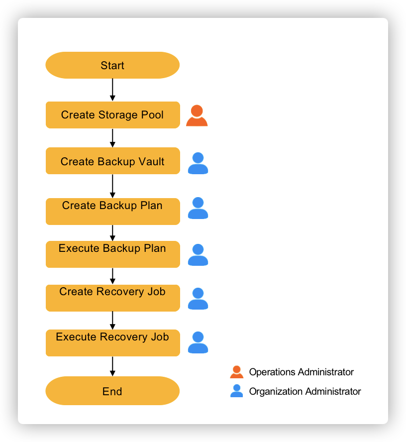

<a id="section-4"></a>

# 4.Log in to the ASR for Backup and Recovery console

You can go to the Apsara Stack Resilience (ASR) for Backup and Recovery console in the Apsara Uni-manager Management Console.

**Prerequisites**

- The URL of the console that is obtained from the deployment personnel.

- A supported browser is used. We recommend that you use Google Chrome.

**Background information**

In cross-region backup and local backup scenarios, the ASR for Backup and Recovery console is deployed in the central region. You must log in to the ASR for Backup and Recovery console in the Apsara Uni-manager Management Console.

**Procedure**

1. Enter the URL of the Apsara Uni-manager Management Console in the address bar and press the Enter key.

2. On the login page, enter your username and password.

   You can obtain the username and password that are used to log in to the Apsara Uni-manager Management Console from the operations administrator.

   > **Note**
   >
   > - **First login**
   >
   >   The first time that you log on to the Apsara Uni-manager Management Console, you need to change the password of your account. The password must be 10 to 32 characters in length. It must contain all of the following character types: uppercase letters, lowercase letters, digits, and special characters. Supported special characters include: ! @ # $ %
   >
   > - **Forgotten password**
   >
   >   If you have forgotten your password, click Forgot Password. On the page that appears, enter the username of your account, the email address that was used to create the account, and the CAPTCHA code. Then, the system sends a link for resetting the password to the specified email address.

3. Click **Log In**.

4. In the top navigation bar, select **Products**.

5. In the left-side navigation pane, click **Disaster Recovery and Backup**.

6. In the **Disaster Recovery and Backup** section, choose **Disaster Recovery > ASR for Backup and Recovery**.

<a id="section-5"></a>

# 5.Query overview statistics

This topic describes the statistics that are displayed on the Overview page of the Apsara Stack Resilience for Backup and Recovery (ASR-BR) console. The statistics include the real-time status of the backup system, backup records, recovery records, resource statistics, backup status, and system alerts. This helps you quickly understand the overall backup situation.

**Procedure**

1. Log in to the ASR-BR console.

2. In the left-side navigation pane, click **Overview**.

   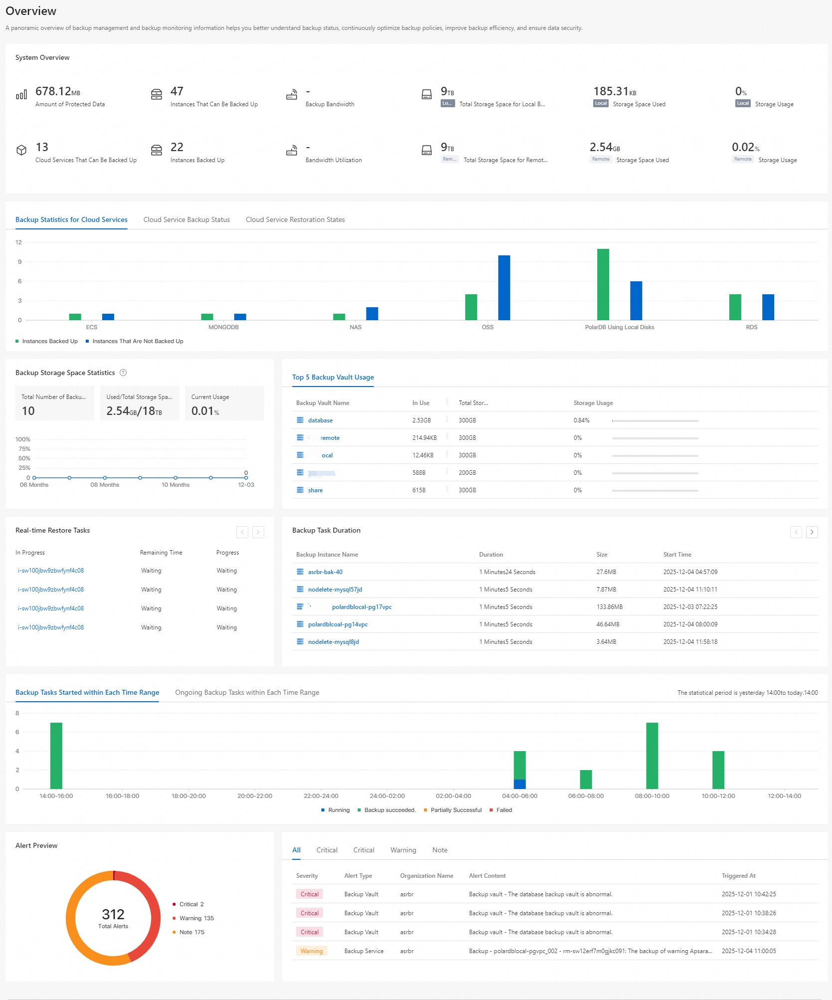

   

   **Section**

   Sub-section

   **Description**

   Displays the total amount of source data in the latest successful backup of the instances that have been backed up.

   - For an operations administrator: This section displays

   Amount of

   the total amount of data in the latest successful

   Protected Data

   backup of all instances that have been backed up.

   - For an organization administrator: This section displays the total amount of data in the latest successful backup of the instances that have been backed up in the current organization.

   - For an operations administrator: This section displays the total number of instances of cloud services for all

   Instances That

   organizations.

   Can Be Backed

   - For an organization administrator: This section

   Up

   displays the total number of instances of cloud services in the current organization.

   Backup

   Displays the transmission rate of backup data

   Bandwidth

   configured in the current system.

   - For an operations administrator: This section displays the number of cloud services that can be backed up

   Cloud Services

   in the system.

   That Can Be

   - For an organization administrator: This section

   Backed Up

   displays the number of cloud services that can be backed up in the current organization.

   - For an operations administrator: This section displays the number of all instances that have been backed up.

   Instances Backed Up

   - For an organization administrator: This section displays the number of instances that have been

   **System Overview**

   backed up in the current organization.

   Bandwidth

   Displays the utilization of the system bandwidth during

   Utilization

   backup.

   Total Storage

   The total storage space that is used to store backup

   Space for Local

   data in local backup scenarios.

   Backup

   Storage Space

   The storage space that has been consumed by all

   Used (Local)

   backup jobs on the local device.

   The percentage of storage space that has been

   Storage Usage

   consumed by all backup jobs on the local device.

   (Local)

   Storage usage = (Used storage space/Total storage capacity) × 100%.

   Total Storage

   The total storage space that is used to store backup

   Space for Remote

   data in remote backup scenarios.

   Backup

   Storage Space

   The storage space that has been consumed by all

   Used (Remote)

   backup jobs in remote backup scenarios.

   The percentage of storage space that has been

   Storage Usage

   consumed by all backup jobs in remote backup

   (Remote)

   scenarios. Storage usage = (Used remote storage space/Total remote storage capacity) × 100%.

   - For an operations administrator: This section displays the number of instances that have been backed up and the number of instances that have not been backed up in the system.

   **Backup Statistics for Cloud Services**

   - For an organization administrator: This section displays the number of instances that have been backed up and the number of instances that have not been backed up in the current organization.

   - For an operations administrator: This section collects and displays statistics on the backup status of all cloud services in the system.

   **Cloud Service Backup Status**

   - For an organization administrator: This section collects and displays statistics on the backup status of all cloud services in the current organization.

   - For an operations administrator: This section collects and displays statistics on the recovery status of all cloud services in the system. The recovery status can be Restoration Succeeded, Restoring, and Restore failed.

   **Cloud Service Restoration States**

   - For an organization administrator: This section collects and displays statistics on the recovery status of all cloud services in the current organization. The recovery status can be Restoration Succeeded, Restoring, and Restore failed.

   - For an operations administrator: This section displays the total number of backup vaults in the system.

   Total Number of

   - For an organization administrator: This section

   Backup Vaults

   displays the total number of backup vaults in the current organization.

   - For an operations administrator: This section displays the total backup storage space and used storage space in the system.

   Used/Total

   **Backup Storage**

   Storage Space

   - For an organization administrator: This section

   **Space Statistics**

   displays the total backup storage space and used storage space in the current organization.

   You can calculate the current usage by using the following formula: Current usage = Used storage space/Total storage space × 100%.

   - For an operations administrator: This section displays

   Current Usage

   the usage of the total backup storage space.

   - For an organization administrator: This section displays the usage of the backup storage space in the current organization.

   - For an operations administrator: This section displays the top 5 backup vaults that have the highest storage usage in the system.

   - For an organization administrator: This section displays the top 5 backup vaults that have the highest storage usage in the current organization.

   **Top 5 Backup Vault Usage**

   You can click the name of a backup vault to go to the **Backup Vault** page to view the details of the backup vault. For more information, see Backup vault.

   Collects and displays statistics on backup jobs in real time. You can click the **>** icon to view the details of other backup jobs.

   - For an operations administrator: This section displays

   **Real-time Restore Tasks**

   the backup status of all real-time backup jobs in the system.

   - For an organization administrator: This section displays the backup status of real-time backup jobs in the current organization.

   Collects and displays statistics on the time consumed by backup jobs. A maximum of 10 backup jobs are displayed. You can click the **>** icon to view the time consumed by other backup jobs.

   **Backup Task Duration**

   - For an operations administrator: This section displays the time consumed by all backup jobs in the system.

   - For an organization administrator: This section displays the time consumed by backup jobs in the current organization.

   <table>
     <tr>
       <td>Backup Tasks Started within Each Time Range</td>
       <td>Collects and displays statistics on the number of backup jobs that are started within 24 hours and in the Running, Backup succeeded, Partially Successful, and Failed states.<br>• For an operations administrator: This section displays the startup status of all backup jobs in the system.<br>• For an organization administrator: This section displays the startup status of backup jobs in the current organization.</td>
     </tr>
     <tr>
       <td>Ongoing Backup Tasks within Each Time Range</td>
       <td>Collects and displays statistics on the number of backup jobs that are started within 24 hours in the Running state.<br>• For an operations administrator: This section displays the total number of backup jobs that are started within 24 hours in the Running state in the system.<br>• For an organization administrator: This section displays the number of backup jobs that are started within 24 hours in the Running state in the current organization.</td>
     </tr>
     <tr>
       <td>Alert Preview</td>
       <td>• Displays the number of alerts in total and the number of alerts at four levels in a ring chart: Critical, Critical, Warning, and Note.<br>• Displays the details of all alerts and the details of alerts at four levels in lists: Critical, Critical, Warning, and Note. You can click different tabs to view the details of alerts at different levels.<br>Note<br>• The details of all alerts in the system are displayed when you log in as an operations administrator.<br>• The details of all alerts in the organization are displayed when you log in as an organization administrator.</td>
     </tr>
   </table>

<a id="section-6"></a>

# 6.User guide

The user guide page provides the overview, usage process, best practices, and key concepts of ASR for Backup and Recovery (ASR-BR). This page also provides quick access to product documentation.

1. Log on to the ASR-for Backup and Recovery console as a backup operations administrator or organization backup administrator.

2. In the left-side navigation pane, click **User Guide**.

   For the operations administrator:

   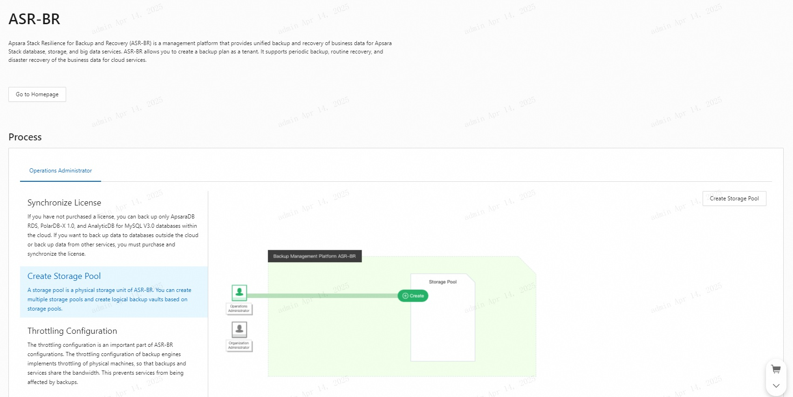

   If you are an organization administrator, you can view the following page:

   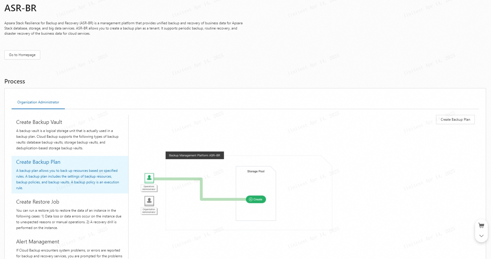

   | Module | Description |
   | --- | --- |
   | Quick access to the Overview page | Click <strong>Go to Homepage</strong> to go to the Overview page of the ASR-for Backup and Recovery console. |
   | Quick access to product documentation | Click <strong>Product Documentation</strong> to view the documentation of ASR for Backup and Recovery console. |
   | Usage process | • If you are an operations administrator, you can view the overview of the following processes: synchronizing a license, creating a storage pool, configuring flow control, managing self-backup, and managing alerts. You can also quickly go to the page of the corresponding module.<br>• If you are an organization administrator, you can view the overview of the following processes: creating a backup vault, creating a backup plan, creating a recovery task, and managing alerts. You can also quickly go to the page of the corresponding module. |
   | Back up data to Alibaba Cloud public cloud | You can view the benefits, preparation, and procedure for backing up data to Alibaba Cloud public cloud. |
   | Best practices | You can view the best practices for using databases, file storage services, and big data services to back up data. Click <strong>Product Documentation</strong> to view the corresponding best practices. |
   | Key concepts | The links of the key concepts of ASR for Backup and Recovery console are provided to allow you to quickly access the corresponding documentation page. |

<a id="section-7"></a>

# 7.Create a storage pool

Storage pool groups are physical clusters where backup data is stored. A storage pool group can contain multiple storage pools that are logically isolated from each other by using AccessKey pairs.

**Prerequisites**

- Only operations administrators can create storage pool groups and storage pools.

- You have purchased a license to back up data to Amazon Simple Storage Service (S3).

- Optional. The conditions for using the S3 protocol are met. For more information, see S3 protocol usage requirements.

**Procedure**

1. Log on to the ASR for Backup and Recovery console.

2. In the left-side navigation pane, choose **System Management** > **Storage Pool Groups**.

3. On the **Manage Storage Pool Group** page, click **Create Storage Pool Group**.

4. In the **Add Storage Pool Group** dialog box, configure the parameters and click **OK**.

   > **Note**
   >
   > A maximum of 16 storage pool groups can be created.

   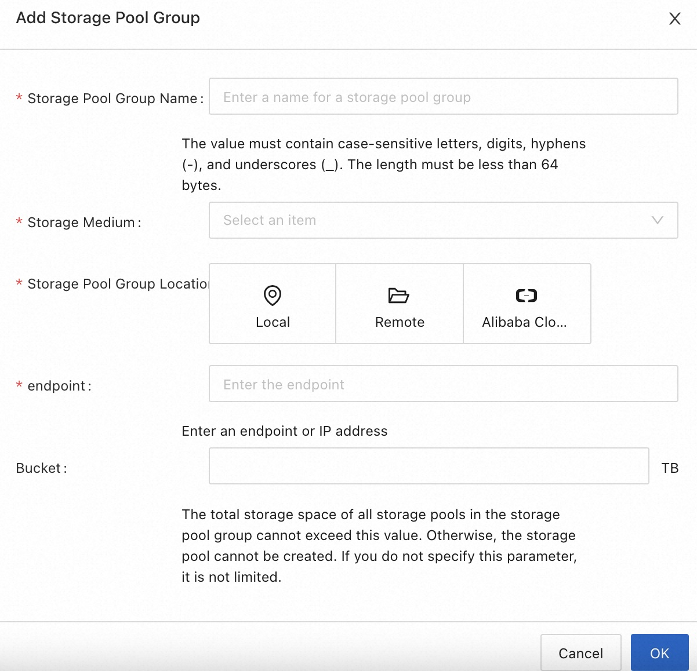

   | Parameter | Description |
   | --- | --- |
   | Storage Pool Group | Enter a descriptive name for the storage pool group, such as Public Cloud Storage Pool Group.<br>Note<br>• The name can contain letters, digits, hyphens (-), and underscores (_). It must be less than 64 characters in length and case-sensitive. |
   | Storage Medium | Specify the Storage Medium parameter based on the type of storage pool used. Valid values:<br>• <strong>OSS</strong>: The Object Storage Service (OSS 1.0) provided by Alibaba Cloud Apsara Stack.<br>• <strong>CDS-OSS</strong>: The OSS (CDS-OSS) provided by Alibaba Cloud Apsara Stack.<br>• <strong>MINIOSS</strong>: MINIOSS storage array.<br>• <strong>PanguStor</strong>: PanguStor.<br>• <strong>SDS</strong>: distributed storage SDS.<br>• <strong>S3</strong>: Object storage services provided by third-party vendors that support S3 protocol access.<br>Note<br>You have purchased a license to back up data to S3. To use the S3 protocol, certain conditions must be met. For more information, see S3 protocol usage requirements. |
   | Storage Location | The location where the storage pool group resides. Valid values:<br>• <strong>Local</strong>: the current site.<br>• <strong>Remote</strong>: a site in another region.<br>• <strong>Public Cloud</strong>: Alibaba Cloud public cloud. |
   | Endpoint | The domain name or IP address of the storage medium.<br>Note<br>• The endpoint must be accessible.<br>• IPv6 addresses are not supported.<br>• If a NAT gateway is used and port mapping needs to be added, specify the parameter in the following format: <code> &lt;Endpoint&gt;:</code> <code>&lt;Port&gt; </code>. |
   | Storage Space (optional) | The storage capacity of the storage pool group. Unit: TB.<br>Note<br>• The sum of the storage capacity of all storage pools in the group must be smaller than this value. Otherwise, storage pools fail to be created.<br>• If you leave this parameter empty, the storage capacity is unlimited. |

5. In the storage pool group list, click the name of the storage pool group.

6. On the page that appears, click **Create Storage Pool**. In the **Add Storage Pool** dialog box, configure the parameters.

   > **Note**
   >
   > You can also click **Add Storage Pool** in the **Actions** column on the Manage Storage Pool Group page to create a storage pool.

   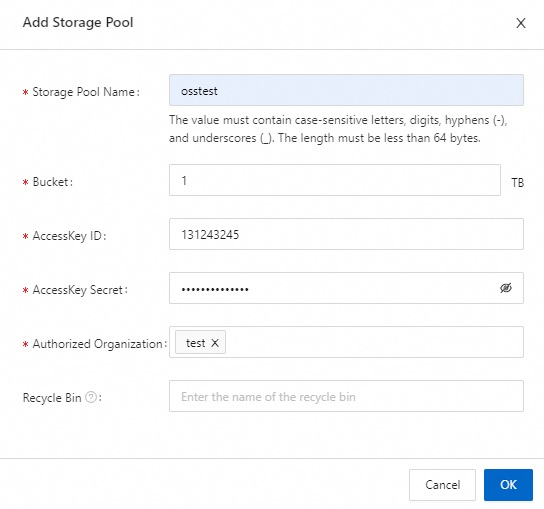

   | Parameter | Description |
   | --- | --- |
   | Storage Pool Name | Enter a descriptive name for the storage pool group, such as Public Cloud Storage Pool.<br>Note<br>The name can contain letters, digits, hyphens (-), and underscores (_). It must be less than 64 characters in length and case-sensitive. |
   | Storage Space (TB) | The storage capacity of the storage pool. Unit: TB. |
   | AccessKey ID | The AccessKey ID of the account that accesses the destination storage.<br>Note<br>The AccessKey ID and AccessKey secret must have the permissions to read and write data. |
   | AccessKey Secret | The AccessKey secret of the account that accesses the destination storage. |
   | Authorized Organization | Select the level-1 organizations. You can select all level-1 organizations. |
   | Recycle Bin | Optional. Specify the name of the recycle bin. This parameter is required if you need to create a deduplication backup vault or a mirror vault in the storage pool.<br>Note<br>When you create a deduplication backup or mirror vault, an existing bucket of the recycle bin is used if any. If no bucket exists, a relevant bucket is created. |
   | Storage Pool Description (optional) | The description of the storage pool for easy identification. |

7. Click **OK**.

<a id="section-8"></a>

# 8.Instance management

<a id="section-8-1"></a>

## 8.1. View instances

You can view the status of instances in the primary cloud center and the backup plans of the instances on the Instances page.

**Background information**

- An organization administrator can view only the instances of the current organization.

- An operations administrator can view the instances of all organizations.

**Procedure**

1. Log in to the Apsara Stack Resilience for Backup and Recovery (ASR-BR) console.

2. In the left-side navigation pane, click **Instances**.

   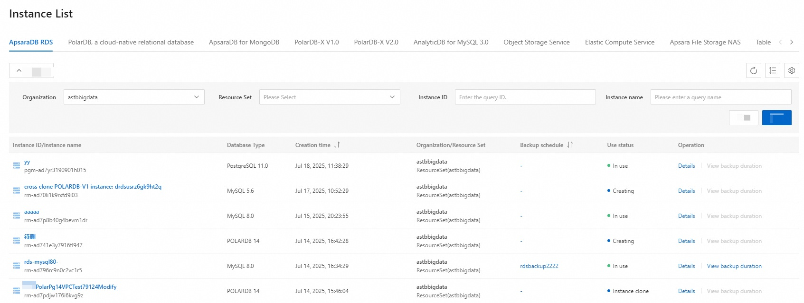

3. On the page that appears, click the tab of the service whose instances you want to view.

4. Specify search conditions and click **Search**.

   The following table describes the supported search conditions.

   | Search condition | Description |
   | --- | --- |
   | Organization | Select an organization from the drop-down list to query all instances in the organization. |
   | Resource Set | Select a resource set from the drop-down list to query all instances in the resource set. |
   | Instance ID | Enter the ID of an instance to search for the instance. |
   | Instance Name | Filter instances by instance name. |

5. In the instance list, view the instance status and the associated backup plans.

6. Click the name of a backup plan to go to the backup plan details page. For more information, see Backup plans.

**Related operations**

On the Instances page, you can also perform the following operations.

| Operation | Procedure |
| --- | --- |
| View the details of an instance | 1. Click an instance name or click <strong>Details</strong> in the <strong>Actions</strong> column to go to the <strong>Instance Details</strong> page.<br>2. View the details of the instance on the following tabs:<br>• <strong>Backup Record</strong>: displays all backups of the instance.<br>• <strong>Log Backup</strong>: displays the binary log backup records of ApsaraDB RDS instances.<br>Note<br>Only organization administrators can view the log backup records of instances in the current organization.<br>• <strong>Backup and Restoration Events</strong>: displays all events during the backup and restoration of the instance. Click <strong>Log</strong> in the <strong>Actions</strong> column of an event to view the log corresponding to the event. |
| View the backup duration of an instance | 1. Click <strong>View Backup Duration</strong> in the <strong>Actions</strong> column of an instance to go to the <strong>Backup Duration</strong> page. For more information, see View backup durations. |

<a id="section-8-2"></a>

## 8.2. Modify the backup policy settings of an instance

For an instance that is added to a backup plan, you can modify the backup policy on the details page of the backup plan.

**Prerequisites**

The instance is added to a backup plan.

**Procedure**

1. Log on to the ASR for Backup and Recovery console.

2. In the left-side navigation pane, click **Instances**.

3. Click the tab of the cloud service that you want to manage.

4. Specify an organization, a resource set, an instance ID, an instance name and click **Search**.

5. After the instances that match the search conditions are displayed, click the name of the backup plan in the **Backup Plan** column.

6. On the **Backup Information** tab, click **Modify Backup Policy**.

7. In the Modify Backup Policy panel, modify the configurations of the backup policy. For more information, see Create a backup plan.

8. Click **Save**.

<a id="section-8-3"></a>

## 8.3. View backup durations

ASR for Backup and Recovery uses a line chart to display the durations of the recent several backups. The durations displayed on the chart help you analyze network congestion and schedule backups to prevent network congestion.

**Prerequisites**

The instance is added to a backup plan.

**Procedure**

1. Log on to the ASR for Backup and Recovery console.

2. In the left-side navigation pane, click **Instances**.

3. Click the tab of the instance type that you want to manage.

4. On the Instances page, find the instance whose backup duration you want to view, and click **View Backup Duration** in the **Actions** column.

5. Move the pointer over a position in the chart to view the backup duration. You can also view the points in time when backups started and ended.

   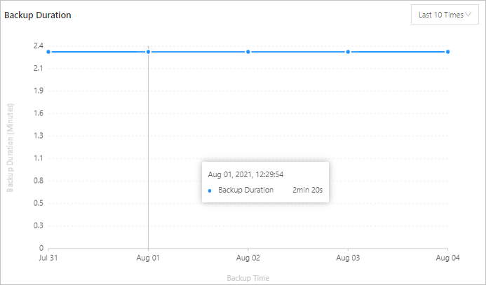

6. Optional. In the upper-right corner of the page, adjust the number of recent backups that are displayed in the chart. ASR for Backup and Recovery allows you to view the durations of the recent 10, 20, 30, and 50 backups.

<a id="section-9"></a>

# 9.Backup vault

<a id="section-9-1"></a>

## 9.1. Create a backup vault

A backup vault is a logical storage space that is planned on a storage pool. A backup vault is an Object Storage Service (OSS) bucket that is used to store backup data for business workloads.

**Prerequisites**

- A storage pool is created. For more information, see Create a storage pool.

- To create a backup vault, the following requirements must be met:

  - You have the permissions to create a backup vault. In V3.16.2, organization administrators and organization backup administrators have such permissions. In V3.18.6, custom roles that have permissions on Apsara Stack Resilience for Backup and Recovery (ASR-BR) and management permissions are also allowed to create backup vaults. However, these roles must be supported by their organization and sub-organizations.

  - You must belong to a level-1 organization that is authorized by the storage pool. Otherwise, the storage pool cannot be recognized.

**Background information**

- In V3.16 and later, you can create multiple database backup vaults.

- In a storage pool, you can create multiple storage backup vaults, database backup vaults, deduplication backup vaults, and Tablestore backup vaults.

- ApsaraDB RDS, PolarDB Primary/Secondary Edition, , and PolarDB-X 2.0 all use the same database backup vault.

- Organization backup administrators and organization backup operators can create database backup vaults, storage backup vaults, Tablestore backup vaults, deduplication backup vaults, and backup vaults for PolarDB Cluster Edition.

**Procedure**

1. Log in to the ASR for Backup and Recovery console.

2. In the left-side navigation pane, choose **Backup Repository**.

3. On the **Backup Vault** page, click **Create**.

4. In the **Create Backup Vault** dialog box, configure the parameters as described in the following table.

   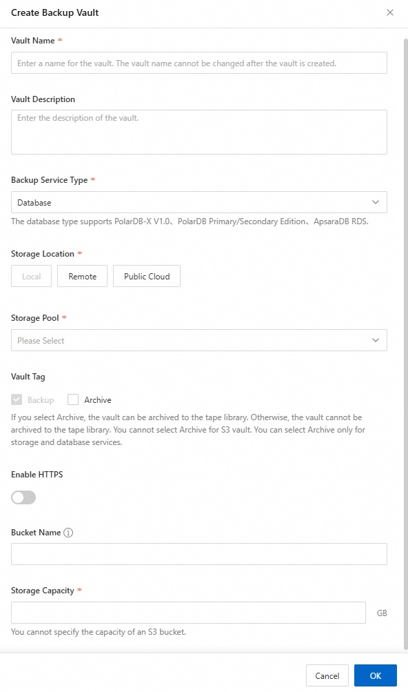

   | Parameter | Description |
   | --- | --- |
   | Vault Name | Set a recognizable name for the backup vault, such as public cloud backup vault.<br>Note<br>• You cannot modify this name after creation.<br>• The name can contain only lowercase letters, digits, and hyphens (-). It cannot start with a hyphen (-). The name must be 3 to 35 characters in length. |
   | Vault Description (optional) | Enter a brief description for the vault. |
   | Backup Service Type | Select the type of the product for which you want to back up data in this vault. Valid values:<br>• <strong>Database</strong>: PolarDB Primary/Secondary Edition, PolarDB-X 2.0, ApsaraDB RDS, and ApsaraDB for MongoDB are supported.<br>• <strong>StorageClass</strong>: File Storage NAS (NAS), Elastic Compute Service (ECS), OSS, and WUYING Workspace are supported.<br>• <strong>Tablestore</strong>: Tablestore is supported.<br>• <strong>Deduplication-based Storage</strong>: MaxCompute and Elasticsearch on Kubernetes are supported.<br>• <strong>PolarDB Cluster Edition Storage Repository</strong>: Only PolarDB Cluster Edition is supported. |
   | Storage Location | Select the location where you want to store backup data.<br>• <strong>Local</strong>: The backup data is stored in an OSS bucket in the current region.<br>• <strong>Remote</strong>: The backup data is stored in an OSS bucket in another region.<br>• <strong>Public Cloud</strong>: The backup data is stored in OSS buckets on the Alibaba Cloud public cloud. |
   | Storage Pool | Select the storage pool to which the backup vault belongs.<br>Note<br>Only database and storage backup vaults support S3 storage pools. Only data from ApsaraDB for RDS MySQL, PolarDB for PostgreSQL, PolarDB for Oracle, PolarDB-X 2.0, OSS, and NAS can be backed up to S3 vaults. |
   | Vault Tag | By default, Backup is selected and Archive is optional. If you select Archive, the vault can be used for archiving. Otherwise, the vault is used only as a backup vault.<br>Note<br>The Archive feature is supported by ApsaraDB RDS and OSS. |
   | Enable HTTPS | Specify whether to use the HTTP or HTTPS protocol to create the backup vault and back up data to the vault. By default, HTTPS is enabled. You can manually disable it.<br>Note<br>If no HTTPS port can be connected to OSS, we recommend that you turn off <strong>Enable HTTPS</strong>. |
   | Bucket Name | If you specify a bucket, the system directly uses that bucket as the backup vault. The bucket name you enter must already exist in OSS.<br>Note<br>If you do not have permissions to create buckets in the selected storage pool, you must specify this parameter. |
   | Storage Capacity | Customize the storage capacity of the backup vault. If you set this value to -1, no limit applies. The storage capacity is determined by the capacity of the specified bucket. Unit: GB.<br>Note<br>The storage size of the backup vault cannot exceed that of the storage pool to which it belongs. |

5. Click **OK**.

   > **Note**
   >
   > If the storage vault fails to be created, the storage resources may be insufficient. Scale out the storage resources before you can create a vault.

**Result**

ASR for Backup and Recovery automatically creates an OSS bucket in the selected storage pool. Then, the storage pool is used to back up your business data.

<a id="section-9-2"></a>

## 9.2. View a backup vault

You can view the information about the files in an Object Storage Service (OSS) bucket that is created for a backup vault on a regular basis. This way, you can obtain the information about backup and restoration plans and modify the plans at the earliest opportunity.

**View the data of backup vault View the data of backup vault**

1. Log on to the ASR for Backup and Recovery console.

2. In the left-side navigation pane, click **Backup Vaults**.

3. In the list of backup vaults, find the backup vault that you want to view and click **Preview** in the **Actions** column.

4. In the message that appears, view the following information about files in the OSS bucket for the backup vault: names, sizes, and update time.

   > **Note**
   >
   > If an OSS bucket contains folders, you can click the name of a folder to view the file directories in the folder.

5. Click **OK**.

**View backup vault details**

1. In the left-side navigation pane, click **Backup Vaults**.

2. In the backup vault list, click a vault name. You can view the basic information, storage pool usage, and operation records of the backup vault.

<a id="section-9-3"></a>

## 9.3. Manage backup vaults

This topic describes how to view, modify, and delete backup vaults.

**Background information**

- Backup operations administrators, organization backup administrators, and organization backup operators can modify the name and storage capacity of backup vaults.

- Organization backup administrators and organization backup operators can delete backup vaults that are not associated with backup plans, and whose data has expired.

**View a backup vault**

1. Log in to the ASR for Backup and Recovery console.

2. In the left-side navigation pane, choose **Backup Repository**.

3. In the backup vault list, click the vault name to view basic information, storage pool usage, and user operation information.

4. On the Backup Vault Association Chart tab, view other vaults associated with this vault.

5. Click Image Repository to view information about the corresponding image repository, including Synchronization Progress, Vault Usage, and Storage Pool Proportion.

**Modify a backup vault**

1. Log in to the ASR for Backup and Recovery console.

2. In the left-side navigation pane, choose **Backup Repository**.

3. In the backup vault list, click **Modify** in the **Actions** column.

4. Modify the **Vault Name** and **Storage Capacity** parameters, and click **OK**.

**Delete a backup vault**

1. Log in to the ASR for Backup and Recovery console.

2. In the left-side navigation pane, choose **Backup Repository**.

3. On the **Backup Vault** page, click **Delete** in the **Actions** column of the target vault.

4. In the dialog box that appears, click **OK**.

**(Optional) Lock a backup vault**

> **Note**
>
> - You can only lock storage and database (excluding PolarDB-X 1.0) backup vaults whose storage medium is Object Storage Service (OSS), CDS-OSS, or PanguStor.
>
> - The backup lock feature cannot be disabled once enabled. You can only extend the backup lock duration.
>
> - Before the lock duration of a backup vault expires, the data in the backup vault cannot be deleted.
>
> - After submitting the lock request, the retention period for data from backup plans targeting this vault will be synchronized to match the configured backup lock duration.
>
> - After the backup lock feature is enabled, you must configure retention policies for OSS buckets. The retention policies provide th Write Once Read Many (WORM) feature.

1. Log in to the ASR for Backup and Recovery console.

2. In the left-side navigation pane, choose **Backup Repository**.

3. In the backup vault list, click **Backup Lock** in the **Actions** column.

4. Set Lock Duration (Days) to an integer between 7 and 25550.

5. Click **OK**.

6. (Optional) Extend the backup lock duration. You can perform this operation only after the backup vault is locked.

   <ol type="i">

   <li>

   Click **Extend Backup Lock Duration** in the **Actions** column.

   </li>

   <li>

   Enter an integer that is greater than the original lock duration and within the range of 7

   </li>

   </ol>

   to 25550).

   <ol type="i" start="3">

   <li>

   Click **OK**.

   </li>

   </ol>

<a id="section-9-4"></a>

## 9.4. Create a mirror vault

A mirror vault is a special backup vault that is used to save the data replicas of a backup vault. After a mirror vault is created for a backup vault, the data in the backup vault is automatically replicated to the mirror vault by using the cross-region and cross-cloud replication capabilities of Object Storage Service (OSS). This way, backup data is stored in multiple regions. During data restoration, you can use the backup vault or the mirror vault to restore the data.

**Background information**

You can create a mirror vault and associate a backup vault with the mirror vault to manage the mirror vault. In the Apsara Stack Resilience for Backup and Recovery (ASR-BR) console, you can back up the business data of each cloud service to the backup vault and then synchronize the data from the backup vault to the mirror vault.

**Limits**

- The bucket used by a mirror vault must be an empty bucket.

- You can create a mirror vault only for a storage pool whose storage medium is OSS, CDS-OSS, or PanguStor.

- The type of the mirror vault cannot be modified after the mirror vault is created.

**Prerequisites**

- A backup vault is created. For more information, see Create a backup vault.

- A storage pool is created, and the recycle bin is configured. For more information, see Create a storage pool.

- The cross-region and cross-cloud replication authorization information is configured. For more information about the preparations, see Prerequisites for using the image repository feature of a backup vault.

**Procedure**

1. Log in to the ASR-BR console.

2. In the left-side navigation pane, click **Backup Vaults**.

3. On the Backup Vaults page, specify the **Vault Location**, **Vault Type**, and **Vault Name** parameters, and then click **Search**.

4. Click **Create Image Repository** in the **Actions** column.

5. The following table describes the parameters.

   | Parameter | Description |
   | --- | --- |
   | Image Repository Name | You can specify a name or select the name of the backup vault.<br>• After a mirror vault is created, you cannot change its name.<br>• The name can contain lowercase letters, digits, and hyphens (-). The name cannot start with a hyphen (-). The name must be 3 to 35 characters in length. |
   | Vault Description | The description of the vault. This parameter is optional. We recommend that the description is the same as that of the backup vault to facilitate maintenance. |
   | Backup Service Type | The system automatically fills in the value. |
   | Storage Pool | Select a storage pool from the drop-down list.<br>Note<br>If no options are available, create a storage pool. For more information, see Create a storage pool. |
   | Bucket Name | If you specify a bucket, the bucket is used as the mirror vault.<br>Note<br>This parameter is required if you do not have the permission to create buckets in the selected storage pool. The specified bucket must be an empty bucket. |
   | Storage Capacity | The storage capacity must be greater than or equal to 1,000 GB because the storage capacity of the mirror vault cannot be smaller than the storage capacity of the backup vault. |

6. Click **OK**.

   After the mirror vault is created, it is displayed in the list on the **Backup Vaults** page.

7. Click the  icon in the **Image Repository** column to display the mirror vault list. The

   number indicates the number of mirror vaults attached to the backup vault.

   - View the basic information and synchronization status of a mirror vault: Click a mirror vault name or bucket name to view the basic information, operation records, backup vault association chart, and mirror vault.

     > **Note**
     >
     > If the **Status** column indicates that the creation or synchronization failed, you can click **Retry** in the **Actions** column to create a mirror vault or synchronize data again.

   - Modify a mirror vault:

     <ol type="a">

     <li>

     Click **Edit** in the **Actions** column. The Edit Mirror Vault dialog box appears.

     </li>

     <li>

     After you modify the parameter values, click **OK**.

     </li>

     </ol>

   - Disconnect the mirror vault from the backup vault:

     <ol type="a">

     <li>

     Click **Disconnect** in the **Actions** column.

     </li>

     <li>

     In the message that appears, click **OK**.

     > **Note**
     >
     > - If the disconnection fails, the possible reason may be that the data replication link fails to be disconnected due to source OSS exceptions. After the source OSS recovers, data may still be synchronized even though the disconnection in the ASR-BR console fails.
     >
     > - If the disconnection succeeds, the availability of the backup sets of the mirror vault remains the same as that of the backup vault. When the backup records of the backup vault expire, the backup data of the mirror vault cannot be used for data restoration.

     </li>

     </ol>

<a id="section-10"></a>

# 10.Backup plans

<a id="section-10-1"></a>

## 10.1. Create backup plans

After you create a backup plan, ASR for Backup and Recovery regularly backs up data from specified instances to a backup vault.

**Prerequisites**

- You are an organization backup administrator or organization backup operator. Only organization backup administrators and organization backup operators can create backup plans. Backup operations administrators cannot create backup plans.

- You have created a backup vault. For more information, see Create a backup vault.

- If you want to back up and restore data for MaxCompute instances, you have enabled the external table feature for MaxCompute and deployed the MaxCompute Enhancement Pack for Joint Computing (Spark on MaxCompute).

- If you want to create a backup plan for Elastic Compute Service (ECS) instances, you have installed Cloud Assistant on the ECS instances, and the Cloud Assistant runs as expected.

- (Optional) If you want to create a backup plan for a MaxCompute instance, first specify compute units (CUs) dedicated for the backup operations of the instance to ensure that the backup operations do not interfere with ongoing business operations. For more information, see Parameter configuration. If you do not specify CUs for the backup operations of the instance, the CUs of the current project are used. When you configure the instance, a message indicating that no project is running will appear.

**Background information**

- ASR for Backup and Recovery allows you to back up ApsaraDB RDS data and metadata such as user information, permissions, and specifications.

- ASR for Backup and Recovery allows you to back up Apsara File Storage NAS file systems that use the Network File System (NFS) protocol or Server Message Block (SMB)SMB protocol.

- ASR for Backup and Recovery allows you to back up metadata of MaxCompute tables, functions, resources, and projects. The metadata includes quota information, cluster information, Virtual Private Cloud (VPC) information, and security information.

- ASR for Backup and Recovery backs up Tablestore tables only if their names contain no more than 100 characters. If you need to back up Tablestore tables whose names exceed 100 characters, contact the ASR for Backup and Recovery product team for evaluation.

**Procedure**

1. Log in to the ASR for Backup and Recovery console.

2. In the left-side navigation pane, choose **Backup Plan**.

3. On the **Backup Plan** page, click **Create**.

4. On the **Basic Information** wizard page, enter the basic information for the backup plan, then click **Next**.

   | Parameter | Description |
   | --- | --- |
   | Backup Plan Name | The name of the backup plan.<br>Note<br>The name must be 4 to 128 characters in length, including only letters, digits, hyphens (-), underscores (_), and periods (.). |
   | <strong>Description</strong> (optional) | The description of the backup plan for easy identification. |
   | Instance Type | The type of the instance that you want to back up.<br>Note<br>If you want to create a Tablestore backup plan, select <strong>Tablestore</strong>. |
   | Backup Mode | Configure this parameter only for ECS instances.<br>• <strong>Snapshot Backup</strong>: backs up an ECS instance or specified disks of an ECS instance.<br>• <strong>File Backup</strong>: backs up ECS files. |

5. On the **Select Instance** wizard page, select the instance to back up, and click **Next**.

   > **Note**
   >
   > - The instance to back up must be in the **In Use** state.
   >
   > - A backup plan is created for only one instance.
   >
   > - When the instance type is RDS, PolarDB, or PolarDB-X, you can add only one instance to one backup plan. You cannot select an instance whose protection status is **Protected**.
   >
   > - You can add one Object Storage Service (OSS) bucket to multiple backup plans.
   >
   > - You can add one Apsara File Storage NAS file system to multiple backup plans.
   >
   > - You can add one ECS instance to both a file backup plan and a cloud disk backup plan.
   >
   > - For ECS instances that use the file backup mode, you can add them to multiple backup plans.
   >
   > - A Tablestore instance contains multiple tables. When the instance type is TableStore, you can view the number of tables under the instance in the **Tablestore Table** column.

6. (Optional) Select Tablestore tables. Perform this step only if you select **Tablestore** for **Instance Type** on the **Basic Information** page.

   <ol type="i">

   <li>

   In the left-side section, select the names of the tables that you want to back up.

   > **Note**
   >
   > You can back up a maximum of two tables simultaneously per instance. If you select two or fewer tables, the system backs up both tables concurrently. If you select more than two tables, the system queues the additional tables for backup.

   </li>

   <li>

   Click  to add the selected Tablestore tables to the right-side section.

   </li>

   <li>

   Click **Next**.

   </li>

   </ol>

7. (Optional) On the **Install Client** page, configure parameters for installing the Hybrid Backup Recovery (HBR) client and click **Next**.

   > **Note**
   >
   > - This step is applicable only to ECS instances that use the **File Backup** method.
   >
   > - The ECS Cloud Assistant is used when installing the HBR client. Ensure that the ECS Cloud Assistant is installed on the ECS instance and is in the normal state.

   **Instance type**

   **Name**

   **Description**

   The directory where the HBR client is installed on the ECS instance.

   **Client Installation**

   > **Note**

   **Path** (optional)

   > If you do not select an installation path, the system installs the client in  `/root`  by default.

   The system automatically displays the number of CPU cores of the current ECS instance. Set this parameter as needed. When the HBR client starts a backup task, it allocates tasks based on the value you specified for this parameter.

   > **Note**

   **vCPUs on**

   > A larger number of CPU cores consumes more host

   **Client**

   > resources and has a greater impact on host performance. Evaluate carefully before setting this value to avoid affecting your business operations.

   The system sets the default maximum number of worker threads to 10. You can modify this value as needed. When the HBR client starts a backup task, it allocates tasks based on the value you specified for this parameter.

   **Maximum Worker**

   > **Note**

   **Threads on Client**

   > A larger number of threads consumes more host resources and has a greater impact on host performance. Evaluate carefully before setting this value to avoid affecting your business operations.

   ECS (file backup)

   After configuring **vCPUs on Client** and **Maximum Worker Threads on Client**, click **install** to start installing the HBR client. Click **Refresh** to update the installation status in real time. After the installation status changes to **The client is installed**, you can perform the next step. The system automatically performs a connectivity test.

   > **Note**
   >
   > - After installation, you can uninstall the client or edit the settings for **vCPUs on Client** and **Maximum Worker Threads on Client**.
   >
   > - The right-side section of the Install Client page displays the client installation information, including the installation status, client version, heartbeat keep-alive time, number of CPU cores used by client, and maximum number of worker threads for client. If keepalive does not time out, you can uninstall the client or perfor connectivity testing. If keepalive times out, you can uninstall or reinstall the client.

   **Client**

   > - If the ECS instance already has a client

   **Installation**

   > installed, the next time you create a backup

   **Status**

   > plan for the ECS instance, the client

   (optional)

   > installation status is displayed as **The client is installed**.

8. On the **Configure Instance** page, configure the relevant parameters and click **Next**.

   > **Note**
   >
   > Skip this step when you create backup plans for ApsaraDB RDS, PolarDB, Tablestore, and PolarDB-X instances.

   **Instance**

   **Name**

   **Description**

   **type**

   Click **Browse**. In the **Path** dialog box, select the directory to back up .

   The **Path** page displays directories of the current bucket. You can select objects to back up from the bucket.

   > **Note**
   >
   > - If you do not configure this parameter, the system backs up all objects in the bucket by default.

   **OSS Prefix**

   > - The value of **OSS Prefix** must be separated by and

   (optional)

   > ended with forward slashes (/). The value cannot contain the following characters: angle brackets (<>), backslashes (\\), vertical bars (|), colons (:), quotation marks ("), asterisks (\*), and question marks (?).
   >
   > - If a bucket contains a large number of objects, you can create multiple backup plans to improve backup efficiency. In each backup plan, specify the objects to back up.

   Select a backup file filtering policy.

   - **All**: backs up all files that meet the conditions specified in **OSS Prefix**.

   - **By Time Range**: backs up objects whose last modification time falls within the specified time range.

   **Backup File**

   - **By Recent Days**: backs up objects whose last modification

   **Filtering**

   time falls within the specified number of recent days.

   **Policy**

   > **Note**
   >
   > The last modification time of an object is the start time of its last backup cycle.

   When you set **Backup File Filtering Policy** to **By Time Range**, specify the start time and end time for filtering files. The system backs up objects uploaded to OSS within the specified time range.

   > **Note**

   **Time Range for File**

   > - During backup, the system filters objects based on

   **Filtering**

   > their last modification time and the specified time range. Only objects whose last modification time falls within the specified time range are backed up to the remote site.
   >
   > - This parameter must be specified.

   When you set **Backup File Filtering Policy** to **By Recent**

   **Filter Files**

   **Days**, you need to set a value for this parameter. During

   **within**

   backup, the system filters files based on their last modification

   **Recent Days**

   time, the backup start time, and the value of this parameter.

   The number of concurrent reads and writes. When you create a backup plan for objects in an OSS bucket, you can specify the maximum number of concurrent reads from the source and concurrent writes to the destination. We recommend that you configure the number of concurrent backups based on the

   **Object**

   number and average size of objects in the bucket. If you set

   **Storage**

   **Number of**

   this parameter to **Default**, the system uses the minimum

   **Service**

   **Concurrent**

   number of concurrent backups.

   **Backups**

   > **Note**
   >
   > The system recommends an appropriate number of concurrent backups based on the throttling policy and the number and average size of objects in the bucket.

   This parameter is supported only for CDS-OSS instances.

   After you enable the inventory feature, ASR for Backup and Recovery creates a Resource Access Management (RAM) role that has read and write permissions on OSS to configure and generate OSS inventory lists. The inventory feature facilitates data backup from the OSS bucket.

   **Inventory function**

   > **Note**
   >
   > After you enable the inventory feature, the system uses OSS inventory lists to obtain incremental files in a bucket. You do not need to traverse the files in the bucket. If your bucket has more than 100 million objects, we recommend that you enable the OSS inventory feature.

   You need to configure this parameter only when **Inventory**

   **Bucket**

   **function** is enabled. This parameter specifies the bucket where OSS inventory lists are stored.

   You need to configure this parameter only when **Inventory**

   **Inventory**

   **function** is enabled. This parameter specifies the directory in

   **Report**

   which OSS inventory lists are generated. By default, if you do

   **Storage Path**

   not specify this parameter, OSS inventory lists are generated in the root directory.

   You need to configure this parameter only when **Inventory function** is enabled. This parameter specifies the cleanup policy for OSS inventory lists after each backup. By default, all inventory lists are deleted after a backup.

   **Inventory Cleanup**

   > **Note**

   **Policy**

   > Three policies are supported: delete all inventory lists after backup, delete the current inventory lists after backup, and do not delete inventory lists.

   The endpoint that you want to use to read data from the OSS bucket. You can use a custom endpoint to read data from a source OSS bucket. To specify a custom endpoint, select **Custom** from the **OSS Endpoint** drop-down list. We recommend that you use a non-business OSS endpoint for backup.

   > **Note**

   **OSS**

   > - If you do not configure this parameter, the system

   **Endpoint**

   > uses the default OSS endpoint to read data from a

   (optional)

   > source OSS bucket.
   >
   > - The system estimates the required backup traffic based on the throttling policy. Ensure that the backup traffic will not affect the business traffic.
   >
   > - Before you use a custom OSS endpoint for backup, ensure that the custom OSS endpoint can read data from the source bucket.

   **Backup**

   The estimated backup speed, first full backup time, and

   **Estimation**

   subsequent incremental backup time are displayed.

   - **Instance Backup**: backs up the entire ECS instance.

   - **Backup by Specified Disk**: backs up the specified disks of

   **Backup Type**

   an ECS instance. After you set **Backup Type** to **Backup by Specified Disk**, click **Add** to select one or more cloud disks as needed.

   **ECS** (Snapshot

   Disabled (default): The system prioritizes creating a snapshot-

   Backup)

   consistent group. If the conditions for creating a snapshot-consistent group are not met or creation fails for other reasons, the system automatically degrades to create a standard snapshot.

   **Forcibly**

   Enabled: The system forcibly creates a snapshot-consistent

   **Create**

   group. If the conditions for creating a snapshot-consistent group

   **Snapshot-**

   are not met or creation fails for other reasons, the system does

   **consistent**

   not degrade to create a standard snapshot, and the backup

   **Group**

   task ends in failure.

   > **Note**
   >
   > Do not enable this feature unless otherwise specified.

   Select the path where the files to be backed up reside. For more

   **Source Path**

   information, see the tooltip in the user interface.

   Valid values:

   - **Include All**: backs up all files in the path.

   **File Backup**

   - **Exclude**: backs up files in the path except those specified in

   **Policy**

   **Files**.

   - **Include**: backs up files specified in **Files**.

   **ECS** (File

   The files included in or excluded from the backup plan,

   Backup)

   depending on the option that is selected for **File Backup**

   **ECS Files**

   **Policy**. For more information, see the tooltip in the user interface.

   Set the maximum transmission rate for backing up data from a production center to a backup vault during different time periods. For more information, see the tooltip in the user

   **Traffic**

   interface.

   **Threshold**

   You can set different traffic thresholds for peak hours and off-

   (optional)

   peak hours as needed. For example, set a high traffic threshold for off-peak hours and a low traffic threshold for peak hours to avoid excessive bandwidth consumption.

   Specify the absolute path of the NAS files to be backed up.

   **File Path**

   Wildcard characters (\*) are not supported.

   The maximum number of backup processes that can run

   **Number of**

   simultaneously to back up data from the source to the

   **Concurrent**

   destination. Select the the number of concurrent backups

   **Backups**

   **NAS**

   based on the number and average size of NAS files.

   <table>
     <tr>
       <td rowspan="2">MaxCompute</td>
       <td>Source Resource</td>
       <td>Specify whether to back up a table or project. Valid values:<br>• <strong>Table Backup</strong>: backs up a single table or multiple tables.<br>• <strong>Project Backup</strong>: backs up all tables, resources, and functions in a project. You can specify the tables, resources, and functions that you want to back up by configuring a whitelist or blacklist.</td>
     </tr>
     <tr>
       <td>Temporary Table Prefix (optional)</td>
       <td>Table names are case-insensitive and cannot contain special characters. They can contain only letter, digits, and underscores (_). We recommend that you start the table name with a letter. The name length cannot exceed 128 bytes.</td>
     </tr>
     <tr>
       <td rowspan="3">ECS VMware</td>
       <td>Backup Gateway</td>
       <td>Select a backup gateway from the drop-down list:<br>• <strong>Default Policy</strong>: The system selects an HBR backup gateway to execute the backup plan based on the workloads specified by each customer .<br>• Other Backup Gateway: You can also select another registered backup gateway.</td>
     </tr>
     <tr>
       <td>Transmissio n Mode</td>
       <td>• <strong>LAN-free Backup Data Transmission</strong> (default): hot-mounts the disk that you want to back up to the backup gateway and transmits backup data over a non-LAN network.LAN stands for Local Area Network.<br>• <strong>LAN-based Backup Data Transmission</strong>: transmits backup data over a LAN.<br>Note<br>If vCenter does not support LAN-free data transmission, the system automatically switches to the LAN mode during data backup.</td>
     </tr>
     <tr>
       <td>Snapshot Type</td>
       <td>• <strong>Standard snapshot</strong>: uses VMware software snapshots to perform common backup.<br>• <strong>System Silent Snapshot</strong> (default): uses VMware Tools to perform silent backup.<br>Note<br>If VMware Tools cannot be mounted or is not installed, the system automatically switches to the standard snapshot mode for backups.</td>
     </tr>
   </table>

9. On the **Backup Policy** configuration wizard page, configure the backup policy and click **Next**.

   > **Note**
   >
   > Different instance types support different backup policy parameters. Configure the parameters based on the on-screen instructions and the following table.

   The following table describes the backup policy parameters.

   | Parameter | Description |
   | --- | --- |
   | Backup Policy | Different instance types support different backup policies.<br>• <strong>Full</strong>: All data in the database is backed up based on the specified cycle. If you select this policy, only the data that is backed up at the point in time when the backup is created can be restored.<br>ApsaraDB RDS instances support this policy.<br>• <strong>Full Data and Logs</strong>: All data in the database is backed up based on the specified cycle. In addition, incremental log files generated by the instance are backed up in real time. If you select this policy, the data that is backed up at all points in time can be restored.<br>ApsaraDB RDS, PolarDB, and PolarDB-X instances support this policy.<br>• <strong>Incremental</strong>: The first backup is a full backup.<br>OSS instances support this policy. For OSS, subsequent backups are incremental backups at the file level.<br>• <strong>Full (Data Deduplication)</strong>: All data in the database is backed up based on the specified cycle. Data is deduplicated during the backup process.<br>ECS (file backup) and NAS instances support this policy.<br>• <strong>Incremental (Deduplication)</strong>: The first backup is a full backup, followed by incremental backups. During the incremental backup, HBR deduplicates data by bucket.<br>MaxCompute instances support this policy.<br>• <strong>Full and incremental</strong>: You can perform full and incremental backups separately based on the set intervals for full and incremental backups.<br>ECS (cloud disk backup) instances support this policy. |
   | Backup Mode | This parameter is available only when the instance type is PolarDB-X.<br>• <strong>Fast Backup</strong>: ensures data consistency only in a single ApsaraDB RDS database. We recommend that you select this mode for routine backups.<br>• <strong>Consistent Backup</strong>: ensures data consistency in all databases within a PolarDB-X instance. We recommend that you select this mode for industries that have strict data consistency requirements or for online core transaction transactions.<br>Important<br>Perform consistent backups during off-peak hours. The system locks distributed transactions within seconds during a consistent backup. This may cause sub-second response time. |
   | Cycle Type | • <strong>Run by Week</strong>: ApsaraDB RDS instances support this cycle type.<br>• <strong>Run by Day</strong>: OSS, ECS (file backup), NAS, and MaxCompute instances support this cycle type. |
   | Select the Day of the Week | Select the days of the week for backup. We recommend that you select non-consecutive days, such as Monday, Thursday, and Sunday.<br>Note<br>ApsaraDB RDS instances support this parameter.<br>To ensure data security, select at least two days per week.<br>If you set Backup Policy to Full Data and Logs, we recommend that you select a maximum of two days of a week. This consumes less bandwidth and storage space. |
   | Interval (Incremental) | Set the interval between two backups.<br>This parameter is available only when you set <strong>Backup Policy</strong> to <strong>Incremental</strong> for OSS, NAS, ECS (cloud disk backup), and MaxCompute instances,.<br>Note<br>The system automatically estimates the number of days required for the first full backup of an OSS instance and recommends a backup interval longer than this duration. |
   | Time Interval (Incremental) | Set the interval between two incremental backups.<br>This parameter is available only when the instance type is Elasticsearch and you select <strong>Full and incremental</strong> for <strong>Backup Policy</strong>. |
   | Time Interval (Full) | This parameter is available only when the instance type is Elasticsearch and you select <strong>Full and incremental</strong> for <strong>Backup Policy</strong>.<br>Set the interval between two full backups. Set <strong>Time Interval (Full)</strong> to a value greater than the value of <strong>Time Interval (Incremental)</strong>. |
   | <strong>Interval</strong> (Full Data Deduplication) | This parameter is available when you select <strong>Full (Data Deduplication)</strong> for <strong>Backup Policy</strong> for ECS (file backup) instances. |

   <table>
     <tr>
       <td>Backup Time (Incremental)</td>
       <td>Set the time for the first backup. Subsequent backups are performed at the set interval.<br>Perform the first backup during off-peak hours.<br>Note<br>• OSS, ApsaraDB RDS, ECS (file backup), PolarDB-X, or MaxCompute instances support this parameter.<br>• Set the backup time at least one hour later than the current time.Otherwise, the backup may be skipped for the current day and be deferred to the next backup cycle.</td>
     </tr>
     <tr>
       <td>Storage Location</td>
       <td>Set the location where backup data is stored. You cannot select both <strong>Remote</strong> and <strong>Alibaba Cloud Public Cloud</strong>.<br>• <strong>Local</strong>: The data is backed up to a backup vault of the production center.<br>• <strong>Remote</strong>: The data is backed up to a backup vault of a remote data center.<br>• <strong>Alibaba Cloud Public Cloud</strong>: The data is backed up to a backup vault of Alibaba Cloud public cloud.</td>
     </tr>
     <tr>
       <td>Backup Vault (Local)</td>
       <td>OSS, NAS, MaxCompute, and ECS (file backup) instances support this parameter.<br>Select an existing local backup vault. If no suitable backup vault exists, click <strong>Create Backup Vault</strong> to create one.</td>
     </tr>
     <tr>
       <td>Retention Period (Days) (Local)</td>
       <td>The maximum number of days to retain backup data in a local vault. The default value is 7. You can enter an integer from 7 to 730.<br>Note<br>The system deletes expired backup data.</td>
     </tr>
     <tr>
       <td>Backup Vault (Remote)</td>
       <td>OSS, NAS, MaxCompute, ApsaraDB RDS, PolarDB, and ECS (file backup) instances support this parameter.<br>Select an existing remote backup vault. If no suitable backup vault exists, click <strong>Create Backup Vault</strong> to create one.</td>
     </tr>
     <tr>
       <td>Retention Period (Days) (Remote)</td>
       <td>The maximum number of days to retain backup data in a remote vault. The default value is 7. You can enter an integer from 7 to 1460.<br>Note<br>The system deletes expired backup data.</td>
     </tr>
     <tr>
       <td>Backup Vault (Alibaba Cloud Public Cloud)</td>
       <td>Select an existing backup vault on Alibaba Cloud public cloud. If no suitable backup vault exists, click <strong>Create Backup Vault</strong> to create one.</td>
     </tr>
     <tr>
       <td>Retention Period (Days)/Data Backup Retention Period (Days) (Alibaba Cloud Public Cloud)</td>
       <td>The maximum number of days to retain backup data in a backup vault that is deployed on Alibaba Cloud public cloud. The default value is 7. You can enter an integer from 7 to 1460.<br>Note<br>The system deletes expired backup data.</td>
     </tr>
     <tr>
       <td>Enable Log Backup</td>
       <td>By default, this feature is disabled. You can enable it to retain log data.<br>Note<br>If you disable local log backup, you must also disable remote log backup.</td>
     </tr>
     <tr>
       <td>Log Backup Retention Period (Days)</td>
       <td>You must configure this parameter after you enable the <strong>Enable Log Backup</strong> feature.<br>The value of this parameter must be less than or equal to the value of the <strong>Backup Retention Period (Days)</strong> parameter.</td>
     </tr>
   </table>

   The following table describes the backup policy parameters for disks of ECS instances.

   **Step**

   **Configuration**

   **Description**

   Set the interval at which disks of ECS instances are backed up. The interval is measured in days or hours. Valid values:

   **Cycle (Full)**

   - **RUN By Day**: The disks are backed up at intervals of specified days.

   - **By Hour**: The disks are backed up at intervals of specified hours.

   Set the interval between two backups.

   - If you select **RUN By Day** for Cycle (Full), the

   **Time Interval**

   interval is measured in days.

   - If you select **By Hour** for Cycle (Full), the

   **Backup Policy**

   interval is measured in hours.

   **(Local)**

   The time when the first backup is performed. Subsequent incremental backups are performed at the specified interval.

   **Backup Time**

   We recommend that you perform the first backup during off-peak hours.

   The maximum number of days to retain backup data in a local backup vault. For example, if you

   **Retention Period**

   set this parameter to 7, the system retains only

   **(Days)**

   backup data generated within the last seven days and deletes expired backup data.

   Set a backup policy for a remote backup vault. Valid values:

   - **Incremental**: The first backup is a full backup, and subsequent backups are

   **Backup Policy**

   incremental backups.

   - **Full and Incremental**: You can perform full backups and incremental backups at the specified intervals.

   The default value is the value of the Time Interval parameter configured in **Backup Policy**

   **Time Interval**

   **(Local)**.

   **(Incremental)**

   This parameter is available only when you select **Full and Incremental** for Backup Policy. Only

   **Cycle Type (Full)**

   **RUN By Day** is supported. Use the default value.

   **Backup Policy (Remote)**

   This parameter is available only when you select **Full and Incremental** for Backup Policy.

   You can specify the interval for full backups in days. The minimum value is 7.

   **Time Interval (Full)**

   By default, the interval for incremental backups is the same as the value of the Time Interval parameter configured in **Backup Policy (Local)**.

   The system automatically populates this field.

   **Backup Time**

   Use the default value.

   Select an existing remote backup vault. If no

   **Backup Vault**

   suitable backup vault exists, click **Create**

   **(Remote)**

   **Backup Vault** to create one.

   **Retention Period**

   The maximum number of days to retain backup

   **(Days) (Remote)**

   data in a remote backup vault.

0. After you confirm that the backup information is correct, select whether to start the backup plan immediately, and then click **Confirm**.

   - If you select **Start Now**, the system starts the backup plan immediately after it is created.

   - If you clear **Start Now**, the system does not start the backup plan after it is created. You must manually start the backup plan. For more information, see Enable a backup policy.

<a id="section-10-1-1"></a>

### 10.1.1. Create an ApsaraDB RDS backup plan

After you create an ApsaraDB RDS backup plan, ASR for Backup and Recovery regularly backs up data from your ApsaraDB RDS instances to a backup vault.

**Prerequisites**

- Only organization administrators can create backup plans; operations administrators cannot.

- You have already created a backup vault. For more information, see Create a backup vault.

- ASR-BR backs up ApsaraDB RDS data, user information, permissions, and metadata.

- Before you perform a logical backup, you must configure Resource Access Management (RAM) authorization to grant the database backup service permissions to the relevant organization. On ASCM, choose **Configure RAM Service Role** to complete the configuration.

**Procedure**

1. Log in to the ASR for Backup and Recovery console as an organization administrator.

2. In the left-side navigation pane, choose **Backup Plan**.

3. On the **Backup Plan** page, click **Create**.

4. On the **Basic Information** wizard page, enter the basic information for the backup plan and click **Next**.

   | Parameter | Description |
   | --- | --- |
   | Instance Type | Select <strong>ApsaraDB RDS</strong>. |
   | Backup Type | • Logical Backup<br>Note<br>• Currently, RDS for MySQL supports logical backup.<br>• Logical backups can be performed at the database, table, view, and function levels.<br>• Physical Backup |
   | Organization | The organization to which the ApsaraDB RDS instance to be backed up belongs in the primary data center. |
   | Resource Set | The resource set to which the ApsaraDB RDS instance to be backed up belongs in the primary data center. |
   | Backup Plan Name | Enter a name for the backup plan.<br>Note<br>The name can contain only letters, digits, hyphens (-), underscores (_), and periods (.), and must be 4 to 128 characters in length. |
   | Description | Optional. Enter a brief description for the backup plan to facilitate identification. |
   | Select Backup Object | Select one or more instances that you want to back up.<br>Note<br>• The instances to be backed up must be in the running or unprotected state.<br>• A backup plan can contain only one instance.<br>• Only ApsaraDB RDS for MySQL instances can use S3-type storage vaults. |

5. (Optional) On the **Configure Object** wizard page, configure the backup policy, save the settings, and click **Next**.

   Perform this step only if you select **Logical Backup** for **Backup Type**. Skip this step in all other cases.

   <table>
     <tr>
       <th>Configuration item</th>
       <th>Parameter</th>
       <th>Description</th>
     </tr>
     <tr>
       <td rowspan="2">Database Information</td>
       <td>Database Account</td>
       <td>Enter the username for the database instance to back up.</td>
     </tr>
     <tr>
       <td>Database Password</td>
       <td>Enter the password that corresponds to the database username.</td>
     </tr>
     <tr>
       <td colspan="2">Database Information Query</td>
       <td>The system connects directly to the corresponding database based on the entered username and password. Proceed to the next step if the database connection succeeds. Otherwise, check whether the username and password are correct and reconnect.</td>
     </tr>
     <tr>
       <td>Select Database and Table</td>
       <td>Databases and Tables for Back up</td>
       <td>Select the databases and tables that you want to back up.</td>
     </tr>
   </table>

6. On the **Backup Policy** configuration wizard page, configure the backup policy. Click **Next**.

   The following table describes the parameters of the backup policy.

   **Backup type**

   **Parameter**

   **Description**

   Different instance types support different backup policies, as described below:

   **Full Backup**: The system periodically backs up

   **Backup Mode**

   all data in the database based on the configured cycle. This method allows you to restore data only to the point in time when the backup was created.

   **Cycle Type**

   Only **By Weekl** is supported.

   Select the days of the week to run the backup.

   **Cycle Selection**

   You must select at least two days.

   The time to start the first backup. Subsequent incremental backups run based on the specified schedule.

   We recommend scheduling backups during off-peak hours.

   **Backup Time**

   > **Note**
   >
   > Set the backup time to at least one hour from the current time. Otherwise, the instance may not perform a backup on that day, and the task will be deferred to the

   **Local Backup**

   > next backup cycle..

   **Backup Retention**

   The maximum number of days to retain backup

   **Period (Days)**

   data in the local backup vault.

   This feature is disabled by default. You can enable it to retain log data.

   **Enable Log Backup**

   > **Note**
   >
   > If you disable local log backup, you must also disable remote log backup.

   The maximum number of days to retain backup data in the local backup vault. For example, if

   **Log Backup**

   you set the maximum number of days to 7, the

   **Retention Period**

   system retains only backup data generated

   **(Days)**

   within the last seven days and deletes expired backup data.

   **Cycle Type**

   You can select **By Week** or **By Month**.

   - If you select **By Week** for **Cycle Type**, select specific days of the week to run the backup. You must select at least two days.

   **Cycle Selection**

   - If you select **By Month** for **Cycle Type**, select a specific day of the month to run the backup.

   By default, the value is the same as the local

   **Backup Time**

   backup time and cannot be changed.

   **Back Up Data to**

   By default, this feature is disabled. You can

   **Alibaba Cloud**

   enable it to back up data to Alibaba Cloud.

   **Public Cloud**

   After you enable this feature, you can select a deduplication-enabled vault. This helps reduce the amount of stored data.

   **Deduplication**

   > **Note**
   >
   > Logical backups do not support data deduplication.

   Select an existing backup vault. If no suitable backup vault is available, click **Create Backup Vault** to create one.

   **Backup Vault**

   > **Note**

   **Remote Backup**

   > The system displays all backup vaults with the "backup" or "archive" label. Select the

   > **Note**

   > correct backup vault.

   > Remote Backup is enabled by default. You can

   The maximum number of days to retain backup

   > disable it by

   **Backup Retention**

   data in the remote backup vault.

   > clicking **Enabled**

   **Period (Days)**

   > in the upper-right corner of the Remote Backup

   Retain the first available backup within the

   > section.

   specified cycle for a longer period.

   **Special Retention**

   > **Note**

   **Period**

   > If you are creating a logical backup plan, skip this parameter.

   This feature is disabled by default. You can enable it to retain log data.

   > **Note**

   **Enable Log Backup**

   > If you disable local log backup, you must also disable remote log backup.

   The maximum number of days to retain backup data in the remote backup vault. For example, if you set the maximum number of days to 7, the system retains only backup data generated within the last seven days and deletes expired

   **Log Backup**

   backup data.

   **Retention Period (Days)**

7. After you confirm that the backup information is correct, click **Submit**.

<a id="section-10-1-2"></a>

### 10.1.2. Create a backup plan for ApsaraDB for Tair (Redis-compatible)

A backup plan enables ASR-BR to periodically back up data from your ApsaraDB for Tair (Redis-compatible) instance to a backup vault.

**Prerequisites**

- You have an instance running in cloud-native deployment mode.

- Before you perform a logical backup, you must use RAM authorization to grant the required permissions to the database backup service for your organization. To do this, go to the ASCM Unified Operation Platform and select **Configure > RAM service role**.

**Procedure**

1. Log in to the backup management platform as an organization administrator.

2. In the left-side navigation pane, click **backup plan**.

3. On the **Backup plan** page, click **Create**.

4. On the **Basic Information** page, enter the basic information for the backup plan and click **Next**.

   | Parameter | Description |
   | --- | --- |
   | Instance type | Select <strong>ApsaraDB for Tair (Redis-compatible)</strong>. |
   | Backup type | • physical backup<br>Physical backup is supported for cloud-native Tair 6.0 and 7.0.<br>• logical backup<br>Logical backup is supported only for Tair Standard Edition 4.0. |
   | Organization | The organization in the primary center where the source ApsaraDB for Tair (Redis-compatible) instance is located. |
   | Resource group | The resource group in the primary center to which the source ApsaraDB for Tair (Redis-compatible) instance belongs. |
   | Backup plan name | Enter a custom name for the backup plan.<br>Note<br>The name can contain only Chinese characters, letters, digits, hyphens (-), underscores (_), or periods (.). It must be 4 to 128 characters long, or 2 to 64 characters if it consists solely of Chinese characters. |
   | Description | Optional. Enter a description for the backup plan to help you identify it. |
   | Select backup objects | Select the instances you want to back up. You can select multiple instances. |

5. (Optional) On the **Configure Object** page, configure the settings and click **Next**.

   This step is required only if you selected **logical backup** for **Backup type**. Otherwise, skip this step.

   <table>
     <tr>
       <th>Parameter</th>
       <th>Parameter</th>
       <th>Description</th>
     </tr>
     <tr>
       <td rowspan="2">Database information</td>
       <td>Database account</td>
       <td>Enter the account for the source database instance. The account must have replication permissions.</td>
     </tr>
     <tr>
       <td>Database password</td>
       <td>Enter the password for the database account.</td>
     </tr>
     <tr>
       <td colspan="2">Get database information</td>
       <td>The system attempts to connect to the database with the provided credentials. You can proceed only after a successful connection. If the connection fails, verify the account and password, and then try again.</td>
     </tr>
     <tr>
       <td>Select databases/table s</td>
       <td>Databases/tables to back up</td>
       <td>Select the databases and tables you want to back up.</td>
     </tr>
   </table>

6. On the **Backup policy** page, configure the backup policy and click **Next**.

   The following table describes the parameters for the backup policy.

   **Category**

   **Parameter**

   **Description**

   Supported backup policies vary by instance type.

   **full backup**: A full backup captures all data in

   **Backup method**

   the database at the scheduled time. This method allows you to restore data only to the specific point in time when the backup was created.

   **Period type**

   Only **Weekly** is supported.

   Select the days of the week to run the backup.

   **Schedule**

   You must select at least two days.

   **Local backup**

   The time of day to start the backup job.

   Schedule backups during off-peak hours to minimize the impact on performance.

   > **Note**

   **Backup time**

   > The backup time must be at least one hour later than the current time. If the specified time is less than one hour from now, the backup job for today is skipped and will run at the next scheduled time.

   **Backup retention**

   The maximum number of days to retain backups

   **period**

   in the local backup vault.

   **Backup method**

   Only **full backup** is supported.

   Supports **Weekly** or **Monthly**.

   **Period type**

   - If you select **Weekly** for **Period type**, select the days of the week to run the backup. You must select at least two days.

   **Schedule**

   - If you select **Monthly** for **Period type**, select the day of the month to run the backup.

   Defaults to the same time as the local backup

   **Backup time**

   and cannot be changed.

   **Cross-region backup**

   Saves the first available backup of a specified period (such as weekly or monthly) for an extended time.

   > **Note**

   **Long-term**

   > Cross-region

   **retention**

   > **Note**

   > backup is enabled by

   > This parameter is not applicable to logical

   > default. To

   > backup plans.

   > disable it, click the **Enabled** switch in the upper-right

   Disabled by default. When enabled, backups can

   **Back up to Alibaba**

   > corner of the

   be stored in the Alibaba Cloud public cloud.

   **Cloud public cloud**

   > cross-region backup policy.

   When enabled, you can select a deduplication vault as the backup vault. This reduces storage consumption by eliminating redundant data.

   **Deduplication**

   > **Note**
   >
   > Logical backups do not support deduplication.

   Select an existing backup vault. If a suitable backup vault does not exist, click **Create Backup Vault** to create one.

   **Backup vault**

   > **Note**
   >
   > The system displays only backup vaults that are tagged with "backup" or "archive". Ensure that you select the correct vault.

7. Verify the configuration and click **Submit**.

<a id="section-10-1-3"></a>

### 10.1.3. Create a backup plan for a PolarDB (primary/secondary edition) instance

After you create a backup plan for a PolarDB (primary/secondary edition) instance, ASR for Backup and Recovery regularly backs up data from the instance to a backup vault.

**Prerequisites**

- Before version 3.18, the system allowed users with the Organization Administrator, Organization Backup Operator, Organization Backup Administrator, or Organization Backup Recovery Operator role to create backup plans. Starting from version 3.18.6, the system also allows users with custom roles who have ASR-BR product permissions and whose management scope is set to This organization and cascaded sub-organizations to create backup plans. However, the Operations Administrator role does not have the permission to create backup plans.

- You have already created a backup vault. For more information, see Create a backup vault.

- Before you perform logical backup, you must configure Resource Access Management (RAM) authorization to grant database backup service permissions to the relevant organization. On ASCM, choose **Configure RAM Service Role** to complete the configuration.

**Procedure**

1. Log in to the ASR for Backup and Recovery console.

2. In the left-side navigation pane, choose **Backup Plan**.

3. On the **Backup Plan** page, click **Create**.

4. In the **Basic Information** stage, enter basic information for the backup plan, then click **Next**.

   | Parameter | Description |
   | --- | --- |
   | Instance Type | Select <strong>PolarDB Primary/Secondary Edition</strong>. |
   | Backup Type | • Logical Backup<br>Note<br>PolarDB for MySQL (primary/secondary edition) supports logical backup.<br>• Physical Backup |
   | Organization | The organization to which the PolarDB (primary/secondary edition) instance belongs in the primary data center. |
   | Resource Set | The resource set to which the PolarDB (primary/secondary edition) instance belongs in the primary data center. |
   | Backup Plan Name | Define a custom name for the backup plan. The name can contain 4 to 128 characters, including only letters, digits, hyphens (-), underscores (_), or periods (.). |
   | Description | Optional. Enter a brief description for the backup plan to facilitate identification. |
   | Select Backup Object | Select one or more instances you want to back up. |

5. (Optional) On the **Configure Object** wizard page, configure the backup policy, save it, and click **Next**.

   Perform this step only if you select **Logical Backup** for **Backup Type**. Skip this step in all other cases.

   <table>
     <tr>
       <th>Configuration item</th>
       <th>Parameter</th>
       <th>Description</th>
     </tr>
     <tr>
       <td rowspan="2">Database Information</td>
       <td>Database Account</td>
       <td>Enter the usernamefor the database instance to be backed up.</td>
     </tr>
     <tr>
       <td>Database Password</td>
       <td>Enter the password corresponding to the database username.</td>
     </tr>
     <tr>
       <td colspan="2">Database Information Query</td>
       <td>The system connects directly to the corresponding database based on the entered username and password. Proceed to the next step if the database connection succeeds. Otherwise, check whether the username and password are correct and reconnect.</td>
     </tr>
     <tr>
       <td>Select Database and Table</td>
       <td>Databases and Tables for Backup</td>
       <td>Select the databases and tables that you want to back up.</td>
     </tr>
   </table>

6. On the **Backup Policy** configuration wizard page, configure the backup policy according to the following table, then click **Next**.

   > **Note**
   >
   > Different instance types support different backup policy parameters. Configure the parameters based on UI prompts and the parameter descriptions in the following table.

   **Para**

   **Backup type**

   **Description**

   **meter**

   **Backu**

   Only **Full Backup** is supported: The system periodically backs up all

   **p**

   data in the database based on the configured cycle. This method

   **Mode**

   can restore data only to the exact time of the backup.

   **Cycle**

   Only **By Week** is supported.

   **Type**

   Select the days of the week for backup. We recommend selecting non-consecutive days, for example, Monday, Thursday, and Sunday.

   **Cycle Selec**

   > **Note**

   **tion**

   > To ensure data security, we recommend that you select at least two days per week.

   The time when the first backup is performed. Subsequent backups are performed at the same time based on the schedule.

   Perform backups during off-peak hours.

   **Backu p**

   > **Note**

   **Time**

   > Set the backup time to at least one hour from the current time.

   **Local Backup**

   > Otherwise, the instance may not perform a backup on that day, and the task will be deferred to the next backup cycle.

   **Backu p Reten**

   The maximum number of days that backup data is retained in the

   **tion**

   local backup vault. For example, if you set this parameter to 7, the

   **Perio**

   system retains only backup data from the last 7 days, and expired

   **d**

   backup data will be deleted.

   **(Days)**

   **Enabl e Log**

   This feature is disabled by default. You can enable it to retain log

   **Backu**

   data.

   **p**

   **Log Backu p**

   Configure this parameter after you enable **Enable Log Backup**.

   **Reten tion**

   The configured number of days must be less than or equal to the

   **Perio**

   value of the **Backup Retention Period (Days)** parameter.

   **d (Days)**

   **Cycle**

   You can select **By Week** or **By Month**.

   **Type**

   - When you select **By Week** for **Cycle Type**, select specific days of the week to run the backup. We recommend selecting non-consecutive days, for example, Monday, Thursday, and Sunday.

   - When you select **By Month** for **Cycle Type**, select a specific day of the month to run the backup.

   **Cycle Selec**

   > **Note**

   **tion**

   > The remote backup cycle depends on the local backup cycle. For example, if your local backup cycle includes Monday, Tuesday, and Wednesday, your remote backup cycle is restricted to these same days.

   The time when the first backup is performed. Subsequent backups are performed according to the configured backup time.

   Perform backups during off-peak hours.

   **Backu p**

   > **Note**

   **Time**

   > Set the backup time to at least one hour from the current time. Otherwise, the instance may not perform a backup on that day, and the task will be deferred to the next backup cycle.

   **Back Up Data to Aliba ba Cloud**

   This feature is disabled by default. You can enable it to back up data

   **Publi**

   to the public cloud backup vault.

   **c**

   **Remote Backup**

   **Cloud**

   > **Note**
   >
   > Remote Backup is enabled by default. You can disable it by clicking

   **Dedu**

   After enabling this feature, you can select a deduplication vault for

   > **Enabled** in

   **plicat**

   Backup Vault. Deduplication is supported to reduce the amount of

   > the upper-

   **ion**

   dumped data.

   > right corner of the Remote Backup

   **Backu**

   Select an existing remote backup vault. If no suitable backup vault

   > section.

   **p**

   is available, click **Create Backup Vault** to create one.

   **Vault**

   **Backu p Reten**

   The maximum number of days that backup data is retained in the

   **tion**

   remote backup vault. For example, if you set it to 7, the system

   **Perio**

   retains only backup data from the last 7 days, and expired backup

   **d**

   data will be deleted.

   **(Days)**

   Retain the first available backup within the specified cycle for a longer period.

   **Speci al Reten**

   > **Note**

   **tion**

   > This parameter is supported only for physical backups.

   **Perio d**

   This feature is disabled by default. You can enable it to retain log data.

   **Enabl e Log**

   > **Note**

   **Backu p**

   > If you disable local log backup, you must also disable remote log backup.

   **Log Backu**

   Configure this parameter after you enable **Enable Log Backup**.

   **p Reten**

   The log backup retention period must be at least 7 days and less

   **tion**

   than or equal to the data backup retention period. Currently, only 7-

   **Perio**

   7 days is available. Log backup data will be automatically deleted

   **d**

   when the retention period expires.

   **(Days)**

7. In the **OK** stage, confirm that the backup information is correct, then click **Submit**. The backup plan starts automatically after submission.

<a id="section-10-1-4"></a>

### 10.1.4. Create a backup plan for ApsaraDB for MongoDB instances

This topic describes how to create a backup plan for ApsaraDB for MongoDB instances. After a backup plan is created for ApsaraDB for MongoDB instances, Apsara Stack Resilience for Backup and Recovery (ASR-BR) regularly backs up data from the ApsaraDB for MongoDB instances to a backup vault.

**Prerequisites**

- For versions earlier than V3.18, organization administrators, organization backup operators, organization backup administrators, and organization backup and restoration operators can create backup plans. For V3.18.6 and later versions, users with custom roles that have the ASR-BR product permissions and management permissions on the specified organization and its subordinate organizations can create backup plans. However, operations administrators cannot create backup plans.

- A backup vault is created. For more information, see Create a backup vault.

**Procedure**

1. Log in to the ASR-BR console.

2. In the left-side navigation pane, click **Backup Plans**.

3. On the **Backup Plan** page, click **Create**.

4. In the **Basic Information** step of the Create Backup Plan page, configure the parameters that are described in the following table and click **Next**.

   | Parameter | Description |
   | --- | --- |
   | Instance Type | The type of the instance that you want to back up. In this example, <strong>ApsaraDB</strong> <strong>for MongoDB</strong> is selected. |
   | Organization | The organization to which the ApsaraDB for MongoDB instance to be backed up belongs in the primary cloud center. |
   | Resource Set | The resource set to which the ApsaraDB for MongoDB instance to be backed up belongs in the primary cloud center. |
   | Backup Plan Name | The name of the backup plan. You can specify a custom name. The name must be 4 to 128 characters in length and can contain only letters, digits, hyphens (-), underscores (_), and periods (.). |
   | Description | The description of the backup plan. We recommend that you enter a description that can help you identify the backup plan. This parameter is optional. |
   | Select Backup Object | The instance that you want to back up. You can select multiple instances. |

5. In the **Backup Policy** step, configure the parameters that are described in the following table and click **Next**.

   **Section**

   **Parameter**

   **Description**

   **Full Backup**: All data in the database is backed up based on the

   **Backup Mode**

   specified cycle. If you select this policy, only the data that is backed up at the point in time when the backup is created can be restored.

   **Cycle Type**

   The cycle type. Set the value to **By Week**.

   The day of the week when you want to perform a backup. If you want to select multiple days, we recommend that you select the days that are at regular intervals. For example, you can select Monday, Thursday, and Sunday.

   **Cycle Selection**

   > **Note**
   >
   > To ensure data security, we recommend that you select at least two days a week.

   **Local Backup**

   The time when the backup is performed for the first time. The subsequent backups are performed at the specified intervals.

   We recommend that you schedule the first backup job to happen during off-peak hours.

   > **Note**

   **Backup Time**

   > You must set the Backup Time parameter to at least 1 hour after the current time. If you set the Backup Time parameter to less than 1 hour after the current time, the instance may not be backed up on the same day. Instead, it will be backed up during the next backup cycle.

   The maximum number of days for which backup data is retained in a

   **Backup**

   local backup vault. For example, if you set this parameter to 7, the

   **Retention**

   backup data of the last seven days is retained. Backup data that is

   **Period (Days)**

   generated more than seven days ago is deleted.

   **Enable Log**

   By default, the switch is turned on and cannot be turned off. After

   **Backup**

   the switch is turned on, log data is retained.

   The retention period of log backups. The system automatically

   **Log Backup**

   enters the value of this parameter, and the value is the same as the

   **Retention**

   value of the Backup Retention Period (Days) parameter in the Local

   **Period (Days)**

   Backup section. You do not need to manually configure this parameter.

   **Full Backup**: All data in the database is backed up based on the

   **Backup Mode**

   specified cycle. If you select this policy, only the data that is backed up at the point in time when the backup is created can be restored.

   **Remote Backup**

   **Cycle Type**

   The cycle type. Valid values: **By Week** and **By Month**.

   - If you set the **Cycle Type** parameter to **By Week**, specify the day of the week when you want to perform a backup. If you want to select multiple days, we recommend that you select the days that are at regular intervals. For example, you can select Monday, Thursday, and Sunday.

   - If you set the **Cycle Type** parameter to **By Month**, specify the date every month when you want to perform a backup.

   **Cycle Selection**

   > **Note**
   >
   > The remote backup cycle depends on the local backup cycle. For example, if you select Monday, Tuesday, and Wednesday for the local backup cycle, you can select only Monday, Tuesday, or Wednesday for the remote backup cycle.

   > 

   The time when the backup is performed for the first time. The

   > **Not**

   subsequent backups are performed based on the specified backup

   > **e**

   schedule.

   > Re

   We recommend that you schedule the first backup job to happen

   > mot

   during off-peak hours.

   > e Bac

   **Backup Time**

   > kup

   > **Note**

   > is

   > You must set the Backup Time parameter to at least 1 hour

   > ena

   > after the current time. If you set the Backup Time parameter to

   > bled

   > less than 1 hour after the current time, the instance may not be

   > by

   > backed up on the same day. Instead, it will be backed up during

   > def

   > the next backup cycle.

   > ault. You can

   The maximum number of days for which backup data is retained in a

   > disa

   **Backup**

   remote backup vault. For example, if you set this parameter to 7,

   > ble

   **Retention**

   the backup data of the last seven days is retained. Backup data that

   > it

   **Period (Days)**

   is generated more than seven days ago is deleted.

   > by clic king **Ena**

   By default, the switch is turned off. After the switch is turned on, log

   > **ble**

   data is retained.

   > **d** in the

   **Enable Log**

   > **Note**

   > upp

   **Backup**

   > er-

   > If local log backup is disabled, remote log backup must be

   > righ

   > disabled.

   > t cor ner of

   This parameter is required if you turn on **Enable Log Backup**.

   > the Re

   **Log Backup**

   The retention period of log backups. The retention period must be at

   > mot

   **Retention**

   least seven days and less than or equal to the retention period of

   > e

   **Period (Days)**

   data backups. This parameter is fixed at 7. After the retention

   > Bac

   period ends, data backups are automatically deleted.

   > kup sect ion.

   **Back Up Data**

   By default, the switch is turned off. After the switch is turned on, you

   **to Alibaba**

   can back up data to a backup vault on the Alibaba Cloud public

   **Cloud Public**

   cloud.

   **Cloud**

   The remote backup vault to which you want to back up the data. If

   **Backup Vault**

   you do not find the required backup vault, click **Create Backup Vault** to create one.

6. In the **OK** step, confirm the configurations and click **Submit**. After the backup plan is submitted, it is automatically started.

<a id="section-10-1-5"></a>

### 10.1.5. Create a backup plan for PolarDB-X 2.0 instances

This topic describes how to create a backup plan for PolarDB-X 2.0 instances. After a backup plan is created for PolarDB-X 2.0 instances, Apsara Stack Resilience for Backup and Recovery (ASR-BR) regularly backs up data from the PolarDB-X 2.0 instances to a backup vault.

**Prerequisites**

- For versions earlier than V3.18, organization administrators, organization backup operators, organization backup administrators, and organization backup and restoration operators can create backup plans. For V3.18.6 and later versions, users with custom roles that have the ASR-BR product permissions and management permissions on the specified organization and its subordinate organizations can create backup plans. However, operations administrators cannot create backup plans.

- A backup vault is created. For more information, see Create a backup vault.

- When you back up PolarDB-X 2.0 instances with ASR-BR, take note that ASR-BR V3.16.2 does not support backing up instances across three zones. If the backup feature is needed, a whitelist must be configured for the Database Backup (DBS) service at the tenant level in advance. For existing instances, you must migrate the instance policies in advance. For more information, see Use ASR-BR to back up PolarDB-X 2.0 instances.

**Procedure**

1. Log in to the ASR-BR console.

2. In the left-side navigation pane, click **Backup Plans**.

3. On the **Backup Plan** page, click **Create**.

4. In the **Basic Information** step of the Create Backup Plan page, configure the parameters that are described in the following table and click **Next**.

   | Parameter | Description |
   | --- | --- |
   | Instance Type | The type of the instance that you want to back up. In this example, <strong>PolarDB-</strong><strong>X V2.0</strong> is selected. |
   | Organization | The organization to which the PolarDB-X 2.0 instance to be backed up belongs in the primary cloud center. |
   | Resource Set | The resource set to which the PolarDB-X 2.0 instance to be backed up belongs in the primary cloud center. |
   | Backup Plan Name | The name of the backup plan. You can specify a custom name. The name must be 4 to 128 characters in length and can contain only letters, digits, hyphens (-), underscores (_), and periods (.). |
   | Description | The description of the backup plan. We recommend that you enter a description that can help you identify the backup plan. This parameter is optional. |
   | Select Backup Object | The instance that you want to back up. You can select multiple instances.<br>Note<br>Each PolarDB-X 2.0 instance can be added to only one backup plan. In the Select Backup Object section of the Basic Information step, you cannot select instances in the <strong>Protected</strong> state. |

5. In the **Backup Policy** step, configure the parameters that are described in the following table and click **Next**.

   **Section**

   **Parameter**

   **Description**

   **Full Backup**: All data in the database is backed up based on the

   **Backup**

   specified cycle. If you select this policy, only the data that is backed

   **Mode**

   up at the point in time when the backup is created can be restored.

   **Cycle**

   The cycle type. Set the value to **By Week**.

   **Type**

   The day of the week when you want to perform a backup. If you want to select multiple days, we recommend that you select the days that are at regular intervals. For example, you can select Monday, Thursday, and Sunday.

   **Cycle Selection**

   > **Note**
   >
   > To ensure data security, we recommend that you select at least two days a week.

   The time when the backup is performed for the first time. The subsequent backups are performed at the specified intervals.

   We recommend that you schedule the first backup job to happen during off-peak hours.

   **Backup**

   > **Note**

   **Time**

   **Local**

   > You must set the Backup Time parameter to at least 1 hour

   **Backup**

   > after the current time. If you set the Backup Time parameter to less than 1 hour after the current time, the instance may not be backed up on the same day. Instead, it will be backed up during the next backup cycle.

   **Backup**

   The maximum number of days for which backup data is retained in a

   **Retention**

   local backup vault. For example, if you set this parameter to 7, the

   **Period**

   backup data of the last seven days is retained. Backup data that is

   **(Days)**

   generated more than seven days ago is deleted.

   **Enable**

   By default, the switch is turned off. After the switch is turned on, log

   **Log**

   data is retained.

   **Backup**

   **Log**

   This parameter is required if you turn on **Enable Log Backup**.

   **Backup Retention**

   The value of this parameter must be less than or equal to the value

   **Period**

   of the **Backup Retention Period (Days)** parameter.

   **(Days)**

   **Full Backup**: All data in the database is backed up based on the

   **Backup**

   specified cycle. If you select this policy, only the data that is backed

   **Mode**

   up at the point in time when the backup is created can be restored.

   **Cycle**

   The cycle type. Valid values: **By Week** and **By Month**.

   **Type**

   - If you set the **Cycle Type** parameter to **By Week**, specify the day of the week when you want to perform a backup. If you want to select multiple days, we recommend that you select the days that are at regular intervals. For example, you can select Monday, Thursday, and Sunday.

   - If you set the **Cycle Type** parameter to **By Month**, specify the date every month when you want to perform a backup.

   **Cycle Selection**

   > **Note**
   >
   > The remote backup cycle depends on the local backup cycle. For example, if you select Monday, Tuesday, and Wednesday for the local backup cycle, you can select only Monday, Tuesday, or

   **Remote**

   > Wednesday for the remote backup cycle.

   **Backup**

   The time when the backup is performed for the first time. The subsequent backups are performed based on the specified backup schedule.

   We recommend that you schedule the first backup job to happen during off-peak hours.

   **Backup**

   > **Note**

   **Time**

   > You must set the Backup Time parameter to at least 1 hour after the current time. If you set the Backup Time parameter to less than 1 hour after the current time, the instance may not be backed up on the same day. Instead, it will be backed up during the next backup cycle.

   > 

   **Backup**

   The maximum number of days for which backup data is retained in a

   > **Note**

   **Retention**

   remote backup vault. For example, if you set this parameter to 7,

   > Remote

   **Period**

   the backup data of the last seven days is retained. Backup data that

   > Backup

   **(Days)**

   is generated more than seven days ago is deleted.

   > is enabled by

   By default, the switch is turned off. After the switch is turned on, log

   > default.

   data is retained.

   > You can

   **Enable**

   > disable

   **Log**

   > **Note**

   > it by

   **Backup**

   > clicking

   > If local log backup is disabled, remote log backup must be

   > **Enable**

   > disabled.

   > **d** in the upper-right corner

   This parameter is required if you turn on **Enable Log Backup**.

   > of the

   **Log**

   > Remote

   **Backup**

   The retention period of log backups. The retention period must be at

   > Backup

   **Retention**

   least seven days and less than or equal to the retention period of

   > section.

   **Period**

   data backups. This parameter is fixed at 7. After the retention

   **(Days)**

   period ends, data backups are automatically deleted.

   **Back Up Data to**

   By default, the switch is turned off. After the switch is turned on, you

   **Alibaba**

   can back up data to a backup vault on the Alibaba Cloud public

   **Cloud**

   cloud.

   **Public Cloud**

   The remote backup vault to which you want to back up the data. If

   **Backup**

   you do not find the required backup vault, click **Create Backup**

   **Vault**

   **Vault** to create one.

6. In the **OK** step, confirm the configurations and click **Submit**. After the backup plan is submitted, it is automatically started.

<a id="section-10-1-6"></a>

### 10.1.6. Create a backup plan for an AnalyticDB for PostgreSQL instance

After you create a backup plan, ASR for Backup and Recovery regularly backs up data from your instance to a backup vault.

**Prerequisites**

- Before version 3.18, the system allowed users with the Organization Administrator, Organization Backup Operator, Organization Backup Administrator, or Organization Backup Recovery Operator role to create backup plans. Starting from version 3.18.6, the system also allows users with custom roles who have ASR-BR product permissions and whose management scope is set to This organization and cascaded sub-organizations to create backup plans. However, the Operations Administrator role does not have the permission to create backup plans.

- You have created a backup vault. For more information, see Create a backup vault.

**Procedure**

1. Log in to the ASR for Backup and Recovery console.

2. In the left-side navigation pane, choose **Backup Plan**.

3. On the **Backup Plan** page, click **Create**.

4. In the **Basic Information** section, enter the basic information for the backup plan, then click **Next**.

   | Name | Description |
   | --- | --- |
   | Instance Type | Select <strong>AnalyticDB for PostgreSQL</strong>. |
   | Organization | The organization to which the AnalyticDB for PostgreSQL instance belongs in the primary data center. |
   | Resource Set | The resource set to which the AnalyticDB for PostgreSQL instance belongs in the primary data center. |
   | Backup Plan Name | Enter a custom name for the backup plan. The name can contain letters, digits, hyphens (-), underscores (_), and periods (.), and must be 4 to 128 characters in length. |
   | Description | Optional. Enter a brief description of the backup plan for easy identification. |
   | Select Backup Object | Select the instances you want to back up. You can select multiple instances.<br>Note<br>Each instance can belong to only one backup plan. You cannot select instances whose protection status is <strong>Protected</strong>. |

5. On the **Backup Policy** configuration wizard page, configure the backup policy according to the following table, then click **Next**.

   **Backup**

   **Parameter**

   **Description**

   **type**

   **Backup Mode**

   Only **Full Backup** is supported.

   **Cycle Type**

   Only **By Week** is supported.

   When you select **By Week** for **Cycle Type**, select the days of the week to perform backups. We recommend that you select non-consecutive days, such as Monday, Thursday, and Sunday.

   **Cycle Selection**

   > **Note**
   >
   > To ensure data security, we recommend that you select at least two days per week. however, you can also select only one day.

   Specify the exact time (hour, minute, and second) for the first backup execution. Subsequent backups will be executed based on the configured schedule.

   Perform backups during off-peak hours.

   **Backup Time**

   > **Note**
   >
   > Set the backup time at least one hour later than the current time. Otherwise, the instance may not be backed up on the current day, and the backup will be deferred to the next scheduled cycle.

   **Local Backup**

   **Backup**

   The maximum number of days to retain backup data in the local

   **Retention**

   backup vault. For example, if you set the maximum retention period

   **Periods**

   to 7 days, the system sets the validity period of the backup data to 7

   **(Days)**

   days, and expired backup data will be deleted.

   **Enable**

   You can choose to enable or disable this feature. Disabling it

   **Recovery**

   prevents recovery from recovery points. Exercise caution when

   **Point**

   choosing to disable it.

   **Settings**

   **Recovery**

   Configure this parameter when restore settings are enabled. You can

   **Point**

   select **Hourly**, **Every Two Hours**, **Every Four Hours**, or **Every**

   **Frequency**

   **Eight Hours**.

   <table>
     <tr>
       <td rowspan="10">Remote Backup<br><br>Not e<br>Re mot e Bac kup is ena bled by def ault.You can disa ble it by clic king Ena ble <strong>d</strong> in the upp er-righ t cor ner of the Re mot e Bac kup sect ion.</td>
       <td>Backup Mode</td>
       <td>Only <strong>Full Backup</strong> is supported.</td>
     </tr>
     <tr>
       <td>Cycle Type</td>
       <td>You can select <strong>By Week</strong> or <strong>By Month</strong>.</td>
     </tr>
     <tr>
       <td>Cycle Selection</td>
       <td>When you select <strong>By Week</strong> for <strong>Cycle Type</strong>, select the days of the week to perform backups. We recommend that you select non-consecutive days, such as Monday, Thursday, and Sunday. When you select <strong>By Week</strong> for <strong>Cycle Type</strong> in Remote Backup, you can select only from the cycles configured in Local Backup.<br>When you select <strong>By Month</strong> for <strong>Cycle Type</strong>, select the specific calendar days of the month to perform backups. We recommend that you select non-consecutive days, such as the 3rd, 8th, and 15th day. You can also select Execute on Last Day of Current Month.</td>
     </tr>
     <tr>
       <td>Backup Time</td>
       <td>Specify the exact time (hour, minute, and second) for the first backup execution. Subsequent backups will be executed based on the configured schedule.<br>The backup time for remote backup is the same as that for local backup and cannot be modified.</td>
     </tr>
     <tr>
       <td>Special Retention Period (Days)</td>
       <td>Retain the first available backup within the specified cycle for a longer period.</td>
     </tr>
     <tr>
       <td>Back Up Data to Alibaba Cloud Public Cloud</td>
       <td>This feature is disabled by default. You can enable it to back up data to the public cloud backup vault.</td>
     </tr>
     <tr>
       <td>Deduplication</td>
       <td>When enabled, you can select a deduplication vault for the backup vault. Data deduplication is supported to reduce the amount of data dumped.</td>
     </tr>
     <tr>
       <td>Backup Vault</td>
       <td>Select an existing remote backup vault. If you cannot find the required backup vault, click <strong>Create Backup Vault</strong> to create one.</td>
     </tr>
     <tr>
       <td>Backup Retention Period (Days)</td>
       <td>The maximum number of days to retain backup data in the remote backup vault. For example, if you set the maximum retention period to 7 days, the system sets the validity period of the backup data to 7 days, and expired backup data will be deleted.</td>
     </tr>
     <tr>
       <td>Enable Restore Point Settings</td>
       <td>Disabling this feature prevents recovery from recovery points.Exercise caution when choosing to disable it. when this feature is enabled for local backup, it is enabled by default for remote backup and cannot be disabled.<br>When this feature is enabled for remote backup, data of all recovery points are dumped by default.</td>
     </tr>
   </table>

6. In the **OK** phase, confirm that the backup information is correct, and then click **Submit**. The backup plan starts automatically after submission.

<a id="section-10-1-7"></a>

### 10.1.7. Create a backup plan for OSS buckets

This topic describes how to create a backup plan for Object Storage Service (OSS) buckets. After a backup plan is created for OSS buckets, Apsara Stack Resilience for Backup and Recovery (ASR-BR) regularly backs up data from the OSS buckets to a backup vault.

**Prerequisites**

- For versions earlier than V3.18, organization administrators, organization backup operators, organization backup administrators, and organization backup and restoration operators can create backup plans. For V3.18.6 and later versions, users with custom roles that have the ASR-BR product permissions and management permissions on the specified organization and its subordinate organizations can create backup plans. However, operations administrators cannot create backup plans.

- A backup vault is created. For more information, see Create a backup vault.

**Procedure**

1. Log in to the ASR-BR console.

2. In the left-side navigation pane, click **Backup Plans**.

3. On the **Backup Plan** page, click **Create**.

4. In the **Basic Information** step of the Create Backup Plan page, configure the parameters that are described in the following table and click **Next**.

   | Parameter | Description |
   | --- | --- |
   | Instance Type | The type of the instance that you want to back up. In this example, <strong>Object</strong> <strong>Storage Service</strong> is selected. |
   | Organization | The organization to which the OSS bucket to be backed up belongs in the primary cloud center. |
   | Resource Set | The resource set to which the OSS bucket to be backed up belongs in the primary cloud center. |
   | Backup Plan Name | The name of the backup plan. You can specify a custom name. The name must be 4 to 128 characters in length and can contain letters, digits, hyphens (-), underscores (_), and periods (.). |
   | Description | The description of the backup plan. We recommend that you enter a description that can help you identify the backup plan. This parameter is optional. |
   | Select Backup Object | The OSS bucket that you want to back up. You can select multiple buckets.<br>Note<br>An OSS bucket can be added to multiple backup plans. |

5. In the **Configure Object** step, configure the parameters that are described in the following table and click **Next**.

   | Parameter | Description |
   | --- | --- |
   | <strong>OSS Prefix</strong> (optional) | Click <strong>Browse</strong>. In the <strong>Path</strong> dialog box, select the directory that you want to back up.<br>Note<br>• If you leave this parameter empty, all objects in the bucket are backed up.<br>• The values of the <strong>OSS Prefix</strong> parameter are separated by and end with forward slashes (/). The value cannot contain the following characters: angle brackets (&lt;&gt;), backslashes (\\), vertical bars (\|), colons (:), quotation marks ("), asterisks (\*), and question marks (?).<br>• If a bucket contains a large number of objects, we recommend that you create multiple backup plans for the bucket and specify a portion of the objects in the bucket for each backup plan. |
   | Backup File Filtering Policy | The policy for filtering files to be backed up. Valid values:<br>• <strong>All</strong>: backs up all files that meet the prefix conditions specified in <strong>OSS</strong> <strong>Prefix</strong>.<br>• <strong>By Time Range</strong>: backs up objects whose last modification time is within the specified time range.<br>• <strong>By Recent Days</strong>: backs up objects that are last modified in the specified last few days.<br>Note<br>The last modification time of an object is the start time of its last backup cycle. |
   | Time Range for File Filtering | If you set the <strong>Backup File Filtering Policy</strong> parameter to <strong>By Time</strong> <strong>Range</strong>, you must specify the start time and end time of the time range.<br>Note<br>• Only objects whose last modification time falls within the specific time range are backed up.<br>• The time range cannot be left empty. |

   | Filter Files within Recent Days | If you set the <strong>Backup File Filtering Policy</strong> parameter to <strong>By Recent</strong> <strong>Days</strong>, you must specify a specific number for <strong>Filter Files within</strong> <strong>Recent Days</strong>. |
   | --- | --- |
   | Number of Concurrent Backups | The number of concurrent reads and writes. When you create a backup plan for objects in an OSS bucket, you can specify the maximum number of concurrent reads from the source and concurrent writes to the destination. We recommend that you configure the number of concurrent backups based on the number and average size of objects in the bucket. If you set this parameter to <strong>Default</strong>, the system uses the minimum number of concurrent backups.<br>Note<br>The system automatically recommends the appropriate number of concurrent backups based on the throttling policy and the number and average size of objects in the bucket. |
   | Inventory List | This parameter is available only if you set the instance type to CDS-OSS.<br>After you enable the inventory feature, ASR-BR creates a Resource Access Management (RAM) role that has only the read and write permissions on OSS to configure and generate OSS inventory lists.When you create a backup plan for objects in an OSS bucket, the OSS inventory feature is used to back up data from the OSS bucket.<br>Note<br>After you enable the inventory feature, OSS inventory lists are used to obtain incremental objects in a bucket. You do not need to traverse the objects in the bucket. If your bucket has more than 100 million objects, we recommend that you enable the OSS inventory feature. |
   | Bucket Inventory List | The bucket in which OSS inventory lists are stored. This parameter is available only when <strong>Inventory List</strong> is turned on. |
   | Inventory List Path | The directory in which OSS inventory lists are generated. This parameter is available only when <strong>Inventory List</strong> is turned on. If you leave this parameter empty, OSS inventory lists are generated in the root directory. |
   | Inventory List Cleanup Policy | The policy that is used to clear OSS inventory lists after each backup.This parameter is available only when <strong>Inventory List</strong> is turned on. The default policy is to delete all inventory lists after a backup.<br>Note<br>Three policies are supported: delete all inventory lists after backup, delete the current inventory lists after backup, and do not delete inventory lists. |
   | OSS Endpoint (optional) | The endpoint that you want to use to read data from the OSS bucket.You can use a custom endpoint to read data from a source OSS bucket.To specify a custom endpoint, select <strong>Custom</strong> from the <strong>OSS Endpoint</strong> drop-down list. We recommend that you use a non-business OSS endpoint for backup.<br>Note<br>• If you leave this parameter empty, the system uses the default OSS endpoint to read data from a source OSS bucket.<br>• The system automatically estimates the required backup traffic based on the throttling policy. Make sure that the backup traffic will not affect the business traffic.<br>• If you use a custom endpoint for the backup plan, make sure that the custom endpoint can be used to read data from the source bucket. |
   | Backup Estimation | The estimated backup speed, first full backup time, and subsequent incremental backup time are displayed. |

6. In the **Backup Policy** step, configure the parameters that are described in the following table and click **Next**.

   > **Note**
   >
   > You can enable local backup, remote backup, or both, based on your requirements. You must enable at least one backup policy.

   **Section**

   **Parameter**

   **Description**

   **Incremental Backup**: The first backup is a full backup, and

   **Backup Mode**

   subsequent backups are incremental backups.

   - The cycle type. Valid values: **By Hour**

   - **By Day**

   **Cycle Type**

   - **By Week**

   - **By Month**

   - If you set the **Cycle Type** parameter to **By Hour**, specify the time when you want to perform a backup. Unit: hour.

   - If you set the **Cycle Type** parameter to **By Day**, specify the date when you want to perform a backup. Unit: day.

   - If you set the **Cycle Type** parameter to **By Week**, specify the day of the week when you want to perform a backup. If you want to select multiple days, we recommend that you select the days that

   **Cycle**

   **Local**

   are at regular intervals. For example, you can select Monday,

   **Selection**

   **Backup**

   Thursday, and Sunday.

   - If you set the **Cycle Type** parameter to **By Month**, specify the date every month when you want to perform a backup. If you want to select multiple days, we recommend that you select the days that are at regular intervals. For example, you can select 5th, 15th, and 25th.

   The time when the backup is performed.

   - If you set the Cycle Type parameter to By Hour or By Day, you must specify the year, month, day, hour, minute, and second for

   **Backup Time**

   the backup time.

   - If you set the Cycle Type parameter to By Week or By Month, you must specify the hour, minute, and second for the backup time.

   The local backup vault to which you want to back up the data. If you

   **Backup Vault**

   do not find the required backup vault, click **Create Backup Vault** to create one.

   The maximum number of days for which backup data is retained in a local backup vault. For example, if you set this parameter to 7, the backup data of the last seven days is retained. Backup data that is generated more than seven days ago is deleted.

   **Backup Retention**

   > **Note**

   **Period (Days)**

   > If a locked backup vault is selected, the value of this parameter cannot be changed.

   **Incremental Backup**: The first backup is a full backup, and

   **Backup Mode**

   subsequent backups are incremental backups.

   - The cycle type. Valid values: **By Hour**

   - **By Day**

   **Cycle Type**

   - **By Week**

   - **By Month**

   - If you set the **Cycle Type** parameter to **By Hour**, specify the time when you want to perform a backup.

   - If you set the **Cycle Type** parameter to **By Day**, specify the date when you want to perform a backup.

   - If you set the **Cycle Type** parameter to **By Week**, specify the day

   **Cycle**

   of the week when you want to perform a backup. If you want to

   **Selection**

   select multiple days, we recommend that you select the days that are at regular intervals. For example, you can select Monday, Thursday, and Sunday.

   - If you set the **Cycle Type** parameter to **By Month**, specify the date every month when you want to perform a backup.

   **Remote Backup**

   The time when the backup is performed.

   - If you set the Cycle Type parameter to By Hour or By Day, you must specify the year, month, day, hour, minute, and second for

   **Backup Time**

   the backup time.

   - If you set the Cycle Type parameter to By Week or By Month, you must specify the hour, minute, and second for the backup time.

   The maximum number of days for which backup data is retained in a remote backup vault. For example, if you set this parameter to 7, the backup data of the last seven days is retained. Backup data that is generated more than seven days ago is deleted.

   **Backup Retention Period (Days)**

   > **Note**
   >
   > If a locked backup vault is selected, the value of this parameter cannot be changed.

   **Back Up Data**

   By default, the switch is turned off. After the switch is turned on, you

   **to Alibaba**

   can back up data to a backup vault on the Alibaba Cloud public

   **Cloud Public**

   cloud.

   **Cloud**

   The remote backup vault to which you want to back up the data. If

   **Backup Vault**

   you do not find the required backup vault, click **Create Backup Vault** to create one.

7. In the **OK** step, confirm the configurations and click **Submit**. After the backup plan is submitted, it is automatically started.

<a id="section-10-1-8"></a>

### 10.1.8. Create a backup plan for ECS instances

This topic describes how to create a backup plan for Elastic Compute Service (ECS) instances. After a backup plan is created for ECS instances, Apsara Stack Resilience for Backup and Recovery (ASR-BR) regularly backs up data from the ECS instances to a backup vault.

**Prerequisites**

- For versions earlier than V3.18, organization administrators, organization backup operators, organization backup administrators, and organization backup and restoration operators can create backup plans. For V3.18.6 and later versions, users with custom roles that have the ASR-BR product permissions and management permissions on the specified organization and its subordinate organizations can create backup plans. However, operations administrators cannot create backup plans.

- A backup vault is created. For more information, see Create a backup vault.

- ECS Cloud Assistant is installed on the ECS instance for which you want to create a file backup plan, and ECS Cloud Assistant runs as expected.

> **Note**
>
> ASR-BR allows you to back up ECS snapshots. If the selected backup time conflicts with the automatic snapshot policy provided by the ECS instance, an alert is displayed in the backup time field.

**Procedure**

1. Log in to the ASR-BR console.

2. In the left-side navigation pane, click **Backup Plans**.

3. On the **Backup Plan** page, click **Create**.

4. In the **Basic Information** step of the Create Backup Plan page, configure the parameters that are described in the following table and click **Next**.

   | Parameter | Description |
   | --- | --- |
   | Instance Type | The type of the instance that you want to back up. In this example, <strong>Elastic</strong> <strong>Compute Service</strong> is selected. |
   | Organization | The organization to which the ECS instance to be backed up belongs in the primary cloud center. |
   | Resource Set | The resource set to which the ECS instance to be backed up belongs in the primary cloud center. |
   | Backup Plan Name | The name of the backup plan. You can specify a custom name. The name must be 4 to 128 characters in length and can contain letters, digits, hyphens (-), underscores (_), or periods (.). |
   | Description | The description of the backup plan. We recommend that you enter a description that can help you identify the backup plan. This parameter is optional. |
   | Backup Mode | • <strong>Snapshot Backup</strong>: backs up the entire ECS instance or the specified disks of the ECS instance.<br>• <strong>File Backup</strong>: backs up ECS files. |
   | Select Backup Object | The instance that you want to back up. You can select multiple instances.<br>Note<br>• An ECS instance can be simultaneously added to a backup plan that uses the disk backup method and a backup plan that uses the file backup method.<br>• An ECS instance that uses the file backup method can be added to multiple backup plans.<br>• You can select an S3-type storage repository for plans that perform snapshot backups or file backups for ECS instances. |

5. In the **Configure Object** step, configure the parameters that are described in the following table and click **Next**.

   **Instance type**

   **Parameter**

   **Description**

   - **Instance Backup**: backs up the entire ECS instance.

   - **Backup by Specified Disk**: backs up the specified disks of the ECS instance. If you set

   **Backup Type**

   the **Backup Type** parameter to **Backup by Specified Disk**, click **Add** in the **Disks** section to add one or more disks based on your business requirements.

   Disabled (default): creates a snapshot-consistent group first. If the snapshot-consistent group fails to be created because the creation conditions are not met or due to other reasons, a standard snapshot is created.

   Enabled: forcibly creates a snapshot-consistent

   **Forcibly Create**

   group. If the snapshot-consistent group fails to be

   **Snapshot-**

   created because the creation conditions are not

   **consistent**

   met or due to other reasons, a standard snapshot

   **Group**

   ECS (snapshot backup)

   is not created and the backup fails.

   > **Note**
   >
   > Do not enable this feature unless otherwise specified.

   **Client Installation Path**

   > **Note**

   The directory where the HBR client is installed on the ECS instance.

   > ECS Cloud Assistant is used when

   > **Note**

   > the HBR

   > If you do not select an installation directory, a

   > client is

   > default installation directory is used:

   > installed. Make sure

   > - The default installation directory for

   > that ECS

   > Windows is  `C:\` .

   > Cloud Assistant is

   > - The default installation directory for

   > installed on

   > Linux is  `/root` .

   > the ECS instance and is in the normal state.

   The number of CPU cores that can be used by the HBR client. The system automatically displays the number of CPU cores of the current ECS instance. When the HBR client starts a backup job, the backup job is allocated based on the value that you specified for this parameter.

   **vCPUs on**

   > **Note**

   **Client**

   > A larger number of CPU cores indicates that the HBR client uses more resources on the host and has larger negative impacts on the performance of the host. We recommend that you specify an appropriate value based on your business requirements.

   The maximum number of threads that can be used by the HBR client. Default value: 10. When the HBR client starts a backup job, the backup job is allocated based on the value that you specified for this parameter.

   **Maximum**

   > **Note**

   **Worker Threads on**

   > A larger number of threads indicates that the

   **Client**

   > HBR client uses more resources on the host and has larger negative impacts on the performance of the host. We recommend that you specify an appropriate value based on your business requirements.

   After you configure the **vCPUs on Client** and **Maximum Worker Threads on Client** parameters, click **install** to install the HBR client. You can click **Refresh** to refresh the installation status. After the installation status changes to **The client is installed**., you can perform the next step. The system automatically performs a connectivity test.

   > **Note**
   >
   > - After the HBR client is installed, you can modify the **vCPUs on Client** and **Maximum Worker Threads on Client** parameters. You can also

   ECS (file backup)

   > uninstall the client if it is no longer needed.
   >
   > - The Client Installation Status sub-section of the Install Client section displays the installation information about the HBR client, including the client installation status, client version number, heartbeat keepalive time, number of CPU cores that can be used by the HBR client, and maximum

   **Client**

   > number of threads that can be used

   **Installation**

   > by the HBR client. If heartbeat

   **Status**

   > keepalive does not time out, you can uninstall the client or perform connectivity tests. If heartbeat keepalive times out, you can uninstall or reinstall the client.
   >
   > - If the HBR client has been installed on your ECS instance, the client installation status is "**The client is installed.**" when you create a backup plan for the ECS instance.

   The path of the files that you want to back up. For

   **Source Path**

   more information, see the tooltip on the actual page.

   The file backup policy. Valid values:

   - **Include All**: backs up all files in the path.

   **File Backup**

   - **Exclude**: backs up all files in the path except

   **Policy**

   those specified in the **ECS Files** field.

   - **Include**: backs up the files specified in the **ECS Files** field.

   This parameter is required if you set the File Backup Policy parameter to Exclude or Include.

   The files included in or excluded from the backup

   **ECS Files**

   plan, depending on the value of the **File Backup Policy** parameter. Click **Select** to select one or more files.

   An optional parameter for setting traffic throttling for a specific period of time when you back up data from a production center to a backup vault. For more information, see the tooltip on the actual page.

   (Optional) **Traffic**

   You can set different traffic thresholds for peak

   **Threshold**

   hours and off-peak hours based on your business requirements. For example, you can set a high traffic threshold for off-peak hours and a low traffic threshold for peak hours to maximize the use of your bandwidth.

6. In the **Backup Policy** step, configure the parameters that are described in the following table and click **Next**.

   > **Note**
   >
   > - If you set the **Backup Mode** parameter to **File Backup**, enable the local or remote backup feature based on your business requirements. Make sure that at least one backup policy is enabled.
   >
   > - If you set the **Backup Mode** parameter to **Snapshot Backup**, enable the local or remote backup feature based on your business requirements. Only one backup policy can be enabled.

   **Section**

   **Parameter**

   **Description**

   **Incremental Backup**: The first backup is a full backup, and

   **Backup Mode**

   subsequent backups are incremental backups.

   The cycle type. Valid values:

   - **By Hour**

   **Cycle Type**

   - **By Day**

   - **By Week**

   - **By Month**

   - If you set the **Cycle Type** parameter to **By Hour**, specify the time when you want to perform a backup. Unit: hour.

   - If you set the **Cycle Type** parameter to **By Day**, specify the date when you want to perform a backup. Unit: day.

   - If you set the **Cycle Type** parameter to **By Week**, specify the day of the week when you want to perform a backup. If you want to

   **Cycle**

   select multiple days, we recommend that you select the days that

   **Selection**

   are at regular intervals. For example, you can select Monday, Thursday, and Sunday.

   - If you set the **Cycle Type** parameter to **By Month**, specify the date every month when you want to perform a backup. If you want to select multiple days, we recommend that you select the days that are at regular intervals. For example, you can select 5th, 15th, and 25th.

   **Local Backup**

   The time when the backup is performed.

   - If you set the Cycle Type parameter to By Hour or By Day, you must specify the year, month, day, hour, minute, and second for the backup time.

   - If you set the Cycle Type parameter to By Week or By Month, you must specify the hour, minute, and second for the backup time.

   **Backup Time**

   > **Note**
   >
   > If you have enabled consistent ECS snapshot backup and the selected backup time conflicts with the ECS automatic snapshot policy, a conflicting color appears around the backup time field. View the backup time policy to check which snapshots are causing the conflict and their schedules. After the backup time is corrected, the conflict disappears and no further operation is required.

   The maximum number of days for which backup data is retained in a

   **Backup**

   local backup vault. For example, if you set this parameter to 7, the

   **Retention**

   backup data of the last seven days is retained. Backup data that is

   **Period (Days)**

   generated more than seven days ago is deleted.

   This parameter is required if you set the Backup Mode parameter to **Snapshot Backup**.

   **Backup Vault**

   The local backup vault to which you want to back up the data. If you do not find the required backup vault, click **Create Backup Vault** to create one.

   **Incremental Backup**: The first backup is a full backup, and

   **Backup Mode**

   subsequent backups are incremental backups.

   The cycle type. The system automatically enters the value of this parameter, and the value is the same as the value of the Cycle Type parameter in the Local Backup section. Valid values:

   - **By Hour**

   **Cycle Type**

   - **By Day**

   - **By Week**

   - **By Month**

   - If you set the **Cycle Type** parameter to **By Hour**, specify the time when you want to perform a backup. Unit: hour.

   - If you set the **Cycle Type** parameter to **By Day**, specify the date when you want to perform a backup. Unit: day.

   - If you set the **Cycle Type** parameter to **By Week**, specify the day of the week when you want to perform a backup. If you want to

   **Cycle**

   select multiple days, we recommend that you select the days that

   **Selection**

   are at regular intervals. For example, you can select Monday, Thursday, and Sunday.

   - If you set the **Cycle Type** parameter to **By Month**, specify the date every month when you want to perform a backup. If you want to select multiple days, we recommend that you select the days that are at regular intervals. For example, you can select 5th, 15th, and 25th.

   The time when the backup is performed.

   - If you set the Cycle Type parameter to By Hour or By Day, you must specify the year, month, day, hour, minute, and second for

   **Backup Time**

   the backup time.

   **Remote**

   - If you set the Cycle Type parameter to By Week or By Month, you

   **Backup**

   must specify the hour, minute, and second for the backup time.

   The maximum number of days for which backup data is retained in a

   **Backup**

   remote backup vault. For example, if you set this parameter to 7,

   **Retention**

   the backup data of the last seven days is retained. Backup data that

   **Period (Days)**

   is generated more than seven days ago is deleted.

   The remote backup vault to which you want to back up the data. If

   **Backup Vault**

   you do not find the required backup vault, click **Create Backup Vault** to create one.

   This parameter is required if you set the Backup Mode parameter to

   **Enable**

   **Snapshot Backup**.

   **Periodic Full**

   By default, the switch is turned off. After the switch is turned on, full

   **Backup**

   backups are performed based on the specified execution cycle.

   This parameter is required if you set the Backup Mode parameter to Snapshot Backup and turn on Enable Periodic Full Backup.

   **Full Backup**

   The value of this parameter is the same as the value of the Cycle

   **Cycle Type**

   Type parameter in the Remote Backup section and cannot be modified.

   This parameter is required if you set the Backup Mode parameter to Snapshot Backup and turn on Enable Periodic Full Backup.

   - If you set the **Cycle Type** parameter to **By Hour**, specify the time when you want to perform a backup. Unit: hour.

   - If you set the **Cycle Type** parameter to **By Day**, specify the date when you want to perform a backup. Unit: day.

   - If you set the **Cycle Type** parameter to **By Week**, specify the day

   **Full Execution**

   of the week when you want to perform a backup. If you want to

   **Cycle**

   select multiple days, we recommend that you select the days that are at regular intervals. For example, you can select Monday, Thursday, and Sunday.

   - If you set the **Cycle Type** parameter to **By Month**, specify the date every month when you want to perform a backup. If you want to select multiple days, we recommend that you select the days that are at regular intervals. For example, you can select 5th, 15th, and 25th.

7. In the **OK** step, confirm the configurations and click **Submit**. After the backup plan is submitted, it is automatically started.

<a id="section-10-1-9"></a>

### 10.1.9. Create a backup plan for NAS file systems

This topic describes how to create a backup plan for File Storage NAS (NAS) file systems. After a backup plan is created for NAS file systems, Apsara Stack Resilience for Backup and Recovery (ASR-BR) regularly backs up data from the NAS file systems to a backup vault.

**Prerequisites**

- For versions earlier than V3.18, organization administrators, organization backup operators, organization backup administrators, and organization backup and restoration operators can create backup plans. For V3.18.6 and later versions, users with custom roles that have the ASR-BR product permissions and management permissions on the specified organization and its subordinate organizations can create backup plans. However, operations administrators cannot create backup plans.

- A backup vault is created. For more information, see Create a backup vault.

> **Note**
>
> ASR-BR allows you to back up NAS file systems that use the Network File System (NFS) protocol or Server Message Block (SMB) protocol.

**Procedure**

1. Log in to the ASR-BR console.

2. In the left-side navigation pane, click **Backup Plans**.

3. On the **Backup Plan** page, click **Create**.

4. In the **Basic Information** step of the Create Backup Plan page, configure the parameters that are described in the following table and click **Next**.

   | Parameter | Description |
   | --- | --- |

   | Instance Type | The type of the instance that you want to back up. In this example, <strong>Apsara</strong> <strong>File Storage NAS</strong> is selected. |
   | --- | --- |
   | Organization | The organization to which the NAS file system to be backed up belongs in the primary cloud center. |
   | Resource Set | The resource set to which the NAS file system to be backed up belongs in the primary cloud center. |
   | Backup Plan Name | The name of the backup plan. You can specify a custom name. The name must be 4 to 128 characters in length and can contain letters, digits, hyphens (-), underscores (_), and periods (.). |
   | Description | The description of the backup plan. We recommend that you enter a description that can help you identify the backup plan. This parameter is optional. |
   | Select Backup Object | The instance that you want to back up. You can select multiple instances.<br>Note<br>NAS file systems can use S3 repositories. |

5. In the **Configure Object** step, configure the parameters that are described in the following table and click **Next**.

   <table>
     <tr>
       <th>Instance type</th>
       <th>Parameter</th>
       <th>Description</th>
     </tr>
     <tr>
       <td rowspan="2">NAS file system</td>
       <td>File Path</td>
       <td>The absolute path of the NAS file to be backed up.Wildcards (*) are not supported.</td>
     </tr>
     <tr>
       <td>Number of Concurrent Backups</td>
       <td>The number of concurrent backups. When you create a backup plan for NAS file systems, you can specify the maximum number of concurrent reads from the source and concurrent writes to the destination. Specify the number of concurrent backups based on the number and average size of NAS files.</td>
     </tr>
   </table>

6. In the **Backup Policy** step, configure the parameters that are described in the following table and click **Next**.

   > **Note**
   >
   > You can enable local backup, remote backup, or both, based on your requirements. You must enable at least one backup policy.

   **Parameter**

   **Description**

   **Section**

   **Incremental Backup**: The first backup is a full backup, and

   **Backup Mode**

   subsequent backups are incremental backups.

   The cycle type. Valid values:

   - **By Hour**

   **Cycle Type**

   - **By Day**

   - **By Week**

   - **By Month**

   - If you set the **Cycle Type** parameter to **By Hour**, specify the time when you want to perform a backup. Unit: hour.

   - If you set the **Cycle Type** parameter to **By Day**, specify the date when you want to perform a backup. Unit: day.

   - If you set the **Cycle Type** parameter to **By Week**, specify the day of the week when you want to perform a backup. If you want to

   **Cycle**

   select multiple days, we recommend that you select the days that

   **Selection**

   are at regular intervals. For example, you can select Monday, Thursday, and Sunday.

   **Local**

   - If you set the **Cycle Type** parameter to **By Month**, specify the

   **Backup**

   date every month when you want to perform a backup. If you want to select multiple days, we recommend that you select the days that are at regular intervals. For example, you can select 5th, 15th, and 25th.

   The time when the backup is performed.

   - If you set the Cycle Type parameter to By Hour or By Day, you must specify the year, month, day, hour, minute, and second for

   **Backup Time**

   the backup time.

   - If you set the Cycle Type parameter to By Week or By Month, you must specify the hour, minute, and second for the backup time.

   The maximum number of days for which backup data is retained in a

   **Backup**

   local backup vault. For example, if you set this parameter to 7, the

   **Retention**

   backup data of the last seven days is retained. Backup data that is

   **Period (Days)**

   generated more than seven days ago is deleted.

   The local backup vault to which you want to back up the data. If you

   **Backup Vault**

   do not find the required backup vault, click **Create Backup Vault** to create one.

   **Incremental Backup**: The first backup is a full backup, and

   **Backup Mode**

   subsequent backups are incremental backups.

   The cycle type. Valid values:

   - **By Hour**

   **Cycle Type**

   - **By Day**

   - **By Week**

   - **By Month**

   - If you set the **Cycle Type** parameter to **By Hour**, specify the time when you want to perform a backup. Unit: hour.

   - If you set the **Cycle Type** parameter to **By Day**, specify the date when you want to perform a backup. Unit: day.

   - If you set the **Cycle Type** parameter to **By Week**, specify the day of the week when you want to perform a backup. If you want to

   **Cycle**

   select multiple days, we recommend that you select the days that

   **Selection**

   are at regular intervals. For example, you can select Monday, Thursday, and Sunday.

   - If you set the **Cycle Type** parameter to **By Month**, specify the date every month when you want to perform a backup. If you

   **Remote**

   want to select multiple days, we recommend that you select the

   **Backup**

   days that are at regular intervals. For example, you can select 5th, 15th, and 25th.

   The time when the backup is performed.

   - If you set the Cycle Type parameter to By Hour or By Day, you must specify the year, month, day, hour, minute, and second for

   **Backup Time**

   the backup time.

   - If you set the Cycle Type parameter to By Week or By Month, you must specify the hour, minute, and second for the backup time.

   The maximum number of days for which backup data is retained in a

   **Backup**

   remote backup vault. For example, if you set this parameter to 7,

   **Retention**

   the backup data of the last seven days is retained. Backup data that

   **Period (Days)**

   is generated more than seven days ago is deleted.

   By default, the switch is turned off. After the switch is turned on, you

   **Back Up Data**

   can back up data to a backup vault on the Alibaba Cloud public

   **to Alibaba**

   cloud.

   **Cloud Public Cloud**

   The remote backup vault to which you want to back up the data. If

   **Backup Vault**

   you do not find the required backup vault, click **Create Backup Vault** to create one.

7. In the **OK** step, confirm the configurations and click **Submit**. After the backup plan is submitted, it is automatically started.

<a id="section-10-1-10"></a>

### 10.1.10. Create a backup plan for MaxCompute instances

This topic describes how to create a backup plan for MaxCompute instances. After a backup plan is created for MaxCompute instances, Apsara Stack Resilience for Backup and Recovery (ASR-BR) regularly backs up data from the MaxCompute instances to a backup vault.

**Prerequisites**

- For versions earlier than V3.18, organization administrators, organization backup operators, organization backup administrators, and organization backup and restoration operators can create backup plans. For V3.18.6 and later versions, users with custom roles that have the ASR-BR product permissions and management permissions on the specified organization and its subordinate organizations can create backup plans. However, operations administrators cannot create backup plans.

- A backup vault is created. For more information, see Create a backup vault.

- If you want to back up and restore data for MaxCompute instances, the external table feature of MaxCompute must be enabled and the MaxCompute Enhancement Pack for Joint Computing (Spark on MaxCompute) must be deployed.

**Background information**

ASR-BR allows you to back up the metadata of MaxCompute tables, functions, resources, and projects. The metadata includes quota information, cluster information, virtual private cloud (VPC) information, and security information.

**Procedure**

1. Log in to the ASR-BR console.

2. In the left-side navigation pane, click **Backup Plans**.

3. On the **Backup Plan** page, click **Create**.

4. In the **Basic Information** step of the Create Backup Plan page, configure the parameters that are described in the following table and click **Next**.

   | Parameter | Description |
   | --- | --- |
   | Instance Type | The type of the instance that you want to back up. In this example, <strong>MaxCompute</strong> is selected. |
   | Organization | The organization to which the MaxCompute instance to be backed up belongs in the primary cloud center. |
   | Resource Set | The resource set to which the MaxCompute instance to be backed up belongs in the primary cloud center. |
   | Backup Plan Name | The name of the backup plan. You can specify a custom name. The name must be 4 to 128 characters in length and can contain only letters, digits, hyphens (-), underscores (_), and periods (.). |
   | Description | The description of the backup plan. We recommend that you enter a description that can help you identify the backup plan. This parameter is optional. |
   | Select Backup Object | The instance that you want to back up. You can select multiple instances.<br>Note<br>MaxCompute instances can use S3 repositories. |

5. In the **Configure Object** step, configure the parameters that are described in the following table and click **Next**.

   | Parameter | Description |
   | --- | --- |
   | Source Resource | Specifies whether to back up a table or a project. Valid values:<br>• <strong>Table Backup</strong>: backs up one or more tables.<br>• <strong>Project Backup</strong>: backs up all tables, resources, and functions in a project. |
   | Run Project | The running project.<br>After a backup job starts, it consumes the compute units (CUs) of the running project. If business is running during the backup, the backup job preempts the CUs of the business. The running project must meet the requirements of MaxCompute V2.0 data type edition. |
   | (Optional) <strong>Temporary</strong> Table Prefix | The temporary table prefix. The table name can be up to 20 bytes in length, and can contain letters, digits, and underscores (_). We recommend that you start the name with a letter. |
   | Tables | The tables. This parameter is optional. It is required if you set the <strong>Source Resource</strong> parameter to <strong>Table Backup</strong>. |
   | Filter Method | The filtering method. This parameter is optional. It is required if you set the <strong>Source Resource</strong> parameter to <strong>Project Backup</strong>.<br>You can specify the tables, resources, and functions that you want to back up by configuring a whitelist or blacklist. |

6. In the **Backup Policy** step, configure the parameters that are described in the following table and click **Next**.

   > **Note**
   >
   > You can enable the local or remote backup feature based on your business requirements. Make sure that at least one backup policy is enabled.

   **Section**

   **Parameter**

   **Description**

   **Incremental Backup**: The first backup is a full backup, and

   **Backup Mode**

   subsequent backups are incremental backups.

   The cycle type. Valid values:

   - **By Hour**

   **Cycle Type**

   - **By Day**

   - **By Week**

   - **By Month**

   - If you set the **Cycle Type** parameter to **By Hour**, specify the time when you want to perform a backup. Unit: hour.

   - If you set the **Cycle Type** parameter to **By Day**, specify the date when you want to perform a backup. Unit: day.

   - If you set the **Cycle Type** parameter to **By Week**, specify the day of the week when you want to perform a backup. If you want to

   **Cycle**

   select multiple days, we recommend that you select the days that

   **Local**

   **Selection**

   are at regular intervals. For example, you can select Monday,

   **Backup**

   Thursday, and Sunday.

   - If you set the **Cycle Type** parameter to **By Month**, specify the date every month when you want to perform a backup. If you want to select multiple days, we recommend that you select the days that are at regular intervals. For example, you can select 5th, 15th, and 25th.

   The time when the backup is performed.

   - If you set the Cycle Type parameter to By Hour or By Day, you must specify the year, month, day, hour, minute, and second for

   **Backup Time**

   the backup time.

   - If you set the Cycle Type parameter to By Week or By Month, you must specify the hour, minute, and second for the backup time.

   The maximum number of days for which backup data is retained in a

   **Backup**

   local backup vault. For example, if you set this parameter to **7**, the

   **Retention**

   backup data of the last seven days is retained. Backup data that is

   **Period (Days)**

   generated more than seven days ago is deleted.

   **Incremental Backup**: The first backup is a full backup, and

   **Backup Mode**

   subsequent backups are incremental backups.

   The cycle type. Valid values:

   - **By Hour**

   - **By Day**

   **Cycle Type**

   - **By Week**

   - **By Month**

   - If you set the **Cycle Type** parameter to **By Hour**, specify the time when you want to perform a backup. Unit: hour.

   - If you set the **Cycle Type** parameter to **By Day**, specify the date when you want to perform a backup. Unit: day.

   - If you set the **Cycle Type** parameter to **By Week**, specify the day of the week when you want to perform a backup. If you want to select multiple days, we recommend that you select the days that are at regular intervals. For example, you can select Monday,

   **Cycle**

   Thursday, and Sunday.

   **Selection**

   - If you set the **Cycle Type** parameter to **By Month**, specify the date every month when you want to perform a backup. If you want to select multiple days, we recommend that you select the days that are at regular intervals. For example, you can select 5th, 15th, and 25th.

   **Remote Backup**

   The time when the backup is performed.

   - If you set the Cycle Type parameter to By Hour or By Day, you must specify the year, month, day, hour, minute, and second for

   **Backup Time**

   the backup time.

   - If you set the Cycle Type parameter to By Week or By Month, you must specify the hour, minute, and second for the backup time.

   The maximum number of days for which backup data is retained in a remote backup vault. For example, if you set this parameter to **7**,

   **Backup**

   the backup data of the last seven days is retained. Backup data that

   **Retention**

   is generated more than seven days ago is deleted.

   **Period (Days)**

   **Back Up Data**

   By default, the switch is turned off. After the switch is turned on, you

   **to Alibaba**

   can back up data to a backup vault on the Alibaba Cloud public

   **Cloud Public**

   cloud.

   **Cloud**

   The remote backup vault to which you want to back up the data. If

   **Backup Vault**

   you do not find the required backup vault, click **Create Backup Vault** to create one.

7. In the **OK** step, confirm the configurations and click **Submit**. After the backup plan is submitted, it is automatically started.

<a id="section-10-1-11"></a>

### 10.1.11. Create a backup plan for Elasticsearch on Kubernetes instances

This topic describes how to create a backup plan for Elasticsearch on Kubernetes instances. After a backup plan is created for Elasticsearch on Kubernetes instances, Apsara Stack Resilience for Backup and Recovery (ASR-BR) regularly backs up data from the Elasticsearch on Kubernetes instances to a backup vault.

**Prerequisites**

- For versions earlier than V3.18, organization administrators, organization backup operators, organization backup administrators, and organization backup and restoration operators can create backup plans. For V3.18.6 and later versions, users with custom roles that have the ASR-BR product permissions and management permissions on the specified organization and its subordinate organizations can create backup plans. However, operations administrators cannot create backup plans.

- A backup vault is created. For more information, see Create a backup vault.

**Procedure**

1. Log in to the ASR-BR console.

2. In the left-side navigation pane, click **Backup Plans**.

3. On the **Backup Plan** page, click **Create**.

4. In the **Basic Information** step of the Create Backup Plan page, configure the parameters that are described in the following table and click **Next**.

   | Parameter | Description |
   | --- | --- |
   | Instance Type | The type of the instance that you want to back up. In this example, Elasticsearch on Kubernetes is selected. |
   | Organization | The organization to which the instance to be backed up belongs in the primary cloud center. |
   | Resource Set | The resource set to which the instance to be backed up belongs in the primary cloud center. |
   | Backup Plan Name | The name of the backup plan. You can specify a custom name.<br>Note<br>The name must be 4 to 128 characters in length and can contain only letters, digits, hyphens (-), underscores (_), and periods (.). |
   | Description | The description of the backup plan. We recommend that you enter a description that can help you identify the backup plan. This parameter is optional. |
   | Select Backup Object | The instance that you want to back up. You can select multiple instances. |

5. In the **Configure Object** step, configure the parameters that are described in the following table and click **Next**.

   | Parameter | Description |
   | --- | --- |
   | Username | Please enter the username that was set when creating the corresponding Elasticsearch instance. |
   | Password | Please enter the password set during the creation of the corresponding Elasticsearch instance. |
   | Backup Content | Currently, two backup modes are supported: <strong>All Indexes</strong> and <strong>Specified Index</strong>.<br>When utilizing the selective <strong>Specified Index</strong> backup method, click the <strong>brows</strong>e button adjacent to the index selection text field to designate target indices for backup. |

6. In the **Backup Policy** step, configure the parameters that are described in the following table and click **Next**.

   > **Note**
   >
   > You can enable local backup, remote backup, or both, based on your requirements. You must enable at least one backup policy.

   **Section**

   **Parameter**

   **Description**

   **Incremental Backup**: The first backup is a full backup, and

   **Backup Mode**

   subsequent backups are incremental backups.

   The cycle type. Valid values: Daily, By Week, By Month, and By

   **Cycle Type**

   Hour.

   - If you set the **Cycle Type** parameter to **Daily**, specify the date when you want to perform a backup.

   - If you set the **Cycle Type** parameter to **By Hour**, specify the time when you want to perform a backup.

   - If you set the **Cycle Type** parameter to **By Week**, specify the day

   **Cycle**

   of the week when you want to perform a backup. If you want to

   **Selection**

   select multiple days, we recommend that you select the days that are at regular intervals. For example, you can select Monday, Thursday, and Sunday.

   - If you set the **Cycle Type** parameter to **By Month**, specify the date every month when you want to perform a backup.

   **Local Backup**

   The time when the backup is performed for the first time. The subsequent backups are performed at the specified intervals.

   We recommend that you schedule the first backup job to happen during off-peak hours.

   > **Note**

   **Backup Time**

   > You must set the Backup Time parameter to at least 1 hour after the current time. If you set the Backup Time parameter to less than 1 hour after the current time, the instance may not be backed up on the same day. Instead, it will be backed up during the next backup cycle.

   The maximum number of days for which backup data is retained in a

   **Backup**

   local backup vault. For example, if you set this parameter to 7, the

   **Retention**

   backup data of the last seven days is retained. Backup data that is

   **Period (Days)**

   generated more than seven days ago is deleted.

   **Incremental Backup**: The first backup is a full backup, and

   **Backup Mode**

   subsequent backups are incremental backups.

   The cycle type. Valid values: By Day, By Week, By Month, and By

   **Cycle Type**

   Hour.

   - If you set the **Cycle Type** parameter to **By Day**, specify the date when you want to perform a backup.

   **Cycle Selection**

   - If you set the **Cycle Type** parameter to **By Hour**, specify the time when you want to perform a backup.

   The time when the backup is performed for the first time. The subsequent backups are performed based on the specified backup schedule.

   We recommend that you schedule the first backup job to happen during off-peak hours.

   > **Note**

   **Backup Time**

   > You must set the Backup Time parameter to at least 1 hour after the current time. If you set the Backup Time parameter to less than 1 hour after the current time, the instance may not be

   **Remote**

   > backed up on the same day. Instead, it will be backed up during

   **Backup**

   > the next backup cycle.

   The maximum number of days for which backup data is retained in a

   **Backup**

   remote backup vault. For example, if you set this parameter to 7,

   **Retention**

   the backup data of the last seven days is retained. Backup data that

   **Period (Days)**

   is generated more than seven days ago is deleted.

   **Back Up Data**

   By default, the switch is turned off. After the switch is turned on, you

   **to Alibaba**

   can back up data to a backup vault on the Alibaba Cloud public

   **Cloud Public**

   cloud.

   **Cloud**

   The remote backup vault to which you want to back up the data. If you do not find the required backup vault, click **Create Backup**

   **Backup Vault**

   **Vault** to create one.

7. In the **OK** step, confirm the configurations and click **Submit**. After the backup plan is submitted, it is automatically started.

<a id="section-10-1-12"></a>

### 10.1.12. Create a backup plan for EDS instances

This topic describes how to create a backup plan for Elastic Desktop Service (EDS) instances. After a backup plan is created for EDS instances, Apsara Stack Resilience for Backup and Recovery (ASR-BR) regularly backs up data from the EDS instances to a backup vault.

**Prerequisites**

- You are an organization administrator. Only organization administrators can create backup plans. Operations administrators cannot create backup plans.

- A backup vault is created. For more information, see Create a backup vault.

**Procedure**

1. Log in to the ASR-BR console as an organization administrator.

2. In the left-side navigation pane, click **Backup Plans**.

3. On the **Backup Plan** page, click **Create**.

4. In the **Basic Information** step of the Create Backup Plan page, configure the parameters that are described in the following table and click **Next**.

   | Parameter | Description |
   | --- | --- |
   | Instance Type | The type of the instance that you want to back up. In this example, <strong>Elastic</strong> <strong>Desktop Service</strong> is selected. |
   | Organization | The level-1 organization to which the EDS instance to be backed up belongs in the primary cloud center. |
   | Backup Plan Name | The name of the backup plan. You can specify a custom name.<br>Note<br>The name must be 4 to 128 characters in length and can contain only letters, digits, hyphens (-), underscores (_), and periods (.). |
   | Description | The description of the backup plan. We recommend that you enter a description that can help you identify the backup plan. This parameter is optional. |
   | Select Backup Object | The instance that you want to back up. You can select multiple instances.<br>Note<br>The instance to be backed up must be in the Starting, Running, Stopped, or Stopping state and is not encrypted. |

5. In the **Configure Object** step, configure the parameters that are described in the following table and click **Next**.

   | Parameter | Description |
   | --- | --- |
   | Instance Backup | By default, this parameter is selected. You do not need to configure this parameter. |
   | Forcibly Create Snapshot-consistent Group | Disabled (default): creates a snapshot-consistent group first. If the snapshot-consistent group fails to be created because the creation conditions are not met or due to other reasons, a standard snapshot is created.<br>Enabled: forcibly creates a snapshot-consistent group. If the snapshot-consistent group fails to be created because the creation conditions are not met or due to other reasons, a standard snapshot is not created and the backup fails.<br>Note<br>Do not enable this feature unless otherwise specified. |

6. In the **Backup Policy** step, configure the backup policy parameters and click **Next**.

   The following table describes the backup policy parameters.

   **Section**

   **Parameter**

   **Description**

   **Incremental Backup**: The first backup is a full backup, and

   **Backup Mode**

   subsequent backups are incremental backups.

   The cycle type. Valid values:

   - By Hour

   **Cycle Type**

   - By Day

   - By Week

   - By Month

   - If you set the **Cycle Type** parameter to **By Week**, specify the day of the week when you want to perform a backup. If you want to select multiple days, we recommend that you select the days that are at regular intervals. For example, you can select Monday, Thursday, and Sunday.

   - If you set the **Cycle Type** parameter to **By Month**, specify the date every month when you want to perform a backup.

   - If you set the **Cycle Type** parameter to **By Day**, specify the date

   **Cycle**

   when you want to perform a backup.

   **Selection**

   - If you set the **Cycle Type** parameter to **By Hour**, specify the time when you want to perform a backup.

   > **Note**
   >
   > To ensure data security, we recommend that you select at least

   **Local**

   > two days a week or one day a week.

   **Backup**

   The time when the backup is performed for the first time. The subsequent backups are performed at the specified intervals.

   We recommend that you schedule the first backup job to happen during off-peak hours.

   > **Note**

   **Backup Time**

   > You must set the Backup Time parameter to at least 1 hour after the current time. If you set the Backup Time parameter to less than 1 hour after the current time, the instance may not be backed up on the same day. Instead, it will be backed up during the next backup cycle.

   The maximum number of days for which backup data is retained in a

   **Backup**

   local backup vault. For example, if you set this parameter to 7, the

   **Retention**

   backup data of the last seven days is retained. Backup data that is

   **Period (Days)**

   generated more than seven days ago is deleted.

   **Incremental Backup**: The first backup is a full backup, and

   **Backup Mode**

   subsequent backups are incremental backups.

   The cycle type. The system automatically enters the value of this parameter, and the value is the same as the value of the Cycle Type parameter in the Local Backup section. Valid values:

   - By Hour

   **Cycle Type**

   - By Day

   - By Week

   - By Month

   The cycle. The system automatically enters the value of this parameter, and the value is the same as the value of the Cycle Selection parameter in the Local Backup section.

   - If you set the **Cycle Type** parameter to **By Week**, specify the day of the week when you want to perform a backup. If you want to select multiple days, we recommend that you select the days that are at regular intervals. For example, you can select Monday,

   **Cycle**

   Thursday, and Sunday.

   **Selection**

   - If you set the **Cycle Type** parameter to **By Month**, specify the date every month when you want to perform a backup.

   - If you set the **Cycle Type** parameter to **By Day**, specify the date when you want to perform a backup.

   **Remote**

   - If you set the **Cycle Type** parameter to **By Hour**, specify the time

   **Backup**

   when you want to perform a backup.

   > 
   >
   > **Not e**

   The time when the backup is performed for the first time. The subsequent backups are performed based on the specified backup

   > Sele

   schedule. The system automatically enters the value of this

   > ct

   parameter, and the value is the same as the value of the Backup

   > whe

   Time parameter in the Local Backup section.

   > ther to

   We recommend that you schedule the first backup job to happen

   > ena

   during off-peak hours.

   > ble

   **Backup Time**

   > the

   > **Note**

   > rem ote

   > You must set the Backup Time parameter to at least 1 hour

   > bac

   > after the current time. If you set the Backup Time parameter to

   > kup

   > less than 1 hour after the current time, the instance may not be

   > feat

   > backed up on the same day. Instead, it will be backed up during

   > ure

   > the next backup cycle.

   > bas ed on you

   The maximum number of days for which backup data is retained in a

   **Backup**

   > r

   remote backup vault. For example, if you set this parameter to 7,

   **Retention**

   > busi

   the backup data of the last seven days is retained. Backup data that

   **Period (Days)**

   > nes

   is generated more than seven days ago is deleted.

   > s req uire

   The remote backup vault to which you want to back up the data. If

   > me

   **Backup Vault**

   you do not find the required backup vault, click **Create Backup**

   > nts.

   **Vault** to create one.

   **Enable**

   By default, the switch is turned off. After the switch is turned on, full

   **Periodic Full**

   backups are performed based on the specified execution cycle.

   **Backup**

   The value of this parameter is the same as the value of the Cycle

   **Full Backup**

   Type parameter in the Remote Backup section and cannot be

   **Cycle Type**

   modified.

   This parameter is required if you set the Backup Mode parameter to **Snapshot Backup**.

   - If you set the **Cycle Type** parameter to **By Week**, specify the day of the week when you want to perform a backup. If you want to select multiple days, we recommend that you select the days that are at regular intervals. For example, you can select Monday, Thursday, and Sunday.

   **Full Execution**

   - If you set the **Cycle Type** parameter to **By Month**, specify the

   **Cycle**

   date every month when you want to perform a backup.

   - If you set the **Cycle Type** parameter to **By Day**, specify the date when you want to perform a backup.

   - If you set the **Cycle Type** parameter to **By Hour**, specify the time when you want to perform a backup.

7. In the OK step, confirm the configurations and click **Submit**. After the backup plan is submitted, it is automatically started.

<a id="section-10-2"></a>

## 10.2. View a backup plan

This topic describes how to view a backup plan. You can view the status of the backup plan and the result of the last backup task.

**Procedure**

1. Log on to the ASR for Backup and Recovery console.

2. In the left-side navigation pane, click **Backup Plans**.

3. Configure the search conditions, such as the organization, resource set, plan name, backup policy status, instance type, instance ID, or instance name, and click **Search** to search for the backup plan.

<a id="section-10-3"></a>

## 10.3. Enable a backup policy

By default, the backup policy is enabled when you create a backup plan. A manually disabled backup policy needs to be manually enabled.

**Background information**

- You can enable a backup policy by backup plan instead of by instance.

- You can enable a backup policy only when the policy is in the stopped state.

- If the effective policy of an instance is inconsistent with its plan policy in the backup plan, the backup policy cannot be enabled.

- After you submit a request to enable a backup policy, the status of the backup policy is updated synchronously, while the status of the execution policy for an instance is updated asynchronously upon successful execution of the event. Therefore, the status of the instance is displayed as Modifying Policy until the event is executed successfully.

- You can enable a backup policy for a backup plan that is not bound to a backup instance.

**Procedure**

1. Log on to the ASR for Backup and Recovery console.

2. In the left-side navigation pane, click **Backup Plans**.

3. On the page that appears, click the name of a backup plan to go to the details page.

4. In the Backup Policy section, click **Enable Backup Policy**.

5. In the message that appears, click **OK**.

<a id="section-10-4"></a>

## 10.4. Perform a manual backup

If a periodic backup fails or the data of your instance is significantly changed, we recommend that you perform a manual backup to ensure data security.

1. Log on to the ASR for Backup and Recovery console.

2. In the left-side navigation pane, click **Backup Plans**.

3. On the **Backup Plan** page, search for the backup plan that you want to use. You can specify search conditions such as Organization, Resource Set, Plan Name, Backup Policy Status, Instance Type, Instance ID, and Instance Name.

4. Click the name of a backup plan to go to the details page.

5. In the Instance Information section of the Backup Information tab, find the instance that you want to back up and click **Manual Backup** in the Actions column.

   To back up multiple instances, select the instances and click **Batch Manual Backup**.

6. In the message that appears, click **OK**.

<a id="section-10-5"></a>

## 10.5. Disable a backup policy

This topic describes how to disable a backup policy for a backup plan that you no longer need to execute.

**Background information**

- You can disable a backup policy only by backup plan. You cannot disable a backup policy by instance.

- You can disable a backup policy only if the backup policy is enabled.

- If the effective policy of an instance is inconsistent with its plan policy in the backup plan, the backup policy cannot be disabled.

- After you submit a request to disable a backup policy, the status of the backup policy is updated synchronously, while the status of the execution policy for an instance is updated asynchronously upon successful execution of the event. Therefore, the status of the instance is displayed as Modifying Policy until the event is executed successfully.

- You can disable a backup policy for a backup plan that is not bound to a backup instance.

**Procedure**

1. Log on to the ASR for Backup and Recovery console.

2. In the left-side navigation pane, click **Backup Plans**.

3. On the page that appears, click the name of a backup plan to go to the details page.

4. In the Backup Policy section, click **Disable Backup Policy**.

5. In the message that appears, click **OK**.

<a id="section-10-6"></a>

## 10.6. Modify the configurations of a backup instance

If you want to modify the resources or configurations of a backup instance, you can modify the configurations of the corresponding backup plan.

**Procedure**

1. Log on to the ASR for Backup and Recovery console as an organization administrator.

2. In the left-side navigation pane, click **Backup Plans**.

3. On the **Backup Plan** page, find the backup plan that you want to view. You can specify search conditions to search for the backup plan.

4. Click the name of the backup plan.

5. In the **Instance Information** section of the **Backup Information** tab, find the instance that you want to manage and click **Configure** in the Actions column.

   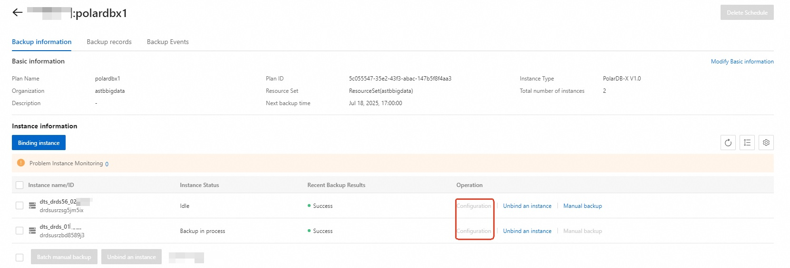

6. In the dialog box that appears, configure the parameters for the instance and click **OK**.

   > **Note**
   >
   > The parameters of the backup information vary based on the instance type. You can configure the parameters based on the on-screen instructions.

<a id="section-10-7"></a>

## 10.7. Modify a backup policy

This topic describes how to modify the backup policy of a backup plan. A backup policy includes the backup time, retention type, and retention period of backup data.

**Background information**

1. You can only change backup policies by backup plan and cannot change backup policies by instance.

2. You can modify the content such as the backup cycle and retention period of the backup policy. The modification does not involve enabling or disabling the backup policy.

3. If the effective policy of an instance is inconsistent with its plan policy in the backup plan, the backup policy cannot be modified.

4. A backup policy can be modified only after it is enabled.

5. After you submit a request to modify a backup policy, the status of the backup policy is updated synchronously, while the status of the execution policy for an instance is updated asynchronously upon successful execution of the event. Therefore, the status of the instance is displayed as Modifying Policy until the event is executed successfully.

6. You can modify a backup policy for a backup plan that is not bound to any backup instance.

**Procedure**

1. Log on to the ASR for Backup and Recovery console as an organization administrator.

2. In the left-side navigation pane, click **Backup Plans**.

3. On the **Backup Plan** page, find the backup plan that you want to view. You can specify search conditions to search for the backup plan.

4. Click the name of the backup plan.

5. In the **Backup Policy** section of the **Backup Information** tab, click **Modify Backup Policy**.

   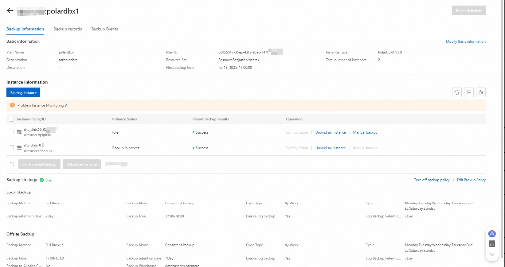

6. Modify the parameter settings of the backup policy and click **Save**.

   > **Note**
   >
   > The parameters of the backup policy vary based on the instance type. You can configure the parameters based on the on-screen instructions.

<a id="section-10-8"></a>

## 10.8. View log backup files

You can view the log files of ApsaraDB RDS instances and PolarDB clusters that are backed up in the current region or across regions.

**Background information**

- The **Log Backup** tab is only available on the backup plan details page of ApsaraDB RDS instances, PolarDB Shared Storage Edition instances, and PolarDB Local Disk Edition instances.

- Data is available on the Log Backup tab only when you create a backup plan for an ApsaraDB RDS instance and turn on **Enable Log Backup** in the Backup Policy step of the Create Backup Plan page.

> **Note**
>
> The log backup feature is only available for organization administrators. If you log in to the ASR-BR console as an operations administrator, this feature is not displayed.

**Procedure**

1. Log in to the ASR-BR console as an organization administrator.

2. In the left-side navigation pane, click **Backup Plans**.

3. On the **Backup Plans** page, specify search conditions to search for a backup plan.

4. Find the backup plan that you want to view and click its name.

5. Click the **Log Backup** tab to view the log files that are backed up in the current region or across regions.

   > **Note**
   >
   > Data is unavailable on the **Log Backup** tab when you turn off **Enable Log Backup** in the Backup Policy step of the Create Backup Plan page.

<a id="section-10-9"></a>

## 10.9. View a backup event

You can view the log of events that are executed in a backup plan.

1. Log on to the ASR for Backup and Recovery console.

2. In the left-side navigation pane, click **Backup Plans**.

3. On the **Backup Plans** page, find the backup plan that you want to view. You can use search conditions to search for the backup plan.

4. Click the name of the backup plan.

5. Click the **Backup Event** tab.

6. Click the  icon to the left of an event to view the event status of each instance.

   Click **View Logs** in the Actions column to view the event logs.

   - **Successful**

   - **canceled**

     This status is displayed when an event is canceled.

   - **Failed**, **Timeout**, **Stop**, and **Sub-events failed**

     An event in a **Failed** or **Stop** state cannot be retried. An event in a **Timeout** or **Sub-events failed** state can be retried.

     > **Important**
     >
     > This operation is an event O&M operation. If the most recent event is successfully executed, do not perform the retry operation for the previous event.

   - **Pending**, **Execute sub-events**, and **Synchronizing**

     If an event is in one of the preceding states, you can click **Cancel** in the Actions column to cancel the event.

     > **Important**
     >
     > This operation is an event O&M operation. This operation is irreversible. Proceed with caution.

<a id="section-11"></a>

# 11.Backup records

<a id="section-11-1"></a>

## 11.1. View backup records

The current Apsara Stack Resilience for Backup and Recovery (ASR-BR) version allows operations administrators to view backup record details and the corresponding backup set data. The version also allows organization administrators to view backup record details and the corresponding backup set data, and delete backup records.

**Background information**

- Operations administrators can view backup record details and the corresponding backup set data.

- Organization administrators can view backup record details and the corresponding backup set data, and delete backup records.

- The local and remote backup records of ApsaraDB RDS instances and PolarDB clusters and the local backup records and backup failure records of ApsaraDB for MongoDB instances, local disk-based PolarDB for MySQL clusters, and PolarDB-X 2.0 instances can only be viewed.

- The backup records of the following services can be deleted: Object Storage Service (OSS), File Storage NAS (NAS), Elastic Compute Service (ECS), MaxCompute, and Elasticsearch on Kubernetes. The backup set data in the backup records can be viewed.

- The backup data volume or backup set size is displayed for storage instances such as OSS instances, NAS file systems, and ECS instances.

**Procedure**

1. Log in to the ASR-BR console.

2. In the left-side navigation pane, click **Backup Records**.

3. On the **Backup Record** page, view backup records of backup plans and instances.

   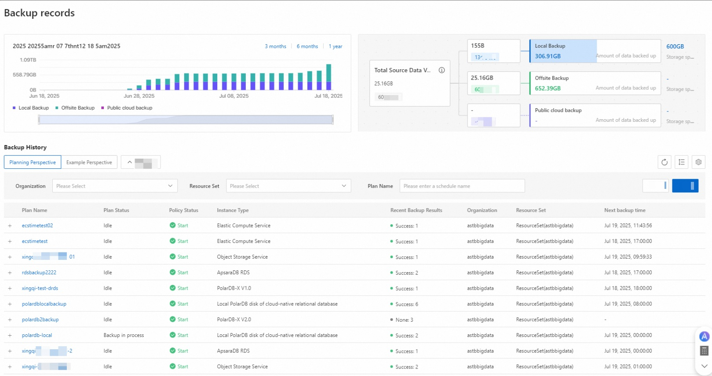

   - To view the backup records of a backup plan, perform the following steps:

     <ol type="a">

     <li>

     In the Backup History section of the Backup Record page, click Plan View. On the Plan View tab, configure the Organization, Resource Set, and Plan Name parameters and click **Search**.

     </li>

     <li>

     Find the backup plan that you want to view and click its name to go to the Backup Information tab.

     </li>

     </ol>

     <ol type="i" start="100">

     <li>

     On the Plan View tab, find the backup plan that you want to view and click the  icon

     next to the backup plan name. Then, click **View Details** in the Actions column to go to the Backup Record tab.

     </li>

     </ol>

   - To view the backup records of an instance, perform the following steps:

     <ol type="a">

     <li>

     In the Backup History section of the Backup Record page, click Instance Perspective.

     </li>

     <li>

     On the Instance Perspective tab, configure the Organization, Resource Set, Instance Type, and Instance ID parameters.

     </li>

     </ol>

     <ol type="i" start="100">

     <li>

     Click Search.

     </li>

     <li value="500">

     Find the instance that you want to view and click the  icon next to the instance ID to

     view all backup records of the instance.

     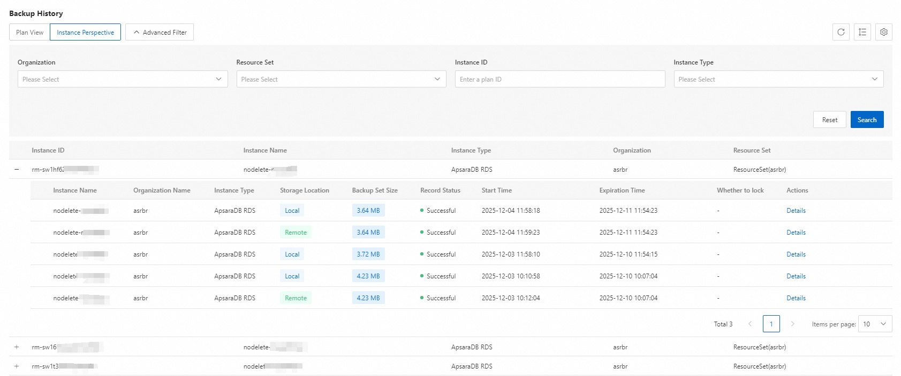

     </li>

     </ol>

     <ol type="a" start="5">

     <li>

     Click **Details** in the **Actions** column to view the details of the backup record, including the backup configurations.

     > **Note**
     >
     > You can browse the backup file size or delete a backup record only when **Successful** or **Partially Successful** is displayed in the **Record Status** column of an instance.

     </li>

     <li>

     Click **Browse** in the Actions column to view the corresponding backup set and the size of backup files stored in the backup set.

     </li>

     <li>

     Click **Delete** in the Actions column to delete the backup record and the data stored in backup sets.

     > **Note**
     >
     > - Locked backup records cannot be deleted.
     >
     > - In the **Record Preview** dialog box of an OSS instance, a NAS file system, or an ECS instance that adopts file backup, the first and last backup files of each backup set are displayed. You can click the names of the files to view all files in the backup set.
     >
     >   The Browse operation is not supported by NAS file systems or ECS instances that adopt file backup if they have more than 3 million files and more than 900 GB of backup records.
     >
     > - In the Record Preview dialog box of an ECS instance that adopts instance backup, the metadata of each disk is displayed.
     >
     > - In the Record Preview dialog box of a MaxCompute instance, the information about the tables, resources, and functions stored in the backup set is displayed.
     >
     > - In the Record Preview dialog box of an Elasticsearch on Kubernetes instance, the index information stored in the backup set is displayed.

     </li>

     </ol>

<a id="section-12"></a>

# 12.Data restoration

<a id="section-12-1"></a>

## 12.1. Recovery plan

<a id="section-12-1-1"></a>

### 12.1.1. Create a standard recovery plan

Standard recovery is mainly used for routine recovery tasks, such as data recovery and recovery from accidental deletions.

**Prerequisites**

- You are an organization administrator. Only organization administrators can create standard recovery plans.

- You have created a backup plan and completed the first backup for the instance.

**Procedure**

1. Log in to the ASR for Backup and Recovery console.

2. In the left-side navigation pane, choose **Data Restoration**.

3. On the **Recovery Plan** tab, click **Create**.

4. On the **Basic Information** configuration wizard page, set the relevant parameters and click **Next**.

   | Parameter | Description |
   | --- | --- |
   | Recovery Plan Name | The recovery plan name must be 4 to 20 characters in length and can contain letters, digits, hyphens (-), underscores (_), or periods (.). |
   | Description | Optional. Enter a description for the recovery plan for easy identification. |
   | Recovery Plan Type | In this scenario, select <strong>Regular Restoration</strong>. |
   | Organization | Select the organization to which the recovery plan belongs. |
   | Resource Set | Select the resource set to which the recovery plan belongs. |

5. On the **Configure Recovery Resources** wizard page, click **Add Instance**.

   <ol type="i">

   <li>

   Click **Add Instance** on the left side of the page.

   </li>

   <li>

   In the **Add Instance** dialog box, set **Instance Type** and **Instance**.

   </li>

   </ol>

   > **Note**
   >
   > - **Original Instance Backup Mode**: Select Logical Backup or Physical Backup. This field appears only when the selected instance type supports both logical backup and physical backup.
   >
   > - **Restore Method**: Configure this parameter only when **Instance Type** is **Elastic Compute Service** or **ECS VMware**.
   >
   >   - For Elastic Compute Service, you can select **Snapshot Recovery** or **File Recovery**.
   >
   >   - For ECS VMware, you can select **Local Recovery** or **Cloud Recovery**.
   >
   > - You can add multiple instance types and multiple instances to one recovery plan.

   <ol type="i" start="3">

   <li>

   Click **OK**.

   </li>

   </ol>

6. After adding instances, on the **Configure Recovery Resources** wizard, configure the recovery settings according to each instance type. For detailed instructions, see Resource recovery configuration parameter description.

   <ol type="i">

   <li>

   On the left side of the page, select the instance to configure.

   </li>

   <li>

   After completing the recovery configuration based on the instance type, click **Next**.

   </li>

   </ol>

7. In the **OK** phase, set **Execution Mode** and **Priority** for the recovery plan. After confirming that all information is correct, click **Submit**.

   > **Note**
   >
   > - After you create a recovery plan, you can immediately execute it. For more information, see Start a recovery plan.
   >
   > - After you create a recovery plan, you can associate a restore policy with it. Then, the system automatically executes the recovery based on the cycle configured in the restore policy.

   Parameter

   Description

   This section displays basic information about the recovery plan. If any

   **Basic Information**

   information is incorrect, click **Return and Modify** to modify it.

   **Default**: The system initiates recovery for all instances simultaneously.

   **Executio**

   **Custom Restore Order**: The system executes recovery according to your

   **n Mode**

   custom order.

   **Orches tration Rule**

   Configure this item only when you select **Custom Restore Order** for Execution Mode.

   - **Pause Restoration of Subsequent Instances**: If any instance fails to restore, the system automatically pauses subsequent tasks. After

   **Failure**

   manual intervention, you can resume restoration for subsequent

   **Policy**

   instances.

   - **Resume Restoration of Subsequent Instances**: The system skips instances that failed to restore and continues restoration of subsequent instances.

   This section displays information about restored instances. Click **Details** in the **Actions** column of an instance to view its details. If any information is incorrect, click **Return and Modify** to modify it.

   When you select **Custom Restore Order** for Execution mode, the instance list displays the **Execution Priority** field. You can customize the order in which instances are restored.

   **Destination Instance**

   > **Important**
   >
   > - A smaller number indicates a higher priority. The value of 1 indicates that the instance will be restored first.
   >
   > - Instances with the same priority are restored simultaneously.

**Resource recovery configuration parameter description**

**Storage**

**Elastic Compute Service**

**Snapshot recovery**

Parameter

Description

**Select Restore**

Select **By Backup Record** or **Automatically Select Latest**

**Method**

**Available Backup Record**.

Configure this parameter when you select **By Backup Record** as the restoration method.

**Backup Record**

1. Click **Select Record** and select the backup records to restore.

2. Click **OK**.

Configure this parameter when you select **Automatically Select Latest Available Backup Record** as the restoration

**Select**

**Specify Backup**

method.

**Record**

**Plan**

1. Click **Select Plan** and select the backup plan to restore.

2. Click **OK**.

Configure this parameter when you select **Automatically Select Latest Available Backup Record** as the restoration method.

**Repository Location**

After you specify the backup plan to restore, select **On-Premises** or **Active Geo-Redundancy** as the repository location. Image repository scenarios are not supported.

Keep the default system parameters. You cannot modify them.

- **Recover Data to New Instance**: The system creates an instance in the primary center.

- **Recover Data to Existing Instance**: The system overwrites the original instance after restoration.

**Recovery Type**

> **Note**
>
> The Snapshot Recovery method supports only Recover Data to New Instance.

Configure this parameter when you select Snapshot Recovery as the Elastic Compute Service (ECS) restore method.

**Rule Type**

- Restore by Instance

- Restore by Disk

The region where the new instance resides in the primary

**Region**

center. You cannot modify it.

The organization to which the new instance belongs in the

**Organization**

primary center.

The resource set to which the new instance belongs in the

**Resoruce Set**

primary center.

Configure this parameter when you select **Restore by**

**Auto-Generate**

**Instance** for **Rule Type**.

**Instance Name**

You can enable or disable this feature.

**Basic Informat**

Configure this parameter when you select **Restore by**

**ion**

**Instance** for **Rule Type**.

**Instance**

When Auto-Generate Instance Name is enabled, Instance Name

**Name**/**Instance**

Prefix is displayed. Enter a custom prefix for the instance

**Name Prefix**

name.

When Auto-Generate Instance Name is disabled, Instance Name is displayed. Enter a custom name for the instance.

Configure this parameter when you select **Restore by Instance** for **Rule Type**.

The hostname represents the computer name within the operating system. For Windows systems, the hostname must be 2 to 15 characters in length. It can contain uppercase letters, lowercase letters, digits, or hyphens (-). It cannot start or end with a hyphen (-), contain consecutive hyphens (-), or consist of only digits. For other operating systems such as Linux, the hostname must be 2 to 64 characters in length. It can contain multiple segments separated by periods (.). Each segment can contain uppercase letters, lowercase letters, digits, or hyphens (-). It cannot contain consecutive periods (.) or hyphens (-), or

**Hostname**

start or end with a period (.) or hyphen (-). The new hostname takes effect after you restart the instance.

- The following disk types are supported in the zone: ultra disk, high-performance disk, standard SSD, and basic disk.

**Zone**

- Select the zone where the new instance resides.

Configure this parameter when you select **Restore by Instance** for **Rule Type**.

**Target Instance**

- Select an instance from the drop-down list.

**Disks**

Keep the default value. You can edit the disk type.

**Restorat ion Rule**

The network connection type of the new instance. By default, the network connection type of the backup instance applies.

**Connection Type**

- Internal Network

- Internet

**Network Type**

The network type of the new instance.

> 
>
> **Note**

- **Classic Network**: Cloud services in a classic network are not isolated. You can only rely on security groups or whitelists of

> **Conf**

**Network Type**

cloud services to block unauthorized access.

> **igur e**

- **VPC**: A Virtual Private Cloud (VPC) helps you build an isolated

> **this**

network environment on Alibaba Cloud. When you select

> **para**

**VPC**, make sure that you have created a VPC and a vSwitch.

> **met er whe**

Configure this parameter only when **Network Type** is **VPC**.

> **n**

**VPC**

> **you**

The VPC where the new instance resides.

> **selec t Rest**

Configure this parameter only when **Network Type** is **VPC**.

> **ore**

**vSwitch Zone**

> **by**

The zone where the vSwitch of the new instance resides.

> **Insta nce for**

Configure this parameter only when **Network Type** is **VPC**.

> **Rule**

**vSwitch**

> **Type**

The vSwitch to which the new instance belongs.

> .

**Security Group**

The security group to which the new instance belongs.

Enter a private IP address that falls in the CIDR block of the

**Private IP Address**

selected vSwitch.

**Instance Series**

Select the new instance for recovery from the drop-down list.

Select the type of the new instance.

> **Note**

**Instance Type**

> Fuzzy search is supported. If multiple instance types are available, you can specify a keyword of the required instance type to filter instance types.

**Specifica tion Paramet ers**

The image to be used by the restoration job. Valid values:

- Public Image

**Image Type**

- Custom Image

- Shared Custom Image

> 

The image selection. Select an image based on the value of the

> **Note**

**Image Type** parameter, or enter an image name to search for

> **Rule**

the image.

> **type** is set

> **Note**

**Image**

> to resto

> - If the image is displayed in green, we recommend

> re by

> that you select it.

> insta

> - If the image is dimmed, it cannot be selected.

> nce.

**File recovery**

Parameter

Description

**Select Restore**

Select **By Backup Record** or **Automatically Select Latest**

**Method**

**Available Backup Record**.

Configure this parameter when you select **By Backup Record** as the restoration method.

**Backup Record**

1. Click **Select Record** and select the backup records that you want to restore.

2. Click **OK**.

Configure this parameter when you select **Automatically**

**Select**

**Select Latest Available Backup Record** as the restoration

**Record**

method.

**Specify Backup Plan**

1. Click **Select Plan** and select the backup plans that you want to restore.

2. Click **OK**.

Configure this parameter when you select **Automatically Select Latest Available Backup Record** as the restoration method.

**Repository Location**

After you specify the backup plan to be restored, select **On-Premises** or **Active Geo-Redundancy** as the repository location. Image repository scenarios are not supported.

Keep the default system parameters. You cannot modify them.

- **Recover Data to New Instance**: The system creates an instance in the primary center.

- **Recover Data to Existing Instance**: The system overwrites the original instance after restoration.

**Recovery Type**

> **Note**
>
> The File Recovery method supports only Recover Data to Existing Instance.

**Basic Informat**

The region where the new instance resides in the primary

**Region**

**ion**

center. You cannot modify it.

The organization to which the new instance belongs in the

**Organization**

primary center.

The resource set to which the new instance belongs in the

**Resource Set**

primary center.

**Destination**

The destination instance for restoration.

**Instance**

The directory in which the Hybrid Backup Recovery (HBR) client is installed on the ECS instance.

> **Note**
>
> - If you leave this parameter empty, the system

**Client Installation**

> automatically installs the HBR client to the

**Path**

> `/root`  directory.
>
> - When the value of **Client Installation Status** is **The client is installed.**, the installation path of the client is displayed.

**Client Installati on**

The number of processor cores on the client. Keep the default

**vCPUs on Client**

value.

**Maximum Worker**

The maximum number of requests that can be concurrently

**Threads on Client**

processed by the client. Keep the default value.

The installation status of the HBR client.

**Client Installation**

If the status is **The client is not installed on the ECS**

**Status**

**instance.**, click **Install**. Then, the system automatically installs the client.

- Configure this parameter when you select Elastic Compute Service for Instance Type and File Restoration for Restore Method.

**Destination Path**

- Click **Select** and select the folder to which you want to restore files.

**Restorat ion Rule**

- Configure this parameter when you select Elastic Compute Service for Instance Type and File Restoration for Restore Method.

- File rules include the following:

  - **Include All**: All files in the path specified by the **File Path**

**File Rules**

parameter are restored.

- **Include**: Only the files specified by the **Files** parameter are restored.

- **Exclude**: The files that are not included in the files specified by the **Files** parameter are restored.

**Object Storage Service (OSS)**

Parameter

Description

**Select Restore**

Select **By Backup Record** or **Automatically Select Latest**

**Method**

**Available Backup Record**.

Configure this parameter when you select **By Backup Record** as the restoration method.

**Backup Record**

1. Click **Select Record** and select the backup records to restore.

2. Click **OK**.

Configure this parameter when you select **Automatically**

**Select**

**Select Latest Available Backup Record** as the restoration

**Record**

method.

**Specify Backup Plan**

1. Click **Select Plan** and select the backup plan to restore.

2. Click **OK**.

Configure this parameter when you select **Automatically Select Latest Available Backup Record** as the restoration method.

**Repository**

After specifying the backup plan to restore, select **On-**

**Location**

**Premises** or **Active Geo-Redundancy** as the repository location. This setting does not support image repository scenarios.

- **Restore Data to New Instance**: The system creates an instance in the primary center.

- **Recover Data to Existing Instance**: The system overwrites the original instance after restoration.

**Recovery Type**

> **Note**
>
> OSS supports both Restore Data to New Instance and Recover Data to Existing Instance.

The region where the new instance resides in the primary

**Region**

center. You cannot modify this value.

The organization to which the new instance belongs in the

**Organization**

primary center.

**Basic**

The resource set to which the new instance belongs in the

**Informat**

**Resource set**

primary center.

**ion**

Configure this parameter when you select **Restore Data to**

**Auto-Generate**

**New Instance** for **Recovery Type**.

**Instance Name**

You can enable or disable this feature.

Configure this parameter when you select **Restore Data to New Instance** for **Recovery Type**.

**Instance**

When Auto-Generate Instance Name is enabled, Instance Name

**Name**/**Instance**

Prefix is displayed. Enter a custom prefix for the instance

**Name Prefix**

name.

When Auto-Generate Instance Name is disabled, Instance Name is displayed. Enter a custom name for the instance.

Configure this parameter when you select **Recover Data to Existing Instance** for **Recovery Type**.

**Bucket Name**

Select a bucket.

Set the directory name in OSS. OSS automatically creates this directory and restores files to it. If you leave this parameter

**Restore Prefix**

empty, OSS restores files to the root directory of the bucket by default.

File rules include the following:

- **Include All**: All files in the path specified by the **File Path** parameter are restored.

**File Rules**

- **Include**: Only the files specified by the **Files** parameter are restored.

- **Exclude**: The files that are not included in the files specified

**Restorat**

by the **Files** parameter are restored.

**ion Rule**

Enter folder names or file names. Enter one path per line.

**Files**

You need to configure this parameter only when you select **Include** or **Exclude** for **File Rules**.

<table>
  <tr>
    <td rowspan="2">File Restorat ion Time Range</td>
    <td>Restored At</td>
    <td>Select the start date and end date for restoring files.<br>Note<br>The system restores files based on this time range.<br>• If you specify only <strong>start time</strong>, all files that are last modified within the time range from the <strong>start time</strong> to the <strong>current time</strong> are restored from the backup set.<br>• If you specify both the <strong>start time</strong> and <strong>end time</strong>, files that are last modified within the time range are restored from the backup set.<br>• If you specify neither the start nor end time, all files in the backup set are restored.</td>
  </tr>
  <tr>
    <td>Configure Concurrent Restore Tasks</td>
    <td>Select an option based on your bandwidth. Ensure that the concurrent writes on the recovery side exceeds the concurrent reads on the backup side.</td>
  </tr>
  <tr>
    <td rowspan="2">Specifica tion Paramet ers</td>
    <td>Read/Write Permissions</td>
    <td>By default, the read and write permissions of the OSS backup instance are used. The permissions cannot be modified.</td>
  </tr>
  <tr>
    <td>Storage Space</td>
    <td>By default, the storage capacity of the OSS backup instance is used. The storage capacity cannot be modified.</td>
  </tr>
</table>

**File Storage NAS**

Configuration item

Description

**Select Restore**

Supports **By Backup Record** or **Automatically Select Latest**

**Method**

**Available Backup Record**.

Configure this parameter when you select **By Backup Record** as the restoration method.

1. Click **Select Record** and select the backup records to

**Backup Record**

restore.

2. Click **OK**.

Configure this parameter when you select **Automatically Select Latest Available Backup Record** as the restoration

**Specify Backup**

**Select**

method.

**Plan**

**Record**

1. Click **Select Plan** and select the backup plan to restore.

2. Click **OK**.

Configure this parameter when you select **Automatically Select Latest Available Backup Record** as the restoration method.

**Repository Location**

After specifying the backup plan to restore, select **On-Premises** or **Active Geo-Redundancy** as the repository location. Image repository scenarios are not supported.

- **Restore Data to New Instance**: The system creates an instance in the primary center.

- **Recover Data to Existing Instance**: The system overwrites the original instance after restoration.

**Recovery Type**

> **Note**
>
> File Storage NAS supports both Restore Data to New Instance and Recover Data to Existing Instance.

The region where the new instance resides in the primary

**Region**

center. You cannot modify the value of this parameter.

The organization to which the new instance belongs in the

**Organization**

primary center.

**Basic Informat ion**

The resource set to which the new instance belongs in the

**Resource Set**

primary center.

The zone to which the new instance belongs in the primary

**Zone**

center.

Configure this parameter when you select **Restore Data to**

**Auto-Generate File**

**New Instance** for **Recovery Type**.

**System Name**

You can enable or disable this feature.

File System Name: Customize the name of the file system.

**File System**

File System Name Prefix: When Auto-Generate Instance Name

**Name**/**File System**

is enabled, File System Name Prefix is displayed. Enter a

**Name Prefix**

custom prefix for the file system name.

The file path must be an absolute path. Wildcards (\*) are not

**File Path**

supported. If the file path already exists, the system overwrites the original content.

Configure this parameter when you select **Restore Data to New Instance** for **Recovery Type**.

**Protocol**

Select the protocol type. NFS or SMB is supported.

**Basic Settings**

**File System**

This parameter is displayed when you select **Restore Data to**

**Category**

**New Instance** for **Recovery Type**. Keep the default value.

Configure this parameter when you select **Restore Data to**

**Capacity**

**New Instance** for **Recovery Type**. Enter the capacity in TB.

**Tablestore**

When you configure Tablestore resource restoration, you must configure the Tablestore table. After you configure the Tablestore table according to the following parameter descriptions, click **Next**.

| Parameter | Description |
| --- | --- |
| Select Tablestore Table | The restoration method selected for the Tablestore table. |
| Region | The region where the new Tablestore table resides. |
| Organizatio n | The organization where the new Tablestore table resides. |
| Resoruce Set | The resource set where the new Tablestore table resides. |
| Destination Instance | The instance to which the selected Tablestore table is restored. |

<table>
  <tr>
    <td>Select Tablestore Table</td>
    <td>Click <strong>Add</strong> to add a Tablestore table. You can configure or remove the Tablestore table after you add it.<br>The specific parameters are described as follows:<br>• <strong>Restorable Time Range</strong>: The time range to which you can restore data in the Tablestore table.<br>• <strong>Restore Time</strong>: The point in time within the time range to which you can restore data in the Tablestore table.<br>• <strong>Destination Tablestore Table Name</strong>: The name of the destination table to which the data of the Tablestore table to be restored is restored.<br>• <strong>Overwrite Existing Tables</strong>: Specifies whether to overwrite existing tables with the same name as the new Tablestore table. If the value of <strong>Destination</strong> <strong>Tablestore Table Name</strong> is the same as that of an existing table, you must enable this feature. Otherwise, the system cannot create the table.<br>• <strong>Regenerate Auto-Increment Columns</strong>: Specifies whether to regenerate auto-increment columns for the new Tablestore table if the original table contains auto-increment columns. If the value of <strong>Destination Tablestore Table Name</strong> is the same as that of an existing table, enable this feature.<br>• <strong>Restore Multiple Indexes</strong>: The system adds a search index prefix to the name of the new table. This feature is not supported by Tablestore backup. Keep the default setting.</td>
  </tr>
</table>

**Elastic Desktop Service (EDS)**

Parameter

Description

**Select Restore**

Select **By Backup Record** or **Automatically Select Latest**

**Method**

**Available Backup Record**.

Configure this parameter when you select **By Backup Record** as the restoration method.

**Backup Record**

1. Click **Select Record** and select the backup records to be restored.

2. Click **OK**.

Configure this parameter when you select **Automatically Select Latest Available Backup Record** as the restoration

**Select**

method.

**Specify Backup**

**Record**

**Plan**

1. Click **Select Plan** and select the backup plan to be restored.

2. Click **OK**.

Configure this parameter when you select **Automatically Select Latest Available Backup Record** as the restoration method.

**Repository Location**

After you specify the backup plan to be restored, select **On-Premises** or **Active Geo-Redundancy** as the repository location. Image repository scenarios are not supported.

- **Recover Data to New Instance**: The system creates an instance in the primary center.

- **Recover Data to Existing Instance**: The system overwrites the original instance after restoration.

**Restoration Type**

> **Note**
>
> Elastic Desktop Service supports only Recover Data to New Instance.

The region where the new instance resides in the primary

**Region**

**Basic**

center. You cannot modify the value of this parameter.

**Informat ion**

The organization where the new instance resides in the primary

**Organization**

center.

Customize the cloud computer name. The name cannot start

**Cloud Compute**

with special characters, digits, http://, or https://. The name can

**Name**

contain only periods (.), underscores (_), hyphens (-), and colons (:). The name must be 2 to 64 bytes in length.

Select the restoration policy of the EDS instance or the default

**Policy**

global policy.

**Zone**

The ID of zone where the new instance resides.

**Restorat ion Rule**

Select thedisk to be used by the restoration job in the zone. If

**Disks**

the current cloud disk type is unavailable, click **Modify Disk Category** in the Actions column.

**Office Network**

The office network of the EDS instance.

The subnet of the office network of the EDS instance.

**Office Subnet**

You do not need to manually configure this parameter. The

**VPC**

value of this parameter varies based on the selected office network.

**Network Type**

You do not need to manually configure this parameter. The

**vSwitch**

value of this parameter varies based on the selected office network.

You do not need to manually configure this parameter. The

**Security Group**

value of this parameter varies based on the selected office network.

<table>
  <tr>
    <td rowspan="3">Specifica tion Paramet ers</td>
    <td>Instance Type</td>
    <td>The instance type of the EDS instance, such as General Office or Performance.</td>
  </tr>
  <tr>
    <td>Image Type</td>
    <td>The image to be used by the restoration job. Valid values:<br>• Public Image<br>• Custom Image<br>• Shared Custom Image</td>
  </tr>
  <tr>
    <td>Image</td>
    <td>The image selection. Select an image based on the value of the <strong>Image Type</strong> parameter, or enter an image name to search for the image.<br>Note<br>• If an image is displayed in green, we recommend that you select it.<br>• If an image is dimmed, it cannot be selected.</td>
  </tr>
</table>

**ECS VMware**

**On-premises restoration**

<table>
  <tr>
    <th colspan="2">Parameter</th>
    <th>Description</th>
  </tr>
  <tr>
    <td colspan="2">Select Record</td>
    <td>1. Click <strong>Add</strong>.<br>2. Select the backup records to restore and click <strong>OK</strong>.</td>
  </tr>
  <tr>
    <td rowspan="5">Basic Configuratio n</td>
    <td>vCenter Address</td>
    <td>Select the target vCenter address for virtual machine restoration.</td>
  </tr>
  <tr>
    <td>Restoration Address</td>
    <td>Select the target address for virtual machine restoration.</td>
  </tr>
  <tr>
    <td>Compute Node</td>
    <td>Select the compute node to be used after virtual machine restoration.</td>
  </tr>
  <tr>
    <td>Storage Location</td>
    <td>Select the storage location after virtual machine restoration.</td>
  </tr>
  <tr>
    <td>Network Location</td>
    <td>Select the network location after virtual machine restoration.</td>
  </tr>
</table>

**On-cloud restoration**

**Parameter**

**Description**

1. Click **Add**.

**Select Record**

2. Select the backup records to restore and click **OK**.

Select the region where the instance to restore belongs in the

**Region**

primary center. You cannot modify this setting.

Select the organization where the instance to restore belongs

**Organization**

in the primary center.

Select the resource set where the instance to restore belongs

**Resource Set**

in the primary center.

**Basic Configuratio**

The availability zone where the instance to restore belongs in

**n**

**Zone**

the primary center.

Enter a recognizable instance name. ASR for Backup and Recovery automatically creates an ECS instance in the

**Instance Name**

primary center. The name must start with a letter and can contain letters, digits, hyphens (-), underscores (_), periods (.), or colons (:). The name can contain 2 to 128 characters .

**Hostname**

Enter a recognizable hostname.

The network connection type of the new instance.

**Connection Type**

- Internet

- Internal Network

The network type of the new instance.

- **Classic Network**: Cloud services in a classic network are not isolated. You can only rely on security groups or whitelists of cloud services to block unauthorized access.

**Network Type**

- **VPC**: A VPC helps you build an isolated network environment on Alibaba Cloud. When you select **VPC**, ensure that you have created a VPC and a vSwitch.

**Network Type**

Select the VPC where the new instance resides in the primary

**VPC**

center.

Select the vSwitch where the new instance belongs in the

**vSwitch**

primary center.

**Security Group**

Select the security group to which the new instance belongs.

**Private IP**

Enter a private IP address that falls in the CIDR block of the

**Address**

selected vSwitch.

**Instance Series**

Select an existing instance series from the drop-down list.

**Instance Type**

Select the type of the new instance.

Select the cloud disk type for the new instance as needed:

- **Ultra Disk**: Ultra disks are suitable for scenarios requiring stable and persistent storage with moderate performance

**Specification**

demands.

**Parameters**

- **SSD**: SSD cloud disks are suitable for scenarios with high I/O performance requirements.

**Cloud Disk Type**

- **High-Performance Disk**: High-performance cloud disks are suitable for small and medium-sized applications and MySQL, SQL Server, and other small and medium-sized relational databases that require high data reliability and moderate performance.

- **Basic Disk**: Basic disks are suitable for business scenarios with infrequent data access and low I/O loads.

**Database**

**ApsaraDB RDS**

Parameter

Description

Select **By Backup Record**, **By Point in**

**Select Restore Method**

**Time**, or **Automatically Select Latest Available Backup Record**.

Configure this parameter when you select **By Backup Record** as the restoration method.

**Backup Record**

1. Click **Select Record** and select the backup records to restore.

2. Click **OK**.

Configure this parameter when you select **By Point in Time** as the restoration method.

1. Click **Select** in the **Actions** column of the

**Select Point in Time**

instance.

2. Select **Local** or **Remote** for Vault Location.

**Select Record**

3. Select a point in time and click **OK**.

Configure this parameter when you select **Automatically Select Latest Available Backup Record** as the restoration method.

**Specify Backup Plan**

1. Click **Select Plan** and select the backup plans to restore.

2. Click **OK**.

Configure this parameter when you select **Automatically Select Latest Available Backup Record** as the restoration method.

After specifying the backup plan to be

**Repository Location**

restored, select **On-Premises** or **Active Geo-Redundancy** for Repository Location. Image repository scenarios are not supported.

- **Recover Data to New Instance**: The system creates an instance again in the primary center.

- **Recover Data to Existing Instance**: The system overwrites the original instance after restoration.

**Recovery Type**

> **Note**
>
> Physical backups support only Recover Data to New Instance. Logical backups support only Recover Data to Existing Instance.

The region where the new instance resides

**Region**

in the primary center. You cannot modify the value of this parameter.

The organization to which the new instance

**Organization**

belongs in the primary center.

The resource set to which the new instance

**Resoruce Set**

belongs in the primary center.

**Basic Information**

The zone to which the new instance belongs

**Zone**

in the primary center.

**Auto-Generate Instance**

You can enable or disable this feature.

**Name**

When Auto-Generate Instance Name is enabled, Instance Name Prefix is displayed. Enter a custom prefix for the instance name.

When Auto-Generate Instance Name is

**Instance Name/Instance**

disabled, Instance Name is displayed. Enter

**Name Prefix**

a custom name for the instance.

The network connection type of the new instance. By default, the network connection type of the backup instance applies.

**Connection Type**

- Internal Network

- Internet

The network type of the new instance.

- **Classic Network**: Cloud services in a classic network are not isolated. You can only rely on security groups or whitelists of cloud services to block unauthorized access.

**Network Type**

- **VPC**: A VPC helps you build an isolated network environment on Alibaba Cloud. When you select **VPC**, make sure that you have created a VPC and a vSwitch.

**Network Type**

Configure this parameter only when **Network Type** is **VPC**.

**VPC**

The VPC where the new instance resides.

Configure this parameter only when **Network Type** is **VPC**.

**vSwitch Zone**

The zone where the vSwitch of the new instance resides.

Configure this parameter only when **Network Type** is **VPC**.

**vSwitch**

The vSwitch to which the new instance belongs.

The default value is used and cannot be

**Database Engine**

changed.

The default value is used and cannot be

**Database Version**

changed.

Select the chip architecture to use when the

**Chip Architecture**

restoration job runs.

Select the specification type for the node of the new instance.

- General-purpose

**Specification**

**Specification Type**

**Parameters**

- Dedicated

- Dedicated host

Select the specification for the node of the

**Node Specifications**

new instance.

Set the storage capacity for the instance.

**Storage Space**

Unit: GB.

This parameter appears only when you enable minor version configuration for the product.

**Database Minor Version**

We recommend that you select the same minor version as that of the original instance or a later version.

**Tair (Redis OSS-compatible)**

Parameter

Description

Select **By Backup Record**, **By Point in Time**, or **Automatically Select Latest Available Backup Record**.

**Select Restore Method**

> **Note**
>
> Physical backups do not support **By Point in Time**.

Configure this parameter when you select **By Backup Record** as the restoration method.

**Backup Record**

1. Click **Select Record** and select the backup recordS that you want to restore.

2. Click **OK**.

Configure this parameter when you select **By Point in Time** as the restoration method.

**Select Point in**

1. Click **Select** in the **Actions** column of the instance.

**Time**

2. Select **Local** or **Remote** for Vault Location.

**Select Record**

3. Select a point in time and click **OK**.

Configure this parameter when you select **Automatically Select Latest Available Backup Record** as the restoration method.

**Specify Backup Plan**

1. Click **Select Plan** and select the backup plans that you want to restore.

2. Click **OK**.

Configure this parameter when you select **Automatically Select Latest Available Backup Record** as the restoration method.

**Repository Location**

After you specify the backup plan to be restored, select **On-Premises** or **Active Geo-Redundancy** for Repository Location. Image repository scenarios are not supported.

**Select the database that you**

You can select **All Databases** or **Specify Database**.

**want to restore**

If you select **Specify Database**, click Add and then select

**Select Database**

databases.

- **Recover Data to New Instance**: The system creates an instance again in the primary center.

- **Recover Data to Existing Instance**: The system overwrites the original instance after restoration.

**Recovery Type**

> **Note**
>
> Physical backups support only Recover Data to New Instance. Logical backups support only Recover Data to Existing Instance.

The region where the new instance resides in the primary

**Region**

center. You cannot modify the value of this parameter.

The organization to which the new instance belongs in the

**Organization**

primary center.

**Basic Informat ion**

The resource set to which the new instance belongs in the

**Resource Set**

primary center.

The zone to which the new instance belongs in the primary

**Zone**

center.

**Auto-Generate**

You can enable or disable this feature.

**Instance Name**

When Auto-Generate Instance Name is enabled, Instance Name Prefix is displayed. Enter a custom prefix for the instance

**Instance**

name.

**Name/Instance Name Prefix**

When Auto-Generate Instance Name is disabled, Instance Name is displayed. Enter a custom name for the instance.

The network connection type of the new instance. By default, the network connection type of the backup instance applies.

**Connection Type**

- Internal Network

- Internet

The network type of the new instance.

- **Classic Network**: Cloud services in a classic network are not isolated. You can only rely on security groups or whitelists of

**Network Type**

cloud services to block unauthorized access.

- **VPC**: A VPC helps you build an isolated network environment on Alibaba Cloud. When you select **VPC**, make sure that you

**Network**

have created a VPC and a vSwitch.

**Type**

Configure this parameter only when **Network Type** is **VPC**.

**VPC**

The VPC where the new instance resides.

Configure this parameter only when **Network Type** is **VPC**.

**vSwitch Zone**

The zone where the vSwitch of the new instance resides.

Configure this parameter only when **Network Type** is **VPC**.

**vSwitch**

The vSwitch to which the new instance belongs.

**Database Engine**

The default value is used and cannot be changed.

**Database Version**

The default value is used and cannot be changed.

Select the chip architecture to use when the restoration job

**Chip Architecture**

**Specifica**

runs.

**tion Paramet ers**

**Specification Type**

Select the specification type for the node of the new instance.

**Node**

Select the specification for the node of the new instance.

**Specifications**

**ApsaraDB for MongoDB**

Parameter

Description

Select **By Backup Record**, **By Point in Time**, or **Automatically Select Latest Available Backup Record**.

**Select Restore**

> **Note**

**Method**

> The MongoDB cluster edition does not support restoration by backup record.

Configure this parameter when you select **By Backup Record** as the restoration method.

**Backup Record**

1. Click **Select Record** and select the backup records to restore.

2. Click **OK**.

Configure this parameter when you select **By Point in Time** as therestoration method.

**Select Point in**

1. Click **Select** in the **Actions** column of the instance.

**Time**

2. Select **Local** or **Remote** for Vault Location.

3. Select a point in time and click **OK**.

**Select Record**

Configure this parameter when you select **Automatically Select Latest Available Backup Record** as the restoration method.

**Specify Backup Plan**

1. Click **Select Plan** and select the backup plans to restore.

2. Click **OK**.

Configure this parameter when you select **Automatically Select Latest Available Backup Record** as the restoration method.

**Repository Location**

After you specify the backup plan to restore, select **On-Premises** or **Active Geo-Redundancy** for Repository Location. Image repository scenarios are not supported.

**Select the database that you**

You can select **All Databases** or **Specify Database**.

**want to restore**

When you select **Specify Database**, click Add and select

**Select Database**

databases.

- **Recover Data to New Instance**: The system creates an instance again in the primary center.

- **Recover Data to Existing Instance**: The system overwrites the original instance after restoration.

**Recovery Type**

> **Note**
>
> Physical backups support only Recover Data to New Instance. Logical backups support only Recover Data to Existing Instance.

The region where the new instance resides in the primary

**Region**

center. You cannot modify the value of this parameter.

The organization to which the new instance belongs in the

**Organization**

**Basic**

primary center.

**Informat ion**

The resource set to which the new instance belongs in the

**Resource Set**

primary center.

The zone to which the new instance belongs in the primary

**Zone**

center.

**Auto-Generate**

You can enable or disable this feature.

**Instance Name**

When Auto-Generate Instance Name is enabled, Instance Name Prefix is displayed. Enter a custom prefix for the instance

**Instance**

name.

**Name**/**Instance Name Prefix**

When Auto-Generate Instance Name is disabled, Instance Name is displayed. Enter a custom name for the instance.

The network connection type of the new instance. By default, the network connection type of the backup instance applies.

**Connection Type**

- Internal Network

- Internet

The network type of the new instance.

- **Classic Network**: Cloud services in a classic network are not isolated. You can only rely on security groups or whitelists of

**Network Type**

cloud services to block unauthorized access.

- **VPC**: A VPC helps you build an isolated network environment on Alibaba Cloud. When you select **VPC**, make sure that you have created a VPC and a vSwitch.

**Network Type**

Configure this parameter only when **Network Type** is **VPC**.

**VPC**

The VPC where the new instance resides.

Configure this parameter only when **Network Type** is **VPC**.

**vSwitch Zone**

The zone where the vSwitch of the new instance resides.

Configure this parameter only when **Network Type** is **VPC**.

**vSwitch**

The vSwitch to which the new instance belongs.

**Database Engine**

The default value is used and cannot be changed.

**Database Version**

The default value is used and cannot be changed.

Select the chip architecture to use when the restoration job runs.

**Chip Architecture**

- Intel

- Hygon

**Specifica tion Paramet**

Select the specification type for the node of the new instance.

**ers**

- General-purpose

**Specification Type**

- Dedicated

- Dedicated host

**Node**

Select the specification for the node of the new instance.

**Specification**s

**Storage Space**

Set the storage capacity for the instance. Unit: GB.

**PolarDB for primary/secondary edition**

Parameter

Description

**Select Restore**

Select **By Backup Record**, **By Point in Time**, or

**Method**

**Automatically Select Latest Available Backup Record**.

Configure this parameter when you select **By Backup Record** as the restoration method.

**Backup Record**

1. Click **Select Record** and select the backup records that you want to restore.

2. Click **OK**.

Configure this parameter when you select **By Point in Time** as the restoration method.

**Select Point in**

1. Click **Select** in the **Actions** column of the instance.

**Time**

2. Select **Local** or **Remote** for Vault Location.

**Select Record**

3. Select a point in time and click **OK**.

Configure this parameter when you select **Automatically Select Latest Available Backup Record** as the restoration method.

**Specify Backup Plan**

1. Click **Select Plan** and select the backup plans that you want to restore.

2. Click **OK**.

Configure this parameter when you select **Automatically Select Latest Available Backup Record** as the restoration method.

**Repository Location**

After you specify the backup plan to restore, select **On-Premises** or **Active Geo-Redundancy** for Repository Location. Image repository scenarios are not supported.

- **Recover Data to New Instance**: The system creates an instance again in the primary center.

- **Recover Data to Existing Instance**: The system overwrites the original instance after restoration.

**Recovery Type**

> **Note**
>
> Physical backups support only Recover Data to New Instance. Logical backups support only Recover Data to Existing Instance.

The region where the new instance resides in the primary

**Region**

center. You cannot modify the value of this parameter.

The organization to which the new instance belongs in the

**Organization**

primary center.

**Basic Informati**

The resource set to which the new instance belongs in the

**on**

**Resource Set**

primary center.

The zone to which the new instance belongs in the primary

**Zone**

center.

**Auto-Generate**

You can enable or disable this feature.

**Instance Name**

When Auto-Generate Instance Name is enabled, Instance Name Prefix is displayed. Enter a custom prefix for the

**Instance**

instance name.

**Name**/**Instance Name Prefix**

When Auto-Generate Instance Name is disabled, Instance Name is displayed. Enter a custom name for the instance.

The network connection type of the new instance. By default, the network connection type of the backup instance applies.

**Connection Type**

- Internal Network

- Internet

The network type of the new instance.

- **Classic Network**: Cloud services in a classic network are not isolated. You can only rely on security groups or

**Network Type**

whitelists of cloud services to block unauthorized access.

- **VPC**: A VPC helps you build an isolated network environment on Alibaba Cloud. When you select **VPC**, make

**Network**

sure that you have created a VPC and a vSwitch.

**Type**

Configure this parameter only when **Network Type** is **VPC**.

**VPC**

The VPC where the new instance resides.

Configure this parameter only when **Network Type** is **VPC**.

**vSwitch Zone**

The zone where the vSwitch of the new instance resides.

Configure this parameter only when **Network Type** is **VPC**.

**vSwitch**

The vSwitch to which the new instance belongs.

**Database Type**

The default value is used and cannot be changed.

**Database Version**

The default value is used and cannot be changed.

Select the chip architecture to use when the restoration job

**Chip Architecture**

runs.

**Specifica tion**

**Instance Type**

Select the specification type for the new instance.

**Paramete rs**

**Storage Space**

Set the storage capacity for the instance. Unit: GB.

This field appears only when you enable the minor version configuration for the product.

**Database Minor Version**

We recommend that you select the same minor version as that of the original instance or a later version.

**PolarDB cluster edition**

Parameter

Description

**Select Restore**

Select **By Backup Record**, **By Point in Time**, or

**Method**

**Automatically Select Latest Available Backup Record**.

Configure this parameter when you select **By Backup Record** as the restoration method.

**Backup Record**

1. Click **Select Record** and select the backup records that you want to restore.

2. Click **OK**.

Configure this parameter when you select **By Point in Time** as the restoration method.

**Select Point in**

1. Click **Select** in the **Actions** column of the instance.

**Time**

2. Select **Local** or **Remote** for Vault Location.

**Select**

3. Select a point in time and click **OK**.

**Record**

Configure this parameter when you select **Automatically Select Latest Available Backup Record** as the restoration method.

**Specify Backup Plan**

1. Click **Select Plan** and select the backup plans that you want to restore.

2. Click **OK**.

Configure this parameter when you select **Automatically select the latest available backup record** as the restoration method.

**Repository Location**

After you specify the backup plans to restore, select **On-Premises** or **Active Geo-Redundancy** for Repository Location. Image repository scenarios are not supported.

- **Recover Data to New Instance**: The system creates an instance again in the primary center.

- **Recover Data to Existing Instance**: The system overwrites the original instance after restoration.

**Recovery Type**

> **Note**
>
> PolarDB cluster edition supports only Recover Data to New Instance.

The region where the new instance resides in the primary

**Region**

center. You cannot modify the value of this parameter.

**Basic**

The organization to which the new instance belongs in the

**Organization**

**Informat**

primary center.

**ion**

The resource set to which the new instance belongs in the

**Resource Set**

primary center.

The zone to which the new instance belongs in the primary

**Zone**

center.

**Auto-Generate**

You can enable or disable this feature.

**Instance Name**

When Auto-Generate Instance Name is enabled, Instance Name Prefix is displayed. Enter a custom prefix for the instance

**Instance**

name.

**Name/Instance Name Prefix**

When Auto-Generate Instance Name is disabled, Instance Name is displayed. Enter a custom name for the instance.

The network type of the new instance.

- **Classic Network**: Cloud services in a classic network are not isolated. You can only rely on security groups or whitelists of

**Network Type**

cloud services to block unauthorized access.

- **VPC**: A VPC helps you build an isolated network environment on Alibaba Cloud. When you select **VPC**, make sure that you have created a VPC and a vSwitch.

**Network**

Configure this parameter only when **Network Type** is **VPC**.

**VPC**

**Type**

The VPC where the new instance resides.

Configure this parameter only when **Network Type** is **VPC**.

**vSwitch Zone**

The zone where the vSwitch of the new instance resides.

Configure this parameter only when**Network Type** is **VPC**.

**vSwitch**

The vSwitch to which the new instance belongs.

**Database Engine**

The default value is used and cannot be changed.

**Database Version**

The default value is used and cannot be changed.

Select the chip architecture to use when the restoration job runs.

**Chip Architecture**

- Intel

- Hygon

**Specifica tion**

Select the specification type for the node of the new instance.

**Paramet**

- General-purpose

**ers**

**Specification Type**

- Dedicated

- Dedicated host

**Node**

Select the specification for the node of the new instance.

**Sspecifications**

**Storage Space**

Set the storage capacity for the instance. Unit: GB.

**PolarDB-X 1.0**

Parameter

Description

**Select Restore**

Select **By Backup Record** or **Automatically Select Latest**

**Method**

**Available Backup Record**.

Configure this parameter when you select **By Backup Record** as the restoration method.

**Backup Record**

1. Click **Select Record** and select the backup records to restore.

2. Click **OK**.

Configure this parameter when you select **Automatically Select Latest Available Backup Record** as the restoration method.

**Specify Backup Plan**

1. Click **Select Plan** and select the backup plans to restore.

2. Click **OK**.

**Select Record**

Configure this parameter when you select **Automatically Select Latest Available Backup Record** as the restoration method.

**Repository Location**

After you specify the backup plans to restore, select **On-Premises** or **Active Geo-Redundancy** for Repository Location. Image repository scenarios are not supported.

- **Recover Data to New Instance**: The system creates an instance again in the primary center.

- **Recover Data to Existing Instance**: The system overwrites the original instance after restoration.

**Recovery Type**

> **Note**
>
> Physical backups support only Recover Data to New Instance. Logical backups support only Recover Data to Existing Instance.

The region where the new instance resides in the primary

**Region**

center. You cannot modify the value of this parameter.

The organization to which the new instance belongs in the

**Organization**

**Basic**

primary center.

**Informat ion**

The resource set to which the new instance belongs in the

**Resource Set**

primary center.

The zone to which the new instance belongs in the primary

**zone**

center.

**Auto-Generate**

You can enable or disable this feature.

**Instance Name**

When Auto-Generate Instance Name is enabled, Instance Name Prefix is displayed. Enter a custom prefix for the instance

**Instance**

name.

**Name/Instance Name Prefix**

When Auto-Generate Instance Name is disabled, Instance Name is displayed. Enter a custom name for the instance.

The network type of the new instance.

- **Classic Network**: Cloud services in a classic network are not isolated. You can only rely on security groups or whitelists of

**Network Type**

cloud services to block unauthorized access.

- **VPC**: A VPC helps you build an isolated network environment on Alibaba Cloud. When you select **VPC**, make sure that you have created a VPC and a vSwitch.

Configure this parameter only when **Network Type** is **VPC**.

**VPC**

**Network**

The VPC where the new instance resides.

**Type**

Configure this parameter only when **Network Type** is **VPC**.

**vSwitch Zone**

The zone where the vSwitch of the new instance resides.

Configure this parameter only when **Network Type** is **VPC**.

**vSwitch**

The vSwitch to which the new instance belongs.

**RDS AZ**

Select an RDS AZ.

**Database Engine**

Select a database type.

**DRDS Specifica**

**Database Version**

Select a database version.

**tion Paramet ers**

**Instance Type**

Select an instance specification.

**Storage Space**

Enter the storage capacity. Valid values: 500 to 3000. Unit: GB.

**PolarDB-X 2.0**

Parameter

Description

Select **By Backup Record**, **By Point in Time**, or **Automatically Select Latest Available Backup Record**.

**Select Restore Method**

> **Note**
>
> Enterprise Edition supports only **By Point in Time**.

Configure this parameter when you select **By Backup Record** or **By Point in Time** as the restoration method.

**Backup Record**

1. Click **Select Record** and select the backup records to restore.

2. Click **OK**.

Configure this parameter when you select **By Point in Time**

**Recoverable Time**

as the restoration method.

**Range**

Select the specific recoverable time range.

Configure this item when you select **By Point in Time** as the restore method.

**Restore Time**

**Select Record**

Specify the exact restoration time.

Configure this parameter when you select **Automatically Select Latest Available Backup Record** as the restoration method.

**Specify Backup Plan**

1. Click **Select Plan** and select the backup plans to restore.

2. Click **OK**.

Configure this parameter when you select **Automatically Select Latest Available Backup Record** as the restoration method.

**Repository Location**

After you specify the backup plan to restore, select **On-Premises** or **Active Geo-Redundancy** for Repository Location. Image repository scenarios are not supported.

- **Recover Data to New Instance**: The system creates an instance again in the primary center.

- **Recover Data to Existing Instance**: The system overwrites the original instance after restoration.

**Recovery Type**

> **Note**
>
> PolarDB-X2.0 supports only Recover Data to New Instance.

The region where the new instance resides in the primary

**Region**

center. You cannot modify the value of this parameter.

The organization to which the new instance belongs in the

**Organization**

primary center.

**Basic Informati on**

The resource set to which the new instance belongs in the

**Resource Set**

primary center.

The zone to which the new instance belongs in the primary

**Zone**

center.

**Auto-Generate**

You can enable or disable this feature.

**Instance Name**

When Auto-Generate Instance Name is enabled, Instance Name Prefix is displayed. Enter a custom prefix for the

**Instance**

instance name.

**Name**/**Instance Name Prefix**

When Auto-Generate Instance Name is disabled, Instance Name is displayed. Enter a custom name for the instance.

**Resource Pool**

Select a resource pool.

**CPU Architecture**

The default value is used and cannot be changed.

**Deployment Method**

Select a deployment method.

**Primary Node Zone**

Select the zone for the primary node.

**Region**

**CPU Type**

Select a CPU type.

The default value is used and cannot be changed.

- Primary zone mode: All leader nodes are distributed in the primary zone.

**Deployment Mode**

- Balanced mode: Leader nodes are evenly distributed across the primary and secondary zones. Applications may access instances across data centers.

**Storage Node**

The default value is used and cannot be changed.

**Replicas**

The network type of the new instance.

- **Classic Network**: Cloud services in a classic network are not isolated. You can only rely on security groups or

**Network Type**

whitelists of cloud services to block unauthorized access.

- **VPC**: A VPC helps you build an isolated network environment on Alibaba Cloud. When you select **VPC**, make sure that you have created a VPC and a vSwitch.

**Network**

Configure this parameter only when **Network Type** is **VPC**.

**VPC**

**Type**

The VPC where the new instance resides.

Configure this parameter only when **Network Type** is **VPC**.

**vSwitch Zone**

The zone where the vSwitch of the new instance resides.

Configure this parameter only when **Network Type** is **VPC**.

**vSwitch**

The vSwitch to which the new instance belongs.

**Database Engine**

The default value is used and cannot be changed.

**Syntax**

The default value is used and cannot be changed.

**Compatibility**

Select a sharing type.

**Sharing Type**

- Dedicated

- General-purpose

**Compute Node**

**Specificat**

Select the specification for compute nodes.

**Specification**

**ion Paramete rs**

**Number of Compute**

The default value is used and cannot be changed.

**Nodes**

**Data Node**

Select the specification for data nodes.

**Specification**

**Number of Data**

The default value is used and cannot be changed.

**Nodes**

**Storage Space**

The default value is used and cannot be changed.

**AnalyticDB for MySQL V3.0**

Parameter

Description

**Select Restore**

Select **By Backup Record** or **Automatically Select Latest**

**Method**

**Available Backup Record**.

Configure this parameter when you select **By Backup Record** as the restoration method.

**Backup Record**

1. Click **Select Record** and select the backup records that you want to restore.

2. Click **OK**.

Configure this parameter when you select **Automatically Select Latest Available Backup Record** as the restoration method.

**Specify Backup Plan**

1. Click **Select Plan** and select the backup plans that you want

**Select**

to restore.

**Record**

2. Click **OK**.

Configure this parameter when you select **automatically select the latest available backup record** as the restoration method.

**Repository**

After you specify the backup plans that you want to restore,

**Location**

select **On-Premises** or **Active Geo-Redundancy** for Repository Location. Image repository scenarios are not supported.

- **Recover Data to New Instance**: The system creates an instance again in the primary center.

- **Recover Data to Existing Instance**: The system overwrites the original instance after restoration.

**Recovery Type**

> **Note**
>
> AnalyticDB for MySQL V3.0 supports only Recover Data to New Instance.

The region where the new instance resides in the primary

**Region**

center. You cannot modify the value of this parameter.

The organization to which the new instance belongs in the

**Organization**

primary center.

**Basic Informat ion**

The resource set to which the new instance belongs in the

**Resource Set**

primary center.

The zone to which the new instance belongs in the primary

**Zone**

center.

**Auto-Generate**

You can enable or disable this feature.

**Instance Name**

When Auto-Generate Instance Name is enabled, Instance Name Prefix is displayed. Enter a custom prefix for the instance

**Instance**

name.

**Name/Instance Name Prefix**

When Auto-Generate Instance Name is disabled, Instance Name is displayed. Enter a custom name for the instance.

The network type of the new instance.

- **Classic Network**: Cloud services in a classic network are not isolated. You can only rely on security groups or whitelists of

**Network Type**

cloud services to block unauthorized access.

- **VPC**: A VPC helps you build an isolated network environment on Alibaba Cloud. When you select **VPC**, make sure that you have created a VPC and a vSwitch.

**C**onfigure this parameter only when**Network Type** is **VPC**.

**VPC**

The VPC where the new instance resides.

**Network**

Configure this parameter only when **Network Type** is **VPC**.

**Type**

**vSwitch Zone**

The zone where the vSwitch of the new instance resides.

Configure this parameter only when **Network Type** is **VPC**.

**vSwitch**

The vSwitch to which the new instance belongs.

Enter IP addresses in the whitelist. We recommend that you use

**IP Whitelist**

Request for Comments (RFC) private IP addresses as the CIDR block of the VPC.

**Database Engine**

The default value is used and cannot be changed.

**Specifica**

**Database version**

The default value is used and cannot be changed.

**tion Paramet ers**

**Specification**

The default value is used and cannot be changed.

**Storage Space**

The default value is used and cannot be changed.

**AnalyticDB for PostgreSQL**

Parameter

Description

**Select Restore**

Select **By Backup Record**, **By Point in Time**, or

**Method**

**Automatically Select Latest Available Backup Record**.

Configure this parameter when you select **By Backup Record** as the restoration method.

1. Click **Select Record** and select the backup records that you

**Backup Record**

want to restore.

2. Click **OK**.

Configure this parameter when you select **By Point in Time** as the restoration method.

**Select Point in**

1. Click **Select** in the **Actions** column of the instance.

**Time**

2. Select **Local** or **Remote** for Vault Location.

3. Select a point in time and click **OK**.

**Select Record**

Configure this parameter when you select **Automatically Select Latest Available Backup Record** as the restoration method.

**Specify Backup Plan**

1. Click **Select Plan** and select the backup plans that you want to restore.

2. Click **OK**.

Configure this parameter when you select **Automatically select the latest available backup record** as the restoration method.

**Repository Location**

After you specify the backup plans to restore, select **On-Premises** or **Active Geo-Redundancy** for Repository Location. Image repository scenarios are not supported.

- **Recover Data to New Instance: The system creates an instance again in the primary center.Recover Data to Existing Instance: The system overwrites the original instance after restoration.**

**Recovery Type**

> **Note**
>
> AnalyticDB for PostgreSQL supports only Recover Data to New Instance.

The region where the new instance resides in the primary

**Region**

center. You cannot modify the value of this parameter.

The organization to which the new instance belongs in the

**Organization**

primary center.

**Basic Informat**

The resource set to which the new instance belongs in the

**ion**

**Resource Set**

primary center.

The zone to which the new instance belongs in the primary

**Zone**

center.

**Auto-Generate Instance Name**

You can enable or disable this feature.

When Auto-Generate Instance Name is enabled, Instance Name Prefix is displayed. Enter a custom prefix for the instance

**Instance**

name.

**Name/Instance Name Prefix**

When Auto-Generate Instance Name is disabled, Instance Name is displayed. Enter a custom name for the instance.

The network connection type of the new instance. By default, the network connection type of the backup instance applies.

**Connection Type**

- Internal Network

- Internet

The network type of the new instance.

- **Classic Network**: Cloud services in a classic network are not isolated. You can only rely on security groups or whitelists of

**Network Type**

cloud services to block unauthorized access.

- **VPC**: A VPC helps you build an isolated network environment

**Network**

on Alibaba Cloud. When you select **VPC**, make sure that you

**Type**

have created a VPC and a vSwitch.

Configure this parameter only when **Network Type** is **VPC**.

**VPC**

The VPC where the new instance resides.

Configure this parameter only when **Network Type** is **VPC**.

**vSwitch zone**

The zone where the vSwitch of the new instance resides.

Configure this parameter only when **Network Type** is **VPC**.

**vSwitch**

The vSwitch to which the new instance belongs.

Enter IP addresses in the whitelist. We recommend that you use

**IP Whitelist**

RFC private IP addresses as the CIDR block of the VPC.

**Database Engine**

Keep the default value. You cannot modify it.

**Engine Version**

Keep the default value. You cannot modify it.

**New Resource**

Keep the default value. You cannot modify it.

**Type**

**Specifica**

**Number of Primary**

**tion**

Keep the default value. You cannot modify it.

**Nodes**

**Paramet ers**

Select the chip architecture to use when the restoration job

**Chip Architecture**

runs.

**Instance Type**

Select a specification for the restore instance.

**Number of**

Keep the default value. You cannot modify it.

**Compute Nodes**

**Big data**

**Elasticsearch on Kubernetes**

Parameter

Description

**Select Restore**

Select **By Backup Record**, **By Point in Time**, or

**Method**

**Automatically Select Latest Available Backup Record**.

Configure this parameter when you select **By Backup Record** as the restoration method.

**Backup Record**

1. Click **Select Record** and select the backup records that you want to restore.

2. Click **OK**.

Configure this parameter when you select **Automatically**

**Select**

**Select Latest Available Backup Record** as the restoration

**Record**

method.

**Specify Backup Plan**

1. Click **Select Plan** and select the backup plans that you want to restore.

2. Click **OK**.

Configure this parameter when you select **Automatically select the latest available backup record** as the restoration method.

**Repository Location**

After you specify the backup plans to restore, select **On-Premises** or **Active Geo-Redundancy** for Repository Location. Image repository scenarios are not supported.

- **Recover Data to New Instance**: The system creates an instance again in the primary center.

- **Recover Data to Existing Instance**: The system overwrites the original instance after restoration.

**Recovery Type**

> **Note**
>
> Elasticsearch on kubernetes supports only Recover Data to New Instance.

The region where the new instance resides in the primary

**Region**

center. You cannot modify the value of this parameter.

The organization to which the new instance belongs in the

**Organization**

primary center.

**Basic Informat ion**

The resource set to which the new instance belongs in the

**Resource Set**

primary center.

**Destination**

The destination instance for restoration.

**Instance**

**Username**

Set a username.

**Password**

Set a password.

You can select **All Indexes** or **Specify Index**.

- All Indexes: The system restores all content in the backup record.

- Specify Index: The system restores selected content in the backup record.

**Restoration Content**

> **Note**

**Restorat**

> If an open index with the same name as the index to be

**ion Rule**

> restored exists in the instance, use the rename mode and specify a name to restore the index.

When you select **Specify Index** for **Restoration Content**,

**Select Index**

click **Browse** to select indexes.

**MaxCompute**

Parameter

Description

**Select Restore**

Select **By Backup Record** or **Automatically Select Latest**

**Method**

**Available Backup Record**.

Configure this parameter when you select **By Backup Record** as the restoration method.

**Backup Record**

1. Click **Select Record** and select the backup records that you want to restore.

2. Click **OK**.

Configure this parameter when you select **Automatically Select Latest Available Backup Record** as the restoration method.

**Specify Backup**

**Select**

**Plan**

1. Click **Select Plan** and select the backup plans that you want

**Record**

to restore.

2. Click **OK**.

Configure this parameter when you select **Automatically Select Latest Available Backup Record** as the restoration method.

**Repository Location**

After you specify the backup plan to restore, select **On-Premises** or **Active Geo-Redundancy** as the repository location. Image repository scenarios are not supported.

- **Recover Data to New Instance**: The system creates an instance in the primary center.

- **Recover Data to Existing Instance**: The system overwrites the original instance after restoration.

**Recovery Type**

> **Note**
>
> MaxCompute supports only Recover Data to Existing Instance.

**Basic**

The region where the new instance resides in the primary

**Region**

**Informat**

center. You cannot modify it.

**ion**

The organization to which the new instance belongs in the

**Organization**

primary center.

The resource set to which the new instance belongs in the

**Resource Set**

primary center.

**Destination**

The destination instance for restoration.

**Instance**

You can select **Restore Table** or **Restore Project**.

- **Restore Table**: Select one or more tables.

**Restored Data**

- **Restore Project**: By default, all data of the TABLE, RESOURCE, and FUNCTION types in the backup record is restored.

When you restore a table, a resource, or a function, if an object with the same name already exists on the destination instance, a prefix is added to the original object name. The prefix is not case-sensitive and cannot contain special characters. The prefix can contain only letters, digits, and underscores (_). We

**Restoration Prefix**

recommend that you start the prefix with a letter. The prefix can be up to 32 bytes in length.

The name prefix of a temporary table that is created when the restoration job is running. The name prefix is automatically cleared after the restoration job is complete. The prefix is not

**Temporary Table**

case-sensitive and cannot contain special characters. The prefix

**Prefix**

**Basic**

can contain only letters, digits, and underscores (_). We

**Settings**

recommend that you start the prefix with a letter. The prefix can be up to 32 bytes in length.

Configure this parameter when you select **Restore Table** for **Restored Data**.

**Tables**

Click **Browse**, select the desired tables, and then click **OK**.

Configure this parameter when you select **Restore Project** for **Restored Data**.

**Filtering Method**

Select **Allowlist** or **Blocklist**.

Configure the allowlist or blocklist based on the filtering method.

Click **Add Entry** and enter the configuration information.

> **Note**
>
> - By default, entries are matched by their exact full

**Allowlist**/**Blocklist**

> name. To enable flexible matching, use the percent sign (%) as a wildcard.
>
> - Prefix match: Add % after the name.
>
> - Suffix match: Add % before the name.
>
> - Each input box allows only one entry.

<a id="section-12-1-2"></a>

### 12.1.2. Start a recovery plan

After you create a recovery plan, you can immediately start the recovery.

**Prerequisites**

The recovery plan has bound resources for recovery.

**Procedure**

1. Log in to the ASR for Backup and Recovery console.

2. In the left-side navigation pane, choose **Data Restoration**.

3. On the **Recovery Plan** tab, use advanced filters to quickly find your target recovery plan.

4. In the recovery plan list, select the target plan and click **Start Recovery** in the **Operation** column.

   You can also go to the plan details page and start recovery for individual instances in the Restoration Resource List area.

5. In the confirmation dialog box, click **Start**.

<a id="section-12-1-3"></a>

### 12.1.3. Modify an orchestration rule

The orchestration rule of a recovery plan can be modified.

**Procedure**

1. Log in to the ASR for Backup and Recovery console.

2. In the left-side navigation pane, choose **Data Restoration**.

3. On the **Recovery Plan** tab, expand **Advanced Filter**, set query conditions, and then click **Search**. View the list of recovery plans.

4. Click **View Details** in the **Operation** column of a recovery plan to go to its details page.

5. In the **Orchestration Rules** section, click **Modifiable Parameter**.

6. In the **Edit Orchestration Rules** dialog box, select an execution mode again.

   | Configuration item | Description |
   | --- | --- |
   | Execution Mode | • <strong>Default</strong>: The system restores all instances simultaneously.<br>• <strong>Custom Restore Order</strong>: The system restores instances according to the custom sequence. |
   | Failure Policy | Configure this item only when you select <strong>Custom restore order</strong> for Execution Mode.<br>• <strong>Pause Restoration of Subsequent Instances</strong>: If any instance fails to restore, the system automatically pauses subsequent tasks. You can manually resume restoration of subsequent instances after handling the failure.<br>• <strong>Resume Restoring of Subsequent Instances</strong>: Even if one instance fails to restore, the system skips the error and continues to restore subsequent instances. |

7. (Optional) If you select **Custom Restore Order** for Execution Mode, set the execution priority for instances under **Restoration Resource List** to customize the restore sequence.

   > **Important**
   >
   > - A smaller number indicates a higher priority. Priority 1 means the instance is restored first.
   >
   > - Instances with the same priority are restored simultaneously.

<a id="section-12-1-4"></a>

### 12.1.4. Associate, remove, or change a restore policy

Data Restoration allows you to associate, remove, or change a restore policy.

**Procedure**

1. Log in to the ASR for Backup and Recovery console.

2. In the left-side navigation pane, choose **Data Restoration**.

3. On the **Recovery Plan** tab, expand **Advanced Filter**, set query conditions, and then click **Search**. View the list of recovery plans.

4. Click **View Details** in the **Operation** column of a recovery plan to go to its details page.

5. In the **Restore Policy** section, associate, remove, or change a restore policy. For information about how to create a restore policy, see Create a restore policy.

   | Operation | Description |
   | --- | --- |
   | Associate a restore policy | You can associate a restore policy with a plan that has no associated restore policy. After you associate a restore policy with a plan, the system automatically executes the recovery based on the schedule defined in the restore policy.<br>i. Click <strong>Associate Restore Policy</strong>.<br>ii. In the dialog box, select a restore policy.<br>iii. Click <strong>OK</strong>. |
   | Remove a restore policy | You can remove a restore policy from a plan that has an associated restore policy.<br>i. Click <strong>Remove Restore Policy</strong>.<br>ii. In the confirmation dialog box, click <strong>Disassociate</strong>. |
   | Change a restore policy | You can change the restore policy for a plan that has an associated restore policy.<br>i. Click <strong>Change Restore Policy</strong>.<br>ii. In the dialog box, select a different restore policy.<br>iii. Click <strong>OK</strong>. |

<a id="section-12-1-5"></a>

### 12.1.5. View a recovery plan

You can view the latest recovery record status for all recovery plans, details of each recovery plan, and details of recovered instances.

**Procedure**

1. Log in to the ASR for Backup and Recovery console.

2. In the left-side navigation pane, choose **Data Restoration**.

3. On the **Recovery Plan** tab, expand **Advanced Filter**, set query conditions, and then click **Search**. View the list of recovery plans in the results.

4. Click **View Details** in the **Operation** column of a recovery plan to view its details.

   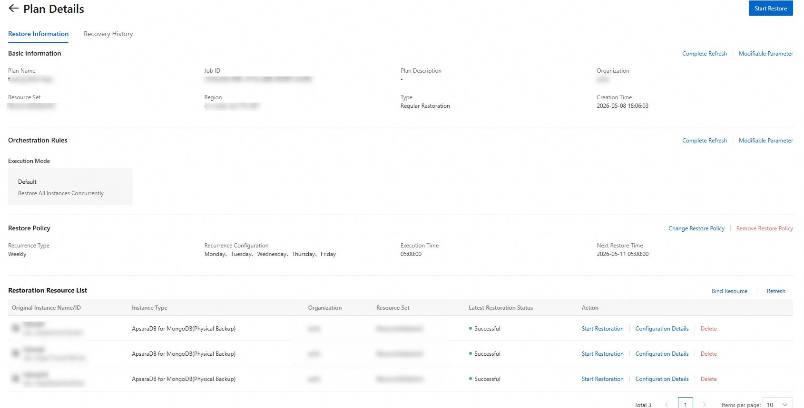

   Item

   Description

   Displays basic information about this recovery plan.

   **Basic**

   Click **Modifiable Parameter** to change the name and

   **Information**

   description of the recovery plan.

   **Orchestratio**

   Displays the execution mode configured for this recovery plan.

   **n Rules**

   Click **Modifiable Parameter** to change the execution mode.

   Displays the restore policy associated with this recovery plan.

   - If no restore policy is associated: Click **Associate Restore Policy** to associate a restore policy with the recovery plan.

   **Restore Policy**

   - If a restore policy is already associated: Click **Change Restore Policy** to change the associated restore policy. Click **Remove Restore Policy** to remove the association between

   **Restore**

   this recovery plan and its restore policy.

   **Information**

   - Click **Bind Resource** above the list to add an instance and configure its recovery settings.

   - Click **Start Restoration** in the Action column of an instance

   **Restoration**

   to initiate its restoration.

   **Resource**

   - Click **Configuration Details** in the Action column of an

   **List**

   instance to view its configuration details.

   - Click **Delete** in the Action column of an instance to remove it from this recovery plan.

   <table>
     <tr>
       <td>Recovery History</td>
       <td>Displays recovery history for this recovery plan.<br>• Expand a recovery record, and click <strong>Details</strong> in the Operation column of an instance recovery record to view its detailed information.<br>• Expand a recovery record, and click <strong>Event</strong> in the Operation column of an instance recovery record to view its events and statuses.<br>• Click <strong>Logs</strong> in the Actions column of an event to view its specific log information.<br>• After expanding an event, click theicon next to a sub-<br>event to view its log information.<br>• Event statuses include:<br>• <strong>Successful</strong>: The event executed successfully.<br>• <strong>Canceled</strong>: This status appears after you cancel a sub-event.<br>• <strong>Failed</strong>, <strong>Timeout</strong>, <strong>Stop</strong>: When a sub-event is in one of<br>these three states, click theicon next to the sub-<br>event to retry it.<br>Important<br>This operation is an event O&amp;M action and is not normally required. If a subsequent execution of the same event succeeds, do not retry the older one.<br>• <strong>Pending</strong>, <strong>In Progress</strong>, <strong>Synchronizing</strong>: When a sub-<br>event is in one of these three states, click theicon<br>next to the sub-event to cancel it. After cancellation, the sub-event status changes to <strong>Canceled</strong>.<br>Important<br>This operation is an event O&amp;M action and is not normally required. It is irreversible. Proceed with caution.</td>
     </tr>
   </table>

<a id="section-12-1-6"></a>

### 12.1.6. Delete a recovery plan

You can delete any recovery plan you no longer need.

**Prerequisites**

The recovery plan contains no recovery resources.

> **Note**
>
> Do not delete a plan that has recovery resources. You can delete added resource instances on the plan details page.

**Procedure**

1. Log in to the ASR for Backup and Recovery console.

2. In the left-side navigation pane, choose **Data restoration**.

3. On the **Recovery Plan** tab, expand **Advanced filter**, set query conditions, and then click **Search**. View the list of recovery plans.

4. Click **Delete Plan** in the **Operation** column for the target recovery plan.

5. In the confirmation dialog box, click **Delete**.

<a id="section-12-2"></a>

## 12.2. Recovery history

<a id="section-12-2-1"></a>

### 12.2.1. View recovery history

View the recovery history of restored instances on the Recovery History tab.

**Procedure**

1. Log in to the ASR for Backup and Recovery console.

2. In the left-side navigation pane, choose **Data Restoration**.

3. On the **Recovery History** tab, expand **Advanced Filter**, set your query conditions, and then click **Search**. View the recovery history of instances in the list.

4. Click **Details** in the **Operation** column of a recovery record to view its details.

   > **Note**
   >
   > Click the  next to an instance backup record ID to view backup record details.

   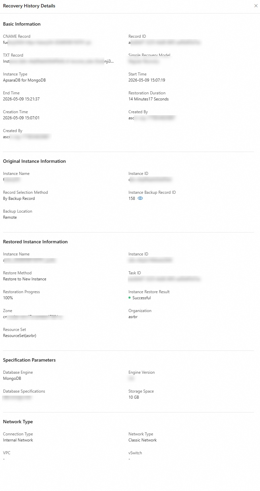

<a id="section-12-2-2"></a>

### 12.2.2. View recovery events

View event information for restored instances on the Recovery History tab.

**Procedure**

1. Log in to the ASR for Backup and Recovery console.

2. In the left-side navigation pane, choose **Data Restoration**.

3. On the **Recovery History** tab, expand **Advanced Filter**, set query conditions, and then click **Search**. View the restoration records of instances in the list.

4. Click **Event** in the **Actions** column of a recovery record to view recovery events for that instance.

   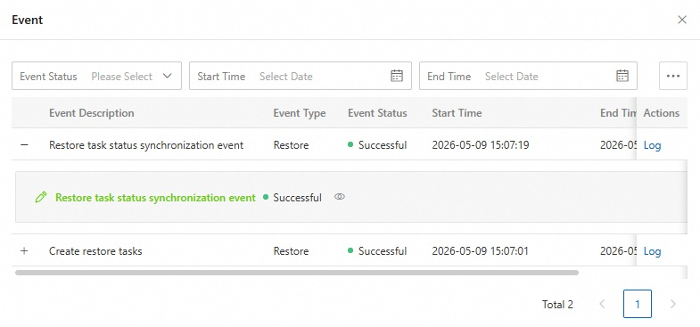

   - Click **Log** in the Actions column of an event to view detailed log information.

   - After expanding an event, click the  icon next to a sub-event to view its log information.

   - Event statuses include:

     - **Successful**: The system executed the event successfully.

     - **Canceled**: This status appears after you cancel a sub-event.

     - **Failed**, **Timeout**, **Stop**: When a sub-event is in one of these three states, click the 

       icon next to the sub-event to retry it.

       > **Important**
       >
       > This operation is an event O&M action. Do not perform this operation unless necessary. If a subsequent execution of the same event succeeds, do not retry the older one.

     - **Pending**, **In Progress**, **Synchronizing**: When a sub-event is in one of these three

       states, click the  icon next to the sub-event to cancel it. After cancellation, the sub-

       event status changes to **Canceled**.

       > **Important**
       >
       > This operation is an event O&M action. Do not perform this operation unless necessary. This operation is irreversible. Proceed with caution.

<a id="section-12-3"></a>

## 12.3. Restore policy

<a id="section-12-3-1"></a>

### 12.3.1. Create a restore policy

A restore policy defines the execution cycle for restoration. After you associate a recovery plan with a restore policy, the system automatically executes the restoration according to the configured cycle.

**Procedure**

1. Log in to the ASR for Backup and Recovery console.

2. In the left-side navigation pane, choose **Data Restoration**.

3. On the **Restore Policy** tab, click **Create**.

4. In the **Create Restore Policy** dialog box, configure the restore policy.

   | Parameter | Description |
   | --- | --- |
   | Name | Enter a name for the restore policy. |
   | Description | Enter a description for the restore policy. |
   | Cycle Type | Select <strong>Daily</strong>, <strong>By Week</strong>, or <strong>Monthly</strong>. |
   | Restore Interval | Set the restore interval when you select <strong>Daily</strong> for <strong>Cycle Type</strong>. |
   | Specified Day of Week | Specify the day of week when you select <strong>By Week</strong> for <strong>Cycle Type</strong>. |
   | Specified Date | Specify the date when you select <strong>Monthly</strong> for <strong>Cycle Type</strong>. You can also select whether to <strong>Execute on Last Day of Current Month</strong>. |
   | Execution Time | Select a specific point in time, for example, 00:00:00. |

5. Click **OK**.

   > **Note**
   >
   > After you create a restore policy, you can associate it with a recovery plan. For more information, see Associate, remove, or change a restore policy.

<a id="section-12-3-2"></a>

### 12.3.2. View restore policies

View the restore policies you created and their associated recovery plans.

**Procedure**

1. Log in to the ASR for Backup and Recovery console.

2. In the left-side navigation pane, choose **Data Restoration**.

3. On the **Restore Policy** tab, enter a policy name to quickly find a restore policy.

4. In the restore policy list, view the restore policies you created.

5. (Optional) If a restore policy has an associated recovery plan, click the  icon next to the

   restore policy to view the associated recovery plan.

   > **Note**
   >
   > Click **View Recovery Plan** in the Operation column to go to the details page of the recovery plan.

<a id="section-12-3-3"></a>

### 12.3.3. Modify a restore policy

You can modify a restore policy when you need to change it.

**Note**

> **Important**
>
> After you modify a restore policy, the system updates the execution configurations of all associated recovery plans. Proceed with caution.

**Procedure**

1. Log in to the ASR for Backup and Recovery console.

2. In the left-side navigation pane, choose **Data Restoration**.

3. On the **Restore Policy** tab, click **Edit Policy** for the target restore policy.

4. In the **Modify Restore Policy** dialog box, update the restore policy configuration. For more information about parameters, see Create a restore policy.

5. Click **OK**.

<a id="section-12-3-4"></a>

### 12.3.4. Delete a restore policy

Delete a restore policy when you no longer need it.

**Prerequisites**

The restore policy is not associated with any recovery plan.

**Procedure**

1. Log in to the ASR for Backup and Recovery console.

2. In the left-side navigation pane, choose **Data restoration**.

3. On the **Restore Policy** tab, click **Delete** for the target restore policy.

   > **Important**
   >
   > Do not delete a restore policy that is associated with a recovery plan. You can expand the list of associated recovery plans and click View Recovery Plan. On the recovery plan details page, disassociate the recovery plan from this restore policy, and then delete the restore policy.

4. In the confirmation dialog box, click **Delete**.

<a id="section-13"></a>

# 13.Archiving management

> **Important**
>
> If the archiving management menu and the submenus are not displayed in the Apsara Stack Resilience for Backup and Recovery (ASR-BR) console, contact the backup development team for assistance.

The following figure shows the backup and recovery procedure.

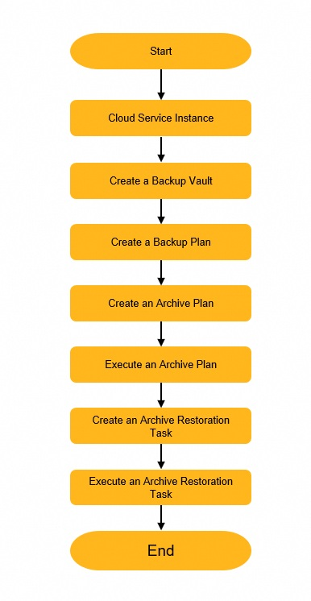

1. Currently, only ApsaraDB RDS, Object Storage Service (OSS), and PolarDB that uses local disks are supported. Therefore, you must create the corresponding instances in the ASR-BR console for these services.

2. Create a backup vault with the Backup + Archive label.

3. Create an appropriate backup plan to first back up the data to the backup vault. Then, create and execute an archiving plan to archive the data to the tape library.

4. If the archiving plan is executed, create an archive restoration task to restore data from the tape library to the staging bucket. Finally, restore the instance from the staging bucket.

<a id="section-13-1"></a>

## 13.1. Configure service authorization

This topic describes how to use the ASR for Backup and Recovery console to bind an account of the AISHU platform to obtain permissions on the AISHU platform.

**Prerequisites**

Only one account of the ASR for Backup and Recovery console can be configured with service permissions for a single AISHU platform account. If you want to set up authorization for the root organization (operational administrator), you must obtain the AccessKey (AK) and SecretKey (SK) from the system administrator (admin) on the AISHU platform. If you want to grant permissions to the administrator of another organization, you must create a tenant account on the AISHU platform and obtain the AK/SK of the tenant account. In this example, the configuration of authorization for operational administrators is described and the process for authorizing other organizational administrators is similar.

**Procedure**

1. Obtain the AK/SK of the AISHU platform.

   <ol type="i">

   <li>

   Log on to the AISHU platform by using a system administrator account.

   </li>

   <li>

   In the left-side navigation pane, choose **System > Authentication Management**.

   </li>

   <li>

   Click the **Access Key** tab, on the tab that appears, click **Create**. In the dialog box that

   </li>

   </ol>

   appears, set the **Name** parameter to admin and click **OK**. Obtain the AK/SK of the AISHU platform.

   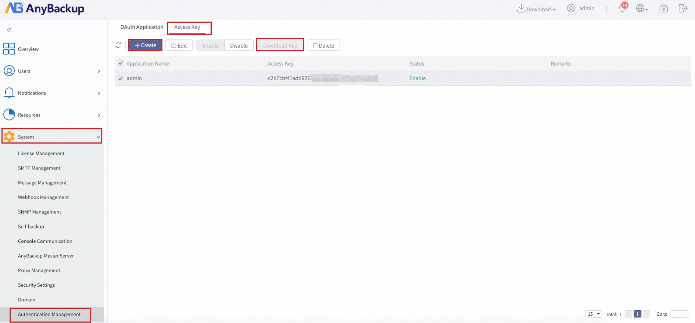

   <ol type="i" start="4">

   <li>

   Select the admin access key that you want to use and click **Download Key** to download the AK/SK to local.

   </li>

   </ol>

2. Log on to the ASR for Backup and Recovery console as an operations administrator.

3. In the left-side navigation pane, choose **Archive Management > Archiving Service Authorization**.

4. Click **Create** and specify the parameters that are described in the following table:

   | Parameter | Description |
   | --- | --- |
   | Server Endpoint | Enter the logon address of the AISHU platform in the format of <em>IP:Port</em>. For example, 192.168.0.1:8080. |
   | AccessKey | Enter the AccessKey obtained in Step 1. |
   | AccessSecretKey | Enter the AccessSecretKey obtained in Step 1. |

5. Click **OK**.

   > **Note**
   >
   > An organization can bind only one AISHU platform service account. The preceding steps are described by using the root organization (operations administrator) as an example. For other organization administrators, you must create the corresponding tenant on the AISHU platform first, and then perform the preceding steps to complete service authorization.

**Related operations**

After the service authorization is created, you can modify the authorization. For more information, see the following steps:

> **Note**
>
> If you need to modify the AK/SK, the old and new AK/SK must belong to the same tenant on the AISHU platform. Otherwise, the modification cannot be completed.

1. On the **Service Authorization List** page, click **Modify** in the **Actions** column.

2. In the dialog box that appears, complete the modification and click **OK**.

<a id="section-13-2"></a>

## 13.2. Manage tape devices

This topic describes how to create, edit, delete, and grant permissions in the ASR for Backup and Recovery console.

**Background information**

- Tape: the actual medium that stores data, It is located inside the tape cartridge. The tape is coated with a magnetic material, which enables data to be read from and written to by using the magnetic head of a tape drive.

- Tape library: A device used for data storage, normally, tape cartridges are used as the storage medium.

- Media set: a collection of storage media that are logically grouped together to achieve a specific storage purpose. Media include various types, such as disks, tapes, solid-state drives, and optical discs. In an archived system, a media set can be used to organize and manage data for more efficient storage, recovery, and management.

**Prerequisites**

The AISHU platform has information about media sets and tape libraries, which allows the ASR for Backup and Recovery console to retrieve the relevant device details.

**Procedure**

1. Log on to the ASR for Backup and Recovery console as an operations administrator.

2. On the **Tape Device Management** page, click **Create**.

3. Specify the parameters as described in the following table.

   | Parameter | Description |
   | --- | --- |
   | Media Set Name | It must be 3 to 30 characters in length, and can contain letters, digits, hyphens (-), underscores (_), periods (.), and at signs (@). It is globally unique and non-repetitive. |
   | Media Set Type | • <strong>Data Media Set</strong>: the media set that stores user data.<br>• <strong>Index Media Set</strong>: the media set that stores metadata.<br>Note<br>The index media set must be globally unique and non-repetitive, permanently stored, authorized by default to all organizations, and can only be associated with one drive. |
   | Select Tape Library | The system automatically obtains the tape library information in the system. Select an option from the drop-down list. |
   | Tape List | Select the tape device which is used for data storage. |
   | Drivers | • After you select the tape library, the corresponding number of drives is automatically populated. We recommend that you retain the default value.<br>• You can specify integers from 1 to N. |
   | Data Retention Period | • <strong>Permanently Reserved</strong>: The system retains the data without deleting the data.<br>• <strong>Retention by Day</strong>: indicates that data is retained by the number of days.<br>• <strong>Retention by Month</strong>: indicates that data is retained by the number of months. |

   | Retention period | If you set the <strong>Data Retention Period</strong> parameter to <strong>Retention by</strong> <strong>Day</strong> or <strong>Retention by Month</strong>, you must specify this parameter.<br>• If you set the <strong>Data Retention Period</strong> parameter to <strong>Retention by</strong> <strong>Day</strong>, enter a positive integer from 1 to 3650. Unit: days.<br>• If you set the <strong>Data Retention Period</strong> parameter to <strong>Retention by</strong> <strong>Month</strong>, enter a positive integer from 1 to 120. Unit: months. |
   | --- | --- |

4. Click **OK**.

**Related operations**

After the media set is created, you can perform the following operations:

> **Note**
>
> - Only operations administrators have the permissions to create and modify media sets.
>
> - Organization administrators cannot grant or revoke permissions on their own organizations. They can only grant or revoke permissions on subordinate organizations.

| Operation | Procedure |
| --- | --- |
| Modify Media Set | 1. Find the media set you want to manage and click <strong>Modify</strong> in the <strong>Actions</strong> column.<br>2. Modify the Tape Library, Drivers, Data Retention Period or Retention Period parameters and click <strong>OK</strong>. |
| View media set details | Click <strong>View Details</strong> in the <strong>Actions</strong> column. |
| Media set authorization or media set unauthorization<br>Note<br>Index media sets do not support this operation. By default, all organizations are authorized. | 1. Find the media set you want to manage and click <strong>Authorize</strong> in the <strong>Actions</strong> column.<br>2. Select the organizations to which you want to grant permissions and click <strong>OK</strong>.<br>After the authorization takes effect, you can log on to the ASR for Backup and Recovery console as an organization administrator to view the authorized media set.<br>3. For organizations that are authorized, you can cancel the authorization. The operation is similar to the authorization operation. |

<a id="section-13-3"></a>

## 13.3. Manage an archive plan

This topic describes how to create an archive plan. Only ApsaraDB RDS, Object Storage Service (OSS), and PolarDB Local Disk Edition-based archives are supported.

**Prerequisites**

- An ApsaraDB RDS instance, an OSS instance, and a PolarDB Local Disk Edition instance are created. For more information, see View instances.

- An ApsaraDB RDS backup vault, an OSS backup vault, and a PolarDB Local Disk Edition backup vault are created. For more information, see Create a backup vault.

- A backup plan is created. For more information, see Create backup plans.

- A media set is created. For more information, see Manage tape devices.

**Procedure**

1. Log in to the Apsara Stack Resilience for Backup and Recovery (ASR-BR) console.

2. In the left-side navigation pane, choose **Archive Management > Archived Plan**.

3. On the Archive Plan page, click **Create**.

4. In the **Basic Information** step, configure the parameters and click **Next**.

   | Parameter | Description |
   | --- | --- |
   | Plan Name | Enter a name for the custom archive plan. The name must be 3 to 50 characters in length, and can contain letters, digits, hyphens (-), and underscores (_). The name must be globally unique. |
   | Description | Optional. Enter additional information about the archive plan. The description can be up to 40 characters in length. |
   | Instance Type | Select an option from the drop-down list. Valid options:<br>• <strong>ApsaraDB RDS</strong>: indicates that an ApsaraDB RDS instance is archived.<br>• <strong>Object Storage Service</strong>: indicates an OSS instance is archived.<br>• <strong>PolarDB Local Disk</strong>: indicates that a PolarDB instance that uses local disks is archived. |
   | Backup Vault | Select the backup vault to be archived. You can select only one backup vault. |

5. In the **Configure Object** step, select multiple one or more objects and click **Next**.

   > **Note**
   >
   > - The archiving granularity for ApsaraDB RDS is at the instance level. This is why you must manually select the instances to be archived, and then click **Next**.
   >
   > - The archiving granularity for OSS is at the backup vault level. By default, all instances in the specified backup vault are selected. Click **Next**.

6. Configure an archive policy and click **Next**. The following table describes the parameters.

   <table>
     <tr>
       <th>Policy type</th>
       <th>Policy model</th>
       <th>Parameter</th>
       <th>Description</th>
     </tr>
     <tr>
       <td rowspan="3">Archive Policy</td>
       <td rowspan="3">Full Archive</td>
       <td>Cycle Type</td>
       <td>Indicates how often the archive plan is executed.<br>• <strong>By Day</strong>: The archive plan is executed every few days.<br>• <strong>By Week</strong>: The archive plan is executed on a specific day of each week.<br>• <strong>By Month</strong>: The archive plan is executed on a specific day of each month.</td>
     </tr>
     <tr>
       <td>Cycle Selection</td>
       <td>• If you set <strong>Cycle Type</strong> to <strong>By</strong> <strong>Day</strong>, enter a positive integer.Unit: days.<br>• If you set <strong>Cycle Type</strong> to <strong>By</strong> <strong>Week</strong>, select a specific day of week.<br>• If you set <strong>Cycle Type</strong> to <strong>By</strong> <strong>Month</strong>, select a specific date.</td>
     </tr>
     <tr>
       <td>Effective From</td>
       <td>The first archiving is performed within the period after the specified effective time.</td>
     </tr>
     <tr>
       <td rowspan="3">Storage Policy</td>
       <td rowspan="3">Tape Library<br>Note<br>To modify the storage policy of a media set, you must modify the properties of the media set as an operations administrator.</td>
       <td>Select Media Set</td>
       <td>Select an option from the drop-down list.</td>
     </tr>
     <tr>
       <td>Data Retention Period</td>
       <td>After you select a media set, the data retention period is automatically populated.</td>
     </tr>
     <tr>
       <td>Retention period</td>
       <td>After you select a media set, the retention period is automatically populated.</td>
     </tr>
   </table>

7. Review and confirm whether the parameter values set in the preceding steps are correct.

   > **Note**
   >
   > To immediately execute the archive plan, select **Start Now** and click **Submit**.

   - If the parameters are configured correctly, click **Submit**.

   - If the parameters are invalid, click **Return and Modify** in the upper-right corner of the page. Modify the settings, click **Next**, and then click **Submit**.

**What to do next**

After the archive plan is created, you can perform the following operations:

| Operation | Procedure |
| --- | --- |
| Advanced filter | 1. Select options from the <strong>Organization</strong>, <strong>Instance Type</strong>, <strong>Plan Name</strong>, and <strong>Plan Status</strong> drop-down lists.<br>2. Enter a plan name and click <strong>Search</strong> to search for the archive plan. |
| View details of an archive plan | 1. Find the archive plan that you want to view and click <strong>Details</strong> in the <strong>Actions</strong> column.<br>2. On the Archive Plan page, view the details on the <strong>Archive Information</strong>, <strong>Archive Record</strong> and <strong>Archive Events</strong> tabs.<br>3. On the <strong>Archive Information</strong> tab, modify the details in the Archive Instance and Archive Policy sections.<br>Note<br>You can modify archive plans only of ApsaraDB RDS instances and PolarDB instances that use local disks. |
| Archive now | 1. Set <strong>Plan Status</strong> to <strong>Stop</strong>, <strong>Created</strong>, or <strong>Running</strong> and click <strong>Search</strong>.<br>2. Find the archive plan that you want to manage and click <strong>Archive Now</strong> in the <strong>Actions</strong> column.<br>3. In the message that appears, click <strong>OK</strong>. |
| Stop an archive plan | 1. Set <strong>Plan Status</strong> to <strong>Running</strong> and click <strong>Search</strong>.<br>2. Find the archive plan that you want to stop and click <strong>Stop</strong> in the <strong>Actions</strong> column.<br>3. In the message that appears, click <strong>OK</strong>. |
| Start an archive plan | 1. Set <strong>Plan Status</strong> to <strong>Stop</strong> or <strong>Not Running</strong> and click <strong>Search</strong>.<br>2. Find the archive plan that you want to start and click <strong>Start</strong> in the <strong>Actions</strong> column.<br>3. In the message that appears, click <strong>OK</strong>. |
| Delete an archive plan | 1. Set <strong>Plan Status</strong> to <strong>Stop</strong>, <strong>Created</strong>, or <strong>Not</strong> <strong>Running</strong> and click <strong>Search</strong>.<br>2. Click <strong>Delete</strong> in the <strong>Actions</strong> column.<br>3. In the message that appears, click <strong>OK</strong>. |

<a id="section-13-4"></a>

## 13.4. View an archived record

After data is archived, you can view archived records. This topic describes how to view an archived record.

**Procedure**

1. Log on to the ASR-for Backup and Recovery console.

2. In the left-side navigation pane, choose **Archive Management > Archive Record**.

3. Specify the Plan Name and Archive Results parameters to filter the archived records that meet the conditions.

   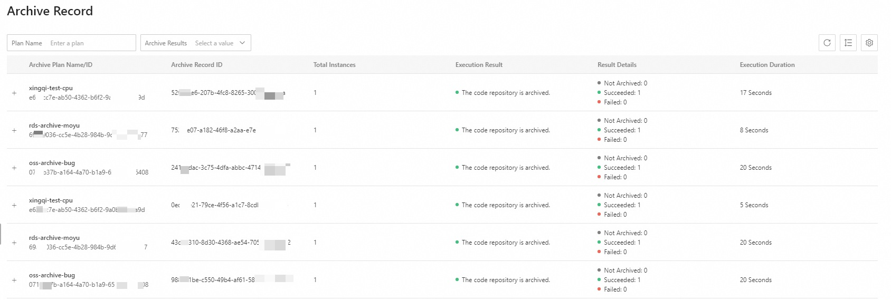

4. Click the  icon to view the archived records of each instance in the archive plan.

<a id="section-13-5"></a>

## 13.5. Manage archive restoration jobs

This topic describes how to create and view archive restoration jobs.

**Procedure**

1. Log in to the Apsara Stack Resilience for Backup and Recovery (ASR-BR) console.

2. In the left-side navigation pane, choose **Archive Management > Archived Data Restoration Task**.

3. Create an archive restoration job.

   <ol type="i">

   <li>

   On the Archive Restore Task page, click **Create**.

   </li>

   <li>

   In the **Basic Information** step, configure the parameters that are described in the

   </li>

   </ol>

   following table and click **Next**.

   <table>
     <tr>
       <th>Section</th>
       <th>Parameter</th>
       <th>Description</th>
     </tr>
     <tr>
       <td rowspan="3">Basic Information</td>
       <td>Restore Task Name</td>
       <td>The name of the restoration job. The name can contain letters, digits, hyphens (-), or underscores (_).</td>
     </tr>
     <tr>
       <td>Description</td>
       <td>The description of the restoration job. This parameter is optional.</td>
     </tr>
     <tr>
       <td>Instance Type</td>
       <td>The type of the instance. Valid values:<br>• ApsaraDB RDS<br>• Object Storage Service<br>• PolarDB Local Disk</td>
     </tr>
     <tr>
       <td>Select Instance</td>
       <td>Instance</td>
       <td>The instance to be restored. You can select only one instance.</td>
     </tr>
   </table>

   <ol type="i" start="3">

   <li>

   In the **Select Record** step, select an archive record of the instance and click **Next**.

   </li>

   <li>

   In the **Configure Instance** step, configure the parameters and click **Next**.

   > **Note**
   >
   > The following tables describe the parameters that you need to configure. Parameters that are not described in the tables can retain their default values.

   **OSS parameters**

   **Section**

   **Parameter**

   **Description**

   - **Restore to New Instance**: An instance is created in the primary cloud center.

   **Restore Method**

   - **Restore Data to Existing Instance**: The original instance is overwritten after restoration.

   The organization to which the new instance

   **Organization**

   to be restored belongs in the primary cloud center.

   The resource set to which the new instance

   **Basic**

   **Resource Set**

   to be restored belongs in the primary cloud

   **Informatio**

   center.

   **n**

   The cluster to which the new instance to be

   **Cluster Name**

   restored belongs in the primary cloud center.

   A custom bucket name that can be recognized. The name must contain at most three characters in length or three

   **Bucket Name**

   entries. It must start or end with a lowercase letter or a digit, and can contain lowercase letters, digits, or hyphens (-).

   The path of the file that you want to restore.

   **Destination Prefix**

   > **Note**
   >
   > The root folder of the bucket applies if this parameter is not specified.

   The file restoration rules. Valid values:

   - **Include All**: All files in the path specified by the **File Path** parameter are restored.

   **Restoratio n Rule**

   - **Include**: Only the files specified by the

   **File Rule**

   **Files** parameter are restored.

   - **Exclude**: The files that are not included in the files specified by the **Files** parameter are restored.

   The folder names or file names. You can specify only one name in each line.

   **Files**

   This parameter is required if you set the **File Rule** parameter to **Include** or **Exclude**.

   The start time and end time for file

   **Restoration Time**

   restoration.

   **File Restoratio n Time**

   The number of concurrency restoration jobs

   **Range**

   **Configure Concurrent Restore**

   that can be performed during the

   **Tasks**

   restoration.

   **ApsaraDB RDS parameters**

   | Section | Parameter | Description |
   | --- | --- | --- |

   <table>
     <tr>
       <td rowspan="5">Basic Informatio n</td>
       <td colspan="2">Restore Method</td>
       <td>• <strong>Restore to New Instance</strong>: An instance is created in the primary cloud center.<br>• <strong>Restore Data to Existing Instance</strong>: The original instance is overwritten after restoration.</td>
     </tr>
     <tr>
       <td colspan="2">Zone</td>
       <td>The zone in which the new instance to be restored resides in the primary cloud center.</td>
     </tr>
     <tr>
       <td colspan="2">Organization</td>
       <td>The organization to which the new instance to be restored belongs in the primary cloud center.</td>
     </tr>
     <tr>
       <td colspan="2">Resource Set</td>
       <td>The resource set to which the new instance to be restored belongs in the primary cloud center.</td>
     </tr>
     <tr>
       <td colspan="2">Instance Name</td>
       <td>The name of the instance. We recommend that you specify a name that can help you identify the instance. ASR-BR automatically creates the instance in the primary cloud center. The name must be 2 to 64 characters in length, and can contain letters, digits, hyphens (-), underscores (_), and colons (:). It must start with a letter.</td>
     </tr>
     <tr>
       <td rowspan="4">Network Type</td>
       <td colspan="2">Classic Network</td>
       <td>The classic network. Cloud services deployed in the classic network are not isolated. Unauthorized access can be blocked only by using security groups or whitelists.</td>
     </tr>
     <tr>
       <td rowspan="3">VPC</td>
       <td>VPC</td>
       <td>The virtual private cloud (VPC) in which the new instance to be restored resides.</td>
     </tr>
     <tr>
       <td>vSwitch Zone</td>
       <td>The zone of the vSwitch to which the new instance to be restored belongs.</td>
     </tr>
     <tr>
       <td>vSwitch</td>
       <td>The vSwitch to which the new instance to be restored belongs.</td>
     </tr>
     <tr>
       <td>Specificati on Parameter s</td>
       <td colspan="2">CPU Type</td>
       <td>The CPU type that you want to use.</td>
     </tr>
   </table>

   **PolarDB Local Disk Edition parameters**

   <table>
     <tr>
       <th>Section</th>
       <th colspan="2">Parameter</th>
       <th>Description</th>
     </tr>
     <tr>
       <td rowspan="5">Basic Informatio n</td>
       <td colspan="2">Restore Method</td>
       <td>• <strong>Restore to New Instance</strong>: An instance is created in the primary cloud center.<br>• <strong>Restore Data to Existing Instance</strong>: The original instance is overwritten after restoration.</td>
     </tr>
     <tr>
       <td colspan="2">Zone</td>
       <td>The zone in which the new instance to be restored resides in the primary cloud center.</td>
     </tr>
     <tr>
       <td colspan="2">Organization</td>
       <td>The organization to which the new instance to be restored belongs in the primary cloud center.</td>
     </tr>
     <tr>
       <td colspan="2">Resource Set</td>
       <td>The resource set to which the new instance to be restored belongs in the primary cloud center.</td>
     </tr>
     <tr>
       <td colspan="2">Instance Name</td>
       <td>The name of the instance. We recommend that you specify a name that can help you identify the instance. ASR-BR automatically creates the instance in the primary cloud center. The name must be 2 to 64 characters in length, and can contain letters, digits, hyphens (-), underscores (_), and colons (:). It must start with a letter.</td>
     </tr>
     <tr>
       <td rowspan="4">Network Type</td>
       <td colspan="2">Classic Network</td>
       <td>The classic network. Cloud services deployed in the classic network are not isolated. Unauthorized access can be blocked only by using security groups or whitelists.</td>
     </tr>
     <tr>
       <td rowspan="3">VPC</td>
       <td>VPC</td>
       <td>The VPC in which the new instance to be restored resides.</td>
     </tr>
     <tr>
       <td>vSwitch Zone</td>
       <td>The zone of the vSwitch to which the new instance to be restored belongs.</td>
     </tr>
     <tr>
       <td>vSwitch</td>
       <td>The vSwitch to which the new instance to be restored belongs.</td>
     </tr>
     <tr>
       <td>Specificati on Parameter s</td>
       <td colspan="2">Chip Architecture</td>
       <td>The chip architecture that you want to use.</td>
     </tr>
   </table>

   </li>

   <li>

   In the **Configure Intermediate Bucket** step, configure the parameters that are described in the following table and click **Next**.

   > **Note**
   >
   > If the system detects that the data required for the archive restoration job exists in the backup vault or existing intermediate bucket, the data is automatically reused without the need for manual configurations.

   <table>
     <tr>
       <th colspan="3">Parameter</th>
       <th>Description</th>
     </tr>
     <tr>
       <td colspan="3">Select Storage Pool</td>
       <td>The storage pool of the intermediate bucket.</td>
     </tr>
     <tr>
       <td rowspan="5"></td>
       <td rowspan="4">Create Bucket<br>Note<br>After a cleanup policy for the new bucket is configured, click <strong>Create</strong>.After the bucket is created, click <strong>Next</strong>.</td>
       <td>Bucket Name</td>
       <td>The name of the bucket.</td>
     </tr>
     <tr>
       <td>Bucket Size</td>
       <td>The size of the bucket. The system estimates the required bucket size. The value that you set must be greater than the estimated size. Unit: GB.</td>
     </tr>
     <tr>
       <td>Bucket Cleanup Policy</td>
       <td>• The bucket is retained and only data is <strong>deleted</strong>: The intermediate bucket is retained after the instance is restored, and only the data is cleared.<br>• <strong>Delete Bucket</strong>: The intermediate bucket is deleted immediately after the instance is restored.</td>
     </tr>
     <tr>
       <td>Cleanup Policy Execution Type</td>
       <td>• <strong>Execute Now</strong>: If the data from the archive restoration job does not need to be reused, the data is cleared immediately after the restoration job is complete.<br>• <strong>Delayed Cleanup</strong>: If the data from the archive restoration job can be reused, you can choose to delay the cleanup and configure the <strong>Cleanup Latency (Days)</strong> parameter.</td>
     </tr>
     <tr>
       <td>Existing Bucket</td>
       <td>Bucket Name</td>
       <td>The name of the existing bucket.</td>
     </tr>
   </table>

   <table>
     <tr>
       <td rowspan="4">Bucket Source</td>
       <td rowspan="4">Note<br>After you specify the bucket name, click <strong>Verify</strong> to view the cleanup policy.<br>• If a cleanu p policy is configu red for an existin g bucket, the cleanu p policy is autom atically specifi ed.Click <strong>Next</strong>.<br>• If no cleanu p policy is configu red for an existin g bucket, configu re a cleanu p policy and click <strong>Next</strong>.</td>
       <td></td>
       <td></td>
       <td>Note<br>• The available space in the bucket must be greater than the space required for the archive restoration job.<br>• The bucket is not a backup vault or</td>
     </tr>
     <tr>
       <td>Bucket Size</td>
       <td></td>
       <td>an archive vault.The size of the bucket. The system estimates<br>• The bucket cannot be cleared.the required bucket size. The value that you set<br>• The supported instance types of the must be greater than the estimated size. Unit: bucket must match the selected GB.instance type.</td>
     </tr>
     <tr>
       <td>Bucket Cleanup Policy</td>
       <td></td>
       <td>• You cannot select an intermediate<br>• The bucket is retained and only data isbucket that is in use for an OSS <strong>deleted</strong>: The intermediate bucket is retainedinstance. You can select an after the instance is restored, and only theintermediate bucket that is in use data is cleared.for an ApsaraDB RDS instance.<br>• <strong>Delete Bucket</strong>: The intermediate bucket is deleted immediately after the instance is restored.</td>
     </tr>
     <tr>
       <td>Cleanup Policy Execution Type</td>
       <td colspan="2">• <strong>Execute Now</strong>: If the data from the archive restoration job does not need to be reused, the data is cleared immediately after the restoration job is complete.<br>• <strong>Delayed Cleanup</strong>: If the data from the archive restoration job can be reused, you can choose to delay the cleanup and configure the <strong>Cleanup Latency (Days)</strong> parameter.</td>
     </tr>
   </table>

   </li>

   <li>

   Click **OK**.

   To immediately execute the archive restoration job, select **Start Now** and click **Submit**.

   </li>

   </ol>

4. Filter archive restoration jobs.

   Configure the Organization, Resource Set, Instance Type, Task Status, and Task Name parameters to search for the archive restoration tasks that meet the filter conditions.

   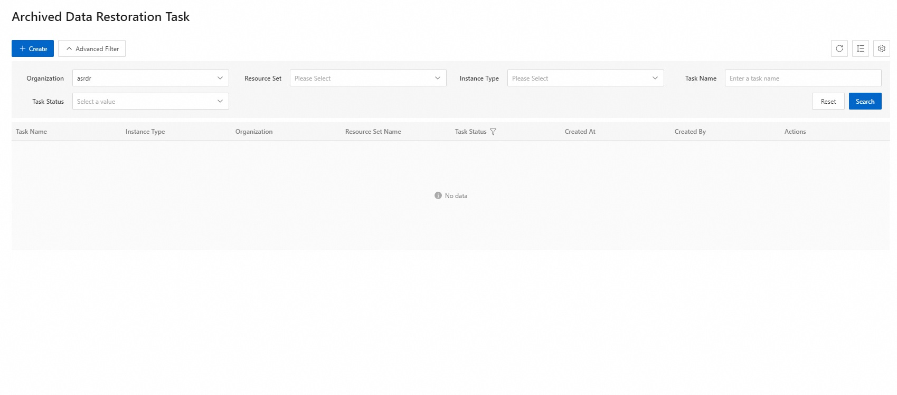

5. Click **View Details** in the **Actions** column to view the archive restoration information and archive restoration events.

   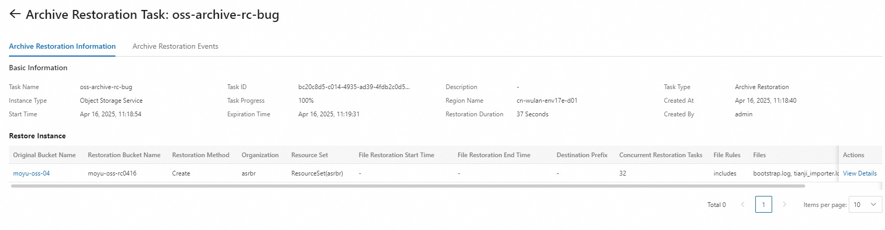

   - View archive restoration information:

     <ol type="a">

     <li>

     Click the **Archive Restoration Information** tab.

     </li>

     <li>

     In the Restore Instance section, click **View Details** in the **Actions** column to view the instance details.

     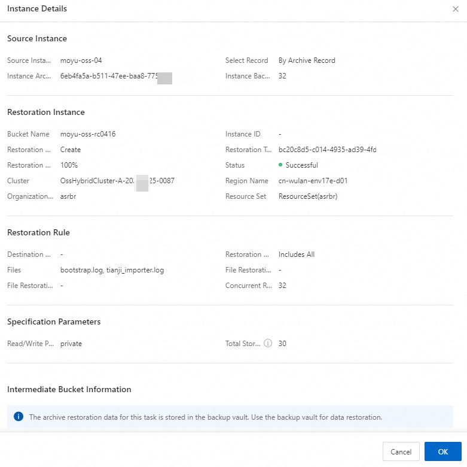

     </li>

     </ol>

     <ol type="i" start="100">

     <li>

     Click **OK** or **Cancel** to return to the previous page.

     </li>

     </ol>

   - View archive restoration events:

     <ol type="a">

     <li>

     Click the **Archive Restoration Event** tab.

     </li>

     <li>

     Find the restoration event that you want to view and click the  icon on the left side of

     the restoration event to view the details of the event.

     </li>

     </ol>

     <ol type="i" start="100">

     <li>

     Click **Log** in the **Actions** column to view the log information about the restoration event.

     </li>

     </ol>

<a id="section-14"></a>

# 14.Backup and recovery of VMware VMs

<a id="section-14-1"></a>

## 14.1. Install a backup gateway

This topic describes how to install a backup gateway in VMware ESXi by using an OVA file.

**Prerequisites**

The asrbr-vmware-appliance.ova file that is used to install the backup gateway is downloaded.

**Background information**

- The Apsara Stack Resilience for Backup and Recovery (ASR-BR) console supports only vCenter Server versions 5.5, 6.0, 6.5, and 6.7.

- A backup gateway is a virtual machine (VM) that is installed in vCenter Server. The backup gateway uses RabbitMQ to communicate with the hbr-console component and calls vCenter API operations to create snapshots, back up data, and recover data. Backup gateways are required for VM backup, local recovery, on-cloud recovery, and cloud migration.

**Procedure**

1. Enter the IP address of VMware ESXi in a browser, enter the logon username and password, and then click **Log in**.

2. In the left-side navigation pane, click **Virtual Machines** and then click **Create/Register VM**.

3. In the **New virtual machine** dialog box, select **Deploy a virtual machine from an OVF or OVA file** and click **Next**.

   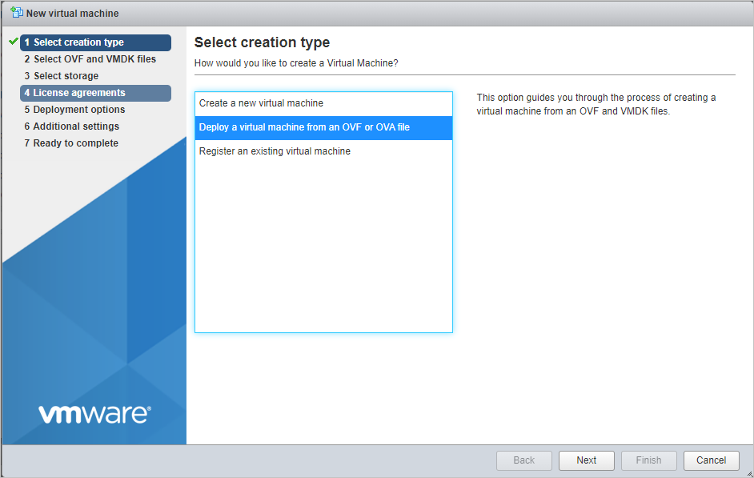

4. Enter a name for the VM, select the OVA file **asrbr-vmware-appliance.ova**, and then click **Next**.

   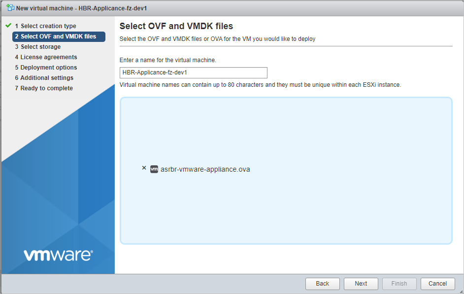

5. Select a storage type and datastore, and click **Next**.

   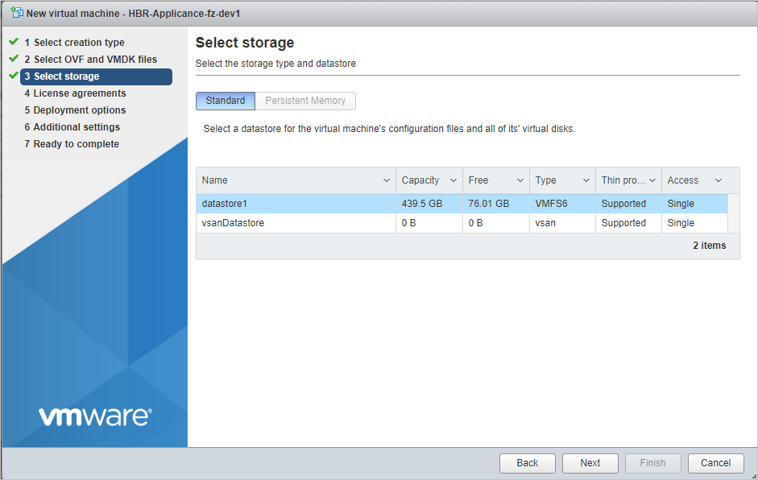

6. Use the default settings in the **Deployment options** step, and click **Next**.

   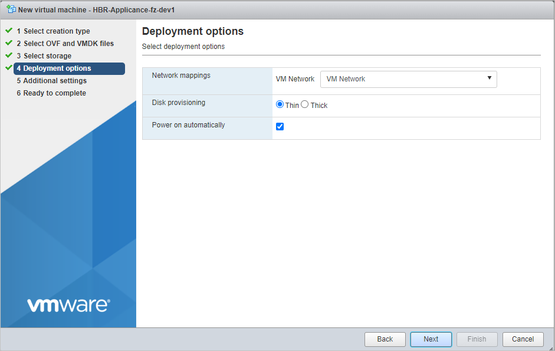

7. In the **Additional settings** step, configure the parameters and click **Next**.

   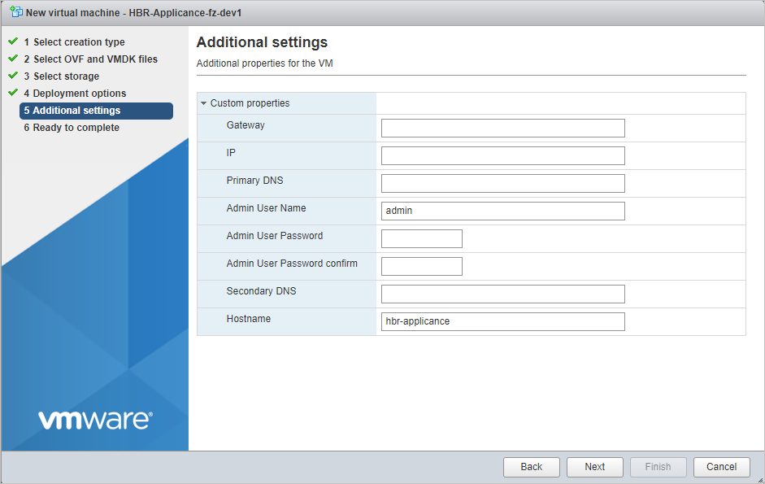

8. In the **Ready to complete** step, click **Finish**.

9. In the **Recent tasks** section, view the task status. If the task is in the **Completed successfully** state, the VM is deployed.

   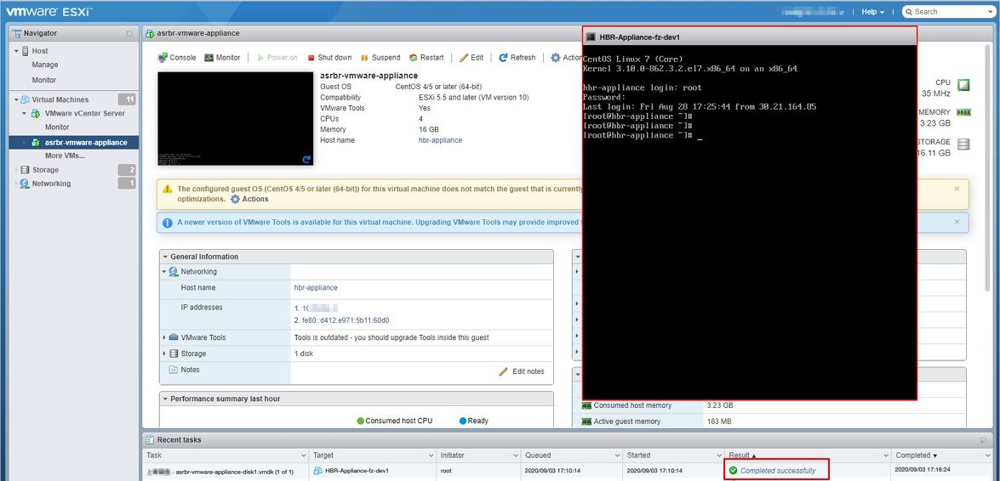

0. After the VM is deployed, start the VM.

<a id="section-14-2"></a>

## 14.2. Register a backup gateway

This topic describes how to register a backup gateway. Before you can register a backup gateway, you must obtain the activation code of the gateway from the Apsara Stack Resilience for Backup and Recovery (ASR-BR) console.

**Obtain the activation code**

1. Log on to the ASR-BR console as an organization administrator.

2. In the left-side navigation pane, choose **System Management** > **vCenters**.

3. Click **Activation Code** to view the activation code.

   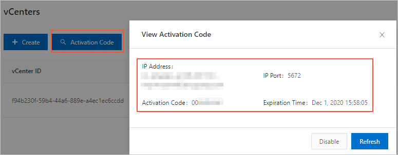

**Register a backup gateway**

1. In the address bar of your browser, enter the endpoint of the virtual machine (VM) where the backup gateway resides. The endpoint is in the format of  `<IP address>:8011` .

2. In the Register dialog box, set the following parameters.

   | Parameter | Description |
   | --- | --- |
   | Host Address | The <strong>IP Address</strong> that you obtained from the View Activation Code dialog box. |
   | Host Port | The <strong>IP Port</strong> that you obtained from the View Activation Code dialog box. |
   | Activation Code | The <strong>Activation Code</strong> that you obtained from the View Activation Code dialog box. |

   > **Note**
   >
   > If DNS is not configured for vCenter Server or Apsara Stack, you must enter an IP address for Host Address.

3. Click **OK**.

<a id="section-14-3"></a>

## 14.3. Create a vCenter

You can use vCenter to manage VMware virtual machines (VMs). This topic describes how to create a vCenter.

**Prerequisites**

VMware VMs are backed up.

**Procedure**

1. Log on to the ASR for Backup and Recovery console as an organization administrator.

2. In the left-side navigation pane, choose **System Management** > **vCenters**.

3. On the page that appears, click **Create**.

4. In the **Create vCenter** dialog box, specify the following parameters.

   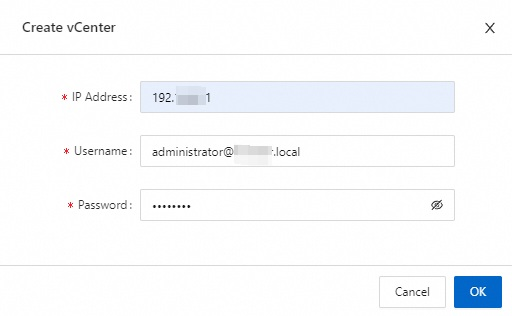

   | Parameter | Description |
   | --- | --- |
   | IP Address | The IP address of the vCenter. |
   | Username | The username that you can use to log on to the vCenter. The username is in the <code> Username for single sign-on@Domain </code> <code>name for single sign-on </code> format. |
   | Password | The password that you can use to log on to the vCenter. The value is the single sign-on (SSO) password that you specify on the SSO page. |

5. Click **OK**.

<a id="section-14-4"></a>

## 14.4. Create a backup plan for a VM

This topic describes how to create a backup plan for a VMware virtual machine (VM). You can use the backup plan to back up the disk data of the VMware VM to a backup vault.

1. Log on to the ASR for Backup and Recovery console as an organization administrator.

2. In the left-side navigation pane, click **Backup Plans**.

3. On the Backup Plan page, click the **VMware on ECS** tab and then click **Create**.

4. In the **Basic Information** step, configure the parameters and click **Next**. The following table describes the parameters.

   | Parameter | Description |
   | --- | --- |
   | Instance Type | Select <strong>VMware Cloud on Alibaba Cloud</strong>. |
   | Organization | Select the organization to which the instance belongs in the primary cloud center. |
   | Resource Set | Select the resource set to which the instance belongs in the primary cloud center. |
   | Backup Plan Name | Enter a name for the backup plan.<br>Note<br>The name must be 4 to 128 characters in length, and can contain letters, digits, hyphens (-), underscores (_), and periods (.). |
   | Description | Optional. Enter a description for the backup plan. We recommend that you enter a description that can help you identify the backup plan. |
   | Select Backup Object | Select a vCenter ID first, and then select the corresponding VM. |

5. In the **Configure Object** step, configure the parameters in the following table and click **Save Configuration**. Then, click **Next**.

   | Parameter | Description |
   | --- | --- |
   | Backup Gateway | Select a backup gateway from the drop-down list:<br>• <strong>Default Policy</strong>: The system selects a backup gateway of the HBR service to execute the backup plan based on the workloads specified by each customer.<br>• Other backup gateways: You can also select another registered backup gateway. |
   | Transmission Mode | • <strong>LAN-free Backup Data Transmission</strong> (default): hot-mounts the disk that you want to back up to the backup gateway and transmits backup data over a non-LAN network. LAN refers to the local area network.<br>• <strong>LAN-based Backup Data Transmission</strong>: transmits backup data over a LAN.<br>Note<br>If the vCenter does not support LAN-free data transmission, the system automatically switches to the LAN mode. |
   | Snapshot Type | • <strong>Standard Snapshot</strong>: uses VMware software snapshots to perform common backup.<br>• <strong>System Silent Snapshot</strong> (default): uses VMware Tools to perform silent backup.<br>Note<br>If VMware Tools cannot be mounted or is not installed, the system automatically switches to the standard snapshot mode for backups. |

6. In the **Backup Policy** step, configure the parameters in the following table and click **Next**.

   > **Note**
   >
   > Only geo-redundancy is supported.

   | Parameter | Description |
   | --- | --- |
   | Backup Mode | Retain the default value: Full Backup. |
   | Cycle Type | Retain the default value: By Day. |
   | Cycle Selection | Select the frequency (number of days) at which you want to perform a full backup. Enter a positive integer. |
   | Backup Time | Select a time to perform the first backup. The subsequent backups are performed at the specified intervals. |
   | Backup Retention Period (Days) | Specify the maximum number of days for which backup data is retained in a remote backup vault. If this parameter is set to 7, the backup data of the last seven days is retained. Backup data that is generated more than seven days ago is deleted. |
   | Backup Vault | Select the backup vault in a remote data center to which you want to back up the data. If you cannot find the backup vault that you want, click <strong>Create</strong> <strong>Backup Vault</strong> to create one. |
   | Enable Permanent Incremental Backup | If Changed Block Tracking (CBT) is disabled for the selected VM after you configure an incremental policy, incremental snapshots are downgraded to full snapshots. |
   | Incremental Backup Cycle Type | Select a cycle type for incremental backup based on your business requirements. Valid values:<br>• By Day<br>• By Hour |
   | Incremental Backup Execution Cycle | Select the frequency (the number of days) at which incremental backup is performed. Enter a positive integer. |
   | Incremental Backup Time | Select a time to perform the first incremental backup. The subsequent incremental backups are performed at the specified intervals. |

   > **Note**
   >
   > If you want to configure an incremental backup policy, make sure that CBT is enabled on the VM. For information about how to enable CBT, see Changed Block Tracking (CBT) on virtual machines (1020128).

7. Review the backup configurations and click **Submit**.

   After the backup plan is created, backups are performed based on the specified backup policy. If you want to immediately start the backup plan, manually start the backup plan. For more information, see Start a backup plan.

<a id="section-14-5"></a>

## 14.5. Restore a VMware virtual machine

When a VMware virtual machine fails, you can use a previous backup record to restore the VMware virtual machine to an Elastic Compute Service (ECS) instance on the cloud or to a local vCenter environment.

**Procedure**

1. Log in to the ASR for Backup and Recovery console as an organization administrator.

2. In the left-side navigation pane, select **Data Restoration**.

3. On the **Recovery Plan** tab, click **Create**.

4. After you set basic information, configure recovery resources, and confirm the settings, click **Submit**. For detailed parameter descriptions, see Create a standard recovery plan.

<a id="section-15"></a>

# 15.System management

<a id="section-15-1"></a>

## 15.1. Manage storage pool groups

This topic describes how to create, modify, and delete storage pool groups and storage pools.

**Create a storage pool group and storage pool**

For more information, see Create a storage pool.

> **Note**
>
> Storage pools that are created in Apsara Stack earlier than V3.18.1 are merged into storage pool groups based on their endpoints. The names of the storage pool groups are in the following format: AUTO_MERGE_STORAGE_POOL_GROUP_id.

**Modify a storage pool**

1. Log on to the ASR for Backup and Recovery console as an operations administrator.

2. In the left-side navigation pane, choose **System Management** > **Storage Pool Groups**.

3. On the page that appears, click the name of a storage pool group.

4. Find the storage pool that you want to modify and click **Modify** in the **Actions** column.

5. In the **Modify Storage Pool** dialog box, modify the parameters and click **OK**. The parameters include **AccessKey ID**, **AccessKey Secret**, **Storage Pool Name**, **Storage Space (TB)**, **Authorized Organization**, and **Storage Pool Description**.

**Delete a storage pool**

> **Note**
>
> Only storage pools that are not associated with backup vaults can be deleted. Therefore, to delete a storage pool, you must first delete the backup plan, then delete the backup vault, and finally delete the storage pool.

1. Log on to the ASR for Backup and Recovery console as an operations administrator.

2. In the left-side navigation pane, choose **System Management** > **Storage Pool Groups**.

3. On the page that appears, click the name of a storage pool group.

4. In the storage pool list, find the storage pool that you want to delete and click **Delete** in the **Actions** column.

5. In the message that appears, click **OK**.

**Cross-region/Cross-cloud replication authorization**

> **Note**
>
> If a backup vault requires the creation of an associated mirror vault, authorization is necessary.

1. Log on to the ASR for Backup and Recovery console as an operations administrator.

2. In the left-side navigation pane, choose **System Management** > **Storage Pool Groups**.

3. On the page that appears, find the storage pool group that you want to manage, click the

    icon, and then click **Cross-region/Cross-cloud Replication Authorization** in the

   **Actions** column.

4. In the dialog box that appears, configure the following parameters and click **OK**.

   > **Note**
   >
   > Obtain the cloud parameters in advance from Object Storage Service (OSS) O&M System. For more information, see Initialization in the console.

   | Parameter | Description |
   | --- | --- |
   | Cloud Name | Specify the peer cloud name. |
   | OSS Region | Specify the name of the local cloud region in the cluster that is associated with the corresponding OSS. |
   | OSS Location | Specify the name of the local cloud location in the cluster that is associated with the corresponding OSS. |
   | Proxy User Primary Key | Specify the AccessKey information automatically generated when you create the proxy user.<br>Note<br>For the destination end of cross-region replication, the primary key of the proxy user is not required. For the destination end of cross-cloud replication, the primary key of the proxy user is required. |

**Modify a storage pool group**

1. Log on to the ASR for Backup and Recovery console as an operations administrator.

2. In the left-side navigation pane, choose **System Management** > **Storage Pool Groups**.

3. On the Manage Storage Pool Group page, find the storage pool group that you want to modify and click **Modify** in the **Actions** column.

4. In the **Modify Storage Pool Group** dialog box, modify the name and storage space limit of the storage pool group and click **OK**.

**Delete a storage pool group**

> **Note**
>
> Only storage pool groups that do not contain storage pools can be deleted.

1. Log on to the ASR for Backup and Recovery console as an operations administrator.

2. In the left-side navigation pane, choose **System Management** > **Storage Pool Groups**.

3. On the Manage Storage Pool Group page, find the storage pool group that you want to delete, click the More icon, and then select **Delete** in the **Actions** column.

4. In the message that appears, click **OK**.

<a id="section-15-2"></a>

## 15.2. Manage self-backup

<a id="section-15-2-1"></a>

### 15.2.1. Create a backup policy for metadata

You can create a self-backup policy to periodically back up the metadata of the backup system to a storage pool. If data in the backup system is lost or damaged, you can use the backup metadata restore the data at the earliest opportunity.

1. Log on to the ASR for Backup and Recovery console as an operations administrator.

2. In the left-side navigation pane, choose **System Management** > **Self-backup Management**.

3. On the Self-backup Management page, click the **Backup Policy** tab and click **Create**. Then, configure the following parameters.

   | Parameter | Description |
   | --- | --- |
   | Backup Cycle | Specify the interval at which the backup is performed. You can select one of the following units from the drop-down list on the right side: Hours and Days.<br>Note<br>The minimum value is 10 minutes. |
   | Storage Duration | Specify the retention period of the backup metadata in the storage pool.<br>We recommend that you set this parameter to 7 days.<br>Important<br>If data is stored longer than the specified retention period, the data is automatically deleted. |
   | Storage Pool | Select a storage pool. If no storage pools exist, click <strong>Create</strong> <strong>Storage</strong> on the right side to create a storage pool. For more information, see Create a storage pool. |
   | Bucket | Enter the name of the bucket that is used to store the backup metadata in the specified storage pool.<br>Important<br>Record the name of the bucket for future use. When you create a restoration job of the Recovery on Cloud type, you must enter the name of the bucket. |

4. Click **Create**.

<a id="section-15-2-2"></a>

### 15.2.2. View the backup records of metadata

You can view the details of the backup records of metadata. The details include the time when the backup started and ended, the expiration time of the backup data, the status of the backup task, the size of the backup set, and the name of the backup file.

1. Log on to the Apsara Stack Resilience for Backup and Recovery (ASR-BR) console as an operations administrator.

2. In the left-side navigation pane, choose **System Management** > **Self-backup Management**.

3. On the Self-backup Management page, click the **Backup Records** tab. On the Backup Records tab, you can view the details of the backup records of metadata. The details include the time when the backup started and ended, the expiration time of the backup data, the status of the backup task, the size of the backup set, and the name of the backup file.

4. (Optional). If you want to delete a backup record and its backup set, find the backup record and click **Delete** in the **Actions** column. In the message that appears, click **OK**.

   > **Note**
   >
   > You can perform the deletion operation only when you log on to the console as an operations administrator.

<a id="section-15-3"></a>

## 15.3. Create a disaster recovery job

If you have a primary cloud and a secondary cloud, and the primary cloud fails, rendering ASR for Backup and Recovery on the primary cloud unavailable, you can deploy ASR for Backup and Recovery on another cloud system or on the secondary cloud and use the disaster recovery feature to restore the backup data stored in the secondary cloud.ASR-BR Disaster recovery jobs do not interrupt the cloud backup and restoration features.

**Scenarios**

You can use the disaster recovery feature only in the following two scenarios:

- You need to restore backup data from a storage pool in another region to the secondary Apsara Stack system.

- The primary cloud system becomes unavailable and requires data restoration.

**Prerequisites**

A self-backup management policy is configured, and the metadata of ASR for Backup and Recovery is backed up in the storage pool in another region. In addition, the Object Storage Service (OSS) endpoint, AccessKey pair, and the ID of the bucket used to store ASR for Backup and Recovery metadata is recorded. This ensures that the metadata used to recover ASR for Backup and Recovery can be obtained when a disaster recovery job is required.

**Procedure**

1. Create a disaster recovery job.

   <ol type="i">

   <li>

   Log on to the ASR for Backup and Recovery console as an operations administrator.

   <ol type="i" start="2">

   <li>

   In the left-side navigation pane, choose **System Management** > **Disaster Recovery**.

   </li>

   <li>

   On the **Disaster Recovery** page, click **Create**.

   </li>

   </ol>

   </li>

   <li value="4">

   In the **Restore Metadata** dialog box, select a storage pool from the **Storage Pool** drop-down list and specify an OSS bucket in which ASR-BR metadata is stored for the **bucket** parameter. Then, click **Search**. Select the metadata backup from which you want to perform the recovery and then click **Start**.

   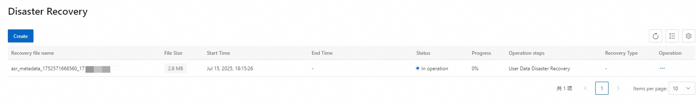

   </li>

   <li>

   When the metadata is being recovered, the status of the job is changed from **Queuing** to **Running**.

   </li>

   <li>

   After the metadata is recovered, the **step** changes from **ASR-BR Metadata Restoration** to **Revise Organization** and the status changes to **Running**.

   </li>

   </ol>

2. Revise the organization.

   <ol type="i">

   <li>

   When the step is **Revise Organization**, click the  icon in the **Actions** column and

   select **Revise Organization**.

   </li>

   <li>

   In the **Revise Organization** dialog box, select the desired organization from the **New**

   </li>

   </ol>

   **Organization Name** drop-down list.

   By default, the organization with the same name is matched.

   > **Note**
   >
   > The source and destination organizations must fully match each other.

   <ol type="i" start="3">

   <li>

   Click **OK**.

   </li>

   </ol>

   The **step** changes from **Revise Organization** to **Metadata Revision** and the status changes to **Queuing**.

   <ol type="i" start="4">

   <li>

   When the metadata revision starts, the status changes to **Running**. When the metadata revision is complete, the **step** changes from **Metadata Revision** to **User Data Disaster Recovery**.

   </li>

   <li>

   Then the organization administrator of each organization needs to perform data disaster recovery.

   </li>

   </ol>

3. Perform data disaster recovery for each organization.

   <ol type="i">

   <li>

   Log on to the ASR for Backup and Recovery console as an organization administrator.

   <ol type="i" start="2">

   <li>

   In the left-side navigation pane, click **Recovery Jobs**.

   </li>

   <li>

   On the **Restore Task** page, click **Create**.

   </li>

   </ol>

   </li>

   <li value="4">

   In the **Basic Information** step, configure the name of the recovery job, select the instance type to be recovered, and set Restore Task Type to **Disaster Recovery**. Then, click **Next**.

   </li>

   <li>

   In the **Select Instance** step, select an instance from the instance list, click the  icon,

   and then click **Next**.

   > **Note**
   >
   > The left-side section shows only the instances that have been backed up.

   </li>

   <li>

   In the **Select Record** step, select **By Backup Record** and click **Proceed**.

   Click the Select Backup Record tab. In the Actions column, click Select to select the desired backup records.

   > **Note**
   >
   > During disaster recovery, data recovery may fail if the storage location of backup records is Local.

   </li>

   <li>

   In the **Configure Instance** step, click **Configure** in the **Actions** column to configure the

   </li>

   </ol>

   required parameters. For more information, see Create a standard recovery plan. Click **OK** and then click **Next**.

   <ol type="i" start="8">

   <li>

   Specify whether to immediately start the recovery job based on your business

   </li>

   </ol>

   requirements, confirm your recovery settings, and then click **Submit**.

   - If you select **Start Now**, the recovery job is immediately started after it is created.

   - If you clear **Start Now**, the recovery job does not start immediately after it is created. You can manually start the recovery job. For more information, see Start a recovery plan.

4. Complete the disaster recovery job.

   <ol type="i">

   <li>

   After the instances of each organization are recovered, log on to the ASR for Backup and Recovery console as an operations administrator. For more information, see Log on to the ASR for Backup and Recovery console.

   </li>

   <li>

   In the left-side navigation pane, choose **System Management** > **Disaster Recovery**.

   </li>

   <li>

   Click the  icon in the **Actions** column and select **End Task**.

   </li>

   </ol>

   The step changes to **Clearing Data**, and the status changes to **Queuing**.

   <ol type="i" start="4">

   <li>

   When data clearing starts, the status changes to **Running**. When data clearing is complete, the disaster recovery process is ended. The step changes to **Disaster Recovery Completed**, and the status changes to **Completed**.

   </li>

   </ol>

<a id="section-15-4"></a>

## 15.4. Manage authorizations

<a id="section-15-4-1"></a>

### 15.4.1. View license resources

If the system notifies you of insufficient licenses or failures in backing up specific instance types during your use of ASR for Backup and Recovery, you can check whether related licenses have been obtained.

1. Log on to the ASR for Backup and Recovery console.

2. In the left-side navigation pane, choose **System Management** > **Authorization Management**.

3. On the **Authorization Statistics** tab, view information such as the type of license resources, Total Authorizations, Authorization Usage, and Remaining Quota. The following table describes the license resources.

   | Authorized instance type | Description | Calculation method of used license resources |
   | --- | --- | --- |
   | Storage Authorization (General-purpose) | The backup capacity for storage services. | The total data size of the backup plans in the Running and Backing Up states for Object Storage Service (OSS), Elastic Compute Service (ECS) files, ECS instances, File Storage NAS (NAS), VMware, and MaxCompute.<br>Note<br>• If you have separately purchased the license resource of big data or ECS instances, the license resource is preferentially used.<br>• If you do not purchase the license resource of big data or ECS instances, you can still use the license resource to create backup plans for MaxCompute and ECS instances. |
   | Storage Class (ECS Instance) | The backup capacity for ECS instances and cloud disks. | The total amount of backup data generated based on the backup plans that are in the Running or Backing Up state and for which the Backup Method parameter is set to <strong>Cloud</strong> <strong>Disk Backup</strong>. |
   | Big Data | The backup capacity for MaxCompute. | The total amount of backup data generated based on the backup plans that are in the Running or Backing Up state and are created for a MaxCompute project. |
   | Databases | The storage capacity of backup sets for ApsaraDB RDS and PolarDB-X. | The used storage of backup sets for both ApsaraDB RDS and PolarDB-X instances whose backup plans are in the Running or Backing Up state. |
   | Unified Backup Management Console | Specifies whether backup across regions is allowed. If you do not purchase the license resource, you can back up data only on your on-premises machine. | No limits are specified for the amount of backup data. |

4. If you have applied for a new quota, click **Synchronize License** to update the latest license resources to the ASR for Backup and Recovery console.

<a id="section-15-4-2"></a>

### 15.4.2. Configure resource quotas for an organization

This topic describes how to configure resource quotas for an organization as an operations manager. Proper quota configurations and management prevent excess resource consumption by some organizations and consequent resource shortages for other organizations. By default, Apsara Stack Resilience for Backup and Recovery (ASR-BR) does not limit the quantity of resources that an organization can consume.

**Background information**

- When an organization consumes 80% of its resource quota for a service, ASR-BR generates a resource usage alert.

- When an organization consumes 100% of its resource quota for a service, ASR-BR provides limited backup capabilities for the service and generates a resource usage alert. The organization cannot create a new backup plan and initiate an existing backup plan as scheduled or immediately for the service. To prevent existing backup plans from being interrupted, we recommend that you perform the following steps:

  - Increase quotas for the service as an operations administrator.

  - Stop some of the existing backup plans for the service to release resources.

**Procedure**

1. Log on to the ASR-BR console as an operations administrator.

2. In the left-side navigation pane, choose **System Management** > **Authorization**.

3. Click the **Authorization Allocation** tab.

4. Select the organization from the **Organization** drop-down list and click **Search**. View the resource quota, current usage, and remaining resource quota for each authorization type in your organization.

5. Click **Authorization** in the **Operation** column.

6. In the **Configure Authorization** dialog box, configure a resource quota for each authorization type and click **OK**.

<a id="section-16"></a>

# 16.O&M Management

<a id="section-16-1"></a>

## 16.1. Alert management

<a id="section-16-1-1"></a>

### 16.1.1. View alert records

This topic describes how to view alert records and handle related alerts.

**Background information**

- An operations administrator can view all alert records in Apsara Stack Resilience for Backup and Recovery (ASR-BR).

- An organization administrator can view alert records in this organization.

**Procedure**

1. Log on to the ASR for Backup and Recovery console.

2. In the left-side navigation pane, choose **O&M Management > Alerts**.

3. (Optional) You can click the  icon in the top navigation bar to view the latest five alerts.

   Click **View More** to view more alert records on the **Alert List** page.

   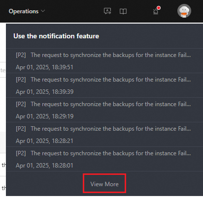

   > **Note**
   >
   > A red dot in the
   >
   > icon indicates that you have unread alert records.
   >
   > 

4. On the **Alert List** page, query alert records by **Alert Level**, **Alert Object**, **Business Type**, and **Organization**.

   View the alert content in the **Alert Content** column.

<a id="section-16-1-2"></a>

### 16.1.2. Mark alerts as read

You can mark handled alerts as read. After alerts are marked as read, the system no longer sends notifications for the alerts.

**Background information**

If a red dot appears on the  icon in the top navigation bar, unread alerts exist.

**Procedure**

1. Log on to the Apsara Stack Resilience for Backup and Recovery (ASR-BR) console.

2. In the left-side navigation pane, choose **O&M Management > Alerts**.

3. Specify search conditions to search for an alert. The following search conditions are supported: **Alert Level**, **Alert Object**, **Business Type**, and **Organization**.

4. Find the alert, click the  icon in the **Actions** column, and then select **Mark As Read**.

5. In the **Mark as Read** message, click **OK**.

6. (Optional) To mark multiple alerts as read at a time, perform the following steps:

   <ol type="i">

   <li>

   Select multiple alerts and click **Batch Read** in the upper-left corner of the alert list.

   </li>

   <li>

   In the **Batch Read** message, click **OK**.

   </li>

   </ol>

<a id="section-16-1-3"></a>

### 16.1.3. Delete alert records

You can delete alert records that have been processed.

**Procedure**

1. Log on to the ASR for Backup and Recovery console.

2. In the left-side navigation pane, choose **O&M Management > Alerts**.

3. On the Alerts page, query alert records by **Severity**, **Alert Contact Type**, **Business Type**, or **Organization**.

4. Find the alert record that you want to delete and click **Delete** in the **Actions** column.

5. In the **Delete** message, click **OK**.

6. (Optional) Delete alert records in batches. To delete alert records in batches, perform the following steps:

   <ol type="i">

   <li>

   Select the alert records that you want to delete and click **Batch Delete** in the lower-left corner of the alert list.

   </li>

   <li>

   In the **Batch Delete Messages** message, click **OK**.

   </li>

   </ol>

<a id="section-16-2"></a>

## 16.2. Throttling configuration

You can configure throttling thresholds to control the traffic when source instances back up data to backup vaults by time period. You can configure throttling for cloud services and VMware virtual machines (VMs). You can compare the configured throttling threshold with the current traffic to determine whether scale-out is required.

**Background**

The throttling service supports only physical throttling. If multiple backup engines are deployed on a physical server, the backup engines compete for traffic transmission resources. To resolve this issue, ASR for Backup and Recovery provides time-based throttling capabilities that allow you to set different throttling thresholds for different engines to stagger traffic peaks with customer services, thereby ensuring the normal operation of all services. Operations administrators can configure throttling for cloud services, and organization administrators can configure throttling for VMware VMs.

**Configure throttling for cloud services**

1. Log on to the ASR for Backup and Recovery console as an operations administrator.

2. In the left-side navigation pane, choose **O&M** > **Throttling Configurations**.

3. On the **Cloud Service** tab, click **Modify Configurations**, configure the parameters, and then click **Submit**.

4. Click the  icon in the upper-right corner of the Throttling Threshold Configuration section

   to hide the throttling settings. Click the  icon in the upper-right corner again to display

   the Throttling Threshold Configuration section.

5. After you click **Modify configuration**, a  icon appears next to the time period. You can

   click the  icon to modify an existing time period. You can also click **Add Time Period** to

   add a new time period. After you complete the configurations, click **OK** to view the throttling information of each time period.

   > **Note**
   >
   > The throttling configurations for different time periods do not affect each other. The throttling configurations of different storage pools do not affect each other.

   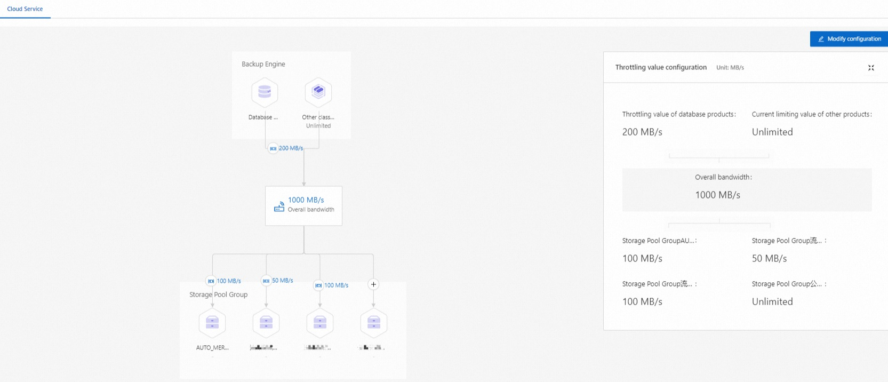

   | Parameter | Description |
   | --- | --- |
   | Throttling Threshold for Database Products | The maximum throughput when the production center transfers database product data to backup engines. This is an optional parameter.<br>Valid values: \[1, Number of backup engines × 2560\]. Unit: MB/s.<br>Note<br>The value of this parameter cannot be larger than the total throttling thresholds for storage pool groups nor the value of the <strong>Total</strong> <strong>Bandwidth</strong> parameter. |
   | Throttling Threshold of Other Services | The maximum throughput when the production center transfers data of products other than database products to backup engines. This is an optional parameter.<br>Valid values: \[1, Number of backup engines × 2560\]. Unit: MB/s. |
   | Total Bandwidth | The maximum throughput when the production center backs up data to backup engines. ASR-BR ensures that the total bandwidth of all backup tasks is not larger than this value. This is a required parameter.<br>Valid values: \[1, Number of backup engines × 2560\]. Unit: MB/s. |
   | Storage pool group traffic thresholds | The maximum throughput when the production center backs up data to backup engine storage pools. This is an optional parameter.<br>Valid values: \[1, Number of backup engines × 2560\]. Unit: MB/s.<br>Note<br>The total thresholds of all storage pool groups cannot be larger than the <strong>Total Bandwidth</strong> value but must be larger than the <strong>Throttling</strong> <strong>Threshold for Database Products</strong> value. |

**Configure throttling for VMware VMs**

1. Log on to the ASR for Backup and Recovery console as an organization administrator.

2. In the left-side navigation pane, choose **O&M** > **Throttling Configurations**.

3. On the **VMware** tab, configure the parameters and click **OK**.

   | Parameter | Description |
   | --- | --- |
   | Version | Retain the default value. |

   <table>
     <tr>
       <td>Traffic Threshold</td>
       <td>Specify the thresholds for upload and download traffic in specific time ranges when you back up VMware data from the primary cloud center to the secondary cloud center. The value is in the <code> HH:MM-HH:MM-</code><code>UKB&#124;HH:MM-HH:MM-DKB </code> format.<br>Note<br>• HH:MM-HH:MM specifies the time range for throttling.<br>• U specifies the upload traffic.<br>• D specifies the download traffic.<br>For example, 09:00-22:00-U512 indicates that the threshold of upload traffic is 512 KB/s from 09:00 to 22:00.</td>
     </tr>
     <tr>
       <td>Enable</td>
       <td>If you turn off the switch, no limits are imposed on traffic when you back up data from a production center to a backup vault.</td>
     </tr>
   </table>

<a id="section-16-3"></a>

## 16.3. Engine monitoring

You can use the engine monitoring feature to view traffic, CPU, memory, and load statistics. This way, you can adjust your cloud services at the earliest opportunity when traffic spikes occur.

1. Log on to the ASR for Backup and Recovery console as an operations administrator.

2. In the left-side navigation pane, choose **O&M Management** > **Engine Monitoring**.

   > **Note**
   >
   > - The Engine Monitoring page displays the monitoring data of the previous hour.
   >
   > - If **Enable Auto Refresh** is turned on in the upper-left corner, the system automatically refreshes monitoring data every 60 seconds. If Enable Auto Refresh is turned off, you can select a time range and a host and then click **Submit** to query the monitoring data of the host of a backup engine in the specified time range.

3. On the **Traffic Monitoring** tab, view the inbound and outbound traffic of the hosts for the HBR-agent and Gulltoppr backup engines.

   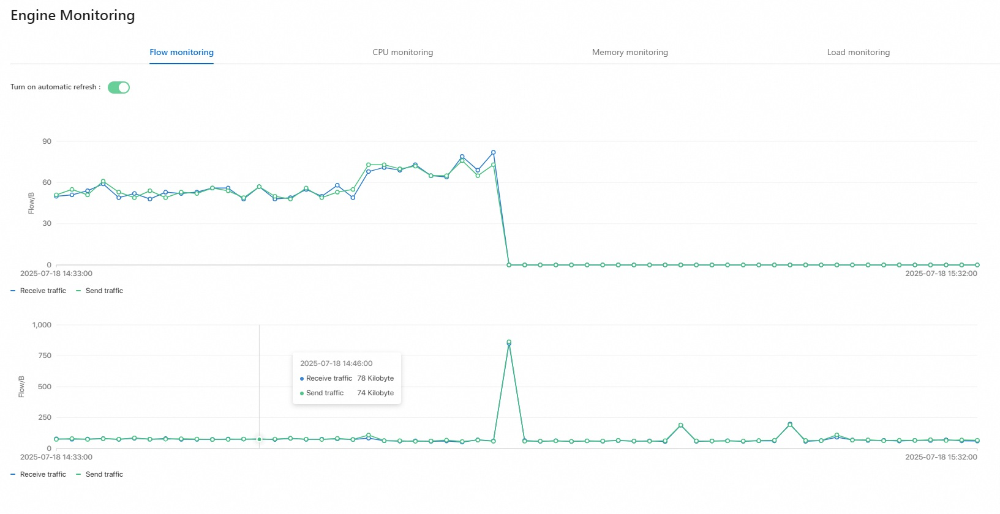

4. On the **CPU Monitoring** tab, view the average and maximum CPU usage of the backup engines.

   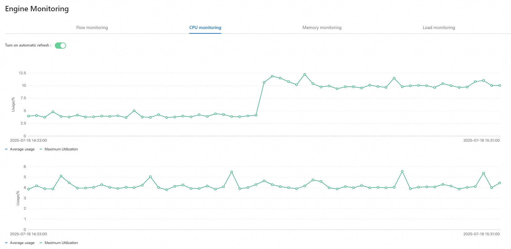

5. On the **Memory Monitoring** tab, view the average and maximum memory usage of the backup engines.

   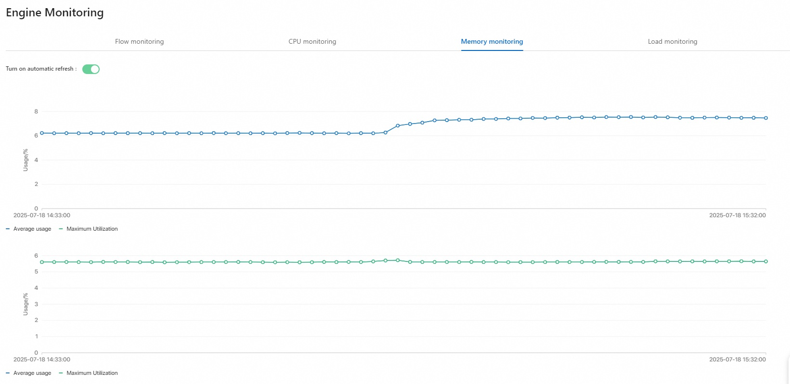

6. On the **Load Monitoring** tab, view the average and maximum load usage of the backup engines every 1 minute, every 5 minutes, and every 15 minutes. You can select **Average Usage** or **Maximum Usage** from the **Load Options** drop-down list.

   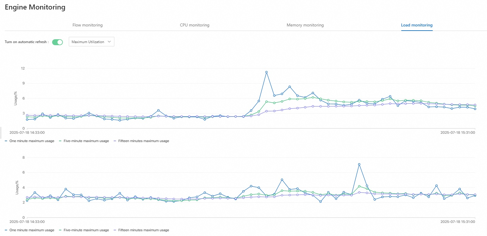

<a id="section-16-4"></a>

## 16.4. View resource statistics

This topic describes how to view the storage space usage and the number of backup plans of vault resources and organization resources.

**Background information**

- Operations administrators can view the resource statistics of all organizations.

- Organization administrators can view only the resource statistics of their own organizations.

**Procedure**

1. Log on to the ASR for Backup and Recovery console.

2. In the left-side navigation pane, choose **O&M Management** > **Resource Statistics**.

3. On the page that appears, click the **Vault Resources** tab and specify the date. The system automatically displays resource statistics that meet the search conditions. You can perform the same operations when you click the **Organization Resources** tab instead of Vault Resources on the page that appears.

   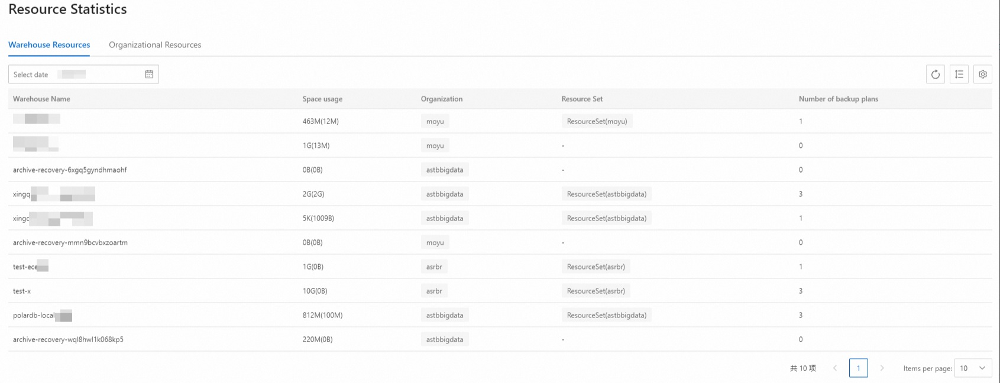

   The following table describes the parameters of vault resources.

   | Parameter | Description |
   | --- | --- |
   | Vault Name | The name of the backup vault. |
   | Used Space | The size of storage space that is used by the backup vault. The value that is enclosed in parentheses () specifies the size of incremental storage space that is used on the current day. |
   | Organization | The organization that uses the backup vault. |
   | Resource Set | The resource set that uses the backup vault. |
   | Backup Plans | The number of backup plans that use the backup vault. |

   The following table describes the parameters of organization resources.

   | Parameter | Description |
   | --- | --- |
   | Organization | The name of an organization. |
   | Used Space | The size of the backup vault that is used by the backup instances in the organization. The value that is enclosed in parentheses () specifies the size of incremental storage space that is used on the current day. |
   | Number of Instances | The number of instances that are included in the backup plans of the organization. |
   | Backup Plans | The number of backup plans in the organization. |

<a id="section-16-5"></a>

## 16.5. View operation logs

This topic describes how to view operation logs in the Apsara Stack Resilience for Backup and Recovery (ASR-BR) console. The operation logs record all operations that are performed to create, delete, and execute backup plans and recovery jobs.

**Procedure**

1. Log on to the ASR-BR console.

2. In the left-side navigation pane, choose **O&M** > **Logs**.

3. Query logs by user, module, operation level, operation type, start time, or end time. The following table describes the parameters of the logs.

   | Parameter | Description |
   | --- | --- |
   | Module | The module of the ASR-BR system. |
   | Operation Level | The severity of the log. Valid values: Urgent, Alert, Error, Warning, and Message. |
   | Operation Type | The types of operations that are recorded in the log. |

<a id="section-16-6"></a>

## 16.6. Parameter configuration

To simplify configuration and facilitate centralized management, the operations administrator can configure Product Backup and Restoration Configuration, HBR Backend Expiration Part Cleanup, and HBR-Storage Expired Fragment Cleanup on the Parameter Configurations page of the ASR for Backup and Recovery console.

**Prerequisites**

You must have the permissions of an operations administrator to configure parameters.

**Procedure**

1. Log in to the ASR for Backup and Recovery console as an operations administrator.

2. In the left-side navigation pane, choose **O&M Management** > **Parameter Configuration.**

3. Configure **Product Backup and Restoration Configuration**, **HBR Backend Expiration Part Cleanup**, and **HBR-Storage Expired Fragment Cleanup** as needed.

   **Product Backup and Restoration Configuration**

   | Configuration item | Description |
   | --- | --- |
   | Object Storage Service (OSS) | i. Click <strong>Modifiable Parameter</strong>.<br>ii. In the dialog box, set <strong>Maximum Concurrent Backup Jobs</strong> <strong>per Node</strong>.<br>iii. Click <strong>OK</strong>. |
   | File Storage NAS (NAS) | i. Click <strong>Modifiable Parameter</strong>.<br>ii. In the dialog box, set <strong>Maximum Concurrent Backup Jobs</strong> <strong>per Node</strong>.<br>iii. Click <strong>OK</strong>. |
   | ECS Snapshot | i. Click <strong>Modifiable Parameter</strong>.<br>ii. In the dialog box, set <strong>Maximum Concurrency Single-</strong><strong>Node Full-Instance Backup Jobs</strong> and the <strong>Maximum</strong> <strong>Concurrency Single-Node Cloud Disk Backup Jobs</strong>.<br>iii. Click <strong>OK</strong>. |

   **HBR Backend Expiration Part Cleanup**

   > **Note**
   >
   > This feature applies only to storage vaults, PolarDB Cluster Edition storage vaults, Tablestore vaults, and container storage vaults.

   | Configuration item | Description |
   | --- | --- |
   | Concurrency Settings | i. Click <strong>Modifiable Parameter</strong>.<br>ii. In the dialog box, set <strong>Maximum Concurrent Single-Node</strong> <strong>GC Tasks</strong>, <strong>Maximum Concurrent Snapshot Reads for</strong> <strong>Single-Node GC Tasks</strong>, and <strong>Maximum Concurrent Blob</strong> <strong>Loads for Single-Node GC Tasks</strong>.<br>iii. Click <strong>OK</strong>. |
   | Cleanup Frequency Settings | i. Click <strong>Modifiable Parameter</strong>.<br>ii. In the dialog box, set <strong>Full Cleanup Interval</strong> and <strong>Incremental Cleanup Interval</strong>.<br>iii. Click <strong>OK</strong>. |
   | Cleanup Scope Settings | i. Click <strong>Modifiable Parameter</strong>.<br>ii. In the dialog box, select the cleanup scope.<br>• <strong>Cleanup Scope Mode</strong>: Select one of the following three modes:<br>• <strong>Whitelist</strong>: The system cleans up only repositories on the list.<br>• <strong>Blacklist</strong>: The system skips repositories on the list and cleans up other eligible repositories.<br>• <strong>Clean All</strong>: The system cleans up all repositories.<br>• (Optional) <strong>Whitelist Repository List</strong>: Configure the whitelist of repositories. Set this parameter when Whitelist is selected.<br>• (Optional) <strong>Blacklist Repository List</strong>: Configure the blacklist of repositories. Set this parameter when Blacklist is selected.<br>iii. Click <strong>OK</strong>. |
   | Expired Data Part Reclamation Method | i. Click <strong>Modifiable Parameter</strong>.<br>ii. In the dialog box, configure the method for reclaiming expired data fragments.<br>• <strong>Move Expired Parts to Recycle Bin</strong>: Enable or disable this feature. When enabled, expired fragments will be moved to the recycle bin according to the policy instead of being immediately deleted.<br>• (Optional) <strong>Retention Period</strong>: After this period, data fragments will be permanently deleted. You need to configure this parameter when Move Expired Parts to Recycle Bin is enabled.<br>• (Optional) <strong>Data Retention Policy</strong>: Select a data reclaim policy. You need to configure this parameter when Move Expired Parts to Recycle Bin is enabled.<br>• <strong>Recycle to Backup Vault</strong>: Expired data fragments are temporarily stored in a dedicated recycle prefix within their respective backup vaults.<br>• <strong>Recycle to Trash Bucket</strong>: Expired data fragments are temporarily stored in the trash bucket of the corresponding storage pool for each backup vault. The storage pool must have a trash bucket configured.<br>iii. Click <strong>OK</strong>. |

   **HBR-Storage Expired Fragment Cleanup**

   > **Note**
   >
   > This feature applies only to deduplication storage vaults.

   <table>
     <tr>
       <td>Configuration item</td>
       <td>Description</td>
     </tr>
   </table>

   | Cleanup Frequency Settings | i. Click <strong>Modify</strong>.<br>ii. In the dialog box, set <strong>Full Cleanup Interval</strong>.<br>iii. Click <strong>OK</strong>. |
   | --- | --- |
   | Cleanup Scope Settings | i. Click <strong>Modify</strong>.<br>ii. In the dialog box, select the cleanup scope.<br>iii. <strong>Cleanup Scope Mode</strong>: Select a cleanup scope mode.<br>• <strong>Whitelist</strong>: The system cleans up only repositories on the list.<br>• <strong>Blacklist</strong>: The system skips repositories on the list and cleans up other eligible repositories.<br>• <strong>Clean All</strong>: The system cleans up all repositories.<br>iv. (Optional) <strong>Whitelist Repository List</strong>: Configure the allowlist of repositories. Set this parameter when Whitelist is selected.<br>v. (Optional) <strong>Blacklist Repository List</strong>: Configure the blocklist of repositories. Set this parameter when Blacklist is selected.<br>vi. Click <strong>OK</strong>. |
   | Expiration Data Fragment Cleanup Method | i. Click <strong>Modify</strong>.<br>ii. In the dialog box, configure the method for reclaiming expired data fragments.<br>iii. <strong>Retain Expired Data Fragments in Recycle Bin</strong>: Enable or disable this feature. When enabled, expired fragments will be moved to the recycle bin according to policy instead of being immediately deleted.<br>iv. (Optional) <strong>Retention Period</strong>: After this period, data fragments will be permanently deleted. Set this parameter when Retain Expired Data Fragments in Recycle Bin is enabled.<br>v. (Optional) <strong>Data Retention Policy</strong>: Select a data reclaim policy. Set this parameter when Retain Expired Data Fragments in Recycle Bin is enabled.<br>• <strong>Recycle to Backup Vault</strong>: Expired data fragments are temporarily stored in a dedicated recycle prefix within their respective backup vaults.<br>• <strong>Recycle to Trash Bucket</strong>: Expired data fragments are temporarily stored in the trash bucket of the corresponding storage pool for each backup vault. The storage pool must have a trash bucket configured.<br>vi. Click <strong>OK</strong>. |

<a id="section-16-7"></a>

## 16.7. Event management

You can use the event management feature to view all event records.

**Background**

- Organization administrators can manage and view the events that they initiated.

- Operations administrator can manage and view all events in the system.

**Procedure**

1. Log on to the ASR for Backup and Recovery console.

2. In the left-side navigation pane, choose **O&M Management** > **Events**.

3. You can configure search conditions such as **Event Type**, **Event Status**, **Start Time**, and **End Time** to search for specific events.

4. Find the event whose log you want to view and click **Log** in the **Actions** column.

5. Click the  icon to the left of an event to view sub-events and their statuses.

6. Click the  icon to the right of a sub-event to view the sub-event log.

   - **Successful**

   - **Canceled**

     This status is displayed when a sub-event is canceled.

   - **Failed**, **Timeout**, and **Stop**

     If a sub-event is in one of the preceding states, you can click the  icon to the right of

     the sub-event to retry the sub-event.

     > **Important**
     >
     > This operation is an event O&M operation. If the most recent event is successfully executed, do not perform the retry operation for the previous event.

   - **Pending**, **In Progress**, and **Synchronizing**

     If a sub-event is in one of the preceding states, you can click the  icon to the right of

     the sub-event to cancel it. If you cancel the sub-event, its status changes to **Canceled**.

     > **Important**
     >
     > This operation is an event O&M operation. This operation is irreversible. Proceed with caution.

<a id="section-17"></a>

# 17.Best practices of data backup

<a id="section-17-1"></a>

## 17.1. Database services

<a id="section-17-1-1"></a>

### 17.1.1. ApsaraDB RDS backups

This topic describes the backup policies and speed of ApsaraDB RDS.

**Backup policy configuration**

**Backup policies**

ApsaraDB RDS supports the following types of backup policies:

- The full backup mode allows you to recover data only to the points in time when a backup is created. You can select a mode based on your business requirements.

- The full backup plus log backup mode allows you to recover data to a specific point in time.

> **Note**
>
> We recommend that you select the full backup plus log backup mode for ApsaraDB RDS and specify two days a week to execute a full backup. This helps you save bandwidth and storage capacity and ensure utmost data security.

**Backup time**

- If you want to back up multiple ApsaraDB RDS instances, we recommend that you do not specify the backup time of all ApsaraDB RDS instances to the same day.

  > **Note**
  >
  > You can perform 5 to 6 backup tasks at the same time to maximize bandwidth utilization.

- We recommend that you back up your ApsaraDB RDS instance during off-peak hours.

  > **Note**
  >
  > ApsaraDB RDS for MySQL and ApsaraDB RDS for PostgreSQL instances are backed up from secondary databases. ApsaraDB RDS for SQL Server instances are backed up from primary databases.

- If you want to perform a backup on the current day, set the start time of the backup task to at least 10 minutes later than the current time.

**Data retention time**

If both local backup and cross-region backup are configured for ApsaraDB RDS, we recommend that you set the local backup retention period to 7 days and the remote retention period to more than 30 days. You can specify the remote retention period based on the importance of your business data.

**Backup speed** A cross-region backup of an ApsaraDB RDS instance is performed based on the following steps:

1. Perform an intra-region backup and upload the backup files to the OSS bucket in the same region as the ApsaraDB RDS instance. The maximum speed of a single backup task is 55 MBit/s.

2. Perform a cross-region backup and copy the backup files from the OSS bucket in the same region as the ApsaraDB RDS instance to an OSS bucket in another region.

   The following section describes the speed at which data is replicated across regions.

   - If you do not configure Maximum Traffic Threshold in the Apsara Stack Resilience for Backup and Recovery (ASR-BR) console, the upload speed for a single upload task is 40 Mbit/s.

   - If you set Maximum Traffic Threshold to a value greater than or equal to 400 MBit/s, the upload speed of a single task is 40 Mbit/s. If you set Maximum Traffic Threshold to a value less than 400 MBit/s, the upload speed of a single task is the result of dividing the specified speed by 10.

**Throttling scenarios**

The following scenarios require throttling:

- You want to back up large amounts of data for ApsaraDB RDS instances, OSS buckets, and Apsara File Storage NAS file systems.

- If more than six backup tasks are performed at the same time, you must limit the bandwidth that can be allocated to backup tasks.

<a id="section-17-1-2"></a>

### 17.1.2. PolarDB-X 1.0 backups

This topic describes the backup policies and speed of PolarDB for Xcale (PolarDB-X) 1.0.

**Backup policy configuration**

**Backup policies**

PolarDB-X 1.0 supports the following backup modes: Fast Backup and Consistent Backup.

- Fast Backup: This mode ensures data consistency only in a single database.

- Consistent Backup: In this mode, the system locks distributed transactions within seconds, which may cause sub-second response time. Therefore, we recommend that you perform this operation during off-peak hours. The Consistent Backup mode only supports backup from data sets.

> **Note**
>
> The Fast Backup mode is suitable for regular backup and restoration. The Consistent Backup mode is suitable for core online transaction scenarios and other scenarios that have high requirements for data consistency.

**Backup time**

For data security purposes, we recommend that you back up your data at least twice a week to ensure that you have recoverable data sets.

> **Note**
>
> If you want to perform a backup on the current day, set the start time of the backup task at least 10 minutes later than the current time.

**Data retention time**

- We recommend that you set the local backup retention period to 7 days.

- You can specify the remote retention period based on the importance of your business data. We recommend that you set the remote retention period to more than 30 days.

**Backup speed**

For more information, see the "Backup speed" section of the ApsaraDB RDS backups topic.

**Throttling scenarios**

For more information, see the "Throttling scenarios" section of the ApsaraDB RDS backups topic.

<a id="section-17-2"></a>

## 17.2. File storage services

<a id="section-17-2-1"></a>

### 17.2.1. OSS backups

This topic describes the backup speed and throttling scenarios of Object Storage Service (OSS).

**Backup speed and configuration**

The performance of an OSS backup task depends on the file size and the number of allowed concurrent tasks. The following table describes the recommended number of concurrent tasks for different file sizes:

| Average file size | Concurrency configuration | Backup speed |
| --- | --- | --- |
| &lt; 64 KB | 128 reads and 256 writes | &lt; 110 MB |
| 64 KB‒128 KB | 128 reads and 128 writes | 100 MB‒350 MB |
| 128 KB‒256 KB | 64 reads and 128 writes | 150 MB‒350 MB |
| 256 KB‒512 KB | 64 reads and 64 writes | 200 MB‒450 MB |
| 512 KB‒2 MB | 32 reads and 32 writes | 300 MB‒400 MB |
| &gt; 2 MB | 8 reads and 32 writes (Default) | &gt; 100 MB |

The backup cycle is estimated based on the backup speed.

If you want to back up a large number of OSS objects, you can split an instance into multiple backup plans by specifying the prefix and creation time of the OSS objects in the instance. This helps improve the backup scanning efficiency.

For OSS instances, only the first backup is a full backup. The subsequent backups are incremental backups that are performed through deduplication.

For Cloud Defined Storage - Object Storage Service (CDS-OSS) instances, the inventory feature can be used to improve the efficiency of incremental backups. If you want to back up a bucket that has more than 100 million objects, we recommend that you enable the inventory feature.

**Throttling scenarios**

Independent streams must be established for backup tasks to prevent interruptions to your business. OSS backups are subject to the upper limit (5 GB) of traffic routed by Server Load Balancer (SLB). Therefore, we recommend that you perform the following operations:

- For Apsara Stack V3.16 and later, when you back up OSS buckets, you can create an independent virtual IP address (VIP) for OSS buckets and specify the VIP for the Endpoint parameter when you create a backup plan. This ensures that your business is not affected by backups.

- The throttling policy for backups can be specified based on the actual bandwidth.

<a id="section-17-2-2"></a>

### 17.2.2. NAS backups

This topic describes the backup speed and throttling scenarios of Apsara File Storage NAS.

**Backup speed**

Only the Network File System (NFS) protocol is supported for backups of Apsara File Storage NAS file systems. We recommend that you create up to 8 million files and subdirectories in a directory for each Apsara File Storage NAS backup task. The backup speed of Apsara File Storage NAS depends on the file size. The backup cycle must be configured based on the actual data volume and backup speed.

The following table describes the backup speeds of different file sizes:

| File size | Average processing speed | Backup data volume per day<br>(24 hours) |
| --- | --- | --- |
| 32 KB | 13 MB/s | 1 TB |
| 64 KB | 21 MB/s | 1.73 TB |
| 256 KB | 53 MB/s | 4.36 TB |
| 512 KB | 82 MB/s | 6.75 TB |
| 1 MB | 138 MB/s | 11.37 TB |

**Throttling scenarios**

The throttling policy for backups can be specified based on the actual bandwidth.

<a id="section-17-2-3"></a>

### 17.2.3. ECS file backups

This topic describes the backup speed of Elastic Compute Service (ECS) file backups.

**Backup speed** The backup speed varies based on the type of disk. Premium performance disks and ultra disks have similar backup speeds, while standard performance disks and standard SSDs have similar backup speeds. The backup speed of premium performance disks and ultra disks are higher than that of standard performance disks and standard SSDs.

ECS resources are occupied during file backup. The following table shows the backup speed and resource usage.

| Average file size | Transmission speed | CPU usage | CPU usage after the speed is throttled to 10 MB |
| --- | --- | --- | --- |
| 32 KB | 19 MBit/s | 100%–240% | 40%–70% |
| 64 KB | 27 MBit/s | 200%–240% | 32%–60% |
| 256 KB | 92 MBit/s | 160%–240% | 16%–40% |
| &gt;=512 KB | 120 MBit/s | 160%/240% | 16%–28% |

When you create an ECS backup plan:

1. If no throttling policies are specified, make sure that the specifications of an ECS instance are at least 4 cores and 4G memory. If an ECS instance has less than 4 cores, the backup speed of ECS files must be limited to 10 MB/s.

2. The backup memory usage must be limited to 1–2 GB to ensure that the ECS instance has at least 1 GB of idle memory.

<a id="section-17-2-4"></a>

### 17.2.4. ECS instance backups

This topic describes the remote dump speed of Elastic Compute Service (ECS) instance backups.

**Remote dump speed**

To back up an ECS instance, Elastic Block Storage (EBS) is used to create a snapshot of the ECS instance and store the snapshot to an Object Storage Service (OSS) bucket in the same region. Then, the snapshot is cloned to a cross-region storage. The snapshot backup speed of an EBS 1.0 disk is 13 MBit/s, and the snapshot backup speed of a disk in a Cloud Defined Storage - Elastic Block Storage (CDS-EBS) cluster is 32 MBit/s.

The remote dump speed is 90 MBit/s. When you configure a backup policy, the backup policy is estimated based on the actual backup data volume.

<a id="section-17-3"></a>

## 17.3. Analytics computing services

<a id="section-17-3-1"></a>

### 17.3.1. MaxCompute backups

This topic describes the backup practices of MaxCompute.

- When the data of a MaxCompute instance is backed up, the data is split into multiple 256 MB shards. Each shard is uploaded to a backup vault as a task and each task is executed on a compute node.

- Each task occupies 0.7 quotas of MaxCompute, and the upload speed is 2–3 MBit/s. On average, the upload speed of each quota is 3.6 MBit/s.

- If the number of concurrent tasks exceeds the quotas of MaxCompute, the tasks are queued for execution.

- For example, if two physical machines are used for data backup, the maximum throughput of MaxCompute backup is approximately 300 MBit/s. More physical machines indicate higher throughput.

<a id="section-17-4"></a>

## 17.4. Best practices for hybrid cloud backup

<a id="section-17-4-1"></a>

### 17.4.1. Preparations

You can use Apsara Stack Resilience for Backup and Recovery (ASR-BR) to back up data from Apsara Stack to Object Storage Service (OSS) on Alibaba Cloud public cloud.

**Prerequisites**

- An Alibaba Cloud public cloud account is created.

- A virtual private cloud (VPC) on Alibaba Cloud public cloud is created.

- An Express Connect circuit on Alibaba Cloud public cloud is created.

- Object Storage Service (OSS) on Alibaba Cloud public cloud is activated.

- Apsara Stack DNS is activated.

- Redirection for endpoints of OSS on Alibaba Cloud public cloud is enabled in Apsara Stack OpsDNS.

**Network connection**

**Configure resolution for public endpoints**

When the system backs up data from Apsara Stack to the public cloud, ASR-BR, which is deployed in the classic network, calls OSS API operations through the endpoint of public cloud OSS to write the data to OSS. Therefore, resolution for public endpoints needs to be enabled on OpsDNS.

> **Note**
>
> By default, this feature is not enabled on OpsDNS. You need to contact technical support, who will evaluate the security risks and determine whether to enable this feature on your cloud system.

**Border protection for Apsara Stack**

ASR-BR is deployed in the classic network. To ensure security, you need to deploy firewalls outside the border of your Apsara Stack system and configure SNAT rules. For more information, see Network limits. In addition to the class network endpoints, you also need to configure OpsDNS so that your Apsara Stack system can access Alibaba Cloud public cloud services.

**Connect the Apsara Stack system and the public cloud**

1. Create a virtual border router (VBR) on the public cloud, so that the Apsara Stack system can be connected to the public cloud VPC.

2. Activate OSS and Alibaba Cloud DNS PrivateZone in the public cloud VPC, so that API operations can be called.

3. Use an Express Connect circuit to connect the Apsara Stack system and the VBR, and deploy a firewall to protect the Apsara Stack system.

4. ASR-BR is deployed in the Apsara Stack system. OpsDNS is used to resolve the OSS endpoint, and the backup data is written to OSS in the public cloud through the Express Connect circuit.

   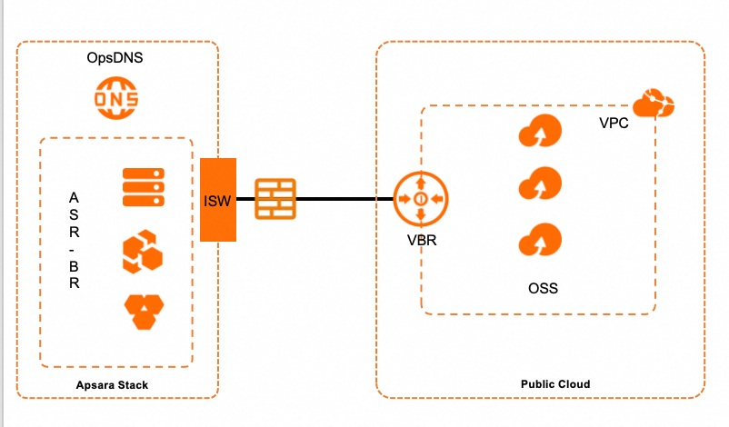

> **Note**
>
> For more information, see the "Operations on Alibaba Cloud public cloud" section of the Hybrid cloud network connections with Express Connect circuits topic.

<a id="section-17-4-2"></a>

### 17.4.2. Hybrid cloud network connections with Express Connect circuits

This topic describes how to connect Apsara Uni-manager to Alibaba Cloud public cloud by using Express Connect circuits. After you connect Apsara Uni-manager to Alibaba Cloud public cloud, Apsara Uni-manager can call the API operations of public cloud services.

**Prerequisites**

- An Alibaba Cloud account is created.

- A virtual private cloud (VPC) in Alibaba Cloud public cloud is created.

- An Express Connect circuit in Alibaba Cloud public cloud is created.

- Apsara Stack DNS is activated.

**Background information**

After you connect Apsara Uni-manager to Alibaba Cloud public cloud, the following capabilities are available:

- The Apsara Stack DNS server forwards the domain name of a public cloud service to a private zone in the public cloud VPC for resolution.

- Apsara Uni-manager accesses the API endpoint in the public cloud VPC tby using Express Connect circuits.

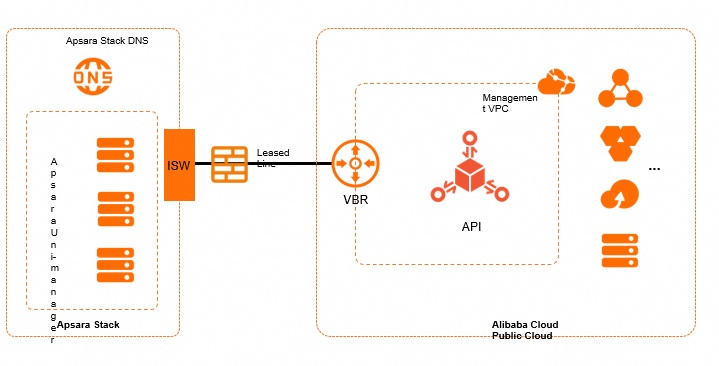

> **Note**
>
> The IP addresses in this topic are provided only for reference. You can specify the IP addresses based on your business requirements.

**Operations in Alibaba Cloud public cloud**

1. Create a dedicated connection over an Express Connect circuit. For more information, see Create and manage a dedicated connection over an Express Connect circuit.

2. Create a virtual border router (VBR). For more information, see Create and manage a dedicated connection over an Express Connect circuit.

3. Create a Border Gateway Protocol (BGP) peer and enter the IP address of the BGP peer in Apsara Stack. For more information, see Configure and manage BGP.

4. Create a Cloud Enterprise Network (CEN) instance and configure PrivateZone for the instance. For more information, see Configure PrivateZone.

5. Log on to the Alibaba Cloud DNS console and add the private zone that you configured in the previous step. For more information, see Create a private zone and add a DNS record to the private zone..

   > **Note**
   >
   > The value in the **Records** column is the number of DNS records of the corresponding private zone. Click the name of the private zone that you want to manage. The Resolution Settings page appears, on which you can create a DNS record for the private zone.

6. In the Alibaba Cloud DNS console, associate the private zone for which you configured a VPC. For more information, see Associate or disassociate a VPC.

7. Call API operations over the internal network

After all configurations are complete, you can call the API operations of public cloud services in Apsara Uni-manager.

**Operations on Apsara Stack**

1. Configure the routing mode of Apsara Stack Inter-connection Switch (ISW).

   - Static routing

     Run the following command on ISW:

     ```text
     ip route-static [$IP] [$IP_Prefix] [$GW_IP] preference 10 ------ Route the traffic from the CIDR blocks of the public cloud service and private zone to the public cloud endpoint.
     ```

     > **Note**
     >
     > - [$IP]: the CIDR blocks of the public cloud service and private zone.
     >
     > - [$IP_Prefix]: the subnet mask of the destination CIDR blocks.
     >
     > - [$GW_IP]: the IP address of the public cloud endpoint.

   - BGP routing

     If ISW communicates with Alibaba Cloud public cloud by using BGP, you must configure the routing of the hybrid cloud management platform address segment on the private cloud side and the routing of the cloud service and private zone address segment on the public cloud side.

2. Configure Apsara Stack DNS.

   <ol type="i">

   <li>

   Log on to the Domains console.

   </li>

   <li>

   In the left-side navigation pane, click **Internal Domain Names**.

   </li>

   <li>

   Click **Forwarding Settings**.

   </li>

   <li>

   Click **Add Domain Name** and configure the following parameters.

   | Parameter | Description |
   | --- | --- |
   | Global Forwarding Domain Name | Enter the endpoint of the API operation of the public cloud service. The endpoint is the same as the endpoint that is configured for the private zone. |
   | Forwarding Mode | Select a forwarding mode. |
   | Destination IP Address | Enter the IP address of the DNS server used by PrivateZone. |

   </li>

   </ol>

<a id="section-17-4-3"></a>

### 17.4.3. Create a storage pool

This topic describes how to create a storage pool whose storage location is in Alibaba Cloud public cloud.

**Prerequisites**

- The network connection is established. For more information, see Preparations.

- Object Storage Service (OSS) on Alibaba Cloud public cloud is activated, and the account has the following permissions:

  ```text
  oss:PutBucket
  oss:ListObjects
  oss:GetBucketAcl
  oss:GetBucketInfo
  oss:GetBucketLifecycle
  oss:PutBucketLifecycle
  oss:DeleteBucketLifecycle
  oss:ListMultipartUploads
  oss:PutObject
  oss:GetObject
  oss:DeleteObject
  oss:ListParts
  oss:RestoreObject
  oss:AbortMultipartUpload
  ```

- Only backup operations administrators can create storage pools.

**Procedure**

1. Log on to the ASR for Backup and Recovery console.

2. In the left-side navigation pane, choose **System Management** > **Storage Pool Groups**.

3. Click **Create Storage Pool Group**. In the **Add Storage Pool Group** dialog box, configure the parameters and click **OK**.

   > **Note**
   >
   > A maximum of 16 storage pool groups can be created.

   

   | Parameter | Description |
   | --- | --- |
   | Storage Pool Group Name | Enter a descriptive name for the storage pool group, such as "Public Cloud Storage Pool Group".<br>Note<br>• The name can contain letters, digits, hyphens (-), and underscores (_). It must be less than 64 characters in length. |
   | Storage Medium | Valid values: OSS, CDS-OSS, MINIOSS, PanguStor, and SDS. |
   | Storage Pool Group Location | The location where the storage pool group resides. Valid values:<br>• <strong>Local</strong>: the current site.<br>• <strong>Remote</strong>: a site in another region.<br>• <strong>Alibaba Cloud Public Cloud</strong>: Alibaba Cloud public cloud. |
   | endpoint | The domain name or IP address of the storage medium.<br>Note<br>• The endpoint must be accessible.<br>• IPv6 addresses are not supported.<br>• If a NAT gateway is used and port mapping needs to be added, specify the parameter in the following format: <code> &lt;Endpoint&gt;:</code> <code>&lt;Port&gt; </code>. |
   | <strong>Bucket</strong> (optional) | The storage capacity of the storage pool group. Unit: TB.<br>Note<br>• The sum of the storage capacity of all storage pools in the group must be smaller than this value. Otherwise, storage pools fail to be created.<br>• If you leave this parameter empty, the storage capacity is unlimited. |

4. In the storage pool group list, click the name of the storage pool group.

5. On the page that appears, click **Create Storage Pool**. In the **Add Storage Pool** dialog box, configure the parameters.

   

   | Parameter | Description |
   | --- | --- |
   | Storage Pool Name | Enter a descriptive name for the storage pool group, such as "Public Cloud Storage Pool".<br>Note<br>The name can contain letters, digits, hyphens (-), and underscores (_). It must be less than 64 characters in length. |
   | Storage Capacity | The storage capacity of the storage pool. Unit: TB. |
   | AccessKey ID | The AccessKey ID of the account that accesses the destination storage.<br>Note<br>The AccessKey ID and AccessKey secret must have the permissions to read and write data. |
   | AccessKey Secret | The AccessKey secret of the account that accesses the destination storage. |
   | Authorized Organization | Select the level-1 organizations. You can select all level-1 organizations. |
   | Recycle Bin | Optional. Specify the name of the recycle bin. This parameter is required if you need to create a deduplication backup vault or a mirror vault in the storage pool.<br>Note<br>When you create a deduplication backup or mirror vault, an existing bucket of the recycle bin is used if any. If no bucket exists, a relevant bucket is created. |
   | Storage Pool Description (optional) | The description of the storage pool for easy identification. |

6. Then, click **OK**.

<a id="section-17-4-4"></a>

### 17.4.4. Create a backup vault

This topic describes how to create a backup vault whose storage location is in Alibaba Cloud public cloud.

**Prerequisites**

- A storage pool is created. For more information, see Create a storage pool.

- The backup administrator or operator creating a backup vault must belong to a level-1 organization authorized by the storage pool. Otherwise, the storage pool cannot be viewed.

**Background information**

- Only one backup vault of the database class can be created for each storage pool and cannot be modified after it is created.

- You can create multiple storage backup vaults and deduplicating backup vaults in a storage pool.

- ApsaraDB RDS and PolarDB for Xscale (PolarDB-X) 1.0 use the same database backup vault.

- Organization backup administrators and organization backup operators can create database backup vaults, storage backup vaults, and deduplicating backup vaults.

**Procedure**

1. Log on to the ASR for Backup and Recovery console.

2. In the left-side navigation pane, click **Backup Vaults**.

3. On the **Backup Vaults** page, click **Create**.

4. In the **Create Backup Vault** dialog box, set the following parameters.

   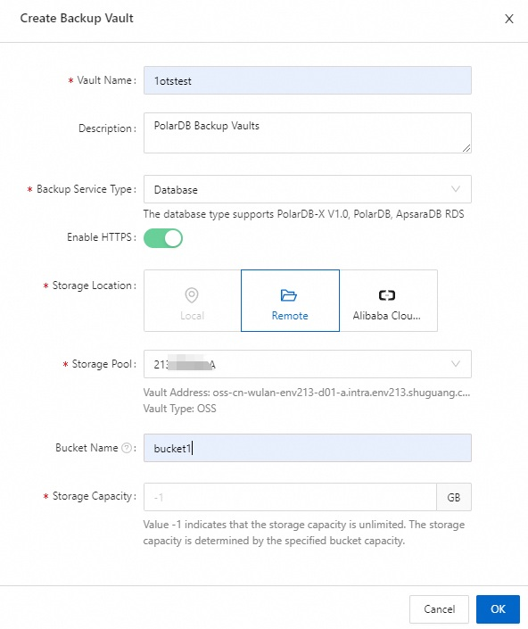

   | Parameter | Description |
   | --- | --- |

   <table>
     <tr>
       <td>Vault Name</td>
       <td>Specify the name of the backup vault. Example: public cloud backup vault.<br>Note<br>• We recommend that you specify an informative name. After a backup vault is created, you cannot change its name.<br>• The name can only contain lowercase letters, digits, and hyphens (-). The name cannot start with a hyphen (-). The name must be 3 to 35 characters in length.</td>
     </tr>
     <tr>
       <td>Description (optional)</td>
       <td>Specify the description of the backup vault.</td>
     </tr>
     <tr>
       <td>Backup Service Type</td>
       <td>The type of the service whose data will be backed up in this vault.<br>• <strong>Database</strong>: ApsaraDB RDS, PolarDB, and PolarDB-X 1.0 are supported.<br>• <strong>Storage</strong>: OSS, ECS, and NAS are supported.<br>• <strong>Tablestore</strong>: Tablestore backup is supported.<br>• <strong>Data Deduplication</strong>: Only MaxCompute is supported.</td>
     </tr>
     <tr>
       <td>Enable HTTPS</td>
       <td>Specify whether to use the HTTP or HTTPS protocol to create the backup vault and back up data to the backup vault. By default, HTTPS is enabled. You can manually disable HTTPS.<br>Note<br>• This parameter is required only when you set the <strong>Backup</strong> <strong>Service Type</strong> parameter to <strong>Database</strong>, <strong>Storage Class</strong>, or <strong>Tablestore</strong>.<br>• If the HTTPS port of OSS is not reachable, we recommend that you turn off <strong>Enable HTTPS</strong>.</td>
     </tr>
     <tr>
       <td>Storage Location</td>
       <td>The location where the backup data is stored. Valid values:<br>• <strong>Local</strong>: The backup data is stored in the OSS buckets of the current region.<br>• <strong>Remote</strong>: The backup data is stored in the OSS buckets across regions.<br>• <strong>Alibaba Cloud Public Cloud</strong>: The backup data is stored in the OSS buckets on Alibaba Cloud public cloud.<br>Note<br>If you set the <strong>Backup Service Type</strong> to <strong>Tablestore</strong>, you must set the <strong>Storage Location</strong> parameter to <strong>Remote</strong>.</td>
     </tr>
     <tr>
       <td>Storage Pool</td>
       <td>The storage pool to which the backup vault belongs.</td>
     </tr>
     <tr>
       <td>Bucket Name</td>
       <td>If you specify a bucket, the bucket is used as the backup vault. The bucket name must be an existing bucket name in OSS.<br>Note<br>If you do not have permissions to create buckets in the selected storage pool, you must specify this parameter.</td>
     </tr>
     <tr>
       <td>Storage Capacity</td>
       <td>The storage size of the backup vault. Unit: GB.<br>Note<br>The storage size of the backup vault cannot exceed that of the storage pool that it belongs to.</td>
     </tr>
   </table>

5. Then, click **OK**.

   > **Note**
   >
   > If the backup vault fails to be created, the storage resources may be insufficient. Expand the storage repository in a timely manner before creating it again.

**Execution result**

ASR for Backup and Recovery automatically creates an OSS bucket in the selected storage pool. Then, the OSS bucket is used to back up your business data.

<a id="section-17-4-5"></a>

### 17.4.5. Create a backup plan

After you create a backup plan, ASR for Backup and Recovery regularly backs up data from specified instances to a backup vault.

**Prerequisites**

- You are an organization backup administrator or organization backup operator. Only organization backup administrators and organization backup operators can create backup plans. Backup operations administrators cannot create backup plans.

- You have created a backup vault. For more information, see Create a backup vault.

- If you want to back up and restore data for MaxCompute instances, you have enabled the external table feature for MaxCompute and deployed the MaxCompute Enhancement Pack for Joint Computing (Spark on MaxCompute).

- If you want to create a backup plan for Elastic Compute Service (ECS) instances, you have installed Cloud Assistant on the ECS instances, and the Cloud Assistant runs as expected.

- (Optional) If you want to create a backup plan for a MaxCompute instance, first specify compute units (CUs) dedicated for the backup operations of the instance to ensure that the backup operations do not interfere with ongoing business operations. For more information, see Parameter configuration. If you do not specify CUs for the backup operations of the instance, the CUs of the current project are used. When you configure the instance, a message indicating that no project is running will appear.

**Background information**

- ASR for Backup and Recovery allows you to back up ApsaraDB RDS data and metadata such as user information, permissions, and specifications.

- ASR for Backup and Recovery allows you to back up Apsara File Storage NAS file systems that use the Network File System (NFS) protocol or Server Message Block (SMB)SMB protocol.

- ASR for Backup and Recovery allows you to back up metadata of MaxCompute tables, functions, resources, and projects. The metadata includes quota information, cluster information, Virtual Private Cloud (VPC) information, and security information.

- ASR for Backup and Recovery backs up Tablestore tables only if their names contain no more than 100 characters. If you need to back up Tablestore tables whose names exceed 100 characters, contact the ASR for Backup and Recovery product team for evaluation.

**Procedure**

1. Log in to the ASR for Backup and Recovery console.

2. In the left-side navigation pane, choose **Backup Plan**.

3. On the **Backup Plan** page, click **Create**.

4. On the **Basic Information** wizard page, enter the basic information for the backup plan, then click **Next**.

   | Parameter | Description |
   | --- | --- |
   | Backup Plan Name | The name of the backup plan.<br>Note<br>The name must be 4 to 128 characters in length, including only letters, digits, hyphens (-), underscores (_), and periods (.). |
   | <strong>Description</strong> (optional) | The description of the backup plan for easy identification. |
   | Instance Type | The type of the instance that you want to back up.<br>Note<br>If you want to create a Tablestore backup plan, select <strong>Tablestore</strong>. |
   | Backup Mode | Configure this parameter only for ECS instances.<br>• <strong>Snapshot Backup</strong>: backs up an ECS instance or specified disks of an ECS instance.<br>• <strong>File Backup</strong>: backs up ECS files. |

5. On the **Select Instance** wizard page, select the instance to back up, and click **Next**.

   > **Note**
   >
   > - The instance to back up must be in the **In Use** state.
   >
   > - A backup plan is created for only one instance.
   >
   > - When the instance type is RDS, PolarDB, or PolarDB-X, you can add only one instance to one backup plan. You cannot select an instance whose protection status is **Protected**.
   >
   > - You can add one Object Storage Service (OSS) bucket to multiple backup plans.
   >
   > - You can add one Apsara File Storage NAS file system to multiple backup plans.
   >
   > - You can add one ECS instance to both a file backup plan and a cloud disk backup plan.
   >
   > - For ECS instances that use the file backup mode, you can add them to multiple backup plans.
   >
   > - A Tablestore instance contains multiple tables. When the instance type is TableStore, you can view the number of tables under the instance in the **Tablestore Table** column.

6. (Optional) Select Tablestore tables. Perform this step only if you select **Tablestore** for **Instance Type** on the **Basic Information** page.

   <ol type="i">

   <li>

   In the left-side section, select the names of the tables that you want to back up.

   > **Note**
   >
   > You can back up a maximum of two tables simultaneously per instance. If you select two or fewer tables, the system backs up both tables concurrently. If you select more than two tables, the system queues the additional tables for backup.

   </li>

   <li>

   Click  to add the selected Tablestore tables to the right-side section.

   </li>

   <li>

   Click **Next**.

   </li>

   </ol>

7. (Optional) On the **Install Client** page, configure parameters for installing the Hybrid Backup Recovery (HBR) client and click **Next**.

   > **Note**
   >
   > - This step is applicable only to ECS instances that use the **File Backup** method.
   >
   > - The ECS Cloud Assistant is used when installing the HBR client. Ensure that the ECS Cloud Assistant is installed on the ECS instance and is in the normal state.

   | Instance type | Name | Description |
   | --- | --- | --- |

   The directory where the HBR client is installed on the ECS instance.

   **Client Installation**

   > **Note**

   **Path** (optional)

   > If you do not select an installation path, the system installs the client in  `/root`  by default.

   The system automatically displays the number of CPU cores of the current ECS instance. Set this parameter as needed. When the HBR client starts a backup task, it allocates tasks based on the value you specified for this parameter.

   **vCPUs on Client**

   > **Note**
   >
   > A larger number of CPU cores consumes more host resources and has a greater impact on host performance. Evaluate carefully before setting this value to avoid affecting your business operations.

   The system sets the default maximum number of worker threads to 10. You can modify this value as needed. When the HBR client starts a backup task, it allocates tasks based on the value you specified for this parameter.

   **Maximum Worker**

   > **Note**

   **Threads on Client**

   > A larger number of threads consumes more host resources and has a greater impact on host performance. Evaluate carefully before setting this value to avoid affecting your business operations.

   ECS (file backup)

   After configuring **vCPUs on Client** and **Maximum Worker Threads on Client**, click **install** to start installing the HBR client. Click **Refresh** to update the installation status in real time. After the installation status changes to **The client is installed**, you can perform the next step. The system automatically performs a connectivity test.

   > **Note**
   >
   > - After installation, you can uninstall the client or edit the settings for **vCPUs on Client** and **Maximum Worker Threads on Client**.

   **Client**

   > - The right-side section of the Install Client page

   **Installation**

   > displays the client installation information,

   **Status**

   > including the installation status, client version,

   (optional)

   > heartbeat keep-alive time, number of CPU cores used by client, and maximum number of worker threads for client. If keepalive does not time out, you can uninstall the client or perfor connectivity testing. If keepalive times out, you can uninstall or reinstall the client.
   >
   > - If the ECS instance already has a client installed, the next time you create a backup plan for the ECS instance, the client installation status is displayed as **The client is installed**.

8. On the **Configure Instance** page, configure the relevant parameters and click **Next**.

   > **Note**
   >
   > Skip this step when you create backup plans for ApsaraDB RDS, PolarDB, Tablestore, and PolarDB-X instances.

   | Instance type | Name | Description |
   | --- | --- | --- |

   Click **Browse**. In the **Path** dialog box, select the directory to back up .

   The **Path** page displays directories of the current bucket. You can select objects to back up from the bucket.

   > **Note**
   >
   > - If you do not configure this parameter, the system backs up all objects in the bucket by default.
   >
   > - The value of **OSS Prefix** must be separated by and ended with forward slashes (/). The value cannot

   **OSS Prefix**

   > contain the following characters: angle brackets

   (optional)

   > (<>), backslashes (\\), vertical bars (|), colons (:), quotation marks ("), asterisks (\*), and question marks (?).
   >
   > - If a bucket contains a large number of objects, you can create multiple backup plans to improve backup efficiency. In each backup plan, specify the objects to back up.

   Select a backup file filtering policy.

   - **All**: backs up all files that meet the conditions specified in **OSS Prefix**.

   - **By Time Range**: backs up objects whose last modification time falls within the specified time range.

   **Backup File**

   - **By Recent Days**: backs up objects whose last modification

   **Filtering**

   time falls within the specified number of recent days.

   **Policy**

   > **Note**
   >
   > The last modification time of an object is the start time of its last backup cycle.

   When you set **Backup File Filtering Policy** to **By Time Range**, specify the start time and end time for filtering files. The system backs up objects uploaded to OSS within the specified time range.

   > **Note**

   **Time Range for File**

   > - During backup, the system filters objects based on

   **Filtering**

   > their last modification time and the specified time range. Only objects whose last modification time falls within the specified time range are backed up to the remote site.
   >
   > - This parameter must be specified.

   When you set **Backup File Filtering Policy** to **By Recent**

   **Filter Files**

   **Days**, you need to set a value for this parameter. During

   **within**

   backup, the system filters files based on their last modification

   **Recent Days**

   time, the backup start time, and the value of this parameter.

   The number of concurrent reads and writes. When you create a backup plan for objects in an OSS bucket, you can specify the maximum number of concurrent reads from the source and concurrent writes to the destination. We recommend that you configure the number of concurrent backups based on the number and average size of objects in the bucket. If you set this parameter to **Default**, the system uses the minimum

   **Number of**

   number of concurrent backups.

   **Concurrent Backups**

   > **Note**

   **Object**

   > The system recommends an appropriate number of

   **Storage**

   > concurrent backups based on the throttling policy and the

   **Service**

   > number and average size of objects in the bucket.

   This parameter is supported only for CDS-OSS instances.

   After you enable the inventory feature, ASR for Backup and Recovery creates a Resource Access Management (RAM) role that has read and write permissions on OSS to configure and generate OSS inventory lists. The inventory feature facilitates data backup from the OSS bucket.

   **Inventory function**

   > **Note**
   >
   > After you enable the inventory feature, the system uses OSS inventory lists to obtain incremental files in a bucket. You do not need to traverse the files in the bucket. If your bucket has more than 100 million objects, we recommend that you enable the OSS inventory feature.

   You need to configure this parameter only when **Inventory**

   **Bucket**

   **function** is enabled. This parameter specifies the bucket where OSS inventory lists are stored.

   You need to configure this parameter only when **Inventory**

   **Inventory**

   **function** is enabled. This parameter specifies the directory in

   **Report**

   which OSS inventory lists are generated. By default, if you do

   **Storage Path**

   not specify this parameter, OSS inventory lists are generated in the root directory.

   You need to configure this parameter only when **Inventory function** is enabled. This parameter specifies the cleanup policy for OSS inventory lists after each backup. By default, all inventory lists are deleted after a backup.

   **Inventory Cleanup**

   > **Note**

   **Policy**

   > Three policies are supported: delete all inventory lists after backup, delete the current inventory lists after backup, and do not delete inventory lists.

   The endpoint that you want to use to read data from the OSS bucket. You can use a custom endpoint to read data from a source OSS bucket. To specify a custom endpoint, select **Custom** from the **OSS Endpoint** drop-down list. We recommend that you use a non-business OSS endpoint for backup.

   > **Note**

   **OSS**

   > - If you do not configure this parameter, the system

   **Endpoint**

   > uses the default OSS endpoint to read data from a

   (optional)

   > source OSS bucket.
   >
   > - The system estimates the required backup traffic based on the throttling policy. Ensure that the backup traffic will not affect the business traffic.
   >
   > - Before you use a custom OSS endpoint for backup, ensure that the custom OSS endpoint can read data from the source bucket.

   **Backup**

   The estimated backup speed, first full backup time, and

   **Estimation**

   subsequent incremental backup time are displayed.

   - **Instance Backup**: backs up the entire ECS instance.

   - **Backup by Specified Disk**: backs up the specified disks of

   **Backup Type**

   an ECS instance. After you set **Backup Type** to **Backup by Specified Disk**, click **Add** to select one or more cloud disks as needed.

   Disabled (default): The system prioritizes creating a snapshot-consistent group. If the conditions for creating a snapshot-consistent group are not met or creation fails for other reasons,

   **ECS**

   the system automatically degrades to create a standard

   (Snapshot

   snapshot.

   Backup)

   **Forcibly**

   Enabled: The system forcibly creates a snapshot-consistent

   **Create**

   group. If the conditions for creating a snapshot-consistent group

   **Snapshot-**

   are not met or creation fails for other reasons, the system does

   **consistent**

   not degrade to create a standard snapshot, and the backup

   **Group**

   task ends in failure.

   > **Note**
   >
   > Do not enable this feature unless otherwise specified.

   Select the path where the files to be backed up reside. For more

   **Source Path**

   information, see the tooltip in the user interface.

   Valid values:

   - **Include All**: backs up all files in the path.

   **File Backup**

   - **Exclude**: backs up files in the path except those specified in

   **Policy**

   **Files**.

   - **Include**: backs up files specified in **Files**.

   **ECS** (File

   The files included in or excluded from the backup plan,

   Backup)

   depending on the option that is selected for **File Backup**

   **ECS Files**

   **Policy**. For more information, see the tooltip in the user interface.

   Set the maximum transmission rate for backing up data from a production center to a backup vault during different time periods. For more information, see the tooltip in the user

   **Traffic**

   interface.

   **Threshold**

   You can set different traffic thresholds for peak hours and off-

   (optional)

   peak hours as needed. For example, set a high traffic threshold for off-peak hours and a low traffic threshold for peak hours to avoid excessive bandwidth consumption.

   Specify the absolute path of the NAS files to be backed up.

   **File Path**

   Wildcard characters (\*) are not supported.

   **NAS**

   The maximum number of backup processes that can run

   **Number of**

   simultaneously to back up data from the source to the

   **Concurrent**

   destination. Select the the number of concurrent backups

   **Backups**

   based on the number and average size of NAS files.

   Specify whether to back up a table or project. Valid values:

   - **Table Backup**: backs up a single table or multiple tables.

   **Source**

   - **Project Backup**: backs up all tables, resources, and

   **Resource**

   functions in a project. You can specify the tables, resources, and functions that you want to back up by configuring a whitelist or blacklist.

   Table names are case-insensitive and cannot contain special

   **Temporary**

   characters. They can contain only letter, digits, and

   **MaxCompute**

   **Table Prefix**

   underscores (_). We recommend that you start the table name

   (optional)

   with a letter. The name length cannot exceed 128 bytes.

   <table>
     <tr>
       <td rowspan="3">ECS VMware</td>
       <td>Backup Gateway</td>
       <td>Select a backup gateway from the drop-down list:<br>• <strong>Default Policy</strong>: The system selects an HBR backup gateway to execute the backup plan based on the workloads specified by each customer .<br>• Other Backup Gateway: You can also select another registered backup gateway.</td>
     </tr>
     <tr>
       <td>Transmissio n Mode</td>
       <td>• <strong>LAN-free Backup Data Transmission</strong> (default): hot-mounts the disk that you want to back up to the backup gateway and transmits backup data over a non-LAN network.LAN stands for Local Area Network.<br>• <strong>LAN-based Backup Data Transmission</strong>: transmits backup data over a LAN.<br>Note<br>If vCenter does not support LAN-free data transmission, the system automatically switches to the LAN mode during data backup.</td>
     </tr>
     <tr>
       <td>Snapshot Type</td>
       <td>• <strong>Standard snapshot</strong>: uses VMware software snapshots to perform common backup.<br>• <strong>System Silent Snapshot</strong> (default): uses VMware Tools to perform silent backup.<br>Note<br>If VMware Tools cannot be mounted or is not installed, the system automatically switches to the standard snapshot mode for backups.</td>
     </tr>
   </table>

9. On the **Backup Policy** configuration wizard page, configure the backup policy and click **Next**.

   > **Note**
   >
   > Different instance types support different backup policy parameters. Configure the parameters based on the on-screen instructions and the following table.

   The following table describes the backup policy parameters.

   | Parameter | Description |
   | --- | --- |
   | Backup Policy | Different instance types support different backup policies.<br>• <strong>Full</strong>: All data in the database is backed up based on the specified cycle. If you select this policy, only the data that is backed up at the point in time when the backup is created can be restored.<br>ApsaraDB RDS instances support this policy.<br>• <strong>Full Data and Logs</strong>: All data in the database is backed up based on the specified cycle. In addition, incremental log files generated by the instance are backed up in real time. If you select this policy, the data that is backed up at all points in time can be restored.<br>ApsaraDB RDS, PolarDB, and PolarDB-X instances support this policy.<br>• <strong>Incremental</strong>: The first backup is a full backup.<br>OSS instances support this policy. For OSS, subsequent backups are incremental backups at the file level.<br>• <strong>Full (Data Deduplication)</strong>: All data in the database is backed up based on the specified cycle. Data is deduplicated during the backup process.<br>ECS (file backup) and NAS instances support this policy.<br>• <strong>Incremental (Deduplication)</strong>: The first backup is a full backup, followed by incremental backups. During the incremental backup, HBR deduplicates data by bucket.<br>MaxCompute instances support this policy.<br>• <strong>Full and incremental</strong>: You can perform full and incremental backups separately based on the set intervals for full and incremental backups.<br>ECS (cloud disk backup) instances support this policy. |
   | Backup Mode | This parameter is available only when the instance type is PolarDB-X.<br>• <strong>Fast Backup</strong>: ensures data consistency only in a single ApsaraDB RDS database. We recommend that you select this mode for routine backups.<br>• <strong>Consistent Backup</strong>: ensures data consistency in all databases within a PolarDB-X instance. We recommend that you select this mode for industries that have strict data consistency requirements or for online core transaction transactions.<br>Important<br>Perform consistent backups during off-peak hours. The system locks distributed transactions within seconds during a consistent backup. This may cause sub-second response time. |
   | Cycle Type | • <strong>Run by Week</strong>: ApsaraDB RDS instances support this cycle type.<br>• <strong>Run by Day</strong>: OSS, ECS (file backup), NAS, and MaxCompute instances support this cycle type. |
   | Select the Day of the Week | Select the days of the week for backup. We recommend that you select non-consecutive days, such as Monday, Thursday, and Sunday.<br>Note<br>ApsaraDB RDS instances support this parameter.<br>To ensure data security, select at least two days per week.<br>If you set Backup Policy to Full Data and Logs, we recommend that you select a maximum of two days of a week. This consumes less bandwidth and storage space. |
   | Interval (Incremental) | Set the interval between two backups.<br>This parameter is available only when you set <strong>Backup Policy</strong> to <strong>Incremental</strong> for OSS, NAS, ECS (cloud disk backup), and MaxCompute instances,.<br>Note<br>The system automatically estimates the number of days required for the first full backup of an OSS instance and recommends a backup interval longer than this duration. |
   | Time Interval (Incremental) | Set the interval between two incremental backups.<br>This parameter is available only when the instance type is Elasticsearch and you select <strong>Full and incremental</strong> for <strong>Backup Policy</strong>. |
   | Time Interval (Full) | This parameter is available only when the instance type is Elasticsearch and you select <strong>Full and incremental</strong> for <strong>Backup Policy</strong>.<br>Set the interval between two full backups. Set <strong>Time Interval (Full)</strong> to a value greater than the value of <strong>Time Interval (Incremental)</strong>. |
   | <strong>Interval</strong> (Full Data Deduplication) | This parameter is available when you select <strong>Full (Data Deduplication)</strong> for <strong>Backup Policy</strong> for ECS (file backup) instances. |
   | Backup Time (Incremental) | Set the time for the first backup. Subsequent backups are performed at the set interval.<br>Perform the first backup during off-peak hours.<br>Note<br>• OSS, ApsaraDB RDS, ECS (file backup), PolarDB-X, or MaxCompute instances support this parameter.<br>• Set the backup time at least one hour later than the current time.Otherwise, the backup may be skipped for the current day and be deferred to the next backup cycle. |
   | Storage Location | Set the location where backup data is stored. You cannot select both <strong>Remote</strong> and <strong>Alibaba Cloud Public Cloud</strong>.<br>• <strong>Local</strong>: The data is backed up to a backup vault of the production center.<br>• <strong>Remote</strong>: The data is backed up to a backup vault of a remote data center.<br>• <strong>Alibaba Cloud Public Cloud</strong>: The data is backed up to a backup vault of Alibaba Cloud public cloud. |
   | Backup Vault (Local) | OSS, NAS, MaxCompute, and ECS (file backup) instances support this parameter.<br>Select an existing local backup vault. If no suitable backup vault exists, click <strong>Create Backup Vault</strong> to create one. |
   | Retention Period (Days) (Local) | The maximum number of days to retain backup data in a local vault. The default value is 7. You can enter an integer from 7 to 730.<br>Note<br>The system deletes expired backup data. |
   | Backup Vault (Remote) | OSS, NAS, MaxCompute, ApsaraDB RDS, PolarDB, and ECS (file backup) instances support this parameter.<br>Select an existing remote backup vault. If no suitable backup vault exists, click <strong>Create Backup Vault</strong> to create one. |
   | Retention Period (Days) (Remote) | The maximum number of days to retain backup data in a remote vault. The default value is 7. You can enter an integer from 7 to 1460.<br>Note<br>The system deletes expired backup data. |
   | Backup Vault (Alibaba Cloud Public Cloud) | Select an existing backup vault on Alibaba Cloud public cloud. If no suitable backup vault exists, click <strong>Create Backup Vault</strong> to create one. |
   | Retention Period (Days)/Data Backup Retention Period (Days) (Alibaba Cloud Public Cloud) | The maximum number of days to retain backup data in a backup vault that is deployed on Alibaba Cloud public cloud. The default value is 7. You can enter an integer from 7 to 1460.<br>Note<br>The system deletes expired backup data. |
   | Enable Log Backup | By default, this feature is disabled. You can enable it to retain log data.<br>Note<br>If you disable local log backup, you must also disable remote log backup. |
   | Log Backup Retention Period (Days) | You must configure this parameter after you enable the <strong>Enable Log Backup</strong> feature.<br>The value of this parameter must be less than or equal to the value of the <strong>Backup Retention Period (Days)</strong> parameter. |

   The following table describes the backup policy parameters for disks of ECS instances.

   **Step**

   **Configuration**

   **Description**

   Set the interval at which disks of ECS instances are backed up. The interval is measured in days or hours. Valid values:

   **Cycle (Full)**

   - **RUN By Day**: The disks are backed up at intervals of specified days.

   - **By Hour**: The disks are backed up at intervals of specified hours.

   Set the interval between two backups.

   - If you select **RUN By Day** for Cycle (Full), the

   **Time Interval**

   interval is measured in days.

   - If you select **By Hour** for Cycle (Full), the interval is measured in hours.

   **Backup Policy**

   The time when the first backup is performed.

   **(Local)**

   Subsequent incremental backups are performed at the specified interval.

   **Backup Time**

   We recommend that you perform the first backup during off-peak hours.

   The maximum number of days to retain backup data in a local backup vault. For example, if you

   **Retention Period**

   set this parameter to 7, the system retains only

   **(Days)**

   backup data generated within the last seven days and deletes expired backup data.

   Set a backup policy for a remote backup vault. Valid values:

   - **Incremental**: The first backup is a full backup, and subsequent backups are

   **Backup Policy**

   incremental backups.

   - **Full and Incremental**: You can perform full backups and incremental backups at the specified intervals.

   The default value is the value of the Time

   **Time Interval**

   Interval parameter configured in **Backup Policy**

   **(Incremental)**

   **(Local)**.

   This parameter is available only when you select **Full and Incremental** for Backup Policy. Only

   **Cycle Type (Full)**

   **RUN By Day** is supported. Use the default value.

   **Backup Policy**

   This parameter is available only when you select

   **(Remote)**

   **Full and Incremental** for Backup Policy.

   You can specify the interval for full backups in days. The minimum value is 7.

   **Time Interval (Full)**

   By default, the interval for incremental backups is the same as the value of the Time Interval parameter configured in **Backup Policy (Local)**.

   The system automatically populates this field.

   **Backup Time**

   Use the default value.

   Select an existing remote backup vault. If no

   **Backup Vault**

   suitable backup vault exists, click **Create**

   **(Remote)**

   **Backup Vault** to create one.

   **Retention Period**

   The maximum number of days to retain backup

   **(Days) (Remote)**

   data in a remote backup vault.

0. After you confirm that the backup information is correct, select whether to start the backup plan immediately, and then click **Confirm**.

   - If you select **Start Now**, the system starts the backup plan immediately after it is created.

   - If you clear **Start Now**, the system does not start the backup plan after it is created. You must manually start the backup plan. For more information, see Enable a backup policy.

<a id="section-17-5"></a>

## 17.5. Best practices for backup policies

<a id="section-17-5-1"></a>

### 17.5.1. Background

A backup policy for a resource determines its backup cycle and retention rules. You can configure different data backup policies based on the importance of the data and the service tiers of your business systems.

**Purpose of backups**

A backup system must have comprehensive data protection and disaster recovery capabilities. This ensures that if production data is corrupted, you can recover the data as quickly as possible with minimal data loss. The goal is to restore normal business operations and keep losses to a minimum.

<a id="section-17-5-2"></a>

### 17.5.2. Business service classification

In IT management and disaster recovery planning, business systems are classified according to their importance to an organization's operations. Based on a system's importance and the potential impact of an outage, systems are typically divided into three categories: critical, important, and secondary.

- Critical systems: These are the key systems that support core business operations and processes. Their stability and reliability are vital to the organization's operations. For example, an organization's financial, production management, and supply chain management systems are usually classified as critical systems.

- Important systems: These systems provide significant support for an organization's operations and management. Although not as crucial as critical systems, their stability and reliability are still a high priority. For example, an organization's inventory management systems might be classified as important systems.

- Secondary systems: These systems typically support critical and important systems. They contribute to an organization's operations and management but are more easily replaced. For example, an organization's office automation and internal communication systems might be classified as secondary systems.

<a id="section-17-5-3"></a>

### 17.5.3. Backup policy

Configure different data backup policies based on the importance of your business systems. Use the following data backup policies for common cloud resources. You can adjust these policies according to your actual business needs.

**Product categories**

**Busine**

**Product**

**ss**

**Cloud service**

**category**

**catego ry**

Elastic Compute Service, Elastic Desktop Service

**ECS**

ECS

VMware

OLTP

ApsaraDB RDS, PolarDB, PolarDB-X 1.0, PolarDB-X 2.0

**ApsaraDB**

NoSQL

ApsaraDB for MongoDB, ApsaraDB for Tair

OLAP

AnalyticDB for MySQL V3.0, AnalyticDB for PostgreSQL

Object Storage

Object Storage Service

Service

**Cloud storage**

File

File Storage NAS

Storage

**Big Data**

-

MaxCompute, Elasticsearch on k8s

**Backup policy**

Configure different data backup policies according to the importance of your business systems. You can use the following data backup policies for common cloud resources and adjust them based on your actual business needs. For specific policy settings, see Set up a backup policy.

**Geo-**

**System**

**Backup**

**Retentio**

**Full**

**Increment**

**Drill**

**redundanc**

**category**

**object**

**n period**

**backup**

**al backup**

**frequency**

**y**

More

Once per

Once per

ECS

than 1

Yes

Monthly

week

hour

year

More

Seven

Near real-

ApsaraD

than 1

times per

time log

Yes

Monthly

B

year

week

incremental

More

**Core**

Cloud

Once per

Once per

than 1

Yes

Monthly

**system**

storage

week

hour

year

More

Once per

Once per

Big data

than 1

Yes

Monthly

week

hour

year

<table>
  <tr>
    <td rowspan="4">Importa nt system</td>
    <td>ECS</td>
    <td>More than 180 days</td>
    <td>Once every two weeks</td>
    <td>Twice per day</td>
    <td>Yes</td>
    <td>Quarterly</td>
  </tr>
  <tr>
    <td>ApsaraD B</td>
    <td>More than 180 days</td>
    <td>More than three times per week</td>
    <td>Near real-time log incremental</td>
    <td>Yes</td>
    <td>Quarterly</td>
  </tr>
  <tr>
    <td>Cloud storage</td>
    <td>More than 180 days</td>
    <td>Once every two weeks</td>
    <td>Twice per day</td>
    <td>Yes</td>
    <td>Quarterly</td>
  </tr>
  <tr>
    <td>Big data</td>
    <td>More than 180 days</td>
    <td>Once every two weeks</td>
    <td>Twice per day</td>
    <td>Yes</td>
    <td>Quarterly</td>
  </tr>
  <tr>
    <td rowspan="4">Seconda ry system</td>
    <td>ECS</td>
    <td>More than 90 days</td>
    <td>Once per month</td>
    <td>Once per day</td>
    <td>No</td>
    <td>Every six months</td>
  </tr>
  <tr>
    <td>ApsaraD B</td>
    <td>More than 90 days</td>
    <td>Twice per week</td>
    <td>Near real-time log incremental</td>
    <td>No</td>
    <td>Every six months</td>
  </tr>
  <tr>
    <td>Cloud storage</td>
    <td>More than 90 days</td>
    <td>Once per month</td>
    <td>Once per day</td>
    <td>No</td>
    <td>Every six months</td>
  </tr>
  <tr>
    <td>Big data</td>
    <td>More than 90 days</td>
    <td>Once per month</td>
    <td>Once per day</td>
    <td>No</td>
    <td>Every six months</td>
  </tr>
</table>

<a id="section-17-5-4"></a>

### 17.5.4. Assess backup capacity

This topic describes how to calculate storage usage, bandwidth usage, and backup storage for geo-redundancy in an existing Apsara Stack. You must also consider user data growth during actual calculations.

**Bandwidth estimation for backup**

- **Bandwidth estimation for backup of storage products**

  > **Note**
  >
  > Storage products use deduplication-based storage. We assume that the storage capacity over the next five years is s. Under unchanged data conditions, the data volume does not expand regardless of the number of backup versions. Therefore, we estimate a 1.2x data change factor as the redundancy coefficient for backup bandwidth.

  Storage products perform a full backup for the first time and subsequent incremental backups.

  When calculating bandwidth, base your calculation on the data from incremental backups (the initial backup cycle will be longer). You can moderately increase bandwidth based on actual conditions.

  - incre: Storage capacity growth, in TB.

  - t: Daily backup duration, in hours.

  - 1.2: Redundancy for backup bandwidth.

  - 8: Converts bytes to bits.

  - 1024: Converts storage capacity from TB to GB.

  - 3600: Converts backup time from hours to seconds.

- **Bandwidth estimation for RDS/DRDS backup**

  Currently, RDS/DRDS supports only full backup. Full backup uses gzip compression with a compression ratio of 3:1 to 6:1. Incremental backup has no compression (synchronizes binlog logs).

  Obtain the total backup set capacity baksize (in KB) from "Product storage usage - RDS". Calculate the total daily log capacity logsize (in B) as follows:

  ```sql
  Select max(size) from (select DATE_FORMAT(end_time, '%Y-%m-%d') as day, sum(log_size) 
  as size from archivelog_list where custins_id in (select distinct custins_id from bakhistory where db_type in ('mysql', 'pgsql')) group by day desc) as t;
  ```

  RDS enables log backup by default:

  - Backup policy: N times per week.

  - Daily backup duration t, in hours (RDS backup has no impact on services, so you can set the daily backup duration to 24 hours).

  - baksize/(1024\*1024): Converts the backup set size from KB to GB after calculation.

  - N: Number of database backups per week.

  - 7\*3600\*t: Converts weekly backup duration to seconds. RDS backup has no impact on services, so you can set 24-hour backup.

  - logsize/(1024 \* 1024 \*1024): Daily generated log size after calculation, in GB.

  - 3600 \* 24: Daily backup time.

  - 8: Converts units from bytes to bits.

  - 1.2: Bandwidth redundancy.

**Backup storage capacity estimation**

- **Backup storage capacity estimation for storage products**

  Products include: ECS, Elastic Desktop Service, NAS, OSS, VMware, MaxCompute, ADB for MySQL 3.0, ElasticSearch

  - baksize: Current data volume at the source.

  - R: Annual data growth rate.

  - Y: Planned usage over Y years.

  - S: Redundancy coefficient of 1.2.

- **Backup storage capacity estimation for database products**

  Products include: RDS, PolarDB-X 1.0

  If the customer configures the backup policy as N full backups per week for all instances with the "full + log" backup mode enabled, the required storage space for current RDS is as follows (we recommend customers enable the "full + log" backup mode for instances and perform two full backups per week):

  - baksize: Total capacity of database backup sets (original data capacity divided by compression ratio 3), in KB.

  - logsize: Daily log increment, in B.

  - R: Annual data growth rate.

  - Y: Planned usage over Y years.

  - N: Backup frequency.

  - D: Retention period, in days.

  - Daily backup duration: t, in hours, configured on ASR-BR.

  - Redundancy coefficient: 1.2

  The required backup storage capacity equals the storage space calculated above plus data increments and error margins.

**Product storage usage**

This metric calculates the actual storage capacity used by users for each product.

- **OSS (Object Storage Service): Object Storage**

  Because many platform data reside in OSS, you must subtract the space consumed by the cloud platform when calculating the actual storage capacity used by users. Formula for user’s actual logical storage usage: User’s actual logical storage capacity = OSS logical storage usage - Apsara Stack logical storage usage

  <ol type="i">

  <li>

  Log in to the Apsara Uni-Manager Operations Console.

  </li>

  <li>

  In the top navigation bar, select **Product O&M > Storage O&M > OSS O&M·Chiji**.

  </li>

  <li>

  In the left-side navigation pane, select **Cluster monitoring > Data monitoring**. You

  </li>

  </ol>

  can view the total storage per cluster and the cluster_total value in the **Storage capacity** section.

  <ol type="i" start="4">

  <li>

  The preceding figure shows that the total logical usage of OSS is 46.2 TiB (47308.8 GiB). During backup, you only need to back up customer data. Therefore, subtract the backup data written by Alibaba Cloud into OSS.

  > **Note**
  >
  > You must subtract the storage usage for UIDs 1000000021 and 999999999.

  </li>

  <li>

  In the left-side navigation pane, select **User and bucket O&M > User data query**. Search for storage usage associated with UIDs 1000000021 and 999999999.

  </li>

  <li>

  Select **UID** from the drop-down list, enter 1000000021 in the input box, and click **Search**.

  Customer file occupancy in OSS = 47308.8 - 960 - 7701.9 = 38646.9 GiB

  > **Note**
  >
  > If multiple regions exist, query the usage for the specific region.

  </li>

  </ol>

- **ECS (Elastic Compute Service): Elastic Compute Service**

  Because you also view ECS metrics in the Apsara Uni-Manager Operations Console, follow these steps.

  <ol type="i">

  <li>

  In the top navigation bar of the Apsara Uni-Manager Operations Console, select **Platform O&M > Control service O&M > SRE Technology Support System·Tongque**.

  </li>

  <li>

  In the left-side navigation pane, select **Resource usage > Platform resource usage**.

  </li>

  <li>

  On the Product Usage tab, view the used capacity and growth rate of Pangu.

  </li>

  <li>

  The preceding figure shows that Pangu has a total capacity of 30236 GB, with 6036 GB used and a growth rate of 0.38%.

  > **Note**
  >
  > The SRE Technology Support System·Tongque displays physical storage capacity. To calculate logical storage capacity, divide by the corresponding factor based on whether Pangu uses triplicate or erasure coding (EC).

  </li>

  </ol>

- **NAS (Apsara File Storage): File Storage**

  Because you also view NAS metrics in the Apsara Uni-Manager Operations Console, follow these steps.

  <ol type="i">

  <li>

  In the top navigation bar of the Apsara Uni-Manager Operations Console, select **Product O&M > Storage O&M > NAS O&M·Chiji**.

  </li>

  <li>

  In the left-side navigation pane, select **NAS dashboard > Inventory management**.

  </li>

  </ol>

  The NAS usage in this cloud is 0.03 TB.

- **MaxCompute: Big data computing**

  Because you also view MaxCompute metrics in the Apsara Uni-Manager Operations Console, follow these steps.

  <ol type="i">

  <li>

  In the top navigation bar of the Apsara Uni-Manager Operations Console, select **Product O&M > Big data O&M > General big data O&M·Apsara Big Data Manager**.

  </li>

  <li>

  In the left-side navigation pane, select **Service O&M > Pangu service > Overview**.

  </li>

  </ol>

  This data represents physical storage. Calculate logical storage by dividing by the appropriate factor based on whether Pangu uses triplicate or EC.

- **RDS (Relational Database Service): Relational database**

  RDS geo-redundancy currently dumps local backup data directly to other disaster recovery storage. The database selects the rds-maotai#bak library.

  First, calculate the total size (baksize) of all instance backup sets, in KB.

  ```sql
  # Obtain the sum of maximum values of backup records for all instances over the past month
  Select sum(size) from (select custins_id, max(bakset_size) as size from bakhistory where db_type in ('mysql', 'pgsql', 'mssql', 'mongodb') and type='DATA' and upload_end>=DATE_SUB(CURDATE(), INTERVAL 1 MONTH) group by custins_id) as t;
  ```

<a id="section-17-5-5"></a>

### 17.5.5. Set up a backup policy

This topic describes how to select the optimal backup policy for different cloud services.

**Introduction to ASR-BR**

ASR-BR is a cloud platform product dedicated to backup and restoration for Apsara Stack. The product currently supports the following cloud services: ApsaraDB RDS, PolarDB, Elastic Desktop Service, ApsaraDB for MongoDB, ApsaraDB for Tair, Object Storage Service (OSS), Elastic Compute Service (ECS) (files and entire instances), NAS file storage, PolarDB-X 1.0, VMware virtual machines, MaxCompute, AnalyticDB for MySQL V3.0, and Elasticsearch on Kubernetes.

**Backup granularity supported by cloud services**

<table>
  <tr>
    <th>Cloud service</th>
    <th colspan="2">Backup granularity</th>
  </tr>
  <tr>
    <td>ApsaraDB RDS/PolarDB</td>
    <td>Instance level</td>
    <td>-</td>
  </tr>
  <tr>
    <td>ApsaraDB for MongoDB</td>
    <td>Instance level</td>
    <td>-</td>
  </tr>
  <tr>
    <td>PolarDB-X 1.0/PolarDB-X 2.0</td>
    <td>Instance level</td>
    <td>-</td>
  </tr>
  <tr>
    <td>AnalyticDB for MySQL V3.0</td>
    <td>Instance level</td>
    <td>-</td>
  </tr>
  <tr>
    <td>OSS</td>
    <td>Bucket level</td>
    <td>Prefix level</td>
  </tr>
  <tr>
    <td>ECS</td>
    <td>ECS directory level</td>
    <td>Disk or instance level</td>
  </tr>
  <tr>
    <td>Elastic Desktop Service</td>
    <td>Instance level</td>
    <td>-</td>
  </tr>
  <tr>
    <td>File Storage</td>
    <td>File system level</td>
    <td>Directory level</td>
  </tr>
  <tr>
    <td>MaxCompute</td>
    <td>Project level</td>
    <td>Table level</td>
  </tr>
</table>

**Set a backup policy**

> **Note**
>
> Select a backup policy based on different cloud services. The policy includes the backup cycle, backup time, and retention period.

**Set an ECS backup policy**

**ECS file backup**

ECS file backup consumes ECS resources and may affect your business. We recommend that you use ECS instance backup instead. Before you perform backup, ensure that at least 1 GB of memory is idle on the ECS instance.

- Backup speed

  The backup speed varies based on the type of cloud disk attached to the ECS instance: high-performance disk ≈ SSD > standard performance disk ≈ ultra disk.

  ECS file backup consumes ECS resources. The following table lists the backup speed and resource usage when the number of concurrent backup jobs is 10.

  | Average file size | Transfer speed | CPU usage | CPU usage after throttling to 10 MB |
  | --- | --- | --- | --- |
  | 32 KB | 19 MBps | 100% to 240% | 40% to 70% |
  | 64 KB | 27 MBps | 200% to 240% | 32% to 60% |
  | 256 KB | 92 MBps | 160% to 240% | 16% to 40% |
  | &gt;= 512 KB | 120 MBps | 160%/240% | 16% to 28% |

  > **Note**
  >
  > An ECS instance has multiple CPU cores. Therefore, the CPU usage can exceed 100%. For example, if the ECS instance has two CPU cores, the maximum CPU usage can reach 200%.

- Configure a backup policy

  - Number of CPU cores used by the client

    <ol type="a">

    <li>

    Log on to the Apsara Uni-Manager Management Console.

    </li>

    <li>

    In the top navigation bar, choose **Products > Monitoring and O&M > Cloud Monitor CMS**.

    </li>

    </ol>

    <ol type="i" start="100">

    <li>

    In the left-side navigation pane, click **Host Monitoring**. View the peak CPU utilization of the ECS instance in the last week. Make sure that the number of CPU cores used by the client is less than or equal to the number of idle CPU cores. This prevents business impact.

    </li>

    </ol>

  - Maximum number of worker threads on the client

    Keep the maximum number of worker threads at 10.

  - Backup speed limit

    To prevent business impact, you can flexibly configure traffic limits for different time periods based on business peak hours and off-peak hours.

  - Backup cycle

    ECS file backup uses permanent incremental backup. Select a backup cycle based on the daily increment of backup data. If the backup data can be completely backed up within one day, set the backup cycle to once per day.

**ECS instance backup/Elastic Desktop Service**

For ECS instance backup or Elastic Desktop Service, EBS first writes snapshots to local OSS. Then, EBS reads snapshot data from local OSS and writes the data to disaster recovery storage.

- Speed of writing local snapshots to OSS:

  - The snapshot speed of a single disk in EBS 1.0 is 13 MBps.

  - The snapshot speed of a single disk in CDS-EBS is 32 MBps.

- Cross-region transfer speed:

  In an EBS cluster, the maximum speed per physical machine is 30 MBps. When you configure a backup policy, estimate the speed based on the actual amount of backup data.

**Set an ApsaraDB RDS backup policy**

**Example using ApsaraDB RDS**

- Configure a backup policy.

  <ol type="i">

  <li>

  Log on to the Apsara Uni-Manager Management Console.

  </li>

  <li>

  In the top navigation bar, choose **Product > Database > ApsaraDB for RDS**.

  </li>

  <li>

  In the left-side navigation pane, select **Instances**, and click the **instance ID or name**

  </li>

  </ol>

  that requires backup. The instance basic information page appears.

  <ol type="i" start="4">

  <li>

  In the left-side menu, click **Backup and Restoration**, and select the **Backup Settings** tab.

  </li>

  <li>

  Click

  . Configure the backup cycle, backup time, retention period, and whether to

  turn on the **log backup** switch based on your business requirements.

  </li>

  </ol>

- Select a backup cycle:

  Classify RDS instances into two categories based on the size of daily backup logs they generate, as follows:

  - The daily log volume exceeds 100 GB, or the log size is larger than the backup set size.

    For such RDS instances, turn off cross-region **log backup** during backup. Increase the backup frequency according to business requirements and storage capacity, for example, perform backups more than three times per week.

  - Instances that generate small daily Binlog volumes.

    For such RDS instances, turn on cross-region **log backup** during backup. Reduce the weekly backup frequency as much as possible, for example, perform backups once or twice per week.

- Select a backup time:

  RDS backup does not affect production workloads, so you can perform backups at any time. To avoid backing up too many instances simultaneously and improve backup bandwidth efficiency, we recommend that you distribute RDS instance backup times across different time periods.

**Set a cloud storage system backup policy**

Usage notes for storage class backup vaults:

- Sharding: The backup data of the storage class is stored in the backup vault as shards. Data smaller than 512 KB is not sharded. Data larger than 512 KB is sharded, with an average shard size of approximately 1 MB.

- Delete expired data: When deleting expired shards from the backup vault, the system checks shard references against Snapshots corresponding to the backup datasets stored in the vault.

  - The system retains shards that have references.

  - The system moves shards without references to the recycle bin and waits for cleanup.

- The process of deleting expired data relies on the "/data" directory of the backup engine physical machine as cache. For every 100 million shards in the backup vault, the "/data" directory requires 20 GB of capacity. Under normal conditions, the backup engine performs incremental deletion of expired data once per day and full deletion of expired data every 15 days.

  > **Note**
  >
  > - Estimate the upper limit of shard data volume that can be stored in the backup vault based on the size of the "/data" directory on the backup engine physical machine.
  >
  > - For large-data-volume storage product instance backups, we recommend storing up to 2 billion shards per vault. This allows full deletion of expired data to complete within one day. If this value is exceeded, back up different instances to different backup vaults to reduce the pressure of expired data cleanup on a single backup vault.

**OSS backup**

- Configure backup concurrency

  The performance of OSS backup depends on file size and the selected concurrency level. For different file sizes, we recommend the following concurrency configurations for backup.

  > **Note**
  >
  > The backup speed shown here is measured under ideal laboratory conditions. Actual backup speed varies depending on backup hardware, network bandwidth, number of files, and OSS configuration. You can increase or decrease the concurrency level based on your current bandwidth conditions.

  | Average file size | Concurrency configuration | Backup speed |
  | --- | --- | --- |
  | &lt;64KB | 128 read, 256 write | &lt;110MB |
  | 64KB ~ 128KB | 128 read, 128 write | 100MB ~ 350MB |
  | 128KB ~ 256KB | 64 read, 128 write | 150MB ~ 350MB |
  | 256KB ~ 512KB | 64 read, 64 write | 200MB ~ 450MB |
  | 512KB ~ 2MB | 32 read, 32 write | 300MB ~ 400MB |
  | &gt; 2MB | Default configuration (8 read, 32 write) | &gt;100MB |

- Configure the backup policy

  Estimate and configure the backup cycle based on the corresponding OSS backup rate.

  | Number of files | File size | Backup policy selection |
  | --- | --- | --- |
  | &lt;=50 million | The incremental file size can be backed up within 6 hours. | Back up once every day. |
  | &gt;50 million and &lt;=200 million | The incremental file size can be backed up within 12 hours. | Back up once every two days. |
  | Greater than 200 million and less than 400 million | The incremental file size can be backed up within 24 hours. | Back up once every three days. |

- Back up large volumes of files

  A large volume of data refers to a single bucket that contains hundreds of millions of files or has a logical storage capacity exceeding 5 TB.

  <ol type="i">

  <li>

  Adjust the concurrency based on the average file size (average file size = total logical capacity / number of files) to improve transfer speed.

  </li>

  <li>

  Adjust the backup file filtering policy to prioritize backing up the most critical data.

  </li>

  </ol>

  | Feature | Description | Example |
  | --- | --- | --- |
  | By time range | Back up data within a specified time range. You can select one of the following options:<br>i. Specify only the start time of the time range.<br>ii. Specify only the end time of the time range.<br>iii. Specify both the start time and end time of the time range.<br>If the OSS data volume is too large, create two backup plans for the OSS bucket. Configure the first backup plan with a start time but no end time. Configure the second backup plan with an end time but no start time.Ensure that the first backup plan completes first. The second backup plan runs only once and then stops. | Assume that you start backing up an instance from October 1, 2023.<br>• You can set the first backup plan to \[2023-09-01, \].<br>• You can set the second backup plan to \[, 2023-09-01 00:00:00). |
  | By recent days | You can back up only the data modified in the last N days. | Assume that a backup plan specifies backing up data modified in the last 30 days.<br>If you start the backup on October 1, 2023, the system backs up data modified between September 1, 2023 and October 1, 2023. If you run the next backup on October 3, 2023, the system backs up data modified between September 3, 2023 and October 3, 2023. Data modified between September 1, 2023 and September 2, 2023 is no longer included. After the backup data generated on October 1, 2023 expires, subsequent backup sets do not include data modified on September 1, 2023 and September 2, 2023. |

  <ol type="i" start="3">

  <li>

  For CDS-OSS clusters, enable the inventory feature to significantly accelerate backups.

  </li>

  </ol>

  For example, if a bucket contains 100 million files, enabling the inventory feature reduces the backup time by approximately 5 hours.

  <ol type="i" start="4">

  <li>

  OSS 1.0 allows you to split an instance into multiple backup plans by configuring prefixes, thereby improving backup scanning efficiency.

  </li>

  </ol>

- Throttling scenarios

  As a bypass system, backup operations should minimize impact on business services. We recommend the following measures:

  <ol type="i">

  <li>

  OSS 1.0 is subject to a maximum traffic limit of 5 Gbit/s imposed by SLB. To reduce the impact of backups on business services, create a dedicated backup VIP for OSS 1.0 and configure the endpoint when creating a backup plan.

  </li>

  <li>

  Throttle traffic based on actual bandwidth conditions.

  </li>

  </ol>

**NAS backup**

- Backup speed

  NAS backup supports the NFS protocol. We recommend that the total number of files and subdirectories under a single directory for each NAS backup job does not exceed 8 million. The backup speed depends on file size. Evaluate your backup cycle based on actual data volume and backup speed. The following table lists NAS backup speeds for different file sizes:

  | File size | Average processing speed | Daily backup data volume (calculated over 24 hours) |
  | --- | --- | --- |
  | 32 KB | 13 MB/s | 1 TB |
  | 64 KB | 21 MB/s | 1.73 TB |
  | 256 KB | 53 MB/s | 4.36 TB |
  | 512 KB | 82 MB/s | 6.75 TB |
  | 1 MB | 138 MB/s | 11.37 TB |

  Set the backup interval based on the incremental changes of the instance to be backed up.

- Throttling scenarios

  Throttle traffic during data backup based on actual bandwidth conditions.

**Set up a backup policy for big data**

**MaxCompute backup**

- Backup project requirements

  Big data backup performs incremental backups by partition. Partitioned tables use date-based partitions.

  - When a table uses “day” as the partition unit, back up once per day.

  - When a table uses “week” as the partition unit, back up once per week.

- Configure CUs for backup

  <ol type="i">

  <li>

  Create a dedicated MaxCompute project and allocate appropriate CUs to back up MaxCompute data without affecting business operations. Also, change the data format of this project to version 2.0.

  ```text
   setproject odps.sql.type.system.odps2=true; --Enable MaxCompute 2.0 data types. 
   setproject odps.sql.decimal.odps2=true; --Enable Decimal 2.0 data types. 
   setproject odps.sql.hive.compatible=false; --Disable Hive compatibility mode. 
  ```

  </li>

  <li>

  For the first full backup, adjust the CU count of the project to the maximum based on the

  </li>

  </ol>

  number of backup engines. After completing the full backup of all data, reduce the CU count according to the daily incremental data volume.

  - A single backup engine supports a maximum throughput of 200 MBps.

  - A single CU provides approximately 2.6 MBps of throughput.

  <ol type="i" start="3">

  <li>

  If customers require backing up big data products within fixed time windows, configure

  </li>

  </ol>

  CUs as time-shared CUs via Apsara Big Data Manager, and set the CU quota to zero during other periods.

- Configure the backup policy

  - Back up critical tables

    Many temporary tables exist in big data project spaces, such as those generated by periodic tasks from PAI and similar products. When configuring the backup policy, use an allowlist or blocklist to filter out these temporary tables.

  - Set the backup interval

    For the first full backup, set the backup policy to back up once every 30 days. After completing the full backup of all projects, adjust the backup interval appropriately. Back up once per day when the table uses “day” as the partition unit, or once per week when it uses “week” as the partition unit.

<a id="section-18"></a>

# 18.FAQ

<a id="section-18-1"></a>

## 18.1. How do I delete a storage pool?

A storage pool is a physical cluster that stores backup data and cannot be directly deleted. This topic describes how to delete a storage pool.

**Solution**

Only storage pools that are not associated with backup vaults can be deleted. Therefore, to delete a storage pool, you must first delete the backup plan and backup records, then delete the backup vaults, and finally delete the storage pool.

> **Important**
>
> After you delete a storage pool, all features related to this storage pool become unavailable. Proceed with caution.

**Procedure**

1. **Delete the backup plan**:

   <ol type="i">

   <li>

   Log in to the ASR for Backup and Recovery console as an organization administrator.

   <ol type="i" start="2">

   <li>

   In the left-side navigation pane, click **Backup Plan**.

   </li>

   <li>

   Enter the name of the backup plan in the Plan Name field. Select **Stopped** from the Plan

   </li>

   </ol>

   Status drop-down list, and then click **Search**.

   </li>

   <li value="4">

   Click  in the **Actions** column. Then, click **Delete**.

   </li>

   <li>

   In the dialog box that appears, click **OK**.

   </li>

   </ol>

2. **Delete the backup vaults:**

   <ol type="i">

   <li>

   In the left-side navigation pane, click **Backup Repository**.

   </li>

   <li>

   Enter the name of the vault in the Vault Name field. Click **Search**.

   </li>

   <li>

   Click  in the **Actions** column. Then, click **Delete**.

   </li>

   <li>

   In the dialog box that appears, click **OK**.

   </li>

   </ol>

3. **Delete the storage pool**:

   <ol type="i">

   <li>

   Log in to the ASR for Backup and Recovery console as an operations administrator.

   <ol type="i" start="2">

   <li>

   In the left-side navigation pane, choose **System Management > Storage Pool Group**

   </li>

   </ol>

   **Management**.

   <ol type="i" start="3">

   <li>

   Enter the name of the storage pool group where the target storage pool resides in the

   </li>

   </ol>

   Storage Pool Group Name field. Click **Search**.

   </li>

   <li value="4">

   Click the name of the storage pool group in the **Storage Pool Group** column to go to the **Storage Pool Management** page.

   </li>

   <li>

   Click  in the Actions column for the target storage pool. Then, click **Delete**.

   </li>

   <li>

   In the dialog box that appears, click **OK**.

   > **Note**
   >
   > To delete a storage pool group, ensure that all storage pools in the group have been deleted.

   </li>

   </ol>

<a id="section-18-2"></a>

## 18.2. How do I view ECS snapshot sizes?

This topic describes how to view the sizes of ECS snapshots to help you plan the sizes of OSS buckets.

**Procedure**

1. Log on to the ASR for Backup and Recovery console.

2. In the left-side navigation pane, click **Backup Plans**.

3. On the **Backup Plans** page, click the name of the backup plan for an ECS instance to go to the backup plan details page appears.

4. Click the **Backup Records** tab. The backup records of all instances in the backup plan are displayed.

5. Click  to view the following information of the backup record: **Backup Set Size**, **Disk**

   **Backup Status**, **Data Backup Type**, and **Storage Location**.

   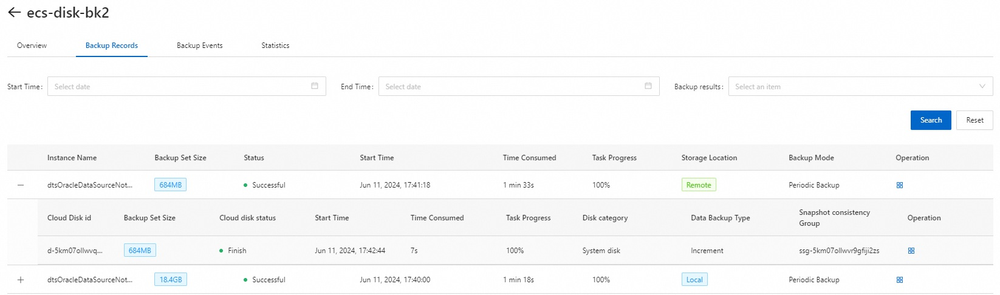

<a id="section-18-3"></a>

## 18.3. What do I do if an error is returned when I log on to the ASR for Backup and Recovery console as a common user?

This topic describes how to bind a role to a common user after you create a common user to obtain the permissions of the role.

**Problem description**

An error is returned indicating that I am not authorized to do so when I log on to the ASR for Backup and Recovery console as a common user.

**Cause**

A common user does not have the permissions to log on to the ASR for Backup and Recovery console or view the pages. For more information about roles and corresponding permissions, see Roles and permissions.

**Solution**

1. Log on to the Apsara Uni-manager Management Console as an operations administrator.

2. In the top navigation bar, click **Enterprise**.

3. In the left-side navigation pane, choose **Users > Users**.

4. Select the organization to which the common user belongs from the drop-down list, enter

   the name of the common user in the search box, and then click  .

5. Find the common user, click  in the **Actions** column, and select **Authorize**.

6. Select a role for the common user and grant the corresponding permissions to the common user. For more information, see Roles and Permissions.

   > **Note**
   >
   > You can select multiple roles for the common user.

7. Click **OK**.

**Verification**

1. Log on to the ASR for Backup and Recovery console as the common user that has been granted proper permissions.

2. Check whether you can log on to the console.

   - You can log on to the console, but no data is displayed on pages. Switch to the organization to which the common user belongs and then check whether data is displayed on pages. If no data is displayed, check whether any data is generated.

   - If an error is displayed when you log on to the console, contact the backup R&D team for troubleshooting.

<a id="section-18-4"></a>

## 18.4. What do I do if an AccessKey pair error or the AccessDenied message is reported when I am creating a storage pool?

This topic describes how to resolve an error that occurs when you create a storage pool.

**Issue**

A storage pool fails to be created after you log in to the ASR for Backup and Recovery (ASR-BR) console as an operations administrator with which the root role is associated. An AccessKey pair error or the AccessDenied error message is reported.

**Possible cause**

The **AccessKey ID** or **AccessKey Secret** entered when you create the storage pool is incorrect.

> **Note**
>
> You must enter the **AccessKey ID** and **AccessKey Secret** of the destination storage medium and have the permissions to read data from and write data to the storage medium. Therefore, you must first obtain the correct AccessKey ID and AccessKey secret of the destination storage medium. The storage media include Object Storage Service (OSS), OSS deployed on Cloud Defined Storage (CDS), miniOSS, PanguStor, software-defined storage (SDS), and S3.

**Solution**

> **Note**
>
> If you use a storage medium that supports the OSS protocol, you can use ossutil to verify whether the entered AccessKey ID and AccessKey secret have read/write permissions on OSS.

1. Download ossutil from the official OSS website and install it. For more information, see Install ossutil.

2. Upload ossutil to the asrbr-backup container on the asrbr-backup.Backup# VM in StandardAsrbrCluster.

3. Run the following command to modify permissions:

   ```bash
    chmod +x ossutil 
   ```

4. Run the following command to configure the ossutil connection destination and test the network connectivity:

   ```text
    ./ossutil config 
   ```

   Specify the OSS endpoint, AccessKey ID, and AccessKey secret for the ossutil connection. (You can upload ossutil to the asrbr-backup container to check the network connectivity between the ASR-DR console and the destination storage medium.)

5. Use ossutil to run the following command to verify permissions:

   ```text
   ./ossutil64 ls [-s] [--limited-num] [--marker] 
   ```

   | Paramter | Description |
   | --- | --- |
   | -s | Lists only bucket names in the returned results. |
   | --limited-num | The maximum number of buckets that you want to list in the returned results. You can specify this parameter together with the <strong>marker</strong> parameter to display returned results by page. |
   | --marker | The starting position for the list operation.Buckets with names alphabetically after the marker value are listed. |

   - If no error is returned, the AccessKey ID and AccessKey secret meet the permission requirements and can be used as expected.

   - If an error is returned, the AccessKey ID and AccessKey secret do not have the permissions to access OSS. Select an appropriate AccessKey pair and perform the preceding steps to verify the permissions. Make sure that no error is returned before you enter the AccessKey pair to create a storage pool.

**Authentication method**

> **Note**
>
> The following steps assume you have already created a storage pool group. If no storage pool group exists, create one first. For more information, see Create a storage pool.

1. Log in to the ASR-BR console as an operations administrator.

2. In the left-side navigation pane, choose **System Management** > **Storage Pool Group Management**.

3. Enter a storage pool group name in the Storage Pool Group Name field and click **Search**.

4. Click **Add Storage Pool** in the **Actions** column of the target storage pool group.

5. Conifgure the following parameters.

   | Parameter | Description |
   | --- | --- |
   | Storage Pool Name | Set a recognizable storage pool name, for example, Public Cloud Storage Pool.<br>Note<br>The name can contain letters, digits, hyphens (-), and underscores (_), must be less than 64 characters in length, and is case-sensitive. |
   | Storage Capacity | Set the maximum storage capacity for the storage pool, in TB. |
   | AccessKey ID | The AccessKey ID of the account that is used for accessing the destination storage.<br>Note<br>This AccessKey ID and AccessKey secret must have the permissions to read and write data in the destination storage. |
   | AccessKey Secret | The AccessKey secret of the account that is used for accessing the destination storage. |
   | Authorized Organization | Select the level-1 organization that you want to authorize to access the storage pool. You can select all level-1 organizations. |
   | Recycle Bin | Optional. Enter a custom recycle bin name. This parameter is required when you need to create a deduplication backup vault or a mirror vault in the storage pool.<br>Note<br>When you create a deduplication backup vault or a mirror vault, an existing bucket of the recycle bin will be used. If no bucket exists, a relevant bucket will be created. |
   | Storage Pool Description | Optional. The description of the storage pool for easy identification. |

6. Click **OK**.

   - If the storage pool is created, the error is resolved.

   - If the storage pool cannot be created, contact the backup R&D team for troubleshooting.

<a id="section-18-5"></a>

## 18.5. What do I do if the 500 error is displayed on pages of the ASR for Backup and Recovery console?

This topic describes how to troubleshoot the 500 error on pages of the ASR for Backup and Recovery console.

**Problem description**

The 500 error is displayed in the menu section of pages and the menus cannot be displayed normally.

**Cause**

The HBR service is abnormal.

**Solution**

1. Log on to the Apsara Uni-manager Operations Console.

2. In the top navigation bar, choose **Platform > Resources** to access the Apsara Infrastructure Management console.

3. In the left-side navigation pane, choose **Resources > Product & Cluster O&M**.

4. Enter ASRBR in the **Product | Cluster** search box on the **Product & Cluster O&M** page, find the cluster, and then click **Cluster Details** in the Actions column.

5. On the **Cluster Details** page, click **hbr-console** service.

   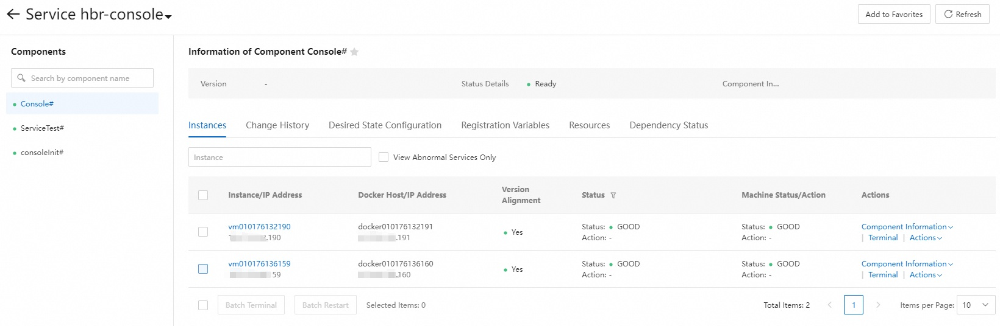

6. Click the Instance /IP Address to go to the **Machine Details** page.

7. Click **Restart** in the Actions column for the **Console#** component.

8. In the **Confirmation** dialog box that appears, enter **RESTART** and click **OK**.

9. After the hbr-console service is restarted, check whether the page is displayed normally by performing the steps in Verification.

**Verification**

1. Log on to the ASR for Backup and Recovery console using the current account. For more information, see Log on to the ASR for Backup and Recovery console.

2. Click any menu to access the page and check whether 500 error is displayed on the page.

   - If the page is displayed normally, the problem is solved.

   - If the 500 error is returned, contact the backup R&D team for troubleshooting.

<a id="section-18-6"></a>

## 18.6. What can I do if ECS disk backup or ECS instance backup fails?

The following sections describe the issues and causes of failed ECS backup.

**Background information**

- ECS disk backup and ECS instance backup both are snapshot backup and depend on the snapshot capabilities of Elastic Block Storage.

- The local backup and remote backup of ECS disks and ECS instances all rely on local backup. Local backup is EBS local snapshot. You can manually create snapshots by calling API operations. After snapshots are created, the hbr-backup worker backs up the snapshots to a remote vault in remote backup.

- Snapshot limits

  - Up to 64 local snapshots that can be retained for a single disk.

  - Snapshot-consistent groups:

    - A single snapshot-consistent group can contain snapshots of up to 16 disks.

    - The maximum disk size is 32 TB if concurrent backup is enabled.

  - Encrypted disks do not support remote backup.

<table>
  <tr>
    <th>Issue</th>
    <th>Cause</th>
  </tr>
  <tr>
    <td rowspan="4">First the periodic backup is normal, but instance backup records suddenly start to fail.</td>
    <td>The original instance is deleted.</td>
  </tr>
  <tr>
    <td>A snapshot conflict occurs.</td>
  </tr>
  <tr>
    <td>The backup policy of the HBR component is inconsistent with that of ASR for Backup and Recovery. As a result, the backup task is not started or HBR fails to start the backup task.</td>
  </tr>
  <tr>
    <td>The backup agent fails to execute the backup schedule.</td>
  </tr>
  <tr>
    <td rowspan="2">A backup schedule is created, but the backup schedule has not been in the Running state.</td>
    <td>An internal service error occurs on ASR for Backup and Recovery.</td>
  </tr>
  <tr>
    <td>HBR reports an error.</td>
  </tr>
  <tr>
    <td>The backup schedule is created, but the backup record remains in the Queueing state.</td>
    <td>When you create a backup schedule, the specified backup time is the current time.</td>
  </tr>
  <tr>
    <td>The backup record remains in the Being Blocked state.</td>
    <td>A historical backup task has not been completed.</td>
  </tr>
</table>

<a id="section-18-6-1"></a>

### 18.6.1. Issue 1: First the periodic backup is normal, but instance backup records suddenly start to fail

This topic describes how to troubleshoot the following issue: First the periodic backup is normal, but instance backup records suddenly start to fail.

**Problem description**

First the periodic backup is normal, but instance backup records suddenly start to fail.

**Possible causes**

- The original instance is deleted.

- A snapshot conflict occurs.

- The backup policy of the HBR component is inconsistent with that of ASR for Backup and Recovery. As a result, the backup task is not started or HBR fails to start the backup task.

- The backup agent fails to execute the backup schedule.

**Solutions**

1. Check whether the original instance is deleted.

   <ol type="i">

   <li>

   Log on to the Apsara Uni-manager Management Console.

   </li>

   <li>

   In the top navigation bar, choose **Products > Computing > Cloud Server > Elastic**

   </li>

   </ol>

   **Compute Service**.

   <ol type="i" start="3">

   <li>

   In the left-side navigation pane of the ECS console, choose **Instances & Images >**

   </li>

   </ol>

   **Instances**.

   <ol type="i" start="4">

   <li>

   On the ECS Instances page, check whether the instance that failed to be backed up exists.

   - If the instance does not exist, the backup failed because the instance has been deleted. Stop and delete the corresponding backup schedule in the ASR for Backup and Recovery console.

   - If the instance exists, it is caused by other reasons. Proceed with the next step.

   </li>

   </ol>

2. In the top navigation bar, choose **Products > Disaster Recovery and Backup > Backup Service > ASR for Backup and Recovery**.

3. In the left-side navigation pane, click **Backup Plans**. On the Backup Plans page, click the name of the backup schedule.

4. On the details page of the backup schedule, click the **Backup Records** tab to view the status of the backup records.

5. If the backup record is in the Failed state, check whether the snapshot is manually created.

   <ol type="i">

   <li>

   In the top navigation bar, choose **Products > Computing > Cloud Server > Elastic Compute Service**.

   </li>

   <li>

   In the left-side navigation pane of the ECS console, choose **Instances & Images >**

   </li>

   </ol>

   **Instances**.

   <ol type="i" start="3">

   <li>

   On the Instances page, find the ECS instance and click the instance ID.

   </li>

   <li>

   On the details page of the instance, click the **Snapshots** tab and check whether the snapshot is created at the specified point in time.

   - If the snapshot is created, it is caused by other reasons. Continue to check other reasons.

   - The snapshot fails to be created due to three reasons. You can check these reasons one by one.

     - **Reason 1**: Check whether the local backup record details of the failed snapshot contains a task ID. If the task ID exists, exclude this possibility. If the task ID does not exist, the hbr-console service does not start the backup task. In this case, you can check whether the execution cycle of the backup schedule on HBR is the same as that on ASR for Backup and Recovery.

       <ol type="a">

       <li>

       On the backup record details page, check whether the task ID exists.

       - If the task ID exists, view and record the task ID and error messages.

         Troubleshoot the issue based on the error messages.

         - exist status 2: Check the hbr-agent service.

         - HBR.InternalError: Check the hbr-console services.

         - If no error messages are displayed, check both services.

         - If the local backup record is partially successful, and the remote backup record is failed, the backup task failed to create snapshots for at least one disk.

         - If the local backup record is successful, and the remote backup record is failed, the snapshot remote backup fails. In this case, use the task ID to find the hbr-backupworker service and view the logs.

         - If the local backup record and remote backup record both are failed:

           - If the snapshot is manually created, but the backup record is failed, use the task ID to find the hbr-backupworker service and view the logs.

             <ol type="a">

             <li>

             Log on to the physical servers on which the hbr-agent service is deployed.

             </li>

             <li>

             Run the following command to go to the log directory:

             cd /log/hbr/backupworker

             </li>

             </ol>

             <ol type="i" start="100">

             <li>

             Go to the specified directory based on the backup record time (for example, 2025-02-04).

             </li>

             <li value="500">

             Run the following command to search for log files based on the task ID and troubleshoot errors:

             grep -i "*Task ID*"

             Error 1: The backup vault is full.

             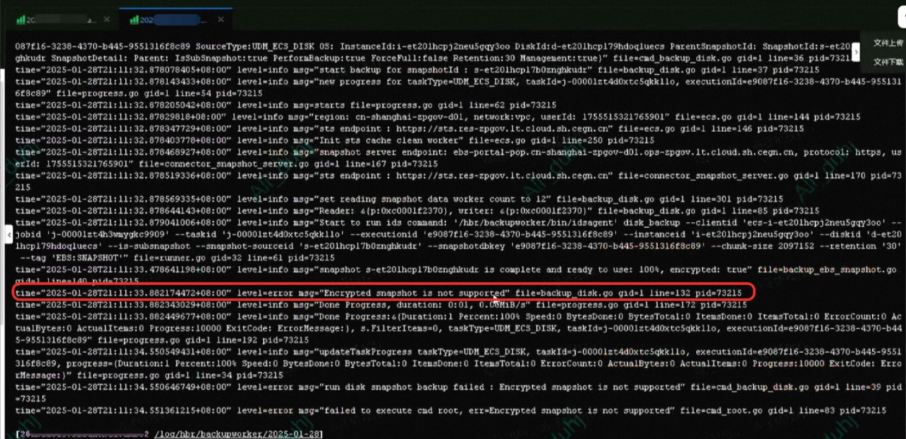

             Error 2: If you cannot discover the reasons directly, run the vi command to open the log files starting with ebsplugin and ids and view the error logs. Remember that encrypted disks do not support remote backup.

             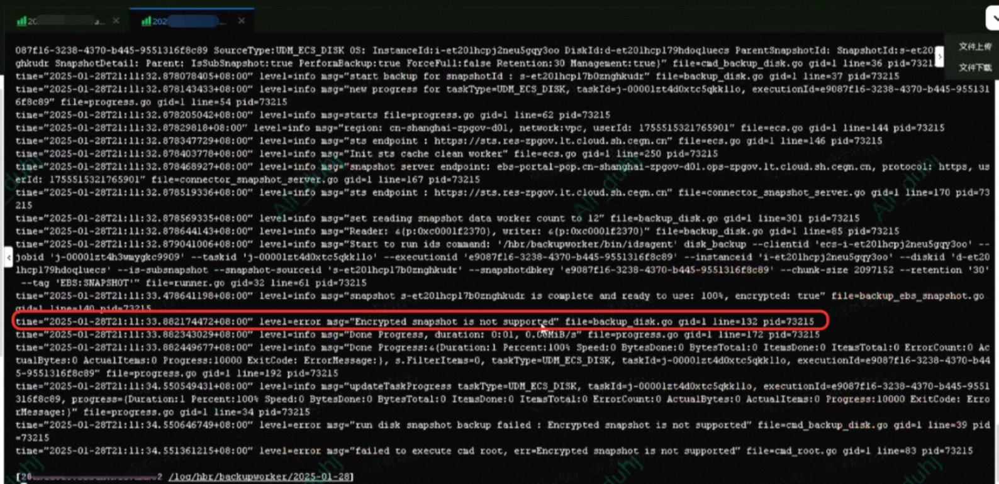

             </li>

             </ol>

       - If the task ID does not exist, the backup policy of the HBR component is inconsistent with that of ASR for Backup and Recovery. As a result, the backup task is not started or HBR fails to start the backup task.

       </li>

       </ol>

     - **Reason 2**: The manual snapshot conflicts with an automatic snapshot.

       - If no snapshot is manually created at the specified point in time, a snapshot conflict occurs.

         <ol type="a">

         <li>

         In the left-side navigation pane of the ECS console, choose **Storage & Snapshots > Disks**.

         </li>

         <li>

         On the Disdisks page, view and record the ID or name of the automatic snapshot policy.

         </li>

         </ol>

         <ol type="i" start="100">

         <li>

         In the left-side navigation pane, choose **Storage & Snapshots > Automatic Snapshot Policies**. Search for automatic snapshots using the ID or name of the automatic snapshot policy and view the execution time.

         </li>

         </ol>

       - If the manual snapshot fails to be created, check the following reasons:

         - Up to 64 local snapshots that can be retained for a single disk.

         - Snapshot-consistent groups: The maximum disk size is 32 TB if concurrent backup is enabled.

       - If the manual snapshot is created (as shown in the following figure), exclude the possibility of snapshot creation.

     - **Reason 3**: The backup backend service fails.

   </li>

   <li>

   If the local backup record is partially successful, and the remote backup record is failed, the backup task failed to create snapshots for at least one disk. The reason may be snapshot conflicts or service exceptions. Follow the previous step to troubleshoot the issue.

   </li>

   <li>

   Check whether the backup policy of the HBR component is inconsistent with that of ASR for Backup and Recovery.

   <ol type="a">

   <li>

   On the details page of the backup schedule, click the **Backup Records** tab to view the status of the backup records.

   </li>

   <li>

   Click the icon in the **Actions** column and select **Details** to check whether the task ID exists.

   - If the task ID exists, The backup agent fails to execute the backup schedule. Continue your troubleshooting.

   - If the task ID does not exist, perform the following steps.

     <ol type="a">

     <li>

     Obtain the ECS instance ID involved in the backup schedule on the backup record details page.

     </li>

     <li>

     Log on to the asrbr_backup database and execute the following SQL statement to obtain related_hbr_plan_id:

     ```sql
      select i.instance_id,i.instance_name,i.related_hbr_plan_id from 
     ```

     </li>

     </ol>

   </li>

   </ol>

   </li>

   </ol>

```text
backup_plan_instance i inner join backup_plan p on i.plan_id = p.plan_id where 
```

```text
p.backup_type = 'ECS_DISK' and i.instance_id = '${ECS instance ID}' ; 
```

<ol type="i" start="100">

<li>

Log on to the primarydb database and execute the following SQL statement to obtain the HBR backup policy:

```sql
 select schedule from backup_plan where plan_id = '${related_hbr_plan_id}' ; 
```

Schedule format: I|1736932662|P1D

1736932662: the initial execution time.

P1D: the execution cycle, which is one execution every day.

</li>

<li value="500">

Execute the following SQL statement (using the number part in the schedule) to view the initial backup time.  `select from_unixtime(1736932662);`

</li>

</ol>

<ol type="a" start="5">

<li>

Calculate the sum of the initial time and execution period and compare the result with the current execution time on ASR for Backup and Recovery.

- If they are consistent or close (HBR execution time is later than ASR for Backup and Recovery), the policies are inconsistent. It is the inconsistent policies that cause failed backup records.

- If they are not consistent or close, the backup task is not started.

</li>

<li>

The backup task is not started. Log on to the bootstrapdb database and execute the following SQL statement:

```text
 select JOB_NAME,from_unixtime(NEXT_FIRE_TIME/1000) as "Next execution 
```

</li>

</ol>

```text
time",from_unixtime(PREV_FIRE_TIME/1000) as "Last execution time" from 
```

```text
qrtz_triggers where TRIGGER_NAME ='${related_hbr_plan_id}' ; 
```

Compare the last execution time and next execution time with those of the current backup policy. If the last execution time values are inconsistent, the task is not started. If the next execution time values are consistent in this case, you can wait to check whether the next execution is normal. Or you just modify the backup policy based on the solution.

<ol type="i" start="7">

<li>

Check whether the backup agent fails to execute the backup schedule.

<ol type="a">

<li>

On the details page of the backup schedule, click the **Backup Records** tab to view the status of the backup records.

</li>

<li>

Click the  icon in the **Actions** column and select **Details** to view the task ID and error

messages.

</li>

</ol>

<ol type="i" start="100">

<li>

Troubleshoot the issue based on the error messages.

- exist status 2: Check the hbr-agent service.

- HBR.InternalError: Check the hbr-console services.

- If no error messages are displayed, check both services.

- If the local backup record is partially successful, and the remote backup record is failed, the backup task failed to create snapshots for at least one disk.

- If the local backup record is successful, and the remote backup record is failed, the snapshot remote backup fails. In this case, use the task ID to find the hbr-backupworker service and view the logs.

- If the local backup record and remote backup record both are failed:

  - If the snapshot is manually created, but the backup record is failed, use the task ID to find the hbr-backupworker service and view the logs.

    <ol type="a">

    <li>

    Log on to the physical servers on which the hbr-agent service is deployed.

    </li>

    <li>

    Run the following command to go to the log directory:

    cd /log/hbr/backupworker

    </li>

    </ol>

    <ol type="i" start="100">

    <li>

    Go to the specified directory based on the backup record time (for example, 2025-02-04).

    </li>

    <li value="500">

    Run the following command to search for log files based on the task ID and troubleshoot errors:

    grep -i "*Task ID*"

    Error 1: The backup vault is full.

    

    Error 2: If you cannot discover the reasons directly, run the vi command to open the log files starting with ebsplugin and ids and view the error logs. Remember that encrypted disks do not support remote backup.

    

    </li>

    </ol>

</li>

</ol>

</li>

</ol>

**Verify the results**

Wait until the backup schedule is executed next time and check whether the backup records are successful.

<a id="section-18-6-2"></a>

### 18.6.2. Issue 2: A backup schedule is created, but the backup schedule has not been in the Running state

This topic describes how to troubleshoot the following issue: A backup schedule is created, but the backup schedule has not been in the Running state.

**Problem description**

A backup schedule is created, but the backup schedule has not been in the Running state。

**Possible causes**

- An internal service error occurs on ASR for Backup and Recovery.

- HBR reports an error.

**Solutions**

- An internal service error occurs on ASR for Backup and Recovery.

1. Log on to the Apsara Uni-manager Management Console.

2. In the top navigation bar, choose **Products > Disaster Recovery and Backup > Backup Service > ASR for Backup and Recovery**.

3. In the left-side navigation pane, click **Backup Plans**. On the Backup Plans page, click the name of the backup schedule.

4. On the details page of the backup schedule, click the **Backup Records** tab.

5. On the Backup Events tab of the backup schedule details page, press the F12 key to use the Developer tools. In the panel that appears, click the **Network** tab.

   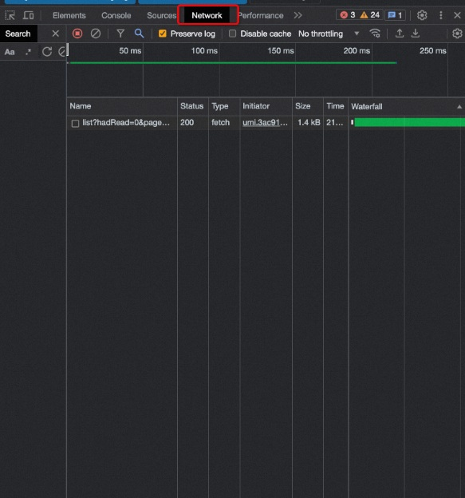

6. Click the  icon next to a sub-event. In the panel that appears, view the logs of the sub-

   event. Click the **Payload** tab to view the eventId parameter.

   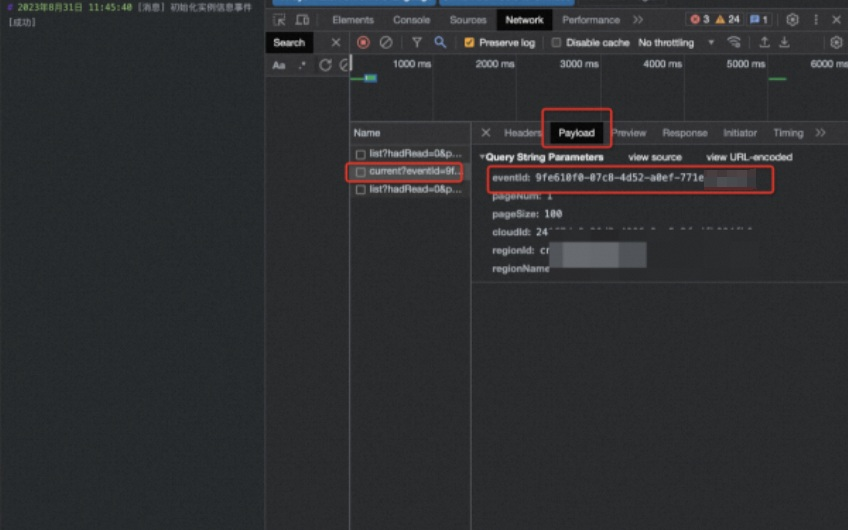

7. Log on to two VMs or Docker containers and run the following commands:

   ```bash
   cd /alidata/logs/asrbr-backup/

   grep -r "d1b14ebf-4d96-43f1-9b9c-12b547fa405c" asrbr-backup.log
   ```

   > **Note**
   >
   > Replace the keyword after the grep -r command with the request ID or event ID that you obtained.

   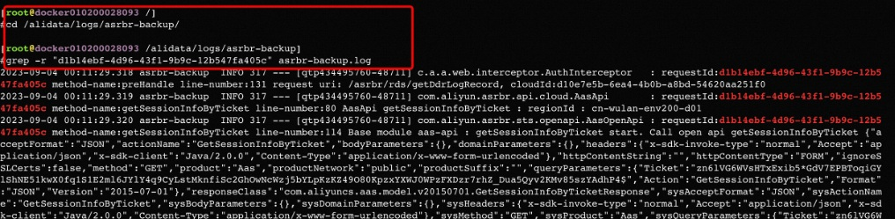

8. View the error logs.

   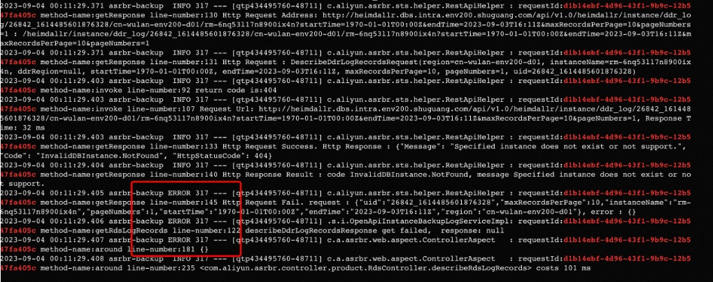

9. Run the vi or vim command to open the corresponding log file to view a specific error message. Sample code:

   ```text
   vi asrbr-backup.log

   To search for d1b14ebf-4d96-43f1-9b9c-12b547fa405c, enter /d1b14ebf-4d96-43f1-9b9c-12b547fa405c.
   Enter N to find the next matched result until you find the error message.
   ```

   > **Note**
   >
   > You need to query the details of an error based on the request ID or event ID.

   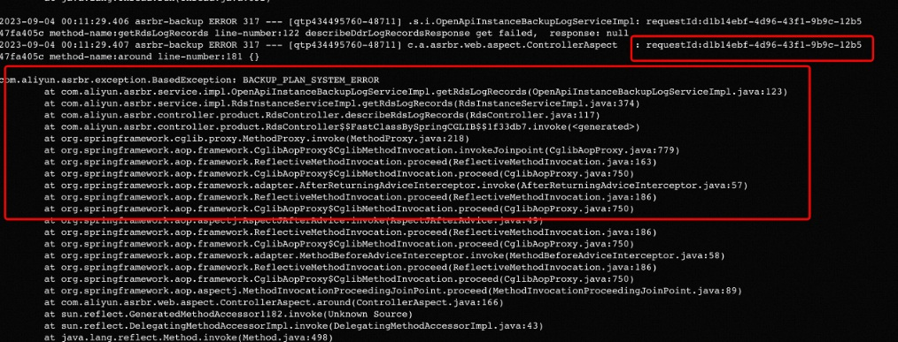

   > **Note**
   >
   > - The asrbr-backup file stores the logs that are generated within the previous 14 days in the /alidata/logs/asrbr-backup/bak directory. You can query log files based on the date on which the logs are generated.
   >
   > - You can also run the  `cd /alidata/logs/asrbr-backup/bak`  command to query log files.

- HBR reports an error.

1. Log on to the Apsara Uni-manager Operations Console.

2. In the top navigation bar, choose **Platform Operation > Apsara Infrastructure Management** > Resources to go to the Apsara Infrastructure Management console.

3. In the left-side navigation pane, choose **Resources > Product & Cluster O&M**.

4. On the **Product & Cluster O&M** page, enter ASRBR in the **Product | Cluster** field. In the search results, find the cluster and click **Cluster Details** in the Actions column.

5. On the Services tab of the **Cluster Details** page, find the **hbr-console** service and click its name.

   

6. Check whether the service is in the Good state.

   - If so, the hbr-console service is OK. Contact the backup R&D team to troubleshoot the issue.

   - If not, the hbr-console service is exceptional. You must fix it in time.

**Verify the results**

After the issue is fixed, wait until the backup schedule is executed and check whether the backup schedule is in the Running state.

<a id="section-18-6-3"></a>

### 18.6.3. Issue 3: The backup schedule is created, but the backup record remains in the Queueing state

This topic describes how to troubleshoot the following issue: The backup schedule is created, but the backup record remains in the Queueing state.

**Problem description**

The backup schedule is created, but the backup record remains in the Queueing state after the first backup cycle.

**Possible causes**

When you create a backup schedule, the specified backup time is the current time.

**Solutions**

1. Log on to the Apsara Uni-manager Management Console.

2. In the top navigation bar, choose **Products > Disaster Recovery and Backup > Backup Service > ASR for Backup and Recovery**.

3. In the left-side navigation pane, click **Backup Plans**. On the Backup Plans page, click the name of the backup schedule.

4. On the details page of the backup schedule, click the **Backup Records** tab.

5. View the end time of the event to create the backup schedule.

6. Click the **Backup Records** tab to view the time when the backup record was created.

   If the specified backup time is too close to the current time, no backup task is created for the HBR task.

7. Click the **Backup Information** tab. In the **Backup Policy** section, click **Modify Policy**.

8. Modify the execution time of the backup schedule and then click **OK**.

9. On the **Backup Events** tab, find the synchronous backup result event in the backup record queue and cancel the running event.

**Verify the results**

After the backup task is completed next time, follow these steps to check whether the backup task is successful.

1. Log on to the Apsara Uni-manager Management Console.

2. In the top navigation bar, choose **Products > Disaster Recovery and Backup > Backup Service > ASR for Backup and Recovery**.

3. In the left-side navigation pane, click **Backup Plans**. On the Backup Plans page, click the name of the backup schedule.

4. On the details page of the backup schedule, click the **Backup Records** tab to view the status of the backup record.

   - If the backup record is successful, the issue is resolved.

   - If the backup record is not successful, contact the backup R&D team to troubleshoot the issue.

<a id="section-18-6-4"></a>

### 18.6.4. Issue 4: The backup record remains in the Being Blocked state

This topic describes how to troubleshoot the following issue: The backup record remains in the Being Blocked state.

**Problem description**

The backup record remains in the Being Blocked state.

**Possible causes**

A historical backup task has not been completed.

**Solutions**

1. Log on to the Apsara Uni-manager Management Console.

2. In the top navigation bar, choose **Products > Disaster Recovery and Backup > Backup Service > ASR for Backup and Recovery**.

3. In the left-side navigation pane, click **Backup Plans**. On the Backup Plans page, click the name of the backup schedule.

4. On the details page of the backup schedule, click the **Backup Records** tab.

5. Click the  icon in the Actions column and select **Details** to check whether the task ID

   exists.

   

6. Log on to the primarydb database and execute the following SQL statement to obtain the status of the HBR backup task:

   ```sql
    select status,error_message from backup_job where job_id = '${Task ID}'; 
   ```

   - If the HBR backup task is not in the Running state, the task has ended. In this case, you can manually terminate the current synchronization task, cancel the current backup record, and wait for the next backup.

     <ol type="a">

     <li>

     On the **Backup Events** tab, find the event and cancel it.

     </li>

     <li>

     On the **Backup Records** tab, find the instance, click  in the Actions column, and then

     select **Cancel**.

     </li>

     </ol>

   - If the HBR backup task is in the Running state,, run the following SQL statement on the primarydb database to obtain the value of progress:

     ```sql
      select status,progress from backup_job where job_id = '${Task ID}'; 
     ```

     If the value of progress is not 10,000, the task is not completed. Wait until the task is completed.

**Verify the results**

After the backup task is completed next time, follow these steps to check whether the backup task is successful.

1. Log on to the Apsara Uni-manager Management Console.

2. In the top navigation bar, choose **Products > Disaster Recovery and Backup > Backup Service > ASR for Backup and Recovery**.

3. In the left-side navigation pane, click **Backup Plans**. On the Backup Plans page, click the name of the backup schedule.

4. On the details page of the backup schedule, click the **Backup Records** tab.

5. Check whether the backup record is successful.

   - If so, the issue is resolved.

   - If not, contact the backup R&D team to troubleshoot the issue.

<a id="section-19"></a>

# 19.Appendix

<a id="section-19-1"></a>

## 19.1. Install an HBR agent on an ECS instance

This topic describes how to install a Hybrid Backup Recovery (HBR) agent on an Elastic Compute Service (ECS) instance in the primary cloud.

**Background information**

You must install an HBR agent on the ECS instance for which you want to perform remote backup or restoration in the primary cloud.

**Procedure**

1. Obtain the endpoint of the HBR service.

   <ol type="i">

   <li>

   Log on to the Apsara Uni-manager Operations Console in the secondary cloud.

   </li>

   <li>

   In the top navigation bar, choose **Platform Operation > Apsara Infrastructure**

   </li>

   </ol>

   **Management > Resources**.

   <ol type="i" start="3">

   <li>

   In the left-side navigation pane, choose **O&M Tools** > **Basic Data Management** >

   </li>

   </ol>

   **Base Meta Data Management** > **Service Registration Variable Dashboard**.

   <ol type="i" start="4">

   <li>

   Select **Service** from the drop-down list in the upper-left corner, enter rds-ddr-proxy and hbr-rabbitmq respectively in the search box, and then click the search icon.

   </li>

   <li>

   Click the  icon in the **Service Registration** column of the **rds-ddr-proxy** service and

   then click the content in the **Service Registration** column. The Registration Variables dialog box appears.

   

   In the Registration Variables dialog box, you can view the value of the **asr.resource.domain** service registration variable.

   

   </li>

   <li>

   Click the  icon in the **Service Registration** column of the **hbr-rabbitmq** service and

   then click the content in the **Service Registration** column. The Registration Variables dialog box appears.

   

   In the Registration Variables dialog box, you can view the value of the **hbr.rabbitmq.domain** service registration variable.

   

   </li>

   </ol>

2. Download the installation package of the HBR agent for the ECS instance from the primary cloud.

   - In Linux, run the following command to download the installation package:

     ```bash
     curl -O --basic -u guest:guest 
     http://<hbr_resource_host>/download/<hbragent_filename>
     ```

     > **Note**
     >
     > Replace the value of hbr_resource_host with the value of **asr.resource.domain** that you obtained in Step 1.
     >
     > Replace the value of hbragent_filename with the name of the installation package of the HBR agent.
     >
     > - Package name in a 32-bit operating system: hbr-install-2.0.0-linux-32bit.tar.gz
     >
     > - Package name in a 64-bit operating system: hbr-install-2.0.0-linux-64bit.tar.gz

   - In Windows, enter the following URL in the address bar of your browser to download the installation package:

     ```xml
     <hbr_resource_host>/download/<hbragent_filename>
     ```

     In the dialog box that appears, enter the username and password. In this example, the username is *guest* and the password is *guest*.

     > **Note**
     >
     > Replace the value of hbr_resource_host with the value of **asr.resource.domain** that you obtained in Step 1.
     >
     > Replace the value of hbragent_filename with the name of the installation package of the HBR agent.
     >
     > - Package name in a 32-bit operating system: hbr-install-2.0.0-windows-32bit.zip
     >
     > - Package name in a 64-bit operating system: hbr-install-2.0.0-windows-64bit.zip

3. Decompress the installation package.

4. Install the HBR agent.

   - In Linux, run the following command:

     ```text
     ./setup -m ApsaraStack -h<hbr_amqp_host>
     ```

     

   - In Windows, run the following command:

     ```xml
     <hbragent_filename> /TYPE=ApsaraStack /host= <hbr_amqp_host>/SUPPRESSMSGBOXES /VERY
     SILENT
     ```

     > **Note**
     >
     > Replace the value of hbr_amqp_host with the value of **hbr.rabbitmq.domain** that you obtained in Step 1.
     >
     > Replace the value of hbragent_filename with the name of the installation package of the HBR agent.
     >
     > - Package name in a 32-bit operating system: hbr-install-2.0.0-windows-32bit.zip
     >
     > - Package name in a 64-bit operating system: hbr-install-2.0.0-windows-64bit.zip

5. Check whether the HBR service runs as expected.

   - In Linux, run the following command to check the status of the HBR service:

     ```text
     ps aux | grep hbr
     ```

     

   - In Windows, start Task Manager and check whether the **hybridbackup** service is in the **Running** state.

<a id="section-19-2"></a>

## 19.2. S3 protocol usage requirements

This topic describes the requirements for using the S3 protocol as the storage medium during backup.

The following three requirements must be met when you use S3 as the storage medium during backup:

- Signature version: The standard signature version supported by S3 is Signature Version 4。

- API operations: If you use the S3 protocol, the S3 and OSS API operations are used. Make sure that the API operations in the following table are available.

  **S3 API operation**

  **OSS API operation**

  ListObjects

  ListObjects

  HeadObject

  HeadObject

  PutObject

  PutObject

  GetObejct

  GetObejct

  > **Note**

  > **Note**

  > - The GetRange operation is

  > - The GetRange operation is

  > supported.

  > supported.

  > - Streaming download is supported.

  > - Streaming download is supported.

  > - Resumable download is supported.

  > - Resumable download is supported.

  CreateMultiparUpload

  InitiateMultipartUpload

  AbortMultiparUpload

  AbortMultiparUpload

  CompleteMultipartUpload

  CompleteMultipartUpload

  MultipartUploa

  ListMultipartUploads

  ListMultipartUploads

  MultipartUpload

  d

  UploadPart

  UploadPart

  UploadPartCopy

  UploadPartCopy

  ListParts

  ListParts

  DeleteObject

  DeleteObject

  DeleteObjects

  DeleteObjects

  CopyObject (intra-bucket)

  CopyObject (intra-bucket)

  CopyObject (inter-bucket)

  CopyObject (inter-bucket)

  PutBucketLifecycle

  SetBucketLifecycle

  GetBucketLifecycleConfiguration

  GetBucketLifecycle

  HeadBucket

  HeadBucket

  -

  > **Note**

  GetUserQos

  > S3 does not provide the operation for viewing the bucket storage.

- Performance requirements: We recommend that you meet the performance requirements listed in the following table. Otherwise, the backup or restoration efficiency may be affected. The following table lists the performance requirements for API operations.

  | API operation | Performance requirement | Response time |
  | --- | --- | --- |
  | ListObject | 5000 objects/s | The response time for a single operation to process 1000 objects is within 200 milliseconds. |
  | PutObject | 3000 QPS | 20 milliseconds. |
  | CopyObject | 5000 QPS | - |
  | DeleteObject | 50000 QPS | - |

<a id="section-19-3"></a>

## 19.3. Use ASR-BR to back up PolarDB-X 2.0 instances

**Prerequisites**

By default, PolarDB-X 2.0 uses its built-in backup system. To use ASR-BR to back up PolarDB-X 2.0 instances, you must manually enable this feature either by region or by tenant.

- By region: ASR-BR backs up all PolarDB-X 2.0 instances in a specific region. You must obtain the region_id of that region.

- By tenant: ASR-BR backs up all PolarDB-X 2.0 instances under a tenant. The remaining instances still need to be backed up using their respective built-in backup systems. You must obtain the UID of the user.

**Procedure**

1. Log in to the dbass database and run the following command to query the resource table:

   ```sql
   select * from resource where res_key = 'POLARDBX_GLOBAL_CONFIG'\G
   ```

   

2. Run the following commands to use ASR-BR to back up PolarDB-X 2.0 instances either by region or by tenant:

   - By region

     ```sql
     update resource set real_value = 
     '{"polardbx.xdb.logger":true,"polardbx.dbs.service.region": ["region_id"]}' where res_key = 'POLARDBX_GLOBAL_CONFIG';
     ```

   - By tenant: If multiple tenants exist, separate their UIDs with commas.

     ```sql
     update resource set real_value = 
     '{"polardbx.xdb.logger":true,"polardbx.dbs.service.enable.users": ["UID"]}' where res_key = 'POLARDBX_GLOBAL_CONFIG';
     ```

3. Use ASR-BR to back up existing PolarDB-X 2.0 instances.

   After you enable the feature, only new instances will be backed up by ASR-BR. To use ASR-BR to back up existing instances, run the following command.

   Run the following command in the dbaas database to add the tenant to the allowlist:

   ```sql
   select * from resource where res_key = 'POLARDBX_GLOBAL_CONFIG'\G
   update resource set real_value = 
   '{"polardbx.xdb.logger":true,"polardbx.dbs.service.enable.users": 
   ["UID"],"polardbx.dbs.sync":"true"}' where res_key = 'POLARDBX_GLOBAL_CONFIG';
   ```

   

   

   > **Note**
   >
   > If multiple tenants exist, separate their UIDs with commas and add all tenants.

4. Configure synchronization instances in the polarc_biz database. If multiple instances exist, run the command multiple times.

   <ol type="i">

   <li>

   Log in to OPS1 and run the following command to find the polarx-engine-api pod:

   ```bash
   kubectl get pods -n apsaradb | grep polarx
   ```

   

   </li>

   <li>

   Run the following command to log in to the polarx-engine-api pod:

   </li>

   </ol>

   ```bash
   kubectl exec -it -napsaradb {polarx-engine-api pod} bash
   ```

   

   <ol type="i" start="3">

   <li>

   Run the following command to obtain the polarx_biz connection information:

   </li>

   </ol>

   ```text
   env| grep mysql
   ```

   

   <ol type="i" start="4">

   <li>

   Run the exit command to exit the pod.

   </li>

   <li>

   Log in to the ApsaraDB Operations and Maintenance System console. In the left-side navigation pane, click **Instances**.

   </li>

   <li>

   On the instance details page, select the **Basic Information** tab.

   

   > **Note**
   >
   > custins_id: The instance ID. custins_name: The instance name.

   </li>

   <li>

   Run the following command to insert the instance:

   </li>

   </ol>

   ```sql
   insert into 
   backup_history_sync_record(custins_id,custins_name,sync_status)values('968','pxc-unr8fn9oac8n9g',0)
   ```

   

<a id="section-19-4"></a>

## 19.4. Prerequisites for using the image repository feature of a backup vault

This section introduces an overview, network requirements, constraints, and initialization procedures for using the Image Repository feature of a backup vault.

<a id="section-19-4-1"></a>

### 19.4.1. Description of the mirror vault feature under Backup Repository

A backup vault is a logical storage space planned on a storage pool to store backup data. The mirror vault feature of Backup Repository allows you to create a remote mirror vault for a backup vault based on your backup requirements. The system uses OSS cross-region or cross-cloud replication capabilities to automatically replicate data from the backup vault to the mirror vault. In this way, backup data is stored in multiple locations, and you can select either the backup vault or the mirror vault to restore data.

**Network conditions**

- Ensure that related ASR for Backup and Recovery (ASR-BR) components are connected to multiple Object Storage Service (OSS) buckets. For more information, see Network limits.

- Based on the requirements of the cross-region and cross-cloud replication features of OSS, ensure network connectivity and normal data replication between multiple OSS buckets:

  - Cross-region replication of OSS: You can perform this operation based on your on-site network environments and the multi-region network connection solution.

  - Cross-cloud replication of OSS: Make sure that the OSS bucket in the source cloud can access the OSS bucket in the destination cloud through the endpoint and data can be replicated.

    - If you use DNS rules to configure network connectivity for data replication, ensure that DNS products are deployed in the source cloud, and DNS-based forwarding rules and network connectivity are configured on the tenant-side DNS and OpsDNS in the source cloud. For more information about DNS configuration rules and rollback solutions, you can submit a ticket to consult the relevant technical support personnel.

    - If you use other methods to achieve domain name forwarding and network connectivity, re-evaluate the network connectivity solution based on on-site conditions and security requirements of the customer.

**Constraints**

- The related ASR-BR components are connected to multiple OSS buckets, the OSS buckets at both ends of data replication are connected, and cross-region and cross-cloud replication can be used normally. For more information, see Network limits.

- For cross-region replication, you need to enter information about the two storage pools (to which the backup vault and mirror vault belong) in the ASR-BR console, including the cloud name, cloud region, and location. For cross-cloud replication, you need to enter the cloud name, cloud region, location, and the UID of the proxy user.

- Before you use a backup vault to create a mirror vault, you must configure the recycle bin for the storage pools where the backup and mirror vaults reside.

- Only OSS 1.0, CDS-OSS, and PanguStor support cross-region and cross-cloud replication. MiniOSS, SDS, and S3 do not support cross-region and cross-cloud replication. In addition, OSS 1.0 can only be replicated to OSS 1.0. Data can be replicated between CDS-OSS and PanguStor.

- For backup vaults, if OSS 1.0 and CDS-OSS clusters exist and data migration is enabled, the mirror vault feature is unavailable. If the mirror vault feature is required, submit a ticket to request a solution from the R&D team.

<a id="section-19-4-2"></a>

### 19.4.2. Initialization in the console

To ensure that data can be synchronized from a backup vault to a mirror vault, you need to perform manual configurations once, which is also called initialization. Cross-region synchronization involves the source and destination ends. The initialization steps at the source and destination ends are different. Check whether an environment belongs to the source or destination end to prevent misoperations.

**Initialization at the destination end (mirror vault)**

1. Create a proxy user and grant permissions at the destination end.

   > **Note**
   >
   > This step is required only for cross-cloud replication.

   <ol type="i">

   <li>

   Log on to the Apsara Uni-manager Management Console at the destination end.

   </li>

   <li>

   In the top navigation bar, choose **Enterprise > Permissions > Role Permissions**.

   </li>

   <li>

   Click **Create Custom Role**.

   </li>

   <li>

   Enter a role name. Keep the default values for other parameters.

   </li>

   <li>

   Expand Advanced Settings and click **Create RAM Authorization**.

   </li>

   <li>

   Enter a role name and retain the default values for other parameters. Then, click **Create and Configure RAM Authorization**.

   </li>

   <li>

   Click the **Permissions** tab. Then, click **Add Policy**.

   </li>

   <li>

   Click **Create Policy**. In the Create Policy dialog box, specify a policy name and copy the

   </li>

   </ol>

   following content to the Policy Content field.

   

   ```json
   {
    "Version": "1",
    "Statement": [
    {
    "Effect": "Allow",
    "Action": "oss:*",
    "Resource": [
    "acs:oss:*:*:*"
    ]
    }
    ]
   }
   ```

   <ol type="i" start="9">

   <li>

   Then, click **OK**.

   </li>

   <li>

   Select the policy that you created in the previous step and click **OK**.

   </li>

   </ol>

2. Create a user group.

   > **Note**
   >
   > Skip the following steps for PanguStor because PanguStor has only users and no user groups.

   <ol type="i">

   <li>

   In the left-side navigation pane, choose **Users > User Groups**.

   </li>

   <li>

   On the User Groups page, click **Create a user group**.

   </li>

   <li>

   Specify the user group name and organization. The values of the Role Permissions

   </li>

   </ol>

   parameter must include the RAM role created in the previous step.

   

   <ol type="i" start="4">

   <li>

   Click **OK**.

   </li>

   </ol>

3. Create a proxy user.

   <ol type="i">

   <li>

   In the left-side navigation pane, choose **Users > Users**.

   </li>

   <li>

   On the Users page, click **Create a user**.

   </li>

   <li>

   Select the organization that is selected in the previous step. Specify other parameters

   </li>

   </ol>

   based on your business requirements.

   <ol type="i" start="4">

   <li>

   Click **OK**. The system creates an AccessKey pair. Record the AccessKey pair, which will be used later.

   </li>

   <li>

   Click **View Details** in the **Actions** column of the created user.

   </li>

   <li>

   View and record the UID of the user, which will be used later.

   </li>

   <li>

   Find the user, click  in the **Actions** column, and then select **User Group**

   </li>

   </ol>

   **Management**. On the page that appears, click **Add to User Group**.

   > **Note**
   >
   > Skip the following steps for PanguStor because PanguStor has only users and no user groups.

   <ol type="i" start="8">

   <li>

   Select the user group created in the previous step and click **OK**.

   </li>

   </ol>

4. Configure permissions for the proxy user.

   <ol type="i">

   <li>

   Log on to the Apsara Uni-manager Operations Console at the destination end.

   </li>

   <li>

   In the top navigation bar, choose **Product Operation > Storage > OSS Storage**

   </li>

   </ol>

   **Operations and Maintenance System**.

   <ol type="i" start="3">

   <li>

   In the left-side navigation pane, choose **Service O&M - OSS > OCM List**

   </li>

   </ol>

   **Management**.

   <ol type="i" start="4">

   <li>

   Click **Add**. In the Add list dialog box, enter the UID of the proxy user saved in the previous step, select **as_sync_admin** from the **type** drop-down list, and then click **Add**. In the dialog box that appears, click **Yes**.

   </li>

   </ol>

5. Obtain the cloud parameters.

   <ol type="i">

   <li>

   In the left-side navigation pane, choose **Service O&M - OSS > Synchronization Management > Cross-Cloud Synchronization**.

   </li>

   <li>

   Select a cluster and click **View Parameters of the Current Cloud**.

   </li>

   <li>

   Copy and save the values of the following four parameters for each cluster: Name of Ben

   </li>

   </ol>

   Duo Yun, Ben Duo Cloud Region, Ben Duoyun Region domain name, and Location.

   > **Note**
   >
   > You need to record the parameter values for each cluster.

6. Configure cross-region and cross-cloud replication authorization in the ASR-BR console.

   <ol type="i">

   <li>

   Log on to the Apsara Uni-manager Management Console at the destination end.

   </li>

   <li>

   In the top navigation bar, choose **Products > Disaster Recovery > ASR for Backup**

   </li>

   </ol>

   **and Recovery**.

   <ol type="i" start="3">

   <li>

   In the left-side navigation pane, choose **System Management > Storage Pool**

   </li>

   </ol>

   **Groups**.

   <ol type="i" start="4">

   <li>

   Find the storage pool that you want to manage at the destination end, and click **Cross-region/Cross-cloud Replication Authorization** in the **Actions** column.

   </li>

   <li>

   Enter the cloud name, cloud region, location, and the UID of the proxy user at the destination end, and then click **OK**.

   > **Note**
   >
   > For the destination end of cross-region replication, the UID of the proxy user is not required. For the destination end of cross-cloud replication, the UID of the proxy user is required.

   </li>

   </ol>

**Initialization at the source end (backup vault)**

1. Log on to the Apsara Uni-manager Operations Console at the source end.

2. In the top navigation bar, choose **Product Operation > Storage > OSS Storage Operations and Maintenance System**.

3. In the left-side navigation pane, choose **Service O&M - OSS > Synchronization Management > Cross-Cloud Synchronization**.

4. Click **Create**. In the dialog box that appears, enter the values of Name of Ben Duo Yun, Ben Duo Cloud Region, Ben Duoyun Region domain name, and Location of each cluster and the AccessKey pair saved at the destination end.

   > **Note**
   >
   > The parameter values of each cluster obtained at the destination end must be added at the source end.

5. Log on to the Apsara Uni-manager Management Console at the source end.

6. In the top navigation bar, choose **Products > Disaster Recovery > ASR for Backup and Recovery**.

7. In the left-side navigation pane, choose **System Management > Storage Pool Groups**.

8. Click **Cross-region/Cross-cloud Replication Authorization** in the **Actions** column.

9. Enter the cloud name, cloud region, and location at the source end, and then click **OK**.

<a id="section-19-5"></a>

## 19.5. Configure the ASR-BR service-linked role for an organization

This topic describes how to configure the service-linked role Apsara Stack Resilience for Backup and Recovery (ASR-BR) for an organization.

**Procedure**

1. Log on to the Apsara Uni-manager Management Console.

2. In the top navigation bar, click **Configurations**.

3. In the left-side navigation pane, click **Service-linked Roles**.

4. On the **Service-linked Roles** page, click **Create Service-linked Role**.

5. On the page that appears, select **ASR-BR** from the **Service Name** drop-down list and select the name of the organization for which you want to configure the service-linked role from the **Authorized Organization Name** drop-down list.

6. Click **OK**.

<a id="section-19-6"></a>

## 19.6. Network limits

You must make sure that the internal network of the customer and Apsara Stack can communicate with each other.

<a id="section-19-7"></a>

## 19.7. Statistics on the resource set-level resource usage in an organization

ASR for Backup and Recovery collects and pushes the backup data of the previous day by instance at 1:00 every morning. The backup data size of each instance for each service is collected and displayed on the Metering Management page of the Apsara Uni-manager Management Console by organization and resource set.

**Background information**

ASR for Backup and Recovery backs up data of cloud services at specified intervals. In addition, ASR for Backup and Recovery also pays attention to the amount of data backed up. In order to provide better backup experience, ASR for Backup and Recovery displays data on the Metering Management page to provide unified usage statistics.

**Procedure**

1. Log on to the Apsara Uni-manager Management Console.

2. In the top navigation bar, choose **Operations > Resource Operations**.

3. In the left-side navigation pane, click **Metering Management**.

4. Select **ASR for Backup and Recovery** from the Cloud Service drop-down list, set the organization, resource set, and other search conditions, and then click **Search**.

   > **Note**
   >
   > Usage statistics are collected by tenant. The principle of least privilege is employed. Unauthorized access to usage statistics of other tenants is not allowed.

<a id="section-19-8"></a>

## 19.8. Use the SMB protocol to back up and restore NAS files

<a id="section-19-8-1"></a>

### 19.8.1. Use the SMB protocol to back up NAS files

**Prerequisites**

- A Windows Elastic Compute Service (ECS) instance is available in the region where you create a Server Message Block (SMB) file system. Linux is not highly compatible with the SMB protocol. Therefore, Linux backup engines do not support the use of an SMB file system for data backup.

- An SMB file system is created and the mount target of the file system is obtained.

- The network is available.

  - The IP address of the Windows ECS instance is in the whitelist of the SMB file system and the ECS instance can access the SMB file system.

  - TCP port 445 is enabled for the Windows ECS instance to access the SMB file system. If port 445 is disabled, you must add a rule to a security group of the ECS instance for the port.

- For ASR for Backup and Recovery, backing up an SMB file system is to back up a shared file system mounted on an ECS instance.

**Procedure**

> **Note**
>
> You need to perform the following environment preparation steps only once when you mount file systems on a Windows ECS instance. You do not need to perform them each time you mount an SMB file system on the Windows ECS instance.

1. Prepare the environment.

   <ol type="i">

   <li>

   Log on to the Apsara Uni-manager Management Console.

   </li>

   <li>

   Connect to the ECS instance by using Virtual Network Console (VNC) Viewer or a remote

   </li>

   </ol>

   connection method.

   <ol type="i" start="3">

   <li>

   Enable the Workstation service.

   </li>

   </ol>

   <ol type="a">

   <li>

   Choose **All Programs > Accessories > Run** or press Win+R. Then, enter services.msc to open the Services window.

   </li>

   <li>

   Make sure that the Workstation service is in the **Started** state and the startup type is **Automatic**. By default, the Workstation service is in the Started state.

   </li>

   </ol>

   <ol type="i" start="100">

   <li>

   Enable the TCP/IP NetBIOS Helper service.

   <ol type="a">

   <li>

   On the **Network and Sharing Center** page, click the active network connection.

   </li>

   <li>

   Select **Properties**. In the Connection Properties dialog box, double-click **Internet Protocol Version 4 (TCP/IPv4)**. In the Internet Protocol Version 4 (TCP/IPv4) Properties dialog box, click **Advanced**.

   </li>

   </ol>

   <ol type="i" start="100">

   <li>

   In the **Advanced TCP/IP Settings** dialog box, choose **WINS > Enable NetBIOS over TCP/IP**.

   </li>

   <li value="500">

   Choose **All Programs > Accessories > Run** or press Win+R. Then, enter services.msc to open the Services window.

   </li>

   </ol>

   <ol type="a" start="5">

   <li>

   Make sure that the TCP/IP NetBIOS Helper service is in the **Started** state and the startup type is **Automatic**. By default, the TCP/IP NetBIOS Helper service is in the Started state.

   </li>

   </ol>

   </li>

   </ol>

2. Mount an SMB file system.

   <ol type="i">

   <li>

   Log on to the Apsara Uni-manager Management Console.

   </li>

   <li>

   In the top navigation bar, choose **Products > Storage > Apsara File Storage NAS**.

   </li>

   <li>

   In the left-side navigation pane, choose **File System > File Systems**.

   </li>

   <li>

   On the **File System List** page, click **Create File System**.

   </li>

   <li>

   Specify the File System Name parameter. Set **Protocol Type** to **SMB**. Other parameters are automatically configured. Then, click **Submit**.

   

   </li>

   <li>

   Click **Manage** in the **Actions** column and click **Mount Targets**.

   </li>

   <li>

   Click **Add Mount Target**, configure the parameters, and then click **OK**. Then, record the

   </li>

   </ol>

   mount command.

   

3. Manually mount the file system.

   <ol type="i">

   <li>

   Mount the file system.

   <ol type="a">

   <li>

   Connect to the ECS instance.

   </li>

   <li>

   Open the Command Prompt and run the following command to mount the SMB file system:

   ```text
   net use Z: \\file-system-id.region.nas.aliyuncs.com\myshare
   ```

   | Parameter | Description |
   | --- | --- |
   | Z | The drive letter. If a conflict occurs in drive Z, or if multiple NAS file systems are mounted to drive Z, the NAS file system is mounted to the next drive in reverse alphabetic order. |
   | file-system-id.region.nas.aliyuncs.com | • The domain name of the mount target. The domain name is automatically generated when you create the mount target. Replace the domain name with the actual value.<br>• Alternatively, you can click the destination file system, and then click <strong>Mount Targets</strong>.<br>Move the pointer over theicon in the<br>mount target column to obtain the domain name of the mount target. |
   | myshare | The name of the shared SMB directory. You cannot change the name. |

   </li>

   </ol>

   </li>

   <li>

   Check whether the SMB file system is mounted.

   <ol type="a">

   <li>

   Run the following command:

   ```text
   net use
   ```

   </li>

   <li>

   If a command output that is similar to the following information appears, the file system is mounted. Then, you can access the SMB file system on the ECS instance and perform read and write operations on the file system.

   

   </li>

   </ol>

   </li>

   </ol>

4. Install a backup client for the Windows ECS instance.

   <ol type="i">

   <li>

   Log on to the Apsara Uni-manager Management Console.

   </li>

   <li>

   In the top navigation bar, choose **Products > Disaster Recovery > ASR for Backup**

   </li>

   </ol>

   **and Recovery**.

   <ol type="i" start="3">

   <li>

   In the left-side navigation pane, click **Backup Plans**.

   </li>

   <li>

   On the **Backup Plans** page, click **Create**.

   </li>

   <li>

   On the Backup Plans page, click Create. In the **Basic Information** step, set **Instance Type** to **Elastic Compute Service**, set **Backup Method** to **File Backup**, and then click **Next**.

   </li>

   <li>

   In the **Select Instance** step, select an ECS instance and click **Next**.

   </li>

   <li>

   In the **Install Client** step, select the installation path and click **Install**.

   </li>

   <li>

   After the backup client is installed, you can check whether the backup client is

   </li>

   </ol>

   successfully installed and started based on the directory where the backup client is installed and the services started in the ECS instance. Click **Next**.

5. Grant the backup client the permissions to back up SMB files.

   <ol type="i">

   <li>

   Connect to the ECS instance.

   </li>

   <li>

   Press Win+R. In the Run dialog box, enter services.msc and click **OK**.

   </li>

   <li>

   Find Alibaba Cloud Hybrid Backup Service in the service list. Right-click the service and select **Properties**.

   </li>

   <li>

   In the dialog box that appears, click the **Log On** tab.

   </li>

   <li>

   Select **This account**, click Browse, and then enter the account and password. Click OK. The account must have the following permissions.

   - Full access to the NAS file system

   - Administrative rights

   - Permissions to log on as a service

     > **Note**
     >
     > For more information, see How do I select a component and account when I install a cloud backup client .

   </li>

   <li>

   Restart the Alibaba Cloud Hybrid Backup Service.

   </li>

   </ol>

6. Proceed to Step 4 to create an SMB NAS backup plan.

   <ol type="i">

   <li>

   In the **Configure Instance** step, set Source Path to \\\\file-system-id.region.nas.aliyuncs.com\\myshare.

   </li>

   <li>

   Click **Next** and configure the backup policy. For more information, see Create a backup

   </li>

   </ol>

   plan. Configure data according to the configuration wizard until the backup plan is created.

7. On the **Backup History** tab, you can view the backup results.

<a id="section-19-8-2"></a>

### 19.8.2. Use the SMB protocol to restore NAS files

When you use the Server Message Block (SMB) protocol to restore NAS files, the system restores Elastic Compute Service (ECS) files only to new instances. We recommend that you mount a new SMB file system on the ECS instance for data restoration. This prevents data loss caused by overwriting the data of the original SMB file system by the backup data.

**Prerequisites**

- In the region where you created an SMB file system, a Windows ECS instance is available. Linux is not highly compatible with the SMB protocol. Therefore, Linux backup engines do not support the use of an SMB file system for data backup.

- You have created an SMB file system and obtained the mount target of the file system.

- The network is available:

  - The IP address of the Windows ECS instance is in the whitelist of the SMB file system and the ECS instance can access the SMB file system.

  - TCP port 445 is enabled for the Windows ECS instance to access the SMB file system. If port 445 is disabled, you must add a rule to the security group of the ECS instance for the port.

- For ASR-BR, backing up an SMB file system is to back up a shared file system that is mounted on the corresponding ECS instance. When you use the SMB protocol to restore NAS files, we recommend that you mount a new SMB file system on the ECS instance for data restoration, because ECS instances support only overwritten recovery. This prevents backup data loss caused by overwriting the data of the original SMB file system by the backup data.

**Procedure**

1. Log in to the ASR for Backup and Recovery console.

2. In the left-side navigation pane, select **Data Restoration**. Click **Create**.

3. In the **Basic Information** step, configure the parameters and click **Next**.

   | Parameter | Description |
   | --- | --- |
   | Restore Task Name | The name of the restoration task. The name must be 4 to 20 bytes in length and can contain letters, digits, hyphens (-), underscores (_), and periods (.). |
   | Description | Optional. Enter a description for the restoration task to facilitate identification. |
   | Instance Type | Select <strong>Elastic Compute Service</strong>. |
   | Restore Task Type | In this scenario, select <strong>Regular Restoration</strong>. |
   | Recovery Method | • <strong>Cloud disk recovery</strong>: This method is available only when the backup mothod of the ECS instance is cloud disk backup.<br>• <strong>File Recovery</strong>: This method is available only when the backup method of the ECS instance is file backup. |

4. In the **Select Instance** step, select the instance that you want to restore and click **Next**.

5. In the **Select Record** step, select the previous backup record and click **OK**.

6. In the **Configure Instance** step, configure the destination instance and client. Then, click **Next**.

   <ol type="i">

   <li>

   In the **Destination** step, select the destination instance. Click **Next**.

   </li>

   <li>

   In the **Client Installation** step, if no backup client is installed on the ECS instance to

   </li>

   </ol>

   which the SMB file system that you want to restore is mounted, install a backup client. After the installation is completed, click **Next**.

   <ol type="i" start="3">

   <li>

   In the **Restore File Rule** step, manually enter the local path where the restored files are

   </li>

   </ol>

   stored. Click **Next**.

7. After you create the restoration task, wait until the task is executed and view the restoration result. For more information, see View a recovery plan.

<a id="section-19-9"></a>

## 19.9. Limits on cross-region backup

This topic describes usage limits on cloud products that support cross-region backup.

**Limits on ASR for Backup and Recovery**

**Limits on databases**

- After Transparent Data Encryption (TDE) is enabled, ApsaraDB RDS for SQL Server does not support recovery.

- After TDE is enabled, ApsaraDB RDS for MySQL and PolarDB for MySQL-compatible edition do not support cross-cloud recovery.

- When ApsaraDB RDS, PolarDB, PolarDB-X, AnalyticDB for MySQL V3.0, ApsaraDB for MongoDB, or ApsaraDB for Tair use local backup records to restore data, make sure that the original instances are not deleted.

**Limits on storage**

- When you create an Object Storage Service (OSS) recovery task to restore data to a new instance, the system creates a new bucket. The capacity of this bucket defaults to the capacity of the original backup bucket, but it does not actually consume storage space.

- Each file storage NAS backup task must contain no more than 50 million files. The total number of files and subdirectories under a single directory must not exceed 8 million.

- The data backup size of Elastic Compute Service (ECS) files depends on the available memory capacity. With 4 GB of available system memory, you can back up up to 1 million files or 8 TB of data.

- For ECS file backup, we recommend that you use a dual-core or higher 64-bit CPU and at least 8 GB of available memory. If the number of files under a directory reaches tens of millions or more, we recommend allocating 16 GB of available memory.

**Limits on OSS**

- ASR for Backup and Recovery cannot back up VPC OSS.

- If an authorization policy is configured for the OSS bucket that you want to back up, make sure that the authorization policy allows ASR for Backup and Recovery to read objects in the OSS bucket.

- For backing up a dynamic object (on which the append write, overwrite, or deletion operation is performed during the backup process):

  - For a small object (less than 25 MB), if the object is updated during the backup process and the ETag is inconsistent before and after the backup, the system tries to back up the updated object. The backup result depends on the amount of data that is actually backed up.

  - For a large object (greater than 25 MB), the object is backed up in segments. If the ETag changes during segment reading, the backup for this object is canceled. This object is rescheduled for the next incremental backup.

    - This backup task is considered as failed for this object. If other objects are backed up, the backup task is considered as "partially successful".

    - Backed-up data shards do not occupy destination storage if deduplicated. Otherwise, they may be referenced in future incremental backups or purged by the expired data cleanup policy.

**Limits on MaxCompute backup**

- The foreign table feature must be enabled.

- Make sure that you have purchased the MaxCompute Enhancement Pack for Joint Computing.

**Limits on backup of ECS instances or disks**

- Crash consistency is supported only for disks.

- You cannot establish logical volume management (LVM) or SoftRAID across disks.

- Encrypted disks cannot be backed up or recovered.

- A maximum of 64 local snapshots can be retained.

- If you manually create a snapshot while backing up a disk, the backup may fail.

- A snapshot-consistent group supports snapshots of up to 16 disks and a maximum of 32 TB of data.
