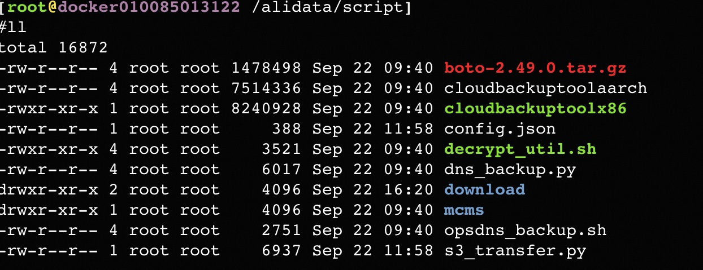
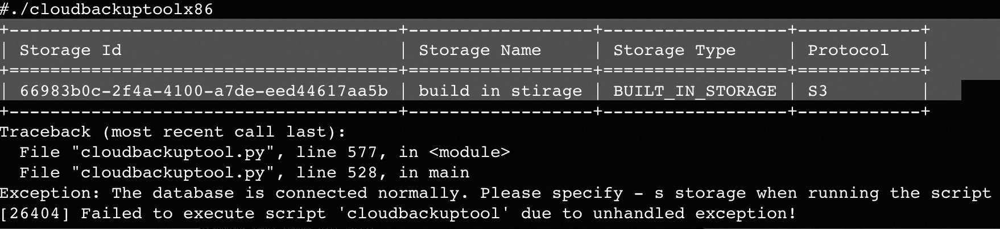
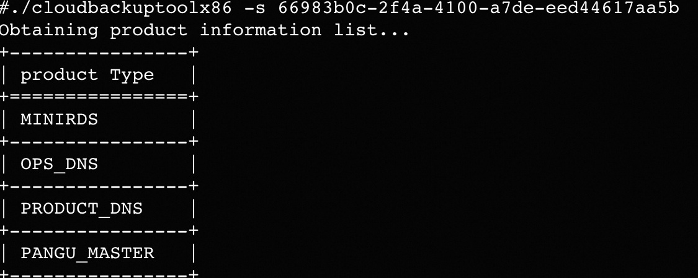
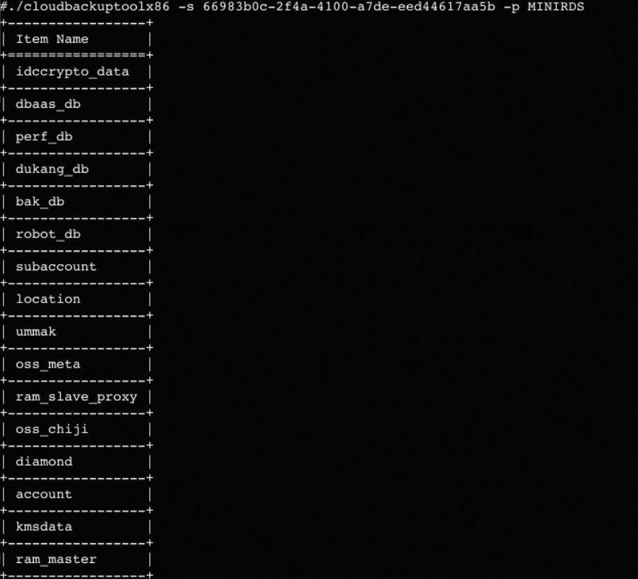
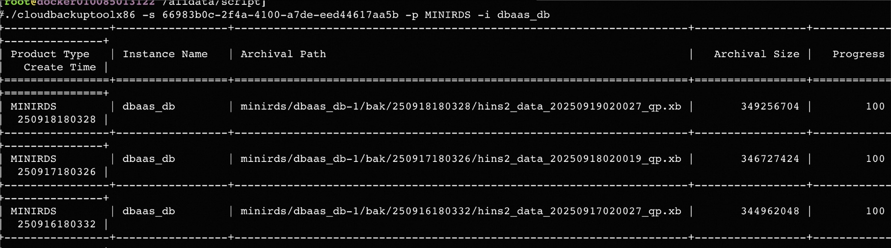
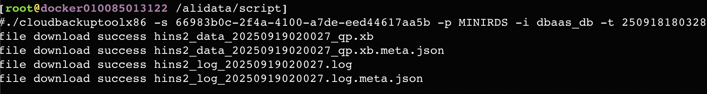
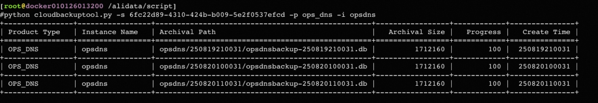
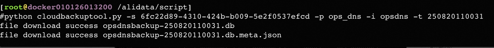
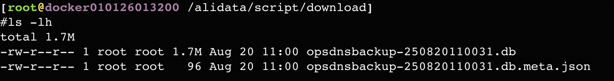

Alibaba Cloud  
Apsara Stack  
Apsara Stack Resilience  
Cloud Platform Backup and  
O&M Guide  
Product Version: V3.18.6  
Document Version: 20260701

**Table of Contents**

- [1.Objectives](#section-1)
- [2.Common O&M operations](#section-2)
    - [2.1. Download backups](#section-2-1)

<a id="section-1"></a>

# 1.Objectives

This guide is intended for helping O&M engineers perform preventive maintenance on Cloud Backup to ensure system stability. O&M engineers can follow the instructions in this guide to handle system issues that are identified during maintenance. If O&M engineers encounter system issues that are not listed in this guide, they can contact Apsara Stack technical support.

<a id="section-2"></a>

# 2.Common O&M operations

<a id="section-2-1"></a>

## 2.1. Download backups

A universal tool is provided to manage and download backup data. You can use this tool to retrieve all backup files from the current backup storage, independent of the cloud platform.

**Background information**

For physical machines:  `/cloud/app/ftpserver/FTPMaster#/ftpserver-`

```text
agent/current/script/cloudbackuptool 
```

Container version:  `/alidata/script/cloudbackuptool`

Directory structure:

- cloudbackuptool: The executable file for the download script.

- config.json: The configuration file for the executable program. It contains database and storage configuration information.

Go to the specified path on the physical machine or container where the FTP service runs to obtain the \`cloudbackuptool\` file.



config.json: By default, the config.json file contains the initialized storage information specified in the FTP service.

```json
{
  "storage": {
    "storageType": "",     #The storage type, which can be OSS or S3.
    "accessKeyId": "",     #The AccessKey ID used to access the bucket.
    "accessKeySecret": "", #The AccessKey secret used to access the bucket.
    "ossEndpoint": "",     #The endpoint of the bucket.
    "port": 9600,          
    "ossBucket": "",       #The bucket.
    "ossRegion": "",       #The region where the bucket resides.
    "useSsl" : false
  }
}
```

```text
cloudbackuptool
options:          
        -s storage id            Specifies the storage.     
        -p product name      Specifies the product.
        -i instance name         Specifies the instance.
        -t create time           Specifies the creation time of the backup set to 
download.   
        -c config_file           Specifies the path of the config.json file.
```

**ⅰ. List backup set information**

The following information is displayed for each storage pool:

- Lists all current storage information.

- You can retrieve a list of all products from the specified storage backup.

- List all instances that are backed up for the specified service.

- Download backup sets that are created at the specified time.

```text
./cloudbackuptool   #Run this command to get all storage information in the current environment.
./cloudbackuptool -s 66983b0c-2f4a-4100-a7de-eed44617aa5b  #Get a list of all products that are backed up in the specified storage.
./cloudbackuptool -s 66983b0c-2f4a-4100-a7de-eed44617aa5b -p MINIRDS #Get a list of instances that are backed up for the specified product.
./cloudbackuptool -s 66983b0c-2f4a-4100-a7de-eed44617aa5b -p MINIRDS -i dbaas_db #Get alist of downloadable backup sets for the specified instance.
./cloudbackuptool -s 66983b0c-2f4a-4100-a7de-eed44617aa5b -p MINIRDS -i dbaas_db -t 250918180328 #Download backup set information based on the specified creation time.
```

> **Important**
>
> If \`./cloudbackuptool\` fails to connect, manually modify the \`config.json\` file with the correct storage information and run the command again.
>
> Run ./cloudbackuptool -c config.json to connect to the specified storage.
>
> The corresponding command is as follows:
>
> ./cloudbackuptool -c config.json #Retrieves a list of all products that are backed up in the specified storage.
>
> ./cloudbackuptool -c config.json -p MINIRDS #Retrieves a list of instances that are backed up for the specified product.
>
> ./cloudbackuptool -c config.json -p MINIRDS -i dbaas_db #Retrieves a list of downloadable backup sets for the specified instance.
>
> ./cloudbackuptool -c config.json -p MINIRDS -i dbaas_db -t 250918180328 #Downloads the backup set created at the specified time.











**Example with opsdns**

Download backup records using the \`cloudbackuptool\` script:

- View the backup records for opsdns. cloudbackuptool -s 6fc22d89-4310-424b-b009-5e2f0537efcd -p ops_dns -i opsdns

  

- Download the latest backup record. cloudbackuptool -s 6fc22d89-4310-424b-b009-5e2f0537efcd -p ops_dns -i opsdns -t 250820110031

  

- The backup is saved to the /alidata/script/download directory for subsequent data recovery.

  

**Example with Pangu**

**Procedure**

1. Log on to the physical machine or container where the FTP service runs.

2. Run the following command to navigate to the script path.

   Path for physical machines:  `cd /cloud/app/ftpserver/FTPMaster#/ftpserver-`

   ```text
   agent/current/script/ 
   ```

   Path for containers:  `cd /alidata/script/cloudbackuptool`

3. Run the following command to retrieve the list of available storage pools.

   ```text
   ./cloudbackuptool
   PyInstaller/loader/pyimod03_importers.py:495: CryptographyDeprecationWarning: Python 
   3.6 is no longer supported by the Python core team. Therefore, support for it is deprecated in cryptography. The next release of cryptography will remove support for Python 3.6.
   +--------------------------------------+------------------+------------------+---------
   -+
   | Storage Id                           | Storage Name     | Storage Type     | 
   Protocol   |
   +======================================+==================+==================+=========
   =+
   | aa1da887-7d4c-4e00-a7e8-1a85cc9c8489 | Built-in storage | BUILT_IN_STORAGE | S3    
   |
   +--------------------------------------+------------------+------------------+---------
   -+
   | b9eba295-c94c-420d-a1cd-cdc731831a30 | oss-vault        | CUSTOM_STORAGE   | OSS   
   |
   +--------------------------------------+------------------+------------------+---------
   -+
   Traceback (most recent call last):
     File "cloudbackuptool.py", line 647, in <module>
     File "cloudbackuptool.py", line 596, in main
   Exception: The database connection is normal. Specify the storage with the -s parameter when you run the script.
   [14556] Failed to execute script 'cloudbackuptool' due to unhandled exception!
   ```

4. Run the following command and add the \`-s {Storage Id}\` parameter to retrieve the list of backed-up products. \`{Storage Id}\` is the Storage ID from the previous step.

   ```text
   ./cloudbackuptool -s {Storage Id}
   PyInstaller/loader/pyimod03_importers.py:495: CryptographyDeprecationWarning: Python 
   3.6 is no longer supported by the Python core team. Therefore, support for it is deprecated in cryptography. The next release of cryptography will remove support for Python 3.6.
   Obtaining product information list...
   +----------------+
   | Product Type   |
   +================+
   | PANGU_MASTER   |
   +----------------+
   | MINIRDS        |
   +----------------+
   | OPS_DNS        |
   +----------------+
   | PRODUCT_DNS    |
   +----------------+
   | BUCKET         |
   ```

5. Run the following command and specify the product to view using the \`-p {product}\` parameter. \`{product}\` is the Product Type from the previous step.

   ```text
   ./cloudbackuptool -s aa1da887-7d4c-4e00-a7e8-1a85cc9c8489 -p {product} 
   PyInstaller/loader/pyimod03_importers.py:495: CryptographyDeprecationWarning: Python 
   3.6 is no longer supported by the Python core team. Therefore, support for it is deprecated in cryptography. The next release of cryptography will remove support for Python 3.6.
   +------------------------------------------------+
   | Item Name                                      |
   +================================================+
   | AnalyticdbOnPanguHybrid-A-20251125-0160        |
   +------------------------------------------------+
   | CdsOssHybridCluster-A-20251125-00e8            |
   +------------------------------------------------+
   | HybridOdpsCluster-A-20251125-0095              |
   ```

6. Run the following command to specify the instance to view using the \`-i {instance}\` parameter. \`{instance}\` is the Item Name from the previous step.

   ```text
   ./cloudbackuptool -s aa1da887-7d4c-4e00-a7e8-1a85cc9c8489 -p PANGU_MASTER -i  {instance} -A-20251125-0160
   PyInstaller/loader/pyimod03_importers.py:495: CryptographyDeprecationWarning: Python 
   3.6 is no longer supported by the Python core team. Therefore, support for it is deprecated in cryptography. The next release of cryptography will remove support for Python 3.6.
   +----------------+-----------------------------------------+---------------------------
   --------------------------------------------------------------------+-----------------+
   ----------+---------------+
   | Product Type   | Instance Name                           | Archival Path             
   |   Archival Size |   Progress |Create Time |
   +================+=========================================+===========================
   ====================================================================+=================+
   ==========+===============+
   | PANGU_MASTER   | AnalyticdbOnPanguHybrid-A-20251125-0160 | 
   pangu_master/AnalyticdbOnPanguHybrid-A-20251125-
   0160/251212135320/pangu_master_op.134179593.cpt |         2256741 |        100 |  2512
   12135320 |
   +----------------+-----------------------------------------+---------------------------
   --------------------------------------------------------------------+-----------------+
   ----------+---------------+
   | PANGU_MASTER   | AnalyticdbOnPanguHybrid-A-20251125-0160 | 
   pangu_master/AnalyticdbOnPanguHybrid-A-20251125-
   0160/251212125318/pangu_master_op.133823271.cpt |         2235588 |        100 |  2512
   12125318 |
   +----------------+-----------------------------------------+---------------------------
   --------------------------------------------------------------------+-----------------+
   ----------+---------------+
   | PANGU_MASTER   | AnalyticdbOnPanguHybrid-A-20251125-0160 | 
   pangu_master/AnalyticdbOnPanguHybrid-A-20251125-
   0160/251212115215/pangu_master_op.133467610.cpt |         2236272 |        100 |  2512
   12115215 |
   +----------------+-----------------------------------------+---------------------------
   --------------------------------------------------------------------+-----------------+
   ----------+---------------+
   ```

7. Run the following command to download a backup set using the \`-t {time}\` parameter. \`{time}\` is the Create Time of the backup set from the previous step.

   ```text
   ./cloudbackuptool -s aa1da887-7d4c-4e00-a7e8-1a85cc9c8489 -p PANGU_MASTER -i AnalyticdbOnPanguHybrid-A-20251125-0160 -t {time}
   ```
