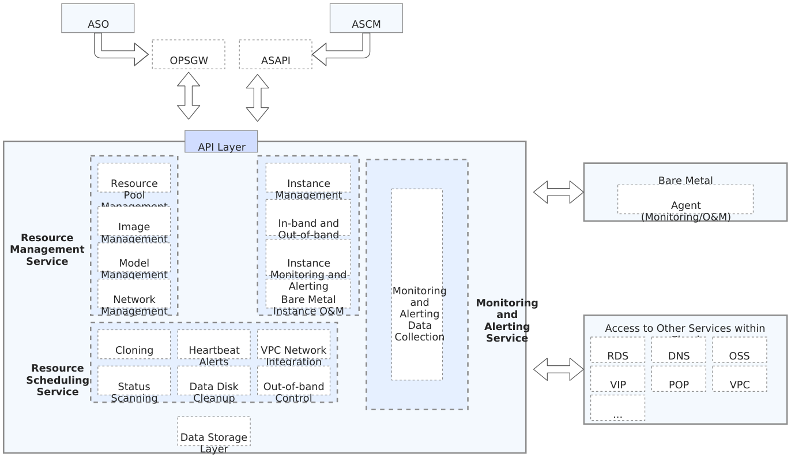

Alibaba Cloud  
Apsara Stack  
Apsara Stack Data Center as a  
service  
Product Introduction  
Product Version: v3.18.6-2607  
Document Version: 20260828

**Table of Contents**

- [1.Overview](#section-1)
- [2.Benefits](#section-2)
- [3.Common scenarios](#section-3)
- [4.Functions and features](#section-4)

# 1.Overview

Bare Metal Service (BMS) is a cloud service that provides physical servers to tenants on demand and in a flexible manner through a cloud platform. It is typically used to supply computing resources to services such as core databases, key application systems, and high-performance computing.

BMS implements management through the unified O&M interface of Apsara Stack. It directly manages physical servers at the node level, including adding or deleting physical servers, managing power supply, and deploying systems. After servers are installed and related preparations are made, the administrator can deploy multiple bare metal devices at a time through the UI. After the deployment is complete, these devices can be used to create bare metal instances. BMS supports custom installation of operating systems such as AliOS and CentOS on the x86 architecture, as well as full lifecycle management of bare metal instances.

The following figure shows the architecture of BMS.

# 2.Benefits

Bare Metal Service (BMS) is a complete set of general-purpose solutions that provide dedicated physical servers for core applications to ensure their high performance and stability. In simple terms, BMS can be regarded as a process of installing operating systems on bare metal servers, obtaining their configurations, and managing bare metal instances throughout their lifecycles, such as starting, stopping, and restarting them. The entire process only requires that the managed servers are powered on and connected to the network.

BMS provides users with high-performance computing clusters and a solution for applications that are not suitable for virtualization. It extends and enhances Aliclone capabilities and leverages shared-pool management. This way, BMS reaches the traditional IT applications of enterprises, improves the data migration efficiency, and helps customers seamlessly migrate their businesses to the cloud.

# 3.Common scenarios

Businesses and government agencies have diverse needs for IT infrastructure. In key scenarios such as high-performance computing, security compliance, and resource isolation, Bare Metal Service (BMS) is an ideal choice for supporting core business systems. This topic describes the typical use scenarios of BMS.

**Scenarios requiring direct access to hardware devices**

Certain computing tasks rely on dedicated hardware devices that cannot be passed through or simulated by using virtualization technology. BMS can directly access these hardware devices. This makes it suitable for key businesses that rely heavily on dedicated hardware in fields such as scientific research, manufacturing, finance, and telecommunications.

**Scenarios requiring high performance and low latency**

Core databases in sectors such as finance and telecommunications have stringent requirements for I/O latency, throughput, and stability. BMS provides dedicated CPU, memory, and local Non-Volatile Memory Express (NVMe) storage resources to ensure no resource contention. It also supports direct mounting of high-performance Storage Area Network (SAN) or Network-Attached Storage (NAS) arrays. This keeps the original storage architecture unchanged.

**Scenarios requiring security compliance, trustworthiness, and controllability**

Business systems in sectors with stringent infrastructure security and compliance requirements, such as finance, public service, energy, and military affairs, often have multiple control demands. These demands include using specific hardware, achieving strong resource isolation, meeting the requirements of Multi-Level Protection Scheme (MLPS) and Commercial Cryptography Application Security Assessment, and supporting features such as out-of-band management, secure boot, and audit traceability. At the resource level, BMS provides a dedicated instance for each tenant, and tenants are physically isolated from each other. This ensures no resource preemption between instances. In addition, BMS is compatible with a variety of systems, supports automated deployment and remote maintenance of servers, and offers out-of-band management capabilities to enhance the manageability and controllability of infrastructure. For these reasons, BMS is suitable for key scenarios that have stringent requirements for security compliance, performance isolation, and system controllability.

**Scenarios requiring the management and reuse of existing resources**

Government and enterprise customers often own a large number of purchased physical servers that are distributed in different departments or data centers. This leads to the issues of decentralized management and low resource utilization. BMS can integrate these servers into a cloud platform for centralized management. Additionally, it supports mounting traditional storage arrays, such as SAN and NAS, to ensure the effective use of existing investments and the continuity of established user habits.

**Scenarios requiring hosting on a cloud platform**

Traditional enterprise customers often operate a large number of existing virtualized or third-party cloud platforms, such as VMware and OpenStack. Due to performance and compatibility issues arising from nested virtualization, such platform software is usually unsuitable for running in virtual machines. In contrast, BMS effectively supports the platform applications and facilitates the integration of existing cloud applications with existing full-stack cloud services. BMS provides these platforms with independent physical resources that can be directly deployed on bare metal servers. This avoids the overlay of virtualization layers and ensures their high-performance operation and functional integrity. BMS is widely used in sectors such as finance, energy, and manufacturing. It helps customers protect their existing investments, integrate new and existing cloud systems, and establish a converged, elastic, and scalable full-stack cloud architecture.

# 4.Functions and features

Bare Metal Service (BMS) consists of two service modules: the Bare Metal Instances module and the Managed Instances module. BMS helps you manage physical bare metal servers.

**Features on BMS user side**

**Module or feature**

**Description**

The Overview page displays monitored bare metal instance resources to meet user requirements for instance operations and management. This page provides an instance overview

Overview

and monitoring information, including monitored instance status, image information, disk monitoring results, as well as CPU, memory, and network load monitoring metrics.

The Bare Metal Instances page allows you to perform the following operations:

- You can create, batch create, release, or reapply for instances, and view asset operations and management information.

- You can perform remote O&M operations on existing bare

Bare Metal

metal instances, including starting, stopping, and restarting

Instances

them.

- You can centrally monitor the resources of bare metal instances that you have applied for, including monitoring the CPU utilization, memory usage, disk load, network load, and number of online servers.

Bare Metal Instances

The Bare Metal Instance Alerts page displays fault alerts

Bare Metal

generated for the bare metal instances that you have created

Instance Alerts

and allows you to handle these alerts.

The Bare Metal Instance Monitoring page displays the

Bare Metal

monitored running information of bare metal instance

Instance

resources that you have created, including the CPU utilization,

Monitoring

memory usage, disk load, system load, and network load.

<table>
  <tr>
    <td rowspan="3">Managed Instances</td>
    <td>Overview</td>
    <td>The Overview page displays monitored bare metal instance resources in a dashboard to meet user requirements for instance operations and management. This page includes the Service Check, Unhandled Alerts, and Core Metrics sections. • Service Check: This section displays health check results of managed instances and provides the following four possible statuses for each check item based on the health check results: Normal, Risk, Abnormal, and Suggestion. • Unhandled Alerts: This section displays fault alerts generated for out-of-band managed instances that have not been handled today by alert levels from P1 to P4. • Core Metrics: This section displays the total number of out-of-band managed instances.</td>
  </tr>
  <tr>
    <td>Out-of-band Managed Instances</td>
    <td>To meet user requirements for out-of-band management of existing servers, the Out-of-band Managed Instances page allows you to operate and manage out-of-band managed instances, such as adding, querying, and releasing them. You can also perform remote O&amp;M operations on existing out-of-band managed instances, such as starting, stopping, restarting, and monitoring them, querying their operation logs, and logging into them from an out-of-band console. The feature of adding out-of-band managed instances allows you to specify basic information, data center information, and out-of-band information for managed instances.</td>
  </tr>
  <tr>
    <td>Managed Instance Alerts</td>
    <td>The Managed Instance Alerts page displays fault alerts generated for hosted bare metal servers in instance resources that have been monitored and allows you to handle these alerts. On this page, fault alerts are classified into handled and unhandled types to make operations more concise and clear.</td>
  </tr>
  <tr>
    <td rowspan="2">Images</td>
    <td>Public Images</td>
    <td>On the Public Images tab, you can query, change the status of, and export public images.</td>
  </tr>
  <tr>
    <td>Custom Images</td>
    <td>To meet user requirements for personalized management of images during operations, the Custom Images tab allows you to query, view displayed information of, manage, operate, and upload custom images. To be specific: • When you upload a custom image, you can configure its region, platform, and system architecture to facilitate image classification and management. • The information displayed on the Custom Images tab includes the image name/ID, size, system architecture, platform, image format, status, and creation time.</td>
  </tr>
</table>

**Features on BMS O&M side**

| Module or feature | Description |
| --- | --- |

<table>
  <tr>
    <td rowspan="3">Basic Settings</td>
    <td>Models</td>
    <td>The Models page allows you to add, query, modify, and delete models as an administrator. By performing these operations, you can manage model information more flexibly to meet changing business requirements. The model management feature helps ensure the accuracy and consistency of model information, which further simplifies the management and deployment of bare metal instances.</td>
  </tr>
  <tr>
    <td>Network</td>
    <td>The Network page allows administrators to query and view information about existing subnets or obtain information about new subnets based on their requirements.</td>
  </tr>
  <tr>
    <td>Images</td>
    <td>The Images page allows you to maintain the metadata of images that have been used to install bare metal servers as an administrator. You can also query, manage the status of, delete, and export custom images. However, you can only query, manage the status of, and export public images.Administrators can upload custom images based on their requirements.</td>
  </tr>
  <tr>
    <td colspan="2">Instances</td>
    <td>The Instances page allows you to register, batch register, release, or re-register instances, and query asset O&amp;M and management information as an administrator. You can search for instances by instance name, SN, subnet IP address, Virtual Private Cloud (VPC) IP address, and out-of-band IP address. In addition, the system provides the details of the last operation log and allows you to perform remote O&amp;M operations on existing instances, such as starting, stopping, and restarting them, as an administrator.</td>
  </tr>
  <tr>
    <td rowspan="3">Monitorin g &amp; Alerting</td>
    <td>Instance Monitorin g</td>
    <td>The Bare Metal Instance Monitoring page displays the monitoring data of bare metal instances and provides information about the running conditions of bare metal instance resources that have been registered by administrators. For example, you can view the CPU utilization, memory-related metrics, and network-related metrics of bare metal instances.</td>
  </tr>
  <tr>
    <td>Managed Instance Alerts</td>
    <td>• The Managed Instance Alerts page allows administrators to handle fault alerts generated for tenant-side managed instances. The managed instance alerts feature enables administrators to identify and resolve potential issues at the earliest opportunity. This way, stable operation and high availability of managed instances can be ensured. • The Managed Instance Alerts page displays the alerts generated for managed instances and allows you to search for specific alerts by SN, alert type, alert level, number of alerts, instance IP address, and start and end time. You can also mark whether an alert has been handled.</td>
  </tr>
  <tr>
    <td>Bare Metal Instance Alerts</td>
    <td>The Bare Metal Instance Alerts page allows administrators to handle fault alerts generated for registered bare metal instances. This helps identify and resolve potential issues at the earliest opportunity and ensures the stable operation of bare metal instances. The Bare Metal Instance Alerts page displays the alerts generated for bare metal instances and allows you to search for specific alerts by SN, alert type, alert level, number of alerts, instance IP address, and start and end time. You can also mark whether an alert has been handled.</td>
  </tr>
</table>
