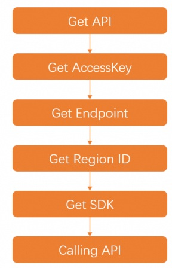
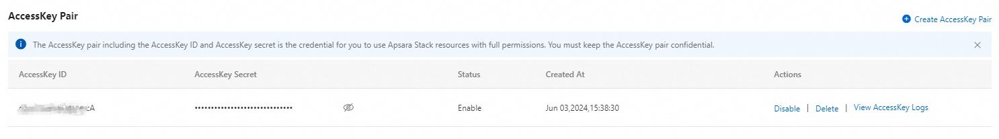
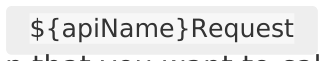
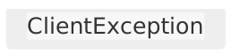

Alibaba Cloud  
Apsara Stack  
apsara stack resilience  
ASR for Geo-disaster  
Developer Guide  
Product Version: v3.18.6-2607  
Document Version: 20260902

**Table of Contents**

- [1.Procedure for API calls](#section-1)
- [2.Preparations](#section-2)
    - [2.1. Obtain AccessKey pair](#section-2-1)
    - [2.2. Obtain an endpoint](#section-2-2)
    - [2.3. Obtain an SDK](#section-2-3)
- [3.Use the SDK for Java](#section-3)
    - [3.1. Install the SDK for Java](#section-3-1)
    - [3.2. Configure authentication credentials](#section-3-2)
    - [3.3. Initiate a request](#section-3-3)
    - [3.4. Handle exceptions](#section-3-4)
- [4.API reference](#section-4)
    - [4.1. Legacy API (deprecated)](#section-4-1)
        - [4.1.1. API overview](#section-4-1-1)
        - [4.1.2. Initialization operations](#section-4-1-2)
            - [4.1.2.1. InitUser](#section-4-1-2-1)
        - [4.1.3. Cloud instances](#section-4-1-3)
            - [4.1.3.1. CreateBackupCloud](#section-4-1-3-1)
            - [4.1.3.2. CreateMainCloud](#section-4-1-3-2)
            - [4.1.3.3. DescribeBackupCloud](#section-4-1-3-3)
            - [4.1.3.4. DescribeCloud](#section-4-1-3-4)
            - [4.1.3.5. ListMainCloud](#section-4-1-3-5)
            - [4.1.3.6. ListSupportRegion](#section-4-1-3-6)
            - [4.1.3.7. UpdateBackupCloud](#section-4-1-3-7)
            - [4.1.3.8. UpdateMainCloud](#section-4-1-3-8)
            - [4.1.3.9. UpdateProductConfig](#section-4-1-3-9)
            - [4.1.3.10. UpdateProductConfig](#section-4-1-3-10)
        - [4.1.4. Protection groups](#section-4-1-4)
            - [4.1.4.1. CreateProtectGroup](#section-4-1-4-1)
            - [4.1.4.2. DescribeProtectGroup](#section-4-1-4-2)
            - [4.1.4.3. ListProtectGroup](#section-4-1-4-3)
            - [4.1.4.4. RemoveProtectGroup](#section-4-1-4-4)
            - [4.1.4.5. UpdateProtectGroup](#section-4-1-4-5)
        - [4.1.5. Plan](#section-4-1-5)
            - [4.1.5.1. CreatePlan](#section-4-1-5-1)
            - [4.1.5.2. DescribePlan](#section-4-1-5-2)
            - [4.1.5.3. DescribePlanInstance](#section-4-1-5-3)
            - [4.1.5.4. ListPlan](#section-4-1-5-4)
            - [4.1.5.5. ListPlanInstance](#section-4-1-5-5)
            - [4.1.5.6. RemovePlan](#section-4-1-5-6)
            - [4.1.5.7. StartPlan](#section-4-1-5-7)
            - [4.1.5.8. StartUserTask](#section-4-1-5-8)
            - [4.1.5.9. UpdatePlan](#section-4-1-5-9)
    - [4.2. New API](#section-4-2)
        - [4.2.1. API overview](#section-4-2-1)
        - [4.2.2. Cloud instances](#section-4-2-2)
            - [4.2.2.1. UpdateCloudInstance](#section-4-2-2-1)
            - [4.2.2.2. ListCloudInstances](#section-4-2-2-2)
            - [4.2.2.3. GetCloudInstance](#section-4-2-2-3)
            - [4.2.2.4. DeleteCloudInstance](#section-4-2-2-4)
            - [4.2.2.5. ListCloudCenter](#section-4-2-2-5)
            - [4.2.2.6. CreateCloudInstanceFromCloudCenter](#section-4-2-2-6)
        - [4.2.3. Disaster recovery relationship](#section-4-2-3)
            - [4.2.3.1. UpdateDrGroup](#section-4-2-3-1)
            - [4.2.3.2. ListDrGroups](#section-4-2-3-2)
            - [4.2.3.3. GetDrGroup](#section-4-2-3-3)
            - [4.2.3.4. DeleteDrGroup](#section-4-2-3-4)
            - [4.2.3.5. CreateDrGroup](#section-4-2-3-5)
        - [4.2.4. Protection groups](#section-4-2-4)
            - [4.2.4.1. UpdateProtectGroup](#section-4-2-4-1)
            - [4.2.4.2. ProtectGroupCtl](#section-4-2-4-2)
            - [4.2.4.3. ListProtectGroups](#section-4-2-4-3)
            - [4.2.4.4. GetProtectGroup](#section-4-2-4-4)
            - [4.2.4.5. DeleteProtectGroup](#section-4-2-4-5)
            - [4.2.4.6. CreateProtectGroup](#section-4-2-4-6)
        - [4.2.5. Sync entities](#section-4-2-5)
            - [4.2.5.1. UpdateSyncGroup](#section-4-2-5-1)
            - [4.2.5.2. SyncGroupCtl](#section-4-2-5-2)
            - [4.2.5.3. ListSyncGroups](#section-4-2-5-3)
            - [4.2.5.4. GetSyncGroup](#section-4-2-5-4)
            - [4.2.5.5. DeleteSyncGroup](#section-4-2-5-5)
            - [4.2.5.6. CreateSyncGroup](#section-4-2-5-6)
        - [4.2.6. Disaster recovery plan](#section-4-2-6)
            - [4.2.6.1. UpdateRecoveryPlan](#section-4-2-6-1)
            - [4.2.6.2. RecoveryTaskCtl](#section-4-2-6-2)
            - [4.2.6.3. ListRecoveryTasks](#section-4-2-6-3)
            - [4.2.6.4. ListRecoveryPlans](#section-4-2-6-4)
            - [4.2.6.5. GetRecoveryTask](#section-4-2-6-5)
            - [4.2.6.6. GetRecoveryPlan](#section-4-2-6-6)
            - [4.2.6.7. DeleteRecoveryTask](#section-4-2-6-7)
            - [4.2.6.8. DeleteRecoveryPlan](#section-4-2-6-8)
            - [4.2.6.9. CreateRecoveryTask](#section-4-2-6-9)
            - [4.2.6.10. CreateRecoveryPlan](#section-4-2-6-10)

<a id="section-1"></a>

# 1.Procedure for API calls

You can use the POP gateway to call API operations in ASR for Geo-disaster Recovery.

**Flowchart**

The following figure shows the flowchart for calling API operations in ASR for Geo-disaster Recovery.



**Procedure**

1. Obtain API information.

   For more information, see API Reference.

2. Obtain the AccessKey ID and AccessKey secret. For more information, see Obtain AccessKey pair.

3. Obtain the endpoint of ASR for Geo-disaster Recovery. For more information, see Obtain an endpoint.

4. Obtain the region ID of ASR for Geo-disaster Recovery. For more information, see Obtain a region ID.

5. Obtain the ASR for Geo-disaster Recovery SDK and SDK core library. For more information, see Obtain the SDK package.

6. Call API operations in ASR for Geo-disaster Recovery.

   > **Note**
   >
   > - Only users who are granted the permissions of the operations administrator, organization administrator, global disaster recovery administrator, or organization disaster recovery administrator role can call API operations in ASR for Geo-disaster Recovery.

<a id="section-2"></a>

# 2.Preparations

<a id="section-2-1"></a>

## 2.1. Obtain AccessKey pair

This topic describes how to obtain an AccessKey ID and an AccessKey secret.

**Background information**

AccessKey uses symmetric encryption with the AccessKey ID and AccessKey secret to authenticate the identity of a request sender. The AccessKey ID identifies a user, and the AccessKey secret is the string used by the user for encrypted signature.

**Obtain AccessKey pair**

The Apsara Uni-manager Management Console provides personal AccessKey pairs and organization AccessKey pairs. We recommend that you use personal AccessKey pairs to call API operations.

> **Note**
>
> - Only operations administrators and level-1 organization administrators can obtain AccessKey pairs for organization accounts.
>
> - **When you obtain a personal AccessKey pair, make sure that the logged-on user has one of the following roles: operations administrator, organization administrator, global disaster recovery administrator, or organization disaster recovery administrator. Otherwise, the API operation call may fail.**

**Obtain a personal AccessKey pair**

1. Log on to the Apsara Uni-manager Management Console.

2. In the upper-right corner of the page, click the profile picture of the logged-on user and click **Personal Information**.

3. In the **AccessKey** section, you can view the AccessKey information of your personal account.

   

   > **Important**
   >
   > An AccessKey pair consists of an AccessKey ID and an AccessKey secret. The AccessKey pair provides full permissions on cloud resources within your account. You must keep the AccessKey pair confidential.

**Obtain an organization AccessKey pair**

> **Warning**
>
> The AccessKey pair of a personal account is managed and controlled by the permission system of the Apsara Uni-manager Management Console. If you need to obtain the AccessKey pair of an organization, make sure that your operation is allowed by an administrator. This ensures security.

1. Log on to the Apsara Uni-manager Management Console as an administrator.

2. In the top menu bar, click **Enterprise**.

3. In the left-side navigation pane, choose **Resource Management** > **Organization Management**.

4. In the organization chart, click the name of the target level-1 organization.

5. Click **Manage AccessKey**.

6. In the dialog box that appears, view the organization AccessKey information.

<a id="section-2-2"></a>

## 2.2. Obtain an endpoint

This topic describes how to obtain an endpoint.

1. Log on to the Apsara Uni-manager Operations Console.

2. In the top navigation bar, choose **Platform Operation > Apsara Infrastructure Management > Resources**.

3. In the left-side navigation pane of the **Apsara Infrastructure Management console**, choose **Resources > Product & Cluster O&M**.

4. Enter asrdr in the search box. Find the primary cluster of Apsara Stack Resilience for Geo-disaster Recovery (ASR-DR) in the search result and click **Cluster Details** in the **Actions** column.

5. On the details page of the primary cluster, click the **Resource Details** tab. Find the

   resource named  `asrdr-api`  and click the  icon in the **Resource Application Result**

   column. The value of the  `domain`  parameter is the endpoint.

<a id="section-2-3"></a>

## 2.3. Obtain an SDK

If you want to call the API operations of Apsara Stack Resilience for Geo-disaster Recovery (ASR-DR) by using the POP gateway, you must obtain the SDK core library from SDK Center and integrate the SDK dependencies of ASR-DR.

- Obtain the SDK core library: Go to SDK Center and download the **SDK core library** for your programming language.

- Integrate the SDK dependencies of ASR-DR: For more information, see the documentation of Alibaba Cloud SDKs.

> **Note**
>
> - We recommend that you use the SDK core library that is provided on the Alibaba Cloud official website. The SDK core library is shared by all cloud services and is compatible with Apsara Stack.
>
> - ASR-DR SDK supports Java.

<a id="section-3"></a>

# 3.Use the SDK for Java

<a id="section-3-1"></a>

## 3.1. Install the SDK for Java

This topic describes how to install Apsara Stack Resilience for Geo-disaster Recovery (ASR-DR) SDK for Java.

**Prerequisites**

Java Development Kit (JDK) 1.8 or later is installed.

**Install Apsara Stack SDK for Java**

If you use Apache Maven to manage a Java project, you need to only import the JAR files of Apsara Stack SDK for Java to the pom.xml file of the project.

To call the SDK for Java, you must install the SDK core library and integrate the SDK dependencies of ASR-DR. We recommend that you use the SDK core library V4.5.17 or later and use the SDK for Java V1.0.0.

The following sample code configures the pom.xml file for the SDK for Java:

```xml
<dependencies>
    <!--Required dependencies-->
    <dependency>
        <groupId>com.aliyun</groupId>
        <artifactId>aliyun-java-sdk-asrdr</artifactId>
        <version>1.0.0</version>
    </dependency>
    <dependency>
        <groupId>com.aliyun</groupId>
        <artifactId>aliyun-java-sdk-core</artifactId>
        <version>4.6.0</version>
    </dependency>
</dependencies>
```

<a id="section-3-2"></a>

## 3.2. Configure authentication credentials

When you use Apsara Stack SDKs to access Apsara Stack services, you must provide an Apsara Stack tenant account for identity verification.

If you use the SDK for Java, you can use an AccessKey pair for identity verification. For more information about how to obtain an AccessKey ID and an AccessKey secret, an endpoint, and a region ID, see Obtain an AccessKey pair, Obtain an endpoint, and Obtain a region ID.

If you want to use your AccessKey pair to access Apsara Stack, you must configure the AccessKey pair as the credentials when you initialize the client.

> **Important**
>
> Do not disclose any code that contains your AccessKey pair. For example, do not commit the code to public GitHub projects. Otherwise, your account may be exposed to risks.

```text
// Configure the endpoint of the API.
DefaultProfile.addEndpoint(
    "<EndpointName>",    // The name of the endpoint. Example: Asrdr.
    "<RegionId>",      // The region ID.
    "<ProductCode>",     // The code of the cloud service. Example: Asrdr.
    "<Endpoint>"        // The endpoint of the cloud service.
);
// Configure authentication credentials.
DefaultProfile profile = DefaultProfile.getProfile(
    "<yourRegionID>",         // The region ID.
    "<yourAccessKeyID>",      // The AccessKey ID of your personal account.
    "<yourAccessKeySecret>",  // The AccessKey secret of your personal account.
);
```

> **Note**
>
> - In the preceding sample code, replace the variables  `<yourRegionID>` ,  `<yourAccessKeyID>` , and  `<yourAccessKeySecret>`  with actual values and remove the angle brackets (<>) from the code.
>
> - You must call the API operations of Apsara Stack Resilience for Geo-disaster Recovery (ASR-DR) as a user that is assigned one of the following roles: operations administrator, organization administrator, global disaster recovery administrator, and organization disaster recovery administrator.

<a id="section-3-3"></a>

## 3.3. Initiate a request

This topic describes how to use the SDK for Java to initiate a request.

**Procedure**

1. Create an AcsClient instance.

   ```text
   DefaultAcsClient client = new DefaultAcsClient(profile);
   ```

2. Create a request.

   

   Name the request in the  ${apiName}Request  format. Replace **${apiName}** with the name of the API operation that you want to call, such as DescribeBackupCloud.

   ```text
   DescribeBackupCloudRequest request = new DescribeBackupCloudRequest();
   ```

3. Initiate the request and obtain a response.

   ```java
   // Initiate the request and view the response.
   DescribeBackupCloudResponse response = client.getAcsResponse(request);
   System.out.println(response.getData());
   ```

**Complete sample code**

The following sample code calls the  `DescribeBackupCloud`  operation of Apsara Stack Resilience for Geo-disaster Recovery (ASR-DR):

```java
import com.aliyuncs.asrdr.model.v20220209.*;
import com.aliyuncs.exceptions.ClientException;
import com.aliyuncs.http.MethodType;
import com.chenxue.product.api.base.ApiBaseInfo;
import com.chenxue.product.api.base.ProductBaseApi;
import com.google.gson.Gson;
import org.slf4j.Logger;
import org.slf4j.LoggerFactory;

public class AsrdrApi extends ProductBaseApi {

    public void listPlanInstance(String planId, ApiBaseInfo apiBaseInfo) throws ClientException {
      try {        
        // Configure the endpoint of the API.
        DefaultProfile.addEndpoint(
            "<EndpointName>",    // The name of the endpoint. Example: Asrdr.
            "<RegionId>",      // The region ID.
            "<ProductCode>",     // The code of the cloud service. Example: Asrdr.
            "<Endpoint>"        // The endpoint of the cloud service.
        );
        // Configure authentication credentials.
        DefaultProfile profile = DefaultProfile.getProfile(
            "<yourRegionID>",         // The region ID.
            "<yourAccessKeyID>",      // The AccessKey ID of your personal account.
            "<yourAccessKeySecret>",  // The AccessKey secret of your personal account.
        );
        // Construct the client.
        DefaultAcsClient client = new DefaultAcsClient(profile);
        //Construct request parameters.
        DescribeBackupCloudRequest request = new DescribeBackupCloudRequest();
        request.setMethod(MethodType.GET);
        request.setVersion("2022-02-09");
        request.setActionName("DescribeBackupCloud");
        // Call the API operation.
        DescribeBackupCloudResponse response = client.getAcsResponse(request);
        System.out.println(response.getData());
        
      } 
    }
}
```

<a id="section-3-4"></a>

## 3.4. Handle exceptions

If the server or client encounters an exception when you use the SDK for Java, the SDK returns the exception information. The exception information contains an error code and an error message.

In most cases, you do not need to handle exceptions based on the exception information returned by the SDK for Java. You need to only handle server exceptions based on error messages generated on the server side.


- ServerException  indicates a server exception.



- ClientException  indicates a client exception.

For example, when the following exception occurs, you can modify the AccessKey ID based on the error message:

```text
com.aliyuncs.exceptions.ClientException: InvalidAccessKeyId.NotFound : Specified accesskey is not found.
```

If you want to handle exceptions based on the exception information returned by the SDK for Java, you can use the following sample code:

```java
try {
    AcsResponse response = client.getAcsResponse(request);
    // Handle the response.
    // ...
} catch (ClientException e) {
    // Add your logic for handling exceptions.
    // For example, you can display the exception information.
    System.out.println("ErrorCode=" + e.getErrCode());
    System.out.println("ErrorMessage=" + e.getErrMsg());
    e.printStackTrace();
} catch (ServerException e) {
    e.printStackTrace();
}
```

<a id="section-4"></a>

# 4.API reference

<a id="section-4-1"></a>

## 4.1. Legacy API (deprecated)

As of enterprise edition v3.18.6, the legacy API is deprecated. Please use the new API.

<a id="section-4-1-1"></a>

### 4.1.1. API overview

| API | Version | Description |
| --- | --- | --- |
| InitUser | 2022-02-09 | Initializes a user. |
| CreateBackupCloud | 2022-02-09 | Creates a backup cloud. |
| CreateMainCloud | 2022-02-09 | Creates a primary cloud. |
| DescribeBackupCloud | 2022-02-09 | Describes a backup cloud. |
| DescribeCloud | 2022-02-09 | Describes a primary cloud. |
| ListMainCloud | 2022-02-09 | Lists primary clouds. |
| ListSupportRegion | 2022-02-09 | Lists supported regions. |
| UpdateBackupCloud | 2022-02-09 | Updates a backup cloud. |
| UpdateMainCloud | 2022-02-09 | Updates a primary cloud. |
| UpdateProductConfig | 2022-02-09 | Updates the product configuration. |
| CreateProtectGroup | 2022-02-09 | Creates a protection group. |
| DescribeProtectGroup | 2022-02-09 | Describes a protection group. |
| ListProtectGroup | 2022-02-09 | Lists protection groups. |
| RemoteProtectGroup | 2022-02-09 | Removes a protection group. |
| UpdateProtectGroup | 2022-02-09 | Updates a protection group. |
| CreatePlan | 2022-02-09 | Creates a plan. |
| DescribePlan | 2022-02-09 | Describes a plan. |
| DescribePlanInstance | 2022-02-09 | Describes a plan instance. |
| ListPlan | 2022-02-09 | Lists plans. |
| ListPlanInstance | 2022-02-09 | Lists plan instances. |
| RemovePlan | 2022-02-09 | Removes a plan. |
| StartPlan | 2022-02-09 | Starts a plan. |
| StartUserTask | 2022-02-09 | Starts a user task. |
| UpdatePlan | 2022-02-09 | Updates a plan. |

<a id="section-4-1-2"></a>

### 4.1.2. Initialization operations

<a id="section-4-1-2-1"></a>

#### 4.1.2.1. InitUser

Call InitUser to initialize user information.

**Request headers**

The InitUser operation does not have operation-specific request headers and uses only common request headers. For more information, see Common request parameters.

**Request parameters**

| Parame ter | Typ e | Positi on | Require d | Example | Description |
| --- | --- | --- | --- | --- | --- |
| UserAcces sKeyId | Strin g | Query | Yes | Su\*\*\*\*\*\*\*\*Uk | The AccessKey ID of the user. |
| UserAcces sKeySecre t | Strin g | Query | Yes | 78\*\*\*\*\*\*\*\*Zp | The AccessKey Secret of the user. |
| PrimaryKe y | Strin g | Query | No | 28\*\*\*\*\*\*\*\*71 | The user ID. |

**Return data**

| Parameter | Type | Example | Description |
| --- | --- | --- | --- |
| RequestID | String | 4558c408\*\*\*\*\*\*\*\*3 7b0c94e | The request ID. |
| Result | String | SUCCESS | Indicates whether the call was successful.Valid values:<br>• SUCCESS: succeeded<br>• FAILED: failed |
| Code | String | 200 | The response code. The status code 200 indicates that the request was successful. |
| NodeHost | String | docker0100170490 17 | The node name. |
| NodeIp | String | 127.0.0.1 | The IP address of the node. |
| Data | Struct |  | The information about the user. |
| -PrimaryKey | String | 28\*\*\*\*\*\*\*\*71 | The user ID. |
| -Name | String | admin | The username. |
| -DisplayName | String | admin | The display name. |

**Examples**

Sample requests

```text
http(s)://[Endpoint]/?Action=InitUser
&UserAccessKeyId=Su********Uk
&UserAccessKeySecret=78********Zp
&Common request parameters
```

Sample success responses

`JSON`  format

```json
{
 "RequestID":"4558c408********37b0c94e",
 "Data":{
  "DisplayName":"admin",
  "PrimaryKey":"28********71",
  "Name":"admin"
 },
 "NodeIp":"127.0.0.1",
 "Code":"200",
 "Result":"SUCCESS",
 "NodeHost":"docker010017049017"
}
```

`XML`  format

```xml
<RequestID>4558c408********37b0c94e</RequestID>
<Data>
 <DisplayName>admin</DisplayName>
 <PrimaryKey>28********71</PrimaryKey>
 <Name>admin</Name>
</Data>
<NodeIp>127.0.0.1</NodeIp>
<Code>200</Code>
<Result>SUCCESS</Result>
<NodeHost>docker010017049017</NodeHost>
```

<a id="section-4-1-3"></a>

### 4.1.3. Cloud instances

<a id="section-4-1-3-1"></a>

#### 4.1.3.1. CreateBackupCloud

Call CreateBackupCloud to create a secondary cloud.

**Request headers**

The CreateBackupCloud operation does not have operation-specific request headers and uses only common request headers. For more information, see the documentation of common request parameters.

**Request parameters**

| Parameter name | Type | Posit ion | Required | Example | Description |
| --- | --- | --- | --- | --- | --- |
| Address | Strin g | Quer y | Yes | http://internal.example.xx xxx | The cloud management API Endpoint. |
| CloudNam e | Strin g | Quer y | Yes | backup-212e | The name of the cloud instance. |
| CloudType | Strin g | Quer y | Yes | BACKUP | The primary/secondary type of the cloud instance. You must set this parameter to BACKUP. |
| CloudOSTy pe | Strin g | Quer y | Yes | ENTERPRISE | The cloud version type.You must set this parameter to ENTERPRISE. Only Apsara Stack Enterprise is supported. |
| CloudCons oleType | Strin g | Quer y | Yes | ASCM | The cloud management type. You must set this parameter to ASCM. Only ASCM is supported. |
| UserAcces sKeyId | Strin g | Quer y | Yes | CU\*\*\*\*\*\*\*\*Yh | The AccessKey ID of the secondary cloud operations administrator. |
| UserAcces sKeySecret | Strin g | Quer y | Yes | ClHm\*\*\*\*\*\*\*\*Xxqf | The AccessKey Secret of the secondary cloud operations administrator. |

**Return data**

| Parameter name | Type | Example | Description |
| --- | --- | --- | --- |
| RequestID | String | 4383c8\*\*\*\*\*\*\*\*ad5 3c7 | The request ID. |
| Result | String | SUCCESS | Indicates whether the call was successful.Valid values:<br>• SUCCESS: succeeded<br>• FAILED: failed |
| Code | String | 200 | The response code. The status code 200 indicates that the request was successful. |
| NodeHost | String | docker0100170490 17 | The name of the node. |
| NodeIp | String | 127.0.0.1 | The IP address of the node. |
| Data | Struct | - | The detailed information about the secondary cloud. |
| -Id | String | ffe130bc\*\*\*\*\*\*\*\*24 c76d6d | The ID of the secondary cloud. |

**Examples**

`JSON`  format

```json
{
 "RequestID":"4383c8********ad53c7",
 "Data":{
  "Id":"ffe130bc********24c76d6d"
 },
 "NodeIp":"127.0.0.1",
 "Code":"200",
 "Result":"SUCCESS",
 "NodeHost":"docker010017049017"
}
```

`XML`  format

```xml
<RequestID>4383c8********ad53c7</RequestID>
<Data>
 <Id>ffe130bc********24c76d6d</Id>
</Data>
<NodeIp>127.0.0.1</NodeIp>
<Code>200</Code>
<Result>SUCCESS</Result>
<NodeHost>docker010017049017</NodeHost>
```

<a id="section-4-1-3-2"></a>

#### 4.1.3.2. CreateMainCloud

Call CreateMainCloud to create a primary cloud.

**Request headers**

The CreateMainCloud operation does not have operation-specific request headers and uses only common request headers. For more information, see the documentation of common request parameters.

**Request parameters**

| Parameter name | Type | Posit ion | Required | Example | Description |
| --- | --- | --- | --- | --- | --- |
| Address | Strin g | Quer y | Yes | http://internal.example.xx xxx | The cloud management API Endpoint. |
| CloudNam e | Strin g | Quer y | Yes | 212e | The name of the cloud instance. |
| CloudScen e | Strin g | Quer y | Yes | MULTIPLE_CLOUD | The disaster recovery type. You must set this parameter to MULTIPLE_CLOUD. Only cross-cloud disaster recovery is supported. |
| CloudOSTy pe | Strin g | Quer y | Yes | ENTERPRISE | The cloud version type.You must set this parameter to ENTERPRISE. Only Apsara Stack Enterprise is supported. |
| CloudCons oleType | Strin g | Quer y | Yes | ASCM | The cloud management type. You must set this parameter to ASCM. Only ASCM is supported. |
| UserAcces sKeyId | Strin g | Quer y | Yes | CU\*\*\*\*\*\*\*\*Yh | The AccessKey ID of the operations administrator of the primary cloud. |
| UserAcces sKeySecret | Strin g | Quer y | Yes | ClH\*\*\*\*\*\*\*\*xqf | The AccessKey Secret of the operations administrator of the primary cloud. |

**Return data**

| Parameter name | Type | Example | Description |
| --- | --- | --- | --- |
| RequestID | String | 4383\*\*\*\*\*\*\*\*53c7 | The request ID. |
| Result | String | SUCCESS | Indicates whether the call was successful.Valid values:<br>• SUCCESS: succeeded<br>• FAILED: failed |
| Code | String | 200 | The returned code. 200 indicates that the call was successful. |
| NodeHost | String | B-W0Y1MD6R-1914.local | The name of the node. |
| NodeIp | String | 127.0.0.1 | The IP address of the node. |
| Data | Struct | - | The detailed information about the primary cloud. |
| -Id | String | ffe1\*\*\*\*\*\*\*\*6d6d | The ID of the primary cloud. |

<a id="section-4-1-3-3"></a>

#### 4.1.3.3. DescribeBackupCloud

Call DescribeBackupCloud to query the details of a disaster recovery cloud.

**Request headers**

The DescribeBackupCloud operation does not have operation-specific request headers and uses only common request headers. For more information, see the documentation of common request parameters.

**Return data**

| The property name | Type | Sample | Description |
| --- | --- | --- | --- |
| RequestID | String | b87055\*\*\*\*\*\*\*\*9f4 33d | The request ID. |
| Result | String | SUCCESS | Indicates whether the call was successful.Valid values:<br>• SUCCESS: succeeded<br>• FAILED: failed |
| Code | String | 200 | The response code. The status code 200 indicates that the request was successful. |
| NodeHost | String | B-W0Y1MD6R-1914.local | The name of the node. |
| NodeIp | String | 127.0.0.1 | The IP address of the node. |
| Data | Struct |  | The detailed information of the disaster recovery cloud. |
| -Address | String | http://internal.exa mple.xxxxx | The cloud management API Endpoint. |
| -CloudName | String | backup-212e | The name of the cloud instance. |
| -CloudType | String | BACKUP | The primary/backup type of the cloud instance. Only BACKUP is supported. |
| -CloudOSType | String | ENTERPRISE | The cloud version type. Only ENTERPRISE (Apsara Stack Enterprise) is supported. |
| -CloudConsoleT ype | String | ASCM | The cloud management type. Only ASCM is supported. |
| -UserAccessKe yId | String | CUB\*\*\*\*\*\*\*\*\*\*\*\*Yh | The AccessKey ID of the disaster recovery cloud operations administrator. |
| -UserAccessKe ySecret | String | ClH\*\*\*\*\*\*\*\*\*\*\*\*\*\*\*\* \*\*\*\*\*\*\*\*\*qf | The AccessKey Secret of the disaster recovery cloud operations administrator. |
| -CloudId | String | 0d3aed29\*\*\*\*\*\*\*\*d 6502cd3 | The ID of the cloud instance. |

**Examples**

Sample requests

```text
http(s)://[Endpoint]/?Action=DescribeBackupCloud
```

Sample success responses

`JSON`  format

```json
{
 "RequestID":"b87055********9f433d",
 "Data":{
  "CloudOSType":"ENTERPRISE",
  "UserAccessKeySecret":"ClH*************************qf",
  "UserAccessKeyId":"CUB************Yh",
  "Address":"http://internal.example.xxxxx",
  "CloudType":"BACKUP",
  "CloudName":"backup-212e",
  "CloudConsoleType":"ASCM",
  "CloudId":"0d3aed29********d6502cd3"
 },
 "NodeIp":"127.0.0.1",
 "Code":"200",
 "Result":"SUCCESS",
 "NodeHost":"B-W0Y1MD6R-1914.local"
}
```

`XML`  format

```xml
<RequestID>b87055********9f433d</RequestID>
<Data>
 <CloudOSType>ENTERPRISE</CloudOSType>
 <UserAccessKeySecret>ClH*************************qf</UserAccessKeySecret>
 <UserAccessKeyId>CUB************Yh</UserAccessKeyId>
 <Address>http://internal.example.xxxxx</Address>
 <CloudType>BACKUP</CloudType>
 <CloudName>backup-212e</CloudName>
 <CloudConsoleType>ASCM</CloudConsoleType>
 <CloudId>0d3aed29********d6502cd3</CloudId>
</Data>
<NodeIp>127.0.0.1</NodeIp>
<Code>200</Code>
<Result>SUCCESS</Result>
<NodeHost>B-W0Y1MD6R-1914.local</NodeHost>
```

Asrdr

2022-02-09

DescribeBackupCloud

<a id="section-4-1-3-4"></a>

#### 4.1.3.4. DescribeCloud

Call DescribeCloud to query cloud instance information.

**Request headers**

The DescribeCloud operation does not have operation-specific request headers and uses only common request headers. For more information, see the documentation of common request parameters.

**Request parameters**

| Parameter name | Type | Posit ion | Required | Example | Description |
| --- | --- | --- | --- | --- | --- |
| CloudId | Strin g | Quer y | Yes | ffe130bc\*\*\*\*\*\*\*\*24c76d6 d | The ID of the cloud instance. |

**Return data**

| Parameter name | Type | Example | Description |
| --- | --- | --- | --- |
| RequestID | String | b914\*\*\*\*\*\*\*\*89dc | The request ID. |
| Result | String | SUCCESS | Indicates whether the call was successful.Valid values:<br>• SUCCESS: succeeded<br>• FAILED: failed |
| Code | String | 200 | The response code. The status code 200 indicates that the request was successful. |
| NodeHost | String | B-W0Y1MD6R-1914.local | The node name. |
| NodeIp | String | 127.0.0.1 | The IP address of the node. |
| Data | Struct |  | The details of the cloud instance. |
| -Address | String | http://internal.exa mple.xxxxx | The cloud management API Endpoint. |
| -CloudName | String | 212e | The name of the cloud instance. |
| -CloudType | String | MAIN | The primary or secondary type of the cloud instance. Valid values:<br>• MAIN: production cloud instance<br>• BACKUP: disaster recovery cloud instance |
| -CloudOSType | String | ENTERPRISE | The edition of the cloud instance. Only ENTERPRISE may be returned, which indicates Apsara Stack. |
| -CloudConsoleT ype | String | ASCM | The cloud management type. The value is ASCM. Only ASCM is supported. |
| -UserAccessKe yId | String | CU\*\*\*\*\*\*\*\*Yh | The AccessKey ID of the operations administrator for the production or disaster recovery cloud. |
| -UserAccessKe ySecret | String | ClH\*\*\*\*\*\*\*\*\*\*\*\*\*\*\*\* \*\*\*\*\*\*\*\*\*qf | The AccessKey secret of the operations administrator for the production or disaster recovery cloud. |
| -CloudId | String | ffe1\*\*\*\*\*\*\*\*6d6d | The ID of the cloud instance. |
| -Status | String | NOT_CONFIGURED | The status of the cloud instance. Valid values:<br>• NOT_CONFIGURED: not configured<br>• REGULAR: normal<br>• UNINITIALIZED: not initialized |
| -CreatorId | Long | 5003 | The ID of the account that created the cloud instance. |
| -Version | String | v3.14 | The version of the cloud instance. |

**Examples**

Sample request

```text
http(s)://[Endpoint]/?Action=DescribeCloud
&CloudId=ffe130bc********24c76d6d
&Common request parameters
```

Sample success responses

`JSON`  format

```json
{
 "RequestID":"b914********89dc",
 "Data":{
  "CloudOSType":"ENTERPRISE",
  "UserAccessKeySecret":"ClH*************************qf",
  "Status":"NOT_CONFIGURED",
  "UserAccessKeyId":"CU********Yh",
  "Address":"http://internal.example.xxxxx",
  "CloudType":"MAIN",
  "Version":"v3.14",
  "CreatorId":5003,
  "CloudName":"212e",
  "CloudConsoleType":"ASCM",
  "CloudId":"ffe1********6d6d"
 },
 "NodeIp":"127.0.0.1",
 "Code":"200",
 "Result":"SUCCESS",
 "NodeHost":"B-W0Y1MD6R-1914.local"
}
```

`XML`  format

```xml
<RequestID>b914********89dc</RequestID>
<Data>
 <CloudOSType>ENTERPRISE</CloudOSType>
 <UserAccessKeySecret>ClH*************************qf</UserAccessKeySecret>
 <Status>NOT_CONFIGURED</Status>
 <UserAccessKeyId>CU********Yh</UserAccessKeyId>
 <Address>http://internal.example.xxxxx</Address>
 <CloudType>MAIN</CloudType>
 <Version>v3.14</Version>
 <CreatorId>5003</CreatorId>
 <CloudName>212e</CloudName>
 <CloudConsoleType>ASCM</CloudConsoleType>
 <CloudId>ffe1********6d6d</CloudId>
</Data>
<NodeIp>127.0.0.1</NodeIp>
<Code>200</Code>
<Result>SUCCESS</Result>
<NodeHost>B-W0Y1MD6R-1914.local</NodeHost>
```

Asrdr

2022-02-09

DescribeCloud

<a id="section-4-1-3-5"></a>

#### 4.1.3.5. ListMainCloud

You can call ListMainCloud to query the list of primary clouds.

**Request headers**

The ListMainCloud operation does not have operation-specific request headers and uses only common request headers. For more information, see the documentation of common request parameters.

**Request parameters**

| The property name | Type | Posit ion | Required | Sample statement | Description |
| --- | --- | --- | --- | --- | --- |
| PageNum | Integ er | Quer y | Optional | 1 | The page number. The value is an integer. |
| PageSize | Integ er | Quer y | Optional | 10 | The number of entries per page. The value is set to 10. |

**Return data**

| The property name | Type | Sample results | Description |
| --- | --- | --- | --- |
| RequestID | String | 49e5\*\*\*\*\*\*\*\*45e7 | The request ID. |
| Result | String | SUCCESS | Indicates whether the call was successful.Valid values:<br>• SUCCESS: succeeded<br>• FAILED: failed |
| Code | String | 200 | The response code. The status code 200 indicates that the request was successful. |
| NodeHost | String | B-W0Y1MD6R-1914.local | The node name. |
| NodeIp | String | 127.0.0.1 | The IP address of the node. |
| Data | Struct |  | The list of primary clouds. |
| -Pageable | Struct |  | The pagination information. |
| --List | Array |  | The details of a single primary cloud. |
| ---CloudId | String | eed5\*\*\*\*\*\*\*\*0501 | The ID of the primary cloud. |
| ---CloudName | String | 212e | The name of the primary cloud. |
| ---Address | String | http://internal.exa mple.xxxxx | The cloud management API Endpoint. |
| ---CloudType | String | MAIN | The type of the primary cloud instance.The value is MAIN. |
| ---CloudOSType | String | ENTERPRISE | The edition of the cloud instance. Only ENTERPRISE may be returned, which indicates Apsara Stack. |
| ---CloudConsoleT ype | String | ASCM | The type of cloud management. The value is ASCM. Only ASCM is supported. |
| ---UserAccessKe yId | String | CU\*\*\*\*\*\*\*\*Yh | The AccessKey ID of the primary cloud operations administrator. |
| ---UserAccessKe ySecret | String | ClH\*\*\*\*\*\*\*\*\*\*\*\*\*\*\*\* \*\*\*\*\*\*\*\*\*qf | The AccessKey Secret of the primary cloud operations administrator. |
| ---Status | String | NOT_CONFIGURED | The status of the primary cloud. Valid values:<br>• NOT_CONFIGURED: not configured<br>• REGULAR: normal<br>• UNINITIALIZED: not initialized |
| ---CreatorId | Long | 123456 | The ID of the user who created the primary cloud. |
| ---Version | String | v3.17 | The version. |
| --TotalRows | Integer | 2 | The total number of rows queried. |
| --PageSize | Integer | 10 | The number of entries displayed per page. |
| --PageNum | Integer | 1 | The page number. |

**Examples**

Sample request

```text
http(s)://[Endpoint]/?Action=ListMainCloud
&Common request parameters
```

Sample success responses

`JSON`  format

```json
{
 "RequestID":"49e5********45e7",
 "Data":{
  "-Pageable":{
   "PageSize":10,
   "PageNum":1,
   "TotalRows":2,
   "--List":{
    "CloudOSType":"ENTERPRISE",
    "UserAccessKeySecret":"ClH*************************qf",
    "Status":"NOT_CONFIGURED",
    "UserAccessKeyId":"CU********Yh",
    "Address":"http://internal.example.xxxxx",
    "CloudType":"MAIN",
    "Version":"v3.17",
    "CreatorId":123456,
    "CloudName":"212e",
    "CloudConsoleType":"ASCM",
    "CloudId":"eed5********0501"
   }
  }
 },
 "NodeIp":"127.0.0.1",
 "Code":"200",
 "Result":"SUCCESS",
 "NodeHost":"B-W0Y1MD6R-1914.local"
}
```

`XML`  format

```xml
<RequestID>49e5********45e7</RequestID>
<Data>
 <-Pageable>
  <PageSize>10</PageSize>
  <PageNum>1</PageNum>
  <TotalRows>2</TotalRows>
  <--List>
   <CloudOSType>ENTERPRISE</CloudOSType>
   <UserAccessKeySecret>ClH*************************qf</UserAccessKeySecret>
   <Status>NOT_CONFIGURED</Status>
   <UserAccessKeyId>CU********Yh</UserAccessKeyId>
   <Address>http://internal.example.xxxxx</Address>
   <CloudType>MAIN</CloudType>
   <Version>v3.17</Version>
   <CreatorId>123456</CreatorId>
   <CloudName>212e</CloudName>
   <CloudConsoleType>ASCM</CloudConsoleType>
   <CloudId>eed5********0501</CloudId>
  </--List>
 </-Pageable>
</Data>
<NodeIp>127.0.0.1</NodeIp>
<Code>200</Code>
<Result>SUCCESS</Result>
<NodeHost>B-W0Y1MD6R-1914.local</NodeHost>
```

Asrdr

2022-02-09

ListMainCloud

<a id="section-4-1-3-6"></a>

#### 4.1.3.6. ListSupportRegion

Call ListSupportRegion to query the regions visible to the current user.

**Request headers**

The ListSupportRegion operation does not have operation-specific request headers and uses only common request headers. For more information, see the Common request parameters topic.

**Request parameters**

| Parame ter | Typ e | Positi on | Require d | Example | Description |
| --- | --- | --- | --- | --- | --- |
| CloudId | Strin g | Query | No | ffe1\*\*\*\*\*\*\*\*6d6d | The ID of the cloud instance. |
| Organizati onId | Integ er | Query | No | 3 | The organization ID. You can call GetOrganizationList to obtain the organization ID. |

**Response parameters**

| Parameter | Type | Example | Description |
| --- | --- | --- | --- |
| RequestID | String | 75ef\*\*\*\*\*\*\*\*dafe8 | The request ID. |
| Result | String | SUCCESS | Indicates whether the call was successful.Valid values:<br>• SUCCESS: succeeded<br>• FAILED: failed |
| Code | String | 200 | The response code. The status code 200 indicates that the request was successful. |
| NodeHost | String | B-W0Y1MD6R-1914.local | The node name. |
| NodeIp | String | 127.0.0.1 | The IP address of the node. |
| Data | Struct |  | The returned results. |
| -Regions | String | cn-xxxx-d01 | The supported regions. |

**Examples**

Sample requests

```text
http(s)://[Endpoint]/?Action=ListSupportRegion
&Common request parameters
```

Sample success responses

`JSON`  format

```json
{
 "RequestID":"75ef********dafe8",
 "Data":{
  "Regions":"cn-xxxx-d01"
 },
 "NodeIp":"127.0.0.1",
 "Code":"200",
 "Result":"SUCCESS",
 "NodeHost":"B-W0Y1MD6R-1914.local"
}
```

`XML`  format

```xml
<RequestID>75ef********dafe8</RequestID>
<Data>
 <Regions>cn-xxxx-d01</Regions>
</Data>
<NodeIp>127.0.0.1</NodeIp>
<Code>200</Code>
<Result>SUCCESS</Result>
<NodeHost>B-W0Y1MD6R-1914.local</NodeHost>
```

<a id="section-4-1-3-7"></a>

#### 4.1.3.7. UpdateBackupCloud

You can call UpdateBackupCloud to update the secondary cloud information.

**Request headers**

The UpdateBackupCloud operation does not have operation-specific request headers and uses only common request headers. For more information, see the documentation of common request parameters.

**Request syntax**

```http
PUT https://AsrdrDomain/asr-web/api/v3/cloud/backup/modify HTTP/1.1
```

**Request parameters**

| Parameter name | Type | Posit ion | Required | Example | Description |
| --- | --- | --- | --- | --- | --- |
| Address | Strin g | Quer y | Yes | http://internal.example.xx xxx | The cloud management API endpoint. |
| CloudNam e | Strin g | Quer y | Yes | 212e | The name of the secondary cloud. |
| CloudType | Strin g | Quer y | Yes | BACKUP | The type of the secondary cloud. You must set this parameter to BACKUP. |
| CloudOSTy pe | Strin g | Quer y | Yes | ENTERPRISE | The version type of the secondary cloud. You must set this parameter to ENTERPRISE. Only Apsara Stack Enterprise is supported. |
| CloudCons oleType | Strin g | Quer y | Yes | ASCM | The cloud management type. You must set this parameter to ASCM. Only ASCM is supported. |
| UserAcces sKeyId | Strin g | Quer y | Yes | CU\*\*\*\*\*\*\*\*Yh | The AccessKey ID of the operations administrator of the secondary cloud. |
| UserAcces sKeySecret | Strin g | Quer y | Yes | Cl\*\*\*\*\*\*\*\*qf | The AccessKey secret of the operations administrator of the secondary cloud. |
| CloudId | Strin g | Quer y | Yes | 0d3a\*\*\*\*\*\*\*\*2cd3 | The ID of the secondary cloud. |

**Return data**

| Parameter name | Type | Example | Description |
| --- | --- | --- | --- |
| RequestID | String | b870\*\*\*\*\*\*\*\*433d | The request ID. |
| Result | String | SUCCESS | Indicates whether the request was successful. Valid values:<br>• SUCCESS: succeeded<br>• FAILED: failed |
| Code | String | 200 | The returned code. 200 indicates that the call was successful. |
| NodeHost | String | B-W0Y1MD6R-1914.local | The name of the node. |
| NodeIp | String | 127.0.0.1 | The IP address of the node. |

**Examples**

Sample request

```http
PUT https://AsrdrDomain/asr-web/api/v3/cloud/backup/modify HTTP/1.1
{
"Address":"http://internal.example.xxxxx",
"CloudName":"212e",
"CloudType":"BACKUP",
"CloudOSType":"ENTERPRISE",
"CloudConsoleType":"ASCM",
"UserAccessKeyId":"CU********Yh",
"UserAccessKeySecret":"Cl********qf",
"CloudId":"0d3a********2cd3",
"EscapeLoginPassword":"123456"
}
```

Sample success responses

`JSON`  format

```json
{
 "RequestID":"b870********433d",
 "NodeIp":"127.0.0.1",
 "Code":"200",
 "Result":"SUCCESS",
 "NodeHost":"B-W0Y1MD6R-1914.local"
}
```

`XML`  format

```xml
<RequestID>b870********433d</RequestID>
<NodeIp>127.0.0.1</NodeIp>
<Code>200</Code>
<Result>SUCCESS</Result>
<NodeHost>B-W0Y1MD6R-1914.local</NodeHost>
```

<a id="section-4-1-3-8"></a>

#### 4.1.3.8. UpdateMainCloud

Call UpdateMainCloud to update the primary cloud information.

**Request headers**

The UpdateMainCloud operation does not have operation-specific request headers and uses only common request headers. For more information, see the Common request parameters topic.

**Request parameters**

| The property name | Type | Posit ion | Required | Sample statement | Description |
| --- | --- | --- | --- | --- | --- |
| CloudId | Strin g | Quer y | Yes | ffe1\*\*\*\*\*\*\*\*6d6d | The ID of the primary cloud. |
| Address | Strin g | Quer y | Yes | http://internal.example.xx xxx | The cloud management API Endpoint. |
| CloudNam e | Strin g | Quer y | Yes | 212e | The name of the primary cloud. |
| UserAcces sKeyId | Strin g | Quer y | Yes | CU\*\*\*\*\*\*\*\*Yh | The AccessKey ID of the primary cloud operations administrator. |
| UserAcces sKeySecret | Strin g | Quer y | Yes | ClH\*\*\*\*\*\*\*\*qf | The AccessKey Secret of the primary cloud operations administrator. |

**Return data**

| The property name | Type | Sample statement | Description |
| --- | --- | --- | --- |
| RequestID | String | 2927\*\*\*\*\*\*\*\*44d9 | The request ID. |
| Result | String | SUCCESS | Indicates whether the call was successful.Valid values:<br>• SUCCESS: succeeded<br>• FAILED: failed |
| Code | String | 200 | The response code. The status code 200 indicates that the request was successful. |
| NodeHost | String | B-W0Y1MD6R-1914.local | The name of the node. |
| NodeIp | String | 127.0.0.1 | The IP address of the node. |

**Examples**

Sample requests

```text
http(s)://[Endpoint]/?Action=UpdateMainCloud
&CloudId=ffe1********6d6d
&Address=http://internal.example.xxxxx
&CloudName=212e
&UserAccessKeyId=CU********Yh
&UserAccessKeySecret=ClH********qf
&Common request parameters
```

Sample success responses

`JSON`  format

```json
{
 "RequestID":"2927********44d9",
 "NodeIp":"127.0.0.1",
 "Code":"200",
 "Result":"SUCCESS",
 "NodeHost":"B-W0Y1MD6R-1914.local"
}
```

`XML`  format

```xml
<RequestID>2927********44d9</RequestID>
<NodeIp>127.0.0.1</NodeIp>
<Code>200</Code>
<Result>SUCCESS</Result>
<NodeHost>B-W0Y1MD6R-1914.local</NodeHost>
```

Asrdr

2022-02-09

UpdateMainCloud

<a id="section-4-1-3-9"></a>

#### 4.1.3.9. UpdateProductConfig

Call UpdateProductConfig to update the product configuration of the primary cloud.

**Request headers**

The UpdateProductConfig operation does not have operation-specific request headers and uses only common request headers. For more information, see the documentation of common request parameters.

**Request syntax**

```http
PUT https://AsrdrDomain/asr-web/api/v3/cloud/updateConfigList HTTP/1.1
```

**Request parameters**

| Parame ter | Typ e | Positi on | Require d | Example | Description |
| --- | --- | --- | --- | --- | --- |
| CloudId | Strin g | Query | Yes | 834e\*\*\*\*\*\*\*\*0ffe | The ID of the primary cloud. |
| ConfigReg ionId | Strin g | Query | Yes | cn-xxxx-d01 | The region ID. |
| Products | Strin g | Query | Yes | DNS | The list of products to configure. |
| ConfigList | Strin g | Query | Yes | \[{"id":"dnsAK", "value":"DKL\*\*\*\*\*\*\*\*uv1 ", "product":"DNS"}, {"id":"dnsProductGlobalH ost", "value":"dns-control.pop.xxxx.shugua ng.com", "product":"DNS"}, {"id":"dnsProductHost", "value":"genesisdns.api.xxxx.shuguang.com", "product":"DNS"}, {"id":"dnsSK", "value":"11bt\*\*\*\*\*\*\*\*\*\*\* \*\*\*\*\*\*\*\*\*\*\*\*\*\*HI", "product":"DNS"}\] | The configuration list. |

**Return data**

| Parameter | Type | Example | Description |
| --- | --- | --- | --- |
| RequestID | String | ae36\*\*\*\*\*\*\*\*e1f7 | The request ID. |
| Result | String | SUCCESS | Indicates whether the call was successful.Valid values:<br>• SUCCESS: succeeded<br>• FAILED: failed |
| Code | String | 200 | The response code. The status code 200 indicates that the request was successful. |
| NodeHost | String | B-W0Y1MD6R-1914.local | The name of the node. |
| NodeIp | String | 127.0.0.1 | The IP address of the node. |

**Sample statement**

Sample request

```http
PUT https://AsrdrDomain/asr-web/api/v3/cloud/updateConfigList HTTP/1.1
{
"CloudId":"834e********0ffe",
"ConfigRegionId":"cn-xxxx-d01",
"Products":"DNS",
"ConfigList":"[
        {
            "id":"dnsAK",
            "value":"DKL********uv1",
            "product":"DNS"
        },
        {
            "id":"dnsProductGlobalHost",
            "value":"dns-control.pop.xxxx.shuguang.com",
            "product":"DNS"
        },
        {
            "id":"dnsProductHost",
            "value":"genesisdns.api.xxxx.shuguang.com",
            "product":"DNS"
        },
        {
            "id":"dnsSK",
            "value":"11bt*************************HI",
            "product":"DNS"
        }
]"
}
```

Sample success responses

`JSON`  format

```json
{
 "RequestID":"ae36********e1f7",
 "NodeIp":"127.0.0.1",
 "Code":"200",
 "Result":"SUCCESS",
 "NodeHost":"B-W0Y1MD6R-1914.local"
}
```

`XML`  format

```xml
<RequestID>ae36********e1f7</RequestID>
<NodeIp>127.0.0.1</NodeIp>
<Code>200</Code>
<Result>SUCCESS</Result>
<NodeHost>B-W0Y1MD6R-1914.local</NodeHost>
```

<a id="section-4-1-3-10"></a>

#### 4.1.3.10. UpdateProductConfig

Calls UpdateProductConfig to update the product configuration of the primary cloud.

**Request headers**

The UpdateProductConfig operation does not have operation-specific request headers and uses only common request headers. For more information, see the Common request parameters topic.

**Request parameters**

| Parame ter | Typ e | Positi on | Require d | Example | Description |
| --- | --- | --- | --- | --- | --- |
| CloudId | Strin g | Query | Yes | 834e\*\*\*\*\*\*\*\*0ffe | The ID of the primary cloud. |
| ConfigReg ionId | Strin g | Query | Yes | cn-xxxx-d01 | The Region ID. |
| Products | Strin g | Query | Yes | DNS | The list of products to configure. |
| ConfigList | Strin g | Query | Yes | \[{"id":"dnsAK", "value":"DKL\*\*\*\*\*\*\*\*uv1 ", "product":"DNS"}, {"id":"dnsProductGlobalH ost", "value":"dns-control.pop.xxxx.shugua ng.com", "product":"DNS"}, {"id":"dnsProductHost", "value":"genesisdns.api.xxxx.shuguang.com", "product":"DNS"}, {"id":"dnsSK", "value":"11bt\*\*\*\*\*\*\*\*\*\*\* \*\*\*\*\*\*\*\*\*\*\*\*\*\*HI", "product":"DNS"}\] | The configurations. |

**Return data**

| Parameter | Type | Example | Description |
| --- | --- | --- | --- |
| RequestID | String | ae36\*\*\*\*\*\*\*\*e1f7 | The request ID. |
| Result | String | SUCCESS | Indicates whether the call was successful.Valid values:<br>• SUCCESS: succeeded<br>• FAILED: failed |
| Code | String | 200 | The returned code. 200 indicates that the call was successful. |
| NodeHost | String | B-W0Y1MD6R-1914.local | The name of the node. |
| NodeIp | String | 127.0.0.1 | The IP address of the node. |

**Sample statement**

Sample request

```text
http(s)://[Endpoint]/?Action=UpdateProductConfig
&CloudId=834e********0ffe
&ConfigRegionId=cn-xxxx-d01
&Products=DNS
&ConfigList=[
        {
            "id":"dnsAK",
            "value":"DKL********uv1",
            "product":"DNS"
        },
        {
            "id":"dnsProductGlobalHost",
            "value":"dns-control.pop.xxxx.shuguang.com",
            "product":"DNS"
        },
        {
            "id":"dnsProductHost",
            "value":"genesisdns.api.xxxx.shuguang.com",
            "product":"DNS"
        },
        {
            "id":"dnsSK",
            "value":"11bt*************************HI",
            "product":"DNS"
        }
]
&Common request parameters
```

Sample success responses

`JSON`  format

```json
{
 "RequestID":"ae36********e1f7",
 "NodeIp":"127.0.0.1",
 "Code":"200",
 "Result":"SUCCESS",
 "NodeHost":"B-W0Y1MD6R-1914.local"
}
```

`XML`  format

```xml
<RequestID>ae36********e1f7</RequestID>
<NodeIp>127.0.0.1</NodeIp>
<Code>200</Code>
<Result>SUCCESS</Result>
<NodeHost>B-W0Y1MD6R-1914.local</NodeHost>
```

<a id="section-4-1-4"></a>

### 4.1.4. Protection groups

<a id="section-4-1-4-1"></a>

#### 4.1.4.1. CreateProtectGroup

You can call CreateProtectGroup to create a protection group.

**Request headers**

The CreateProtectGroup operation does not have operation-specific request headers and uses only common request headers. For more information, see the documentation of common request parameters.

**Request parameters**

| Parame ter | Typ e | Positi on | Require d | Example | Description |
| --- | --- | --- | --- | --- | --- |
| MainCloud Id | Strin g | Query | Yes | ffe1\*\*\*\*\*\*\*\*6d6d | The ID of the primary cloud. |
| BackupClo udId | Strin g | Query | Yes | 0d3a\*\*\*\*\*\*\*\*2cd3 | The ID of the secondary cloud. |
| MainRegio nId | Strin g | Query | Yes | cn-xxxx-d01 | The ID of the primary region. |
| BackupRe gionId | Strin g | Query | Yes | cn-xxxx-d01 | The ID of the secondary region. |
| MainOrga nizationId | Strin g | Query | Yes | 3 | The organization ID of the primary cloud. You can call GetOrganizationList to obtain the organization ID. |
| BackupOr ganization Id | Strin g | Query | Yes | 3 | The organization ID of the secondary cloud.You can call GetOrganizationList to obtain the organization ID. |
| ProtectGr oupName | Strin g | Query | Yes | openapi-test | The name of the protection group. |
| Direction | Strin g | Query | Yes | FORWARD | The direction. Valid values:<br>• FORWARD<br>• REVERSE |
| Descriptio n | Strin g | Query | No | test | The description of the protection group. |

**Return data**

| Parameter | Type | Example | Description |
| --- | --- | --- | --- |
| RequestID | String | 5daf\*\*\*\*\*\*\*\*f0c7 | The request ID. |
| Result | String | SUCCESS | Indicates whether the call was successful.Valid values:<br>• SUCCESS: succeeded<br>• FAILED: failed |
| Code | String | 200 | The response code. The status code 200 indicates that the request was successful. |
| NodeHost | String | B-W0Y1MD6R-1914.local | The name of the node. |
| NodeIp | String | 127.0.0.1 | The IP address of the node. |
| Data | Struct |  | The information about the protection group. |
| -ProtectGroupI d | String | 379e\*\*\*\*\*\*\*\*98c7 | The ID of the protection group. |

**Examples**

Sample requests

```text
http(s)://[Endpoint]/?Action=CreateProtectGroup
&MainCloudId=ffe1********6d6d
&BackupCloudId=0d3a********2cd3
&MainRegionId=cn-xxxx-d01
&BackupRegionId=cn-xxxx-d01
&MainOrganizationId=3
&BackupOrganizationId=3
&ProtectGroupName=openapi-test
&Direction=FORWARD
&Common request parameters
```

Sample success responses

`JSON`  format

```json
{
 "RequestID":"5daf********f0c7",
 "Data":{
  "ProtectGroupId":"379e********98c7"
 },
 "NodeIp":"127.0.0.1",
 "Code":"200",
 "Result":"SUCCESS",
 "NodeHost":"B-W0Y1MD6R-1914.local"
}
```

`XML`  format

```xml
<RequestID>5daf********f0c7</RequestID>
<Data>
 <ProtectGroupId>379e********98c7</ProtectGroupId>
</Data>
<NodeIp>127.0.0.1</NodeIp>
<Code>200</Code>
<Result>SUCCESS</Result>
<NodeHost>B-W0Y1MD6R-1914.local</NodeHost>
```

<a id="section-4-1-4-2"></a>

#### 4.1.4.2. DescribeProtectGroup

Call DescribeProtectGroup to query the details of a protection group.

**Request headers**

The DescribeProtectGroup operation does not have operation-specific request headers and uses only common request headers. For more information, see the Common request parameters topic.

**Request parameters**

| The propert y name | Typ e | Positi on | Require d | Sample | Description |
| --- | --- | --- | --- | --- | --- |
| ProtectGr oupId | Strin g | Query | Yes | 379e\*\*\*\*\*\*\*\*98c7 | The ID of the protection group. |

**Return data**

| The property name | Type | Sample | Description |
| --- | --- | --- | --- |
| RequestID | String | ebc6\*\*\*\*\*\*\*\*00e7 | The request ID. |
| Result | String | SUCCESS | Indicates whether the request was successful. Valid values:<br>• SUCCESS: succeeded<br>• FAILED: failed |
| Code | String | 200 | The response code. The status code 200 indicates that the request was successful. |
| NodeHost | String | B-W0Y1MD6R-1914.local | The name of the node. |
| NodeIp | String | 127.0.0.1 | The IP address of the node. |
| Data | Struct |  | The response data. |
| -ProtectGroupD etailVO | Struct |  | The information about the protection group. |
| --ProtectGroupI d | String | 379e\*\*\*\*\*\*\*\*98c7 | The ID of the protection group. |
| --Name | String | openapi-test | The name of the protection group. |
| --Direction | String | FORWARD | The direction of the protection group.Valid values:<br>• FORWARD<br>• REVERSE |
| --Description | String | Protection group for XXX business application | The description of the protection group. |
| --MainRegionId | String | region-1 | The region ID of the primary cloud. |
| --BackupRegionI d | String | region-2 | The region ID of the secondary cloud. |
| --MainOrganizat ionName | String | asrdr | The organization name of the primary cloud. |
| --BackupOrgani zationName | String | asrdr | The organization name of the secondary cloud. |
| --MainOrganizat ionId | Integer | 9 | The organization ID of the primary cloud. |
| --BackupOrgani zationId | Integer | 6 | The organization ID of the secondary cloud. |
| --MaxRPO | Long | 9000 | The maximum data latency of the protection group. Unit: milliseconds. |
| --AveRPO | Long | 8000 | The average data latency of the protection group. Unit: milliseconds. |
| --AveProgress | String | 100 | The average synchronization progress of synchronization entities in the protection group. |
| --CanChange | Boolean | true | Indicates whether the protection group can be modified and migrated. |
| --SourceTenantI d | Long | 1666665 | When the protection group contains DataWorks synchronization entities, this parameter is returned to indicate the organization ID of DataWorks. |
| --DestTenantId | Long | 133434 | When the protection group contains DataWorks synchronization entities, this parameter is returned to indicate the organization ID of DataWorks. |
| --ProtectState | String | PROTECT | The protection status of the protection group. Valid values:<br>• PROTECT<br>• SUSPEND<br>• REPROTECT<br>• REPROTECT_FAIL<br>• REDO<br>• PROTECT_START<br>• PROTECT_FAIL<br>• PLAN_EXECUTION<br>• PLAN_FAIL<br>• DESTROY<br>• PROTECT_IDLE<br>• STOP<br>• START |
| --RpoAlarmLeve l | String | WARN | The alert level. If the synchronization latency of the protection group is higher than the specified threshold, WARN is returned. Otherwise, NORMAL is returned.Valid values: \["WARN", "NORMAL"\]. |
| --CreateTime | Long | 1673333258000 | The time when the protection group was created. |
| --Pageable | Struct |  | The pagination information. |
| ---List | Array |  | The information about the synchronization entities. |
| ----EntityId | String | 1f2e\*\*\*\*\*\*\*\*70aa | The ID of the synchronization entity. |
| ----ProtectGroupI d | String | 379e\*\*\*\*\*\*\*\*98c7 | The ID of the protection group. |
| ----MainCloudId | String | 39e0\*\*\*\*\*\*\*\*0e1d | The ID of the primary cloud. |
| ----BackupCloudId | String | 28e0\*\*\*\*\*\*\*\*4sds | The ID of the secondary cloud. |
| ----MainRegionId | String | cn-\*\*\*\*-d01 | The region ID of the primary cloud. |
| ----BackupRegionI d | String | cn-\*\*\*\*-d01 | The region ID of the secondary cloud. |
| ----MainOrganizat ionId | Long | 9 | The organization ID of the primary cloud. |
| ----BackupOrgani zationId | Long | 6 | The organization ID of the secondary cloud. |
| ----MainInstanceI d | String | rm-c3\*\*\*\*g6 | The ID of the primary instance. |
| ----BackupInstanc eId | String | rm-c3\*\*\*\*g6 | The ID of the disaster recovery instance. |
| ----MainInstanceN ame | String | Production instance of certain business | The ID of the primary instance. |
| ----BackupInstanc eName | String | Disaster recovery instance of certain business | The ID of the disaster recovery instance. |
| ----Priority | Integer | 3 | The information about the synchronization entities. |
| ----EntityType | String | RDS | The product type of the synchronization entity. |
| ----Direction | String | FORWARD | The direction of the protection group.Valid values:<br>• FORWARD<br>• REVERSE |
| ----SyncType | String | HOT | The synchronization type. Valid values:<br>• HOT: incremental synchronization<br>• FULL: full synchronization |
| ----Rpo | Long | 2000 | The data synchronization latency. Unit: milliseconds. |
| ----RpoTime | Long | 1673320203000 | The time when the synchronization latency was obtained. |
| ----Progress | String | 100 | The replication progress of the replication pair. |
| ----Operations | String | DELETE | The operations supported by the synchronization entity. Valid values:<br>• REDO: retry<br>• SUSPEND: pause<br>• SKIP: skip the entire step<br>• REPROTECT: reprotect<br>• DELETE: delete<br>• STEPOVER: skip the current step<br>• FORCE_SWITCH: force switch<br>• START_NOW: start immediately |
| ----MainOwnerId | String | 127343320203 | The organization PK to which the primary instance belongs. |
| ----BackupOwnerI d | String | 113335620323 | The organization PK to which the disaster recovery instance belongs. |
| ----ProtectState | String | PROTECT | The protection status of the protection group. Valid values:<br>• PROTECT<br>• SUSPEND<br>• REPROTECT<br>• REPROTECT_FAIL<br>• REDO<br>• PROTECT_START<br>• PROTECT_FAIL<br>• PLAN_EXECUTION<br>• PLAN_FAIL<br>• DESTROY<br>• PROTECT_IDLE<br>• STOP<br>• START |
| ----SuspendEndTi me | Long | 113335620323 | The end time of the suspension for the synchronization entity. |
| ----RpoAlarmLeve l | String | WARN | The alert level. If the synchronization latency of the protection group is higher than the specified threshold, WARN is returned. Otherwise, NORMAL is returned.Valid values: \["WARN", "NORMAL"\]. |
|  |  |  |  |
| The property name | Type | Sample | Description |

<table>
  <tr>
    <td>----IsStop</td>
    <td>Boolean</td>
    <td>false</td>
    <td>Indicates whether the synchronization entity is stopped.</td>
  </tr>
  <tr>
    <td>---TotalRows</td>
    <td>Integer</td>
    <td>12</td>
    <td>The total number of entries returned.</td>
  </tr>
  <tr>
    <td>---PageSize</td>
    <td>Integer</td>
    <td>10</td>
    <td>The number of entries per page. The value is set to 10.</td>
  </tr>
  <tr>
    <td>---PageNum</td>
    <td>Integer</td>
    <td>1</td>
    <td>The page number. Specify an integer.</td>
  </tr>
</table>

**Sample**

Sample request

```text
http(s)://[Endpoint]/?Action=DescribeProtectGroup
&ProtectGroupId=379e********98c7
&Common request parameters
```

Sample success responses

`JSON`  format

```json
{
 "RequestID":"ebc6********00e7",
 "Data":{
  "-ProtectGroupDetailVO":{
   "BackupRegionId":"region-2",
   "Description":"Protection group for XXX business application",
   "--Pageable":{
    "PageSize":10,
    "PageNum":1,
    "TotalRows":12,
    "---List":{
     "MainCloudId":"39e0********0e1d",
     "BackupInstanceId":"rm-c3****g6",
     "BackupCloudId":"28e0********4sds",
     "Direction":"FORWARD",
     "BackupOrganizationId":6,
     "Rpo":2000,
     "BackupInstanceName":"Disaster recovery instance of certain business",
     "MainInstanceId":"rm-c3****g6",
     "Operations":"DELETE",
     "MainOwnerId":"127343320203",
     "RpoTime":1673320203000,
     "MainInstanceName":"Production instance of certain business",
     "IsStop":false,
     "BackupRegionId":"cn-****-d01",
     "Progress":"100",
     "SuspendEndTime":113335620323,
     "Priority":3,
     "ProtectState":"PROTECT",
     "EntityId":"1f2e********70aa",
     "EntityType":"RDS",
     "RpoAlarmLevel":"WARN",
     "BackupOwnerId":"113335620323",
     "ProtectGroupId":"379e********98c7",
     "SyncType":"HOT",
     "MainOrganizationId":9,
     "MainRegionId":"cn-****-d01"
    }
   },
   "CanChange":true,
   "DestTenantId":133434,
   "AveProgress":"100",
   "CreateTime":1673333258000,
   "Direction":"FORWARD",
   "ProtectState":"PROTECT",
   "Name":"openapi-test",
   "BackupOrganizationId":6,
   "RpoAlarmLevel":"WARN",
   "ProtectGroupId":"379e********98c7",
   "BackupOrganizationName":"asrdr",
   "MainOrganizationId":9,
   "AveRPO":8000,
   "MainRegionId":"region-1",
   "MainOrganizationName":"asrdr",
   "MaxRPO":9000,
   "SourceTenantId":1666665
  }
 },
 "NodeIp":"127.0.0.1",
 "Code":"200",
 "Result":"SUCCESS",
 "NodeHost":"B-W0Y1MD6R-1914.local"
}
```

`XML`  format

```xml
<RequestID>ebc6********00e7</RequestID>
<Data>
 <-ProtectGroupDetailVO>
  <BackupRegionId>region-2</BackupRegionId>
  <Description>Protection group for XXX business application</Description>
  <--Pageable>
   <PageSize>10</PageSize>
   <PageNum>1</PageNum>
   <TotalRows>12</TotalRows>
   <---List>
    <MainCloudId>39e0********0e1d</MainCloudId>
    <BackupInstanceId>rm-c3****g6</BackupInstanceId>
    <BackupCloudId>28e0********4sds</BackupCloudId>
    <Direction>FORWARD</Direction>
    <BackupOrganizationId>6</BackupOrganizationId>
    <Rpo>2000</Rpo>
    <BackupInstanceName>Disaster recovery instance of certain 
business</BackupInstanceName>
    <MainInstanceId>rm-c3****g6</MainInstanceId>
    <Operations>DELETE</Operations>
    <MainOwnerId>127343320203</MainOwnerId>
    <RpoTime>1673320203000</RpoTime>
    <MainInstanceName>Production instance of certain business</MainInstanceName>
    <IsStop>false</IsStop>
    <BackupRegionId>cn-****-d01</BackupRegionId>
    <Progress>100</Progress>
    <SuspendEndTime>113335620323</SuspendEndTime>
    <Priority>3</Priority>
    <ProtectState>PROTECT</ProtectState>
    <EntityId>1f2e********70aa</EntityId>
    <EntityType>RDS</EntityType>
    <RpoAlarmLevel>WARN</RpoAlarmLevel>
    <BackupOwnerId>113335620323</BackupOwnerId>
    <ProtectGroupId>379e********98c7</ProtectGroupId>
    <SyncType>HOT</SyncType>
    <MainOrganizationId>9</MainOrganizationId>
    <MainRegionId>cn-****-d01</MainRegionId>
   </---List>
  </--Pageable>
  <CanChange>true</CanChange>
  <DestTenantId>133434</DestTenantId>
  <AveProgress>100</AveProgress>
  <CreateTime>1673333258000</CreateTime>
  <Direction>FORWARD</Direction>
  <ProtectState>PROTECT</ProtectState>
  <Name>openapi-test</Name>
  <BackupOrganizationId>6</BackupOrganizationId>
  <RpoAlarmLevel>WARN</RpoAlarmLevel>
  <ProtectGroupId>379e********98c7</ProtectGroupId>
  <BackupOrganizationName>asrdr</BackupOrganizationName>
  <MainOrganizationId>9</MainOrganizationId>
  <AveRPO>8000</AveRPO>
  <MainRegionId>region-1</MainRegionId>
  <MainOrganizationName>asrdr</MainOrganizationName>
  <MaxRPO>9000</MaxRPO>
  <SourceTenantId>1666665</SourceTenantId>
 </-ProtectGroupDetailVO>
</Data>
<NodeIp>127.0.0.1</NodeIp>
<Code>200</Code>
<Result>SUCCESS</Result>
<NodeHost>B-W0Y1MD6R-1914.local</NodeHost>
```

<a id="section-4-1-4-3"></a>

#### 4.1.4.3. ListProtectGroup

Call ListProtectGroup to query the protection group list.

**Request headers**

The ListProtectGroup operation does not have operation-specific request headers and uses only common request headers. For more information, see the Common request parameters section of the Common parameters topic.

**Request parameters**

| Parame ter | Typ e | Positi on | Require d | Example | Description |
| --- | --- | --- | --- | --- | --- |
| X-alibaba-asrdr-cloudId | Strin g | Query | Yes | ffe130\*\*\*\*\*\*\*\*c76d6d | The ID of the primary cloud. |
| Direction | Strin g | Query | No | FORWARD | The direction of the protection group. Valid values:<br>• FORWARD<br>• REVERSE |
| PageNum | Integ er | Query | Yes | 1 | The page number. The value is an integer. |
| PageSize | Integ er | Query | Yes | 10 | The number of entries per page. The value is set to 10. |

**Return data**

| Parameter | Type | Example | Description |
| --- | --- | --- | --- |
| RequestID | String | cf48\*\*\*\*\*\*\*\*8982 | The request ID. |
| Result | String | SUCCESS | Indicates whether the request was successful. Valid values:<br>• SUCCESS: succeeded<br>• FAILED: failed |
| Code | String | 200 | The returned code. 200 indicates that the call was successful. |
| NodeHost | String | B-W0Y1MD6R-1914.local | The name of the node. |
| NodeIp | String | 127.0.0.1 | The IP address of the node. |
| Data | Struct |  | The returned protection group list. |
| -ProtectGroupLi st | Array |  | The information about the protection group. |
| --ProtectGroupI d | String | 379\*\*\*\*\*\*\*\*98c7 | The ID of the protection group. |
| --Name | String | openapi-test | The name of the protection group. |
| --Direction | String | FORWARD | The direction of the protection group.Valid values:<br>• FORWARD<br>• REVERSE |
| --Description | String | Protection group for XXX business application | The description of the protection group. |
| --MainCloudId | String | 39e0\*\*\*\*\*\*\*\*0e1d | The ID of the primary cloud. |
| --MainOrganizat ionName | String | asrdr | The organization name of the primary cloud. |
| --BackupOrgani zationName | String | asrdr | The organization name of the secondary cloud. |
| --MaxRPO | Long | 9000 | The maximum data latency of the protection group. Unit: milliseconds. |
| --AveRPO | Long | 8000 | The average data latency of the protection group. Unit: milliseconds. |
| --AveProgress | String | 100 | The average synchronization progress of synchronization entities in the protection group. |
| --ProtectState | String | PROTECT | The protection status of the protection group. Valid values:<br>• PROTECT<br>• SUSPEND<br>• REPROTECT<br>• REPROTECT_FAIL<br>• REDO<br>• PROTECT_START<br>• PROTECT_FAIL<br>• PLAN_EXECUTION<br>• PLAN_FAIL<br>• DESTROY<br>• PROTECT_IDLE<br>• STOP<br>• START |
| --RpoAlarmLeve l | String | WARN | The alert level. If the synchronization latency of the protection group is higher than the specified threshold, WARN is returned. Otherwise, NORMAL is returned.Valid values: \["WARN", "NORMAL"\]. |
| --gmtCreate | Long | 1673333258000 | The time when the protection group was created. |
| -TotalRows | Integer | 12 | The total number of entries returned. |
| -PageSize | Integer | 10 | The number of entries per page. The value is set to 10. |
| -PageNum | Integer | 1 | The page number. The value is an integer. |
| -TotalPageNum | Integer | 1 | The total number of pages. The value is an integer. |

**Examples**

Sample requests

```text
http(s)://[Endpoint]/?Action=ListProtectGroup
&X-alibaba-asrdr-cloudId=ffe130********c76d6d
&PageNum=1
&PageSize=10
&Common request parameters
```

Sample success responses `JSON`  format

```json
{
 "RequestID":"cf48********8982",
 "Data":{
  "-ProtectGroupList":{
   "Description":"Protection group for XXX business application",
   "MainCloudId":"39e0********0e1d",
   "AveProgress":"100",
   "gmtCreate":1673333258000,
   "Direction":"FORWARD",
   "ProtectState":"PROTECT",
   "Name":"openapi-test",
   "RpoAlarmLevel":"WARN",
   "ProtectGroupId":"379********98c7",
   "BackupOrganizationName":"asrdr",
   "AveRPO":8000,
   "MainOrganizationName":"asrdr",
   "MaxRPO":9000
  },
  "PageSize":10,
  "PageNum":1,
  "TotalRows":12,
  "TotalPageNum":1
 },
 "NodeIp":"127.0.0.1",
 "Code":"200",
 "Result":"SUCCESS",
 "NodeHost":"B-W0Y1MD6R-1914.local"
}
```

`XML`  format

```xml
<RequestID>cf48********8982</RequestID>
<Data>
 <-ProtectGroupList>
  <Description>Protection group for XXX business application</Description>
  <MainCloudId>39e0********0e1d</MainCloudId>
  <AveProgress>100</AveProgress>
  <gmtCreate>1673333258000</gmtCreate>
  <Direction>FORWARD</Direction>
  <ProtectState>PROTECT</ProtectState>
  <Name>openapi-test</Name>
  <RpoAlarmLevel>WARN</RpoAlarmLevel>
  <ProtectGroupId>379********98c7</ProtectGroupId>
  <BackupOrganizationName>asrdr</BackupOrganizationName>
  <AveRPO>8000</AveRPO>
  <MainOrganizationName>asrdr</MainOrganizationName>
  <MaxRPO>9000</MaxRPO>
 </-ProtectGroupList>
 <PageSize>10</PageSize>
 <PageNum>1</PageNum>
 <TotalRows>12</TotalRows>
 <TotalPageNum>1</TotalPageNum>
</Data>
<NodeIp>127.0.0.1</NodeIp>
<Code>200</Code>
<Result>SUCCESS</Result>
<NodeHost>B-W0Y1MD6R-1914.local</NodeHost>
```

<a id="section-4-1-4-4"></a>

#### 4.1.4.4. RemoveProtectGroup

Call RemoveProtectGroup to delete a protection group.

**Request headers**

The RemoveProtectGroup operation does not have operation-specific request headers and uses only common request headers. For more information, see the documentation of common request parameters.

**Request parameters**

| Parame ter | Typ e | Positi on | Require d | Example | Description |
| --- | --- | --- | --- | --- | --- |
| ProtectGr oupId | Strin g | Query | Yes | 379ea4\*\*\*\*\*\*\*\*d598c7 | The ID of the protection group. |

**Return data**

| Parameter | Type | Example | Description |
| --- | --- | --- | --- |
| RequestID | String | 5c4a\*\*\*\*\*\*\*\*1d04 | The request ID. |
| Result | String | SUCCESS | Indicates whether the call was successful.Valid values:<br>• SUCCESS: succeeded<br>• FAILED: failed |
| Code | String | 200 | The response code. The status code 200 indicates that the request was successful. |
| NodeHost | String | B-W0Y1MD6R-1914.local | The name of the node. |
| NodeIp | String | 127.0.0.1 | The IP address of the node. |

**Examples**

Sample requests

```text
http(s)://[Endpoint]/?Action=RemoveProtectGroup
&ProtectGroupId=379ea4********d598c7
&Common request parameters
```

Sample success responses

`JSON`  format

```json
{
 "RequestID":"5c4a********1d04",
 "NodeIp":"127.0.0.1",
 "Code":"200",
 "Result":"SUCCESS",
 "NodeHost":"B-W0Y1MD6R-1914.local"
}
```

`XML`  format

```xml
<RequestID>5c4a********1d04</RequestID>
<NodeIp>127.0.0.1</NodeIp>
<Code>200</Code>
<Result>SUCCESS</Result>
<NodeHost>B-W0Y1MD6R-1914.local</NodeHost>
```

<a id="section-4-1-4-5"></a>

#### 4.1.4.5. UpdateProtectGroup

You can call the UpdateProtectGroup operation to update protection group information.

**Request headers**

The UpdateProtectGroup operation does not have operation-specific request headers and uses only common request headers. For more information, see the Common request parameters topic.

**Request parameters**

| Parame ter | Typ e | Positi on | Require d | Example | Description |
| --- | --- | --- | --- | --- | --- |
| ProtectGr oupId | Strin g | Query | Yes | 379e\*\*\*\*\*\*\*\*98c7 | The ID of the protection group. |
| ProtectGr oupName | Strin g | Query | Yes | openapi-test-modify | The name of the protection group. |
| Descriptio n | Strin g | Query | Yes | Update protection group information. | The description of the protection group. |

**Response parameters**

| Parameter | Type | Example | Description |
| --- | --- | --- | --- |
| RequestID | String | 5c4a\*\*\*\*\*\*\*\*1d04 | The request ID. |
| Result | String | SUCCESS | Indicates whether the call was successful.Valid values:<br>• SUCCESS: succeeded<br>• FAILED: failed |
| Code | String | 200 | The response code. The status code 200 indicates that the request was successful. |
| NodeHost | String | B-W0Y1MD6R-1914.local | The name of the node. |
| NodeIp | String | 127.0.0.1 | The IP address of the node. |

**Examples**

Sample requests

```text
http(s)://[Endpoint]/?Action=UpdateProtectGroup
&ProtectGroupId=379e********98c7
&ProtectGroupName=openapi-test-modify
&Description=Update protection group information.
&Common request parameters
```

Sample success responses

`JSON`  format

```json
{
 "RequestID":"5c4a********1d04",
 "NodeIp":"127.0.0.1",
 "Code":"200",
 "Result":"SUCCESS",
 "NodeHost":"B-W0Y1MD6R-1914.local"
}
```

`XML`  format

```xml
<RequestID>5c4a********1d04</RequestID>
<NodeIp>127.0.0.1</NodeIp>
<Code>200</Code>
<Result>SUCCESS</Result>
<NodeHost>B-W0Y1MD6R-1914.local</NodeHost>
```

<a id="section-4-1-5"></a>

### 4.1.5. Plan

<a id="section-4-1-5-1"></a>

#### 4.1.5.1. CreatePlan

You can call CreatePlan to create a plan.

**Request headers**

The CreatePlan operation does not have operation-specific request headers and uses only common request headers. For more information, see the Common request parameters topic.

**Request syntax**

```http
POST https://AsrdrDomain/asr-web/api/v3/plan/create/inner HTTP/1.1
```

**Request parameters**

| Parame ter name | Typ e | Positi on | Require d | Example | Description |
| --- | --- | --- | --- | --- | --- |
| PlanName | Strin g | Query | Yes | openapi-plan-test | The name of the plan. |
| Descriptio n | Strin g | Query | Yes | test | The description of the plan. |
| ProtectGr oupId | Strin g | Query | Yes | 379e\*\*\*\*\*\*\*\*98c7 | The ID of the associated protection group. |
| PlanType | Strin g | Query | Yes | SWITCHOVER | The type of the plan.Valid values:<br>• FAILOVER: failover<br>• FAILBACK: failback<br>• SWITCHOVER: drill switch<br>• SWITCHBACK: drill switchback |
| TaskInfos | Strin g | Query | Yes | \[ { "taskNum": 1, "taskName": "Switch RDS to the disaster recovery site", "taskDescription": "switch", "taskType": "SWITCH", "priority": "3"} \] | The information about the tasks. A JSON string that must comply with the format rules.Otherwise, the creation fails. Format:<br><code>[</code><br><code>{</code><br><code>"taskNum": 1,</code><br><code>"taskName":</code><br><code>"task",</code><br><code>"taskType":</code><br><code>"MANUALCHECK",</code><br><code>"priority":</code><br><code>"1",</code><br><code>"stage": "",</code><br><code>},</code><br><code>{</code><br><code>"taskNum": 2,</code><br><code>"taskName":</code><br><code>"task",</code><br><code>"taskType":</code><br><code>"SWITCH",</code><br><code>"priority":</code><br><code>"2",</code><br><code>"stage": "S1",</code><br><code>},</code><br><code>{</code><br><code>"taskNum": 3,</code><br><code>"taskName":</code><br><code>"task",</code><br><code>"taskType":</code><br><code>"SWITCH",</code><br><code>"priority":</code><br><code>"2",</code><br><code>"stage": "S2",</code><br><code>},</code><br><code>]</code> |

**Return data**

| Parameter name | Type | Example | Description |
| --- | --- | --- | --- |
| RequestID | String | a62a\*\*\*\*\*\*\*\*bcd1 | The request ID. |
| Result | String | SUCCESS | Indicates whether the call was successful.Valid values:<br>• SUCCESS: succeeded<br>• FAILED: failed |
| Code | String | 200 | The response code. The status code 200 indicates that the request was successful. |
| NodeHost | String | B-W0Y1MD6R-1914.local | The name of the node. |
| NodeIp | String | 127.0.0.1 | The IP address of the node. |
| Data | Struct | - | The details of the plan. |
| -PlanId | String | e013\*\*\*\*\*\*\*\*4d4c | The ID of the plan. |

**Sample**

`JSON`  format

```json
{
 "RequestID":"a62a********bcd1",
 "Data":{
  "PlanId":"e013********4d4c1"
 },
 "NodeIp":"127.0.0.1",
 "Code":"200",
 "Result":"SUCCESS",
 "NodeHost":"B-W0Y1MD6R-1914.local"
}
```

`XML`  format

```xml
<RequestID>a62a********bcd1</RequestID>
<Data>
 <PlanId>e013********4d4c1</PlanId>
</Data>
<NodeIp>127.0.0.1</NodeIp>
<Code>200</Code>
<Result>SUCCESS</Result>
<NodeHost>B-W0Y1MD6R-1914.local</NodeHost>
```

<a id="section-4-1-5-2"></a>

#### 4.1.5.2. DescribePlan

Call DescribePlan.

**Request headers**

The DescribePlan operation does not have operation-specific request headers and uses only common request headers. For more information, see the Common request parameters topic.

**Request parameters**

| Parame ter | Typ e | Positi on | Require d | Example | Description |
| --- | --- | --- | --- | --- | --- |
| PlanId | Strin g | Query | Yes | e013\*\*\*\*\*\*\*\*4d4c | The plan ID. |

**Response parameters**

| Parameter | Type | Example | Description |
| --- | --- | --- | --- |
| RequestID | String | 4558\*\*\*\*\*\*\*\*c94e | The request ID. |
| Result | String | SUCCESS | Indicates whether the call was successful.Valid values:<br>• SUCCESS: succeeded<br>• FAILED: failed |
| Code | String | 200 | The response code. The status code 200 indicates that the request was successful. |
| NodeHost | String | docker0101800081 65 | The node name. |
| NodeIp | String | 127.0.0.1 | The IP address of the node. |
| Data | Struct | - | The response data. |
| -PlanDetailDto | Struct | - | The details of the plan. |
| --PlanTasks | Array | - | The plan tasks. |
| ---TaskNum | Integer | 1 | The plan task number. |
| ---TaskName | String | Manual inspection task | The name of the plan task. |
| ---TaskDescriptio n | String | Manual inspection task | The description of the plan. |
| ---TaskType | String | SWITCH | The type of the plan task. Valid values:<br>• MANUALCHECK: manual check task, which requires confirmation in the interface after completion.<br>• SWITCH: switch task. |
| ---Priority | Integer | 3 | The priority of the plan task. |
| ---Stage | String | S1 | The task execution stage. Valid values:<br>• S1: the first stage of switching.<br>• S2: the second stage of switching.<br>• ALL: switching without stage distinction. |
| --PriorityInfoMa p | Array | - | The plan task sequence. |
| ---EntityInstance s | Array | - | The synchronization entity information. |
| ----SubStepInfo | Array | - | The sub-step information of the synchronization entity. |
| -----mainStage | String | CONFIGURING | The main status of the synchronization entity. Valid values: "CONFIGURING", "PROTECT", "SUSPEND", "S1SWITCHING", "S2SWITCHING", "WAITING", "REPROTECT", "DESTROYING". |
| -----stepNo | Integer | 1 | The sequence number of the task. |
| -----stepName | String | TUNNEL_START | The name of the step. |
| -----status | String | Init | The status of the synchronization entity sub-step. Valid values: "Init", "Success", "Failed", "Running", "Skip". |
| -----startTime | Long | 1671006381749 | The start time of the synchronization entity sub-step. |
| -----endTime | Long | 1671006381749 | The end time of the synchronization entity sub-step. |
|  |  |  |  |
| Parameter | Type | Example | Description |

<table>
  <tr>
    <td>-----hasErrorLog</td>
    <td>Boolean</td>
    <td>false</td>
    <td>Indicates whether there are error logs during the execution of the synchronization entity sub-step.</td>
  </tr>
  <tr>
    <td>----PriorityNumbe r</td>
    <td>String</td>
    <td>3</td>
    <td>The priority of the synchronization entity task.</td>
  </tr>
  <tr>
    <td>----SourceInstanc eId</td>
    <td>String</td>
    <td>rm-sd13****fp1s</td>
    <td>The ID of the production instance.</td>
  </tr>
  <tr>
    <td>----SourceInstanc eName</td>
    <td>String</td>
    <td>asrdr-test-main</td>
    <td>The name of the production instance.</td>
  </tr>
  <tr>
    <td>----DestInstanceId</td>
    <td>String</td>
    <td>rm-sd1z****o87j</td>
    <td>The ID of the disaster recovery instance.</td>
  </tr>
  <tr>
    <td>----DestInstanceN ame</td>
    <td>String</td>
    <td>asrdr-test-backup</td>
    <td>The name of the disaster recovery instance.</td>
  </tr>
  <tr>
    <td>----EntityType</td>
    <td>String</td>
    <td>RDS</td>
    <td>The product type of the synchronization entity. Valid values: "ADB3", "OSS", "CDSOSS", "RDS", "OTS", "DRDS", "DNS", "MQ", "ODPS", "HBASE", "MONGODB", "REDIS", "LINDORM", "HOLOGRES".</td>
  </tr>
  <tr>
    <td>----EntityId</td>
    <td>String</td>
    <td>c596********18e8</td>
    <td>The ID of the synchronization entity.</td>
  </tr>
  <tr>
    <td>----DstRegionId</td>
    <td>String</td>
    <td>cn-********-d01</td>
    <td>The region ID of the disaster recovery.</td>
  </tr>
  <tr>
    <td>----SourceRegionI d</td>
    <td>String</td>
    <td>cn-********-d01</td>
    <td>The region ID of the production.</td>
  </tr>
  <tr>
    <td>----Progress</td>
    <td>String</td>
    <td>100</td>
    <td>The task progress.</td>
  </tr>
  <tr>
    <td>----Status</td>
    <td>String</td>
    <td>PROTECT</td>
    <td>The status of the synchronization entity.Valid values: "PROTECT", "SUSPEND", "REPROTECT", "REPROTECT_FAIL", "REDO", "PROTECT_START", "PROTECT_FAIL", "PLAN_EXECUTION", "PLAN_FAIL", "DESTROY", "PROTECT_IDLE", "STOP", "START".</td>
  </tr>
</table>

| Parameter | Type | Example | Description |
| --- | --- | --- | --- |
| ----ActionStatus | String | RUN | The execution status of the synchronization entity command. Valid values: "RUN", "NOT_RUN", "PROTECT_FAIL", "FINISH", "S1_FINISH", "S2_FINISH", "SKIP", "FAIL", "INVALID". |
| ----Stage | String | S1 | The task execution stage. Valid values:<br>• S1: the first stage of switching.<br>• S2: the second stage of switching.<br>• ALL: switching without stage distinction. |
| ----Operations | String | DELETE | The operations supported by the synchronization entity. Valid values: "REDO", "SUSPEND", "SKIP", "REPROTECT", "DELETE", "STEPOVER", "FORCE_SWITCH", "START_NOW". |
| ---Priority | String | 3 | The priority of the plan task. |
| --PlanId | String | e013\*\*\*\*\*\*\*\*4d4c | The plan ID. |
| --PlanName | String | openapi-plan-test | The name of the plan. |
| --PlanType | String | SWITCHOVER | The type of the plan. |
| --Description | String | API test plan | The description of the plan. |
| --ProtectGroupI d | String | 379e\*\*\*\*\*\*\*\*98c7 | The protection group associated with the plan. |
| --ProtectGroupN ame | String | openapi-test | The name of the protection group associated with the plan. |
| --CreateTime | String | 1673357729205 | The creation time of the plan, in milliseconds. |
| --MainOrganizat ionId | Integer | 9 | The organization ID of the primary cloud. |
| --BackupOrgani zationId | Integer | 6 | The organization ID of the secondary cloud. |
| --MainRegionId | String | region-1 | The region ID of the primary cloud. |
| --BackupRegionI d | String | region-2 | The region ID of the secondary cloud. |
| --RelevancePlan Id | String | sasc\*\*\*\*\*\*\*\*4d4c | The ID of the associated plan of the same direction but different type. |
| --RelevancePlan Name | String | openapi-plan-test | The name of the associated plan. |
| --MainCloudId | String | 39e0\*\*\*\*\*\*\*\*0e1d | The ID of the primary cloud. |
| --BackupCloudId | String | 004a\*\*\*\*\*\*\*\*3972 | The ID of the secondary cloud. |
| --BackupOrgani zationName | String | asrdr | The organization name of the secondary cloud. |
| --MainOrganizat ionName | String | asrdr | The organization name of the primary cloud. |

<a id="section-4-1-5-3"></a>

#### 4.1.5.3. DescribePlanInstance

Call DescribePlanInstance to obtain the details of a plan execution.

**Request headers**

The DescribePlanInstance operation does not have operation-specific request headers and uses only common request headers. For more information, see the documentation of common request parameters.

**Request syntax**

```http
GET https://AsrdrDomain/asr-web/api/v3/plan/instance/detail HTTP/1.1
```

**Request parameters**

| Parame ter name | Typ e | Positi on | Require d | Example | Description |
| --- | --- | --- | --- | --- | --- |
| PlanInstan ceId | Strin g | Query | Yes | fd63\*\*\*\*\*\*\*\*f37d | The ID of the plan instance. |

**Return data**

| Parameter name | Type | Example | Description |
| --- | --- | --- | --- |
| RequestID | String | 7884\*\*\*\*\*\*\*\*3854 | The request ID. |
| Result | String | SUCCESS | Indicates whether the request was successful. Valid values:<br>• SUCCESS: succeeded<br>• FAILED: failed |
| Code | String | 200 | The returned code. 200 indicates that the call was successful. |
| NodeHost | String | B-W0Y1MD6R-1914.local | The node name. |
| NodeIp | String | 127.0.0.1 | The IP address of the node. |
| Data | Struct | - | The details of the plan execution. |
| -PlanInstanceD etail | Struct | - | The information about the execution instance. |
| --PlanTasks | Array | - | The plan tasks. |
| ---TaskNum | Integer | 1 | The number of the plan task. |
| ---TaskName | String | Manual inspection task | The name of the plan task. |
| ---TaskDescriptio n | String | Manual inspection task | The description of the plan. |
| ---TaskType | String | SWITCH | The type of the plan task. Valid values:<br>• MANUALCHECK: a manual check task that requires confirmation in the interface after completion.<br>• SWITCH: a switch task. |
| ---Priority | Integer | 3 | The priority of the plan task. |
| ---Stage | String | S1 | The execution stage of the task. Valid values:<br>• S1: the first stage of the switch.<br>• S2: the second stage of the switch.<br>• ALL: the switch does not distinguish stages. |
| ---StartTime | String | 2023-11-20T08:18:49.000+ 0000 | The start time. |
| ---DurationInMilli s | Long | 3002 | The duration of the task, in milliseconds. |
| ---Progress | String | 100 | The progress of the task execution, ranging from 0 to 100. |
| ---Status | String | SUCCESS | The execution status of the plan. Valid values: "NOTRUNNING", "RUNNING", "SUSPENDING", "SUCCESS", "FAILED". |
| --PriorityInfoMo dels | Array | - | The sequence of plan tasks. |
| ---EntityInstance s | Array | - | The information about the synchronization entity. |
| ----SubStepInfo | Array | - | The information about the child steps of the synchronization entity. |
| -----MainStage | String | CONFIGURING | The main status of the synchronization entity. Valid values: "CONFIGURING", "PROTECT", "SUSPEND", "S1SWITCHING", "S2SWITCHING", "WAITING", "REPROTECT", "DESTROYING". |
| -----StepNo | Integer | 1 | The sequence number of the task. |
| -----StepName | String | TUNNEL_START | The name of the step. |
| -----Status | String | Init | The status of the child step of the synchronization entity. Valid values: "Init", "Success", "Failed", "Running", "Skip". |
| -----StartTime | Long | 1671006381749 | The start time of the child step of the synchronization entity. |
| -----EndTime | Long | 1671006381749 | The end time of the child step of the synchronization entity. |
| -----HasErrorLog | Boolean | false | Indicates whether there are error logs during the execution of the child step of the synchronization entity. |
| ----PriorityNumbe r | String | 3 | The priority of the synchronization entity task. |
| ----SourceInstanc eId | String | rm-sd13\*\*\*\*fp1s | The ID of the production instance. |
| ----SourceInstanc eName | String | asrdr-test-main | The name of the production instance. |
| ----DestInstanceId | String | rm-sd1z\*\*\*\*o87j | The ID of the disaster recovery instance. |
| ----DestInstanceN ame | String | asrdr-test-backup | The name of the disaster recovery instance. |
| ----EntityType | String | RDS | The product type of the synchronization entity. Valid values: "ADB3", "OSS", "CDSOSS", "RDS", "OTS", "DRDS", "DNS", "MQ", "ODPS", "HBASE", "MONGODB", "REDIS", "LINDORM", "HOLOGRES". |
| ----EntityId | String | c596\*\*\*\*\*\*\*\*18e8 | The ID of the synchronization entity. |
| ----DstRegionId | String | cn-\*\*\*\*-d01 | The region ID of the disaster recovery. |
| ----SourceRegionI d | String | cn-\*\*\*\*-d01 | The region ID of the production. |
| ----Progress | String | 100 | The progress of the task. |
| ----Status | String | PROTECT | The status of the synchronization entity.Valid values: "PROTECT", "SUSPEND", "REPROTECT", "REPROTECT_FAIL", "REDO", "PROTECT_START", "PROTECT_FAIL", "PLAN_EXECUTION", "PLAN_FAIL", "DESTROY", "PROTECT_IDLE", "STOP", "START". |
| ----ActionStatus | String | RUN | The execution status of the synchronization entity command. Valid values: "RUN", "NOT_RUN", "PROTECT_FAIL", "FINISH", "S1_FINISH", "S2_FINISH", "SKIP", "FAIL", "INVALID". |
| ----Stage | String | S1 | The execution stage of the task. Valid values:<br>• S1: the first stage of the switch.<br>• S2: the second stage of the switch.<br>• ALL: the switch does not distinguish stages. |
| ----Operations | String | DELETE | The operations supported by the synchronization entity. Valid values: "REDO", "SUSPEND", "SKIP", "REPROTECT", "DELETE", "STEPOVER", "FORCE_SWITCH", "START_NOW". |
| ----TaskId | String | eaad\*\*\*\*\*\*\*\*0da | The command ID of the synchronization entity. |
| ---Priority | String | 3 | The priority of the plan task. |
| --MainOrganizat ionId | Integer | 9 | The organization ID of the primary cloud. |
| --BackupOrgani zationId | Integer | 6 | The organization ID of the secondary cloud. |
| --BackupOrgani zationName | String | asrdr | The organization name of the secondary cloud. |
| --MainOrganizat ionName | String | asrdr | The organization name of the primary cloud. |
| --CurrentTaskSt ep | String | 1 | The current task ID of the plan execution task. |
| --RestTime | String | 233 | The remaining time of the current plan execution task, in seconds. |
| --PlanInstanceSt atus | String | RUNNING | The execution status of the plan. Valid values: "NOTRUNNING", "RUNNING", "SUSPENDING", "SUCCESS", "FAILED". |
| --MainRegionId | String | region-1 | The region ID of the primary cloud. |
| --BackupRegionI d | String | region-2 | The region ID of the secondary cloud. |
| --PlanId | String | sasc\*\*\*\*\*\*\*\*4d4c | The ID of the associated plan of the same direction but different type. |
| --PlanInstanceId | String | d321\*\*\*\*\*\*\*\*\*\*a5e 9 | The ID of the associated plan instance of the same direction but different type. |

**Examples**

Sample request

```http
GET https://AsrdrDomain/asr-web/api/v3/plan/instance/detail HTTP/1.1
&PlanInstanceId=fd63********f37d
&Common request parameters
```

Sample success responses

`XML`  format

```xml
<RequestID>7884********3854</RequestID><Data><-PlanInstanceDetail><--
MainOrganizationId>9</--MainOrganizationId><--MainOrganizationName>asrdr</--
MainOrganizationName><--RelevancePlanId>sasc********4d4c</--RelevancePlanId><--MainCloudId>39e0********0e1d</--MainCloudId><--RestTime>233</--RestTime><--
FailoverMode>DEFAULT</--FailoverMode><--PlanInstanceStatus>RUNNING</--
PlanInstanceStatus><--BackupOrganizationId>6</--BackupOrganizationId><--
BackupOrganizationName>asrdr</--BackupOrganizationName><--PlanTasks><---
TaskType>SWITCH</---TaskType><---TaskDescription>Manual inspection task</---
TaskDescription><---TaskName>Manual inspection task</---TaskName><---Priority>3</---Priority><---Progress>100</---Progress><---Status>SUCCESS</---Status><---TaskNum>1</---TaskNum><---Stage>S1</---Stage><---DurationInMillis>3002</---DurationInMillis></--
PlanTasks><--BackupRegionId>region-2</--BackupRegionId><--PriorityInfoModels><---Priority /><---EntityInstances><----Progress>100</----Progress><----TaskId>eaad********0da</----TaskId><----EntityType>RDS</----EntityType><----Status>PROTECT</----Status><----DestI
nstanceName>asrdr-test-backup</----DestInstanceName><----SourceInstanceId>rm-
sd13****fp1s</----SourceInstanceId><----DestInstanceId>rm-sd1z****o87j</----
DestInstanceId><----ActionStatus>RUN</----ActionStatus><----SubStepInfo><-----
status>Init</-----status><-----startTime>1671006381749</-----startTime><-----mainStage>C
ONFIGURING</-----mainStage><-----hasErrorLog>false</-----hasErrorLog><-----stepNo>1</---
--stepNo><-----stepName>TUNNEL_START</-----stepName><-----endTime>1671006381749</-----en
dTime></----SubStepInfo><----PriorityNumber>3</----PriorityNumber><----
Operations>DELETE</----Operations><----DstRegionId>cn-****-d01</----DstRegionId><----
EntityId>c596********18e8</----EntityId><----SourceRegionId>cn-****-d01</----
SourceRegionId><----Stage>S1</----Stage><----SourceInstanceName>asrdr-test-main</----
SourceInstanceName></---EntityInstances></--PriorityInfoModels><--CurrentTaskStep>1</--
CurrentTaskStep><--BackupCloudId>004a********3972</--BackupCloudId><--
MainRegionId>region-1</--MainRegionId></-PlanInstanceDetail></Data>
<NodeIp>127.0.0.1</NodeIp><Code>200</Code><Result>SUCCESS</Result><NodeHost>B-W0Y1MD6R-1914.local</NodeHost>
```

<a id="section-4-1-5-4"></a>

#### 4.1.5.4. ListPlan

Call ListPlan to retrieve a list of plans.

**Request headers**

The ListPlan operation does not have operation-specific request headers and uses only common request headers. For more information, see the Common request parameters topic.

**Request parameters**

| Parame ter name | Typ e | Positi on | Require d | Example | Description |
| --- | --- | --- | --- | --- | --- |
| X-alibaba-asrdr-cloudId | Strin g | Query | Yes | ffe130\*\*\*\*\*\*\*\*c76d6d | The ID of the primary cloud. |
| PlanType | Strin g | Query | Yes | SWITCHOVER | The type of the plan.Valid values:<br>• FAILOVER: failover<br>• FAILBACK: failback<br>• SWITCHOVER: drill switch<br>• SWITCHBACK: drill switchback |
| PageNum | Integ er | Query | Yes | 1 | The page number. The value must be an integer. |
| PageSize | Integ er | Query | Yes | 10 | The number of entries per page. The value is set to 10. |

**Return data**

| Parameter name | Type | Example | Description |
| --- | --- | --- | --- |
| RequestID | String | 4558\*\*\*\*\*\*\*\*c94e | The request ID. |
| Result | String | SUCCESS | Indicates whether the request was successful. Valid values:<br>• SUCCESS: succeeded<br>• FAILED: failed |
| Code | String | 200 | The returned code. 200 indicates that the call was successful. |
| NodeHost | String | B-W0Y1MD6R-1914.local | The node name. |
| NodeIp | String | 127.0.0.1 | The IP address of the node. |
| Data | Struct |  | The response data. |
| -PlanInfos | Array |  | The details of the backup schedule. |
| --PlanId | String | e013\*\*\*\*\*\*\*\*4d4c | The ID of the plan. |
| --PlanName | String | openapi-plan-test | The name of the plan. |
| --Description | String | API test plan | The description of the plan. |
| --ProtectGroupI d | String | 379ea\*\*\*\*\*\*\*\*98c7 | The protection group associated with the plan. |
| --ProtectGroupN ame | String | openapi-test | The name of the protection group associated with the plan. |
| --CreateTime | String | 1673357729205 | The time when the plan was created. Unit: milliseconds. |
| --Status | String | SUCCESS | The execution status of the plan. Valid values:<br>• SUCCESS: The execution is successful.<br>• RUNNING: The plan is running.<br>• NOTRUNNING: The plan is not running.<br>• FAILED: The execution failed. |
| --StepStatus | String | SUCCESS | The execution status of the plan. Valid values:<br>• SUCCESS: The execution is successful.<br>• RUNNING: The plan is running.<br>• NOTRUNNING: The plan is not running.<br>• FAILED: The execution failed. |
| --PlanType | String | SWITCHOVER | The plan type. |
| --PlanInstanceN um | Integer | 2 | The number of plan execution instances. |
| --LatestPlanInst anceId | String | 2339\*\*\*\*\*\*\*\*d284 | The ID of the latest plan instance. |
| --PlanStatus | String | RUNNING | The status of the plan. Valid values:<br>• IDLE: The plan is idle.<br>• RUNNING: The plan is running. |
| --CloudId | String | 39e0\*\*\*\*\*\*\*\*0e1d | The ID of the cloud instance. |
| --OrganizationId | Long | 6 | The organization ID. |
| --FailoverMode | String | DEFAULT | The type of the failover plan. Valid values:<br>• DEFAULT: Default mode<br>• TRY_RPO: Try RPO switch<br>• MIN_RTO: Minimum RTO switch |
| -TotalRows | Integer | 12 | The total number of entries. |
| -PageSize | Integer | 10 | The number of entries per page. The value is set to 10. |
| -PageNum | Integer | 1 | The page number. The value must be an integer. |
| -ForceStart | Boolean | false | Indicates whether the plan can be forcibly started. |

**Sample results**

Sample request

```text
http(s)://[Endpoint]/?Action=ListPlan
&X-alibaba-asrdr-cloudId=ffe130********c76d6d
&PlanType=SWITCHOVER
&PageNum=1
&PageSize=10
&Common request parameters
```

Sample success responses

`JSON`  format

```json
{
 "RequestID":"4558********c94e",
 "Data":{
  "PageSize":10,
  "PageNum":1,
  "TotalRows":12,
  "ForceStart":false,
  "-PlanInfos":{
   "Status":"SUCCESS",
   "Description":"API test plan",
   "PlanId":"e013********4d4c",
   "CreateTime":"1673357729205",
   "FailoverMode":"DEFAULT",
   "StepStatus":"SUCCESS",
   "OrganizationId":6,
   "PlanName":"openapi-plan-test",
   "LatestPlanInstanceId":"2339********d284",
   "CloudId":"39e0********0e1d",
   "PlanInstanceNum":2,
   "ProtectGroupId":"379ea********98c7",
   "ProtectGroupName":"openapi-test",
   "PlanType":"SWITCHOVER",
   "PlanStatus":"RUNNING"
  }
 },
 "NodeIp":"127.0.0.1",
 "Code":"200",
 "Result":"SUCCESS",
 "NodeHost":"B-W0Y1MD6R-1914.local"
}
```

`XML`  format

```xml
<RequestID>4558********c94e</RequestID>
<Data>
 <PageSize>10</PageSize>
 <PageNum>1</PageNum>
 <TotalRows>12</TotalRows>
 <ForceStart>false</ForceStart>
 <-PlanInfos>
  <Status>SUCCESS</Status>
  <Description>API test plan</Description>
  <PlanId&********4d4c</PlanId>
  <CreateTime>1673357729205</CreateTime>
  <FailoverMode>DEFAULT</FailoverMode>
  <StepStatus>SUCCESS</StepStatus>
  <OrganizationId>6</OrganizationId>
  <PlanName>openapi-plan-test</PlanName>
  <LatestPlanInstanceId>2339********d284</LatestPlanInstanceId>
  <CloudId>39e0********0e1d</CloudId>
  <PlanInstanceNum>2</PlanInstanceNum>
  <ProtectGroupId>379ea********98c7</ProtectGroupId>
  <ProtectGroupName>openapi-test</ProtectGroupName>
  <PlanType>SWITCHOVER</PlanType>
  <PlanStatus>RUNNING</PlanStatus>
 </-PlanInfos>
</Data>
<NodeIp>127.0.0.1</NodeIp>
<Code>200</Code>
<Result>SUCCESS</Result>
<NodeHost>B-W0Y1MD6R-1914.local</NodeHost>
```

<a id="section-4-1-5-5"></a>

#### 4.1.5.5. ListPlanInstance

Call ListPlanInstance to retrieve a list of plan executions.

**Request headers**

The ListPlanInstance operation does not have operation-specific request headers and uses only common request headers. For more information, see the Common request parameters topic.

**Request syntax**

```http
GET https://AsrdrDomain/asr-web/api/v3/plan/instance/list HTTP/1.1
```

**Request parameters**

| Parame ter | Typ e | Positi on | Require d | Example | Description |
| --- | --- | --- | --- | --- | --- |
| PlanId | Strin g | Query | No | e013\*\*\*\*\*\*\*\*4d4c | The plan ID. |
| PageNum | Integ er | Query | Yes | 1 | The page number, which must be an integer. |
| PageSize | Integ er | Query | Yes | 10 | The number of entries per page. The value is set to 10. |

**Return data**

| Parameter | Type | Example | Description |
| --- | --- | --- | --- |
| RequestID | String | e257\*\*\*\*fb18 | The request ID. |
| Result | String | SUCCESS | Indicates whether the request was successful. Valid values:<br>• SUCCESS: succeeded<br>• FAILED: failed |
| Code | String | 200 | The response code. The status code 200 indicates that the request was successful. |
| NodeHost | String | B-W0Y1MD6R-1914.local | The node name. |
| NodeIp | String | 127.0.0.1 | The IP address of the node. |
| Data | Struct | - | The retrieved list. |
| -PlanInstanceIn fos | Array | - | The instance information of the execution plan. |
| --PlanInstanceId | String | fd63\*\*\*\*\*\*\*f37d | The instance ID of the execution plan. |
| --EstimateTime | String | 5000 | The estimated end time. Unit: milliseconds. |
| --Progress | String | 100 | The execution progress of the plan instance. |
| --ActivitiProInsId | String | 7510 | The associated workflow instance ID. |
| --StartTime | String | 1673404865265 | The start time. |
| --EndTime | String | 167340487214 | The end time. |
| --MainRegionId | String | region-1 | The region ID of the primary cloud. |
| --BackupRegionI d | String | region-2 | The region ID of the secondary cloud. |
| --Number | Long | 1 | The ordinal number of the task within the plan. |
| --ContinueTime | Long | 6 | The running time, which is the end time of the plan instance execution minus the start time of the instance execution. |
| --RtoTime | Long | 122 | The switch duration. Unit: milliseconds. |
| -PlanInstanceC ount | Integer | 2 | The number of instances under the plan. |
| -PageSize | Integer | 10 | The number of entries per page. The value is set to 10. |
| -PageNum | Integer | 1 | The page number, which must be an integer. |

**Examples**

Sample request

```http
GET https://AsrdrDomain/asr-web/api/v3/plan/instance/list HTTP/1.1
&PageNum=1
&PageSize=10
&Common request parameters
```

Sample success responses

`JSON`  format

```json
{
 "RequestID":"e257****fb18",
 "Data":{
  "PageSize":10,
  "PageNum":1,
  "TotalRows":1,
  "-PlanInstanceInfos":{
   "Progress":"100",
   "BackupRegionId":"region-2",
   "EndTime":"167340487214",
   "Number":1,
   "PlanInstanceId":"fd63*******f37d",
   "StartTime":"1673404865265",
   "EstimateTime":"5000",
   "MainRegionId":"region-1",
   "RtoTime":122
  }
 },
 "NodeIp":"127.0.0.1",
 "Code":"200",
 "Result":"SUCCESS",
 "NodeHost":"B-W0Y1MD6R-1914.local"
}
```

`XML`  format

```xml
<RequestID>e257****fb18</RequestID>
<Data>
 <PageSize>10</PageSize>
 <PageNum>1</PageNum>
 <TotalRows>1</TotalRows>
 <-PlanInstanceInfos>
  <Progress>100</Progress>
  <BackupRegionId>region-2</BackupRegionId>
  <EndTime>167340487214</EndTime>
  <Number>1</Number>
  <PlanInstanceId>fd63*******f37d</PlanInstanceId>
  <StartTime>1673404865265</StartTime>
  <EstimateTime>5000</EstimateTime>
  <MainRegionId>region-1</MainRegionId>
  <RtoTime>122</RtoTime>
 </-PlanInstanceInfos>
</Data>
<NodeIp>127.0.0.1</NodeIp>
<Code>200</Code>
<Result>SUCCESS</Result>
<NodeHost>B-W0Y1MD6R-1914.local</NodeHost>
```

<a id="section-4-1-5-6"></a>

#### 4.1.5.6. RemovePlan

You can call RemovePlan to delete a plan.

**Request headers**

The RemovePlan operation does not have operation-specific request headers and uses only common request headers. For more information, see the Common request parameters topic.

**Request parameters**

| Parame ter | Typ e | Positi on | Require d | Example | Description |
| --- | --- | --- | --- | --- | --- |
| PlanId | Strin g | Query | Yes | e013\*\*\*\*\*\*\*\*4d4c | The plan ID. |

**Response parameters**

| Parameter | Type | Example | Description |
| --- | --- | --- | --- |
| RequestID | String | cbfe\*\*\*\*\*\*\*\*c7f4 | The request ID. |
| Result | String | SUCCESS | Indicates whether the call was successful.Valid values:<br>• SUCCESS: succeeded<br>• FAILED: failed |
| Code | String | 200 | The response code. The status code 200 indicates that the request was successful. |
| NodeHost | String | B-W0Y1MD6R-1914.local | The node name. |
| NodeIp | String | 127.0.0.1 | The IP address of the node. |

**Examples**

Sample requests

```text
http(s)://[Endpoint]/?Action=RemovePlan
&PlanId=e013********4d4c
&Common request parameters
```

Sample success responses

`JSON`  format

```json
{
 "RequestID":"cbfe********c7f4",
 "NodeIp":"127.0.0.1",
 "Code":"200",
 "Result":"SUCCESS",
 "NodeHost":"B-W0Y1MD6R-1914.local"
}
```

`XML`  format

```xml
<RequestID>cbfe********c7f4</RequestID>
<NodeIp>127.0.0.1</NodeIp>
<Code>200</Code>
<Result>SUCCESS</Result>
<NodeHost>B-W0Y1MD6R-1914.local</NodeHost>
```

<a id="section-4-1-5-7"></a>

#### 4.1.5.7. StartPlan

You can call StartPlan to initiate a plan.

**Request headers**

The StartPlan operation does not have operation-specific request headers and uses only common request headers. For more information, see the Common request parameters topic.

**Request parameters**

| Parame ter | Typ e | Positi on | Require d | Example | Description |
| --- | --- | --- | --- | --- | --- |
| PlanId | Strin g | Query | Yes | 3dcc\*\*\*\*\*\*\*\*9f64 | The plan ID. |

**Return data**

| Parameter | Type | Example | Description |
| --- | --- | --- | --- |
| RequestID | String | 1e7a\*\*\*\*\*\*\*\*54ad | The request ID. |
| Result | String | SUCCESS | Indicates whether the call was successful.Valid values:<br>• SUCCESS: succeeded<br>• FAILED: failed |
| Code | String | 200 | The returned code. 200 indicates that the call was successful. |
| NodeHost | String | B-W0Y1MD6R-1914.local | The node name. |
| NodeIp | String | 127.0.0.1 | The IP address of the node. |
| Data | Struct |  | The execution information. |
| -PlanInstanceId | String | fd63\*\*\*\*\*\*\*\*f37d | The ID of the plan execution instance. |

**Examples**

Sample requests

```text
http(s)://[Endpoint]/?Action=StartPlan
&PlanId=3dcc********9f64
&Common request parameters
```

Sample success responses

`JSON`  format

```json
{
 "RequestID":"1e7a********54ad",
 "Data":{
  "PlanInstanceId":"fd63********f37d"
 },
 "NodeIp":"127.0.0.1",
 "Code":"200",
 "Result":"SUCCESS",
 "NodeHost":"B-W0Y1MD6R-1914.local"
}
```

`XML`  format

```xml
<RequestID>1e7a********54ad</RequestID>
<Data>
 <PlanInstanceId>fd63********f37d</PlanInstanceId>
</Data>
<NodeIp>127.0.0.1</NodeIp>
<Code>200</Code>
<Result>SUCCESS</Result>
<NodeHost>B-W0Y1MD6R-1914.local</NodeHost>
```

<a id="section-4-1-5-8"></a>

#### 4.1.5.8. StartUserTask

You can call StartUserTask to initiate a user task.

**Request headers**

The StartUserTask operation does not have operation-specific request headers and uses only common request headers. For more information, see the Common request parameters topic.

**Request parameters**

| Parame ter | Typ e | Positi on | Require d | Example | Description |
| --- | --- | --- | --- | --- | --- |
| PlanId | Strin g | Query | Yes | 3dcc\*\*\*\*\*\*\*\*9f64 | The plan ID. |
| PlanInstan ceId | Strin g | Query | Yes | fd6390\*\*\*\*\*\*\*\*c0f37d | The plan instance ID. |
| TaskNum | Strin g | Query | Yes | 1 | The task ID. |

**Return data**

| Parameter | Type | Example | Description |
| --- | --- | --- | --- |
| RequestID | String | 1e7a\*\*\*\*\*\*\*\*54ad | The request ID. |
| Result | String | SUCCESS | Indicates whether the call was successful.Valid values:<br>• SUCCESS: succeeded<br>• FAILED: failed |
| Code | String | 200 | The returned code. 200 indicates that the call was successful. |
| NodeHost | String | B-W0Y1MD6R-1914.local | The node name. |
| NodeIp | String | 127.0.0.1 | The IP address of the node. |

**Sample statement**

Sample request

```text
http(s)://[Endpoint]/?Action=StartUserTask
&PlanId=3dcc********9f64
&PlanInstanceId=fd6390********c0f37d
&TaskNum=1
&Common request parameters
```

Sample success responses

`JSON`  format

```json
{
 "RequestID":"1e7a********54ad",
 "NodeIp":"127.0.0.1",
 "Code":"200",
 "Result":"SUCCESS",
 "NodeHost":"B-W0Y1MD6R-1914.local"
}
```

`XML`  format

```xml
<RequestID>1e7a********54ad</RequestID>
<NodeIp>127.0.0.1</NodeIp>
<Code>200</Code>
<Result>SUCCESS</Result>
<NodeHost>B-W0Y1MD6R-1914.local</NodeHost>
```

<a id="section-4-1-5-9"></a>

#### 4.1.5.9. UpdatePlan

Call UpdatePlan to update a plan.

**Request headers**

The UpdatePlan operation does not have operation-specific request headers and uses only common request headers. For more information, see the Common request parameters topic.

**Request parameters**

| Parame ter | Typ e | Positi on | Require d | Example | Description |
| --- | --- | --- | --- | --- | --- |
| PlanId | Strin g | Query | Yes | 3dcc\*\*\*\*\*\*\*\*9f64 | The plan ID. |
| PlanName | Strin g | Query | Yes | openapi-plan-test-modify | The name of the plan. |
| Descriptio n | Strin g | Query | Yes | Update plan | The description of the plan. |
| FailoverM ode | Strin g | Query | No | DEFAULT | The type of the disaster recovery plan. Valid values:<br>• DEFAULT: default mode<br>• TRY_RPO: try RPO switch<br>• MIN_RTO: minimum RTO switch |

**Response parameters**

| Parameter | Type | Example | Description |
| --- | --- | --- | --- |
| RequestID | String | 4067\*\*\*\*\*\*\*\*1415 | The request ID. |
| Result | String | SUCCESS | Indicates whether the call was successful.Valid values:<br>• SUCCESS: succeeded<br>• FAILED: failed |
| Code | String | 200 | The response code. The status code 200 indicates that the request was successful. |
| NodeHost | String | B-W0Y1MD6R-1914.local | The name of the node. |
| NodeIp | String | 127.0.0.1 | The IP address of the node. |

**Examples**

Sample requests

```text
http(s)://[Endpoint]/?Action=UpdatePlan
&PlanId=3dcc********9f64
&PlanName=openapi-plan-test-modify
&Description=Update plan
&Common request parameters
```

Sample success responses

`JSON`  format

```json
{
 "RequestID":"4067********1415",
 "NodeIp":"127.0.0.1",
 "Code":"200",
 "Result":"SUCCESS",
 "NodeHost":"B-W0Y1MD6R-1914.local"
}
```

`XML`  format

```xml
<RequestID>4067********1415</RequestID>
<NodeIp>127.0.0.1</NodeIp>
<Code>200</Code>
<Result>SUCCESS</Result>
<NodeHost>B-W0Y1MD6R-1914.local</NodeHost>
```

<a id="section-4-2"></a>

## 4.2. New API

<a id="section-4-2-1"></a>

### 4.2.1. API overview

| API | Version | Description |
| --- | --- | --- |
| ListCloudCenter | 2023-10-01 | Lists all cloud centers. |
| CreateCloudInstanceFromCloud Center | 2023-10-01 | Creates a cloud instance from a cloud center. |
| ListCloudInstances | 2025-01-15 | Lists all cloud instances. |
| DeleteCloudInstance | 2025-01-15 | Deletes a cloud instance. |
| GetCloudInstance | 2025-01-15 | Retrieves the details of a cloud instance. |
| UpdateCloudInstance | 2025-01-15 | Updates a cloud instance. |
| CreateDrGroup | 2025-01-15 | Creates a disaster recovery group. |
| UpdateDrGroup | 2025-01-15 | Updates a disaster recovery group. |
| GetDrGroup | 2025-01-15 | Retrieves the details of a disaster recovery group. |
| DeleteDrGroup | 2025-01-15 | Deletes a disaster recovery group. |
| ListDrGroups | 2025-01-15 | Lists all disaster recovery groups. |
| CreateProtectGroup | 2025-01-15 | Creates a protection group. |
| DeleteProtectGroup | 2025-01-15 | Deletes a protection group. |
| GetProtectGroup | 2025-01-15 | Retrieves the details of a protection group. |
| UpdateProtectGroup | 2025-01-15 | Updates a protection group. |
| ListProtectGroups | 2025-01-15 | Lists all protection groups. |
| ProtectGroupCtl | 2025-01-15 | Performs control operations on protection groups. |
| CreateSyncGroup | 2025-01-15 | Creates a sync group. |
| ListSyncGroups | 2025-01-15 | Lists all sync groups. |
| GetSyncGroup | 2025-01-15 | Retrieves the details of a sync group. |
| UpdateSyncGroup | 2025-01-15 | Updates a sync group. |
| DeleteSyncGroup | 2025-01-15 | Deletes a sync group. |
| SyncGroupCtl | 2025-01-15 | Performs control operations on sync groups. |
| CreateRecoveryPlan | 2025-01-15 | Creates a recovery plan. |
| UpdateRecoveryPlan | 2025-01-15 | Updates a recovery plan. |
| GetRecoveryPlan | 2025-01-15 | Retrieves the details of a recovery plan. |
| ListRecoveryPlans | 2025-01-15 | Lists all recovery plans. |
| DeleteRecoveryPlan | 2025-01-15 | Deletes a recovery plan. |
| CreateRecoveryTask | 2025-01-15 | Creates a recovery plan task. |
| GetRecoveryTask | 2025-01-15 | Retrieves the details of a recovery plan task. |
| ListRecoveryTasks | 2025-01-15 | Lists all recovery plan tasks. |
| DeleteRecoveryTask | 2025-01-15 | Deletes a recovery plan task. |
| RecoveryTaskCtl | 2025-01-15 | Performs control operations on recovery plan tasks. |

<a id="section-4-2-2"></a>

### 4.2.2. Cloud instances

<a id="section-4-2-2-1"></a>

#### 4.2.2.1. UpdateCloudInstance

Update the basic information of a cloud instance, such as the instance name and the resource group, by using the cloud instance ID.

**Request headers**

This API uses common request headers and requires no special request headers. For more information, see the Common Request Parameter document.

**Request parameters**

| Parame ter | Typ e | Positi on | Require d | Example | Description |
| --- | --- | --- | --- | --- | --- |
| cloudInsta nceId | Strin g | Body | No | ci-2ze8xn8sb3\*\*\*\*\*\* | The ID of the cloud instance. |
| cloudInsta nceName | Strin g | Body | No | hangzhou-public-cloud | The name of the cloud instance. |
| resourceG roupId | Strin g | Body | No | rg-acfmxsn4m4\*\*\*\*\*\* | The ID of the resource group to which the resource belongs. |

**Response data**

<table>
  <tr>
    <td>requestId</td>
    <td>String</td>
    <td>req-2a7b3c9d</td>
    <td>The request ID for troubleshooting.</td>
  </tr>
  <tr>
    <td>success</td>
    <td>Boolean</td>
    <td>true</td>
    <td>Indicates whether the request succeeded.</td>
  </tr>
  <tr>
    <td>code</td>
    <td>String</td>
    <td>200</td>
    <td>The HTTP status code. A value of 200 indicates success.</td>
  </tr>
  <tr>
    <td>message</td>
    <td>String</td>
    <td>操作成功</td>
    <td>The response message.</td>
  </tr>
  <tr>
    <td>data</td>
    <td>Struct</td>
    <td></td>
    <td>The response data.</td>
  </tr>
  <tr>
    <td>-aliyunAccount Uid</td>
    <td>String</td>
    <td>150**********453</td>
    <td>The UID of the primary account to which the resource belongs.</td>
  </tr>
  <tr>
    <td>-ownerUid</td>
    <td>String</td>
    <td>24401087478****</td>
    <td>The UID of the resource owner.</td>
  </tr>
  <tr>
    <td>-creator</td>
    <td>String</td>
    <td>24401087478****</td>
    <td>The UID of the resource creator.</td>
  </tr>
  <tr>
    <td>-lastModifier</td>
    <td>String</td>
    <td>24401087478****</td>
    <td>The UID of the last user who modified the resource.</td>
  </tr>
  <tr>
    <td>-resourceRegio nId</td>
    <td>String</td>
    <td>cn-hangzhou</td>
    <td>The ID of the region to which the resource belongs.</td>
  </tr>
  <tr>
    <td>-resourceGroup Id</td>
    <td>String</td>
    <td>rg-acfmxsn4m4******</td>
    <td>The ID of the resource group to which the resource belongs.</td>
  </tr>
  <tr>
    <td>-createdDate</td>
    <td>Long</td>
    <td>1748945001000</td>
    <td>The time when the resource was created.</td>
  </tr>
  <tr>
    <td>-lastModifiedDa te</td>
    <td>Long</td>
    <td>1748945001000</td>
    <td>The time when the resource was last modified.</td>
  </tr>
  <tr>
    <td>-pk</td>
    <td>Long</td>
    <td>10001</td>
    <td>The primary key ID of the record in the database.</td>
  </tr>
  <tr>
    <td>-cloudInstanceI d</td>
    <td>String</td>
    <td>ci-2ze8xn8sb3******</td>
    <td>The ID of the cloud instance.</td>
  </tr>
  <tr>
    <td>-cloudInstance Name</td>
    <td>String</td>
    <td>hangzhou-public-cloud</td>
    <td>The name of the cloud instance.</td>
  </tr>
  <tr>
    <td>-scope</td>
    <td>String</td>
    <td>TENANT</td>
    <td>The DR scope level. Valid values:<br>• TENANT: tenant-level DR.<br>• REGION: region-level DR.</td>
  </tr>
  <tr>
    <td>-cloudUniqueId</td>
    <td>String</td>
    <td>cloud-uniq-9f3b2a1c</td>
    <td>The unique cloud ID obtained through the cloud API.</td>
  </tr>
  <tr>
    <td>-cloudOsType</td>
    <td>String</td>
    <td>ALIYUN_PUBLIC</td>
    <td>The cloud edition type. Valid values:<br>• AGILITY: Agility Edition.<br>• ENTERPRISE: Enterprise Edition.<br>• ALIYUN_PUBLIC: Public Cloud.</td>
  </tr>
  <tr>
    <td>-version</td>
    <td>String</td>
    <td>v3.18.6</td>
    <td>The cloud version number.</td>
  </tr>
  <tr>
    <td>-consoleType</td>
    <td>String</td>
    <td>APSARA</td>
    <td>The type of the cloud management console.</td>
  </tr>
  <tr>
    <td>-consoleApiEnd point</td>
    <td>String</td>
    <td>***-internal.aliyun-inc.com</td>
    <td>The API endpoint of the cloud management console.</td>
  </tr>
  <tr>
    <td>-adminCredenti alsId</td>
    <td>String</td>
    <td>cred-admin-a7b3******</td>
    <td>The ID of the operations administrator credential.</td>
  </tr>
  <tr>
    <td>-accountCrede ntialsId</td>
    <td>String</td>
    <td>cred-account-2f8c******</td>
    <td>The ID of the primary account credential.</td>
  </tr>
  <tr>
    <td>-userCredential sId</td>
    <td>String</td>
    <td>cred-user-93ad******</td>
    <td>The ID of the RAM user credential.</td>
  </tr>
  <tr>
    <td>-remoteAccoun tUid</td>
    <td>String</td>
    <td>150**********453</td>
    <td>The UID of the primary account that corresponds to the primary account credential.</td>
  </tr>
  <tr>
    <td>-remoteUserUi d</td>
    <td>String</td>
    <td>24401087478****</td>
    <td>The UID of the RAM user that corresponds to the RAM user credential.</td>
  </tr>
  <tr>
    <td>-internetDomai n</td>
    <td>String</td>
    <td>public-cloud.aliyun.com</td>
    <td>The public endpoint of the cloud.</td>
  </tr>
  <tr>
    <td>-intranetDomai n</td>
    <td>String</td>
    <td>***-internal.aliyun-inc.com</td>
    <td>The internal endpoint of the cloud.</td>
  </tr>
  <tr>
    <td>-localCloud</td>
    <td>Boolean</td>
    <td>true</td>
    <td>Indicates whether the cloud is a local cloud.</td>
  </tr>
  <tr>
    <td>-status</td>
    <td>String</td>
    <td>REGULAR</td>
    <td>The status of the cloud instance. Valid values:<br>• NOT_CONFIGURED: not configured.<br>• REGULAR: normal.<br>• UNINITIALIZED: not initialized.</td>
  </tr>
</table>

**Examples**

`JSON`  format

```json
{
 "requestId": "req-2a7b3c9d",
 "success": true,
 "code": "200",
 "message": "Operation succeeded",
 "data": {
  "aliyunAccountUid": "150**********453",
  "ownerUid": "24401087478****",
  "creator": "24401087478****",
  "lastModifier": "24401087478****",
  "resourceRegionId": "cn-hangzhou",
  "resourceGroupId": "rg-acfmxsn4m4******",
  "createdDate": 1748945001000,
  "lastModifiedDate": 1748945001000,
  "pk": 10001,
  "cloudInstanceId": "ci-2ze8xn8sb3******",
  "cloudInstanceName": "hangzhou-public-cloud",
  "scope": "TENANT",
  "cloudUniqueId": "cloud-uniq-9f3b2a1c",
  "cloudOsType": "ALIYUN_PUBLIC",
  "version": "v3.18.6",
  "consoleType": "APSARA",
  "consoleApiEndpoint": "***-internal.aliyun-inc.com",
  "adminCredentialsId": "cred-admin-a7b3******",
  "accountCredentialsId": "cred-account-2f8c******",
  "userCredentialsId": "cred-user-93ad******",
  "remoteAccountUid": "150**********453",
  "remoteUserUid": "24401087478****",
  "internetDomain": "public-cloud.aliyun.com",
  "intranetDomain": "***-internal.aliyun-inc.com",
  "localCloud": true,
  "status": "REGULAR"
 }
}
```

<a id="section-4-2-2-2"></a>

#### 4.2.2.2. ListCloudInstances

This API retrieves a paginated list of cloud instances under the current account and allows you to filter the instances by dimensions such as status and version for O&M and DR management scenarios.

**Request headers**

This API uses common request headers and does not require special request headers. For more information, see the Common Request Parameter document.

**Request parameters**

| Parame ter | Typ e | Positi on | Require d | Example | Description |
| --- | --- | --- | --- | --- | --- |
| cloudInsta nceId | Strin g | Query | No | ci-2ze8xn8sb3\*\*\*\*\*\* | The ID of the cloud instance. |
| cloudInsta nceName | Strin g | Query | No | hangzhou-public-cloud | The name of the cloud instance. |
| status | Strin g | Query | No | REGULAR | The status of the cloud instance. Valid values:<br>• NOT_CONFIGURED: Unconfigured.<br>• REGULAR: Normal.<br>• UNINITIALIZED: Uninitialized. |
| cloudOsTy pe | Strin g | Query | No | ALIYUN_PUBLIC | The cloud version type.Valid values:<br>• AGILITY: Agility Edition.<br>• ENTERPRISE: Enterprise Edition.<br>• ALIYUN_PUBLIC: Public Cloud. |
| cloudInsta nceRegion Id | Strin g | Query | No | cn-hangzhou | The region ID of the cloud instance. |
| pageNum | Integ er | Query | No | 1 | The current page number. |
| pageSize | Integ er | Query | No | 10 | The number of records to return on each page. |

**Response data**

<table>
  <tr>
    <td>requestId</td>
    <td>String</td>
    <td>req-2a7b3c9d</td>
    <td>The request ID for troubleshooting.</td>
  </tr>
  <tr>
    <td>success</td>
    <td>Boolean</td>
    <td>true</td>
    <td>Indicates whether the request succeeded.</td>
  </tr>
  <tr>
    <td>code</td>
    <td>String</td>
    <td>200</td>
    <td>The status code. A value of 200 indicates success.</td>
  </tr>
  <tr>
    <td>message</td>
    <td>String</td>
    <td>Success</td>
    <td>The response message.</td>
  </tr>
  <tr>
    <td>data</td>
    <td>Struct</td>
    <td></td>
    <td>The response data.</td>
  </tr>
  <tr>
    <td>-rows</td>
    <td>Array</td>
    <td></td>
    <td>The list of paginated query results.</td>
  </tr>
  <tr>
    <td>--aliyunAccount Uid</td>
    <td>String</td>
    <td>150**********453</td>
    <td>The UID of the primary account to which the resource belongs.</td>
  </tr>
  <tr>
    <td>--ownerUid</td>
    <td>String</td>
    <td>24401087478****</td>
    <td>The UID of the resource owner.</td>
  </tr>
  <tr>
    <td>--creator</td>
    <td>String</td>
    <td>24401087478****</td>
    <td>The UID of the resource creator.</td>
  </tr>
  <tr>
    <td>--lastModifier</td>
    <td>String</td>
    <td>24401087478****</td>
    <td>The UID of the user who last modified the resource.</td>
  </tr>
  <tr>
    <td>--resourceRegio nId</td>
    <td>String</td>
    <td>cn-hangzhou</td>
    <td>The ID of the region to which the resource belongs.</td>
  </tr>
  <tr>
    <td>--resourceGroup Id</td>
    <td>String</td>
    <td>rg-acfmxsn4m4******</td>
    <td>The ID of the resource group to which the resource belongs.</td>
  </tr>
  <tr>
    <td>--createdDate</td>
    <td>Long</td>
    <td>1748945001000</td>
    <td>The time when the resource was created.</td>
  </tr>
  <tr>
    <td>--lastModifiedDa te</td>
    <td>Long</td>
    <td>1748945001000</td>
    <td>The time when the resource was last modified.</td>
  </tr>
  <tr>
    <td>--pk</td>
    <td>Long</td>
    <td>10001</td>
    <td>The primary key ID of the record in the database.</td>
  </tr>
  <tr>
    <td>--cloudInstanceI d</td>
    <td>String</td>
    <td>ci-2ze8xn8sb3******</td>
    <td>The Cloud Instance ID.</td>
  </tr>
  <tr>
    <td>--cloudInstance Name</td>
    <td>String</td>
    <td>hangzhou-public-cloud</td>
    <td>The Cloud Instance name.</td>
  </tr>
  <tr>
    <td>--scope</td>
    <td>String</td>
    <td>TENANT</td>
    <td>The DR scope level. Valid values:<br>• TENANT: tenant-level DR.<br>• REGION: site (region)-level DR.</td>
  </tr>
  <tr>
    <td>--cloudUniqueId</td>
    <td>String</td>
    <td>cloud-uniq-9f3b2a1c</td>
    <td>The unique cloud ID obtained through the cloud API.</td>
  </tr>
  <tr>
    <td>--cloudOsType</td>
    <td>String</td>
    <td>ALIYUN_PUBLIC</td>
    <td>The Cloud Edition type. Valid values:<br>• AGILITY: Agility Edition.<br>• ENTERPRISE: Enterprise Edition.<br>• ALIYUN_PUBLIC: Public Cloud.</td>
  </tr>
  <tr>
    <td>--version</td>
    <td>String</td>
    <td>v3.18.6</td>
    <td>The cloud version number.</td>
  </tr>
  <tr>
    <td>--consoleType</td>
    <td>String</td>
    <td>APSARA</td>
    <td>The Cloud Management console type.</td>
  </tr>
  <tr>
    <td>--consoleApiEnd point</td>
    <td>String</td>
    <td>***-internal.aliyun-inc.com</td>
    <td>The Cloud Management API Endpoint.</td>
  </tr>
  <tr>
    <td>--adminCredenti alsId</td>
    <td>String</td>
    <td>cred-admin-a7b3******</td>
    <td>The AccessKey Pair ID of the Operations Administrator.</td>
  </tr>
  <tr>
    <td>--accountCrede ntialsId</td>
    <td>String</td>
    <td>cred-account-2f8c******</td>
    <td>The AccessKey Pair ID of the primary account.</td>
  </tr>
  <tr>
    <td>--userCredential sId</td>
    <td>String</td>
    <td>cred-user-93ad******</td>
    <td>The AccessKey Pair ID of the RAM User.</td>
  </tr>
  <tr>
    <td>--remoteAccoun tUid</td>
    <td>String</td>
    <td>150**********453</td>
    <td>The UID of the primary account that corresponds to the primary account AccessKey Pair.</td>
  </tr>
  <tr>
    <td>--remoteUserUi d</td>
    <td>String</td>
    <td>24401087478****</td>
    <td>The UID of the RAM User that corresponds to the RAM User AccessKey Pair.</td>
  </tr>
  <tr>
    <td>--internetDomai n</td>
    <td>String</td>
    <td>public-cloud.aliyun.com</td>
    <td>The Public Endpoint of the cloud.</td>
  </tr>
  <tr>
    <td>--intranetDomai n</td>
    <td>String</td>
    <td>***-internal.aliyun-inc.com</td>
    <td>The Internal Endpoint of the cloud.</td>
  </tr>
  <tr>
    <td>--localCloud</td>
    <td>Boolean</td>
    <td>true</td>
    <td>Indicates whether the cloud is a local cloud.</td>
  </tr>
  <tr>
    <td>--status</td>
    <td>String</td>
    <td>REGULAR</td>
    <td>The Cloud Instance status. Valid values:<br>• NOT_CONFIGURED: not configured.<br>• REGULAR: normal.<br>• UNINITIALIZED: not initialized.</td>
  </tr>
  <tr>
    <td>-pageNum</td>
    <td>Integer</td>
    <td>1</td>
    <td>The current page number.</td>
  </tr>
  <tr>
    <td>-pageSize</td>
    <td>Integer</td>
    <td>10</td>
    <td>The number of records per page.</td>
  </tr>
  <tr>
    <td>-total</td>
    <td>Integer</td>
    <td>1</td>
    <td>The total number of records.</td>
  </tr>
</table>

**Examples**

`JSON`  format

```json
{
 "requestId": "req-2a7b3c9d",
 "success": true,
 "code": "200",
 "message": "Operation successful",
 "data": {
  "rows": [
   {
    "aliyunAccountUid": "150**********453",
    "ownerUid": "24401087478****",
    "creator": "24401087478****",
    "lastModifier": "24401087478****",
    "resourceRegionId": "cn-hangzhou",
    "resourceGroupId": "rg-acfmxsn4m4******",
    "createdDate": 1748945001000,
    "lastModifiedDate": 1748945001000,
    "pk": 10001,
    "cloudInstanceId": "ci-2ze8xn8sb3******",
    "cloudInstanceName": "hangzhou-public-cloud",
    "scope": "TENANT",
    "cloudUniqueId": "cloud-uniq-9f3b2a1c",
    "cloudOsType": "ALIYUN_PUBLIC",
    "version": "v3.18.6",
    "consoleType": "APSARA",
    "consoleApiEndpoint": "***-internal.aliyun-inc.com",
    "adminCredentialsId": "cred-admin-a7b3******",
    "accountCredentialsId": "cred-account-2f8c******",
    "userCredentialsId": "cred-user-93ad******",
    "remoteAccountUid": "150**********453",
    "remoteUserUid": "24401087478****",
    "internetDomain": "public-cloud.aliyun.com",
    "intranetDomain": "***-internal.aliyun-inc.com",
    "localCloud": true,
    "status": "REGULAR"
   }
  ],
  "pageNum": 1,
  "pageSize": 10,
  "total": 1
 }
}
```

<a id="section-4-2-2-3"></a>

#### 4.2.2.3. GetCloudInstance

Query the details of a single Cloud Instance by its Cloud Instance ID.

**Request headers**

This API uses common request headers and does not require special request headers. For more information, see the Common Request Parameter documentation.

**Request parameters**

| Parame ter | Typ e | Positi on | Require d | Example | Description |
| --- | --- | --- | --- | --- | --- |
| cloudInsta nceId | Strin g | Query | No | ci-2ze8xn8sb3\*\*\*\*\*\* | The ID of the Cloud Instance. |

**Response data**

<table>
  <tr>
    <td>requestId</td>
    <td>String</td>
    <td>req-2a7b3c9d</td>
    <td>The request ID for troubleshooting.</td>
  </tr>
  <tr>
    <td>success</td>
    <td>Boolean</td>
    <td>true</td>
    <td>Indicates whether the request succeeded.</td>
  </tr>
  <tr>
    <td>code</td>
    <td>String</td>
    <td>200</td>
    <td>The HTTP status code. A value of 200 indicates success.</td>
  </tr>
  <tr>
    <td>message</td>
    <td>String</td>
    <td>操作成功</td>
    <td>The message returned by the API.</td>
  </tr>
  <tr>
    <td>data</td>
    <td>Struct</td>
    <td></td>
    <td>The response data.</td>
  </tr>
  <tr>
    <td>-aliyunAccount Uid</td>
    <td>String</td>
    <td>150**********453</td>
    <td>The UID of the primary account that owns the resource.</td>
  </tr>
  <tr>
    <td>-ownerUid</td>
    <td>String</td>
    <td>24401087478****</td>
    <td>The UID of the resource owner.</td>
  </tr>
  <tr>
    <td>-creator</td>
    <td>String</td>
    <td>24401087478****</td>
    <td>The UID of the resource creator.</td>
  </tr>
  <tr>
    <td>-lastModifier</td>
    <td>String</td>
    <td>24401087478****</td>
    <td>The UID of the user who last modified the resource.</td>
  </tr>
  <tr>
    <td>-resourceRegio nId</td>
    <td>String</td>
    <td>cn-hangzhou</td>
    <td>The ID of the region where the resource resides.</td>
  </tr>
  <tr>
    <td>-resourceGroup Id</td>
    <td>String</td>
    <td>rg-acfmxsn4m4******</td>
    <td>The ID of the resource group to which the resource belongs.</td>
  </tr>
  <tr>
    <td>-createdDate</td>
    <td>Long</td>
    <td>1748945001000</td>
    <td>The time when the resource was created.</td>
  </tr>
  <tr>
    <td>-lastModifiedDa te</td>
    <td>Long</td>
    <td>1748945001000</td>
    <td>The time when the resource was last modified.</td>
  </tr>
  <tr>
    <td>-pk</td>
    <td>Long</td>
    <td>10001</td>
    <td>The primary key ID of the record in the database.</td>
  </tr>
  <tr>
    <td>-cloudInstanceI d</td>
    <td>String</td>
    <td>ci-2ze8xn8sb3******</td>
    <td>The ID of the cloud instance.</td>
  </tr>
  <tr>
    <td>-cloudInstance Name</td>
    <td>String</td>
    <td>hangzhou-public-cloud</td>
    <td>The name of the cloud instance.</td>
  </tr>
  <tr>
    <td>-scope</td>
    <td>String</td>
    <td>TENANT</td>
    <td>The DR scope level. Valid values:<br>• TENANT: tenant-level DR.<br>• REGION: region-level DR.</td>
  </tr>
  <tr>
    <td>-cloudUniqueId</td>
    <td>String</td>
    <td>cloud-uniq-9f3b2a1c</td>
    <td>The unique cloud ID obtained through the cloud API.</td>
  </tr>
  <tr>
    <td>-cloudOsType</td>
    <td>String</td>
    <td>ALIYUN_PUBLIC</td>
    <td>The cloud version type. Valid values:<br>• AGILITY: Agility Edition.<br>• ENTERPRISE: Enterprise Edition.<br>• ALIYUN_PUBLIC: Public Cloud.</td>
  </tr>
  <tr>
    <td>-version</td>
    <td>String</td>
    <td>v3.18.6</td>
    <td>The cloud version number.</td>
  </tr>
  <tr>
    <td>-consoleType</td>
    <td>String</td>
    <td>APSARA</td>
    <td>The type of the cloud management console.</td>
  </tr>
  <tr>
    <td>-consoleApiEnd point</td>
    <td>String</td>
    <td>***-internal.aliyun-inc.com</td>
    <td>The API endpoint of the cloud management console.</td>
  </tr>
  <tr>
    <td>-adminCredenti alsId</td>
    <td>String</td>
    <td>cred-admin-a7b3******</td>
    <td>The ID of the operations administrator AccessKey pair.</td>
  </tr>
  <tr>
    <td>-accountCrede ntialsId</td>
    <td>String</td>
    <td>cred-account-2f8c******</td>
    <td>The ID of the primary account AccessKey pair.</td>
  </tr>
  <tr>
    <td>-userCredential sId</td>
    <td>String</td>
    <td>cred-user-93ad******</td>
    <td>The ID of the RAM user AccessKey pair.</td>
  </tr>
  <tr>
    <td>-remoteAccoun tUid</td>
    <td>String</td>
    <td>150**********453</td>
    <td>The UID of the primary account that corresponds to the primary account AccessKey pair.</td>
  </tr>
  <tr>
    <td>-remoteUserUi d</td>
    <td>String</td>
    <td>24401087478****</td>
    <td>The UID of the RAM user that corresponds to the RAM user AccessKey pair.</td>
  </tr>
  <tr>
    <td>-internetDomai n</td>
    <td>String</td>
    <td>public-cloud.aliyun.com</td>
    <td>The public endpoint of the cloud.</td>
  </tr>
  <tr>
    <td>-intranetDomai n</td>
    <td>String</td>
    <td>***-internal.aliyun-inc.com</td>
    <td>The internal endpoint of the cloud.</td>
  </tr>
  <tr>
    <td>-localCloud</td>
    <td>Boolean</td>
    <td>true</td>
    <td>Indicates whether the cloud is an on-premises cloud.</td>
  </tr>
  <tr>
    <td>-status</td>
    <td>String</td>
    <td>REGULAR</td>
    <td>The status of the cloud instance. Valid values:<br>• NOT_CONFIGURED: The instance is not configured.<br>• REGULAR: The instance is running normally.<br>• UNINITIALIZED: The instance is not initialized.</td>
  </tr>
</table>

**Examples**

`JSON`  format

```json
{
 "requestId": "req-2a7b3c9d",
 "success": true,
 "code": "200",
 "message": "Operation succeeded.",
 "data": {
  "aliyunAccountUid": "150**********453",
  "ownerUid": "24401087478****",
  "creator": "24401087478****",
  "lastModifier": "24401087478****",
  "resourceRegionId": "cn-hangzhou",
  "resourceGroupId": "rg-acfmxsn4m4******",
  "createdDate": 1748945001000,
  "lastModifiedDate": 1748945001000,
  "pk": 10001,
  "cloudInstanceId": "ci-2ze8xn8sb3******",
  "cloudInstanceName": "hangzhou-public-cloud",
  "scope": "TENANT",
  "cloudUniqueId": "cloud-uniq-9f3b2a1c",
  "cloudOsType": "ALIYUN_PUBLIC",
  "version": "v3.18.6",
  "consoleType": "APSARA",
  "consoleApiEndpoint": "***-internal.aliyun-inc.com",
  "adminCredentialsId": "cred-admin-a7b3******",
  "accountCredentialsId": "cred-account-2f8c******",
  "userCredentialsId": "cred-user-93ad******",
  "remoteAccountUid": "150**********453",
  "remoteUserUid": "24401087478****",
  "internetDomain": "public-cloud.aliyun.com",
  "intranetDomain": "***-internal.aliyun-inc.com",
  "localCloud": true,
  "status": "REGULAR"
 }
}
```

<a id="section-4-2-2-4"></a>

#### 4.2.2.4. DeleteCloudInstance

Deletes a managed cloud instance by cloud instance ID.

**Request headers**

This operation uses common request headers only. For more information, see the documentation on common request parameters.

**Request parameters**

| Parameter | Type | Posit ion | Required | Example | Description |
| --- | --- | --- | --- | --- | --- |
| cloudInsta nceId | Strin g | Quer y | No | ci-2ze8xn8sb3\*\*\*\*\*\* | The ID of the cloud instance. |

**Response parameters**

| Parameter | Type | Example | Description |
| --- | --- | --- | --- |
| requestId | String | req-2a7b3c9d | The request ID for troubleshooting. |
| success | Boolean | true | Indicates whether the request succeeded. |
| code | String | 200 | The HTTP status code. A value of 200 indicates success. |
| message | String | Operation succeeded | The returned message. |

**Examples**

`JSON`  format

```json
{
 "requestId": "req-2a7b3c9d",
 "success": true,
 "code": "200",
 "message": "Operation succeeded"
}
```

<a id="section-4-2-2-5"></a>

#### 4.2.2.5. ListCloudCenter

This API queries the available cloud centers in the current ASRDR environment to obtain a cloud center ID that you can use to create cloud instances.

**Request headers**

This API uses common request headers and requires no special request headers. For more information, see the common request parameters documentation.

**Request parameters**

| Parame ter | Typ e | Positi on | Require d | Example | Description |
| --- | --- | --- | --- | --- | --- |
| CloudOsT ype | Strin g | Query | No | ENTERPRISE | The cloud version type.Valid values:<br>ENTERPRISE: Enterprise Edition. ALIYUN_PUBLIC: Public Cloud. |

**Response data**

<table>
  <tr>
    <td>data</td>
    <td>Array</td>
    <td>[...]</td>
    <td>The returned cloud instance data.</td>
  </tr>
  <tr>
    <td>aliyunAccount Uid</td>
    <td>String</td>
    <td>150**********453</td>
    <td>The UID of the primary account to which the resource belongs.<br>This field is a common field for all resource objects. However, an available cloud does not belong to any organization or user, so this field is meaningless in this API.</td>
  </tr>
  <tr>
    <td>ownerUid</td>
    <td>String</td>
    <td>24401087478****</td>
    <td>The UID of the resource owner.<br>This field is a common field for all resource objects. However, an available cloud does not belong to any organization or user, so this field is meaningless in this API.</td>
  </tr>
  <tr>
    <td>creator</td>
    <td>String</td>
    <td>24401087478****</td>
    <td>The UID of the resource creator.<br>This field is a common field for all resource objects. However, an available cloud does not belong to any organization or user, so this field is meaningless in this API.</td>
  </tr>
  <tr>
    <td>lastModifier</td>
    <td>String</td>
    <td>24401087478****</td>
    <td>The UID of the user who last modified the resource.<br>This field is a common field for all resource objects. However, an available cloud does not belong to any organization or user, so this field is meaningless in this API.</td>
  </tr>
  <tr>
    <td>resourceRegio nId</td>
    <td>String</td>
    <td>cn-hangzhou</td>
    <td>The ID of the region to which the resource belongs.<br>This field is a common field for all resource objects. However, an available cloud does not belong to any organization or user, so this field is meaningless in this API.</td>
  </tr>
  <tr>
    <td>resourceGroup Id</td>
    <td>String</td>
    <td>rg-acfmxsn4m4******</td>
    <td>The ID of the resource group to which the resource belongs.<br>This field is a common field for all resource objects. However, an available cloud does not belong to any organization or user, so this field is meaningless in this API.</td>
  </tr>
  <tr>
    <td>createdDate</td>
    <td>Long</td>
    <td>1748945001000</td>
    <td>The time when the resource was created.</td>
  </tr>
  <tr>
    <td>lastModifiedDa te</td>
    <td>Long</td>
    <td>1748945001000</td>
    <td>The time when the resource was last modified.</td>
  </tr>
  <tr>
    <td>instanceId</td>
    <td>String</td>
    <td>eed5********0501</td>
    <td>The ID of the resource instance.</td>
  </tr>
  <tr>
    <td>instanceName</td>
    <td>String</td>
    <td>ASRDR</td>
    <td>The name of the resource instance.</td>
  </tr>
  <tr>
    <td>pk</td>
    <td>String</td>
    <td>10001</td>
    <td>The primary key of the available cloud record.</td>
  </tr>
  <tr>
    <td>cloudUniqueId</td>
    <td>String</td>
    <td>cloud-uniq-9f3b2a1c</td>
    <td>The unique ID of the cloud.</td>
  </tr>
  <tr>
    <td>cloudOsType</td>
    <td>String</td>
    <td>ENTERPRISE</td>
    <td>The version type of the cloud instance.This parameter supports only Apsara Stack Enterprise Edition. Set the value to ENTERPRISE.</td>
  </tr>
  <tr>
    <td>version</td>
    <td>String</td>
    <td>3.18.2</td>
    <td>The version of the cloud.</td>
  </tr>
  <tr>
    <td>consoleType</td>
    <td>String</td>
    <td>APSARA</td>
    <td>The cloud management type.</td>
  </tr>
  <tr>
    <td>consoleApiEnd point</td>
    <td>String</td>
    <td>***-internal.aliyun-inc.com</td>
    <td>The API endpoint of the cloud management console.</td>
  </tr>
  <tr>
    <td>adminCredenti alsId</td>
    <td>String</td>
    <td>cred-admin-a7b3******</td>
    <td>This field is always empty.</td>
  </tr>
  <tr>
    <td>accountCrede ntialsId</td>
    <td>String</td>
    <td>cred-account-2f8c******</td>
    <td>This field is always empty.</td>
  </tr>
  <tr>
    <td>internetDomai n</td>
    <td>String</td>
    <td>public-cloud.aliyun.com</td>
    <td>The Internet domain name.</td>
  </tr>
  <tr>
    <td>intranetDomai n</td>
    <td>String</td>
    <td>***-internal.aliyun-inc.com</td>
    <td>The intranet domain name.</td>
  </tr>
  <tr>
    <td>status</td>
    <td>String</td>
    <td>NOT_CONFIGURED</td>
    <td>The status of the production cloud. Valid values:<br>• NOT_CONFIGURED: The cloud is not configured.<br>• REGULAR: The cloud is in a normal state.<br>• UNINITIALIZED: The cloud is not initialized.</td>
  </tr>
  <tr>
    <td>adminCredenti als</td>
    <td>Struct</td>
    <td>{...}</td>
    <td>The access credentials of the operations administrator.</td>
  </tr>
  <tr>
    <td>type</td>
    <td>String</td>
    <td>AccessKey</td>
    <td>The credential type.</td>
  </tr>
  <tr>
    <td>accessKeyId</td>
    <td>String</td>
    <td>CU********Yh</td>
    <td>The AccessKey ID of the administrator.</td>
  </tr>
  <tr>
    <td>accessKeySecr et</td>
    <td>String</td>
    <td>ClH**************** *********qf</td>
    <td>The AccessKey secret of the administrator.</td>
  </tr>
  <tr>
    <td>requestId</td>
    <td>String</td>
    <td>49e5********45e7</td>
    <td>The request ID.</td>
  </tr>
  <tr>
    <td>result</td>
    <td>String</td>
    <td>SUCCESS</td>
    <td>The request result. Valid values:<br>• SUCCESS: The request succeeded.<br>• FAILED: The request failed.<br>This field is a compatibility field and has the same meaning as the success field.We recommend that you use the success field.</td>
  </tr>
  <tr>
    <td>success</td>
    <td>Boolean</td>
    <td>true</td>
    <td>Indicates whether the request was successful.</td>
  </tr>
  <tr>
    <td>code</td>
    <td>String</td>
    <td>200</td>
    <td>The response status code.</td>
  </tr>
  <tr>
    <td>nodeHost</td>
    <td>String</td>
    <td>B-W0****6R-1914.local</td>
    <td>The name of the node that processed the request.</td>
  </tr>
  <tr>
    <td>nodeIp</td>
    <td>String</td>
    <td>127.0.0.1</td>
    <td>The IP address of the node that processed the request.</td>
  </tr>
</table>

**Examples**

`JSON`  format

```json
{
 "data": {
  "parsererror": {
   "h3": [
    "This page contains the following errors:",
    "Below is a rendering of the page up to the first error."
   ],
   "div": {
    "_style": "font-family:monospace;font-size:12px",
    "__text": "error on line 29 at column 1: Extra content at the end of the document"
   },
   "_style": "display: block; white-space: pre; border: 2px solid #c77; padding: 0 1em 
0 1em; margin: 1em; background-color: #fdd; color: black"
  },
  "aliyunAccountUid": "150**********453",
  "ownerUid": "24401087478****",
  "creator": "24401087478****",
  "lastModifier": "24401087478****",
  "resourceRegionId": "cn-hangzhou",
  "resourceGroupId": "rg-acfmxsn4m4******",
  "createdDate": "1748945001000",
  "lastModifiedDate": "1748945001000",
  "instanceId": "eed5********0501",
  "instanceName": "ASRDR",
  "pk": "10001",
  "cloudUniqueId": "cloud-uniq-9f3b2a1c",
  "cloudOsType": "ENTERPRISE",
  "version": "3.18.2",
  "consoleType": "APSARA",
  "consoleApiEndpoint": "***-internal.aliyun-inc.com",
  "adminCredentialsId": "cred-admin-a7b3******",
  "accountCredentialsId": "cred-account-2f8c******",
  "internetDomain": "public-cloud.aliyun.com",
  "intranetDomain": "***-internal.aliyun-inc.com",
  "status": "NOT_CONFIGURED",
  "adminCredentials": {
   "type": "AccessKey",
   "accessKeyId": "CU********Yh",
   "accessKeySecret": "ClH*************************qf"
  }
 }
}
```

<a id="section-4-2-2-6"></a>

#### 4.2.2.6. CreateCloudInstanceFromCloudCenter

You can manage a global cloud instance registered in Cloud Center as a cloud instance under the current account by specifying the Cloud Center ID and the AccessKey pair of the operations administrator.

**Request headers**

This API uses common request headers and does not require special request headers. For more information, see Common Request Parameters.

**Request parameters**

| Parame ter | Typ e | Positi on | Require d | Example | Description |
| --- | --- | --- | --- | --- | --- |
| CloudCent erId | Strin g | Body | Yes | MULTIPLE\*\*\*\*asaew398 48 | The Cloud Center ID. |
| CloudInsta nceName | Strin g | Body | Yes | 212e | The name of the cloud instance. |
| AccountAc cessKeyId | Strin g | Body | Yes | CU\*\*\*\*\*\*\*\*Yh | The AccessKey ID of the operations administrator of the production cloud. |
| AccountAc cessKeySe cret | Strin g | Body | Yes | CU\*\*\*\*\*\*\*\*Yh | The AccessKey secret of the operations administrator of the production cloud. |

```json
{
"Department":"3",// ASAPI parameter: primary account (tenant)
"ResourceGroup":"1",// ASAPI parameter: resource group
"RegionId":"cn-hangzhou",// ASAPI parameter: region
}
```

**Response parameters**

| Parameter | Type | Example | Description |
| --- | --- | --- | --- |
| requestId | String | 4383\*\*\*\*\*\*\*\*53c7 | The Request ID. |
| result | String | SUCCESS | The request result. Valid values:<br>• SUCCESS: The request succeeded.<br>• FAILED: The request failed. |
| success | Boolean | true | Indicates whether the request succeeded. |
| code | String | 200 | The HTTP status code returned by the request. A value of 200 indicates that the request succeeded. |
| nodeHost | String | B-W0Y\*\*\*-1914.local | The Hostname of the node. |
| nodeIp | String | 127.0.0.1 | The Node IP address. |
| data | Struct |  | The returned data. |
| aliyunAccount Uid | String | 150\*\*\*\*\*\*\*\*\*\*453 | The TenantId of the resource owner. |
| ownerUid | String | 24401087478\*\*\*\* | The UID of the resource owner. |
| creator | String | 24401087478\*\*\*\* | The UID of the resource creator. |
| lastModifier | String | 24401087478\*\*\*\* | The UID of the last modifier of the resource. |
| resourceRegio nId | String | cn-hangzhou | The ID of the region to which the resource belongs. |
| resourceGroup Id | String | rg-acfmxsn4m4\*\*\*\*\*\* | The ID of the Resource Group to which the resource belongs. |
| createdDate | Long | 1748945001000 | The time when the resource was created. |
| lastModifiedDa te | Long | 1748945001000 | The time when the resource was last modified. |
| instanceId | String | 383\*\*\*\*\*\*\*\*53c7 | The Instance ID. |
| instanceName | String | ASRDR | The Instance Name. |
| pk | String | 10001 | The Primary Key of the Cloud Instance. |
| cloudUniqueId | String | cloud-uniq-9f3b2a1c | The Cloud ID of the queue. |
| cloudOsType | String | ENTERPRISE | The Version Type of the cloud. This parameter is required and only supports the Apsara Stack Enterprise Edition. |
| version | String | v3.18.6 | The Version number. |
| consoleType | String | APSARA | The type of the Cloud Management console. Valid values:<br>• APSARA: the Apsara Stack Management Console.<br>• ALIYUN: the Cloud Console of the Public Cloud. |
| consoleApiEnd point | String | \*\*\*-internal.aliyun-inc.com | The API Endpoint of the console. |
| adminCredenti alsId | String | cred-admin-a7b3\*\*\*\*\*\* | The ID of the AccessKey Pair for the Operations Administrator. |
| accountCrede ntialsId | String | cred-account-2f8c\*\*\*\*\*\* | The ID of the AccessKey Pair for the Primary Account. |
| internetDomai n | String | public-cloud.aliyun.com | The Internet Domain Name. |
| intranetDomai n | String | \*\*\*-internal.aliyun-inc.com | The Internal Endpoint. |
| status | String | REGULAR | The Status. |

**Examples**

Sample request

```text
http(s)://[Endpoint]/?Action=CreateCloudInstanceFromCloudCenter
&CloudCenterId=MULTIPLE****asaew39848
&CloudInstanceName=212e
&AccountAccessKeyId=CU********Yh
&AccountAccessKeySecret=CU********Yh
&Common Request Parameter
```

Sample success response

`JSON`  format

```json
{
 "requestId": "4383********53c7",
 "result": "SUCCESS",
 "success": true,
 "code": "200",
 "nodeHost": "B-W0Y***-1914.local",
 "nodeIp": "127.0.0.1",
 "data": {
  "aliyunAccountUid": "150**********453",
  "ownerUid": "24401087478****",
  "creator": "24401087478****",
  "lastModifier": "24401087478****",
  "resourceRegionId": "cn-hangzhou",
  "resourceGroupId": "rg-acfmxsn4m4******",
  "createdDate": 1748945001000,
  "lastModifiedDate": 1748945001000,
  "instanceId": "383********53c7",
  "instanceName": "ASRDR",
  "pk": "10001",
  "cloudUniqueId": "cloud-uniq-9f3b2a1c",
  "cloudOsType": "ENTERPRISE",
  "version": "v3.18.6",
  "consoleType": "APSARA",
  "consoleApiEndpoint": "***-internal.aliyun-inc.com",
  "adminCredentialsId": "cred-admin-a7b3******",
  "accountCredentialsId": "cred-account-2f8c******",
  "internetDomain": "public-cloud.aliyun.com",
  "intranetDomain": "***-internal.aliyun-inc.com",
  "status": "REGULAR"
 }
}
```

<a id="section-4-2-3"></a>

### 4.2.3. Disaster recovery relationship

<a id="section-4-2-3-1"></a>

#### 4.2.3.1. UpdateDrGroup

Update the basic information, such as the name and description, of a disaster recovery relationship based on its ID.

**Request headers**

This API uses common request headers and does not require special request headers. For more information, see the Common Request Parameter document.

**Request parameters**

| Parame ter | Typ e | Positi on | Require d | Example | Description |
| --- | --- | --- | --- | --- | --- |
| drGroupId | Strin g | Body | No | dg-2a7b3c9d\*\*\*\*\*\* | The ID of the disaster recovery relationship. |
| drGroupN ame | Strin g | Body | No | hangzhou-dr-group | The name of the disaster recovery relationship. |
| descriptio n | Strin g | Body | No | The relationship for active-active disaster recovery between Hangzhou and Shanghai | The description. |
| resourceG roupId | Strin g | Body | No | rg-acfmxsn4m4\*\*\*\*\*\* | The ID of the resource group to which the resource belongs. |

**Response parameters**

| Parameter | Type | Example | Description |
| --- | --- | --- | --- |
| requestId | String | req-2a7b3c9d | The ID of the request. You can use this ID for troubleshooting. |
| success | Boolean | true | Indicates whether the request succeeded. |
| code | String | 200 | The HTTP status code. A value of 200 indicates success. |
| message | String | Success | The message returned in the response. |
| data | Struct |  | The response data. |
| -regions | Array |  | The list of regions. Each item represents a cloud region under this disaster recovery relationship. |
| --pk | Long | 10001 | The primary key ID recorded in the database. |
| --cloudInstance RegionId | String | cn-hangzhou | The region ID of the cloud instance. |
| --primary | Boolean | true | Indicates whether this is the primary region. |
| --cloudInstance | Struct |  | The associated cloud instance. |
| ---cloudInstanceI d | String | ci-2ze8xn8sb3\*\*\*\*\*\* | The ID of the cloud instance. |
| -aliyunAccount Uid | String | 150\*\*\*\*\*\*\*\*\*\*453 | The UID of the primary account to which the resource belongs. |
| -ownerUid | String | 24401087478\*\*\*\* | The UID of the resource owner. |
| -creator | String | 24401087478\*\*\*\* | The UID of the resource creator. |
| -lastModifier | String | 24401087478\*\*\*\* | The UID of the user who last modified the resource. |
| -resourceRegio nId | String | cn-hangzhou | The ID of the region to which the resource belongs. |
| -resourceGroup Id | String | rg-acfmxsn4m4\*\*\*\*\*\* | The ID of the resource group to which the resource belongs. |
| -createdDate | Long | 1748945001000 | The time when the resource was created. |
| -lastModifiedDa te | Long | 1748945001000 | The time when the resource was last modified. |
| -pk | Long | 10001 | The primary key ID recorded in the database. |
| -drGroupId | String | dg-2a7b3c9d\*\*\*\*\*\* | The ID of the disaster recovery relationship. |
| -drGroupName | String | hangzhou-dr-group | The name of the disaster recovery relationship. |
| -description | String | The relationship for active-active disaster recovery between Hangzhou and Shanghai | The description. |
| -scope | String | TENANT | The disaster recovery scope level. Valid values:<br>• TENANT: tenant-level disaster recovery.<br>• REGION: region-level disaster recovery. |
| -haDrEnabled | Boolean | false | Indicates whether HA disaster recovery is enabled. |
| -status | String | NORMAL | The status of the disaster recovery relationship. Valid values:<br>• NORMAL: normal.<br>• WARNING: partial exception.<br>• EMERGENCY: emergency mode. |

**Examples**

`JSON`  format

```json
{
 "requestId": "req-2a7b3c9d",
 "success": true,
 "code": "200",
 "message": "Success",
 "data": {
  "regions": [
   {
    "pk": 10001,
    "cloudInstanceRegionId": "cn-hangzhou",
    "primary": true,
    "cloudInstance": {
     "cloudInstanceId": "ci-2ze8xn8sb3******"
    }
   }
  ],
  "aliyunAccountUid": "150**********453",
  "ownerUid": "24401087478****",
  "creator": "24401087478****",
  "lastModifier": "24401087478****",
  "resourceRegionId": "cn-hangzhou",
  "resourceGroupId": "rg-acfmxsn4m4******",
  "createdDate": 1748945001000,
  "lastModifiedDate": 1748945001000,
  "pk": 10001,
  "drGroupId": "dg-2a7b3c9d******",
  "drGroupName": "hangzhou-dr-group",
  "description": "The relationship for active-active disaster recovery between Hangzhouand Shanghai",
  "scope": "TENANT",
  "haDrEnabled": false,
  "status": "NORMAL"
 }
}
```

<a id="section-4-2-3-2"></a>

#### 4.2.3.2. ListDrGroups

This API queries a paginated list of disaster recovery relationships under the current account and allows you to filter the results by name, status, primary and secondary regions, and other dimensions.

**Request headers**

This API uses common request headers and does not require special request headers. See the common request parameters document.

**Request parameters**

| Parame ter | Typ e | Positi on | Require d | Example | Description |
| --- | --- | --- | --- | --- | --- |
| drGroupId | Strin g | Query | No | dg-2a7b3c9d\*\*\*\*\*\* | The ID of the disaster recovery relationship. |
| drGroupN ame | Strin g | Query | No | hangzhou-dr-group | The name of the disaster recovery relationship. |
| status | Strin g | Query | No | NORMAL | The status of the disaster recovery relationship. Valid values:<br>• NORMAL: Normal.<br>• WARNING: Partial exception.<br>• EMERGENCY: Emergency mode. |
| primaryRe gionPKs | Strin g | Query | No | 100,101 | The list of primary key IDs for the primary region. Separate multiple IDs with commas. |
| standbyR egionPKs | Strin g | Query | No | 200,201 | The list of primary key IDs for the secondary region. Separate multiple IDs with commas. |
| resourceG roupId | Strin g | Body | No | rg-acfmxsn4m4\*\*\*\*\*\* | The ID of the resource group to which the resource belongs. |
| pageNum | Integ er | Query | No | 1 | The current page number. |
| pageSize | Integ er | Query | No | 10 | The number of entries to return per page. |

**Response parameters**

| Parameter | Type | Example | Description |
| --- | --- | --- | --- |
| requestId | String | req-2a7b3c9d | The ID of the request. You can use this ID for troubleshooting. |
| success | Boolean | true | Indicates whether the request is successful. |
| code | String | 200 | The HTTP status code. A value of 200 indicates success. |
| message | String | 操作成功 | The message returned in the response. |
| data | Struct |  | The data returned in the response. |
| -rows | Array |  | The list of paginated query results. |
| --regions | Array |  | The list of regions. Each item represents a cloud region in the disaster recovery relationship. |
| ---pk | Long | 10001 | The primary key ID recorded in the database. |
| ---cloudInstance RegionId | String | cn-hangzhou | The region ID of the cloud instance. |
| ---primary | Boolean | true | Indicates whether the region is the primary region. |
| ---cloudInstance | Struct |  | The associated cloud instance. |
| ----cloudInstanceI d | String | ci-2ze8xn8sb3\*\*\*\*\*\* | The ID of the cloud instance. |
| --aliyunAccount Uid | String | 150\*\*\*\*\*\*\*\*\*\*453 | The UID of the primary account to which the resource belongs. |
| --ownerUid | String | 24401087478\*\*\*\* | The UID of the resource owner. |
| --creator | String | 24401087478\*\*\*\* | The UID of the resource creator. |
| --lastModifier | String | 24401087478\*\*\*\* | The UID of the last user who modified the resource. |
| --resourceRegio nId | String | cn-hangzhou | The ID of the region to which the resource belongs. |
| --resourceGroup Id | String | rg-acfmxsn4m4\*\*\*\*\*\* | The ID of the resource group to which the resource belongs. |
| --createdDate | Long | 1748945001000 | The time when the resource was created. |
| --lastModifiedDa te | Long | 1748945001000 | The time when the resource was last modified. |
| --pk | Long | 10001 | The primary key ID recorded in the database. |
| --drGroupId | String | dg-2a7b3c9d\*\*\*\*\*\* | The ID of the disaster recovery relationship. |
| --drGroupName | String | hangzhou-dr-group | The name of the disaster recovery relationship. |
| --description | String | 用于杭州-上海双活容灾的关系 | The description of the disaster recovery relationship. |
| --scope | String | TENANT | The disaster recovery scope level. Valid values:<br>• TENANT: Tenant-level disaster recovery.<br>• REGION: Region-level disaster recovery. |
| --haDrEnabled | Boolean | false | Indicates whether HA for disaster recovery is enabled. |
| --status | String | NORMAL | The status of the disaster recovery relationship. Valid values:<br>• NORMAL: Normal.<br>• WARNING: Partial exception.<br>• EMERGENCY: Emergency mode. |
| -pageNum | Integer | 1 | The current page number. |
| -pageSize | Integer | 10 | The number of entries to return per page. |
| -total | Integer | 1 | The total number of entries. |

**Examples**

`JSON`  format

```json
{
 "requestId": "req-2a7b3c9d",
 "success": true,
 "code": "200",
 "message": "Operation successful",
 "data": {
  "rows": [
   {
    "regions": [
     {
      "pk": 10001,
      "cloudInstanceRegionId": "cn-hangzhou",
      "primary": true,
      "cloudInstance": {
       "cloudInstanceId": "ci-2ze8xn8sb3******"
      }
     }
    ],
    "aliyunAccountUid": "150**********453",
    "ownerUid": "24401087478****",
    "creator": "24401087478****",
    "lastModifier": "24401087478****",
    "resourceRegionId": "cn-hangzhou",
    "resourceGroupId": "rg-acfmxsn4m4******",
    "createdDate": 1748945001000,
    "lastModifiedDate": 1748945001000,
    "pk": 10001,
    "drGroupId": "dg-2a7b3c9d******",
    "drGroupName": "hangzhou-dr-group",
    "description": "Active-active disaster recovery relationship between Hangzhou and Shanghai",
    "scope": "TENANT",
    "haDrEnabled": false,
    "status": "NORMAL"
   }
  ],
  "pageNum": 1,
  "pageSize": 10,
  "total": 1
 }
}
```

<a id="section-4-2-3-3"></a>

#### 4.2.3.3. GetDrGroup

Query the details of a single disaster recovery relationship by using the disaster recovery relationship ID.

**Request headers**

This API uses common request headers and does not require special request headers. For more information, see the Common Request Parameter document.

**Request parameters**

| Parame ter | Typ e | Positi on | Require d | Example | Description |
| --- | --- | --- | --- | --- | --- |
| drGroupId | Strin g | Query | No | dg-2a7b3c9d\*\*\*\*\*\* | The ID of the disaster recovery relationship. |

**Response parameters**

| Parameter | Type | Example | Description |
| --- | --- | --- | --- |
| requestId | String | req-2a7b3c9d | The request ID, which you can use for troubleshooting. |
| success | Boolean | true | Indicates whether the request succeeded. |
| code | String | 200 | The status code returned. A value of 200 indicates success. |
| message | String | Success | The message returned. |
| data | Struct |  | The data returned. |
| -regions | Array |  | The list of regions. Each item represents a cloud region under the disaster recovery relationship. |
| --pk | Long | 10001 | The primary key ID recorded in the database. |
| --cloudInstance RegionId | String | cn-hangzhou | The region ID of the cloud instance. |
| --primary | Boolean | true | Indicates whether the region is the primary region. |
| --cloudInstance | Struct |  | The associated cloud instance. |
| ---cloudInstanceI d | String | ci-2ze8xn8sb3\*\*\*\*\*\* | The ID of the cloud instance. |
| -aliyunAccount Uid | String | 150\*\*\*\*\*\*\*\*\*\*453 | The UID of the primary account to which the resource belongs. |
| -ownerUid | String | 24401087478\*\*\*\* | The UID of the resource owner. |
| -creator | String | 24401087478\*\*\*\* | The UID of the resource creator. |
| -lastModifier | String | 24401087478\*\*\*\* | The UID of the last user who modified the resource. |
| -resourceRegio nId | String | cn-hangzhou | The ID of the region to which the resource belongs. |
| -resourceGroup Id | String | rg-acfmxsn4m4\*\*\*\*\*\* | The ID of the resource group to which the resource belongs. |
| -createdDate | Long | 1748945001000 | The time when the resource was created. |
| -lastModifiedDa te | Long | 1748945001000 | The time when the resource was last modified. |
| -pk | Long | 10001 | The primary key ID recorded in the database. |
| -drGroupId | String | dg-2a7b3c9d\*\*\*\*\*\* | The ID of the disaster recovery relationship. |
| -drGroupName | String | hangzhou-dr-group | The name of the disaster recovery relationship. |
| -description | String | Relationship for Hangzhou-Shanghai active-active disaster recovery | The description. |
| -scope | String | TENANT | The disaster recovery scope level. Valid values:<br>• TENANT: tenant-level disaster recovery.<br>• REGION: region-level disaster recovery. |
| -haDrEnabled | Boolean | false | Indicates whether HA disaster recovery is enabled. |
| -status | String | NORMAL | The status of the disaster recovery relationship. Valid values:<br>• NORMAL: normal.<br>• WARNING: partial exception.<br>• EMERGENCY: emergency mode. |

**Examples**

`JSON`  format

```json
{
 "requestId": "req-2a7b3c9d",
 "success": true,
 "code": "200",
 "message": "Success",
 "data": {
  "regions": [
   {
    "pk": 10001,
    "cloudInstanceRegionId": "cn-hangzhou",
    "primary": true,
    "cloudInstance": {
     "cloudInstanceId": "ci-2ze8xn8sb3******"
    }
   }
  ],
  "aliyunAccountUid": "150**********453",
  "ownerUid": "24401087478****",
  "creator": "24401087478****",
  "lastModifier": "24401087478****",
  "resourceRegionId": "cn-hangzhou",
  "resourceGroupId": "rg-acfmxsn4m4******",
  "createdDate": 1748945001000,
  "lastModifiedDate": 1748945001000,
  "pk": 10001,
  "drGroupId": "dg-2a7b3c9d******",
  "drGroupName": "hangzhou-dr-group",
  "description": "Relationship for Hangzhou-Shanghai active-active disaster recovery",
  "scope": "TENANT",
  "haDrEnabled": false,
  "status": "NORMAL"
 }
}
```

<a id="section-4-2-3-4"></a>

#### 4.2.3.4. DeleteDrGroup

Deletes the specified disaster recovery relationship by using its ID.

**Request headers**

This operation uses common request headers only. For more information, see the documentation on common request parameters.

**Request parameters**

| Parameter | Type | Posit ion | Required | Example | Description |
| --- | --- | --- | --- | --- | --- |
| drGroupId | Strin g | Quer y | No | dg-2a7b3c9d\*\*\*\*\*\* | The ID of the disaster recovery relationship. |

**Response parameters**

| Parameter | Type | Example | Description |
| --- | --- | --- | --- |
| requestId | String | req-2a7b3c9d | The request ID for troubleshooting. |
| success | Boolean | true | Indicates whether the request succeeded. |
| code | String | 200 | The status code. A value of 200 indicates success. |
| message | String | Operation succeeded | The returned message. |

**Examples**

`JSON`  format

```json
{
 "requestId": "req-2a7b3c9d",
 "success": true,
 "code": "200",
 "message": "Operation succeeded"
}
```

<a id="section-4-2-3-5"></a>

#### 4.2.3.5. CreateDrGroup

Creates a disaster recovery relationship to establish disaster recovery protection between two or more cloud regions.

**Request headers**

This API uses common request headers and has no special request headers. For more information, see the Common Request Parameter documentation.

**Request parameters**

| Parame ter | Typ e | Positi on | Require d | Example | Description |
| --- | --- | --- | --- | --- | --- |
| drGroupN ame | Strin g | Body | No | hangzhou-dr-group | The name of the disaster recovery relationship. |
| descriptio n | Strin g | Body | No | The relationship for active-active disaster recovery between Hangzhou and Shanghai | The description. |
| haDrEnabl ed | Boole an | Body | No | false | Specifies whether to enable high availability for disaster recovery. |
| resourceG roupId | Strin g | Body | No | rg-acfmxsn4m4\*\*\*\*\*\* | The ID of the resource group to which the resource belongs. |
| regions | Array | Body | No |  | The list of regions, where each item represents a cloud region under the disaster recovery relationship. |
| -pk | Long | Body | No | 10001 | The primary key ID of the record in the database. |
| -cloudInsta nceRegion Id | Strin g | Body | No | cn-hangzhou | The region ID of the cloud instance. |
| -cloudInsta nce | Struc t | Body | No |  | The associated cloud instance. |
| --cloudInsta nceId | Strin g | Body | No | ci-2ze8xn8sb3\*\*\*\*\*\* | The ID of the cloud instance. |
| -primary | Boole an | Body | No | true | Specifies whether the region is the primary region. |

**Response data**

| Parameter | Type | Example | Description |
| --- | --- | --- | --- |
| requestId | String | req-2a7b3c9d | The request ID for troubleshooting. |
| success | Boolean | true | Specifies whether the request is successful. |
| code | String | 200 | The HTTP status code. A value of 200 indicates success. |
| message | String | 操作成功 | The response message. |
| data | Struct |  | The response data. |
| -regions | Array |  | The list of regions, where each item represents a cloud region under the disaster recovery relationship. |
| --pk | Long | 10001 | The primary key ID of the record in the database. |
| --cloudInstance RegionId | String | cn-hangzhou | The region ID of the cloud instance. |
| --primary | Boolean | true | Specifies whether the region is the primary region. |
| --cloudInstance | Struct |  | The associated cloud instance. |
| ---cloudInstanceI d | String | ci-2ze8xn8sb3\*\*\*\*\*\* | The ID of the cloud instance. |
| -aliyunAccount Uid | String | 150\*\*\*\*\*\*\*\*\*\*453 | The UID of the primary account to which the resource belongs. |
| -ownerUid | String | 24401087478\*\*\*\* | The UID of the resource owner. |
| -creator | String | 24401087478\*\*\*\* | The UID of the resource creator. |
| -lastModifier | String | 24401087478\*\*\*\* | The UID of the user who last modified the resource. |
| -resourceRegio nId | String | cn-hangzhou | The ID of the region to which the resource belongs. |
| -resourceGroup Id | String | rg-acfmxsn4m4\*\*\*\*\*\* | The ID of the resource group to which the resource belongs. |
| -createdDate | Long | 1748945001000 | The time when the resource was created. |
| -lastModifiedDa te | Long | 1748945001000 | The time when the resource was last modified. |
| -pk | Long | 10001 | The primary key ID of the record in the database. |
| -drGroupId | String | dg-2a7b3c9d\*\*\*\*\*\* | The ID of the disaster recovery relationship. |
| -drGroupName | String | hangzhou-dr-group | The name of the disaster recovery relationship. |
| -description | String | 用于杭州-上海双活容灾的关系 | The description. |
| -scope | String | TENANT | The disaster recovery scope level. Valid values:<br>• TENANT: tenant-level disaster recovery.<br>• REGION: region-level disaster recovery. |
| -haDrEnabled | Boolean | false | Specifies whether to enable high availability for disaster recovery. |
| -status | String | NORMAL | The status of the disaster recovery relationship. Valid values:<br>• NORMAL: normal.<br>• WARNING: partial exception.<br>• EMERGENCY: emergency mode. |

**Examples**

`JSON`  format

```json
{
 "requestId": "req-2a7b3c9d",
 "success": true,
 "code": "200",
 "message": "操作成功",
 "data": {
  "regions": [
   {
    "pk": 10001,
    "cloudInstanceRegionId": "cn-hangzhou",
    "primary": true,
    "cloudInstance": {
     "cloudInstanceId": "ci-2ze8xn8sb3******"
    }
   }
  ],
  "aliyunAccountUid": "150**********453",
  "ownerUid": "24401087478****",
  "creator": "24401087478****",
  "lastModifier": "24401087478****",
  "resourceRegionId": "cn-hangzhou",
  "resourceGroupId": "rg-acfmxsn4m4******",
  "createdDate": 1748945001000,
  "lastModifiedDate": 1748945001000,
  "pk": 10001,
  "drGroupId": "dg-2a7b3c9d******",
  "drGroupName": "hangzhou-dr-group",
  "description": "⽤于杭州-上海双活容灾的关系",
  "scope": "TENANT",
  "haDrEnabled": false,
  "status": "NORMAL"
 }
}
```

<a id="section-4-2-4"></a>

### 4.2.4. Protection groups

<a id="section-4-2-4-1"></a>

#### 4.2.4.1. UpdateProtectGroup

Update basic information of a protection group, such as the name and description.

This public API requires signature authentication by using an AccessKey pair. It supports HTTP and HTTPS protocols and uses AccessKey (AK) signatures for authentication. Ensure that you have created the target protection group and have the required modification permissions.

**Request headers**

This API uses common request headers and does not require special request headers. For more information, see Common request parameters.

**Request parameters**

| Parame ter | Typ e | Positi on | Require d | Example | Description |
| --- | --- | --- | --- | --- | --- |
| protectGr oupId | Strin g | Body | No | 9d03fc62\*\*\*\*\*\*\*\*\*\*\*\*79 bb04a06896 | The ID of the protection group to update. |
| protectGr oupName | Strin g | Body | No | updated-protect-group | The new name of the protection group. |
| descriptio n | Strin g | Body | No | Updated protect group description | The description of the protection group. |

**Response parameters**

| Parameter | Type | Example | Description |
| --- | --- | --- | --- |
| requestId | String | 1A2B3C4D-5E6F-7890-ABCD-EF1234567890 | The unique ID of the request. |
| success | Boolean | true | Indicates whether the request is successful. |
| code | String | 200 | The business status code. |
| message | String | success | The description of the response. |
| data | Struct | {...} | The details of the protection group. |
| -syncGroups | List | \[\] | The list of synchronization entities in the protection group. |
| -aliyunAccount Uid | String | 150\*\*\*\*\*\*\*\*\*\*453 | The UID of the Alibaba Cloud account. |
| -ownerUid | String | 298\*\*\*\*\*\*\*\*\*\*127 | The UID of the resource owner. |
| -creator | String | 298\*\*\*\*\*\*\*\*\*\*127 | The identifier of the creator. |
| -lastModifier | String | 298\*\*\*\*\*\*\*\*\*\*127 | The identifier of the last modifier. |
| -resourceRegio nId | String | cn-hangzhou | The ID of the region to which the resource belongs. |
| -resourceGroup Id | String | rg-aek2fz5xyz1234 | The ID of the resource group. |
| -createdDate | Long | 1620000000000 | The creation timestamp in milliseconds. |
| -lastModifiedDa te | Long | 1650000000000 | The last modification timestamp in milliseconds. |
| -protectGroupI d | String | 9d03fc62\*\*\*\*\*\*\*\*\*\* \*\*79bb04a06896 | The ID of the protection group. |
| -protectGroupN ame | String | production-group-v2 | The name of the protection group. |
| -direction | String | FORWARD | The direction of the protection group.Valid values:<br>• FORWARD: forward<br>• REVERSE: reverse |
| -description | String | Updated description for production DR group | The description of the protection group. |
| -mode | String | ACTIVE_ACTIVE | The mode. Valid values:<br>• ACTIVE_ACTIVE: active-active mode<br>• ACTIVE_STANDBY: active-passive mode |
| -status | String | PROTECT | The status of the protection group. Valid values: PROTECT, SUSPEND, REPROTECT, REPROTECT_FAIL, REDO, PROTECT_START, PROTECT_FAIL, PLAN_EXECUTION, PLAN_FAIL, DESTROY, PROTECT_IDLE, STOP, and START. |
| -drGroup | Struct | {...} | The disaster recovery relationship. |
| --drGroupId | String | 9d03fc62\*\*\*\*\*\*\*\*\*\* \*\*79bb04a06896 | The ID of the disaster recovery relationship. |
| -statusDetail | Struct | {...} | The status details of the protection group. |
| --protectGroupI d | String | 9d03fc62\*\*\*\*\*\*\*\*\*\* \*\*79bb04a06896 | The ID of the protection group. |
| --direction | String | FORWARD | The protection direction. |
| --status | String | PROTECT | The synchronization status. |
| --rpoMillis | Long | 1000 | The recovery point objective in milliseconds. |
| --rpoSampleTim e | Long | 1650000000000 | The RPO sampling timestamp in milliseconds. |
| --progress | String | 100 | The synchronization progress. |

**Examples**

`JSON`  format

```json
{
 "code":"200",
 "data":{
  "statusDetail":{
   "rpoMillis":1000,
   "progress":"100",
   "protectGroupId":"9d03fc62************79bb04a06896",
   "rpoSampleTime":1650000000000,
   "direction":"FORWARD",
   "status":"PROTECT"
  },
  "creator":"298**********127",
  "lastModifiedDate":1650000000000,
  "resourceRegionId":"cn-hangzhou",
  "lastModifier":"298**********127",
  "description":"Updated description for production DR group",
  "syncGroups":"[]",
  "drGroup":{
   "drGroupId":"9d03fc62************79bb04a06896"
  },
  "mode":"ACTIVE_ACTIVE",
  "protectGroupName":"production-group-v2",
  "createdDate":1620000000000,
  "aliyunAccountUid":"150**********453",
  "resourceGroupId":"rg-aek2fz5xyz1234",
  "ownerUid":"298**********127",
  "protectGroupId":"9d03fc62************79bb04a06896",
  "direction":"FORWARD",
  "status":"PROTECT"
 },
 "requestId":"1A2B3C4D-5E6F-7890-ABCD-EF1234567890",
 "success":true,
 "message":"success"
}
```

<a id="section-4-2-4-2"></a>

#### 4.2.4.2. ProtectGroupCtl

This API sends control commands to a specified protection group to perform operations such as switchover, failback, and pause.

**Request headers**

This API uses common request headers and does not require special request headers. For more information, see the common request parameters documentation.

**Request parameters**

| Parame ter | Typ e | Positi on | Require d | Example | Description |
| --- | --- | --- | --- | --- | --- |
| protectGr oupId | Strin g | Body | No | pg-5f1c4e7a\*\*\*\*\*\* | The ID of the protection group. |
| switchTe mplateId | Strin g | Body | No | st-2a7b3c9d\*\*\*\*\*\* | The ID of the switchover template. |
| switchTas kId | Strin g | Body | No | st-7c2a4e8d\*\*\*\*\*\* | The ID of the switchover task. |
| syncGrou pSwitchTa skId | Strin g | Body | No | sgt-3e9b6f2a\*\*\*\*\*\* | The ID of the synchronization group switchover task. |
| switchTyp e | Strin g | Body | No | SWITCH_OVER | The switchover type.Valid values:<br>• SWITCH_OVER: switchover.<br>• SWITCH_BACK: failback.<br>• DRILL: drill. |
| cmd | Strin g | Body | No | SWITCH_OVER | The control command for the protection group.Valid values:<br>• SWITCH_OVER: switchover.<br>• SWITCH_BACK: failback.<br>• ABORT: abort. |
| options | Strin g | Body | No | {"force":false} | The extended options in JSON string format. |

**Response parameters**

| Parameter | Type | Example | Description |
| --- | --- | --- | --- |
| requestId | String | req-2a7b3c9d | The ID of the request. You can use this ID for troubleshooting. |
| success | Boolean | true | Indicates whether the request succeeded. |
| code | String | 200 | The HTTP status code. A value of 200 indicates success. |
| message | String | 操作成功 | The message returned in the response. |
| data | Struct |  | The data returned in the response. |
| -protectGroupI d | String | pg-5f1c4e7a\*\*\*\*\*\* | The ID of the protection group. |
| -switchTemplat eId | String | st-2a7b3c9d\*\*\*\*\*\* | The ID of the switchover template. |
| -switchTemplat eName | String | sgt-3e9b6f2a\*\*\*\*\*\* | The ID of the synchronization group switchover task. |
| -switchType | String | SWITCH_OVER | The switchover type. Valid values:<br>• SWITCH_OVER: switchover.<br>• SWITCH_BACK: failback.<br>• DRILL: drill. |

**Examples**

`JSON`  format

```json
{
 "requestId": "req-2a7b3c9d",
 "success": true,
 "code": "200",
 "message": "操作成功",
 "data": {
  "protectGroupId": "pg-5f1c4e7a******",
  "switchTemplateId": "st-2a7b3c9d******",
  "syncGroupSwitchTaskId": "sgt-3e9b6f2a******",
  "switchType": "SWITCH_OVER"
 }
}
```

<a id="section-4-2-4-3"></a>

#### 4.2.4.3. ListProtectGroups

Query the list of protection groups. You can filter the results by multiple conditions and paginate the output.

**Request headers**

This API uses common request headers and does not require special request headers. For more information, see the Common request parameters document.

**Request parameters**

| Parame ter | Typ e | Positi on | Require d | Example | Description |
| --- | --- | --- | --- | --- | --- |
| drGroupId | Strin g | Query | No | 9d03fc62\*\*\*\*\*\*\*\*\*\*\*\*79 bb04a06896 | The ID of the disaster recovery relationship. |
| direction | Strin g | Query | No | FORWARD | The direction. Valid values:<br>• FORWARD: Forward<br>• REVERSE: Reverse |
| status | Strin g | Query | No | PROTECT | The status of the protection group. Valid values: PROTECT, SUSPEND, REPROTECT, REPROTECT_FAIL, REDO, PROTECT_START, PROTECT_FAIL, PLAN_EXECUTION, PLAN_FAIL, DESTROY, PROTECT_IDLE, STOP, and START. |
| includeSy ncGroups | Boole an | Query | No | true | Specifies whether to include the list of synchronization entities. |
| includeSta tusDetail | Boole an | Query | No | true | Specifies whether to include the status details. |
| includeSw itchTask | Boole an | Query | No | false | Specifies whether to include the switchover task information. |
| protectGr oupId | Strin g | Query | No | 9d03fc62\*\*\*\*\*\*\*\*\*\*\*\*79 bb04a06896 | The ID of the protection group. |
| protectGr oupName | Strin g | Query | No | MainProtectGroup | The name of the protection group. |
| pageNum | Integ er | Query | No | 1 | The page number. The value must be an integer. |
| pageSize | Integ er | Query | No | 10 | The number of entries to return on each page. |

**Response data**

<table>
  <tr>
    <td>requestId</td>
    <td>String</td>
    <td>4C467B3D-5D9A-5E3D-8B9F-1A2B3C4D5E6F</td>
    <td>The unique ID of the request.</td>
  </tr>
  <tr>
    <td>success</td>
    <td>Boolean</td>
    <td>true</td>
    <td>Indicates whether the request is successful.</td>
  </tr>
  <tr>
    <td>code</td>
    <td>String</td>
    <td>200</td>
    <td>The business status code.</td>
  </tr>
  <tr>
    <td>message</td>
    <td>String</td>
    <td>success</td>
    <td>The description of the returned message.</td>
  </tr>
  <tr>
    <td>data</td>
    <td>Struct</td>
    <td>{...}</td>
    <td>The main body of the returned data.</td>
  </tr>
  <tr>
    <td>-rows</td>
    <td>Array</td>
    <td>...</td>
    <td>The list of protection groups.</td>
  </tr>
  <tr>
    <td>--syncGroups</td>
    <td>List</td>
    <td>[]</td>
    <td>The list of synchronization groups.</td>
  </tr>
  <tr>
    <td>--aliyunAccount Uid</td>
    <td>String</td>
    <td>150**********453</td>
    <td>The UID of the Alibaba Cloud account.</td>
  </tr>
  <tr>
    <td>--ownerUid</td>
    <td>String</td>
    <td>298**********127</td>
    <td>The UID of the resource owner.</td>
  </tr>
  <tr>
    <td>--creator</td>
    <td>String</td>
    <td>298**********127</td>
    <td>The creator.</td>
  </tr>
  <tr>
    <td>--lastModifier</td>
    <td>String</td>
    <td>298**********127</td>
    <td>The last modifier.</td>
  </tr>
  <tr>
    <td>--resourceRegio nId</td>
    <td>String</td>
    <td>cn-hangzhou</td>
    <td>The region of the resource.</td>
  </tr>
  <tr>
    <td>--resourceGroup Id</td>
    <td>String</td>
    <td>rg-abc123</td>
    <td>The ID of the resource group.</td>
  </tr>
  <tr>
    <td>--createdDate</td>
    <td>Long</td>
    <td>1700000000000</td>
    <td>The creation timestamp in milliseconds.</td>
  </tr>
  <tr>
    <td>--lastModifiedDa te</td>
    <td>Long</td>
    <td>1700000000000</td>
    <td>The last modification timestamp in milliseconds.</td>
  </tr>
  <tr>
    <td>--protectGroupI d</td>
    <td>String</td>
    <td>9d03fc62********** **79bb04a06896</td>
    <td>The ID of the protection group.</td>
  </tr>
  <tr>
    <td>--protectGroupN ame</td>
    <td>String</td>
    <td>MainProtectGroup</td>
    <td>The name of the protection group.</td>
  </tr>
  <tr>
    <td>--direction</td>
    <td>String</td>
    <td>FORWARD</td>
    <td>The direction of the protection group.Valid values:<br>• FORWARD: Forward.<br>• REVERSE: Reverse.</td>
  </tr>
  <tr>
    <td>--description</td>
    <td>String</td>
    <td>核心业务保护组</td>
    <td>The description of the protection group.</td>
  </tr>
  <tr>
    <td>--mode</td>
    <td>String</td>
    <td>ACTIVE_ACTIVE</td>
    <td>The mode. Valid values:<br>ACTIVE_ACTIVE: Active-Active mode.ACTIVE_STANDBY: Active-Passive mode.</td>
  </tr>
  <tr>
    <td>--status</td>
    <td>String</td>
    <td>PROTECT</td>
    <td>The status of the protection group. Valid values: "PROTECT", "SUSPEND", "REPROTECT", "REPROTECT_FAIL", "REDO", "PROTECT_START", "PROTECT_FAIL", "PLAN_EXECUTION", "PLAN_FAIL", "DESTROY", "PROTECT_IDLE", "STOP", and "START".</td>
  </tr>
  <tr>
    <td>--drGroup</td>
    <td>Struct</td>
    <td>{...}</td>
    <td>The disaster recovery relationship.</td>
  </tr>
  <tr>
    <td>---drGroupId</td>
    <td>String</td>
    <td>9d03fc62********** **79bb04a06896</td>
    <td>The ID of the disaster recovery relationship.</td>
  </tr>
  <tr>
    <td>--statusDetail</td>
    <td>Struct</td>
    <td>{...}</td>
    <td>The status details.</td>
  </tr>
  <tr>
    <td>---protectGroupI d</td>
    <td>String</td>
    <td>9d03fc62********** **79bb04a06896</td>
    <td>The ID of the protection group.</td>
  </tr>
  <tr>
    <td>---direction</td>
    <td>String</td>
    <td>FORWARD</td>
    <td>The direction.</td>
  </tr>
  <tr>
    <td>---status</td>
    <td>String</td>
    <td>PROTECT</td>
    <td>The detailed status.</td>
  </tr>
  <tr>
    <td>---rpoMillis</td>
    <td>Long</td>
    <td>1000</td>
    <td>The RPO in milliseconds.</td>
  </tr>
  <tr>
    <td>---rpoSampleTim e</td>
    <td>Long</td>
    <td>1700000000000</td>
    <td>The RPO sampling timestamp.</td>
  </tr>
  <tr>
    <td>---progress</td>
    <td>String</td>
    <td>100</td>
    <td>The task monitoring.</td>
  </tr>
  <tr>
    <td>-pageNum</td>
    <td>Integer</td>
    <td>1</td>
    <td>The current page number.</td>
  </tr>
  <tr>
    <td>-pageSize</td>
    <td>Integer</td>
    <td>10</td>
    <td>The number of entries per page.</td>
  </tr>
  <tr>
    <td>-total</td>
    <td>Integer</td>
    <td>100</td>
    <td>The total number of entries.</td>
  </tr>
</table>

**Examples**

`JSON`  format

```json
{
 "code":"200",
 "data":{
  "total":100,
  "rows":[
   {
    "creator":"298**********127",
    "drGroup":[
     {
      "drGroupId":"9d03fc62************79bb04a06896"
     }
    ],
    "lastModifiedDate":1700000000000,
    "resourceRegionId":"cn-hangzhou",
    "lastModifier":"298**********127",
    "description":"Core business protection group",
    "syncGroups":"[]",
    "statusDetail":
     {
      "rpoMillis":1000,
      "progress":"100",
      "protectGroupId":"9d03fc62************79bb04a06896",
      "rpoSampleTime":1700000000000,
      "direction":"FORWARD",
      "status":"PROTECT"
     }
    ,
    "mode":"ACTIVE_ACTIVE",
    "protectGroupName":"MainProtectGroup",
    "createdDate":1700000000000,
    "aliyunAccountUid":"150**********453",
    "resourceGroupId":"rg-abc123",
    "ownerUid":"298**********127",
    "protectGroupId":"9d03fc62************79bb04a06896",
    "direction":"FORWARD",
    "status":"PROTECT"
   }
  ],
  "pageSize":10,
  "pageNum":1
 },
 "requestId":"4C467B3D-5D9A-5E3D-8B9F-1A2B3C4D5E6F",
 "success":true,
 "message":"success"
}
```

<a id="section-4-2-4-4"></a>

#### 4.2.4.4. GetProtectGroup

This API obtains the details of a protection group in the ASRDR service and returns extended data such as synchronization groups, status details, and failover tasks on demand.

- **Authentication method**

  : Use an AccessKey (AK) for signature authentication

  (authType="AK").

- **Protocol support**

  : HTTP and HTTPS.

**Request headers**

This API uses common request headers and does not require special request headers. For more information, see Common request parameters.

**Syntax**

```http
GET /asr-web/api/protectGroup HTTP/1.1
```

**Request parameters**

| Parame ter | Typ e | Positi on | Require d | Example | Description |
| --- | --- | --- | --- | --- | --- |
| protectGr oupId | Strin g | Query | No | 9d03fc62\*\*\*\*\*\*\*\*\*\*\*\*79 bb04a06896 | The ID of the protection group. This parameter specifies the query target. |
| includeSy ncGroups | Boole an | Query | No | true | Specifies whether to return the list of associated synchronization groups. |
| includeSta tusDetail | Boole an | Query | No | true | Specifies whether to return the detailed status information of the protection group, including metrics such as RPO. |
| includeSw itchTask | Boole an | Query | No | true | Specifies whether to return the information about associated DR failover tasks. |

**Response parameters**

| Parameter | Type | Example | Description |
| --- | --- | --- | --- |
| requestId | String | 0bc5f3f8-1234-5678-90ab-cdef12345678 | The unique ID of the request. |
| success | Boolean | true | Indicates whether the request is successful. |
| code | String | 200 | The business status code. |
| message | String | success | The description of the response. |
| data | Struct | {...} | The detailed data object of the protection group. |
| -syncGroups | List | \[\] | The list of associated synchronization groups. The system returns this parameter when includeSyncGroups is set to true. |
| -aliyunAccount Uid | String | 123456789012345 6 | The UID of the Alibaba Cloud account. |
| -ownerUid | String | 123456789012345 6 | The UID of the primary account that owns the resource. |
| -creator | String | root | The identifier of the creator. |
| -lastModifier | String | admin | The identifier of the last modifier. |
| -resourceRegio nId | String | cn-hangzhou | The ID of the region where the resource resides. |
| -resourceGroup Id | String | rg-xxxxx | The ID of the resource group. |
| -createdDate | Long | 1700000000000 | The creation timestamp in milliseconds. |
| -lastModifiedDa te | Long | 1700000000000 | The last modification timestamp in milliseconds. |
| -protectGroupI d | String | pg-xxxxx | The ID of the protection group. |
| -protectGroupN ame | String | prod-db-group | The name of the protection group. |
| -direction | String | FORWARD | The direction of the protection group.Valid values:<br>• FORWARD: forward<br>• REVERSE: reverse |
| -description | String | 生产数据库容灾组 | The description of the protection group. |
| -mode | String | ACTIVE_ACTIVE | The mode. Valid values:<br>ACTIVE_ACTIVE: active-active mode.ACTIVE_STANDBY: active-passive mode. |
| -status | String | PROTECT | The status of the protection group. Valid values: PROTECT, SUSPEND, REPROTECT, REPROTECT_FAIL, REDO, PROTECT_START, PROTECT_FAIL, PLAN_EXECUTION, PLAN_FAIL, DESTROY, PROTECT_IDLE, STOP, and START. |
| -drGroup | Struct | {...} | The disaster recovery relationship. |
| --drGroupId | String | drg-xxxxx | The ID of the disaster recovery relationship. |
| -statusDetail | Struct | {...} | The detailed status of the protection group. The system returns this parameter when includeStatusDetail is set to true. |
| --protectGroupI d | String | pg-xxxxx | The ID of the protection group. |
| --direction | String | FORWARD | The direction of the protection group.Valid values:<br>• FORWARD: forward<br>• REVERSE: reverse |
| --status | String | PROTECT | The status of the protection group. Valid values: PROTECT, SUSPEND, REPROTECT, REPROTECT_FAIL, REDO, PROTECT_START, PROTECT_FAIL, PLAN_EXECUTION, PLAN_FAIL, DESTROY, PROTECT_IDLE, STOP, and START. |
| --rpoMillis | Long | 1000 | The recovery point objective (RPO) in milliseconds. |
| --rpoSampleTim e | Long | 1700000000000 | The RPO sampling timestamp in milliseconds. |
| --progress | String | 100 | The synchronization progress. |

**Examples**

Request example

```http
GET /asr-web/api/protectGroup HTTP/1.1
&Common request parameters
```

Sample success response

`JSON`  format

```json
{
 "code":"200",
 "data":{
  "statusDetail":{
   "rpoMillis":1000,
   "progress":"100",
   "protectGroupId":"pg-xxxxx",
   "rpoSampleTime":1700000000000,
   "direction":"FORWARD",
   "status":"PROTECT"
  },
  "creator":"root",
  "lastModifiedDate":1700000000000,
  "resourceRegionId":"cn-hangzhou",
  "lastModifier":"admin",
  "description":"Production database DR group",
  "syncGroups":"[]",
  "drGroup":{
   "drGroupId":"drg-xxxxx"
  },
  "mode":"ACTIVE_ACTIVE",
  "protectGroupName":"prod-db-group",
  "createdDate":1700000000000,
  "aliyunAccountUid":"1234567890123456",
  "resourceGroupId":"rg-xxxxx",
  "ownerUid":"1234567890123456",
  "protectGroupId":"pg-xxxxx",
  "direction":"FORWARD",
  "status":"PROTECT"
 },
 "requestId":"0bc5f3f8-1234-5678-90ab-cdef12345678",
 "success":true,
 "message":"success"
}
```

<a id="section-4-2-4-5"></a>

#### 4.2.4.5. DeleteProtectGroup

Deletes a specified protection group resource.

- **Authentication method**: You must use an AccessKey (AK) for signature authentication ( `authType="AK"` ).

- **Request method**: DELETE

- **Protocols supported**: HTTP or HTTPS

**Request headers**

This operation uses common request headers only. For more information, see the documentation on common request parameters.

**Syntax**

```http
DELETE /asr-web/api/protectGroup HTTP/1.1
```

**Request parameters**

| Parameter | Type | Posit ion | Required | Example | Description |
| --- | --- | --- | --- | --- | --- |
| protectGro upId | Strin g | Quer y | No | 9d03fc62\*\*\*\*\*\*\*\*\*\*\*\*79b b04a06896 | The unique ID of the protection group to delete. |

- `protectGroupId`  is an optional parameter. If specified, the system deletes the

corresponding protection group. If omitted, the operation depends on the server-side implementation. (We recommend that you explicitly specify the target ID to prevent accidental operations.) • Before performing this operation, verify the status of the protection group and its associated resources.

**Response parameters**

| Parameter | Type | Example | Description |
| --- | --- | --- | --- |
| requestId | String | 4C467B3D-8F0B-4F9A-8F0B-4F9A8F0B4F9A | The unique ID of the request. You can use this ID for troubleshooting. |
| success | Boolean | true | The request execution result. A value of true indicates success, and a value of false indicates failure. |
| code | String | 200 | The status code. |
| message | String | success | The returned message. |

- `requestId` : Provide this ID when troubleshooting.

- `success`  and  `code` : Evaluate these fields together. A value of  `success=true`  and  `code="200"`  indicates a successful operation.

- `message` : When an exception occurs, this field contains the detailed error message.

**Examples**

Sample requests

```http
DELETE /asr-web/api/protectGroup HTTP/1.1
&Common request parameters
```

Sample success responses

`JSON`  format

```json
{
 "code":"200",
 "requestId":"4C467B3D-8F0B-4F9A-8F0B-4F9A8F0B4F9A",
 "success":true,
 "message":"success"
}
```

<a id="section-4-2-4-6"></a>

#### 4.2.4.6. CreateProtectGroup

Create a protection group.

**Request headers**

This API uses common request headers and requires no special request headers. For more information, see Common request parameters.

**Syntax**

```http
POST /asr-web/api/protectGroup HTTP/1.1
```

**Request parameters**

| Parame ter | Typ e | Positi on | Require d | Example | Description |
| --- | --- | --- | --- | --- | --- |
| protectGr oupName | Strin g | Body | No | PG-NAME | The name of the protection group. |
| resourceG roupId | Strin g | Body | No | rg-bp67acfmxazb4p\*\*\*\* | The ID of the resource set. |
| drGroup | Struc t | Body | No | drGroup | The disaster recovery relationship. |
| -drGroupId | Strin g | Body | No | e64d7c3\*\*\*\*\*\*\*\*\*\*\*\*\*c8 d8ab04c070 | The ID of the disaster recovery relationship. |
| direction | Strin g | Body | No | FORWARD | The direction. Valid values:<br>- FORWARD: forward<br>- REVERSE: reverse |
| descriptio n | Strin g | Body | No | Detailed description example of the protection group | The description of the protection group. |
| mode | Strin g | Body | No | ACTIVE_STANDBY | The schema. Valid values:<br>- ACTIVE_ACTIVE: active-active mode<br>- ACTIVE_STANDBY: active-passive mode |

**Response parameters**

| Parameter | Type | Example | Description |
| --- | --- | --- | --- |
| success | Boolean | true | Indicates whether the request succeeded. |
| message | String | success | The error message. |
| data | Struct | data | The response data. |
| -aliyunAccount Uid | String | 150\*\*\*\*\*\*\*\*\*\*453 | The UID of the primary account to which the resource belongs. |
| -ownerUid | String | 24401087478\*\*\*\* | The UID of the resource owner. |
| -creator | String | 24401087478\*\*\*\* | The UID of the resource creator. |
| -lastModifier | String | 24401087478\*\*\*\* | The UID of the last user who modified the resource. |
| -resourceRegio nId | String | cn-hangzhou | The ID of the region to which the resource belongs. |
| -resourceGroup Id | String | rg-acfmxsn4m4\*\*\*\*\*\* | The ID of the resource group to which the resource belongs. |
| -createdDate | Long | 1748945001000 | The time when the system created the resource. |
| -lastModifiedDa te | Long | 1748945001000 | The time when the system last modified the resource. |
| -protectGroupI d | String | 379ea4\*\*\*\*\*\*\*\*d59 8c7 | The ID of the protection group. |
| -protectGroupN ame | String | PG-NAME | The name of the protection group. |
| -direction | String | FORWARD | The direction of the protection group.Valid values:<br>• FORWARD: forward<br>• REVERSE: reverse |
| -description | String | Description | The description of the protection group. |
| -mode | String | ACTIVE_STANDBY | The schema. Valid values:<br>ACTIVE_ACTIVE: active-active mode.ACTIVE_STANDBY: active-passive mode. |
| -status | String | PROTECT | The status of the protection group. Valid values: "PROTECT", "SUSPEND", "REPROTECT", "REPROTECT_FAIL", "REDO", "PROTECT_START", "PROTECT_FAIL", "PLAN_EXECUTION", "PLAN_FAIL", "DESTROY", "PROTECT_IDLE", "STOP", and "START". |
| -drGroup | Struct | drGroup | The disaster recovery relationship. |
| --drGroupId | String | e64d7c3\*\*\*\*\*\*\*\*\*\* \*\*\*c8d8ab04c070 | The ID of the disaster recovery relationship. |
| requestId | String | ebc6\*\*\*\*\*\*\*\*00e7 | The ID of the request. The system generates this unique ID to help you troubleshoot and locate issues. |
| code | String | 200 | The response status code. A value of 200 indicates success, and any other value indicates an error. |

**Examples**

Sample request

```http
POST /asr-web/api/protectGroup HTTP/1.1
```

Sample success response

`JSON`  format

```json
{
 "code":"200",
 "data":{
  "creator":"24401087478****",
  "lastModifiedDate":1748945001000,
  "resourceRegionId":"cn-hangzhou",
  "lastModifier":"24401087478****",
  "description":"Description",
  "drGroup":{
   "drGroupId":"e64d7c3*************c8d8ab04c070"
  },
  "mode":"ACTIVE_STANDBY",
  "protectGroupName":"PG-NAME",
  "createdDate":1748945001000,
  "aliyunAccountUid":"150**********453",
  "resourceGroupId":"rg-acfmxsn4m4******",
  "ownerUid":"24401087478****",
  "protectGroupId":"379ea4********d598c7",
  "direction":"FORWARD",
  "status":"PROTECT"
 },
 "requestId":"ebc6********00e7",
 "success":true,
 "message":"success"
}
```

<a id="section-4-2-5"></a>

### 4.2.5. Sync entities

<a id="section-4-2-5-1"></a>

#### 4.2.5.1. UpdateSyncGroup

Update the product instance list, metadata, and other configuration information of a synchronization group based on the synchronization group ID.

**Request headers**

This API uses common request headers and requires no special request headers. For more information, see Common request parameters.

**Request parameters**

| Parame ter | Typ e | Positi on | Require d | Example | Description |
| --- | --- | --- | --- | --- | --- |
| syncGrou pId | Strin g | Body | No | sg-93ad2c8b\*\*\*\*\*\* | The ID of the synchronization group. |
| protectGr oupId | Strin g | Body | No | pg-5f1c4e7a\*\*\*\*\*\* | The ID of the protection group. |
| type | Strin g | Body | No | RDS | The type. Valid values:<br>• RDS: ApsaraDB RDS databases.<br>• OSS: Object Storage Service objects.<br>• ECS: ECS instances. |
| productIns tances | Array | Body | No |  | The list of cloud service instances included. |
| -pk | Long | Body | No | 10001 | The primary key ID recorded in the database. |
| -productTy pe | Strin g | Body | No | RDS | The type of the cloud service. |
| -metadata | Strin g | Body | No | {"key":"value"} | The metadata, specified as a JSON string. |
| metadata | Strin g | Body | No | {"key":"value"} | The metadata, specified as a JSON string. |

**Response data**

<table>
  <tr>
    <td>requestId</td>
    <td>String</td>
    <td>req-2a7b3c9d</td>
    <td>The request ID for troubleshooting.</td>
  </tr>
  <tr>
    <td>success</td>
    <td>Boolean</td>
    <td>true</td>
    <td>Indicates whether the request succeeded.</td>
  </tr>
  <tr>
    <td>code</td>
    <td>String</td>
    <td>200</td>
    <td>The status code. A value of 200 indicates success.</td>
  </tr>
  <tr>
    <td>message</td>
    <td>String</td>
    <td>Success</td>
    <td>The response message.</td>
  </tr>
  <tr>
    <td>data</td>
    <td>Struct</td>
    <td></td>
    <td>The response data.</td>
  </tr>
  <tr>
    <td>-productInstanc es</td>
    <td>Array</td>
    <td></td>
    <td>The list of cloud service instances.</td>
  </tr>
  <tr>
    <td>--pk</td>
    <td>Long</td>
    <td>10001</td>
    <td>The primary key ID recorded in the database.</td>
  </tr>
  <tr>
    <td>--productInstanc eId</td>
    <td>String</td>
    <td>pi-1f8c4e7a******</td>
    <td>The ID of the cloud service instance.</td>
  </tr>
  <tr>
    <td>--productInstanc eName</td>
    <td>String</td>
    <td>rds-instance-prod</td>
    <td>The name of the cloud service instance.</td>
  </tr>
  <tr>
    <td>--productType</td>
    <td>String</td>
    <td>RDS</td>
    <td>The type of the cloud service.</td>
  </tr>
  <tr>
    <td>--productCatego ry</td>
    <td>String</td>
    <td>DATA_ENTITY</td>
    <td>The category of the cloud service.</td>
  </tr>
  <tr>
    <td>--ownerId</td>
    <td>String</td>
    <td>24401087478****</td>
    <td>The UID of the instance owner.</td>
  </tr>
  <tr>
    <td>--metadata</td>
    <td>String</td>
    <td>{"key":"value"}</td>
    <td>The metadata in JSON string format.</td>
  </tr>
  <tr>
    <td>--region</td>
    <td>Struct</td>
    <td></td>
    <td>The region information of the cloud instance.</td>
  </tr>
  <tr>
    <td>---pk</td>
    <td>Long</td>
    <td>10001</td>
    <td>The primary key ID recorded in the database.</td>
  </tr>
  <tr>
    <td>---cloudInstance RegionId</td>
    <td>String</td>
    <td>cn-hangzhou</td>
    <td>The region ID of the cloud instance.</td>
  </tr>
  <tr>
    <td>---primary</td>
    <td>Boolean</td>
    <td>true</td>
    <td>Indicates whether the region is the primary region.</td>
  </tr>
  <tr>
    <td>---cloudInstance</td>
    <td>Struct</td>
    <td></td>
    <td>The associated cloud instance.</td>
  </tr>
  <tr>
    <td>----cloudInstanceI d</td>
    <td>String</td>
    <td>ci-2ze8xn8sb3******</td>
    <td>The ID of the cloud instance.</td>
  </tr>
  <tr>
    <td>-aliyunAccount Uid</td>
    <td>String</td>
    <td>150**********453</td>
    <td>The UID of the primary account that owns the resource.</td>
  </tr>
  <tr>
    <td>-ownerUid</td>
    <td>String</td>
    <td>24401087478****</td>
    <td>The UID of the resource owner.</td>
  </tr>
  <tr>
    <td>-creator</td>
    <td>String</td>
    <td>24401087478****</td>
    <td>The UID of the resource creator.</td>
  </tr>
  <tr>
    <td>-lastModifier</td>
    <td>String</td>
    <td>24401087478****</td>
    <td>The UID of the user who last modified the resource.</td>
  </tr>
  <tr>
    <td>-resourceRegio nId</td>
    <td>String</td>
    <td>cn-hangzhou</td>
    <td>The region ID of the resource.</td>
  </tr>
  <tr>
    <td>-resourceGroup Id</td>
    <td>String</td>
    <td>rg-acfmxsn4m4******</td>
    <td>The ID of the resource group to which the resource belongs.</td>
  </tr>
  <tr>
    <td>-createdDate</td>
    <td>Long</td>
    <td>1748945001000</td>
    <td>The time when the resource was created.</td>
  </tr>
  <tr>
    <td>-lastModifiedDa te</td>
    <td>Long</td>
    <td>1748945001000</td>
    <td>The time when the resource was last modified.</td>
  </tr>
  <tr>
    <td>-syncGroupId</td>
    <td>String</td>
    <td>sg-93ad2c8b******</td>
    <td>The ID of the synchronization group.</td>
  </tr>
  <tr>
    <td>-drGroupId</td>
    <td>String</td>
    <td>dg-2a7b3c9d******</td>
    <td>The ID of the disaster recovery relationship.</td>
  </tr>
  <tr>
    <td>-protectGroupI d</td>
    <td>String</td>
    <td>pg-5f1c4e7a******</td>
    <td>The ID of the protection group.</td>
  </tr>
  <tr>
    <td>-type</td>
    <td>String</td>
    <td>RDS</td>
    <td>The type. Valid values:<br>• RDS: ApsaraDB RDS database.<br>• OSS: Object Storage Service.<br>• ECS: ECS instance.</td>
  </tr>
  <tr>
    <td>-subType</td>
    <td>String</td>
    <td>RDS</td>
    <td>The subtype. Valid values:<br>• RDS: ApsaraDB RDS database.<br>• OSS: Object Storage Service.<br>• ECS: ECS instance.</td>
  </tr>
  <tr>
    <td>-category</td>
    <td>String</td>
    <td>DATA_ENTITY</td>
    <td>The entity category. Valid values:<br>• DATA_ENTITY: Data entity.<br>• INGRESS_ENTITY: Ingress entity.<br>• SERVICE_ENTITY: Service entity.</td>
  </tr>
  <tr>
    <td>-priority</td>
    <td>Integer</td>
    <td>1</td>
    <td>The priority of the synchronization link. A smaller value indicates a higher priority.</td>
  </tr>
  <tr>
    <td>-syncType</td>
    <td>String</td>
    <td>HOT</td>
    <td>The synchronization type. Valid values:<br>• FULL: Full Data Synchronization.<br>• HOT: Incremental Data Synchronization.<br>• NOW: Immediate Incremental Data Synchronization.</td>
  </tr>
  <tr>
    <td>-mode</td>
    <td>String</td>
    <td>ACTIVE_STANDBY</td>
    <td>The synchronization group mode. Valid values:<br>• ACTIVE_ACTIVE: Active-Active mode.<br>• ACTIVE_STANDBY: Active-Passive Mode.</td>
  </tr>
  <tr>
    <td>-direction</td>
    <td>String</td>
    <td>FORWARD</td>
    <td>The Synchronization Direction. Valid values:<br>• FORWARD: Forward.<br>• REVERSE: Reverse.<br>• BIDIRECTIONAL: Two-Way Synchronization.</td>
  </tr>
  <tr>
    <td>-status</td>
    <td>String</td>
    <td>PROTECT</td>
    <td>The Protected State of the synchronization group. Valid values:<br>• PROTECT: Protecting.<br>• SUSPEND: Suspended.<br>• PROTECT_FAIL: Protection failed.</td>
  </tr>
  <tr>
    <td>-metadata</td>
    <td>String</td>
    <td>{"key":"value"}</td>
    <td>The Metadata in JSON string format.</td>
  </tr>
</table>

**Examples**

`JSON`  format

```json
{
 "requestId": "req-2a7b3c9d",
 "success": true,
 "code": "200",
 "message": "Operation successful.",
 "data": {
  "productInstances": [
   {
    "pk": 10001,
    "productInstanceId": "pi-1f8c4e7a******",
    "productInstanceName": "rds-instance-prod",
    "productType": "RDS",
    "productCategory": "DATA_ENTITY",
    "ownerId": "24401087478****",
    "metadata": "{\"key\":\"value\"}",
    "region": {
     "pk": 10001,
     "cloudInstanceRegionId": "cn-hangzhou",
     "primary": true,
     "cloudInstance": {
      "cloudInstanceId": "ci-2ze8xn8sb3******"
     }
    }
   }
  ],
  "aliyunAccountUid": "150**********453",
  "ownerUid": "24401087478****",
  "creator": "24401087478****",
  "lastModifier": "24401087478****",
  "resourceRegionId": "cn-hangzhou",
  "resourceGroupId": "rg-acfmxsn4m4******",
  "createdDate": 1748945001000,
  "lastModifiedDate": 1748945001000,
  "syncGroupId": "sg-93ad2c8b******",
  "drGroupId": "dg-2a7b3c9d******",
  "protectGroupId": "pg-5f1c4e7a******",
  "type": "RDS",
  "subType": "RDS",
  "category": "DATA_ENTITY",
  "priority": 1,
  "syncType": "HOT",
  "mode": "ACTIVE_STANDBY",
  "direction": "FORWARD",
  "status": "PROTECT",
  "metadata": "{\"key\":\"value\"}"
 }
}
```

<a id="section-4-2-5-2"></a>

#### 4.2.5.2. SyncGroupCtl

Sends control commands to a specified synchronization group, such as start, pause, and switchover operations.

- **Authentication method**: You must use an AccessKey (AK) for signature authentication.

- **Timeout setting**: The request timeout period is 10 seconds (10,000 milliseconds).

- **Protocols supported**: HTTP and HTTPS

**Request headers**

This operation uses common request headers only. For more information, see the documentation on common request parameters.

**Syntax**

```http
POST /asr-web/api/syncGroup/ctl HTTP/1.1
```

**Request parameters**

| Parameter | Type | Posit ion | Required | Example | Description |
| --- | --- | --- | --- | --- | --- |
| syncGroup Id | Strin g | Body | No | sg-93ad2c8b\*\*\*\*\*\* | The ID of the synchronization group. |
| cmd | Strin g | Body | No | START | The control command for the synchronization group. Valid values:<br>• START: Start synchronization.<br>• STOP: Pause synchronization.<br>• REPROTECT: Re-establish protection. |

**Response parameters**

| Parameter | Type | Example | Description |
| --- | --- | --- | --- |
| requestId | String | req-2a7b3c9d | The request ID for troubleshooting. |
| success | Boolean | true | Indicates whether the requests ucceeded. |
| code | String | 200 | The returned status code. A value of 200 indicates success. |
| message | String | Operation succeeded | The returned message. |

**Examples**

Sample requests

```http
POST /asr-web/api/syncGroup/ctl HTTP/1.1
{

}
```

Sample success responses

`JSON`  Format

```json
{
 "requestId": "req-2a7b3c9d",
 "success": true,
 "code": "200",
 "message": "Operation succeeded"
}
```

<a id="section-4-2-5-3"></a>

#### 4.2.5.3. ListSyncGroups

Query synchronization groups by page and filter the results by protection group, disaster recovery relationship, type, and status.

- **Authorization requirements**

  : You must use an AccessKey (AK) for signature

  authentication ( `authType="AK"` ).

- **Protocol description**

  : The API supports HTTP and HTTPS protocols, and the internal

  domain name is  `${asrdr_inner_domain}` .

- **Pagination recommendations**

  : Set a reasonable  `pageSize`  value (refer to the

  business spec for the default value) to prevent an excessively large data volume in a single query.

- **Status query**

  : The  `states`  parameter allows you to specify multiple status values

  (refer to the business agreement for the specific format), and you can use  `includeStatusDetail`  to control whether the system returns detailed status information.

**Request headers**

This API uses common request headers and requires no special request headers. For more information, see the common request parameters documentation.

**Syntax**

```http
GET /asr-web/api/syncGroup/list HTTP/1.1
```

**Request parameters**

| Parame ter | Typ e | Positi on | Require d | Example | Description |
| --- | --- | --- | --- | --- | --- |
| protectGr oupId | Strin g | Query | No | pg-5f1c4e7a\*\*\*\*\*\* | The ID of the protection group. |
| drGroupId | Strin g | Query | No | dg-2a7b3c9d\*\*\*\*\*\* | The ID of the disaster recovery relationship. |
| syncGrou pId | Strin g | Query | No | sg-93ad2c8b\*\*\*\*\*\* | The ID of the synchronization group. |
| type | Strin g | Query | No | RDS | The type. Valid values:<br>• RDS: ApsaraDB RDS.<br>• OSS: Object Storage Service (OSS).<br>• ECS: Elastic Compute Service (ECS). |
| category | Strin g | Query | No | DATA_ENTITY | The entity category.Valid values:<br>• DATA_ENTITY: data entity.<br>• INGRESS_ENTITY: ingress entity.<br>• SERVICE_ENTITY: service entity. |
| states | Strin g | Query | No | PROTECT,SUSPEND | The filter condition for status. Separate multiple status values with commas (,). Valid values:<br>• PROTECT: The protection is in progress.<br>• SUSPEND: The protection is suspended.<br>• PROTECT_FAIL: The protection failed. |
| includeSta tusDetail | Boole an | Query | No | false | Specifies whether to include status details. |
| pageNum | Integ er | Query | No | 1 | The current page number. |
| pageSize | Integ er | Query | No | 10 | The number of entries to return on each page. |

**Response data**

<table>
  <tr>
    <td>requestId</td>
    <td>String</td>
    <td>req-2a7b3c9d</td>
    <td>The ID of the request. Use this ID for troubleshooting.</td>
  </tr>
  <tr>
    <td>success</td>
    <td>Boolean</td>
    <td>true</td>
    <td>Indicates whether the request is successful.</td>
  </tr>
  <tr>
    <td>code</td>
    <td>String</td>
    <td>200</td>
    <td>The returned status code. A value of 200 indicates success.</td>
  </tr>
  <tr>
    <td>message</td>
    <td>String</td>
    <td>操作成功</td>
    <td>The response message.</td>
  </tr>
  <tr>
    <td>data</td>
    <td>Struct</td>
    <td></td>
    <td>The response data.</td>
  </tr>
  <tr>
    <td>-rows</td>
    <td>Array</td>
    <td></td>
    <td>The list of paginated query results.</td>
  </tr>
  <tr>
    <td>--productInstanc es</td>
    <td>Array</td>
    <td></td>
    <td>The list of included cloud service instances.</td>
  </tr>
  <tr>
    <td>---pk</td>
    <td>Long</td>
    <td>10001</td>
    <td>The primary key ID of the record in the database.</td>
  </tr>
  <tr>
    <td>---productInstanc eId</td>
    <td>String</td>
    <td>pi-1f8c4e7a******</td>
    <td>The ID of the cloud service instance.</td>
  </tr>
  <tr>
    <td>---productInstanc eName</td>
    <td>String</td>
    <td>rds-instance-prod</td>
    <td>The name of the cloud service instance.</td>
  </tr>
  <tr>
    <td>---productType</td>
    <td>String</td>
    <td>RDS</td>
    <td>The type of the cloud service.</td>
  </tr>
  <tr>
    <td>---productCatego ry</td>
    <td>String</td>
    <td>DATA_ENTITY</td>
    <td>The category of the cloud service.</td>
  </tr>
  <tr>
    <td>---ownerId</td>
    <td>String</td>
    <td>24401087478****</td>
    <td>The UID of the instance owner.</td>
  </tr>
  <tr>
    <td>---metadata</td>
    <td>String</td>
    <td>{"key":"value"}</td>
    <td>The metadata in JSON string format.</td>
  </tr>
  <tr>
    <td>---region</td>
    <td>Struct</td>
    <td></td>
    <td>The region information of the cloud instance.</td>
  </tr>
  <tr>
    <td>----pk</td>
    <td>Long</td>
    <td>10001</td>
    <td>The primary key ID of the record in the database.</td>
  </tr>
  <tr>
    <td>----cloudInstance RegionId</td>
    <td>String</td>
    <td>cn-hangzhou</td>
    <td>The region ID of the cloud instance.</td>
  </tr>
  <tr>
    <td>----primary</td>
    <td>Boolean</td>
    <td>true</td>
    <td>Specifies whether the region is the primary region.</td>
  </tr>
  <tr>
    <td>----cloudInstance</td>
    <td>Struct</td>
    <td></td>
    <td>The related cloud instance.</td>
  </tr>
  <tr>
    <td>-----cloudInstanceI d</td>
    <td>String</td>
    <td>ci-2ze8xn8sb3******</td>
    <td>The ID of the cloud instance.</td>
  </tr>
  <tr>
    <td>--aliyunAccount Uid</td>
    <td>String</td>
    <td>150**********453</td>
    <td>The UID of the primary account that owns the resource.</td>
  </tr>
  <tr>
    <td>--ownerUid</td>
    <td>String</td>
    <td>24401087478****</td>
    <td>The UID of the resource owner.</td>
  </tr>
  <tr>
    <td>--creator</td>
    <td>String</td>
    <td>24401087478****</td>
    <td>The UID of the resource creator.</td>
  </tr>
  <tr>
    <td>--lastModifier</td>
    <td>String</td>
    <td>24401087478****</td>
    <td>The UID of the user who last modified the resource.</td>
  </tr>
  <tr>
    <td>--resourceRegio nId</td>
    <td>String</td>
    <td>cn-hangzhou</td>
    <td>The region ID of the resource.</td>
  </tr>
  <tr>
    <td>--resourceGroup Id</td>
    <td>String</td>
    <td>rg-acfmxsn4m4******</td>
    <td>The resource group ID of the resource.</td>
  </tr>
  <tr>
    <td>--createdDate</td>
    <td>Long</td>
    <td>1748945001000</td>
    <td>The creation time of the resource.</td>
  </tr>
  <tr>
    <td>--lastModifiedDa te</td>
    <td>Long</td>
    <td>1748945001000</td>
    <td>The last modification time of the resource.</td>
  </tr>
  <tr>
    <td>--syncGroupId</td>
    <td>String</td>
    <td>sg-93ad2c8b******</td>
    <td>The ID of the synchronization group.</td>
  </tr>
  <tr>
    <td>--drGroupId</td>
    <td>String</td>
    <td>dg-2a7b3c9d******</td>
    <td>The ID of the disaster recovery relationship.</td>
  </tr>
  <tr>
    <td>--protectGroupI d</td>
    <td>String</td>
    <td>pg-5f1c4e7a******</td>
    <td>The ID of the protection group.</td>
  </tr>
  <tr>
    <td>--type</td>
    <td>String</td>
    <td>RDS</td>
    <td>The type. Valid values:<br>• RDS: RDS database.<br>• OSS: Object Storage Service.<br>• ECS: ECS.</td>
  </tr>
  <tr>
    <td>--subType</td>
    <td>String</td>
    <td>RDS</td>
    <td>The subtype. Valid values:<br>• RDS: RDS database.<br>• OSS: Object Storage Service.<br>• ECS: ECS.</td>
  </tr>
  <tr>
    <td>--category</td>
    <td>String</td>
    <td>DATA_ENTITY</td>
    <td>The entity category. Valid values:<br>• DATA_ENTITY: data entity.<br>• INGRESS_ENTITY: ingress entity.<br>• SERVICE_ENTITY: service entity.</td>
  </tr>
  <tr>
    <td>--priority</td>
    <td>Integer</td>
    <td>1</td>
    <td>The priority of the synchronization link. A smaller value indicates a higher priority.</td>
  </tr>
  <tr>
    <td>--syncType</td>
    <td>String</td>
    <td>HOT</td>
    <td>The synchronization type. Valid values:<br>• FULL: full data synchronization.<br>• HOT: incremental data synchronization.<br>• NOW: immediate incremental data synchronization.</td>
  </tr>
  <tr>
    <td>--mode</td>
    <td>String</td>
    <td>ACTIVE_STANDBY</td>
    <td>The synchronization group mode. Valid values:<br>• ACTIVE_ACTIVE: active-active mode.<br>• ACTIVE_STANDBY: active-passive mode.</td>
  </tr>
  <tr>
    <td>--direction</td>
    <td>String</td>
    <td>FORWARD</td>
    <td>The synchronization direction. Valid values:<br>• FORWARD: forward.<br>• REVERSE: reverse.<br>• BIDIRECTIONAL: two-way synchronization.</td>
  </tr>
  <tr>
    <td>--status</td>
    <td>String</td>
    <td>PROTECT</td>
    <td>The protected state of the synchronization group. Valid values:<br>• PROTECT: protecting.<br>• SUSPEND: suspending.<br>• PROTECT_FAIL: protection failed.</td>
  </tr>
  <tr>
    <td>--metadata</td>
    <td>String</td>
    <td>{"key":"value"}</td>
    <td>The metadata in JSON string format.</td>
  </tr>
  <tr>
    <td>-pageNum</td>
    <td>Integer</td>
    <td>1</td>
    <td>The current page number.</td>
  </tr>
  <tr>
    <td>-pageSize</td>
    <td>Integer</td>
    <td>10</td>
    <td>The number of records to return per page.</td>
  </tr>
  <tr>
    <td>-total</td>
    <td>Integer</td>
    <td>1</td>
    <td>The total number of records.</td>
  </tr>
</table>

**Examples**

Request example

```http
GET /asr-web/api/syncGroup/list HTTP/1.1
&Common request parameters
```

Successful response example

`JSON`  format

```json
{
 "requestId": "req-2a7b3c9d",
 "success": true,
 "code": "200",
 "message": "Success",
 "data": {
  "rows": [
   {
    "productInstances": [
     {
      "pk": 10001,
      "productInstanceId": "pi-1f8c4e7a******",
      "productInstanceName": "rds-instance-prod",
      "productType": "RDS",
      "productCategory": "DATA_ENTITY",
      "ownerId": "24401087478****",
      "metadata": "{\"key\":\"value\"}",
      "region": {
       "pk": 10001,
       "cloudInstanceRegionId": "cn-hangzhou",
       "primary": true,
       "cloudInstance": {
        "cloudInstanceId": "ci-2ze8xn8sb3******"
       }
      }
     }
    ],
    "aliyunAccountUid": "150**********453",
    "ownerUid": "24401087478****",
    "creator": "24401087478****",
    "lastModifier": "24401087478****",
    "resourceRegionId": "cn-hangzhou",
    "resourceGroupId": "rg-acfmxsn4m4******",
    "createdDate": 1748945001000,
    "lastModifiedDate": 1748945001000,
    "syncGroupId": "sg-93ad2c8b******",
    "drGroupId": "dg-2a7b3c9d******",
    "protectGroupId": "pg-5f1c4e7a******",
    "type": "RDS",
    "subType": "RDS",
    "category": "DATA_ENTITY",
    "priority": 1,
    "syncType": "HOT",
    "mode": "ACTIVE_STANDBY",
    "direction": "FORWARD",
    "status": "PROTECT",
    "metadata": "{\"key\":\"value\"}"
   }
  ],
  "pageNum": 1,
  "pageSize": 10,
  "total": 1
 }
}
```

<a id="section-4-2-5-4"></a>

#### 4.2.5.4. GetSyncGroup

Query the details of a single synchronization group based on the synchronization group ID.

- **Authentication method**

  : AccessKey Signature Authentication (authType=AK). Signature

  key name: AsrdrOuterSecret.

- **Protocol support**

  : HTTP/HTTPS.

- **Timeout setting**

  : The request timeout is 10,000 milliseconds.

- **Logging**

  : Response logs: enabled (responseLog=enable).

- **Applicable service**

  : ASRDR (Apsara Stack Disaster Recovery Service).

- **API Version**

  : 2025-01-15.

**Request headers**

This API uses common request headers and requires no special request headers. See the Common Request Parameter documentation.

**Syntax**

```http
GET /asr-web/api/syncGroup HTTP/1.1
```

**Request parameters**

| Parame ter | Typ e | Positi on | Require d | Example | Description |
| --- | --- | --- | --- | --- | --- |
| syncGrou pId | Strin g | Query | No | sg-93ad2c8b\*\*\*\*\*\* | The ID of the synchronization group. |
| includeSta tusDetail | Boole an | Query | No | false | Specifies whether to include status details. |

- Replace  `${asrdr_inner_domain}`  in the  `Host`  parameter with the actual internal endpoint of the ASRDR service assigned in the Apsara Stack environment.

- The default value of  `includeStatusDetail`  depends on the server implementation. Explicitly specify this parameter to ensure consistent behavior.

- URL-encode all query parameters.

**Response data**

<table>
  <tr>
    <td>requestId</td>
    <td>String</td>
    <td>req-2a7b3c9d</td>
    <td>The request ID for troubleshooting.</td>
  </tr>
  <tr>
    <td>success</td>
    <td>Boolean</td>
    <td>true</td>
    <td>Indicates whether the request is successful.</td>
  </tr>
  <tr>
    <td>code</td>
    <td>String</td>
    <td>200</td>
    <td>The status code. A value of 200 indicates success.</td>
  </tr>
  <tr>
    <td>message</td>
    <td>String</td>
    <td>Operation successful</td>
    <td>The response message.</td>
  </tr>
  <tr>
    <td>data</td>
    <td>Struct</td>
    <td></td>
    <td>The response data.</td>
  </tr>
  <tr>
    <td>-productInstanc es</td>
    <td>Array</td>
    <td></td>
    <td>The list of cloud service instances.</td>
  </tr>
  <tr>
    <td>--pk</td>
    <td>Long</td>
    <td>10001</td>
    <td>The primary key ID recorded in the database.</td>
  </tr>
  <tr>
    <td>--productInstanc eId</td>
    <td>String</td>
    <td>pi-1f8c4e7a******</td>
    <td>The ID of the cloud service instance.</td>
  </tr>
  <tr>
    <td>--productInstanc eName</td>
    <td>String</td>
    <td>rds-instance-prod</td>
    <td>The name of the cloud service instance.</td>
  </tr>
  <tr>
    <td>--productType</td>
    <td>String</td>
    <td>RDS</td>
    <td>The type of the cloud service.</td>
  </tr>
  <tr>
    <td>--productCatego ry</td>
    <td>String</td>
    <td>DATA_ENTITY</td>
    <td>The category of the cloud service.</td>
  </tr>
  <tr>
    <td>--ownerId</td>
    <td>String</td>
    <td>24401087478****</td>
    <td>The UID of the instance owner.</td>
  </tr>
  <tr>
    <td>--metadata</td>
    <td>String</td>
    <td>{"key":"value"}</td>
    <td>The metadata in JSON string format.</td>
  </tr>
  <tr>
    <td>--region</td>
    <td>Struct</td>
    <td></td>
    <td>The region information of the cloud instance.</td>
  </tr>
  <tr>
    <td>---pk</td>
    <td>Long</td>
    <td>10001</td>
    <td>The primary key ID recorded in the database.</td>
  </tr>
  <tr>
    <td>---cloudInstance RegionId</td>
    <td>String</td>
    <td>cn-hangzhou</td>
    <td>The region ID of the cloud instance.</td>
  </tr>
  <tr>
    <td>---primary</td>
    <td>Boolean</td>
    <td>true</td>
    <td>Indicates whether the region is the primary region.</td>
  </tr>
  <tr>
    <td>---cloudInstance</td>
    <td>Struct</td>
    <td></td>
    <td>The associated cloud instance.</td>
  </tr>
  <tr>
    <td>----cloudInstanceI d</td>
    <td>String</td>
    <td>ci-2ze8xn8sb3******</td>
    <td>The ID of the cloud instance.</td>
  </tr>
  <tr>
    <td>-aliyunAccount Uid</td>
    <td>String</td>
    <td>150**********453</td>
    <td>The UID of the primary account to which the resource belongs.</td>
  </tr>
  <tr>
    <td>-ownerUid</td>
    <td>String</td>
    <td>24401087478****</td>
    <td>The UID of the resource owner.</td>
  </tr>
  <tr>
    <td>-creator</td>
    <td>String</td>
    <td>24401087478****</td>
    <td>The UID of the resource creator.</td>
  </tr>
  <tr>
    <td>-lastModifier</td>
    <td>String</td>
    <td>24401087478****</td>
    <td>The UID of the user who last modified the resource.</td>
  </tr>
  <tr>
    <td>-resourceRegio nId</td>
    <td>String</td>
    <td>cn-hangzhou</td>
    <td>The ID of the region to which the resource belongs.</td>
  </tr>
  <tr>
    <td>-resourceGroup Id</td>
    <td>String</td>
    <td>rg-acfmxsn4m4******</td>
    <td>The ID of the resource group to which the resource belongs.</td>
  </tr>
  <tr>
    <td>-createdDate</td>
    <td>Long</td>
    <td>1748945001000</td>
    <td>The time when the resource was created.</td>
  </tr>
  <tr>
    <td>-lastModifiedDa te</td>
    <td>Long</td>
    <td>1748945001000</td>
    <td>The time when the resource was last modified.</td>
  </tr>
  <tr>
    <td>-syncGroupId</td>
    <td>String</td>
    <td>sg-93ad2c8b******</td>
    <td>The ID of the synchronization group.</td>
  </tr>
  <tr>
    <td>-drGroupId</td>
    <td>String</td>
    <td>dg-2a7b3c9d******</td>
    <td>The ID of the disaster recovery relationship.</td>
  </tr>
  <tr>
    <td>-protectGroupI d</td>
    <td>String</td>
    <td>pg-5f1c4e7a******</td>
    <td>The ID of the protection group.</td>
  </tr>
  <tr>
    <td>-type</td>
    <td>String</td>
    <td>RDS</td>
    <td>The type. Valid values:<br>• RDS: RDS database.<br>• OSS: OSS object storage.<br>• ECS: ECS cloud server.</td>
  </tr>
  <tr>
    <td>-subType</td>
    <td>String</td>
    <td>RDS</td>
    <td>The subtype. Valid values:<br>• RDS: RDS database.<br>• OSS: OSS object storage.<br>• ECS: ECS cloud server.</td>
  </tr>
  <tr>
    <td>-category</td>
    <td>String</td>
    <td>DATA_ENTITY</td>
    <td>The entity category. Valid values:<br>• DATA_ENTITY: data entity.<br>• INGRESS_ENTITY: ingress entity.<br>• SERVICE_ENTITY: service entity.</td>
  </tr>
  <tr>
    <td>-priority</td>
    <td>Integer</td>
    <td>1</td>
    <td>The priority of the synchronization link. A smaller value indicates a higher priority.</td>
  </tr>
  <tr>
    <td>-syncType</td>
    <td>String</td>
    <td>HOT</td>
    <td>The synchronization type. Valid values:<br>• FULL: Full Data Synchronization.<br>• HOT: Incremental Data Synchronization.<br>• NOW: Immediate Incremental Data Synchronization.</td>
  </tr>
  <tr>
    <td>-mode</td>
    <td>String</td>
    <td>ACTIVE_STANDBY</td>
    <td>The synchronization group mode. Valid values:<br>• ACTIVE_ACTIVE: Active-Active Mode.<br>• ACTIVE_STANDBY: Active-Passive Mode.</td>
  </tr>
  <tr>
    <td>-direction</td>
    <td>String</td>
    <td>FORWARD</td>
    <td>The synchronization direction. Valid values:<br>• FORWARD: Forward.<br>• REVERSE: Reverse.<br>• BIDIRECTIONAL: Two-Way Synchronization.</td>
  </tr>
  <tr>
    <td>-status</td>
    <td>String</td>
    <td>PROTECT</td>
    <td>The protected state of the synchronization group. Valid values:<br>• PROTECT: Protected.<br>• SUSPEND: Suspended.<br>• PROTECT_FAIL: Protection failed.</td>
  </tr>
  <tr>
    <td>-metadata</td>
    <td>String</td>
    <td>{"key":"value"}</td>
    <td>The metadata in JSON string format.</td>
  </tr>
</table>

**Examples**

Request example

```http
GET /asr-web/api/syncGroup HTTP/1.1
&Common request parameters
```

Sample success response

`JSON`  format

```json
{
 "requestId": "req-2a7b3c9d",
 "success": true,
 "code": "200",
 "message": "The operation is successful.",
 "data": {
  "productInstances": [
   {
    "pk": 10001,
    "productInstanceId": "pi-1f8c4e7a******",
    "productInstanceName": "rds-instance-prod",
    "productType": "RDS",
    "productCategory": "DATA_ENTITY",
    "ownerId": "24401087478****",
    "metadata": "{\"key\":\"value\"}",
    "region": {
     "pk": 10001,
     "cloudInstanceRegionId": "cn-hangzhou",
     "primary": true,
     "cloudInstance": {
      "cloudInstanceId": "ci-2ze8xn8sb3******"
     }
    }
   }
  ],
  "aliyunAccountUid": "150**********453",
  "ownerUid": "24401087478****",
  "creator": "24401087478****",
  "lastModifier": "24401087478****",
  "resourceRegionId": "cn-hangzhou",
  "resourceGroupId": "rg-acfmxsn4m4******",
  "createdDate": 1748945001000,
  "lastModifiedDate": 1748945001000,
  "syncGroupId": "sg-93ad2c8b******",
  "drGroupId": "dg-2a7b3c9d******",
  "protectGroupId": "pg-5f1c4e7a******",
  "type": "RDS",
  "subType": "RDS",
  "category": "DATA_ENTITY",
  "priority": 1,
  "syncType": "HOT",
  "mode": "ACTIVE_STANDBY",
  "direction": "FORWARD",
  "status": "PROTECT",
  "metadata": "{\"key\":\"value\"}"
 }
}
```

<a id="section-4-2-5-5"></a>

#### 4.2.5.5. DeleteSyncGroup

Deletes the specified synchronization group by its ID.

**API description**

- **Request timeout**: 10,000 milliseconds

- **Request protocol**: HTTP or HTTPS

**Request headers**

This operation uses common request headers only. For more information, see the documentation on common request parameters.

```http
DELETE /asr-web/api/syncGroup HTTP/1.1
```

**Request parameters**

| Parameter | Type | Posit ion | Required | Example | Description |
| --- | --- | --- | --- | --- | --- |
| syncGroup Id | Strin g | Quer y | No | sg-93ad2c8b\*\*\*\*\*\* | The ID of the synchronization group. |

**Response parameters**

| Parameter | Type | Example | Description |
| --- | --- | --- | --- |
| requestId | String | req-2a7b3c9d | The request ID for troubleshooting. |
| success | Boolean | true | Indicates whether the request succeeded. |
| code | String | 200 | The status code. A value of 200 indicates success. |
| message | String | Operation succeeded | The response message. |

**Examples**

Request example

```http
DELETE /asr-web/api/syncGroup HTTP/1.1
&Common request parameters
```

Successful response example

`JSON`  format

```json
{
 "requestId": "req-2a7b3c9d",
 "success": true,
 "code": "200",
 "message": "Operation succeeded"
}
```

<a id="section-4-2-5-6"></a>

#### 4.2.5.6. CreateSyncGroup

Create a synchronization group to define specific data synchronization links under a protection group.

- **Authentication method**

  : Use an AccessKey (AK) for signature authentication

  ( `authType="AK"` ).

- **Protocol requirements**

  : HTTP and HTTPS are supported. The request timeout is 10

  seconds ( `timeout="10000"` ).

- **Call path**

  :  `/asr-web/api/syncGroup`

- **Considerations**

  :

  - Make sure that you configure valid cloud instance regions and product instance information before you call this API.

  - The  `region.primary`  field in  `productInstances`  identifies the primary region.

**Request headers**

This API uses common request headers and does not require special request headers. For more information, see the common request parameters documentation.

**Syntax**

```http
POST /asr-web/api/syncGroup HTTP/1.1
```

**Request parameters**

<table>
  <tr>
    <td>drGroupId</td>
    <td>Strin g</td>
    <td>Body</td>
    <td>No</td>
    <td>dg-2a7b3c9d******</td>
    <td>The ID of the disaster recovery relationship.</td>
  </tr>
  <tr>
    <td>protectGr oupId</td>
    <td>Strin g</td>
    <td>Body</td>
    <td>No</td>
    <td>pg-5f1c4e7a******</td>
    <td>The ID of the protection group.</td>
  </tr>
  <tr>
    <td>type</td>
    <td>Strin g</td>
    <td>Body</td>
    <td>No</td>
    <td>RDS</td>
    <td>Type. Valid values:<br>• RDS: RDS database.<br>• OSS: Object Storage Service.<br>• ECS: ECS.</td>
  </tr>
  <tr>
    <td>subType</td>
    <td>Strin g</td>
    <td>Body</td>
    <td>No</td>
    <td>RDS</td>
    <td>Subtype. Valid values:<br>• RDS: RDS database.<br>• OSS: Object Storage Service.<br>• ECS: ECS.</td>
  </tr>
  <tr>
    <td>priority</td>
    <td>Integ er</td>
    <td>Body</td>
    <td>No</td>
    <td>1</td>
    <td>The priority of the synchronization link. A smaller value indicates a higher priority.</td>
  </tr>
  <tr>
    <td>syncType</td>
    <td>Strin g</td>
    <td>Body</td>
    <td>No</td>
    <td>HOT</td>
    <td>Synchronization type.Valid values:<br>• FULL: Full data synchronization.<br>• HOT: Incremental data synchronization.<br>• NOW: Immediate incremental data synchronization.</td>
  </tr>
  <tr>
    <td>mode</td>
    <td>Strin g</td>
    <td>Body</td>
    <td>No</td>
    <td>ACTIVE_STANDBY</td>
    <td>Synchronization group mode. Valid values:<br>• ACTIVE_ACTIVE: Active-active mode.<br>• ACTIVE_STANDBY: Active-passive mode.</td>
  </tr>
  <tr>
    <td>direction</td>
    <td>Strin g</td>
    <td>Body</td>
    <td>No</td>
    <td>FORWARD</td>
    <td>Synchronization direction. Valid values:<br>• FORWARD: Forward.<br>• REVERSE: Reverse.<br>• BIDIRECTIONAL: Two-way synchronization.</td>
  </tr>
  <tr>
    <td>productIns tances</td>
    <td>Array</td>
    <td>Body</td>
    <td>No</td>
    <td></td>
    <td>The list of cloud service instances.</td>
  </tr>
  <tr>
    <td>-productIns tanceId</td>
    <td>Strin g</td>
    <td>Body</td>
    <td>No</td>
    <td>pi-1f8c4e7a******</td>
    <td>The ID of the cloud service instance.</td>
  </tr>
  <tr>
    <td>-productIns tanceNam e</td>
    <td>Strin g</td>
    <td>Body</td>
    <td>No</td>
    <td>rds-instance-prod</td>
    <td>The name of the cloud service instance.</td>
  </tr>
  <tr>
    <td>-productTy pe</td>
    <td>Strin g</td>
    <td>Body</td>
    <td>No</td>
    <td>RDS</td>
    <td>The type of the cloud service.</td>
  </tr>
  <tr>
    <td>-region</td>
    <td>Struc t</td>
    <td>Body</td>
    <td>No</td>
    <td></td>
    <td>The region information of the cloud instance.</td>
  </tr>
  <tr>
    <td>--cloudInsta nceRegion Id</td>
    <td>Strin g</td>
    <td>Body</td>
    <td>No</td>
    <td>cn-hangzhou</td>
    <td>The region ID of the cloud instance.</td>
  </tr>
  <tr>
    <td>--cloudInsta nce</td>
    <td>Struc t</td>
    <td>Body</td>
    <td>No</td>
    <td></td>
    <td>The associated cloud instance.</td>
  </tr>
  <tr>
    <td>---cloudInsta nceId</td>
    <td>Strin g</td>
    <td>Body</td>
    <td>No</td>
    <td>ci-2ze8xn8sb3******</td>
    <td>The ID of the cloud instance.</td>
  </tr>
  <tr>
    <td>--primary</td>
    <td>Boole an</td>
    <td>Body</td>
    <td>No</td>
    <td>true</td>
    <td>Specifies whether the region is the primary region.</td>
  </tr>
  <tr>
    <td>-metadata</td>
    <td>Strin g</td>
    <td>Body</td>
    <td>No</td>
    <td>{"key":"value"}</td>
    <td>The metadata, which is a JSON string.</td>
  </tr>
  <tr>
    <td>metadata</td>
    <td>Strin g</td>
    <td>Body</td>
    <td>No</td>
    <td>{"key":"value"}</td>
    <td>The metadata, which is a JSON string.</td>
  </tr>
</table>

**Response parameters**

<table>
  <tr>
    <td>requestId</td>
    <td>String</td>
    <td>req-2a7b3c9d</td>
    <td>The request ID for troubleshooting.</td>
  </tr>
  <tr>
    <td>success</td>
    <td>Boolean</td>
    <td>true</td>
    <td>Indicates whether the request succeeded.</td>
  </tr>
  <tr>
    <td>code</td>
    <td>String</td>
    <td>200</td>
    <td>The HTTP status code. A value of 200 indicates success.</td>
  </tr>
  <tr>
    <td>message</td>
    <td>String</td>
    <td>操作成功</td>
    <td>The response message.</td>
  </tr>
  <tr>
    <td>data</td>
    <td>Struct</td>
    <td></td>
    <td>The response data.</td>
  </tr>
  <tr>
    <td>-productInstanc es</td>
    <td>Array</td>
    <td></td>
    <td>The list of cloud service instances.</td>
  </tr>
  <tr>
    <td>--pk</td>
    <td>Long</td>
    <td>10001</td>
    <td>The primary key ID in the database.</td>
  </tr>
  <tr>
    <td>--productInstanc eId</td>
    <td>String</td>
    <td>pi-1f8c4e7a******</td>
    <td>The ID of the cloud service instance.</td>
  </tr>
  <tr>
    <td>--productInstanc eName</td>
    <td>String</td>
    <td>rds-instance-prod</td>
    <td>The name of the cloud service instance.</td>
  </tr>
  <tr>
    <td>--productType</td>
    <td>String</td>
    <td>RDS</td>
    <td>The type of the cloud service.</td>
  </tr>
  <tr>
    <td>--productCatego ry</td>
    <td>String</td>
    <td>DATA_ENTITY</td>
    <td>The category of the cloud service.</td>
  </tr>
  <tr>
    <td>--ownerId</td>
    <td>String</td>
    <td>24401087478****</td>
    <td>The UID of the instance owner.</td>
  </tr>
  <tr>
    <td>--metadata</td>
    <td>String</td>
    <td>{"key":"value"}</td>
    <td>The metadata in JSON format.</td>
  </tr>
  <tr>
    <td>--region</td>
    <td>Struct</td>
    <td></td>
    <td>The region information of the cloud instance.</td>
  </tr>
  <tr>
    <td>---pk</td>
    <td>Long</td>
    <td>10001</td>
    <td>The primary key ID in the database.</td>
  </tr>
  <tr>
    <td>---cloudInstance RegionId</td>
    <td>String</td>
    <td>cn-hangzhou</td>
    <td>The region ID of the cloud instance.</td>
  </tr>
  <tr>
    <td>---primary</td>
    <td>Boolean</td>
    <td>true</td>
    <td>Indicates whether the region is the primary region.</td>
  </tr>
  <tr>
    <td>---cloudInstance</td>
    <td>Struct</td>
    <td></td>
    <td>The associated cloud instance.</td>
  </tr>
  <tr>
    <td>----cloudInstanceI d</td>
    <td>String</td>
    <td>ci-2ze8xn8sb3******</td>
    <td>The ID of the cloud instance.</td>
  </tr>
  <tr>
    <td>-aliyunAccount Uid</td>
    <td>String</td>
    <td>150**********453</td>
    <td>The UID of the primary account that owns the resource.</td>
  </tr>
  <tr>
    <td>-ownerUid</td>
    <td>String</td>
    <td>24401087478****</td>
    <td>The UID of the resource owner.</td>
  </tr>
  <tr>
    <td>-creator</td>
    <td>String</td>
    <td>24401087478****</td>
    <td>The UID of the resource creator.</td>
  </tr>
  <tr>
    <td>-lastModifier</td>
    <td>String</td>
    <td>24401087478****</td>
    <td>The UID of the last user who modified the resource.</td>
  </tr>
  <tr>
    <td>-resourceRegio nId</td>
    <td>String</td>
    <td>cn-hangzhou</td>
    <td>The ID of the region to which the resource belongs.</td>
  </tr>
  <tr>
    <td>-resourceGroup Id</td>
    <td>String</td>
    <td>rg-acfmxsn4m4******</td>
    <td>The ID of the resource group to which the resource belongs.</td>
  </tr>
  <tr>
    <td>-createdDate</td>
    <td>Long</td>
    <td>1748945001000</td>
    <td>The time when the system created the resource.</td>
  </tr>
  <tr>
    <td>-lastModifiedDa te</td>
    <td>Long</td>
    <td>1748945001000</td>
    <td>The time when the system last modified the resource.</td>
  </tr>
  <tr>
    <td>-syncGroupId</td>
    <td>String</td>
    <td>sg-93ad2c8b******</td>
    <td>The ID of the synchronization group.</td>
  </tr>
  <tr>
    <td>-drGroupId</td>
    <td>String</td>
    <td>dg-2a7b3c9d******</td>
    <td>The ID of the DR relationship.</td>
  </tr>
  <tr>
    <td>-protectGroupI d</td>
    <td>String</td>
    <td>pg-5f1c4e7a******</td>
    <td>The ID of the protection group.</td>
  </tr>
  <tr>
    <td>-type</td>
    <td>String</td>
    <td>RDS</td>
    <td>The type. Valid values:<br>• RDS: ApsaraDB RDS.<br>• OSS: Object Storage Service.<br>• ECS: Elastic Compute Service.</td>
  </tr>
  <tr>
    <td>-subType</td>
    <td>String</td>
    <td>RDS</td>
    <td>The subtype. Valid values:<br>• RDS: ApsaraDB RDS.<br>• OSS: Object Storage Service.<br>• ECS: Elastic Compute Service.</td>
  </tr>
  <tr>
    <td>-category</td>
    <td>String</td>
    <td>DATA_ENTITY</td>
    <td>The entity category. Valid values:<br>• DATA_ENTITY: data entity.<br>• INGRESS_ENTITY: ingress entity.<br>• SERVICE_ENTITY: service entity.</td>
  </tr>
  <tr>
    <td>-priority</td>
    <td>Integer</td>
    <td>1</td>
    <td>The priority of the synchronization link. A smaller value indicates a higher priority.</td>
  </tr>
  <tr>
    <td>-syncType</td>
    <td>String</td>
    <td>HOT</td>
    <td>The synchronization type. Valid values:<br>• FULL: Full Data Synchronization.<br>• HOT: Incremental Data Synchronization.<br>• NOW: immediate incremental data synchronization.</td>
  </tr>
  <tr>
    <td>-mode</td>
    <td>String</td>
    <td>ACTIVE_STANDBY</td>
    <td>The mode of the synchronization group.Valid values:<br>• ACTIVE_ACTIVE: Active-Active mode.<br>• ACTIVE_STANDBY: Active-Passive Mode.</td>
  </tr>
  <tr>
    <td>-direction</td>
    <td>String</td>
    <td>FORWARD</td>
    <td>The synchronization direction. Valid values:<br>• FORWARD: forward.<br>• REVERSE: reverse.<br>• BIDIRECTIONAL: Two-Way Synchronization.</td>
  </tr>
  <tr>
    <td>-status</td>
    <td>String</td>
    <td>PROTECT</td>
    <td>The protected state of the synchronization group. Valid values:<br>• PROTECT: protecting.<br>• SUSPEND: suspending.<br>• PROTECT_FAIL: protection failed.</td>
  </tr>
  <tr>
    <td>-metadata</td>
    <td>String</td>
    <td>{"key":"value"}</td>
    <td>The metadata in JSON format.</td>
  </tr>
</table>

**Examples**

Request example

```http
POST /asr-web/api/syncGroup HTTP/1.1
```

Sample success response

`JSON`  format

```json
{
 "requestId": "req-2a7b3c9d",
 "success": true,
 "code": "200",
 "message": "Operation successful",
 "data": {
  "productInstances": [
   {
    "pk": 10001,
    "productInstanceId": "pi-1f8c4e7a******",
    "productInstanceName": "rds-instance-prod",
    "productType": "RDS",
    "productCategory": "DATA_ENTITY",
    "ownerId": "24401087478****",
    "metadata": "{\"key\":\"value\"}",
    "region": {
     "pk": 10001,
     "cloudInstanceRegionId": "cn-hangzhou",
     "primary": true,
     "cloudInstance": {
      "cloudInstanceId": "ci-2ze8xn8sb3******"
     }
    }
   }
  ],
  "aliyunAccountUid": "150**********453",
  "ownerUid": "24401087478****",
  "creator": "24401087478****",
  "lastModifier": "24401087478****",
  "resourceRegionId": "cn-hangzhou",
  "resourceGroupId": "rg-acfmxsn4m4******",
  "createdDate": 1748945001000,
  "lastModifiedDate": 1748945001000,
  "syncGroupId": "sg-93ad2c8b******",
  "drGroupId": "dg-2a7b3c9d******",
  "protectGroupId": "pg-5f1c4e7a******",
  "type": "RDS",
  "subType": "RDS",
  "category": "DATA_ENTITY",
  "priority": 1,
  "syncType": "HOT",
  "mode": "ACTIVE_STANDBY",
  "direction": "FORWARD",
  "status": "PROTECT",
  "metadata": "{\"key\":\"value\"}"
 }
}
```

\`\`\`html \`\`\`

<a id="section-4-2-6"></a>

### 4.2.6. Disaster recovery plan

<a id="section-4-2-6-1"></a>

#### 4.2.6.1. UpdateRecoveryPlan

Updates the basic information of a disaster recovery plan, such as the name, type, and description, based on the plan ID.

**Request headers**

This API uses common request headers and requires no special request headers. For more information, see the Common Request Parameter documentation.

**Request parameters**

| Parame ter | Typ e | Positi on | Require d | Example | Description |
| --- | --- | --- | --- | --- | --- |
| recoveryPl anId | Strin g | Body | No | rp-7c2a4e8d\*\*\*\*\*\* | The ID of the disaster recovery plan. |
| recoveryPl anName | Strin g | Body | No | hangzhou-failover-plan | The name of the disaster recovery plan. |
| type | Strin g | Body | No | DRILL_ONLY | The type of the disaster recovery plan. Valid values:<br>• DRILL_ONLY: drill plan.<br>• DRILL_AND_DR: recovery plan. |
| descriptio n | Strin g | Body | No | Used for the active-active disaster recovery relationship between Hangzhou and Shanghai | The description. |
| resourceG roupId | Strin g | Body | No | rg-acfmxsn4m4\*\*\*\*\*\* | The ID of the resource group to which the resource belongs. |

**Response parameters**

| Parameter | Type | Example | Description |
| --- | --- | --- | --- |
| requestId | String | req-2a7b3c9d | The ID of the request. You can use this ID for troubleshooting. |
| success | Boolean | true | Indicates whether the request was successful. |
| code | String | 200 | The HTTP status code. A value of 200 indicates success. |
| message | String | 操作成功 | The message returned by the API. |
| data | Struct |  | The response data. |
| -aliyunAccount Uid | String | 150\*\*\*\*\*\*\*\*\*\*453 | The UID of the primary account to which the resource belongs. |
| -ownerUid | String | 24401087478\*\*\*\* | The UID of the resource owner. |
| -creator | String | 24401087478\*\*\*\* | The UID of the user who created the resource. |
| -lastModifier | String | 24401087478\*\*\*\* | The UID of the user who last modified the resource. |
| -resourceRegio nId | String | cn-hangzhou | The ID of the region to which the resource belongs. |
| -resourceGroup Id | String | rg-acfmxsn4m4\*\*\*\*\*\* | The ID of the resource group to which the resource belongs. |
| -createdDate | Long | 1748945001000 | The time when the resource was created. |
| -lastModifiedDa te | Long | 1748945001000 | The time when the resource was last modified. |
| -recoveryPlanId | String | rp-7c2a4e8d\*\*\*\*\*\* | The ID of the disaster recovery plan. |
| -recoveryPlanN ame | String | hangzhou-failover-plan | The name of the disaster recovery plan. |
| -pk | Long | 10001 | The primary key ID recorded in the database. |
| -type | String | DRILL_ONLY | The type of the disaster recovery plan.Valid values:<br>• DRILL_ONLY: drill plan.<br>• DRILL_AND_DR: recovery plan. |
| -scope | String | TENANT | The disaster recovery scope level. Valid values:<br>• TENANT: tenant-level disaster recovery.<br>• REGION: region-level disaster recovery. |
| -stability | String | STABLE | The stability of the plan. |
| -description | String | Used for the active-active disaster recovery relationship between Hangzhou and Shanghai | The description. |
| -drGroup | Struct |  | The associated disaster recovery relationship. |
| --drGroupId | String | dg-2a7b3c9d\*\*\*\*\*\* | The ID of the disaster recovery relationship. |

**Examples**

`JSON`  format

```json
{
 "requestId": "req-2a7b3c9d",
 "success": true,
 "code": "200",
 "message": "操作成功",
 "data": {
  "aliyunAccountUid": "150**********453",
  "ownerUid": "24401087478****",
  "creator": "24401087478****",
  "lastModifier": "24401087478****",
  "resourceRegionId": "cn-hangzhou",
  "resourceGroupId": "rg-acfmxsn4m4******",
  "createdDate": 1748945001000,
  "lastModifiedDate": 1748945001000,
  "recoveryPlanId": "rp-7c2a4e8d******",
  "recoveryPlanName": "hangzhou-failover-plan",
  "pk": 10001,
  "type": "DRILL_ONLY",
  "scope": "TENANT",
  "stability": "STABLE",
  "description": "Used for the active-active disaster recovery relationship between Hangzhou and Shanghai",
  "drGroup": {
   "drGroupId": "dg-2a7b3c9d******"
  }
 }
}
```

<a id="section-4-2-6-2"></a>

#### 4.2.6.2. RecoveryTaskCtl

Sends control commands to a specified DR task, such as start, pause, and stop.

**Request headers**

This API uses common request headers and does not require special request headers. For more information, see the Common Request Parameter documentation.

**Request parameters**

| Parame ter | Typ e | Positi on | Require d | Example | Description |
| --- | --- | --- | --- | --- | --- |
| recoveryT askId | Strin g | Body | No | rt-3e9b6f2a\*\*\*\*\*\* | The ID of the DR task. |
| recoveryPl anId | Strin g | Body | No | rp-7c2a4e8d\*\*\*\*\*\* | The ID of the disaster recovery plan. |
| cmd | Strin g | Body | No | START | The control command for the DR task. Valid values:<br>• START: Start.<br>• ABORT: Abort.<br>• COMPLETE: Complete. |
| options | Strin g | Body | No | {"force":false} | The extended options in JSON string format. |

**Response parameters**

| Parameter | Type | Example | Description |
| --- | --- | --- | --- |
| requestId | String | req-2a7b3c9d | The ID of the request. Use this ID for troubleshooting. |
| success | Boolean | true | Indicates whether the request is successful. |
| code | String | 200 | The status code. A value of 200 indicates success. |
| message | String | Operation successful | The response message. |
| data | Struct |  | The response data. |
| -recoveryTaskI d | String | rt-3e9b6f2a\*\*\*\*\*\* | The ID of the DR task. |
| -recoveryPlanId | String | rp-7c2a4e8d\*\*\*\*\*\* | The ID of the disaster recovery plan. |
| -runMode | String | DRILL | The running mode. Valid values:<br>• DRILL: Disaster recovery drill.<br>• DR: Failover (disaster recovery). |
| -status | String | RUNNING | The status of the DR task. Valid values:<br>• PENDING: Queued.<br>• RUNNING: Running.<br>• COMPLETED: Completed. |
| -strategy | Struct |  | The execution policy options for the task. |
| --skipCheckpoin tSequence | Boolean | false | Indicates whether to skip the checkpoint execution step. |
| --autoComplete HoldSequenceI fSuccess | Boolean | false | Indicates whether to automatically complete the hold step when the execution succeeds. |
| --forceWaitingR ecover | Boolean | false | Indicates whether to force the task into the wait-for-failback state. |

**Examples**

`JSON`  format

```json
{
 "requestId": "req-2a7b3c9d",
 "success": true,
 "code": "200",
 "message": "Operation successful",
 "data": {
  "recoveryTaskId": "rt-3e9b6f2a******",
  "recoveryPlanId": "rp-7c2a4e8d******",
  "runMode": "DRILL",
  "status": "RUNNING",
  "strategy": {
   "skipCheckpointSequence": false,
   "autoCompleteHoldSequenceIfSuccess": false,
   "forceWaitingRecover": false
  }
 }
}
```

<a id="section-4-2-6-3"></a>

#### 4.2.6.3. ListRecoveryTasks

Queries disaster recovery tasks by page. You can filter tasks by plan, status, execution mode, and other dimensions.

**Request headers**

This operation uses common request headers only. For more information, see the documentation on common request parameters.

**Request parameters**

| Parameter | Type | Posit ion | Required | Example | Description |
| --- | --- | --- | --- | --- | --- |
| recoveryT askId | Strin g | Quer y | No | rt-3e9b6f2a\*\*\*\*\*\* | The ID of the disaster recovery task. |
| recoveryPl anId | Strin g | Quer y | No | rp-7c2a4e8d\*\*\*\*\*\* | The ID of the disaster recovery plan. |
| recoveryPl anName | Strin g | Quer y | No | hangzhou-failover-plan | The name of the disaster recovery plan. |
| status | Strin g | Quer y | No | RUNNING | The status of the disaster recovery task. Valid values:<br>• PENDING: queued<br>• RUNNING: running<br>• COMPLETED: completed |
| runMode | Strin g | Quer y | No | DRILL | The execution mode.Valid values:<br>• DRILL: disaster recovery drill<br>• DR: failover |
| schedulabl e | Bool ean | Quer y | No | true | Specifies whether the task is schedulable. |
| includeSeq uenceTask s | Bool ean | Quer y | No | false | Specifies whether to include the list of subtasks for execution steps. |
| latestTask Only | Bool ean | Quer y | No | true | Specifies whether to return only the latest task. |
| pageNum | Integ er | Quer y | No | 1 | The current page number. |
| pageSize | Integ er | Quer y | No | 10 | The number of records to return on each page. |

**Response data**

| Parameter | Type | Example | Description |
| --- | --- | --- | --- |
| requestId | String | req-2a7b3c9d | The ID of the request. You can use this ID for troubleshooting. |
| success | Boolean | true | Specifies whether the request succeeded. |
| code | String | 200 | The status code. A value of 200 indicates success. |
| message | String | Operation succeeded | The response message. |
| data | Struct |  | The response data. |
| -rows | Array |  | The list of paginated query results. |
| --recoveryTaskI d | String | rt-3e9b6f2a\*\*\*\*\*\* | The ID of the disaster recovery task. |
| --recoveryPlanId | String | rp-7c2a4e8d\*\*\*\*\*\* | The ID of the disaster recovery plan. |
| --runMode | String | DRILL | The execution mode. Valid values:<br>• DRILL: disaster recovery drill<br>• DR: failover |
| --status | String | RUNNING | The status of the disaster recovery task.Valid values:<br>• PENDING: queued<br>• RUNNING: running<br>• COMPLETED: completed |
| --strategy | Struct |  | The execution policy options for the task. |
| ---skipCheckpoin tSequence | Boolean | false | Specifies whether to skip the Checkpoint execution step. |
| ---autoComplete HoldSequenceI fSuccess | Boolean | false | Specifies whether to automatically complete the Hold step upon successful execution. |
| ---forceWaitingR ecover | Boolean | false | Specifies whether to forcibly enter the wait-for-failback state. |
| -pageNum | Integer | 1 | The current page number. |
| -pageSize | Integer | 10 | The number of records to return on each page. |
| -total | Integer | 1 | The total number of records. |

**Examples**

`JSON`  format

```json
{
 "requestId": "req-2a7b3c9d",
 "success": true,
 "code": "200",
 "message": "Operation succeeded",
 "data": {
  "rows": [
   {
    "recoveryTaskId": "rt-3e9b6f2a******",
    "recoveryPlanId": "rp-7c2a4e8d******",
    "runMode": "DRILL",
    "status": "RUNNING",
    "strategy": {
     "skipCheckpointSequence": false,
     "autoCompleteHoldSequenceIfSuccess": false,
     "forceWaitingRecover": false
    }
   }
  ],
  "pageNum": 1,
  "pageSize": 10,
  "total": 1
 }
}
```

<a id="section-4-2-6-4"></a>

#### 4.2.6.4. ListRecoveryPlans

Query the disaster recovery plans of the current account by page. You can filter the results by type, disaster recovery relationship, and protection group.

**Request headers**

This API uses common request headers and requires no specific request headers. For more information, see Common request parameters.

**Request parameters**

| Parame ter | Typ e | Positi on | Require d | Example | Description |
| --- | --- | --- | --- | --- | --- |
| type | Strin g | Query | No | DRILL_ONLY | The type of the disaster recovery plan. Valid values:<br>• DRILL_ONLY: drill plan.<br>• DRILL_AND_DR: recovery plan. |
| protectGr oupId | Strin g | Query | No | pg-5f1c4e7a\*\*\*\*\*\* | The ID of the protection group. |
| drGroupId | Strin g | Query | No | dg-2a7b3c9d\*\*\*\*\*\* | The ID of the disaster recovery relationship. |
| recoveryPl anId | Strin g | Query | No | rp-7c2a4e8d\*\*\*\*\*\* | The ID of the disaster recovery plan. |
| recoveryPl anName | Strin g | Query | No | hangzhou-failover-plan | The name of the disaster recovery plan. |
| pageNum | Integ er | Query | No | 1 | The current page number. |
| pageSize | Integ er | Query | No | 10 | The number of entries to return on each page. |

**Response parameters**

| Parameter | Type | Example | Description |
| --- | --- | --- | --- |
| requestId | String | req-2a7b3c9d | The ID of the request, which you can use for troubleshooting. |
| success | Boolean | true | Indicates whether the request was successful. |
| code | String | 200 | The HTTP status code. A value of 200 indicates success. |
| message | String | 操作成功 | The message returned by the API. |
| data | Struct |  | The data returned in the response. |
| -rows | Array |  | The list of paginated query results. |
| --aliyunAccount Uid | String | 150\*\*\*\*\*\*\*\*\*\*453 | The UID of the primary account that owns the resource. |
| --ownerUid | String | 24401087478\*\*\*\* | The UID of the resource owner. |
| --creator | String | 24401087478\*\*\*\* | The UID of the user who created the resource. |
| --lastModifier | String | 24401087478\*\*\*\* | The UID of the user who last modified the resource. |
| --resourceRegio nId | String | cn-hangzhou | The ID of the region where the resource resides. |
| --resourceGroup Id | String | rg-acfmxsn4m4\*\*\*\*\*\* | The ID of the resource group to which the resource belongs. |
| --createdDate | Long | 1748945001000 | The time when the resource was created. |
| --lastModifiedDa te | Long | 1748945001000 | The time when the resource was last modified. |
| --recoveryPlanId | String | rp-7c2a4e8d\*\*\*\*\*\* | The ID of the disaster recovery plan. |
| --recoveryPlanN ame | String | hangzhou-failover-plan | The name of the disaster recovery plan. |
| --pk | Long | 10001 | The primary key ID of the record in the database. |
| --type | String | DRILL_ONLY | The type of the disaster recovery plan.Valid values:<br>• DRILL_ONLY: drill plan.<br>• DRILL_AND_DR: recovery plan. |
| --scope | String | TENANT | The disaster recovery scope level. Valid values:<br>• TENANT: tenant-level disaster recovery.<br>• REGION: region-level disaster recovery. |
| --stability | String | STABLE | The stability of the plan. |
| --description | String | 用于杭州-上海双活容灾的关系 | The description. |
| --drGroup | Struct |  | The associated disaster recovery relationship. |
| ---drGroupId | String | dg-2a7b3c9d\*\*\*\*\*\* | The ID of the disaster recovery relationship. |
| -pageNum | Integer | 1 | The current page number. |
| -pageSize | Integer | 10 | The number of entries to return on each page. |
| -total | Integer | 1 | The total number of entries. |

**Examples**

`JSON`  format

```json
{
 "requestId": "req-2a7b3c9d",
 "success": true,
 "code": "200",
 "message": "操作成功",
 "data": {
  "rows": [
   {
    "aliyunAccountUid": "150**********453",
    "ownerUid": "24401087478****",
    "creator": "24401087478****",
    "lastModifier": "24401087478****",
    "resourceRegionId": "cn-hangzhou",
    "resourceGroupId": "rg-acfmxsn4m4******",
    "createdDate": 1748945001000,
    "lastModifiedDate": 1748945001000,
    "recoveryPlanId": "rp-7c2a4e8d******",
    "recoveryPlanName": "hangzhou-failover-plan",
    "pk": 10001,
    "type": "DRILL_ONLY",
    "scope": "TENANT",
    "stability": "STABLE",
    "description": "⽤于杭州-上海双活容灾的关系",
    "drGroup": {
     "drGroupId": "dg-2a7b3c9d******"
    }
   }
  ],
  "pageNum": 1,
  "pageSize": 10,
  "total": 1
 }
}
```

<a id="section-4-2-6-5"></a>

#### 4.2.6.5. GetRecoveryTask

Queries the details of a disaster recovery task by disaster recovery task ID or disaster recovery plan ID.

**Request headers**

This operation uses common request headers only. For more information, see the documentation on common request parameters.

**Request parameters**

| Parameter | Type | Posit ion | Required | Example | Description |
| --- | --- | --- | --- | --- | --- |
| recoveryT askId | Strin g | Quer y | No | rt-3e9b6f2a\*\*\*\*\*\* | The ID of the disaster recovery task. |
| recoveryPl anId | Strin g | Quer y | No | rp-7c2a4e8d\*\*\*\*\*\* | The ID of the disaster recovery plan. |

**Response parameters**

| Parameter | Type | Example | Description |
| --- | --- | --- | --- |
| requestId | String | req-2a7b3c9d | The request ID for troubleshooting. |
| success | Boolean | true | Indicates whether the request succeeded. |
| code | String | 200 | The HTTP status code. A value of 200 indicates success. |
| message | String | Succeeded | The response message. |
| data | Struct |  | The response data. |
| -recoveryTaskI d | String | rt-3e9b6f2a\*\*\*\*\*\* | The ID of the disaster recovery task. |
| -recoveryPlanId | String | rp-7c2a4e8d\*\*\*\*\*\* | The ID of the disaster recovery plan. |
| -runMode | String | DRILL | The execution mode. Valid values:<br>• DRILL: disaster recovery drill<br>• DR: failover (disaster recovery) |
| -status | String | RUNNING | The status of the disaster recovery task.Valid values:<br>• PENDING: queued<br>• RUNNING: running<br>• COMPLETED: completed |
| -strategy | Struct |  | The execution policy options for the task. |
| --skipCheckpoin tSequence | Boolean | false | Indicates whether to skip the Checkpoint execution step. |
| --autoComplete HoldSequenceI fSuccess | Boolean | false | Indicates whether to automatically complete the Hold step upon successful execution. |
| --forceWaitingR ecover | Boolean | false | Indicates whether to forcibly enter the waiting-for-failback state. |

**Examples**

`JSON`  format

```json
{
 "requestId": "req-2a7b3c9d",
 "success": true,
 "code": "200",
 "message": "Succeeded",
 "data": {
  "recoveryTaskId": "rt-3e9b6f2a******",
  "recoveryPlanId": "rp-7c2a4e8d******",
  "runMode": "DRILL",
  "status": "RUNNING",
  "strategy": {
   "skipCheckpointSequence": false,
   "autoCompleteHoldSequenceIfSuccess": false,
   "forceWaitingRecover": false
  }
 }
}
```

<a id="section-4-2-6-6"></a>

#### 4.2.6.6. GetRecoveryPlan

Queries the details of a specific disaster recovery plan by its ID.

**Request headers**

This operation uses common request headers only. For more information, see the documentation on common request parameters.

**Request parameters**

| Parameter | Type | Posit ion | Required | Example | Description |
| --- | --- | --- | --- | --- | --- |
| recoveryPl anId | Strin g | Quer y | No | rp-7c2a4e8d\*\*\*\*\*\* | The ID of the disaster recovery plan. |

**Response data**

| Parameter | Type | Example | Description |
| --- | --- | --- | --- |
| requestId | String | req-2a7b3c9d | The request ID for troubleshooting. |
| success | Boolean | true | Indicates whether the request succeeded. |
| code | String | 200 | The status code. A value of 200 indicates success. |
| message | String | Succeeded | The message returned. |
| data | Struct |  | The data returned. |
| -aliyunAccount Uid | String | 150\*\*\*\*\*\*\*\*\*\*453 | The User ID (UID) of the primary account to which the resource belongs. |
| -ownerUid | String | 24401087478\*\*\*\* | The UID of the resource owner. |
| -creator | String | 24401087478\*\*\*\* | The UID of the resource creator. |
| -lastModifier | String | 24401087478\*\*\*\* | The UID of the user who last modified the resource. |
| -resourceRegio nId | String | cn-hangzhou | The ID of the region to which the resource belongs. |
| -resourceGroup Id | String | rg-acfmxsn4m4\*\*\*\*\*\* | The ID of the resource group to which the resource belongs. |
| -createdDate | Long | 1748945001000 | The time when the resource was created. |
| -lastModifiedDa te | Long | 1748945001000 | The time when the resource was last modified. |
| -recoveryPlanId | String | rp-7c2a4e8d\*\*\*\*\*\* | The ID of the disaster recovery plan. |
| -recoveryPlanN ame | String | hangzhou-failover-plan | The name of the disaster recovery plan. |
| -pk | Long | 10001 | The primary key ID recorded in the database. |
| -type | String | DRILL_ONLY | The type of the disaster recovery plan.Valid values:<br>• DRILL_ONLY: drill plan<br>• DRILL_AND_DR: failover plan |
| -scope | String | TENANT | The level of the disaster recovery scope.Valid values:<br>• TENANT: tenant-level disaster recovery<br>• REGION: site (region)-level disaster recovery |
| -stability | String | STABLE | The stability of the plan. |
| -description | String | For Hangzhou-Shanghai active-active disaster recovery relationships | The description. |
| -drGroup | Struct |  | The associated disaster recovery relationship. |
| --drGroupId | String | dg-2a7b3c9d\*\*\*\*\*\* | The ID of the disaster recovery relationship. |

**Examples**

`JSON`  format

```json
{
 "requestId": "req-2a7b3c9d",
 "success": true,
 "code": "200",
 "message": "Succeeded",
 "data": {
  "aliyunAccountUid": "150**********453",
  "ownerUid": "24401087478****",
  "creator": "24401087478****",
  "lastModifier": "24401087478****",
  "resourceRegionId": "cn-hangzhou",
  "resourceGroupId": "rg-acfmxsn4m4******",
  "createdDate": 1748945001000,
  "lastModifiedDate": 1748945001000,
  "recoveryPlanId": "rp-7c2a4e8d******",
  "recoveryPlanName": "hangzhou-failover-plan",
  "pk": 10001,
  "type": "DRILL_ONLY",
  "scope": "TENANT",
  "stability": "STABLE",
  "description": "For Hangzhou-Shanghai active-active disaster recovery relationships",
  "drGroup": {
   "drGroupId": "dg-2a7b3c9d******"
  }
 }
}
```

<a id="section-4-2-6-7"></a>

#### 4.2.6.7. DeleteRecoveryTask

Deletes a specified disaster recovery task record based on the disaster recovery task ID.

**Request headers**

This operation uses common request headers only. For more information, see the documentation on common request parameters.

**Request parameters**

| Parameter | Type | Posit ion | Required | Example | Description |
| --- | --- | --- | --- | --- | --- |
| recoveryT askId | Strin g | Quer y | No | rt-3e9b6f2a\*\*\*\*\*\* | The ID of the disaster recovery task. |

**Response parameters**

| Parameter | Type | Example | Description |
| --- | --- | --- | --- |
| requestId | String | req-2a7b3c9d | The request ID for troubleshooting. |
| success | Boolean | true | Indicates whether the request succeeded. |
| code | String | 200 | The status code. A value of 200 indicates success. |
| message | String | Succeeded | The response message. |

**Examples**

`JSON`  format

```json
{
 "requestId": "req-2a7b3c9d",
 "success": true,
 "code": "200",
 "message": "Succeeded"
}
```

<a id="section-4-2-6-8"></a>

#### 4.2.6.8. DeleteRecoveryPlan

Deletes a specified disaster recovery plan by its ID.

**Request headers**

This operation uses common request headers only. For more information, see the documentation on common request parameters.

**Request parameters**

| Parameter | Type | Posit ion | Required | Example | Description |
| --- | --- | --- | --- | --- | --- |
| recoveryPl anId | Strin g | Quer y | No | rp-7c2a4e8d\*\*\*\*\*\* | The ID of the disaster recovery plan. |

**Response parameters**

| Parameter | Type | Example | Description |
| --- | --- | --- | --- |
| requestId | String | req-2a7b3c9d | The request ID for troubleshooting. |
| success | Boolean | true | Indicates whether the request succeeded. |
| code | String | 200 | The status code. A value of 200 indicates success. |
| message | String | Succeeded | The returned message. |

**Examples**

`JSON`  format

```json
{
 "requestId": "req-2a7b3c9d",
 "success": true,
 "code": "200",
 "message": "Succeeded"
}
```

<a id="section-4-2-6-9"></a>

#### 4.2.6.9. CreateRecoveryTask

Creates and starts a recovery task based on an existing disaster recovery plan to perform a drill or disaster recovery.

**Request headers**

This operation uses common request headers only. For more information, see the documentation on common request parameters.

**Request parameters**

| Parameter | Type | Posit ion | Required | Example | Description |
| --- | --- | --- | --- | --- | --- |
| recoveryPl anId | Strin g | Body | No | rp-7c2a4e8d\*\*\*\*\*\* | The ID of the disaster recovery plan. |
| runMode | Strin g | Body | No | DRILL | The run mode. Valid values:<br>• DRILL: disaster recovery drill<br>• DR: failover (disaster recovery) |
| strategy | Stru ct | Body | No |  | The execution policy options for the task. |
| -skipCheck pointSequ ence | Bool ean | Body | No | false | Specifies whether to skip the Checkpoint execution step. |
| -autoCompl eteHoldSe quenceIfSu ccess | Bool ean | Body | No | false | Specifies whether to automatically complete the Hold step upon successful execution. |
| -forceWaiti ngRecover | Bool ean | Body | No | false | Specifies whether to forcibly enter the waiting-for-failback state. |

**Response parameters**

| Parameter | Type | Example | Description |
| --- | --- | --- | --- |
| requestId | String | req-2a7b3c9d | The request ID for troubleshooting. |
| success | Boolean | true | Indicates whether the request succeeded. |
| code | String | 200 | The status code. A value of 200 indicates success. |
| message | String | Succeeded | The response message. |
| data | Struct |  | The response data. |
| -recoveryTaskI d | String | rt-3e9b6f2a\*\*\*\*\*\* | The ID of the disaster recovery task. |
| -recoveryPlanId | String | rp-7c2a4e8d\*\*\*\*\*\* | The ID of the disaster recovery plan. |
| -runMode | String | DRILL | The run mode. Valid values:<br>• DRILL: disaster recovery drill<br>• DR: failover (disaster recovery) |
| -status | String | PENDING | The status of the disaster recovery task.Valid values:<br>• PENDING: queued<br>• RUNNING: running<br>• COMPLETED: completed |
| -strategy | Struct |  | The execution policy options for the task. |
| --skipCheckpoin tSequence | Boolean | false | Specifies whether to skip the Checkpoint execution step. |
| --autoComplete HoldSequenceI fSuccess | Boolean | false | Specifies whether to automatically complete the Hold step when the execution succeeds. |
| --forceWaitingR ecover | Boolean | false | Specifies whether to forcibly enter the waiting-for-failback state. |

**Examples**

`JSON`  format

```json
{
 "requestId": "req-2a7b3c9d",
 "success": true,
 "code": "200",
 "message": "Succeeded",
 "data": {
  "recoveryTaskId": "rt-3e9b6f2a******",
  "recoveryPlanId": "rp-7c2a4e8d******",
  "runMode": "DRILL",
  "status": "PENDING",
  "strategy": {
   "skipCheckpointSequence": false,
   "autoCompleteHoldSequenceIfSuccess": false,
   "forceWaitingRecover": false
  }
 }
}
```

<a id="section-4-2-6-10"></a>

#### 4.2.6.10. CreateRecoveryPlan

Create a disaster recovery plan under a specified disaster recovery relationship for drill or disaster recovery scenarios.

**Request headers**

This API uses common request headers and does not require special request headers. For more information, see Common request parameters.

**Request parameters**

| Parame ter | Typ e | Positi on | Require d | Example | Description |
| --- | --- | --- | --- | --- | --- |
| recoveryPl anName | Strin g | Body | No | hangzhou-failover-plan | The name of the disaster recovery plan. |
| type | Strin g | Body | No | DRILL_ONLY | The type of the disaster recovery plan. Valid values:<br>• DRILL_ONLY: drill plan.<br>• DRILL_AND_DR: recovery plan. |
| descriptio n | Strin g | Body | No | The relationship used for active-active disaster recovery between Hangzhou and Shanghai | The description. |
| resourceG roupId | Strin g | Body | No | rg-acfmxsn4m4\*\*\*\*\*\* | The ID of the resource group to which the resource belongs. |
| drGroup | Struc t | Body | No |  | The associated disaster recovery relationship. |
| -drGroupId | Strin g | Body | No | dg-2a7b3c9d\*\*\*\*\*\* | The ID of the disaster recovery relationship. |

**Response parameters**

| Parameter | Type | Example | Description |
| --- | --- | --- | --- |
| requestId | String | req-2a7b3c9d | The request ID for troubleshooting. |
| success | Boolean | true | Indicates whether the request is successful. |
| code | String | 200 | The HTTP status code. A value of 200 indicates success. |
| message | String | Success | The response message. |
| data | Struct |  | The response data. |
| -aliyunAccount Uid | String | 150\*\*\*\*\*\*\*\*\*\*453 | The UID of the primary account to which the resource belongs. |
| -ownerUid | String | 24401087478\*\*\*\* | The UID of the resource owner. |
| -creator | String | 24401087478\*\*\*\* | The UID of the resource creator. |
| -lastModifier | String | 24401087478\*\*\*\* | The UID of the user who last modified the resource. |
| -resourceRegio nId | String | cn-hangzhou | The ID of the region to which the resource belongs. |
| -resourceGroup Id | String | rg-acfmxsn4m4\*\*\*\*\*\* | The ID of the resource group to which the resource belongs. |
| -createdDate | Long | 1748945001000 | The time when the resource was created. |
| -lastModifiedDa te | Long | 1748945001000 | The time when the resource was last modified. |
| -recoveryPlanId | String | rp-7c2a4e8d\*\*\*\*\*\* | The ID of the disaster recovery plan. |
| -recoveryPlanN ame | String | hangzhou-failover-plan | The name of the disaster recovery plan. |
| -pk | Long | 10001 | The primary key ID recorded in the database. |
| -type | String | DRILL_ONLY | The type of the disaster recovery plan.Valid values:<br>• DRILL_ONLY: drill plan.<br>• DRILL_AND_DR: recovery plan. |
| -scope | String | TENANT | The disaster recovery scope level. Valid values:<br>• TENANT: tenant-level disaster recovery.<br>• REGION: region-level disaster recovery. |
| -stability | String | STABLE | The stability of the plan. |
| -description | String | The relationship used for active-active disaster recovery between Hangzhou and Shanghai | The description. |
| -drGroup | Struct |  | The associated disaster recovery relationship. |
| --drGroupId | String | dg-2a7b3c9d\*\*\*\*\*\* | The ID of the disaster recovery relationship. |

**Examples**

`JSON`  format

```json
{
 "requestId": "req-2a7b3c9d",
 "success": true,
 "code": "200",
 "message": "Success",
 "data": {
  "aliyunAccountUid": "150**********453",
  "ownerUid": "24401087478****",
  "creator": "24401087478****",
  "lastModifier": "24401087478****",
  "resourceRegionId": "cn-hangzhou",
  "resourceGroupId": "rg-acfmxsn4m4******",
  "createdDate": 1748945001000,
  "lastModifiedDate": 1748945001000,
  "recoveryPlanId": "rp-7c2a4e8d******",
  "recoveryPlanName": "hangzhou-failover-plan",
  "pk": 10001,
  "type": "DRILL_ONLY",
  "scope": "TENANT",
  "stability": "STABLE",
  "description": "The relationship used for active-active disaster recovery between Hangzhou and Shanghai",
  "drGroup": {
   "drGroupId": "dg-2a7b3c9d******"
  }
 }
}
```
