Alibaba Cloud  
Apsara Stack  
apsara stack resilience  
ASR for Geo-disaster  
Operations and Maintenance  
Guide  
Product Version: v3.18.6-2607  
Document Version: 20260828

**Table of Contents**

- [1.Overview](#section-1)
    - [1.1. Purpose](#section-1-1)
    - [1.2. Requirements](#section-1-2)
    - [1.3. Usage notes](#section-1-3)
- [2.Architecture](#section-2)
    - [2.1. Component architecture](#section-2-1)
    - [2.2. Server roles](#section-2-2)
- [3.Common O&M operations](#section-3)
    - [3.1. Log in to a container](#section-3-1)
    - [3.2. Log in to the ASR-DR metadatabase](#section-3-2)
- [4.ASR-DR O&M](#section-4)
    - [4.1. Manage logs](#section-4-1)
        - [4.1.1. View ASR-DR logs](#section-4-1-1)
        - [4.1.2. Modify the default log configurations](#section-4-1-2)
    - [4.2. Stop ASR-DR nodes](#section-4-2)
    - [4.3. Replace the JAR package](#section-4-3)
- [5.FAQ](#section-5)
    - [5.1. ApsaraDB RDS](#section-5-1)
        - [5.1.1. How do I add databases and tables to ApsaraDB RDS instances?](#section-5-1-1)
        - [5.1.2. How do I manually switch workloads between primary and secondary ApsaraDB RDS instances?](#section-5-1-2)
        - [5.1.3. How do I manually resume data synchronization?](#section-5-1-3)
    - [5.2. DNS](#section-5-2)
        - [5.2.1. What do I do if the "rrSet inconsistent" error message appears in DNS logs?](#section-5-2-1)
        - [5.2.2. What do I do if the "not found record" error message appears in DNS logs?](#section-5-2-2)
        - [5.2.3. What do I do if the "not found zone" error message appears in DNS logs?](#section-5-2-3)
    - [5.3. DTS](#section-5-3)
        - [5.3.1. How do I view DTS logs?](#section-5-3-1)
        - [5.3.2. What do I do if a data synchronization task fails to be created?](#section-5-3-2)
            - [5.3.2.1. What do I do if the "cluster info is null.The input domain and region is invalid" error message appears in DTS logs?](#section-5-3-2-1)
            - [5.3.2.2. What do I do if the "Specified access key is not found" error message appears in DTS logs?](#section-5-3-2-2)
            - [5.3.2.3. What do I do if the "InvalidAppId.NotFound" error message appears in DTS logs?](#section-5-3-2-3)
            - [5.3.2.4. What do I do if the "ram authorized" error message appears in DTS logs?](#section-5-3-2-4)
            - [5.3.2.5. What do I do if the "Data truncation: Data too long for column 'open_api_objects'" error message appears in DTS logs?](#section-5-3-2-5)
        - [5.3.3. What do I do if a precheck fails?](#section-5-3-3)
            - [5.3.3.1. What do I do if an error message indicating inconsistent topology appears?](#section-5-3-3-1)
            - [5.3.3.2. What do I do if the "CHECK_ERROR_SRC_USER_PSW" error message appears?](#section-5-3-3-2)
            - [5.3.3.3. What do I do if the "CHECK_ERROR_DEST_USER_PSW" error message appears?](#section-5-3-3-3)
        - [5.3.4. What do I do if the incremental data service is abnormal?](#section-5-3-4)
            - [5.3.4.1. What do I do if the incremental data service fails?](#section-5-3-4-1)
        - [5.3.5. What do I do if data synchronization is abnormal?](#section-5-3-5)
            - [5.3.5.1. What do I do if the "store delay xxx second(s)" error message appears?](#section-5-3-5-1)
            - [5.3.5.2. What do I do if an error message indicating that DReader fails to connect to DStore appears?](#section-5-3-5-2)
        - [5.3.6. What do I do if a DTS synchronization task is not automatically resumed after network recovery?](#section-5-3-6)
        - [5.3.7. How do I prevent binary log loss due to an extended interruption between the primary and secondary databases?](#section-5-3-7)
    - [5.4. OSS](#section-5-4)
        - [5.4.1. How do I manually restore data synchronization between OSS buckets?](#section-5-4-1)
        - [5.4.2. What do I do if OSS buckets fail to be protected?](#section-5-4-2)
    - [5.5. MaxCompute](#section-5-5)
        - [5.5.1. Why am I unable to find MaxCompute projects when I configure a synchronization entity in ASR-DR?](#section-5-5-1)
    - [5.6. ApsaraMQ](#section-5-6)
        - [5.6.1. How do I view the message details of primary and secondary ApsaraMQ instances?](#section-5-6-1)
        - [5.6.2. How do I reset a consumer offset by running a command?](#section-5-6-2)
- [6.FAQ about data consistency verification for products that support DR](#section-6)
    - [6.1. Perform full data verification and synchronization between RDS and PolarDB-X databases](#section-6-1)
    - [6.2. Verify Tablestore data consistency](#section-6-2)
    - [6.3. Verify MaxCompute data consistency](#section-6-3)
- [7.Command references](#section-7)
    - [7.1. Use CLISH commands](#section-7-1)
    - [7.2. Commands](#section-7-2)
    - [7.3. Synchronization entities](#section-7-3)
        - [7.3.1. skip-entity](#section-7-3-1)
        - [7.3.2. suspend-entity](#section-7-3-2)
        - [7.3.3. stepover-entity](#section-7-3-3)
        - [7.3.4. reprotect-entity](#section-7-3-4)
        - [7.3.5. redo-entity](#section-7-3-5)
        - [7.3.6. force-switch](#section-7-3-6)
    - [7.4. Cloud Center](#section-7-4)
        - [7.4.1. del-cloud-instance](#section-7-4-1)
        - [7.4.2. del-cloud-center](#section-7-4-2)
    - [7.5. Protection groups](#section-7-5)
        - [7.5.1. create-empty-pg](#section-7-5-1)
        - [7.5.2. show-pg-sync-entity](#section-7-5-2)
        - [7.5.3. delete-pg-shell](#section-7-5-3)
        - [7.5.4. move-sync-entity](#section-7-5-4)
    - [7.6. Disaster recovery plans](#section-7-6)
        - [7.6.1. plan-query](#section-7-6-1)
        - [7.6.2. plan-query-ex](#section-7-6-2)
        - [7.6.3. plan-force-delete](#section-7-6-3)
    - [7.7. VPC](#section-7-7)
        - [7.7.1. vpc-register-app](#section-7-7-1)
        - [7.7.2. vpc-show-registered-app](#section-7-7-2)
        - [7.7.3. vpc-remove-registered-app](#section-7-7-3)
        - [7.7.4. vpc-grant-access](#section-7-7-4)
        - [7.7.5. vpc-show-grant-access](#section-7-7-5)
        - [7.7.6. vpc-cancel-grant-access](#section-7-7-6)
    - [7.8. Configurations](#section-7-8)
        - [7.8.1. param-add-param](#section-7-8-1)
        - [7.8.2. param-modify-param](#section-7-8-2)
        - [7.8.3. param-query-param](#section-7-8-3)
        - [7.8.4. param-refresh-param](#section-7-8-4)
        - [7.8.5. param-modify-params](#section-7-8-5)
        - [7.8.6. param-query-params](#section-7-8-6)
    - [7.9. Alerts](#section-7-9)
        - [7.9.1. alarm-create](#section-7-9-1)
        - [7.9.2. alarm-query](#section-7-9-2)
        - [7.9.3. send-alarm-msg](#section-7-9-3)
    - [7.10. Alert rules](#section-7-10)
        - [7.10.1. rule-create](#section-7-10-1)
        - [7.10.2. rule-query](#section-7-10-2)
        - [7.10.3. rule-switch](#section-7-10-3)
        - [7.10.4. rule-update](#section-7-10-4)
        - [7.10.5. rule-delete](#section-7-10-5)
    - [7.11. Monitored metrics](#section-7-11)
        - [7.11.1. monitor-item-query](#section-7-11-1)
- [8.Appendix](#section-8)
    - [8.1. Look up the Internet domain and intranet domain names](#section-8-1)
    - [8.2. Look up the DNS address](#section-8-2)
    - [8.3. Configure DNS forwarding](#section-8-3)
    - [8.4. Configure DTS parameters](#section-8-4)
    - [8.5. Configure dedicated lines](#section-8-5)
        - [8.5.1. AddDCInterConnection](#section-8-5-1)
        - [8.5.2. AddExternalConnection](#section-8-5-2)

<a id="section-1"></a>

# 1.Overview

This topic describes the purpose of, requirements on, and usage notes for performing O&M operations on ASR for Geo-disaster Recovery (ASR-DR). This topic also describes how to seek help.

<a id="section-1-1"></a>

## 1.1. Purpose

This guide aims to help O&M engineers perform preventive maintenance on ASR for Geo-disaster Recovery (ASR-DR) to ensure the stability of the system. O&M engineers can follow the instructions in this guide to handle the system issues that are identified during maintenance. If O&M engineers encounter system issues that are not covered in this guide, they can contact Apsara Stack technical support.

<a id="section-1-2"></a>

## 1.2. Requirements

- O&M engineers must possess IT skills, including the knowledge of computer networks, computer operations, and troubleshooting.

- O&M engineers must pass the related training and learn the knowledge for ASR for Geo-disaster Recovery (ASR-DR). The required knowledge includes the usage and maintenance of the tools for all modules.

> **Important**
>
> During the maintenance, O&M engineers must comply with operation procedures to ensure personal safety and system security. No part of user data may be copied or disseminated in any form or by any means without prior written consent from users.

<a id="section-1-3"></a>

## 1.3. Usage notes

To ensure system stability and prevent unexpected events, O&M engineers must comply with the following guidelines:

**Hierarchical permission management**

Permissions on networks, devices, systems, and data are granted based on the services and roles of O&M engineers. This prevents system faults that are caused by unauthorized operations.

**System security**

- Before O&M engineers perform operations on the system, they must be clearly aware of the impacts of the operations. This ensures that the system is not affected by high-risk operations.

- O&M engineers must clearly record the details about the issues that are encountered during the operations. This helps troubleshoot the issues.

**Personal safety and data security**

- O&M engineers must take measures to ensure safety based on device manuals when they use electrical equipment.

- O&M engineers must use secure devices to access the business network.

- Unauthorized data replication and dissemination are prohibited.

**Technical support**

O&M engineers can contact Apsara Stack technical support for help during the maintenance.

<a id="section-2"></a>

# 2.Architecture

<a id="section-2-1"></a>

## 2.1. Component architecture

This topic describes the internal and external components on which ASR for Geo-disaster Recovery (ASR-DR) depends.

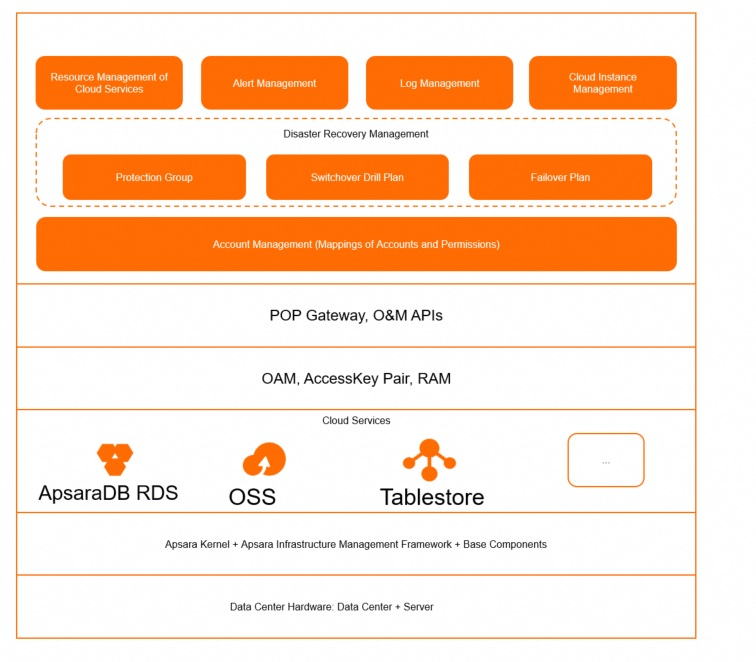

<a id="section-2-2"></a>

## 2.2. Server roles

This topic describes the server roles that are used by different services of ASR for Geo-disaster Recovery (ASR-DR). This helps O&M engineers identify faults.

**Project**

Cluster

Service

Server role

Description

Manages the

asrdr-

backend services

backend.backend

of ASR-DR.

asrdr-

Initializes the ASR-

backend.dbinit

DR database.

asrdr-backend

Performs testing

asrdr-

on backend

backend.ServiceTe

services of ASR-

st

DR.

ASR-DR

asrdrCluster

Manages the frontend services of ASR-DR in the

asrdr-portal.ops-

Apsara Uni-

poral

manager Operations Console.

asrdr-portal

Manages the frontend services of ASR-DR in the

asrdr-portal.portal

Apsara Uni-manager Management Console.

<a id="section-3"></a>

# 3.Common O&M operations

<a id="section-3-1"></a>

## 3.1. Log in to a container

This topic describes how to log in to the Apsara Stack Resilience for Geo-disaster Recovery (ASR-DR) container. The procedure for logging in to other containers is similar to that in this topic. You need to only obtain the information about the corresponding service and server role.

**Background information**

The following table describes the services and server roles of containers.

| Apsara Stack service | Service name | Service role |
| --- | --- | --- |
| ASR-DR | asrdr | asrdr-backend.backend# |
| POP | webapp-pop | webapp-pop.PopAliyunCom# |
| PolarDB-X | drds-console | drds-console.DrdsConsole# |
| Data Transmission Service (DTS) | dts-dts | • dts-dts.DtsPortal#<br>• dts-dts.DtsMaster# |
| Object Storage Service (OSS) | oss-chiji | oss-chiji.ChijiOssAll# |

**Procedure**

1. Log in to a terminal server.

   <ol type="i">

   <li>

   Log on to the Apsara Uni-manager Operations Console.

   </li>

   <li>

   In the top navigation bar, choose **Platform Operation > Apsara Infrastructure**

   </li>

   </ol>

   **Management > Resources**.

   <ol type="i" start="3">

   <li>

   In the left-side navigation pane of the **Apsara Infrastructure Management console**, choose

   </li>

   </ol>

   **Resources > Product & Cluster O&M**.

   <ol type="i" start="4">

   <li>

   In the **Products** section, enter asrdr in the **Product | Cluster** field. In the search results, find the cluster that you want to manage and click **Cluster Details** in the **Actions** column.

   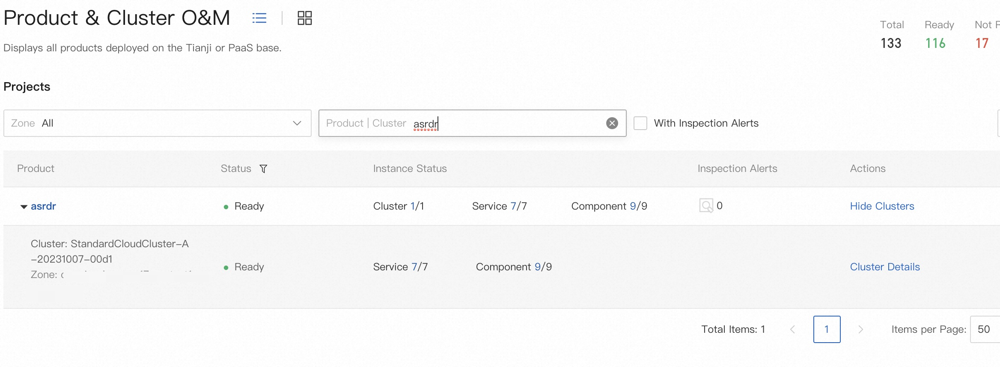

   </li>

   <li>

   On the **Services** tab of the cluster details page, find the **asrdr-backend** service and click its name.

   </li>

   <li>

   In the **Components** pane, click **backend#**. On the **Instances** tab, find the server that you want to use and click **Terminal** in the **Actions** column.

   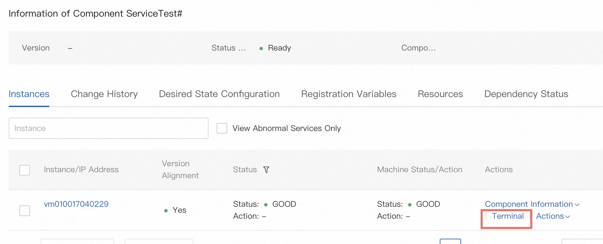

   </li>

   </ol>

2. Run the following command to query the container ID by using the root account:

   ```bash
   docker ps
   ```

   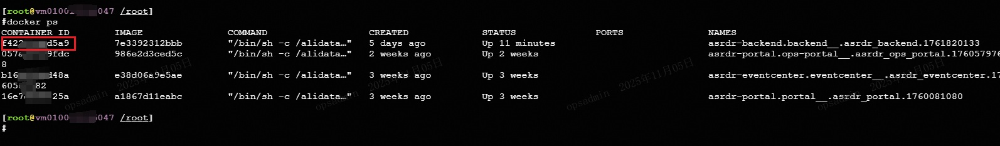

3. Run the following command to log in to the container by using the root account:

   ```bash
   docker exec -it <Container ID> /bin/bash.
   ```

   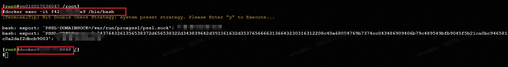

<a id="section-3-2"></a>

## 3.2. Log in to the ASR-DR metadatabase

After you obtain the login information of the Apsara Stack Resilience for Geo-disaster Recovery (ASR-DR) metadatabase in the Apsara Infrastructure Management console, you can log in to the ASR-DR metadatabase by using a terminal server.

1. Log on to the Apsara Uni-manager Operations Console.

2. In the top navigation bar, choose **Platform Operation > Apsara Infrastructure Management > Resources**.

3. In the left-side navigation pane of the **Apsara Infrastructure Management console**, choose **Resources > Product & Cluster O&M**.

4. In the **Products** section, enter asrdr in the **Product | Cluster** field. In the search results, find the cluster that you want to manage and click **Cluster Details** in the **Actions** column.

   

5. On the cluster details page, click the **Resource Details** tab. On this tab, enter **asrdr_v2** in the

   Resource Name field, verify that the type of the displayed resource is **db**, and then click the 

   icon in the **Resource Application Result** column to view the login information of the database. Record the login information, close the Resource Application Result dialog box, and then click the

    icon to hide the database information.

   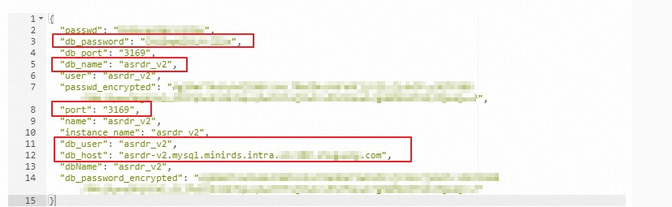

6. Log in to a terminal server.

7. Log in to the ASR-DR metadatabase by using the database login information that you obtained.

   ```text
   mysql -h <host> -P<port> -u<user> -p<password> <dbname>
   ```

   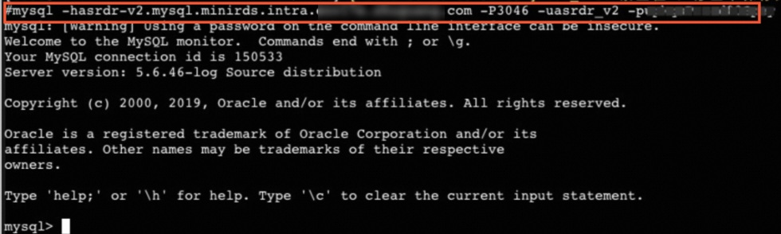

<a id="section-4"></a>

# 4.ASR-DR O&M

<a id="section-4-1"></a>

## 4.1. Manage logs

<a id="section-4-1-1"></a>

### 4.1.1. View ASR-DR logs

You can view detailed error messages in the logs of Apsara Stack Resilience for Geo-disaster Recovery (ASR-DR).

1. Log on to the ASR-DR container. For more information, see Log in to a container.

2. Run the following command to access the folder in which logs are stored:

   ```bash
   cd /opt/tianji/log/
   ```

3. Run the  `ll`  command to query a list of log files. The following table describes the log files.

   | Log file | Description |
   | --- | --- |
   | api.log | Stores the logs of API calls initiated by ASR-DR to access other cloud services. |
   | asrdr-audit.log | Stores the audit logs. |
   | complete.log | Stores all logs. |
   | framework.log | Stores the backend framework logs. |
   | gateway.log | Stores the frontend request logs. |
   | machine-error.log | Stores the error logs of state machines. |
   | machine.log | Stores the state machine logs. |
   | service-error.log | Stores the error logs of services. |
   | service.log | Stores the service logs. |

4. Select a log file that you want to view based on the date when the logs are generated. The date is displayed in the ASR-DR console.

   > **Note**
   >
   > - If the name of a log file does not contain the date, the logs are generated on the current day.
   >
   > - If the error message that you want to view does not exist in the logs of the ASR-DR container, you can log on to another container to view operation logs. The procedure for querying logs is similar.

5. Optional. Run the following command to search for specific log information based on the time:

   ```text
   /<Time>
   ```

   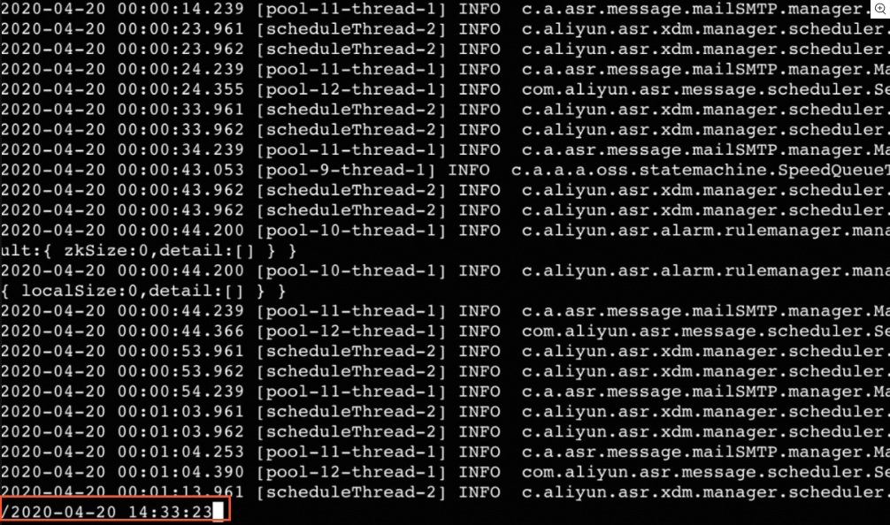

6. Optional. Run the following command to clear logs. If the space occupied by logs exceeds a specific threshold, you can run scheduled tasks to clear the logs that you no longer need.

   Run the crontab -e command to open the crontab file and create scheduled tasks.

   ```text
   Add the following CRON expression to clear the logs that have been stored for more than seven days at 01:00 every day: 0 1 * * * find /home/admin/logs/ -mtime +7 -type f -name 
   "*.log*" -exec rm -f {} \;
   ```

<a id="section-4-1-2"></a>

### 4.1.2. Modify the default log configurations

You can configure the level, output mode, and retention period of logs in the logback file. You can also specify whether to generate logs.

**Procedure**

1. Log in to the Apsara Stack Resilience for Geo-disaster Recovery (ASR-DR) container. For more information, see Log in to a container.

2. Back up the  `/alidata/bin/start`  file for rollback if an exception occurs.

   ```text
   cp /alidata/bin/start /alidata/bin/start.bak
   ```

3. Create the logback-spring.xml file in the /alidata/bin directory to configure logs.

   ```bash
   cd /alidata/bin
   vi logback-spring.xml
   ```

4. Run the  `vi`  command to modify the  `/alidata/bin/start`  file. Press the Insert key to enter the edit mode. Add  `--logging.config=<logback-spring.xml>`  to the Java startup command. Example:

   ```text
   Before the modification:
   java ${JAVA_OPTS} -jar /home/admin/asrdr/web-3.0.0.jar --server.port=8888 --spring.profiles.active=prod &
   After the modification:
   java ${JAVA_OPTS} -jar /home/admin/asrdr/web-3.0.0.jar --server.port=8888 --spring.profiles.active=prod --logging.config=/logback-spring.xml &
   ```

   > **Note**
   >
   > After the modification is successful, press the Esc key to exit the edit mode and enter :wq! to save the file and exit. Replace &lt;logback-spring.xml> with the actual path to the log configuration file.

5. Run the following command to exit and restart the ASR-DR container:

   ```bash
   # Exit the container if you are in the container.
   exit
   # Restart the container. The container ID is the ID that you use to log in to the container.
   docker restart <Container ID>
   ```

6. Check whether the logs are generated as expected.

**Rollback**

1. Restore the configurations of the  `/alidata/bin/start`  file.

   ```text
   # Restore the /alidata/bin/start file by using the backup file.
   mv /alidata/bin/start.bak /alidata/bin/start
   ```

2. Restart the ASR-DR container.

   ```bash
   # Exit the container if you are in the container.
   exit
   # Restart the container. The container ID is the ID that you use to log in to the container.
   docker restart <Container ID>
   ```

<a id="section-4-2"></a>

## 4.2. Stop ASR-DR nodes

Apsara Stack Resilience for Geo-disaster Recovery (ASR-DR) is deployed in a three-node cluster. Frontend requests are distributed to a random node by using a load balancer. As a result, the troubleshooting process is complex because you need to troubleshoot issues on three ASR-DR nodes. Therefore, we recommend that you stop two ASR-DR nodes during troubleshooting. This way, the logs are stored in a single-node ASR-DR container.

**Risk**

- If a drill or failover plan is running, the operation to stop nodes may lead to node switching and increase the recovery time objective (RTO).

- Protection groups are run on the same node. If the number of protection groups exceeds 200, the node may be overloaded.

**Method 1: Stop the container**

> **Note**
>
> If you stop the ASR-DR container, ASR-DR is not at desired state during the check of Apsara Infrastructure Management.

1. Log in to the host where the disaster recovery environment is deployed.

   <ol type="i">

   <li>

   Log on to the Apsara Uni-manager Operations Console.

   </li>

   <li>

   In the top navigation bar, choose **Platform Operation > Apsara Infrastructure**

   </li>

   </ol>

   **Management > Resources**.

   <ol type="i" start="3">

   <li>

   In the left-side navigation pane of the **Apsara Infrastructure Management console**, choose

   </li>

   </ol>

   **Resources > Product & Cluster O&M**.

   <ol type="i" start="4">

   <li>

   In the **Products** section, enter asrdr in the **Product | Cluster** field. In the search results, find the cluster that you want to manage and click **Cluster Details** in the **Actions** column.

   

   </li>

   <li>

   On the **Services** tab of the cluster details page, find the **asrdr-backend** service and click its name.

   </li>

   <li>

   In the **Components** pane, click **backend#**. On the **Instances** tab, find the server that you want to use and click **Terminal** in the **Actions** column.

   

   </li>

   </ol>

2. Run the following command to go to the specified directory by using the root account:

   ```bash
   cd /cloud/app/asrdr-portal/portal#
   ```

3. Run the following command to stop the asrdr-backend container by using the root account:

   ```text
   /cloud/tool/tianji/tjc stop asrdr-backend.backend#
   ```

   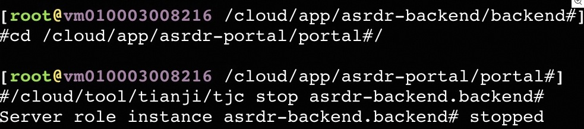

**Method 2: Terminate the process**

1. Log in to the ASR-DR container. For more information, see Log in to a container.

2. Back up the  `/alidata/bin/check_app.sh`  file for subsequent rollback.

   ```text
   cp /alidata/bin/check_app.sh /alidata/bin/check_appbak.sh
   ```

3. Run the following command to open the  `/alidata/bin/check_app.sh`  file and change  `exit $?` to  `exit 0` :

   ```text
   vi /alidata/bin/check_app.sh
   ```

4. Run the following commands to obtain the process identifier (PID) of the ASR-DR process and terminate the ASR-DR process:

   ```text
   ps aux | grep <ASR-DR process>
   ```

   ```text
   kill -9 <pid>
   ```

   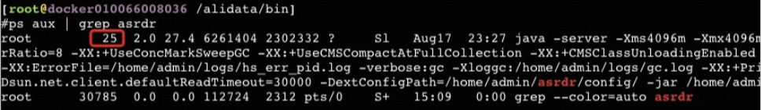

5. If you use Apsara Stack of a version that is earlier than V3.13.0, you must also run the following command to terminate the NGINX process:

   ```text
   ps aux | grep <NGINX process>
   ```

   ```text
   kill -9 <pid>
   ```

**Rollback**

**Rollback for method 1**

1. Log in to the host where the disaster recovery environment is deployed.

   <ol type="i">

   <li>

   Log on to the Apsara Uni-manager Operations Console.

   </li>

   <li>

   In the top navigation bar, choose **Platform Operation > Apsara Infrastructure**

   </li>

   </ol>

   **Management > Resources**.

   <ol type="i" start="3">

   <li>

   In the left-side navigation pane of the **Apsara Infrastructure Management console**, choose

   </li>

   </ol>

   **Resources > Product & Cluster O&M**.

   <ol type="i" start="4">

   <li>

   In the **Products** section, enter asrdr in the **Product | Cluster** field. In the search results, find the cluster that you want to manage and click **Cluster Details** in the **Actions** column.

   

   </li>

   <li>

   On the **Services** tab of the cluster details page, find the **asrdr-backend** service and click its name.

   </li>

   <li>

   In the **Components** pane, click **backend#**. On the **Instances** tab, find the server that you want to use and click **Terminal** in the **Actions** column.

   

   </li>

   </ol>

2. Run the following command to go to the specified directory by using the root account:

   ```bash
   cd /cloud/app/asrdr-portal/portal#
   ```

3. Run the following command to restart the asrdr-backend container by using the root account:

   ```text
   /cloud/tool/tianji/tjc start asrdr-backend.backend#
   ```

   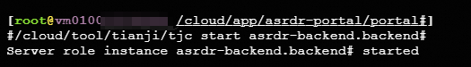

**Rollback for method 2**

1. Replace the  `check_app.sh`  file with the  `/alidata/bin/check_app.sh`  file that you backed up.

2. Restart the asrdr-backend container.

   ```bash
   # Exit the container if you are in the container.
   exit
   # Restart the container. The container ID is the ID that you use to log in to the container.
   docker restart <Container ID>
   ```

<a id="section-4-3"></a>

## 4.3. Replace the JAR package

If an error occurs, you can replace the original JAR package with a new JAR package after the bugs are fixed in code. This way, the error can be resolved.

**Background information**

- The size of a new JAR package increases. The features are not affected.

- After the original JAR package is replaced, dependency conflicts may occur when you start Spring Boot due to the use of both Log4j and Logback frameworks. In this case, you can delete the  `slf4j-log4j12`  JAR package from the  `BOOT-INF/lib/`  directory and compress data to generate a new JAR package.

**Procedure**

1. Log on to the ASR for Geo-disaster Recovery (ASR-DR) container. For more information, see Log in to a container.

2. Run the following command to back up the  `/home/admin/asrdr/web-3.0.0.jar`  file:

   ```text
   mv /home/admin/asrdr/web-3.0.0.jar /home/admin/web-3.0.0.jar.bak
   ```

3. Copy the new  `web-3.0.0.jar`  file to the  `/home/admin/asrdr`  directory.

4. Restart the ASR-DR container.

   ```bash
   # Exit the container if you are in the container.
   exit
   # Restart the container. The container ID is the ID that you used to log on to the container.
   docker restart <Container ID>
   ```

**Rollback**

1. Log on to the ASR-DR container. For more information, see Log in to a container.

2. Delete the  `web-3.0.0.jar`  file in the  `/home/admin/asrdr`  directory.

   ```text
   rm -rf ./web-3.0.0.jar
   ```

3. Replace the  `web-3.0.0.jar`  file with the  `web-3.0.0.jar.bak`  file that you backed up.

4. Restart the ASR-DR container.

   ```bash
   # Exit the container if you are in the container.
   exit
   # Restart the container. The container ID is the ID that you used to log on to the container.
   docker restart <Container ID>
   ```

<a id="section-5"></a>

# 5.FAQ

<a id="section-5-1"></a>

## 5.1. ApsaraDB RDS

<a id="section-5-1-1"></a>

### 5.1.1. How do I add databases and tables to ApsaraDB RDS instances?

This topic describes how to add databases and tables to ApsaraDB RDS instances during disaster recovery to prevent protection failures.

**Background information**

After you perform a switchover drill, incremental data is synchronized between the primary and secondary ApsaraDB RDS instances. However, Data Transmission Service (DTS) cannot synchronize database schemas during incremental data synchronization. Therefore, if you add databases and tables to ApsaraDB RDS instances, you must manually modify related data of Apsara Stack Resilience for Geo-disaster Recovery (ASR-DR) and DTS.

**Scenario 1: A database that requires disaster recovery protection is added to the primary ApsaraDB RDS instance**

1. Manually add a database to the secondary ApsaraDB RDS instance and create table schemas. Grant the read and write permissions to the synchronization account.

   > **Note**
   >
   > - If the ApsaraDB RDS instance runs MySQL 5.7, the synchronization account is asr_sync_account.
   >
   > - If the ApsaraDB RDS instance runs MySQL 5.6, the synchronization account is dtssyncwriter.

2. Manually add a database to the primary ApsaraDB RDS instance and create table schemas. Grant the read and write permissions to the synchronization account.

   If ASR-DR detects that a database is added to the primary or secondary ApsaraDB RDS instance, the corresponding protection group changes from the **Protecting** state to the **Protect failed** state.

3. On the Protection Groups page of the ASR-DR console, find the protection group, click the  icon

   in the Actions column, and then select **Re-protect**.

   The synchronization entity in the protection group is reprotected. The database is automatically added to the objects to be synchronized and waits to be protected. DTS starts a new subtask to synchronize the new database. The process of completing the subtask and merging the subtask into the original task takes around 20 minutes. You need to check whether the subtask is successfully merged.

**Scenario 2: A database that does not require disaster recovery protection is added to the primary ApsaraDB RDS instance**

In this scenario, you do not need to modify the objects to be synchronized but you need to filter out the database from the ASR-DR database. You must grant the synchronization account the read and write permissions on the new database in the primary and secondary ApsaraDB RDS instances.

1. Manually add a database to the secondary ApsaraDB RDS instance and create table schemas. Grant the read and write permissions to the synchronization account.

   > **Note**
   >
   > - If the ApsaraDB RDS instance runs MySQL 5.7, the synchronization account is asr_sync_account.
   >
   > - If the ApsaraDB RDS instance runs MySQL 5.6, the synchronization account is dtssyncwriter.

2. Manually add a database to the primary ApsaraDB RDS instance and create table schemas. Grant the read and write permissions to the synchronization account.

3. Filter out the database in the ASR-DR console. For more information, see the **DR for business > Modify table filtering** topic in *ASR-DR User Guide*.

   > **Note**
   >
   > ASR-DR of versions from V3.15.0 to V3.18.6_2505 supports table filtering configuration in the ASR-DR console. In ASR-DR V3.18.6_2507 and later, this feature is removed.
   >
   > To filter out the database in the ASR-DR console whose version is earlier than V3.15.0, perform the following steps:
   >
   > <ol type="i">
   >
   > <li>
   >
   > Log in to the ASR-DR database. For more information, see Log in to the ASR-DR metadatabase.
   >
   > </li>
   >
   > <li>
   >
   > Modify the **rwAccounts** field in **t_am_rdsSyncEntity**. Add  `,New database.-.*`  to the
   >
   > </li>
   >
   > </ol>
   >
   > value of the **rwAccounts** field.
   >
   > The value of the **rwAccounts** field is in the  `Database.Account.*`  format. An asterisk (\*) indicates that the database is filtered out. Use a hyphen (-) to indicate the account. Separate multiple databases with commas (,).
   >
   > <ol type="i" start="3">
   >
   > <li>
   >
   > Check whether the modification is successful. If the modification is not successful, disable
   >
   > </li>
   >
   > </ol>
   >
   > ASR-DR and perform the modification again.
   >
   > <ol type="i" start="4">
   >
   > <li>
   >
   > Restart ASR-DR.
   >
   > </li>
   >
   > </ol>

**Scenario 3: A database is added to the primary ApsaraDB RDS instance and only specific tables in the database require disaster recovery protection**

1. Manually add a database to the secondary ApsaraDB RDS instance and create table schemas. Grant the read and write permissions to the synchronization account.

   > **Note**
   >
   > - If the ApsaraDB RDS instance runs MySQL 5.7, the synchronization account is asr_sync_account.
   >
   > - If the ApsaraDB RDS instance runs MySQL 5.6, the synchronization account is dtssyncwriter.

2. Manually add a database to the primary ApsaraDB RDS instance and create table schemas. Grant the read and write permissions to the synchronization account.

3. Filter out the database in the ASR-DR console. For more information, see the **DR for business > Modify table filtering** topic in *ASR-DR User Guide*.

   > **Note**
   >
   > ASR-DR of versions from V3.15.0 to V3.18.6_2505 supports table filtering configuration in the ASR-DR console. In ASR-DR V3.18.6_2507 and later, this feature is removed.

**Scenario 4: A table that does not require disaster recovery protection is added to a database under protection**

1. Manually create a table in the primary ApsaraDB RDS instance.

2. Stop ASR-DR nodes. For more information, see Stop ASR-DR nodes.

   > **Note**
   >
   > After a table is added, ASR-DR adds the table to the objects to be synchronized as scheduled. DTS adds the table to the objects to be synchronized. To prevent ASR-DR from adding the table to the objects to be synchronized, you must stop ASR-DR nodes.

3. Filter out the database in the ASR-DR console. For more information, see the **DR for business > Modify table filtering** topic in *ASR-DR User Guide*.

   > **Note**
   >
   > ASR-DR of versions from V3.15.0 to V3.18.6_2505 supports table filtering configuration in the ASR-DR console. In ASR-DR V3.18.6_2507 and later, this feature is removed.

**Scenario 5: A table that requires disaster recovery protection is added to a database under protection**

After you add a table to the primary ApsaraDB RDS instance, you need to create a table schema on the secondary ApsaraDB RDS instance.

> **Note**
>
> After a table is added, ASR-DR adds the table to the objects to be synchronized as scheduled. DTS adds the table to the objects to be synchronized. In this case, you do not need to modify the ASR-DR configurations.

<a id="section-5-1-2"></a>

### 5.1.2. How do I manually switch workloads between primary and secondary ApsaraDB RDS instances?

If an ApsaraDB RDS instance at the primary site and Apsara Stack Resilience for Geo-disaster Recovery (ASR-DR) fail, you can manually switch your business to an ApsaraDB RDS instance at the secondary site.

**Background information**

- If an ApsaraDB RDS instance at the primary site fails, you can perform a failover to switch your business to an ApsaraDB RDS instance at the secondary site.

- If the ApsaraDB RDS instance at the secondary site fails after the failover, you can perform a failback to switch your business back to the primary ApsaraDB RDS instance.

This topic describes how to manually perform a failover.

You can perform a failback in a similar way.

**Procedure**

1. Grant the read and write permissions to the account used to access the ApsaraDB RDS instance at the secondary site.

   <ol type="i">

   <li>

   Log in to the Apsara Uni-manager Management Console from the secondary site.

   </li>

   <li>

   In the top navigation bar, choose **Products > Database Services > ApsaraDB RDS**.

   </li>

   <li>

   In the left-side navigation pane, click **Instances**. On the **Instance List** page, find the

   </li>

   </ol>

   secondary ApsaraDB RDS instance and click its name.

   <ol type="i" start="4">

   <li>

   In the left-side pane of the instance details page, click **Accounts**.

   </li>

   <li>

   Find the account and click **Change Permissions** in the **Actions** column.

   </li>

   <li>

   In the **Authorized Databases** section of the Edit Account Permissions panel, select **Read/Write (DDL+DML)** for the account.

   </li>

   <li>

   Click **OK**.

   </li>

   </ol>

2. Check whether data can be written to the ApsaraDB RDS instance at the secondary site.

<a id="section-5-1-3"></a>

### 5.1.3. How do I manually resume data synchronization?

If the primary and secondary ApsaraDB RDS instances are restored but Apsara Stack Resilience for Geo-disaster Recovery (ASR-DR) fails and cannot be used within a short period of time, you can manually resume data synchronization between the primary and secondary ApsaraDB RDS instances.

1. Grant only the read permissions to the account used to access the secondary ApsaraDB RDS instance.

   <ol type="i">

   <li>

   Log in to the Apsara Uni-manager Management Console from the secondary site.

   </li>

   <li>

   In the top navigation bar, choose **Products > Database Services > ApsaraDB RDS**.

   </li>

   <li>

   In the left-side navigation pane, click **Instances**. On the **Instance List** page, find the

   </li>

   </ol>

   secondary ApsaraDB RDS instance and click its name.

   <ol type="i" start="4">

   <li>

   In the left-side pane of the instance details page, click **Accounts**.

   </li>

   <li>

   Find the account and click **Reset Account Permissions** in the **Actions** column.

   </li>

   <li>

   In the Reset Account Permissions dialog box, enter and confirm the password of the account and click **OK**.

   </li>

   <li>

   Find the account and click Change Permissions in the Actions column. In the **Authorized**

   </li>

   </ol>

   **Databases** section of the Edit Account Permissions panel, select **Read-only** for the account.

   <ol type="i" start="8">

   <li>

   Click **OK**.

   </li>

   </ol>

2. Grant the read and write permissions to the account used to access the primary ApsaraDB RDS instance by referring to Step 1.

3. Log in to the Data Transmission Service (DTS) console from the secondary site and configure the task to synchronize data from the primary ApsaraDB RDS instance to the secondary ApsaraDB RDS instance. For more information, see the **Data synchronization** > **Configure data synchronization tasks** > **Synchronize data between ApsaraDB RDS for MySQL instances** topic in *DTS User Guide*.

4. Manually check whether the synchronization task is run as expected and data is synchronized.

<a id="section-5-2"></a>

## 5.2. DNS

<a id="section-5-2-1"></a>

### 5.2.1. What do I do if the "rrSet inconsistent" error message appears in DNS logs?

This topic describes the cause of the "rrSet inconsistent" error message that appears in the logs of an Apsara Stack DNS (DNS) instance. This topic also describes how to resolve the error.

**Problem description**

In the list of protection groups, the protection group to which the DNS instance belongs is in the **Protect failed** state. When you view the logs of the DNS instance on the Protection Group Details page, the **rrSet inconsistent** error message is found.

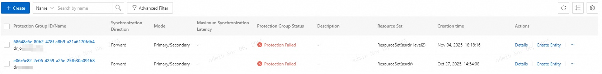

**Possible cause**

The DNS records are inconsistent between the primary and secondary sites.

**Solution**

1. Log in to the DNS console from the primary site. View the value of the **Record Values** parameter.

   <ol type="i">

   <li>

   Find the corresponding domain name and click **Configure DNS Records** in the **Actions** column.

   </li>

   <li>

   On the **DNS Settings** page, find the required record and click **Modify** in the **Actions** column.

   </li>

   <li>

   View and save the value of the **Record Values** parameter.

   </li>

   </ol>

2. Log in to the DNS console from the secondary site. Modify the **Record Values** parameter to ensure that the record values are consistent with those of the primary site. For more information, see Step 1.

3. Log in to the Apsara Stack Resilience for Geo-disaster Recovery (ASR-DR) console from the secondary site. On the **Protection Group Details** page, find the DNS instance, click the

   icon,

   

   and then click **Retry**.

   The protection group enters the **Protected** state.

<a id="section-5-2-2"></a>

### 5.2.2. What do I do if the "not found record" error message appears in DNS logs?

This topic describes the cause of the "not found record" error message that appears in the logs of an Apsara Stack DNS (DNS) instance. This topic also describes how to resolve the error.

**Problem description**

In the list of protection groups, the protection group to which the DNS instance belongs is in the **Protect failed** state. When you view the logs of the DNS instance on the Protection Group Details page, the **not found record, zoneId: xxx, rrName: xxx, cloudType: xxx** error message is found.

**Possible cause**

No host record is configured for the domain name of the primary or secondary site.

- cloudType: the site type. A value of MAIN indicates the primary site. A value of BACKUP indicates the secondary site.

- zoneId: the ID of the DNS instance.

- rrName: the name of the host record.

**Solution**

1. Log in to the DNS console from the primary or secondary site based on the value of the **cloudType** parameter.

2. Find the corresponding domain name and click **Configure DNS Records** in the **Actions** column.

3. On the **DNS Settings** page, click **Add DNS Record**. In the Add DNS Record dialog box, configure the parameters to add a host record.

   > **Note**
   >
   > The record values of the primary and secondary sites must be consistent.

4. Log in to the Apsara Stack Resilience for Geo-disaster Recovery (ASR-DR) console from the secondary site. On the **Protection Group Details** page, find the DNS instance, click the

   icon

   

   in the Actions column, and then click **Retry**.

   The protection group enters the **Protecting** state.

<a id="section-5-2-3"></a>

### 5.2.3. What do I do if the "not found zone" error message appears in DNS logs?

This topic describes the cause of the "not found zone" error message that appears in the logs of an Apsara Stack DNS (DNS) instance. This topic also describes how to resolve the error.

**Problem description**

In the list of protection groups, the protection group to which the DNS instance belongs is in the **Protect failed** state. When you view the logs of the DNS instance on the Protection Group Details page, the **not found zone xxx cloudType: xxx** error message is found.


**Possible cause**

The domain name is unavailable at the primary or secondary site.

- cloudType: the site type. A value of MAIN indicates the primary site. A value of BACKUP indicates the secondary site.

- zone: the name of the DNS instance.

**Solution**

1. Log in to the DNS console from the primary or secondary site based on the value of the **cloudType** parameter.

2. Create a domain name that is the same as that of the peer.

3. Add a host record and a DNS record that are the same as those of the peer.

4. Log in to the Apsara Stack Resilience for Geo-disaster Recovery (ASR-DR) console from the secondary site. On the **Protection Group Details** page, find the DNS instance, click the

   icon

   

   in the Actions column, and then click **Retry**.

   The protection group enters the **Protecting** state.

<a id="section-5-3"></a>

## 5.3. DTS

<a id="section-5-3-1"></a>

### 5.3.1. How do I view DTS logs?

To identify the errors related to disaster recovery when you use Data Transmission Service (DTS), you need to view the logs of the master, portal, and node components.

**View master logs**

1. Log in to the Apsara Uni-manager Operations Console.

2. In the top navigation bar, choose **Platform Operation > Apsara Infrastructure Management > O&M Tools**.

3. In the left-side navigation pane, choose **O&M Tools > Service Management**.

4. On the **Service Management** page, search for and select **dts-dts** from the **Service** drop-down list.

5. On the **Service Management** page, click the **Service Instances** tab.

6. Find the DTS cluster that you want to manage and click **Instance Details** in the **Actions** column.

7. In the Components section, search for and select the **DtsMaster#** component.

8. Find the instance that you want to manage and click **Terminal** in the Actions column.

   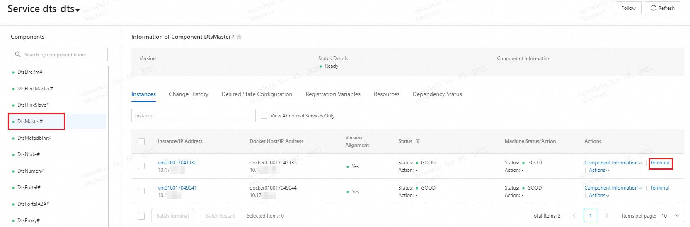

9. Run the following command to query the container ID by using the root account:

   ```bash
   docker ps
   ```

   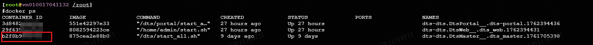

0. Run the following command to log in to the container by using the root account:

   ```bash
   docker exec -it <Container ID> /bin/bash.
   ```

   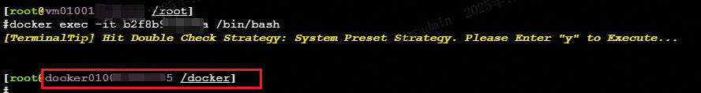

1. View the logs in the  `/dts/master/logs/master.log`  directory.

   ```text
   # Search for an error by keyword. Most common errors can be queried by keyword.
   grep --color=auto -n -e 'keyword' /dts/master/logs/master.log
   ```

**View portal logs**

1. Log in to the container where the  `dts-dts.DtsPortal#`  component runs by referring to the preceding procedure.

2. View the logs in the  `/dts/portal/logs/portal.log`  directory.

**View node logs**

1. Log in to the Apsara Uni-manager Operations Console.

2. In the top navigation bar, choose **Product Operation > Databases > Data Transmission Service**.

3. Obtain the IP address of a node.

   <ol type="i">

   <li>

   In the task list, find a synchronization task and click its name.

   </li>

   <li>

   On the task details page, click **Details** in the **Sync** section.

   </li>

   <li>

   View and record the IP address of the node.

   </li>

   </ol>

4. Log in to the node by using a terminal server or the Apsara Infrastructure Management console.

   ```bash
   ssh <IP address of the node>
   ```

5. View the log and configuration files in the  `/cloud/app/dts-dts/DtsNode#/dts_node/current/run/<taskId>`  directory.

   ```bash
   cd /cloud/app/dts-dts/DtsNode#/dts_node/current/run/<taskId>
   ```

   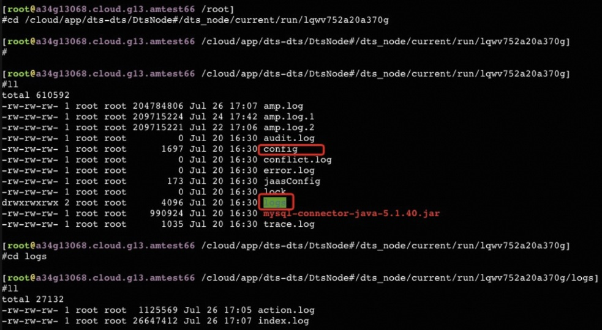

<a id="section-5-3-2"></a>

### 5.3.2. What do I do if a data synchronization task fails to be created?

<a id="section-5-3-2-1"></a>

#### 5.3.2.1. What do I do if the "cluster info is null.The input domain and region is invalid" error message appears in DTS logs?

This topic describes the cause of the "cluster info is null.The input domain and region is invalid" error message that appears in Data Transmission Service (DTS) logs. This topic also describes how to resolve the error.

**Problem description**

Data fails to be synchronized between database services in ASR for Geo-disaster Recovery (ASR-DR). When you view the portal logs of DTS, the following error message appears:

```json
[{"success":false,"msg":"cluster info is null.The input domain and region is invalid.","code":404,"data":null}]
```

**Cause**

The configurations of DTS cross-cloud synchronization are invalid.

**Solution**

1. Log on to the rmdb database.

   <ol type="i">

   <li>

   Log on to the Apsara Uni-manager Operations Console.

   </li>

   <li>

   In the top navigation bar, choose **Platform Operation > Apsara Infrastructure**

   </li>

   </ol>

   **Management > Resources**.

   <ol type="i" start="3">

   <li>

   In the left-side navigation pane of the **Apsara Infrastructure Management console**, choose

   </li>

   </ol>

   **Resources > Product & Cluster O&M**.

   <ol type="i" start="4">

   <li>

   In the **Projects** section, enter dts in the search field, find the cluster and click **Cluster Details** in the **Actions** column.

   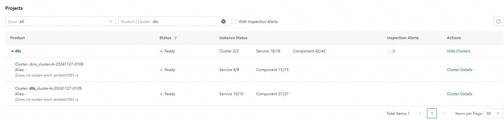

   </li>

   <li>

   On the **Resource Details** tab of the cluster details page, find the resource whose name is

   **rmdb** and type is **db** and click the  icon in the **Resource Application Result** column to

   view and record the logon information of the database.

   </li>

   <li>

   Log on to a terminal server. For more information, see Log on to a terminal server on Apsara Stack.

   </li>

   <li>

   Log on to the rmdb database by using the database logon information that you obtained.

   </li>

   </ol>

   ```text
   mysql -h <host> -P<port> -u<user> -p<password> <dbname>
   ```

2. Check whether the configurations of the region and region_pattern columns in the data table are correct. For example, check whether underscores (_) and hyphens (-) are correctly used or whether records are missing. The following figure shows an example of valid configurations.

   For more information, see the **Configurations of ApsaraDB RDS and PolarDB-X for cross-cloud disaster recovery** topic in Apsara Stack Enterprise Deployment Guide.

   ```sql
   select * from region_pattern;
   ```

   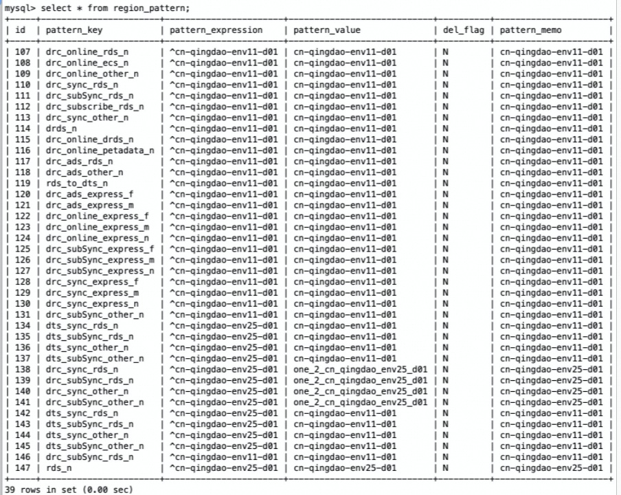

<a id="section-5-3-2-2"></a>

#### 5.3.2.2. What do I do if the "Specified access key is not found" error message appears in DTS logs?

This topic describes how to handle the "Specified access key is not found" error message that is reported in the logs of a Data Transmission Service (DTS) instance.

**Problem description**

Apsara Stack Resilience for Geo-disaster Recovery (ASR-DR) fails to synchronize data between databases. When you search for the ID of the data synchronization request or **dts console** in the portal logs of the DTS instance, the  `Specified access key is not found`  error message is found.

**Possible causes**

- If cross-cloud disaster recovery is used, the error message may be reported because the AccessKey pair configured for the secondary site is invalid.

- If cross-region disaster recovery is used, the error message may be reported because an error occurs when the unmak database is synchronized from the central region to the general region. In this case, you need to only synchronize the unmak database again.

**Cross-cloud disaster recovery scenario**

1. Log in to the container to which the DtsPortal# server role belongs from the primary site. For more information, see Log in to a container.

2. Check whether the AccessKey pair of the secondary site configured in the  `/dts/portal/application.properties`  file is valid. If the AccessKey pair is invalid, enter a valid AccessKey pair.

**Cross-region disaster recovery scenario**

1. Log in to the unmak database of the baseService-umm-ak service in the general region.

   <ol type="i">

   <li>

   Log on to the Apsara Uni-manager Operations Console.

   </li>

   <li>

   In the top navigation bar, choose **Platform Operation > Apsara Infrastructure**

   </li>

   </ol>

   **Management > Resources**.

   <ol type="i" start="3">

   <li>

   In the left-side navigation pane of the **Apsara Infrastructure Management console**, choose

   </li>

   </ol>

   **Resources > Product & Cluster O&M**.

   <ol type="i" start="4">

   <li>

   In the project list, enter baseServiceAll in the search field, find the cluster, and then click **Cluster Details** in the **Actions** column.

   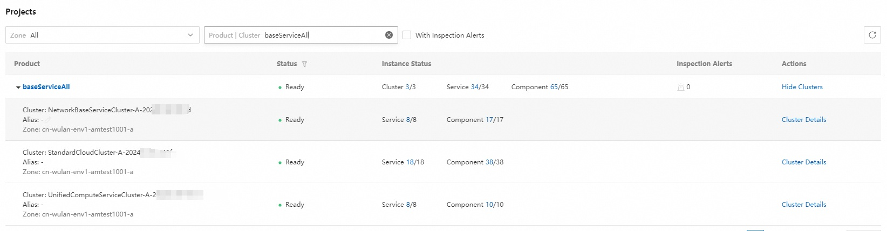

   </li>

   <li>

   On the **Resource Details** tab of the cluster details page, find the resource whose name is

   **ummak** and type is **db** and click the  icon in the **Resource Application Result** column to

   view and record the login information about the database.

   </li>

   <li>

   Log in to a terminal server.

   </li>

   <li>

   Log in to the ummak database by using the database information that you obtained.

   </li>

   </ol>

   ```text
   mysql -h <host> -P<port> -u<user> -p<password> <dbname>
   ```

2. Run the following command to clear all tables:

   ```text
   truncate table ***
   ```

3. Log in to the Apsara Infrastructure Management console and restart the **baseService-umm-ak.UmmInit#** server role. This way, a DTS task to synchronize ummak database is created.

   <ol type="i">

   <li>

   In the left-side navigation pane of the **Apsara Infrastructure Management console**, choose **Resources > Product & Cluster O&M**.

   </li>

   <li>

   In the project list, enter baseServiceAll in the search field, find the cluster, and then click

   </li>

   </ol>

   **Cluster Details** in the **Actions** column.

   

   <ol type="i" start="3">

   <li>

   On the Services tab of the cluster details page, find the **baseService-umm-ak** service and

   </li>

   </ol>

   click its name.

   <ol type="i" start="4">

   <li>

   In the Components section of the service details page, click **UmmInit#**. On the Instances tab of the Information of Component UmmInit# section, find the VM and choose **Actions** > **Restart** in the **Actions** column.

   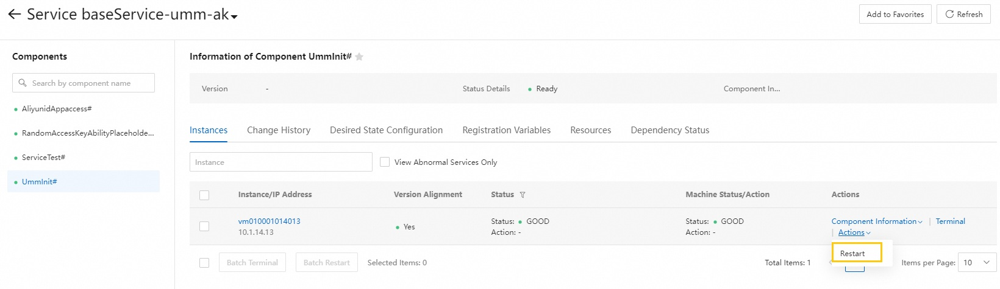

   </li>

   </ol>

<a id="section-5-3-2-3"></a>

#### 5.3.2.3. What do I do if the "InvalidAppId.NotFound" error message appears in DTS logs?

This topic describes the cause of the "InvalidAppId.NotFound" error message that appears in the portal logs of Data Transmission Service (DTS). This topic also describes how to resolve the error.

**Problem description**

Data fails to be synchronized between databases in Apsara Stack Resilience for Geo-disaster Recovery (ASR-DR). When you view the portal logs of DTS, the  `InvalidAppId.NotFound`  error message is found.

**Possible cause**

Your application is not registered with the virtual private cloud (VPC) in which the secondary database resides.

**Solution**

1. Query the value of the app_id field in the **t_base_vpc_entity** table in the ASR-DR metadatabase. For more information about how to log in to the ASR-DR metadatabase, see Log in to the ASR-DR metadatabase.

   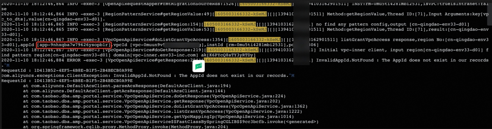

2. Log in to the vpc-controller database.

   <ol type="i">

   <li>

   Log on to the Apsara Uni-manager Operations Console.

   </li>

   <li>

   In the top navigation bar, choose **Platform Operation > Apsara Infrastructure**

   </li>

   </ol>

   **Management > Resources**.

   <ol type="i" start="3">

   <li>

   In the left-side navigation pane of the **Apsara Infrastructure Management console**, choose

   </li>

   </ol>

   **Resources > Product & Cluster O&M**.

   <ol type="i" start="4">

   <li>

   In the project list, enter vpc in the search field, find the cluster, and then click **Cluster Details** in the **Actions** column.

   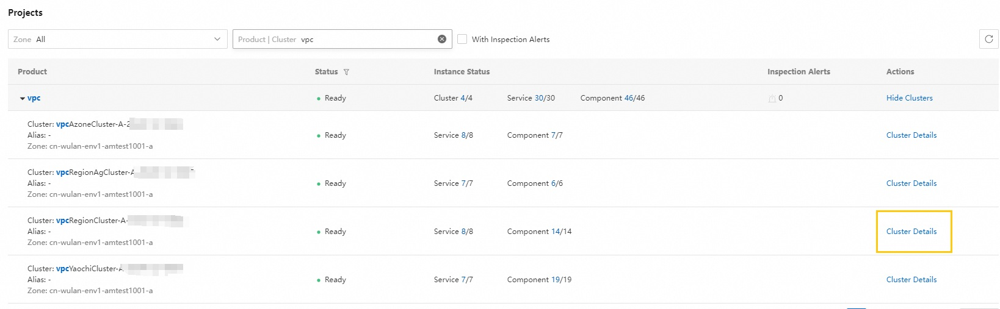

   </li>

   <li>

   On the **Resource Details** tab, find the resource whose name is **vpcregiondb** and type is **db**

   and click the  icon in the **Resource Application Result** column to view and record the login

   information about the database.

   </li>

   <li>

   Log in to a terminal server.

   </li>

   <li>

   Log in to the vpc-controller database by using the database information that you obtained.

   </li>

   </ol>

   ```text
   mysql -h <host> -P<port> -u<user> -p<password> <dbname>
   ```

3. Run the following commands to check whether the app, app_address_pool, app_server, and app_access tables contain ASR-DR configurations.

   If the vpc-controller database does not contain ASR-DR configurations, the application registration is expired or failed. In this case, go to Step 4.

   ```sql
   select * from app where app_id='app-9nh4****h1qursq' and is_deleted=0\G;

   # If the value of the available_count parameter is 0, the secondary site works as expected.select * from app_address_pool where app_id='app-9nh4n****1qursq' and is_deleted=0\G;

   # The number of Docker containers must be consistent with the number of ASR-DR application servers. For example, if three Docker containers exist, three servers are recorded.
   select * from app_server where app_id='app-9nh4n****h1qursq' and is_deleted=0\G;

   # The mapping IP address and port comprise the endpoint used to access the VPC in the 
   classic network.
   select * from app_access where app_id='app-9nh4n****h1qursq' and is_deleted=0\G;
   ```

   > **Note**
   >
   > Replace app_id with the application ID that you obtained in Step 1.

4. Log in to the **dtsdb** database of DTS.

   <ol type="i">

   <li>

   Log on to the Apsara Uni-manager Operations Console.

   </li>

   <li>

   In the top navigation bar, choose **Platform Operation > Apsara Infrastructure**

   </li>

   </ol>

   **Management > Resources**.

   <ol type="i" start="3">

   <li>

   In the left-side navigation pane of the **Apsara Infrastructure Management console**, choose

   </li>

   </ol>

   **Resources > Product & Cluster O&M**.

   <ol type="i" start="4">

   <li>

   In the project list, enter dts in the search field, find the cluster, and then click **Cluster Details** in the **Actions** column.

   

   </li>

   <li>

   On the **Resource Details** tab, find the resource whose name is **dtsdb** and type is **db** and click

   the  icon in the **Resource Application Result** column to view and record the login

   information about the database.

   </li>

   <li>

   Log in to a terminal server.

   </li>

   <li>

   Log in to the dtsdb database by using the database information that you obtained.

   </li>

   </ol>

   ```text
   mysql -h <host> -P<port> -u<user> -p<password> <dbname>
   ```

5. Delete the old VPC registration information in the dts_mapping_app, dts_mapping_server, and dts_mapping_pool tables.

6. Restart the portal, master, node, cm, and DrcSv4mysql services of DTS.

<a id="section-5-3-2-4"></a>

#### 5.3.2.4. What do I do if the "ram authorized" error message appears in DTS logs?

This topic describes how to handle the "ram authorized" error message that appears in Data Transmission Service (DTS) logs.

**Problem description**

A task to synchronize data between databases fails to be created in ASR for Geo-disaster Recovery (ASR-DR). When you view the portal logs of DTS, the  `ram authorized`  error message is found.

**Cause**

The service-linked role for DTS is not created in the corresponding organization in the Apsara Uni-manager Management Console.

**Solution**

1. Log on to the Apsara Uni-manager Management Console. In the top navigation bar, click **Configurations**. In the left-side navigation pane, click **Service-linked Roles**.

2. On the Service-linked Roles page, select  `Data Transmission Service`  from the Service Name drop-down list. Check whether the service-linked role for DTS is created in the corresponding organization.

   - If the service-linked role for **DTS** does not exist in the corresponding organization, create the service-linked role in the corresponding organization. For more information, see *ASR-DR User G uide*.

   - If the service-linked role for DTS exists, contact O&M engineers for technical support.

<a id="section-5-3-2-5"></a>

#### 5.3.2.5. What do I do if the "Data truncation: Data too long for column 'open_api_objects'" error message appears in DTS logs?

This topic describes how to handle the "Data truncation: Data too long for column'open_api_objects'" error message that is reported in the logs of a Data Transmission Service (DTS) instance.

**Problem description**

ASR for Geo-disaster Recovery (ASR-DR) fails to synchronize data between database services. When you view the portal logs of the DTS instance, the  `Data truncation: Data too long for column 'open_api_objects'`  error message is found.

**Cause**

The size of the objects to be synchronized exceeds the specified threshold.

**Solution**

1. Log on to the dtsdb database of DTS.

   <ol type="i">

   <li>

   Log on to the Apsara Uni-manager Operations Console.

   </li>

   <li>

   In the top navigation bar, choose **Platform Operation > Apsara Infrastructure**

   </li>

   </ol>

   **Management > Resources**.

   <ol type="i" start="3">

   <li>

   In the left-side navigation pane of the **Apsara Infrastructure Management console**, choose

   </li>

   </ol>

   **Resources > Product & Cluster O&M**.

   <ol type="i" start="4">

   <li>

   In the project list, enter dts in the search field, find the cluster, and then click **Cluster Details** in the **Actions** column.

   

   </li>

   <li>

   On the **Resource Details** tab, find the resource whose name is **dtsdb** and type is **db** and click

   the  icon in the **Resource Application Result** column to view and record the login

   information about the database.

   </li>

   <li>

   Log in to a terminal server.

   </li>

   <li>

   Log in to the dtsdb database by using the database information that you obtained.

   </li>

   </ol>

   ```text
   mysql -h <host> -P<port> -u<user> -p<password> <dbname>
   ```

2. Run the following command to modify the value of the open_api_objects column:

   ```sql
   ALTER TABLE migration_job_param MODIFY open_api_objects MEDIUMTEXT ; 
   ALTER TABLE migration_job MODIFY RESERVED MEDIUMTEXT ;
   ```

<a id="section-5-3-3"></a>

### 5.3.3. What do I do if a precheck fails?

<a id="section-5-3-3-1"></a>

#### 5.3.3.1. What do I do if an error message indicating inconsistent topology appears?

This topic describes the cause of the error message indicating inconsistent topology that appears during a Data Transmission Service (DTS) precheck. This topic also describes how to resolve the error.

**Problem description**

When you precheck a synchronization task in the DTS O&M console, the precheck fails and an error message indicating inconsistent topology appears.

**Solution**

1. Log in to the Apsara Uni-manager Operations Console.

2. In the top navigation bar, choose **Product Operation > Databases > Data Transmission Service**.

3. In the task list, find the synchronization task and click its name.

4. On the task details page, click **Details** in the **Precheck** section.

5. On the **Precheck** page, click the **Check Items** tab. On the Check Items tab, find the topology check and click Disable in the Actions column.

6. On the **Basic Information** tab, click **Restart** next to the Status parameter.

<a id="section-5-3-3-2"></a>

#### 5.3.3.2. What do I do if the "CHECK_ERROR_SRC_USER_PSW" error message appears?

This topic describes how to handle the "CHECK_ERROR_SRC_USER_PSW'" error message that is reported during a Data Transmission Service (DTS) precheck.

**Problem description**

The precheck of a DTS task fails and the  `CHECK_ERROR_SRC_USER_PSW`  error message is reported.

**Solution**

1. View the error information in the node logs. For more information, see the "View node logs" section of the View DTS logs topic.

2. Copy the  `console.jar`  file in the  `/cloud/app/dts-dts/DtsNode#/dts_node/current/jar`  directory to the directory of the DTS task. Run the following commands to obtain the values of the destUsr and destPsw parameters:

   ```bash
   cp /cloud/app/dts-dts/DtsNode#/dts_node/current/jar/console.jar /cloud/app/dts-dts/DtsNode#/dts_node/current/run/<taskId>/
   cd /cloud/app/dts-dts/DtsNode#/dts_node/current/run/<taskId>
   java -jar console.jar -e -print
   ```

   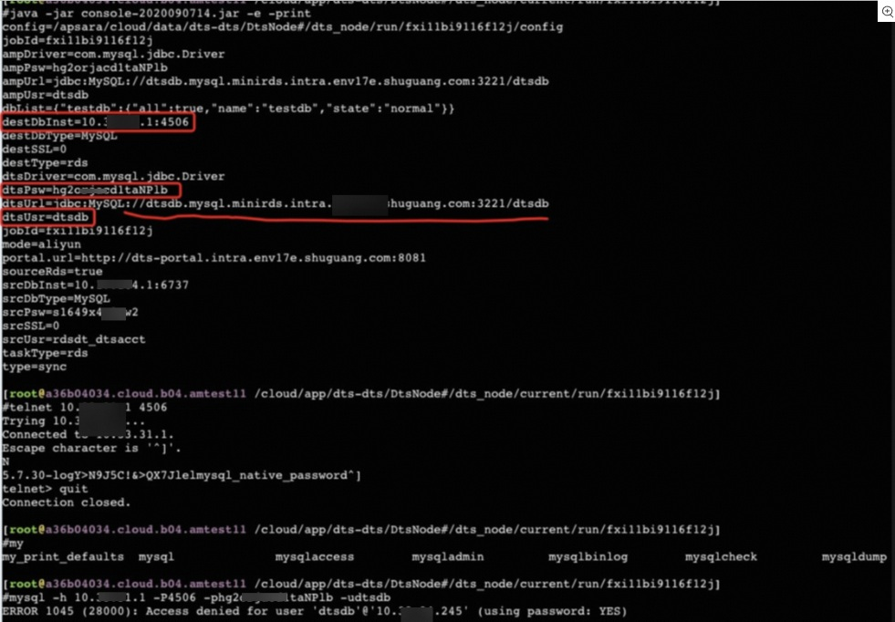

3. Run the  `telnet <destDbInst>`  command based on the values of the destDbInst, destUsr, and destPsw parameters that you obtained in the previous step to check whether the network is connected.

   If the network connection fails, go to the next step.

4. Restart the portal, master, node, cm, and DrcSv4mysql services of DTS.

<a id="section-5-3-3-3"></a>

#### 5.3.3.3. What do I do if the "CHECK_ERROR_DEST_USER_PSW" error message appears?

This topic describes how to handle the "CHECK_ERROR_DEST_USER_PSW'" error message that is reported when the connectivity test for the destination database fails during a Data Transmission Service (DTS) precheck.

**Problem description**

During the precheck of a DTS task, connectivity test for the destination database fails and the  `CHECK_ERROR_DEST_USER_PSW`  error message is reported.

**Cause**

- The account or password used to log on to the database is incorrect.

- The CIDR blocks of DTS servers are not added to the whitelist of the database instance.

  When DTS creates a synchronization task, the CIDR blocks of DTS servers are automatically added to the whitelists of the database instances by default. If the CIDR blocks of DTS servers exist in the whitelist of the source database but not in the whitelist of destination database, the CIDR blocks of DTS servers are not automatically added to the whitelist of the destination database. Therefore, you must add the CIDR blocks of DTS servers to the whitelists of the source and destination databases.

**Solution**

Manually add the CIDR blocks of DTS servers to the whitelists of the source and destination databases. For more information, see the **Configure a whitelist** topic in *ApsaraDB for RDS User Guide*

<a id="section-5-3-4"></a>

### 5.3.4. What do I do if the incremental data service is abnormal?

<a id="section-5-3-4-1"></a>

#### 5.3.4.1. What do I do if the incremental data service fails?

This topic describes how to resolve the error that the incremental data service fails.

**Problem description**

1. After you go to the task details page in the Data Transmission Service (DTS) O&M console, the precheck is complete but the incremental data service fails.

2. Click **Details** in the **Incremental Data Service** section. On the Incremental Data Service page, view the information displayed on the **DReader** and **DReader** tabs.

**Solution**

1. View the master logs of DTS and check whether the topic_group field is deleted. For more information, see View master logs.

   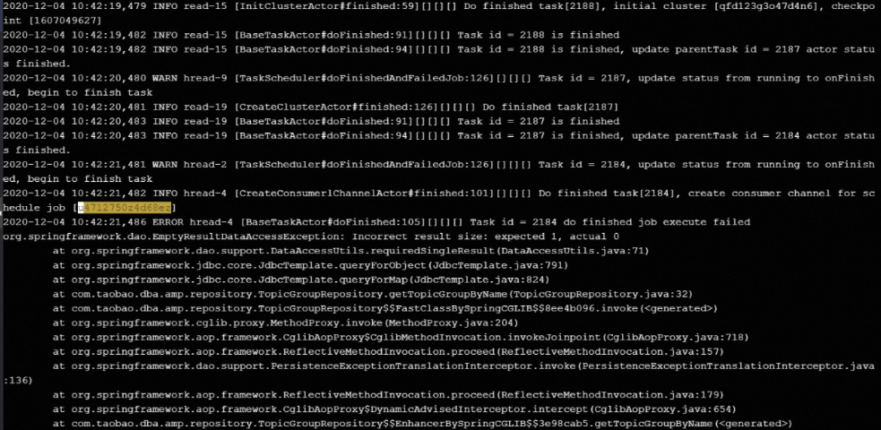

2. If the topic_group field is deleted according to the logs, restart the incremental data service in the DTS O&M console.

   <ol type="i">

   <li>

   Log on to the DTS O&M console. In the task list, find the task and click its name.

   </li>

   <li>

   In the **Incremental Data Service** section of the task details page, click **Details**.

   </li>

   <li>

   On the Incremental Data Service page, click **Restart (Rebuild)** next to the Status parameter.

   </li>

   </ol>

<a id="section-5-3-5"></a>

### 5.3.5. What do I do if data synchronization is abnormal?

<a id="section-5-3-5-1"></a>

#### 5.3.5.1. What do I do if the "store delay xxx second(s)" error message appears?

This topic describes how to handle the "store delay xxx second(s)" error message that is reported during the synchronization step of a Data Transmission Service (DTS) task.

**Problem description**

The  `store delay xxx second(s)`  error message is reported during the synchronization step of your DTS task.

**Cause**

No data is written to the source database.

<a id="section-5-3-5-2"></a>

#### 5.3.5.2. What do I do if an error message indicating that DReader fails to connect to DStore appears?

This topic describes the cause of the error message indicating that DReader fails to connect to DStore that appears when data fails to be synchronized by using Data Transmission Service (DTS). This topic also describes how to resolve the error.

**Problem description**

DTS fails to synchronize data. During the synchronization step, an error message indicating that DReader fails to connect to DStore appears.

**Possible cause**

The password of the source database is changed. However, the password of the source database configured in the topic of the DTS synchronization task is not automatically updated. As a result, the synchronization fails.

**Solution**

1. Log in to the DTS console.

2. Click the name of the task that you want to manage to go to the task management page.

3. In the Source section, click **Change Password**.

4. In the dialog box that appears, enter a password that contains at least three characters and click **OK**.

<a id="section-5-3-6"></a>

### 5.3.6. What do I do if a DTS synchronization task is not automatically resumed after network recovery?

This topic describes the cause of the error that a Data Transmission Service (DTS) synchronization task is not automatically resumed after the network is recovered. This topic also describes how to resolve the error.

**Problem description**

Your DTS synchronization task is not automatically resumed after the network is recovered.

**Solution**

1. Log in to the Apsara Uni-manager Operations Console.

2. In the top navigation bar, choose **Product Operation > Databases > Data Transmission Service**.

3. In the task list, find the synchronization task and click its name to go to the task details page. On the task details page, click **Details** in the **Sync** section.

4. On the **Synchronization** page, click **Restart** next to the Status parameter.

5. After the DTS synchronization task is resumed, go to the Apsara Stack Resilience for Geo-disaster Recovery (ASR-DR) console and reprotect the synchronization entity in the corresponding protection group.

   <ol type="i">

   <li>

   In the left-side navigation pane, choose **Business Disaster Recovery** > **Protect Group**.

   </li>

   <li>

   In the protection group list, find the protection group that you want to manage, click the  icon

   </li>

   </ol>

   in the Actions column, and then select **Re-protect**.

   > **Note**
   >
   > If the network is interrupted for more than 18 hours, the binary logs may be lost. In this case, you need to create another synchronization task.

<a id="section-5-3-7"></a>

### 5.3.7. How do I prevent binary log loss due to an extended interruption between the primary and secondary databases?

You can modify the retention period of binary logs in the O&M console of ApsaraDB RDS to prevent binary logs from being lost if the primary and secondary databases are interrupted for an extended period of time.

**Background information**

By default, ApsaraDB RDS retains binary logs for 18 hours. You can modify the backup policy of binary logs in the O&M console of ApsaraDB RDS.

**Procedure**

1. Log on to the Apsara Uni-manager Operations Console.

2. In the top navigation bar, choose **Product Operation > Databases > ApsaraDB Operations and Maintenance System**.

3. In the left-side navigation pane, choose **Instance management** > **Instance List**. On the Instance List page, find the instance that you want to manage and click its name.

4. In the left-side navigation pane of the instance details page, click **Backup policy**.

5. In the **BINLOGBackup ID** section, click **ModifyBINLOGBackup policy**. In the Modify the Binlog backup policy dialog box, configure the **Local Retention Period** parameter.

6. Click **Submit**.

<a id="section-5-4"></a>

## 5.4. OSS

<a id="section-5-4-1"></a>

### 5.4.1. How do I manually restore data synchronization between OSS buckets?

If the primary and secondary Object Storage Service (OSS) buckets are restored but ASR for Geo-disaster Recovery (ASR-DR) fails and cannot be restored in a short period of time, you need to manually restore data synchronization between the OSS buckets.

1. Log on to the OSS console.

   Log on to the Apsara Uni-manager Management Console. In the top navigation bar, choose **Products** > **Storage** > **Object Storage Service**.

2. In the left-side navigation pane, click Buckets. On the Buckets page, find the OSS bucket that you want to manage and click its name.

3. Manually create a cross-cloud synchronization rule.

   > **Note**
   >
   > Skip this step if a cross-cloud synchronization rule is created.

   <ol type="i">

   <li>

   On the bucket details page, click the **Basic Settings** tab. In the **Cross-cloud Replication** section, click **Enable Replication**.

   </li>

   <li>

   In the Cross-cloud Replication panel, configure the parameters that are described in the

   </li>

   </ol>

   following table.

   | Parameter | Description |
   | --- | --- |
   | Region | The region in which the source bucket resides. |
   | Source Bucket | The name of the source bucket. |
   | Destination Cloud | The name of the destination cloud. |
   | Destination Cloud Address | The location of the destination cloud. |
   | Destination bucket | The name of the destination bucket. |
   | Object to Replicate | The objects that you want to synchronize. Valid values:<br>• All Objects in Source Bucket: All objects within the source bucket are synchronized to the destination bucket.<br>• Objects with Specified Prefix: Only objects whose names contain one of the specified prefixes are synchronized to the destination bucket. You can click Add to add up to 10 prefixes. |
   | Replication Policy | The synchronization policy.<br>• Add/Change: Only newly added and changed data is synchronized from the source bucket to the destination bucket.<br>• Add/Delete/Change: All changes to data including creation, modification, and deletion of objects are synchronized from the source bucket to the destination bucket. |
   | Replicate Historical Data | Specifies whether to synchronize historical data that is generated before you enable cross-cloud replication. Valid values:<br>• Yes: Historical data is synchronized to the destination bucket.<br>• No: Only objects that are uploaded or updated after cross-cloud replication is enabled are synchronized to the destination bucket. |

   <ol type="i" start="3">

   <li>

   Click **OK** to save your settings.

   </li>

   </ol>

   Wait about 3 minutes for the synchronization rule to change from the **Starting** state to the **Running** state.

4. Check whether the data in the primary and secondary buckets is consistent.

<a id="section-5-4-2"></a>

### 5.4.2. What do I do if OSS buckets fail to be protected?

This topic describes how to resolve the error that Object Storage Service (OSS) buckets fail to be protected.

If OSS buckets fail to be protected, you can troubleshoot the issue by performing the following steps:

1. Check whether a task is created to synchronize data between the primary and secondary OSS buckets.

   If no data synchronization task exists, search for the  `getAddBucketReplicationRequest`  keyword in the logs of Apsara Stack Resilience for Geo-disaster Recovery (ASR-DR) to check whether a data synchronization task is created. If the data synchronization task fails to be created, contact the research and development (R&D) engineers of ASR-DR.

2. Check whether the OSS endpoints configured in ASR-DR are correct. For more information about how to configure OSS endpoints, see *ASR-DR User Guide*.

3. Check whether chiji is of V3.10 hotfix or later.

   > **Note**
   >
   > V3.10 hotfix fixes the issues related to the acceleration operation of OSS.

   <ol type="i">

   <li>

   Log on to the container to which the **oss-chiji.ChijiOssAll#** server role belongs. For more information, see Log in to a container.

   </li>

   <li>

   View the configuration of the  `setHistorySyncStatus`  parameter in the  `/home/admin/admin_portal/ocm/ocm_cmd`  file. The following figure shows a valid configuration.

   </li>

   </ol>

   If the configuration is valid, proceed to the next step.

   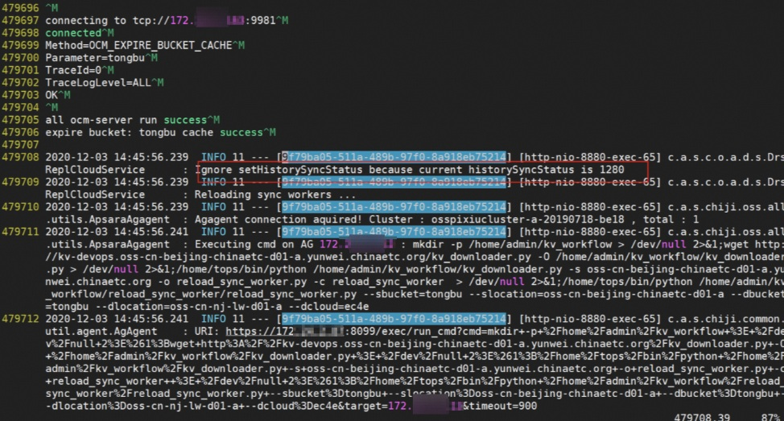

   <ol type="i" start="3">

   <li>

   Exit the container. Query the logs that contain the same request ID as that stored in the ASR-

   </li>

   </ol>

   DR logs in the  `/cloud/log/oss-chiji/ChijiOssAll#/chiji_oss_all/logs`  directory on the primary site. We recommend that you pay attention to the logs of the **ReplCloudService** class.

   If the following information is displayed in the logs, the chiji version may not meet the requirement:

   ```json
   {   "msg": "[system error] Failed to run cmd reload_sync_worker.py --sbucket=asrdr-321e-01 --slocation=oss-cn-****-d02-a --dbucket=asrdr-33e-10 --dlocation=oss-cn-****-d01-a!  ER
   RORMSG = (255)exception run dsu failed!\n\n, pls contact chiji support, request_id: 601ef3f7-4cc3-****8f2c4cf22fbf",   "code": -1,   "format_version": "1.0",   "success": false, 
   "request_id": "601ef3f7-****-8f2c4cf22fbf",   "value": {} }
   ```

4. If the chiji version meets the requirement, check the logs of the acceleration operation. If success is displayed in the logs but the 200 error code is returned, contact the OSS team for technical support.

   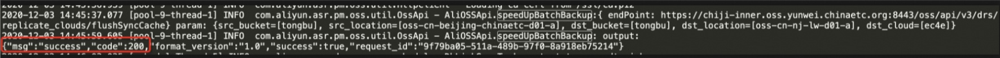

<a id="section-5-5"></a>

## 5.5. MaxCompute

<a id="section-5-5-1"></a>

### 5.5.1. Why am I unable to find MaxCompute projects when I configure a synchronization entity in ASR-DR?

This topic describes how to resoleve the error that no MaxCompute project can be found when you configure a synchronization entity in ASR for Geo-disaster Recovery (ASR-DR).

**Problem description**

After you select the primary and secondary DataWorks workspaces when you configure a synchronization entity on ASR-DR, no MaxCompute project can be found. The following figure shows an example.

**Cause**

To enable disaster recovery, make sure that MaxCompute and DataWorks meet the following requirements:

- The names of the primary and secondary DataWorks workspaces must be consistent.

- The names of the primary and secondary MaxCompute projects and accounts that are used to run tasks must be consistent.

**Solution**

1. Configure the names of the primary and secondary DataWorks workspaces to ensure consistency. For more information, see *DataWorks User Guide*.

2. Configure the names of the primary and secondary MaxCompute projects and accounts that are used to run tasks to ensure consistency. For more information, see *MaxCompute User Guide*.

<a id="section-5-6"></a>

## 5.6. ApsaraMQ

<a id="section-5-6-1"></a>

### 5.6.1. How do I view the message details of primary and secondary ApsaraMQ instances?

This topic describes the cause of the error that you cannot view the message details of primary and secondary ApsaraMQ instances by using ASR for Geo-disaster Recovery (ASR-DR)). This topic also describes how to resolve the error.

**Problem description**

You cannot view the message consumption and synchronization details of primary and secondary ApsaraMQ instances by using ASR-DR.

**Cause**

ASR-DR does not provide the feature to view the message consumption and synchronization details of primary and secondary ApsaraMQ instances.

**Solution**

1. Log on to the container to which the mq-broker.DeployBroker# server role belongs from the primary and secondary sites. For more information, see Log in to a container.

2. Run the following command to view the message consumption and synchronization details.

   ```text
   sh rmq/bin/mqadmin consumerProgress -g <Instance ID>%< groupId> -t <Instance ID>%< topic>
   ```

   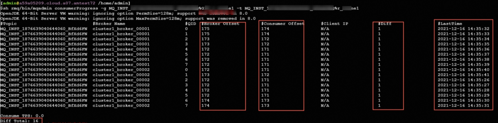

   The following table describes the parameters of the primary ApsaraMQ instance.

   | Parameter | Description |
   | --- | --- |
   | Broker Offset | All messages on the primary site. |
   | Consumer Offset | All consumed messages. |
   | Diff | The unconsumed messages. |
   | LastTime | The time when messages were last consumed. |
   | Diff Total | The total number of unconsumed messages. |

<a id="section-5-6-2"></a>

### 5.6.2. How do I reset a consumer offset by running a command?

After your business is switched from a primary ApsaraMQ instance to a secondary ApsaraMQ instance, if the consumer offset of the secondary ApsaraMQ instance is 0 or the consumer offset of the secondary ApsaraMQ instance is significantly different from that of the primary ApsaraMQ instance, you must reset the consumer offset.

**Problem description**

After you switch your business from a primary ApsaraMQ instance to a secondary ApsaraMQ instance in Apsara Stack Resilience for Geo-disaster Recovery (ASR-DR), a consumer on the secondary site consumes a large number of messages that have been consumed. The consumer offset of the secondary ApsaraMQ instance is 0 or the consumer offset of the secondary ApsaraMQ instance is significantly different from that of the primary ApsaraMQ instance. For more information about how to query a consumer offset, see How do I view the message details of primary and secondary ApsaraMQ instances?

**Cause**

The consumer offset fails to be reset. The consumer offset of the primary instance is not synchronized to the secondary instance. When messages start to be synchronized, the consumer on the secondary site consumes a large number of messages that have been consumed.

**Solution**

1. Log on to the container to which the mq-broker.DeployBroker# server role belongs from the primary and secondary instances. For more information, see Log in to a container.

2. Run the following command to reset the consumer offset:

   ```text
   sh rmq/bin/mqadmin resetOffsetByTime -g <Instance ID>%<groupId> -f true -s now -t <Instance
   ID>%<topic>
   ```

<a id="section-6"></a>

# 6.FAQ about data consistency verification for products that support DR

This topic describes the solutions to data loss and inconsistencies caused by failures in the failover process.

<a id="section-6-1"></a>

## 6.1. Perform full data verification and synchronization between RDS and PolarDB-X databases

You can use Data Transmission Service (DTS) of the secondary data center to perform full verification of data in the RDS and PolarDB-X databases and correct data discrepancies.

**Background information**

> **Important**
>
> A full data verification traverses all data of the RDS and PolarDB-X databases. This operation is resource-intensive. We recommend that you contact on-site O&M engineers to perform the operation during off-peak hours.

1. Log on to the Apsara Uni-manager Operations Console of the secondary data center.

2. In the top navigation bar, choose **Product Operation > Databases > Data Transmission Service**.

3. Find the DTS synchronization task in the task list in the **DTS O&M console**. Click the task name.

4. On the **Task Details** page, click **Full Data Verification** in the upper-right corner.

5. On the **Create Verification Task** page, configure the parameters. Retain the default values for parameters except for the **Correction Enabled** and **Thread Count** parameters.

   > **Note**
   >
   > - **Correction Enabled**: enables this option to correct discrepancies found.
   >
   > - **Thread Count**: the number of parallel verification threads. We recommend that you specify less than 5 threads to prevent excessive load on the database.

6. Click **Create**.

7. On the **Tasks** page, click the name of the verification task that you created in the preceding step.

8. On the **Task Details** page, click **Details** in the **Consistency Verification** section to view the basic information about the consistency verification.

   On the **Basic Information** page, click **Modify** in the **Running Parameters** section to modify the command line parameters. The following table describes the parameters.

   | Parameter | Full name | Description |
   | --- | --- | --- |
   | -c | --config | Required. Specifies the path to the configuration file. |
   | -x | --fix | Enables data verification and correction.<br>Note<br>If you want to correct data discrepancies, you must configure this parameter. By default, this parameter is disabled. |
   | -a | --server | Reports progress and discrepancy information to the DTS metadata database. By default, this parameter is disabled. |
   | -l | --log | Specifies the path for log files, discrepancy records, and correction SQL. The default value is the directory in which the program is located. |
   | -b | --batch | Specifies the size of data slices. Default value: 3000. We recommend that you retain the default value. |
   | -A | --againbatch | Specifies the size of the recheck slice. Default value: 300. We recommend that you retain the default value. |
   | -m | --max | Specifies the maximum number of discrepancies allowed for a single table. If the number of discrepancies exceeds this value, the table is not verified. Default value: 10000.<br>Note<br>If you verify consistency between heterogeneous data sources, we recommend that you increase the value. |
   | -p | --process | Specifies the number of threads in the validation thread pool.The number is the same as the number of connections. Default value: 4. We recommend that you set the value to 2 in cloud environments and to 7 in non-cloud environments. |
   | -n | --nokey | Specifies the data amount threshold for table verification. Only tables without unique indexes whose data amount is smaller than the threshold is verified. RDS implicit indexes are treated as unique indexes. If you specify an excessively large value for this parameter, slow SQL queries may occur. Default value: 10000. |
   | -U | --upload | Works together with the <strong>-a</strong> parameter to specify the maximum number of discrepancies to upload to the DTS metadata database. Default value: 300. |
   | -jobId | --jobId | Specifies the job ID of the verification task, which is the unique ID of the DTS task. |
   | -encrypt | --encrypt | Encrypts the configuration file by using DTS encryption. The parameter is used together with the <strong>-jobId</strong> parameter. |
   | -L | --level | Works together with the <strong>-x</strong> parameter to specify the correction level. Separates multiple correction levels with forward slashes (/). Example: insert/update/delete. |
   | -ignore | --ignore | This parameter is not supported. This parameter is used to ignore levels, such as source/target/diff. |
   | -multiple | --multiple | Uses an equality query on the destination database, which is suitable for data verification from sharded tables to a single table. This parameter cannot verify multiple data sources. |
   | -trim | --trim | Ignores trailing spaces when comparing strings. By default, this parameter is disabled. |
   | -singleindex | --singleindex | Performs verification by using a single index, which is suitable for scenarios in which the first field of a composite index has high distinctiveness. By default, this parameter is disabled. If you enable this option in Oracle, the query performance can be significantly improved. |
   | -avoidCycle | --avoidCycle | Works together with the <strong>-x</strong> parameter to prevent cyclic corrections. By default, this parameter is disabled. |
   | -d | --diff | Verifies the discrepancies from the previous check. |
   | -record | --record | Verifies the discrepancies recorded in the previous database check. |

9. Views the verification results on the **Verification Objects** tab of the **Consistency Verification**.

   > **Note**
   >
   > To view the differences between tables, click the
   >
   > icon in the **Diff Row** column.
   >
   > 

   You can also view the verification results in logs. The following table describes the logs.

   | Scenario | Log path | Remarks |
   | --- | --- | --- |
   | Query the details of the inconsistencies | Host on which DTS runs/log directory of the verification program/diff | • On master: logs records that exist only in the source database. Only the indexes are printed.<br>• On slave: logs records that exist only in the destination database. Only the indexes are printed.<br>• Different: logs records in which the index is the same in the source and destination databases but differences exist in the fields or data types. Only indexes that have different fields and their data types are printed. |
   | Query and correct SQL statements | Host on which DTS runs/log directory of the verification program/sql | None. |
   | Query current inconsistencies | Host on which DTS runs/log directory of the verification program/fullcheck.log | If the verification progress is slow and the inconsistency results are not reported, you can search for WARN in this log. The log records the primary keys of the differing records, which can be used to manually compare the source and destination databases. |
   | Query specific running records and error information | Host on which DTS runs/log directory of the verification program/fullcheck.log | If you want to view the execution details of the corresponding SQL statements, add the-g parameter to the command line. All executed SQL statements are printed in the log. |

<a id="section-6-2"></a>

## 6.2. Verify Tablestore data consistency

You can create an external table on MaxCompute and import Tablestore data to MaxCompute. Then, you can use a script to check whether the data is consistent.

**Background information**

Perform the following operations in the primary and secondary centers:

**Operations in MaxCompute**

1. Log in to the MaxCompute console.

   In the top navigation bar of the Apsara Uni-manager Management Console, choose **Products > Big Data Computing > MaxCompute**.

2. Create an account used to run tasks.

   <ol type="i">

   <li>

   In the left-side navigation pane, click **Task Alibaba Cloud Account**. On the page that appears, click **Create Account**.

   </li>

   <li>

   In the **Create Account** dialog box, configure the Name and Organization parameters. Then,

   </li>

   </ol>

   click **Submit**.

3. Create a quota group.

   <ol type="i">

   <li>

   In the left-side navigation pane, click **Quota Group Management**. On the page that appears, click **Create Quota Group**.

   </li>

   <li>

   On the page that appears, configure the parameters and click **Submit**.

   </li>

   </ol>

   > **Note**
   >
   > For more information about the parameter descriptions, see **MaxCompute User Guide**.

4. Create a project.

   <ol type="i">

   <li>

   In the left-side navigation pane, click **Project Management**. On the page that appears, click **Create Project**.

   </li>

   <li>

   On the page that appears, configure the parameters and click **Submit**.

   </li>

   </ol>

   > **Note**
   >
   > For more information about the parameter descriptions, see **MaxCompute User Guide**.

**Query the number of data entries of a Tablestore table in DataWorks**

1. Log in to the DataWorks console.

   In the top navigation bar of the Apsara Uni-manager Management Console, choose **Products > Big Data Computing > DataWorks: Big Data Development and Governance Platform**.

2. **Optional.** When you use DataWorks for the first time, add a MaxCompute engine.

   > **Note**
   >
   > If a message appears indicating that you do not have the required permissions, click the
   >
   > 
   >
   > icon to switch to another organization and administrator account before you proceed.

   <ol type="i">

   <li>

   In the top navigation bar, click the

   icon. On the Workspace page, select a workspace.

   

   </li>

   <li>

   In the left-side navigation pane, click **Calculation Engine**. On the MaxCompute tab, select the

   </li>

   </ol>

   required MaxCompute project in the **MaxCompute Project Name** column.

   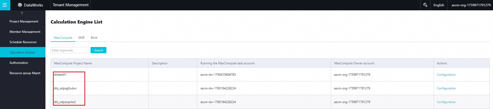

3. On the **DataStudio** page of DataWorks, create a workflow.

   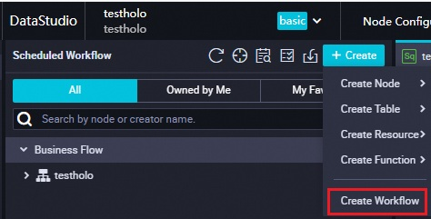

4. Create a foreign table.

   <ol type="i">

   <li>

   In the left-side Scheduled Workflow pane, click the created workflow, right-click MaxCompute, and then choose **Create Node > ODPS SQL**.

   </li>

   <li>

   In the **Create Node** dialog box, configure the Name and Path parameters, and click **Confirm**.

   </li>

   <li>

   Create a MaxCompute table. Associate the table with a Tablestore table.

   </li>

   </ol>

   ```sql
   set odps.sql.hive.compatible=true;

   set odps.sql.external.table.enable=true;

   CREATE EXTERNAL TABLE IF NOT EXISTS ots_external_table
   (--(1)
   id string,    
   name string  
   )
   STORED BY 'com.aliyun.odps.TableStoreStorageHandler'-- (2)
   WITH SERDEPROPERTIES (-- (3)
   'tablestore.columns.mapping'=':id, :name',-- (4)
   'tablestore.table.name'='test'-- (5)
   )
   LOCATION 'tablestore://<your_AccessKeyID>:<your_AccessKeySecret>@<YOUR_ENDPOINT>';-- (6)

   select count(*) as sum from ots_external_table;
   ```

   | Number | Parameter | Description |
   | --- | --- | --- |
   | (1) | id string, name string | The fields for the table. |
   | (2) | com.aliyun.odps.TableStoreStor ageHandler | StorageHandler is a built-in feature of MaxCompute that allows you to process Tablestore data. StorageHandler defines the interaction between MaxCompute and Tablestore.MaxCompute implements related logic. |
   | (3) | SERDEPROPERITES | The operation that provides parameter options.The tablestore.columns.mapping and tablestore.table.name parameters are required for TableStoreStorageHandler. |
   | (4) | tablestore.columns.mapping | Required. The columns of the Tablestore table to be accessed by MaxCompute. The columns include the primary key columns and attribute columns. If a colon (<code> : </code>) is included in the name of a column, the column is a primary key column of the Tablestore table. In this example, <code> :vid </code> and<code> :gt </code> are primary key columns of the Tablestore table. Other columns are attribute columns. You must specify all primary key columns of the table in Tablestore when you specify the mapping. You need to only specify the attribute columns that MaxCompute accesses. You do not need to specify all attribute columns. |
   | (5) | tablestore.table.name | The name of the Tablestore table to be accessed.If the specified name of the Tablestore table does not exist, an error occurs. MaxCompute does not create Tablestore tables. |
   | (6) | LOCATION | The information about the Tablestore instance to be accessed. The information includes the AccessKey ID, AccessKey secret, and endpoint. |

5. Click the

   icon to execute the script. You can view the number of data entries in the

   

   Tablestore table in the primary data center.

   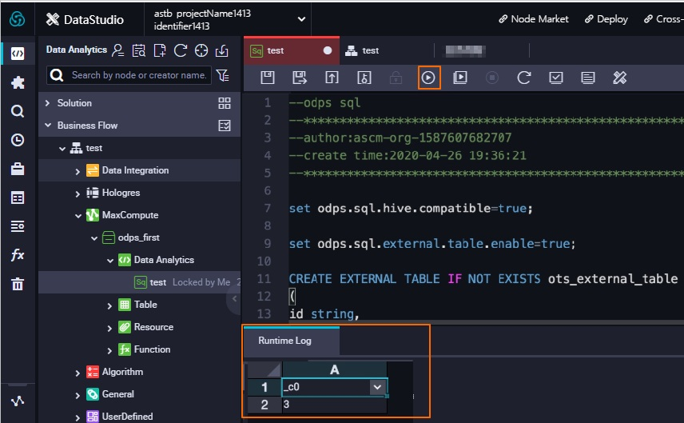

6. Perform the preceding steps in the secondary data center to check whether the number of data entries is consistent between the secondary and primary data centers.

<a id="section-6-3"></a>

## 6.3. Verify MaxCompute data consistency

To verify MaxCompute data consistency, submit a ticket to obtain the verification tool from the R&D team. Use the tool to create and run a MaxCompute data consistency verification task.

**Procedure**

1. Create a MaxCompute data consistency verification task.

   Call the /task/create API to create a MaxCompute data consistency verification task.

   ```json
   {
    "srcRegionId": "cn-wulan-env200-d01",
    "srcInstanceId": "",
    "srcVpcId": "",
    "srcIp": "service.cn-wulan-env200-d01.odps.inter.env200.shuguang.com",
    "srcPort": 80,
    "srcAccountName": "nUYGMfdPj5Pz27Bn",
    "srcPassword": "0udAuvuQmUyFCOJknUcMbxVQMBdhgg",
    "dstRegionId": "cn-qingdao-env33-d01",
    "dstInstanceId": "",
    "dstVpcId": "",
    "dstIp": "service.cn-qingdao-env33-d01.odps.env33.com",
    "dstPort": 80,
    "dstAccountName": "6a3F0hFBKZow1iBK",
    "dstPassword": "qIGHPdTxdGOPBBi7Qh9FljXJfod5ty",
    "productName": "ODPS",
    "compareObjectList": [
    {
    "dbName": "consistency_test",
    "compareTables": [
    {
    "tableName": "t_1m"
    },
    {
    "tableName": "t_10m"
    },
    {
    "tableName": "t_100m"
    },
    {
    "tableName": "t_1g"
    },
    {
    "tableName": "t_10g"
    },
    {
    "tableName": "t_100g"
    }
    ]
    }
    ],
    "timeout": 600000,
    "taskType": "STANDARD"
   }
   ```

   If a result as shown in the following figure is returned, the task is created.

   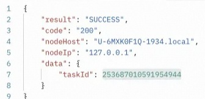

2. Start the task.

   Call the /task/start API to start the task.

   ```json
   {
    "taskId" : 253687010591954944
   }
   ```

   If a result as shown in the following figure is returned, the task is started.

   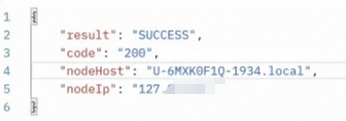

   If you call the /task/start API when the task is in the running or archived state, the following result is returned:

   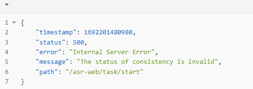

3. View the execution result of the task. The following table describes the execution results.

   | Result | Description | Response |
   | --- | --- | --- |

   <table>
     <tr>
       <td>Task successfully completed</td>
       <td>The task was successfully executed, the consistency check was successful, and all sub-steps were finished.</td>
       <td><code>{</code><br><code>"result": "SUCCESS",</code><br><code>"code": "200",</code><br><code>"nodeHost": "U-6MXK0F1Q-1934.local",</code><br><code>"nodeIp": "127.0.0.1",</code><br><code>"data": {</code><br><code>"task": {</code><br><code>"taskId": 253687010591954944,</code><br><code>"success": true,</code><br><code>"taskStatus": "FINISHED",</code><br><code>"checkTotal": 0,</code><br><code>"successTotal": 0,</code><br><code>"failTotal": 0,</code><br><code>"startTime": 1692183383554,</code><br><code>"costTime": 254385,</code><br><code>"stepStatus": [</code><br><code>{</code><br><code>"stepName": "PRECHECK",</code><br><code>"status": "FINISHED"</code><br><code>},</code><br><code>{</code><br><code>"stepName": "CHECKROWCOUNT",</code><br><code>"status": "FINISHED"</code><br><code>},</code><br><code>{</code><br><code>"stepName": "CHECKDATA",</code><br><code>"status": "FINISHED"</code><br><code>}</code><br><code>],</code><br><code>"detailLog": ""</code><br><code>}</code><br><code>}</code><br><code>}</code></td>
     </tr>
     <tr>
       <td>Task failed due to timeout</td>
       <td>The task failed because it exceeded the time limit.</td>
       <td><code>{</code><br><code>"result": "SUCCESS",</code><br><code>"code": "200",</code><br><code>"nodeHost": "U-6MXK0F1Q-1934.local",</code><br><code>"nodeIp": "127.0.0.1",</code><br><code>"data": {</code><br><code>"task": {</code><br><code>"taskId": 253687010591954944,</code><br><code>"success": false,</code><br><code>"taskStatus": "FAILED",</code><br><code>"checkTotal": 0,</code><br><code>"successTotal": 0,</code><br><code>"failTotal": 0,</code><br><code>"startTime": 1692185149634,</code><br><code>"costTime": 60714,</code><br><code>"stepStatus": [</code><br><code>{</code><br><code>"stepName": "PRECHECK",</code><br><code>"status": "FINISHED"</code><br><code>},</code><br><code>{</code><br><code>"stepName": "CHECKROWCOUNT",</code><br><code>"status": "FINISHED"</code><br><code>},</code><br><code>{</code><br><code>"stepName": "CHECKDATA",</code><br><code>"status": "RUNNING"</code><br><code>}</code><br><code>],</code><br><code>"detailLog": "Timeout"</code><br><code>}</code><br><code>}</code><br><code>}</code></td>
     </tr>
     <tr>
       <td>Pre-check failed due to missing table</td>
       <td>The task failed during pre-check because the destination table schema failed to be retrieved.</td>
       <td><code>{</code><br><code>"result": "SUCCESS",</code><br><code>"code": "200",</code><br><code>"nodeHost": "U-6MXK0F1Q-1934.local",</code><br><code>"nodeIp": "127.0.0.1",</code><br><code>"data": {</code><br><code>"task": {</code><br><code>"taskId": 253687010591954944,</code><br><code>"success": false,</code><br><code>"taskStatus": "FAILED",</code><br><code>"checkTotal": 0,</code><br><code>"successTotal": 0,</code><br><code>"failTotal": 0,</code><br><code>"startTime": 1692185454492,</code><br><code>"costTime": 6246,</code><br><code>"stepStatus": [</code><br><code>{</code><br><code>"stepName": "PRECHECK",</code><br><code>"status": "FAILED"</code><br><code>},</code><br><code>{</code><br><code>"stepName": "CHECKROWCOUNT",</code><br><code>"status": ""</code><br><code>},</code><br><code>{</code><br><code>"stepName": "CHECKDATA",</code><br><code>"status": ""</code><br><code>}</code><br><code>],</code><br><code>"detailLog": "Failed to obtain the</code><br><code>destination table schema."</code><br><code>}</code><br><code>}</code><br><code>}</code></td>
     </tr>
     <tr>
       <td>Task failed due to row count mismatch</td>
       <td>The row count check (CHECKROWCOUNT) detected a discrepancy in the number of rows between the source and destination tables.</td>
       <td><code>{</code><br><code>"result": "SUCCESS",</code><br><code>"code": "200",</code><br><code>"nodeHost": "U-6MXK0F1Q-1934.local",</code><br><code>"nodeIp": "127.0.0.1",</code><br><code>"data": {</code><br><code>"task": {</code><br><code>"taskId": 253687010591954944,</code><br><code>"success": false,</code><br><code>"taskStatus": "FAILED",</code><br><code>"checkTotal": 0,</code><br><code>"successTotal": 0,</code><br><code>"failTotal": 0,</code><br><code>"startTime": 1692196225091,</code><br><code>"costTime": 16451,</code><br><code>"stepStatus": [</code><br><code>{</code><br><code>"stepName": "PRECHECK",</code><br><code>"status": "FINISHED"</code><br><code>},</code><br><code>{</code><br><code>"stepName": "CHECKROWCOUNT",</code><br><code>"status": "FAILED"</code><br><code>},</code><br><code>{</code><br><code>"stepName": "CHECKDATA",</code><br><code>"status": ""</code><br><code>}</code><br><code>],</code><br><code>"detailLog": "Destination table: t_1m, data</code><br><code>rows: 4095, inconsistent with source data</code><br><code>rows: 4096"</code><br><code>}</code><br><code>}</code><br><code>}</code></td>
     </tr>
     <tr>
       <td></td>
       <td></td>
       <td></td>
     </tr>
     <tr>
       <td>Task failed due to data mismatch</td>
       <td>The data check (CHECKDATA) detected a mismatch between the data in the source and destination tables.</td>
       <td><code>{</code><br><code>"result": "SUCCESS",</code><br><code>"code": "200",</code><br><code>"nodeHost": "U-6MXK0F1Q-1934.local",</code><br><code>"nodeIp": "127.0.0.1",</code><br><code>"data": {</code><br><code>"task": {</code><br><code>"taskId": 253687010591954944,</code><br><code>"success": false,</code><br><code>"taskStatus": "FAILED",</code><br><code>"checkTotal": 0,</code><br><code>"successTotal": 0,</code><br><code>"failTotal": 0,</code><br><code>"startTime": 1692196609544,</code><br><code>"costTime": 15402,</code><br><code>"stepStatus": [</code><br><code>{</code><br><code>"stepName": "PRECHECK",</code><br><code>"status": "FINISHED"</code><br><code>},</code><br><code>{</code><br><code>"stepName": "CHECKROWCOUNT",</code><br><code>"status": "FINISHED"</code><br><code>},</code><br><code>{</code><br><code>"stepName": "CHECKDATA",</code><br><code>"status": "FAILED"</code><br><code>}</code><br><code>],</code><br><code>"detailLog": "The checksum for table t_1m</code><br><code>does not match: source checksum 6ab792ad,</code><br><code>destination checksum c9256398."</code><br><code>}</code><br><code>}</code><br><code>}</code></td>
     </tr>
   </table>

**Related operations**

| Operation | Description | Response |
| --- | --- | --- |
| Retry a task | • This operation re-executes a failed task. When the /task/retry API is called, only the sub-tasks that did not start are executed.<br>• When you perform the retry operation, the system creates the t_1m table in the source to match the table in the destination. The system calls the /task/retry API to retry the task.<br>• In this example, the task status is successful and the duration is 13778 milliseconds, which is the time used to verify the data consistency of the t_1m table. This indicates that the retry operation is successful. | <code>{</code><br><code>"result": "SUCCESS",</code><br><code>"code": "200",</code><br><code>"nodeHost": "U-6MXK0F1Q-1934.local",</code><br><code>"nodeIp": "127.0.0.1",</code><br><code>"data": {</code><br><code>"task": {</code><br><code>"taskId": 253687010591954944,</code><br><code>"success": true,</code><br><code>"taskStatus": "FINISHED",</code><br><code>"checkTotal": 0,</code><br><code>"successTotal": 0,</code><br><code>"failTotal": 0,</code><br><code>"startTime": 1692197074880,</code><br><code>"costTime": 13778,</code><br><code>"stepStatus": [</code><br><code>{</code><br><code>"stepName": "PRECHECK",</code><br><code>"status": "FINISHED"</code><br><code>},</code><br><code>{</code><br><code>"stepName": "CHECKROWCOUNT",</code><br><code>"status": "FINISHED"</code><br><code>},</code><br><code>{</code><br><code>"stepName": "CHECKDATA",</code><br><code>"status": "FINISHED"</code><br><code>}</code><br><code>],</code><br><code>"detailLog": ""</code><br><code>}</code><br><code>}</code><br><code>}</code><br>Sample result: <code>{</code><br><code>"timestamp": 1692201556515,</code><br><code>"status": 500,</code><br><code>"error": "Internal Server Error",</code><br><code>"message": "The status of consistency</code><br><code>is invalid",</code><br><code>"path": "/asr-web/task/retry"</code><br><code>}</code> |

<table>
  <tr>
    <td>Stop a task</td>
    <td>You can perform this operation only if the task is in the RUNNING state.Start a task and call the /task/stop API. The task enters the STOPPED state during the CHECKROWCOUNT substep.</td>
    <td><code>{</code><br><code>"result": "SUCCESS",</code><br><code>"code": "200",</code><br><code>"nodeHost": "U-6MXK0F1Q-1934.local",</code><br><code>"nodeIp": "127.0.0.1",</code><br><code>"data": {</code><br><code>"task": {</code><br><code>"taskId": 253687010591954944,</code><br><code>"success": false,</code><br><code>"taskStatus": "STOPPED",</code><br><code>"checkTotal": 0,</code><br><code>"successTotal": 0,</code><br><code>"failTotal": 0,</code><br><code>"startTime": 1692198894885,</code><br><code>"costTime": 7747,</code><br><code>"stepStatus": [</code><br><code>{</code><br><code>"stepName": "PRECHECK",</code><br><code>"status": "FINISHED"</code><br><code>},</code><br><code>{</code><br><code>"stepName": "CHECKROWCOUNT",</code><br><code>"status": "STOPPED"</code><br><code>},</code><br><code>{</code><br><code>"stepName": "CHECKDATA",</code><br><code>"status": ""</code><br><code>}</code><br><code>],</code><br><code>"detailLog": "stopped"</code><br><code>}</code><br><code>}</code><br><code>}</code><br>Sample result:<br><code>{</code><br><code>"timestamp": 1692201618671,</code><br><code>"status": 500,</code><br><code>"error": "Internal Server Error",</code><br><code>"message": "The status of consistency</code><br><code>is invalid",</code><br><code>"path": "/asr-web/task/stop"</code><br><code>}</code></td>
  </tr>
  <tr>
    <td>Delete a task</td>
    <td>You can call the /task/delete API to delete a task only if the task is not in the RUNNING state. The operation transitions the task to the ARCHIVED state.</td>
    <td><code>{</code><br><code>"result": "SUCCESS",</code><br><code>"code": "200",</code><br><code>"nodeHost": "U-6MXK0F1Q-1934.local",</code><br><code>"nodeIp": "127.0.0.1",</code><br><code>"data": {</code><br><code>"task": {</code><br><code>"taskId": 253687010591954944,</code><br><code>"success": false,</code><br><code>"taskStatus": "ARCHIVED",</code><br><code>"checkTotal": 0,</code><br><code>"successTotal": 0,</code><br><code>"failTotal": 0,</code><br><code>"startTime": 1692198894885,</code><br><code>"costTime": 7747,</code><br><code>"stepStatus": [</code><br><code>{</code><br><code>"stepName": "PRECHECK",</code><br><code>"status": "FINISHED"</code><br><code>},</code><br><code>{</code><br><code>"stepName": "CHECKROWCOUNT",</code><br><code>"status": "STOPPED"</code><br><code>},</code><br><code>{</code><br><code>"stepName": "CHECKDATA",</code><br><code>"status": ""</code><br><code>}</code><br><code>],</code><br><code>"detailLog": "stopped"</code><br><code>}</code><br><code>}</code><br><code>}</code><br>Sample result:<br><code>{</code><br><code>"timestamp": 1692201760347,</code><br><code>"status": 500,</code><br><code>"error": "Internal Server Error",</code><br><code>"message": "The status of consistency</code><br><code>is invalid",</code><br><code>"path": "/asr-web/task/delete"</code><br><code>}</code></td>
  </tr>
</table>

<a id="section-7"></a>

# 7.Command references

<a id="section-7-1"></a>

## 7.1. Use CLISH commands

When the ASR for Geo-disaster Recovery system encounters issues and the ASR for Geo-disaster Recovery console is inaccessible, you can use CLISH commands to perform background operations.

> **Warning**
>
> Before you use a CLISH command, make sure that you understand the effects and consequences of the command.
>
> Command-line operations involve risks. Proceed with caution. You can perform command-line operations only if an error occurs in the ASR for Geo-disaster Recovery system and cannot be resolved in the console.

1. Log on to the container in which the ASR-DR service is running. For more information, see Log on to a container.

2. Go to the CLISH directory and launch the CLISH interactive shell.

   ```bash
   cd /alidata/bin/
   ```

   ```text
   java -jar clish-3.0.0.jar
   ```

3. Enter the commands that you want to run.

<a id="section-7-2"></a>

## 7.2. Commands

This topic describes ASR for Geo-disaster Recovery O&M commands.

**Synchronization entities**

| Parameter | Description |
| --- | --- |
| skip-entity | Skips a synchronization entity in the current plan execution. |
| suspend-entity | Suspends a synchronization entity. |
| stepover-entity | Skips a synchronization entity in the current step of the plan execution. |
| reprotect-entity | Performs reprotection for a synchronization entity. |
| redo-entity | Performs a retry on a synchronization entity. |
| force-switch | Performs a forced switchover for a synchronization entity. |

**Cloud Center**

| Parameter | Description |
| --- | --- |
| del-cloud-instance | Removes the association between a user and a cloud instance. |
| del-cloud-center | Deletes a cloud center. |

**Protection groups**

| Parameter | Description |
| --- | --- |
| create-empty-pg | Creates an empty protection group. |
| show-pg-sync-entity | Views the synchronization entities contained in a specified protection group. |
| delete-pg-shell | Deletes a protection group |
| move-sync-entity | Relocates a synchronization instance to a specified protection group. |

**Disaster recovery plans**

| Parameter | Description |
| --- | --- |
| plan-query | Queries the details of a disaster recovery plan. |
| plan-query-ex | Queries the details of a disaster recovery plan task. |
| plan-force-delete | Forcibly deletes a disaster recovery plan, including plans that are running. |

**VPC**

| Parameter | Description |
| --- | --- |
| vpc-register-app | Registers an application with a Virtual Private Cloud (VPC) instance. |
| vpc-show-registered-app | Queries applications that are registered with a VPC instance. |
| vpc-remove-registered-app | Unregisters an application from a VPC instance. |
| vpc-grant-access | Grants access permissions on a VPC instance. |
| vpc-show-grant-access | Queries the authorized list of a VPC instance. |
| vpc-cancel-grant-access | Revokes the access of a disaster recovery instance to a VPC instance. |

**PolarDB-X instances**

| Parameter | Description |
| --- | --- |
| xdm-clear-data | Cleans up data of a PolarDB-X instance. |

**AnalyticDB for MySQL V3.0 databases**

| Parameter | Description |
| --- | --- |
| adb-force-start-sync | Forcibly starts a synchronization link. |

**Configurations**

| Parameter | Description |
| --- | --- |
| param-add-param | Adds configurations. |
| param-modify-param | Modifies configurations. |
| param-query-param | Queries configurations |
| param-refresh-param | Refreshes configurations. |
| param-modify-params | Modifies the configurations of a service. |
| param-query-params | Queries the configurations of a service. |

**Alerts**

| Parameter | Description |
| --- | --- |
| alarm-create | Creates an alert. |
| alarm-query | Queries alert information. |
| send-alarm-msg | Sends alerts. |

**Alert rules**

| Parameter | Description |
| --- | --- |
| rule-create | Creates an alert rule. |
| rule-query | Queries an alert rule. |
| rule-switch | Enables or disables an alert rule. |
| rule-update | Modifies an alert rule. |
| rule-delete | Deletes an alert rule. |

**Monitored metrics**

| Parameter | Description |
| --- | --- |
| monitor-item-query | Queries monitored metrics. |

<a id="section-7-3"></a>

## 7.3. Synchronization entities

<a id="section-7-3-1"></a>

### 7.3.1. skip-entity

You can use the skip-entity command to skip a synchronization entity in the current plan execution.

**Syntax**

```text
skip-entity [-eid] string
```

**Parameters**

| Parameter | Required | Description |
| --- | --- | --- |
| -eid | Yes | The ID of the synchronization entity. |

**Examples**

```text
skip-entity -eid 5e81a414-4d88-4de3-9921-f1ef51f******
```

<a id="section-7-3-2"></a>

### 7.3.2. suspend-entity

You can use the suspend-entity command to suspend a synchronization entity.

**Syntax**

```text
suspend-entity [-eid] string
```

**Parameters**

| Parameter | Required | Description |
| --- | --- | --- |
| -eid | Yes | The ID of the synchronization entity. |

**Examples**

```text
suspend-entity -eid 45eadd00-68a4-462d-85fb-c81bb******
```

<a id="section-7-3-3"></a>

### 7.3.3. stepover-entity

You can use the stepover-entity command to skip a synchronization entity in the current step of the plan execution.

**Syntax**

```text
stepover-entity [-eid] string
```

**Parameters**

| Parameter | Required | Description |
| --- | --- | --- |
| -eid | Yes | The ID of the synchronization entity. |

**Examples**

```text
stepover-entity -eid 45eadd00-68a4-462d-85fb-c81bb******
```

<a id="section-7-3-4"></a>

### 7.3.4. reprotect-entity

You can use the reprotect-entity to perform reprotection for a synchronization entity.

**Syntax**

```text
reprotect-entity [-eid] string
```

**Parameters**

| Parameter | Required | Description |
| --- | --- | --- |
| -eid | Yes | The ID of the synchronization entity. |

**Examples**

```text
reprotect-entity -eid 45eadd00-68a4-462d-85fb-c81bbd******
```

<a id="section-7-3-5"></a>

### 7.3.5. redo-entity

You can use the redo-entity command to perform a retry on a synchronization entity.

**Syntax**

```text
redo-entity [-eid] string
```

**Parameters**

| Parameter | Required | Description |
| --- | --- | --- |
| -eid | Yes | The ID of the synchronization entity. |

**Examples**

```text
redo-entity -eid 45eadd00-68a4-462d-85fb-c81bbd******
```

<a id="section-7-3-6"></a>

### 7.3.6. force-switch

You can use the force-switch command to perform a forced switchover for a synchronization entity.

**Syntax**

```text
force-switch [-sid] string
```

**Parameters**

| Parameter | Required | Description |
| --- | --- | --- |
| -sid | Yes | The ID of the synchronization entity. |

**Examples**

```text
force-switch -sid 45eadd00-68a4-462d-85fb-c81bb****** 
```

<a id="section-7-4"></a>

## 7.4. Cloud Center

<a id="section-7-4-1"></a>

### 7.4.1. del-cloud-instance

You can use the del-cloud-instance command to remove the association between a user and a cloud instance.

**Syntax**

```text
del-cloud-instance [-uid] string [-cid] string
```

**Parameters**

| Parameter | Required | Description |
| --- | --- | --- |
| -uid | Yes | The ID of the user. |
| -cid | Yes | The ID of the cloud instance. |

**Examples**

```text
del-cloud-instance -uid 5003 -cid bc982df6-f193-4aab-a6e2-b8b240******
```

<a id="section-7-4-2"></a>

### 7.4.2. del-cloud-center

You can use the del-cloud-center command to delete a cloud center.

**Syntax**

```text
del-cloud-center [-cid] string
```

**Parameters**

| Parameter | Required | Description |
| --- | --- | --- |
| -cid | Yes | The ID of the cloud center. |

**Examples**

```text
del-cloud-center -cid e6671a7c-26af-4737-b930-1b37a5******
```

<a id="section-7-5"></a>

## 7.5. Protection groups

<a id="section-7-5-1"></a>

### 7.5.1. create-empty-pg

You can use the create-empty-pg command to create an empty protection group.

**Syntax**

```text
create-empty-pg [-pname] string [-morgid] int [-borgid] int [-mcid] string [-bcid] string [-mrid] string [-brid] string [-d] string [-D] string
```

**Parameters**

| Parameter | Required | Description |
| --- | --- | --- |
| -pname | Yes | The name of the protection group. |
| -morgid | Yes | The organization ID of the primary site. |
| -borgid | Yes | The organization ID of the secondary site. |
| -mcid | Yes | The ID of the primary site. |
| -bcid | Yes | The ID of the secondary site. |
| -mrid | Yes | The region ID of the primary site. |
| -brid | Yes | The region ID of the secondary site. |
| -d | Yes | The synchronization direction. Valid values:<br>• FORWARD<br>• REVERSE |
| -D | Yes | The description of the protection group. |

**Examples**

```text
create-empty-pg -pname pgClish -morgid 30 -borgid 3 -mcid d132c3b0-4299-4d0a-9962-350***** -bcid 61f1f331-76df-43be-8bf2-856e75d***** -mrid cn-qingdao-*****-d01 -brig cn-qingdao-*****-d01 -d FORWARD -D testGroupBuileby****
```

<a id="section-7-5-2"></a>

### 7.5.2. show-pg-sync-entity

You can use the show-pg-sync-entity command to view the synchronization entities contained in the specified protection group.

**Syntax**

```text
show-pg-sync-entity [-pgId] string
```

**Parameters**

| Parameter | Required | Description |
| --- | --- | --- |
| -pgId | Yes | The ID of the protection group. |

**Examples**

```text
show-pg-sync-entity -pgId 0f0cc4dc-c95f-47cb-b8b4-1a72e2******
```

<a id="section-7-5-3"></a>

### 7.5.3. delete-pg-shell

You can use the delete-pg-shell command to delete a protection group without deleting the associated synchronization instances. The synchronization instances become orphaned.

**Syntax**

```text
delete-pg-shell [-pgId] string
```

**Parameters**

| Parameter | Required | Description |
| --- | --- | --- |
| -pgId | Yes | The ID of the protection group. |

**Examples**

```text
delete-pg-shell -pgId cb973344-3a7d-49f5-8517-6245bd******
```

<a id="section-7-5-4"></a>

### 7.5.4. move-sync-entity

You can use the move-sync-entity command to migrate a synchronization entity to a protection group.

**Syntax**

```text
move-sync-entity [-sid] string [-pgId] string [-p] int
```

**Parameters**

| Parameter | Required | Description |
| --- | --- | --- |
| -pgId | Yes | The ID of the protection group. |
| -sid | Yes | The ID of the synchronization entity. |
| -p | Yes | The priority. |

**Examples**

```text
move-sync-entity -sid 5e81a414-4d88-4de3-9921-f1ef51f***** -pgId 472481ee-717c-41bc-b3b8-192631f***** -p 3
```

<a id="section-7-6"></a>

## 7.6. Disaster recovery plans

<a id="section-7-6-1"></a>

### 7.6.1. plan-query

You can use the plan-query command to query the details of a disaster recovery plan.

**Syntax**

**plan-query [-pid] string**

**Parameters**

| Parameter | Required | Description |
| --- | --- | --- |
| -pid | Yes | The ID of the disaster recovery plan. |

**Examples**

**plan-query -pid 375c09d5-e803-4770-a3ec-\*\*\*\*\*fa4358**

<a id="section-7-6-2"></a>

### 7.6.2. plan-query-ex

You can use the plan-query-ex command to query the execution details of a disaster recovery plan.

**Syntax**

**plan-query-ex [-pid] string**

**Parameters**

| Parameter | Required | Description |
| --- | --- | --- |
| -pid | Yes | The ID of the disaster recovery plan. |

**Examples**

**plan-query-ex -pid 375c09d5-e803-4770-a3ec-b37fa4\*\*\*\*\***

<a id="section-7-6-3"></a>

### 7.6.3. plan-force-delete

You can use the plan-force-delete command to forcibly delete a disaster recovery plan regardless of the running status.

**Syntax**

```text
plan-force-delete [-pid] string
```

**Parameters**

| Parameter | Required | Description |
| --- | --- | --- |
| -pid | Yes | The ID of the disaster recovery plan. |

**Examples**

```text
plan-force-delete -pid f67e0b29-519a-433d-bf8f-b38fb4******
```

<a id="section-7-7"></a>

## 7.7. VPC

<a id="section-7-7-1"></a>

### 7.7.1. vpc-register-app

To enable ASR for Geo-disaster Recovery to access a Virtual Private Cloud (VPC) instance, you can use the vpc-register-app command to register ASR for Geo-disaster Recovery with the VPC instance.

**Syntax**

```text
vpc-register-app [-c] string [r] string [-ips] strings
```

**Parameters**

| Parameter | Required | Description |
| --- | --- | --- |
| -c | Yes | The ID of the cloud instance. |
| -r | Yes | The ID of the region. |
| -ips | Yes | The IP address that you want to register with the VPC. Specify the IP address in the JSON array format. |

**Examples**

```text
vpc-register-app -c ff28e461-fbec-449e-8d33-94d7f0****** -r cn-******-***-d01 -ips []
```

<a id="section-7-7-2"></a>

### 7.7.2. vpc-show-registered-app

You can use the vpc-show-registered-app command to query information about applications registered with a Virtual Private Cloud (VPC) instance.

**Syntax**

```text
vpc-show-registered-app [-c] string [-r] string
```

**Parameters**

| Parameter | Required | Description |
| --- | --- | --- |
| -c | Yes | The ID of the cloud instance. |
| -r | Yes | The ID of the region. |

**Examples**

```text
vpc-show-registered-app -c ff28e461-fbec-449e-8d33-94d7f0****** -r cn-*****-***-d01
```

<a id="section-7-7-3"></a>

### 7.7.3. vpc-remove-registered-app

You can use the vpc-remove-registered-app command to unregister an application from a Virtual Private Cloud (VPC) instance.

**Syntax**

```text
vpc-remove-registered-app [-c] string [-r] string
```

**Parameters**

| Parameter | Required | Description |
| --- | --- | --- |
| -c | Yes | The ID of the cloud instance. |
| -r | Yes | The ID of the region. |

**Examples**

```text
vpc-remove-registered-app -c ff28e461-fbec-449e-8d33-94d7f0****** -r cn-*****-***-d01
```

<a id="section-7-7-4"></a>

### 7.7.4. vpc-grant-access

You can use the vpc-grant-access command to grant access permissions on a Virtual Private Cloud (VPC) instance.

**Syntax**

```text
vpc-grant-access [-v] string [-i] string [-p] string [-r] string [-c] string
```

**Parameters**

| Parameter | Required | Description |
| --- | --- | --- |
| -v | Yes | The ID of the VPC. |
| -i | Yes | The ID of the protected instance. |
| -p | Yes | The port of the protected instance. |
| -r | Yes | The ID of the region. |
| -c | Yes | The ID of the cloud instance. |

**Examples**

```text
vpc-grant-access -v vpc-7qc0ujuxfw838m9n****** -i rm-7qcv3h8q497****** -p 3306 -r cn-*****-**
*-d01 -c a37eb466-cc43-4347-9e96-5685dbc*****
```

<a id="section-7-7-5"></a>

### 7.7.5. vpc-show-grant-access

You can use the vpc-show-grant-access command to query the authorized list of a Virtual Private Cloud (VPC) instance.

**Syntax**

```text
vpc-show-grant-access [-c] string [-i] string [-r] string
```

**Parameters**

| Parameter | Required | Description |
| --- | --- | --- |
| -c | Yes | The ID of the cloud instance. |
| -i | Yes | The ID of the protected instance. |
| -r | Yes | The ID of the region. |

**Examples**

```text
vpc-show-grant-access -c a37eb466-cc43-4347-9e96-5685dbc1**** -i rm-7qcv3h8q497****** -r cn-*
****-***-d01
```

<a id="section-7-7-6"></a>

### 7.7.6. vpc-cancel-grant-access

You can use the vpc-show-grant-access command to revoke the access of a protected instance to a Virtual Private Cloud (VPC) instance.

**Syntax**

```text
vpc-cancel-grant-access [-c] string [-v] string [-i] string [-p] string [-r] string
```

**Parameters**

| Parameter | Required | Description |
| --- | --- | --- |
| -c | Yes | The ID of the cloud instance. |
| -v | Yes | The VPC ID. |
| -i | Yes | The ID of the protected instance. |
| -p | Yes | The port of the protected instance. |
| -r | Yes | The ID of the region. |

**Examples**

```text
vpc-cancel-grant-access -c a37eb466-cc43-4347-9e96-5685dbc1**** -v vpc-7qc0ujuxfw838m9n****** 
-i rm-7qcv3h8q497****** -p 3306 -r cn-*****-***-d01
```

<a id="section-7-8"></a>

## 7.8. Configurations

<a id="section-7-8-1"></a>

### 7.8.1. param-add-param

You can use the param-add-param command to add configurations for a service.

**Syntax**

```text
param-add-param [-pdn] string [-pn] string [-pv] string
```

**Parameters**

| Parameter | Required | Description |
| --- | --- | --- |
| -pdn | Yes | The name of the service. |
| -pn | Yes | The attribute name. |
| -pv | Yes | The attribute value. |

**Examples**

```text
param-add-param -pdn OSS -pn timeout -pv 10000
```

<a id="section-7-8-2"></a>

### 7.8.2. param-modify-param

You can use the param-modify-param command to modify the configurations of a service.

**Syntax**

```text
param-modify-param [-pdn] string [-pn] string [-pv] string
```

**Parameters**

| Parameter | Required | Description |
| --- | --- | --- |
| -pdn | Yes | The name of the service. |
| -pn | Yes | The attribute name. |
| -pv | Yes | The attribute value. |

**Examples**

```text
param-modify-param -pdn OSS -pn timeout -pv 60000
```

<a id="section-7-8-3"></a>

### 7.8.3. param-query-param

You can use the param-query-param command to query the configurations of a service.

**Syntax**

```text
param-query-param [-pdn] string [-pn] string
```

**Parameters**

| Parameter | Required | Description |
| --- | --- | --- |
| -pdn | Yes | The name of the service. |
| -pn | Yes | The attribute name. |

**Examples**

```text
param-query-param -pdn OSS -pn timeout
```

<a id="section-7-8-4"></a>

### 7.8.4. param-refresh-param

You can use the param-refresh-param command to refresh the configurations of a service.

**Syntax**

```text
param-refresh-param [-pdn] string [-pn] string
```

**Parameters**

| Parameter | Required | Description |
| --- | --- | --- |
| -pdn | Yes | The name of the service. |
| -pn | Yes | The attribute name. |

**Examples**

```text
param-refresh-param -pdn OSS -pn timeout 
```

<a id="section-7-8-5"></a>

### 7.8.5. param-modify-params

You can use the param-query-params command to modify the configurations of a product.

**Syntax**

```text
param-modify-params [-pj] string
```

**Parameters**

| Parameter | Required | Description |
| --- | --- | --- |
| -pj | Yes | A JSON array of all property values of the product.<br>Format:<br><code>[{"product":"Product name","params":</code><br><code>{"Config item":"Config info","Config</code><br><code>item":"Config info"}}]</code><br>Separate multiple configuration items with commas (,). |

**Examples**

```text
param-modify-params -pj '[{"product":"oss","params":
{"apiRetryCount":"5","apiRetryDelay":"40000"}}]'
```

<a id="section-7-8-6"></a>

### 7.8.6. param-query-params

You can use the param-query-params command to query all configurations of a service.

**Syntax**

```text
param-query-params [-pdn] string 
```

**Parameters**

| Parameter | Required | Description |
| --- | --- | --- |
| -pdn | Yes | The name of the service. |

**Examples**

```text
param-query-params -pdn OSS
```

<a id="section-7-9"></a>

## 7.9. Alerts

<a id="section-7-9-1"></a>

### 7.9.1. alarm-create

You can use the alarm-create command to create an alert.

**Syntax**

**alarm-create [-r] string [-alarmObjId] string [-c] string**

**Parameters**

| Parameter | Required | Description |
| --- | --- | --- |
| -r | Yes | The ID of the alert rule. |
| -alarmObjId | Yes | The information about the alert objects. Specify the alert objects in the JSON array format. Format:<br><code>[\"objectId1\",\"objectId2\"]</code> |
| -c | Yes | The alert content. |

**Examples**

**alarm-create -r 72b079c4-ce56-45cb-8dae-\*\*\*\*\* -alarmObjId [\\"ef894d5d-3dee-4e6a-b989-e946ede\*\*\*\*\*\\"] -c test**

<a id="section-7-9-2"></a>

### 7.9.2. alarm-query

You can use the alarm-query command to query alert information.

**Syntax**

**alarm-query [-n] string [--monitorId] string [-alarmObjName] string [-l] string [-st] string [-et] string [-c] string**

**Parameters**

| Parameter | Required | Description |
| --- | --- | --- |
| -n | No | The name of the alert rule. |
| --monitorId | No | The ID of the monitored metric. |
| -alarmObjName | No | The name of the object that is monitored by the alert. |
| -l | No | The alert severity. Valid values:<br>• 1: FATAL<br>• 2: ERROR<br>• 3: WARNING<br>• 4: INFO |
| -st | No | The time when the alert occurred. Specify the time in the UNIX timestamp format. Unit: milliseconds.<br>Note You can use related tools to convert the time into a Unix timestamp. |
| -et | No | The time when the alert was cleared. Specify the time in the UNIX timestamp format. Unit: milliseconds. |
| -c | No | The ID of the cloud instance. |

**Examples**

**alarm-query -n testRule --monitorId PROTECT_STATE -l 2 -alarmObjName otsTest -st "2021-11-25 00:00:00" -et "2021-11-25 23:59:59" -c 6ca60a24-2d3d-4221-b5d3-b7998d5\*\*\*\*\***

<a id="section-7-9-3"></a>

### 7.9.3. send-alarm-msg

You can use the send-alarm-msg command to send alerts to alert contacts.

**Syntax**

**send-alarm-msg [--monitorId] string [-l] string [-alarmObjName] string [-lookAddr] string [-c] string [--notifyType] string [--notifyUserIds] string**

**Parameters**

| Parameter | Required | Description |
| --- | --- | --- |
| --monitorId | Yes | The ID of the monitored metric. |
| -l | Yes | The alert severity. Valid values:<br>• 1: FATAL<br>• 2: ERROR<br>• 3: WARNING<br>• 4: INFO |
| -alarmObjName | Yes | The name of the object that is monitored by the alert. |
| -lookAddr | Yes | The address at which you can find information about the alarm. |
| -c | Yes | The alert content. |
| --notifyType | Yes | The notification method. Specify the notification method in the JSON array format. Valid values:<br>• ASO<br>• ANS_DING<br>• ANS_EMAIL<br>• ANS_SMS |
| --notifyUserIds | Yes | The primary key of the alert contact. Specify the primary key in the JSON array format. |

**Examples**

**send-alarm-msg --monitorId PROTECT_STATE -l 2 -alarmObjName testObj -lookAddr WWW.example.COM -c example --notifyType [\\"ANS_EMAIL\\"] --notifyUserIds [\\"2638\*\*\*\*\*888\\"]**

<a id="section-7-10"></a>

## 7.10. Alert rules

<a id="section-7-10-1"></a>

### 7.10.1. rule-create

You can use the rule-create command to create an alert rule.

**Syntax**

**rule-create [-n] string [-c] string [--deptId] string [--monitorId] string [-o] string [-v] string [-d] string [-l] string [--notifyUserIds] string [--notifyType] string**

**Parameters**

| Parameter | Required | Description |
| --- | --- | --- |
| -n | Yes | The name of the alert rule. |
| -c | Yes | The ID of the cloud instance. |
| --deptId | Yes | The organization ID. |
| --monitorId | Yes | The ID of the monitored metric. |
| -o | Yes | The comparison operator, such as an equal sign (=). |
| -v | Yes | The value against which the monitored metric is compared. |
| -d | Yes | The description of the alert rule. |
| -l | Yes | The alert severity. Valid values:<br>• 1: FATAL<br>• 2: ERROR<br>• 3: WARNING<br>• 4: INFO |
| --notifyUserIds | Yes | The alert contacts. Specify the alert contacts in the JSON array format. |
| --notifyType | Yes | The notification method. Specify the notification method in the JSON array format. Valid values:<br>• ASO<br>• ANS_DING<br>• ANS_EMAIL<br>• ANS_SMS |

**Examples**

**rule-create -n testRule -c 6ca60a24-2d3d-4221-b5d3-b7998d5\*\*\*\*\* --deptId 3 --monitorId PROTECT_STATE -o = -v PROTECT_FAIL -d Alert description -l 2 --notifyUserIds [\\"ExampleUser\\"] --notifyType [\\"ANS_EMAIL\\"]**

<a id="section-7-10-2"></a>

### 7.10.2. rule-query

You can use the rule-query command to query an alert rule.

**Syntax**

**rule-query [-n] string [-l] string [--deptId] string [--monitorId] string [-s] string [-c] string**

**Parameters**

| Parameter | Required | Description |
| --- | --- | --- |
| -n | Yes | The name of the alert rule. |
| -l | No | The alert severity. Valid values:<br>• 1: FATAL<br>• 2: ERROR<br>• 3: WARNING<br>• 4: INFO |
| --deptId | No | The organization ID. |
| --monitorId | No | The ID of the monitored metric. |
| -s | No | The status of the rule. Valid values:<br>• STOPPED<br>• RUNNING |
| -c | No | The ID of the cloud instance. |

**Examples**

**rule-query -n testRule -s RUNNING -l 2 --deptIds [\\"20\\"] --monitorId PROTECT_STATE -c 6ca60a24-2d3d-4221-b5d3-b7998\*\*\*\*2c4**

<a id="section-7-10-3"></a>

### 7.10.3. rule-switch

You can use the rule-switch command to enable or disable an alert rule.

**Syntax**

**rule-switch [-rid] string [-s] string**

**Parameters**

| Parameter | Required | Description |
| --- | --- | --- |
| -rid | Yes | The ID of the alert rule. |
| -s | Yes | Specifies whether to enable or disable the rule.<br>• RUNNING: enables the rule.<br>• STOPPED: disables the rule. |

**Examples**

**rule-switch -rid 72b079c4-ce56-45cb-\*\*\*-71b94f7e6f9c -s STOPPED**

<a id="section-7-10-4"></a>

### 7.10.4. rule-update

You can use the rule-update command to update an alert rule.

**Syntax**

**rule-update [-r] string [-n] string [--deptId] string [--monitorId] string [-o] string] [-v] string [-d] string [-l] string [--notifyUserIds] string [--notifyType] string [-u] string**

**Parameters**

| Parameter | Required | Description |
| --- | --- | --- |
| -r | Yes | The ID of the alert rule. |
| -n | Yes | The name of the alert rule. |
| --deptId | Yes | The organization ID. |
| --monitorId | Yes | The ID of the monitored metric. |
| -o | Yes | The comparison operator, such as an equal sign (=). |
| -v | Yes | The value against which the monitored metric is compared. |
| -d | Yes | The description of the alert rule. |
| -l | Yes | The alert severity. Valid values:<br>• 1: FATAL<br>• 2: ERROR<br>• 3: WARNING<br>• 4: INFO |
| --notifyUserIds | Yes | The alert contacts. Specify the alert contacts in the JSON array format. |
| --notifyType | Yes | The notification method. Specify the notification method in the JSON array format. Valid values:<br>• ASO<br>• ANS_DING<br>• ANS_EMAIL<br>• ANS_SMS |
| -u | Yes | The user ID. |

**Examples**

**rule-update -n testRuleNew --deptId 20 --monitorId PROTECT_STATE -o = -v PROTECT_FAIL -d Alert description -l 2 --notifyUserIds [\\"testUser\\"] --notifyType [\\"ANS_EMAIL\\"] -r 76df66ad-ecdb-4b35-ac50-9\*\*\*\*\*\*31e886 -u 123456789**

<a id="section-7-10-5"></a>

### 7.10.5. rule-delete

You can use the rule-delete command to delete an alert rule.

**Syntax**

**rule-delete [-r] string [-u] string**

**Parameters**

| Parameter | Required | Description |
| --- | --- | --- |
| -r | Yes | The ID of the alert rule. |
| -u | Yes | The user ID. |

**Examples**

**rule-delete -r 9c8bdc83-3a32-4ae0-\*\*\*\*-e8b7b1c31124 -u 123456789**

<a id="section-7-11"></a>

## 7.11. Monitored metrics

<a id="section-7-11-1"></a>

### 7.11.1. monitor-item-query

You can use the monitor-item-query command to query the monitored metrics.

**Syntax**

**monitor-item-query**

**Examples**

**monitor-item-query**

<a id="section-8"></a>

# 8.Appendix

<a id="section-8-1"></a>

## 8.1. Look up the Internet domain and intranet domain names

Look up the Internet domain and intranet domain names

**Procedure**

1. Log on to the Apsara Uni-manager Operations Console.

2. In the top navigation bar, choose **Platform Operation > Apsara Infrastructure Management > Resources**.

3. In the left-side navigation pane of the **Apsara Infrastructure Management console**, choose **Resources > Product & Cluster O&M**.

4. On the **Product & Cluster O&M** page, enter  `baseServiceAll`  in the search box. In the search results, find the cluster that you want to manage and click **Cluster Details** in the **Actions** column.

5. On the **Cluster Details** page, click the **Desired State Configuration** tab.

6. Click the **kv.conf** file and click **Show Content**.

   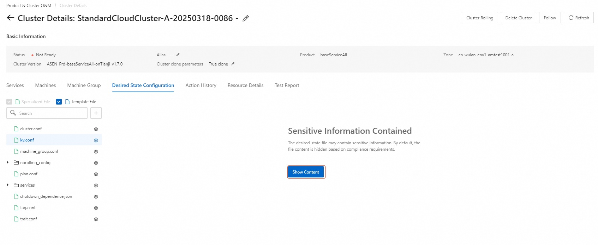

7. Obtain the Internet domain and intranet domain names from the **kv.conf** file.

<a id="section-8-2"></a>

## 8.2. Look up the DNS address

This topic describes how to look up the Domain Name System (DNS) address.

1. Log on to the Apsara Uni-manager Operations Console.

2. In the top navigation bar, choose **Platform Operation > Apsara Infrastructure Management > Resources**.

3. In the left-side navigation pane of the **Apsara Infrastructure Management console**, choose **Resources > Product & Cluster O&M**.

4. Enter dnsProduct in the search box and find the cluster in the **Products** list. Click **Cluster Details** in the **Actions** column.

   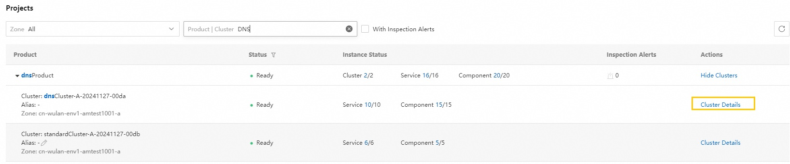

5. Click the **Desired State Configuration** tab and select the  `services/dnsService/user/dns.conf` file.

   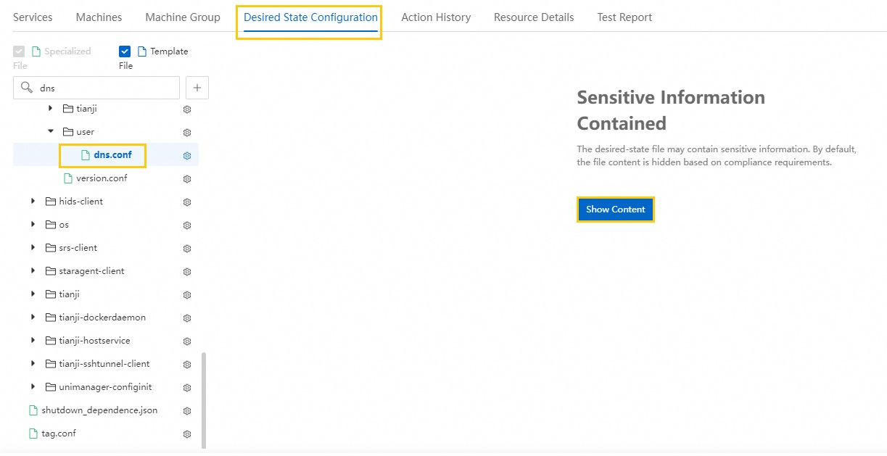

6. Click **Show Content**. The value of the AnycastVip field is the IP address of the DNS name server, which is the same as the ServerIP value shown on the DNS management interface.

> **Note**
>
> The first two IP addresses in the internetIps field are the source IPs used by the DNS service to forward requests. In most cases, two IPs are bound to the bindServerRole containers.

<a id="section-8-3"></a>

## 8.3. Configure DNS forwarding

When you set up a primary-secondary disaster recovery system between two clouds, you must configure Domain Name System (DNS) forwarding at the primary and secondary sites. This helps make sure that DNS queries can be smoothly forwarded across the system. This topic describes how to configure DNS forwarding.

> **Important**
>
> To configure DNS forwarding from opsDns to dnsProduct at the primary site, you must modify the tianji configuration file and roll update the tianji cluster. The risk of automated configuration is high. We recommend that you manually perform the configuration modification and roll update and automate the configuration of other settings.

**Prerequisites**

- A network connection is established between the primary and secondary sites.

- The primary site is successfully deployed and the DNS configuration file is generated in the container.

> **Note**
>
> If the prerequisites are not met, see the "Manually configure DNS forwarding" section in this topic for troubleshooting.

**Automate the configuration of DNS forwarding at the two sites**

1. Obtain the AccessKey pair and pop_ops_vip value of the operations administrator at the primary site.

   <ol type="i">

   <li>

   Log in to the Apsara Uni-manager Operations Console as an operations administrator.

   

   </li>

   <li>

   Click the

   icon in the upper-right corner of the page and then click **User Information**.

   </li>

   <li>

   Obtain the AccessKey pair of the operations administrator.

   </li>

   </ol>

   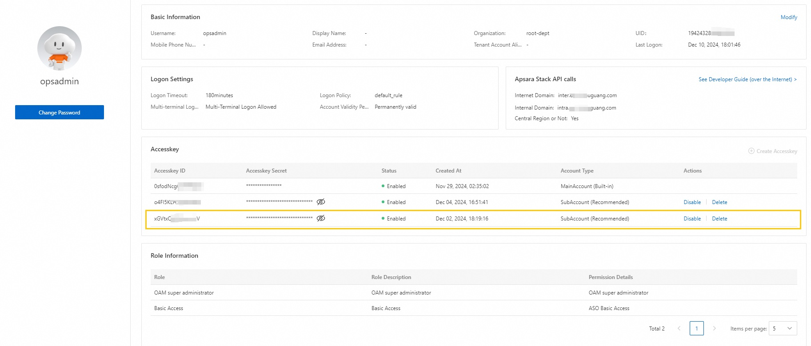

   <ol type="i" start="4">

   <li>

   In the top navigation bar, choose **Platform Operation > Apsara Infrastructure Management > Resource Management**.

   </li>

   <li>

   On the **Product & Cluster O&M** page, enter webappAll in the search box to find the StandardCloudCluster cluster.

   </li>

   <li>

   Click **Cluster Details** in the **Actions** column of the StandardCloudCluster cluster. On the cluster details page, click the **Resource Details** tab.

   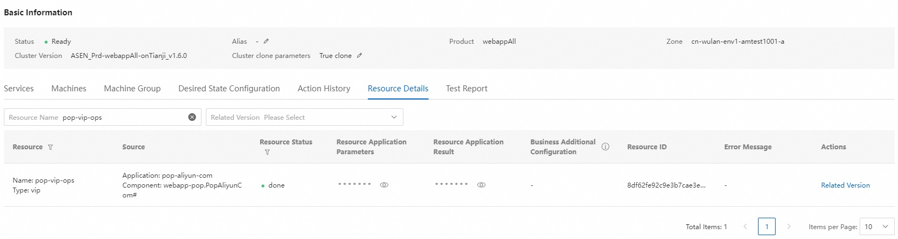

   </li>

   <li>

   View the pop-vip-ops resource details and click the value in the Resource Application Result

   </li>

   </ol>

   column to obtain and save the value of vip_ip.

   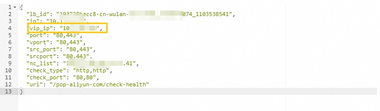

   > **Note**
   >
   > If the pop-vip-ops value of the primary site changes, you must roll update the asrdr cluster of the primary site again.

   Run the following command in the Apsara Stack Resilience for Disaster Recovery (ASR-DR) container of the secondary site:

   Replace pop_vip_ops, ops_admin_ak, and ops_admin_sk with the values obtained in the preceding steps. The DNS forwarding rules and IP address whitelists from the primary site to the secondary site are configured, and the DNS forwarding rules and IP address whitelists from the secondary site to the primary site are configured.

   ```text
   python alidata/bin/dns/auto_config_dns.py asrdr -v {pop_vip_ops} -a {ops_admin_ak} -s {ops_admin_sk}
   ```

   <ol type="i" start="8">

   <li>

   Obtain the content of the /home/admin/asrdr/config/dns/dns_conf.{regionId}.ops file of the local

   </li>

   </ol>

   ASR-DR container.

2. Add a forwarding rule from OPS-DNS to DNS of the local cloud tenant.

   <ol type="i">

   <li>

   Log in to the Apsara Uni-manager Operations Console.

   </li>

   <li>

   In the top navigation bar, choose **Platform Operation > Apsara Infrastructure**

   </li>

   </ol>

   **Management > Resource Management**.

   <ol type="i" start="3">

   <li>

   On the **Product & Cluster O&M** page, enter tianji in the search box to search for the tianji

   </li>

   </ol>

   cluster.

   <ol type="i" start="4">

   <li>

   Click **Cluster Details** in the **Actions** column of the cluster. On the cluster details page, click the **Desired State Configuration** tab.

   </li>

   <li>

   Enter dns_zone.conf.jj2 in the search box on the left and click Show Content to add the dns_conf.{regionId}.ops content obtained in Step 1 to the file.

   Content format:

   ```text
   zone_forwarders:
     -zone: the Internet domain name of the peer cloud
       forwarders:
       - the DNS nameserver address of the local cloud tenant
       - the DNS nameserver address of the local cloud tenant
     -zone: the internal domain name of the peer cloud
       forwarders:
       - the DNS nameserver address of the local cloud tenant
       - the DNS nameserver address of the local cloud tenant
   ```

   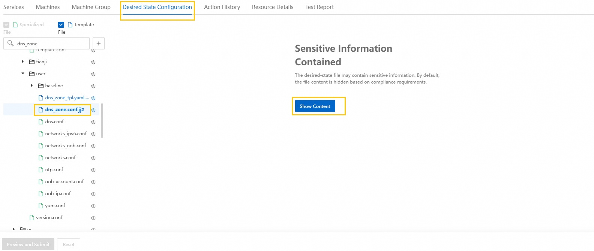

   </li>

   <li>

   Click **Preview and Submit**.

   </li>

   <li>

   Click **Cluster Rolling**.

   </li>

   <li>

   After the tianji cluster is rolled, use one of the following methods for the tianji configuration to

   </li>

   </ol>

   take effect:

   - Enter the dnsslave container of ops1 and ops2 and run the /root/opsbuild/deploy.py command. Before you run the command, shut down the Border Gateway Protocol (BGP) process. Otherwise, the named service is restarted during the execution of the deploy.py script, which may result in a temporary unavailability of domain name resolution of the cloud platform. In most cases, the downtime lasts a few seconds and has a minimal impact. However, the deploy.py script may get stuck. We recommend that you shut down the BGP process before you run the command. To stop the BGP process, run the ps aux | grep bgp command to list all processes related to BGP and then run the kill -9 command to stop the BGP process.

   - Restart the DnsSlave# nodes one by one. Make sure that each DnsSlave node restarts and reaches its final state before you proceed to the next node.

   - If the primary cloud is set up with dual data centers for zone-disaster recovery, you must configure forwarding rules in data center B. Then, perform the preceding steps for the tianji configuration to take effect.

3. Check the execution result.

   <ol type="i">

   <li>

   Log in to the Apsara Uni-manager Operations console. In the top navigation bar, choose **Security Management > Network Security > Network Security Management Center**.

   </li>

   <li>

   In the left-side navigation pane, choose **Network Micro-segmentation Management > DNS**

   </li>

   </ol>

   **forwarding rules**.

   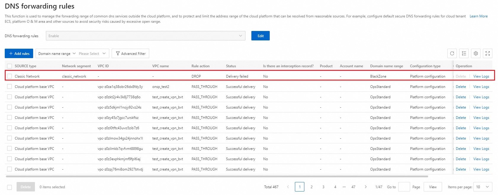

   <ol type="i" start="3">

   <li>

   Log in to the Apsara Uni-manager Management console. In the top navigation bar, choose

   </li>

   </ol>

   **Products > Networking > Cloud Network > Alibaba Cloud DNS**

   <ol type="i" start="4">

   <li>

   On the **Global Domain Names** page, click the **Global Forwarding Configurations** tab.

   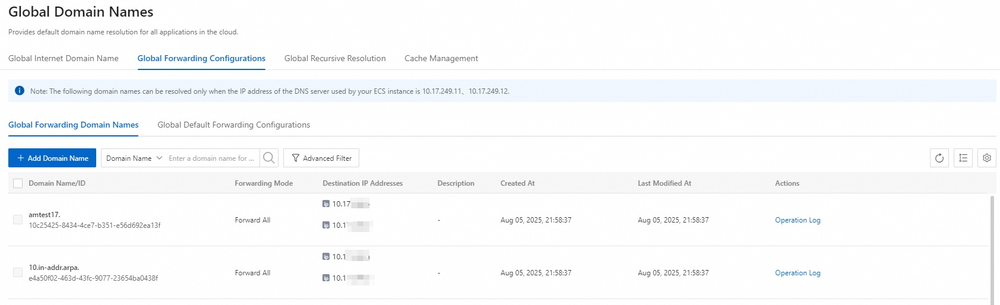

   </li>

   <li>

   The tianji cluster is rolled and the dns_zone.conf.jj2 file is fixed.

   </li>

   </ol>

**Manually configure DNS forwarding**

1. Copy the DNS configuration file named dns_conf.{des_region} in the /home/admin/asrdr/config/dns/ directory at the primary site to the /home/admin/asrdr/config/dns/directory on the ASR-DR container at the secondary site. If ASR-DR is not deployed at the primary site, place the configuration file in the specified directory based on the predefined format and naming convention.

2. Run the following command in the ASR-DR container of the secondary site:

   ```text
   python /alidata/bin/dns/auto_config_dns.py manual -r des_region
   # The des_region parameter specifies the destination region.
   ```

   The operation is performed in the ASR-DR container of the secondary site. Only the DNS forwarding rules and IP address whitelists from the secondary site to the primary site are configured.

3. Obtain the content in the /home/admin/asrdr/config/dns/dns_conf.{regionId}.ops file of the local ASR-DR container.

   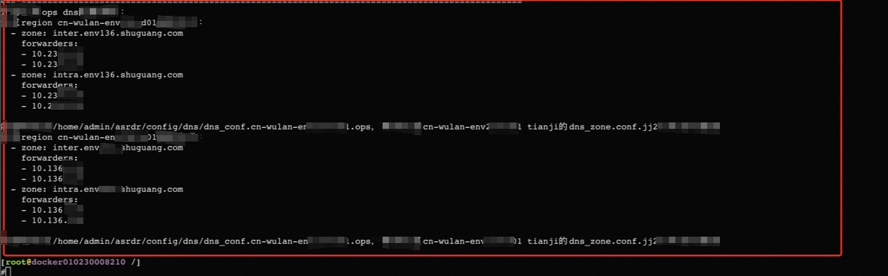

4. Repeat the preceding steps in the ASR-DR container of the primary site.

5. Add a forwarding rule from OPS-DNS to DNS of the local cloud tenant.

   <ol type="i">

   <li>

   Log in to the Apsara Uni-manager Operations Console.

   </li>

   <li>

   In the top navigation bar, choose **Platform Operation > Apsara Infrastructure**

   </li>

   </ol>

   **Management > Resource Management**.

   <ol type="i" start="3">

   <li>

   On the **Product & Cluster O&M** page, enter tianji in the search box to search for the tianji

   </li>

   </ol>

   cluster.

   <ol type="i" start="4">

   <li>

   Click **Cluster Details** in the **Actions** column of the cluster. On the cluster details page, click the **Desired State Configuration** tab.

   </li>

   <li>

   Enter dns_zone.conf.jj2 in the search box on the left and click Show Content to add the dns_conf.{regionId}.ops content obtained in Step 3 to the file.

   Content format:

   ```text
   zone_forwarders:
     -zone: the Internet domain name of the peer cloud
       forwarders:
       - the DNS nameserver address of the local cloud tenant
       - the DNS nameserver address of the local cloud tenant
     -zone: the internal domain name of the peer cloud
       forwarders:
       - the DNS nameserver address of the local cloud tenant
       - the DNS nameserver address of the local cloud tenant
   ```

   

   </li>

   <li>

   Click **Preview and Submit**.

   </li>

   <li>

   Click **Cluster Rolling**.

   </li>

   <li>

   After the tianji cluster is rolled, use one of the following methods for the tianji configuration to

   </li>

   </ol>

   take effect:

   - Enter the dnsslave container of ops1 and ops2 and run the /root/opsbuild/deploy.py command. Before you run the command, shut down the BGP process. Otherwise, the named service is restarted during the execution of the deploy.py script, which may result in a temporary unavailability of domain name resolution of the cloud platform. In most cases, the downtime lasts a few seconds and has a minimal impact. However, the deploy.py script may get stuck. We recommend that you shut down the BGP process before you run the command. To stop the BGP process, run the ps aux | grep bgp command to list all processes related to BGP and then run the kill -9 command to stop the BGP process.

   - Restart the DnsSlave# nodes one by one. Make sure that each DnsSlave node restarts and reaches its final state before you proceed to the next node.

   - If the primary cloud is set up with dual data centers for zone-disaster recovery, you must configure forwarding rules in data center B. Then, perform the preceding steps for the tianji configuration to take effect.

6. Check the execution result.

   <ol type="i">

   <li>

   Log in to the Apsara Uni-manager Operations console. In the top navigation bar, choose **Security Management > Network Security > Network Security Management Center**.

   </li>

   <li>

   In the left-side navigation pane, choose **Network Micro-segmentation Management > DNS**

   </li>

   </ol>

   **forwarding rules**.

   

   <ol type="i" start="3">

   <li>

   Log in to the Apsara Uni-manager Management console. In the top navigation bar, choose

   </li>

   </ol>

   **Products > Networking > Cloud Network > Alibaba Cloud DNS**

   <ol type="i" start="4">

   <li>

   On the **Global Domain Names** page, click the **Global Forwarding Configurations** tab.

   

   </li>

   <li>

   The tianji cluster is rolled and the dns_zone.conf.jj2 file is fixed.

   </li>

   </ol>

<a id="section-8-4"></a>

## 8.4. Configure DTS parameters

If you configure a primary/secondary disaster recovery solution between two clouds, you must configure Data Transmission Service (DTS) for database products. This topic describes how to configure DTS.

**Prerequisites**

- A network connection is established between the primary and secondary sites.

- ASR for Geo-disaster Recovery (ASR-DR) is deployed at the primary site and a DTS SQL template file is generated in the container.

> **Note**
>
> If the prerequisites are not met, manually configure local DTS.

**Automatically configure local DTS**

1. Obtain the AccessKey ID (AK) and AccessKey secret (SK) and pop_ops_vip of the operations administrator at the primary site.

   <ol type="i">

   <li>

   Log on to the Apsara Uni-manager Operations Console as an operations administrator.

   

   </li>

   <li>

   Click

   in the upper-right corner of the page and then click **Personal Information**.

   </li>

   <li>

   Obtain the AK and SK of the operations administrator.

   </li>

   </ol>

   

   <ol type="i" start="4">

   <li>

   In the top navigation bar, choose **Platform Operation > Apsara Infrastructure Management > Resources**.

   </li>

   <li>

   On the **Product & Cluster O&M** page, enter webappAll in the search box to find the StandardCloudCluster cluster.

   </li>

   <li>

   Click **Cluster Details** in the **Actions** column of the StandardCloudCluster cluster. On the cluster details page, click **Resource Details**.

   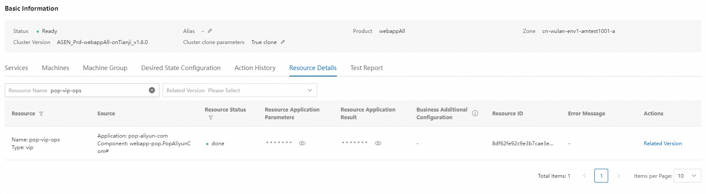

   </li>

   <li>

   View the ops resource details, click the value in the Resource Application Result column, and

   </li>

   </ol>

   then save the value of vip_ip.

   

2. Log on to the ASR-DR container of the secondary site. For more information, see Log in to a container.

3. Run the following command in the ASR-DR container of the secondary site:

   ```text
   python alidata/bin/dts/dts_new/auto_config_dts.py asrdr -v {pop_ops_vip} -a {ops_admin_ak} 
   -s {ops_admin_sk}
   ```

   Replace the pop_ops_vip, ops_admin_ak, and ops_admin_sk parameters with the values obtained from the preceding steps. After the script is executed, relevant information about the primary site is inserted into the DTS database at the secondary site.

4. Run the following commands in the DTS database at the secondary site to view information about the DTS database:

   ```sql
   select * from region_pattern where pattern_expression = '^Region ID'\G
   ```

   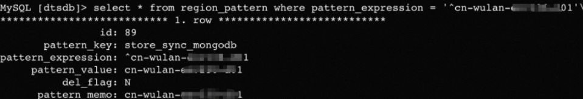

   ```sql
   select * from config where config_code = 'cross_cloud_internet_check_flag';
   ```

   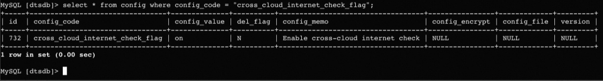

   ```sql
   select * from region_list where REGIONS like '%Region ID%'\G
   ```

   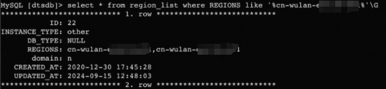

   ```sql
   select * from dts_region_info where region = 'Region ID'\G
   ```

   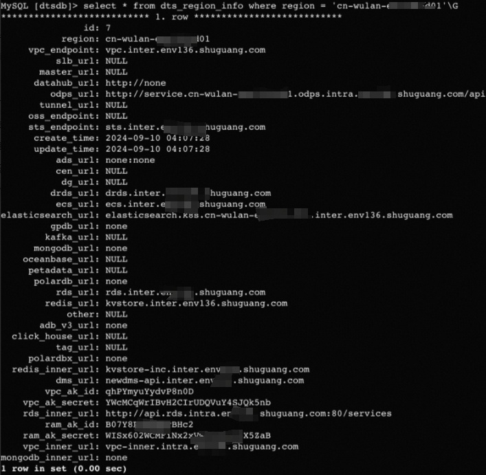

**Manually configure local DTS**

> **Note**
>
> If the ASR-DR container at the secondary site cannot access the VIP for asrdr-backend-ops applied for by the asrdr-backend at the primary site, we recommend that you manually configure local DTS.

1. Copy the DTS SQL template /home/admin/asrdr/config/dts/dts_conf.{des_region} from the asrdr container at the primary site to the /home/admin/asrdr/config/dts/ directory in the asrdr container at the secondary site.

2. Run the following command in the ASR-DR container of the secondary site:

   ```text
   python alidata/bin/dts/dts_new/auto_config_dts.py manual -r {des_region}
   # The des_region parameter specifies the destination region.
   ```

   When the script is executed, {current_region} is automatically replaced. During the execution, the SQL statements that are executed are returned.

   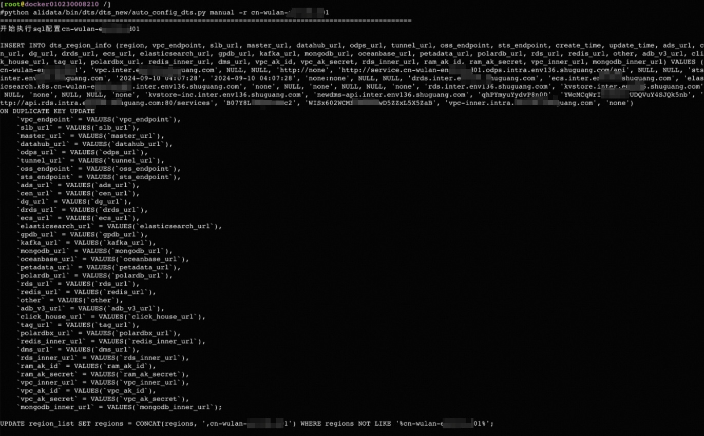

3. Run the following commands in the DTS database at the secondary side to view information about the DTS database:

   ```sql
   select * from region_pattern where pattern_expression = '^Region ID'\G
   ```

   

   ```sql
   select * from config where config_code = 'cross_cloud_internet_check_flag';
   ```

   

   ```sql
   select * from region_list where REGIONS like '%Region ID%'\G
   ```

   

   ```sql
   select * from dts_region_info where region = 'Region ID'\G
   ```

   

<a id="section-8-5"></a>

## 8.5. Configure dedicated lines

When you deploy ASR for Geo-disaster Recovery, you must configure dedicated lines. Otherwise, no data is available on the line chart on the homepage. To configure dedicated lines, perform the following steps:

1. Download the scripts to your computer and decompress the scripts

   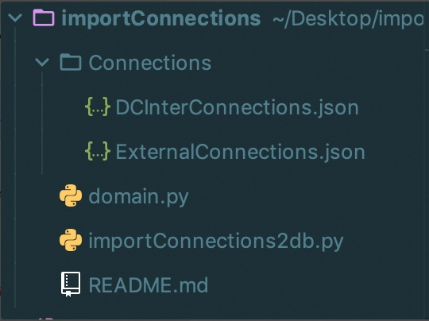

2. Execute the sudo sgvpn con -e 128E -f command to connect to the VPN. For information about the connection procedure, see sgvpn documentation.

> **Note**
>
> If you directly import the data to the environment, no VPN connection is required.

3. Configure nrm_domain

   <ol type="i">

   <li>

   Go to the Xterm > Environment Metadata Query section, select the destination environment, and then enter baseService-network-base in the service search box to query the value.

   

   <ol type="i" start="2">

   <li>

   Replace the placeholder in the domain.py file with the nrm_domain value obtained in the

   </li>

   </ol>

   preceding step.

   </li>

   </ol>


4. Import the DCI and interconnect dedicated line data.

> **Note**
>
> - Import DCI dedicated line data to the Connections/DCInterConnections.json file in the JSON format. Import interconnection dedicated line data to the Connections/ExternalConnections.json file in the JSON format.
>
> - DCI and interconnection data can be in object or array format.
>
> - For information about the parameters, see AddDCInterConnection and AddExternalConnection.


5. Execute the python importConnections2db.py script.


<a id="section-8-5-1"></a>

### 8.5.1. AddDCInterConnection

**Description**

Creates a data center interconnection (DCI) dedicated line.

**URL**

http://{nrm_endpoint}/nbs/api/AddDCInterConnection

**Request method**

GET/POST

**Product**

Nbs

**Version**

2021-02-19

**Request parameters**

| Parameter | Type | Required | Example | Description | Remarks |
| --- | --- | --- | --- | --- | --- |
| Name | str | Yes | test | The name of the DCI dedicated line. |  |
| ConnectTyp e | str | Yes | InterDo main | The type of the DCI dedicated line. | InterDomain: inter-region dedicated line<br>IntraDomain: intra-region dedicated line |
| Region | str | Yes | cn-qingdao-env66-d01 | The region in which the DCI dedicated line access device is located. |  |
| Idc | str | Yes | amtest1 1 | The data center in which the access device of the DCI dedicated line is located. |  |
| LineOperato r | str | No | test | The operator of the DCI dedicated line. |  |
| AccessDevic eId | str | Yes | ASW-A3-5-H09.AMT EST66 | The border network device that is used to access the DCI dedicated line. |  |
| PhysicalPort | str | Yes | Port-01 | The physical port used for DCI dedicated line access. |  |
| PortType | str | Yes | test | The type of the physical port. | A manual input is required. |
| Bandwidth | Int | No | 10000 | The access bandwidth. Unit: M |  |
| ConnectMod e | str | Yes | DirectCo nnect | The interconnection type on both sides of the dedicated line. | DirectConnect: direct connection<br>Firewall: connection through a firewall |
| FwMode | str | No | CloudFir ewall | The type of the firewall. | If a connection through a firewall is specified, specify the firewall type based on your business requirements.<br>CloudFirewall<br>UserFirewall<br>Other |
| FwName | str | No | test | The name of the firewall. | If a connection through a firewall is specified, specify the firewall name based on your business requirements. |
| FwDesc | str | No | test | The remarks for the firewall. | If a connection through a firewall is specified, specify the remarks for the firewall based on your business requirements. |
| PeerRegion | str | No | cn-qingdao-env-d02 | The peer region. | If you set the ConnectType parameter to InterDomain, you must specify the peer region. |
| PeerIdc | str | No | amtest6 6 | The peer data center. | If you set the ConnectType parameter to InterDomain, you must specify the peer data center. |
| PeerAccessD eviceId | str | Yes | CSW-VM-VPC-G1-1.AMTES T66 | The peer device. |  |
| PeerPhysical Port | str | Yes | port_02 | The physical port of the peer device. |  |
| PeerPortTyp e | str | Yes | test | The type of the physical port on the peer device. |  |
| LocalIp | str | Yes | 192.168.1.1/30 | The local IP address. | The route mode in the IP address/mask format.Example: 1.1.X.X/30. |
| PeerIp | str | Yes | 192.168.1.2/30 | The peer IP address. | The route mode in the IP address/mask format.Example: 1.1.X.X/30. |
| ConnectStat us | int | Yes | 1 | Specifies whether to enable the DCI dedicated line. | 1: enables the DCI dedicated line.<br>0: disables the DCI dedicated line. |
| Description | str | No | xxxxxxx | Remarks | Records non-standard information. |

**Response parameters**

| Parameter | Type | Example | Description |
| --- | --- | --- | --- |
| RequestId | String | 0ED8D006-F706-4D23-88ED-E1\*\*\*\*\*\*\*\* | The request ID. |
| Success | bool | true/false | Indicates whether the request was successful. |
| Code | str | 0 | The custom response status code. |
| Message | str | success | The message. |

**Examples**

**Sample requests**

```text
 http://127.0.0.1:5050/nbs/api/AddDCInterConnection?
```

```text
Name=LIGANG_03&ConnectType=LocalCity&Region=cn-qingdao-env66-
```

```text
d01&Idc=amtest11&LineOperator=china&AccessDeviceId=ASW-A3-5-H09.AMTEST66&PhysicalPort=Port-
```

```text
04&PortType=unkown&Bandwidth=10000&ConnectMode=Firewall&FwMode=CloudFirewall&FwName=firewall-
```

```text
01&FwDesc=test for firewall&PeerIdc=amtest66&PeerAccessDeviceId=CSW-VM-VPC-G1-
```

```text
1.AMTEST66&PeerPhysicalPort=Port-
```

```text
002&PeerPortType=unkown&LocalIp=1.1.X.X/30&PeerIp=192.168.1.2/30&ConnectStatus=1&Description=just
```

```text
for test!!!&PeerRegion=cn-qingdao-env-d02 
```

**Sample success responses**

```json
  { "Code": "0", "Message": "success", "RequestId": "bc56d938-e1b7-412c-a665-ba9a6f4a3ef5", 
"Success": true } 
```

**No data/operation failed**

```json
  { "Message": "no data/update/delete", "Code": "4002", "RequestId": "d006a01a-3d87-4971-a3fc-
bb4cb2823799", "Success": true } 
```

**Exceptions**

40x,50x

```json
 { "Code": "InternalError", "Message": "The request processing has failed: [Errno 32] Broken 
```

```text
pipe", "RequestId": "2554a594-41a2-4346-93ac-5ac179f8b70f", "Success": false, "cost": 1, 
```

```text
"eagleEyeTraceId": "2554a594-41a2-4346-93ac-5ac179f8b70f", "errCode": 
```

```text
"ASO_NETWORK_INTERNALERROR", "errMessage": "An exception occurs. Check the backend service.", 
```

```text
"errTitle": "An exception occurs.", "requestURI": "/slalink/fulllink/classic/idcinfo/IDCList", 
```

```text
"responseVersion": "v1", "serviceRole": "baseServiceAll.baseService-network-base.nrm#", 
```

```text
"success": false } 
```

> **Note**
>
> - The Success field in the response indicates whether the request was successful.
>
> - Even if the Success field is true, you must check whether the Data field is an empty list or an array ([]). You can check the Code field to determine whether to render data. If the value of the Code field is "0," the data list is returned with data. If the value of the Code field is not "0," the data list is empty and the Data field does not exist.
>
> - POP does not support downloading files by using an API. To export or download a file, you must directly access the API URL.

**Error codes**

<table>
  <tr>
    <td>HttpCode</td>
    <td>Error code</td>
    <td>Error message</td>
  </tr>
  <tr>
    <td>40x</td>
    <td>ParameterError</td>
    <td>Invalid parameter format.</td>
  </tr>
  <tr>
    <td>40x</td>
    <td>MissingParameter</td>
    <td>One or more required parameters are not specified.</td>
  </tr>
  <tr>
    <td>500</td>
    <td>InternalError</td>
    <td>An internal processing error occurs.</td>
  </tr>
  <tr>
    <td>400</td>
    <td>UniqueError</td>
    <td>A unique constraint is violated.</td>
  </tr>
  <tr>
    <td>400</td>
    <td>DBError</td>
    <td>A data read/write error occurs.</td>
  </tr>
  <tr>
    <td>400</td>
    <td>Existing</td>
    <td>The data already exists.</td>
  </tr>
  <tr>
    <td>400</td>
    <td>NotExisting</td>
    <td>The data does not exist.</td>
  </tr>
</table>

<a id="section-8-5-2"></a>

### 8.5.2. AddExternalConnection

**Description**

Creates an interconnection dedicated line.

**URL**

http://{nrm_endpoint}/nbs/api/AddDCInterConnection

**Request method**

GET/POST

**Product**

Nbs

**Version**

2021-02-19

**Request parameters**

| Parameter | Type | Req uire d | Example | Description | Remarks | ASR for Geo-disaster Recovery-specific description |
| --- | --- | --- | --- | --- | --- | --- |
| Name | str | Yes | test | The name of the interconnecti on dedicated line. |  | You can specify a name based on your business requirements. |
| ConnectTy pe | str | Yes | toInternet | The interconnecti on type. | toIdc<br>toInternet | resilience (default) |
| Region | str | Yes | cn-qingdao-env66-d01 | The region in which the dedicated line access device is located. |  | The region ID of the secondary data center.If a single data center is used, the information of the primary and secondary data centers is the same. |
| Idc | str | Yes | amtest11 | The data center in which the dedicated line access device is located. |  | The information of the secondary data center.If a single data center is used, the information of the primary and secondary data centers is the same. |
| LineOperat or | str | No | test | The operator of the dedicated line. |  | The parameter can be left empty. |
| AccessDev iceId | str | Yes | ASW-A3-5-H09.AMTES T66 | The border network device that is used to access the dedicated line. |  | The border network device of the secondary data center. If a single data center is used, the information of the primary and secondary data centers is the same. |
| PhysicalPo rt | str | Yes | Port-01 | The physical interface used for the dedicated line. |  | The physical interface of the secondary data center. If a single data center is used, the information of the primary and secondary data centers is the same. |
| PortType | str | No | test | The physical interface type. | A manual input is required. | This parameter can be left empty. |
| Bandwidth | Int | No | 10000 | The access bandwidth.Unit: M |  | This parameter can be left empty. |
| ConnectM ode | str | Yes | DirectConne ct | The interconnecti on type on both sides of the dedicated line. | DirectConnect: direction connection<br>Firewall: connection through a firewall | Default: DirectConnect |
| FwMode | str | No | CloudFirewa ll | The firewall type. | If a connection through a firewall is specified, specify the firewall type based on your business requirements.<br>CloudFirewall<br>UserFirewall<br>Other | This parameter can be left empty. |
| FwName | str | No | test | The name of the firewall. | If a connection through a firewall is specified, specify the firewall name based on your business requirements. | This parameter can be left empty. |
| FwDesc | str | No | test | The remarks for the firewall. | If a connection through a firewall is specified, specify the remarks for the firewall based on your business requirements. | This parameter can be left empty. |
| PeerRegio n | str | No | cn-qingdao-env-d02 | The peer region. | If you set the ConnectType parameter to InterDomain, you must specify the peer region. | The region ID of the primary data center. If a single data center is used, the information of the primary and secondary data centers is the same. |
| PeerIdc | str | No | amtest66 | The peer data center. | If you set the ConnectType parameter to InterDomain, you must specify the peer data center. | The ID of the primary data center. If a single data center is used, the information of the primary and secondary data centers is the same. |
| PeerAcces sDeviceId | str | Yes | CSW-VM-VPC-G1-1.AMTEST6 6 | The peer device. |  | The name of the primary data center. If a single data center is used, the information of the primary and secondary data centers is the same. |
| PeerPhysic alPort | str | Yes | port_02 | The physical port of the peer device. |  | The physical port of the primary data center. If a single data center is used, the information of the primary and secondary data centers is the same. |
| PeerPortTy pe | str | No | test | The type of the physical port on the peer device. |  | This parameter can be left empty. |
| LocalIp | str | No | 192.168.1.1/30 | The local IP address. | The route mode in the IP address/mask format.Example: 1.1.X.X/30. | Make sure that the format is correct. |
| PeerIp | str | No | 192.168.2.2/30 | The peer IP address. | The route mode in the IP address/mask format.Example: 1.1.X.X/30. | Make sure that the format is correct. |
| ConnectSt atus | int | Yes | 1 | Specifies whether to enable the dedicated line. | 1: enables the dedicated line.<br>0: disables the dedicated line. | Default: 1 |
| Descriptio n | str | No | xxxxxxx | Remarks | Records non-standard information. | This parameter can be left empty. |

**Response parameters**

| Parameter | Type | Example | Description |
| --- | --- | --- | --- |
| RequestId | String | 0ED8D006-F706-4D23-88ED-E11E\*\*\*\*\*\* | The request ID |
| Success | bool | true/false | Indicates whether the request was successful. |
| Code | str | 0 | The custom response status code. |
| Message | str | success | The message. |

**Examples Sample requests**

```text
 http://127.0.0.1:5050/nbs/api/AddExternalConnection?
```

```text
Name=LIGANG_01&ConnectType=toInternet&Region=cn-qingdao-env-
```

```text
d01&Idc=amtest11&LineOperator=china&AccessDeviceId=ASW-A3-4-H09.AMTEST66&PhysicalPort=Port-
```

```text
01&PortType=unkown&Bandwidth=10000&ConnectMode=Firewall&FwMode=CloudFirewall&FwName=firewall-
```

```text
01&FwDesc=test for firewall&PeerAccessDeviceId=HSW-02&PeerPhysicalPort=Port-
```

`002&PeerPortType=unkown&LocalIp=1.1.X.X/30&ConnectStatus=1&Description=just for test` !!!

**Sample success responses**

```json
 { 
 "Code": "0", 
 "Message": "success", 
 "RequestId": "bc56d938-e1b7-412c-a665-ba9a6*******", 
 "Success": true 
 } 
```

**No data/operation failed**

```json
 { 
 "Message": "no data/update/delete", 
 "Code": "4002", 
 "RequestId": "d006a01a-3d87-4971-a3fc-bb4cb2******", 
 "Success": true 
 } 
```

**Abnormal responses**40x, 50x

```json
 { 
 "Code": "InternalError", 
 "Message": "The request processing has failed: [Errno 32] Broken pipe", 
 "RequestId": "2554a594-41a2-4346-93ac-5ac17******", 
 "Success": false, 
 "cost": 1, 
 "eagleEyeTraceId": "2554a594-41a2-4346-93ac-5ac179f******", 
 "errCode": "ASO_NETWORK_INTERNALERROR", 
 "errMessage": "An exception occurs. Check the backend service.", 
 "errTitle": "An exception occurs.", 
 "requestURI": "/slalink/fulllink/classic/idcinfo/IDCList", 
 "responseVersion": "v1", 
 "serviceRole": "baseServiceAll.baseService-network-base.nrm#", 
 "success": false 
 } 
```

> **Note**
>
> - The Success field in the response indicates whether the request was successful.
>
> - Even if the Success field is true, you must check whether the Data field is an empty list or an array ([]). You can check the Code field to determine whether to render data. If the value of the Code field is "0," the data list is returned with data. If the value of the Code field is not "0," the data list is empty and the Data field does not exist.
>
> - POP does not support download. To export or download an object, you must directly access the API URL.

**Error codes**

<table>
  <tr>
    <td>HttpCode</td>
    <td>Error code</td>
    <td>Error message</td>
  </tr>
  <tr>
    <td>40x</td>
    <td>ParameterError</td>
    <td>Invalid parameter format.</td>
  </tr>
  <tr>
    <td>40x</td>
    <td>MissingParameter</td>
    <td>One or more required parameters are not specified.</td>
  </tr>
  <tr>
    <td>500</td>
    <td>InternalError</td>
    <td>An internal processing error occurs.</td>
  </tr>
  <tr>
    <td>400</td>
    <td>UniqueError</td>
    <td>A unique constraint is violated.</td>
  </tr>
  <tr>
    <td>400</td>
    <td>DBError</td>
    <td>A data read/write error occurs.</td>
  </tr>
  <tr>
    <td>400</td>
    <td>Existing</td>
    <td>A data read/write error occurs.</td>
  </tr>
  <tr>
    <td>400</td>
    <td>NotExisting</td>
    <td>The data already exists.</td>
  </tr>
</table>
