Alibaba Cloud  
Apsara Stack  
apsara stack resilience  
ASR for Zone-  
disaster Recovery Operations  
and Maintenance Guide  
Product Version: v3.18.6-2607  
Document Version: 20260828

**Table of Contents**

- [1.Overview](#section-1)
    - [1.1. Introduction](#section-1-1)
    - [1.2. O&M architecture](#section-1-2)
    - [1.3. Roles](#section-1-3)
- [2.ASR O&M operations](#section-2)
    - [2.1. Getting started](#section-2-1)
        - [2.1.1. Log on to the ASR console](#section-2-1-1)
        - [2.1.2. View platform monitoring metrics](#section-2-1-2)
            - [2.1.2.1. Service monitoring](#section-2-1-2-1)
            - [2.1.2.2. Synchronization monitoring](#section-2-1-2-2)
    - [2.2. Core alert handling](#section-2-2)
        - [2.2.1. Alert items](#section-2-2-1)
        - [2.2.2. inspect_db_resource](#section-2-2-2)
        - [2.2.3. drei_product](#section-2-2-3)
        - [2.2.4. rpo_check](#section-2-2-4)
            - [2.2.4.1. Overview](#section-2-2-4-1)
            - [2.2.4.2. rpo_check (ApsaraDB RDS)](#section-2-2-4-2)
            - [2.2.4.3. rpo_check (OSS)](#section-2-2-4-3)
        - [2.2.5. sync_check](#section-2-2-5)
            - [2.2.5.1. Overview](#section-2-2-5-1)
            - [2.2.5.2. sync_check (MiddleWareAll)](#section-2-2-5-2)
            - [2.2.5.3. sync_check (minirds-mt/rds)](#section-2-2-5-3)
            - [2.2.5.4. sync_check (SLB)](#section-2-2-5-4)
            - [2.2.5.5. sync_check (Kafka)](#section-2-2-5-5)
            - [2.2.5.6. sync_check (Elasticsearch)](#section-2-2-5-6)
        - [2.2.6. inspect_product_cluster_aplus](#section-2-2-6)
        - [2.2.7. inspect_product_cluster_version](#section-2-2-7)
        - [2.2.8. inspect_product_variable](#section-2-2-8)
        - [2.2.9. inspect_product_cluster_deploy](#section-2-2-9)
        - [2.2.10. Appendixes](#section-2-2-10)
            - [2.2.10.1. Log on to the Apsara Uni-manager Management Console](#section-2-2-10-1)
            - [2.2.10.2. Log on to the Apsara Uni-manager Operations Console](#section-2-2-10-2)
            - [2.2.10.3. Log on to a container](#section-2-2-10-3)
            - [2.2.10.4. Log on to the xuanyuan database](#section-2-2-10-4)
            - [2.2.10.5. Log on to the Apsara Infrastructure Management console](#section-2-2-10-5)
            - [2.2.10.6. Secondary database rebuild](#section-2-2-10-6)
            - [2.2.10.7. Log on to an abnormal instance](#section-2-2-10-7)
- [3.Cloud service O&M operations](#section-3)
    - [3.1. TianJi](#section-3-1)
        - [3.1.1. Check the desired state](#section-3-1-1)
    - [3.2. DNS](#section-3-2)
        - [3.2.1. Check data consistency](#section-3-2-1)
        - [3.2.2. Check the domain name resolution service](#section-3-2-2)
    - [3.3. MiniRDS](#section-3-3)
        - [3.3.1. Check tasks](#section-3-3-1)
        - [3.3.2. Check the DR status of instances](#section-3-3-2)
        - [3.3.3. Check the status of instances](#section-3-3-3)
    - [3.4. ApsaraDB RDS](#section-3-4)
        - [3.4.1. Check tasks](#section-3-4-1)
        - [3.4.2. Check the DR status of instances](#section-3-4-2)
        - [3.4.3. Check the status of instances](#section-3-4-3)
    - [3.5. SLB](#section-3-5)
        - [3.5.1. Check the status of LVSs](#section-3-5-1)
        - [3.5.2. Check the status of proxies](#section-3-5-2)
        - [3.5.3. Check the status of keyservers](#section-3-5-3)
    - [3.6. OSS](#section-3-6)
        - [3.6.1. Check bucket locations](#section-3-6-1)
    - [3.7. ECS](#section-3-7)
        - [3.7.1. Check the status of NCs](#section-3-7-1)
    - [3.8. ASO](#section-3-8)
        - [3.8.1. Check the traffic](#section-3-8-1)
        - [3.8.2. Check alerts](#section-3-8-2)
- [4.FAQ](#section-4)
    - [4.1. What do I do if VIPs in the secondary data center are abnormal?](#section-4-1)
- [5.Appendixes](#section-5)
    - [5.1. View ASR logs](#section-5-1)
    - [5.2. Log on to a container](#section-5-2)
    - [5.3. Log on to the tianji-sshtunnel database](#section-5-3)
    - [5.4. Log on to the oss_meta database](#section-5-4)
    - [5.5. Log on to the houyi-reg database](#section-5-5)
    - [5.6. Resolve configuration inconsistency between the primary and secondary tables](#section-5-6)

<a id="section-1"></a>

# 1.Overview

<a id="section-1-1"></a>

## 1.1. Introduction

ASR for Zone-disaster Recovery is a cloud platform designed to provide hybrid backup and recovery solutions. This service ensures data security and business continuity for enterprises. ASR stands for Apsara Stack Resilience. This topic describes the objectives, requirements, precautions, and technical support contacts for ASR for Zone-disaster Recovery O&M.

**Objectives**

This manual is designed to help O&M personnel perform preventive maintenance on ASR for Zone-disaster Recovery to ensure the long-term stable operation of the system. The O&M personnel can follow the instructions in this guide to handle system issues that are identified during maintenance. For system issues that are not covered in this guide, the O&M personnel can contact Apsara Stack engineers for technical support.

**Requirements**

- The O&M personnel must possess skills and knowledge related to the information technology industry, including computer networking, computer operation, problem analysis, and troubleshooting.

- The O&M personnel must pass the pre-job training and understand the Apsara Stack system. The required knowledge for the system includes system principles, networking, features, and the usage of maintenance tools.

> **Important**
>
> The O&M personnel must comply with operation procedures during maintenance to ensure personal safety and system security. User data must be kept strictly confidential and must not be copied or disseminated without written consent from users.

**Precautions**

To ensure stable system operation and prevent unexpected events, the O&M personnel must comply with the following guidelines:

- Hierarchical permission management

  Permissions on networks, devices, systems, and data are granted based on the services and roles of the O&M personnel. This prevents system faults due to unauthorized operations.

- System security

  - Before the O&M personnel perform operations on the system, they must be clearly aware of the impacts of the operations. This ensures that the system is not affected by high-risk operations.

  - The O&M personnel must clearly record the details of the issues that are encountered during the operations. This helps O&M engineers troubleshoot the issues.

- Personal safety and data security

  - The O&M personnel must take measures to ensure safety based on device manuals when electrical equipment is used.

  - The O&M personnel must use secure devices to access the business network.

  - Unauthorized data replication and dissemination are prohibited.

**Technical support**

To obtain help during system maintenance, the O&M personnel can contact Apsara Stack system technical support.

<a id="section-1-2"></a>

## 1.2. O&M architecture

This topic describes the O&M operations supported by Apsara Stack Resilience (ASR) for Zone-disaster Recovery.

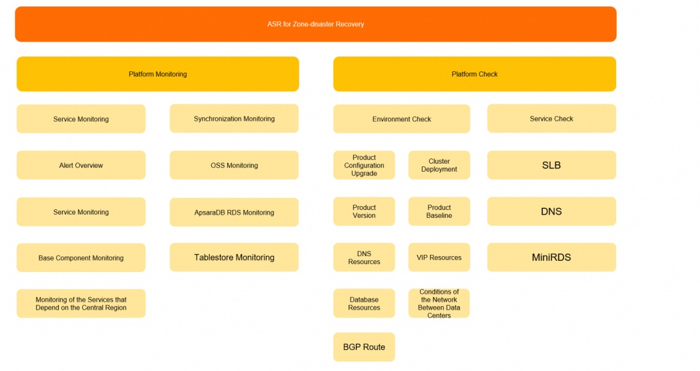

ASR for Zone-disaster Recovery allows you to perform the following O&M operations:

- Platform monitoring: including service monitoring and synchronization monitoring.

  - Service monitoring: allows you to monitor the status of services or components in the primary and secondary data centers, and check the alert information and the services or components that are deployed in active-active mode.

  - Synchronization monitoring: allows you to view the data synchronization latency compliance rate, number of instances with successful synchronization, number of instances with synchronization exceptions, and synchronization latency for instances of ApsaraDB RDS, Object Storage Service (OSS), and Tablestore.

- Platform check: including environment check and service check.

  - Environment check: allows you to check whether the following check items meet disaster recovery (DR) conditions: Product Configuration Upgrade, Cluster Deployment, Product Version, Product Baseline, DNS Resources, VIP Resources, Database Resources, Conditions of the Network Between Data Centers, and BGP Route.

  - Service check: allows you to check the status of services such as Server Load Balancer (SLB), DNS, and MiniRDS.

<a id="section-1-3"></a>

## 1.3. Roles

This topic describes the O&M operations that can be performed by different roles of Apsara Stack Resilience (ASR) for Zone-disaster Recovery.

<table>
  <tr>
    <th colspan="2">Logon scenario</th>
    <th colspan="3">DR scenario</th>
    <th colspan="2">Routine scenario</th>
  </tr>
  <tr>
    <td colspan="2">Role</td>
    <td>Advanced O&amp;M</td>
    <td>Basic O&amp;M</td>
    <td>Visitor</td>
    <td>System Admin</td>
    <td>Platform Operation administrat or</td>
  </tr>
  <tr>
    <td rowspan="5">Primary data center</td>
    <td>Alert overview</td>
    <td>Not supported</td>
    <td>Not supported</td>
    <td>Not supported</td>
    <td>Not supported</td>
    <td>Not supported</td>
  </tr>
  <tr>
    <td>Service monitoring</td>
    <td>Supported</td>
    <td>Supported</td>
    <td>Supported</td>
    <td>Supported</td>
    <td>Supported</td>
  </tr>
  <tr>
    <td>Synchroniz ation monitoring</td>
    <td>Not supported</td>
    <td>Not supported</td>
    <td>Not supported</td>
    <td>Not supported</td>
    <td>Not supported</td>
  </tr>
  <tr>
    <td>Environme nt check</td>
    <td>Supported</td>
    <td>Supported</td>
    <td>Supported</td>
    <td>Supported</td>
    <td>Supported</td>
  </tr>
  <tr>
    <td>Service check</td>
    <td>Supported</td>
    <td>Supported</td>
    <td>Supported</td>
    <td>Supported</td>
    <td>Supported</td>
  </tr>
  <tr>
    <td rowspan="5">Secondary data center</td>
    <td>Alert overview</td>
    <td>Supported</td>
    <td>Supported</td>
    <td>Supported</td>
    <td>Supported</td>
    <td>Supported</td>
  </tr>
  <tr>
    <td>Service monitoring</td>
    <td>Supported</td>
    <td>Supported</td>
    <td>Supported</td>
    <td>Supported</td>
    <td>Supported</td>
  </tr>
  <tr>
    <td>Synchroniz ation monitoring</td>
    <td>Supported</td>
    <td>Supported</td>
    <td>Supported</td>
    <td>Supported</td>
    <td>Supported</td>
  </tr>
  <tr>
    <td>Environme nt check</td>
    <td>Supported</td>
    <td>Supported</td>
    <td>Supported</td>
    <td>Supported</td>
    <td>Supported</td>
  </tr>
  <tr>
    <td>Service check</td>
    <td>Supported</td>
    <td>Supported</td>
    <td>Supported</td>
    <td>Supported</td>
    <td>Supported</td>
  </tr>
</table>

<a id="section-2"></a>

# 2.ASR O&M operations

<a id="section-2-1"></a>

## 2.1. Getting started

<a id="section-2-1-1"></a>

### 2.1.1. Log on to the ASR console

Apsara Stack Resilience (ASR) for Zone-disaster Recovery provides three logon methods for various scenarios, including routine O&M, disaster recovery escape, and tenant operations.

> **Note**
>
> In this document, the Zone-disaster Recovery Management Platform ASR is referred to as the ASR console.

**Prerequisites**

- To log on from the Apsara Uni-manager Operations Console, you have obtained the endpoint, username, and password for the Apsara Uni-manager Operations Console from the deployment personnel or an administrator.

  The endpoint of the Apsara Uni-manager Operations Console is in the following format: &lt;region-id>.console.&lt;intranet-domain-id>.

- For a disaster recovery escape logon, you have obtained the endpoint, username, and password of the ASR console from the deployment personnel or an administrator.

  > **Note**
  >
  > - If the primary data center fails, log on to the ASR console of the secondary data center. If the secondary data center fails, log on to the ASR console of the primary data center. The two data centers have different domain names.
  >
  > - The endpoint of the ASR console for the secondary data center is in the following format: asr-xs-&lt;region-id>.console.&lt;intranet-domain-id>/user/login.
  >
  > - The endpoint of the ASR console for the primary data center is in the following format: asr-xm-&lt;region-id>.console.&lt;intranet-domain-id>/user/login.

- To log on for tenant operation scenarios, you have obtained the service domain name of the Apsara Uni-manager Management Console from the deployment personnel.

**Log on to the Unified O&M platform**

> **Note**
>
> The view that is rendered after you log on to the ASR console for zone-disaster recovery varies based on the permissions configured for your user account in the Apsara Uni-manager Operations Console. If a user account has multiple permissions, the menu items for all corresponding roles are displayed.
>
> - If a user is granted only the disaster recovery monitoring permission in the Apsara Uni-manager Operations Console, the Monitoring Center menu item in O&M mode and the Platform Monitoring and Overview menu items in normal mode are displayed.
>
> - If a user is granted only the disaster recovery drill permission in the Apsara Uni-manager Operations Console, the menu items for the normal mode view and the Monitoring Center menu item for the O&M mode view are displayed.
>
> - If a user is granted only the disaster recovery O&M permission in the Apsara Uni-manager Operations Console, only the feature modules for the O&M mode view are displayed, and you cannot switch to the normal mode view.
>
> - If a user is granted both the disaster recovery monitoring and disaster recovery O&M permissions, or is granted the system administrator permission in the Apsara Uni-manager Operations Console, the features for both normal and O&M modes are displayed, and you can switch between them.

1. Open a web browser.

2. In the address bar, enter the endpoint of the Apsara Uni-manager Operations Console. Press the ENTER key.

   

   > **Note**
   >
   > You can click the current language in the upper-right corner to switch to another language. Simplified Chinese and English are supported.

3. Enter the correct username and password.

   > **Note**
   >
   > - Obtain the username and password that are used to log in to the Apsara Uni-manager Operations Console from a deployment engineer or an administrator.
   >
   > - If you enter an invalid password three consecutive times, the system enables the image verification login feature. If you enter an invalid password five consecutive times, the system locks your account. In this case, you can contact the administrator to unlock your account.
   >
   > - The first time that you log in to the Apsara Uni-manager Operations Console, change the password for your account as prompted.
   >
   >   To enhance security, make sure that your password meets the following requirements:
   >
   >   - The password contains uppercase and lowercase letters.
   >
   >   - The password contains digits.
   >
   >   - The password contains at least one of the following special characters: ! @ # $ %
   >
   >   - The password is 10 to 20 characters in length.

4. Click **Agree to Private Policy and Log On**.

5. In the top navigation bar, choose **Platform Operation > Disaster recovery management > ASR for Zone-Disaster Recovery**.

6. Click  at the top of the navigation pane on the left to switch between the primary and

   secondary data centers.

   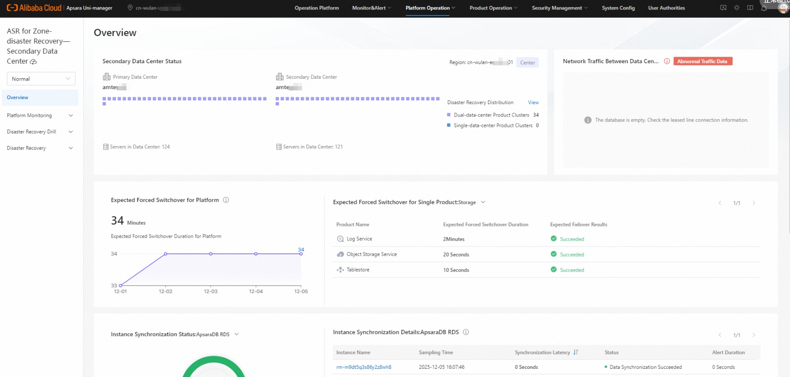

7. (Optional) In the navigation pane on the left, click Normal Mode or O&M Mode to switch between views.

   > **Note**
   >
   > To switch views, you must have the disaster recovery monitoring, disaster recovery drill, or system administrator permission.

   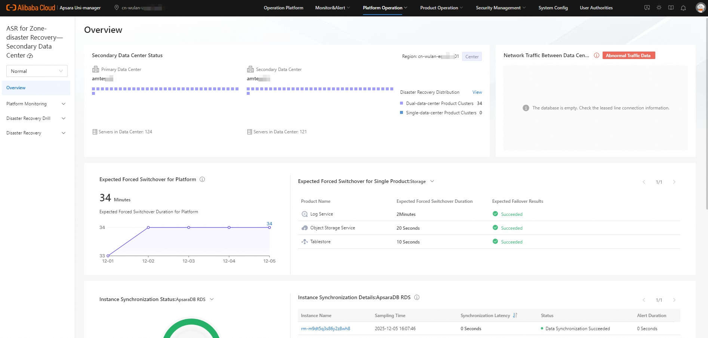

**Disaster recovery escape logon**

> **Important**
>
> By default, the disaster recovery escape logon feature is disabled. To use this logon method, you must first enable the feature and set a logon password. For more information, see Manage escape logon.

1. In your browser's address bar, enter the Zone-Disaster Recovery Management Platform ASR endpoint and press Enter.

   > **Note**
   >
   > - If the primary data center fails, log on to the ASR console of the secondary data center. If the secondary data center fails, log on to the ASR console of the primary data center. The two data centers have different domain names.
   >
   > - The endpoint of the ASR console for the secondary data center is in the following format: asr-xs-&lt;region-id>.console.&lt;intranet-domain-id>/user/login.
   >
   > - The endpoint of the ASR console for the primary data center is in the following format: asr-xm-&lt;region-id>.console.&lt;intranet-domain-id>/user/login.

   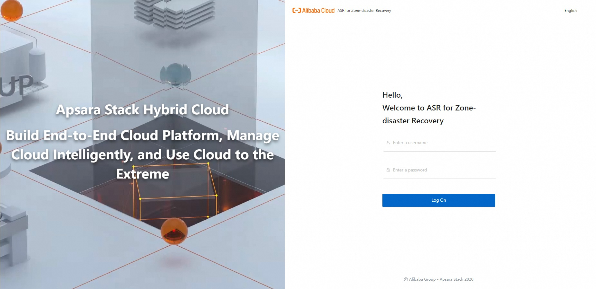

   > **Note**
   >
   > You can click the language drop-down list in the upper-right corner to switch the language. Simplified Chinese and English are supported.

2. Enter your username and password.

   > **Note**
   >
   > Obtain the username and password to log on to the ASR console from the deployment personnel or an administrator.

3. Click **Log on**.

4. In the top navigation bar, click Normal Mode or O&M Mode to switch between views.

   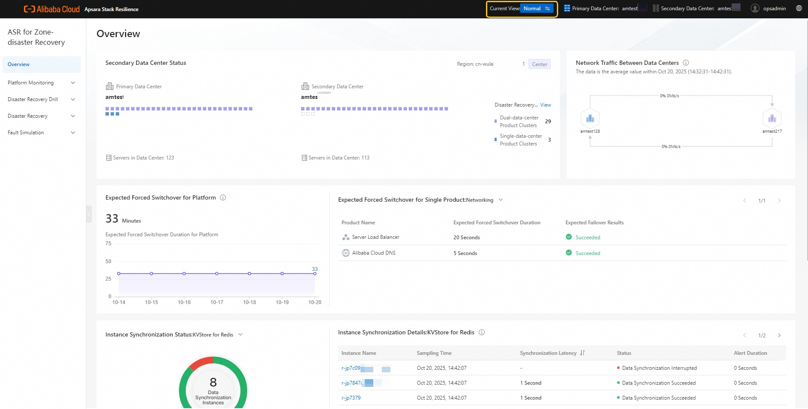

5. In the top navigation bar, click a data center to open the corresponding data center page.

   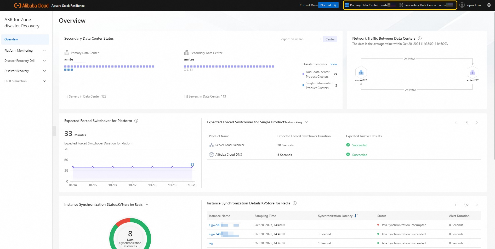

**Log on for tenant operations**

To recover individual services or perform disaster recovery drills by application, you can log on to the Apsara Uni-manager Management Console to create protection groups.

**Procedure**

1. Enter the URL of the Apsara Uni-manager Management Console in the address bar and press the Enter key.

2. On the login page, enter your username and password.

   You can obtain the username and password that are used to log in to the Apsara Uni-manager Management Console from the operations administrator.

   > **Note**
   >
   > - **First login**
   >
   >   The first time that you log on to the Apsara Uni-manager Management Console, you need to change the password of your account. The password must be 10 to 32 characters in length. It must contain all of the following character types: uppercase letters, lowercase letters, digits, and special characters. Supported special characters include: ! @ # $ %
   >
   > - **Forgotten password**
   >
   >   If you have forgotten your password, click Forgot Password. On the page that appears, enter the username of your account, the email address that was used to create the account, and the CAPTCHA code. Then, the system sends a link for resetting the password to the specified email address.

3. Click **Log In**.

4. If multi-factor authentication (MFA) is enabled for your account, perform the following operations based on your login scenario:

   - You log on to the Apsara Uni-manager Management Console for the first time after MFA is enabled by the administrator.

     <ol type="a">

     <li>

     On the Bind Virtual MFA Device page, follow the on-screen instructions to bind an MFA device.

     </li>

     <li>

     Enter the username and password again as in Step 2 and click **Log On**.

     </li>

     </ol>

     <ol type="i" start="100">

     <li>

     Enter the six-digit MFA code and click **Authentication**.

     </li>

     </ol>

   - You have enabled and bound MFA:

     Enter the six-digit MFA code and click **Authentication**.

     > **Note**
     >
     > For more information about how to bind and enable MFA, see **Security Center** > **MFA** > **Manage MFA** in Apsara Uni-manager Operations Console User Guide.

5. In the top navigation bar, select **Products**.

6. In the navigation pane on the left, click **Disaster Recovery and Backup**.

7. In the **Disaster Recovery and Backup** section, choose **Disaster Recovery > ASR for Zone-disaster Recovery**.

<a id="section-2-1-2"></a>

### 2.1.2. View platform monitoring metrics

<a id="section-2-1-2-1"></a>

#### 2.1.2.1. Service monitoring

This topic describes how to view service monitoring information and the expected results.

**Procedure**

1. Log on to the Apsara Stack Resilience (ASR) for Zone-disaster Recovery (Primary Zone) console or the ASR for Zone-disaster Recovery (Secondary Zone) console. For more information, see Log on to the ASR console.

2. In the left-side navigation pane, choose **Monitoring > Product Monitoring**.

3. On the **Product Monitoring** page, view monitoring items such as feature readiness, primary service location, and inspection results of all services. You can also view the number of disaster recovery (DR) instances and capacity usage of specific services.

   > **Note**
   >
   > When you view monitoring information, make sure that the data is updated to the current time.

**Expected results**

No item is marked in red. If an anomaly exists, troubleshoot the issue based on the error message, or contact Alibaba Cloud technical support to fix the issue.

<a id="section-2-1-2-2"></a>

#### 2.1.2.2. Synchronization monitoring

This topic describes how to monitor data synchronization and view the expected results.

**Monitoring method**

1. Log on to the ASR console in the secondary data center.

2. In the navigation pane on the left, choose **Platform Monitoring** > **Synchronization Monitoring**.

3. On the Synchronization Monitoring page, you can view the data synchronization latency satisfaction rate, the number of instances with normal synchronization, the number of instances with abnormal synchronization, and the synchronization latency of each instance for RDS, Redis, PolarDB-X 2.0, MongoDB, AnalyticDB for PostgreSQL, OSS. Instances with abnormal synchronization are displayed in red at the top of the instance list.

   > **Note**
   >
   > When you view metric information, ensure that the data update time is current.

**Expected results**

The data synchronization latency satisfaction rate is 100%.

> **Note**
>
> If this requirement is not met, troubleshoot and resolve the synchronization latency issues for the instances marked in red, or submit a ticket to contact Alibaba Cloud technical support.

<a id="section-2-2"></a>

## 2.2. Core alert handling

<a id="section-2-2-1"></a>

### 2.2.1. Alert items

This topic describes the alert items of Apsara Stack Resilience (ASR) for Zone-disaster Recovery.

| Alert item | Description | Alert level | References |
| --- | --- | --- | --- |
| inspect_db_resourc e | The connection to the metadabase is abnormal, or the read and write status of the metadabase is read-only. | P2 | inspect_db_resource |
| drei_product | The disaster recovery (DR) capabilities of core base services, such as DNS, Server Load Balancer (SLB), and MiniRDS, are abnormal. | P2 | drei_product |
| rpo_check | The synchronization latency of ApsaraDB RDS or Object Storage Service (OSS) exceeds the threshold, or the synchronization is interrupted. | P2 | • ApsaraDB RDS: rpo_check (ApsaraDB RDS)<br>• OSS: rpo_check (OSS) |
| sync_check | Anomalies are found during service DR inspection. | P2 | • MiddleWareAll: sync_check (MiddleWareAll)<br>• minirds-mt/rds: sync_check (minirds-mt/rds)<br>• TableStore/TableStoreInner: sync_check (TableStore/TableStoreInner)<br>• SLB: sync_check (SLB)<br>• ApsaraMQ for Kafka: sync_check (Kafka)<br>• Elasticsearch: sync_check (Elasticsearch) |
| inspect_product_cl uster_aplus | Rolling is not performed on cloud service clusters. | P2 | inspect_product_cluster_aplus |
| inspect_product_cl uster_version | Service versions are inconsistent between the primary and secondary data centers. | P2 | inspect_product_cluster_version |
| inspect_product_va riable | Fail to pass the service baseline variable check. | P2 | inspect_product_variable |
| inspect_product_cl uster_deploy | Specific services are deployed in asymmetric mode. | P2 | inspect_product_cluster_deploy |

<a id="section-2-2-2"></a>

### 2.2.2. inspect_db_resource

This alert is used to check the connectivity and the read and write status of the metadatabase. This alert is triggered if connections to the metadatabase fail or the metadatabase is read-only. This may cause data write failures, and the services that depend on the metadatabase may not run as expected.

**Alert attributes**

| Alert ID | Metric | Alert source | Alert level | Service | Trigger condition | Check interval |
| --- | --- | --- | --- | --- | --- | --- |
| inspect_d b_resour ce | inspect_d b_resour ce | Bcmc# | P2 | bcmc | The connectivit y or the read and write status of the instance is abnormal. | Every 30 minutes |

**Supported versions**

Apsara Stack V3.14 and later

**Causes**

- The connectivity of the instance is abnormal.

- The read and write status of the instance is abnormal.

**Alert impacts**

Data may fail to be written, and the services that depend on the metadatabase may not run as expected.

**Solution**

> **Warning**
>
> If a solution requires that you modify product configurations, you must initiate a production change process to confirm the feasibility and standardization of the solution. Even in an emergency, you must obtain consent from the customer and TAM before you can perform any steps of the solution.

1. Log on to the Apsara Infrastructure Management console.

2. In the left-side navigation pane of the **Apsara Infrastructure Management console**, choose Resources > **Product & Cluster O&M**.

3. On the Product & Cluster O&M page, enter bcmc in the search box. In the search results, find the cluster that you want to manage and click **Cluster Details** in the **Actions** column.

4. On the Services tab, find the **bcmc** service and click its name.

5. In the Components pane, click **Bcmc#**.

6. On the **Resources** tab, find the resource whose name is **asr** and type is **db**. Then, view the values of the db_host, user, db_password, db_port, and db_name parameters in the **Resource Application Result** column.

7. Log on to the machine where the alert is reported.

8. Run the following command to check whether the database is accessible:

   > **Note**
   >
   > Run the command to log on to the database in an environment in which a MySQL client is available.

   ```text
   mysql -h${db_host} -u${user} -p${db_password} -P${db_port} -D${db_name}
   ```

   The following figure shows a sample output, which indicates that the connection is normal. Proceed based on the actual output.

   > **Note**
   >
   > If the database is inaccessible, contact the ApsaraDB RDS production and R&D team.

9. Execute the following SQL statement to view the read and write status of the database:

   ```text
   show global variables like "read_only";
   ```

   The following figure shows a sample output. Proceed based on the actual output.

   - If the value of the **read_only** variable is **ON**, the database is read-only. You must change the read-only status.

     Execute the following SQL statement to change the read-only status:

     ```text
     set global read_only = 0;
     ```

0. Obtain the name of the abnormal instance based on the alert information.

1. Log on to the ApsaraDB Operations and Maintenance System console.

2. View the detailed error message of the instance. If the database connection failed because the instance is not started, restart the instance.

   <ol type="i">

   <li>

   Log on to the host of the abnormal instance.

   </li>

   <li>

   Run the following command to view and record the command used to start the abnormal

   </li>

   </ol>

   instance:

   ```bash
   cat /etc/init.d/mysql | grep ${Port number}
   ```

   The following figure shows a sample output. Proceed based on the actual output.

   <ol type="i" start="3">

   <li>

   Run the following command to start the abnormal instance:

   </li>

   </ol>

   ```text
   /u01/mysql56/bin/mysqld_safe --defaults-file=/etc/my${Port number}.cnf &
   ```

   <ol type="i" start="4">

   <li>

   Run the following command to check whether the instance is started:

   ```text
   ps aux|grep ${Port number}
   ```

   The following figure shows a sample output. Proceed based on the actual output.

   > **Note**
   >
   > If the instance fails to be started, contact the ApsaraDB RDS production and R&D team.

   </li>

   </ol>

> **Note**
>
> If the alert persists after you perform the preceding steps, submit a ticket to contact technical support.

<a id="section-2-2-3"></a>

### 2.2.3. drei_product

This alert is used to check whether MiniRDS instances can be switched over, whether the synchronization between the primary and secondary MiniRDS instances experiences latency, whether single-zone instances exist, and whether the serviceTest# component in a MiniRDS cluster is at desired state. This alert is triggered if one or more of the preceding conditions are true.

**Alert attributes**

| Alert ID | Metric | Alert source | Alert level | Service | Trigger condition | Check interval |
| --- | --- | --- | --- | --- | --- | --- |
| drei_prod uct | drei_prod uct | Bcmc# | P2 | minirds-mt | This alert is triggered in one of the following conditions:<br>• Fail to connect to instances.<br>• The synchronization between the primary and secondary instances experiences latency.<br>• Single-zone instances exist.<br>• Instances exist in the secondary data center.<br>• The serviceTest# component in a MiniRDS cluster is not at desired state. | Every 30 minutes |

**Supported versions**

Apsara Stack V3

**Causes**

This alert is triggered in one of the following conditions:

- Fail to connect to instances.

- The synchronization between the primary and secondary instances experiences latency.

- Single-zone instances exist.

- Instances exist in the secondary data center.

- The serviceTest# component in a MiniRDS cluster is not at desired state.

**Alert impacts**

The alert impacts vary based on the alert cause. The following issues may occur:

- If connections to instances fail, you may not be able to access MiniRDS databases.

- If the synchronization between the primary and secondary instances experiences high latency, when the primary data center fails, data may be lost.

- If the serviceTest# component in a MiniRDS cluster is not at desired state, the features of the clusters and your business may be affected.

**Solution**

> **Warning**
>
> If a solution requires that you modify product configurations, you must initiate a production change process to confirm the feasibility and standardization of the solution. Even in an emergency, you must obtain consent from the customer and TAM before you can perform any steps of the solution.

**Instances exist in the secondary data center**

If instances exist in the secondary data center, you do not need to handle the issue. The instances are automatically switched back to the primary data center in the primary zone.

**Single-zone instances exist**

If single-zone instances exist, you must deploy them across two zones.

1. Log into the container.

2. Run the following command in the container to copy the conf.yml.j2 file to the specified directory:

   ```bash
   docker cp conf.yml.j2 ${Container ID}:/meta/usr/local/rds/rebuild/conf.yml.j2
   ```

   The following code shows the content of conf.yml.j2:

   ```text
   # conf.yml.j2
   db:
     host: {{db_dbaas_host}}
     port: {{db_dbaas_port}}
     user_name: {{db_dbaas_user}}
     password: {{db_dbaas_password}}
     db_name: {{db_dbaas_name}}
   cluster:
     cluster_name: {{CLUSTER_NAME}}
     db_type: {{DB_TYPE}}
     db_version: {{DB_VERSION}}
     site_name: {{SITE_NAME}}
     ips: ""                        
     max_tasks: 10                # The task concurrency.
     ins_names: ""                  # The names of the instances to be rebuilt. Separate 
   multiple names with commas (,). You must specify this parameter. Otherwise, instancescannot be rebuilt.
   api:
     rdsapi: {{RDS_API_URL}}
   timeout: {{TIMEOUT}}
   ```

3. Contact Alibaba Cloud technical support to obtain the rebuild files and decompress them. Copy all the files to the RebuildSlave container.

   ```bash
   docker cp ${Name of a rebuild file}:/usr/local/rds/rebuild/
   ```

4. After you copy the files to the RebuildSlave container, run the following commands to restart the RebuildSlave container:

   ```bash
   docker stop ${Container ID}
   docker start ${Container ID}
   ```

**Instances cannot be switched over, synchronization between the primary and secondary instances experiences latency, or connections to instances fail**

1. Obtain the name of the abnormal instance based on the alert information.

2. Log on to the ApsaraDB Operations and Maintenance System console.

3. View the detailed error information of the instance.

   <ol type="i">

   <li>

   If the instance connection fails, handle the issue by referring to inspect_db_resource.

   </li>

   <li>

   If the synchronization between the primary and secondary instances experiences latency,

   </li>

   </ol>

   handle the issue by referring to Rebuild a secondary database.

   <ol type="i" start="3">

   <li>

   If the instance cannot be switched over, handle the issue by referring to Rebuild a

   </li>

   </ol>

   secondary database.

**The serviceTest# component in a MiniRDS cluster is not at desired state**

1. Log on to the Apsara Infrastructure Management console.

2. On the **Product & Cluster O&M** page, check whether the serviceTest# component in the minirds-maotai cluster is at desired state.

3. If the serviceTest# component is not at desired state, restart the component.

> **Note**
>
> If the alert persists after you perform the preceding steps, submit a ticket to contact technical support.

<a id="section-2-2-4"></a>

### 2.2.4. rpo_check

<a id="section-2-2-4-1"></a>

#### 2.2.4.1. Overview

The rpo_check alert is used to check the synchronization latency of ApsaraDB RDS or Object Storage Service (OSS). This alert is triggered if the synchronization latency exceeds the specified threshold or the synchronization is interrupted. The handling method varies based on the service.

- ApsaraDB RDS: rpo_check (ApsaraDB RDS)

- OSS: rpo_check (OSS)

<a id="section-2-2-4-2"></a>

#### 2.2.4.2. rpo_check (ApsaraDB RDS)

This alert is used to check the synchronization latency of ApsaraDB RDS disaster recovery (DR) instances. If this alert is triggered, the synchronization latency exceeds the specified threshold or the synchronization is interrupted. This may cause data loss or failover failure. This topic describes the rpo_check alert of ApsaraDB RDS.

**Alert attributes**

<table>
  <tr>
    <td>Alert ID</td>
    <td>Metric</td>
    <td>Alert source</td>
    <td>Alert level</td>
    <td>Service</td>
    <td>Trigger condition</td>
    <td>Check interval</td>
  </tr>
  <tr>
    <td>rpo_check</td>
    <td>rpo_check</td>
    <td>Bcmc#</td>
    <td>P2</td>
    <td>ApsaraDB RDS</td>
    <td>The synchroniz ation latency of an ApsaraDB RDS DR instance exceeds the specified threshold, or the synchroniz ation is interrupted.</td>
    <td>1 minute</td>
  </tr>
</table>

**Supported versions**

Apsara Stack V3.12 and later

**Causes**

When dr_service checks the synchronization latency of an ApsaraDB RDS DR instance, if a connection exception or an SQL execution error occurs and the default recovery point objective (RPO) value is negative, this alert is triggered. The following table describes the causes of this alert.

| Engine | Default value | Cause |
| --- | --- | --- |
| MySQL | -1 | • Failed to connect to the secondary database.<br>• An error is reported when SQL statements are being executed.<br>• The value of Seconds_Behind_Master is null. |
| PostgreSQL | -1/-2 | • An error is reported when SQL statements are being executed on dbaas.<br>• Failed to obtain the account information of aurora.<br>• Failed to connect to the secondary database, or the secondary database is unavailable.<br>• The value of pglog_diff is null. |
| MongoDB | -2 | • Failed to connect to the primary and secondary databases, or the primary and secondary databases are unavailable. |
| Redis | -1/-2 | • An error is reported when SQL statements are being executed.<br>• Failed to connect to the secondary database. |

**Alert impacts**

If the synchronization latency is in an abnormal state, the following issues may occur:

- If the synchronization latency is excessively high, a large amount of data may be lost when the primary node fails.

- Failover fails because the secondary instance cannot be accessed, or the secondary instance is unavailable after failover.

**Solution**

> **Warning**
>
> If a solution requires that you modify product configurations, you must initiate a production change process to confirm the feasibility and standardization of the solution. Even in an emergency, you must obtain consent from the customer and TAM before you can perform any steps of the solution.

1. Log on to the Apsara Uni-manager Operations Console.

2. In the top navigation bar, choose **Product Operation > Databases > ApsaraDB Operations and Maintenance System**.

3. In the left-side navigation pane of the **ApsaraDB Operations and Maintenance System console**, click **System Management**. In the left-side pane that appears, choose **Disaster Recovery Management > Disaster recovery switching**.

4. On the **Disaster recovery switching** page, view the exception details and contact ApsaraDB RDS O&M engineers to fix the exception.

   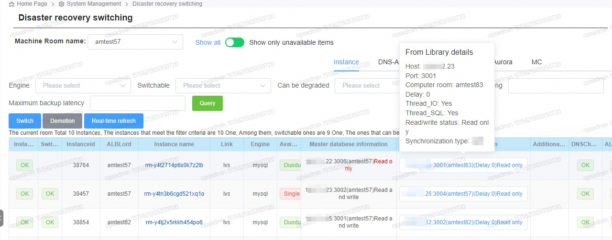

   - If the DR instance is not started, restart the instance.

     <ol type="a">

     <li>

     Log on to the server on which the primary node of the DR instance is deployed.

     > **Note**
     >
     > In this example, a MySQL instance is used.

     </li>

     <li>

     Run the following command. If the instance process does not exist, the instance is not started.

     ```text
     ps aux | grep ${Port number}
     ```

     </li>

     </ol>

     <ol type="i" start="100">

     <li>

     Run the following command to view and record the command used to start the abnormal instance:

     ```bash
     cat /etc/init.d/mysql | grep ${Port number}
     ```

     The following figure shows a sample output. Proceed based on your actual output.

     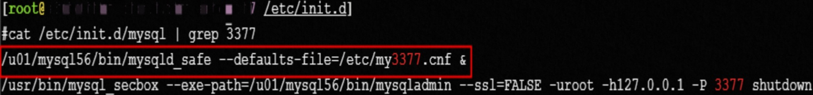

     </li>

     <li value="500">

     Run the following command to start the abnormal instance:

     ```text
     /u01/mysql56/bin/mysqld_safe --defaults-file=/etc/my${Port number}.cnf &
     ```

     </li>

     </ol>

     <ol type="a" start="5">

     <li>

     Run the following command and check whether the instance is started:

     ```text
     ps aux | grep ${Port number}
     ```

     The following figure shows a sample output. Proceed based on your actual output.

     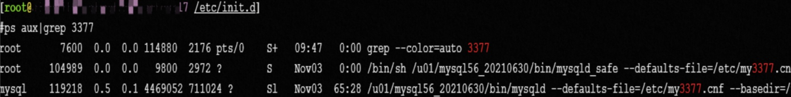

     > **Note**
     >
     > If the instance fails to be started or other exceptions occur, contact ApsaraDB RDS O&M engineers.

     </li>

     </ol>

> **Note**
>
> If the alert persists after you perform the preceding steps, submit a ticket to contact technical support.

<a id="section-2-2-4-3"></a>

#### 2.2.4.3. rpo_check (OSS)

This alert is used to check the synchronization latency of Object Storage Service (OSS) disaster recovery (DR) buckets. This alert is triggered if the synchronization latency exceeds the specified threshold or the synchronization is interrupted. This may cause data loss or failover failures. This topic describes the rpo_check alert of OSS.

**Alert attributes**

<table>
  <tr>
    <td>Alert ID</td>
    <td>Metric</td>
    <td>Alert source</td>
    <td>Alert level</td>
    <td>Service</td>
    <td>Trigger condition</td>
    <td>Check interval</td>
  </tr>
  <tr>
    <td>rpo_check</td>
    <td>rpo_check</td>
    <td>Bcmc#</td>
    <td>P2</td>
    <td>OSS</td>
    <td>The synchroniz ation latency of an OSS DR bucket exceeds the specified threshold, or the synchroniz ation is interrupted.</td>
    <td>Once a minute</td>
  </tr>
</table>

**Supported versions**

Apsara Stack V3.12 and later

**Causes**

The queries per second (QPS) is excessively high and messages are accumulated.

**Alert impacts**

If the synchronization latency is in an abnormal state, the following issues may occur:

- If the synchronization latency is excessively high, a large amount of data may be lost when the primary node fails.

- Failover fails because the secondary instance cannot be accessed, or the secondary instance is unavailable after failover.

**Solution**

> **Warning**
>
> If a solution requires that you modify product configurations, you must initiate a production change process to confirm the feasibility and standardization of the solution. Even in an emergency, you must obtain consent from the customer and TAM before you can perform any steps of the solution.

1. Check whether synchronization processes are enabled.

   <ol type="i">

   <li>

   Log on to the Apsara Infrastructure Management console.

   <ol type="i" start="2">

   <li>

   In the left-side navigation pane of the **Apsara Infrastructure Management console**,

   </li>

   </ol>

   choose Resources > **Product & Cluster O&M**.

   <ol type="i" start="3">

   <li>

   On the Product & Cluster O&M page, enter oss in the search box. In the search results,

   </li>

   </ol>

   find the cluster that you want to manage and click **Cluster Details** in the **Actions** column.

   </li>

   <li value="4">

   On the **Services** tab, find the **oss-ocm-server** service and click its name.

   </li>

   <li>

   In the Components pane, click **OcmServer#**.

   </li>

   <li>

   On the Instances tab, click **Terminal** in the **Actions** column of an instance and log on to the oss-ocm-server.OcmServer# terminal server.

   </li>

   <li>

   Go to the  `/cloud/app/oss-ocm-server/OcmServer#/ocm_server/current`  directory.

   </li>

   <li>

   Run the following command to obtain the AccessKey ID and AccessKey secret of

   </li>

   </ol>

   OCM_CMD:

   ```bash
   cat ocm_conf.json | grep -A 10 "accessID"
   ```

   <ol type="i" start="9">

   <li>

   Run the following commands to obtain the value of master_ocm_host:

   ```bash
   cat ocm_conf.json | grep master_ocm_host
   ```

   </li>

   <li>

   Replace accessID, accessKey, and master_ocm_host in the following command with the values obtained in the previous steps and run the command:

   ```text
   ./ocm_cmd config --id=${accessID} --key=${accessKey} --host ${master_ocm_host}
   ```

   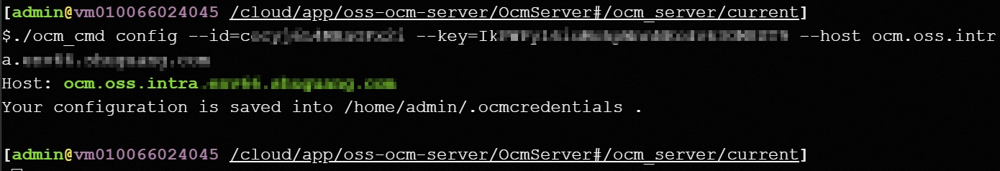

   </li>

   <li>

   Run the following command to check whether the content under the &lt;BucketSyncMeta> tags is as expected:

   ```text
   ./ocm_cmd gbm bucketName
   ```

   > **Note**
   >
   > Check items and expected results:
   >
   > <ol type="a">
   >
   > <li>
   >
   > Whether synchronization processes exist: If the &lt;BucketSyncMeta> tags exist, synchronization processes exist.
   >
   > </li>
   >
   > <li>
   >
   > Whether the synchronization direction is as expected: If the &lt;SrcBucket>, &lt;SrcLocation>, &lt;DestBucket>, and &lt;DestLocation> tags exist under the &lt;BucketSyncMeta> tags and meet the following conditions, the synchronization direction is as expected.
   >
   > <ol type="a">
   >
   > <li>
   >
   > The values of the &lt;SrcBucket> and &lt;SrcLocation> tags are the same as those of the &lt;Name> and &lt;Location> tags under the &lt;BucketMeta> tag.
   >
   > </li>
   >
   > <li>
   >
   > The values of the &lt;DestBucket> and &lt;DestLocation> tags are the same as those of the peer data center.
   >
   > </li>
   >
   > </ol>
   >
   > </li>
   >
   > </ol>
   >
   > <ol type="i" start="100">
   >
   > <li>
   >
   > Whether the synchronization status is normal: Under the &lt;BucketSyncMeta> tag, the value of the &lt;SyncStatus> tag is 0 or 1.
   >
   > </li>
   >
   > </ol>

   Sample output:

   ```xml
   <?xml version="1.0" encoding="UTF-8"?>
   <BucketMeta>
     <Name>wd-test</Name>
     <Owner>1276207919333070</Owner>
     <Application>file</Application>
     <Location>oss-cn-qingdao-env9b-amtest52002-b</Location>
     <CreateTime>Thu, 17 Dec 2020 06:09:29 GMT</CreateTime>
     <CacheTime>1608534489</CacheTime>
     <Comment></Comment>
     <Acl>public-read-write</Acl>
     <BucketStatus>ok</BucketStatus>
     <BucketMode>default</BucketMode>
     <RequestPayer>BucketOwner</RequestPayer>
     <BucketPolicy>
       <LogBucket></LogBucket>
       <LogPrefix></LogPrefix>
       <Location>oss-cn-qingdao-env9b-amtest52002-b</Location>
       <DisallowEmptyRefer>false</DisallowEmptyRefer>
       <WhiteReferrerList />
       <CommonHeaderList />
       <AccessAllowedTypeList />
       <MimeTypeConfig>
         <MimeTypeRules />
       </MimeTypeConfig>
       <BucketChargeType>
         <FlowChargeType>PayByTraffic</FlowChargeType>
       </BucketChargeType>
       <CacheControlConfiguration />
       <MaxImageSize>-1</MaxImageSize>
       <UrlRewriteScript></UrlRewriteScript>
       <CompatMask>4</CompatMask>
       <TransferAccType></TransferAccType>
       <SourceProtectSuffix>*</SourceProtectSuffix>
       <IAMPolicy></IAMPolicy>
       <EnableDualCluster>false</EnableDualCluster>
       <IndexFile></IndexFile>
       <ErrorFile></ErrorFile>
       <SysObjectTagsStr></SysObjectTagsStr>
       <DataRedundancyType>0</DataRedundancyType>
       <ObjectHashFunction>NULL</ObjectHashFunction>
       <ObjectOverwriteCond>ALL</ObjectOverwriteCond>
       <AuthorizationConfiguration />
     </BucketPolicy>
     <CORSConfiguration />
     <BucketFlowLimits>
       <MaxQps>-1</MaxQps>
       <MaxSendFlow>-1</MaxSendFlow>
       <MaxRecvFlow>-1</MaxRecvFlow>
       <MaxIntranetQps>-1</MaxIntranetQps>
       <MaxIntranetSendFlow>-1</MaxIntranetSendFlow>
       <MaxIntranetRecvFlow>-1</MaxIntranetRecvFlow>
       <MaxTotalQps>-1</MaxTotalQps>
       <MaxIntranetTotalQps>-1</MaxIntranetTotalQps>
     </BucketFlowLimits>
     <BucketUserQos>
       <MaxHourExtranetSendFlow>-1</MaxHourExtranetSendFlow>
       <MaxDayExtranetSendFlow>-1</MaxDayExtranetSendFlow>
       <MaxHourIntranetSendFlow>-1</MaxHourIntranetSendFlow>
       <MaxDayIntranetSendFlow>-1</MaxDayIntranetSendFlow>
       <StorageCapacity>1073741824</StorageCapacity>
     </BucketUserQos>
     <BID>26842</BID>
     <StorageType>standard</StorageType>
     <DualClusterStatus>1</DualClusterStatus>
     <BucketSyncMeta>
       <SyncStatus>1</SyncStatus>
       <SyncSubStatus>0</SyncSubStatus>
       <SyncHistoryStatus>1024</SyncHistoryStatus>
       <SyncAcl>0</SyncAcl>
       <SyncBackupStatus>0</SyncBackupStatus>
       <CreateTime>1608189511</CreateTime>
       <ModifyTime>1608189637</ModifyTime>
       <SrcBucket>wd-test</SrcBucket>
       <SrcLocation>oss-cn-qingdao-env9b-amtest52002-b</SrcLocation>
       <DestBucket>wd-test</DestBucket>
       <DestLocation>oss-cn-qingdao-env9b-d01-a</DestLocation>
       <HistoryCpt></HistoryCpt>
       <HistoryMpartKeyCpt></HistoryMpartKeyCpt>
       <HistoryUploadIdCpt></HistoryUploadIdCpt>
       <HistoryObjectSyncEnabled>true</HistoryObjectSyncEnabled>
       <Type>0</Type>
       <TransferType>0</TransferType>
       <VipProxy></VipProxy>
       <Speed>0</Speed>
       <ScanType>1</ScanType>
       <SubNum>0</SubNum>
       <ScheduleType>0</ScheduleType>
       <ScheduleBandwidth>0</ScheduleBandwidth>
       <RuleId></RuleId>
       <Version>5c665d30e017456e840fa11358f9ff97</Version>
       <NeedPartitionList>false</NeedPartitionList>
       <IsQpsTask>false</IsQpsTask>
       <IgnoreNewFileForHistory>true</IgnoreNewFileForHistory>
     </BucketSyncMeta>
     <BucketSyncMeta>
       <SyncStatus>4</SyncStatus>
       <SyncSubStatus>1</SyncSubStatus>
       <SyncHistoryStatus>768</SyncHistoryStatus>
       <SyncAcl>0</SyncAcl>
       <SyncBackupStatus>0</SyncBackupStatus>
       <CreateTime>1608185369</CreateTime>
       <ModifyTime>1608190889</ModifyTime>
       <SrcBucket>wd-test</SrcBucket>
       <SrcLocation>oss-cn-qingdao-env9b-d01-a</SrcLocation>
       <DestBucket>wd-test</DestBucket>
       <DestLocation>oss-cn-qingdao-env9b-amtest52002-b</DestLocation>
       <HistoryCpt></HistoryCpt>
       <HistoryMpartKeyCpt></HistoryMpartKeyCpt>
       <HistoryUploadIdCpt></HistoryUploadIdCpt>
       <HistoryObjectSyncEnabled>true</HistoryObjectSyncEnabled>
       <Type>0</Type>
       <TransferType>0</TransferType>
       <VipProxy></VipProxy>
       <Speed>0</Speed>
       <ScanType>1</ScanType>
       <SubNum>0</SubNum>
       <ScheduleType>0</ScheduleType>
       <ScheduleBandwidth>0</ScheduleBandwidth>
       <RuleId></RuleId>
       <Version>b6dbaeb845fb4c23bed94c5d717fa00e</Version>
       <NeedPartitionList>false</NeedPartitionList>
       <IsQpsTask>false</IsQpsTask>
       <IgnoreNewFileForHistory>true</IgnoreNewFileForHistory>
     </BucketSyncMeta>
     <BucketVpcipBindList />
     <Tagging>
       <TagSet />
     </Tagging>
   </BucketMeta>
   ```

   </li>

   </ol>

2. Check whether the recovery point objective (RPO) of OSS is normal.

   <ol type="i">

   <li>

   Log on to the Apsara Infrastructure Management console.

   <ol type="i" start="2">

   <li>

   In the left-side navigation pane of the **Apsara Infrastructure Management console**,

   </li>

   </ol>

   choose Resources > **Product & Cluster O&M**.

   <ol type="i" start="3">

   <li>

   On the Product & Cluster O&M page, enter oss in the search box. In the search results,

   </li>

   </ol>

   find the cluster that you want to manage and click **Cluster Details** in the **Actions** column.

   </li>

   <li value="4">

   On the **Services** tab, find the **oss-chiji-agent** service and click its name.

   </li>

   <li>

   In the Components pane, click **ChijiAgent#**.

   </li>

   <li>

   On the Instances tab, click **Terminal** in the **Actions** column of an instance and log on to the oss-chiji-agent.ChijiAgent# terminal server.

   </li>

   <li>

   Run the following command to calculate the RPO of OSS:

   </li>

   </ol>

   ```text
   /apsara/deploy/dsu GetSyncTaskProgress Source location#Destination location#Source bucket#Destination bucket
   ```

   > **Note**
   >
   > Replace Source location, Destination location, Source bucket, and Destination bucket with the values of the &lt;SrcLocation>, &lt;DestLocation>, &lt;SrcBucket>, and &lt;DestBucket> tags obtained in Step 1.

   - In the command output,  `new file last sync time`  indicates the last time when files were synchronized. Obtain the RPO of OSS by subtracting the last synchronization time from the current time.

   - If the synchronization processes are normal and the RPO of OSS is excessively large, the issue is caused because the QPS is excessively high and messages are accumulated. Contact OSS O&M engineers to resolve the issue.

> **Note**
>
> If the alert persists after you perform the preceding steps, submit a ticket to contact technical support.

<a id="section-2-2-5"></a>

### 2.2.5. sync_check

<a id="section-2-2-5-1"></a>

#### 2.2.5.1. Overview

The sync_check alert is used to check the disaster recovery (DR) status of DR instances. This alert is triggered if an anomaly is found during the DR inspection of cloud services. The handling method varies based on the service.

- MiddleWareAll: sync_check (MiddleWareAll)

- minirds-mt/rds: sync_check (minirds-mt/rds)

- TableStore/TableStoreInner: sync_check (TableStore/TableStoreInner)

- Server Load Balancer (SLB): sync_check (SLB)

- ApsaraMQ for Kafka: sync_check (ApsaraMQ for Kafka)

- Elasticsearch: sync_check (Elasticsearch)

<a id="section-2-2-5-2"></a>

#### 2.2.5.2. sync_check (MiddleWareAll)

This alert is used to check the disaster recovery (DR) status of MiddleWareAll DR instances. This alert is triggered if an anomaly is found during the DR inspection of MiddleWareAll. This may cause failover failures or undermine the DR capabilities of cloud services that depend on MiddleWareAll. This topic describes the sync_check alert of MiddleWareAll.

**Alert attributes**

<table>
  <tr>
    <td>Alert ID</td>
    <td>Metric</td>
    <td>Alert source</td>
    <td>Alert level</td>
    <td>Service</td>
    <td>Trigger condition</td>
    <td>Check interval</td>
  </tr>
  <tr>
    <td>sync_check</td>
    <td>sync_check</td>
    <td>Bcmc#</td>
    <td>P2</td>
    <td>middleWar eAll</td>
    <td>An anomaly is reported in the Apsara Stack Resilience (ASR) for Zone-disaster Recovery console during the DR inspection of MiddleWar eAll.</td>
    <td>Once a minute</td>
  </tr>
</table>

**Supported versions**

Apsara Stack V3.12 and later

**Causes**

- The value of distroThreshold of the vipserver component in MiddleWareAll is the default value 0.7.

- MiddleWareAll is not at desired state.

**Alert impacts**

If the DR status of MiddleWareAll is abnormal, the following issues may occur:

- Failover operations fail.

- The DR capabilities of cloud services that depend on MiddleWareAll are abnormal.

**Solution**

> **Warning**
>
> If a solution requires that you modify product configurations, you must initiate a production change process to confirm the feasibility and standardization of the solution. Even in an emergency, you must obtain consent from the customer and TAM before you can perform any steps of the solution.

**Wrong distroThreshold configuration of the vipserver component**

1. Log on to the middleWare-vipserver.Server# container.

2. Run the following command to view the distroThreshold value. The default value is 0.7.

   ```bash
   curl -s http://vipserver.tbsite.net/vipserver/api/switches | python -m json.tool
   ```

   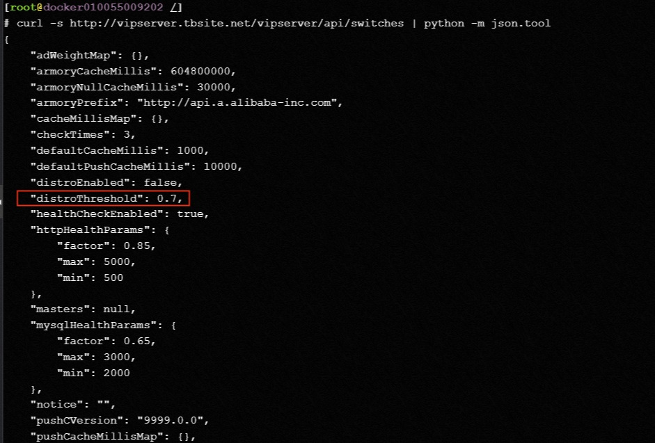

3. Run the following command to change the distroThreshold value to 0.45:

   ```text
   curl-s"http://${diamond_host}/diamond-server/basestone.do?method=syncUpdateAll"-d 'dataId=com.taobao.vipserver.switches&group=VIPSERVER_GROUP&content=
   {"distroThreshold":0.45}'
   ```

   > **Note**
   >
   > To obtain the value of diamond_host, perform the following steps:
   >
   > <ol type="i">
   >
   > <li>
   >
   > Log on to the Apsara Infrastructure Management console.
   >
   > <ol type="i" start="2">
   >
   > <li>
   >
   > In the left-side navigation pane of the **Apsara Infrastructure Management**
   >
   > </li>
   >
   > </ol>
   >
   > **console**, choose Resources > **Product & Cluster O&M**.
   >
   > <ol type="i" start="3">
   >
   > <li>
   >
   > On the Product & Cluster O&M page, enter MiddleWareAll in the search box. In the
   >
   > </li>
   >
   > </ol>
   >
   > search results, find the cluster that you want to manage and click **Cluster Details** in the **Actions** column.
   >
   > </li>
   >
   > <li value="4">
   >
   > On the Services tab, find the **middleWare-diamond** service and click its name.
   >
   > </li>
   >
   > <li>
   >
   > On the **Registration Variables** tab, view the value of diamond_host.
   >
   > </li>
   >
   > </ol>

4. Run the following command to verify that the distroThreshold value is 0.45:

   ```bash
   curl -s http://vipserver.tbsite.net/vipserver/api/switches | python -m json.tool
   ```

**MiddleWareAll not at desired state**

1. Log on to the Apsara Infrastructure Management console.

2. In the left-side navigation pane of the **Apsara Infrastructure Management console**, choose Resources > **Product & Cluster O&M**.

3. On the Product & Cluster O&M page, enter MiddleWareAll in the search box. In the search results, find the cluster that you want to manage and click **Cluster Details** in the **Actions** column.

4. On the Services tab, click the name of the service that is not at desired state.

5. In the Components pane, click the abnormal component. On the Instances tab, find the abnormal instance and choose **Actions** > **Restart** in the **Actions** column.

> **Note**
>
> If the alert persists after you perform the preceding steps, submit a ticket to contact technical support.

<a id="section-2-2-5-3"></a>

#### 2.2.5.3. sync_check (minirds-mt/rds)

This alert is used to check the disaster recovery (DR) status of minirds-mt/rds DR instances. This alert is triggered if an anomaly is found during the DR inspection of minirds-mt/rds. This may cause data loss, failover failures, or instance access exceptions. This topic describes the sync_check alert of minirds-mt/rds.

**Alert attributes**

| Alert ID | Metric | Alert source | Alert level | Service | Trigger condition | Check interval |
| --- | --- | --- | --- | --- | --- | --- |
| sync_check | sync_check | Bcmc# | P2 | • minirds-mt<br>• rds | An anomaly is reported in the Apsara Stack Resilience (ASR) for Zone-disaster Recovery console during the DR inspection of minirds-mt/rds. | Once a minute |

**Supported versions**

Apsara Stack V3.12 and later

**Causes**

- Abnormal instance synchronization status

  Significant data differences between the primary and secondary minirds-mt/rds instances can lead to lengthy or failed synchronization between them.

- Closed SSH tunnels

  To execute the failover and DR scripts of specific cloud services, the SSH tunnels from bcmc to the server roles (SRs) of the cloud services must be open so that bcmc can access the SR containers to perform DR inspection and failover operations.

  The SSH tunnels from bcmc to the SRs of cloud services may be closed due to reasons such as missing or incorrect baseline configurations of SSH tunnels and issues in tianji-sshtunnel. In this case, DR inspection scripts cannot be executed as expected.

**Alert impacts**

If the DR status of minirds-mt/rds is abnormal, the following issues may occur:

- If the synchronization between the primary and secondary nodes experiences high latency, data may be lost when the primary node fails.

- Instances cannot be failed over. If the primary node fails, instances cannot be automatically failed over to the secondary node and service availability is affected.

- Instances cannot be accessed as expected, and the cloud services or applications that depend on the instances cannot run as expected.

**Solution**

> **Warning**
>
> If a solution requires that you modify product configurations, you must initiate a production change process to confirm the feasibility and standardization of the solution. Even in an emergency, you must obtain consent from the customer and TAM before you can perform any steps of the solution.

**Abnormal instance synchronization status**

In this example, ApsaraDB RDS is used.

1. Log on to the Apsara Uni-manager Operations Console.

2. In the top navigation bar, choose **Product Operation > Databases > ApsaraDB Operations and Maintenance System**.

3. In the left-side navigation pane, click **System Management**.

4. In the **System Management** pane, choose **Disaster Recovery Management** > **Disaster recovery switching**. In the **Maximum Latency from library** column, view the latency.

   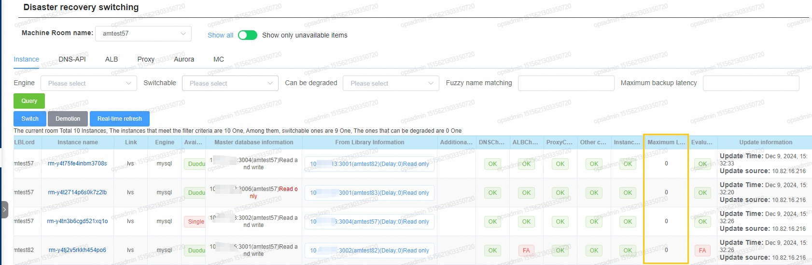

   > **Note**
   >
   > - If the value is greater than 0 and smaller than 60, wait for data to be synchronized from the primary database to the secondary database.
   >
   > - If the value is smaller than -1, contact the technical account manager (TAM) to recreate the secondary database.
   >
   > - If the value is a large positive integer and does not decrease, contact database O&M engineers for troubleshooting.

**Closed SSH tunnels**

In this example, MiniRDS is used.

1. Check whether the sshd process of the peer MiniRDS service is started.

   <ol type="i">

   <li>

   Log on to the MiniRDS container.

   </li>

   <li>

   Run the  `ps -ef|grep sshd`  command to view the sshd process.

   </li>

   </ol>

   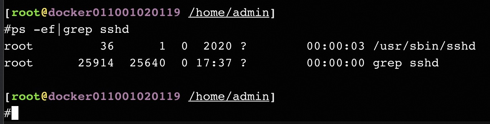

   - If the ssh process is not started, you can manually run the  `/usr/sbin/sshd`  command to start the sshd process.

   - If the sshd process does not exist in the container, install the sshd plug-in by running the  `yum install sshd`  command.

2. Modify the SSH tunnel configurations of the bcmc cluster.

   <ol type="i">

   <li>

   Log on to the Apsara Infrastructure Management console.

   <ol type="i" start="2">

   <li>

   In the left-side navigation pane of the **Apsara Infrastructure Management console**,

   </li>

   </ol>

   choose Resources > **Product & Cluster O&M**.

   <ol type="i" start="3">

   <li>

   On the Product & Cluster O&M page, enter bcmc in the search box. In the search results,

   </li>

   </ol>

   find the cluster that you want to manage and click **Cluster Details** in the **Actions** column.

   </li>

   <li value="4">

   On the **Cluster Details** page, click the **Desired State Configuration** tab.

   </li>

   <li>

   Modify the  `/services/tianji-sshtunnel-client/user/SSHTunnelClient/ssh_tunnel_bcmc.conf`  file. Add the following information to the file: FromProduct, FromClusterType, FromServerRole, FromService, FromUser, ToProduct, ToClusterType, ToServerRole, ToService, and ToUser. Then, submit the changes.

   > **Note**
   >
   > The values of the FromClusterType and FromServerRole parameters vary based on the region type. For the central region, set the FromClusterType parameter to BcmcCluster and the FromServerRole parameter to Bcmc. For general regions, set the FromClusterType parameter to Bcmc4GeneralCluster and the FromServerRole parameter to Bcmc4General. Sample code:
   >
   > ```text
   > - FromProduct: bcmc
   >   // FromClusterType: Bcmc4GeneralCluster // Note: For the central region, set the parameter to BcmcCluster. For general regions, set the parameter to Bcmc4GeneralCluster.
   >   // FromServerRole: Bcmc4General // Note: For the central region, set the parameter to Bcmc. For general regions, set the parameter to Bcmc4General.
   >   FromClusterType: BcmcCluster
   >   FromServerRole: Bcmc
   >   FromService: bcmc
   >   FromUser: root
   >   ToProduct: minirds-mt // The cloud service to be connected.
   >   ToClusterType: maotai_7u // The type of the service cluster to be connected.
   >   ToServerRole: Aurora // The SR of the cloud service to be connected.
   >   ToService: minirds-maotai // The service of the cloud service to be 
   > connected.
   >   ToUser: root
   > ```

   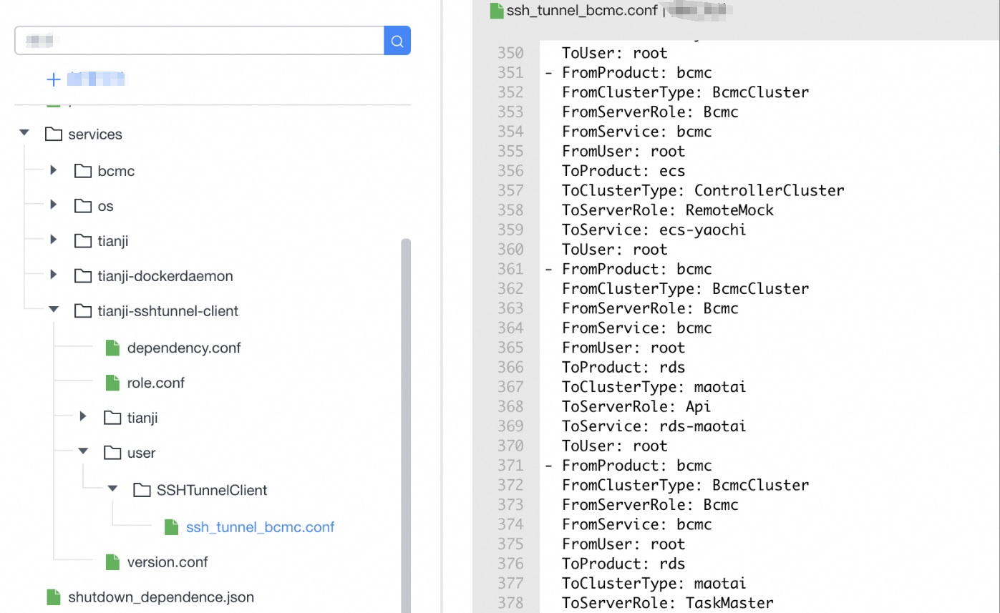

   </li>

   </ol>

3. Verify that the SSH tunnel has been opened.

   <ol type="i">

   <li>

   Log on to the bcmc.Bcmc# container.

   </li>

   <li>

   Run the  `cat MINIRDS.py | grep "CURRENT_IP_LIST"`  command in the  `/home/admin/bcmc/config`  directory to obtain the IP addresses of minirds-maotai, as

   </li>

   </ol>

   shown in the following figure.

   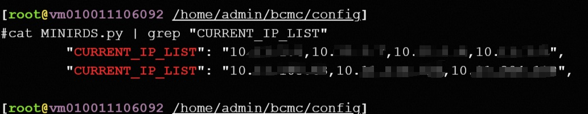

   <ol type="i" start="3">

   <li>

   Run the  `ssh <IP address>`  command to check whether the IP addresses obtained in the

   </li>

   </ol>

   previous step can be reached.

   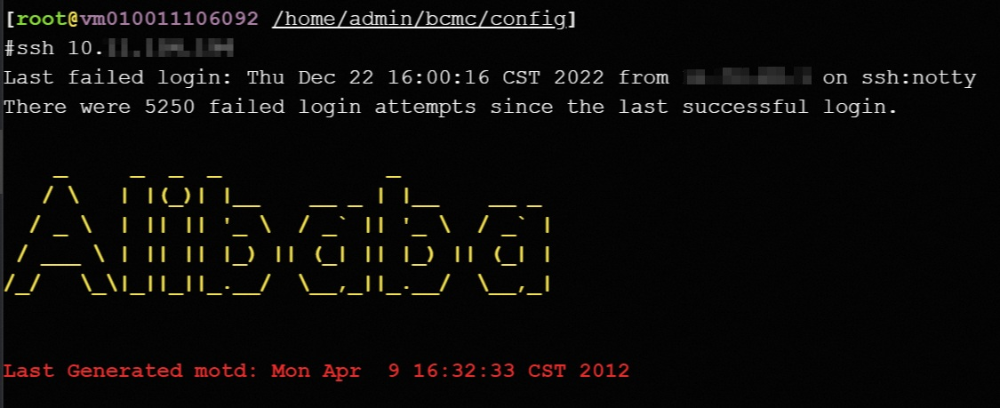

> **Note**
>
> If the alert persists after you perform the preceding steps, submit a ticket to contact technical support.

<a id="section-2-2-5-4"></a>

#### 2.2.5.4. sync_check (SLB)

This alert is used to check the disaster recovery (DR) status of Server Load Balancer (SLB) DR instances. This alert is triggered if an anomaly is found during the DR inspection of SLB. This may cause failover failures and affect traffic forwarding. This topic describes the sync_check alert item of SLB.

**Alert attributes**

<table>
  <tr>
    <td>Alert ID</td>
    <td>Metric</td>
    <td>Alert source</td>
    <td>Alert level</td>
    <td>Service</td>
    <td>Trigger condition</td>
    <td>Check interval</td>
  </tr>
  <tr>
    <td>sync_check</td>
    <td>sync_check</td>
    <td>Bcmc#</td>
    <td>P2</td>
    <td>slb</td>
    <td>An anomaly is reported in the Apsara Stack Resilience (ASR) for Zone-disaster Recovery console during the DR inspection of SLB.</td>
    <td>Once a minute</td>
  </tr>
</table>

**Supported versions**

Apsara Stack V3.12 and later

**Causes**

- SSH tunnels are closed.

  The SSH tunnels from bcmc to the server roles (SRs) of cloud services may be closed due to reasons such as missing or incorrect baseline configurations of SSH tunnels and issues in tianji-sshtunnel. In this case, DR inspection scripts cannot be executed as expected.

  The SSH tunnels from bcmc to the slb-controller.SlbControlMaster# containers in the primary and secondary data centers must be open. Otherwise, an error is reported.

- The number of abnormal instances detected is not 0.

  The issue occurs because the instance settings in the Linux Virtual Server (LVS) on the forwarding plane are inconsistent with the recorded settings in the control database. You must troubleshoot abnormal instances.

**Alert impacts**

If the DR status of SLB is abnormal, the following issues may occur:

- Instances cannot be failed over.

- Traffic cannot be forwarded as expected, and the cloud services or applications that depend on SLB cannot run as expected.

**Solution**

> **Warning**
>
> If a solution requires that you modify product configurations, you must initiate a production change process to confirm the feasibility and standardization of the solution. Even in an emergency, you must obtain consent from the customer and TAM before you can perform any steps of the solution.

**Closed SSH tunnels**

1. Check whether the sshd process of the peer SLB service is started.

   <ol type="i">

   <li>

   Log on to the SLB container.

   </li>

   <li>

   Run the  `ps -ef|grep sshd`  command to view the sshd process.

   </li>

   </ol>

   

   - If the ssh process is not started, you can manually run the  `/usr/sbin/sshd`  command to start the sshd process.

   - If the sshd process does not exist in the container, install the sshd plug-in by running the  `yum install sshd`  command.

2. Modify the SSH tunnel configurations of the bcmc cluster.

   <ol type="i">

   <li>

   Log on to the Apsara Infrastructure Management console.

   <ol type="i" start="2">

   <li>

   In the left-side navigation pane of the **Apsara Infrastructure Management console**,

   </li>

   </ol>

   choose Resources > **Product & Cluster O&M**.

   <ol type="i" start="3">

   <li>

   On the Product & Cluster O&M page, enter bcmc in the search box. In the search results,

   </li>

   </ol>

   find the cluster that you want to manage and click **Cluster Details** in the **Actions** column.

   </li>

   <li value="4">

   On the **Cluster Details** page, click the **Desired State Configuration** tab.

   </li>

   <li>

   Modify the  `/services/tianji-sshtunnel-client/user/SSHTunnelClient/ssh_tunnel_bcmc.conf`  file. Add the following information to the file: FromProduct, FromClusterType, FromServerRole, FromService, FromUser, ToProduct, ToClusterType, ToServerRole, ToService, and ToUser. Then, submit the changes.

   > **Note**
   >
   > The values of the FromClusterType and FromServerRole parameters vary based on the region type. For the central region, set the FromClusterType parameter to BcmcCluster and the FromServerRole parameter to Bcmc. For general regions, set the FromClusterType parameter to Bcmc4GeneralCluster and the FromServerRole parameter to Bcmc4General. Sample code:
   >
   > ```text
   > - FromProduct: bcmc
   >   // FromClusterType: Bcmc4GeneralCluster // Note: For the central region, set the parameter to BcmcCluster. For general regions, set the parameter to Bcmc4GeneralCluster.
   >   // FromServerRole: Bcmc4General // Note: For the central region, set the parameter to Bcmc. For general regions, set the parameter to Bcmc4General.
   >   FromClusterType: BcmcCluster
   >   FromServerRole: Bcmc
   >   FromService: bcmc
   >   FromUser: root
   >   ToProduct: slb // The cloud service to be connected.
   >   ToClusterType: slb_controller_Cluster // The type of the service cluster to be connected.
   >   ToServerRole: SlbControlMaster // The SR of the service to be connected.
   >   ToService: slb-controller // The service of the cloud service to be 
   > connected.
   >   ToUser: root
   > ```

   

   </li>

   </ol>

3. Verify that the SSH tunnel has been opened.

   <ol type="i">

   <li>

   Log on to the bcmc.Bcmc# container.

   </li>

   <li>

   Run the  `cat SLB.py | grep "slb_control_master_iplist"`  command in the  `/home/admin/bcmc/config`  directory to obtain the IP addresses of slb-

   </li>

   </ol>

   controller.SlbControlMaster#, as shown in the following figure.

   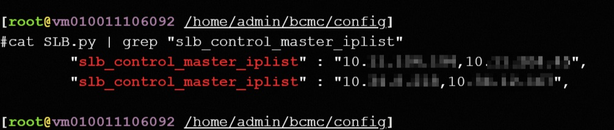

   <ol type="i" start="3">

   <li>

   Run the  `ssh <IP address>`  command to check whether the IP addresses obtained in the

   </li>

   </ol>

   previous step can be reached.

   

**Abnormal instances**

1. Troubleshoot health check issues.

   <ol type="i">

   <li>

   Log on to the slb-controller. SlbAg# container.

   </li>

   <li>

   Run the following command to run the health check script. The main health check script

   </li>

   </ol>

   is stored in the  `/deploy/alimonitor/script`  path.

   ```text
   python checkHealth.py
   ```

   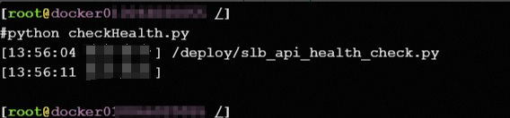

   <ol type="i" start="3">

   <li>

   Check the  `/home/slb/ag/slb-test_run.log`  log, find the error information, and check the

   </li>

   </ol>

   keyword that caused the health check failure.

2. Troubleshoot abnormal load balancers.

   <ol type="i">

   <li>

   Log on to the xuanyuan database.

   </li>

   <li>

   Run the following command to check the information about abnormal load balancers. Check whether the load balancers of northbound data are in an abnormal state, such as provisioning, init, or configuring, and whether the current and target version numbers are inconsistent.

   ```sql
   select * from loadbalancer where current_version != target_version or (status not in ("active", "deleted")) limit 100;
   ```

   </li>

   <li>

   Run the following command to check whether southbound data is generated. Check whether the southbound data is in the Created state.

   ```sql
   select * from network_conf where instance_id like '%lb_global_id%' \G
   ```

   </li>

   <li>

   Run the following command to check whether binding data is generated. Check the status of LvsGroup and lvs.

   ```sql
   select * from network_conf_binding where network_conf_instance_id like "%xxxx%" \G
   ```

   > **Note**
   >
   > In the command, replace xxxx with the instance IDs in the network_conf table.

   </li>

   <li>

   Run the following command to check the events:

   ```sql
   select * from event where source_instance_id like '%lb_global_id%' \G
   ```

   Print the tree of an event by using the request ID of the event.

   ```text
   info admin detail_event event_id ${instance_id}
   ```

   - If northbound data exists but network_conf and binding data does not exist, load balancers have failed to be created and the configurations are not delivered to the southbound interface.

   - If northbound data and network_conf data exist but binding data does not exist, load balancers have been created but the configurations are not delivered to the forwarding device.

   - If northbound data exists and network_conf and binding data also exists, load balancers have been created and the configurations have been delivered to the forwarding device.

   </li>

   </ol>

3. Troubleshoot abnormal virtual IP addresses (VIPs).

   <ol type="i">

   <li>

   Log on to the xuanyuan database.

   <ol type="i" start="2">

   <li>

   Run the following command to check the information about abnormal VIPs: Check

   </li>

   </ol>

   whether the VIPs of northbound data are in an abnormal state, such as configuring_fail, configuring, stopping, stopping_fail, starting, or starting_fail, and whether the current and target version numbers are inconsistent

   ```sql
   select * from vip where current_version != target_version or (status not in ("running","stopped")) limit 100;
   ```

   <ol type="i" start="3">

   <li>

   Run the following command to check whether southbound data is generated. Check

   </li>

   </ol>

   whether the southbound data is in the Created state.

   ```sql
   select * from network_conf where instance_id like '%listener_id%' \G
   ```

   </li>

   <li value="4">

   Run the following command to check whether binding data is generated. Check the status of LvsGroup and lvs.

   ```sql
   select * from network_conf_binding where network_conf_instance_id like "%xxxx%" \G
   ```

   > **Note**
   >
   > In the command, replace xxxx with the instance IDs in the network_conf table.

   </li>

   <li>

   Run the following command to check the events:

   ```sql
   select * from event where source_instance_id like '%listener_id%'\G
   ```

   Print the tree of an event by using the request ID of the event.

   ```text
   info admin detail_event event_id ${instance_id}
   ```

   - If northbound data exists but network_conf and binding data does not exist, VIPs have failed to be created and the configurations are not delivered to the southbound interface.

   - If northbound data and network_conf data exist but binding data does not exist, VIPs have been created but the configurations are not delivered to the forwarding device.

   - If northbound data exists and network_conf and binding data also exists, VIPs have been created and the configurations have been delivered to the forwarding device.

   </li>

   </ol>

4. Contact SLB O&M engineers to resolve the issue.

> **Note**
>
> If the alert persists after you perform the preceding steps, submit a ticket to contact technical support.

<a id="section-2-2-5-5"></a>

#### 2.2.5.5. sync_check (Kafka)

This alert monitors the disaster recovery status of Kafka disaster recovery instances. It indicates that the Kafka disaster recovery inspection is abnormal, which may cause data loss, prevent instance switchover, or result in instance access exceptions. This document describes the sync_check alert information when the alert product is Kafka.

**Alert properties**

<table>
  <tr>
    <td>Alert ID</td>
    <td>Metric name</td>
    <td>Source</td>
    <td>Severity</td>
    <td>Alert product</td>
    <td>Trigger conditions</td>
    <td>Execution cycle</td>
  </tr>
  <tr>
    <td>sync_check</td>
    <td>sync_check</td>
    <td>Bcmc#</td>
    <td>P2</td>
    <td>kafka</td>
    <td>Kafka disaster recovery inspection exception in the ASR console</td>
    <td>Once every minute</td>
  </tr>
</table>

**Applicable versions**

Apsara Stack Enterprise V3.16 and later

**Alert causes**

The current Kafka cluster has not been configured for disaster recovery. You need to complete the disaster recovery configuration for the Kafka cluster.

**Alert impacts**

Abnormal Kafka disaster recovery status may cause:

- Data synchronization is not configured between primary and secondary nodes, which may cause data loss when the primary node fails.

- The instance cannot perform disaster recovery switchover.

- Instance access exceptions, causing applications that depend on this instance to run abnormally.

**Handling methods**

> **Warning**
>
> If a solution requires that you modify product configurations, you must initiate a production change process to confirm the feasibility and standardization of the solution. Even in an emergency, you must obtain consent from the customer and TAM before you can perform any steps of the solution.

**Confirm the error message**

In the ASR console **Platform Monitoring** > **Product Monitoring** page, the Kafka **Disaster Recovery Capability** monitoring item shows **No disaster recovery instance**, and the **Primary Node Location** is **Not Retrieved**.

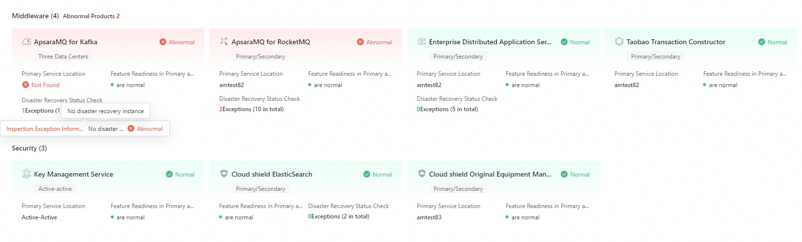

**Prerequisites**

The environment requires at least 2 Kafka clusters and 2 Replicators, and must meet the following conditions:

- The 2 Kafka clusters must be distributed in different data centers (different AZs) for primary and secondary nodes.

- The 2 Replicators must be distributed in different data centers (different AZs) for primary and secondary nodes.

- The Kafka clusters must first successfully create VIPs, and the VIP types of the two Kafka clusters that need disaster recovery configuration must be consistent. The VIP type can be AnyTunnel or SingleTunnel. If you create a SingleTunnel VIP, you need to ensure that both Kafka clusters select the same VPC.

**Procedure**

1. Log on to the Apsara Uni-manager Management Console.

2. In the top navigation bar, choose **Products > Middleware > ApsaraMQ for Kafka**.

3. Go to the **Message Queue For Apache Kafka** page, and confirm that the instances meet the prerequisites in the **Instance List** in the left menu bar.

4. In the **Disaster Recovery Cluster List** in the left menu bar, create a disaster recovery instance.

   <ol type="i">

   <li>

   Click **Create Disaster Recovery Cluster**.

   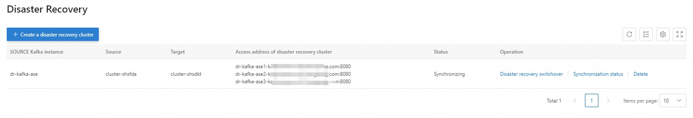

   </li>

   <li>

   Enter the **Disaster Recovery Cluster Name** and click **Next**.

   </li>

   </ol>

   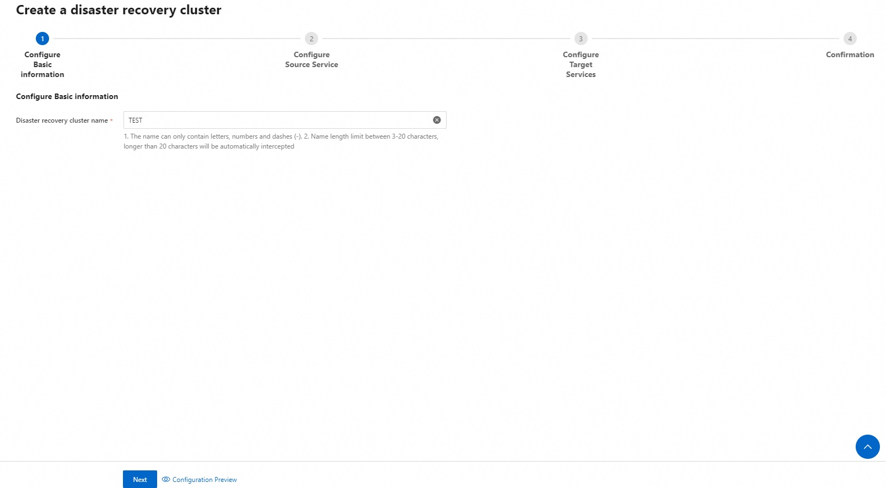

   <ol type="i" start="3">

   <li>

   Select the primary Kafka cluster instance in **Source Kafka Instance**, select the primary

   </li>

   </ol>

   Replicator instance in **Source KafkaReplicator Instance**, and click **Next**.

   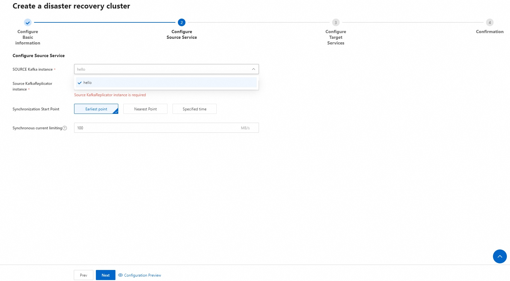

   <ol type="i" start="4">

   <li>

   Select the secondary Kafka cluster instance in **Target Kafka Instance**, select the secondary Replicator instance in **Target KafkaReplicator Instance**, and click **Create**.

   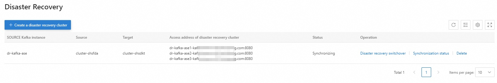

   </li>

   </ol>

> **Note**
>
> If the alert persists after you perform the preceding steps, submit a ticket to contact technical support.

<a id="section-2-2-5-6"></a>

#### 2.2.5.6. sync_check (Elasticsearch)

This alert monitors the disaster recovery status of Elasticsearch disaster recovery instances. It indicates an abnormality in the Elasticsearch disaster recovery inspection, which may result in data loss, inability to perform disaster recovery switchover, or instance access exceptions. This document describes the sync_check alert information when the alert product is Elasticsearch.

**Alert properties**

<table>
  <tr>
    <td>Alert ID</td>
    <td>Metric</td>
    <td>Source</td>
    <td>Severity</td>
    <td>Alert product</td>
    <td>Trigger conditions</td>
    <td>Execution cycle</td>
  </tr>
  <tr>
    <td>sync_check</td>
    <td>sync_check</td>
    <td>Bcmc#</td>
    <td>P2</td>
    <td>elasticsear ch</td>
    <td>Elasticsear ch disaster recovery inspection exception on the ASR console</td>
    <td>Once every minute</td>
  </tr>
</table>

**Applicable versions**

Apsara Stack Enterprise V3.16 and later

**Alert causes**

The current Elasticsearch cluster has not been configured for disaster recovery. You need to complete the disaster recovery configuration for the Elasticsearch cluster.

**Alert impacts**

Elasticsearch disaster recovery status is abnormal, which may lead to:

- Data synchronization is not configured between primary and secondary nodes, which may cause data loss when the primary node fails.

- The instance cannot perform disaster recovery switchover.

- Instance access anomalies, causing applications that depend on this instance to run abnormally.

**Solutions**

> **Warning**
>
> If a solution requires that you modify product configurations, you must initiate a production change process to confirm the feasibility and standardization of the solution. Even in an emergency, you must obtain consent from the customer and TAM before you can perform any steps of the solution.

**Confirm the error message**

On the ASR console **Platform Monitoring** > **Product Monitoring** page, the disaster recovery status monitoring for Elasticsearch is abnormal.

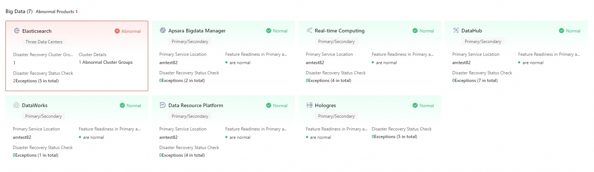

**Prerequisites**

You need to create a user named asr_es in the Apsara Uni-manager Operations Console and grant the elasticsearch_read role permission to this user.

**Procedure**

1. Use the asr_es user to log on to the Apsara Uni-manager Operations Console.

2. In the top navigation bar, choose **Product Operation** > **Big Data** > **Elasticsearch**.

3. Go to the **ESSEN** console, in the left navigation bar, click **Instance Management**, and then click **Create Instance**.

4. On the **Basic Configuration** page, select a version and click **Next**.

5. On the **Cluster Configuration** page, fill in the cluster information and click **Next**.

6. On the **Network And System Configuration** page, select **Virtual Private Cloud (any Tunnel)** as the network type, set the logon password, and click **Start Creation**.

7. Follow the above steps to create one cluster in the primary data center and one in the secondary data center, using the same logon password.

8. On the ops1 machine, run the following command to execute the ES_ha_init.py script.

   ```text
   # ${masterInstance} represents the primary cluster instanceID; ${slaveInstance} represents the secondary cluster instanceID; ${masterNamespace} represents the namespace of the primary cluster; ${slaveNamespace} represents the namespace of the secondary cluster;
   ${masterIDC} represents the primary data center IDC name; ${slaveIDC} represents the secondary data center IDC name; ${UserDomain} represents the user-defined domain nameused to access the ES cluster

   /home/tops/bin/python ES_ha_init.py -mi ${masterInstance} -si ${slaveInstance} -mn ${
   masterNamespace} -sn ${slaveNamespace} -md ${masterIDC} -sd ${slaveIDC} -d ${UserDomain}

   Example: /home/tops/bin/python ES_ha_init.py -mi es-a -si es-b -mn xdcr-test-a -sn xdcr-test-b -md amtest17 -sd amtest34 -d es-visit.xdcr-test.intra.env11e.shuguang.com
   ```

   > **Note**
   >
   > Script usage notes:
   >
   > - An instance that has already been set as a secondary cluster is not allowed to be set as a primary cluster instance.
   >
   > - Domain names that are already bound to an IP address are not allowed to be used by default. You can add the -f parameter to force the use of the specified domain name.
   >
   > - To query the current list of disaster recovery instances:  `/home/tops/bin/python ES_ha_init.py -a list` .
   >
   > - After the incremental deployment of the ES disaster recovery service, if no ES disaster recovery instance has been created, the ASR disaster recovery inspection page may report an error. You can execute the command  `/home/tops/bin/python ES_ha_init.py -a init`  to trigger the initialization of the datasource config for the relevant database.

**Notes**

- It is not allowed to create indexes that start with "." or "security-auditlog" (this type of index will not be synchronized).

- Deleting an index in the secondary data center will trigger synchronization, so it cannot be deleted. However, if an index is deleted in the primary data center, the corresponding index in the secondary data center will also be deleted.

- The client is required to set the DNS cache to be as short as possible (not exceeding 10 seconds).

- During power outage failback, you need to perform the following command in the primary data center (before the power outage) to enable the synchronization link and trigger data synchronization in advance, to avoid being blocked in the data synchronization stage during disaster recovery switchover.

  ```bash
  # Enable synchronization link (you can verify on ASR whether the data synchronization 
  link is configured successfully) ${masterInstance} represents the primary cluster instanceID; ${user} represents the secondary cluster instance username; ${password} represents the secondary cluster instance password; ${slaveClusterMgmtVip} represents themanagement domain name of the secondary cluster instance

  curl -XPOST -u ${user}:${password} 
  ${slaveClusterMgmtVip}:9200/_xdcr/${masterInstance}?excludes=.*,security-auditlog*

  Kibana white screen operation (primary cluster before power outage):
  POST /_xdcr/${masterInstance}?excludes=.*,security-auditlog*


  # Check data synchronization progress (when the data in the third and fourth columns of the query result are consistent, it indicates that data synchronization is complete) ${user} represents the secondary cluster instance username; ${password} representsthe secondary cluster instance password; ${slaveClusterMgmtVip} represents the management domain name of the secondary cluster instance

  curl -u ${user}:${password} ${slaveClusterMgmtVip}:9200/_cat/xdcr?
  h=repository,index,localGCP,remoteGCP

  Kibana white screen operation (secondary cluster):
  GET /_cat/xdcr?h=repository,index,localGCP,remoteGCP
  ```

- During network outage failback, in addition to manually configuring and enabling the synchronization link in the primary data center (before the network outage), you may also need to delete the index in the primary data center to trigger a full synchronization (depending on whether partial data inconsistency between primary and secondary clusters is acceptable on site).

> **Note**
>
> If the alert persists after you perform the preceding steps, submit a ticket to contact technical support.

<a id="section-2-2-6"></a>

### 2.2.6. inspect_product_cluster_aplus

This alert is used to check whether rolling is performed on the clusters in the primary data center for zone-disaster recovery. This alert is triggered if rolling is not performed on specific clusters. This may cause failover failures.

**Alert attributes**

| Alert ID | Metric | Alert source | Alert level | Service | Trigger condition | Check interval |
| --- | --- | --- | --- | --- | --- | --- |
| inspect_pro duct_cluste r_aplus | inspect_pro duct_cluste r_aplus | Bcmc# | P2 | bcmc | Rolling is not performed on specific clusters in the primary data center for zone-disaster recovery. | Every 30 minutes |

**Supported versions**

Apsara Stack V3.14 and later

**Causes**

Rolling is not performed on specific clusters in the primary data center. For all clusters deployed in the secondary data center, except for Elastic Compute Service (ECS) compute clusters and storage clusters, rolling must be performed on the corresponding clusters in the primary data center.

> **Note**
>
> Rolling operations are not required for the clusters deployed only in the primary data center but not in the secondary data center.

**Alert impacts**

If zone-disaster recovery deployment of cloud services is not complete, failover operations fail.

**Solution**

> **Warning**
>
> If a solution requires that you modify product configurations, you must initiate a production change process to confirm the feasibility and standardization of the solution. Even in an emergency, you must obtain consent from the customer and TAM before you can perform any steps of the solution.

1. Perform rolling on the primary clusters that have a corresponding secondary cluster and on which rolling is not performed.

   > **Important**
   >
   > Usage notes:
   >
   > - Before you perform rolling, make sure that the primary and secondary clusters are at desired state.
   >
   > - For basic middleware, including middleWareAll, dauthProduct, aliware-taokeeper, and middleware-dncs, you must perform rolling immediately after the services reach desired state.
   >
   > - You must submit services for rolling based on the specified sequence.
   >
   > - When rolling is performed on ApsaraMQ for RocketMQ, Object Storage Service (OSS), and Tablestore, transient disconnections occur. Before you perform rolling on these services, obtain a scheduled operation window from the customer.

   - Submission sequence

     Rolling operations are performed at the cluster level. We recommend that you submit the operations in sequence. Submit the operations for the next cluster after a success message is returned for the current submission and the rolling of the current cluster starts on Apsara Infrastructure Management. The following table lists the submission sequence for rolling operations of various clusters.

     > **Important**
     >
     > - Clusters not included in the table can be submitted after the rds clusters are submitted. The bcmc cluster is the last one to be submitted.
     >
     > - When rolling operations are performed on MiniRDS, MiniRDS automatically issues a request to recreate secondary instances across data centers. This process does not affect data reading and writing of instances. Therefore, MiniRDS clusters can be submitted first and together with other clusters. It takes a long time to recreate secondary instances and the migration may fail. Field engineers must closely monitor the MiniRDS and ApsaraDB RDS consoles and check whether interrupted or failed migration tasks exist. Handle such tasks at the earliest opportunity.

     | No. | Service | Cluster (depending on actual situations) |
     | --- | --- | --- |
     | 1 | tianji | tianji-A-e68c |
     | 2 | minirds-mt | • integrator-A-20200212-e682<br>• maotai-A-20200212-e681 |
     | 3 | baseServiceAll | StandardCloudCluster-A |
     | 4 | webappAll | StandardCloudCluster |
     | 5 | vnet | VnetCluster |
     | 6 | xnet2 | Xnet2Cluster |
     | 7 | ram | BasicCluster |
     | 8 | qitian | qitianCluster |
     | 9 | opsapi | opsapiCluster |
     | 10 | tongque | tongqueCluster |
     | 11 | asa | asaCluster |
     | 12 | aso | asoCluster |
     | 13 | slb | • slbCluster<br>• slb_yaochi_Cluster |
     | 14 | vpc | • vpcAzoneCluster<br>• vpcRegionCluster<br>• vpcRegionXnetCluster<br>• vpcYaochiCluster |
     | 15 | ecs | • ECS-controller-A-e68d<br>• ECS-controller-A-e68f |
     | 16 | oss | OssHybridCluster<br>Important<br>If you do not want to configure zone-disaster recovery for all buckets, do not perform rolling on OSS. Contact the OSS R&amp;D team for solutions. |
     | 17 | rds | • brain<br>• kvstore-yaochi<br>• maotai<br>• nosql-cleaneye<br>• pgsql<br>• ppassql<br>• proxy<br>• rds-dr-service<br>• rds-yaochi<br>• redis |
     | 18 | On PaaS services | Depends on the actual On PaaS service. |
     | 19 | bcmc | BcmcCluster-A |

   - Rolling on On Tianji services

     <ol type="a">

     <li>

     Log on to OPS 1 of the primary data center.

     </li>

     <li>

     Run the following commands to update the cluster configurations in the primary data center:

     ```bash
     cd  /apsarapangu/disk3/u_disk/upgrade_tools/tianji_zhuque_sdk
     ./upgrade_A_to_Aplus.py -z [$ZONE] -p [$PROJECT] -c [$CLUSTER] --tianjiCltConfig 
     [$TIANJICLTCONFIG]
     ```

     > **Note**
     >
     > - Parameter description:
     >
     >   - $ZONE: the zone of the cluster in the primary data center.
     >
     >   - $PROJECT: the name of the project of the cluster in the primary data center.
     >
     >   - $CLUSTER: the name of the cluster in the primary data center.
     >
     >   - $TIANJICLTCONFIG: the fixed directory of the tianji_clt configuration file.
     >
     > - Sample commands:
     >
     >   ```bash
     >   cd  /apsarapangu/disk3/u_disk/upgrade_tools/tianji_zhuque_sdk
     >   ./upgrade_A_to_Aplus.py -z cn-haikou-xxxx-xxxx-a -p tianji -c tianji-A-c8df  --tianjiCltConfig 
     >   /cloud/data/bootstrap_controller/BootstrapController#/bootstrap_controlle
     >   /tianji_dest.conf
     >   ```

     </li>

     </ol>

   - Rolling on On PaaS services (earlier than V3.17)

     <ol type="a">

     <li>

     Download the arkctl tool.

     </li>

     <li>

     Run the following command to obtain all the On PaaS services in the environment:

     ```text
     arkctl product list -iz
     ```

     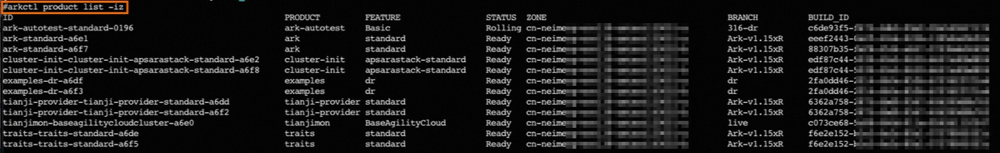

     </li>

     </ol>

     <ol type="i" start="100">

     <li>

     Run the following command to check whether rolling is being performed on a service:

     ```text
     arkctl product rolling ${id}
     ```

     > **Note**
     >
     > id indicates the service ID. Service IDs are obtained in the previous step.

     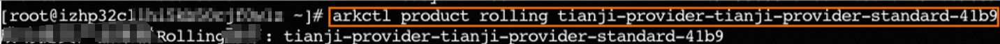

     </li>

     <li value="500">

     Run the following command to check whether the service is in the Ready state:

     ```text
     arkctl product list -iz
     ```

     If the service is in the Ready state, deployment is successful.

     </li>

     </ol>

   - Rolling on On PaaS services (V3.17 and later)

     <ol type="a">

     <li>

     Download the arkctl tool.

     </li>

     <li>

     Run the following command to obtain all the On PaaS services in the environment:

     ```text
     arkctl product list -iz
     ```

     

     </li>

     </ol>

     <ol type="i" start="100">

     <li>

     Run the following command to check whether the value of the haApsaraStack variable is  `true` . If the value is true, a success message is returned. If the value is  `false` , perform rolling on the service.

     ```text
     arkctl dr aplus ${id}
     ```

     > **Note**
     >
     > id indicates the service ID. Service IDs are obtained in the previous step.

     </li>

     </ol>

2. Check whether rolling is performed as required. The list of services on which rolling is not performed is expected to be empty.

> **Note**
>
> If the alert persists after you perform the preceding steps, submit a ticket to contact technical support.

<a id="section-2-2-7"></a>

### 2.2.7. inspect_product_cluster_version

This alert is used to check whether service versions are consistent between the primary and secondary data centers. This alert is triggered if service versions are inconsistent between the primary and secondary data centers. This may cause failover failures or feature changes in the cloud services after failover.

**Alert attributes**

<table>
  <tr>
    <td>Alert ID</td>
    <td>Metric</td>
    <td>Alert source</td>
    <td>Alert level</td>
    <td>Service</td>
    <td>Trigger condition</td>
    <td>Check interval</td>
  </tr>
  <tr>
    <td>inspect_pro duct_cluste r_version</td>
    <td>inspect_pro duct_cluste r_version</td>
    <td>Bcmc#</td>
    <td>P2</td>
    <td>bcmc</td>
    <td>Service versions are inconsisten t between the primary and secondary data centers.</td>
    <td>Every 30 minutes</td>
  </tr>
</table>

**Supported versions**

Apsara Stack V3.14 and later

**Causes**

In the zone-disaster recovery scenario, service versions must be consistent between the primary and secondary data centers. Otherwise, an exception is reported.

**Alert impacts**

If service versions are inconsistent, the following issues may occur:

- Failover operations fail.

- After the failover, the features of cloud services change.

**Solution**

> **Warning**
>
> If a solution requires that you modify product configurations, you must initiate a production change process to confirm the feasibility and standardization of the solution. Even in an emergency, you must obtain consent from the customer and TAM before you can perform any steps of the solution.

For cloud services with different versions deployed in the primary and secondary data centers, contact the technical account manager (TAM) to upgrade the services.

<a id="section-2-2-8"></a>

### 2.2.8. inspect_product_variable

This alert is used to check whether the bcmc-dependent baseline variables that are obtained by using the tianji API are inconsistent with the baseline variables rendered by bcmc. This alert is triggered if the obtained and rendered baseline variables are inconsistent. This may cause failover failures.

**Alert attributes**

<table>
  <tr>
    <td>Alert ID</td>
    <td>Metric</td>
    <td>Alert source</td>
    <td>Alert level</td>
    <td>Service</td>
    <td>Trigger condition</td>
    <td>Check interval</td>
  </tr>
  <tr>
    <td>inspect_pro duct_varia ble</td>
    <td>inspect_pro duct_varia ble</td>
    <td>Bcmc#</td>
    <td>P2</td>
    <td>bcmc</td>
    <td>The Apsara Stack Resilience (ASR) console shows that the service baseline variable check fails.</td>
    <td>Every 30 minutes</td>
  </tr>
</table>

**Supported versions**

Apsara Stack V3.14 and later

**Causes**

Due to the upgrade or scale-out of cloud services, or the migration of cloud services, the bcmc-dependent baseline variables that are obtained by using the tianji API are inconsistent with the baseline variables rendered by bcmc.

> **Note**
>
> - For more information about the bcmc-dependent baseline variables that are obtained by the tianji API, see the  `application-conf-opposite.yml`  and  `application-conf.yml`  files in the  `/opt/tianji/conf.tmpl`  directory.
>
> - For more information about baseline variables rendered in bcmc, see the  `/alidata/conf/antx.properties`  file.

**Alert impacts**

Failover operations fail.

**Solution**

> **Warning**
>
> If a solution requires that you modify product configurations, you must initiate a production change process to confirm the feasibility and standardization of the solution. Even in an emergency, you must obtain consent from the customer and TAM before you can perform any steps of the solution.

- If a service has been scaled out, the baseline variables of bcmc are changed. In this case, you must perform rolling on bcmc and re-render the baseline variables.

  <ol type="i">

  <li>

  Log on to the Apsara Infrastructure Management console.

  <ol type="i" start="2">

  <li>

  In the left-side navigation pane of the **Apsara Infrastructure Management console**,

  </li>

  </ol>

  choose **Resources** > **Product & Cluster O&M**.

  <ol type="i" start="3">

  <li>

  On the Product & Cluster O&M page, enter bcmc in the search box. In the search results,

  </li>

  </ol>

  find the cluster that you want to manage and click **Cluster Details** in the **Actions** column.

  </li>

  <li value="4">

  On the **Cluster Details** page, click the **Desired State Configuration** tab.

  </li>

  <li>

  In the kv.conf file, press the Enter key at the end of the last line, and then click **Preview and Submit**.

  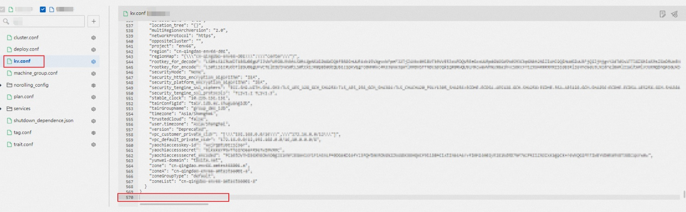

  </li>

  <li>

  In the dialog box that appears, click **Submit**.

  </li>

  </ol>

- If bcmc should have obtained the variables of a service cluster in the secondary data center but obtained the variables of the corresponding cluster in the primary data center instead, the service may have been incrementally deployed recently. You need to check the serviceid.conf configuration file of the bcmc cluster and delete the corresponding configurations.

  <ol type="i">

  <li>

  Log on to the Apsara Infrastructure Management console.

  <ol type="i" start="2">

  <li>

  In the left-side navigation pane of the **Apsara Infrastructure Management console**,

  </li>

  </ol>

  choose **Resources** > **Product & Cluster O&M**.

  <ol type="i" start="3">

  <li>

  On the Product & Cluster O&M page, enter bcmc in the search box. In the search results,

  </li>

  </ol>

  find the cluster that you want to manage and click **Cluster Details** in the **Actions** column.

  </li>

  <li value="4">

  On the **Cluster Details** page, click the **Desired State Configuration** tab.

  </li>

  <li>

  Delete the configurations of the corresponding service in the serviceid.conf file.

  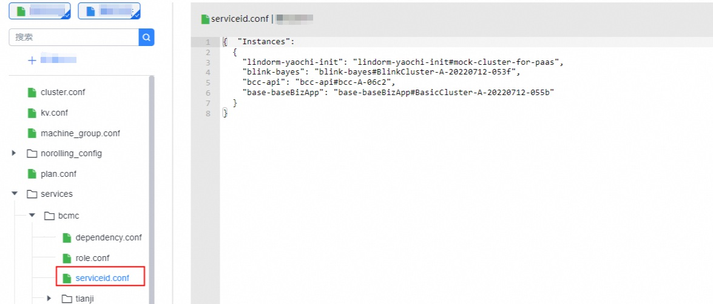

  </li>

  </ol>

> **Note**
>
> If the alert persists after you perform the preceding steps, submit a ticket to contact technical support.

<a id="section-2-2-9"></a>

### 2.2.9. inspect_product_cluster_deploy

This alert is used to check whether the clusters of cloud services are deployed in symmetric mode in the primary and secondary data centers. This alert is triggered if a cloud service is not deployed in symmetric mode. This may cause failover failures, exceptions in accessing the service, or excessive load on the service.

**Alert attributes**

<table>
  <tr>
    <td>Alert ID</td>
    <td>Metric</td>
    <td>Alert source</td>
    <td>Alert level</td>
    <td>Service</td>
    <td>Trigger condition</td>
    <td>Check interval</td>
  </tr>
  <tr>
    <td>inspect_pro duct_cluste r_deploy</td>
    <td>inspect_pro duct_cluste r_deploy</td>
    <td>Bcmc#</td>
    <td>P2</td>
    <td>bcmc</td>
    <td>The clusters of cloud services are not deployed in symmetric mode in the primary and secondary data centers.</td>
    <td>Every 30 minutes</td>
  </tr>
</table>

**Supported versions**

Apsara Stack V3.14 and later

**Causes**

In the zone-disaster recovery scenario, if you want to configure disaster recovery (DR) for a service that does not support asymmetric DR, make sure that the service version is consistent and clusters are deployed in symmetric mode between the primary and secondary data centers. Otherwise, an exception is reported.

> **Note**
>
> The following services support asymmetric DR: ApsaraDB RDS, KVStore for Redis, Object Storage Service (OSS), Elastic Compute Service (ECS), and MaxCompute.

**Alert impacts**

If clusters are not deployed in symmetric mode as required, the following issues may occur:

- Failover operations fail.

- After the failover, the service cannot be accessed as expected.

- After the failover, the service is overloaded.

**Solution**

> **Warning**
>
> If a solution requires that you modify product configurations, you must initiate a production change process to confirm the feasibility and standardization of the solution. Even in an emergency, you must obtain consent from the customer and TAM before you can perform any steps of the solution.

Contact the field technical account manager (TAM) to check whether the service is correctly deployed. If the service is incorrectly deployed, deploy new clusters and check the inspect_product_cluster_deploy item again. If the service is correctly deployed, ignore the exception.

<a id="section-2-2-10"></a>

### 2.2.10. Appendixes

<a id="section-2-2-10-1"></a>

#### 2.2.10.1. Log on to the Apsara Uni-manager Management Console

This topic describes how to log on to the Apsara Uni-manager Management Console.

**Prerequisites**

- The URL of the Apsara Uni-manager Management Console is obtained from the deployment engineers.

- A web browser is available. We recommend that you use Google Chrome.

**Procedure**

1. Enter the URL of the Apsara Uni-manager Management Console in the address bar and press the Enter key.

   

   > **Note**
   >
   > - You can select a language from the drop-down list in the upper-right corner of the page.

2. Enter your username and password.

   > **Note**
   >
   > - You need to obtain the username and password from an operations administrator.
   >
   > - The first time you log on to the Apsara Uni-manager Management Console, you must change the password of your account as prompted. The password must be 10 to 32 characters in length. It must contain all of the following character types: uppercase letters, lowercase letters, digits, and special characters. Supported special characters include: ! @ # $ %

3. Click **Log On**.

4. If multi-factor authentication (MFA) is enabled for your account, perform the corresponding operations in the following scenarios:

   - **This is your first time logging on to the Apsara Uni-manager Management Console after MFA is enabled by the administrator.**

     <ol type="a">

     <li>

     On the Bind Virtual MFA Device page, bind an MFA device as prompted.

     </li>

     <li>

     Enter the username and password again as in Step 2 and click **Log On**.

     </li>

     </ol>

     <ol type="i" start="100">

     <li>

     Enter a six-digit MFA verification code and click **Authenticate**.

     </li>

     </ol>

   - **You have enabled MFA and bound an MFA device.**

     Enter a six-digit MFA verification code and click **Authenticate**.

     > **Note**
     >
     > For information about how to bind and enable MFA, see Manage MFA.

**What to do next**

**Forget password**

1. If you forget the logon password, click **Forgot Password** below the Password field.

2. On the Forgot Password page, configure the **Account Name** and **Email Address** parameters, specify the verification code, and then click **Confirm**.

   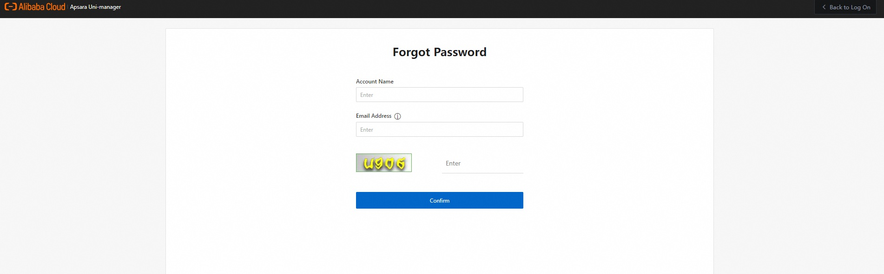

   > **Note**
   >
   > - Enter the username of your account in the Account Name field and the email address that was used to create the account in the Email Address field.
   >
   > - The system sends a link for resetting the password to the email address that you specify.

<a id="section-2-2-10-2"></a>

#### 2.2.10.2. Log on to the Apsara Uni-manager Operations Console

This topic describes how to log on to the Apsara Uni-manager Operations Console.

**Prerequisites**

- The endpoint of the Apsara Uni-manager Operations Console and the username and password used to log on to the console are obtained from the deployment engineer or an administrator.

  The endpoint of the Apsara Uni-manager Operations Console is in the following format: *regi on-id*.ops.console.*intranet-domain-id*.

- A web browser. We recommend that you use Google Chrome.

**Procedure**

1. Open your browser.

2. In the address bar, enter the endpoint of the Apsara Uni-manager Operations Console.

   Press the Enter key.

   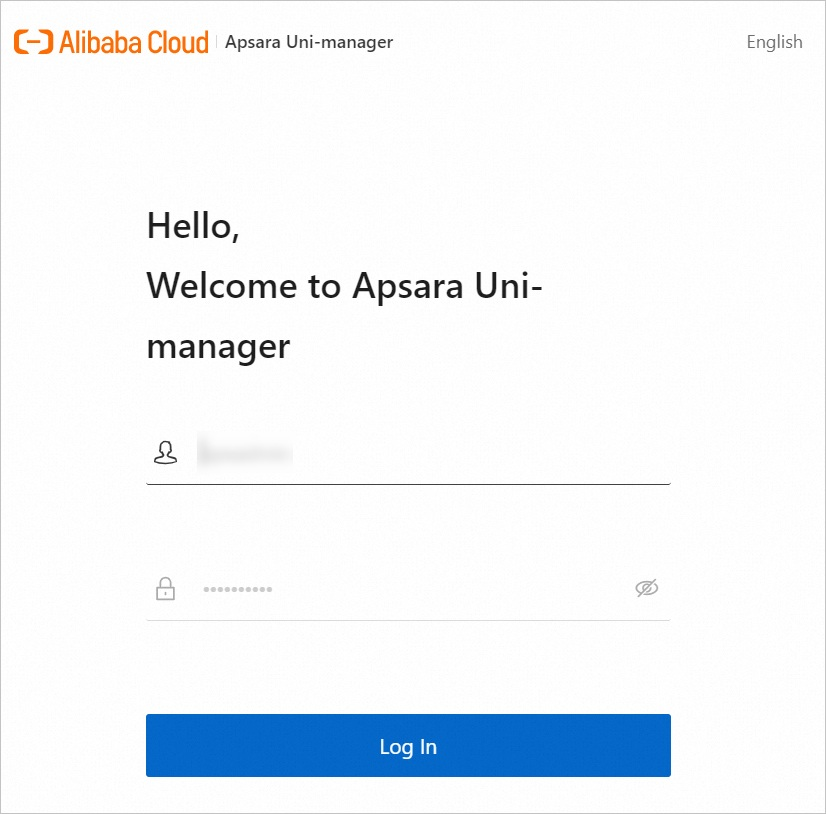

   > **Note**
   >
   > You can click the current language in the upper-right corner to switch to another language. Simplified Chinese, English, and Traditional Chinese are supported.

3. Enter your username and password.

   > **Note**
   >
   > Obtain the username and password that are used to log on to the Apsara Uni-manager Operations Console from the deployment engineer or an administrator.

   If you log on to the Apsara Uni-manager Operations Console for the first time, you must change the password of your username.

   To enhance security, your password must meet the following requirements:

   - The password contains uppercase and lowercase letters.

   - The password contains digits.

   - The password contains at least one of the following special characters: ! @ # $ %

   - The password is 10 to 20 characters in length.

4. Click **Log On**.

<a id="section-2-2-10-3"></a>

#### 2.2.10.3. Log on to a container

This topic describes how to log on to a container. The Bcmc# container of bcmc is used in this example.

**Procedure**

1. Log on to the terminal.

   <ol type="i">

   <li>

   Log on to the Apsara Uni-manager Operations Console.

   </li>

   <li>

   In the top navigation bar, choose **Platform Operation > Apsara Infrastructure**

   </li>

   </ol>

   **Management > Resources**.

   <ol type="i" start="3">

   <li>

   In the left-side navigation pane of the **Apsara Infrastructure Management console**,

   </li>

   </ol>

   choose **Resources > Product & Cluster O&M**.

   <ol type="i" start="4">

   <li>

   On the **Product & Cluster O&M** page, enter bcmc in the search box.

   </li>

   <li>

   Find the cluster that you want to manage and click **Cluster Details** in the **Actions** column.

   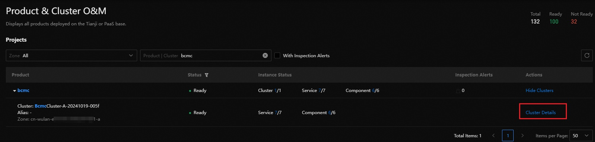

   </li>

   <li>

   On the Services tab, find the **bcmc** service and click its name.

   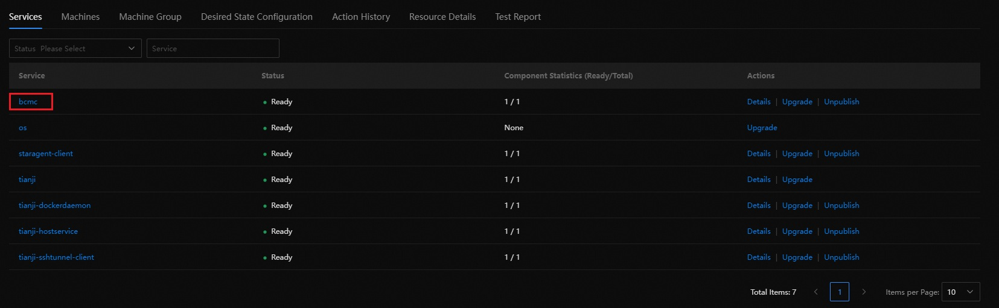

   </li>

   <li>

   In the Components pane, click **Bcmc#**. On the **Instances** tab, click **Terminal** in the

   </li>

   </ol>

   **Actions** column of an instance.

   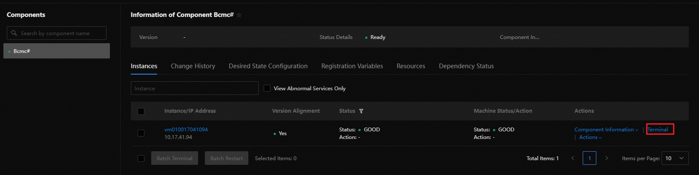

2. Run the following command to query the ID of the container:

   ```bash
   docker ps
   ```

   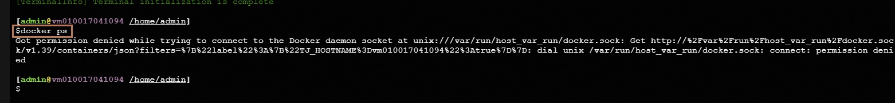

3. Run the following command to access the container:

   ```bash
   docker exec -it <Container ID> /bin/bash.
   ```

   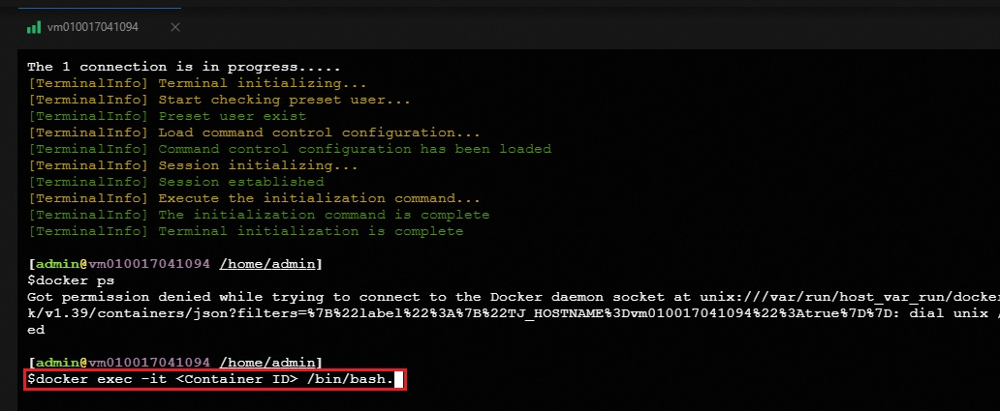

<a id="section-2-2-10-4"></a>

#### 2.2.10.4. Log on to the xuanyuan database

This topic describes how to log on to the xuanyuan database of Server Load Balancer (SLB).

1. Log on to the Apsara Uni-manager Operations Console.

2. In the top navigation bar, choose **Platform Operation > Apsara Infrastructure Management > Resources**.

3. In the left-side navigation pane of the **Apsara Infrastructure Management console**, choose **Resources > Product & Cluster O&M**.

4. On the Product & Cluster O&M page, enter slb in the search box. In the search results, find slbCluster-A and click **Cluster Details** in the **Actions** column.

5. On the Services tab, find the **slb-controller** service and click its name.

6. In the Components pane, click **SlbControlMaster#**.

7. On the **Resources** tab, find the resource whose name is **xuanyuan** and type is **db**, and view the values of the db_host, user, db_password, db_port, and db_name parameters in the **Resource Application Result** column.

   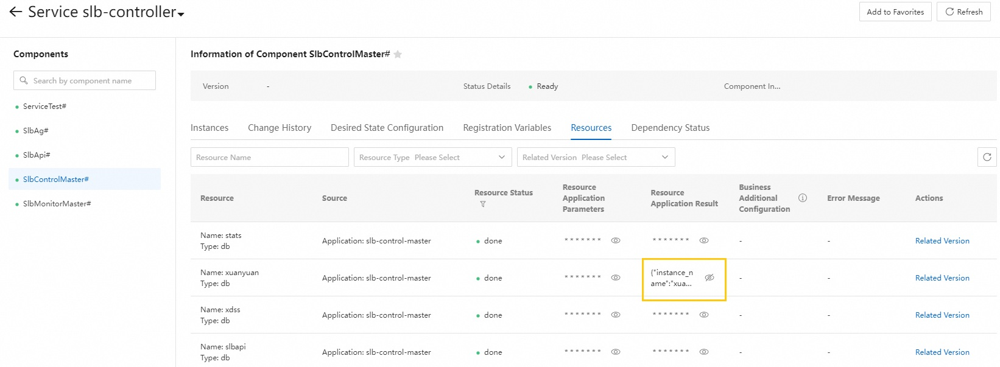

8. On the **Instances** tab, click **Terminal** in the **Actions** column of an instance.

9. Run the following command to log on to the xuanyuan database. For more information about the values of the db_host, user, db_password, db_port, and db_name parameters, see Step 7.

   ```text
   mysql -h${db_host} -u${user} -p${db_password} -P${db_port} -D${db_name}
   ```

<a id="section-2-2-10-5"></a>

#### 2.2.10.5. Log on to the Apsara Infrastructure Management console

This topic describes how to log on to the Apsara Infrastructure Management console as a user such as an O&M engineer.

**Prerequisites**

- The endpoint of the Apsara Uni-manager Operations Console and the username and password that are used to log on to the console are obtained from a deployment engineer or an administrator.

The endpoint of the Apsara Uni-manager Operations Console is in the following format: <em>region-id.</em>ops.asconsole.*intranet-domain-id*.

- A web browser is available. We recommend that you use Google Chrome.

**Procedure**

1. Open your browser.

2. In the address bar, enter the endpoint of the Apsara Uni-manager Operations Console. Press the Enter key.

   > **Note**
   >
   > You can select a language from the drop-down list in the upper-right corner of the page.

3. Enter the username and password.

   > **Note**
   >
   > Obtain the username and password that are used to log on to the Apsara Uni-manager Operations Console from a deployment engineer or an administrator.

   If this is the first time you log on to the Apsara Uni-manager Operations Console, you must change the password as prompted.

   To enhance security, your password must meet the following requirements:

   - The password contains uppercase and lowercase letters.

   - The password contains digits.

   - The password contains at least one of the following special characters: ! @ # $ %

   - The password is 10 to 20 characters in length.

4. Click **Log On**.

5. In the top navigation bar, choose **Platform Operation** > **Apsara Infrastructure Management** > **Resources**.

<a id="section-2-2-10-6"></a>

#### 2.2.10.6. Secondary database rebuild

This topic describes how to rebuild a secondary database to help you better understand the process.

**Procedure**

1. **View the basic information, link type, port, and primary**

**database IP information of the abnormal instance**

1. Log on to the Dukang database management platform.

2. Select **Instance Management** > **Instance List**, and click the instance that you want to operate to go to the instance details page.

   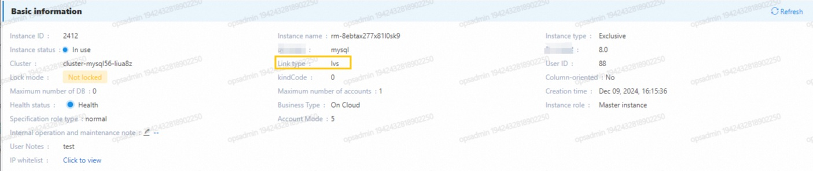

   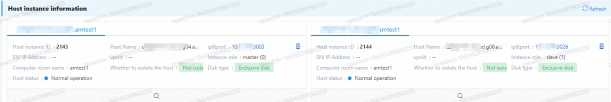

   - If the link type is DNS, log on to the host where the instance is located and run the following command to check whether the parsing is correct. If the parsing fails, contact the product development team for assistance.

     ```text
     dig ${domain name}
     ```

   - If the link type is LVS, confirm whether the data center IP information is consistent with the primary instance machine IP. If they are inconsistent, stop the operation and contact the product development team for assistance.

   2. **Check the read_only parameter of the primary and**

**secondary databases**

1. Log on to the primary database. For more information, see Log on to an abnormal instance.

2. Run the following SQL statement to check the read/write status of the primary database.

   <ol type="i">

   <li>

   When the result shows ON, the primary database is abnormal.

   ```text
    show variables like 'read_only'; 
   ```

   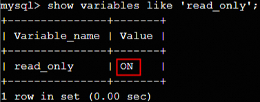

   </li>

   <li>

   Run the following SQL statement to set the read_only parameter to OFF.

   ```text
    set global read_only = 0; 
   ```

   </li>

   </ol>

3. Log on to the secondary database.

4. Run the following SQL statement to check the read/write status of the secondary database.

   <ol type="i">

   <li>

   When the result shows OFF, the secondary database is abnormal.

   ```text
    show variables like 'read_only'; 
   ```

   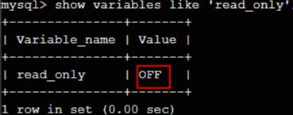

   </li>

   <li>

   Run the following SQL statement to set the read_only parameter to ON.

   ```text
    set global read_only = 1; 
   ```

   </li>

   </ol>

   3. **Implementation**

1. Log on to the Dukang database management platform.

2. Select **Instance Management** > **Instance List**, and click the instance that you want to operate.

3. Select **Backup Policy** > **Create Temporary Backup**. In the dialog box that appears, select **FULL** > **Primary Database Physical Backup** > **Click To View** > **OK**.

   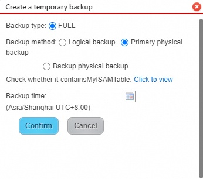

   > **Note**
   >
   > The database must not contain MyISAM tables.

4. Click **Backup And Recovery** and confirm that you can see the temporary backup of the primary database, which indicates that the backup is complete. (This can be completed within 18 hours)

   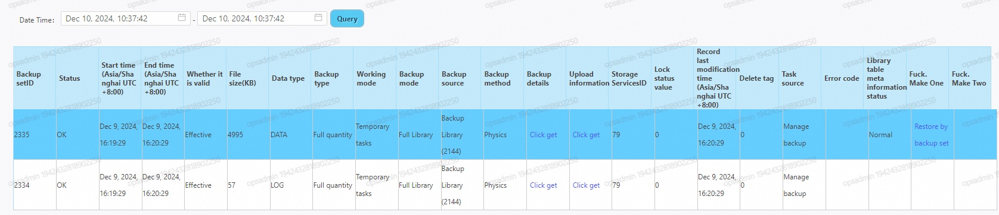

5. At the bottom of the **Basic Information** page, click **Rebuild [Secondary Database Rebuild|Node Rebuild]**. In the dialog box that appears, select **Force Primary Database Backup**, select the corresponding host, and select the rebuild method.

   > **Note**
   >
   > Local rebuild means rebuilding on the host where the original secondary database is located, and cross-machine rebuild means selecting a different host.

   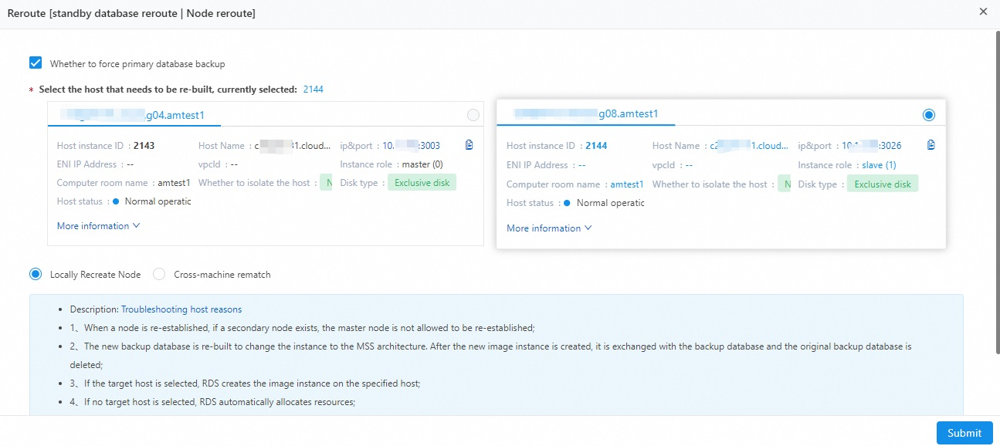

6. Click **Submit**.

7. Click **Task Management** and monitor the task progress until the task is complete.

   > **Note**
   >
   > If tasks fail, contact the product and R&D team for assistance.

8. Log on to the abnormal instance.

9. Run the following SQL statement and check the returned result.

   ```text
   show slave status\G
   ```

   The system displays a result similar to the following, indicating that the rebuild is successful.

   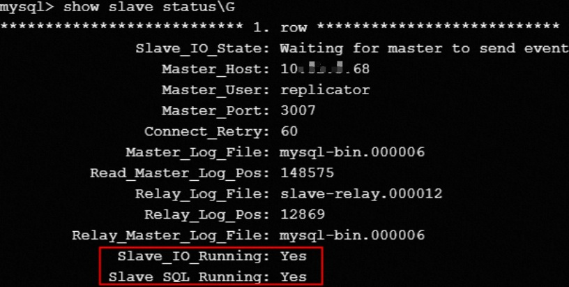

<a id="section-2-2-10-7"></a>

#### 2.2.10.7. Log on to an abnormal instance

This topic describes how to log on to an abnormal instance.

**Procedure**

1. Log on to the ApsaraDB Operations and Maintenance System console.

2. In the left-side navigation pane, choose **Instance management** > **Instance List**. Find the abnormal instance and click its name to go to the instance details page.

3. In the **Host instance information** section, view and record the hostname, IP address, and port number of the abnormal instance.

   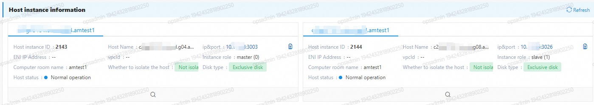

4. Log on to the Apsara Infrastructure Management console.

5. In the left-side navigation pane, choose Resources > Product & Cluster O&M. Find the cluster that you want to manage and click Cluster Details in the Actions column. On the Machines tab, enter the hostname in the Hostname/IP Address field and click **Terminal** in the search results to manage the abnormal node.

   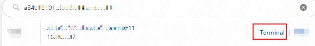

6. Run the following command to log on to the abnormal instance:

   ```bash
   sudo my ${port}
   ```

   > **Note**
   >
   > If you are the root user, you do not need to add  `sudo`  to the command.

   The following figure shows a sample output.

   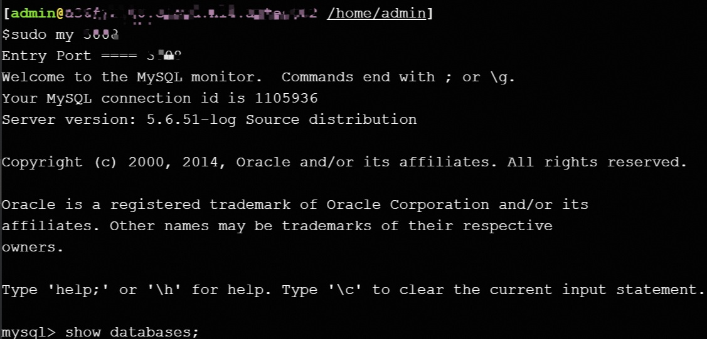

7. If  `mysql>`  is displayed, you have logged on to the abnormal instance.

<a id="section-3"></a>

# 3.Cloud service O&M operations

<a id="section-3-1"></a>

## 3.1. TianJi

<a id="section-3-1-1"></a>

### 3.1.1. Check the desired state

This topic describes how to check whether services are at desired state in the Apsara Infrastructure Management console and the expected results.

**Procedure**

1. Log on to the Apsara Uni-manager Operations Console.

2. In the top navigation bar, choose **Platform Operation > Apsara Infrastructure Management > Resources**.

3. In the left-side navigation pane of the **Apsara Infrastructure Management console**, choose **Resources > Product & Cluster O&M**.

4. On the **Product & Cluster O&M** page, check whether services in the primary and secondary data centers are at desired state.

   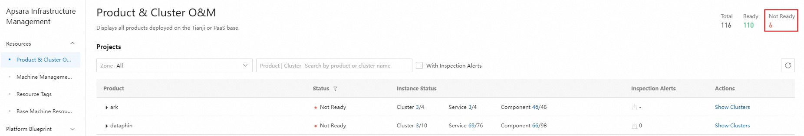

**Expected results**

The number of services that are not at desired state is zero.

> **Note**
>
> If the results are not as expected, troubleshoot the issue or submit a ticket to contact Alibaba Cloud technical support to fix the issue.

<a id="section-3-2"></a>

## 3.2. DNS

<a id="section-3-2-1"></a>

### 3.2.1. Check data consistency

This topic describes how to check the consistency of Apsara Stack DNS data and the expected results.

**Procedure**

1. Check the consistency of dnsslave data in the primary data center.

   <ol type="i">

   <li>

   Log on to the DnsSlave service container on Terminal Server 1 or Terminal Server 2 in the primary data center.

   <ol type="i" start="2">

   <li>

   Copy the script localIdc_slave_and_slave_compare.py to the  `/root/opsbuild/tools/dataConsistCheck/`  directory and run the following command to

   </li>

   </ol>

   check the data consistency between Terminal Server 1 and Terminal Server 2 in the primary data center:

   ```text
   python /root/opsbuild/tools/dataConsistCheck/localIdc_slave_and_slave_compare.py
   ```

   </li>

   </ol>

2. Check the data consistency between etcd and dnsslave in the primary data center.

   <ol type="i">

   <li>

   Log on to the ops.OpsDnsSlave# service container in the primary data center.

   <ol type="i" start="2">

   <li>

   Copy the script localIdc_etcd_and_slave_compare.py to the  `/root/opsbuild/tools/dataConsistCheck/`  directory and run the following command to

   </li>

   </ol>

   check the data consistency between etcd and dnsslave in the primary data center:

   ```text
   python /root/opsbuild/tools/dataConsistCheck/localIdc_etcd_and_slave_compare.py
   ```

   </li>

   </ol>

3. Check the data consistency between etcd clusters in the primary and secondary data centers.

   <ol type="i">

   <li>

   Log on to the ops.OpsDnsSlave# service container in the primary or secondary data center.

   <ol type="i" start="2">

   <li>

   Copy the script masterIdcEtcd_and_secondIdcEtcd_compare.py to the  `/root/opsbuild/tools/dataConsistCheck/`  directory and run the following command to

   </li>

   </ol>

   check the data consistency between etcd clusters in the primary and secondary data centers:

   ```text
   python 
   /root/opsbuild/tools/dataConsistCheck/masterIdcEtcd_and_secondIdcEtcd_compare.py
   ```

   </li>

   </ol>

4. Check the data consistency between etcd and dnsslave in the secondary data center.

   <ol type="i">

   <li>

   Log on to the ops.OpsDnsSlave# service container in the secondary data center.

   <ol type="i" start="2">

   <li>

   Copy the script localIdc_etcd_and_slave_compare.py to the  `/root/opsbuild/tools/dataConsistCheck/`  directory and run the following command to

   </li>

   </ol>

   check the data consistency between etcd and dnsslave in the secondary data center:

   ```text
   python /root/opsbuild/tools/dataConsistCheck/localIdc_etcd_and_slave_compare.py
   ```

   </li>

   </ol>

**Expected results**

1. The following figure shows a sample command output. The number of resource records (RRs) in the current zone queried from Terminal Server 1 is the same as that queried from Terminal Server 2.

   > **Note**
   >
   > - In the command output, rr stands for resource records.
   >
   > - If the number of RRs in the current zone queried from Terminal Server 1 is inconsistent with that queried from Terminal Server 2, the difference is highlighted in the format of rr:{'ops1':[],'ops2':[]}.
   >
   > - bcmc-minirds-check is the test domain name of Apsara Stack Resilience (ASR) for Zone-disaster Recovery. If the difference in bcmc-minirds-check is returned and highlighted in the command output, ignore it.

   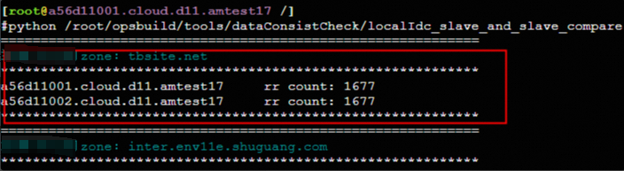

2. The following figure shows a sample command output. The number of RRs in the current zone queried from the etcd cluster, that queried from Terminal Server 1, and that queried from Terminal Server 2 are the same.

   > **Note**
   >
   > If the number of RRs queried from the etcd cluster is inconsistent with that queried from Terminal Server 1, the difference is highlighted in the format of rr:{'ops1':[],'etcd': []}.

   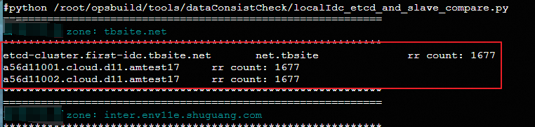

3. The following figure shows a sample command output. The number of RRs in the current zone queried from the etcd clusters is the same.

   > **Note**
   >
   > If the number of RRs queried from the etcd clusters is inconsistent, the difference is highlighted in the format of rr:{'FirstEtcd':[],'SecondEtcd':[]}.

   

4. The following figure shows a sample command output. The number of RRs in the current zone queried from the etcd cluster, that queried from Terminal Server 1, and that queried from Terminal Server 2 are the same.

   > **Note**
   >
   > If the number of RRs queried from the etcd cluster is inconsistent with that queried from Terminal Server 1, the difference is highlighted in the format of rr:{'ops1':[],'etcd': []}.

   

> **Note**
>
> If the results are not as expected, troubleshoot the issue or submit a ticket to contact Alibaba Cloud technical support to fix the issue.

<a id="section-3-2-2"></a>

### 3.2.2. Check the domain name resolution service

This topic describes how to check whether Apsara Stack DNS can resolve IP addresses and the expected results.

**Procedure**

Run the  `dig +short dnsapi1.tbsite.net`  command on Terminal Server 1 and Terminal Server 2 in the primary and secondary data centers to check whether an IP address can be resolved.


**Expected results**

The IP address is correctly resolved.

> **Note**
>
> If the results are not as expected, troubleshoot the issue or submit a ticket to contact Alibaba Cloud technical support to fix the issue.

<a id="section-3-3"></a>

## 3.3. MiniRDS

<a id="section-3-3-1"></a>

### 3.3.1. Check tasks

This topic describes how to check the status of MiniRDS tasks and the expected results.

**Procedure**

1. Log on to the Apsara Uni-manager Operations Console.

2. In the top navigation bar, choose **Platform Operation > Management and control service operation and maintenance > ApsaraDB Operations and Maintenance System (Lite)**.

3. In the left-side navigation pane, click **Task Management**. On the Task Management page, select **Interrupted tasks**, **Waiting tasks**, **Temporarily Closed tasks**, **Suspended tasks**, and **Running tasks** in turn from the drop-down list in the upper-left corner and view the task details.

   

**Expected results**

No task is displayed when you select **Interrupted tasks**, **Waiting tasks**, **Temporarily Closed tasks**, **Suspended tasks**, and **Running tasks**.

> **Note**
>
> If the results are not as expected, troubleshoot the issue or submit a ticket to contact Alibaba Cloud technical support to fix the issue.

<a id="section-3-3-2"></a>

### 3.3.2. Check the DR status of instances

This topic describes how to check the disaster recovery (DR) status of MiniRDS instances and the expected results.

**Procedure**

1. Log on to the Apsara Uni-manager Operations Console.

2. In the top navigation bar, choose **Platform Operation > Management and control service operation and maintenance > ApsaraDB Operations and Maintenance System (Lite)**.

3. In the left-side navigation pane, click **System Management**.

4. In the left-side pane of the **System Management** page, choose **Disaster Recovery Management** > **Disaster recovery switching**. In the instance list, check the instance status.

   

**Expected results**

- For every instance except dbaas_db, **OK** is displayed in the **Instance available** and **Switchable** columns, and the value in the **Maximum Latency from library** column is greater than or equal to 0 and less than 60.

- For every instance, **Read and write** is displayed in the **Master database information** column and **Read only** is displayed in the **From Library Information** column.

> **Note**
>
> If the results are not as expected, troubleshoot the issue or submit a ticket to contact Alibaba Cloud technical support to fix the issue.

<a id="section-3-3-3"></a>

### 3.3.3. Check the status of instances

This topic describes how to check the status of MiniRDS instances and the expected results.

**Procedure**

1. Log on to the Apsara Uni-manager Operations Console.

2. In the top navigation bar, choose **Platform Operation > Management and control service operation and maintenance > ApsaraDB Operations and Maintenance System (Lite)**.

3. In the left-side navigation pane, choose **Instance management** > **Instance List**. In the instance list, sort instances by the **CPU**, **QPS**, **Connections**, and **Disk Usage** columns in turn to view instance information.

   

**Expected results**

The values in the **CPU**, **QPS**, **Connections**, and **Disk Usage** columns of all instances are less than or equal to 50%.

> **Note**
>
> If the results are not as expected, we recommend that you perform scale-outs based on your business requirements. You can also submit a ticket to contact Alibaba Cloud technical support.

<a id="section-3-4"></a>

## 3.4. ApsaraDB RDS

<a id="section-3-4-1"></a>

### 3.4.1. Check tasks

This topic describes how to check the status of ApsaraDB RDS tasks and the expected results.

**Procedure**

1. Log on to the Apsara Uni-manager Operations Console.

2. In the top navigation bar, choose **Product Operation > Databases > ApsaraDB Operations and Maintenance System**.

3. In the left-side navigation pane, click **Task Management**. On the Task Management page, select **Interrupted tasks**, **Waiting tasks**, **Temporarily Closed tasks**, **Suspended tasks**, and **Running tasks** in turn from the drop-down list in the upper-left corner and view the task details.

   

**Expected results**

No task is displayed when you select **Interrupted tasks**, **Waiting tasks**, **Temporarily Closed tasks**, **Suspended tasks**, and **Running tasks**.

> **Note**
>
> If the results are not as expected, troubleshoot the issue or submit a ticket to contact Alibaba Cloud technical support to fix the issue.

<a id="section-3-4-2"></a>

### 3.4.2. Check the DR status of instances

This topic describes how to check the disaster recovery (DR) status of ApsaraDB RDS instances and the expected results.

**Procedure**

1. Log on to the Apsara Uni-manager Operations Console.

2. In the top navigation bar, choose **Product Operation > Databases > ApsaraDB Operations and Maintenance System**.

3. In the left-side navigation pane, click **System Management**.

4. In the left-side pane of the **System Management** page, choose **Disaster Recovery Management** > **Disaster recovery switching**. In the instance list, check the instance status.

   

**Expected results**

For every instance, **OK** is displayed in the **Instance available** and **Switchable** columns, and the value in the **Maximum Latency from library** column is greater than or equal to 0 and less than 60.

> **Note**
>
> If the results are not as expected, troubleshoot the issue or submit a ticket to contact Alibaba Cloud technical support to fix the issue.

<a id="section-3-4-3"></a>

### 3.4.3. Check the status of instances

This topic describes how to check the status of ApsaraDB RDS instances and the expected results.

**Procedure**

1. Log on to the Apsara Uni-manager Operations Console.

2. In the top navigation bar, choose **Product Operation > Databases > ApsaraDB Operations and Maintenance System**.

3. In the left-side navigation pane, choose **Instance management** > **Instance List**. In the instance list, sort instances by the **CPU**, **QPS**, **Connections**, and **Disk Usage** columns in turn to view instance information.

   

**Expected results**

The values in the **CPU**, **QPS**, **Connections**, and **Disk Usage** columns of all instances are less than or equal to 50%.

> **Note**
>
> If the results are not as expected, we recommend that you perform scale-outs based on your business requirements. You can also submit a ticket to contact Alibaba Cloud technical support.

<a id="section-3-5"></a>

## 3.5. SLB

<a id="section-3-5-1"></a>

### 3.5.1. Check the status of LVSs

This topic describes how to check the status of Linux virtual servers (LVSs) and the expected results.

**Procedure**

1. Log on to the slb-controller.SlbAg# container.

2. Run the following command on the CLI:

   ```text
   list admin lb_node
   ```

   

**Expected results**

All values in the **configuration** column are **Enabled**, and all values in the **online_status** column are **online**.

> **Note**
>
> If the results are not as expected, troubleshoot the issue or submit a ticket to contact Alibaba Cloud technical support to fix the issue.

<a id="section-3-5-2"></a>

### 3.5.2. Check the status of proxies

This topic describes how to check the status of proxies and the expected results.

**Procedure**

1. Log on to the slb-controller.SlbAg# container.

2. Run the following command on the CLI:

   ```text
   list admin proxy
   ```

   

**Expected results**

All values in the **configuration** column are **Enabled**, and all values in the **online_status** column are **online**.

> **Note**
>
> If the results are not as expected, troubleshoot the issue or submit a ticket to contact Alibaba Cloud technical support to fix the issue.

<a id="section-3-5-3"></a>

### 3.5.3. Check the status of keyservers

This topic describes how to check the status of keyservers and the expected results.

**Procedure**

1. Log on to the slb-controller.SlbAg# container.

2. Run the following command on the CLI:

   ```text
   list admin keyserver
   ```

   

**Expected results**

All values in the **status** column are **online**.

> **Note**
>
> If the results are not as expected, troubleshoot the issue or submit a ticket to contact Alibaba Cloud technical support to fix the issue.

<a id="section-3-6"></a>

## 3.6. OSS

<a id="section-3-6-1"></a>

### 3.6.1. Check bucket locations

This topic describes how to check whether all buckets are in the location of the primary data center and the expected results.

**Procedure**

1. Log on to the oss_meta database.

2. Execute the  `select cluster,location from location_table;`  statement to query the clusters in the location of the primary data center.

   

3. Execute the  `select name,location from oss_meta_bucket where location <>"{Primary data center location}";`  statement to query the buckets that are not in the location of the primary data center.

   

**Expected results**

No result is found.

> **Note**
>
> - If no result is found, all buckets are in the location of the primary data center.
>
> - If the results are not as expected, troubleshoot the issue or submit a ticket to contact Alibaba Cloud technical support to fix the issue.

<a id="section-3-7"></a>

## 3.7. ECS

<a id="section-3-7-1"></a>

### 3.7.1. Check the status of NCs

This topic describes how to check the status of node controllers (NCs) and the expected results.

**Procedure**

1. Log on to the houyi-reg database of Elastic Compute Service (ECS).

2. Execute the  `select id,ip,status,hostname,biz_status from nc;`  statement to query the status of all NCs.

   

**Expected results**

All values in the biz_status column are free.

> **Note**
>
> If the results are not as expected, troubleshoot the issue or submit a ticket to contact Alibaba Cloud technical support to fix the issue.

<a id="section-3-8"></a>

## 3.8. ASO

<a id="section-3-8-1"></a>

### 3.8.1. Check the traffic

This topic describes how to check the status and traffic of network device ports, and the expected results.

**Procedure**

1. Log on to the Apsara Uni-manager Operations Console.

2. In the top navigation bar, choose **Product Operation > Networking > Network Operations Console**.

3. In the left-side navigation pane, choose **Basic Network** > **Network Element Management**.

4. In the device list, click the name of the inter-connection switch (ISW) or micro switch (MSW) that you want to manage.

   

5. View the management and operation status of ports.

   

6. Click a port name to view the port traffic.

   

**Expected results**

The management and operation status of all ports are **Up** and traffic is normal.

> **Note**
>
> If the results are not as expected, troubleshoot the issue or submit a ticket to contact Alibaba Cloud technical support to fix the issue.

<a id="section-3-8-2"></a>

### 3.8.2. Check alerts

This topic describes how to view alerts in the Apsara Uni-manager Operations Console and the expected results.

**Procedure**

1. Log on to the Apsara Uni-manager Operations Console.

2. In the top navigation bar, choose **Monitor&Alarms > Alarm Management > Alarm Overview**.

3. View the alert details.

**Expected results**

No alert is displayed.

> **Note**
>
> If the results are not as expected, troubleshoot the issue or submit a ticket to contact Alibaba Cloud technical support to fix the issue.

<a id="section-4"></a>

# 4.FAQ

<a id="section-4-1"></a>

## 4.1. What do I do if VIPs in the secondary data center are abnormal?

This topic describes how to view the IP addresses recorded in the primary and secondary data centers and how to handle exceptions.

**Problem description**

The virtual IP addresses (VIPs) in the secondary data center are abnormal. Some nodes can be reached by PING messages, whereas others cannot be reached by PING messages and related VIPs cannot be found during service O&M.

**Cause**

- The number of IP addresses displayed in the value of the nc_list parameter on the Resource Dashboard page of the Apsara Infrastructure Management console is greater than the number of real server IP addresses displayed in the Apsara Stack Resilience (ASR) for Zone-disaster Recovery console.

- The number of IP addresses displayed in the value of the nc_list parameter on the Resource Dashboard page of the Apsara Infrastructure Management console is less than the number of real server IP addresses displayed in the ASR for Zone-disaster Recovery console.

- The number of IP addresses displayed in the value of the nc_list parameter on the Resource Dashboard page of the Apsara Infrastructure Management console is the same as the number of real server IP addresses displayed in the ASR for Zone-disaster Recovery console. The comparison result is abnormal.

**Solution**

1. View the IP addresses in the ASR for Zone-disaster Recovery console.

   <ol type="i">

   <li>

   Log on to the Apsara Uni-manager Operations Console.

   </li>

   <li>

   In the top navigation bar, choose **Platform Operation > Disaster recovery**

   </li>

   </ol>

   **management > ASR for Zone-disaster Recovery (Secondary Zone)**.

   <ol type="i" start="3">

   <li>

   In the left-side navigation pane, choose **Platform Check > Environment Check**.

   </li>

   <li>

   In the **VIP Resources** section, find the resource named **remotemock** and move the pointer over the value in the **RealServer IP** column.

   </li>

   </ol>

2. View and record the IP addresses on the Resource Dashboard page.

   <ol type="i">

   <li>

   In the top navigation bar, choose **Platform Operation > Apsara Infrastructure Management > Resources**.

   </li>

   <li>

   In the left-side navigation pane, choose **O&M Tools > Resource Dashboard**.

   </li>

   <li>

   On the **Resource Dashboard** page, select **Cluster** from the drop-down list, enter ECS in

   </li>

   </ol>

   the search box, and then click the  icon.

   <ol type="i" start="4">

   <li>

   Find the service to which the remotemock resource belongs and whose type is vip in the Name column, and click the eye icon in the Result column. Click the value that appears to view the IP addresses in the value of the nc_list parameter.

   

   - If the number of IP addresses displayed in the value of the nc_list parameter in the Apsara Infrastructure Management console is greater than the number of IP addresses that ASR for Zone-disaster Recovery queries from Server Load Balancer (SLB), check whether the excess IP addresses belong to the service in the Apsara Infrastructure Management console. If so, add the excess IP addresses to SLB.

   - If the number of IP addresses displayed in the value of the nc_list parameter in the Apsara Infrastructure Management console is less than the number of IP addresses that ASR for Zone-disaster Recovery queries from SLB, check whether the missing IP addresses belong to the service in the Apsara Infrastructure Management console. If so, an error has occurred in resource application. Contact the team of Apsara Infrastructure Management to troubleshoot the issue.

   - If the number of IP addresses displayed in the value of the nc_list parameter in the Apsara Infrastructure Management console is the same as the number of IP addresses that ASR for Zone-disaster Recovery queries from SLB, contact the team of the service in which the exception occurs to troubleshoot the issue.

   </li>

   </ol>

3. Add real servers.

   > **Warning**
   >
   > Before you add or remove real servers, you must confirm the operation with the team of the service or the customer to which the VIPs belong. If the operation is confirmed and approved, the operation generally does not impact business. However, if the operation is not expected but performed, the business may be interrupted. After the operation is confirmed and approved, contact the SLB team to help add or remove real servers.

**Verify the results**

1. Log on to the Apsara Uni-manager Operations Console.

2. 

3. In the left-side navigation pane, choose **Platform Check > Environment Check**.

4. In the **VIP Resources** section, check whether the value in the **Comparison Result** column is Normal.

   - If the comparison result is normal, the issue is resolved.

   - If the comparison result is abnormal, contact the team of the service in which the exception occurs to troubleshoot the issue.

<a id="section-5"></a>

# 5.Appendixes

<a id="section-5-1"></a>

## 5.1. View ASR logs

This topic describes the directories in which the logs of Apsara Stack Resilience (ASR) for Zone-disaster Recovery are stored and how to view the logs.

**Procedure**

1. Log on to the bcmc.Bcmc# container.

2. Obtain the directory of the log file that you want to view from the following table.

   | Log file | Description |
   | --- | --- |
   | /home/admin/bcmc/logs/error.log | Stores bcmc error logs. |
   | /home/admin/bcmc/logs/info.log | Stores bcmc run logs. |
   | /home/admin/bcmc/logs/scripts/script.log | Stores the run logs of bcmc scripts. |
   | /home/admin/bcmc/scripts/{Service name}/logs/{Service name}_synccheck.log | Stores the script inspection logs of a service. |
   | /home/admin/bcmc/scripts/{Service name}/logs/{Service name}_switch.log | Stores the switchover logs of a service. |

   > **Note**
   >
   > A log file whose name does not contain a date stores the logs generated for the current day.

3. View logs. In this example, bcmc error logs are viewed.

   <ol type="i">

   <li>

   Run the  `cd /home/admin/bcmc/logs/`  command to go to the directory in which the logs are stored.

   </li>

   <li>

   Run the  `ll`  command to query all files in the directory.

   </li>

   </ol>

   

   <ol type="i" start="3">

   <li>

   Run the  `vim error.log`  command to query the error log details.

   </li>

   </ol>

   

   <ol type="i" start="4">

   <li>

   Run the  `/2022-12-15 00:04:03`  command to query the log details at the specified time.

   

   > **Note**
   >
   > Replace the time based on your business requirements.

   </li>

   <li>

   Run the  `:q`  command to exit the log details page.

   

   </li>

   </ol>

<a id="section-5-2"></a>

## 5.2. Log on to a container

This topic describes how to log on to a container. The Bcmc# container of bcmc is used in this example.

**Procedure**

1. Log on to the terminal.

   <ol type="i">

   <li>

   Log on to the Apsara Uni-manager Operations Console.

   </li>

   <li>

   In the top navigation bar, choose **Platform Operation > Apsara Infrastructure**

   </li>

   </ol>

   **Management > Resources**.

   <ol type="i" start="3">

   <li>

   In the left-side navigation pane of the **Apsara Infrastructure Management console**,

   </li>

   </ol>

   choose **Resources > Product & Cluster O&M**.

   <ol type="i" start="4">

   <li>

   On the **Product & Cluster O&M** page, enter bcmc in the search box.

   </li>

   <li>

   Find the cluster that you want to manage and click **Cluster Details** in the **Actions** column.

   

   </li>

   <li>

   On the Services tab, find the **bcmc** service and click its name.

   

   </li>

   <li>

   In the Components pane, click **Bcmc#**. On the **Instances** tab, click **Terminal** in the

   </li>

   </ol>

   **Actions** column of an instance.

   

2. Run the following command to query the ID of the container:

   ```bash
   docker ps
   ```

   

3. Run the following command to access the container:

   ```bash
   docker exec -it <Container ID> /bin/bash.
   ```

   

<a id="section-5-3"></a>

## 5.3. Log on to the tianji-sshtunnel database

This topic describes how to log on to the tianji-sshtunnel database.

1. Log on to the Apsara Uni-manager Operations Console.

2. In the top navigation bar, choose **Platform Operation > Apsara Infrastructure Management > Resources**.

3. In the left-side navigation pane of the **Apsara Infrastructure Management console**, choose **Resources > Product & Cluster O&M**.

4. On the Product & Cluster O&M page, enter tianji in the Product | Cluster field. Find the primary cluster and click **Cluster Details** in the **Actions** column.

5. On the Services tab, find the **tianji-sshtunnel** service and click its name.

6. In the Components pane, click **SSHTunnelMaster#**.

7. On the **Resources** tab, find the resource whose name is **sshtunnel** and type is **db** and view the values of the db_host, user, db_password, db_port, and db_name parameters in the **Resource Application Result** column.

8. On the **Instances** tab, find an instance and click **Terminal** in the **Actions** column.

9. Run the following command to log on to the tianji-sshtunnel database. For more information about the values of the db_host, user, db_password, db_port, and db_name parameters, see Step 7.

   ```text
   mysql -h${db_host} -u${user} -p${db_password} -P${db_port} -D${db_name}
   ```

<a id="section-5-4"></a>

## 5.4. Log on to the oss_meta database

This topic describes how to log on to the oss_meta database.

1.LogontotheApsaraUni-managerOperationsConsole.

1. Log on to the Apsara Unimanager Operations Console.

2. In the top navigation bar, choose **Platform Operation > Apsara Infrastructure Management > Resources**.

3. In the left-side navigation pane of the **Apsara Infrastructure Management console**, choose **Resources > Product & Cluster O&M**.

4. On the Product & Cluster O&M page, enter oss in the search box. In the search results, find the primary cluster and click **Cluster Details** in the **Actions** column.

5. On the Services tab, find the **oss-ocm-server** service and click its name.

6. In the Components pane, click **DBInit#**.

7. On the **Resources** tab, find the resource whose name is **oss_meta** and type is **db**, and view the values of the db_host, user, db_password, db_port, and db_name parameters in the **Resource Application Result** column.

   

8. On the **Instances** tab, click **Terminal** in the **Actions** column of an instance.

9. Run the following command to log on to the oss_meta database. For more information about the values of the db_host, user, db_password, db_port, and db_name parameters, see Step 7.

   ```text
   mysql -h${db_host} -u${user} -p${db_password} -P${db_port} -D${db_name}
   ```

<a id="section-5-5"></a>

## 5.5. Log on to the houyi-reg database

This topic describes how to log on to the houyi-reg database of Elastic Compute Service (ECS).

1. Log on to the Apsara Uni-manager Operations Console.

2. In the top navigation bar, choose **Platform Operation > Apsara Infrastructure Management > Resources**.

3. In the left-side navigation pane of the **Apsara Infrastructure Management console**, choose **Resources > Product & Cluster O&M**.

4. On the Product & Cluster O&M page, enter ecs in the Product | Cluster field. Find the ECS-controller-A cluster and click **Cluster Details** in the **Actions** column.

5. On the Services tab, find the **ecs-houyi** service and click its name.

6. In the Components pane, click **Regionmaster#**.

7. On the **Resources** tab, find the resource whose name is **houyi_reg** and type is **db** and view the values of the db_host, user, db_password, db_port, and db_name parameters in the **Resource Application Result** column.

8. On the **Instances** tab, find an instance and click **Terminal** in the **Actions** column.

9. Run the following command to log on to the houyi_reg database. For more information about the values of the db_host, user, db_password, db_port, and db_name parameters, see Step 7.

   ```text
   mysql -h${db_host} -u${user} -p${db_password} -P${db_port} -D${db_name}
   ```

<a id="section-5-6"></a>

## 5.6. Resolve configuration inconsistency between the primary and secondary tables

This topic describes how to resolve configuration inconsistency between the primary and secondary tables, such as the inconsistency in the MaxVersions, time to live (TTL), and Stream configurations.

**Background information**

- **Inconsistency in the MaxVersions or TTL configuration**

  This inconsistency is generally caused because you modify the MaxVersions or TTL configuration after you create a table and during business operation.

  - If the MaxVersions or TTL configured for the primary cluster is smaller than that configured for the secondary cluster, more data is stored in the secondary cluster. A TTL value of -1 specifies that data never expires. In this case, you can directly modify the MaxVersions or TTL configuration of the secondary cluster.

  - If the MaxVersions or TTL configured for the primary cluster is greater than that configured for the secondary cluster, incomplete data is stored in the secondary cluster. A TTL value of -1 specifies that data never expires. In this case, you must decide whether to perform full synchronization or directly modify the MaxVersions or TTL configuration of the secondary cluster.

- **Inconsistency in the Stream configuration**

  This inconsistency is generally caused because the Stream feature is enabled for the primary cluster for incremental export tasks and disabled for the secondary cluster. In this case, you can directly enable the Stream feature for the secondary cluster.

**Prerequisites**

The following operations are complete:

1. Log on to the TableStore.PortalAgServer# terminal server of the ots cluster.

2. Decompress the new_ots_replication_tool.tar.gz package as the admin user.

**Procedure**

1. Go to the  `new_ots_replication_tool`  directory.

2. Run the following command to modify the configurations of the secondary cluster:

   > **Note**
   >
   > You must specify an instance name and a table name in the command. You can modify the configurations of one table each time. Only the configurations of the secondary cluster are modified. The configurations of the primary cluster are not affected.

   ```text
   ./rep_checker.py sync_table_meta_for_secondary Instance name Table name
   ```

   Sample output:

   ```text
   $./rep_checker.py sync_table_meta_for_secondary lt-ots-test00 test001
   secondary cluster: ots-ssd-B-20210813-00a6, table: _tBTC6DyGWKYBrHKstl#test001, set T
   TL to 86400000
   OK!
   ```
