Alibaba Cloud  
Apsara Stack  
apsara stack resilience  
ASR for Zone-  
disaster Recovery User Guide  
Product Version: v3.18.6-2607  
Document Version: 20260901

**Table of Contents**

- [1.ASR introduction](#section-1)
    - [1.1. What is Apsara Stack Resilience for Zone-disaster Recovery?](#section-1-1)
    - [1.2. ASR deployment architecture](#section-1-2)
    - [1.3. Roles and features](#section-1-3)
- [2.Log in to the ASR console](#section-2)
- [3.Normal views](#section-3)
    - [3.1. Overview](#section-3-1)
    - [3.2. Platform monitoring](#section-3-2)
        - [3.2.1. Usage scenarios](#section-3-2-1)
        - [3.2.2. Service monitoring](#section-3-2-2)
        - [3.2.3. Synchronization monitoring](#section-3-2-3)
    - [3.3. Disaster recovery drills](#section-3-3)
        - [3.3.1. Usage notes](#section-3-3-1)
        - [3.3.2. Drill plans](#section-3-3-2)
            - [3.3.2.1. Perform default drills](#section-3-3-2-1)
            - [3.3.2.2. Manage custom drill plans](#section-3-3-2-2)
        - [3.3.3. View drill records](#section-3-3-3)
        - [3.3.4. View a drill dashboard](#section-3-3-4)
    - [3.4. Disaster recovery](#section-3-4)
        - [3.4.1. Disaster recovery](#section-3-4-1)
            - [3.4.1.1. Power outage recovery in the primary data center](#section-3-4-1-1)
                - [3.4.1.1.1. Failover for power outages of the primary data center](#section-3-4-1-1-1)
                - [3.4.1.1.2. Failback for power outages of the primary data center](#section-3-4-1-1-2)
            - [3.4.1.2. Network outage recovery in the primary data center](#section-3-4-1-2)
                - [3.4.1.2.1. Failover for network outages of the primary data center](#section-3-4-1-2-1)
                - [3.4.1.2.2. Failback for network outages of the primary data center](#section-3-4-1-2-2)
            - [3.4.1.3. Recovery from power outages or split-brain scenarios of the secondary data center](#section-3-4-1-3)
                - [3.4.1.3.1. Switchover for spit-brain in data centers (two data centers)](#section-3-4-1-3-1)
                - [3.4.1.3.2. Switchback for spit-brain in data centers (two data centers)](#section-3-4-1-3-2)
        - [3.4.2. Fault simulation](#section-3-4-2)
            - [3.4.2.1. Fault simulation for two data centers-based zone disaster recovery](#section-3-4-2-1)
                - [3.4.2.1.1. Preparations](#section-3-4-2-1-1)
                - [3.4.2.1.2. Apply for an authentication code](#section-3-4-2-1-2)
                - [3.4.2.1.3. Check an environment](#section-3-4-2-1-3)
                - [3.4.2.1.4. Inject a power outage](#section-3-4-2-1-4)
                    - [3.4.2.1.4.1. Inject a power outage](#section-3-4-2-1-4-1)
                    - [3.4.2.1.4.2. Recover a data center after the switchover for power outages](#section-3-4-2-1-4-2)
                - [3.4.2.1.5. Network outage of data centers](#section-3-4-2-1-5)
                    - [3.4.2.1.5.1. Inject a network outage](#section-3-4-2-1-5-1)
                    - [3.4.2.1.5.2. Recover a data center after the switchover for network outages](#section-3-4-2-1-5-2)
                - [3.4.2.1.6. Split-brain scenario](#section-3-4-2-1-6)
                    - [3.4.2.1.6.1. Inject a split-brain scenario](#section-3-4-2-1-6-1)
                    - [3.4.2.1.6.2. Recover an environment after the switchover for split-brain scenarios](#section-3-4-2-1-6-2)
                - [3.4.2.1.7. Single-service failback](#section-3-4-2-1-7)
                    - [3.4.2.1.7.1. Inject a single-service outage](#section-3-4-2-1-7-1)
                    - [3.4.2.1.7.2. Recover a data center after switchover for single-service faults](#section-3-4-2-1-7-2)
            - [3.4.2.2. Fault simulation for three data centers-based zone disaster recovery](#section-3-4-2-2)
                - [3.4.2.2.1. Preparations](#section-3-4-2-2-1)
                - [3.4.2.2.2. Apply for an authentication code](#section-3-4-2-2-2)
                - [3.4.2.2.3. Check the environment](#section-3-4-2-2-3)
                - [3.4.2.2.4. Inject a power outage](#section-3-4-2-2-4)
                    - [3.4.2.2.4.1. Inject a power outage](#section-3-4-2-2-4-1)
                    - [3.4.2.2.4.2. Recover a data center after the switchover for power outages](#section-3-4-2-2-4-2)
                - [3.4.2.2.5. Network outage of data centers](#section-3-4-2-2-5)
                    - [3.4.2.2.5.1. Inject a network outage](#section-3-4-2-2-5-1)
                    - [3.4.2.2.5.2. Recover a data center after the switchover for network outages](#section-3-4-2-2-5-2)
                - [3.4.2.2.6. SPOFs](#section-3-4-2-2-6)
                    - [3.4.2.2.6.1. Inject a single-connection fault](#section-3-4-2-2-6-1)
                    - [3.4.2.2.6.2. Recover an environment after the switchover for single-connection faults](#section-3-4-2-2-6-2)
                - [3.4.2.2.7. Single-product failure](#section-3-4-2-2-7)
                    - [3.4.2.2.7.1. Inject a single-product failure](#section-3-4-2-2-7-1)
                    - [3.4.2.2.7.2. Recover a data center after switchover for single-service faults](#section-3-4-2-2-7-2)
        - [3.4.3. Disaster recovery records](#section-3-4-3)
- [4.O&M views](#section-4)
    - [4.1. Monitoring center](#section-4-1)
        - [4.1.1. Check an environment](#section-4-1-1)
        - [4.1.2. Check services](#section-4-1-2)
    - [4.2. Product O&M](#section-4-2)
        - [4.2.1. Database O&M](#section-4-2-1)
            - [4.2.1.1. Zone alignment](#section-4-2-1-1)
    - [4.3. Configuration center](#section-4-3)
        - [4.3.1. Manage DCI leased lines](#section-4-3-1)
        - [4.3.2. Manage arbitration](#section-4-3-2)
            - [4.3.2.1. Arbitration configuration](#section-4-3-2-1)
            - [4.3.2.2. Node management](#section-4-3-2-2)
                - [4.3.2.2.1. Manage nodes](#section-4-3-2-2-1)
                - [4.3.2.2.2. Rotate a certificate](#section-4-3-2-2-2)
        - [4.3.3. Alert management](#section-4-3-3)
            - [4.3.3.1. Modify an alert rule](#section-4-3-3-1)
        - [4.3.4. Configure theme settings](#section-4-3-4)
    - [4.4. Security center](#section-4-4)
        - [4.4.1. Data backup](#section-4-4-1)
        - [4.4.2. Configure escape login](#section-4-4-2)
- [5.Tenant operations](#section-5)
    - [5.1. Protection group overview](#section-5-1)
    - [5.2. Protection group process](#section-5-2)
        - [5.2.1. Process overview](#section-5-2-1)
        - [5.2.2. Create a protection group](#section-5-2-2)
        - [5.2.3. Protection group drills](#section-5-2-3)
            - [5.2.3.1. Create a drill plan](#section-5-2-3-1)
            - [5.2.3.2. Perform a drill](#section-5-2-3-2)
        - [5.2.4. Disaster recovery](#section-5-2-4)
            - [5.2.4.1. Create a disaster recovery plan](#section-5-2-4-1)
            - [5.2.4.2. Perform a disaster recovery](#section-5-2-4-2)
- [6.Appendix](#section-6)
    - [6.1. Encryption and backup](#section-6-1)
    - [6.2. How to obtain the endpoint of ASR for Zone-disaster Recover](#section-6-2)
    - [6.3. License authorization management](#section-6-3)

# 1.ASR introduction

## 1.1. What is Apsara Stack Resilience for Zone-disaster Recovery?

Apsara Stack Resilience (ASR) for Zone-disaster Recovery consists of a primary site and a secondary site. The primary and secondary sites are deployed in the same region but in different zones. This deployment method is used to combat local disasters with a small impact. ASR for Zone-disaster Recovery is adopted on all core cloud products such as networking, cloud computing, database, storage, middleware, and big data products. This can be used in cross-AZ deployment for high availability. When a disaster occurs, your business can be quickly failed over to a secondary AZ. The service domain names of the cloud products remain unchanged.

ASR for Zone-disaster Recovery can be deployed in two or three data centers in the same region.

## 1.2. ASR deployment architecture

This topic describes the deployment architecture of Apsara Stack Resilience (ASR).

ASR does not rely on other Apsara Stack services. When a data center fails, ASR can still provide services to ensure business continuity. An ASR system is deployed in each of the primary and secondary data centers to handle data center-level failures in different scenarios. The following figure shows the deployment architecture:

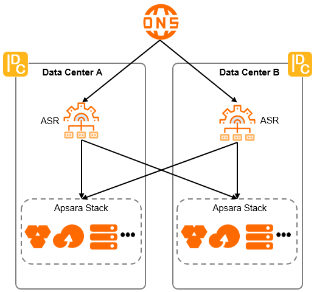

1. ASR in the primary data center implements failovers when the secondary data center encounters power and network outages or when split-brain issues occur in two data centers-based zone disaster recovery scenarios.

2. ASR in the secondary data center implements failovers when the primary data center encounters power and network outages.

## 1.3. Roles and features

This topic describes the Apsara Stack Resilience (ASR) for Zone-disaster Recovery features that the primary and secondary data centers support and the roles used to implement these features.

**Feature description**

The following table describes the ASR for Zone-disaster Recovery features that the primary and secondary data centers support and the roles used to implement these features.

> **Note**
>
> - To use the permissions granted to a user role, you must log in to the Apsara Uni-manager Operations Console as the user role. For more information, see the User Guide of the Apsara Uni-manager Operations Console.
>
> - For information about how to use the normal views and O&M views, see Log in to the ASR console.
>
> - If a login user is assigned multiple roles, the menu items displayed in the console are the union of all permissions granted to those roles.

<table>
  <tr>
    <th>View type</th>
    <th>Feature type</th>
    <th>Menu item</th>
    <th>Featur e</th>
    <th>Primary data center</th>
    <th>Seco ndar y data cent er</th>
    <th>Role permission</th>
  </tr>
  <tr>
    <td rowspan="3"></td>
    <td>Overview</td>
    <td>Overview</td>
    <td>-</td>
    <td>Supported</td>
    <td>Supp orted</td>
    <td>• Disaster recovery monitoring • Disaster recovery drill • Permissions of a disaster recovery system administrator</td>
  </tr>
  <tr>
    <td rowspan="2">Platform monitoring</td>
    <td>Platform Monitorin g &gt; Product Monitorin g</td>
    <td>Service monitori ng</td>
    <td>Supported</td>
    <td>Supp orted</td>
    <td rowspan="2">• Disaster recovery monitoring • Disaster recovery drill</td>
  </tr>
  <tr>
    <td colspan="4"></td>
  </tr>
  <tr>
    <td rowspan="7"></td>
    <td rowspan="2"></td>
    <td colspan="4"></td>
    <td rowspan="2">• Permissions of a disaster recovery system administrator</td>
  </tr>
  <tr>
    <td>Platform Monitorin g &gt; Synchron ous Monitorin g</td>
    <td>Synchro nization monitori ng</td>
    <td>Not supported</td>
    <td>Supp orted</td>
  </tr>
  <tr>
    <td rowspan="5"></td>
    <td>Disaster Recovery &gt; Fault Simulatio n &gt; Authentic ation Code Applicatio n</td>
    <td>Authent ication code applicat ion</td>
    <td>Supported</td>
    <td>Supp orted</td>
    <td rowspan="5"></td>
  </tr>
  <tr>
    <td>Disaster Recovery &gt; Fault Simulatio n &gt; Environm ent Check</td>
    <td>Environ ment check</td>
    <td>Supported</td>
    <td>Supp orted</td>
  </tr>
  <tr>
    <td rowspan="3"></td>
    <td>Injectio n of power outages into the primary data center</td>
    <td>Not supported</td>
    <td>Supp orted</td>
  </tr>
  <tr>
    <td>Injectio n of power outages into the seconda ry data center</td>
    <td>Supported</td>
    <td>Not supp orted</td>
  </tr>
  <tr>
    <td colspan="3"></td>
  </tr>
  <tr>
    <td rowspan="6">Norm al views</td>
    <td rowspan="6">Fault simulation  Note This menu item is display ed only in escape login mode and is not display ed if you use ASR in the Apsara Uni-manag er Operati ons Consol e.</td>
    <td rowspan="6">Disaster Recovery &gt; Fault Simulatio n &gt; Injection Starting</td>
    <td colspan="3"></td>
    <td rowspan="6">• Disaster recovery drill • Permissions of a disaster recovery system administrator</td>
  </tr>
  <tr>
    <td>Injectio n of network outages into the primary data center</td>
    <td>Supported</td>
    <td>Not supp orted</td>
  </tr>
  <tr>
    <td>Injectio n of network outages into the seconda ry data center</td>
    <td>Supported</td>
    <td>Not supp orted</td>
  </tr>
  <tr>
    <td>Injectio n of split-brain scenario s (availab le only in zone-disaster recover y based on two data centers)</td>
    <td>Supported</td>
    <td>Not supp orted</td>
  </tr>
  <tr>
    <td>Injectio n of single-service faults</td>
    <td>Supported</td>
    <td>Supp orted</td>
  </tr>
  <tr>
    <td colspan="3"></td>
  </tr>
</table>

Injectio n of single-connect ion faults (availab

Supp

le only

Supported

orted

in zone-disaster recover y based on three data centers)

**Disaster Recovery**

Data

**> Fault**

center

Supp

**Simulatio**

Supported

recover

orted

**n > Data**

y

**Center Recovery**

- **Disaster Recover y Drill > Drill Plan**

- **Disaster**

  Service

  - Disaster recovery drill

  **Recover**

Disaster

switcho

**y Drill >**

Supp

- Permissions of a

recovery

ver or

Supported

**Drill**

orted

disaster recovery

drill

switchb

**History**

system administrator

ack

- **Disaster Recover y Drill > Drill Dashbo ard**

- **Disaster**

  Supp

  Supported

  **Recover**

  orted

  **y > Platfor m**

  Supp

  Supported

  **Switcho**

  - Switc

    orted

  **ver**

  hover

- **Disaster**

  - Switc

    - Disaster recovery drill

  **Recover**

  hback

  Supp

  Supported

Disaster

**y >**

orted

- Permissions of a

- Reco

recovery

**Platfor**

disaster recovery

very

**m**

system administrator

recor

**Switchb**

Supp

ds

**ack**

Supported

orted

- **Disaster Recover y > Recover**

  Supp

  Supported

  **y**

  orted

  **Records**

**Monitorin g Center**

Environ

Supp

**>**

ment

Supported

- Disaster recovery

orted

**Environm**

check

monitoring

**ent Check**

Monitoring

- Disaster recovery O&M

center

- Permissions of a disaster recovery

**Monitorin**

Supp

system administrator

**g Center**

Service

Supported

orted

**> Product**

check

**Check**

Alert

- Disaster recovery O&M

**Configura**

manage

**tion**

Supp

- Permissions of a

Supported

ment

**Center >**

orted

disaster recovery

**Alerts**

system administrator

**Configura tion**

- Disaster recovery O&M

Arbitrati

**Center >**

on

Supp

- Permissions of a

**Arbitratio**

Supported

manage

orted

disaster recovery

**n**

ment

system administrator

**Managem ent**

Configuratio

**Configura**

O&M

n center

**tion**

views

**Center >**

- Disaster recovery O&M

Leased

**Leased**

line

Supp

- Permissions of a

**Line**

Supported

manage

orted

disaster recovery

**Managem**

ment

system administrator

**ent**

**Configura**

- Disaster recovery O&M

**tion**

Theme

Supp

- Permissions of a

**Center >**

Supported

settings

orted

disaster recovery

**Theme**

system administrator

**Settings**

- Disaster recovery O&M

**Security Center >**

Data

Supp

- Permissions of a

Supported

**Data**

backup

orted

disaster recovery

**Backup**

system administrator

Security center

**Security**

- Disaster recovery O&M

**Center >**

Escape

**Escape**

login

Supp

- Permissions of a

Supported

**Login**

manage

orted

disaster recovery

**Managem**

ment

system administrator

**ent**

# 2.Log in to the ASR console

ASR for Zone-disaster RecoveryASR for Zone-disaster Recovery provides three login methods for daily O&M, disaster recovery escape, and tenant operations scenarios.

> **Note**
>
> In subsequent documentation, ASR for Zone-disaster RecoveryASR for Zone-disaster Recovery is referred to as the ASR for Zone-disaster Recovery console.

**Prerequisites**

- When logging in via the unified O&M platform, you have obtained the access address, username, and password for the Apsara Uni-manager Operations Console from your deployment personnel or administrator.

  The access address format for the Apsara Uni-manager Operations Console is &lt;region-id>.console.&lt;intranet-domain-id>.

- When logging in via disaster recovery escape, you have obtained the ASR for Zone-disaster Recovery access address, username, and password from your deployment personnel or administrator.

  > **Note**
  >
  > ASR for Zone-disaster Recovery platform access policy:
  >
  > - Daily O&M access: Access ASR for Zone-disaster Recovery through the unified entry of the Apsara Uni-manager Operations Console.
  >
  > - Emergency escape access: When a data center-level failure interrupts the regular link, directly access the cloud platform for emergency switchover by using the corresponding ASR for Zone-disaster Recovery escape login address based on the failure location.
  >
  >   - If the primary data center or third data center fails, access the escape address of the secondary data center's ASR for Zone-disaster Recovery: asr-xs-&lt;region-id>.console.&lt;intranet-domain-id>/user/login.
  >
  >   - If the secondary data center fails, access the escape address of the primary data center's ASR for Zone-disaster Recovery: asr-xm-&lt;region-id>.console.&lt;intranet-domain-id>/user/login.

- When logging in via the tenant operations scenario, you have obtained the service domain name address of the Apsara Uni-manager Management Console from your deployment personnel.

**Log in via the unified O&M platform**

> **Note**
>
> The menus displayed on the ASR for Zone-Disaster Recovery platform vary depending on the permissions configured in the Apsara Uni-manager Operations Console. (If the logged-in user has multiple permissions, the displayed menu items represent the union of all role permissions.) The details are as follows:
>
> - Disaster recovery monitoring permissions only: The platform displays Monitoring Center (O&M), Platform Monitoring (Normal), and Overview (Normal).
>
> - Disaster recovery drill permissions only: The platform displays View (Normal) and Monitoring Center (O&M).
>
> - Disaster recovery O&M permissions only: The platform displays View (O&M) and does not allow switching to VIew (Normal).
>
> - Disaster recovery monitoring and disaster recovery O&M permissions, or system administrator permissions: The platform displays functionalities in both Normal state and O&M state and supports switching between them.

1. Open a web browser.

2. In the address bar, enter the endpoint of the Apsara Uni-manager Operations Console. Press the ENTER key.

   

   > **Note**
   >
   > You can click the current language in the upper-right corner to switch to another language. Simplified Chinese and English are supported.

3. Enter the correct username and password.

   > **Note**
   >
   > - Obtain the username and password that are used to log in to the Apsara Uni-manager Operations Console from a deployment engineer or an administrator.
   >
   > - If you enter an invalid password three consecutive times, the system enables the image verification login feature. If you enter an invalid password five consecutive times, the system locks your account. In this case, you can contact the administrator to unlock your account.
   >
   > - The first time that you log in to the Apsara Uni-manager Operations Console, change the password for your account as prompted.
   >
   >   To enhance security, make sure that your password meets the following requirements:
   >
   >   - The password contains uppercase and lowercase letters.
   >
   >   - The password contains digits.
   >
   >   - The password contains at least one of the following special characters: ! @ # $ %
   >
   >   - The password is 10 to 20 characters in length.

4. Click **Agree to Private Policy and Log On**.

5. In the top navigation bar, choose **Platform Operation > Disaster recovery management > ASR for Zone-Disaster Recovery**.

6. Click  at the top of the left navigation bar to switch between primary and secondary data

   centers.

   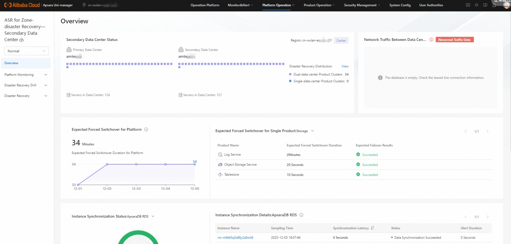

7. (Optional) Click Normal or O&M in the left navigation bar to switch views.

   > **Note**
   >
   > You must possess at least one of the following permissions: disaster recovery monitoring, disaster recovery drill, or system administrator, to switch views.

   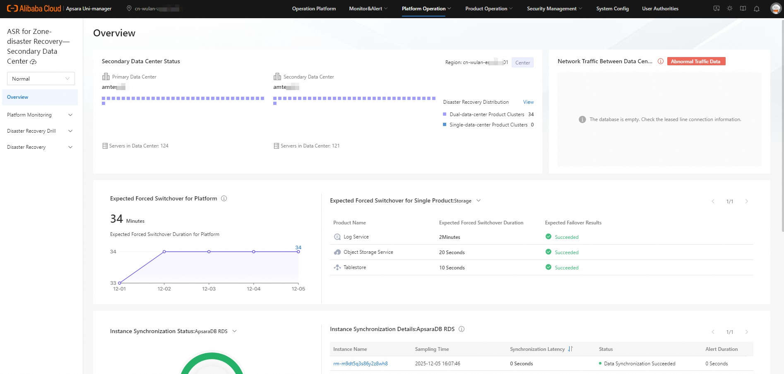

**Disaster recovery escape login**

> **Important**
>
> The disaster recovery escape login switch is disabled by default. To log in via this method, enable the switch and set a login password in advance. For details, see Configure escape login.

1. Enter the access address of the ASR for Zone-disaster RecoveryASR for Zone-disaster Recovery in the browser address bar and press Enter.

   > **Note**
   >
   > ASR for Zone-disaster Recovery platform access policy:
   >
   > - Daily O&M access: Access ASR for Zone-disaster Recovery through the unified entry of the Apsara Uni-manager Operations Console.
   >
   > - Emergency escape access: When a data center-level failure interrupts the regular link, directly access the cloud platform for emergency switchover by using the corresponding ASR for Zone-disaster Recovery escape login address based on the failure location.
   >
   >   - If the primary data center or third data center fails, access the escape address of the secondary data center's ASR for Zone-disaster Recovery: asr-xs-&lt;region-id>.console.&lt;intranet-domain-id>/user/login.
   >
   >   - If the secondary data center fails, access the escape address of the primary data center's ASR for Zone-disaster Recovery: asr-xm-&lt;region-id>.console.&lt;intranet-domain-id>/user/login.

   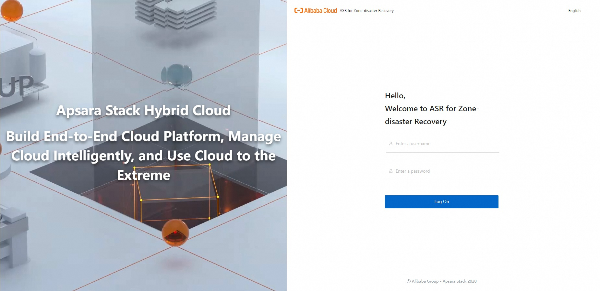

   > **Note**
   >
   > To switch languages, click the language drop-down in the upper-right corner. Both Simplified Chinese and English are supported.

2. Enter the correct username and password.

   > **Note**
   >
   > Obtain the username and password for logging into ASR for Zone-disaster Recovery from your deployment personnel or administrator.

3. Click **Log On**.

4. Click Normal or O&M at the top of the page to switch views.

   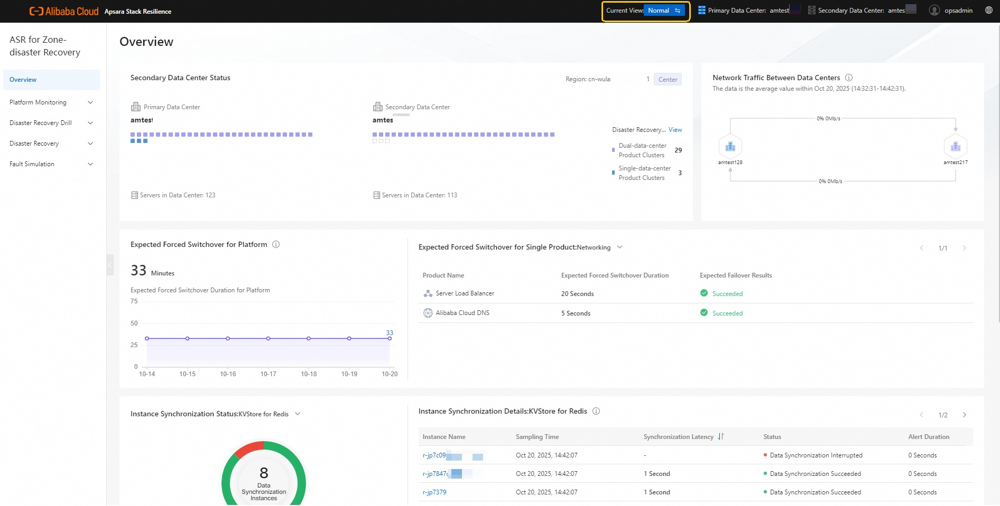

5. Click Data Center at the top of the page to navigate to the corresponding data center page.

   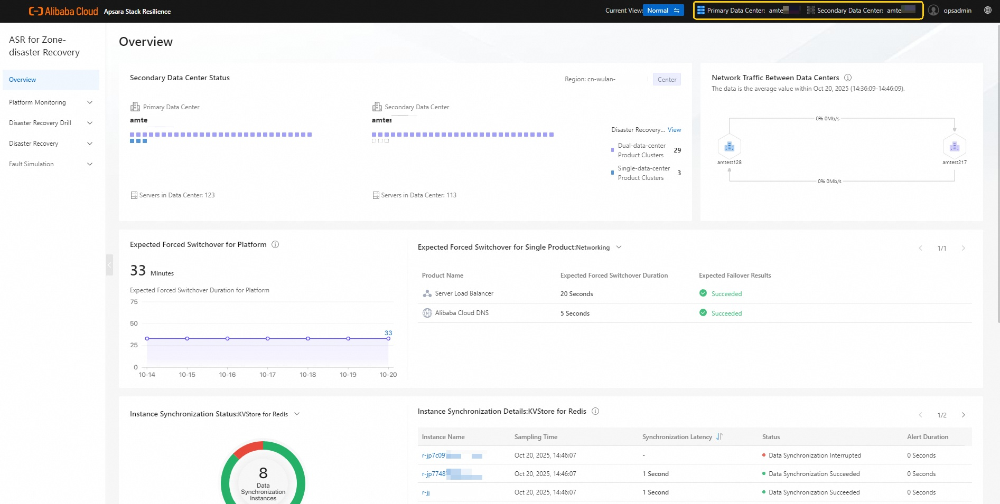

**Tenant operations logon**

If you need to restore individual business units or conduct disaster recovery drills by business application, you can create protection groups by logging into the Apsara Uni-manager Management Console.

**Procedure**

1. Enter the URL of the Apsara Uni-manager Management Console in the address bar and press the Enter key.

2. On the login page, enter your username and password.

   You can obtain the username and password that are used to log in to the Apsara Uni-manager Management Console from the operations administrator.

   > **Note**
   >
   > - **First login**
   >
   >   The first time that you log on to the Apsara Uni-manager Management Console, you need to change the password of your account. The password must be 10 to 32 characters in length. It must contain all of the following character types: uppercase letters, lowercase letters, digits, and special characters. Supported special characters include: ! @ # $ %
   >
   > - **Forgotten password**
   >
   >   If you have forgotten your password, click Forgot Password. On the page that appears, enter the username of your account, the email address that was used to create the account, and the CAPTCHA code. Then, the system sends a link for resetting the password to the specified email address.

3. Click **Log In**.

4. If multi-factor authentication (MFA) is enabled for your account, perform the following operations based on your login scenario:

   - You log on to the Apsara Uni-manager Management Console for the first time after MFA is enabled by the administrator.

     <ol type="a">

     <li>

     On the Bind Virtual MFA Device page, follow the on-screen instructions to bind an MFA device.

     </li>

     <li>

     Enter the username and password again as in Step 2 and click **Log On**.

     </li>

     </ol>

     <ol type="i" start="100">

     <li>

     Enter the six-digit MFA code and click **Authentication**.

     </li>

     </ol>

   - You have enabled and bound MFA:

     Enter the six-digit MFA code and click **Authentication**.

     > **Note**
     >
     > For more information about how to bind and enable MFA, see **Security Center** > **MFA** > **Manage MFA** in Apsara Uni-manager Operations Console User Guide.

5. In the top navigation bar, select **Products**.

6. In the navigation pane on the left, click **Disaster Recovery and Backup**.

7. In the **Disaster Recovery and Backup** section, choose **Disaster Recovery > ASR for Zone-disaster Recovery**.

# 3.Normal views

## 3.1. Overview

The overview page presents the overall disaster recovery capabilities of the platform, enabling users to understand these capabilities more intuitively and quickly. After you log on to the ASR console, you can gain an initial understanding of the disaster recovery capabilities of the entire platform. You can view the status of the secondary data center and the network traffic between data centers, predict the duration and results of a forced switchover, and view the usage records of the disaster recovery platform.

**Procedure**

1. Log on to ASR for Zone-Disaster Recovery (Primary Zone) or ASR for Zone-Disaster Recovery (Secondary Zone). For more information, see Log in to the ASR console.

2. On the **Overview** page, you can view information such as the secondary data center status, network traffic between data centers, forced switchover predictions, and instance synchronization status.

   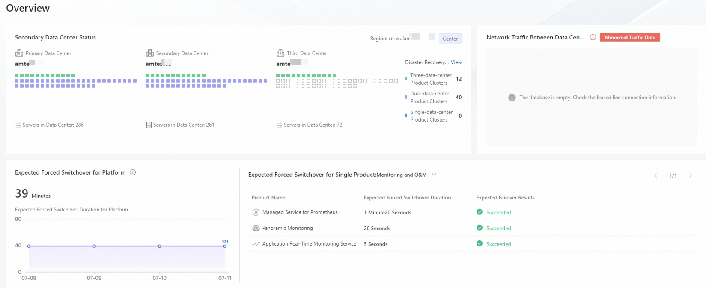

   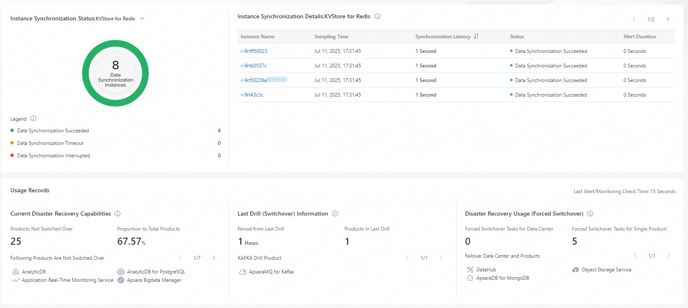

   > **Note**
   >
   > - The preceding image shows a three-data center example only. The displayed content varies based on the disaster recovery architecture, but the features remain the same. Refer to your actual environment.
   >
   > - After you enable the arbitration management feature, you can perform operations based on the on-screen prompts if a data center failure occurs.
   >
   >   - When arbitration management enables automatic execution of recovery plans, the platform automatically detects failures and initiates switchovers. You can view the disaster recovery history based on the on-screen prompts.
   >
   >   - When arbitration management disables automatic execution of recovery plans, manually execute the recovery plan based on the on-screen prompts and contact the disaster recovery architecture team to complete subsequent tasks.

The following table describes the information in each section.

| Section | Description |
| --- | --- |
| Secondary Data Center Status | • Displays the role (primary, secondary, or three data center), number of machines, data center name, number of product cluster deployments, and primary/secondary distribution of services for each data center. • Click <strong>View</strong> to go to the <strong>Service</strong> Monitoring page, where you can view the distribution and inspection results of services in the data center. For more information, see the Service monitoring section. |
| Network Traffic Between Data Centers | • Displays traffic information for the most recent point in time. • Click <strong>View Details</strong> to view the network traffic between data centers over the last hour or the last day. Each line represents a leased line. • If the network line between data centers displays <strong>No Traffic</strong>, click the link to go to the DCI leased line management page and configure the DCI leased line information. Note The DCI leased line information configured in the system affects the network traffic between data centers. |
| Expected Forced Switchover for Platform | Displays the predicted duration and trend of a forced switchover for the cloud platform. |
| Expected forced switchover for a single service | Dynamically predicts the forced switchover duration and expected forced switchover status for all cloud services based on environment information. The forced switchover statuses include Successful, Failed, At Risk, and Timed Out. • Successful: All services complete the forced switchover successfully. • Failed: Certain monitoring items directly cause the forced switchover to fail. • At Risk: Certain monitoring items may affect the forced switchover. • Timed Out: The actual duration of the forced switchover exceeds the predicted duration. |
| Instance synchronization status | Collects and displays the RPO data of all instances, showing the number of normal instances and the number of abnormal instances (synchronization timeout and synchronization interruption). |
| Instance synchronization details | • Collects and displays instances with persistent RPO exceptions over the past week. The displayed instance information includes the instance name, sampling time, and synchronization delay. By default, instances are sorted in descending order of synchronization delay. • Click an instance name to go to the instance details page in the console of the corresponding cloud service. |
| Usage Records | Displays the current disaster recovery capabilities of services, the last drill status, the last time alerts or monitoring data were viewed, and the disaster recovery status. • Current disaster recovery capabilities of services: Displays the number and percentage of services that have never undergone a service switchover, and lists the names of services that have never undergone a DR failover. • Last drill status (switchover): Displays the number of services involved in the last switchover drill and the time elapsed since then. • Disaster recovery usage (forced switchover): Displays the disaster recovery usage records, including the number of full-data center forced switchovers and the number of single-service forced switchovers. |

## 3.2. Platform monitoring

### 3.2.1. Usage scenarios

This topic describes the usage scenarios of platform monitoring and usage notes.

**Features**

Platform monitoring consists of product monitoring and synchronization monitoring. They support the following features and check items:

- The Product Monitoring page displays the disaster recovery mode, service status in the primary, secondary, and third data centers, synchronization component status, and failover capabilities by cloud service. You can switch from the Product Monitoring page to the dashboard monitoring page.

- The Synchronization Monitoring page displays the data synchronization latency compliance rates of databases and storage services.

**Usage scenarios**

- Routine monitoring: During the daily operations of the cloud platform, you need to regularly inspect various check items.

- Check before drills: Before switchover and switchback drills, you need to check platform monitoring information. Ensure that monitoring items do not have exceptions.

> **Note**
>
> For some services, you need to perform inspections in addition to the product monitoring check. Contact the ASR R&D team to perform inspections before a drill.

### 3.2.2. Service monitoring

Before a switchover or switchback, the total number of products and the number of exceptions are counted by service type. The information about each product, node locations of base components, feature status, and inspection results are displayed in cards. If a product or base component is in an abnormal state, fix the issue before performing the switchover or switchback.

**View the status of products**

Before products are switched over or back, you must check whether the status of the products is normal. If exceptions exist, the **Disaster recovery conditions are not provided for the current product.** message appears when you switch over or back the products. Switch over or back the products after the exceptions are resolved.

1. Log on to the Apsara Stack Resilience (ASR) for Zone-disaster Recovery (Primary Zone) console or the ASR for Zone-disaster Recovery (Secondary Zone) console. In the left-side navigation pane, choose **Monitoring > Product Monitoring**.

2. On the **Product Monitoring** tab, check whether abnormal products exist. Click the name of a product whose status is abnormal to go to the corresponding card in the lower part of the page. The card displays the node location, feature status, and inspection results.

3. Select the service type, service name, primary service location, and service status from the drop-down lists to filter the monitoring items that meet disaster recovery conditions.

   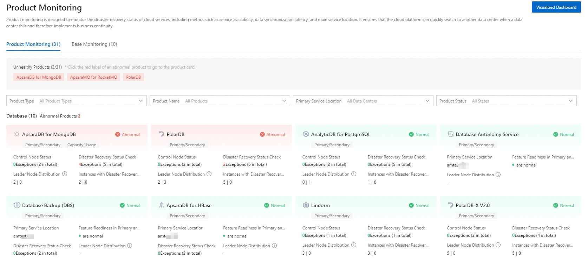

   In the upper-right corner, click **Visualized Dashboard** to go to the dashboard monitoring page. For more information, see Dashboard monitoring.

   Common exceptions and solutions:

   - An SSH tunnel exception exists: Check whether services have been deployed and reached the desired state in Apsara Infrastructure Management. If the services are not deployed or have not reached the desired state, resolve this exception first. If the exception persists after the services are deployed and reach the desired state, submit a ticket.

   - ApsaraDB RDS instances that have synchronization latencies exist, and running tasks exist: Log on to ApsaraDB Operations and Maintenance System and check the synchronization status and the task execution status of the instances.

   - The recovery point objective (RPO) of Tablestore is not 0: Reduce the number of requests. Wait 20 minutes for the RPO to recover. If the RPO does not recover over an extended period of time, submit a ticket.

   - The primary or secondary service fails: Check whether services have been deployed and reached the desired state in Apsara Infrastructure Management. If the services are not deployed or have not reached the desired state, resolve this exception at your earliest opportunity. If the exception persists after the services are deployed and reach the desired state, submit a ticket.

**View the status of base components**

Before products are switched over or back, you must check whether the status of the base components is normal. If exceptions exist, the **Disaster recovery conditions are not provided for the current product.** message appears when you switch over or back the products. Switch over or back the products after the exceptions are resolved.

1. Log on to the ASR for Zone-disaster Recovery (Primary Zone) console or the ASR for Zone-disaster Recovery (Secondary Zone) console. In the left-side navigation pane, choose **Monitoring > Product Monitoring**.

2. On the **Base Monitoring** tab, check whether abnormal base components exist. Click the name of a product whose status is abnormal to go to the corresponding card in the lower part of the page. The card displays the node location, feature status, and inspection results.

3. Select the service name, primary service location, and service status from the drop-down lists to filter the monitoring items that meet disaster recovery conditions.

   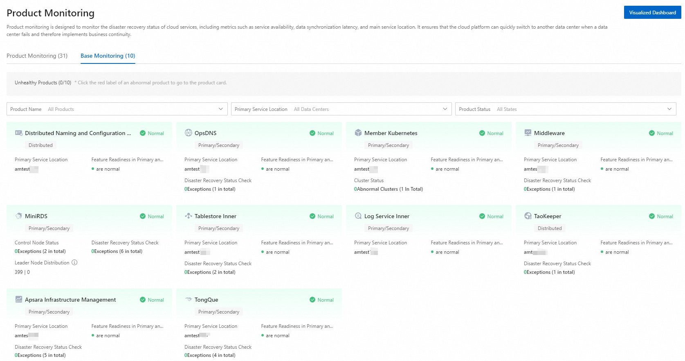

   In the upper-right corner, click **Visualized Dashboard** to go to the dashboard monitoring page. For more information, see Dashboard monitoring.

   Common exceptions and solutions:

   - An SSH tunnel exception exists: Check whether services have been deployed and reached the desired state in Apsara Infrastructure Management. If the services are not deployed or have not reached the desired state, resolve this exception first. If the exception persists after the services are deployed and reach the desired state, submit a ticket.

   - MiniRDS instances that have synchronization latencies exist, and running tasks exist: Log on to ApsaraDB Operations and Maintenance System and check the synchronization status and the task execution status of the instances.

   - The primary or secondary service fails: Check whether services have been deployed and reached the desired state in Apsara Infrastructure Management. If the services are not deployed or have not reached the desired state, resolve this exception at your earliest opportunity. If the exception persists after the services are deployed and reach the desired state, submit a ticket.

### 3.2.3. Synchronization monitoring

This topic describes how to view the data synchronization latency compliance rate, number of instances with successful synchronization, number of instances with synchronization exceptions, and synchronization latency of each instance for ApsaraDB RDS, Tair (Redis OSS-compatible), PolarDB-X 2.0, ApsaraDB for MongoDB, AnalyticDB for PostgreSQL, Object Storage Service (OSS), and PolarDB Local Disk Edition (PolarDB for MySQL and PolarDB for PostgreSQL).

1. Log in to the ASR for Zone-disaster Recovery (Secondary Zone) console.

2. In the left-side navigation pane, choose **Platform Monitoring** > **Synchronization Monitoring**. The synchronization monitoring information is displayed. The instances that have synchronization exceptions are displayed in red.

   > **Note**
   >
   > - **ApsaraDB RDS monitoring** involves multiple database services, including ApsaraDB RDS for MySQL, ApsaraDB RDS for PostgreSQL, and ApsaraDB RDS for PPAS.
   >
   > - Choose **Settings** > **Alerts** > **Alert Rules** and modify the **Triggering Threshold** value of the **Data Loss** metric of a service to change the alert threshold.

   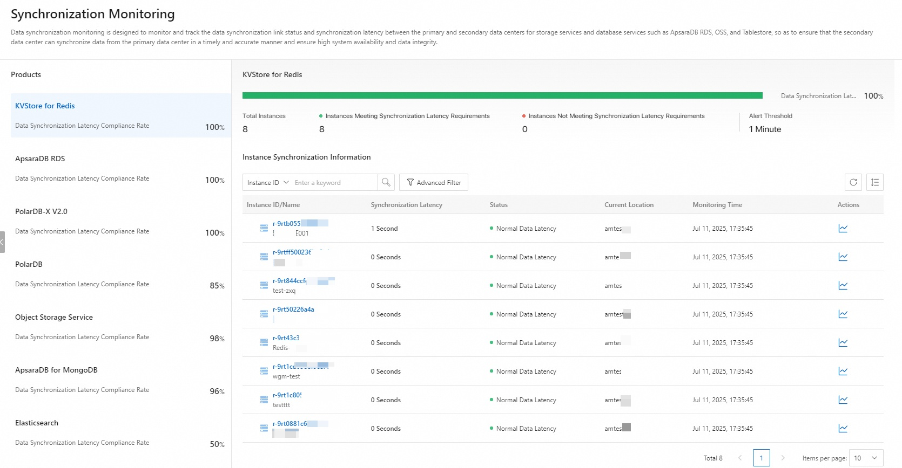

   The following table describes the features that you can use on the Synchronization Monitoring page.

   | Feature | Description |
   | --- | --- |
   | Data Synchronization Latency Compliance Rate | Displays the percentage of cloud services whose synchronization latency meets the RPO. If the percentage is not 100%, check the instances whose <strong>status</strong> is <strong>Data Synchronization Interrupted</strong> or Data Synchronization Timeout and resolve the issue. |

   <table>
     <tr>
       <td>Search</td>
       <td>You can select a specific cloud service and search for a specific instance to view the synchronization information. You can select <strong>Instance ID</strong>, <strong>Instance</strong> <strong>Name</strong>, <strong>Current Location</strong>, <strong>Instance Engine</strong>, or <strong>Status</strong> from the drop-down list. • Select <strong>Instance ID</strong> from the drop-down list, enter an instance ID in the search box, and then click theicon. • Select <strong>Instance Name</strong> from the drop-down list, enter an instance name in the search box, and then click theicon. • Select <strong>Current Location</strong> from the drop-down list, and then select a data center name. The system automatically filters data that meets the conditions. • Select <strong>Instance Engine</strong> from the drop-down list, and then select an instance engine. The system automatically filters data that meets the conditions. Note You can search instances by instance engine only for ApsaraDB RDS. • Select <strong>Status</strong> from the drop-down list, and then select a state, which can be <strong>Normal</strong> or <strong>Abnormal</strong>. You can click <strong>Advanced Filter</strong> to combine multiple query dimensions for search.</td>
     </tr>
     <tr>
       <td>Jump to another page</td>
       <td>You can click an instance ID or an instance name to go to the instance details page of the corresponding cloud service console.</td>
     </tr>
     <tr>
       <td>View instance synchronization information</td>
       <td>• Click theicon in the Actions column to view the instance synchronization information (RPO) in the last 24 hours, last 6 hours, and last 1 hour. • Click theicon in the Actions column to hide the line chart of instance synchronization information.</td>
     </tr>
   </table>

## 3.3. Disaster recovery drills

You can perform disaster recovery drills to switch over or back services between the primary and secondary data centers when no power or network outages occur.

### 3.3.1. Usage notes

Disaster recovery drills are classified into two types: custom drills and predefined drills. Custom drills allow you to select one or more products to perform drills based on your needs. Predefined drills allow you to select all products or a single product to perform drills.

**Overview**

Zone-disaster recovery drills are an important part of the delivery acceptance and periodic inspection of the disaster recovery platform. By performing disaster recovery drills on a regular basis, you can test the capabilities of the disaster recovery platform to handle major issues and improve the disaster recovery response mechanism. If any problems occur during a drill, contact the Apsara Stack disaster recovery R&D team immediately to solve the problems, thereby avoiding affecting the normal operation of your business.

- Custom drills: You can select multiple services to create and run drill plans based on your requirements.

- Predefined drills: You can select a service drill plan predefined on ASR for Zone-disaster Recovery or select the overall drill plan that includes all services.

> **Note**
>
> In a scenario where three data centers are deployed, ASR allows you to switch the primary database of your instance back to the zone where the database resides during instance creation, including but not limited to **service switchback after single-service faults** and **service switchback after power outages**.

**Drill flowchart**

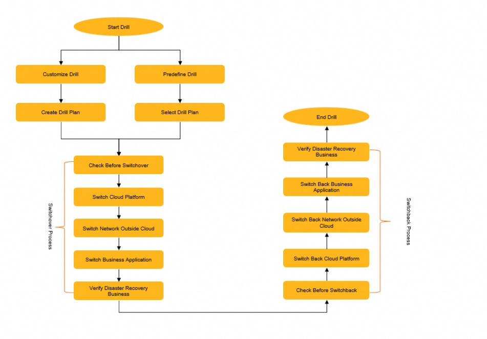

### 3.3.2. Drill plans

Drill plans are divided into plans for custom drills and predefined drills based on the type of drill. You can create a drill plan based on your actual needs.

- You can select multiple cloud products for a custom drill. After the drill is complete, the drill data is automatically aggregated and a drill report is generated.

- You can select a single product or all products to perform a predefined drill.

#### 3.3.2.1. Perform default drills

This topic describes how to perform default drills to switch over cloud services from the primary data center to the secondary data center when no power or network outages occur and how to switch back cloud services. You can select a single service or all services of the cloud platform to perform a default drill.

**Procedure**

1. Use an administrator account to log on to the Apsara Stack Resilience (ASR) for Zone-disaster Recovery (Secondary Zone) console or the ASR for Zone-disaster Recovery (Primary Zone) console. For more information, see Log on to the ASR console.

2. In the left-side navigation pane, choose **Disaster Recovery Drill > Drill Plan**.

3. On the **Drill Plan** page, click the **Default Plan** tab.

   > **Note**
   >
   > You can determine whether to log on to the ASR for Zone-disaster Recovery (Secondary Zone) console or log on to the ASR for Zone-disaster Recovery (Primary Zone) console based on the drill data center. When you log on to the ASR for Zone-disaster Recovery (Secondary Zone) console, you can select the primary data center and third data center for the drill. When you log on to the ASR for Zone-disaster Recovery (Primary Zone) console, you can select the secondary data center for the drill.

   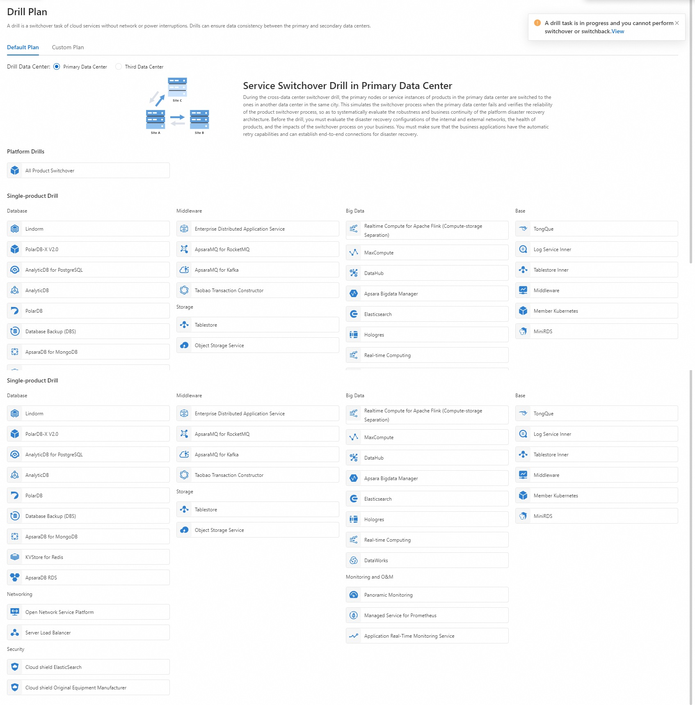

4. On the **Default Plan** tab, select all cloud services or a single cloud service for a switchover drill.

5. In the dialog box that appears, confirm that the service check has passed, select "The disaster recovery adaptation for the network and business applications is complete. I have understood the consequences." and click **Switchover**.

   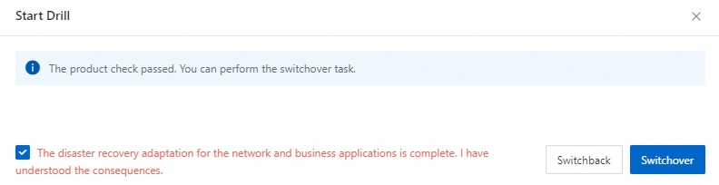

   You can perform the switchback operation in the same manner. If a service exception is displayed in the dialog box, view the details of the exception on the Product Monitoring page.

6. After the switchover, you are redirected to the details page of the drill plan. On this page, you can view the switchover result.

#### 3.3.2.2. Manage custom drill plans

You can perform disaster recovery drills to switch over services between the primary data center and the secondary data center when no power or network outages occur. You can select multiple cloud services for a custom drill. After the drill is complete, the drill data is automatically aggregated and a drill report is generated. This topic describes how to manage custom drill plans.

**Procedure**

1. Use an administrator account to log in to the Apsara Stack Resilience (ASR) for Zone-disaster Recovery (Secondary Zone) console or the ASR for Zone-disaster Recovery (Primary Zone) console. For more information, see Log in to the ASR console.

2. In the left-side navigation pane, choose **Disaster Recovery Drill > Drill Plan**.

3. On the **Drill Plan** page, click the **Custom Plan** tab.

4. Click **Create Plan**. In the Create Plan dialog box, configure the parameters that are described in the following table.

   | Parameter | Description |
   | --- | --- |
   | Plan Name | The name of the custom drill. The name must be 10 to 40 characters in length and can contain letters, digits, and underscores (_). |
   | Drill Data Center | The data center for the drill. Note You can determine whether to log in to the ASR for Zone-disaster Recovery (Secondary Zone) console or log in to the ASR for Zone-disaster Recovery (Primary Zone) console based on the drill data center. When you log in to the ASR for Zone-disaster Recovery (Secondary Zone) console, you can select the primary data center and third data center for the drill. When you log in to the ASR for Zone-disaster Recovery (Primary Zone) console, you can select the secondary data center for the drill. |
   | Drill Products | The services on which you want to perform the drill and click <strong>OK</strong>. |
   | Plan Description | The description of the drill plan. This parameter is optional. The description can be up to 100 characters in length. |

5. Click **OK**.

   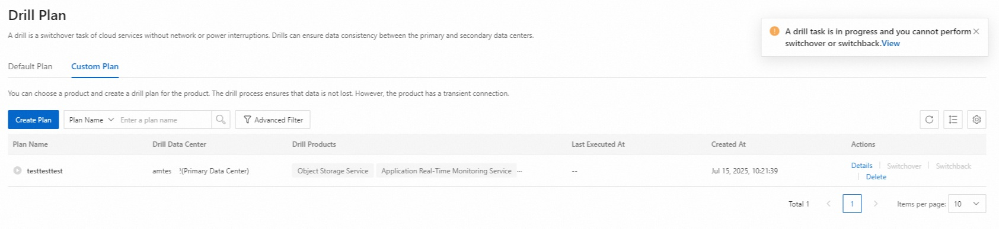

6. In the upper-right corner of the page, the execution status of the switchover or switchback plan is displayed. Click **View** to view the switchback or switchback execution details.

   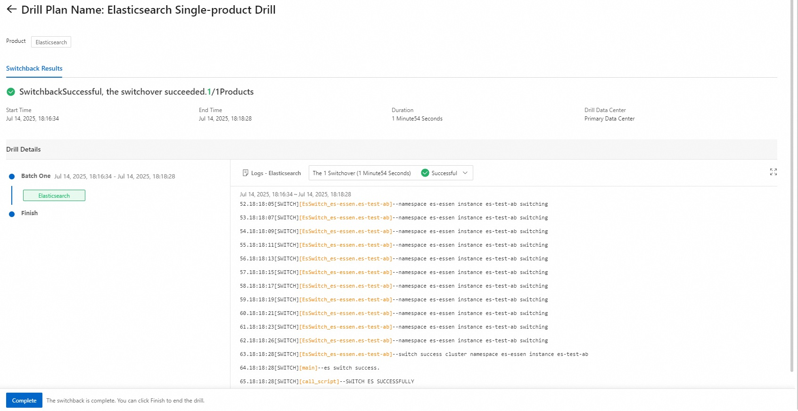

7. On the **Custom Plan** tab, you can view the details of a drill plan or delete a drill plan. You can also perform a switchover or switchback.

   - View the details of a custom drill plan:

     <ol type="a">

     <li>

     Find the drill plan that you want to view and click **Details** in the **Actions** column.

     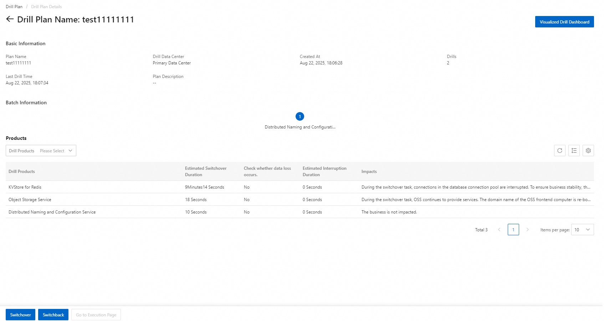

     </li>

     <li>

     You can view the basic details, batch information, and the list of cloud services for the drill.

     </li>

     </ol>

     <ol type="i" start="100">

     <li>

     In the lower-left corner of the page, you can click **Switchover**, **Switchback**, and **Go to Execution Page**.

     </li>

     <li value="500">

     In the upper-right corner of the page, click **Visualized Drill Dashboard** to go to the dashboard page and view the drill process.

     </li>

     </ol>

   - Perform a switchover for a custom drill plan:

     A switchover operation is allowed only when the system has no ongoing switchover or switchback task.

     <ol type="a">

     <li>

     Find the drill plan that you want to manage and click **Switchover** in the **Actions** column.

     </li>

     <li>

     In the dialog box that appears, click **OK**.

     </li>

     </ol>

   - Perform a switchback for a custom drill plan:

     Only drill plans for which switchovers are performed successfully support the switchback operation.

     <ol type="a">

     <li>

     Find the drill plan that you want to manage and click **Switchback** in the **Actions** column.

     </li>

     <li>

     In the dialog box that appears, click **OK**.

     </li>

     </ol>

   - Delete a custom drill plan:

     <ol type="a">

     <li>

     Find the drill plan that you want to manage and click **Delete** in the **Actions** column.

     </li>

     <li>

     In the message that appears, click **Delete**.

     </li>

     </ol>

### 3.3.3. View drill records

This topic describes how to view the records and results of default drills and custom drills.

**Procedure**

1. Use an administrator account to log in to the Apsara Stack Resilience (ASR) for Zone-disaster Recovery (Secondary Zone) console. For more information, see the Escape login section of the "Log in to the ASR console" topic.

2. In the left-side navigation pane, choose **Disaster Recovery Drill > Drill History**.

   On the Drill Record page, you can view the following information about each drill: plan name, data center for the drill, services on which the drill is performed, status, and operation type. You can also view the drill records, drill reports, and dashboard of each drill.

3. You can query data by Execution Products, Data Center, Execution Time, Drill Status, and Operation Type, or their combinations.

   - View drill records

     <ol type="a">

     <li>

     Find the drill record that you want to view and click **View Record** in the **Actions** column.

     </li>

     <li>

     On the page that appears, you can view the execution details.

     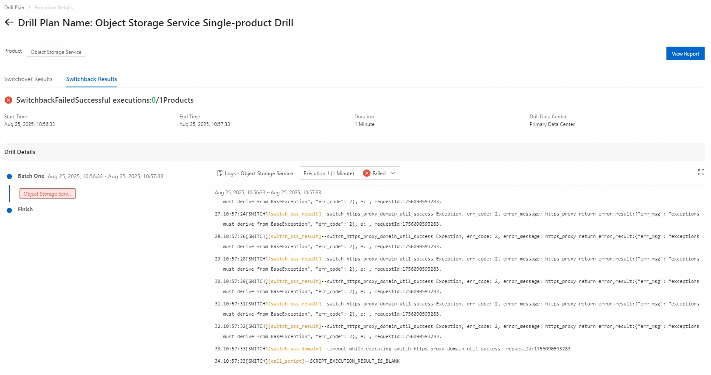

     </li>

     </ol>

   - View drill reports

     <ol type="a">

     <li>

     Find the drill record that you want to view and click **View Report** in the **Actions** column, or click **View Report** on the execution details page.

     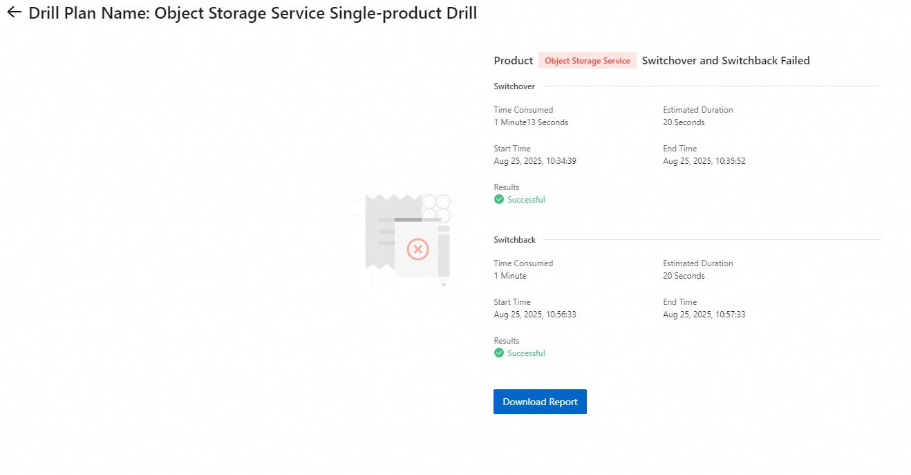

     </li>

     <li>

     Click **Download Report** to save the drill report to your computer.

     </li>

     </ol>

   - View a drill dashboard

     On the **Drill Record** page, find the drill record that you want to view and click **View Dashboard** in the **Actions** column.

     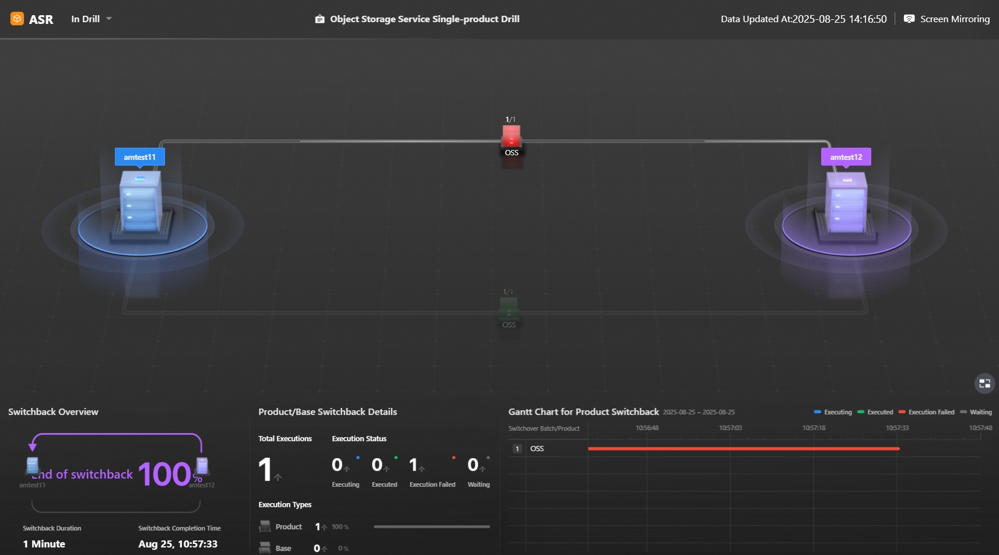

     > **Note**
     >
     > For more information about the operations that can be performed on the drill dashboard page, see View a drill dashboard.

### 3.3.4. View a drill dashboard

A drill dashboard displays visualized switchover data in real time. On the drill dashboard page, you can view key metrics during switchover, such as the service orchestration, progress, and switchover duration of each service.

**Procedure**

1. Log in to the Apsara Stack Resilience (ASR) for Zone-disaster Recovery (Secondary Zone) console. For more information, see Log in to the ASR console.

2. In the left-side navigation pane, choose **Disaster Recovery Drill > Drill Plan**.

   **Dashboard for an ongoing drill**

   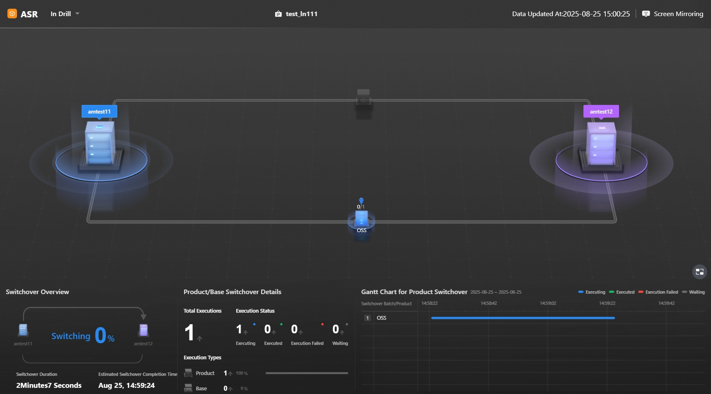

   **Dashboard for a completed drill**

   | Section | Description |
   | --- | --- |
   | <strong>Normal</strong>/<strong>In Drill</strong> | • If you select Normal, a monitoring dashboard is displayed, including the number of services with disaster recovery deployed, details of abnormal instances, and overview of selected services. • If you select In Drill, a drill dashboard is displayed, including the service orchestration during switchover, progress, and switchover duration of each service. |
   | Switchover Overview Switchback Overview | Displays the switchover or switchback duration of the services with disaster recovery deployed in the disaster recovery region and the time when the switchover or switchback is complete. |
   | Product/Base Switchover Details Product/Base Switchback Details | • Displays the number of services on which the switchover or switchback is performed, execution status, and execution types. • The execution status includes Executing, Executed, Execution Failed, and Waiting. |
   | Gantt Chart for Product Switchover Gantt Chart for Product Switchback | • Displays the switchover or switchback duration, start time, and end time for each service involved in the switchover or switchback. • Click theicon to zoom in the Gantt chart. |
   | Screen Mirroring | Displays the dashboard in full screen. |

## 3.4. Disaster recovery

This topic describes disaster recovery. It ensures continuous operation or quick recovery to the running state after natural disasters, system faults, or other emergencies. It is suitable for scenarios where a cloud platform disaster occurs. If no disasters occur, you can use the fault injection feature of ASR and then perform disaster recovery for drills.

**Features**

- **Disaster recovery** refers to quickly recover a cloud platform and its business systems in the event of major faults or disasters. It is designed to ensure continuous operation or quick recovery to the running state after natural disasters, system faults or other emergencies.

- **Fault simulation** refers to inject faults for simulating power, network, and split-brain outage scenarios in data centers.

> **Note**
>
> In a scenario where three data centers are deployed, ASR allows you to switch the primary database of your instance back to the zone where the database resides during instance creation, including but not limited to **service switchback after single-service faults** and **service switchback after power outages**.

### 3.4.1. Disaster recovery

This topic describes the disaster recovery feature. Disaster recovery refers to quickly recovering a cloud platform and its business systems in the event of major faults or disasters. It is designed to ensure continuous operation or quick recovery to the running state after natural disasters, system faults or other emergencies.

**Scenarios**

Disaster recovery has the following scenarios:

- Power outage recovery in the primary data center: If the primary data center is powered off, cloud services in the secondary and third data centers are started to quickly recover online business.

- Network outage recovery in the primary data center: If the external networks and ones connected to the secondary and third data centers fail in the primary data center, services in the secondary and third data centers are started to ensure business continuity.

- Single-service fault recovery: If a service in the primary data center fails, the corresponding services in the secondary and third data centers are started. This does not guarantee zero data loss.

  > **Important**
  >
  > In a disaster recovery deployment architecture, the single-service failback feature of Apsara Stack Resilience (ASR) for Zone-disaster Recovery has a limited application scope. It can address only specific types of single-service faults and does not provide full coverage for all scenarios. To determine whether to use ASR for Zone-disaster Recovery for disaster recovery and the mode to adopt (switchover or failover), you need to carry out a comprehensive assessment of the specific business scenario, system status, and risk factors. If you plan to enable this feature, the product team and the disaster recovery team must jointly evaluate its feasibility and confirm the implementation plan.

- Fault recovery in the secondary data center: If the secondary data center is powered off, cloud services in the primary and third data centers are started to quickly recover online business.

**Flowchart**

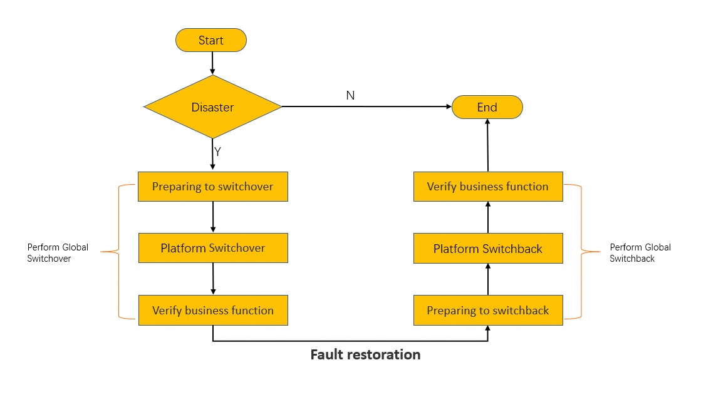

> **Note**
>
> You must manually perform platform switchover and switchback operations during disaster recovery. However, after the arbitration feature is enabled, automatic arbitration switchover capabilities, including the Zookeeper, Tair, and Schedulerx middleware components, are supported for the base middleware service, quickly recovering online business.

#### 3.4.1.1. Power outage recovery in the primary data center

This topic describes how to perform platform switchover and switchback in the ASR for Zone-disaster Recovery console to ensure system continuity and reliability when power outages occur in a real primary data center.

##### 3.4.1.1.1. Failover for power outages of the primary data center

This topic describes how to recover online business by starting cloud services in the secondary data center when the primary data center encounters power outages.

**Procedure**

1. Use an administrator account to log on to the ASR for Zone-disaster Recovery (Secondary Zone) console. For more information, see the "Escape logon scenarios" section in Log on to the ASR console.

2. In the left-side navigation pane, choose **Disaster Recovery > Switchover**.

3. Click the **Power Outage Recovery** tab.

   

4. Click **Perform Global Switchover**. In the message that appears, click **OK**.

> **Note**
>
> If the failover fails, contact the ASR R&D team for troubleshooting.

##### 3.4.1.1.2. Failback for power outages of the primary data center

This topic describes how to fail back your business to the primary data center after the primary data center is recovered from power outages.

**Prerequisites**

- Your business is successfully failed over to the secondary data center. For more information, see Failover for power outages of the primary data center.

- The primary data center is recovered from power outages.

**Procedure**

1. Use an administrator account to log on to the ASR for Zone-disaster Recovery (Secondary Zone) console. For more information, see the "Escape logon scenarios" section in Log on to the ASR console.

2. In the left-side navigation pane, choose **Disaster Recovery > Switchback**.

3. Click the **Failback after Power Outage** tab.

   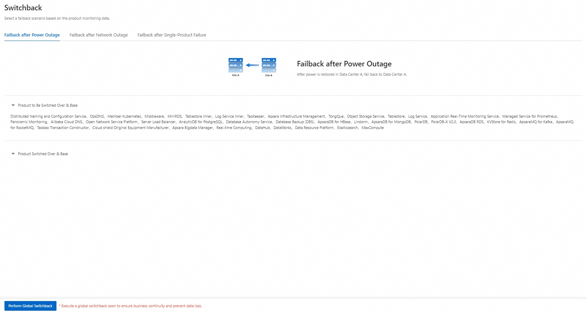

4. Click **Perform Global Switchback**. In the message that appears, click **OK**.

> **Note**
>
> If the failback fails, contact the ASR R&D team for troubleshooting.

#### 3.4.1.2. Network outage recovery in the primary data center

This topic describes how to perform platform switchover and switchback in the ASR for Zone-disaster Recovery console to ensure system continuity and reliability when network outages occur in a real primary data center.

##### 3.4.1.2.1. Failover for network outages of the primary data center

This topic describes how to start cloud services in the secondary data center when the primary data center is disconnected from both the Internet and the secondary data center. This ensures business continuity.

**Procedure**

1. Use an administrator account to log on to the ASR for Zone-disaster Recovery (Secondary Zone) console. For more information, see the "Escape logon scenarios" section in Log on to the ASR console.

2. In the left-side navigation pane, choose **Disaster Recovery > Switchover**.

3. Click the **Network Outage Recovery** tab.

   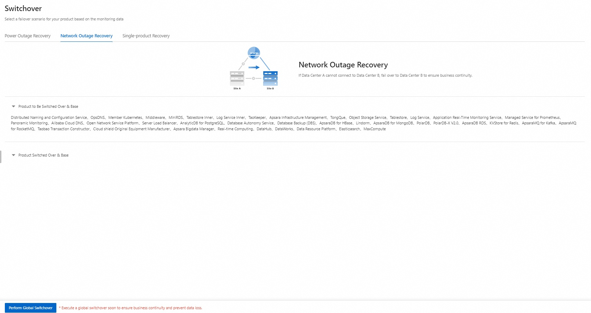

4. Click **Perform Global Switchover**. In the message that appears, click **OK**.

> **Note**
>
> If the failover fails, contact the ASR R&D team for troubleshooting.

##### 3.4.1.2.2. Failback for network outages of the primary data center

This topic describes how to fail back your business to the primary data center after the primary data center is recovered from network outages.

**Prerequisites**

- Your business is successfully failed over to the secondary data center. For more information, see Failover for network outages of the primary data center.

- The primary data center is recovered from network outages.

**Procedure**

1. Use an administrator account to log on to the ASR for Zone-disaster Recovery (Secondary Zone) console. For more information, see the "Escape logon scenarios" section in Log on to the ASR console.

2. In the left-side navigation pane, choose **Disaster Recovery > Switchback**.

3. Click the **Network Outage** tab.

   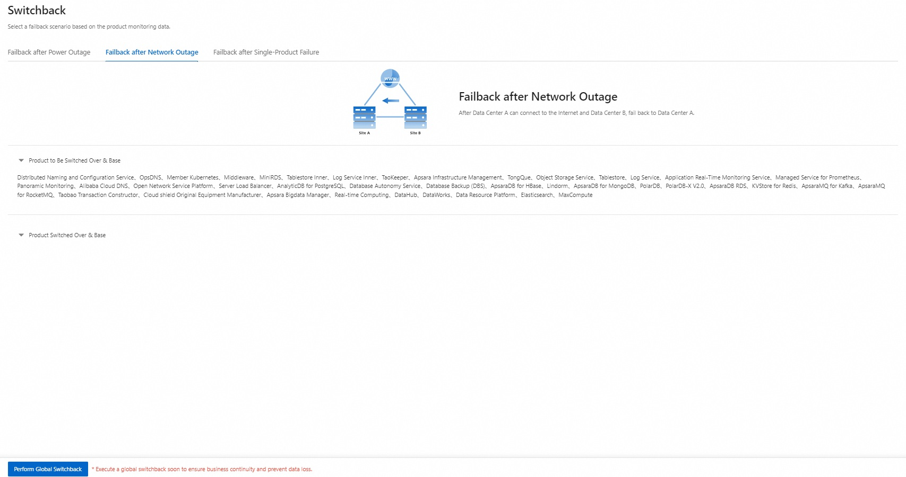

4. Click **Perform Global Switchback**. In the message that appears, click **OK**.

#### 3.4.1.3. Recovery from power outages or split-brain scenarios of the secondary data center

This topic describes how to recover online business by starting cloud services in the primary data center when the secondary data center encounters power outages or the network communication between the primary and secondary data centers fails.

**Procedure**

1. Use an administrator account to log on to the ASR for Zone-disaster Recovery (Primary Zone) console. For more information, see the "Escape logon scenarios" section in Log on to the ASR console.Disaster recovery escape login

2. In the left-side navigation pane, choose **Disaster Recovery > Switchover**.

3. On the **Power Outage in Secondary Data Center** tab, click **Perform Global Switchover**. In the confirmation message that appears, click **OK**. The failback operation is supported only after the failover is successful.

   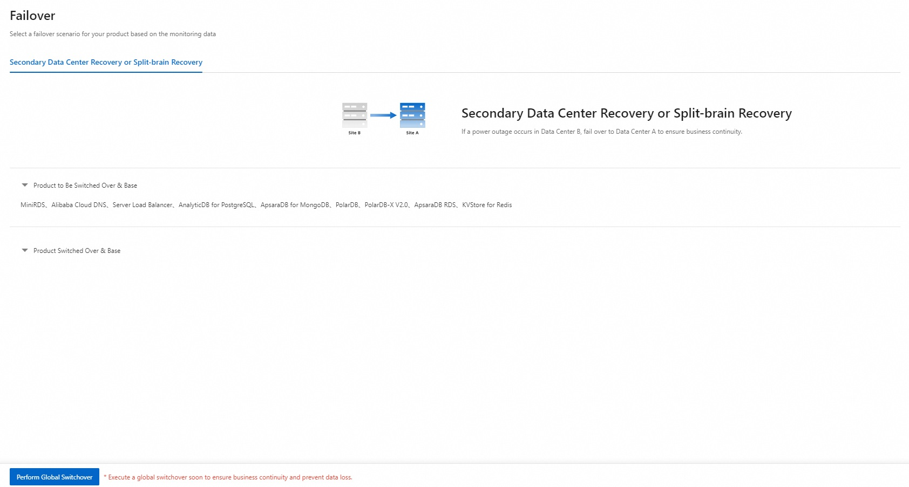

   > **Warning**
   >
   > If a split-brain scenario occurs, stop Server Load Balancer (SLB) in the secondary data center after business is failed over.

   > **Note**
   >
   > If the failover or failback fails, contact the ASR R&D team for troubleshooting.

##### 3.4.1.3.1. Switchover for spit-brain in data centers (two data centers)

This topic describes how to recover online business by starting cloud services in the primary data center when the network communication between the primary and secondary data centers fails.

> **Important**
>
> Split-brain issues occur only in dual-data center deployment scenarios, and do not occur in three-data center deployment scenarios.

**Procedure**

1. Use an administrator account to log on to the ASR for Zone-disaster Recovery (Primary Zone) console. For more information, see Escape logon scenarios.

2. In the left-side navigation pane, choose **Disaster Recovery > Switchover**.

3. Click the **Split-brain Recovery in Primary and Secondary Data Centers** tab.

   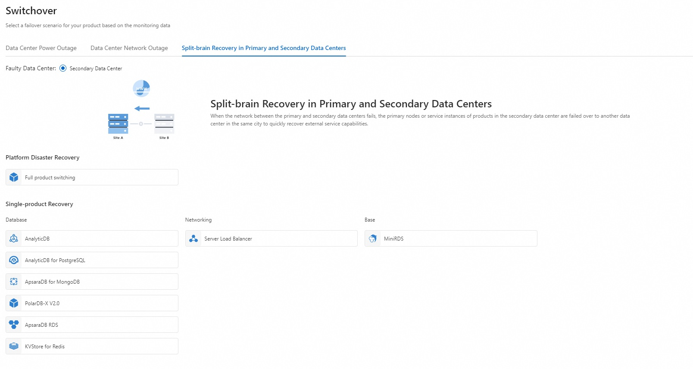

4. Keep the default faulty data center.

5. Select all cloud services or a single cloud service for a switchover.

   > **Note**
   >
   > If a single cloud service fails, select the cloud service for a switchover.

6. In the message that appears, click **Switchover**.

   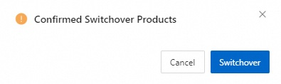

   > **Note**
   >
   > If the switchover fails, contact the ASR R&D team for troubleshooting.

> **Warning**
>
> If a split-brain issue occurs, stop the Server Load Balancer (SLB) service in the secondary data center after business is switched over.

##### 3.4.1.3.2. Switchback for spit-brain in data centers (two data centers)

This topic describes how to switch back your business to the original data center after the network communication between the primary and secondary data centers is recovered.

**Procedure**

1. Use an administrator account to log on to the ASR for Zone-disaster Recovery (Primary Zone) console. For more information, see Escape logon scenarios.

2. In the left-side navigation pane, choose **Disaster Recovery > Switchback**.

3. Click the **Split-brain Recovery in Primary and Secondary Data Centers** tab.

   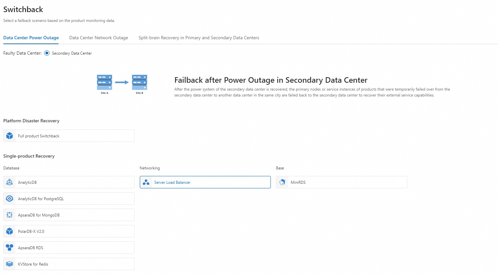

4. Select the faulty data center.

5. Select all cloud services or a single cloud service for a switchback.

6. In the message that appears, click **Switchback**.

   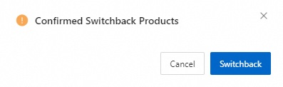

   > **Note**
   >
   > If the switchback fails, contact the ASR R&D team for troubleshooting.

### 3.4.2. Fault simulation

Fault simulation is a testing and verification technique used to evaluate the resilience of a cloud platform in the event of a fault or disaster. It simulates potential system faults by artificially introducing faults to observe and analyze the disaster recovery process of the cloud platform.

**Flowchart**

From the perspective of the deployment modes, zone-disaster recovery scenarios can be divided into two data centers and three data centers. The following fault scenarios may be involved:

- **Fault scenarios of two data centers**

  - Power outage: The entire power facility of the primary or secondary data center is faulty, no UPS is available, and all devices are powered off.

  - Network outage: The network devices, optical fibers, or leased lines of the primary or secondary data center for external connections are faulty. Therefore, the data center cannot communicate with external systems outside the cloud.

  - Split-brain: The leased lines or optical fibers between the primary and secondary data centers are faulty. As a result, the primary and secondary data centers cannot communicate with each other.

  - Single-product fault: A product in the primary or secondary data center is faulty and in the abnormal state.

- **Fault scenarios of three data centers**

  - Power outage: The entire power facility of the primary, secondary, or quorum data center is faulty, no UPS is available, and all devices are powered off.

  - Network outage: The network devices, optical fibers, or leased lines of the primary, secondary, or quorum data center for external connections are faulty. Therefore, the data center cannot communicate with external systems outside the cloud.

  - Single-connection failure: One of the three data centers fails to communicate with the other two data centers.

  - Single-product fault: A product in the primary, secondary, or quorum data center is faulty and in the abnormal state.

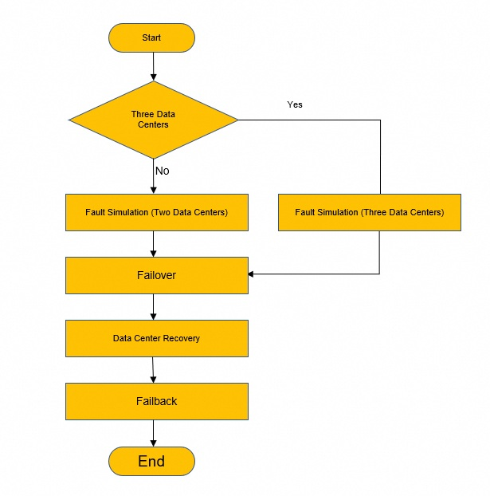

> **Note**
>
> Fault simulation refers to manually inject fault types similar to (but not) real disasters in a data center. It is used to verify disaster recovery capabilities and help business personnel quickly get familiar with disaster recovery services.

#### 3.4.2.1. Fault simulation for two data centers-based zone disaster recovery

You can inject faults to simulate power and network outages of data centers and split-brain scenarios.

##### 3.4.2.1.1. Preparations

This topic describes the operating platforms and the logon information that you must prepare to inject faults.

| Scenario | Operating platform | Logon information |
| --- | --- | --- |
| Power outage of the primary data center | Apsara Stack Resilience (ASR) for Zone-disaster Recovery (Secondary Zone) | • IP address and password that are used to log on to the OPS 1 server in the primary data center • IP address and password that are used to log on to the OPS 1 server in the secondary data center • Out-of-band account and password |
| Recovery from power outages of the primary data center | ASR for Zone-disaster Recovery (Secondary Zone) | IP address and password that are used to log on to the OPS 2 server in the primary data center |
| Power outage of the secondary data center | ASR for Zone-disaster Recovery (Primary Zone) | • IP address and password that are used to log on to the OPS 1 server in the primary data center • IP address and password that are used to log on to the OPS 1 server in the secondary data center • Out-of-band account and password |
| Recovery from power outages of the secondary data center | ASR for Zone-disaster Recovery (Primary Zone) | N/A |
| Network outage of the primary data center | ASR for Zone-disaster Recovery (Primary Zone) | N/A |
| Recovery from network outages of the primary data center | ASR for Zone-disaster Recovery (Primary Zone) | N/A |
| Network outage of the secondary data center | ASR for Zone-disaster Recovery (Primary Zone) | N/A |
| Recovery from network outages of the secondary data center | ASR for Zone-disaster Recovery (Primary Zone) | N/A |
| Split-brain scenario | ASR for Zone-disaster Recovery (Primary Zone) | N/A |
| Recovery from split-brain scenarios | ASR for Zone-disaster Recovery (Primary Zone) | N/A |
| Single-service outage | ASR for Zone-disaster Recovery (Primary Zone) or ASR for Zone-disaster Recovery (Secondary Zone) | N/A |
| Recover from single-service outages | ASR for Zone-disaster Recovery (Primary Zone) or ASR for Zone-disaster Recovery (Secondary Zone) | N/A |

##### 3.4.2.1.2. Apply for an authentication code

Security risks may arise when faults are injected into a data center. You are not allowed to inject faults unless you are authorized. You must apply for an authentication code before you inject faults into a data center.

**Prerequisites**

The current environment is checked and works as expected.

**Procedure**

1. Use an administrator account to log on to the ASR for Zone-disaster Recovery (Primary Zone) console or the ASR for Zone-disaster Recovery (Secondary Zone) console. For more information, see Escape logon scenarios.

   > **Note**
   >
   > Log on to the ASR for Zone-disaster Recovery (Primary Zone) console or the ASR for Zone-disaster Recovery (Secondary Zone) console based on the fault injection scenario. For more information, see Preparations.

2. In the left-side navigation pane, choose **Disaster Recovery > Fault Simulation > Authentication Code History**.

3. Click **Add**. Configure the Scenario and User parameters and click **Submit**.

   The generated authentication code is displayed in the message that appears. Record the authentication code. You must provide the authentication code when you inject faults.

##### 3.4.2.1.3. Check an environment

To ensure the accuracy of disaster recovery drill results, you must check whether the environment works as expected before you inject faults. If the environment does not work as expected, do not perform further operations. This topic describes how to check an environment.

**Background information**

Pre-environment check items vary based on the fault injection scenario. Perform operations as prompted.

**Procedure**

1. Use an administrator account to log on to the ASR for Zone-disaster Recovery (Primary Zone) console or the ASR for Zone-disaster Recovery (Secondary Zone) console. For more information, see Escape logon scenarios.

   > **Note**
   >
   > Log on to the ASR for Zone-disaster Recovery (Primary Zone) console or the ASR for Zone-disaster Recovery (Secondary Zone) console based on the fault injection scenario. For more information, see Preparations.

2. In the left-side navigation pane, choose **Disaster Recovery > Fault Simulation > Health Check**.

3. In the Select Data Center step, select **Primary Data Center** or **Secondary Data Center** from the **Select Data Center** drop-down list.

   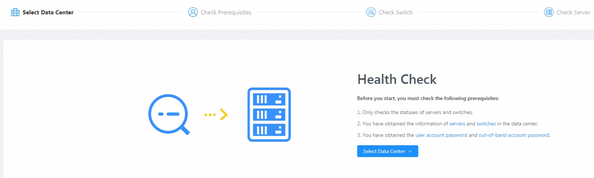

4. On the **Check Prerequisites** page, enter the environment information as prompted.

   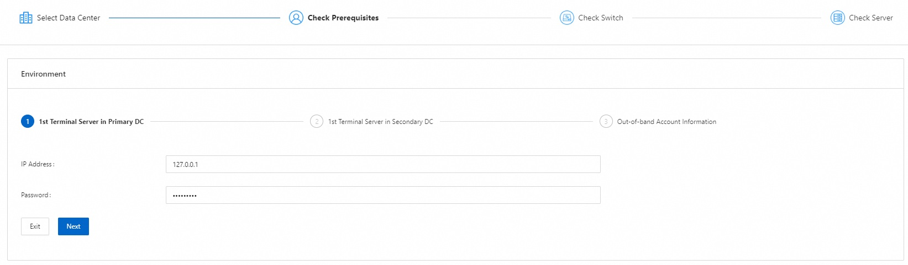

5. Click **Next**. After the information is verified, ASR begins to check the status of the switches.

   If the status of the switches is abnormal, contact on-site O&M engineers to resolve the abnormalities, or you can ignore the abnormalities based on your requirements.

   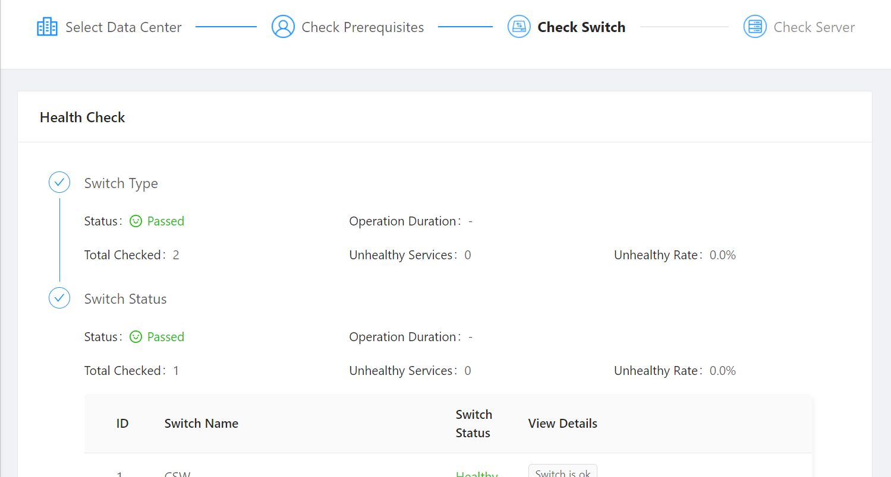

6. Check information about the servers, including the SNs, out-of-band IP addresses, hostnames, and power supply.

   If the status of the servers is abnormal, contact on-site O&M engineers to resolve the abnormalities, or you can ignore the abnormalities based on your requirements.

   You can also click **View Server Role** to view the server role information about the required server.

   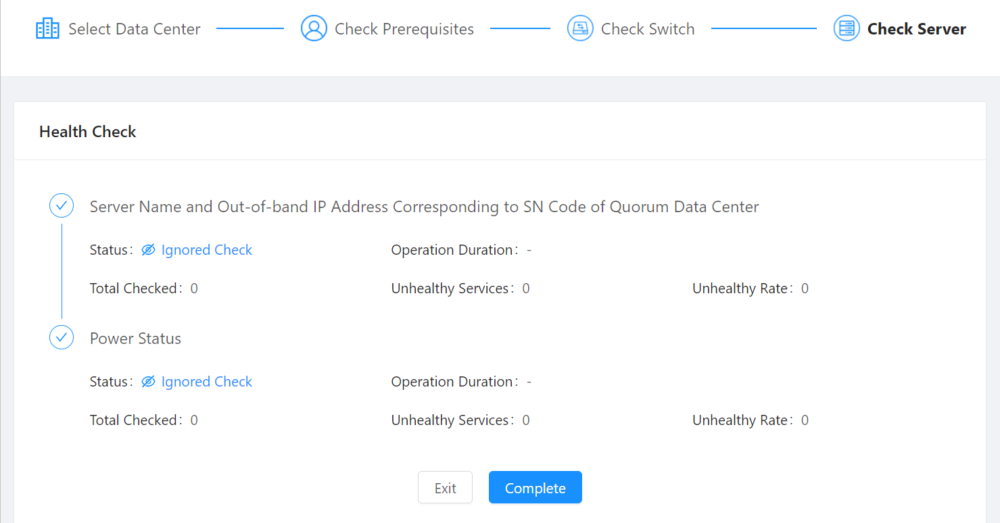

7. Click **Complete** to complete the checks.

##### 3.4.2.1.4. Inject a power outage

###### 3.4.2.1.4.1. Inject a power outage

This topic describes how to simulate a power outage scenario by shutting down all servers in a data center in the ASR for Zone-disaster Recovery console.

**Prerequisites**

An authentication code is obtained. For more information, see Apply for an authentication code.

**Procedure**

1. Use an administrator account to log on to the ASR for Zone-disaster Recovery (Primary Zone) console or the ASR for Zone-disaster Recovery (Secondary Zone) console. For more information, see Escape logon scenarios.

   > **Note**
   >
   > - To inject a power outage into the primary data center, use an administrator account or an account that is assigned the advanced O&M role to log on to the ASR for Zone-disaster Recovery (Secondary Zone) console.
   >
   > - To inject a power outage into the secondary data center, use an administrator account or an account that is assigned the advanced O&M role to log on to the ASR for Zone-disaster Recovery (Primary Zone) console.

2. In the left-side navigation pane, choose **Disaster Recovery > Fault Simulation > Inject Fault**.

3. Select the switch ports you want to disable. You can select **Port for Public Network Connection** and **Port for Physical Connection**.

   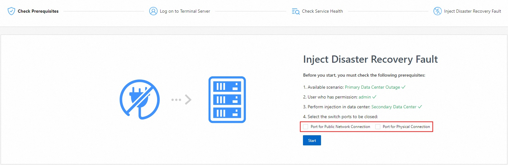

   > **Note**
   >
   > ASR automatically identifies whether the authentication code and the user information are valid. If the information is invalid, you are not allowed to perform operations.

4. Click **Start**. Enter the obtained authentication code. You are navigated to the Log on to Terminal Server step. Enter the environment information and click **Submit**.

5. After the environment information is checked, click **Next**.

6. On the **Inject Disaster Recovery Fault** page, select whether to protect data.

   - **Fail Over**: ASR first switches over Apsara Stack DNS, MiniRDS, and ApsaraDB RDS to the peer data center to prevent data loss.

   - **Skip**: ASR shuts down the servers in the current data center, which may cause data loss.

7. Optional. In the **Primary Data Center Server** step, view the list of servers that need to be shut down. If servers that do not need to be shut down exist, enter the server names in the **Exclude Server** field. Click **Submit**.

   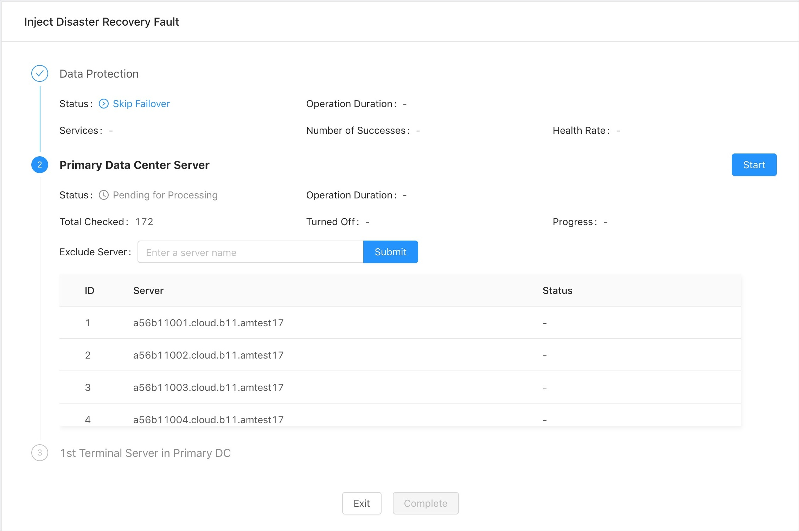

8. Click **Start** to shut down the servers.

9. After the servers are shut down, click **Shut Down OPS Servers**.

0. After the fault is injected, click **Complete**.

**What to do next**

After a power outage is injected, verify that your business is switched over and services are available. Then, recover the data center into one for which the power outage is injected. For more information about how to recover a data center after switchover for power outages, see Recover a data center after switchover for power outages.

###### 3.4.2.1.4.2. Recover a data center after the switchover for power outages

This topic describes how to start all servers in a data center in the ASR console to simulate a power outage scenario.

**Prerequisites**

Your business is successfully switched over, and all services are available.

**Procedure**

1. Use an administrator account to log on to the ASR for Zone-disaster Recovery (Primary Zone) console or the ASR for Zone-disaster Recovery (Secondary Zone) console. For more information, see Escape logon scenarios.

   > **Note**
   >
   > - To inject a power outage in the ASR for Zone-disaster Recovery (Primary Zone) console, log on to this console.
   >
   > - To inject a power outage in the ASR for Zone-disaster Recovery (Secondary Zone) console, log on to this console.

2. In the left-side navigation pane, choose **Disaster Recovery > Fault Simulation > Data Center Disaster Recovery**.

   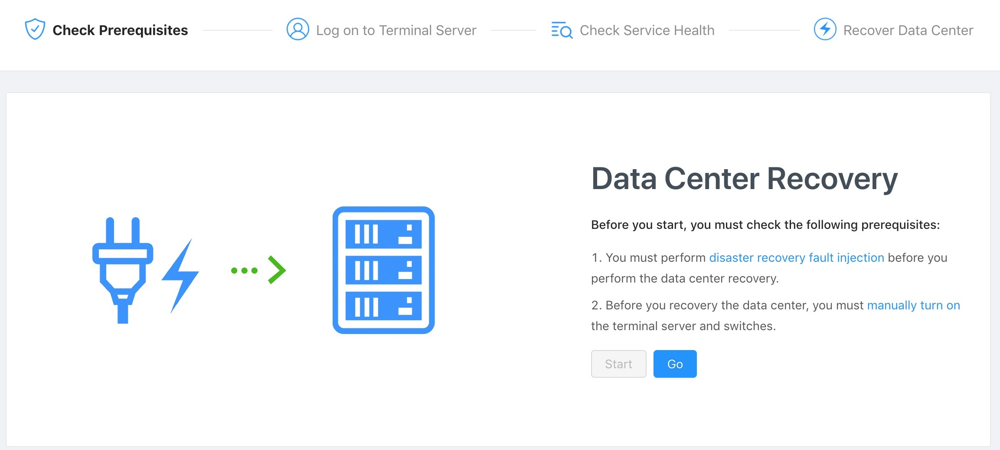

   > **Note**
   >
   > ASR automatically identifies whether the authentication code and the user information are valid. If the information is invalid, you are not allowed to perform operations.

3. Click **Start**. Enter the obtained authentication code. The account information does not need to be verified. ASR checks the environment information before the data center is recovered.

4. On the **Data Center Disaster Recovery** page, click **Start** to start servers in the data center.

5. In the process where the system recovers the primary data center after switchover for power outages, recover Domain Name System (DNS) after the servers in the primary data center are started. To recover DNS, perform the following operations.

   > **Note**
   >
   > This step is not required for recovering a secondary data center after switchover for power outages.

   <ol type="i">

   <li>

   Enter the IP address and the password that are used to log on to the OPS 2 server from the primary data center.

   </li>

   <li>

   Set the status of dns-master to STANDBY for the faulty data center.

   </li>

   <li>

   Check synchronization logs.

   </li>

   <li>

   Check the dnsapi1 and dnsapi2 field values.

   </li>

   <li>

   Add the anycastIp field value.

   </li>

   <li>

   Enable OSPFD or BGPD to advertise routes.

   </li>

   </ol>

6. Click **Complete** after all servers are started and the system shows that the data center is recovered.

##### 3.4.2.1.5. Network outage of data centers

###### 3.4.2.1.5.1. Inject a network outage

This topic describes how to simulate a network outage scenario in the ASR console by interrupting network connections across data centers.

**Prerequisites**

An authentication code is obtained. For more information, see Apply for an authentication code.

**Procedure**

1. Use an administrator account to log on to the ASR for Zone-disaster Recovery (Primary Zone) console. For more information, see Escape logon scenarios.

2. In the left-side navigation pane, choose **Disaster Recovery > Fault Simulation > Inject Fault**.

3. Select the switch ports you want to disable. In the Select the switch ports to be closed step, you can select **Port for Public Network Connection** and **Port for Public Network Connection**. By default, **Port for Cross-Data Center Circuit** is disabled.

   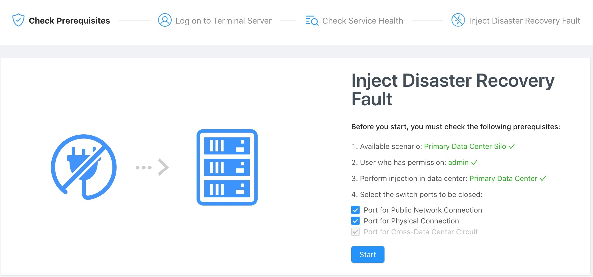

   > **Note**
   >
   > ASR automatically identifies whether the authentication code and the user information are valid. If the information is invalid, you are not allowed to perform operations.

4. Click **Start**. Enter the obtained authentication code. ASR begins to check the environment information.

5. After the environment information is checked, click **Next**.

6. On the **Inject Disaster Recovery Fault** page, click **Start** or **Skip** to disable or skip disabling ports for Internet connections, physical connections, and cross-data center connections.

7. After the fault is injected, click **Complete**.

   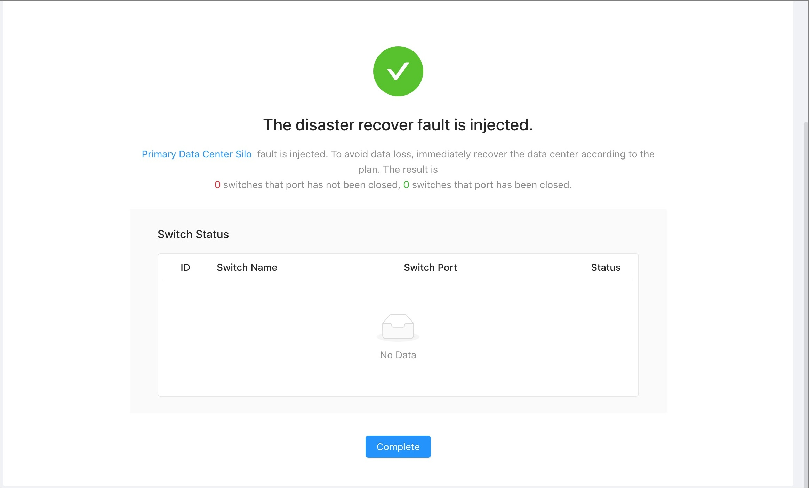

**What to do next**

After a network outage is injected, verify that your business is switched over and services are available. Then, recover the primary data center. For more information about how to recover a data center after switchover for network outages, see Recover a data center after switchover for network outages.

###### 3.4.2.1.5.2. Recover a data center after the switchover for network outages

This topic describes how to simulate the recovery of a data center after the switchover for a network outage by recovering network connections across data centers in the ASR for Zone-disaster Recovery console.

**Prerequisites**

Your business is successfully switched over, and all services are available.

**Procedure**

1. Use an administrator account to log on to the ASR for Zone-disaster Recovery (Primary Zone) console. For more information, see Escape logon scenarios.

2. In the left-side navigation pane, choose **Disaster Recovery > Fault Simulation > Data Center Disaster Recovery**.

   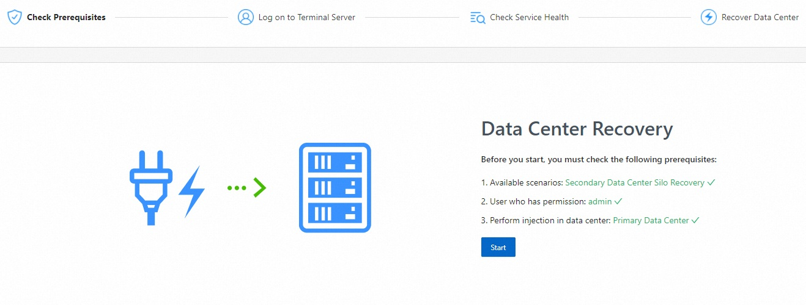

   > **Note**
   >
   > ASR automatically checks whether the authentication code and the user information are valid. You can perform the operation only if the information is valid.

3. Click **Start**. Enter the obtained authentication code. The account information does not need to be verified. ASR checks the environment information before the data center is recovered.

4. After the information about the switches is checked, click **Next**.

5. In the **Recover Data Center** step, click **Start** or **Skip** to enable or skip enabling Internet connections, physical connections, and cross-data center connections.

   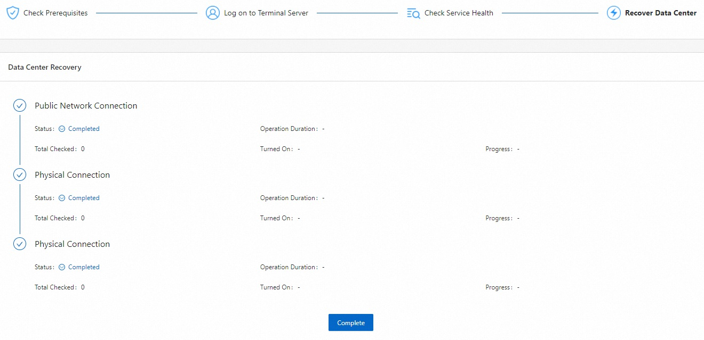

6. When all items are in the **Completed** state, click **Complete**.

##### 3.4.2.1.6. Split-brain scenario

###### 3.4.2.1.6.1. Inject a split-brain scenario

This topic describes how to simulate a split-brain scenario by interrupting network connections across data centers in the ASR for Zone-disaster Recovery console.

**Prerequisites**

An authentication code is obtained. For more information, see Apply for an authentication code.

**Procedure**

1. Use an administrator account to log on to the ASR for Zone-disaster Recovery (Primary Zone) console. For more information, see Escape logon scenarios.

2. In the left-side navigation pane, choose **Disaster Recovery > Fault Simulation > Inject Fault**.

   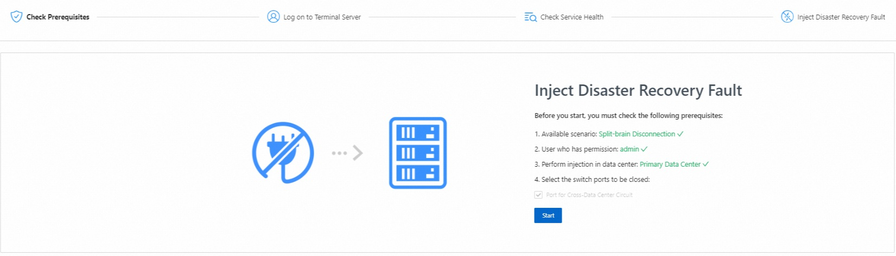

3. Click **Start**. Enter the obtained authentication code. ASR checks the environment information.

4. After the information about the switches is checked, click **Next**.

5. In the **Inject Disaster Recovery Fault** step, click **Start**.

   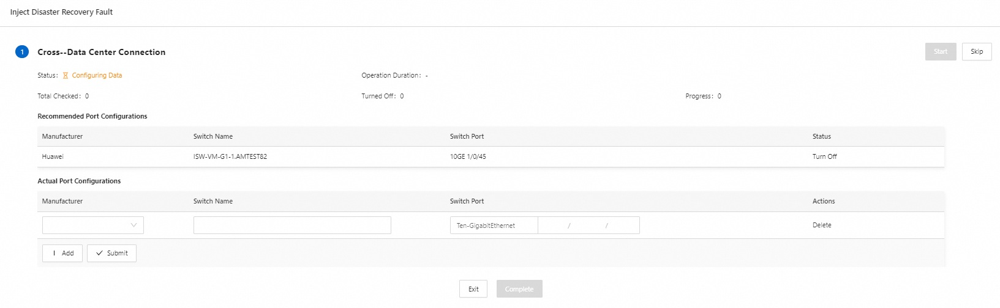

6. After the check is complete, click **Complete**.

7. After the fault is injected, click **Complete**.

**What to do next**

After the split-brain scenario is injected, verify that your business is switched over and services are available. Then, recover the environment. For more information about how to recover the environment after switchover for split-brain scenarios, see Recover an environment after switchover for split-brain scenarios.

###### 3.4.2.1.6.2. Recover an environment after the switchover for split-brain scenarios

This topic describes how to simulate the recovery of an environment for a split-brain scenario in the ASR console by recovering network connections across data centers.

**Prerequisites**

- An authentication code is obtained. For more information, see Apply for an authentication code.

- A split-brain scenario is injected. For more information, see Inject a split-brain scenario.

**Procedure**

1. Use an administrator account to log on to the ASR for Zone-disaster Recovery (Primary Zone) console. For more information, see Escape logon scenarios.

2. In the left-side navigation pane, choose **Disaster Recovery > Fault Simulation > Data Center Disaster Recovery**.

   > **Note**
   >
   > ASR automatically identifies whether the authentication code and the user information are valid. If the information is invalid, you are not allowed to perform operations.

   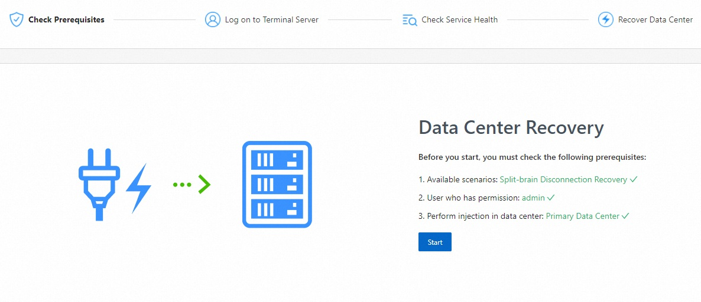

3. Click **Start**. Enter the obtained authentication code. The account information does not need to be verified. ASR checks the environment information before the data center is recovered.

4. After the information about the switches is checked, click **Next**.

5. On the **Recover Data Center** page, click **Start** to recover connections across data centers.

6. When all items are in the **Complete** state, click **Complete**.

7. On the recovery result page, click **Complete**.

##### 3.4.2.1.7. Single-service failback

This topic and its subtopics describe in detail the simulation procedure for and usage notes on single-service failback.

> **Important**
>
> In a disaster recovery deployment architecture, the single-service failback feature of Apsara Stack Resilience (ASR) for Zone-disaster Recovery has a limited application scope. It can address only specific types of single-service faults and does not provide full coverage for all scenarios. To determine whether to use ASR for Zone-disaster Recovery for disaster recovery and the mode to adopt (switchover or failover), you need to carry out a comprehensive assessment of the specific business scenario, system status, and risk factors. If you plan to enable this feature, the product team and the disaster recovery team must jointly evaluate its feasibility and confirm the implementation plan.

###### 3.4.2.1.7.1. Inject a single-service outage

This topic describes how to simulate a single-service outage by shutting down the cluster of a service in the Apsara Stack Resilience (ASR) for Zone-disaster Recovery console.

**Prerequisites**

An authentication code is obtained. For more information, see Apply for an authentication code.

**Procedure**

1. Use an administrator account to log on to the ASR for Zone-disaster Recovery (Primary Zone) console or the ASR for Zone-disaster Recovery (Secondary Zone) console. For more information, see Escape logon scenarios.

2. In the left-side navigation pane, choose **Disaster Recovery > Fault Simulation > Inject Fault**.

3. Click **Start**. Enter the obtained authentication code and click **OK**.

   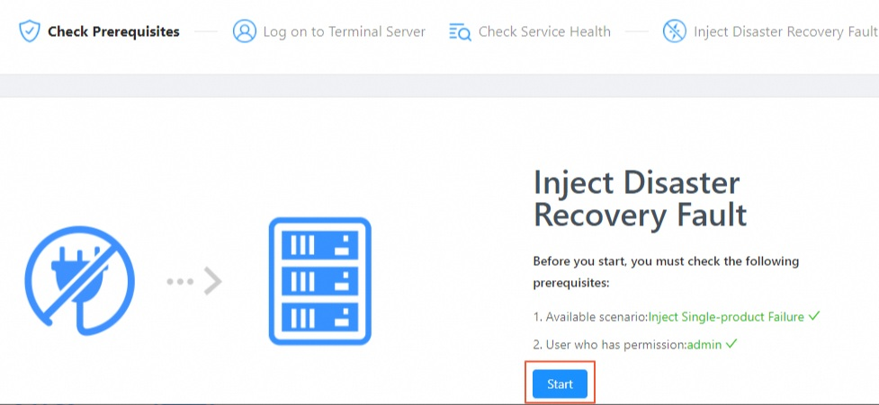

   > **Note**
   >
   > ASR automatically checks whether the authentication code and the user information are valid. You can perform the operation only if the information is valid.

4. Enter the environment information as prompted and click **Submit**.

5. Select the service for which you want to inject a fault and the data center in which the service is deployed. Then, click **Search**. Select the check box of the cluster that you want to shut down. Click **Start**.

   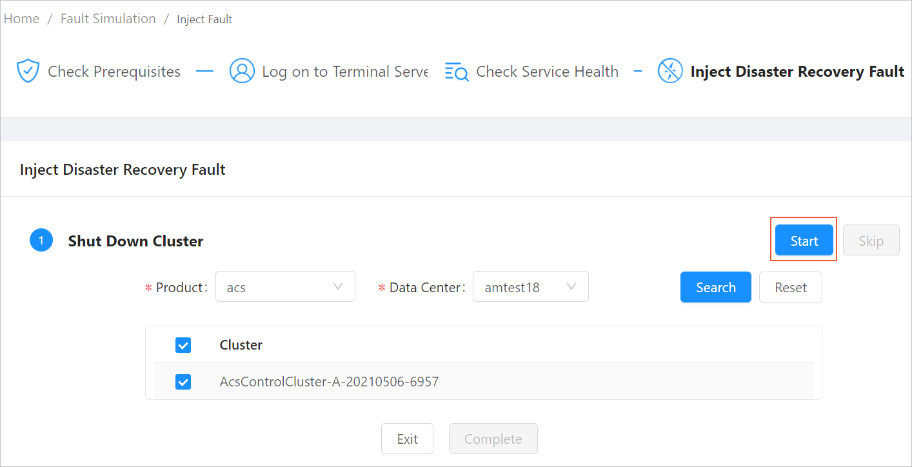

   > **Note**
   >
   > If the cluster fails to shut down, click **Retry**.

6. Click **Complete**.

7. Click **Complete**.

**What to do next**

After the single-service fault is injected, verify that your business is switched over and services are available. Then, recover the data center into one for which the single-service fault is injected. For more information about how to recover a data center after switchover for single-service faults, see Recover a data center after switchover for single-service faults.

###### 3.4.2.1.7.2. Recover a data center after switchover for single-service faults

This topic describes how to simulate the recovery of a data center after the switchover for a single-service outage by starting the cluster of a service in the ASR for Zone-disaster Recovery console.

**Prerequisites**

After a single-service outage occurs, your business is switched over and the services are available.

**Procedure**

1. Use an administrator account to log on to the ASR for Zone-disaster Recovery (Primary Zone) console or the ASR for Zone-disaster Recovery (Secondary Zone) console. For more information, see Escape logon scenarios.

   > **Note**
   >
   > - To inject a single-service fault in the ASR for Zone-disaster Recovery (Primary Zone) console, log on to this console.
   >
   > - To inject a single-service fault in the ASR for Zone-disaster Recovery (Secondary Zone) console, log on to this console.

2. In the left-side navigation pane, choose **Disaster Recovery > Fault Simulation > Data Center Disaster Recovery**.

3. Click **Start**. Enter the obtained authentication code and click **OK**.

   > **Note**
   >
   > ASR automatically checks whether the authentication code and the user information are valid. You can perform the operation only if the information is valid.

4. Enter the environment information as prompted and click **Submit**.

5. In the **Recover Data Center** step, click **Start** in the upper-right corner.

   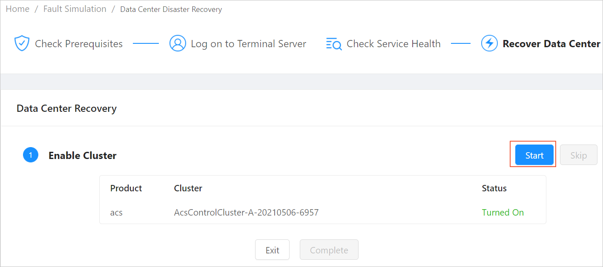

   > **Note**
   >
   > If the cluster fails to start, click **Retry**.

6. If the cluster is started, click **Complete**.

   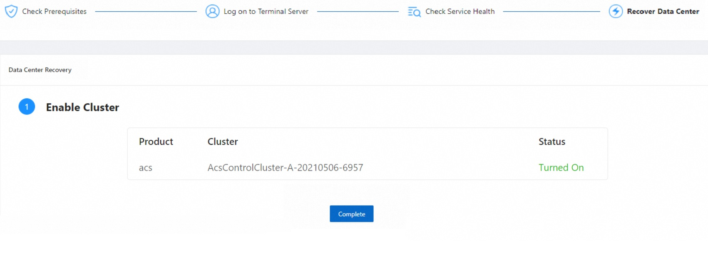

7. Click **Complete**.

#### 3.4.2.2. Fault simulation for three data centers-based zone disaster recovery

You can inject faults to simulate faults such as power and network outages of data centers and single points of failure (SPOFs).

##### 3.4.2.2.1. Preparations

This topic describes the operating platforms and the logon information that you must prepare to inject faults.

| Scenario | Operating platform | Logon information |
| --- | --- | --- |
| Power outage of the primary data center | Apsara Stack Resilience (ASR) for Zone-disaster Recovery (Secondary Zone) | • IP address and password that are used to log on to the OPS 1 server in the primary data center • IP address and password that are used to log on to the OPS 1 server in the secondary data center • IP address and password to log on to the OPS1 server in the quorum data center • Out-of-band account and password |
| Recovery from power outages of the primary data center | ASR for Zone-disaster Recovery (Secondary Zone) | IP address and password that are used to log on to the OPS 2 server in the primary data center |
| Power outage of the secondary data center | ASR for Zone-disaster Recovery (Primary Zone) | • IP address and password that are used to log on to the OPS 1 server in the primary data center • IP address and password that are used to log on to the OPS 1 server in the secondary data center • IP address and password to log on to the OPS1 server in the quorum data center • Out-of-band account and password |
| Recovery from power outages of the secondary data center | ASR for Zone-disaster Recovery (Primary Zone) | N/A |
| Power outage of the quorum data center | ASR for Zone-disaster Recovery (Primary Zone) | • IP address and password that are used to log on to the OPS 1 server in the primary data center • IP address and password that are used to log on to the OPS 1 server in the secondary data center • IP address and password to log on to the OPS1 server in the quorum data center • Out-of-band account and password |
| Recovery from power outages of the quorum data center | ASR for Zone-disaster Recovery (Primary Zone) | N/A |
| Network outage of the primary data center | ASR for Zone-disaster Recovery (Primary Zone) | Information about the switches and ports to be disabled |
| Recovery from network outages of the primary data center | ASR for Zone-disaster Recovery (Primary Zone) | N/A |
| Network outage of the secondary data center | ASR for Zone-disaster Recovery (Primary Zone) | Information about the switches and ports to be disabled |
| Recovery from network outages of the secondary data center | ASR for Zone-disaster Recovery (Primary Zone) | N/A |
| Single-connection failure | ASR for Zone-disaster Recovery (Primary Zone) | Information about the switches and ports to be disabled |
| Recovery from single-connection failures | ASR for Zone-disaster Recovery (Primary Zone) | N/A |
| Single-service outage | ASR for Zone-disaster Recovery (Primary Zone) or ASR for Zone-disaster Recovery (Secondary Zone) | N/A |
| Recover from single-service outages | ASR for Zone-disaster Recovery (Primary Zone) or ASR for Zone-disaster Recovery (Secondary Zone) | N/A |

##### 3.4.2.2.2. Apply for an authentication code

Security risks may arise when faults are injected into a data center. You are not allowed to inject faults unless you are authorized. You must apply for an authentication code before you inject faults into a data center.

**Prerequisites**

The current environment is checked and works as expected.

**Procedure**

1. Use an administrator account to log on to the ASR for Zone-disaster Recovery (Primary Zone) console or the ASR for Zone-disaster Recovery (Secondary Zone) console. For more information, see Escape logon scenarios.

   > **Note**
   >
   > Log on to the ASR for Zone-disaster Recovery (Primary Zone) console or the ASR for Zone-disaster Recovery (Secondary Zone) console based on the fault injection scenario. For more information, see Preparations.

2. In the left-side navigation pane, choose **Disaster Recovery > Fault Simulation > Authentication Code History**.

3. Click **Add**. Configure the Scenario and User parameters and click **Submit**.

   The generated authentication code is displayed in the message that appears. Record the authentication code. You must provide the authentication code when you inject faults.

##### 3.4.2.2.3. Check the environment

To ensure the accuracy of the disaster recovery (DR) drill results, you must check whether the environment works before you inject faults. If the environment does not work as expected, do not perform further operations.

**Background information**

Environment check items differ in fault injection scenarios. Perform environment checks as prompted. This topic describes the common environment check procedure.

**Procedure**

1. Use an administrator account to log on to the Apsara Stack Resilience (ASR) for Zone-disaster Recovery (Primary Zone) console or the ASR for Zone-disaster Recovery (Secondary Zone) console. For more information, see the "escape logon scenarios" section in Log on to the ASR console.

   > **Note**
   >
   > Log on to the ASR for Zone-disaster Recovery (Primary Zone) console or the ASR for Zone-disaster Recovery (Secondary Zone) console based on the fault injection scenario. For more information, see Preparations.

2. In the left-side navigation pane, choose **Disaster Recovery > Fault Simulation > Health Check**.

3. Select the primary, secondary, or quorum data center from the **Select Data Center** drop-down list.

   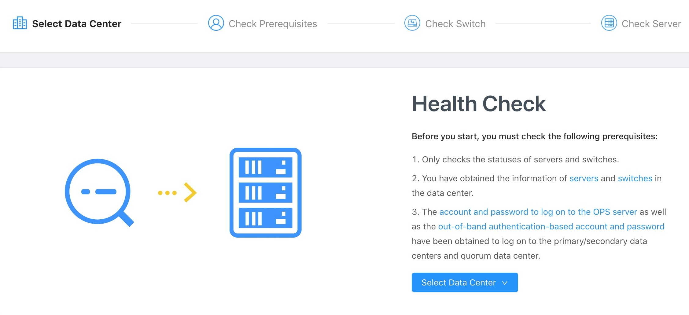

4. In the **Check Prerequisites** step, enter the environment information as prompted.

   

5. Click **Next**. After the information is verified, ASR checks the status of the switches.

   If the status of the switches is abnormal, contact O&M engineers to resolve the abnormalities, or you can ignore the abnormalities based on your requirements.

   

6. ASR checks the information about the servers, including the serial numbers (SNs), out-of-band IP addresses, hostnames, and power supply.

   If the status of the servers is abnormal, contact O&M engineers to resolve the abnormalities, or you can ignore the abnormalities based on your requirements.

   You can also click **View Server Role** to view the server role information about a server.

   

7. Click **Complete** to complete the check.

##### 3.4.2.2.4. Inject a power outage

###### 3.4.2.2.4.1. Inject a power outage

This topic describes how to simulate a power outage scenario by shutting down all servers in a data center in the ASR console.

**Prerequisites**

- The environment information is obtained. For more information, see Preparations.

- An authentication code is obtained. For more information, see Apply for an authentication code.

**Procedure**

1. Use an administrator account to log on to the ASR for Zone-disaster Recovery (Primary Zone) console or the ASR for Zone-disaster Recovery (Secondary Zone) console. For more information, see Escape logon scenarios.

   > **Note**
   >
   > - To inject a power outage into the primary data center, use an administrator account or an account that is assigned the advanced O&M role to log on to the ASR for Zone-disaster Recovery (Secondary Zone) console.
   >
   > - To inject a power outage into the secondary or quorum data center, use an administrator account or an account that is assigned the advanced O&M role to log on to the ASR for Zone-disaster Recovery (Primary Zone) console.

2. In the left-side navigation pane, choose **Disaster Recovery > Fault Simulation > Inject Fault**.

3. Select the switch ports that you want to disable. You can select **Port for Public Network Connection** and **Port for Physical Connection**.

   

   > **Note**
   >
   > ASR automatically checks whether the authentication code and the user information are valid. You can perform the operation only if the information is valid.

4. Click **Start**. Enter the obtained authentication code. You are navigated to the Log on to Terminal Server step.

5. Enter the environment information as prompted and click **Submit**.

6. After the environment information is checked, click **Next**.

7. In the **Inject Disaster Recovery Fault** step, select whether to protect data.

   - **Fail Over**: ASR first switches over MiniRDS and ApsaraDB RDS to the peer data center to prevent data loss.

   - **Skip**: ASR shuts down the servers in the current data center. Data may be lost.

8. **Optional.** In the **Primary Data Center Server** section, view the list of servers that need to be shut down. If servers that do not need to be shut down exist, enter the server names in the **Exclude Server** field. Then, click **Submit**.

   

9. Click **Start** to shut down the servers.

0. After the servers are shut down, click **Shut Down OPS Servers**.

1. After the fault is injected, click **Complete**.

   

**What to do next**

After a power outage is injected, verify that your business is switched over and services are available. Then, recover the data center into one for which the power outage is injected. For more information about how to recover a data center after switchover for power outages, see Recover a data center after switchover for power outages.

###### 3.4.2.2.4.2. Recover a data center after the switchover for power outages

This topic describes how to start all servers in a data center in the ASR console to simulate a power outage scenario.

**Procedure**

1. Use an administrator account to log on to the ASR for Zone-disaster Recovery (Primary Zone) console or the ASR for Zone-disaster Recovery (Secondary Zone) console. For more information, see Escape logon scenarios.

2. In the left-side navigation pane, choose **Disaster Recovery > Fault Simulation > Data Center Disaster Recovery**.

   

   > **Note**
   >
   > ASR automatically identifies whether the authentication code and the user information are valid. If the information is invalid, you are not allowed to perform operations.

3. Click **Start**. Enter the obtained authentication code. The account information does not need to be verified.

   ASR checks the environment information before the data center is recovered.

4. On the **Data Center Disaster Recovery** page, click **Start** to start servers in the data center.

5. Recover Domain Name System (DNS) after the servers in the primary data center are started. To recover DNS, perform the following operations.

   > **Note**
   >
   > This step is unnecessary for the recovery of the secondary data center after switchovers for power outages.

   <ol type="i">

   <li>

   Enter the IP address and the password that are used to log on to the OPS 2 server from the primary data center.

   </li>

   <li>

   Check the dnsapi1 and dnsapi2 field values.

   </li>

   <li>

   Add the anycastVip field value.

   </li>

   <li>

   Enable Open Shortest Path First (OSPF) or Border Gateway Protocol (BGP) to advertise routes.

   </li>

   </ol>

6. Click **Complete** after all servers are started and the system shows that the data center is recovered.

##### 3.4.2.2.5. Network outage of data centers

###### 3.4.2.2.5.1. Inject a network outage

This topic describes how to simulate a network outage scenario in the ASR console by interrupting network connections across data centers.

**Prerequisites**

An authentication code is obtained. For more information, see Apply for an authentication code.

**Procedure**

1. Use an administrator account to log on to the ASR for Zone-disaster Recovery (Primary Zone) console. For more information, see Escape logon scenarios.

2. In the left-side navigation pane, choose **Disaster Recovery > Fault Simulation > Inject Fault**.

3. Select the switch ports you want to disable. In the Select the switch ports to be closed step, you can select **Port for Public Network Connection** and **Port for Public Network Connection**. By default, **Port for Cross-Data Center Circuit** is disabled.

   

   > **Note**
   >
   > ASR automatically identifies whether the authentication code and the user information are valid. If the information is invalid, you are not allowed to perform operations.

4. Click **Start**. Enter the obtained authentication code.

   ASR begins to check the environment information.

5. After the environment information is checked, click **Next**.

6. On the **Inject Disaster Recovery Fault** page, click **Start** or **Skip** to disable or skip disabling ports for Internet connections, physical connections, and cross-data center connections.

7. After the fault is injected, click **Complete**.

   

###### 3.4.2.2.5.2. Recover a data center after the switchover for network outages

This topic describes how to simulate the recovery of a data center after the switchover for a network outage by recovering network connections across data centers in the ASR for Zone-disaster Recovery console.

**Prerequisites**

Your business is successfully switched over, and all services are available.

**Procedure**

1. Use an administrator account to log on to the ASR for Zone-disaster Recovery (Primary Zone) console. For more information, see Escape logon scenarios.

2. In the left-side navigation pane, choose **Disaster Recovery > Fault Simulation > Data Center Disaster Recovery**.

   

   > **Note**
   >
   > ASR automatically checks whether the authentication code and the user information are valid. If the information is invalid, you are not allowed to perform operations.

3. Click **Start**. Enter the obtained authentication code. The account information does not need to be verified.

   ASR checks the environment information before the data center is recovered.

4. After the information about the switches is checked, click **Next**.

5. In the **Recover Data Center** step, click **Start** or **Skip** to enable or skip enabling Internet connections, physical connections, and cross-data center connections.

   

   > **Note**
   >
   > Information such as the names of the switches you want to disable, switch ports, and manufacturers is specified when you inject the fault. You cannot enter the information again.

6. When all items are in the **Completed** state, click **Complete**.

##### 3.4.2.2.6. SPOFs

Single points of failure (SPOFs) occur when the network connections between two data centers are abnormal. You can simulate SPOF scenarios in the ASR console by interrupting the connections across data centers.

###### 3.4.2.2.6.1. Inject a single-connection fault

This topic describes how to simulate a single-connection fault in the ASR console by interrupting network connections across data centers.

**Prerequisites**

An authentication code is obtained. For more information, see Apply for an authentication code.

**Procedure**

1. Use an administrator account to the ASR for Zone-disaster Recovery (Primary Zone) console. For more information, see Escape logon scenarios.

2. In the left-side navigation pane, choose **Disaster Recovery > Fault Simulation > Inject Fault**.

   

   > **Note**
   >
   > ASR automatically identifies whether the authentication code and the user information are valid. If the information is invalid, you are not allowed to perform operations.

3. Click **Start**. Enter the obtained authentication code.

   ASR begins to check the environment information.

4. After the information about the switches is checked, click **Next**.

5. On the **Inject Disaster Recovery Fault** page, set Switch Name, Switch Port, and Manufacturer. You can add records for multiple switches. Click Submit.

6. Click **Start**.

   

7. When the status becomes complete, click **fault injection Complete**.

8. After the fault is injected, click **Complete**.

###### 3.4.2.2.6.2. Recover an environment after the switchover for single-connection faults

This topic describes how to simulate the recovery of an environment after the switchover for a single-connection fault in the ASR console by recovering network connections across data centers.

**Prerequisites**

The single-connection fault is injected.

**Procedure**

1. Use an administrator account to log on to the ASR for Zone-disaster Recovery (Primary Zone) console. For more information, see Escape logon scenarios.

2. In the left-side navigation pane, choose **Disaster Recovery > Fault Simulation > Data Center Disaster Recovery**.

   

   > **Note**
   >
   > ASR automatically identifies whether the authentication code and the user information are valid. If the information is invalid, you are not allowed to perform operations.

3. Click **Start**. Enter the obtained authentication code. The account information does not need to be verified.

   ASR checks the environment information before the data center is recovered.

4. After the information about the switches is checked, click **Next**.

5. On the **Recover Data Center** page, click **Start**. The system recovers network connections across three data centers based on the switch and port information specified when the fault is injected.

   

6. When all items are in the **Completed** state, click **Complete**.

   

##### 3.4.2.2.7. Single-product failure

###### 3.4.2.2.7.1. Inject a single-product failure

This topic describes how to simulate a single-product failure by shutting down the cluster of a product in the Apsara Stack Resilience (ASR) console.

**Prerequisites**

The authentication code used to simulate the single-product failure is obtained.

**Procedure**

1. Use the administrator account or an account configured with the advanced O&M role to log on to the ASR console. For more information, see Log on to the ASR console.

2. In the left-side navigation pane, choose **Fault Simulation** > **Inject Fault**.

3. Click **Start**. Enter the obtained authentication code. Click **OK**.

   

   > **Note**
   >
   > ASR automatically identifies whether the authentication code and the user information are valid. If the information is invalid, you are not allowed to perform operations.

4. On the **Check Service Health** page, enter the IP addresses and the passwords of the OPS 1 servers for the primary and secondary data centers. Click **Next**.

   

5. Select the product for which you want to inject a failure and the data center where the product is deployed. Click **Search**. Select the check box in front of the cluster you want to shut down. Click **Start**.

   

   > **Note**
   >
   > If the cluster fails to shut down, click **Retry**.

6. Click **Complete**.

7. Click **Complete**.

**What to do next**

After the single-product failure is injected, verify that business is switched over and services are available. Then, recover the primary data center. For more information about how to recover a data center after switchovers for single-product failures, see Recover a data center after switchovers for single-product failures.

###### 3.4.2.2.7.2. Recover a data center after switchover for single-service faults

This topic describes how to simulate the recovery of a data center after the switchover for a single-service outage by starting the cluster of a service in the ASR for Zone-disaster Recovery console.

**Prerequisites**

After a single-service outage occurs, your business is switched over and the services are available.

**Procedure**

1. Use an administrator account to log on to the ASR for Zone-disaster Recovery (Primary Zone) console or the ASR for Zone-disaster Recovery (Secondary Zone) console. For more information, see Escape logon scenarios.

   > **Note**
   >
   > - To inject a single-service fault in the ASR for Zone-disaster Recovery (Primary Zone) console, log on to this console.
   >
   > - To inject a single-service fault in the ASR for Zone-disaster Recovery (Secondary Zone) console, log on to this console.

2. In the left-side navigation pane, choose **Disaster Recovery > Fault Simulation > Data Center Disaster Recovery**.

3. Click **Start**. Enter the obtained authentication code and click **OK**.

   > **Note**
   >
   > ASR automatically checks whether the authentication code and the user information are valid. You can perform the operation only if the information is valid.

4. Enter the environment information as prompted and click **Submit**.

5. In the **Recover Data Center** step, click **Start** in the upper-right corner.

   

   > **Note**
   >
   > If the cluster fails to start, click **Retry**.

6. If the cluster is started, click **Complete**.

   

7. Click **Complete**.

### 3.4.3. Disaster recovery records

This topic describes how to view disaster recovery records. The records include the time for various recovery and switchover operations, execution results, logs, and switchover duration.

**Procedure**

1. Use an administrator account to log on to the ASR for Zone-disaster Recovery (Secondary Zone) console. For more information, see Escape logon scenarios.

2. In the left-side navigation pane, choose **Disaster Recovery > Recovery History**.

   

3. View record details.

   - View log details for power outage disaster recovery and network outage disaster recovery records.

     <ol type="a">

     <li>

     Click the  icon on the left side of a recovery operation name in the **Switchover**

     **Records** section to view the operation time, execution result, and switchover duration.

     </li>

     <li>

     Click **Logs** in the Actions column to view the details of recovery logs.

     </li>

     </ol>

   - View the details of the recovery process.

     - Click **View Details** in the **Actions** column to view the execution process of a recovery record.

       

# 4.O&M views

## 4.1. Monitoring center

### 4.1.1. Check an environment

You can perform environment checks to obtain information such as the versions of services with disaster recovery deployed, service baselines, Domain Name System (DNS) resources, virtual IP address (VIP) resources, and database resources. Additionally, you can check whether all check items meet disaster recovery conditions.

1. Log in to the Apsara Stack Resilience (ASR) for Zone-disaster Recovery (Primary Zone) console or the ASR for Zone-disaster Recovery (Secondary Zone) console, and switch to the O&M mode. For more information, see Log in to the ASR console.

2. In the left-side navigation pane, choose **Monitoring Center > Environment Check**.

3. On the **Environment Check** page, click **Check Now** in the upper-right corner of each section to view the corresponding check item. The following content describes the check items:

   - **Product Configuration Upgrade**: After services are redeployed or service configurations are upgraded, rolling must be performed on the services in the primary data center so that ASR can obtain the latest configurations of the data center. Check whether the list of services with configuration upgrades is consistent with the services that are redeployed or whose configurations are upgraded.

     

   - **Cluster Deployment**: displays whether services are deployed in symmetric mode, based on which you can learn about the clusters where the services are deployed.

     > **Note**
     >
     > - Feature in yellow: This feature is deployed in asymmetric mode but is not required for the secondary cluster. This information can be ignored.
     >
     > - Feature in red: This feature is deployed in asymmetric mode and is required for the secondary cluster. You need to resolve the issue.

     

   - **Product Version**: ASR checks whether the versions of services are consistent between the primary and secondary data centers. If the versions are inconsistent, the services are displayed as abnormal in the ASR console. In this case, you must upgrade the service versions to ensure that the versions are the same between the primary and secondary data centers. This way, switchover failures caused by inconsistent service versions are prevented.

     

   - **Product Baseline**: ASR checks whether the baseline configurations in the environment are the same as those in Apsara Infrastructure Management.

     - If ASR returns a message indicating check passed, the baseline check is successful.

     - If ASR returns a message indicating check failed, check the relevant configurations.

       

   - **DNS Resources**: ASR obtains the DNS resource information of services from Apsara Infrastructure Management. Then, ASR obtains a VIP that maps a domain name from the resource information, and compares the actual VIP with the VIP obtained from the resource information in Apsara Infrastructure Management. If the two VIPs are inconsistent, the value in the **Comparison Result** column is **Abnormal**. In this case, check and modify corresponding configurations.

     

   - **VIP Resources**: ASR obtains the VIP resource information of services from Apsara Infrastructure Management. Then, ASR queries the actual IP address of a server that corresponds to the VIP from Server Load Balancer (SLB) based on the VIP in resource information, and compares the actual IP address of the server with the list of node controllers (NCs) in the VIP resource information. If the actual IP address and the list of NCs are inconsistent, ASR marks the corresponding RealServer IP value in red. Check and modify corresponding configurations.

     

   - **Database Resources**: ASR obtains the database resource information of services from Apsara Infrastructure Management. Then, ASR connects to the database based on the information and checks the read-only attribute of the primary database. If the primary database is read-only, the value in the **Status** column of the service is **Abnormal** in the ASR console. In this case, modify the configurations of the database.

     

   - **Conditions of the Network Between Data Centers**: ASR checks whether switches can advertise routes of SLB and CIDR blocks of virtual private cloud (VPCs). If **Abnormal** is displayed in the **Status** column, contact O&M engineers.

     

   - **BGP Route**: ASR checks whether switches can advertise routes of OPS-DNS, Apsara Stack DNS, SLB, and VPC and whether the routes are propagated to Border Gateway Protocol (BGP) peers. If **Abnormal** is displayed in the **Status** column, contact O&M engineers.

     

### 4.1.2. Check services

You can check the status of services with disaster recovery deployed before and after switchovers and switchbacks.

1. Log in to the Apsara Stack Resilience (ASR) for Zone-disaster Recovery (Primary Zone) console or the ASR for Zone-disaster Recovery (Secondary Zone) console, and switch to the O&M mode. For more information, see Log in to the ASR console.

2. In the left-side navigation pane, choose **Monitoring Center > Product Check**.

3. Click **Check Now** in the upper-right corner of the **Server Load Balancer**, **OpsDNS**, and **MiniRDS** sections to check the status of each service.

   If the status of a check item is Unhealthy, check the content in the Error Message column. Troubleshoot problems based on the error message.

   

## 4.2. Product O&M

### 4.2.1. Database O&M

#### 4.2.1.1. Zone alignment

Manage the zone alignment feature for disaster recovery instances to control whether each instance participates in zone alignment checks and automatic repairs.

**Products that support zone alignment**

ApsaraDB RDS, ApsaraDB for MongoDB, Tair (Redis OSS-compatible), PolarDB Primary/Secondary Edition, PolarDB Cluster Edition, and PolarDB-X 2.0

> **Note**
>
> The feature requires ApsaraDB RDS v3.18.6r-rds-hotfeature-SP006 or later versions.

**Procedure**

1. Log in to ASR for Zone-disaster Recovery (Primary Data Center) or ASR for Zone-disaster Recovery (Secondary Data Center) in O&M mode. For more information, see Log in to the ASR console.

2. In the left-side navigation pane, choose **Product O&M > Database O&M > Zone Alignment**.

3. On the **Zone Alignment** page, manage the zone alignment feature.

   > **Note**
   >
   > - You can enable global alignment if the global switch is turned off.
   >
   > - You can disable global alignment if the global switch is turned on.
   >
   > - When you disable global alignment or instance alignment temporarily, the maximum expiration period is 30 days.
   >
   > - The instance list displays only the instances for which zone alignment is disabled.

   | Operation | Description |
   | --- | --- |
   | Enable global alignment | i. In the <strong>Global Zone Alignment</strong> section, click <strong>Enable Global Alignment</strong>. ii. In the dialog box, click <strong>OK</strong>. |
   | Disable global alignment | i. In the <strong>Global Zone Alignment</strong> section, click <strong>Disable Global Alignment</strong>. ii. In the dialog box, select the <strong>Duration</strong> and <strong>Expired At</strong>. • <strong>Duration</strong>: You can select <strong>Temporarily Disabled (Automatically Re-</strong><strong>enabled after Specified Period)</strong> or <strong>Permanently Disabled (Manual</strong> <strong>Re-enablement Required)</strong>. • <strong>Expired At</strong>: If you select <strong>Temporarily Disabled (Automatically Re-</strong><strong>enabled after Specified Period)</strong> for <strong>Duration</strong>, you must configure the expiration time. iii. Click <strong>OK</strong>. |
   | Enable instance alignment | i. In the <strong>Instances</strong> section, click <strong>Enable</strong> in the Action column of the target instance. Alternatively, select multiple instances in the instance list and click <strong>Batch</strong> <strong>Enable</strong> at the bottom. ii. In the dialog box, click <strong>OK</strong>. |
   | Disable instance alignment | i. In the <strong>Instances</strong> section, click <strong>Disable Instance Alignment</strong>. ii. In the dialog box, configure the <strong>Instance Name</strong>, <strong>Duration</strong>, and <strong>Expired At</strong>. • <strong>Instance Name</strong>: Enter the name of the instance to disable. • <strong>Duration</strong>: You can select <strong>Temporarily Disabled (Automatically Re-</strong><strong>enabled after Specified Period)</strong> or <strong>Permanently Disabled (Manual</strong> <strong>Re-enablement Required)</strong>. • <strong>Expired At</strong>: If you select <strong>Temporarily Disabled (Automatically Re-</strong><strong>enabled after Specified Period)</strong> for <strong>Duration</strong>, you must configure the expiration time. iii. Click <strong>OK</strong>. |

## 4.3. Configuration center

### 4.3.1. Manage DCI leased lines

After data center interconnect (DCI) leased lines are configured, the network traffic between the devices in data centers is displayed on the **Overview** page. This allows you to view data transmission between the devices in different data centers.

**Prerequisites**

Leased lines are created before you perform a batch import. To create a leased line, perform the following steps: Log in to the Apsara Uni-manager Operations Console. In the top navigation bar, choose **Product Operation > Networking > Network Operations Console** to go to the **Network Operations Console**. Then, in the left-side navigation pane, choose **Basic Network > Leased Line Management > Leased Line Instances** to create a leased line.

**Procedure**

1. Log in to the Apsara Stack Resilience (ASR) for Zone-disaster Recovery (Primary Zone) console or the ASR for Zone-disaster Recovery (Secondary Zone) console, and switch to the O&M mode. For more information, see Log in to the ASR console.

2. In the left-side navigation pane, choose **Configuration Center > Leased Line Management**.

3. Add leased line information.

   - Add a leased line.

     <ol type="a">

     <li>

     Click **Create Leased Line**.

     </li>

     <li>

     In the Create Leased Line dialog box, configure the parameters that are described in the following table.

     | Parameter | Description | Parameter configuration |
     | --- | --- | --- |
     | Current Device | The name of the local device for data transmission. | User-defined. Example: ISW-VM-G1-1.AMTEST82. |
     | Current Port | The number of the outbound or inbound port on the local device for data transmission. | User-defined. Example: 10GE1/0/6. |
     | Peer Device | The name of the peer device for data transmission. | User-defined. Example: ISW-VM-G1-1.AMTEST82. |
     | Peer Port | The number of the outbound or inbound port on the peer device for data transmission. | User-defined. Example: 10GE1/0/6. |
     | Current Data Center | The name of the data center where the local device resides. | User-defined. Example: amtest1. |
     | Peer Data Center | The name of the data center where the peer device resides. | User-defined. Example: amtest2. |
     | Bandwidth (Mbps) | The maximum rate of direct data transmission between the local and peer devices.Unit: Mbit/s. | Enter a value based on the actual data transmission rate. Example: 100. |

     </li>

     </ol>

     <ol type="i" start="100">

     <li>

     Click **OK**.

     </li>

     </ol>

   - Add multiple leased lines at a time.

     <ol type="a">

     <li>

     Click **Import**.

     </li>

     <li>

     In the **Import Leased Line** dialog box, select the leased lines that you want to add.

     </li>

     </ol>

     <ol type="i" start="100">

     <li>

     Click **OK**.

     </li>

     </ol>

**What to do next**

After you configure leased line information, you can perform the following operations.

| Operation | Procedure |
| --- | --- |
| Customize column fields | 1. Click theicon in the upper-right corner of the page. 2. Select the column fields that you want to display and clear the column fields that you do not want to display. 3. Click <strong>Reset</strong> to restore the default settings and select all column fields. |
| Modify leased line information | 1. Find the leased line that you want to manage and click <strong>Modify</strong> in the <strong>Actions</strong> column. 2. Modify the parameters as required. 3. Click <strong>OK</strong>. |
| Delete a leased line | 1. Find the leased line that you want to delete and click <strong>Delete</strong> in the <strong>Actions</strong> column. 2. In the message that appears, click <strong>OK</strong>. |

### 4.3.2. Manage arbitration

In the standard three-data-center deployment scenario, the arbitration service detects whether a real data center-level fault occurs. If so, the arbitration service determines whether the current conditions are met to initiate arbitration switchover and then switches the services and base to a normal data center.

**Constraints**

The arbitration switchover is subject to the following constraints:

- When the arbitration switchover fails, the arbitration service does not perform a switchover retry and requires human intervention.

- When the original data center is recovered, the arbitration service does not automatically switch back to the original data center.

> **Important**
>
> Automatic arbitration for switchover is executed only in primary data center failure scenarios.

**Arbitration process**

Before the arbitration switchover is executed, the arbitration service performs the detection. The following figure shows the entire process of the arbitration service:

1. On the **Arbitration Management** page, you can enable the arbitration service. After ASR for Zone-disaster Recovery determines that the data center is normal, the arbitration service is enabled.

2. The arbitration service performs the following steps in the detection:

   <ol type="i">

   <li>

   Whether the heartbeat of the node service in each data center is normal:

   - If the heartbeat is detected, the data center is normal and the detection ends.

   - If no heartbeat is detected, the next step is performed.

   </li>

   <li>

   Reference service inspection. If exceptions are detected during the inspection of Apsara

   </li>

   </ol>

   Infrastructure Management, perform the next detection. For more information, see Service monitoring. Otherwise, the detection ends.

   <ol type="i" start="3">

   <li>

   Arbitrated service inspection. If exceptions are detected during the inspection of

   </li>

   </ol>

   arbitrated services, perform the next detection. Otherwise, the detection ends.

   <ol type="i" start="4">

   <li>

   ISW connectivity check.

   </li>

   </ol>

3. When the detection of the arbitration service ends, the arbitration decision phase starts. The arbitration switchover is initiated only after the following conditions are met:

   - The specified number of arbitration detections is reached.

   - The services in the destination data center are normal.

   - The metadatabases that the services depend on have been switched to the destination data center.

4. Arbitration switchover: After the arbitration conditions are met, Apsara Stack Resilience (ASR) for Zone-disaster Recovery forcibly switches over the arbitrated service. After the switchover is completed, the prompt is displayed on the page.

5. Wait for the data center recovery: After the arbitration switchover is completed, you must recover the faulty data center. The entire arbitration process ends after the arbitration service detects that the data center is recovered. However, the arbitration service is still enabled. You must manually disable the arbitration service.

**Prerequisites**

- ASR for Zone-disaster Recovery services of the primary and secondary data centers run normally.

- The inspection results of the arbitration service are normal.

- The ISW connectivity check of each data center is normal.

**Procedure**

1. Log in to the ASR for Zone-disaster Recovery (Secondary Zone) console and switch to the O&M mode. For more information, see Log in to the ASR console.

2. In the left-side navigation pane, choose **Configuration Center > Arbitration Management**.

3. On the **Arbitration Management** page, click **Create Arbitration**.

   

4. On the **Arbitration Management** page, select the services for which you want to perform automatic arbitration for a switchover. The selected services can be forcibly switched over only after the system determines that arbitration is required.

   

   > **Note**
   >
   > - The preceding figure is for reference only. The content displayed in your actual environment prevails. The following services support automatic arbitration for a switchover: PolarDB-X 2.0, Middleware, Apsara Stack DNS, TongQue, Member Kubernetes, Tablestore, Application Real-Time Monitoring Service (ARMS), and Managed Service for Prometheus.
   >
   > - Click Arbitration Instructions in the upper part of the page to view the arbitration capabilities and switchover constraints.

5. In the **ISW Information** section, click **Add ISW** to configure the inter-connection switch (ISW) information for the primary data center, secondary data center, and third data centers in sequence. You must add at least two entries of ISW information for each data center.

6. Configure the **Data Center Fault Detections** parameter. This parameter indicates the number of repeated checks when the arbitration service detects a data center fault. An arbitration switchover is initiated only when all checks fail. The checks are repeated with an interval of about 40 seconds.

7. Click **Save**.

> **Note**
>
> The data center will be powered off when the data center is relocated. To prevent automatic switchover initiated by the arbitration service, you must disable the arbitration service before the data center is relocated.

**Other operations**

After the arbitration service is enabled, you can perform the following operations:

| Operation | Procedure |
| --- | --- |
| Modify Arbitration | 1. On the <strong>Arbitration Management</strong> page, click <strong>Modify Arbitration</strong>. 2. After you modify the configurations, click <strong>Save</strong>. |
| Disable Arbitration | On the <strong>Arbitration Management</strong> page, click <strong>Disable Arbitration</strong>. |

#### 4.3.2.1. Arbitration configuration

This section describes the prerequisites, procedures, and other related operations for configuring arbitration.

**Background information**

The supported arbitration products vary based on the deployment scenario.

**Prerequisites**

- The product that requires arbitration uses a disaster recovery deployment scenario.

- If the product cluster uses a pure three-data-center deployment and supports automatic recovery in failure scenarios, arbitration cannot be configured. For example, tenant Domain Name System (DNS) in the 3AZ scenario does not support arbitration.

- ASR in the primary and secondary data centers works properly.

- The inspection results of the arbitration products are normal.

- The Inter-Switch (ISW) connectivity check between data centers is normal.

**Procedure**

1. Log on to the ASR for Zone-disaster Recovery—Secondary Data Center console and switch to the O&M mode. For more information, see Log in to the ASR console.

2. In the left-side navigation pane, choose **Configuration Center > Arbitration Management > Arbitration Configurations**.

3. On the **Arbitration Management** page, click **Arbitration Instructions**. The system displays the arbitration capabilities and failover constraints.

   

4. Click **Create Arbitration**.

   > **Note**
   >
   > The arbitration products supported in dual-data center and three-data center scenarios differ. The following list describes the supported arbitration products.
   >
   > - Dual-data center: MemberK8s, Middleware, Alibaba Cloud DNS, Minirds, SLSInner, OTSInner, Tongque, Apsara Infrastructure Operations Platform, AnalyticDB, ApsaraDB for MongoDB, ApsaraDB RDS, PolarDB, PolarDB-X 2.0, Tair (Redis-compatible), AnalyticDB, Database Autonomy Service (DAS), Lindorm, Database Backup (DBS), DataHub, DataWorks, Elasticsearch, Server Load Balancer (SLB), DNSProduct, Elastic Compute Service (ECS), OTS (Tablestore), Object Storage Service (OSS), Simple Log Service (SLS), Enterprise Distributed Application Service (EDAS), Application Real-Time Monitoring Service (ARMS), ApsaraMQ for Kafka, ApsaraMQ for RocketMQ, SchedulerX, SunFire, Prometheus, TAOKeeper, DNCS, Alibaba Cloud Security, and Apsara Big Data Manager (ABM)
   >
   > - Three-data center: Middleware, OTSInner, DNSProduct, Tongque, MemberK8s, ARMS, Prometheus, and PolarDB-X 2.0

5. Configure the global parameters and arbitration products.

   <table>
     <tr>
       <th>Section</th>
       <th>Parameter</th>
       <th>Description</th>
     </tr>
     <tr>
       <td rowspan="3">Global Configuration</td>
       <td>Failover Configuration</td>
       <td>• The number of repeated checks when the arbitration service detects a data center fault. The arbitration failover is initiated only when all checks fail. The checks are repeated with an interval of about 40 seconds. • Enter a positive integer. Unit: times</td>
     </tr>
     <tr>
       <td>Automatically Execute Recovery Plan</td>
       <td>Enable or disable automatic execution of recovery plans. • Enable: When the arbitration service detects a fault, it automatically executes the corresponding recovery plan. • Disable: When the arbitration service detects a fault, it only triggers an alert and does not automatically execute the recovery plan.</td>
     </tr>
     <tr>
       <td>ISW Information</td>
       <td>The ISW information is used to detect network connectivity. Enter the name and IP address of the ISW, and click <strong>OK</strong>.</td>
     </tr>
     <tr>
       <td colspan="2">Arbitrated Products Note Click View Arbitration Service Coverage to view all cloud products that support arbitration.</td>
       <td>Click <strong>Add Service</strong>, select a cloud product, and then click <strong>OK</strong>.</td>
     </tr>
   </table>

6. Click **Save**.

7. After you confirm that the configuration is correct, select **I Have Carefully Read and Understood All the Above Risk Warnings and Agree to Assume Business Risks Arising from Configuration Changes. I Understand That Configuration Changes Take Effect Immediately Upon Saving and Have Fully Assessed Their Impact on Business.**, and click **Confirm Save**.

> **Note**
>
> A data center will be powered off when it is relocated. To prevent automatic switchover initiated by the arbitration capability, disable the arbitration feature before the data center relocation.

**Related operations**

After you enable the arbitration service, you can also perform the following operations.

| Task name | Procedure |
| --- | --- |
| Modify Arbitration | 1. On the <strong>Arbitration Management</strong> page, click <strong>Modify Arbitration</strong>. 2. After you complete the modification, click <strong>Save</strong>. |
| Disable Arbitration | On the <strong>Arbitration Management</strong> page, click <strong>Disable Arbitration</strong>. |

#### 4.3.2.2. Node management

This topic describes how to manage etcd nodes in and outside the cloud throughout the entire O&M process, such as adding nodes, issuing certificates, deploying nodes outside the cloud, and rotating certificates.

##### 4.3.2.2.1. Manage nodes

This section describes how to add and deploy nodes.

**Scenarios**

This feature applies only to managing off-cloud arbitration zone nodes in a dual-data-center arbitration deployment architecture.

**Prerequisites**

- Network requirements: The IDC must connect to the cloud via an L-shaped routing topology. Traffic is routed primarily through the primary data center to the cloud and fails over to the secondary data center only if the primary one becomes unavailable.

- Deployment requirements: Deploy at least three etcd nodes outside the cloud.

**Procedure**

1. Log in to the ASR (secondary data center) in O&M mode. For the login method, see Log in to the ASR console.

2. In the left-side navigation pane, choose **Configuration Center > Arbitration Management > Node Management**.

3. Click **Add Node**.

4. Enter the hostname and IP address. Click **OK**.

   

   The status of a successfully added node is **To Be Deployed**. Follow the preceding steps to add three arbitration zone nodes.

5. On the Node Management page, click **Deploy Nodes in Arbitration Zone** to deploy the added arbitration zone nodes.

   

6. Click **Deployment Guide**. Follow the instructions to complete the deployment as prompted.

7. After deployment, verify that all three nodes are functioning properly and the cluster is healthy. If not, redeploy.

   

**Other operations**

You can perform the following operations on nodes that are successfully added and in the To Be Deployed state.

| Task name | Procedure |
| --- | --- |
| Edit a node | 1. On the Node Management page, click <strong>Edit</strong>. 2. After you modify the hostname, click <strong>OK</strong>. |
| Delete a node | 1. On the Node Management page, click <strong>Delete</strong>. 2. In the prompt dialog box, click <strong>OK</strong>. |

##### 4.3.2.2.2. Rotate a certificate

This topic describes the usage notes and procedure for rotating a certificate.

**Prerequisites**

- The arbitration service is disabled during rotation.

- Network connections in and outside the cloud are stable.

**Limits**

- **Rotation Sequence:** Perform steps in sequence. Do not skip steps or perform steps in reverse order.

- **Service Impacts:** The arbitration feature is unavailable for about 15 to 25 minutes during rotation.

- **Time Selection:** We recommend that you perform operations during off-peak hours to avoid affecting the production environment.

- **Backup Policy:** Back up the current certificate before rotation for quick rollback in case of errors.

- **Network Stability:** Make sure that network connections in and outside the cloud are stable to avoid network interruption during rotation.

**Procedure**

1. Log in to the ASR for Zone-disaster Recovery—Secondary Data Center console and switch to the O&M mode. For more information, see Log in to the ASR console.

2. In the left-side navigation pane, choose **Configuration Center > Arbitration Management > Node Management**.

3. In the upper-left corner of the Node Management page, click **Rotate Certificate**.

   > **Note**
   >
   > Click **Rotation Guide** to the right of Rotation Procedure to view the details of the certificate rotation process.

4. Disable the arbitration service.

5. Rotate certificates on nodes in the cloud.

   The system automatically restarts six etcd nodes in the cloud to apply new certificates.

6. Rotate certificates on nodes outside the cloud.

   Download new certificates of all nodes from the Rotate Certificate page and replace the existing rotation certificates for the nodes in the arbitration zone with the new certificates.

7. Check the status of the etcd cluster.

   Verify the status of all nodes and the health status of the cluster.

8. Enable the arbitration feature.

   Enable the arbitration feature and complete the certificate rotation process.

### 4.3.3. Alert management

You can modify preset alert rules or create new alert rules based on your needs.

**Preset alert rules**

| Metric | Product name | Aler t seve rity | Che ck inte rval |
| --- | --- | --- | --- |
| Configur ation upgrade s | PolarDB-X, Simple Log Service, Application Real-Time Monitoring Service, Hologres, Server Load Balancer, OpsDNS, File Storage NAS, VPC, Platform for AI, Container Service for Kubernetes, ApsaraDB RDS, Cloud Firewall, DAuth, Metabase, DataHub, DataWorks, RAM, Network Device Monitoring, BaseServiceALL, Apsara Stack Security Basic Edition, OneConsole, API Gateway, Platform-side Bastionhost, Authorization Information, Butler, ECS, DBS, Open Network Services Platform, Key Management Service, ApsaraDB for OceanBase, Apsara Stack DNS, Apsara Stack Security Advanced Edition, OSS, Inner Tablestore, Tablestore, Web Application Firewall, Apsara Uni-manager Operations Console, ApsaraMQ, Apsara Uni-manager Management Console, SchedulerX 2.0, Global Transaction Service, Realtime Compute, Apsara Stack Basic Web Service, Inner Log Service, Prometheus Monitoring, Resource Orchestration Service, Apsara Stack Inspection System, ASR for Geo-disaster Recovery, Graph Analytics, Distributed Naming and Configuration Service, Cloud Service Bus, Data Transmission Service, TLog, Auto Scaling, Buffer, Apsara Infrastructure Management, O&amp;M API, DataQ, MaxCompute, TaoKeeper, Apsara Network Intelligence | P2 | 30 minu tes |
| Cluster deploym ent | Butler, Apsara Uni-manager Management Console, OneConsole, Apsara Uni-manager Operations Console, DAuth, ApsaraDB for OceanBase, Apsara Infrastructure Management, Global Transaction Service, Realtime Compute, O&amp;M API, ASR for Geo-disaster Recovery, DataQ, Cloud Service Bus, Hologres, Resource Orchestration Service, Data Transmission Service, ApsaraMQ, Server Load Balancer, Simple Log Service, DataWorks, File Storage NAS, Auto Scaling, Cloud Firewall, Container Service for Kubernetes, Distributed Naming and Configuration Service, MaxCompute, Platform for AI, VPC, Prometheus Monitoring, Network Device Monitoring, RAM, ApsaraDB RDS, TaoKeeper, TLog, PolarDB-X, DBS, Apsara Stack Inspection System, ECS, Application Real-Time Monitoring Service, Platform-side Bastionhost, SchedulerX 2.0, Metabase, Tablestore, OSS, Apsara Network Intelligence, Apsara Stack Basic Web Service, DataHub, API Gateway, Key Management Service, Apsara Stack Security Basic Edition, Authorization Information, Buffer, Open Network Services Platform, BaseServiceALL, Apsara Stack DNS, Apsara Stack Security Advanced Edition, Graph Analytics, and Web Application Firewall | P2 | 30 minu tes |

| Product version | Resource Orchestration Service, Cloud Service Bus, SchedulerX 2.0, Data Transmission Service, Inner Tablestore, Apsara Uni-manager Management Console, DataWorks, BaseServiceALL, Global Transaction Service, Apsara Uni-manager Operations Console, Inner Log Service, ApsaraDB for OceanBase, Web Application Firewall, OSS, Tablestore, Key Management Service, Authorization Information, Network Device Monitoring, ECS, API Gateway, ApsaraMQ, DBS, Butler, Apsara Stack Security Basic Edition, Apsara Stack Security Advanced Edition, Open Network Services Platform, TLog, Apsara Infrastructure Management, Realtime Compute, Apsara Stack Basic Web Service, Platform-side Bastionhost, O&amp;M API, Metabase, Buffer, Apsara Stack DNS, RAM, OneConsole, Hologres, ASR for Geo-disaster Recovery, Application Real-Time Monitoring Service, Container Service for Kubernetes, PolarDB-X, ApsaraDB RDS, Apsara Stack Inspection System, Platform for AI, VPC, Prometheus Monitoring, TaoKeeper, DataHub, OpsDNS, Server Load Balancer, File Storage NAS, Cloud Firewall, Simple Log Service, DAuth, Apsara Network Intelligence, Graph Analytics, MaxCompute, Auto Scaling, Distributed Naming and Configuration Service, and DataQ | P2 | 30 minu tes |
| --- | --- | --- | --- |
| Product baseline | ASR for zone-disaster recovery | P2 | 30 minu tes |
| DNS resource s | DataQ, Network Device Monitoring, Auto Scaling, MaxCompute, Data Transmission Service, Resource Orchestration Service, ApsaraMQ, Metabase, Apsara Stack Security Basic Edition, ApsaraDB for OceanBase, Cloud Service Bus, BaseServiceALL, Global Transaction Service, Authorization Information, Apsara Uni-manager Operations Console, Web Application Firewall, Tablestore, SchedulerX 2.0, OSS, Apsara Network Intelligence, Realtime Compute, Apsara Uni-manager Management Console, Key Management Service, Open Network Services Platform, Apsara Stack Inspection System, OneConsole, ECS, DataHub, Apsara Stack Security Advanced Edition, Cloud Firewall, Apsara Stack DNS, Apsara Infrastructure Management, O&amp;M API, DBS, Apsara Stack Basic Web Service, Buffer, RAM, ASR for Geo-disaster Recovery, TaoKeeper, API Gateway, DAuth, Butler, Container Service for Kubernetes, Platform for AI, Prometheus Monitoring, ApsaraDB RDS, Application Real-Time Monitoring Service, PolarDB-X, VPC, Hologres, File Storage NAS, DataWorks, Tlog, Server Load Balancer, Platform-side Bastionhost, Graph Analytics, Distributed Naming and Configuration Service, and Simple Log Service | P2 | 30 minu tes |
| VIP resource s | MaxCompute, Prometheus Monitoring, File Storage NAS, Server Load Balancer, DataHub, Simple Log Service, VPC, ApsaraDB RDS, TLog, Container Service for Kubernetes, Platform for AI, Distributed Naming and Configuration Service, Butler, Application Real-Time Monitoring Service, PolarDB-X, Global Transaction Service, Graph Analytics, Apsara Stack DNS, Cloud Firewall, Apsara Stack Security Basic Edition, Authorization Information, Apsara Network Intelligence, Apsara Infrastructure Management, Apsara Stack Inspection System, BaseServiceALL, Resource Orchestration Service, Apsara Stack Security Advanced Edition, Data Transmission Service, Cloud Service Bus, Buffer, SchedulerX 2.0, Auto Scaling, OneConsole, DataWorks, O&amp;M API, DataQ, Key Management Service, Metabase, OSS, Tablestore, Apsara Uni-manager Management Console, API Gateway, Web Application Firewall, ApsaraDB for OceanBase, Apsara Uni-manager Operations Console, Network Device Monitoring, Open Network Services Platform, TaoKeeper, ApsaraMQ, Realtime Compute, Hologres, Platform-side Bastionhost, RAM, DAuth, ASR for Geo-disaster Recovery, ECS, Apsara Stack Basic Web Service, and DBS | P2 | 30 minu tes |
| Databas e resource s | Metabase, ASR for Geo-disaster Recovery, Web Application Firewall, API Gateway, Realtime Compute, OSS, Platform-side Bastionhost, Tablestore, Apsara Stack Inspection System, Cloud Firewall, Key Management Service, SchedulerX 2.0, Buffer, Apsara Stack DNS, Auto Scaling, DataQ, O&amp;M API, Apsara Infrastructure Management, Open Network Services Platform, Apsara Network Intelligence, Data Transmission Service, Apsara Uni-manager Management Console, Resource Orchestration Service, Cloud Service Bus, Butler, DataWorks, DataHub, Network Device Monitoring, Global Transaction Service, Apsara Uni-manager Operations Console, Container Service for Kubernetes, Platform for AI, Hologres, Application Real-Time Monitoring Service, Prometheus Monitoring, ApsaraDB for OceanBase, VPC, File Storage NAS, OneConsole, Server Load Balancer, ApsaraMQ, Simple Log Service, PolarDB-X, Distributed Naming and Configuration Service, ECS, MaxCompute, DBS, TLog, DAuth, Apsara Stack Security Advanced Edition, TaoKeeper, RAM, BaseServiceALL, Apsara Stack Security Basic Edition, Apsara Stack Basic Web Service, Graph Analytics, Authorization Information, and ApsaraDB RDS | P2 | 30 minu tes |
| Network conditio ns between data centers | OpsDNS, Server Load Balancer, VPC, and Apsara Stack DNS | P2 | 30 minu tes |
| BGP routing | OpsDNS, Server Load Balancer, VPC, and Apsara Stack DNS | P2 | 30 minu tes |
| Service capabilit y checks | Metabase, OpsDNS, and Server Load Balancer | P2 | 30 minu tes |
| Disaster recovery capabilit y check | Elasticsearch on Kubernetes, Butler, ApsaraDB for HBase, ApsaraMQ for Kafka, Apsara Stack Security Unified Log Analysis, MemberK8S, Global Transaction Service, Distributed Naming and Configuration Service, TaoKeeper, DataQ, Server Load Balancer, OpsDNS, Simple Log Service, ApsaraDB for MongoDB, Realtime Compute, Apsara Stack DNS, DataWorks, Tair (Redis OSS-compatible), AnalyticDB, Lindorm, Application Real-Time Monitoring Service, ApsaraDB RDS, base log service, Graph Analytics, Apsara Big Data Manager, Apsara Stack Security OEM, DataHub, Enterprise Distributed Application Service, Hologres, ApsaraMQ, DBS, Apsara Infrastructure Management, Prometheus Monitoring, Open Network Services Platform, Apsara Stack Inspection System, ECS, Tablestore, Key Management Service, Inner Tablestore, AnalyticDB for PostgreSQL, OSS, and Metabase | P2 | 1 minu te |
| Data synchro nization latency checks | Tair (Redis OSS-compatible), ApsaraDB RDS, Hologres, ApsaraDB for MongoDB, AnalyticDB for PostgreSQL, OSS, and Tablestore | P2 | 1 minu te |
| Protectio n group checks | ASR for zone-disaster recovery | P2 | 1 minu te |

#### 4.3.3.1. Modify an alert rule

You can modify the alert severity specified in an alert rule based on your business requirements.

**Procedure**

1. Log in to the Apsara Stack Resilience (ASR) for Zone-disaster Recovery (Secondary Zone) console and switch to the O&M mode. For more information, see Log in to the ASR console.

2. In the left-side navigation pane, choose **Configuration Center > Alerts**.

3. Find the alert rule that you want to modify and click **Modify** in the **Actions** column.

4. In the **Modify Alert Rule** dialog box, modify the parameters as needed.

   > **Note**
   >
   > For synchronization latency alerts, you can modify both the alert threshold and alert severity.

   Valid values of alert severities:

   - P1: Critical

   - P2: Severe

   - P3: Warning

   - P4: Info

   

5. Click **OK**.

### 4.3.4. Configure theme settings

This topic describes how to configure theme settings for the monitoring dashboard or drill dashboard page, including the theme color, logo, and platform name.

**Background information**

- You can configure the theme color of the dashboard page.

- You can configure the logo on the dashboard page.

- You can configure the title of the dashboard page.

- You can restore the dashboard page to default settings with one click. This operation is irreversible.

**Procedure**

1. Log in to the Apsara Stack Resilience (ASR) for Zone-disaster Recovery (Primary Zone) console or the ASR for Zone-disaster Recovery (Secondary Zone) console, and switch to the O&M mode. For more information, see Log in to the ASR console.

2. In the left-side navigation pane, choose **Configuration Center > Theme Settings**.

   

3. The following table describes the parameters that you can configure on the Theme Settings page.

   <table>
     <tr>
       <th>Section</th>
       <th>Parameter</th>
       <th>Description</th>
     </tr>
     <tr>
       <td rowspan="2">Appearance and Body</td>
       <td>Theme Color</td>
       <td>The theme color. Valid values: • Recommended Theme Color: the default and recommended theme color. • Custom Palette: You can click theicon to select a color. Note The transparency of a custom color cannot be higher than 0.4.</td>
     </tr>
     <tr>
       <td>Preview</td>
       <td>Displays a dashboard page for preview after you select a theme color.</td>
     </tr>
     <tr>
       <td rowspan="2">Brand Configuratio n</td>
       <td>Platform Logo</td>
       <td>Allows you to upload a logo image. We recommend that you use an image with an aspect ratio of 1:1, such as 200 × 200 pixels. The image cannot exceed 2 MB in size and must be of the GIF, PNG, JPG, or JPEG format.</td>
     </tr>
     <tr>
       <td>Platform Name</td>
       <td>The title of the dashboard page. We recommend that you specify a name containing no more than 40 characters in length.</td>
     </tr>
   </table>

4. Click **Save**. To restore the dashboard page to the default settings, click **Restore Factory Settings** in the lower part of the page. The configurations take effect the next time you log in to the console.

## 4.4. Security center

### 4.4.1. Data backup

You can back up data such as user accounts and alert rules that are configured in the Apsara Stack Resilience (ASR) for Zone-disaster Recovery console to an Object Storage Service (OSS) bucket. You can restore the data to the ASR for Zone-disaster Recovery console as required with a few clicks.

**Procedure**

1. Log in to the ASR for Zone-disaster Recovery (Primary Zone) console or the ASR for Zone-disaster Recovery (Secondary Zone) console, and switch to the O&M mode. For more information, see Log in to the ASR console.

2. In the left-side navigation pane, choose **Security Center > Data Backup**.

   

3. Click **Back Up Now**. In the message that appears, click **OK**. ASR for Zone-disaster Recovery backs up data such as user accounts and alert rules to an OSS bucket.

> **Note**
>
> To restore the data from OSS to the ASR for Zone-disaster Recovery console, click **Recover**. In the message that appears, click **OK**.

### 4.4.2. Configure escape login

This topic describes how to configure the escape login feature.

**Procedure**

1. Log in to the Apsara Stack Resilience (ASR) for Zone-disaster Recovery (Primary Zone) console or the ASR for Zone-disaster Recovery (Secondary Zone) console from the Apsara Uni-manager Operations Console, and switch to the O&M mode. For more information, see Log in to the ASR console.

2. In the left-side navigation pane, choose **Security Center > Escape Login Management**.

3. Turn on the escape login switch to allow access from https://{domain name}/user/login to the ASR console.

4. Enter the original and new passwords as prompted and click **Submit**.

| Parameter | Description |
| --- | --- |
| Current Password | Enter the current login password of the administrator account. |
| New Password | Enter a new login password for the administrator account. |
| Confirm Password | Enter the new login password again. |

> **Note**
>
> The password must be 12 to 20 characters in length and can contain the following types of characters:
>
> - Digits
>
> - Letters
>
> - Special characters, such as exclamation points (!), at signs (@), number signs (#), dollar signs ($), and percent signs (%)

# 5.Tenant operations

## 5.1. Protection group overview

The protection group is a tenant-facing feature. It allows you to restore individual business units and perform disaster recovery drills by business application.

**Overview**

1. Log in to the ASR console.

2. On the **Protection Group Overview** page, you can view protection group statistics for the current organization, resource set, and region. You can switch the **Organization**, **Resource set**, and **Region** from the left side of the top menu bar on the page.

**Feature description**

A protection group enables you to recover individual business units and perform disaster recovery drills at the application level, provided that the underlying cloud platform capabilities are available. From an application perspective, you can select a set of business-related instances to create a protection group. Within the same protection group, you can include instances such as databases, middleware, and Elastic Compute Service (ECS) instances hosting application services (added via an HDR protection group) as protected objects. Based on the protection group, you can develop corresponding drill plans (switchover) or disaster recovery plans (failover). Protection groups refine the granularity of the original product switchover feature, enabling flexible management of product instances by users from different organizations. Currently the following services are supported: ApsaraDB RDS, ApsaraDB for Redis, ApsaraDB for MongoDB, PolarDB-X 1.0, PolarDB-X 2.0, PolarDB for MySQL with local disks, PolarDB for PostgreSQL with local disks, Object Storage Service (OSS), ECS, Realtime Compute for Apache Flink (storage-compute separation), and Elasticsearch.

> **Note**
>
> - A protection group can be associated with one drill plan and one disaster recovery plan. However, only one of these plans can be executed at a time. To start the other plan, you must terminate the currently running one.
>
> - For RDS and OSS, a protection group maps directly to cloud product instances. For ECS, it must map to Hybrid Disaster Recovery (HDR) protection groups, allowing multiple HDR protection groups to be included.
>
> - For OSS disaster recovery, versions prior to V3.18.3 support failover only for the first cluster (the first group of planned and deployed OSS clusters). If you select an instance from a non-first cluster when creating a protection group, an error occurs during failover.
>
> - To add HDR to a protection group, you must first create the corresponding HDR protection group on the HDR console.

| Feature module | Description |
| --- | --- |
| Protectio n Group Overview | Protection Group Process Statistics (by status), Protection Instance Statistics, Protection Group Drill Statistics, and Disaster Recovery Plan Statistics are displayed in charts. |
| Protectio n Group List | The protection group list is displayed. You can add, delete, and view details of protection groups. • Each protection group entry displays by default the following attributes: <strong>Protection</strong> <strong>Group Name</strong>, <strong>Description</strong>, <strong>Inspection Status</strong>, <strong>Organization</strong>, <strong>Resource Set</strong>, <strong>Created At</strong>, and <strong>Modified At</strong>. Click <strong>Details</strong> in the <strong>Actions</strong> column to enter the protection group details page and view detailed information. • You can search for protection groups by <strong>Protection Group Name</strong>, <strong>Inspection</strong> <strong>Status</strong>, and <strong>Protected Instance</strong>. The search is triggerred automatically when conditions change. • You can modify a protection group on its <strong>Details</strong> page, provided that it has no associated drill or disaster recovery plans. Note • Deletion and modification of a protection group are not allowed if it has an associated drill or disaster recovery plan. • If a successfully created protection group does not appear in the protection group list, first verify that the organization and resource set selections in the top-left menu bar match those selected during creation. (The console displays protection groups specific to the selected organization). • Click the settings iconin the upper-right corner of the list to adjust fields to display or their order. |
| Protectio n Group Drill (Switchove r) | • Drill Plan: The drill plan list is displayed. You can view, add, edit, delete, start, enter, and terminate a drill. Note • Editing and deletion are not supported while a drill plan is being executed. • Once terminated, a drill cannot be restarted. • Drill History: lists the execution flow of each drill plan. |
| Protectio n Group Disaster Recovery (Failover) | • Disaster Recovery Plan: The disaster recovery plan list is displayed. You can view, add, edit, delete, start, enter, and terminate a disaster recovery plan. Note • Editing and deletion are not supported while a disaster recovery plan is being executed. • Once terminated, a disaster recovery plan cannot be restarted. • Disaster Recovery History: lists the execution flow of each disaster recovery plan. |

## 5.2. Protection group process

### 5.2.1. Process overview

Protection groups of the ASR for Zone-disaster Recovery solution are mainly used for instance-level drills and disaster recovery. You can select instances based on your business applications and create protection groups to include the instances. You also can create a drill plan to perform a disaster recovery drill (scheduled switchover). If your business fails, you can use a disaster recovery plan (forced switchover) to perform disaster recovery.

The following figure shows the process about how a protection group is used in the ASR for Zone-disaster Recovery solution.

> **Note**
>
> The two types of switchover have the same disaster recovery execution process. However, they are used in different scenarios.
>
> - **Scheduled switchover**: This refers to hot switchover. When the primary and secondary data centers work as expected, the primary data center is switched to the secondary data center, avoiding data loss. In most cases, scheduled switchover is used for a production business drill.
>
> - **Forced switchover**: This refers to cold switchover. If a fault occurs in the primary data center, or the primary and secondary data centers are disconnected, the primary node of a service is forcibly switched to the secondary data center for quick online business recovery. Forced switchover is used only if a drill data center or a real one is powered off.

### 5.2.2. Create a protection group

This section describes how to create a protection group.

**Scenarios**

A protection group builds on the basic capabilities of the cloud platform and allows you to restore individual services and perform disaster recovery drills by business application. You can add databases, middleware, and Elastic Compute Service (ECS) instances that run application services for the same business to a single protection group (as an HDR protection group) to form a set of protected objects. Based on the protection group, you can create a drill plan (for switchover) or an emergency plan (for forced switchover). Protection groups provide finer-grained switchover control, allowing users in different organizations to flexibly manage product instances. The system currently supports the following products: ApsaraDB RDS, ApsaraDB for Redis, ApsaraDB for MongoDB, PolarDB-X 1.0, PolarDB-X 2.0, Object Storage Service (OSS), Elastic Compute Service (ECS), Realtime Compute for Apache Flink with decoupled storage and compute, and Elasticsearch.

> **Note**
>
> In a scenario where three data centers are deployed, ASR allows you to switch the primary database of your instance back to the zone where the database resides during instance creation, including but not limited to **service switchback after single-service faults** and **service switchback after power outages**.

**Prerequisites**

- You have created the cloud product instances that you want to protect.

- The organization to which the cloud product instances belong has authorized ASR to access cloud resources.

**Procedure**

1. Log in to the ASR console as a tenant administrator.

2. In the left-side navigation pane, choose **Protection Group List** and then click **Create Protection Group** to go to the protection group creation page.

3. Select the **Organization** and **Resource Set** from the drop-down lists, enter the **Protection Group Name** and **Description**, and then click **Next** to go to the instance selection page.

4. Select the **Product** type from the drop-down list, select the corresponding **Instance ID/Name** to add to the protection group, verify that you have added all required products and instances, and then click **Submit**.

5. In the message that appears, click **OK**.

   > **Note**
   >
   > - The system automatically queries the **Instance ID/Name** based on the current organization. If you cannot find the corresponding instance ID or name, switch the **organization** in the top menu bar.
   >
   > - You can add an instance to only one protection group.

6. Manage the protection group after creation.

   > **Note**
   >
   > You can **Modify** or **Delete** a protection group only when no plan is associated with it.

   <table>
     <tr>
       <td>Operation</td>
       <td>Description</td>
     </tr>
     <tr>
       <td>View the instance list of a protection group</td>
       <td>i. Click <strong>Details</strong> in the <strong>Actions</strong> column of the protection group. ii. On the <strong>Instances</strong> tab of the <strong>Protection Group Details</strong> page, view the instances added to the protection group. </td>
     </tr>
     <tr>
       <td>View the application topology of a protection group</td>
       <td>i. Click <strong>Details</strong> in the <strong>Actions</strong> column of the protection group. ii. On the <strong>Application Topology</strong> tab of the <strong>Protection Group Details</strong> page, view the application-level disaster recovery topology of the protection group. • Clickto exit full-screen mode. • Clickto expand the synchronization delay details.</td>
     </tr>
     <tr>
       <td>Edit a protection group</td>
       <td>i. Click <strong>Details</strong> in the <strong>Actions</strong> column of the protection group. ii. On the <strong>Instances</strong> tab of the <strong>Protection Group Details</strong> page, click <strong>Modify</strong>. iii. On the <strong>Modify Protection Group</strong> page, update the configuration. • Basic information: You can modify only the protection group name and description. • Protected instances: You can add or remove instances. iv. Click <strong>Submit</strong>.</td>
     </tr>
     <tr>
       <td>Delete a protection group</td>
       <td>i. Click <strong>Delete</strong> in the <strong>Actions</strong> column of the protection group. ii. Click <strong>OK</strong>.</td>
     </tr>
   </table>

### 5.2.3. Protection group drills

#### 5.2.3.1. Create a drill plan

You can create drill plans to simulate the switchover and switchback among protection groups, so that you can quickly implement switchover when a disaster occurs to improve business continuity. During the drills, your business is not affected.

**Prerequisites**

Protection groups are created. For more information, see Create a protection group.

**Procedure**

1. Log in to the ASR for Zone-disaster Recovery console from the Apsara Uni-manager Management Console.

2. In the left-side navigation pane, choose **Protection Group Drills** > **Drill Plans**.

3. On the **Drill Plans** page, click **Create Plan**.

4. In the Basic Information step, configure the **Organization**, **Resource Set**, **Protection Group Name**, **Drill Zone**, **Plan Name**, and **Plan Description** parameters, and click **Next**.

5. In the **Recovery Procedure** step, add the instances in the associated protection group to the recovery steps based on your business requirements. Click the + or - icon in the lower-left corner to add or delete a step. Then, click **Submit**.

   

6. Select an execution mode and click **OK**.

   > **Note**
   >
   > - Automatic: Steps in the protection group recovery procedure are automatically executed in the specified sequence. An instance exception blocks subsequent steps.
   >
   > - Manual: Steps in the protection group recovery procedure are manually executed in the specified sequence. After the plan is executed on an instance, you must click **Execute** for the next execution. An instance exception blocks subsequent steps.

7. After you submit your settings, the **Drill Plan Details** page appears. On this page, you can view the basic information, recovery steps, and instances in the associated protection group that are not added to the recovery steps. You can also start a drill or access the ongoing drill session by clicking the corresponding button in the upper-right corner.

#### 5.2.3.2. Perform a drill

The drill process consists of five steps: **Switchover Check**, **Switchover**, **Switchback Check**, **Switchback**, and **Recovery Check**. Switchover is from the primary data center to the secondary data center. Switchback is from the secondary data center to the primary data center. In the drill process, the **Switchover Check**, **Switchback Check**, and **Recovery Check** steps are automatically performed when you enter the check phase. You must manually perform the Switchover and Switchback steps. You can click Complete only when the last step is complete. Furthermore, you must click Complete to finish a drill before you can perform another drill.

> **Note**
>
> Sometimes the instance is already in the destination data center, but an exception is displayed on the page. This is only a prompt in the current phase. In the actual switchover, if the instance is already in the destination data center, the switchover will not be performed again.

**Prerequisites**

A drill plan is created, and the protection group associated with the current plan is not in an emergency process.

**Procedure**

1. In the left-side navigation pane, choose **Protection Group Drills** > **Drill Plans**.

2. On the Drill Plans page, find a drill plan and click **Details** in the Actions column. The **Drill Plan Details** page appears. In the upper-right corner of the page, click **Start Drill**.

   

3. In the message that appears, click **OK** to go to the **Switchover Check** step on the **Drill Process** page.

   

   > **Note**
   >
   > An exception occurs in the following case: the current primary node position of the instance is different from the start point of the switchover direction, the synchronization status is abnormal, or the synchronization delay is longer than expected. Forced switchover is supported even if the check result is abnormal. An error message is prompted when you start the next step.

   > **Important**
   >
   > If you continue switchover when the check result is abnormal, the switchover may fail and the instance may become unavailable.

4. The **Switchover** step follows the **Switchover Check** step. The instances involved in the plan are switched over from the primary data center to the secondary data center in the scheduled order. You must manually click **Execute** to trigger the switchover.

   > **Note**
   >
   > If a step fails, you can retry the current step or retry the instances one by one. If an instance fails to be switched over, you can also forcibly skip the step.

5. After the **Switchover** step is complete, ASR automatically performs the **Switchback Check** step.

   > **Note**
   >
   > If the protection group contains HDR protection groups, reverse synchronization is established in the Switchback Check step.

6. After the **Switchback Check** step is complete, you must manually **switch back** the instances involved in the plan from the secondary data center to the primary data center in the scheduled order. In switchback, the same operation as in switchover is performed in the reverse direction.

7. The **Recovery Check** step is performed automatically after the switchback. Then, the whole process ends. You can view the drill history on the **Drill History** page.

### 5.2.4. Disaster recovery

#### 5.2.4.1. Create a disaster recovery plan

A disaster recovery plan is used to recover your business when a data center fails.

**Prerequisites**

In the Apsara Stack Resilience (ASR) for Zone-disaster Recovery console, relevant instances are switched over to the secondary data center. The basic capabilities of the cloud platform are available.

**Procedure**

1. Log in to the ASR console from the Apsara Uni-manager Management Console.

2. In the left-side navigation pane, choose **Protection Group Disaster Recovery** > **Disaster Recovery Plan**.

3. On the **Disaster Recovery Plans** page, click **Create Plan**.

4. In the Basic Information step, configure the **Organization**, **Resource Set**, **Protection Group Name**, **Faulty Zone**, **Plan Name**, and **Plan Description** parameters, and click **Next**.

5. In the **Recovery Procedure** step, add the instances in the associated protection group to the recovery steps based on your business requirements. Click the + or - icon in the lower-left corner to add or delete a step. Then, click **Submit**.

   

6. Select an execution mode and click **OK**.

   > **Note**
   >
   > - Automatic: Steps in the protection group recovery procedure are automatically executed in the specified sequence. An instance exception blocks subsequent steps.
   >
   > - Manual: Steps in the protection group recovery procedure are manually executed in the specified sequence. After the plan is executed on an instance, you must click **Execute** for the next execution. An instance exception blocks subsequent steps.

7. After you submit your settings, the **Disaster Recovery Plan Details** page appears. On this page, you can view the basic information, recovery steps, and instances in the associated protection group that are not added to the recovery steps. You can also start a disaster recovery or access the ongoing disaster recovery session by clicking the corresponding button in the upper-right corner.

#### 5.2.4.2. Perform a disaster recovery

A disaster recovery process consists of five steps: **Switchover Check**, **Switchover**, **Switchback Check**, **Switchback**, and **Recovery Check**. Switchover is from the primary data center to the secondary data center. Switchback is from the secondary data center to the primary data center. A complete protection plan includes both the switchover and switchback. In a disaster recovery process, the **Switchover Check**, **Switchback Check**, and **Recovery Check** steps are automatically performed when you enter the check phase. You must manually perform the Switchover and Switchback steps. You can click Complete only when the last step is complete. Furthermore, you must click Complete to finish a disaster recovery process before you can perform another disaster recovery process.

> **Note**
>
> Sometimes the instance is already in the destination data center, but an exception is displayed on the page. In this case, you must check whether the instance is already in the destination data center. If yes, the switchover will not be performed again.

**Prerequisites**

A disaster recovery plan is created, and the protection group associated with the current plan is not in a drill process.

**Procedure**

1. In the left-side navigation pane, choose **Protection Group Disaster Recovery** > **Disaster Recovery Plan**.

2. On the Disaster Recovery Plans page, find the disaster recovery plan that you want to manage and click **Details** in the Actions column. The **Disaster Recovery Plan Details** page appears. In the upper-right corner of the page, click **Start Failover**.

   

3. In the message that appears, click **OK** to go to the **Switchover Check** step on the **Failover Process** page.

   

   > **Note**
   >
   > An exception occurs in the following case: the current primary node position of the instance is different from the start point of the switchover direction, the synchronization status is abnormal, or the synchronization delay is longer than expected. Forced switchover is supported even if the check result is abnormal. An error message is prompted when you start the next step.

   > **Important**
   >
   > If you continue a switchover when the check result is abnormal, the switchover may fail and the instance may become unavailable.

4. The **Switchover** step follows the **Switchover Check** step. The instances involved in the plan are switched over from the primary data center to the secondary data center in the scheduled order. You must manually click **Execute** to trigger the switchover.

   > **Note**
   >
   > If a step fails, you can retry the current step or retry the instances one by one. If an instance fails to be switched over, you can also forcibly skip the step.

5. After the **Switchover** step is complete, ASR automatically performs the **Switchback Check** step.

   > **Note**
   >
   > If the protection group contains HDR protection groups, reverse synchronization is established in the Switchback Check step.

6. After the **Switchback Check** step is complete, you must manually **switch back** the instances involved in the plan from the secondary data center to the primary data center in the scheduled order. In the Switchback step, the same operation as in the Switchover step is performed in the reverse direction.

7. The **Recovery Check** step is performed automatically after the switchback. Then, the whole process ends. You can view historical disaster recovery plans on the **Disaster Recovery Records** page.

# 6.Appendix

## 6.1. Encryption and backup

Apsara Stack Resilience (ASR) ensures the security of user data by using key encryption and offline backup. ASR generates audit logs to record system security events and activities, prevent internal data misuse, track suspicious behaviors, and identify potential security threats and attacks.

- Key encryption: ASR stores logon passwords in the database by using the MD5 algorithm.

  > **Note**
  >
  > Other data such as configurations and personnel information is not encrypted.

- Audit logs: ASR sends operation logs to Apsara Stack Security for auditing. Logs are stored in SLS-Inner.

  > **Note**
  >
  > Docker logs are not backed up.

- Offline backup: ASR uses mysqldump to back up database data offline every 12 hours. The backup data is stored in Object Storage Service (OSS) and deleted after 5 days.

## 6.2. How to obtain the endpoint of ASR for Zone-disaster Recover

This topic describes how to obtain the endpoint when you log on to the ASR for Zone-disaster Recover console for the first time.

**Prerequisites**

Make sure that you have obtained the endpoint of the Apsara Uni-manager Operations Console, and the username and password used for logging on to the console.

**Procedure**

1. Log on to the Apsara Uni-manager Operations Console.

2. In the top navigation bar, choose **Platform > Apsara Infrastructure Management > Resources**.

3. In the left-side navigation pane of **Apsara Infrastructure Management**, choose **O&M Tools > Resource Dashboard**.

4. On the Resource Dashboards page, select **Name** from the drop-down list, enter bcmc-

   domain, and then click  .

   

5. Click the  in the Result column, and then click the value to display the result in a

   separate page. Record and save the value of the dns field.

   

6. View and save the endpoint of another data center in the same way as in the previous step.

   > **Note**
   >
   > asr-xs.cn represents the endpoint of the secondary data center and asr-xm-cn represents the endpoint of the primary data center.

7. For more information about logging on to the ASR for Zone-disaster Recovery console, see Log on to the ASR console.

## 6.3. License authorization management

ASR manages platform feature authorization through licenses. When a trial license expires or the authorization quota is insufficient, the system displays reminders to guide you to update your license in a timely manner. The disaster recovery emergency response feature is not affected by license restrictions.

**License version description**

ASR provides two license versions: Basic Edition and Advanced Edition, each covering a different set of features. The system measures the license authorization quota by the number of servers in the data center. It compares the actual number of deployed servers in the current environment with the license authorization quota to determine whether the license quota is sufficient.

| Version | Description |
| --- | --- |
| Basic Edition | Covers basic disaster recovery capabilities, including basic disaster recovery status monitoring, observability dashboards, basic switchover drills, emergency switchover, and disaster recovery delivery support. This edition meets the fundamental disaster recovery requirements of monitoring, drilling, and switching over. |
| Advanced Edition | Provides more comprehensive capabilities on top of the Basic Edition, including disaster recovery topology visualization, protection group topology views, data center migration, primary and secondary role switchover, and secondary data center decommissioning for full lifecycle management. |

**License expiration and insufficiency notifications**

When a trial license expires or the authorization quota is insufficient, the ASR platform displays a notification on the interface to keep you informed of the license status.

**Top notification banner**

When the license authorization quota is insufficient, a red notification banner appears at the top of all pages in the ASR platform.

**Page watermark**

When the license quota is insufficient, the platform displays a global watermark with the message: **The license quota is insufficient. Contact your account manager to renew your license.**

**Feature restrictions after license expiration**

When a trial license expires or the authorization quota is insufficient, the ASR platform applies tiered feature restrictions based on the license type.

**Insufficient Basic Edition or Advanced Edition license quota**

When the license authorization quota for the Basic Edition or Advanced Edition is insufficient, the platform behaves as follows:

- The platform displays the following watermark: **The license quota is insufficient. Contact your account manager to renew your license.** and a top notification banner.

- The disaster recovery emergency response feature remains unrestricted to ensure that you can still perform disaster recovery operations in emergencies.

- An insufficient Advanced Edition license quota does not restrict access to Advanced Edition features.

**No Advanced Edition license**

When an Advanced Edition license is not configured, the platform behaves as follows:

- Basic Edition feature pages, such as Overview and Platform Monitoring, remain fully accessible.

- When you attempt to use Advanced Edition features, a prompt appears: **An ASR Advanced Edition license is required to use this feature.**

- The disaster recovery emergency response feature remains unrestricted.

**Disaster recovery emergency response description**

To ensure business continuity, the following disaster recovery emergency response features remain available without restriction when a license expires or the quota is insufficient:

- Disaster recovery operations, including data center power outage recovery, data center isolation recovery, split-brain recovery, and single-product fault recovery

- Switchover and failback operations in disaster recovery emergency response

- Protection group disaster recovery execution in emergencies

This design ensures that O&M personnel can still perform critical disaster recovery emergency operations when the license authorization quota is insufficient, minimizing the risk of business interruption.

**Resolve an insufficient license quota**

When the ASR platform indicates that the license quota is insufficient, contact your account manager to update your license. Purchase the license of the corresponding version based on the actual number of servers in the current environment to ensure a sufficient authorization quota.
