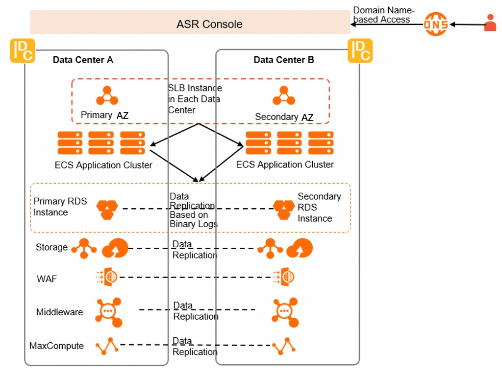
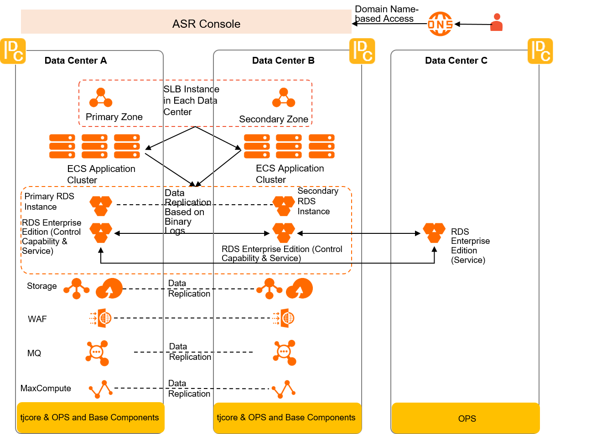
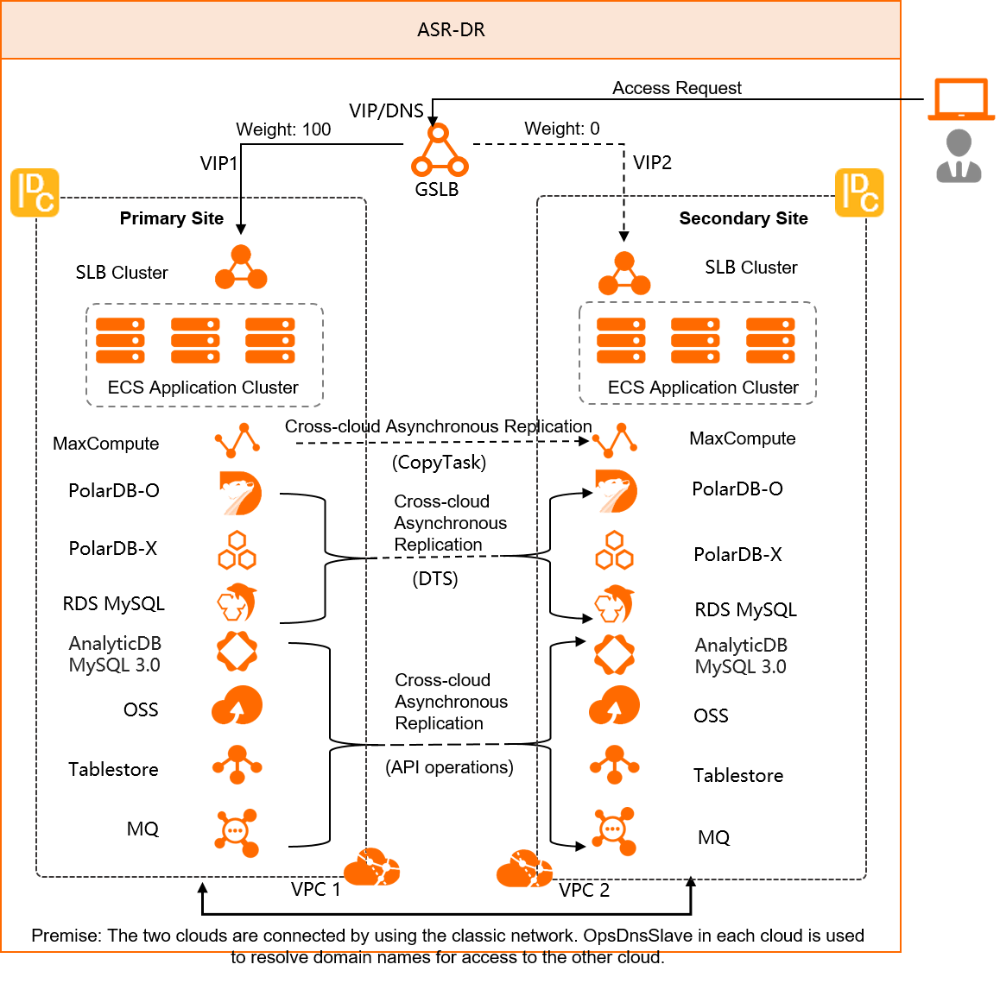
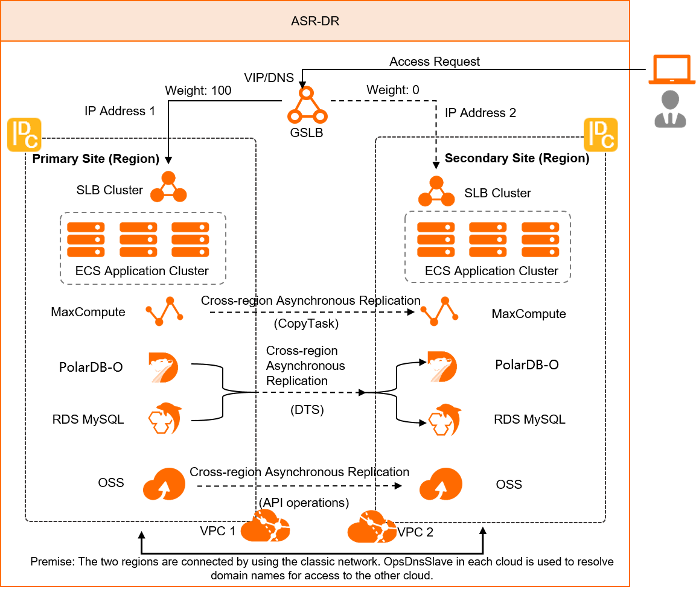
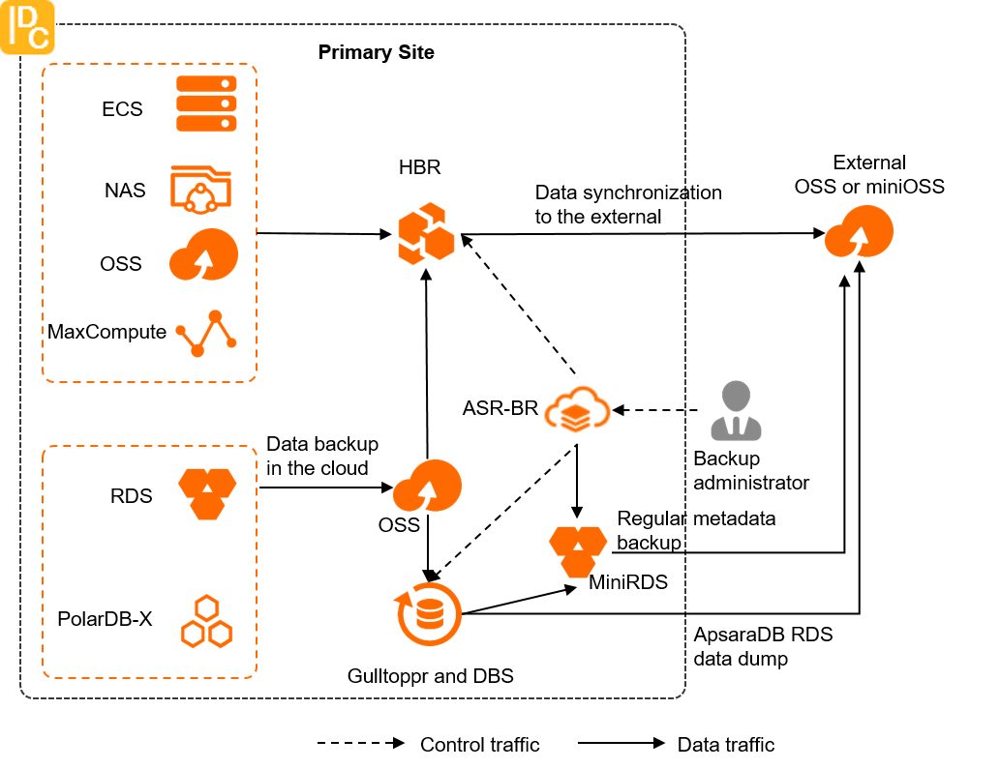
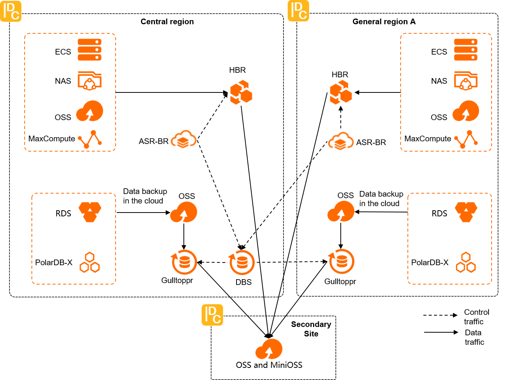
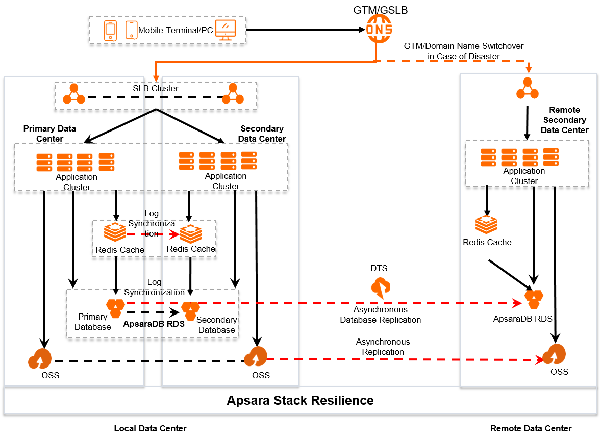
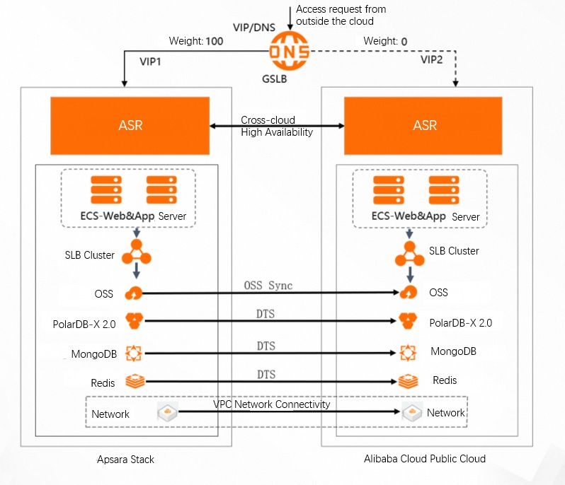

Alibaba Cloud  
Apsara Stack  
apsara stack resilience  
Product Introduction  
Product Version: v3.18.6-2607  
Document Version: 20260901

**Table of Contents**

- [1.Apsara Stack Resilience](#section-1)
    - [1.1. Product details](#section-1-1)
    - [1.2. Benefits](#section-1-2)
    - [1.3. Scenarios](#section-1-3)
    - [1.4. Features](#section-1-4)
        - [1.4.1. ASR for Zone-Disaster Recovery](#section-1-4-1)
        - [1.4.2. ASR for Geo-Disaster Recovery](#section-1-4-2)
        - [1.4.3. ASR for backup and recovery](#section-1-4-3)

# 1.Apsara Stack Resilience

As industries become increasingly digitized, the stability and security of IT infrastructure are more crucial for enterprises. With the evolution of Classified Protection of Cybersecurity 2.0 and the rapid growth of new infrastructure, cloud disaster recovery has emerged as a future trend<strong>.</strong> To ensure business continuity and data security, Apsara Stack provides multiple disaster recovery solutions such as Apsara Stack Resilience for Geo-disaster Recovery, Apsara Stack Resilience for Zone-disaster Recovery, and Apsara Stack Resilience for Backup and Recovery (ASR-BR). Combinations of these solutions are also supported. These disaster recovery solutions are designed and developed based on Alibaba Cloud computing capabilities and international disaster recovery standards.

Apsara Stack Resilience ASR (Apsara Stack Resilience) is a graphical switchover tool provided by Alibaba Cloud that enables rapid disaster recovery switchover during disasters, minimizing the Recovery Time Objective (RTO). Apsara Stack Resilience offers one-click disaster recovery management from an application system perspective for all scenarios, making it an ideal choice for ensuring business continuity and data security for enterprises.

## 1.1. Product details

Apsara Stack Resilience(ASR) is dedicated to full-stack cloud backup and recovery and is used to ensure data security and business continuity for enterprises. Apsara Stack Resilience provides the following disaster recovery solutions: ASR for Zone-disaster Recovery, ASR for Geo-disaster Recovery, and ASR for Backup and Recovery. You can combine these solutions to fit your business scenarios. For example, the three data centers across two regions architecture combines ASR for Zone-disaster Recovery and ASR for Geo-disaster Recovery. It aims to quickly implement switchover and recovery in multiple scenarios.

**ASR for Zone-disaster Recovery**

ASR for Zone-disaster Recovery consists of a primary data center and a secondary data center. The secondary data center is in the same region as the primary center, but in different zones. This deployment method is used to combat local disasters with a small impact. ASR for Zone-disaster Recovery is adopted on all core cloud products such as networking, cloud computing, databases, storage, middleware, and big data products. This can be used in cross-zone deployment for high availability. In the event of a disaster, business can be quickly switched over to the secondary zone. The endpoint of the cloud product remains unchanged.

ASR for Zone-disaster Recovery can be used in two data centers and three data centers. On the foundation of the two data centers-based mode, a third data center can be added and the databases are deployed in a distributed manner.

The architecture of ASR for Zone-disaster Recovery with two data centers:

Architecture of three data centers-based zone-disaster recovery:

ASR for Zone-disaster Recovery is mainly used for monitoring, drills, protection group disaster recovery, data center-level fault recovery, and single-product fault recovery.

- Cloud product monitoring: checks the status of synchronization tasks between data centers, business status of each data center, and synchronization latency on a regular basis, and monitors disaster recovery in both data centers in real time on the dashboard.

- Disaster recovery drills: allows you to customize hot switchover for cloud products to meet your requirements of routine disaster recovery drills.

- Data center-level fault recovery: handles data center-level faults, such as power outages in the primary and secondary data centers, network outages in the primary and secondary data centers, and split-brain scenarios.

- Single-product fault recovery: helps the cloud product recover from faults and ensures business continuity when the high-reliability feature becomes unavailable.

Compared with other solutions, ASR for Zone-disaster Recovery has the following advantages:

- It is cost-effective to access applications because ASR for Zone-disaster Recovery is oriented to cloud-native applications and no business transformation is required for application migration to the cloud.

- Full-stack disaster recovery provides integrated disaster recovery architecture to cover Apsara Uni-manager and cloud products.

- The three data centers-based mode of ASR for Zone-disaster Recovery supports 0 synchronization latency for ApsaraDB RDS for MySQL, ApsaraDB for OceanBase, PolarDB-X 2.0, Elasticsearch and MongoDB.

Hybrid cloud

**ASR for Geo-disaster Recovery**

ASR for Zone-disaster Recovery consists of a primary data center and a secondary data center. The secondary data center is in a different region from the primary data center to cope with possible disasters at the primary data center. After you create a protection group, you can establish a hot backup channel between the resources of the primary and secondary sites. Changes to the resources at the primary site are asynchronously replicated to the corresponding resources at the secondary site in hot backup mode. If the primary data center fails, applications or services are failed over to the secondary data center by using a failover plan. After the primary data center is recovered, business is failed back to the primary cloud by using a failback plan. This way, business continuity is ensured. ASR for Geo-disaster Recovery includes the cross-cloud mode and cross-region mode, and supports application dual-active capability. The following figures show architectures of the two modes.

Cross-cloud mode

Cross-region mode

ASR for Geo-disaster Recovery offers the following main features: DR drills, system management, and DR Dashboard.

- DR drills: include DR for Business and Global DR. You can set protection groups, drill plans, and recovery plans. You can also associate plans and then start the associated plans in batches based on execution sequence number. Plans can be divided into switchover, switchback, failover, and failback.

- System management: includes user management, primary cloud instance configuration, secondary cloud instance configuration, log management, capacity management, self-disaster recovery, and historical messages.

- DR dashboard: displays metrics such as the RTO duration, synchronization latency satisfaction of both the drill plan and recovery plan, the numbers of successful and failed drill plans and recovery plans within a specified time period, and the overall progress of the switchover and switchback processes.

ASR for Geo-disaster Recovery is an application-based protection group disaster recovery mode and has the following advantages:

- Multiple disaster recovery scenarios are supported, such as many-to-one, primary/secondary, and cross-region.

- It is from the intuitive business perspective and supports the following features: disaster recovery drills for protection groups, protection groups switchover, and backward protection.

- Switchover of a cloud is not required if a single service is faulty.

**ASR for Backup and Recovery**

One or more secondary data centers are created to back up data of the primary site. ASR for Backup and Recovery provides the cloud-native backup capability and is required in MLPS-compliant projects. ASR for Backup and Recovery uses the unified backup management platform and supports virtual machine backup (including cloud disk), storage backup (excluding cloud disk), VMware backup, database backup, big data backup, and local backup of cloud platform metadata. ASR for Backup and Recovery supports the following services: ApsaraDB RDS, OSS, ECS, Apsara File Storage NAS, PolarDB-X 1.0, VMware virtual machine, and MaxCompute.

Single-region backup architecture

Cross-region backup architecture

ASR for Backup and Recovery offers the following main features: backup, migration, and recovery.

- Backup: includes cross-region backup and local backup. You can create database backup vaults and create and delete storage backup vaults. All backup vaults are stored in OSS.

- Recovery: includes routine recovery, cloud rebuilding recovery, recovery on cloud of VMware VMs, and local recovery of VMware VMs.

- Migration: Migration plans are created to migrate data from on-premises VMware VMs to ECS instances.

ASR for Backup and Recovery has the following advantages:

- A unified backup management platform is provided and can be used to back up databases, storage services, and MaxCompute.

- Physical backup is used for databases. The performance of the primary cloud instance is not affected because the backup time is very short.

**Three data centers across two regions disaster recovery**

Three data centers across two regions disaster recovery combines zone-disaster recovery and geo-disaster recovery. This solution is used to combat regional natural disasters and prevent regional failures. Two regions include the local and remote regions. Three data centers include the local primary data center, the local secondary data center, and the remote secondary data center. This solution provides active-active zone-disaster recovery. Data is synchronously replicated between two data centers. Data is asynchronously replicated between data centers in different regions that are in the active-standby mode. This mode has low business intrusion and can be quickly set up. It provides financial-grade reliability and unified disaster recovery management for full-stack cloud services.

Architecture of three data centers across two regions disaster recovery

Compared with traditional disaster recovery, the three data centers across two regions mode has the following advantages:

- The combination of zone-disaster recovery and geo-disaster recovery achieves lower RPO and RTO.

- This mode can be used to address regional failures and meet the high MLPS requirements in the finance industry.

**Hybrid disaster recovery**

Hybrid disaster recovery refers to disaster recovery between Apsara Stack and public cloud. In this document, it specifically refers to hybrid disaster recovery between Apsara Stack and Alibaba Cloud public cloud. Hybrid Disaster Recovery for Apsara Stack is an efficient, secure, and cost-effective disaster recovery service specifically designed for hybrid cloud scenarios. On the disaster recovery management platform, you can create protection groups for your cloud product instances to achieve data synchronization between Apsara Stack instances and public cloud instances. It also provides orchestration-enabled drill and fault emergency response capabilities to ensure the consistency of business data.

Architecture of hybrid disaster recovery:

Hybrid disaster recovery offers the following advantages:

- It takes Apsara Stack as the primary data center and public cloud as the backup resource pool to reduce the high cost of building and maintaining a second data center. It also enables on-demand scaling when demand increases.

- If Apsara Stack fails and becomes unavailable, disaster recovery can be implemented through the public cloud disaster recovery management platform.

## 1.2. Benefits

Unlike the disaster recovery that covers only ECS instances, Apsara Stack Resilience (ASR) provides multiple disaster recovery solutions such as ASR for Zone-disaster Recovery, ASR for Geo-disaster Recovery, and ASR for Backup and Recovery. A combination of these solutions is also supported. These make ASR an ideal choice for enterprises to ensure business continuity and data security.

**ASR for Zone-disaster Recovery**

- **Application-specific disaster recovery solutions**

  You can select appropriate cloud-based disaster recovery solutions based on application features. It is cost-effective to access applications because ASR for Zone-disaster Recovery is oriented toward cloud-native applications and no cloud migration is required. It can cover all distributed applications. For applications that use traditional architectures, you can create protection groups to migrate them to the cloud without the need for business transformation.

- **Strong data consistency**

  The three data centers-based mode of ASR for Zone-disaster Recovery supports 0 synchronization latency for ApsaraDB RDS for MySQL, ApsaraDB for OceanBase, PolarDB-X 2.0, Elasticsearch and MongoDB.

- **Full-stack disaster recovery**

  ASR for Zone-disaster Recovery delivers full-stack disaster recovery schemes that cover base, cloud products, and Apsara Uni-manager. It can be used in cross-zone deployment for high availability. In the event of a disaster, business can be quickly switched over to the secondary zone. The endpoint of the cloud product remains unchanged.

- **Full disaster recovery scenarios**

  ASR for Zone-disaster Recovery covers all disaster recovery scenarios. It allows you to customize hot switchover for cloud products to meet your routine disaster recovery drill requirements. It also supports data center-level fault recovery and single-product fault recovery.

**ASR for Geo-disaster Recovery**

- **Intuitive business perspective**

  ASR for Geo-disaster Recovery is a business-based protection group disaster recovery. It supports the following features in an intuitive and visualized manner: disaster recovery drills for protection groups, push-button switchover of protection groups, and backward protection. Switchover of a cloud is not required if a single service is faulty.

- **Abundant disaster recovery scenarios**

  Support diversified scenarios such as cross-cloud disaster recovery, cross-Region disaster recovery, multi-to-one disaster recovery, application dual-active disaster recovery, and hybrid cloud disaster recovery.

- **Efficient disaster recovery drills**

  Support flexible and custom disaster recovery drill plans and custom cloud product switchover policies. The drill plans are executed in a standardized process. You do not need to manually write drill scripts. The drill results are visualized.

- **Controlled disaster recovery management**

  Support multitenancy. Disaster recovery resources are isolated by organization to ensure data security. Each service can be switched independently to avoid mutual interference.

**ASR for Backup and Recovery**

- **Backup of multiple services**

  ASR for Backup and Recovery provides the cloud-native backup capability and supports the following services: ApsaraDB RDS, Object Storage Service (OSS), Elastic Compute Service (ECS) instances and files, Apsara File Storage NAS, PolarDB-X 1.0, VMware virtual machine, and MaxCompute.

- **High backup efficiency for databases**

  Physical backup is used for databases. The backup time is very short. All backup jobs can complete in time.

- **Multiple backup scenarios**

  You can create backup plans as a tenant. ASR-BR supports periodic backup, manual backup, and cloud rebuilding recovery of the business data for cloud services.

- **Automated plug-in installation and connections**

  The Tunnel mechanism is used to implement automatic one-way connections between VPC and storage network. Cloud Assistant is used to install the proxy plug-in and no manual installation is required.

- **High security**

  The integration of the management page of ASR for Backup and Recovery with the cloud platform ensures that the account permission system is consistent. Security is enhanced because the cloud security mechanism is also integrated.

## 1.3. Scenarios

Selection of disaster recovery solutions is determined by a variety of factors, such as investment, acceptable RTO and RPO, and disaster types. The following table describes the scenarios of different disaster recovery solutions.

| Disaster recovery solution | Scenario | Industry |
| --- | --- | --- |
| Two data centers-based mode of ASR for Zone-disaster Recovery | • High business continuity is required. • Strong data consistency is not required. • The two data centers have independent power supplies, independent networks, and optical fiber length of no more than 50 kilometers in between. | Industries such as finance, healthcare, government, energy, and transportation |
| Three data centers-based mode of ASR for Zone-disaster Recovery | • High business continuity is required. • Strong data consistency is required to ensure synchronization latency of 0 for instances in the same region. Note The following products are supported: ApsaraDB RDS for MySQL, PolarDB-X 2.0Elastic Compute Service (ECS), Elastic Block Storage (EBS), Server Load Balancer (SLB), Virtual Private Cloud (VPC) and ApsaraDB for MongoDB. • The three data centers have independent power supplies, independent networks, and optical fiber length of no more than 50 kilometers in between. | Finance |
| ASR for Geo-disaster Recovery | • High business continuity is required. • Strong data consistency is not required. • The capability to cope with regional failures is required. • Distance between regions is more than 100 km. • Application primary-secondary disaster recovery and application dual-active disaster recovery are supported. | Industries such as government, energy, transportation, and healthcare |
| ASR for Backup and Recovery | • Need to meet security requirements for core business data. • Virtual machine backup (including cloud disks), storage backup (excluding cloud disks), VMware backup and recovery, database backup, big data backup, and cloud platform metadata backup are required. Note The following products are supported: ApsaraDB RDS, Object Storage Service (OSS), ECS instances and files, Apsara File Storage NAS (NAS), PolarDB-X 1.0, PolarDB-X 2.0, VMware, and MaxCompute. | All industries, especially those with classified protection requirements. |
| Three data centers across two regions mode | • A solution is needed to combat regional natural disasters. • A solution is needed to prevent regional faults. • Near 0 synchronization latency for business-critical data is required. • The budget is adequate. | Finance |
| Hybird cloud disaster recovery | • For customers with disaster recovery requirements, it provides a cost-effective hybrid cloud disaster recovery solution. • In scenarios where business modules are deployed in both public cloud and Apsara Stack, it prevents service disruptions caused by failures in either public cloud or Apsara Stack. | All industries, especially those concurrently utilizing both Apsara Stack and public cloud. |

## 1.4. Features

This topic describes the features of ASR for Zone-disaster Recovery, ASR for Geo-disaster Recovery, and ASR for Backup and Recovery.

### 1.4.1. ASR for Zone-Disaster Recovery

This topic describes the features of ASR for Zone-Disaster Recovery in the Apsara Uni-Manager Operations Console and the Apsara Uni-Manager Management Console.

**Features of the Apsara Uni-Manager Operations Console**

View

**Feature**

**Description**

The homepage overview presents the overall disaster recovery capabilities of the platform, enabling users to understand the disaster recovery capabilities more intuitively and quickly. Users can directly view the

Overview

status of the secondary data center and the network traffic between data centers, predict the duration and results of a forced switchover, and view the usage history of the disaster recovery platform.

This page displays the overall service status, the service status in the primary data center, the service status in the secondary data center, the disaster recovery capabilities, the primary data center offset,

Service

and the update time. Before you perform a switchover

monitoring

or failback, check whether the monitoring status of the service has exceptions. If exceptions exist, fix them before you proceed with the switchover or failback.

Platform monitorin g

This page displays the data synchronization latency compliance rate, the number of instances with normal

Synchronization

synchronization, the number of instances with

monitoring

synchronization errors, and the synchronization delay of each instance for each cloud service.

This page displays cloud business continuity information, including statistics on the number of

ASR dashboard

disaster recovery cloud services, an overview of selected services, and service details.

An online drill performs a primary/secondary switchover drill for services or cloud resource instances without interrupting the network or power supply. Routine drills ensure data consistency between the primary and secondary data centers. The system supports the following two drill modes:

Drill plan

- Custom drill: You can flexibly select multiple cloud services based on your actual drill requirements, create a drill plan, and execute the drill.

Disaster recovery

- Predefined drill: Based on your actual drill

drill

requirements, you can select a preset service drill plan from ASR for Zone-Disaster Recovery, or select an overall drill plan that includes all services.

This page allows you to view the drill history and

Drill history

results of both custom drills and predefined drills.

- The system supports scenario-based fault recovery to reduce the disaster recovery RTO. It quickly restores online services by switching business to the secondary data center.

- Disaster recovery scenarios include power outage

Failover

recovery, recovery from Data Center A Disconnected from Data Center B, split-brain recovery, and single-product fault recovery.

- The system supports one-click switchover operations.

- Failback is the reverse process of failover. After the system resolves a fault scenario, it supports service failback, including service failback after a power outage, service failback after Data Center A

Failback

Disconnected from Data Center B, and service failback after a single-product fault.

- The system supports one-click failback operations.

Normal state view

Disaster recovery

Fault simulation is a testing and verification technique that evaluates the recovery capabilities of the cloud platform when faults or disasters occur. Fault simulation introduces faults manually to simulate potential system failures, allowing you to observe and analyze the disaster recovery process of the cloud platform.

| Feature | Description |
| --- | --- |
| Operatio n approval | Data center fault injection is a high-risk operation. Unauthorized operations are strictly prohibited.Therefore, you must apply for an approval code for the fault operation before you inject a fault. |
| Health check | Before you inject a fault, you must first check whether the environment is normal. Only when the environment is normal can the simulation accurately reproduce the consequences of a data center fault.If the environment does not meet expectations, do not proceed. |
| Inject fault | This feature manually injects fault types that resemble real disasters (without causing actual disasters), enabling the data center to produce the corresponding fault symptoms. |
| Data center restorati on | After the fault simulation completes, you must manually restore the faulty data center to ensure normal business operations. |

Fault simulation

This page displays the time, execution results, logs,

Recovery

and switchover duration of various fault recovery and

history

automatic switchover operations.

<table>
  <tr>
    <td rowspan="9">O&amp;M state view</td>
    <td rowspan="2">Monitoring center</td>
    <td>Health check</td>
    <td>This page provides quick access to information about disaster recovery service versions, service baselines, DNS resources, VIP resources, and database resources. The health check verifies whether each check item meets the disaster recovery requirements.</td>
  </tr>
  <tr>
    <td>Service check</td>
    <td>The system automatically checks the status of SLB, DNS, and MiniRDS metadatabase products before and after a disaster recovery switchover.</td>
  </tr>
  <tr>
    <td>Service O&amp;M</td>
    <td>Database O&amp;M</td>
    <td>This feature manages AZ alignment for disaster recovery instances and controls whether each instance participates in AZ alignment checks and automatic repairs.</td>
  </tr>
  <tr>
    <td rowspan="4">Configurat ion center</td>
    <td>Alert management</td>
    <td>• ASR for Zone-Disaster Recovery presets certain alert rules. Users can modify the existing alert severity levels based on their actual requirements. • When the system detects a monitoring item exception that also meets an alert rule, it generates an alert.</td>
  </tr>
  <tr>
    <td>DCI leased line management</td>
    <td>After you configure DCI information, the system displays the network traffic between devices in different data centers on the <strong>Overview</strong> page, enabling users to visually monitor data transfer between devices across data centers.</td>
  </tr>
  <tr>
    <td>Arbitration management</td>
    <td>For standard three-data-center deployment scenarios, the arbitration service detects whether a data center has experienced an actual data center-level fault.When a data center-level fault occurs, the service determines whether the current conditions meet the arbitration-based failover requirements and decides whether to initiate an arbitration-based failover to switch services and the infrastructure to the normal data center.</td>
  </tr>
  <tr>
    <td>Theme settings</td>
    <td>This feature allows you to configure the theme color, logo, and platform name for the monitoring dashboard or drill dashboard.</td>
  </tr>
  <tr>
    <td rowspan="2">Security center</td>
    <td>Escape logon management</td>
    <td>The escape logon switch provides controllable access.To ensure account security, we recommend that users change their logon passwords regularly.</td>
  </tr>
  <tr>
    <td>Data backup</td>
    <td>The system saves ASR console data locally in a container and backs up this data to an OSS instance.When you need to restore the backed-up data, you can use the one-click recovery feature to restore user information and alerts to the ASR console.</td>
  </tr>
</table>

**Functions and features of the Apsara Uni-Manager Management Console**

| Feature | Description |
| --- | --- |
| Protection group | • The protection group feature allows you to create a protection group for a set of related resources that an application uses. • You can add ECS, RDS, OSS, and AnalyticDB instances of an application to a protection group and fail over these instances by protection group during a DR failover. • You can view protection group information, including the protection group name, service list, description, creator, and creation time. • The system supports application-level disaster recovery topologies. |

### 1.4.2. ASR for Geo-Disaster Recovery

This topic describes the features of ASR for Geo-Disaster Recovery on the Apsara Uni-Manager Operations Console and the Apsara Uni-Manager Management Console.

**Features on the Apsara Uni-Manager Operations Console**

<table>
  <tr>
    <th colspan="2">Feature</th>
    <th>Description</th>
  </tr>
  <tr>
    <td colspan="2">Homepage</td>
    <td>Displays statistics on authorized usage, node task load, abnormal synchronization entities, unassigned tasks, bandwidth usage, and leased line traffic usage.</td>
  </tr>
  <tr>
    <td rowspan="2">Disaster recovery monitoring</td>
    <td>Cloud platform monitoring</td>
    <td>Cloud platform monitoring tracks the disaster recovery status of cloud services, including service availability, domain name resolution, and network access metrics.This ensures that the cloud platform can quickly fail over to another region when a fault occurs, thereby maintaining business continuity for customers.</td>
  </tr>
  <tr>
    <td>Protection group status monitoring</td>
    <td>Monitors the number of synchronization entities, synchronization status, and maximum synchronization delay of protection groups, as well as the synchronization status, synchronization delay, and primary/secondary instance status of cloud services.</td>
  </tr>
  <tr>
    <td>Product O&amp;M</td>
    <td>DNS</td>
    <td>• Adds DNS forwarding configurations to resolve the <code>Server unreachable:</code> <code>java.net.unknownHostException </code> issue. • Merges the management domains of the primary and secondary data centers to connect their DNS management systems into a single Raft cluster. DNS ensures strong consistency of domain names within the cluster, and you can modify domain name resolution weights to switch business traffic.</td>
  </tr>
</table>

- Removes or views the registration information of existing VPCs.

- Registers new VPC information for cloud instances that do not have VPC registration information.

- Verifies the validity of VPC registration information

VPC management

when VPC authorization errors occur or VPC-type instance access fails.

- Views the VPC authorization information of the current cloud instance.

- Authorizes the current cloud instance if it is not authorized.

- Views the node information of the current ASR-DR cluster and displays unassigned tasks.

Node management

- Click **Details** to view the tasks that the current node is executing.

Disaster recovery

Establishes disaster recovery interconnection

interconnection

relationships between specified regions.

management

In cross-cloud scenarios, configures the gateway

Disaster recovery

information of the peer end to establish a mutual

gateway management

disaster recovery relationship and connect the networks of both ends.

Parameter

Dynamically configures parameters for the geo-

Platform basic

configuration

disaster recovery product.

O&M

management

Synchronization entity

Maintains the default configurations of synchronization

scoring item

entity scoring items.

management

Configure the disaster recovery cloud and production cloud on the Apsara Uni-Manager Operations Console first, and then you can use ASR for Geo-Disaster Recovery on the Apsara Uni-Manager Management

Cloud information

Console. After you add production cloud instances, you

management

must configure the supported disaster recovery products and their corresponding addresses so that ASR for Geo-disaster Recovery can provide disaster recovery for resource instances on the production cloud.

Collects and displays the resource usage of protection

Capacity management

groups and synchronization entities.

Configures the disaster recovery regions for the

Dashboard map

dashboard. The configured region information displays

configuration

geo-disaster recovery data on the dashboard.

Upgrades all protection group data and disaster

Data upgrade

recovery plan data.

- Views the protection group list and details, and deletes protection groups and protection entities that are no longer needed.

Synchronization entity

- Views the task execution list, execution step details,

management

and single-step execution logs of the current synchronization entity.

- Redoes or skips a single step.

Simulates a scenario where all site devices fail and all business traffic requires switchover. This feature

Site disaster recovery

executes a pre-created disaster recovery plan that is

drill

bound in advance. During data center-level failover, the system executes these disaster recovery plans in batches.

Disaster recovery O&M

Addresses a real scenario where all site devices fail and all business traffic requires failover. This feature executes a pre-created disaster recovery plan that is

Site disaster recovery

bound in advance. During data center-level failover, the system executes these disaster recovery plans in batches.

Views the plan steps, progress, associated protection

Plan execution history

groups, and historical execution records of site disaster recovery plans.

Manages fault injection tasks and views the task

Fault injection tasks

execution status.

- Creates independent disaster recovery and performs failover and switchover operations on it.

- Views independent disaster recovery details and unbinds or deletes independent disaster recovery.

Independent disaster recovery

> **Note**

management

> You need to configure independent disaster recovery only in cross-cloud disaster recovery scenarios. Configuration is not required in cross-region scenarios.

**Features on the Apsara Uni-Manager Management Console**

**Feature**

**Description**

Displays a clear business disaster recovery overview through a combination of graphics and numbers. You can view real-time disaster recovery metrics and

Overview

monitor the status of protection groups to improve disaster recovery management efficiency and enhance application business continuity.

Creates instances to be protected on the production site and disaster recovery site separately. The number and instance types of instances on the production site

Instance list

and disaster recovery site in a protection group must be identical.

- Creates, modifies, and deletes protection groups.

- Adds synchronization entities of various cloud services to protection groups.

- Switches over or switches back protection groups.

- Views protection group details and starts, stops, or

Protection group

reprotects protection groups.

- Displays the topology to show disaster recovery relationships, data flow directions, and latency information between the primary and secondary data centers and their entities.

- Views the health status score of protection groups.

- A business disaster recovery plan organizes switchover or check operations on resources in a protection group into a series of sequenced tasks. You can create switchover drill plans, switchback drill

Business disaster

plans, failover plans, and failback plans.

recovery plan

Business disaster

- Configures drill metrics, collects multiple metrics as

recovery

drill results, and provides optimization suggestions for results that do not meet the standards.

- Creates disaster recovery unit namespaces and binds them to protection groups so that only the synchronization entities within the namespace switch over during a switchover operation.

Disaster recovery unit namespace

- A disaster recovery unit namespace cannot bind to multiple protection groups. A synchronization entity cannot belong to multiple disaster recovery unit namespaces.

Views all synchronization entities of a specified disaster

Synchronization entity

recovery relationship and the protection groups to which the synchronization entities belong.

<table>
  <tr>
    <td rowspan="3">Alert management</td>
    <td>Alert rule</td>
    <td>Creates, stops, modifies, deletes, and views alert rules.</td>
  </tr>
  <tr>
    <td>Alert records</td>
    <td>Views and exports reported alert information to promptly identify exceptions.</td>
  </tr>
  <tr>
    <td>Synchronization delay alert configuration</td>
    <td>Sets synchronization delay alert thresholds for each cloud service. ASR for Geo-Disaster Recovery calculates the synchronization delay of each product based on these thresholds and displays the results on the homepage and the disaster recovery dashboard.</td>
  </tr>
  <tr>
    <td rowspan="5">System management</td>
    <td>Cloud instance management</td>
    <td>• Creates, modifies, and deletes cloud instances. • The system manages cloud instances by level-1 organization. Any authorized user in a level-1 organization or its sub-organizations can configure cloud instances for the organization. The configured cloud instances are visible only within the organization.</td>
  </tr>
  <tr>
    <td>Manage disaster recovery relationships</td>
    <td>You must bind disaster recovery relationships before disaster recovery operations. Only regions with a mutual disaster recovery relationship support disaster recovery operations.</td>
  </tr>
  <tr>
    <td>Log management</td>
    <td>Views all operation logs in ASR for Geo-Disaster Recovery, including the creation, deletion, and execution of protection groups, plans, and instances.</td>
  </tr>
  <tr>
    <td>Manage HDR</td>
    <td>Supports HDR, which enables disaster recovery between Apsara Stack and Alibaba Cloud public cloud.</td>
  </tr>
  <tr>
    <td>Synchronization entity scoring item management</td>
    <td>Manages tenant override configurations for synchronization entity scoring items. You can adjust the level, score, deduction reason template, rectification suggestion template, and enabled status.</td>
  </tr>
  <tr>
    <td colspan="2">ASR Dashboard</td>
    <td>Displays a clear overview of the disaster recovery system through a combination of graphics and numbers. The disaster recovery dashboard has two modes based on the disaster recovery plan task type: daily mode and switchover mode.</td>
  </tr>
</table>

### 1.4.3. ASR for backup and recovery

This topic describes the features of ASR for Backup and Recovery on the Apsara Uni-manager Management Console.

| Feature | Description |
| --- | --- |
| Overview | The system displays real-time backup status, backup and restoration statistics, resource statistics, backup status, and system alerts to help you quickly grasp the overall backup landscape. |
| User Guidance | • You can access either the homepage or the product documentation page. • You can view the workflow for using ASR for Backup and Recovery as an operations administrator or organization administrator. • You can view benefits, preparations, and steps for backing up data to Alibaba Cloud Public Cloud. • You can view recommended scenarios and key concepts for backup. |
| Instance List | • You can view instances and their details across various cloud products. • You can view backup records, log backup status, and backup and restoration events for instances. |
| Backup Repository | • A backup repository is a logical storage space planned on a storage pool. It is equivalent to an Object Storage Service (OSS) bucket and is used to store business data backups. You can create repositories for database, storage, deduplication-based storage, and Tablestore products. Isolation between different types of data warehouses is also supported. • Repositories can be stored locally, remotely, or on Alibaba Cloud Public Cloud. • You can create image repositories based on backup repositories to back up cloud product business data to the backup repositories, then synchronize data to the image repositories. • You can view, modify, and delete backup repositories. |
| Backup Plan | • When you create a backup plan, the system automatically lists resource instances and displays their backup protection status. • You can filter backup plans by instance ID or instance name. • You can view, start, stop, and modify a backup plan. • You can view log backups, backup events, and backup statistics. |

- You can view backup records. The system displays details such as instance name, instance type, record status, start time, duration, task progress, storage capacity, and backup

Backup Record

mode.

- You can filter backup records by instance ID, start time, or record status.

- You can perform cloud reconstruction recovery (disaster recovery) to restore data when the production cloud experiences catastrophic failures and requires reconstruction.

- You can perform routine restoration for daily scenarios such as accidental data deletion or tampering in the production cloud.

Data Restoration

- A single recovery plan supports multiple products and multiple instances.

- You can perform orchestrated restoration by customizing the recovery sequence and setting instance priorities.

- You can associate recovery policies with recovery plans to enable automatic execution.

- You can configure permissions for third-party platforms to obtain device information from them.

- You can create, edit, and authorize tape libraries and media sets.

Archive Management

- You can create archive plans to archive RDS or OSS instances in tape libraries.

- You can create recovery tasks to restore RDS or OSS instances archived in tape libraries.

- Operations administrators can manage backup storage pools.

Storage Pool

A storage pool is a cluster that stores backup data. You can

Group

create multiple storage pools.

Management

- You can manage both local and remote storage pools.

Self-backup

You can back up metadata for the hybrid cloud backup service.

Management

You can create disaster recovery tasks.

> **Note**
>
> You can use this feature in the following scenarios:

Disaster

> - You need to restore data backed up to a remote

Recovery

> storage pool across clouds to a standby Alibaba Cloud Apsara Stack.

System Management

> - The production cloud fails or encounters a disaster, requiring data restoration.

vCenter

You can create vCenters to operate and manage virtual

Management

machines.

- You can view authorization details, including authorization type, total authorizations, authorization usage, and remaining quota.

Authorization

- Operations administrators can set quotas for each

Management

organization to ensure fair allocation of resources and prevent any single organization from consuming excessive capacity at the expense of others. By default, no quota limits are applied.

- You can view alert information.

Alert List

- You can delete alert records.

Operations administrators can customize traffic thresholds for cloud products and VMware across different time periods.

Flow Control

> **Note**

Configuration

> Throttling configurations for different time periods and storage pools operate independently.

Engine

Operations administrators can view traffic, CPU, memory, and

Monitoring

load monitoring data.

You can view information such as Used Space and Backup Plans from two dimensions: Vault Resources and Organization Resources.

> **Note**

Resource Statistics

> - Operations administrators can view resource statistics for all organizations.
>
> - Organization administrators can view resource statistics only for their own organization.

You can view logs of all operations in the system, including

Log

creation, deletion, and execution of backup plans and backup

Management

and restoration.

O&M Management

Operations administrators can centrally configure parameters for product backup and restoration, as well as expired fragment cleanup for HBR-Backend and HBR-Storage.

> **Note**
>
> - HBR-Backend expired fragment cleanup: applies only to storage repositories, PolarDB Cluster Edition storage repositories, Tablestore repositories, and

Parameter

> container storage repositories.

Configuration

> - HBR-Storage expired fragment cleanup: applies only to deduplicated storage repositories.

- You can view all event records and logs.

Event

- You can filter events by event type, event status, start time,

Management

or end time.
