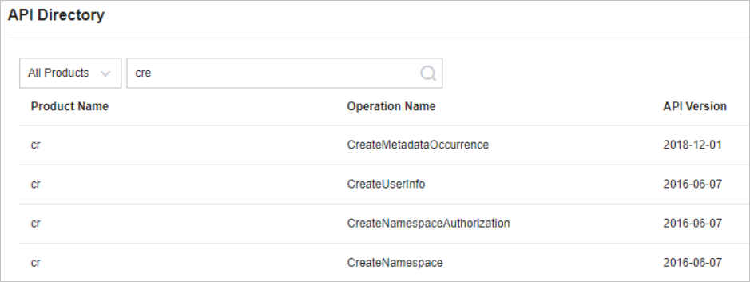
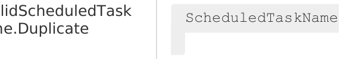
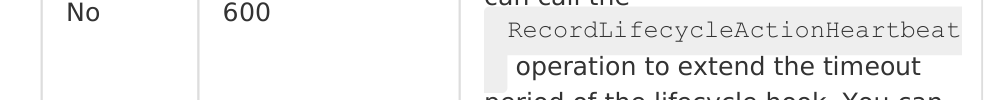
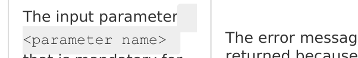

Alibaba Cloud  
Apsara Stack  
Auto Scaling  
Developer Guide  
Product Version: v3.18.6-2607  
Document Version: 20260828

**Table of Contents**

- [1.Getting started](#section-1)
    - [1.1. Apsara Stack documentation](#section-1-1)
    - [1.2. Process of API calls](#section-1-2)
- [2.Preparations](#section-2)
    - [2.1. Log on to the API Tool console](#section-2-1)
    - [2.2. View the information about API operations](#section-2-2)
    - [2.3. Obtain AccessKey credentials](#section-2-3)
    - [2.4. Obtain an STS AccessKey 3-tuple](#section-2-4)
    - [2.5. Obtain the values of common header parameters](#section-2-5)
    - [2.6. Obtain Auto Scaling SDKs](#section-2-6)
- [3.Examples of using Auto Scaling SDK for Java](#section-3)
    - [3.1. Getting started](#section-3-1)
    - [3.2. Work with Auto Scaling SDK for Java](#section-3-2)
        - [3.2.1. Install Auto Scaling SDK for Java](#section-3-2-1)
        - [3.2.2. Configure authentication credentials](#section-3-2-2)
        - [3.2.3. Configure connection requests](#section-3-2-3)
        - [3.2.4. Use Auto Scaling SDK for Java to initiate requests](#section-3-2-4)
        - [3.2.5. Handle errors](#section-3-2-5)
        - [3.2.6. Use CommonRequest to call API operations](#section-3-2-6)
- [4.Call examples of Auto Scaling SDK for Python](#section-4)
    - [4.1. Getting started](#section-4-1)
    - [4.2. Use Auto Scaling SDK for Python](#section-4-2)
        - [4.2.1. Install Auto Scaling SDK for Python](#section-4-2-1)
        - [4.2.2. Configure authentication credentials](#section-4-2-2)
        - [4.2.3. Set HTTPS requests](#section-4-2-3)
        - [4.2.4. Use Auto Scaling SDK for Python to initiate requests](#section-4-2-4)
        - [4.2.5. Handle errors](#section-4-2-5)
        - [4.2.6. Use CommonRequest to call API operations](#section-4-2-6)
- [5.Examples of using Auto Scaling SDK for Go](#section-5)
    - [5.1. Getting started](#section-5-1)
    - [5.2. Work with Auto Scaling SDK for Go](#section-5-2)
        - [5.2.1. Install Go SDK](#section-5-2-1)
        - [5.2.2. Configure authentication credentials](#section-5-2-2)
        - [5.2.3. Initiate a request](#section-5-2-3)
        - [5.2.4. Handle errors](#section-5-2-4)
        - [5.2.5. Use CommonRequest to call API operations](#section-5-2-5)
- [6.API Reference](#section-6)
    - [6.1. API usage instructions](#section-6-1)
    - [6.2. Make API requests](#section-6-2)
    - [6.3. Request structure](#section-6-3)
    - [6.4. Common parameters](#section-6-4)
    - [6.5. Responses](#section-6-5)
        - [6.5.1. Successful response examples](#section-6-5-1)
        - [6.5.2. Sample error responses](#section-6-5-2)
    - [6.6. Request signatures](#section-6-6)
    - [6.7. Scaling groups](#section-6-7)
        - [6.7.1. CreateScalingGroup](#section-6-7-1)
        - [6.7.2. ModifyScalingGroup](#section-6-7-2)
        - [6.7.3. EnableScalingGroup](#section-6-7-3)
        - [6.7.4. DisableScalingGroup](#section-6-7-4)
        - [6.7.5. DeleteScalingGroup](#section-6-7-5)
        - [6.7.6. DescribeScalingGroups](#section-6-7-6)
        - [6.7.7. DescribeScalingInstances](#section-6-7-7)
        - [6.7.8. DescribeScalingActivityDetail](#section-6-7-8)
        - [6.7.9. DescribeScalingActivities](#section-6-7-9)
        - [6.7.10. AttachDBInstances](#section-6-7-10)
        - [6.7.11. DetachDBInstances](#section-6-7-11)
        - [6.7.12. SetGroupDeletionProtection](#section-6-7-12)
        - [6.7.13. ResumeProcesses](#section-6-7-13)
        - [6.7.14. SuspendProcesses](#section-6-7-14)
        - [6.7.15. AttachVServerGroups](#section-6-7-15)
        - [6.7.16. DetachVServerGroups](#section-6-7-16)
        - [6.7.17. AttachAlbServerGroups](#section-6-7-17)
        - [6.7.18. DetachAlbServerGroups](#section-6-7-18)
        - [6.7.19. AttachLoadBalancers](#section-6-7-19)
        - [6.7.20. DetachLoadBalancers](#section-6-7-20)
    - [6.8. Scaling configurations](#section-6-8)
        - [6.8.1. CreateScalingConfiguration](#section-6-8-1)
        - [6.8.2. DescribeScalingConfigurations](#section-6-8-2)
        - [6.8.3. ModifyScalingConfiguration](#section-6-8-3)
        - [6.8.4. DeleteScalingConfiguration](#section-6-8-4)
        - [6.8.5. CreateEciScalingConfiguration](#section-6-8-5)
        - [6.8.6. DescribeEciScalingConfigurations](#section-6-8-6)
        - [6.8.7. ModifyEciScalingConfiguration](#section-6-8-7)
        - [6.8.8. DeleteEciScalingConfiguration](#section-6-8-8)
    - [6.9. Scaling rules](#section-6-9)
        - [6.9.1. CreateScalingRule](#section-6-9-1)
        - [6.9.2. ModifyScalingRule](#section-6-9-2)
        - [6.9.3. DescribeScalingRules](#section-6-9-3)
        - [6.9.4. DeleteScalingRule](#section-6-9-4)
    - [6.10. Scaling tasks](#section-6-10)
        - [6.10.1. ExecuteScalingRule](#section-6-10-1)
        - [6.10.2. ScaleWithAdjustment](#section-6-10-2)
        - [6.10.3. AttachInstances](#section-6-10-3)
        - [6.10.4. RemoveInstances](#section-6-10-4)
        - [6.10.5. DetachInstances](#section-6-10-5)
    - [6.11. Scheduled tasks](#section-6-11)
        - [6.11.1. CreateScheduledTask](#section-6-11-1)
        - [6.11.2. ModifyScheduledTask](#section-6-11-2)
        - [6.11.3. DescribeScheduledTasks](#section-6-11-3)
        - [6.11.4. DeleteScheduledTask](#section-6-11-4)
    - [6.12. Event-triggered tasks](#section-6-12)
        - [6.12.1. CreateAlarm](#section-6-12-1)
        - [6.12.2. DescribeAlarms](#section-6-12-2)
        - [6.12.3. ModifyAlarm](#section-6-12-3)
        - [6.12.4. EnableAlarm](#section-6-12-4)
        - [6.12.5. DisableAlarm](#section-6-12-5)
        - [6.12.6. DeleteAlarm](#section-6-12-6)
    - [6.13. Lifecycle hooks](#section-6-13)
        - [6.13.1. CreateLifecycleHook](#section-6-13-1)
        - [6.13.2. ModifyLifecycleHook](#section-6-13-2)
        - [6.13.3. RecordLifecycleActionHeartbeat](#section-6-13-3)
        - [6.13.4. DescribeLifecycleHooks](#section-6-13-4)
        - [6.13.5. DescribeLifecycleActions](#section-6-13-5)
        - [6.13.6. CompleteLifecycleAction](#section-6-13-6)
        - [6.13.7. DeleteLifecycleHook](#section-6-13-7)
    - [6.14. Notification rules](#section-6-14)
        - [6.14.1. CreateNotificationConfiguration](#section-6-14-1)
        - [6.14.2. ModifyNotificationConfiguration](#section-6-14-2)
        - [6.14.3. DescribeNotificationConfigurations](#section-6-14-3)
        - [6.14.4. DescribeNotificationTypes](#section-6-14-4)
        - [6.14.5. DeleteNotificationConfiguration](#section-6-14-5)
    - [6.15. Instances](#section-6-15)
        - [6.15.1. EnterStandby](#section-6-15-1)
        - [6.15.2. ExitStandby](#section-6-15-2)
        - [6.15.3. SetInstancesProtection](#section-6-15-3)
        - [6.15.4. SetInstanceHealth](#section-6-15-4)
        - [6.15.5. RebalanceInstances](#section-6-15-5)
    - [6.16. Regions](#section-6-16)
        - [6.16.1. DescribeRegions](#section-6-16-1)
    - [6.17. Tags](#section-6-17)
        - [6.17.1. TagResources](#section-6-17-1)
        - [6.17.2. ListTagResources](#section-6-17-2)
        - [6.17.3. UntagResources](#section-6-17-3)
        - [6.17.4. ListTagKeys](#section-6-17-4)
        - [6.17.5. ListTagValues](#section-6-17-5)
    - [6.18. Others](#section-6-18)
        - [6.18.1. DescribeLimitation](#section-6-18-1)
    - [6.19. Error codes](#section-6-19)
        - [6.19.1. Client errors](#section-6-19-1)
        - [6.19.2. Server errors](#section-6-19-2)
    - [6.20. Ensure idempotence](#section-6-20)
- [7.Appendixes](#section-7)
    - [7.1. STS overview](#section-7-1)
        - [7.1.1. What is STS?](#section-7-1-1)
        - [7.1.2. AssumeRole](#section-7-1-2)

<a id="section-1"></a>

# 1.Getting started

<a id="section-1-1"></a>

## 1.1. Apsara Stack documentation

This topic describes how to find the required documentation when you call an API operation of an Apsara Stack service.

**Flowchart**

You can follow the procedure described in the following figure to view the specific documentation.


**Prerequisites**

The Apsara Stack version is obtained from an O&M personnel or operations administrator.

**Procedure**

You can go to the Apsara Stack documentation center to view the desired documentation.

1. Go to the Apsara Stack documentation center.

2. Click the **Enterprise**, **Agility**, or **All-in-one** tab based on the Apsara Stack version that you use.

3. Select an Apsara Stack version from the drop-down list.

4. In the left-side navigation pane, select the Apsara Stack service whose documentation you want to view.

5. In the product documentation section, click **View Details** or **Download PDF**.

<a id="section-1-2"></a>

## 1.2. Process of API calls

Apsara Stack allows you to call API operations by using the Portable OpenAPI Proxy (POP) gateway. To ensure that Apsara Stack provides the same experience as Alibaba Cloud Public Cloud, API operations in Apsara Stack Enterprise V3.16.0 and later are called by using the POP gateway by default. This topic describes how to use the POP gateway to call Apsara Stack API operations.

**Flowchart Procedure**

1. Obtain AccessKey credentials.

   For information about how to obtain AccessKey credentials, see Obtain AccessKey credentials or Obtain an STS AccessKey 3-tuple.

   > **Note**
   >
   > We recommend that you use the AccessKey credentials of a personal account to call the API operations of the Apsara Uni-manager Management Console and cloud services.

2. Obtain the region ID.

   For information about how to obtain the region ID, see Obtain the endpoint of Auto Scaling.

3. Obtain the organization ID and resource set ID.

   For information about how to obtain an organization ID by calling an API operation, see the *GetOrganizationList* topic in *Apsara Uni-manager Management Console Developer Guide*.

   For information about how to obtain a resource set ID by calling an API operation, see the *Li stResourceGroup* topic in *Apsara Uni-manager Management Console Developer Guide*.

   > **Note**
   >
   > When you call the required API operations, we recommend that you specify the  `<x-acs-organizationid>`  and  `<x-acs-resourcegroupid>`  headers to narrow down the query scope for exact search.
   >
   > - If you do not specify the  `<x-acs-organizationid>`  header, the organization of the current user is returned by default.
   >
   > - If you do not specify the  `<x-acs-resourcegroupid>`  header, null is returned by default. If you specify this header, you must also specify the &lt;x-acs-organizationid> header.

4. Obtain the API references.

   You can refer to the developer guide of the cloud service that you want to use to learn the features of API operations and how to call the API operations. For more information, see Usage notes on development documentation.

5. Obtain the endpoint of the cloud service.

6. Obtain the cloud service SDK and call an API operation.

<a id="section-2"></a>

# 2.Preparations

<a id="section-2-1"></a>

## 2.1. Log on to the API Tool console

You can log on to the API Tool console from the Apsara Uni-manager Management Console.

**Prerequisites**

- The URL of the console that is obtained from the deployment personnel.

- A supported browser is used. We recommend that you use Google Chrome.

**Procedure**

1. Enter the URL of the Apsara Uni-manager Management Console in the address bar and press the Enter key.

2. On the login page, enter your username and password.

   You can obtain the username and password that are used to log in to the Apsara Uni-manager Management Console from the operations administrator.

   > **Note**
   >
   > - **First login**
   >
   >   The first time that you log on to the Apsara Uni-manager Management Console, you need to change the password of your account. The password must be 10 to 32 characters in length. It must contain all of the following character types: uppercase letters, lowercase letters, digits, and special characters. Supported special characters include: ! @ # $ %
   >
   > - **Forgotten password**
   >
   >   If you have forgotten your password, click Forgot Password. On the page that appears, enter the username of your account, the email address that was used to create the account, and the CAPTCHA code. Then, the system sends a link for resetting the password to the specified email address.

3. Click **Log In**.

4. In the top navigation bar, choose **Products > Others > API Tool**.

<a id="section-2-2"></a>

## 2.2. View the information about API operations

You must obtain a service name, API operation name, and API version. All the information is required when you use SDKs.

**Procedure**

1. Log on to the API Tool console.

2. In the left-side navigation pane, click **API fold**.

3. On the **API Directory** page, select the target service from the drop-down list, enter the API operation name in the search box, and then click the search icon.

   

4. View and remember the service name, API operation name, and API version.

<a id="section-2-3"></a>

## 2.3. Obtain AccessKey credentials

AccessKey credentials are assigned by Resource Access Management (RAM) or Security Token Service (STS). You must use one of the preceding types of AccessKey credentials for authentication when you call API operations. This topic describes how to obtain AccessKey credentials that are assigned by RAM.

**Background information**

The AccessKey ID and AccessKey secret contained in AccessKey credentials are used to perform symmetric encryption and verify the identity of request senders. The AccessKey ID is used to identify a user. The AccessKey secret is a string that is used to encrypt a signature.

You can use RAM or STS to assign AccessKey credentials:

- The AccessKey credentials that are assigned by RAM to a third party consist of an AccessKey ID and an AccessKey secret.

- The AccessKey credentials that are assigned by STS to a third party consist of an AccessKey ID, an AccessKey secret, and a security token. For more information, see Obtain an STS AccessKey 3-tuple.

The Apsara Uni-manager Management Console provides AccessKey credentials for personal accounts and organizations. Only operations administrators and the administrators of level-1 organizations can obtain the AccessKey credentials of organizations. We recommend that you use the AccessKey credentials of personal accounts to call the operations provided by the Apsara Uni-manager Management Console and cloud services. If you use the AccessKey credentials of a personal account, configure the request headers that are described in the following table for access control. Otherwise, an error that indicates insufficient permissions may occur.

> **Warning**
>
> The AccessKey credentials of a personal account are managed by the
>
> permission system of the Apsara Uni-manager Management Console. If you need to obtain the AccessKey credentials of an organization, make sure that your operation is allowed by an administrator. This ensures security.

| Request header | Description |
| --- | --- |
| x-acs-regionid | The ID of the region. Example: cn-hangzhou-\*\*\*\*. |
| x-acs-organizationid | The ID of the organization in the Apsara Uni-manager Management Console. For more information about how to obtain organization IDs, see <strong>GetOrganizationList</strong> in <strong>Apsara Uni-manager</strong> <strong>Management Console Developer Guide</strong>. |
| x-acs-resourcegroupid | The ID of the resource set in the Apsara Uni-manager Management Console. For more information about how to obtain resource set IDs, see <strong>ListResourceGroup</strong> in <strong>Apsara Uni-manager</strong> <strong>Management Console Developer Guide</strong>. |
| x-acs-instanceid | The ID of the instance that you want to manage. For example, you can view the ID of an Elastic Compute Service (ECS) instance in the ECS instance list. |

**Obtain the AccessKey credentials of a personal account**

To obtain the AccessKey credentials of a personal account, perform the following steps:

1. Log on to the Apsara Uni-manager Management Console.

2. In the upper-right corner of the page that appears, click the profile picture, and then click **User Information**.

3. In the **AccessKey Pair** section, view the AccessKey credentials of the personal account.

   

   > **Note**
   >
   > The AccessKey credentials consist of an AccessKey ID and an AccessKey
   >
   > secret. The credentials provide full permissions on cloud resources within your Apsara Stack tenant account. You must keep the AccessKey credentials.

**Obtain the AccessKey credentials of an organization**

To obtain the AccessKey credentials of an organization, perform the following steps:

1. Log on to the Apsara Uni-manager Management Console as an administrator.

2. In the top navigation bar, click **Enterprise**.

3. In the left-side navigation pane, choose **Resources > Organizations**.

4. In the organization list, click the name of the level-1 organization whose AccessKey credentials you want to obtain.

5. Click **Management Accesskey**.

6. In the dialog box that appears, view the AccessKey credentials of the organization.

<a id="section-2-4"></a>

## 2.4. Obtain an STS AccessKey 3-tuple

This topic describes how to use Security Token Service (STS) to call API operations in Apsara Stack.

**Background information Background information**

STS allows you to use temporary credentials to access your Apsara Stack resources. You can use STS to call API operations in Apsara Stack.

An STS AccessKey 3-tuple consists of an AccessKey ID, an AccessKey secret, and a security token. When you use STS to call API operations, you must specify an STS AccessKey 3-tuple. For more information about STS, see What is STS?

**Procedure**

1. Obtain the RAM role.

   <ol type="i">

   <li>

   Log on to the Apsara Uni-manager Management Console.

   </li>

   <li>

   In the upper-right corner of the homepage, click the profile picture and then click **User**

   </li>

   </ol>

   **Information**.

   <ol type="i" start="3">

   <li>

   Click **View Current Role Policy**.

   </li>

   </ol>

   In the **View Policies of Current Role (Administrator)** dialog box, view the ARN of your RAM role.

2. Obtain the STS AccessKey 3-tuple.

   > **Note**
   >
   > In the following sample code, replace the variable parameters with actual
   >
   > values. Delete the angle brackets (<>) in the final code.
   >
   > Variable parameters:
   >
   > - &lt;yourRegionID>: Replace the variable parameter with your region ID.
   >
   > - &lt;yourAccessKeyID>: Replace the variable parameter with your AccessKey ID.
   >
   > - &lt;yourAccessKeySecret>: Replace the variable parameter with your AccessKey secret.
   >
   > - &lt;yourRoleSessionName>: Replace the variable parameter with the name of your session.
   >
   > - &lt;yourRoleArn>: Replace the variable parameter with the ARN of your RAM role.
   >
   > - "sts.aliyuns.com": Replace the variable parameter with the endpoint of STS.

   ```xml
   public static void main(String[] args) {
       // Create and initialize a DefaultAcsClient instance. 
       // Specify the region ID, AccessKey ID, and AccessKey secret.
       DefaultProfile profile = DefaultProfile.getProfile("<yourRegionID>", "
   <yourAccessKeyID>", "<yourAccessKeySecret>");
       HttpClientConfig clientConfig = HttpClientConfig.getDefault();
       clientConfig.setIgnoreSSLCerts(true);
       clientConfig.setProtocolType(ProtocolType.HTTPS);
       profile.setHttpClientConfig(clientConfig);
       IAcsClient client = new DefaultAcsClient(profile);
       String assumeRole = callAssumeRole(client);
       if (StringUtils.isEmpty(assumeRole)) return;
       JSONObject assumeRoleJson = JSONObject.parseObject(assumeRole);
       JSONObject credentials = assumeRoleJson.getJSONObject("Credentials");
       // Obtain the STS AccessKey 3-tuple.
       String stsAK = credentials.getString("AccessKeyId");
       String stsSK = credentials.getString("AccessKeySecret");
       String stsToken = credentials.getString("SecurityToken");
   }

   private static String callAssumeRole(IAcsClient client) {
       CommonRequest request = new CommonRequest();
       // Replace "sts.aliyuns.com" with the endpoint of STS. The format of an STS endpoint is sts-vpc.${global:region}.${global:internet-domain}.
       request.setSysDomain("sts.aliyuns.com");
       request.setSysProduct("Sts");
       request.setSysAction("AssumeRole");
       request.setSysVersion("2015-04-01");
       request.setSysMethod(MethodType.POST);
       request.setHttpContentType(FormatType.FORM);
       // Replace <yourRoleSessionName> with the name of your session.
       request.putQueryParameter("RoleSessionName", "<yourRoleSessionName>");
       // Replace <yourRoleArn> with the ARN of the RAM role that you obtain in the preceding step.
       request.putQueryParameter("RoleArn", "<yourRoleArn>");
       try {
           CommonResponse response = client.getCommonResponse(request);
           return response.getData();
       } catch (ServerException e) {
           System.out.println(e.getErrCode());
           System.out.println(e.getErrMsg());
       } catch (ClientException e) {
           System.out.println(e.getErrCode());
           System.out.println(e.getErrMsg());
       }
       return null;
   }
   ```

3. Use the STS AccessKey 3-tuple to call an API operation of a cloud service. The following sample code provides an example on how to call the CreateScalingGroup operation of Auto Scaling.

   > **Note**
   >
   > In the following sample code, replace the variable parameters with actual
   >
   > values. Delete the angle brackets (<>) in the final code.
   >
   > Variable parameters:
   >
   > - &lt;yourRegionID>: Replace the variable parameter with your region ID.
   >
   > - &lt;yourStsAccesskeyID>: Replace the variable parameter with your STS AccessKey ID.
   >
   > - &lt;yourStsAccessKeySecret>: Replace the variable parameter with your STS AccessKey secret.
   >
   > - &lt;yourStsToken>. Replace the variable parameter with your security token.
   >
   > - &lt;yourResourceGroupID>: Replace the variable parameter with your resource set ID.
   >
   > - &lt;yourOrganizationID>: Replace the variable parameter with your organization ID.

   ```xml
   public static void main(String[] args) {
       // Replace <yourRegionID> with your region ID.
       // Replace <yourStsAccessKeyID> and <yourStsAccessKeySecret> with the AccessKey I
   D and AccessKey secret of the STS AccessKey 3-tuple obtained in the previous step.
       DefaultProfile profile = DefaultProfile.getProfile("<yourRegionID>", "
   <yourStsAccesskey>", "<yourStsAccessSecret>");
       HttpClientConfig clientConfig = HttpClientConfig.getDefault();
       clientConfig.setIgnoreSSLCerts(true);
       clientConfig.setProtocolType(ProtocolType.HTTPS);
       profile.setHttpClientConfig(clientConfig);
       IAcsClient client = new DefaultAcsClient(profile);
       CommonRequest request = new CommonRequest();
       request.setSysDomain("ess.aliyuncs.com");
       request.setSysProduct("ess");
       request.setSysAction("CreateScalingGroup");
       request.setSysVersion("2014-08-28");
       request.setSysMethod(MethodType.POST);
       request.setHttpContentType(FormatType.FORM);
       // Replace <yourRegionID> with your region ID.
       request.putHeadParameter("x-acs-regionid", "<yourRegionID>");
       // Replace <yourStsToken> with the security token of the STS AccessKey 3-tuple obtained in the previous step.
       request.putQueryParameter("SecurityToken", "<yourStsToken>");
       // Optional. Replace the variable parameter with your resource set ID.
       // request.putHeadParameter("x-acs-resourcegroupid", "<yourResourceGroupID>");
       // Required. Replace the variable parameter with your organization ID.
       request.putHeadParameter("x-acs-organizationid", "<yourOrganizationID>");
       try {
           CommonResponse response = client.getCommonResponse(request);
           System.out.println(response.getData());
       } catch (ServerException e) {
           System.out.println(e.getErrCode());
           System.out.println(e.getErrMsg());
       } catch (ClientException e) {
           System.out.println(e.getErrCode());
           System.out.println(e.getErrMsg());
       }
   ```

<a id="section-2-5"></a>

## 2.5. Obtain the values of common header parameters

You must specify multiple header parameters when you call Apsara Stack API operations. This topic describes the common header parameters and how to obtain the values of the parameters. This topic also describes the return values of specific parameters after you call API operations.

**Header parameters**

| Parameter | Description |
| --- | --- |
| x-acs-regionid | The ID of the region. For more information about how to obtain region IDs, see Obtain a region ID. |
| x-acs-organizationid | The ID of the organization in the Apsara Uni-manager Management Console. For more information about how to obtain organization IDs, see Obtain an organization ID. |
| x-acs-resourcegroupid | The ID of the resource set in the Apsara Uni-manager Management Console. For more information about how to obtain resource set IDs, see Obtain a resource set ID. |
| x-acs-instanceid | The ID of the instance on which you want to perform operations. For more information about how to obtain instance IDs, see Obtain an instance ID. |

**Obtain a region ID**

1. Log on to the Apsara Uni-manager Management Console as an administrator.

2. In the top navigation bar, click **Enterprise**.

3. In the left-side navigation pane, choose **Resources > Regions**.

4. Click the name of the organization whose region ID you want to view.

5. In the **Regions** section, view the region ID.

**Obtain an organization ID**

You can call the GetOrganizationList operation to obtain the organization ID. For more information, see **GetOrganizationList** in **Apsara Uni-manager Management Console Developer Guide**.

**Obtain a resource set ID**

You can call the ListResourceGroup operation to obtain the resource set ID. For more information, see **ListResourceGroup** in **Apsara Uni-manager Management Console Developer Guide**.

**Obtain an instance ID**

You can obtain the ID of an instance in the cloud service console of the Apsara Uni-manager Management Console. For example, to obtain the ID of an Auto Scaling instance, perform the following steps:

1. Log on to the Apsara Uni-manager Management Console.

2. In the top navigation bar, choose **Products > Elastic Computing > Auto Scaling**.

3. In the left-side navigation pane, choose **Instances**.

4. View the **instance ID** in the instance list.

**Response parameters**

The following table describes the additional response parameters returned by default when you call operations to query the instances of cloud services.

| Parameter | Description |
| --- | --- |
| ResourceGroupName | The name of the resource set. |
| ResourceGroup | The ID of the resource set. |
| DepartmentName | The name of the organization. |
| Department | The ID of the organization. |

<a id="section-2-6"></a>

## 2.6. Obtain Auto Scaling SDKs

When you call Auto Scaling API operations by using the Portable OpenAPI Proxy (POP) gateway, you must obtain Auto Scaling SDKs. This topic describes how to obtain Alibaba Cloud SDKs.

**Background information**

To use Auto Scaling SDKs, you must install Auto Scaling SDKs and Alibaba Cloud core libraries. For example, to use Auto Scaling SDK for Java, you must download aliyun-java-sdk-ess and aliyun-java-sdk-core.

- Auto Scaling SDKs encapsulate the API that was released on August 28, 2014. The SDKs identify callers based on the AccessKey credentials and provide features such as automatic signing. This way, you can call API operations to create and manage resources. Alibaba Cloud SDKs include code and examples. You can create cloud applications by using an SDK for the programming language that you require.

- We recommend that you use the SDK core library that is provided by Alibaba Cloud. The SDK core library is suitable for all cloud services and is compatible with Apsara Stack.

**Reference**

Currently, SDKs for Java, Python, and Go are supported. You can go to the SDK Center to select the SDK version that meets your business requirements.

> **Important**
>
> We recommend that you use an SDK for Java, Python, or Go. If you use SDKs for other programming languages, the SDKs may be incompatible with your system.

<a id="section-3"></a>

# 3.Examples of using Auto Scaling SDK for Java

<a id="section-3-1"></a>

## 3.1. Getting started

This topic describes how to obtain and use Auto Scaling SDK for Java.

**Prerequisites**

- An Apsara Stack tenant account that has the permissions on Auto Scaling SDK for Java and an AccessKey pair are obtained. The AccessKey pair consists of an AccessKey ID and an AccessKey secret. For information about how to obtain an AccessKey pair, see Obtain an AccessKey pair.

- The endpoint of Auto Scaling is obtained. For information about how to obtain the endpoint of Auto Scaling, see Obtain the endpoint of Auto Scaling.

- Java Development Kit (JDK) 1.8 or later is installed. SDKs for Java provided by Alibaba Cloudrequire JDK 1.8 or later.

**Install Auto Scaling SDK for Java**

If you use Apache Maven to manage a Java project, you need to only import the JAR file to the pom.xml file of the project.

To use an Auto Scaling SDK, you must install the SDK core library and the Auto Scaling SDK. We recommend that you use version 4.5.17 or later for the SDK core library. In this example, Auto Scaling SDK uses version 3.2.0.

**Use Auto Scaling SDK for Java**

To use Auto Scaling SDK for Java, perform the following steps:

1. Create a DefaultAcsClient instance and initialize the instance.

2. Create an API request and configure the required parameters.

3. Initiate the API request and handle the response or exception.

   > **Note**
   >
   > In the following sample code, replace the variable parameters with actual values. Delete the angle brackets <> in the final code.
   >
   > Variable parameters:
   >
   > - &lt;yourRegionID>: Replace the variable parameter with your region ID.
   >
   > - &lt;yourAccessKeyID>: Replace the variable parameter with your AccessKey ID.
   >
   > - &lt;yourAccessKeySecret>: Replace the variable parameter with your AccessKey secret.
   >
   > - &lt;Product>: Replace the variable parameter with the name of your service.
   >
   > - &lt;Endpoint>: Replace the variable parameter with the endpoint of your service.
   >
   > - &lt;readTimeout>: Replace the variable parameter with a read timeout period based on your business requirements. Unit: milliseconds.
   >
   > - &lt;connectionTimeout>: Replace the variable parameter with a connection timeout period based on your business requirements. Unit: milliseconds.
   >
   > - &lt;maxRequestsPerHost>: Replace the variable parameter with the maximum number of requests that are supported by each host.
   >
   > - &lt;maxRequests>: Replace the variable parameter with the maximum number of requests.
   >
   > - &lt;http://192.168.XX.XX:33XX>: Replace the variable parameter with the IP address and port of your proxy.

   ```java
    import com.aliyuncs.profile.DefaultProfile;
    import com.aliyuncs.DefaultAcsClient;
    import com.aliyuncs.IAcsClient;
    import com.aliyuncs.exceptions.ClientException;
    import com.aliyuncs.exceptions.ServerException;
    import com.aliyuncs.ess.model.v20140828.*;
    public class Main {
        public static void main(String[] args) {
           // Create and initialize a DefaultAcsClient instance.
           DefaultProfile profile = DefaultProfile.getProfile(
               "<yourRegionID>",          // Replace the variable parameter with your reg
   ion ID.
               "<yourAccessKeyID>",      // Replace the variable parameter with your Acce
   ssKey ID.
               "<yourAccessKeySecret>"); // Replace the variable parameter with your 
   AccessKey secret.
           // Specify the endpoint of your service. Replace the variable parameter with the endpoint of your service. 
           profile.addEndpoint("<yourRegionID>", "<Product>", "<Endpoint>");
           // Configure the request parameters.
           HttpClientConfig clientConfig = HttpClientConfig.getDefault();
           clientConfig.setIgnoreSSLCerts(true);                        // Specify 
   whether to ignore the certificate.
           clientConfig.setReadTimeoutMillis(<readTimeout>);            // Optional. Spec
   ify the read timeout period. Unit: milliseconds.
           clientConfig.setConnectionTimeoutMillis(<connectionTimeout>);// Optional. Specify the connection timeout period. Unit: milliseconds.
           clientConfig.setMaxRequestsPerHost(<maxRequestsPerHost>);    // Optional. 
   Specify the maximum number of requests per host.
           clientConfig.setMaxRequests(<maxRequests>);                  // Optional. Spec
   ify the maximum number of requests.
           clientConfig.setProtocolType(ProtocolType.HTTP);             // Optional. Spec
   ify the request protocol. Default value: HTTP.
           /* Optional. Specify the IP address and port of the proxy.
           clientConfig.setHttpProxy("http://192.168.XX:33XX");
           or
           clientConfig.setHttpsProxy("https://192.168.XX:33XX");
           */
           profile.setHttpClientConfig(clientConfig);
           IAcsClient client = new DefaultAcsClient(profile);
           // Create an API request and configure the required parameters.
           DescribeScalingGroupsRequest request = new DescribeScalingGroupsRequest();
           // Configure service-related parameters.
           request.setPageSize(10);
           request.setPageNumber(1);
           // Header parameters. Specify the organization ID and resource set ID to query specified resources.
           request.putHeadParameter("x-acs-organizationid", "1");
           request.putHeadParameter("x-acs-resourcegroupid", "11");
           // Send the request and handle the response or exception.
           DescribeScalingGroupsResponse response;
           try {
               response = client.getAcsResponse(request);
               }
           } catch (ServerException e) {
               e.printStackTrace();
           } catch (ClientException e) {
               e.printStackTrace();
           }
        }
    }
   ```

<a id="section-3-2"></a>

## 3.2. Work with Auto Scaling SDK for Java

<a id="section-3-2-1"></a>

### 3.2.1. Install Auto Scaling SDK for Java

This topic describes how to install and use Auto Scaling SDK for Java.

Auto Scaling SDK for Java supports Java Development Kit (JDK) 1.8 or later. You can install Auto Scaling SDK for Java by adding Maven dependencies or downloading the SDK. For more information, see Alibaba Cloud SDKs.

To use the development tool kit of Auto Scaling, you must install the core library of Alibaba Cloud SDK for Java and Auto Scaling SDK for Java. We recommend that you use the core library version 4.5.17 or later and Auto Scaling SDK for Java version 2.1.1.

To install the core library of Alibaba Cloud SDK for Java and Auto Scaling SDK for Java, you must add the following dependencies to the pom.xml file. For information about the specific SDK version, visit Alibaba Cloud SDKs.

```xml
<!-- Alibaba Cloud SDK for Java -->
<dependency>
    <groupId>com.aliyun</groupId>
    <artifactId>aliyun-java-sdk-core</artifactId>
    <version>4.5.17</version>
</dependency>
<!-- ess java sdk -->
<dependency>
    <groupId>com.aliyun</groupId>
    <artifactId>aliyun-java-sdk-ess</artifactId>
    <version>2.1.1</version>
</dependency>
```

<a id="section-3-2-2"></a>

### 3.2.2. Configure authentication credentials

When you use Alibaba Cloud SDKs to access Apsara Stack services, you must provide an Apsara Stack tenant account for authentication. This topic describes how to configure authentication credentials.

Auto Scaling SDK for Java supports authentication based on an AccessKey pair. For information about how to obtain an AccessKey pair, see Obtain AccessKey credentials.

If you want to use your AccessKey pair to access Apsara Stack, you must specify the AccessKey pair as the credentials when you initialize the client.

> **Important**
>
> Do not disclose code that contains your AccessKey pair. For example,
>
> do not commit the code to public GitHub projects. Otherwise, your Apsara Stack tenant account may be compromised.

```text
DefaultProfile profile = DefaultProfile.getProfile(
    "<yourRegionID>",          // Replace the variable parameter with your region ID.
    "<yourAccessKeyID>",      // Replace the variable parameter with your AccessKey ID.
    "<yourAccessKeySecret>"); // Replace the variable parameter with your AccessKey secret.
```

> **Note**
>
> In the preceding sample code, replace the variable parameters with your
>
> actual information. Delete the angle brackets (<>) in the final code.

<a id="section-3-2-3"></a>

### 3.2.3. Configure connection requests

This topic describes how to configure a connection request by using the HttpClientConfig object.

You can use the following code to configure the HttpClientConfig object. We recommend that you select and configure the following parameters based on your business requirements.

> **Note**
>
> You must use actual values to replace the variables in the following sample code. Do not retain the angle brackets (<>) in the final code.
>
> The following list describes the variables:
>
> - &lt;readTimeout>: Specify the read timeout period based on your business requirements. Unit: milliseconds.
>
> - &lt;connectionTimeout>: Specify the connection timeout period based on your business requirements. Unit: milliseconds.
>
> - &lt;maxRequestsPerHost>: Specify the maximum number of requests that are supported by each server based on your business requirements. The supported data type is INTEGER.
>
> - &lt;maxRequests>: Specify the maximum number of requests based on your business requirements. The supported data type is INTEGER.
>
> - &lt;http://192.168.XX.XX:33XX>: Replace it with the actual IP address and port of the proxy.

```text
// Obtain the HttpClientConfig object.
HttpClientConfig clientConfig = HttpClientConfig.getDefault();
// Specify whether to ignore certificates.
clientConfig.setIgnoreSSLCerts(true);
// (Optional) Specify the read timeout period. Unit: milliseconds.
clientConfig.setReadTimeoutMillis(<readTimeout>);
// (Optional) Specify the connection timeout period. Unit: milliseconds.
clientConfig.setConnectionTimeoutMillis(<connectionTimeout>);
// (Optional) Specify the maximum number of requests that are supported by each server.
The supported data type is INTEGER.
clientConfig.setMaxRequestsPerHost(<maxRequestsPerHost>);
// (Optional) Specify the maximum number of requests. The supported data type is INTEGE
R.
clientConfig.setMaxRequests(<maxRequests>);
// (Optional) Specify the protocol type.
clientConfig.setProtocolType(ProtocolType.HTTP);
/** (Optional) Specify whether to configure the proxy based on your business 
requirements. The following code is available:
clientConfig.setHttpProxy("<http://192.168.XX.XX:33XX>");
Or
clientConfig.setHttpsProxy("<https://192.168.XX.XX:33XX>");
Replace https://192.168.XX.XX:33XX with the actual IP address and port of the proxy.
*/
profile.setHttpClientConfig(clientConfig);
```

<a id="section-3-2-4"></a>

### 3.2.4. Use Auto Scaling SDK for Java to initiate requests

This topic describes how to use Auto Scaling SDK for Java to initiate a request.

**Procedure**

1. Create an AcsClient.

   ```text
   IAcsClient client = new DefaultAcsClient(profile);
   ```

2. Create a request.

   The request name is in the  `${apiName}Request`  format, where **${apiName}** is the API name. Sample API name: CreateScalingGroup.

   When the SDKs of multiple services are used, different requests may have the same name. Make sure that you differentiate the requests by SDK package.

   ```text
   CreateScalingGroupRequest request = new CreateScalingGroupRequest();
   // Service-related parameters.
   request.setPageSize(10);
   request.setPageNumber(1);
   // // Header parameters. Specify the organization ID and the resource set ID to queryspecified resources.
   request.putHeadParameter("x-acs-organizationid", "1");
   request.putHeadParameter("x-acs-resourcegroupid", "");
   ```

3. Initiate the request and handle the response.

   ```java
   CreateScalingGroupRequest request = new CreateScalingGroupRequest();
   request.setRegionId("cn-hangzhou");
   request.setMinSize("0");
   request.setMaxSize(1);
   try {
       CreateScalingGroupResponse response = 
   client.getCreateScalingGroupResponse(request);
       System.out.println(response.getScalingGroups());
   } catch (ServerException e) {
       e.printStackTrace();
   } catch (ClientException e) {
       e.printStackTrace();
   }
   ```

   In most cases, all response fields are deserialized into the response. You can call  `response.getXXX()`  to obtain the values of the response fields.

   ```java
   System.out.println(response.getScalingGroups());
   ```

   If an exception occurs or if you require the original HTTP response, call  `doAction()`  to obtain the original response.

   ```text
   HttpResponse response = client.doAction(request);
   ```

<a id="section-3-2-5"></a>

### 3.2.5. Handle errors

If an error occurs on the server side or SDK side, the Apsara Stack Java SDK returns the corresponding exception message. An exception message contains the detailed error information, namely the error code and the error message.

Generally, you are not required to handle the errors returned by the Apsara Stack Java SDK. You are only required to handle the errors on the server side according to the error message.

- `ServerException`  is the error message on the server side.

- `ClientException`  is the error message on the SDK side.

For example, if the following error occurs, modify the ID of AccessKey according to the detailed error message.

```text
com.aliyuncs.exceptions.ClientException: InvalidAccessKeyId.NotFound : Specified accesskey is not found.
```

To handle the errors returned by the Apsara Stack Java SDK, see the following code example for reference:

```java
try {
    FooResponse response = client.getAcsResponse(request);
    // Handle the response.
    // ...
}catch (ServerException e){
    // Add your own error handling logic here.
    // For example, print the detailed error message.
    System.out.println("ErrorCode=" + e.getErrCode());
    System.out.println("ErrorMessage=" + e.getErrMsg());
    // If the problem is tricky, open a ticket and provide the RequestId for us.
    System.out.println("ResponseId=" + e.getRequestId());
}catch (ClientException e){
    // Add your own error handling logic here.
    // For example, print the detailed error message.
    System.out.println("ErrorCode=" + e.getErrCode());
    System.out.println("ErrorMessage=" + e.getErrMsg());
}
```

<a id="section-3-2-6"></a>

### 3.2.6. Use CommonRequest to call API operations

If you want to call Auto Scaling API operations for which no SDK is provided, or if the requests and responses of API operations that you call by using an SDK do not meet your business requirements, you can use CommonRequest to call Auto Scaling API operations. You can use CommonRequest to call all API operations.

**Benefits**

CommonRequest provides the following benefits:

1. Lightweight: You need to only download the core package. You do not need to download and install SDKs of services.

2. Easy to use: You can call the new API operations of a service without the need to update the SDK of the service.

3. Fast iteration.

**Use CommonRequest**

If you want to send a CommonRequest request, you must obtain the values of the following parameters. You can obtain the values of the parameters from the API references of cloud services.

- Domain: the endpoint of the service.

- Version: the version of the API in the YYYY-MM-DD format. You can obtain the API version from the sections about common parameters in the API references.

- Operation information: the name of the API operation that you want to call. You must obtain the value of the **Action** parameter and then use the  `request.ApiName = "<Action>"` method to specify the name of the operation.

  For example, if the operation that you want to call is **DescribeScalingActivities**, specify the operation as  `request.ApiName = "DescribeScalingActivities"`  before you make the request by using CommonRequest.

**Example: Call an RPC API operation**

In this example, the **CreateScalingGroup** API operation of Auto Scaling is used to show how to call an RPC API operation.

> **Note**
>
> In the following code, replace the variable parameters with your actual
>
> information. Delete the angle brackets (<>) in the final code.
>
> Variable parameters:
>
> - &lt;yourRegionID>: Replace the variable parameter with your region ID.
>
> - &lt;yourAccessKeyID>: Replace the variable parameter with your AccessKey ID.
>
> - &lt;yourAccessKeySecret>: Replace the variable parameter with your AccessKey secret.
>
> - &lt;yourSecurityToken>: Replace the variable parameter with your security token.
>
> - &lt;yourResourceGroupID>: Replace the variable parameter with your resource set ID.
>
> - &lt;yourOrganizationID>: Replace the variable parameter with your organization ID.
>
> - &lt;yourInstanceID>: Replace the variable parameter with your instance ID.
>
> - &lt;http://192.168.XX.XX:33XX>: Replace the variable parameter with the IP address and the port number of your proxy.

```java
import com.aliyuncs.CommonRequest;
import com.aliyuncs.CommonResponse;
import com.aliyuncs.DefaultAcsClient;
import com.aliyuncs.IAcsClient;
import com.aliyuncs.exceptions.ClientException;
import com.aliyuncs.exceptions.ServerException;
import com.aliyuncs.profile.DefaultProfile;
public class CreateScalingGroup {
    public static void main(String[] args) {
        // Create a DefaultAcsClient instance and initialize the instance.
        DefaultProfile profile = DefaultProfile.getProfile(
            "<yourRegionUD>",          // Replace the variable parameter with your regio
n ID.
            "<yourAccessKeyID>",      // Replace the variable parameter with your Access
Key ID.
            "<yourAccessKeySecret>"); // Replace the variable parameter with your 
AccessKey secret.
        clientConfig.setProtocolType(ProtocolType.HTTP);
        /**
        You can configure the HTTP proxy based on your business requirements.
        Format:
        clientConfig.setHttpProxy("http://192.168.XX.XX:33XX");
        Specify the IP address and the port number of the proxy.
        */
        profile.setHttpClientConfig(clientConfig);
        IAcsClient client = new DefaultAcsClient(profile);
        // Create an API request and specify the request parameters.
        CommonRequest request = new CommonRequest();
        // Specify the endpoint of your service.
        request.setDomain("ess.aliyuncs.com");
        request.setSysProduct("ess");
        request.setVersion("2014-08-28");
        request.setAction("CreateScalingGroup");
        request.putQueryParameter("PageNumber", "1");
        request.putQueryParameter("PageSize", "30");
        request.putHeadParameter("x-acs-resourcegroupid", "<yourResourceGroupID>");// Optional. Specify the resource set ID.
        request.putHeadParameter("x-acs-organizationid", "<yourOrganizationID>");// Required. Specify the organization ID.
        request.putHeadParameter("x-acs-caller-sdk-source","ApiTestDemo");// Required. 
Specify the source of the API call.
        request.putHeadParameter("x-acs-regionid", "<yourRegionID>");// Optional. 
Specify the region ID. If you use Apsara Stack Enterprise V3.15.0 or earlier, this parameter is required.
        // request.putHeadParameter("x-acs-instanceid", "<yourInstanceID>");// 
Optional. Specify the instance ID. If you want to delete, modify, or query the details of an instance, this parameter is required.
        /**
        When you use STS AccessKey credentials to call an API operation, you must add the SecurityToken field in the request parameters.
        Format:
        request.putQueryParameter("SecurityToken", "<yourSecurityToken>");
        Specify your security token.
        */
        try {
            CommonResponse response = client.getCommonResponse(request);
            System.out.println(response.getData());
        } catch (ServerException e) {
            // TODO Auto-generated catch block
            e.printStackTrace();
        } catch (ClientException e) {
            // TODO Auto-generated catch block
            e.printStackTrace();
        }
    }
}
```

<a id="section-4"></a>

# 4.Call examples of Auto Scaling SDK for Python

<a id="section-4-1"></a>

## 4.1. Getting started

This topic describes how to obtain and use Auto Scaling SDK for Python.

**Prerequisites**

- An Apsara Stack tenant account and an AccessKey pair are obtained. The AccessKey pair consists of an AccessKey ID and an AccessKey secret. For more information, see Obtain AccessKey credentials.

- The endpoint of Auto Scaling is obtained. For more information, see Obtain the endpoint of Auto Scaling.

**Install Auto Scaling SDK for Python**

1. Install the SDK core library.

   - If you use Python 2.x.x, run the following command to install the core library:

     ```bash
     pip install aliyun-python-sdk-core
     ```

   - If you use Python 3.x.x, run the following command to install the core library:

     ```bash
     pip3 install aliyun-python-sdk-core-v3
     ```

2. Install Auto Scaling SDK for Python.

   - If you use Python 2.x.x, run the following command to install Auto Scaling SDK for Python:

     ```bash
     pip install aliyun-python-sdk-ess
     ```

   - If you use Python 3.x.x, run the following command to install Auto Scaling SDK for Python:

     ```bash
     pip3 install aliyun-python-sdk-ess
     ```

**Use Auto Scaling SDK for Python**

In the following sample code, the **CreateScalingGroup** operation is used to describe how to use Auto Scaling SDK for Python to call an API operation.

1. Create a client instance.

   When you create a client instance, you must obtain a region ID, AccessKey ID, and AccessKey secret.

2. Create an API request and configure the required parameters.

3. Initiate the API request and handle the response or exception.

   > **Note**
   >
   > In the following sample code, replace the variable parameters with actual
   >
   > values. Delete the angle brackets (<>) in the final code.
   >
   > Variable parameters:
   >
   > - &lt;yourRegionID>: Replace the variable parameter with your region ID.
   >
   > - &lt;yourAccessKeyID>: Replace the variable parameter with your AccessKey ID.
   >
   > - &lt;yourAccessKeySecret>: Replace the variable parameter with your AccessKey secret.
   >
   > - &lt;ess.aliyuncs.com>: Replace the variable parameter with the endpoint of your service.

   ```python
   #!/usr/bin/env python
   #coding=utf-8
   from aliyunsdkcore import client
   from aliyunsdkcore.profile import region_provider
   from aliyunsdkess.request.v20140828 import CreateScalingGroupRequest
   # global config
   region_id = '<yourRegionID>' # Specify your region ID.
   access_key = '<yourAccessKeyID>' # Specify your AccessKey ID.
   acces_secret = '<yourAccessKeySecret>' # Specify your AccessKey secret.
   # product config
   product_name = 'ess' # Specify your service name.
   endpoint = '<ess.aliyuncs.com>' # Specify the endpoint of your service.
   # create client
   region_provider.modify_point(product_name, region_id, endpoint)
   clt = client.AcsClient(access_key, acces_secret, region_id)
   # setup request
   request = CreateScalingGroupRequest()
   request.set_accept_format('json') # Specify the format of the response.
   # get response
   response = clt.do_action_with_exception(request)
   print response
   ```

<a id="section-4-2"></a>

## 4.2. Use Auto Scaling SDK for Python

<a id="section-4-2-1"></a>

### 4.2.1. Install Auto Scaling SDK for Python

This topic describes how to install and use Auto Scaling SDK for Python.

**Background information**

Apsara Stack SDK for Python supports Python 2.7 and Python 3.x. You can install Apsara Stack SDK for Python by using pip.

> **Note**
>
> To use the SDK of a cloud service, you must install the core library of Apsara Stack SDK for Python. For example, if you want to use Auto Scaling SDK for Python, you must install the core library of Apsara Stack SDK for Python and Auto Scaling SDK for Python.

**Procedure**

In this example, Python 2.7 or Python 3.x are used.

> **Important**
>
> You must add a blank line to the last line of the Python code. Otherwise, an alert is triggered.

1. Run the following command to install the core library of Apsara Stack SDK for Python:

   If you are using Python 2.7 or Python 3.x, run the following command to install the core library of Apsara Stack SDK for Python:

   ```bash
   pip install aliyun-python-sdk-core
   ```

2. Run the following command to install Auto Scaling SDK for Python:

   ```bash
   pip install aliyun-python-sdk-ess==2.3.19
   ```

   > **Note**
   >
   > In the preceding code, the version of  `aliyun-python-sdk-ess`  is 2.3.19. You can replace the version with the latest one.

<a id="section-4-2-2"></a>

### 4.2.2. Configure authentication credentials

When you use Apsara Stack SDKs to access Apsara Stack services, you must provide an Apsara Stack tenant account for authentication.

Auto Scaling SDK for Python supports authentication based on AccessKey credentials. For information about how to obtain the AccessKey credentials, see Obtain AccessKey credentials.

If you want to use your AccessKey credentials to access Apsara Stack, you must specify the AccessKey credentials as the authentication credentials when you initialize the client.

> **Important**
>
> Do not disclose code that may contain your AccessKey credentials. For
>
> example, do not commit the code to public GitHub projects. Otherwise, your Apsara Stack tenant account may be compromised.

```text
clt = client.AcsClient(secret_id, secret_key, region_id)
```

> **Note**
>
> In the preceding code, replace the variable parameters with your actual
>
> information. Delete the angle brackets (<>) in the final code.

<a id="section-4-2-3"></a>

### 4.2.3. Set HTTPS requests

Apsara Stack SDK for Python allows you to initiate API requests over HTTP and HTTPS.

You can specify the HTTP or HTTPS protocol for a specific request, or set a global default protocol.

> **Note**
>
> The default HTTP or HTTPS protocol of a service takes precedence over the global default protocol.

**Add OpenSSL support**

OpenSSL support in Python is required for sending HTTPS requests by using SDK for Python. To use Apsara Stack SDK for Python to send HTTPS requests, you must add OpenSSL support in Python. OpenSSL supports TLS 1.2 and later.

Run the  `python -c "import ssl"`  command to check whether your Python environment supports OpenSSL. If the  `ImportError: No module named ssl`  error message does not appear in the command output, OpenSSL is supported.

If OpenSSL is not supported, run the following command to install it:

```bash
pip install pyopenssl# You need to use this command if you use Python 2 in your local environment.
```

> **Note**
>
> If you use Python 3 in your local environment, run the  `pip3 install pyopenssl"` command.

**Set the protocol to HTTP or HTTPS for a request**

The following sample code provides an example on how to set HTTPS as the protocol for a request:

```python
import DescribeInstancesRequest
request = DescribeInstancesRequest()
request.set_protocol_type("https")
# Set the value to https or http.
```

**Set a global default protocol**

The following sample code provides an example on how to set a global default protocol:

```python
import aliyunsdkcore.request
aliyunsdkcore.request.set_default_protocol_type("https")
# Create a request and call client.do_action_with_exception() to send the request. 
```

<a id="section-4-2-4"></a>

### 4.2.4. Use Auto Scaling SDK for Python to initiate requests

This topic describes how to use Auto Scaling SDK for Python to initiate a request.

**Procedure**

1. Import the Auto Scaling SDK for Python. In the following code, the **DescribeScalingGroups** API operation is used.

   ```python
   from aliyunsdkcore import client
   from aliyunsdkcore.profile import region_provider
   from aliyunsdkess.request.v20140828 import DescribeScalingGroupsRequest
   ```

2. Create an AcsClient.

   ```text
   client.region_provider.modify_point(product_name, region_id, endpoint)
   clt = client.AcsClient(access_key, access_secret, region_id)
   ```

3. Create a request.

   ```text
   request = DescribeScalingGroupsRequest()
   request.set_accept_format('json')
   ```

4. Initiate a call and print the response.

   ```text
   response = clt.do_action_with_exception(request)
   print response
   ```

<a id="section-4-2-5"></a>

### 4.2.5. Handle errors

If an error occurs on the server side or SDK side when you use the Python SDK, the Python SDK returns the corresponding exception message. An exception message contains the detailed error information, namely the error code and the error message.

Generally, you are not required to handle the errors returned by the Python SDK. You are only required to handle the errors on the server side according to the error message.

- `ServerException`  is the error message on the server side.

- `ClientException`  is the error message on the SDK side.

For example, if the following error occurs, modify the ID of AccessKey according to the detailed error message.

```text
aliyunsdkcore.acs\_exception.exceptions.ServerException: HTTP Status: 404 
Error:InvalidAccessKeyId.NotFound Specified access key is not found.
```

To handle the errors returned by the Python SDK, see the following code example for reference:

```text
try:
    response = client.do_action_with_exception(request)
except ServerException as e:
    # Add your own error handling logic here.
    # For example, print the detailed error message.
    print e.get_http_status()
    print e.get_error_code()
    print e.get_error_msg()
```

<a id="section-4-2-6"></a>

### 4.2.6. Use CommonRequest to call API operations

If you want to call the API operations of Auto Scaling that do not provide an SDK or if the requests and responses do not meet your business requirements, you can use CommonRequest. CommonRequest supports all API operations.

**Benefits**

CommonRequest provides the following benefits:

1. Lightweight: You need to only download the core package. You do not need to download and install SDKs of Apsara Stack services.

2. Easy to use: You can call the new API operations of a service without the need to update the SDK of the service.

3. Fast iteration.

**Use CommonRequest**

If you want to send a CommonRequest request, you must obtain the values of the following parameters. You can obtain the values of these parameters from Auto Scaling API References.

- Domain: the service endpoint.

- Version: the version of the API in the YYYY-MM-DD format. You can obtain the API version from the common parameters in the API documents.

- Operation information: the name of the API operation that you want to call. You must obtain the value of the **Action** parameter and then run  `request.ApiName = "<Action>"`  to specify the name of the operation.

  For example, if you want to call the **DescribeScalingActivities** operation, you must specify the operation as  `request.ApiName = "DescribeScalingActivities"`  before you send the request by using CommonRequest.

**Example: Call an RPC API operation**

In this example, the **CreateScalingGroup** API operation of Auto Scaling is used to show how to call an RPC API to create a scaling group.

> **Note**
>
> In the following code, replace the variable parameters with your actual
>
> values. Delete the angle brackets <> in the final code.
>
> Variable parameters:
>
> - &lt;yourRegionID>: Replace the variable parameter with your region ID.
>
> - &lt;yourAccessKeyID>: Replace the variable parameter with your AccessKey ID.
>
> - &lt;yourAccessKeySecret>: Replace the variable parameter with your AccessKey secret.
>
> - &lt;yourSecurityToken>: Replace the variable parameter with your security token.
>
> - &lt;yourResourceGroupID>: Replace the variable parameter with your resource set ID.
>
> - &lt;yourOrganizationID>: Replace the variable parameter with your organization ID.
>
> - &lt;yourInstanceID>: Replace the variable parameter with your instance ID.
>
> - &lt;your-endpoint>: Replace the variable parameter with the endpoint of your service.

```python
from aliyunsdkcore.client import AcsClient
from aliyunsdkcore.request import CommonRequest
# Specify the AccessKey ID, AccessKey secret, the region ID.
client = AcsClient('{<yourAccessKeyID>}', '{<yourAccessKeySecret>}', 
'{<yourRegionID>}')
request = CommonRequest()
request.set_product('ess')
request.set_action_name('CreateScalingGroup')
request.set_version('2014-08-28')
request.set_domain('<ess.aliyuncs.com>') # Specify the endpoint of the service.
# or:
# request = = CommonRequest(product='ess', 
action_name='CreateScalingGroup',version='2014-08-28',domain='ess.aliyuncs.com')
######
# Specify the request protocol. Valid values: https and http. Default value: http.
# The following example shows how to set the request protocol to https:
# request.set_protocol_type('https')
######
request.set_accept_format('json')
request.set_method('POST')
request.add_query_param('PageNumber', '1')
request.add_query_param('PageSize', '30')
######
# When you use STS credentials to call an API operation, you must configure the SecurityToken field.
# Format:
# request.add_query_param("SecurityToken", "<yourSecurityToken>");
# Specify the STS token.
######
# Optional. Specify the resource set ID.
request.add_header("x-acs-resourcegroupid", "<yourResourceGroupID>")
# Required. Specify the organization ID.
request.add_header("x-acs-organizationid", "<yourOrganizationID>")
# Required. Specify the source of the API call.
request.add_header("x-acs-caller-sdk-source","ApiTestDemo")
# Optional. Specify the region ID. If you use Apsara Stack Enterprise V3.15.0 or earlier, this parameter is required.
request.add_header("x-acs-regionid", "<yourRegionID>")
# Optional. Specify the instance ID. If you want to modify, delete, or query an instance, this parameter is required.
# request.add_header("x-acs-instanceid", "<yourInstanceID>")

response = client.do_action_with_exception(request)
print(str(response, encoding = 'utf-8'))
```

<a id="section-5"></a>

# 5.Examples of using Auto Scaling SDK for Go

<a id="section-5-1"></a>

## 5.1. Getting started

Alibaba Cloud SDK for Go allows you to access services without the need for complex coding. This topic describes how to obtain and use Auto Scaling SDK for Go.

**Environment preparation**

- An Apsara Stack tenant account and an AccessKey pair are obtained. The account must have the required permissions. The AccessKey pair consists of an AccessKey ID and an AccessKey secret. For information about how to obtain AccessKey pairs, see Obtain AccessKey credentials.

- The endpoint of Auto Scaling is obtained. For more information, see Obtain the endpoint of Auto Scaling.

**Install the core package of Apsara Stack SDK for Go**

Apsara Stack SDK for Go supports Go 1.10.x or later. You can run the following command to install the core package:

```text
go get -u github.com/aliyun/alibaba-cloud-sdk-go/sdk
```

**Use Auto Scaling SDK for Go**

In the following code, the **DescribeScalingGroups** is used to describe how to use Auto Scaling SDK for Go to call an API operation.

1. Initialize a client instance.

2. Create an API request and configure the required parameters.

3. Send the API request and handle the response or exception.

   > **Note**
   >
   > In the following code, replace the variable parameters with your actual
   >
   > information. Delete the angle brackets (<>) in the final code.
   >
   > Variable parameters:
   >
   > - &lt;yourRegionID>: Replace the variable parameter with your region ID.
   >
   > - &lt;yourAccessKeyID>: Replace the variable parameter with your AccessKey ID.
   >
   > - &lt;yourAccessKeySecret>: Replace the variable parameter with your AccessKey secret.
   >
   > - &lt;Endpoint>: Replace the variable parameter with your endpoint.

   ```go
   package main
   import (
       "github.com/aliyun/alibaba-cloud-sdk-go/services/ess"
       "github.com/aliyun/alibaba-cloud-sdk-go/sdk/requests"
       "fmt"
   )
   func main() {
       // Create an essClient object.
       essClient, err := ess.NewClientWithAccessKey(
           "<yourRegionID>",             // Replace the variable parameter with your regi
   on ID.
           "<yourAccessKeyID>",         // Replace the variable parameter with your Acces
   sKey ID.
           "<yourAccessKeySecret>")        // Replace the variable parameter with your 
   AccessKey secret.
       if err != nil {
           // Handle exceptions.
           panic(err)
       }
       // Create a request and configure the required parameters.
       request := ess.CreateDescribeScalingGroupsRequest()
       // Specify the endpoint of Auto Scaling.
       request.Domain = "<Endpoint>"
       // Set the request.PageSize parameter to 10.
       request.PageSize = requests.NewInteger(10)
       // Initiate the request and handle exceptions.
       response, err := Client.DescribeScalingGroups(request)
       if err != nil {
           // Handle exceptions.
           panic(err)
       }
       fmt.Println(response)
   }
   ```

4. (Optional) Switch to HTTP or HTTPS.

   ```text
   request.Scheme = "HTTPS"
   ```

<a id="section-5-2"></a>

## 5.2. Work with Auto Scaling SDK for Go

<a id="section-5-2-1"></a>

### 5.2.1. Install Go SDK

This topic describes how to install the Go SDK.

The Alibaba Cloud Go SDK supports Go 1.7 or later versions. Install the Go SDK manually.

1. Download the source code of the Go SDK from the official site of Apsara Stack.

2. Extract the package to the directory where the GO_PATH file of the current user resides.

<a id="section-5-2-2"></a>

### 5.2.2. Configure authentication credentials

When you use Alibaba Cloud SDKs to access Apsara Stack services, you must provide an Apsara Stack tenant account for authentication. This topic describes how to configure authentication credentials.

Auto Scaling SDK for Go supports authentication based on an AccessKey pair. For more information, see Obtain AccessKey credentials.

If you want to use your AccessKey pair to access Apsara Stack, you must specify the AccessKey pair as the credentials when you initialize the client.

> **Important**
>
> Do not disclose any code that contains your AccessKey pair. For
>
> example, do not commit the code to public GitHub projects. Otherwise, your account may be compromised.

The following sample code provides an example on how to initialize an Auto Scaling client:

```text
// Initialize the Auto Scaling client.
essClient, err := ess.NewClientWithAccessKey(
        "<yourRegionID>",                 // Replace the variable parameter with your re
gion ID.
        "<yourAccessKeyID>",             // Replace the variable parameter with your Acc
essKey ID.
        "<yourAccessKeySecret>")        // Replace the variable parameter with your 
AccessKey secret.
```

> **Note**
>
> In the preceding code, replace the variable parameters with your actual
>
> information. Delete the angle brackets (<>) in the final code.

<a id="section-5-2-3"></a>

### 5.2.3. Initiate a request

This topic describes how to use Auto Scaling SDK for Go to initiate a request.

To use Auto Scaling SDK for Go to initiate a request, perform the following steps:

1. Import Auto Scaling SDK for Go

   ```text
   import github.com/aliyun/alibaba-cloud-sdk-go/services/ess
   ```

2. Create an AcsClient instance that contains all API operations of Auto Scaling.

   > **Note**
   >
   > In the following sample code, replace the variable parameters with actual
   >
   > values. Delete the angle brackets (<>) in the final code.

   ```text
   essClient,err := <ess>.NewClientWithAccessKey(  // Replace the variable parameter with the name of your service.
       "<yourRegionID>",  // Replace the variable parameter with your region ID.        

       "<yourAccessKeyID>",  // Replace the variable parameter with your AccessKey ID.  

       "<yourAccessKeySecret>")  // Replace the variable parameter with your AccessKey secret.
   essClient.Domain = "ess.aliyuncs.com" // Specify the endpoint of your service. 
   ```

3. Use the  `xxx.CreateXXXRequest`  method to create a request. The naming convention for this method is  `${service}.Create${apiName}Request` .

   - <strong>${service}</strong>specifiesthenameoftheserviceinlowercaseExample:ess

   - **${service}** specifies the name of the service in lowercase. Example: ess.

   - **${apiName}** specifies the name of the operation that you want to perform. Example: DescribeScalingGroups.

   ```text
   request := ess.CreateDescribeScalingGroupsAttributeRequest()
   request.InstanceId = ""
   ```

4. Initiate the call.

   ```text
   response, err := essClient.DescribeScalingGroupsAttribute(request)
   ```

<a id="section-5-2-4"></a>

### 5.2.4. Handle errors

If an error occurs on the server or in the SDK when you can use Auto Scaling SDK for Go, a  `ServerError`  or a  `ClientError`  error is returned. Both error types are included in  `sdk.errors` . The errors conform to the standard Go error interface and can be handled in a similar manner as standard Go errors.

**Handle errors**

In the following sample code, the **DescribeScalingGroups** operation is used to describe how to handle errors.

```text
response,err  := essClient.DescribeScalingGroups(request)
if err != nil {
    // Obtain the error information.
   err.Error()
}
```

**ClientError**

If an error occurs in the SDK when you initiate a request and the error cannot be automatically handled, the SDK returns a  `ClientError` .

In the following sample example, the **DescribeScalingGroups** operation is used to describe how to determine and obtain the error information in a  `ClientError`  that is returned by Auto Scaling SDK for Go.

> **Important**
>
> When you use a specific error struct, you must add the error package
>
> `github.com/aliyun/alibaba-cloud-sdk-go/sdk/errors`  by using the following code:
>
> ```go
> package main
> import (
>     "github.com/aliyun/alibaba-cloud-sdk-go/services/ess" // Replace ess with the name of your service.
>     "github.com/aliyun/alibaba-cloud-sdk-go/sdk/requests"
>     // Specify the error package that you want to add.
>     "github.com/aliyun/alibaba-cloud-sdk-go/sdk/errors"
>     "fmt"
> )
> ```

```text
response, err := essClient.DescribeScalingGroups(request)
if clientError, ok := err.(*errors.ClientError); ok{
    // Obtain the error code.
    clientError.ErrorCode()
    // Obtain the error information.
    clientError.Message()
    // Obtain the original error. The return value may be nil.
    clientError.OriginError()
}
```

**ServerError**

When the server returns an error message, the SDK wraps the message into a  `ServerError` and returns it to the client. In this case, you can still obtain the original HTTP response from Response.

In the following sample example, the **DescribeScalingGroups** operation is used to describe how to determine and obtain the error information in a ServerError and a Response that are returned by Auto Scaling SDK for Go.

> **Important**
>
> When you use a specific error struct, you must add the error package
>
> `github.com/aliyun/alibaba-cloud-sdk-go/sdk/errors`  by using the following code:
>
> ```go
> package main
> import (
>     "github.com/aliyun/alibaba-cloud-sdk-go/services/ess" // Replace ess with the name of your service.
>     "github.com/aliyun/alibaba-cloud-sdk-go/sdk/requests"
>     // Specify the error package that you want to add.
>     "github.com/aliyun/alibaba-cloud-sdk-go/sdk/errors"
>     "fmt"
> )
> ```

```text
response, err := essClient.DescribeScalingGroups(request)    
if serverError, ok := err.(*errors.ServerError); ok{
    // Obtain the error code.
    serverError.ErrorCode()
    // Obtain the error information.
    serverError.Message()
    // Obtain the original HTTP response.
    response.GetOriginHttpResponse()
}
```

<a id="section-5-2-5"></a>

### 5.2.5. Use CommonRequest to call API operations

You can use CommonRequest to call API operations in the following scenarios: You want to call Auto Scaling API operations that do not provide SDKs. The requests and responses of the API operations that you called by using an Auto Scaling SDK do not meet your business requirements. You can use CommonRequest to call all API operations.

**Benefits**

CommonRequest provides the following benefits:

1. Lightweight: You need to only download the core package. You do not need to download and install SDKs of Apsara Stack services.

2. Easy to use: You can call the new API operations of a service without the need to update the SDK of the service.

3. Fast iteration.

**Use CommonRequest**

If you want to send a CommonRequest request, you must obtain the values of the following parameters. You can obtain the values of these parameters from Auto Scaling API References.

- Domain: the service endpoint.

- Version: the version of the API in the YYYY-MM-DD format. You can obtain the API version from the common parameters in the API documents.

- Operation information: the name of the API operation that you want to call. You must obtain the value of the **Action** parameter and then run  `request.ApiName = "<Action>"`  to specify the name of the operation.

  For example, if you want to call the **DescribeScalingActivities** operation, you must specify the operation as  `request.ApiName = "DescribeScalingActivities"`  before you send the request by using CommonRequest.

**Example: Call an RPC API operation**

The following sample code provides an example on how to obtain information about scaling activities by calling the **DescribeScalingActivities** operation of Auto Scaling.

> **Note**
>
> In the following sample code, replace the variable parameters with actual
>
> values. Delete the angle brackets (<>) in the final code.
>
> Variable parameters:
>
> - &lt;yourRegionID>: Replace the variable parameter with your region ID.
>
> - &lt;yourAccessKeyID>: Replace the variable parameter with your AccessKey ID.
>
> - &lt;yourAccessKeySecret>: Replace the variable parameter with your AccessKey secret.
>
> - &lt;vpc.aliyuncs.com>: Replace the variable parameter with the endpoint of your service.
>
> - &lt;yourSecurityToken>: Replace the variable parameter with your security token.
>
> - &lt;yourResourceGroupID>: Replace the variable parameter with your resource set ID.
>
> - &lt;yourOrganizationID>: Replace the variable parameter with your organization ID.
>
> - &lt;yourInstanceID>: Replace the variable parameter with your instance ID.

```go
package main
import (
    "github.com/aliyun/alibaba-cloud-sdk-go/sdk/requests"
    "github.com/aliyun/alibaba-cloud-sdk-go/sdk"
    "fmt"
)
func main() {
    client, err := sdk.NewClientWithAccessKey(
        "<yourRegionID>",        // Replace the variable parameter with your region ID.
        "<yourAccessKeyID>",     //Replace the variable parameter with your AccessKey I
D.
        "<yourAccessKeySecret>") //Replace the variable parameter with your AccessKey secret.
    if err != nil {
        panic(err)
    }
    request := requests.NewCommonRequest()
    request.Method = "POST"
    request.Domain = "<ess.aliyuncs.com>" // Replace the variable parameter with the endpoint of your service.
    request.Product = "ess"
    request.Version = "2014-08-28"
    // This is an RPC API operation. Therefore, the ApiName(Action) parameter must be configured.
    request.ApiName = "DescribeScalingGroups"
    // Configure service-related parameters.
    request.QueryParams["PageNumber"] = "1"
    request.QueryParams["PageSize"] = "30"
    /*
     When you use STS AccessKey credentials to call an RPC API operation, you must add the SecurityToken field to the request parameters.
     Format:
     request.QueryParams["SecurityToken"]="<yourSecurityToken>"
     Specify your security token.
     */
    request.Headers["x-acs-caller-sdk-source"] = "ApiTestDemo" // Required. Specify thesource of the call.
    request.Headers["x-acs-regionid"] = "<yourRegionID>" // Optional. Specify your region ID. If you use Apsara Stack Enterprise V3.15.0 or earlier, you must configure this parameter.
    request.Headers["x-acs-resourcegroupid"] = "<yourResourceGroupID>" // Optional. Specify the resource set ID.
    request.Headers["x-acs-organizationid"] = "<yourOrganizationID>" // Required. Specify the organization ID.
    // request.Headers["x-acs-instanceid"] = "<yourInstanceID>" // Optional. Specify the instance ID. If you want to modify, delete, or query an instance, you must configure this parameter.
    response, err := client.ProcessCommonRequest(request)
    if err != nil {
        panic(err)
    }
    fmt.Print(response.GetHttpContentString())
}
```

<a id="section-6"></a>

# 6.API Reference

<a id="section-6-1"></a>

## 6.1. API usage instructions

Before you call Auto Scaling API operations, you must be granted the Auto Scaling API permissions in the Auto Scaling console.

The following table describes the errors that occur if you are not granted the permissions.Table 1. Description

| HTTP status code | Error code | Error message | Description |
| --- | --- | --- | --- |
| 403 | Forbidden.Unsubscribe d | Do not have permission to access this API. | The error message returned because Auto Scaling is not activated, and you are not authorized to call Auto Scaling API operations. |
| 403 | Forbidden.Unauthorize d | A required authorization for the specified action is not supplied. | The error message returned because Auto Scaling is not authorized to call the specified operation. |

<a id="section-6-2"></a>

## 6.2. Make API requests

Call an Auto Scaling API operation, send an HTTP GET request to the Auto Scaling API server, and then add corresponding parameters to the request based on the description of the corresponding API operation. After the request is processed, the system returns a result.

<a id="section-6-3"></a>

## 6.3. Request structure

This topic describes the syntax of an API request.

- Service endpoint

- Communications protocol

  You can send requests over HTTP or HTTPS. We recommend that you use HTTPS to improve security.

- Method

  You can send requests by using the HTTP GET method. This method requires that you specify request parameters in the request URLs.

- Request parameters

  For each request, you must specify the operation that you want to perform, such as CreateScalingGroup. Additionally, each request must contain the common request parameters and operation-specific request parameters.

- Character encoding

  All requests and responses are encoded in UTF-8.

<a id="section-6-4"></a>

## 6.4. Common parameters

**Common request parameters**

Common request parameters must be included in all API requests. The following table describes the common request parameters.

| Parameter | Type | Requi red | Description |
| --- | --- | --- | --- |
| Format | Strin g | No | The format of the response. Set the value to JSON. |
| Version | Strin g | Yes | The version number of the API in the YYYY-MM-DD format. Set the value to 2014-08-28. |
| AccessKeyId | Strin g | Yes | The AccessKey ID that is provided to you. |
| AccessKeySe cret | Strin g | Yes | The AccessKey secret that is provided to you. |
| RegionId | Strin g | Yes | The ID of the region. |
| Action | Strin g | Yes | The operation that you want to perform. |
| Product | Strin g | Yes | The name of the service to which the API operation belongs. Set the value to Ess. |

**Common request headers**

| Name | Description |
| --- | --- |
| x-acs-organizationId | The ID of the organization in the Apsara Uni-manager Management Console. For more information about how to obtain organization IDs, see Obtain the values of common header parameters. |
| x-acs-resourcegroupId | The ID of the resource set in the Apsara Uni-manager Management Console. For more information about how to obtain resource set IDs, see Obtain the values of common header parameters. |
| x-acs-instanceId | The ID of the instance on which you want to perform the operation.For more information about how to obtain an instance ID, see Obtain the values of common header parameters. |

> **Note**
>
> When you call Auto Scaling API operations, you must configure the **x-acs-organizationid**, **x-acs-resourcegroupid**, and **x-acs-instanceid** headers to specify the organization ID, resource set ID, and instance ID. You cannot configure the x-acs-instanceid header to call API operations to create instances and query instances. If you do not configure the preceding headers, the call is directed to the root resource set and organization.

**Common response parameters**

API responses use the HTTP response format:

- A 2xx HTTP status code indicates that the call is successful.

- A 4xx or 5xx status code indicates a failed call.

Responses are returned in the JSON format. Every response returns a unique RequestId regardless of whether the call is successful.

<a id="section-6-5"></a>

## 6.5. Responses

<a id="section-6-5-1"></a>

### 6.5.1. Successful response examples

API responses use the HTTP response format where a 2xx status code indicates a successful call and a 4xx or 5xx status code indicates a failed call. Responses can be returned in either the JSON or XML format. You can specify the response format in the request. The default response format is XML.

> **Note**
>
> Sample responses in our API documents are formatted in a way that is easier
>
> for you to read. The actual responses are not formatted with line breaks or indentation.

Responses in the XML format include information about whether the request succeeds and specific service data.

```xml
<?xml version="1.0" encoding="UTF-8"? > 
<!--Result Root Node-->
<Operation Name+Response>
    <!--Return Request Tag-->
    <RequestId>4C467B38-3910-447D-87BC-AC049166F216</RequestId>
    <!--Return Result Data-->
</Operation Name+Response>
```

JSON format

```json
{
    "RequestId": "4C467B38-3910-447D-87BC-AC049166F216",
    /* Return Result Data */
}
```

<a id="section-6-5-2"></a>

### 6.5.2. Sample error responses

When an error occurs during an API call, no result data is returned. You can locate the cause of an error based on the error codes defined by each API operation, the error code table in the appendix Client errors, and Server errors.

When an error occurs on an HTTP request for an API operation, a 4xx or 5xx HTTP status code is returned. The response body includes the error code and error message. The response body also contains a globally unique request ID (RequestId) and the ID of the site you accessed with this request (HostId).

XML format

```xml
<?xml version="1.0" encoding="UTF-8"? >
<Error>
   <RequestId>8906582E-6722-409A-A6C4-0E7863B733A5</RequestId>
   <HostId>ess.example.com</HostId>
   <Code>UnsupportedOperation</Code>
   <Message>The specified action is not supported. </Message>
</Error>
```

JSON format

```json
{
    "RequestId": "8906582E-6722-409A-A6C4-0E7863B733A5",
    "HostId": "ess.example.com",
    "Code": "UnsupportedOperation",
    "Message": "The specified action is not supported."
}
```

<a id="section-6-6"></a>

## 6.6. Request signatures

This topic describes how to use the request signature to verify the identity of the API caller.

Auto Scaling authenticates each access request. Therefore, each request must contain signature information, regardless of whether the request is sent over HTTP or HTTPS. Auto Scaling implements symmetric encryption by using an AccessKey pair to verify the identity of the request sender. You can obtain the AccessKey ID and the AccessKey secret in the Apsara Uni-manager Management Console. For more information, see Obtain an AccessKey pair. The AccessKey ID is used to verify the identity of a user, while the AccessKey secret is used to encrypt and verify the signature string. You must keep your AccessKey secret confidential.

Perform the following operations to sign an access request:

1. Create a canonicalized query string by using request parameters.

   <ol type="i">

   <li>

   Arrange all request parameters in alphabetical order. These parameters include all common request parameters and operation-specific parameters except the Signature parameter in the common request parameters.

   If you use the GET method to make a request, the request parameters are included as a part of the request URL. The first parameter follows a question mark ( `?` ) in the URL, and the other parameters follow an ampersand ( `&` ).

   </li>

   <li>

   Encode the name and value of each request parameter.

   </li>

   </ol>

   The parameter names and values must be URL-encoded in UTF-8 based on the following encoding rules:

   - Uppercase letters, lowercase letters, digits, and some special characters such as ampersands (&), hyphens (-), underscores (_), periods (.), and tildes (~) do not need to be encoded.

   - Other characters must be percent encoded in the  `%XY`  format.  `XY`  represents the ASCII code of the characters in hexadecimal notation. For example, double quotation marks (") are encoded as  `%22` .

   - Extended UTF-8 characters are encoded in the  `%XY%ZA...`  format.

   - Spaces must be encoded as  `%20` . Do not encode spaces as plus signs  `(+)` .

   > **Note**
   >
   > Most libraries that support URL encoding, such as java.net.URLEncoder,
   >
   > comply with the Multipurpose Internet Mail Extensions (MIME) encoding rules of  `application/x-www-form-urlencoded` . If this encoding method is used, replace the plus signs (+) with  `%20` , the asterisks (\*) with  `%2A` , and  `%7E`  with tildes (~) in the encoded strings to obtain the required strings.

   <ol type="i" start="3">

   <li>

   Connect the encoded parameter names and values with equal signs (=).

   </li>

   <li>

   Arrange the parameter name and value pairs connected by equal signs in alphabetical order, and connect them with ampersands (&) to obtain a canonicalized query string.

   </li>

   </ol>

2. Create a string-to-sign from the encoded canonicalized query string based on the following rules:

   ```text
    StringToSign=
    HTTPMethod + "&" +
    percentEncode("/") + "&" +
    percentEncode(CanonicalizedQueryString)
   ```

3. Use the signature string to calculate the HMAC value of the string-to-sign as defined in RFC 2104.

   The key used for signature calculation is the combination of your AccessKey secret and an ampersand (&) (ASCII 38). Secure Hash Algorithm 1 (SHA1) is used as the hash algorithm.

4. Encode the HMAC value in Base64 to obtain the signature string.

5. Add the signature string to the request as the Signature parameter to sign the request.

   When the signature string is submitted to the ECS instance as the final request parameter value, the string must be URL-encoded as other parameters based on the rules defined in RFC 3986.

DescribeScalingGroups is used in the example. The following section shows the request URL to be signed:

```text
http://ess.example.com/?TimeStamp=2014-08-
15T11%3A10%3A07Z&Format=xml&AccessKeyId=testid&Action=DescribeScalingGroups&SignatureMeth
=HMAC-SHA1&RegionId=cn-qingdao&SignatureNonce=1324fd0e-e2bb-4bb1-917c-
bd6e437f****&SignatureVersion=1.0&Version=2014-08-28
```

The following section shows the corresponding StringToSign:

```text
GET&%2F&AccessKeyId%3Dtestid&Action%3DDescribeScalingGroups&Format%3Dxml&RegionId%3Dcn-qingdao&SignatureMethod%3DHMAC-SHA1&SignatureNonce%3D1324fd0e-e2bb-4bb1-917c-bd6e437f**
*&SignatureVersion%3D1.0&TimeStamp%3D2014-08-15T11%253A10%253A07Z&Version%3D2014-08-28
```

If the Access Key ID is testid and the AccessKey secret is testsecret, the key used for HMAC calculation is testsecret&. Then, the calculated signature value is **SmhZuLUnXmqxSEZ%2FGqyiwGqmf%2BM=**.

The following section shows the URL of the signed request:

```text
http://ess.example.com/?TimeStamp=2014-08-
15T11%3A10%3A07Z&Format=xml&AccessKeyId=testid&Action=DescribeScalingGroups&SignatureMeth
=HMAC-SHA1&RegionId=cn-qingdao&SignatureNonce=1324fd0e-e2bb-4bb1-917c-
bd6e437f****&SignatureVersion=1.0&Version=2014-08-
28&Signature=SmhZuLUnXmqxSEZ%2FGqyiwGqmf%****
```

The signature string is used as the value of the Signature parameter, and the parameter is added to the request URL.

<a id="section-6-7"></a>

## 6.7. Scaling groups

<a id="section-6-7-1"></a>

### 6.7.1. CreateScalingGroup

Creates a scaling group.

**Description**

A scaling group is a group of Elastic Compute Service (ECS) instances that can be used in similar business scenarios.

- You can create up to 50 scaling groups in one region.

- A scaling group does not immediately take effect after you create it. You must call the EnableScalingGroup operation to enable the scaling group. After the scaling group is enabled, Auto Scaling can execute scaling rules to trigger scaling activities in the scaling group.

- Server Load Balancer (SLB) instances and ApsaraDB RDS instances that are associated with a scaling group must reside in the same region as the scaling group. For more information, see the *Regions and zones* topic in ECS documentation.

- If you specify an SLB instance when you create a scaling group, Auto Scaling automatically adds ECS instances in the scaling group to the backend server group of the specified SLB instance. The default weight of an ECS instance added to the backend server group is 50. The specified SLB instance must meet the following requirements:

  - The SLB instance must be in the Active state. You can call the DescribeLoadBalancers operation to query the status of the specified SLB instance.

  - The health check feature is enabled on all listener ports configured for the SLB instance. Otherwise, the scaling group cannot be created.

- If you specify an ApsaraDB RDS instance when you create a scaling group, Auto Scaling automatically adds the private IP addresses of the ECS instances in the scaling group to the whitelist that manages access to the specified ApsaraDB RDS instance. The specified ApsaraDB RDS instance must meet the following requirements:

  - The ApsaraDB RDS instance must be in the Running state. You can call the DescribeDBInstances operation to query the status of the specified ApsaraDB RDS instance.

  - The number of IP addresses in the whitelist that manages access to the ApsaraDB RDS instance cannot exceed the upper limit. For more information, see the *Configure a whiteli st* topic in ApsaraDB RDS documentation.

- If the MultiAZPolicy parameter of the scaling group is set to COST_OPTIMIZED, the following rules apply:

  - You can use the OnDemandBaseCapacity, OnDemandPercentageAboveBaseCapacity, and SpotInstancePools parameters to specify the percentages of pay-as-you-go instances and preemptible instances based on the cost optimization policy. This instance allocation method is prioritized during scaling.

  - If OnDemandBaseCapacity, OnDemandPercentageAboveBaseCapacity, or SpotInstancePools is not specified, the instance types provided at the lowest cost are used to create instances based on the cost optimization policy.

**Request parameters**

| Parameter | Type | Requir ed | Example | Description |
| --- | --- | --- | --- | --- |
| Action | String | Yes | CreateScalingGr oup | The operation that you want to perform. Set the value to CreateScalingGroup. |
| MaxSize | Integer | Yes | 20 | The maximum number of ECS instances in the scaling group. Valid values: 0 to 1000. If the number of ECS instances in the scaling group is greater than the value of the MaxSize parameter, Auto Scaling automatically removes ECS instances from the scaling group until the number of instances is equal to the value of this parameter. |
| MinSize | Integer | Yes | 2 | The minimum number of ECS instances in the scaling group. Valid values: 0 to 1000. If the number of ECS instances in the scaling group is less than the value of the MinSize parameter, Auto Scaling automatically creates ECS instances until the number of instances is equal to the value of this parameter. |
| RegionId | String | Yes | cn-qingdao-env17-d01 | The ID of the region where the scaling group resides. For more information, see the <em>Regions and</em> <em>zones</em> topic in ECS documentation. |

<table>
  <tr>
    <td>ScalingGroupNa me</td>
    <td>String</td>
    <td>No</td>
    <td>scalinggroup****</td>
    <td>The name of the scaling group. The name of a scaling group must be unique in a region. The name must be 2 to 64 characters in length and can contain letters, digits, underscores (_), hyphens (-), and periods (.). The name must start with a letter or a digit.<br>If you do not specify this parameter, the scaling group ID is used.</td>
  </tr>
  <tr>
    <td>LaunchTemplate Id</td>
    <td>String</td>
    <td>No</td>
    <td>lt-m5e3ofjr1zn1aw 7****</td>
    <td>The ID of the launch template that is used by Auto Scaling to create ECS instances.</td>
  </tr>
  <tr>
    <td>LaunchTemplate Version</td>
    <td>String</td>
    <td>No</td>
    <td>Default</td>
    <td>The version of the instance launch template. Valid values:<br>• A fixed template version number.<br>• Default: the default template version.<br>• Latest: the latest template version.</td>
  </tr>
  <tr>
    <td>InstanceId</td>
    <td>String</td>
    <td>No</td>
    <td>i-28wt4****</td>
    <td>The ID of the ECS instance from which Auto Scaling obtains instance configuration information.</td>
  </tr>
  <tr>
    <td>DefaultCooldow n</td>
    <td>Integer</td>
    <td>No</td>
    <td>300</td>
    <td>The cooldown time after a scaling activity is executed. Valid values: 0 to 86400. Unit: seconds.<br>Default value: 300.<br>Note During the cooldown time, Auto Scaling executes only the scaling activities that are triggered by event-triggered tasks monitored by CloudMonitor in the scaling group.</td>
  </tr>
  <tr>
    <td>LoadBalancerIds</td>
    <td>String</td>
    <td>No</td>
    <td>["lb-bp1u7etiogg38y vwz****", "lb-bp168cqrux9ai9l 7f****", "lb-bp1jv3m9zvj22u fxp****"]</td>
    <td>The ID of the SLB instance. This value can be a JSON array that consists of up to five SLB instance IDs. Separate multiple IDs with commas (,).</td>
  </tr>
  <tr>
    <td>DBInstanceIds</td>
    <td>String</td>
    <td>No</td>
    <td>["rm-bp142f86de0t7* ***", "rm-bp18l1z42ar4o* ***", "rm-bp1lqr97h4aqk* ***"]</td>
    <td>The ID of the ApsaraDB RDS instance. This value can be a JSON array that contains up to eight ApsaraDB RDS instance IDs.Separate multiple IDs with commas (,).</td>
  </tr>
  <tr>
    <td>RemovalPolicy.1</td>
    <td>String</td>
    <td>No</td>
    <td>OldestScalingCo nfiguration</td>
    <td>The first step for the instance removal policy. For more information, see the "Removal policies" topic. Valid values:<br>• OldestInstance: removes ECS instances that are added to the scaling group at the earliest point in time.<br>• NewestInstance: removes ECS instances that are most recently added to the scaling group.<br>• OldestScalingConfiguration: removes ECS instances that are created based on the earliest scaling configuration.<br>The default value of RemovalPolicy.1 is OldestScalingConfiguration if both RemovalPolicy.1 and RemovalPolicy.2 are not specified.</td>
  </tr>
  <tr>
    <td>RemovalPolicy.2</td>
    <td>String</td>
    <td>No</td>
    <td>OldestInstance</td>
    <td>The second step for the instance removal policy. This parameter value cannot be the same as the RemovalPolicy.1 value. For more information, see the "Removal policies" topic. Valid values:<br>• OldestInstance: removes ECS instances that are added to the scaling group at the earliest point in time.<br>• NewestInstance: removes ECS instances that are most recently added to the scaling group.<br>• OldestScalingConfiguration: removes ECS instances that are created based on the earliest scaling configuration.<br>The default value of RemovalPolicy.2 is OldestInstance if both RemovalPolicy.1 and RemovalPolicy.2 are not specified.</td>
  </tr>
  <tr>
    <td>VSwitchId</td>
    <td>String</td>
    <td>No</td>
    <td>vsw-5le3tkkyc8b7jhr 2g****</td>
    <td>The ID of the vSwitch. This parameter takes effect only when the network type of the scaling group is Virtual Private Cloud(VPC).</td>
  </tr>
  <tr>
    <td>VSwitchIds.N</td>
    <td>RepeatL ist</td>
    <td>No</td>
    <td>vsw-5le3tkkyc8b7jhr 2g****</td>
    <td>The ID of vSwitch N. Valid values of N: 1 to 5.<br>• If you specify the VSwitchIds.N parameter, the VSwitchId parameter is ignored.<br>• This parameter takes effect only when the network type of the scaling group is VPC. The specified vSwitches and the scaling group must reside in the same VPC.<br>• The vSwitches can reside in different zones. The vSwitches are sorted in ascending order based on the value of N. 1 specifies the highest priority. A greater value of N specifies a lower priority. If Auto Scaling fails to create ECS instances in the zone where the vSwitch that has the highest priority resides, Auto Scaling creates ECS instances in the zone where the vSwitch that has the next highest priority resides.</td>
  </tr>
</table>

<table>
  <tr>
    <td>MultiAZPolicy</td>
    <td>String</td>
    <td>No</td>
    <td>PRIORITY</td>
    <td>The scaling policy for the multi-zone scaling group that contains ECS instances. Valid values:<br>• PRIORITY: ECS instances are scaled based on the VSwitchIds.N parameter. If Auto Scaling fails to create ECS instances in the zone where the vSwitch that has the highest priority resides, Auto Scaling creates ECS instances in the zone where the vSwitch that has the next highest priority resides.<br>• COST_OPTIMIZED: ECS instances are created based on the unit prices of their vCPUs. ECS instances that have vCPUs of the lowest price are preferentially created. Preemptible instances are created first when preemptible instance types are specified for the scaling configuration. Pay-as-you-go instances are created if no preemptible instances are available due to issues such as insufficient resources.<br>Note The COST_OPTIMIZED setting takes effect only when multiple instance types are specified or preemptible instances are used.<br>• BALANCE: ECS instances are evenly distributed across multiple zones that are specified in the scaling group. If ECS instances are unevenly distributed across multiple zones due to issues such as insufficient resources, you can call the RebalanceInstance operation to evenly distribute the instances across the zones.<br>Default value: PRIORITY</td>
  </tr>
  <tr>
    <td>HealthCheckTyp e</td>
    <td>String</td>
    <td>No</td>
    <td>ECS</td>
    <td>The health check mode of the scaling group. Valid values:<br>• NONE: Auto Scaling does not perform health checks on instances in the scaling group.<br>• ECS: Auto Scaling performs health checks on ECS instances in the scaling group.</td>
  </tr>
  <tr>
    <td>LifecycleHook.N.LifecycleHookNa me</td>
    <td>String</td>
    <td>No</td>
    <td>lifecycle_hook</td>
    <td>The name of the lifecycle hook. The name of a lifecycle hook cannot be modified after you specify it.</td>
  </tr>
  <tr>
    <td>LifecycleHook.N.LifecycleTransiti on</td>
    <td>String</td>
    <td>No</td>
    <td>SCALE_OUT</td>
    <td>The type of scaling activity to which the lifecycle hook applies. Valid values:<br>• SCALE_OUT<br>• SCALE_IN</td>
  </tr>
  <tr>
    <td>LifecycleHook.N.DefaultResult</td>
    <td>String</td>
    <td>No</td>
    <td>CONTINUE</td>
    <td>The action that you want Auto Scaling to perform when the lifecycle hook times out. Valid values:<br>• CONTINUE: Auto Scaling continues to respond to scale-in or scale-out requests.<br>• ABANDON: Auto Scaling releases ECS instances that are created during scale-out activities. Auto Scaling removes ECS instances during scale-in activities.<br>Default value: CONTINUE.<br>If multiple lifecycle hooks in a scaling group are triggered during scale-in activities and you set the DefaultResult parameter to ABANDON for the lifecycle hook that you want to modify, Auto Scaling immediately starts to perform the action after the lifecycle hook that you want to modify times out. As a result, other lifecycle hooks time out ahead of schedule. In other cases, Auto Scaling performs the action only after all lifecycle hooks time out.</td>
  </tr>
  <tr>
    <td>LifecycleHook.N.HeartbeatTimeo ut</td>
    <td>Integer</td>
    <td>No</td>
    <td>600</td>
    <td>The timeout period of the lifecycle hook. When the lifecycle hook times out, Auto Scaling performs the default action. Unit: seconds. Valid values: 30 to 21600.<br>Default value: 600.<br>After you create a lifecycle hook, you can call the RecordLifecycleActionHeartbeat operation to extend the timeout period and keep the instances in the Pending Add or Pending Remove state. You can also call the CompleteLifecycleAction operation to end the timeout period in advance.</td>
  </tr>
  <tr>
    <td>LifecycleHook.N.NotificationMeta data</td>
    <td>String</td>
    <td>No</td>
    <td>Test</td>
    <td>The fixed string that you want to include in the notification that Auto Scaling sends, which indicates that the scaling activity is pending. The parameter value cannot exceed 128 characters in length. Auto Scaling sends the value that you specified for the NotificationMetadata parameter together with the notification. This helps you categorize your notifications. The NotificationMetadata parameter takes effect only after you specify the NotificationArn parameter.</td>
  </tr>
  <tr>
    <td>LifecycleHook.N.NotificationArn</td>
    <td>String</td>
    <td>No</td>
    <td>acs:ess:cn-hangzhou:11111 11111:queue/qu eue2</td>
    <td>The Alibaba Cloud Resource Name (ARN) of the notification method that Auto Scaling uses when a lifecycle hook takes effect. This method can be a Message Service (MNS) queue or an MNS topic. The parameter value is in the acs:ess:{region}: {account-id}:{resource-relative-id} format.<br>• region: the region where the scaling group resides<br>• account-id: the ID of the Apsara Stack tenant account<br>Example:<br>• MNS queue: acs:ess:{region}: {account-id}:queue/{queuename}<br>• MNS topic: acs:ess:{region}: {account-id}:topic/{topicname}</td>
  </tr>
  <tr>
    <td>VServerGroup.N.LoadBalancerId</td>
    <td>String</td>
    <td>No</td>
    <td>lb-bp1u7etiogg38y vwz****</td>
    <td>The ID of the SLB instance to which vServer group N belongs.<br>You can call the AttachVServerGroups operation to attach vServer groups to SLB instances.</td>
  </tr>
  <tr>
    <td>VServerGroup.N.VServerGroupAtt ribute.N.VServer GroupId</td>
    <td>String</td>
    <td>No</td>
    <td>rsp-bp1443g77****</td>
    <td>The ID of vServer group N.<br>You can call the AttachVServerGroups operation to attach vServer groups to SLB instances.</td>
  </tr>
  <tr>
    <td>VServerGroup.N.VServerGroupAtt ribute.N.Port</td>
    <td>Integer</td>
    <td>No</td>
    <td>22</td>
    <td>The port number that is used by Auto Scaling to add the ECS instances to vServer group N. Valid values: 1 to 65535.<br>You can call the AttachVServerGroups operation to attach vServer groups to SLB instances.</td>
  </tr>
  <tr>
    <td>VServerGroup.N.VServerGroupAtt ribute.N.Weight</td>
    <td>Integer</td>
    <td>No</td>
    <td>100</td>
    <td>The weight that you want to specify for the ECS instance that is added to vServer group N. Valid values: 0 to 100.<br>Default value: 50.<br>You can call the AttachVServerGroups operation to attach vServer groups to SLB instances.</td>
  </tr>
  <tr>
    <td>ScalingPolicy</td>
    <td>String</td>
    <td>No</td>
    <td>recycle</td>
    <td>The instance reclaim mode of the scaling group. Valid values:<br>• recycle<br>• release<br>You can call the RemoveInstances operation to remove instances from the scaling group.</td>
  </tr>
  <tr>
    <td>ClientToken</td>
    <td>String</td>
    <td>No</td>
    <td>123e4567-e89b-12d3-a456-42665544****</td>
    <td>The client token that is used to ensure the idempotence of the request. You can use the client to generate the value, but you must ensure that it is unique among different requests. The token can contain only ASCII characters and cannot exceed 64 characters in length. For more information, see the <em>How to ensure idempotence</em> topic in ECS documentation.</td>
  </tr>
</table>

<table>
  <tr>
    <td>OnDemandBase Capacity</td>
    <td>Integer</td>
    <td>No</td>
    <td>30</td>
    <td>The minimum number of pay-as-you-go instances that must be included in the scaling group. Valid values: 0 to 1000. If the number of pay-as-you-go instances is less than the value of this parameter, Auto Scaling preferentially creates pay-as-you-go instances.</td>
  </tr>
  <tr>
    <td>OnDemandPerce ntageAboveBase Capacity</td>
    <td>Integer</td>
    <td>No</td>
    <td>20</td>
    <td>The percentage of pay-as-you-go instances in the excess instances when the minimum number of pay-as-you-go instances reaches the requirement. Valid values: 0 to 100.</td>
  </tr>
  <tr>
    <td>SpotInstanceRe medy</td>
    <td>Boolean</td>
    <td>No</td>
    <td>true</td>
    <td>Specifies whether to supplement preemptible instances. If this parameter is set to true, Auto Scaling creates an instance to replace a preemptible instance when Auto Scaling receives a system message indicating that the preemptible instance is to be reclaimed.</td>
  </tr>
  <tr>
    <td>CompensateWit hOnDemand</td>
    <td>Boolean</td>
    <td>No</td>
    <td>true</td>
    <td>Specifies whether to automatically create pay-as-you-go instances to meet the requirements on the number of ECS instances when the expected capacity of preemptible instances cannot be fulfilled due to reasons such as costs or insufficient resources. This parameter takes effect only when MultiAZPolicy is set to COST_OPTIMIZED. Valid values:<br>• true<br>• false<br>Default value: true.</td>
  </tr>
  <tr>
    <td>SpotInstancePoo ls</td>
    <td>Integer</td>
    <td>No</td>
    <td>5</td>
    <td>The number of instance types that you specify. Auto Scaling creates preemptible instances of multiple instance types that are provided at the lowest cost. Valid values: 1 to 10.</td>
  </tr>
  <tr>
    <td>DesiredCapacity</td>
    <td>Integer</td>
    <td>No</td>
    <td>5</td>
    <td>The expected number of ECS instances in the scaling group. Auto Scaling automatically maintains the expected number of ECS instances that you specify. The expected number cannot be greater than the value of the MaxSize parameter and cannot be less than the value of the MinSize parameter.</td>
  </tr>
  <tr>
    <td>GroupDeletionPr otection</td>
    <td>Boolean</td>
    <td>No</td>
    <td>true</td>
    <td>Specifies whether to enable deletion protection for the scaling group.Valid values:<br>• true: enables deletion protection for the scaling group. This way, the scaling group cannot be deleted.<br>• false: disables deletion protection for the scaling group.<br>Default value: false.</td>
  </tr>
  <tr>
    <td>Tag.N.Key</td>
    <td>String</td>
    <td>No</td>
    <td>Department</td>
    <td>The key of tag N of the scaling group.</td>
  </tr>
  <tr>
    <td>Tag.N.Value</td>
    <td>String</td>
    <td>No</td>
    <td>Finance</td>
    <td>The value of tag N of the scaling group.</td>
  </tr>
  <tr>
    <td>LaunchTemplate Override.N.Insta nceType</td>
    <td>String</td>
    <td>No</td>
    <td>ecs.c5.xlarge</td>
    <td>If you want to scale instances in the scaling group based on the weighted capacity of instance types, you must specify the LaunchTemplateOverride.N.Instance Type and LaunchTemplateOverride.N.Weighte dCapacity parameters at the same time.<br>This parameter specifies instance type N, which overwrites the instance type that is specified in the launch template. You can specify N instance types in the extended configurations of the launch template. Valid values of N: 1 to 10.<br>Note This parameter takes effect only when you specify the LaunchTemplateId parameter.<br>For information about the valid values of InstanceType in LaunchTemplateOverride.N.Instance Type, see the <em>Instance type families</em> topic in ECS documentation.</td>
  </tr>
  <tr>
    <td>LaunchTemplate Override.N.Weig htedCapacity</td>
    <td>Integer</td>
    <td>No</td>
    <td>4</td>
    <td>If you want to scale instances in the scaling group based on the weighted capacity of instance types, you must specify the LaunchTemplateOverride.N.Weighte dCapacity parameter after you specify the LaunchTemplateOverride.N.Instance Type parameter. The values of N in the two parameters must be the same.<br>This parameter specifies the weight of the instance type. The weight specifies the capacity of an instance of the specified instance type in the scaling group. A higher weight specifies that a smaller number of instances of the specified instance type are required to meet the expected capacity.<br>Performance metrics such as the number of vCPUs and the memory size of each instance type may vary.You can specify different weights for different instance types based on your business requirements.<br>Example:<br>• Current capacity: 0<br>• Expected capacity: 6<br>• Capacity of ecs.c5.xlarge: 4<br>To meet the expected capacity, Auto Scaling must create two ecs.c5.xlarge instances.<br>Note The capacity of the scaling group cannot exceed the sum of the maximum capacity that is specified by the MaxSize parameter and the maximum weight of the instance type.<br>Valid values of WeightedCapacity in LaunchTemplateOverride.N.Weighte dCapacity: 1 to 500.</td>
  </tr>
  <tr>
    <td>AlbServerGroup.N.AlbServerGrou pId</td>
    <td>String</td>
    <td>No</td>
    <td>sgp-ddwb0y0g6y9bj m****</td>
    <td>The ID of Application Load Balancer (ALB) server group N.<br>N indicates the serial number of the ALB server group. You can associate only a limited number of ALB server groups with a scaling group. To view the available quota or manually request a quota increase, go to the Quota Center.</td>
  </tr>
  <tr>
    <td>AlbServerGroup.N.Port</td>
    <td>Integer</td>
    <td>No</td>
    <td>22</td>
    <td>The port number used by the ECS instance after the instance is added to ALB server group N. Valid values: 1 to 65535.<br>N indicates the serial number of the ALB server group.<br>Note If the N values are the same but the port numbers are different, the system associates multiple ports in the scaling group with ALB server group N.</td>
  </tr>
  <tr>
    <td>AlbServerGroup.N.Weight</td>
    <td>Integer</td>
    <td>No</td>
    <td>100</td>
    <td>The weight of the ECS instance as a backend server after the instance is added to ALB server group N. If you increase the weight of an ECS instance in a server group, the number of access requests that are forwarded to the ECS instance increases. If the weight is set to 0, no access requests are forwarded to the ECS instance. Valid values: 0 to 100.<br>N indicates the serial number of the ALB server group.</td>
  </tr>
  <tr>
    <td>GroupType</td>
    <td>String</td>
    <td>No</td>
    <td>ECS</td>
    <td>The type of instances that are managed by the scaling group. Valid values:<br>• ECS: ECS instances<br>• ECI: elastic container instances<br>Default value: ECS.</td>
  </tr>
  <tr>
    <td>ContainerGroupI d</td>
    <td>String</td>
    <td>No</td>
    <td>eci-bp13fm93jggsvj nuad3z</td>
    <td>The ID of the container group.</td>
  </tr>
</table>

**Response parameters**

| Parameter | Type | Example | Description |
| --- | --- | --- | --- |
| ScalingGroupI d | String | asg-bp14wlu85wrpchm 0\*\*\*\* | The ID of the scaling group. The ID is a globally unique identifier (GUID) that is generated by the system. |
| RequestId | String | 473469C7-AA6F-4DC5-B3DB-A3DC0DE3C83E | The ID of the request. |

**Examples**

Sample requests

```text
http://ess.example.com/?Action=CreateScalingGroup
&RegionId=cn-qingdao-env17-d01
&MaxSize=20
&MinSize=2
&LoadBalancerId=147b46d767c-cn-qingdao-env17-d01-cm5****
&DBInstanceId.1=rm-rdszzzyyuny****
&DBInstanceId.2=rm-rdsia3u3yia****
&<Common request parameters>
```

Sample success responses

`XML`  format

```xml
<CreateScalingGroupResponse>
      <RequestId>473469C7-AA6F-4DC5-B3DB-A3DC0DE3C83E</RequestId>
      <ScalingGroupId>asg-bp14wlu85wrpchm0****</ScalingGroupId>
</CreateScalingGroupResponse>
```

`JSON`  format

```json
{
    "RequestId": "473469C7-AA6F-4DC5-B3DB-A3DC0DE3C83E",
    "ScalingGroupId": "asg-bp14wlu85wrpchm0****"
}
```

**Error codes**

| HTTP status code | Error code | Error message | Description |
| --- | --- | --- | --- |
| 400 | IncorrectDBInstanceSt atus | The current status of DB instance "XXX" does not support this action. | The error message returned because the specified ApsaraDB RDS instance is not in the Running state. |
| 400 | IncorrectLoadBalancer HealthCheck | The current health check type of specified load balancer does not support this action. | The error message returned because the health check feature is not enabled for the specified SLB instance. |
| 400 | IncorrectLoadBalancer Status | The current status of the specified load balancer does not support this action. | The error message returned because the specified SLB instance is not in the Active state. |
| 400 | IncorrectVSwitchStatu s | The current status of virtual switch does not support this operation. | The error message returned because the vSwitch is unavailable.Therefore, ECS instances cannot be created. |
| 400 | InvalidDBInstanceId.RegionMismatch | DB instance "XXX" and the specified scaling group are not in the same Region. | The error message returned because the specified ApsaraDB RDS instance and the scaling group do not reside in the same region. |
| 400 | InvalidLoadBalancerId.IncorrectAddressType | The current address type of specified load balancer does not support this action. | The error message returned because the network type of the specified SLB instance does not match the network type of the specified vSwitch. |
| 400 | InvalidLoadBalancerId.IncorrectInstanceNetw orkType | The network type of the instance in specified Load Balancer does not support this action. | The error message returned because the network type of the ECS instance added to the backend server group is different from that of the scaling group. |
| 400 | InvalidLoadBalancerId.RegionMismatch | The specified Load Balancer and the specified scaling group are not in the same Region. | The error message returned because the specified SLB instance and the scaling group do not reside in the same region. |
| 400 | InvalidLoadBalancerId.VPCMismatch | The specified virtual switch and the instance in specified Load Balancer are not in the same VPC. | The error message returned because the vSwitch and the ECS instance added to the backend server group of the specified SLB instance do not reside in the same VPC. |
| 400 | InvalidParameter | The specified value of parameter "ScalingPolicy" is not valid. | The error message returned because the specified ScalingPolicy parameter is invalid. |
| 400 | InvalidParameter.Confl ict | The value of parameter &lt;parameter name&gt; and parameter &lt;parameter name&gt; are conflict. | The error message returned because the specified MinSize value is greater than the MaxSize value. |
| 400 | InvalidScalingGroupNa me.Duplicate | The specified value of parameter &lt;parameter name&gt; is duplicated. | The error message returned because the name that you specified for the scaling group is already used by an existing scaling group. |
| 400 | QuotaExceeded.DBInst anceSecurityIP | Security IP quota exceeded in DB instance "XXX". | The error message returned because the maximum number of IP addresses in the whitelist that manages access to the specified ApsaraDB RDS instance has been reached. |
| 400 | QuotaExceeded.Privat eIpAddress | Private IP address quota exceeded in the specified virtual switch. | The error message returned because no more private IP addresses are available in the CIDR block of the specified vSwitch. |
| 400 | QuotaExceeded.Scalin gGroup | Scaling group quota exceeded. | The error message returned because the maximum number of scaling groups has been reached. |
| 400 | QuotaExceeded.VPCIn stance | Instance quota exceeded in the specified VPC. | The error message returned because the maximum number of instances in the VPC has been reached. |
| 404 | InvalidDBInstanceId.N otFound | DB instance "XXX" does not exist. | The error message returned because the specified ApsaraDB RDS instance does not exist. |
| 404 | InvalidLoadBalancerId.NotFound | The specified Load Balancer does not exist. | The error message returned because the specified SLB instance does not exist. |
| 404 | InvalidRegionId.NotFou nd | The specified region does not exist. | The error message returned because the specified region does not exist. |
| 404 | InvalidVSwitchId.NotFo und | The specified virtual switch does not exist. | The error message returned because the specified vSwitch does not exist. |
| 400 | LaunchTemplateVersio nSet.NotFound | The specific version of launch template is not exist. | The error message returned because the specified version of the launch template does not exist. |
| 400 | LaunchTemplateSet.N otFound | The specified launch template set is not found. | The error message returned because the specified launch template does not exist. |
| 400 | TemplateMissingPara meter.ImageId | The input parameter "ImageId" that is mandatory for processing this request is not supplied. | The error message returned because the ImageId parameter that is required for the specified launch template is not specified. |
| 400 | TemplateMissingPara meter.InstanceTypes | The input parameter "InstanceTypes" that is mandatory for processing this request is not supplied. | The error message returned because the InstanceTypes parameter that is required for the specified launch template is not specified. |
| 400 | TemplateMissingPara meter.SecurityGroup | The input parameter "SecurityGroup" that is mandatory for processing this request is not supplied. | The error message returned because the SecurityGroup parameter that is required for the specified launch template is not specified. |
| 400 | TemplateVersion.NotN umber | The input parameter "LaunchTemplateVersi on" is supposed to be a string representing the version number. | The error message returned because the fixed version number that is specified for the LaunchTemplateVersio n parameter contains non-digit characters. |

<a id="section-6-7-2"></a>

### 6.7.2. ModifyScalingGroup

Modifies a scaling group.

**Description**

- You cannot modify the following parameters:

  - RegionId

  - LoadBalancerId

    > **Note**
    >
    > If you want to associate a Server Load Balancer (SLB) instance with a
    >
    > scaling group, call the AttachLoadBalancers operation. If you want to disassociate an SLB instance from a scaling group, call the DetachLoadBalancers operation.

  - DBInstanceId

    > **Note**
    >
    > If you want to associate an ApsaraDB RDS instance with a scaling group,
    >
    > call the AttachDBInstances operation. If you want to disassociate an ApsaraDB RDS instance from a scaling group, call the DetachDBInstances operation.

- You can call this operation to modify a scaling group only when the scaling group is in the Active or Inactive state.

- If you enable a new scaling configuration, Elastic Compute Service (ECS) instances that are created based on the previous scaling configuration still run as expected in the scaling group.

- If the total number of instances in the scaling group is greater than the allowed maximum number after you change the value of the MaxSize parameter, Auto Scaling automatically removes instances from the scaling group to ensure that the number of instances is within the new range.

- If the total number of instances in the scaling group is less than the allowed minimum number after you change the value of the MinSize parameter, Auto Scaling automatically adds instances to the scaling group to ensure that the number of instances is within the new range.

**Request parameters**

| Parameter | Type | Requir ed | Example | Description |
| --- | --- | --- | --- | --- |
| Action | String | Yes | ModifyScalingGr oup | The operation that you want to perform. Set the value to ModifyScalingGroup. |
| ScalingGroupId | String | Yes | asg-bp1ffogfdauy0jw 0\*\*\*\* | The ID of the scaling group that you want to modify. |
| ScalingGroupNa me | String | No | Scalinggroup\*\*\* \* | The name of the scaling group. The name must be unique in a region.The name must be 2 to 64 characters in length, and can contain letters, digits, underscores (_), hyphens (-), and periods (.). The name must start with a letter or a digit. |
| MinSize | Integer | No | 1 | The minimum number of ECS instances in the scaling group. Valid values: 0 to 1000. If the number of ECS instances in the scaling group is less than the value of the MinSize parameter, Auto Scaling automatically creates ECS instances until the number of instances is equal to the value of the MinSize parameter. |
| MaxSize | Integer | No | 99 | The maximum number of ECS instances in the scaling group. Valid values: 0 to 1000. If the number of ECS instances in the scaling group is greater than the value of the MaxSize parameter, Auto Scaling automatically removes ECS instances from the scaling group until the number of instances is equal to the value of the MaxSize parameter. |
| VSwitchIds.N | RepeatL ist | No | vsw-bp1oo2a7isyrb8i gf\*\*\*\* | The ID of vSwitch N. Valid values of N: 1 to 5.<br>• This parameter takes effect only when the network type of the scaling group is virtual private cloud (VPC). The specified vSwitches and the scaling group must reside in the same VPC.<br>• The vSwitches can reside in different zones. The vSwitches are sorted in ascending order based on the value of N. A value of 1 specifies the highest priority. As N increases, the priority decreases.When an ECS instance cannot be created in the zone where the vSwitch that has the highest priority resides, Auto Scaling creates the ECS instance in the zone where the vSwitch that has the next highest priority resides. |
| DefaultCooldow n | Integer | No | 600 | The cooldown time after a scaling activity is executed. Valid values: 0 to 86400. Unit: seconds.<br>During the cooldown time, Auto Scaling executes only scaling activities that are triggered by event-triggered tasks monitored by CloudMonitor. |
| RemovalPolicy.1 | String | No | OldestScalingCo nfiguration | The first step of the instance removal policy.<br>• OldestInstance: removes ECS instances that are added to the scaling group at the earliest point in time.<br>• NewestInstance: removes ECS instances that are most recently added to the scaling group.<br>• OldestScalingConfiguration: removes ECS instances that are created based on the earliest scaling configuration. |
| RemovalPolicy.2 | String | No | NewestInstance | The second step of the instance removal policy.<br>• OldestInstance: removes ECS instances that are added to the scaling group at the earliest point in time.<br>• NewestInstance: removes ECS instances that are most recently added to the scaling group.<br>• OldestScalingConfiguration: removes ECS instances that are created based on the earliest scaling configuration. |
| ActiveScalingCo nfigurationId | String | No | asc-bp17pelvl720x5 ub\*\*\*\* | The ID of the active scaling configuration in the scaling group. |
| HealthCheckTyp e | String | No | ECS | The health check mode of the scaling group. Valid values:<br>• NONE: does not perform health checks.<br>• ECS: performs health checks on ECS instances in the scaling group. |
| LaunchTemplate Id | String | No | lt-m5e3ofjr1zn1aw 7\*\*\*\* | The ID of the launch template that is used by Auto Scaling to create ECS instances. |
| LaunchTemplate Version | String | No | Default | The version of the instance launch template. Valid values:<br>• A fixed template version number.<br>• Default: the default template version.<br>• Latest: the latest template version. |
| OnDemandBase Capacity | Integer | No | 30 | The minimum number of pay-as-you-go instances that are required in the scaling group. Valid values: 0 to<br>1000. If the number of pay-as-you-go instances is less than the value of this parameter, Auto Scaling creates pay-as-you-go instances. |
| OnDemandPerce ntageAboveBase Capacity | Integer | No | 20 | The percentage of pay-as-you-go instances that can be created when instances are added to the scaling group. This parameter takes effect when the number of instances reaches the value of the OnDemandBaseCapacity parameter.Valid values: 0 to 100. |
| SpotInstanceRe medy | Boolean | No | true | Specifies whether to supplement preemptible instances. If you set this parameter to true, Auto Scaling creates an instance to replace a preemptible instance when Auto Scaling receives the system message that the preemptible instance is to be reclaimed. |

<table>
  <tr>
    <td>CompensateWit hOnDemand</td>
    <td>Boolean</td>
    <td>No</td>
    <td>true</td>
    <td>Specifies whether to automatically create pay-as-you-go instances to meet the requirement for the number of ECS instances in the scaling group when the number of preemptible instances cannot be reached due to reasons such as costs or insufficient resources. This parameter takes effect if you set the MultiAZPolicy parameter to COST_OPTIMIZED when you call the CreateScalingGroup operation. Valid values:<br>• true<br>• false</td>
  </tr>
  <tr>
    <td>SpotInstancePoo ls</td>
    <td>Integer</td>
    <td>No</td>
    <td>5</td>
    <td>The number of instance types that are supported. Auto Scaling creates preemptible instances of multiple instance types that are provided at the lowest cost. Valid values: 0 to 10.</td>
  </tr>
  <tr>
    <td>DesiredCapacity</td>
    <td>Integer</td>
    <td>No</td>
    <td>5</td>
    <td>The expected number of ECS instances in the scaling group. Auto Scaling automatically maintains the expected number of ECS instances that you specify. The expected number cannot be greater than the value of the MaxSize parameter and cannot be less than the value of the MinSize parameter.</td>
  </tr>
  <tr>
    <td>GroupDeletionPr otection</td>
    <td>Boolean</td>
    <td>No</td>
    <td>true</td>
    <td>Specifies whether to enable deletion protection for the scaling group.Valid values:<br>• true: enables deletion protection for the scaling group. The scaling group cannot be deleted.<br>• false: disables deletion protection for the scaling group.</td>
  </tr>
  <tr>
    <td>LaunchTemplate Override.N.Insta nceType</td>
    <td>String</td>
    <td>No</td>
    <td>ecs.c5.xlarge</td>
    <td>If you want to scale instances in the scaling group based on the weighted capacity of instance types, you must specify the LaunchTemplateOverride.N.Instance Type and LaunchTemplateOverride.N.Weighte dCapacity parameters at the same time.<br>This parameter specifies instance type N. Instance type N overrides the instance type that is specified in the launch template. You can specify N instance types in the extended configurations of the launch template. Valid values of N: 1 to 10.<br>Note This parameter takes effect only when you specify the LaunchTemplateId parameter.<br>For information about the valid values of InstanceType in the LaunchTemplateOverride.N.Instance Type parameter, see the <em>Instance</em> <em>families</em> topic in ECS documentation.</td>
  </tr>
</table>

<table>
  <tr>
    <td>LaunchTemplate Override.N.Weig htedCapacity</td>
    <td>Integer</td>
    <td>No</td>
    <td>4</td>
    <td>If you want to scale instances in the scaling group based on the weighted capacity of instance types, you must specify the LaunchTemplateOverride.N.Weighte dCapacity parameter after you specify the LaunchTemplateOverride.N.Instance Type parameter. The values of N in the two parameters must be the same.<br>This parameter specifies the weight of the instance type. The weight specifies the capacity of an instance of the specified instance type in the scaling group.<br>A higher weight specifies that a smaller number of instances of the specified instance type are required to meet the expected capacity.<br>Performance metrics, such as the number of vCPUs and the memory size of each instance type, may vary.You can specify different weights for different instance types based on your business requirements.<br>Example:<br>• Current capacity: 0<br>• Expected capacity: 6<br>• Capacity of ecs.c5.xlarge: 4<br>To meet the expected capacity, Auto Scaling creates two ecs.c5.xlarge instances.<br>Note Note: The capacity of the scaling group cannot exceed the sum of the maximum capacity that is specified by the MaxSize parameter and the maximum weight of the instance type.<br>Valid values of WeightedCapacity in LaunchTemplateOverride.N.Weighte dCapacity: 1 to 500.</td>
  </tr>
  <tr>
    <td>MultiAZPolicy</td>
    <td>String</td>
    <td>No</td>
    <td>PRIORITY</td>
    <td>The scaling policy of the multi-zone scaling group that contains ECS instances. Valid values:<br>• PRIORITY: The first vSwitch that is specified by using the VSwitchIds.N parameter has the highest priority. Auto Scaling scales instances in the zone where the vSwitch that has the highest priority resides. If Auto Scaling fails to scale the instances, Auto Scaling scales instances in the zone where the vSwitch that has the next highest priority resides.<br>• COST_OPTIMIZED: During a scale-out activity, Auto Scaling creates ECS instances that have vCPUs of the lowest price. During a scale-in activity, Auto Scaling removes ECS instances that have vCPUs of the highest price. Preemptible instances are preferentially created when preemptible instance types are specified in the active scaling configuration. You can use the CompensateWithOnDemand parameter to specify whether to automatically create pay-as-you-go instances when Auto Scaling fails to create preemptible instances.<br>Note Note: The COST_OPTIMIZED parameter takes effect only when multiple instance types are specified or at least one instance type is specified for preemptible instances.<br>• BALANCE: ECS instances are evenly distributed across zones that are specified in the scaling group. If ECS instances are unevenly distributed among multiple zones due to insufficient resources, you can call the RebalanceInstance operation to evenly distribute the instances among multiple zones.</td>
  </tr>
</table>

**Response parameters**

| Parameter | Type | Example | Description |
| --- | --- | --- | --- |
| RequestId | String | 473469C7-AA6F-4DC5-B3DB-A3DC0DE3C83E | The ID of the request. |

**Examples**

Sample requests

```text
http://ess.example.com/?Action=ModifyScalingGroup
&ScalingGroupId=asg-bp1ffogfdauy0jw0****
&ScalingGroupName=Scaling****
&<Common request parameters>
```

Sample success responses

`XML`  format

```xml
<ModifyScalingGroupResponse>
      <RequestId>473469C7-AA6F-4DC5-B3DB-A3DC0DE3C83E</RequestId>
</ModifyScalingGroupResponse>
```

`JSON`  format

```json
{
    "RequestId": "473469C7-AA6F-4DC5-B3DB-A3DC0DE3C83E"
}
```

**Error codes**

| HTTP status code | Error code | Error message | Description |
| --- | --- | --- | --- |
| 404 | InvalidScalingGroupId.NotFound | The specified scaling group does not exist. | The error message returned because the specified scaling group does not exist within the Apsara Stack tenant account. |
| 400 | InvalidScalingGroupNa me.Duplicate | The specified value of parameter &lt;parameter name&gt; is duplicated. | The error message returned because the name that you specified for the scaling group already exists. |
| 404 | InvalidScalingConfigur ationId.NotFound | The specified scaling configuration does not exist. | The error message returned because the specified scaling configuration does not exist in the scaling group. |
| 400 | InvalidScalingConfigur ationId.InstanceTypeM ismatch | The specified scaling configuration and existing active scaling configuration have different instance type. | The error message returned because the instance type in the specified scaling configuration is different from the instance type in the active scaling configuration. |
| 400 | InvalidParameter.Confl ict | The value of parameter &lt;parameter name&gt; and parameter &lt;parameter name&gt; are confilict. | The error message returned because the value of the MinSize parameter is greater than the value of the MaxSize parameter. |
| 400 | LaunchTemplateVersio nSet.NotFound | The specific version of launch template is not exist. | The error message returned because the specified version of the launch template does not exist. |
| 400 | LaunchTemplateSet.N otFound | The specified launch template set is not found. | The error message returned because the specified launch template does not exist. |
| 400 | TemplateMissingPara meter.ImageId | The input parameter "ImageId" that is mandatory for processing this request is not supplied. | The error message returned because the ImageId parameter that is required for the specified launch template is not specified. |
| 400 | TemplateMissingPara meter.InstanceTypes | The input parameter "InstanceTypes" that is mandatory for processing this request is not supplied. | The error message returned because the InstanceTypes parameter that is required for the specified launch template is not specified. |
| 400 | TemplateMissingPara meter.SecurityGroup | The input parameter "SecurityGroup" that is mandatory for processing this request is not supplied. | The error message returned because the SecurityGroup parameter that is required for the specified launch template is not specified. |
| 400 | TemplateVersion.NotN umber | The input parameter "LaunchTemplateVersi on" is supposed to be a string representing the version number. | The error message returned because the fixed version number that is specified for the LaunchTemplateVersio n parameter of the launch template contains non-digit characters. |

<a id="section-6-7-3"></a>

### 6.7.3. EnableScalingGroup

Enables a scaling group.

**Description**

- You can call this operation to enable a scaling group that is in the Inactive state and has an instance configuration source. The instance configuration source can be a scaling configuration, a launch template, or the Elastic Compute Service (ECS) instances that you specified when you created the scaling group. If a scaling group is not in the Inactive state or does not have an instance configuration source, you cannot call this operation to enable the scaling group.

> **Note**
>
> A scaling group can have only one active instance configuration source at a
>
> time. When you call this operation to enable a scaling group, you can specify a scaling configuration or a launch template for the scaling group. If an instance configuration source is configured for the scaling group before you call this operation, the scaling configuration or launch template that you specify in the request overwrites the original scaling configuration or launch template.

- If you specify a value for the InstanceId.N parameter when you call the operation, Auto Scaling checks whether the total number of ECS instances is within the range allowed for the scaling group after you call the operation.

  - If the total number of ECS instances is less than the minimum number of instances allowed in the scaling group, Auto Scaling automatically creates the required number of pay-as-you-go ECS instances to maintain the minimum number. For example, if the minimum number of instances allowed in your scaling group is five, and you specify the InstanceId.N parameter to add two created ECS instances to the scaling group, Auto Scaling automatically creates three instances in the scaling group after the two instances are added.

  - If the total number of instances is greater than the maximum number of instances allowed in the scaling group, the operation fails.

**Request parameters**

| Parameter | Type | Requir ed | Example | Description |
| --- | --- | --- | --- | --- |
| Action | String | Yes | EnableScalingGr oup | The operation that you want to perform. Set the value to EnableScalingGroup. |
| ScalingGroupId | String | Yes | asg-bp14wlu85wrpc hm0\*\*\*\* | The ID of the scaling group. |
| ActiveScalingCo nfigurationId | String | No | asc-bp1ffogfdauy0n u5\*\*\*\* | The ID of the scaling configuration that you want to put into the Active state. |
| InstanceId.N | RepeatL ist | No | i-283vv\*\*\*\* | The ID of ECS instance N that you want to add to the scaling group after the scaling group is enabled.Valid values of N: 1 to 20.<br>Before you add ECS instances to a scaling group, make sure that the instances meet the following requirements:<br>• The instances and the scaling group must reside in the same region.<br>• The instances are in the Running state.<br>• The instances cannot belong to another scaling group.<br>• The instances are billed on a subscription or pay-as-you-go basis, or the instances are preemptible instances.<br>• If you specify the VswitchID parameter for the scaling group, the instances must reside in the same virtual private cloud (VPC) as the specified vSwitch. You cannot add the instances that reside in the classic network or other VPCs to the scaling group.<br>• If you do not specify the VswitchID parameter for the scaling group, you cannot add VPC-type ECS instances to the scaling group. |
| LoadBalancerWe ight.N | RepeatL ist | No | 50 | The weight of ECS instance N that acts as a backend server of the associated Server Load Balancer (SLB) instance. Valid values of N: 1 to<br>20. Valid values of this parameter: 1 to 100.<br>Default value: 50. |
| LaunchTemplate Id | String | No | lt-m5e3ofjr1zn1aw 7\*\*\*\* | The ID of the launch template that is used by Auto Scaling to create ECS instances. |
| LaunchTemplate Version | String | No | Default | The version of the launch template.Valid values:<br>• A fixed template version number.<br>• Default: the default template version.<br>• Latest: the latest template version. |
| LaunchTemplate Override.N.Insta nceType | String | No | ecs.c5.xlarge | If you want to scale instances in the scaling group based on the weighted capacity of instance types, you must specify the LaunchTemplateOverride.N.Instance Type and LaunchTemplateOverride.N.Weighte dCapacity parameters.<br>This parameter specifies instance type N, which overwrites the instance type that is specified in the launch template. You can specify N instance types in the extended configurations of the launch template. Valid values of N: 1 to 10.<br>Note This parameter takes effect only if you specify the LaunchTemplateId parameter.<br>For information about the valid values of InstanceType in InstanceTypeOverride.N.InstanceTyp e, see the <em>Instance families</em> topic in ECS documentation. |

<table>
  <tr>
    <td>LaunchTemplate Override.N.Weig htedCapacity</td>
    <td>Integer</td>
    <td>No</td>
    <td>4</td>
    <td>If you want to scale instances in the scaling group based on the weighted capacity of instance types, you must specify the LaunchTemplateOverride.N.Weighte dCapacity parameter after you specify the LaunchTemplateOverride.N.Instance Type parameter. The values of N in the two parameters must be the same.<br>This parameter specifies the weight of the instance type. The weight specifies the capacity of an instance of the specified instance type in the scaling group. A higher weight specifies that a smaller number of instances of the specified instance type are required to meet the expected capacity.<br>Performance metrics such as the number of vCPUs and the memory size of each instance type may vary.You can specify different weights for different instance types based on your business requirements.<br>Example:<br>• Current capacity: 0<br>• Expected capacity: 6<br>• Capacity of ecs.c5.xlarge: 4<br>To meet the expected capacity, Auto Scaling must create two ecs.c5.xlarge instances.<br>Note The capacity of the scaling group cannot exceed the sum of the maximum capacity that is specified by the MaxSize parameter and the maximum weight of the instance type.<br>Valid values of WeightedCapacity in LaunchTemplateOverride.N.Weighte dCapacity: 1 to 500.</td>
  </tr>
</table>

**Response parameters**

| Parameter | Type | Example | Description |
| --- | --- | --- | --- |
| RequestId | String | 473469C7-AA6F-4DC5-B3DB-A3DC0DE3C83E | The ID of the request. |

**Examples**

Sample requests

```text
http://ess.example.com/?Action=EnableScalingGroup
&ScalingGroupId=asg-bp1ffogfdauy0jw0****
&InstanceId.1=i-283vv****
&<Common request parameters>
```

Sample success responses

`XML`  format

```xml
<EnableScalingGroupResponse>
      <RequestId>473469C7-AA6F-4DC5-B3DB-A3DC0DE3C83E</RequestId>
</EnableScalingGroupResponse>
```

`JSON`  format

```json
{
    "RequestId": "473469C7-AA6F-4DC5-B3DB-A3DC0DE3C83E"
}
```

**Error codes**

| HTTP status code | Error code | Error message | Description |
| --- | --- | --- | --- |
| 404 | InvalidScalingGroupId.NotFound | The specified scaling group does not exist. | The error message returned because the specified scaling group does not exist within your Apsara Stack tenant account. |
| 403 | Forbidden.Unauthorize d | A required authorization for the specified action is not supplied. | The error message returned because Auto Scaling is not authorized to call the specified operation. |
| 400 | IncorrectScalingGroup Status | The current status of the specified scaling group does not support this action. | The error message returned because the specified scaling group is being deleted. |
| 404 | InvalidScalingConfigur ationId.NotFound | The specified scaling configuration does not exist. | The error message returned because the specified scaling configuration does not exist in the specified scaling group. |
| 400 | InvalidScalingConfigur ationId.InstanceTypeM ismatch | The specified scaling configuration and existing active scaling configuration have different instance type. | The error message returned because the instance type of the specified scaling configuration is different from the instance type of the active scaling configuration. |
| 400 | MissingActiveScalingC onfiguration | An active scaling configuration for the specified scaling group is not supplied. | The error message returned because no active scaling configuration is specified for the scaling group. |
| 404 | InvalidInstanceId.NotF ound | Instance “XXX” does not exist. | The error message returned because the specified ECS instance does not exist within your Apsara Stack tenant account. |
| 400 | InvalidInstanceId.RegionMismatch | Instance “XXX” and the specified scaling group are not in the same Region. | The error message returned because the specified ECS instance and the scaling group do not reside in the same region. |
| 400 | InvalidInstanceId.InstanceTypeMismatch | Instance "XXX" and existing active scaling configuration have different instance type. | The error message returned because the instance type of the specified ECS instance is different from the instance type of the active scaling configuration. |
| 400 | IncorrectInstanceStatu s | The current status of instance "XXX" does not support this action. | The error message returned because the specified ECS instance is not in the Running state. |
| 400 | InvalidInstanceId.NetworkTypeMismatch | The network type of instance “XXX” does not support this action. | The error message returned because the network type of the specified ECS instance is different from the network type of the scaling group. |
| 400 | InvalidInstanceId.VPC Mismatch | Instance "XXX" and the specified scaling group are not in the same VPC. | The error message returned because the added ECS instance and the specified scaling group do not reside in the same VPC. |
| 400 | InvalidInstanceId.InUs e | Instance "XXX" is already attached to another scaling group. | The error message returned because the specified ECS instance has been added to another scaling group. |
| 400 | IncorrectLoadBalancer Status | The current status of the specified load balancer does not support this action. | The error message returned because the specified SLB instance is not in the Active state. |
| 400 | IncorrectLoadBalancer HealthCheck | The current health check type of specified load balancer does not support this action. | The error message returned because health check is not enabled for the specified SLB instance. |
| 400 | InvalidLoadBalancerId.IncorrectInstanceNetw orkType | The network type of the instance in specified Load Balancer does not support this action. | The error message returned because the network type of an ECS instance that is attached to the specified SLB instance is different from the network type of the scaling group. |
| 400 | InvalidLoadBalancerId.VPCMismatch | The specified virtual switch and the instance in specified Load Balancer are not in the same VPC. | The error message returned because an ECS instance that is attached to the specified SLB instance does not reside in the same VPC as the vSwitch that is specified by the VswitchID parameter. |
| 400 | IncorrectDBInstanceSt atus | The current status of DB instance “XXX” does not support this action. | The error message returned because the specified ApsaraDB RDS instance is not in the Running state. |
| 400 | IncorrectCapacity.Max Size | To attach the instances, the total capacity will be greater than the max size. | The error message returned because the total number of ECS instances exceeds the specified value of the MaxSize parameter after ECS instances are added to the specified scaling group. |
| 400 | LaunchTemplateVersio nSet.NotFound | The specific version of launch template is not exist. | The error message returned because the specified version of the launch template does not exist. |
| 400 | LaunchTemplateSet.N otFound | The specified launch template set is not found. | The error message returned because the specified launch template does not exist. |
| 400 | TemplateMissingPara meter.ImageId | The input parameter "ImageId" that is mandatory for processing this request is not supplied. | The error message returned because the ImageId parameter that is required for the specified launch template is not specified. |
| 400 | TemplateMissingPara meter.InstanceTypes | The input parameter "InstanceTypes" that is mandatory for processing this request is not supplied. | The error message returned because the InstanceTypes parameter that is required for the specified launch template is not specified. |
| 400 | TemplateMissingPara meter.SecurityGroup | The input parameter "SecurityGroup" that is mandatory for processing this request is not supplied. | The error message returned because the SecurityGroup parameter that is required for the specified launch template is not specified. |
| 400 | TemplateVersion.NotN umber | The input parameter "LaunchTemplateVersi on" is supposed to be a string representing the version number. | The error message returned because the fixed version number that is specified for the LaunchTemplateVersio n parameter contains non-digit characters. |

<a id="section-6-7-4"></a>

### 6.7.4. DisableScalingGroup

Disables a scaling group.

**Description**

- The scaling activity that is being executed before this operation is called continues until the scaling activity is complete. Scaling activity requests that are issued after this operation is called are rejected.

- You can call this operation only if the scaling group is in the Active state.

**Request parameters**

| Parameter | Type | Requir ed | Example | Description |
| --- | --- | --- | --- | --- |
| Action | String | Yes | DisableScalingG roup | The operation that you want to perform. Set the value to DisableScalingGroup. |
| ScalingGroupId | String | Yes | dmIDKNcyWfznc X9MWX1\*\*\*\* | The ID of the scaling group. |

**Response parameters**

| Parameter | Type | Example | Description |
| --- | --- | --- | --- |
| RequestId | String | 473469C7-AA6F-4DC5-B3DB-A3DC0DE3C83E | The ID of the request. |

**Examples**

Sample requests

```text
http://ess.example.com/?Action=DisableScalingGroup
&ScalingGroupId=dmIDKNcyWfzncX9MWX1****
&<Common request parameters>
```

Sample success responses

`XML`  format

```xml
<DisableScalingGroupResponse>
      <RequestId>473469C7-AA6F-4DC5-B3DB-A3DC0DE3C83E</RequestId>
</DisableScalingGroupResponse>
```

`JSON`  format

```json
{
    "RequestId": "473469C7-AA6F-4DC5-B3DB-A3DC0DE3C83E"
}
```

**Error codes**

| HTTP status code | Error code | Error message | Description |
| --- | --- | --- | --- |
| 404 | InvalidScalingGroupId.NotFound | The specified scaling group does not exist. | The error message returned because the specified scaling group does not exist within your Apsara Stack tenant account. |

<a id="section-6-7-5"></a>

### 6.7.5. DeleteScalingGroup

Deletes a scaling group.

**Description**

- When a scaling group is deleted, the scaling configurations, rules, activities, and scaling requests that are associated with the scaling group are also deleted.

- The following tasks and instances are not deleted after a scaling group is deleted: scheduled tasks, event-triggered tasks, Server Load Balancer (SLB) instances, and ApsaraDB RDS instances.

**Request parameters**

| Parameter | Type | Requir ed | Example | Description |
| --- | --- | --- | --- | --- |
| Action | String | Yes | DeleteScalingGr oup | The operation that you want to perform. Set the value to DeleteScalingGroup. |
| ScalingGroupId | String | Yes | dmIDKNcyWfznc X9MWX1\*\*\*\* | The ID of the scaling group. |

<table>
  <tr>
    <td>ForceDelete</td>
    <td>Boolean</td>
    <td>No</td>
    <td>false</td>
    <td>Specifies whether to forcibly delete the scaling group, and remove and release Elastic Compute Service (ECS) instances if the scaling group has ECS instances or ongoing scaling activities. Valid values:<br>• true: The scaling group is disabled and new scaling requests are rejected. After all existing scaling requests are processed, the ECS instances in the scaling group are removed. Then, the scaling group is deleted. If ECS instances are manually added to the scaling group, the ECS instances are removed. If ECS instances are automatically created in the scaling group, the ECS instances are removed and released.<br>• false: You can set this parameter to false if the following conditions are met:<br>• No ongoing scaling activities exist in the scaling group.<br>• The TotalCapacity parameter is set to 0. A value of 0 specifies that no ECS instances exist in the scaling group.<br>Default value: false.</td>
  </tr>
</table>

**Response parameters**

| Parameter | Type | Example | Description |
| --- | --- | --- | --- |
| RequestId | String | 473469C7-AA6F-4DC5-B3DB-A3DC0DE3C83E | The ID of the request. |

**Examples**

Sample requests

```text
http://ess.example.com/?Action=DeleteScalingGroup
&ScalingGroupId=dmIDKNcyWfzncX9MWX1****
&<Common request parameters>
```

Sample success responses

`XML`  format

```xml
<DeleteScalingGroupResponse>
      <RequestId>473469C7-AA6F-4DC5-B3DB-A3DC0DE3C83E</RequestId>
</DeleteScalingGroupResponse>
```

`JSON`  format

```json
{
    "RequestId": "473469C7-AA6F-4DC5-B3DB-A3DC0DE3C83E"
}
```

**Error codes**

| HTTP status code | Error code | Error message | Description |
| --- | --- | --- | --- |
| 404 | InvalidScalingGroupId.NotFound | The specified scaling group does not exist. | The error message returned because the specified scaling group does not exist within your Apsara Stack tenant account. |
| 403 | Forbidden.Unauthorize d | A required authorization for the specified action is not supplied. | The error message returned because Auto Scaling is not authorized to call the specified operation. |
| 400 | InstanceInUse | You cannot delete a scaling configuration or scaling group while there is an instance associated with it. | The error message returned because the specified scaling group contains ECS instances. |

<a id="section-6-7-6"></a>

### 6.7.6. DescribeScalingGroups

Queries scaling groups.

**Description**

A scaling group can have the following states during its lifecycle:

- Active: The scaling group is active. Scaling groups that are in the Active state can receive requests to execute scaling rules and trigger scaling activities.

- Inactive: The scaling group is inactive. Scaling groups that are in the Inactive state cannot receive any requests to execute scaling rules.

- Deleting: The scaling group is being deleted. Scaling groups that are in the Deleting state cannot receive any requests to execute scaling rules.

**Request parameters**

| Parameter | Type | Requir ed | Example | Description |
| --- | --- | --- | --- | --- |
| Action | String | Yes | DescribeScaling Groups | The operation that you want to perform. Set the value to DescribeScalingGroups. |
| RegionId | String | Yes | cn-qingdao-env17-d01 | The ID of the region to which the scaling group belongs. |
| PageNumber | Integer | No | 1 | The number of the page to return.Pages start from page 1.<br>Default value: 1. |
| PageSize | Integer | No | 10 | The number of entries to return on each page. Maximum value: 50.<br>Default value: 10 |
| ScalingGroupNa me | String | No | dyrSuvBOtO1dE dIlIbp\*\*\*\* | The name of the scaling group that you want to query. You can query 1 to 20 scaling groups in each call.<br>The names of inactive scaling groups are not displayed in the query results and no error is reported. |
| GroupType | String | No | ECS | The type of instances that are managed by the scaling group. Valid values:<br>• ECS: ECS instances<br>• ECI: elastic container instances<br>Default value: ECS. |
| ScalingGroupId.N | RepeatL ist | No | asg-bp14wlu85wrpc hm0\*\*\*\* | The ID of scaling group N that you want to query. Valid values of N: 1 to 20.<br>The IDs of inactive scaling groups are not displayed in the query results and no error is reported. |

**Response parameters**

| Parameter | Type | Example | Description |
| --- | --- | --- | --- |
| PageNumber | Integer | 1 | The page number of the returned page. |
| PageSize | Integer | 10 | The number of entries returned per page. |
| RequestId | String | 473469C7-AA6F-4DC5-B3DB-A3DC0DE3C83E | The ID of the request. |
| ScalingGroups | Array of ScalingGroup |  | Details of the scaling groups. |
| ScalingGroup |  |  |  |
| ActiveCapacity | Integer | 1 | The number of ECS instances that are added to the scaling group and can provide services. |
| ActiveScalingC onfigurationId | String | asc-bp1et2qekq3ojr33\* \*\*\* | The ID of the scaling configuration that is in the Active state in the scaling group. |
| AlbServerGrou ps | Array of AlbServerGrou p |  | Details of Application Load Balancer (ALB) server groups. |
| AlbServerGrou p |  |  |  |
| AlbServerGrou pId | String | sgp-ddwb0y0g6y9bjm\* \*\*\* | The ID of the ALB server group. |
| Port | Integer | 80 | The port number used by the ECS instance after the instance is added to the ALB server group. |
| Weight | Integer | 100 | The weight of the ECS instance as a backend server after the instance is added to the ALB server group. |
| CompensateW ithOnDemand | Boolean | true | Indicates whether pay-as-you-go instances are automatically created to meet the requirements on the number of ECS instances when the expected capacity of preemptible instances cannot be fulfilled due to reasons such as costs or insufficient resources. This parameter takes effect only when the MultiAZPolicy parameter is set to COST_OPTIMIZED.Valid values:<br>• true: Pay-as-you-go instances can be automatically created.<br>• false: Pay-as-you-go instances cannot be automatically created. |
| CreationTime | String | 2014-08-14T10:58Z | The time at which the scaling group was created. |
| DBInstanceIds | List | rm-bp15556qzebg1\*\*\* \* | The IDs of the ApsaraDB RDS instances that are associated with the scaling group. |
| DefaultCooldo wn | Integer | 60 | The default cooldown time of the scaling group. During the cooldown time, Auto Scaling executes only the scaling activities that are triggered by event-triggered tasks monitored by CloudMonitor in the scaling group. |
| DesiredCapaci ty | Integer | 5 | The expected number of ECS instances in the scaling group. Auto Scaling automatically maintains the expected number of ECS instances that you specify. |
| GroupDeletion Protection | Boolean | true | Indicates whether deletion protection is enabled for the scaling group. Valid values:<br>• true: Deletion protection is enabled for the scaling group. The scaling group cannot be deleted.<br>• false: Deletion protection is disabled for the scaling group. |
| GroupType | String | ECS | The type of instances that are managed by the scaling group. |
| HealthCheckT ype | String | ECS | The health check mode of the scaling group. Valid values:<br>• NONE: No health checks are performed.<br>• ECS: Auto Scaling performs health checks on ECS instances in the scaling group. |
| LaunchTempla teId | String | lt-m5e3ofjr1zn1aw7\* \*\*\* | The ID of the launch template used by the scaling group. |
| LaunchTempla teOverrides | Array of LaunchTempla teOverride |  | Details of the instance type specified in the extended configurations. |
| LaunchTempla teOverride |  |  |  |
| InstanceType | String | ecs.c5.xlarge | The instance type. The specified instance type overwrites the instance type specified in the launch template. |
| WeightedCapa city | Integer | 4 | The weight of the instance type. The value of this parameter indicates the capacity of an instance of this instance type in the scaling group. A greater weight indicates that a smaller number of instances of the specified instance type are required to meet the expected capacity. |
| LaunchTempla teVersion | String | Default | The version of the launch template used by the scaling group. |
| LifecycleState | String | Active | The status of the scaling group. Valid values:<br>• Active<br>• Inactive<br>• Deleting |
| LoadBalancerI ds | List | lb-bp19byhscefk3x0li \*\*\*\* | The IDs of the Server Load Balancer (SLB) instances that are associated with the scaling group. |
| MaxSize | Integer | 2 | The maximum number of ECS instances in the scaling group. |
| MinSize | Integer | 1 | The minimum number of ECS instances in the scaling group. |
| ModificationTi me | String | 2014-08-14T10:58Z | The time at which the scaling group was modified. |

<table>
  <tr>
    <td>MultiAZPolicy</td>
    <td>String</td>
    <td>PRIORITY</td>
    <td>The scaling policy for the multi-zone scaling group that contains ECS instances.Valid values:<br>• PRIORITY: ECS instances are created based on the VSwitchIds.N parameter. If an ECS instance cannot be created in the zone where the vSwitch of the highest priority resides, Auto Scaling automatically creates the ECS instance in the zone where the vSwitch of the next highest priority resides.<br>• COST_OPTIMIZED: ECS instances are created based on the unit prices of their vCPUs. ECS instances that use the vCPU of the lowest price are preferentially created. Preemptible instances are created first if preemptible instance types are specified in the scaling configuration. Pay-as-you-go instances are created if no preemptible instances are available due to issues such as insufficient resources.<br>Note The COST_OPTIMIZED parameter takes effect only when multiple instance types are specified or preemptible instances are used.<br>• BALANCE: ECS instances are evenly distributed across zones that are specified for the scaling group. If ECS instances are unevenly distributed across multiple zones due to issues such as insufficient resources, you can call the RebalanceInstance operation to evenly distribute the instances across the zones.</td>
  </tr>
  <tr>
    <td>OnDemandBas eCapacity</td>
    <td>Integer</td>
    <td>30</td>
    <td>The minimum number of pay-as-you-go instances that are required in the scaling group. Valid values: 0 to 1000. If the number of pay-as-you-go instances is less than the value of this parameter, Auto Scaling preferentially creates pay-as-you-go instances.</td>
  </tr>
  <tr>
    <td>OnDemandPer centageAbove BaseCapacity</td>
    <td>Integer</td>
    <td>20</td>
    <td>The percentage of pay-as-you-go instances among the extra instances that exceed the number specified by the OnDemandBaseCapacity parameter. Valid values: 0 to 100.</td>
  </tr>
  <tr>
    <td>PendingCapaci ty</td>
    <td>Integer</td>
    <td>0</td>
    <td>The number of ECS instances that are being added to the scaling group and are being configured.</td>
  </tr>
  <tr>
    <td>PendingWaitC apacity</td>
    <td>Integer</td>
    <td>1</td>
    <td>The number of ECS instances that are pending to be added to the scaling group.</td>
  </tr>
  <tr>
    <td>ProtectedCapa city</td>
    <td>Integer</td>
    <td>1</td>
    <td>The number of ECS instances that are in the Protected state in the scaling group.</td>
  </tr>
  <tr>
    <td>RegionId</td>
    <td>String</td>
    <td>cn-qingdao-env17-d01</td>
    <td>The ID of the region to which the scaling group belongs.</td>
  </tr>
  <tr>
    <td>RemovalPolici es</td>
    <td>List</td>
    <td>OldestScalingConfi guration</td>
    <td>The policies used to remove ECS instances from the scaling group. Valid values:<br>• OldestInstance: Auto Scaling removes ECS instances that are created at the earliest point in time.<br>• NewestInstance: Auto Scaling removes ECS instances that are created at the latest point in time.<br>• OldestScalingConfiguration: Auto Scaling removes ECS instances that are created based on the earliest scaling configuration.</td>
  </tr>
  <tr>
    <td>RemovingCap acity</td>
    <td>Integer</td>
    <td>0</td>
    <td>The number of ECS instances that are being removed from the scaling group.</td>
  </tr>
  <tr>
    <td>RemovingWait Capacity</td>
    <td>Integer</td>
    <td>1</td>
    <td>The number of ECS instances that are pending to be removed from the scaling group.</td>
  </tr>
  <tr>
    <td>ScalingGroupI d</td>
    <td>String</td>
    <td>asg-bp14wlu85wrpchm 0****</td>
    <td>The ID of the scaling group.</td>
  </tr>
  <tr>
    <td>ScalingGroupN ame</td>
    <td>String</td>
    <td>dyrSuvBOtO1dEdIlI bp****</td>
    <td>The name of the scaling group.</td>
  </tr>
  <tr>
    <td>ScalingPolicy</td>
    <td>String</td>
    <td>recycle</td>
    <td>The instance reclaim mode of the scaling group. Valid values:<br>• recycle<br>• release<br>You can call the RemoveInstances operation to remove instances from the scaling group.</td>
  </tr>
  <tr>
    <td>SpotInstanceP ools</td>
    <td>Integer</td>
    <td>5</td>
    <td>The number of instance types that are supported. Auto Scaling creates preemptible instances of multiple instance types that are provided at the lowest cost.Valid values: 0 to 10.</td>
  </tr>
  <tr>
    <td>SpotInstanceR emedy</td>
    <td>Boolean</td>
    <td>true</td>
    <td>Indicates whether preemptible instances can be supplemented. If this parameter is set to true, Auto Scaling creates an instance to replace a preemptible instance when Auto Scaling receives a system message which indicates that the preemptible instance is to be reclaimed.</td>
  </tr>
  <tr>
    <td>StandbyCapaci ty</td>
    <td>Integer</td>
    <td>1</td>
    <td>The number of instances that are in the Standby state in the scaling group.</td>
  </tr>
  <tr>
    <td>StoppedCapac ity</td>
    <td>Integer</td>
    <td>1</td>
    <td>The number of instances that are stopped in Economical Mode in the scaling group.</td>
  </tr>
  <tr>
    <td>SuspendedPro cesses</td>
    <td>List</td>
    <td>ScaleIn</td>
    <td>The process that is suspended. If no process is suspended, the return value is empty. Valid values:<br>• ScaleIn<br>• ScaleOut<br>• HealthCheck<br>• AlarmNotification<br>• ScheduledAction</td>
  </tr>
  <tr>
    <td>SystemSuspen ded</td>
    <td>Boolean</td>
    <td>true</td>
    <td>Indicates whether Auto Scaling stops executing scaling activities in the scaling group.<br>• true: Auto Scaling stops executing scaling activities in the scaling group if the scaling activities failed for more than seven consecutive days. You must modify the scaling group or scaling configuration to resume the execution of scaling activities.<br>• false: Auto Scaling does not stop executing scaling activities in the scaling group.</td>
  </tr>
  <tr>
    <td>TotalCapacity</td>
    <td>Integer</td>
    <td>1</td>
    <td>The total weighted capacity of all ECS instances in the scaling group if the Weighted parameter is specified. if the Weighted parameter is not specified, the value of this parameter indicates the total number of ECS instances in the scaling group.</td>
  </tr>
  <tr>
    <td>TotalInstanceC ount</td>
    <td>Integer</td>
    <td>1</td>
    <td>The total number of ECS instances in the scaling group.</td>
  </tr>
  <tr>
    <td>VServerGroup s</td>
    <td>Array of VServerGroup</td>
    <td></td>
    <td>The backend server groups.</td>
  </tr>
  <tr>
    <td>VServerGroup</td>
    <td></td>
    <td></td>
    <td></td>
  </tr>
  <tr>
    <td>LoadBalancerI d</td>
    <td>String</td>
    <td>147b46d767c-cn-qingdao-cm5****</td>
    <td>The ID of the SLB instance to which the backend server group belongs.</td>
  </tr>
  <tr>
    <td>VServerGroup Attributes</td>
    <td>Array of VServerGroup Attribute</td>
    <td></td>
    <td>The attributes of the backend server group.</td>
  </tr>
  <tr>
    <td>VServerGroup Attribute</td>
    <td></td>
    <td></td>
    <td></td>
  </tr>
  <tr>
    <td>Port</td>
    <td>Integer</td>
    <td>22</td>
    <td>The port number used by the SLB instance to provide external services.</td>
  </tr>
  <tr>
    <td>VServerGroupI d</td>
    <td>String</td>
    <td>rsp-bp12bjrny****</td>
    <td>The ID of the backend server group.</td>
  </tr>
  <tr>
    <td>Weight</td>
    <td>Integer</td>
    <td>1</td>
    <td>The weight of the backend server group.</td>
  </tr>
  <tr>
    <td>VSwitchId</td>
    <td>String</td>
    <td>vsw-bp1whw2u46cn8zu bm****</td>
    <td>The ID of the vSwitch that is associated with the scaling group. If you specify the VSwitchIds parameter, the VSwitchId parameter is ignored.</td>
  </tr>
  <tr>
    <td>VSwitchIds</td>
    <td>List</td>
    <td>vsw-bp1whw2u46cn8zu bm****</td>
    <td>The IDs of the vSwitches that are associated with the scaling group. If you specify the VSwitchIds parameter, the VSwitchId parameter is ignored.</td>
  </tr>
  <tr>
    <td>VpcId</td>
    <td>String</td>
    <td>vpc-****</td>
    <td>The ID of the VPC in which the scaling group resides.</td>
  </tr>
  <tr>
    <td>TotalCount</td>
    <td>Integer</td>
    <td>1</td>
    <td>The total number of scaling groups.</td>
  </tr>
</table>

**Examples**

Sample requests

```text
http://ess.example.com/?Action=DescribeScalingGroups
&RegionId=cn-qingdao-env17-d01
&<Common request parameters>
```

Sample success responses

`XML`  format

```xml
<DescribeScalingGroupsResponse>
      <RequestId>68386699-8B9E-4D5B-BC4C-75A28F6C2A00</RequestId>
      <TotalCount>1</TotalCount>
      <PageSize>10</PageSize>
      <PageNumber>1</PageNumber>
      <ScalingGroups>
            <ScalingGroup>
                  <ScalingGroupId>asg-bp14wlu85wrpchm0****</ScalingGroupId>
                  <ScalingGroupName>b8pYCVbIV5k9cz4PWpbe****</ScalingGroupName>
                  <RegionId>cn-qingdao</RegionId>
                  <RemovingCapacity>0</RemovingCapacity>
                  <DefaultCooldown>300</DefaultCooldown>
                  <MinSize>1</MinSize>
                  <MaxSize>2</MaxSize>
                  <LifecycleState>Inactive</LifecycleState>
                  <ActiveScalingConfigurationId>asc-bp1et2qekq3ojr33****</ActiveScalingC
onfigurationId>
                  <LoadBalancerIds>
                        <LoadBalancerId>lb-bp19byhscefk3x0li****</LoadBalancerId>
                  </LoadBalancerIds>
                  <PendingCapacity>0</PendingCapacity>
                  <TotalCapacity>0</TotalCapacity>
                  <ActiveCapacity>0</ActiveCapacity>
                  <CreationTime>2014-08-14T10:58Z</CreationTime>
                  <DBInstanceIds>
                        <DBInstanceId>rm-bp15556qzebg1****</DBInstanceId>
                        <DBInstanceId>rm-bp52316qzhbg6****</DBInstanceId>
                  </DBInstanceIds>
                  <VSwitchId>vsw-bp1whw2u46cn8zubm****</VSwitchId>
                  <RemovalPolicies>
                        <RemovalPolicy>OldestScalingConfiguration</RemovalPolicy>
                        <RemovalPolicy>OldestInstance</RemovalPolicy>
                  </RemovalPolicies>
            </ScalingGroup>
      </ScalingGroups>
</DescribeScalingGroupsResponse>
```

`JSON`  format

```json
{
    "RequestId": "68386699-8B9E-4D5B-BC4C-75A28F6C2A00",
    "TotalCount": 1,
    "PageSize": 10,
    "PageNumber": 1,
    "ScalingGroups": {
        "ScalingGroup": [
            {
                "ScalingGroupId": "asg-bp14wlu85wrpchm0****",
                "ScalingGroupName": "b8pYCVbIV5k9cz4PWpbe****",
                "RegionId": "cn-qingdao",
                "RemovingCapacity": 0,
                "DefaultCooldown": 300,
                "MinSize": 1,
                "MaxSize": 2,
                "LifecycleState": "Inactive",
                "ActiveScalingConfigurationId": "asc-bp1et2qekq3ojr33****",
                "LoadBalancerIds": {
                    "LoadBalancerId": [
                        "lb-bp19byhscefk3x0li****"
                    ]
                },
                "PendingCapacity": 0,
                "TotalCapacity": 0,
                "ActiveCapacity": 0,
                "CreationTime": "2014-08-14T10:58Z",
                "DBInstanceIds": {
                    "DBInstanceId": [
                        "rm-bp15556qzebg1****",
                        "rm-bp52316qzhbg6****"
                    ]
                },
                "VSwitchId": "vsw-bp1whw2u46cn8zubm****",
                "RemovalPolicies": {
                    "RemovalPolicy": [
                        "OldestScalingConfiguration",
                        "OldestInstance"
                    ]
                }
            }
        ]
    }
}
```

<a id="section-6-7-7"></a>

### 6.7.7. DescribeScalingInstances

Queries the Elastic Compute Service (ECS) instances in a scaling group and the details of the instances.

**Description**

You can query the ECS instances in a scaling group by specifying the scaling group ID, scaling configuration ID, health status, lifecycle status, and how an ECS instance is created.

**Request parameters**

| Parameter | Type | Requir ed | Example | Description |
| --- | --- | --- | --- | --- |
| Action | String | Yes | DescribeScalingI nstances | The operation that you want to perform. Set the value to DescribeScalingInstances. |
| RegionId | String | Yes | cn-qingdao-env17-d01 | The region ID of the scaling group. |
| ScalingGroupId | String | No | asg-\*\*\*\* | The ID of the scaling group. |
| ScalingConfigura tionId | String | No | asc-\*\*\*\* | The ID of the scaling configuration that is associated with the scaling group. |
| HealthStatus | String | No | Healthy | The health status of the ECS instance in the scaling group. If the ECS instance is not in the Running state, the instance is unhealthy. Valid values:<br>• Healthy<br>• Unhealthy<br>Auto Scaling automatically removes unhealthy ECS instances from the scaling group. Auto Scaling stops and releases only the ECS instances that are automatically created. |
| LifecycleState | String | No | InService | The lifecycle status of the ECS instance in the scaling group. Valid values:<br>• InService: The ECS instance is added to the scaling group and can provide services.<br>• Pending: The ECS instance is being added to the scaling group, but is still being configured. For example, the ECS instance is being created, the ECS instance is being attached to the associated Server Load Balancer (SLB) instance, or the private IP address of the ECS instance is being added to the whitelist of the associated ApsaraDB RDS instance.<br>• Removing: The ECS instance is being removed from the scaling group. |
| CreationType | String | No | AutoCreated | Specifies how to create the ECS instance. Valid values:<br>• AutoCreated: Auto Scaling automatically creates the ECS instance based on the scaling configuration and scaling rules.<br>• Attached: You manually add the ECS instance to the scaling group. |
| PageNumber | Integer | No | 1 | The number of the page to return.Pages start from page 1.<br>Default value: 1. |
| PageSize | Integer | No | 10 | The number of entries to return on each page. Maximum value: 50.<br>Default value: 10. |
| InstanceId.N | RepeatL ist | No | i-bp109k5j3dum1 ce6\*\*\*\* | The ID of ECS instance N. Valid values of N: 1 to 20. The IDs of inactive instances are not displayed in the query result, and no errors are reported. |
| ScalingActivityId | String | No | asa-bp1c9djwrgxjyk 31\*\*\*\* | The ID of the scaling activity. |

**Response parameters**

| Parameter | Type | Example | Description |
| --- | --- | --- | --- |
| PageNumber | Integer | 1 | The page number of the returned page. |
| PageSize | Integer | 10 | The number of entries returned per page. |
| RequestId | String | E481B3F5-F290-4F3E-AB40-F980FB8E098A | The ID of the request. |
| ScalingInstanc es | Array of ScalingInstanc e |  | The information about the ECS instances. |
| ScalingInstanc e |  |  |  |
| CreatedTime | String | 2019-03-06T08:06:39Z | The time when the ECS instance was added to the scaling group. The value is accurate to the second. |
| CreationTime | String | 2019-03-06T08:06Z | The time when the ECS instance was created in the scaling group. |
| CreationType | String | AutoCreated | Indicates how the ECS instance is created.Valid values:<br>• AutoCreated: The ECS instance is automatically created by Auto Scaling based on the scaling configuration and scaling rules.<br>• Attached: The ECS instance is manually added to the scaling group. |
| Entrusted | Boolean | false | Indicates whether the scaling group can manage the instance lifecycles when you manually add ECS instances to the scaling group. If the scaling group can manage the instance lifecycles, Auto Scaling releases the ECS instances when the ECS instances are automatically removed from the scaling group. This rule does not apply to ECS instances that are manually removed from the scaling group. Valid values:<br>• true<br>• false |
| HealthStatus | String | Healthy | The health status of the ECS instance in the scaling group. Valid values:<br>• Healthy<br>• Unhealthy |
| InstanceId | String | i-283vv\*\*\*\* | The ID of the ECS instance. |
| LaunchTempla teId | String | lt-m5e3ofjr1zn1aw7\* \*\*\* | The ID of the launch template. |
| LaunchTempla teVersion | String | 1 | The version number of the launch template. |

<table>
  <tr>
    <td>LifecycleState</td>
    <td>String</td>
    <td>InService</td>
    <td>The lifecycle status of the ECS instance in the scaling group. Valid values:<br>• InService: The ECS instance is added to the scaling group and can provide services.<br>• Pending: The ECS instance is being added to the scaling group, but is still being configured. For example, the ECS instance is being created, the ECS instance is being attached to the associated SLB instance, or the private IP address of the ECS instance is being added to the whitelist of the associated ApsaraDB RDS instance.<br>• Removing: The ECS instance is being removed from the scaling group.</td>
  </tr>
  <tr>
    <td>LoadBalancer Weight</td>
    <td>Integer</td>
    <td>1</td>
    <td>The weight of the ECS instance as an SLB backend server.</td>
  </tr>
  <tr>
    <td>ScalingActivity Id</td>
    <td>String</td>
    <td>asa-bp1c9djwrgxjyk31* ***</td>
    <td>The ID of the scaling activity during which the ECS instance is added to the scaling group.</td>
  </tr>
  <tr>
    <td>ScalingConfigu rationId</td>
    <td>String</td>
    <td>asc-****</td>
    <td>The ID of the scaling configuration that is associated with the scaling group.</td>
  </tr>
  <tr>
    <td>ScalingGroupI d</td>
    <td>String</td>
    <td>asg-****</td>
    <td>The ID of the scaling group to which the ECS instance belongs.</td>
  </tr>
  <tr>
    <td>SpotStrategy</td>
    <td>String</td>
    <td>SpotWithPriceLimit</td>
    <td>The bidding policy for the preemptible instance. Valid values:<br>• SpotWithPriceLimit: The instance is created as a preemptible instance that has a user-defined maximum hourly price.<br>• SpotAsPriceGo: The instance is a preemptible instance for which the market price at the time of purchase is used as the bid price.</td>
  </tr>
  <tr>
    <td>WarmupState</td>
    <td>String</td>
    <td>NoNeedWarmup</td>
    <td>The warm-up status of the ECS instance.Valid values:<br>• NoNeedWarmup: No warm-up is required.<br>• WaitingForInstanceWarmup: The instance is being warmed up.<br>• InstanceWarmupFinish: The warm-up is complete.</td>
  </tr>
  <tr>
    <td>WeightedCapa city</td>
    <td>Integer</td>
    <td>4</td>
    <td>The weight of the instance type. The weight indicates the capacity of an instance of the specified instance type in the scaling group. A higher weight indicates that a smaller number of instances of this instance type are required to meet the expected capacity.</td>
  </tr>
  <tr>
    <td>ZoneId</td>
    <td>String</td>
    <td>cn-qingdao-env17-g</td>
    <td>The ID of the zone where the ECS instance resides.</td>
  </tr>
  <tr>
    <td>TotalCount</td>
    <td>Integer</td>
    <td>1</td>
    <td>The total number of the ECS instances in the scaling group.</td>
  </tr>
  <tr>
    <td>TotalSpotCoun t</td>
    <td>Integer</td>
    <td>4</td>
    <td>The total number of preemptible instances that are in the Running state in the scaling group.</td>
  </tr>
</table>

**Examples**

Sample requests

```text
https://ess.example.com/?Action=DescribeScalingInstances
&RegionId=cn-qingdao-env17-d01
&<Common request parameters>
```

Sample success responses

`XML`  format

```xml
<DescribeScalingInstancesResponse>
      <RequestId>13305F2D-A4C2-4E6B-B7C7-0F2150842EA3</RequestId>
      <TotalCount>1</TotalCount>
      <PageNumber>1</PageNumber>
      <PageSize>50</PageSize>
      <ScalingInstances>
            <ScalingInstance>
                  <ScalingConfigurationId>asc-****</ScalingConfigurationId>
                  <CreationType>AutoCreated</CreationType>
                  <InstanceId>i-28sov****</InstanceId>
                  <CreationTime>2014-08-14T10:59Z</CreationTime>
                  <HealthStatus>Healthy</HealthStatus>
                  <LifecycleState>InService</LifecycleState>
                  <Entrusted>false</Entrusted>
                  <ScalingGroupId>asg-****</ScalingGroupId>
            </ScalingInstance>
      </ScalingInstances>
</DescribeScalingInstancesResponse>
```

`JSON`  format

```json
{
    "RequestId": "13305F2D-A4C2-4E6B-B7C7-0F2150842EA3",
    "TotalCount": 1,
    "PageNumber": 1,
    "PageSize": 50,
    "ScalingInstances": {
        "ScalingInstance": [
            {
                "ScalingConfigurationId": "asc-****",
                "CreationType": "AutoCreated",
                "InstanceId": "i-28sov****",
                "CreationTime": "2014-08-14T10:59Z",
                "HealthStatus": "Healthy",
                "LifecycleState": "InService",
                "Entrusted": "false",
                "ScalingGroupId": "asg-****"
            }
        ]
    }
}
```

<a id="section-6-7-8"></a>

### 6.7.8. DescribeScalingActivityDetail

Queries information about a scaling activity.

**Request parameters**

| Parameter | Type | Requir ed | Example | Description |
| --- | --- | --- | --- | --- |
| Action | String | Yes | DescribeScaling ActivityDetail | The operation that you want to perform. Set the value to DescribeScalingActivityDetail. |
| ScalingActivityId | String | Yes | asa-bp1c9djwrgxjyk 31\*\*\*\* | The ID of the scaling activity that you want to query. You can call the <code>DescribeScalingActivities</code> operation to query the ID of a scaling activity. |

**Response parameters**

| Parameter | Type | Example | Description |
| --- | --- | --- | --- |
| Detail | String | new ECS instances \\"i-bp16t2cgmiiymeqv \*\*\*\*\\" are created. | The information about the scaling activity. |
| RequestId | String | B13527BF-1FBD-4334-A512-20F5E9D3\*\*\*\* | The ID of the request. |
| ScalingActivity Id | String | asa-bp1c9djwrgxjyk31\* \*\*\* | The ID of the scaling activity. |

**Examples**

Sample requests

```text
http(s)://ess.example.com/?Action=DescribeScalingActivityDetail
&ScalingActivityId=asa-bp1c9djwrgxjyk31****
&<Common request parameters>
```

Sample success responses

`XML`  format

```xml
<DescribeScalingActivityDetailResponse>
      <RequestId>B13527BF-1FBD-4334-A512-20F5E9D3****</RequestId>
      <ScalingActivityId>asa-bp1c9djwrgxjyk31****</ScalingActivityId>
      <Detail>new ECS instances \"i-bp16t2cgmiiymeqv****\" are created.</Detail>
</DescribeScalingActivityDetailResponse>
```

`JSON`  format

```json
{
    "RequestId": "B13527BF-1FBD-4334-A512-20F5E9D3****",
    "ScalingActivityId": "asa-bp1c9djwrgxjyk31****",
    "Detail": "new ECS instances \"i-bp16t2cgmiiymeqv****\" are created."
}
```

**Error codes**

| HTTP status code | Error code | Error message | Description |
| --- | --- | --- | --- |
| 400 | InvalidParameter | The input parameter "ScalingActivityId" that is mandatory for processing this request is not supplied | No value is specified for ScalingActivityId. |

<a id="section-6-7-9"></a>

### 6.7.9. DescribeScalingActivities

Queries one or more scaling activities.

**Description**

- You can specify a scaling group ID to query all scaling activities in the scaling group.

- You can filter query results based on the status of scaling activities.

- You can query scaling activities that are executed in the previous 30 days.

**Request parameters**

| Parameter | Type | Requir ed | Example | Description |
| --- | --- | --- | --- | --- |
| Action | String | Yes | DescribeScaling Activities | The operation that you want to perform. Set the value to DescribeScalingActivities. |
| RegionId | String | Yes | cn-qingdao-env17-d01 | The region ID of the scaling group to which the scaling activity that you want to query belongs. |
| PageNumber | Integer | No | 1 | The number of the page to return.Pages start from page 1.<br>Default value: 1. |
| PageSize | Integer | No | 50 | The number of entries to return on each page. Maximum value: 50.<br>Default value: 10. |
| ScalingGroupId | String | No | AG6CQdPU8OKd wLjgZcJ\*\*\*\* | The ID of the scaling group. |
| StatusCode | String | No | Successful | The status of the scaling activity.Valid values:<br>• Successful: The scaling activity is successful.<br>• Warning: The scaling activity is partially successful.<br>• Failed: The scaling activity failed.<br>• InProgress: The scaling activity is in progress.<br>• Rejected: The scaling activity is rejected. |
| ScalingActivityId.N | RepeatL ist | No | asa-bp161xudmuxdz ofe\*\*\*\* | The ID of scaling activity N that you want to query. Valid values of N: 1 to 20.<br>Note You must specify a value for the ScalingGroupId or ScalingActivityId.N parameter. |

**Response parameters**

| Parameter | Type | Example | Description |
| --- | --- | --- | --- |
| PageNumber | Integer | 1 | The page number of the returned page. |
| PageSize | Integer | 50 | The number of entries returned per page. |
| ScalingActiviti es | Array of ScalingActivity |  | The information about the scaling activities. |
| ScalingActivity |  |  |  |
| AttachedCapa city | String | 1 | The total number of instances that were manually added to the scaling group after the scaling activity was complete. |
| AutoCreatedC apacity | String | 1 | The total number of instances that were automatically created by Auto Scaling after the scaling activity was complete. |
| Cause | String | A user requests to execute scaling rule "asr-1kx06p7kys0e6cy2 \*\*\*\*", changing the Total Capacity from "0" to "1". | The cause that triggered the scaling activity. |
| Description | String | Add "1" ECS instance | The description of the scaling activity. |
| EndTime | String | 2014-08-17T12:39Z | The time when the scaling activity was complete. |
| Progress | Integer | 100 | The execution progress of the scaling activity. |
| ScalingActivity Id | String | ebta5WbUzC8gcw UWvfch\*\*\*\* | The ID of the scaling activity. |
| ScalingGroupI d | String | AG6CQdPU8OKdwL jgZcJ\*\*\*\* | The ID of the scaling group. |
| ScalingInstanc eNumber | Integer | 1 | • The number of instances that are created or restarted from the Economical Mode during the scale-out activity.<br>• The number of instances that are deleted or put into the Economical Mode during the scale-in activity. |
| StartTime | String | 2014-08-17T12:39Z | The time when the scaling activity started. |
| StatusCode | String | Successful | The status of the scaling activity. Valid values:<br>• Successful: The scaling activity is successful.<br>• Warning: The scaling activity is partially successful.<br>• Failed: The scaling activity failed.<br>• InProgress: The scaling activity is in progress.<br>• Rejected: The request to execute the scaling activity is rejected. |
| StatusMessag e | String | "1" ECS instance is added. | The status information about the scaling activity. |
| TotalCapacity | String | 2 | The total number of instances in the scaling group after the scaling activity is complete. |
| RequestId | String | 473469C7-AA6F-4DC5-B3DB-A3DC0DE3C83E | The ID of the request. |
| TotalCount | Integer | 1 | The total number of scaling activities. |

**Examples**

Sample requests

```text
http://ess.example.com/?Action=DescribeScalingActivities
&RegionId=cn-qingdao-env17-d01
&<Common request parameters>
```

Sample success responses

`XML`  format

```xml
<DescribeScalingActivitiesResponse>
      <RequestId>8FAAE99E-EB43-4838-85AD-93F62454904C</RequestId>
      <TotalCount>1</TotalCount>
      <PageNumber>1</PageNumber>
      <PageSize>10</PageSize>
      <ScalingActivities>
            <ScalingActivity>
                  <Cause>A scheduled task executes scaling rule "sr****", changing the 
Total Capacity from "0" to "1".</Cause>
                  <Description>Add "1" ECS instance</Description>
                  <EndTime>2014-08-17T12:39Z</EndTime>
                  <Progress>100</Progress>
                  <ScalingActivityId>ebta5WbUzC8gcwUWvfch****</ScalingActivityId>
                  <ScalingGroupId>AG6CQdPU8OKdwLjgZcJ****</ScalingGroupId>
                  <StartTime>2014-08-17T12:39Z</StartTime>
                  <StatusCode>Successful</StatusCode>
                  <StatusMessage>"1" ECS instances is added. </StatusMessage>
            </ScalingActivity>
      </ScalingActivities>
</DescribeScalingActivitiesResponse>
```

`JSON`  format

```json
{
        "RequestId": "8FAAE99E-EB43-4838-85AD-93F62454904C",
        "TotalCount": 1,
        "PageNumber": 1,
        "PageSize": 10,
        "ScalingActivities": {
            "ScalingActivity": {
                "Cause": "A scheduled task executes scaling rule \"sr****\", changing 
the Total Capacity from \"0\" to \"1\".",
                "Description": "Add \"1\" ECS instance",
                "EndTime": "2014-08-17T12:39Z",
                "Progress": 100,
                "ScalingActivityId": "ebta5WbUzC8gcwUWvfch****",
                "ScalingGroupId": "AG6CQdPU8OKdwLjgZcJ****",
                "StartTime": "2014-08-17T12:39Z",
                "StatusCode": "Successful",
                "StatusMessage": "\"1\" ECS instances is added."
            }
        }
}
```

<a id="section-6-7-10"></a>

### 6.7.10. AttachDBInstances

Associates ApsaraDB RDS instances with a scaling group.

**Usage notes**

Before you associate an ApsaraDB RDS instance with a scaling group, make sure that the following requirements are met:

- The ApsaraDB RDS instance and the scaling group must belong to the same Apsara Stack tenant account.

- The ApsaraDB RDS instance must be unlocked. For information about the lock policy, see the "Limits" topic in the Auto Scaling documentation.

- The ApsaraDB RDS instance must be in the Running state.

After an ApsaraDB RDS instance is associated with the scaling group, the default IP address whitelist of the ApsaraDB RDS instance can contain no more than 1,000 IP addresses. For information about the IP address whitelist, see the "Use a database client or the CLI to connect to an RDS for MySQL instance" topic in the ApsaraDB RDS documentation.

**Request parameters**

| Parameter | Type | Requir ed | Example | Description |
| --- | --- | --- | --- | --- |
| Action | String | Yes | AttachDBInstanc es | The operation that you want to perform. Set the value to AttachDBInstances. |
| DBInstance.N | RepeatL ist | Yes | rm-bp12cy3\*\*\*\* | The ID of ApsaraDB RDS instance N.Valid values of N: 1 to 5. |
| ScalingGroupId | String | Yes | asg-bp1avr6ensitts3 w\*\*\*\* | The ID of the scaling group. |
| ForceAttach | Boolean | No | false | Specifies whether to add the internal IP addresses of all instances in the specified scaling group to the IP address whitelist of the ApsaraDB RDS instance. Valid values:<br>• true<br>• false<br>Default value: false. |
| ClientToken | String | No | 123e4567-e89b-12d3-a456-42665544\*\*\*\* | The client token that is used to ensure the idempotence of the request. You can use the client to generate the token, but you must make sure that the token is unique among different requests.<br>The token can contain only ASCII characters and cannot exceed 64 characters in length. For more information, see the "How to ensure idempotence" topic in the Auto Scaling documentation. |
| RegionId | String | No | cn-qingdao-env17-d01 | The region ID of the scaling group. |

**Response parameters**

| Parameter | Type | Example | Description |
| --- | --- | --- | --- |
| RequestId | String | 473469C7-AA6F-4DC5-B3DB-A3DC0DE3\*\*\*\* | The ID of the request. |

**Examples**

Sample requests

```text
http(s)://ess.example.com/?Action=AttachDBInstances
&ScalingGroupId=asg-bp1avr6ensitts3w****
&ForceAttach=false
&ClientToken=123e4567-e89b-12d3-a456-42665544****
&DBInstance=["rm-bp12cy3****"]
&RegionId=cn-qingdao-env17-d01
&<Common request parameters>
```

Sample success responses

`XML`  format

```xml
<AttachDBInstancesResponse>
      <RequestId>473469C7-AA6F-4DC5-B3DB-A3DC0DE3****</RequestId>
</AttachDBInstancesResponse>
```

`JSON`  format

```json
{
    "RequestId": "473469C7-AA6F-4DC5-B3DB-A3DC0DE3****"
}
```

**Error codes**

| HTTP status code | Error code | Error message | Description |
| --- | --- | --- | --- |
| 404 | InvalidScalingGroupId.NotFound | The specified scaling group does not exist. | The specified scaling group does not exist within the Apsara Stack tenant account. |
| 400 | QuotaExceeded.RDS | "RDS" quota exceeded. | The maximum number of ApsaraDB RDS instances that can be associated with the scaling group has been reached. |
| 400 | InvalidDBInstanceId.N otFound | The specified value of parameter "%s" is not valid. | The ApsaraDB RDS instance does not exist. |
| 400 | IncorrectDBInstanceSt atus | The current status of DB instance "%s" does not support this action. | The operation is not supported when the ApsaraDB RDS instance is in the current state. |
| 400 | QuotaExceeded.DBInst anceSecurityIP | Security IP quota exceeded in DB instance "%s". | The maximum number of IP addresses in the IP address whitelist of the ApsaraDB RDS instance has been reached. |
| 400 | InvalidInstanceIds.Priv ateIpNotFound | Can not find all private ips of instances in specific scaling group. | The private IP addresses of instances in the scaling group cannot be obtained. |

<a id="section-6-7-11"></a>

### 6.7.11. DetachDBInstances

Disassociates ApsaraDB RDS instances from a scaling group.

**Request parameters**

| Parameter | Type | Requir ed | Example | Description |
| --- | --- | --- | --- | --- |
| Action | String | Yes | DetachDBInstan ces | The operation that you want to perform. Set the value to DetachDBInstances. |
| DBInstance.N | RepeatL ist | Yes | rm-bp12cy3\*\*\*\* | The ID of ApsaraDB RDS instance N.You can disassociate up to five ApsaraDB RDS instances from a scaling group at a time. |
| ScalingGroupId | String | Yes | asg-bp1igpak5ft1fly p\*\*\*\* | The ID of the scaling group. |
| ForceDetach | Boolean | No | false | Specifies whether to remove the private IP addresses of instances in the scaling group from the IP address whitelist of the associated ApsaraDB RDS instance N. Valid values:<br>• true<br>• false<br>Default value: false. |
| ClientToken | String | No | 123e4567-e89b-12d3-a456-42665544\*\*\*\* | The client token that is used to ensure the idempotence of the request. You can use the client to generate the token, but you must make sure that the token is unique among different requests.<br>The token can contain only ASCII characters and cannot exceed 64 characters in length. For more information, see the "How to ensure idempotence" topic. |
| RegionId | String | No | cn-qingdao-env17-d01 | The region ID of the scaling group. |

**Response parameters**

| Parameter | Type | Example | Description |
| --- | --- | --- | --- |
| RequestId | String | 473469C7-AA6F-4DC5-B3DB-A3DC0DE3\*\*\*\* | The ID of the request. |

**Examples**

Sample requests

```text
http(s)://ess.example.com/?Action=DetachDBInstances
&ScalingGroupId=asg-bp1igpak5ft1flyp****
&ForceDetach=false
&ClientToken=123e4567-e89b-12d3-a456-42665544****
&DBInstance=["rm-bp12cy3****"]
&RegionId=cn-qingdao-env17-d01
&<Common request parameters>
```

Sample success responses

`XML`  format

```xml
<DetachDBInstancesResponse>
      <RequestId>473469C7-AA6F-4DC5-B3DB-A3DC0DE3****</RequestId>
</DetachDBInstancesResponse>
```

`JSON`  format

```json
{
    "RequestId": "473469C7-AA6F-4DC5-B3DB-A3DC0DE3****"
}
```

**Error codes**

| HTTP status code | Error code | Error message | Description |
| --- | --- | --- | --- |
| 404 | InvalidScalingGroupId.NotFound | The specified scaling group does not exist. | The scaling group does not exist within the Apsara Stack tenant account. |
| 400 | InvalidDBInstanceId.N otFound | DB instance "%s" does not exist. | The ApsaraDB RDS instance does not exist. |

<a id="section-6-7-12"></a>

### 6.7.12. SetGroupDeletionProtection

Enables or disables deletion protection for a scaling group.

**Request parameters**

| Parameter | Type | Requir ed | Example | Description |
| --- | --- | --- | --- | --- |
| Action | String | Yes | SetGroupDeletio nProtection | The operation that you want to perform. Set the value to SetGroupDeletionProtection. |
| GroupDeletionPr otection | Boolean | Yes | true | Specifies whether to enable deletion protection for the scaling group.Valid values:<br>• true: enables deletion protection.After you enable deletion protection, you cannot delete the scaling group in the Auto Scaling console or by calling Auto Scaling API operations. Before you delete a scaling group, you must disable deletion protection for the scaling group.<br>• false: disables deletion protection.<br>Default value: false. |
| ScalingGroupId | String | Yes | asg-bp1igpak5ft1fly p\*\*\*\* | The ID of the scaling group. |
| RegionId | String | No | cn-qingdao-env17-d01 | The region ID of the scaling group. |

**Response parameters**

| Parameter | Type | Example | Description |
| --- | --- | --- | --- |
| RequestId | String | CCC29E24-3AEC-4F2C-8A14-78B14FA7\*\*\*\* | The ID of the request. |

**Examples**

Sample requests

```text
http(s)://ess.example.com/?Action=SetGroupDeletionProtection
&GroupDeletionProtection=true
&ScalingGroupId=asg-bp1igpak5ft1flyp****
&RegionId=cn-qingdao-env17-d01
&<Common request parameters>
```

Sample success responses

`XML`  format

```xml
<SetGroupDeletionProtectionResponse>
      <RequestId>CCC29E24-3AEC-4F2C-8A14-78B14FA7****</RequestId>
</SetGroupDeletionProtectionResponse>
```

`JSON`  format

```json
{
    "RequestId": "CCC29E24-3AEC-4F2C-8A14-78B14FA7****"
}
```

**Error codes**

| HTTP status code | Error code | Error message | Description |
| --- | --- | --- | --- |
| 404 | InvalidScalingGroupId.NotFound | The specified scaling group does not exist. | The scaling group does not exist. |
| 400 | InvalidOperation.Confli ct | Specific operation may conflicts with other operations, please retry later. | The operation conflicts with another operation that is in progress. Try again later. |

<a id="section-6-7-13"></a>

### 6.7.13. ResumeProcesses

Resumes suspended processes in a scaling group.

**Request parameters**

| Parameter | Type | Requir ed | Example | Description |
| --- | --- | --- | --- | --- |
| Action | String | Yes | ResumeProcess es | The operation that you want to perform. Set the value to ResumeProcesses. |
| Process.N | RepeatL ist | Yes | ScaleIn | The type of process N that you want to resume. Valid values of N: 1 to<br>100. Valid values:<br>• ScaleIn<br>• ScaleOut<br>• HealthCheck<br>• AlarmNotification<br>• ScheduledAction<br>You can resume five types of processes. If you specify more than five types, duplicate types are removed. |
| ScalingGroupId | String | Yes | asg-bp15oubotmrq1 1xe\*\*\*\* | The ID of the scaling group. |
| ClientToken | String | No | 123e4567-e89b-12d3-a456-42665544\*\*\*\* | The client token that is used to ensure the idempotence of the request. You can use the client to generate the token, but you must make sure that the token is unique among different requests.<br>The token can contain only ASCII characters and cannot exceed 64 characters in length. For more information, see the "How to ensure idempotence" topic in the Auto Scaling documentation. |
| RegionId | String | No | cn-qingdao-env17-d01 | The region ID of the scaling group. |

**Response parameters**

| Parameter | Type | Example | Description |
| --- | --- | --- | --- |
| RequestId | String | E38EB733-D714-4658-8A5F-0688AB68\*\*\*\* | The ID of the request. |

**Examples**

Sample requests

```text
http(s)://ess.example.com/?Action=ResumeProcesses
&ScalingGroupId=asg-bp15oubotmrq11xe****
&ClientToken=123e4567-e89b-12d3-a456-42665544****
&Process=["ScaleIn"]
&RegionId=cn-qingdao-env17-d01
&<Common request parameters>
```

Sample success responses

`XML`  format

```xml
<ResumeProcessesResponse>
    <RequestId>E38EB733-D714-4658-8A5F-0688AB68****</RequestId>
</ResumeProcessesResponse>
```

`JSON`  format

```json
{
    "RequestId": "E38EB733-D714-4658-8A5F-0688AB68****"
}
```

**Error codes**

| HTTP status code | Error code | Error message | Description |
| --- | --- | --- | --- |
| 404 | InvalidScalingGroupId.NotFound | The specified scaling group does not exist. | The specified scaling group does not exist within the Apsara Stack tenant account. |
| 400 | InvalidParameter | The specified value of parameter "%s" is not valid. | The value of a parameter is invalid. |

<a id="section-6-7-14"></a>

### 6.7.14. SuspendProcesses

Suspends processes in a scaling group.

**Request parameters**

| Parameter | Type | Requir ed | Example | Description |
| --- | --- | --- | --- | --- |
| Action | String | Yes | SuspendProcess es | The operation that you want to perform. Set the value to SuspendProcesses. |
| Process.N | RepeatL ist | Yes | ScaleIn | Process N that you want to suspend.Valid values of N: 1 to 100. Valid values:<br>• ScaleIn<br>• ScaleOut<br>• HealthCheck<br>• AlarmNotification<br>• ScheduledAction<br>You can suspend up to five types of processes. If you specify more than five types, the duplicate types are automatically removed. |
| ScalingGroupId | String | Yes | asg-bp15oubotmrq1 1xe\*\*\*\* | The ID of the scaling group. |
| ClientToken | String | No | 123e4567-e89b-12d3-a456-42665544\*\*\*\* | The client token that is used to ensure the idempotence of the request. You can use the client to generate the token, but you must make sure that the token is unique among different requests.<br>The token can contain only ASCII characters and cannot exceed 64 characters in length. For more information, see the "How to ensure idempotence" topic in the Auto Scaling documentation. |
| RegionId | String | No | cn-hangzhou-env17-d01 | The region ID of the scaling group. |

**Response parameters**

| Parameter | Type | Example | Description |
| --- | --- | --- | --- |
| RequestId | String | 3E2033F0-03B4-419D-BCE2-C2339DB5\*\*\*\* | The ID of the request. |

**Examples**

Sample requests

```text
http(s)://ess.example.com/?Action=SuspendProcesses
&ScalingGroupId=asg-bp15oubotmrq11xe****
&ClientToken=123e4567-e89b-12d3-a456-42665544****
&Process=["ScaleIn"]
&RegionId=cn-hangzhou-env17-d01
&<Common request parameters>
```

Sample success responses

`XML`  format

```xml
<SuspendProcessesResponse>
    <RequestId>3E2033F0-03B4-419D-BCE2-C2339DB5****</RequestId>
</SuspendProcessesResponse>
```

`JSON`  format

```json
{
 "RequestId": "3E2033F0-03B4-419D-BCE2-C2339DB5****"
}
```

**Error codes**

| HTTP status code | Error code | Error message | Description |
| --- | --- | --- | --- |
| 404 | InvalidScalingGroupId.NotFound | The specified scaling group does not exist. | The specified scaling group does not exist within the Apsara Stack tenant account. |
| 400 | InvalidParameter | The specified value of parameter "%s" is not valid. | The value of a parameter is invalid. |

<a id="section-6-7-15"></a>

### 6.7.15. AttachVServerGroups

Attaches one or more vServer groups to a scaling group.

**Usage notes**

Before you call this operation, make sure that the following requirements are met:

- The scaling group and the load balancer whose vServer groups that you want to attach to the scaling group belong to the same Apsara Stack tenant account.

- The scaling group and the load balancer reside in the same region.

- The load balancer is in the Running state.

- The load balancer has at least one listener configured and the health check feature enabled.

- If the network types of the load balancer and the scaling group are virtual private cloud (VPC), they use the same VPC.

- If the network type of the scaling group is VPC and that of the load balancer is classic network and one backend server of the load balancer uses a VPC, the scaling group and the backend server use the same VPC.

- The vServer groups that you want to attach to the scaling group belong to the load balancer that is associated with the scaling group.

- The attachment of vServer groups does not cause the number of vServer groups of the scaling group to exceed the upper limit. For information about the vServer group quota, see **Limits** of Auto Scaling User Guide.

When you call this operation, you must use the following parameters to specify vServer groups:

- LoadBalancerId: the ID of the load balancer.

- VServerGroupId: the ID of the vServer group

- Port: the port number of the vServer group

If you attach the same vServer group to a scaling group over different ports, Auto Scaling considers that multiple vServer groups are attached to the scaling group. If you specify multiple vServer groups that have the same group ID and port number in the request parameters, only the first vServer group is used. Other vServer groups are ignored.

**Request headers**

This operation does not have operation-specific request headers and uses only common request headers. For more information, see Common request headers.

**Request parameters**

| Parameter | Type | Loca tion | Required | Example | Description |
| --- | --- | --- | --- | --- | --- |
| Action | Strin g | Quer y | Yes | AttachVServerGroups | The operation that you want to perform. Set the value to <strong>AttachVServerGroups</strong>. |
| RegionId | Strin g | Quer y | Yes | cn-hangzhou-env17-d01 | The region ID of the scaling group. Examples: <code>cn-hangzhou-env17-</code><code>d01 </code> and <code> cn-</code><code>shanghai-env17-d01 </code>. |
| ScalingGro upId | Strin g | Quer y | Yes | asg-bp18p2yfxow2dloq\*\*\*\* | The ID of the scaling group. |

<table>
  <tr>
    <td>ClientToke n</td>
    <td>Strin g</td>
    <td>Quer y</td>
    <td>No</td>
    <td>123e4567-e89b-12d3-a456-42665544****</td>
    <td>The client token that is used to ensure the idempotence of the request. You can use the client to generate the token, but you must make sure that the token is unique among different requests. The token can contain only ASCII characters and cannot exceed 64 characters in length. For more information, see <strong>Ensure</strong> <strong>idempotence</strong>.</td>
  </tr>
  <tr>
    <td>ForceAttac h</td>
    <td>Bool ean</td>
    <td>Quer y</td>
    <td>No</td>
    <td>false</td>
    <td>Specifies whether to add the existing Elastic Compute Service (ECS) instances of the scaling group to the vServer group that you want to attach. Valid values:<br>• true<br>• false<br>Default value: false.</td>
  </tr>
  <tr>
    <td>VServerGr oup</td>
    <td>Repe atLis t</td>
    <td>Quer y</td>
    <td>Yes</td>
    <td>VServerGroup</td>
    <td>The information about the vServer group.</td>
  </tr>
  <tr>
    <td>-VServerGr oupAttribu te</td>
    <td>Repe atLis t</td>
    <td></td>
    <td>No</td>
    <td>VServerGroupAttribute</td>
    <td>The attribute of the vServer group.</td>
  </tr>
  <tr>
    <td>--VServerGr oupId</td>
    <td>Strin g</td>
    <td></td>
    <td>No</td>
    <td>rsp-bp1jp1rge****</td>
    <td>The ID of the vServer group.</td>
  </tr>
  <tr>
    <td>--Weight</td>
    <td>Integ er</td>
    <td></td>
    <td>No</td>
    <td>100</td>
    <td>The weight of an ECS instance as a backend server in the vServer group. Valid values: 0 to 100.<br>Default value: 50.</td>
  </tr>
  <tr>
    <td>--Port</td>
    <td>Integ er</td>
    <td></td>
    <td>No</td>
    <td>22</td>
    <td>The port over which Auto Scaling adds an ECS instance to the vServer group. Valid values: 1 to 65535.</td>
  </tr>
  <tr>
    <td>-LoadBalan cerId</td>
    <td>Strin g</td>
    <td></td>
    <td>No</td>
    <td>lb-bp1u7etiogg38yvwz****</td>
    <td>The ID of the load balancer to which the vServer group belongs.</td>
  </tr>
</table>

**Response parameters**

| Parameter | Type | Example | Description |
| --- | --- | --- | --- |
| RequestId | String | 473469C7-AA6F-4DC5-B3DB-A3DC0DE3\*\*\*\* | The request ID. |

**Examples**

Sample requests

```text
http(s)://ess.example.com/?Action=AttachVServerGroups
&Action=AttachVServerGroups
&RegionId=cn-hangzhou-env17-d01
&ScalingGroupId=asg-bp18p2yfxow2dloq****
&VServerGroup=VServerGroup
&<Common request parameters>
```

Sample success responses

`JSON`  format

```text
HTTP/1.1 200 OK
Content-Type:application/json
{
 "RequestId":"473469C7-AA6F-4DC5-B3DB-A3DC0DE3****"
}
```

`XML`  format

```xml
<RequestId>473469C7-AA6F-4DC5-B3DB-A3DC0DE3****</RequestId>
```

**Error codes**

| HTTP status code | Error code | Error message | Description |
| --- | --- | --- | --- |
| 403 | Forbidden.Unauthorize d | A required authorization for the specified action is not supplied. | Auto Scaling is not authorized to call the operation. |
| 404 | InvalidScalingGroupId.NotFound | The specified scaling group does not exist. | The scaling group does not exist within the Apsara Stack tenant account. |
| 404 | InvalidLoadBalancerId.NotFound | The load balancer "%s" does not exist. | The specified load balancer does not exist within the Apsara Stack tenant account. |
| 400 | InvalidLoadBalancerId.RegionMismatch | The load balancer "%s" and the specified scaling group are not in the same Region. | The specified load balancer and the scaling group do not reside in the same region. |
| 400 | IncorrectLoadBalancer Status | The current status of the load balancer "%s" does not support this action. | The operation is not supported when the load balancer is in the current state. |
| 400 | IncorrectLoadBalancer HealthCheck | The current health check type of the load balancer "%s" does not support this action. | The health check feature is disabled for the load balancer. |
| 400 | InvalidLoadBalancerId.VPCMismatch | The specified virtual switch and the instance in the load balancer "%s" are not in the same VPC. | The load balancer and the scaling group do not use the same VPC. |
| 400 | InvalidVServerGroupId.ForLoadBalancer | Invalid VServerGroupId For LoadBalancer "%s". | The vServer group that is specified by VServerGroupId does not belong to the specified load balancer. |
| 400 | QuotaExceeded.VServ erGroup | VServerGroup quota exceeded in the specified scaling group. | The maximum number of vServer groups that can be associated with the scaling group has been reached. |

<a id="section-6-7-16"></a>

### 6.7.16. DetachVServerGroups

Detaches vServer groups of a Server Load Balancer (SLB) instance from a scaling group.

**Usage notes**

To specify the vServer groups that you want to detach from your scaling group, specify the following parameters:

- LoadBalancerId: the ID of the SLB instance

- VServerGroupId: the ID of the vServer group

- Port: the port number of the vServer group

If the vServer groups that are specified in the request parameters match the vServer groups of your scaling group, you can call the operation to detach the vServer groups from your scaling group. Otherwise, the request for detaching the vServer groups from your scaling group is ignored, and no error is reported.

**Request parameters**

| Parameter | Type | Requir ed | Example | Description |
| --- | --- | --- | --- | --- |
| Action | String | Yes | DetachVServerG roups | The operation that you want to perform. Set the value to DetachVServerGroups. |
| RegionId | String | Yes | cn-hangzhou-env17-d01 | The region ID of the scaling group.Examples: <code> cn-hangzhou-env17-</code><code>d01 </code> and <code> cn-shanghai-env17-</code><code>d01 </code>. For more information, see the "Regions and zones" topic in Basics for Beginners. |
| ScalingGroupId | String | Yes | asg-bp1fo0dbtsbmq a9h\*\*\*\* | The ID of the scaling group. |
| ClientToken | String | No | 123e4567-e89b-12d3-a456-42665544\*\*\*\* | The client token that is used to ensure the idempotence of the request. You can use the client to generate the token, but you must make sure that the token is unique among different requests. The token can contain only ASCII characters and cannot exceed 64 characters in length. For more information, see the "How to ensure idempotence" topic. |
| VServerGroup.N.LoadBalancerId | String | No | lb-bp1p90y3ya9h8 s62d\*\*\*\* | The ID of SLB instance N to which the vServer group that you want to detach from the scaling group belongs.<br>N specifies the number of the SLB instance. Valid values of N: 1 to 5. |
| VServerGroup.N.VServerGroupAtt ribute.N.VServer GroupId | String | No | rsp-bp1jp1rge\*\*\*\* | The ID of vServer group N.<br>• The first N specifies the number of the SLB instance. Valid values of the first N: 1 to 5.<br>• The second N specifies the number of the vServer group that belongs to SLB instance N. Valid values of the second N: 1 to 5. |
| VServerGroup.N.VServerGroupAtt ribute.N.Port | Integer | No | 22 | The port number that is used by Auto Scaling to add ECS instances to vServer group N. Valid values: 1 to 65535.<br>• The first N specifies the number of the SLB instance. Valid values of the first N: 1 to 5.<br>• The second N specifies the number of the vServer group that belongs to SLB instance N. Valid values of the second N: 1 to 5. |
| ForceDetach | Boolean | No | false | Specifies whether to remove ECS instances of the scaling group from the vServer group that you want to detach from the scaling group.<br>• true<br>• false<br>Default value: false. |

**Response parameters**

| Parameter | Type | Example | Description |
| --- | --- | --- | --- |
| RequestId | String | 473469C7-AA6F-4DC5-B3DB-A3DC0DE3\*\*\*\* | The ID of the request. |

**Examples**

Sample requests

```text
http(s)://ess.example.com/?Action=DetachVServerGroups
&RegionId=cn-hangzhou-env17-d01
&ScalingGroupId=asg-bp1fo0dbtsbmqa9h****
&VServerGroup.1.LoadBalancerId=lb-bp1p90y3ya9h8s62d****
&VServerGroup.1.VServerGroupAttribute.1.VServerGroupId=rsp-bp1jp1rge****
&VServerGroup.1.VServerGroupAttribute.1.Port=22
&<Common request parameters>
```

Sample success responses

`XML`  format

```xml
<DetachVServerGroupsResponse>
    <RequestId>473469C7-AA6F-4DC5-B3DB-A3DC0DE3****</RequestId>
</DetachVServerGroupsResponse>
```

`JSON`  format

```json
{
    "requestId": "473469C7-AA6F-4DC5-B3DB-A3DC0DE3****"
}
```

**Error codes**

| HTTP status code | Error code | Error message | Description |
| --- | --- | --- | --- |
| 403 | Forbidden.Unauthorize d | A required authorization for the specified action is not supplied. | Auto Scaling is not authorized to call the operation. |
| 404 | InvalidScalingGroupId.NotFound | The specified scaling group does not exist. | The specified scaling group does not exist within the Apsara Stack tenant account. |
| 400 | InvalidParameter | The specified value of parameter "%s" is not valid. | The value of a parameter is invalid. |
| 400 | MissingParameter | The input parameter "%s" that is mandatory for processing this request is not supplied. | A required parameter is not specified. |

<a id="section-6-7-17"></a>

### 6.7.17. AttachAlbServerGroups

Associates Application Load Balancer (ALB) server groups with a scaling group.

**Usage notes**

Before you associate an ALB server group with a scaling group, make sure that the following requirements are met:

- The scaling group resides in a virtual private cloud (VPC). The scaling group and the ALB server group with which you want to associate must reside in the same VPC.

- The ALB server group is in the Available state.

- You can associate only a limited number of ALB server groups with a scaling group. To view the available quota or manually request a quota increase, go to Quota Center.

**Request parameters**

| Parameter | Type | Requir ed | Example | Description |
| --- | --- | --- | --- | --- |
| Action | String | Yes | AttachAlbServer Groups | The operation that you want to perform. Set the value to AttachAlbServerGroups. |
| AlbServerGroup.N.AlbServerGrou pId | String | Yes | sgp-ddwb0y0g6y9bj m\*\*\*\* | The ID of ALB server group N that you want to associate with the scaling group.<br>N specifies the serial number of the ALB server group. You can associate only a limited number of ALB server groups with a scaling group. To view the available quota or manually request a quota increase, go to Quota Center. |
| AlbServerGroup.N.Port | Integer | Yes | 22 | The port number that is used by Auto Scaling to add Elastic Compute Service (ECS) instances to ALB server group N. Valid values: 1 to 65535.<br>N specifies the serial number of the ALB server group.<br>Note If the N values are the same but the port numbers are different, Auto Scaling associates multiple ports in the scaling group with ALB server group N. |
| AlbServerGroup.N.Weight | Integer | Yes | 100 | The weight of an ECS instance as a backend server after Auto Scaling adds the ECS instance to ALB server group N. If you increase the weight of an ECS instance in ALB server group N, the number of access requests that are forwarded to the ECS instance also increases. If you set Weight for an ECS instance in ALB server group N to 0, no access requests are forwarded to the ECS instance. Valid values: 0 to 100<br>N specifies the serial number of the ALB server group. |
| RegionId | String | Yes | cn-hangzhou-env17-d01 | The region ID of the scaling group.Examples: cn-hangzhou-env17-d01 and cn-shanghai-env17-d01. For more information, see the "Regions and zones" topic. |
| ScalingGroupId | String | Yes | asg-bp18p2yfxow2dl oq\*\*\*\* | The ID of the scaling group. |
| ClientToken | String | No | 123e4567-e89b-12d3-a456-42665544\*\*\*\* | The client token that is used to ensure the idempotence of the request. You can use the client to generate the token, but you must make sure that the token is unique among different requests. The token can contain only ASCII characters and cannot exceed 64 characters in length. For more information, see the "How to ensure idempotence" topic in Auto Scaling documentation. |
| ForceAttach | Boolean | No | false | Specifies whether to add the ECS instances in the scaling group to the newly associated ALB server group.<br>• true: adds the ECS instances to the ALB server group and returns the <code> ScalingActivityId </code> value. You can view the ID of the scaling activity to determine whether the instances are added.<br>• false: does not add the ECS instances to the ALB server group.<br>Default value: false. |

**Response parameters**

| Parameter | Type | Example | Description |
| --- | --- | --- | --- |
| RequestId | String | 473469C7-AA6F-4DC5-B3DB-A3DC0DE3\*\*\*\* | The ID of the request. |
| ScalingActivity Id | String | asa-2ze6wxj8vsohn6j9\* \*\*\* | The ID of the scaling activity in which Auto Scaling associates the ALB server group with the scaling group and adds ECS instances in the scaling group to the ALB server group. This parameter is valid only if you set <code> ForceAttach </code> to <code> true </code>. |

**Examples**

Sample requests

```text
http(s)://ess.example.com/?Action=AttachAlbServerGroups
&AlbServerGroup.1.AlbServerGroupId=sgp-ddwb0y0g6y9bjm****
&AlbServerGroup.1.Port=22
&AlbServerGroup.1.Weight=100
&RegionId=cn-hangzhou-env17-d01
&ScalingGroupId=asg-bp18p2yfxow2dloq****
&<Common request parameters>
```

Sample success responses

`XML`  format

```xml
<AttachAlbServerGroupsResponse>
      <RequestId>473469C7-AA6F-4DC5-B3DB-A3DC0DE3****</RequestId>
      <ScalingActivityId>asa-2ze6wxj8vsohn6j9****</ScalingActivityId>
</AttachAlbServerGroupsResponse>
```

`JSON`  format

```json
{
    "RequestId": "473469C7-AA6F-4DC5-B3DB-A3DC0DE3****",
    "ScalingActivityId": "asa-2ze6wxj8vsohn6j9****"
}
```

**Error codes**

| HTTP status code | Error code | Error message | Description |
| --- | --- | --- | --- |
| 400 | AlbServerGroup.NotExi st | The ServerGroup "%s" do(es) not exist. | The ALB server group does not exist within the Apsara Stack tenant account. |
| 400 | AlbServerGroup.Alread yAttached | The ALB ServerGroups are already attached. | The ALB server group is already associated with the scaling group. |

<a id="section-6-7-18"></a>

### 6.7.18. DetachAlbServerGroups

Disassociates Application Load Balancer (ALB) server groups from a scaling group.

**Request parameters**

| Parameter | Type | Requir ed | Example | Description |
| --- | --- | --- | --- | --- |
| Action | String | Yes | DetachAlbServer Groups | The operation that you want to perform. Set the value to DetachAlbServerGroups. |
| AlbServerGroup.N.AlbServerGrou pId | String | Yes | sgp-ddwb0y0g6y9bj m\*\*\*\* | The ID of ALB server group N. N specifies the serial number of the ALB server group. |
| AlbServerGroup.N.Port | Integer | Yes | 22 | The port number that is used by an Elastic Compute Service (ECS) instance after Auto Scaling adds the ECS instance to ALB server group N.N specifies the serial number of the ALB server group. |
| RegionId | String | Yes | cn-hangzhou-env17-d01 | The region ID of the scaling group.Examples: cn-hangzhou-env17-d01 and cn-shanghai-env17-d01. For more information, see the "Regions and zones" topic. |
| ScalingGroupId | String | Yes | asg-bp18p2yfxow2dl oq\*\*\*\* | The ID of the scaling group. |
| ClientToken | String | No | 123e4567-e89b-12d3-a456-42665544\*\*\*\* | The client token that is used to ensure the idempotence of the request. You can use the client to generate the token, but you must make sure that the token is unique among different requests.<br>The token can contain only ASCII characters and cannot exceed 64 characters in length. For more information, see the "How to ensure idempotence" topic in the Auto Scaling documentation. |
| ForceDetach | Boolean | No | false | Specifies whether to remove existing ECS instances from the ALB server group that you want to disassociate from the scaling group.<br>• true: removes existing ECS instances from the ALB server group and returns the <code> ScalingActivityId </code> value. You can view the ID of the scaling activity to determine whether the instances are removed.<br>• false: does not remove existing ECS instances from the ALB server group.<br>Default value: false. |

**Response parameters**

| Parameter | Type | Example | Description |
| --- | --- | --- | --- |
| RequestId | String | 473469C7-AA6F-4DC5-B3DB-A3DC0DE3\*\*\*\* | The ID of the request. |
| ScalingActivity Id | String | asa-2ze6wxj8vsohn6j9\* \*\*\* | The ID of the scaling activity in which the ALB server group is disassociated from the scaling group and Auto Scaling removes ECS instances in the scaling group from the ALB server group. This parameter is valid only if you set <code> ForceDetach </code> to <code> true </code>. |

**Examples**

Sample requests

```text
http(s)://ess.example.com?Action=DetachAlbServerGroups
&AlbServerGroup.1.AlbServerGroupId=sgp-ddwb0y0g6y9bjm****
&AlbServerGroup.1.Port=22
&RegionId=cn-hangzhou-env17-d01
&ScalingGroupId=asg-bp18p2yfxow2dloq****
&<Common request parameters>
```

Sample success responses

`XML`  format

```xml
<DetachAlbServerGroupsResponse>
      <RequestId>473469C7-AA6F-4DC5-B3DB-A3DC0DE3****</RequestId>
      <ScalingActivityId>asa-2ze6wxj8vsohn6j9****</ScalingActivityId>
</DetachAlbServerGroupsResponse>
```

`JSON`  format

```json
{
    "RequestId": "473469C7-AA6F-4DC5-B3DB-A3DC0DE3****",
    "ScalingActivityId": "asa-2ze6wxj8vsohn6j9****"
}
```

**Error codes**

| HTTP status code | Error code | Error message | Description |
| --- | --- | --- | --- |
| 400 | AlbServerGroup.NotAtt ached | The ALB server groups are not attached to specific ScalingGroup. | The ALB server group is not associated with the scaling group. |

<a id="section-6-7-19"></a>

### 6.7.19. AttachLoadBalancers

Associates Server Load Balancer (SLB) instances with a scaling group.

**Usage notes**

Before you associate an SLB instance with a scaling group, make sure that the following requirements are met:

- The SLB instance and the scaling group must belong to the same Apsara Stack tenant account.

- The SLB instance and the scaling group must reside in the same region.

- The SLB instance must be in the Running state.

- The SLB instance must be configured with at least one listener. The health check feature is enabled for the SLB instance.

- If the network types of the SLB instance and the scaling group are virtual private cloud (VPC), the instance and the scaling group must be in the same VPC.

- If the network type of the scaling group is VPC, the network type of the SLB instance is classic network, and the SLB backend server groups contain instances whose network type is VPC, the instances and the scaling group must be in the same VPC.

- You can associate only a limited number of SLB instances with a scaling group. For more information, see the "Limits" topic in the Auto Scaling documentation.

**Request parameters**

| Parameter | Type | Requir ed | Example | Description |
| --- | --- | --- | --- | --- |
| Action | String | Yes | AttachLoadBala ncers | The operation that you want to perform. Set the value to AttachLoadBalancers. |
| LoadBalancer.N | RepeatL ist | Yes | lb-2zeur05gfs\*\*\*\* | The ID of SLB instance N. Maximum value of N: 5. |
| ScalingGroupId | String | Yes | asg-bp1avr6ensitts3 w\*\*\*\* | The ID of the scaling group. |
| ForceAttach | Boolean | No | false | Specifies whether to add all instances in the scaling group to the SLB backend server group. Valid values:<br>• true<br>• false<br>Default value: false. |
| ClientToken | String | No | 123e4567-e89b-12d3-a456-42665544\*\*\*\* | The client token that is used to ensure the idempotence of the request. You can use the client to generate the token, but you must make sure that the token is unique among different requests. The token can contain only ASCII characters and cannot exceed 64 characters in length. For more information, see the "How to ensure idempotence" topic in the Auto Scaling documentation. |
| Async | Boolean | No | false | Specifies whether to associate an SLB instance with the scaling group in an asynchronous manner. If you associate an SLB instance with the scaling group in an asynchronous manner, the call is successful only after all operations are successful. If a specific operation fails, the call fails. We recommend that you set this parameter to true.<br>Valid values:<br>• true: associates the SLB instance with the scaling group in an asynchronous manner. In this case, the ID of the scaling activity is returned.<br>• false: does not associate the SLB instance with the scaling group in an asynchronous manner.<br>Default value: false. |

**Response parameters**

| Parameter | Type | Example | Description |
| --- | --- | --- | --- |
| RequestId | String | 473469C7-AA6F-4DC5-B3DB-A3DC0DE3\*\*\*\* | The ID of the request. |
| ScalingActivity Id | String | asa-bp140qd7mak8k63 f\*\*\*\* | The ID of the scaling activity.<br>The value of this parameter is returned only if you set <code> Async </code> is set to true. You can call the <code>DescribeScalingActivities</code> operation to query the returned IDs of the scaling activities and view the execution status of the scaling activities. |

**Examples**

Sample requests

```text
http(s)://ess.example.com/?Action=AttachLoadBalancers
&LoadBalancer.1=lb-2zeur05gfs****
&ScalingGroupId=asg-bp1avr6ensitts3w****
&<Common request parameters>
```

Sample success responses

`XML`  format

```xml
<AttachLoadBalancersResponse>
      <RequestId>473469C7-AA6F-4DC5-B3DB-A3DC0DE3****</RequestId>
      <ScalingActivityId>asa-bp140qd7mak8k63f****</ScalingActivityId>
</AttachLoadBalancersResponse>
```

`JSON`  format

```json
{
    "RequestId": "473469C7-AA6F-4DC5-B3DB-A3DC0DE3****",
    "ScalingActivityId": "asa-bp140qd7mak8k63f****"
}
```

**Error codes**

| HTTP status code | Error code | Error message | Description |
| --- | --- | --- | --- |
| 403 | Forbidden.Unauthorize d | A required authorization for the specified action is not supplied. | Auto Scaling is not authorized to call the operation. |
| 404 | InvalidScalingGroupId.NotFound | The specified scaling group does not exist. | The specified scaling group does not exist within the Apsara Stack tenant account. |
| 400 | QuotaExceeded.LoadB alancer | LoadBalancer quota exceeded in the scaling group "%s". | The maximum number of SLB instances that can be associated with the scaling group has been reached. |
| 404 | InvalidLoadBalancerId.NotFound | The load balancer "%s" does not exist. | The SLB instance does not exist. |
| 400 | InvalidLoadBalancerId.RegionMismatch | The load balancer "%s" and the specified scaling group are not in the same Region. | The SLB instance and the scaling group do not reside in the same region. |
| 400 | IncorrectLoadBalancer Status | The current status of the load balancer "%s" does not support this action. | The operation is not supported when the SLB instance is in the current state. |
| 400 | IncorrectLoadBalancer HealthCheck | The current health check type of the load balancer "%s" does not support this action. | The health check feature is disabled for the SLB instance. |
| 400 | InvalidLoadBalancerId.VPCMismatch | The specified virtual switch and the instance in the load balancer "%s" are not in the same VPC. | The SLB instance and the scaling group do not reside in the same VPC. |
| 400 | QuotaExceeded.Backe ndServer | Backend server quota exceeded in the load balancer "%s". | The maximum number of backend servers of the SLB instance has been reached. |
| 404 | InvalidScalingConfigur ationId.NotFound | The specified scaling configuration does not exist. | The scaling configuration of the scaling group does not exist. |

<a id="section-6-7-20"></a>

### 6.7.20. DetachLoadBalancers

Detaches Server Load Balancer (SLB) instances from a scaling group.

**Request parameters**

| Parameter | Type | Requir ed | Example | Description |
| --- | --- | --- | --- | --- |
| Action | String | Yes | DetachLoadBala ncers | The operation that you want to perform. Set the value to DetachLoadBalancers. |
| LoadBalancer.N | RepeatL ist | Yes | lb-2zeur05gfs\*\*\*\* | The ID of SLB instance N. Maximum value of N: 5. |
| ScalingGroupId | String | Yes | asg-bp1ffogfdauy0jw 0\*\*\*\* | The ID of the scaling group. |
| ForceDetach | Boolean | No | false | Specifies whether to remove Elastic Compute Service (ECS) instances in the scaling group from the backend server groups of SLB instance N.Valid values:<br>• true<br>• false<br>Default value: false. |
| ClientToken | String | No | 123e4567-e89b-12d3-a456-42665544\*\*\*\* | The client token that is used to ensure the idempotence of the request. You can use the client to generate the token, but you must make sure that the token is unique among different requests.<br>The token can contain only ASCII characters and cannot exceed 64 characters in length. For more information, see the "How to ensure idempotence" topic in the Auto Scaling documentation. |
| Async | Boolean | No | false | Specifies whether to detach SLB instance N from the scaling group in an asynchronous manner. If you detach an SLB instance from the scaling group in an asynchronous manner, the call is successful only after all operations are successful. If a specific operation fails, the call fails. We recommend that you set this parameter to true.<br>Valid values:<br>• true: detaches SLB instance N from the scaling group in an asynchronous manner. The request returns the ID of the scaling activity.<br>• false: does not detach SLB instance N from the scaling group in an asynchronous manner.<br>Default value: false. |
| RegionId | String | No | cn-qingdao-env17-d01 | The region ID of the scaling group. |

**Response parameters**

| Parameter | Type | Example | Description |
| --- | --- | --- | --- |
| RequestId | String | 473469C7-AA6F-4DC5-B3DB-A3DC0DE3\*\*\*\* | The ID of the request. |
| ScalingActivity Id | String | asa-bp140qd7mak8k63 f\*\*\*\* | The ID of the scaling activity.<br>The value of this parameter is returned only if you set <code> Async </code> to true. You can call the <code> DescribeScalingActivities </code> operation to query the returned IDs of the scaling activities and view the execution status of the scaling activities. |

**Examples**

Sample requests

```text
http(s)://ess.example.com/?Action=DetachLoadBalancers
&ScalingGroupId=asg-bp1ffogfdauy0jw0****
&ForceDetach=false
&ClientToken=123e4567-e89b-12d3-a456-42665544****
&Async=false
&LoadBalancer=["lb-2zeur05gfs****"]
&RegionId=cn-qingdao-env17-d01
&<Common request parameters>
```

Sample success responses

`XML`  format

```xml
<DetachLoadBalancersResponse>
      <RequestId>473469C7-AA6F-4DC5-B3DB-A3DC0DE3****</RequestId>
      <ScalingActivityId>asa-bp140qd7mak8k63f****</ScalingActivityId>
</DetachLoadBalancersResponse>
```

`JSON`  format

```json
{
    "RequestId": "473469C7-AA6F-4DC5-B3DB-A3DC0DE3****",
    "ScalingActivityId": "asa-bp140qd7mak8k63f****"
}
```

**Error codes**

| HTTP status code | Error code | Error message | Description |
| --- | --- | --- | --- |
| 403 | Forbidden.Unauthorize d | A required authorization for the specified action is not supplied. | Auto Scaling is not authorized to call the operation. |
| 404 | InvalidScalingGroupId.NotFound | The specified scaling group does not exist. | The scaling group does not exist within the Apsara Stack tenant account. |
| 404 | InvalidLoadBalancerId.NotFound | The Load Balancer "%s" does not exist. | The specified SLB instance is not attached to the scaling group. |

<a id="section-6-8"></a>

## 6.8. Scaling configurations

<a id="section-6-8-1"></a>

### 6.8.1. CreateScalingConfiguration

Creates a scaling configuration.

**Description**

Auto Scaling automatically scales out Elastic Compute Service (ECS) instances based on a scaling configuration. ECS instances can be configured in the following modes:

- InstancePatternInfo.N: intelligent configuration mode. In this mode, you need to only specify the number of vCPUs, memory size, instance family, and price limit. The system creates ECS instances of an instance type that is provided at the lowest price based on your configurations. This mode is available only for scaling groups that reside in virtual private clouds (VPCs). This mode helps reduce the failures of scale-out activities caused by insufficient inventory of instance types.

- InstanceType: In this mode, you must specify an instance type.

- InstanceTypes.N: In this mode, you must specify multiple instance types.

- InstanceTypeOverride.N: In this mode, you must specify multiple instance types and weights for the instance types.

- Cpu and Memory: In this mode, you can specify the Cpu and Memory parameters to configure the range of instance types. If you specify the parameters, Auto Scaling determines the available instance types based on factors such as I/O optimization requirements and zones. Auto Scaling preferentially creates instances of the instance type that is provided at the lowest price. This mode is available only if the Scaling Policy parameter is set to Cost Optimization Policy and no instance type is specified in the scaling configuration.

  > **Note**
  >
  > You cannot specify the InstanceType, InstanceTypes.N,
  >
  > InstanceTypeOverride.N, and Cpu and Memory parameters at the same time. If you specify the InstanceTypes.N parameter, the InstanceType parameter is ignored. You can specify only the InstanceType parameter and the InstancePatternInfo.N parameter or the InstanceTypes.N parameter and the InstancePatternInfo.N parameter at the same time. In this case, Auto Scaling preferentially creates instances of the instance type specified by the InstanceType parameter or the InstanceTypes.N parameter. If the specified instance type does not have sufficient inventory, Auto Scaling creates instances of the instance type that is specified by the InstancePatternInfo.N parameter.

**Request parameters**

| Parameter | Type | Requir ed | Example | Description |
| --- | --- | --- | --- | --- |
| Action | String | Yes | CreateScalingCo nfiguration | The operation that you want to perform. Set the value to CreateScalingConfiguration. |
| ScalingGroupId | String | Yes | asg-bp14wlu85wrpc hm0\*\*\*\* | The ID of the scaling group in which you want to create the scaling configuration. |
| ImageId | String | No | centos6u5_64_2 0G_aliaegis\*\*\*\*.vhd | The ID of the image that is used by Auto Scaling to create instances. |
| ImageName | String | No | myimage | The name of the image. The name must be unique within a region.<br>If you specify the ImageId parameter, the ImageName parameter is ignored. You cannot use the ImageName parameter to specify Alibaba Cloud Marketplace images. |
| InstanceType | String | No | ecs.t1.xsmall | The instance type that you want to specify in the scaling configuration.For more information about the instance types, see the <em>Instance type</em> <em>families</em> topic in ECS documentation. |
| Cpu | Integer | No | 2 | The number of vCPUs.<br>You can specify the number of vCPUs and the memory size to configure the range of instance types. For example, you can set Cpu to 2 and Memory to 16 to specify instance types that have 2 vCPUs and 16 GiB of memory.<br>Auto Scaling determines the available instance types based on factors such as I/O optimization requirements and zones. Then, Auto Scaling preferentially creates instances of the instance type that is provided at the lowest price.<br>Note You can specify CPU and memory specifications to create instances only if the Scaling Policy parameter is set to Cost Optimization Policy and no instance type is specified in the scaling configuration. |

<table>
  <tr>
    <td>Memory</td>
    <td>Integer</td>
    <td>No</td>
    <td>16</td>
    <td>The size of the memory.<br>You can specify the number of vCPUs and the memory size to specify the range of instance types. For example, you can set Cpu to 2 and Memory to 16 to specify instance types that have 2 vCPUs and 16 GiB of memory.<br>Auto Scaling determines the available instance types based on factors such as I/O optimization requirements and zones. Then, Auto Scaling preferentially creates instances of the instance type that is provided at the lowest price.<br>Note You can specify CPU and memory specifications to create instances only if the Scaling Policy parameter is set to Cost Optimization Policy and no instance type is specified in the scaling configuration.</td>
  </tr>
  <tr>
    <td>DeploymentSetI d</td>
    <td>String</td>
    <td>No</td>
    <td>ds-bp1frxuzdg87zh 4pz****</td>
    <td>The ID of the deployment set to which the ECS instance belongs.</td>
  </tr>
  <tr>
    <td>InstanceTypes.N</td>
    <td>RepeatL ist</td>
    <td>No</td>
    <td>ecs.t1.xsmall.1</td>
    <td>Instance type N of ECS instances.<br>• If you specify the InstanceTypes.N parameter, the InstanceType parameter is ignored.<br>• Valid values of N in the InstanceTypes.N parameter: 1 to<br>10. You can specify up to 10 instance types in a scaling group.A smaller value of N specifies a higher priority and a greater value specifies a lower priority. The instance type whose N is set to 1 has the highest priority.<br>• Auto Scaling creates instances based on the priorities of instance types. If Auto Scaling cannot create instances of the instance type that has the highest priority, Auto Scaling creates instances of the instance type that has the next highest priority.</td>
  </tr>
  <tr>
    <td>InstanceTypeOv erride.N.Instanc eType</td>
    <td>String</td>
    <td>No</td>
    <td>ecs.c5.xlarge</td>
    <td>If you want to specify the capacity of instance types in the scaling configuration, you must specify the InstanceTypeOverride.N.InstanceTyp e and InstanceTypeOverride.N.WeightedCa pacity parameters.<br>The InstanceTypeOverride.N.InstanceTyp e parameter is used to specify instance types. You can specify multiple instance types. The InstanceTypeOverride.N.WeightedCa pacity parameter is used to specify weights for instance types. Valid values of N: 1 to 10.<br>Note If you specify the InstanceTypeOverride.N.Instanc eType parameter, you cannot specify the InstanceTypes.N or InstanceType parameter.<br>For information about the valid values of InstanceType in the InstanceTypeOverride.N.InstanceTyp e parameter, see the <em>Instance type</em> <em>families</em> topic in ECS documentation.</td>
  </tr>
</table>

<table>
  <tr>
    <td>InstanceTypeOv erride.N.Weighte dCapacity</td>
    <td>Integer</td>
    <td>No</td>
    <td>4</td>
    <td>If you want to specify the capacity of instance types in the scaling configuration, you must specify the InstanceTypeOverride.N.InstanceTyp e and InstanceTypeOverride.N.WeightedCa pacity parameters. The values of N in the two parameters must be the same.<br>This parameter specifies the weight of the instance type. The weight specifies the capacity of a single instance of the specified instance type in the scaling group. A higher weight specifies that a smaller number of instances of the specified instance type are required to meet the expected capacity.<br>Performance metrics such as the number of vCPUs and the memory size of each instance type may vary.You can specify different weights for different instance types based on your business requirements.<br>Example:<br>• Current capacity: 0<br>• Expected capacity: 6<br>• Capacity of ecs.c5.xlarge: 4<br>To meet the expected capacity, Auto Scaling creates two ecs.c5.xlarge instances.<br>Note The capacity of the scaling group cannot exceed the sum of the maximum capacity that is specified by the MaxSize parameter and the maximum weight of the instance type.<br>Valid values of WeightedCapacity in the InstanceTypeOverride.N.WeightedCa pacity parameter: 1 to 500.</td>
  </tr>
  <tr>
    <td>SecurityGroupId</td>
    <td>String</td>
    <td>No</td>
    <td>sg-280ih****</td>
    <td>The ID of the security group with which the ECS instance is associated. The ECS instances that are associated with the same security group can access each other.</td>
  </tr>
  <tr>
    <td>IoOptimized</td>
    <td>String</td>
    <td>No</td>
    <td>optimized</td>
    <td>Specifies whether the instance is I/O optimized. For instances of retired instance types, the default value is none. For instances of other instance types, the default value is optimized.Valid values:<br>• none: non-I/O optimized instances.<br>• optimized: I/O optimized instances.</td>
  </tr>
  <tr>
    <td>InternetChargeT ype</td>
    <td>String</td>
    <td>No</td>
    <td>PayByTraffic</td>
    <td>The billing method for network usage. Valid values:<br>• PayByBandwidth: You are charged for the maximum available bandwidth that is specified by the InternetMaxBandwidthOut parameter.<br>• PayByTraffic: You are charged for the actual traffic that you use. The InternetMaxBandwidthOut parameter specifies only the maximum available bandwidth.<br>Default value for the classic network: PayByBandwidth. Default value for VPCs: PayByTraffic.</td>
  </tr>
  <tr>
    <td>InternetMaxBan dwidthIn</td>
    <td>Integer</td>
    <td>No</td>
    <td>100</td>
    <td>The maximum inbound bandwidth from the Internet. Unit: Mbit/s. Valid values: 1 to 200.<br>Default value: 200. This parameter is not used for billing because inbound traffic to instances is free of charge.</td>
  </tr>
  <tr>
    <td>InternetMaxBan dwidthOut</td>
    <td>Integer</td>
    <td>No</td>
    <td>50</td>
    <td>The maximum outbound bandwidth to the Internet. Unit: Mbit/s.<br>• Valid values if you set the InternetChargeType parameter to PayByBandwidth: 0 to 100. If this parameter is not specified, a value of 0 is returned.<br>• Valid values if you set the InternetChargeType parameter to PayByTraffic: 0 to 100. If this parameter is not specified, an error is reported.</td>
  </tr>
  <tr>
    <td>SystemDisk.Cate gory</td>
    <td>String</td>
    <td>No</td>
    <td>cloud_ssd</td>
    <td>The category of the system disk.Valid values:<br>• cloud: basic disk<br>• cloud_efficiency: ultra disk<br>• cloud_ssd: standard SSD<br>• ephemeral_ssd: local SSD<br>• cloud_essd: enhanced SSD (ESSD)<br>For non-I/O optimized instances of Generation I instance types, the default value is cloud. For instances of other types, the default value is cloud_efficiency.</td>
  </tr>
  <tr>
    <td>SystemDisk.Size</td>
    <td>Integer</td>
    <td>No</td>
    <td>100</td>
    <td>The size of the system disk. Unit: GiB. Valid values: 20 to 500.<br>Default value: max{40, ImageSize}.<br>The value of the SystemDisk.Size parameter must be greater than or equal to max{20, ImageSize}.</td>
  </tr>
  <tr>
    <td>SystemDisk.Disk Name</td>
    <td>String</td>
    <td>No</td>
    <td>cloud_ssdSyste m</td>
    <td>The name of the system disk. The name must be 2 to 128 characters in length. The name must start with a letter but cannot start with <code> http:// </code> or <code> https:// </code>. The name can contain letters, digits, colons (:), underscores (_), and hyphens (-).</td>
  </tr>
  <tr>
    <td>SystemDisk.Des cription</td>
    <td>String</td>
    <td>No</td>
    <td>Test system disk.</td>
    <td>The description of the system disk.The description must be 2 to 256 characters in length and cannot start with <code> http:// </code> or <code> https:// </code>.</td>
  </tr>
  <tr>
    <td>SystemDisk.Auto SnapshotPolicyId</td>
    <td>String</td>
    <td>No</td>
    <td>sp-bp12m37ccmxv bmi5****</td>
    <td>The ID of the automatic snapshot policy that is applied to the system disk.</td>
  </tr>
</table>

<table>
  <tr>
    <td>SystemDisk.Perf ormanceLevel</td>
    <td>String</td>
    <td>No</td>
    <td>PL0</td>
    <td>The performance level (PL) of the system disk of the ESSD category.Default value: PL1. Valid values:<br>• PL0: An ESSD can deliver up to 10,000 random read/write IOPS.<br>• PL1: An ESSD can deliver up to 50,000 random read/write IOPS.<br>• PL2: An ESSD can deliver up to 100,000 random read/write IOPS.<br>• PL3: An ESSD can deliver up to 1,000,000 random read/write IOPS.<br>Default value: PL0.<br>Note For more information about how to select ESSD PLs, see the <em>ESSDs</em> topic in ECS documentation.</td>
  </tr>
  <tr>
    <td>ScalingConfigura tionName</td>
    <td>String</td>
    <td>No</td>
    <td>test-sc</td>
    <td>The name of the scaling configuration. The name must be 2 to 64 characters in length and can contain letters, digits, underscores (_), hyphens (-), and periods (.). The name must start with a letter or a digit.<br>The name of the scaling configuration must be unique within a scaling group in a region. If you do not specify this parameter, the value of the ScalingConfigurationId parameter is used.</td>
  </tr>
  <tr>
    <td>DataDisk.N.Size</td>
    <td>Integer</td>
    <td>No</td>
    <td>100</td>
    <td>The size of data disk N. Unit: GiB.Valid values of N: 1 to 16.<br>• Valid values if you set the Category parameter to cloud: 5 to 2000.<br>• Valid values if you set the Category parameter to cloud_efficiency: 20 to 32768.<br>• Valid values if you set the Category parameter to cloud_ssd: 20 to 32768.<br>• Valid values if you set the Category parameter to cloud_essd: 20 to 32768.<br>• Valid values if you set the DataDisk.N.Category parameter to ephemeral_ssd: 5 to 800.<br>The value of the DataDisk.N.Size parameter must be greater than or equal to the size of the snapshot that is specified by the SnapshotId parameter.</td>
  </tr>
  <tr>
    <td>DataDisk.N.Snap shotId</td>
    <td>String</td>
    <td>No</td>
    <td>s-280s7****</td>
    <td>The ID of the snapshot that you want to use to create data disk N. Valid values of N: 1 to 16. If you specify this parameter, the DataDisk.N.Size parameter is ignored. The size of the disk is the same as the size of the specified snapshot.<br>If you specify a snapshot created on or before July 15, 2013, the operation fails and the system returns InvalidSnapshot.TooOld.</td>
  </tr>
  <tr>
    <td>DataDisk.N.Cate gory</td>
    <td>String</td>
    <td>No</td>
    <td>cloud_ssd</td>
    <td>The category of data disk N. Valid values of N: 1 to 16. Valid values:<br>• cloud: basic disk. The DeleteWithInstance attribute of a basic disk that is created together with the instance is set to true.<br>• cloud_efficiency: ultra disk.<br>• cloud_ssd: standard SSD.<br>• ephemeral_ssd: local SSD.<br>• cloud_essd: ESSD.<br>For I/O optimized instances, the default value is cloud_efficiency. For non-I/O optimized instances, the default value is cloud.</td>
  </tr>
  <tr>
    <td>DataDisk.N.Devi ce</td>
    <td>String</td>
    <td>No</td>
    <td>/dev/xvdb</td>
    <td>The mount target of data disk N.Valid values of N: 1 to 16. If you do not specify this parameter, the system automatically assigns a mount target when you create the ECS instance. The name of the mount target ranges from /dev/xvdb to /dev/xvdz.</td>
  </tr>
  <tr>
    <td>DataDisk.N.Dele teWithInstance</td>
    <td>Boolean</td>
    <td>No</td>
    <td>true</td>
    <td>Specifies whether to release data disk N if the instance to which data disk N is attached is released. Valid values of N: 1 to 16. Valid values:<br>• true: If the instance is released, the data disk is released.<br>• false: If the instance is released, the data disk is retained.<br>Default value: true.<br>Note This parameter is available only for independent disks whose DataDisk.N.Category parameter is set to cloud, cloud_efficiency, cloud_ssd, or cloud_essd. If you specify this parameter for other disks, an error is returned.</td>
  </tr>
  <tr>
    <td>DataDisk.N.Encr ypted</td>
    <td>String</td>
    <td>No</td>
    <td>false</td>
    <td>Specifies whether to encrypt data disk N. Valid values of N: 1 to 16.Valid values:<br>• true: encrypts data disk N.<br>• false: does not encrypt data disk N.<br>Default value: false.</td>
  </tr>
  <tr>
    <td>DataDisk.N.KMS KeyId</td>
    <td>String</td>
    <td>No</td>
    <td>0e478b7a-4262-4802-b8cb-00d3fb40****</td>
    <td>The ID of the Key Management Service (KMS) key of data disk N.Valid values of N: 1 to 16.</td>
  </tr>
  <tr>
    <td>DataDisk.N.Disk Name</td>
    <td>String</td>
    <td>No</td>
    <td>cloud_ssdData</td>
    <td>The name of data disk N. Valid values of N: 1 to 16. The name must be 2 to 128 characters in length. The name must start with a letter but cannot start with <code> http:// </code> or <code> https:// </code>. The name can contain letters, digits, colons (:), underscores (_), and hyphens (-).</td>
  </tr>
  <tr>
    <td>DataDisk.N.Desc ription</td>
    <td>String</td>
    <td>No</td>
    <td>Test data disk.</td>
    <td>The description of data disk N. Valid values of N: 1 to 16. The description must be 2 to 256 characters in length and cannot start with <code> http:// </code> or <code> https:// </code>.</td>
  </tr>
  <tr>
    <td>DataDisk.N.Auto SnapshotPolicyId</td>
    <td>String</td>
    <td>No</td>
    <td>sp-bp19nq9enxqko mib****</td>
    <td>The ID of the automatic snapshot policy that you want to apply to data disk N. Valid values of N: 1 to 16.</td>
  </tr>
</table>

<table>
  <tr>
    <td>DataDisk.N.Perfo rmanceLevel</td>
    <td>String</td>
    <td>No</td>
    <td>PL1</td>
    <td>The PL of data disk N that is of the ESSD category. If you set the DataDisk.N.Category parameter to cloud_essd, the N value must be the same as the N value in DataDisk.N.Category. Valid values:<br>• PL0: An ESSD can deliver up to 10,000 random read/write IOPS.<br>• PL1: An ESSD can deliver up to 50,000 random read/write IOPS.<br>• PL2: An ESSD can deliver up to 100,000 random read/write IOPS.<br>• PL3: An ESSD can deliver up to 1,000,000 random read/write IOPS.<br>Default value: PL1.<br>Note For more information about how to select ESSD PLs, see the <em>ESSDs</em> topic in ECS documentation.</td>
  </tr>
  <tr>
    <td>DataDisk.N.Cate gories.N</td>
    <td>RepeatL ist</td>
    <td>No</td>
    <td>cloud</td>
    <td>Category N of data disk N. The first N in DataDisk.N.Categories.N represents the serial number of the data disk. Valid values of N: 1 to 16.The second N in DataDisk.N.Categories.N represents the serial number of the data disk category. Valid values of N: 1 to 4.You can specify up to four data disk categories in a scaling configuration.A smaller value of N specifies a higher priority.<br>If Auto Scaling cannot create instances by using the data disk that has the highest priority, Auto Scaling creates instances by using the data disk that has the next highest priority. Valid values:<br>• cloud: basic disk. The DeleteWithInstance attribute of a basic disk that is created together with the instance is set to true.<br>• cloud_efficiency: ultra disk.<br>• cloud_ssd: standard SSD.<br>• cloud_essd: ESSD.<br>Note You cannot specify the DataDisk.N.Categories.N and DataDisk.N.Category parameters at the same time.</td>
  </tr>
  <tr>
    <td>LoadBalancerWe ight</td>
    <td>Integer</td>
    <td>No</td>
    <td>50</td>
    <td>The weight of the instance as a backend server. Valid values: 1 to 100.<br>Default value: 50.</td>
  </tr>
  <tr>
    <td>Tags</td>
    <td>String</td>
    <td>No</td>
    <td>{"key1":"value1 ","key2":"value2 ", ..."key5":"value5"}</td>
    <td>The tags of the ECS instance. Tags must be specified as key-value pairs.A maximum of five tags can be specified. Take note of the following items when you specify tag keys and tag values:<br>• A tag key can be up to 64 characters in length. The key cannot start with acs: or aliyun and cannot contain <code> http:// </code> or <code> https:// </code>. You cannot specify an empty string as a tag key.<br>• A tag value can be up to 128 characters in length. The value cannot start with acs: or aliyun and cannot contain <code> http:// </code> or <code> https:// </code>. You can specify an empty string as a tag value.</td>
  </tr>
  <tr>
    <td>UserData</td>
    <td>String</td>
    <td>No</td>
    <td>echo hello ecs!</td>
    <td>The user data of the ECS instance.The data must be encoded in Base64. The maximum size of the data before encoding is 16 KB.</td>
  </tr>
  <tr>
    <td>KeyPairName</td>
    <td>String</td>
    <td>No</td>
    <td>KeyPairTest</td>
    <td>The name of the key pair that is used to log on to the ECS instance.<br>• Windows instances do not use this parameter.<br>• By default, the username and password authentication method is disabled for Linux instances.</td>
  </tr>
  <tr>
    <td>RamRoleName</td>
    <td>String</td>
    <td>No</td>
    <td>RamRoleTest</td>
    <td>The name of the RAM role that is associated with the ECS instance.The name is provided and maintained by Resource Access Management (RAM). You can call the ListRoles operation to query the available RAM roles. You can call the CreateRole operation to create RAM roles.</td>
  </tr>
  <tr>
    <td>SecurityEnhance mentStrategy</td>
    <td>String</td>
    <td>No</td>
    <td>Active</td>
    <td>Specifies whether to enable security hardening. Valid values:<br>• Active: enables security hardening. This value takes effect only for public images.<br>• Deactive: disables security hardening. This value takes effect only for all images.</td>
  </tr>
  <tr>
    <td>InstanceName</td>
    <td>String</td>
    <td>No</td>
    <td>Instance****</td>
    <td>The name of the instance that is automatically created based on the scaling configuration.</td>
  </tr>
  <tr>
    <td>HostName</td>
    <td>String</td>
    <td>No</td>
    <td>Host****</td>
    <td>The hostname of the instance. The hostname cannot start or end with a period (.) or a hyphen (-). The hostname cannot contain consecutive periods (.) or hyphens (-). Naming conventions for different types of instances:<br>• Windows instances: The hostname must be 2 to 15 characters in length and can contain letters, digits, and hyphens (-). The hostname cannot contain periods (.) or contain only digits.<br>• Other instances such as Linux instances: The hostname must be 2 to 64 characters in length. You can use periods (.) to separate a hostname into multiple segments.Each segment can contain letters, digits, and hyphens (-).</td>
  </tr>
  <tr>
    <td>SpotStrategy</td>
    <td>String</td>
    <td>No</td>
    <td>NoSpot</td>
    <td>The preemption policy that you want to apply to pay-as-you-go instances and preemptible instances. Valid values:<br>• NoSpot: The instance is created as a pay-as-you-go instance.<br>• SpotWithPriceLimit: The instance is created as a preemptible instance with a user-defined maximum hourly price.<br>• SpotAsPriceGo: The instance is created as a preemptible instance for which the market price at the time of purchase is automatically used as the bid price.<br>Default value: NoSpot.</td>
  </tr>
  <tr>
    <td>PasswordInherit</td>
    <td>Boolean</td>
    <td>No</td>
    <td>false</td>
    <td>Specifies whether to use the password that is preconfigured in the image. Before you use this parameter, make sure that a password is preconfigured for the image.</td>
  </tr>
  <tr>
    <td>SpotPriceLimit.N.InstanceType</td>
    <td>String</td>
    <td>No</td>
    <td>ecs.t1.xsmall</td>
    <td>The instance type of preemptible instance N. Valid values of N: 1 to 10.This parameter takes effect only if you set the SpotStrategy parameter to SpotWithPriceLimit.</td>
  </tr>
  <tr>
    <td>SpotPriceLimit.N.PriceLimit</td>
    <td>Float</td>
    <td>No</td>
    <td>0.5</td>
    <td>The price limit of preemptible instance N. Valid values of N: 1 to 10.This parameter takes effect only if you set the SpotStrategy parameter to SpotWithPriceLimit.</td>
  </tr>
  <tr>
    <td>Password</td>
    <td>String</td>
    <td>No</td>
    <td>123-abcABC</td>
    <td>The password that is used to log on to the ECS instance. The password must be 8 to 30 characters in length and contain at least three of the following character types: uppercase letters, lowercase letters, digits, and special characters. Special characters:<br><code>()` ~!@#$%^&amp;*-_+=\&#124;{}</code><br><code>[]:;'&lt;&gt;,.?/</code><br>The password of a Windows instance cannot start with a forward slash (/).<br>Note If you specify the Password parameter, we recommend that you use HTTPS to send requests for security purposes.</td>
  </tr>
  <tr>
    <td>ResourceGroupI d</td>
    <td>String</td>
    <td>No</td>
    <td>rg-resource****</td>
    <td>The ID of the resource group to which the ECS instance belongs.</td>
  </tr>
  <tr>
    <td>SecurityGroupId s.N</td>
    <td>RepeatL ist</td>
    <td>No</td>
    <td>sg-280ih****</td>
    <td>The ID of the security group with which the ECS instance is associated. The ECS instances that are associated with the same security group can access each other.</td>
  </tr>
  <tr>
    <td>HpcClusterId</td>
    <td>String</td>
    <td>No</td>
    <td>hpc-clusterid</td>
    <td>The ID of the Elastic High Performance Computing (E-HPC) cluster to which the ECS instance belongs.</td>
  </tr>
  <tr>
    <td>InstanceDescript ion</td>
    <td>String</td>
    <td>No</td>
    <td>Test instance.</td>
    <td>The description of the ECS instance.The description must be 2 to 256 characters in length and cannot start with <code> http:// </code> or <code> https:// </code>.</td>
  </tr>
  <tr>
    <td>ClientToken</td>
    <td>String</td>
    <td>No</td>
    <td>123e4567-e89b-12d3-a456-42665544****</td>
    <td>The client token that is used to ensure the idempotence of the request. You can use the client to generate the value, but you must ensure that it is unique among different requests. The token can only contain ASCII characters and cannot exceed 64 characters in length. For more information, see <em>How to ensure idempotence</em> in ECS documentation.</td>
  </tr>
  <tr>
    <td>Ipv6AddressCou nt</td>
    <td>Integer</td>
    <td>No</td>
    <td>1</td>
    <td>The number of randomly generated IPv6 addresses that are allocated to the elastic network interface (ENI).</td>
  </tr>
  <tr>
    <td>CreditSpecificati on</td>
    <td>String</td>
    <td>No</td>
    <td>Standard</td>
    <td>The performance mode of the burstable instance. Valid values:<br>• Standard: standard mode<br>• Unlimited: unlimited mode<br>For more information, see the <em>Performance modes</em> section in the <em>Overview</em> topic of ECS documentation.</td>
  </tr>
  <tr>
    <td>ImageFamily</td>
    <td>String</td>
    <td>No</td>
    <td>hangzhou-daily-update</td>
    <td>The name of the image family. If you specify this parameter, the latest custom images that are available in the specified image family are returned. You can use the images to create instances. If you specify the ImageId parameter, you cannot specify the ImageFamily parameter.</td>
  </tr>
  <tr>
    <td>DedicatedHostId</td>
    <td>String</td>
    <td>No</td>
    <td>dh-bp67acfmxazb4 p****</td>
    <td>The ID of the dedicated host on which the ECS instance runs. You cannot create preemptible instances on dedicated hosts. If you specify the DedicatedHostId parameter, the SpotStrategy and SpotPriceLimit parameters are ignored.<br>You can call the DescribeDedicatedHosts operation to query dedicated host IDs.</td>
  </tr>
  <tr>
    <td>Affinity</td>
    <td>String</td>
    <td>No</td>
    <td>default</td>
    <td>Specifies whether to associate the instance on a dedicated host with the dedicated host. Valid values:<br>• default: does not associate the instance with the dedicated host. If you start an instance that was stopped in economical mode when the available resources of the original dedicated host are insufficient, the instance is automatically deployed to another dedicated host in the automatic deployment resource pool.<br>• host: associates the instance with the dedicated host. If you start an instance that was stopped in economical mode, the instance remains on the original dedicated host. If the original dedicated host has insufficient resources, the instance fails to start.<br>Default value: default.</td>
  </tr>
  <tr>
    <td>Tenancy</td>
    <td>String</td>
    <td>No</td>
    <td>default</td>
    <td>Specifies whether to create the instance on a dedicated host. Valid values:<br>• default: does not create the instance on a dedicated host.<br>• host: creates the instance on a dedicated host. If you do not specify the DedicatedHostId parameter, the system selects a dedicated host for the instance that you want to create.<br>Default value: default.</td>
  </tr>
  <tr>
    <td>PrivatePoolOptio ns.MatchCriteria</td>
    <td>String</td>
    <td>No</td>
    <td>Open</td>
    <td>The type of the private pool. A private pool is generated when an elasticity assurance or a capacity reservation takes effect. You can select a private pool when you create an instance. Valid values:<br>• Open: open private pool. The system selects a matching open private pool to create instances. If no matching open private pools are found, the resources in the public pool are used. In this case, you do not need to specify the PrivatePoolOptions.Id parameter.<br>• Target: specified private pool. The system uses the capacity of a specified private pool to create the instance. If the specified private pool is unavailable, the instance cannot be created. If you set this parameter to Target, you must specify the PrivatePoolOptions.Id parameter.<br>• None: no private pool. The capacity of private pools is not used.</td>
  </tr>
  <tr>
    <td>PrivatePoolOptio ns.Id</td>
    <td>String</td>
    <td>No</td>
    <td>eap-bp67acfmxazb4 ****</td>
    <td>The ID of the private pool. The ID of a private pool is the same as the ID of the elasticity assurance or capacity reservation for which the private pool is generated.</td>
  </tr>
  <tr>
    <td>SpotDuration</td>
    <td>Integer</td>
    <td>No</td>
    <td>1</td>
    <td>The retention period of the preemptible instance. Unit: hours.Valid values: 0, 1, 2, 3, 4, 5, and 6.<br>• The following retention periods are available in invitational preview: 2, 3, 4, 5, and 6 hours. If you want to set this parameter to one of these values, submit a ticket.<br>• If you set this parameter to 0, no retention period is specified for the preemptible instance.<br>Default value: 1.</td>
  </tr>
  <tr>
    <td>SpotInterruption Behavior</td>
    <td>String</td>
    <td>No</td>
    <td>Terminate</td>
    <td>The interruption mode of the preemptible instance. Default value: Terminate. Set the value to Terminate, which specifies that the instance is released.</td>
  </tr>
  <tr>
    <td>InstancePatternI nfo.N.Cores</td>
    <td>Integer</td>
    <td>No</td>
    <td>2</td>
    <td>The number of vCPUs that you want to specify in an instance type in intelligent configuration mode. This parameter is used to filter available instance types that meet the specified criteria. For more information, see the <em>Instance type</em> <em>families</em> topic in ECS documentation.Valid values of N: 1 to 10.<br>Take note of the following items:<br>• The InstancePatternInfo.N parameter is available only for scaling groups that reside in VPCs.<br>• You must specify the InstancePatternInfo.N, InstancePatternInfo.N.Cores, and InstancePatternInfo.N.Memory parameters at the same time.<br>• If you specify an instance type in the InstanceType or InstanceTypes.N parameter, Auto Scaling preferentially uses the instance type that is specified by the InstanceType or InstanceTypes.N parameter for scale-out activities. If the specified instance type does not have sufficient inventory, Auto Scaling creates instances of the instance type that is specified by the InstancePatternInfo.N parameter based on the price in ascending order.</td>
  </tr>
  <tr>
    <td>InstancePatternI nfo.N.Memory</td>
    <td>Float</td>
    <td>No</td>
    <td>4</td>
    <td>The memory size that you want to specify in an instance type in intelligent configuration mode. Unit: GiB. This parameter is used to filter the available instance types that meet the specified criteria. For more information, see the <em>Instance type</em> <em>families</em> topic in ECS documentation.Valid values of N: 1 to 10.</td>
  </tr>
  <tr>
    <td>InstancePatternI nfo.N.MaxPrice</td>
    <td>Float</td>
    <td>No</td>
    <td>2</td>
    <td>The maximum hourly price for a pay-as-you-go instance or a preemptible instance in intelligent configuration mode. This parameter is used to filter the available instance types that meet the specified criteria. Valid values of N: 1 to 10.<br>Note If you set the SpotStrategy parameter to SpotWithPriceLimit, you must specify this parameter. In other cases, this parameter is optional.</td>
  </tr>
  <tr>
    <td>InstancePatternI nfo.N.InstanceFa milyLevel</td>
    <td>String</td>
    <td>No</td>
    <td>EnterpriseLevel</td>
    <td>The instance family level in intelligent configuration mode. This parameter is used to filter available instance types that meet the specified criteria. Valid values of N: 1 to 10. Valid values:<br>• EntryLevel: shared instance type.Instances of this level are the most cost-effective but may not provide stable computing performance in a consistent manner. Instances of this level are suitable for business scenarios in which the CPU utilization is low. For more information, see the <em>Shared instan</em> <em>ce families</em> topic in ECS documentation.<br>• EnterpriseLevel: Instances of this level provide stable performance and dedicated resources, and are suitable for business scenarios that require high stability. For more information, see the <em>Instance</em> <em>type families</em> topic in ECS documentation.<br>• CreditEntryLevel: This value is available only for burstable instances. CPU credits are used to ensure computing performance.Instances of this level are suitable for scenarios in which the CPU utilization is low but may fluctuate in specific cases. For more information, see the <em>Burstable inst</em> <em>ance types</em> topic in ECS documentation.</td>
  </tr>
</table>

<table>
  <tr>
    <td>SystemDiskCate gories.N</td>
    <td>RepeatL ist</td>
    <td>No</td>
    <td>cloud</td>
    <td>The categories of the system disk.Valid values of N: 1 to 4. You can specify up to four system disk categories in a scaling configuration.A smaller value of N specifies a higher priority. If Auto Scaling cannot create instances by using the system disk that has the highest priority, Auto Scaling creates instances by using the system disk that has the next highest priority. Valid values:<br>• cloud: basic disk.<br>• cloud_efficiency: ultra disk.<br>• cloud_ssd: standard SSD.<br>• cloud_essd: ESSD.<br>Note You cannot specify the SystemDiskCategories.N and SystemDisk.Category parameters at the same time.</td>
  </tr>
</table>

**Response parameters**

| Parameter | Type | Example | Description |
| --- | --- | --- | --- |
| RequestId | String | 473469C7-AA6F-4DC5-B3DB-A3DC0DE3C83E | The ID of the request. |
| ScalingConfigu rationId | String | asc-bp1ffogfdauy0nu5\* \*\*\* | The ID of the scaling configuration. |

**Examples**

Sample requests

```text
http://ess.example.com/?Action=CreateScalingConfiguration
&ScalingGroupId=asg-bp14wlu85wrpchm0****
&<Common request parameters>
```

Sample success responses

`XML`  format

```xml
<CreateScalingConfigurationResponse>
      <ScalingConfigurationId>asc-bp1ffogfdauy0nu5****</ScalingConfigurationId>
      <RequestId>473469C7-AA6F-4DC5-B3DB-A3DC0DE3C83E</RequestId>
</CreateScalingConfigurationResponse>
```

`JSON`  format

```json
{
    "RequestId": "473469C7-AA6F-4DC5-B3DB-A3DC0DE3C83E",
    "ScalingConfigurationId": "asc-bp1ffogfdauy0nu5****"
}
```

**Error codes**

| HTTP status code | Error code | Error message | Description |
| --- | --- | --- | --- |
| 400 | InstanceType.Mismatc h | The specified scaling configuration and existing active scaling configuration have different instance type. | The error message returned because the instance type in the specified scaling configuration is different from the instance type in the current scaling configuration. |
| 404 | InvalidDataDiskSnapsh otId.NotFound | Snapshot "XXX" does not exist. | The error message returned because the specified snapshot does not exist. |
| 400 | InvalidDataDiskSnapsh otId.SizeNotSupported | The capacity of snapshot "XXX" exceeds the size limit of the specified disk category. | The error message returned because the size of the specified snapshot exceeds the maximum size allowed for the specified disk. |
| 403 | InvalidDevice.InUse | Device "XXX" has been occupied. | The error message returned because the mount target of the data disk is occupied. |
| 400 | InvalidImageId.Instanc eTypeMismatch | The specified image does not support the specified instance type. | The error message returned because the specified image does not support the specified instance type. |
| 404 | InvalidImageId.NotFou nd | The specified image does not exist. | The error message returned because the specified image does not exist within the Apsara Stack tenant account. |
| 400 | InvalidKeyPairName.N otFound | The specified KeyPairName does not exist in our records. | The error message returned because the specified key pair does not exist. |
| 400 | InvalidNetworkType.Fo rRAMRole | RAMRole can't be used For classic instance. | The error message returned because the network type of the instance is classic network. The classic network does not support the RamRoleName parameter. |
| 400 | InvalidParameter | The specified value of parameter KeyPairName is not valid. | The error message returned because the OS of the specified instance is Windows.Windows instances do not support the KeyPairName parameter. |
| 400 | InvalidParameter.Confl ict | The value of parameter SystemDisk.Category and parameter DataDisk.N.Category are conflict. | The error message returned because the specified system disk category conflicts with the data disk category. |
| 400 | InvalidRamRole.NotFo und | The specified RamRoleName does not exist. | The error message returned because the specified value of the RamRoleName parameter does not exist. |
| 400 | InvalidScalingConfigur ationName.Duplicate | The specified value of parameter ScalingConfigurationN ame is duplicated. | The error message returned because the specified scaling configuration name already exists. |
| 404 | InvalidScalingGroupId.NotFound | The specified scaling group does not exist. | The error message returned because the specified scaling group does not exist within the Apsara Stack tenant account. |
| 400 | InvalidSecurityGroupId.IncorrectNetworkType | The network type of specified security Group does not support this action. | The error message returned because the network type of the specified security group is different from the network type of the scaling group. |
| 404 | InvalidSecurityGroupId.NotFound | The specified security group does not exist. | The error message returned because the specified security group does not exist within the Apsara Stack tenant account. |
| 400 | InvalidSecurityGroupId.VPCMismatch | The specified security group and the specified virtual switch are not in the same VPC. | The error message returned because the specified security group and vSwitch are not in the same VPC. |
| 403 | InvalidSnapshot.TooOl d | This operation is denied because the specified snapshot is created before 2013-07-15. | The error message returned because the snapshot was created on or before July 15,<br>2013. Therefore, the request is rejected. |
| 403 | InvalidSystemDiskCate gory.ValueUnauthorize d | The system disk category is not authorized. | The error message returned because you are not authorized to create an ephemeral system disk. |
| 400 | InvalidUserData.Base6 4FormatInvalid | The specified parameter UserData must be base64 encoded. | The error message returned because the specified user data is not encoded in Base64. |
| 400 | InvalidUserData.SizeEx ceeded | The specified parameter UserData exceeds the size. | The error message returned because the user data size exceeds the limit. |
| 403 | QuotaExceeded.Ephe meralDiskSize | Ephemeral disk size quota exceeded. | The error message returned because the total capacity of mounted ephemeral data disks exceeds 2 TiB (2,048 GiB). |
| 400 | QuotaExceeded.Scalin gConfiguration | Scaling configuration quota exceeded in the specified scaling group. | The error message returned because the maximum number of scaling configurations has been reached. |
| 400 | QuotaExceeded.Securi tyGroupInstance | Instance quota exceeded in the specified security group. | The error message returned because the maximum number of ECS instances that can be associated with the specified security group is reached. |

<a id="section-6-8-2"></a>

### 6.8.2. DescribeScalingConfigurations

Queries one or more scaling configurations.

**Request parameters**

| Parameter | Type | Requir ed | Example | Description |
| --- | --- | --- | --- | --- |
| Action | String | Yes | DescribeScaling Configurations | The operation that you want to perform. Set the value to DescribeScalingConfigurations. |
| RegionId | String | Yes | cn-qingdao-env17-d01 | The region ID of the scaling group to which the scaling configuration that you want to query belongs. |
| PageNumber | Integer | No | 1 | The number of the page to return.Pages start from page 1.<br>Default value: 1. |
| PageSize | Integer | No | 50 | The number of entries to return on each page. Maximum value: 50.<br>Default value: 10 |
| ScalingGroupId | String | No | asg-bp17pelvl720x3 v7\*\*\*\* | The ID of the scaling group. You can query all scaling configurations in the scaling group. |
| ScalingConfigura tionId.N | RepeatL ist | No | asc-bp17pelvl720x5 ub\*\*\*\* | The ID of scaling configuration N that you want to query. Valid values of N: 1 to 10. The IDs of active and inactive scaling configurations are displayed in the query results. You can differentiate between active and inactive scaling configurations based on the value of the LifecycleState parameter. |
| ScalingConfigura tionName.N | RepeatL ist | No | scalingcon\*\*\*\* | The name of scaling configuration N that you want to query. Valid values of N: 1 to 10. The names of inactive scaling configurations are not displayed in the query results and no error is returned. |

**Response parameters**

| Parameter | Type | Example | Description |
| --- | --- | --- | --- |
| PageNumber | Integer | 1 | The page number of the returned page. |
| PageSize | Integer | 50 | The number of entries returned per page. |
| RequestId | String | 473469C7-AA6F-4DC5-B3DB-A3DC0DE3C83E | The ID of the request. |
| ScalingConfigu rations | Array of ScalingConfigu ration |  | Details of the scaling configurations. |
| ScalingConfigu ration |  |  |  |
| Affinity | String | default | Indicates whether an instance on a dedicated host is associated with the dedicated host. Valid values:<br>• default: The instance is not associated with the dedicated host. If you restart an instance that was stopped in economical mode when the original dedicated host of the instance has insufficient resources, the instance is deployed to another dedicated host in the automatic deployment resource pool.<br>• host: The instance is associated with the dedicated host. If you restart an instance that was stopped in economical mode, the instance remains on the original dedicated host. If the original dedicated host has insufficient resources, the instance cannot be restarted. |
| Cpu | Integer | 2 | The number of vCPUs.<br>You can specify the number of vCPUs and the memory size to determine the range of instance types. For example, you can set the Cpu parameter to 2 and the Memory parameter to 16 to specify the instance types that have 2 vCPUs and 16 GiB of memory. Auto Scaling determines the available instance types based on factors such as I/O optimization requirements and zones. Then, Auto Scaling preferentially creates instances of the instance type that is provided at the lowest price.<br>Note You can specify the number of vCPUs and the memory size to determine the range of instance types only if the Scaling Policy parameter is set to Cost Optimization Policy and no instance type is specified in the scaling configuration. |
| CreationTime | String | 2014-08-14T10:58Z | The time when the scaling configuration was created. |
| CreditSpecifica tion | String | Standard | The performance mode of the burstable instance. Valid values:<br>• Standard: the standard mode. For more information, see the "Performance modes" section in the <em>Overview</em> topic of ECS documentation.<br>• Unlimited: the unlimited mode. For more information, see the "Performance modes" section in the <em>Overview</em> topic of ECS documentation. |
| DataDisks | Array of DataDisk |  | Details of the data disks. |
| DataDisk |  |  |  |
| AutoSnapshot PolicyId | String | sp-bp19nq9enxqkomi b\*\*\*\* | The ID of the automatic snapshot policy that is applied to the data disk. |

<table>
  <tr>
    <td>Categories</td>
    <td>List</td>
    <td>cloud_essd</td>
    <td>The categories of the data disks. The values are sorted based on their priorities.The first value has the highest priority. If Auto Scaling cannot use the disk category that has the highest priority to create instances, Auto Scaling uses the disk category that has the next highest priority to create instances. Valid values:<br>• cloud: basic disk. The DeleteWithInstance attribute of a basic disk that is created together with the instance is set to true.<br>• cloud_efficiency: ultra disk.<br>• cloud_ssd: standard SSD.<br>• cloud_essd: enhanced SSD (ESSD).</td>
  </tr>
  <tr>
    <td>Category</td>
    <td>String</td>
    <td>cloud</td>
    <td>The category of the data disk. Valid values:<br>• cloud: basic disk. The DeleteWithInstance attribute of a basic disk that is created together with the instance is set to true.<br>• cloud_efficiency: ultra disk.<br>• cloud_ssd: standard SSD.<br>• ephemeral_ssd: local SSD.<br>• cloud_essd: ESSD.</td>
  </tr>
  <tr>
    <td>DeleteWithInst ance</td>
    <td>Boolean</td>
    <td>true</td>
    <td>Indicates whether the data disk is released with the instance. Valid values:<br>• true: The data disk is released when the instance is released.<br>• false: The data disk is retained when the instance is released.</td>
  </tr>
  <tr>
    <td>Description</td>
    <td>String</td>
    <td>FinanceDept</td>
    <td>The description of the data disk.</td>
  </tr>
  <tr>
    <td>Device</td>
    <td>String</td>
    <td>/dev/xvdb</td>
    <td>The mount target of the data disk.</td>
  </tr>
  <tr>
    <td>DiskName</td>
    <td>String</td>
    <td>cloud_ssdData</td>
    <td>The name of the data disk.</td>
  </tr>
  <tr>
    <td>Encrypted</td>
    <td>String</td>
    <td>false</td>
    <td>Indicates whether the data disk is encrypted. Valid values:<br>• true<br>• false</td>
  </tr>
  <tr>
    <td>KMSKeyId</td>
    <td>String</td>
    <td>0e478b7a-4262-4802-b8cb-00d3fb40****</td>
    <td>The ID of the Key Management Service (KMS) key that is used to encrypt the data disk.</td>
  </tr>
  <tr>
    <td>PerformanceL evel</td>
    <td>String</td>
    <td>PL1</td>
    <td>The performance level (PL) of the data disk that is an ESSD.</td>
  </tr>
  <tr>
    <td>Size</td>
    <td>Integer</td>
    <td>200</td>
    <td>The size of the data disk. Unit: GiB.<br>• Valid values if you set the Category parameter to cloud: 5 to 2000.<br>• Valid values if you set the Category parameter to cloud_efficiency: 20 to 32768.<br>• Valid values if you set the Category parameter to cloud_ssd: 20 to 32768.<br>• Valid values if you set the Category parameter to cloud_essd: 20 to 32768.<br>• Valid values if you set the Category parameter to ephemeral_ssd: 5 to 800.</td>
  </tr>
  <tr>
    <td>SnapshotId</td>
    <td>String</td>
    <td>s-23f2i****</td>
    <td>The ID of the snapshot that is used to create the data disk.</td>
  </tr>
  <tr>
    <td>DedicatedHost Id</td>
    <td>String</td>
    <td>dh-bp67acfmxazb4p** **</td>
    <td>The ID of the dedicated host on which the ECS instance runs. You cannot create preemptible instances on dedicated hosts.If you specify the DedicatedHostId parameter, the SpotStrategy and SpotPriceLimit parameters are ignored.<br>You can call the DescribeDedicatedHosts operation to query the list of dedicated host IDs.</td>
  </tr>
  <tr>
    <td>DeploymentSe tId</td>
    <td>String</td>
    <td>ds-bp1frxuzdg87zh4p ****</td>
    <td>The ID of the deployment set to which the ECS instance belongs.</td>
  </tr>
  <tr>
    <td>HostName</td>
    <td>String</td>
    <td>LocalHost</td>
    <td>The hostname of the instance.</td>
  </tr>
  <tr>
    <td>HpcClusterId</td>
    <td>String</td>
    <td>hpc-clusterid</td>
    <td>The ID of the Elastic High Performance Computing (E-HPC) cluster to which the ECS instance belongs.</td>
  </tr>
  <tr>
    <td>ImageFamily</td>
    <td>String</td>
    <td>null</td>
    <td>Note This parameter is unavailable.</td>
  </tr>
  <tr>
    <td>ImageId</td>
    <td>String</td>
    <td>centos6u5_64_20G _aliaegis_2014****.vhd</td>
    <td>The ID of the image that is used by Auto Scaling to automatically create ECS instances.</td>
  </tr>
  <tr>
    <td>ImageName</td>
    <td>String</td>
    <td>centos6u5_64_20G _aliaegis_2014070 3.vhd</td>
    <td>The name of the image.</td>
  </tr>
  <tr>
    <td>InstanceDescri ption</td>
    <td>String</td>
    <td>FinaceDept</td>
    <td>The description of the ECS instance.</td>
  </tr>
  <tr>
    <td>InstanceGener ation</td>
    <td>String</td>
    <td>ecs-3</td>
    <td>The generation of the ECS instance.</td>
  </tr>
  <tr>
    <td>InstanceName</td>
    <td>String</td>
    <td>fortest</td>
    <td>The name of the ECS instance.</td>
  </tr>
  <tr>
    <td>InstancePatter nInfos</td>
    <td>Array of InstancePatter nInfo</td>
    <td></td>
    <td>Information about the intelligent configuration settings, which determines the available instance types.</td>
  </tr>
  <tr>
    <td>InstancePatter nInfo</td>
    <td></td>
    <td></td>
    <td></td>
  </tr>
  <tr>
    <td>Cores</td>
    <td>Integer</td>
    <td>2</td>
    <td>The number of vCPUs that are supported by the instance type.</td>
  </tr>
  <tr>
    <td>InstanceFamil yLevel</td>
    <td>String</td>
    <td>EnterpriseLevel</td>
    <td>The level of the instance family.<br>• EntryLevel: shared instance type.Instances of this level are the most cost-effective but may not provide stable computing performance in a consistent manner. Instances of this level are suitable for business scenarios in which the CPU utilization is low. For more information, see the <em>Shared instan</em> <em>ce families</em> topic in ECS documentation.<br>• EnterpriseLevel: Instances of this level provide stable performance and dedicated resources, and are suitable for business scenarios that require high stability. For more information, see the <em>I</em> <em>nstance type families</em> topic in ECS documentation.<br>• CreditEntryLevel: This value is available only for burstable instances. CPU credits are used to ensure computing performance. Instances of this level are suitable for scenarios in which the CPU utilization is low but may fluctuate in specific cases. For more information, see the <em>Burstable instance types</em> topic in ECS documentation.</td>
  </tr>
  <tr>
    <td>MaxPrice</td>
    <td>Float</td>
    <td>2</td>
    <td>The maximum hourly price for pay-as-you-go instances or preemptible instances.</td>
  </tr>
  <tr>
    <td>Memory</td>
    <td>Float</td>
    <td>4</td>
    <td>The memory size that is supported by the instance type. Unit: GiB.</td>
  </tr>
  <tr>
    <td>InstanceType</td>
    <td>String</td>
    <td>ecs.t1.xsmall</td>
    <td>The instance type of the ECS instance.</td>
  </tr>
  <tr>
    <td>InstanceTypes</td>
    <td>List</td>
    <td>ecs.t1.xsmall</td>
    <td>The list of ECS instance types.</td>
  </tr>
  <tr>
    <td>InternetCharg eType</td>
    <td>String</td>
    <td>PayByTraffic</td>
    <td>The billing method for network usage.Valid values:<br>• PayByBandwidth: You are charged for the maximum available bandwidth that is specified by the InternetMaxBandwidthOut parameter.<br>• PayByTraffic: You are charged for the actual traffic that you use. The InternetMaxBandwidthOut parameter specifies only the maximum available bandwidth.</td>
  </tr>
  <tr>
    <td>InternetMaxBa ndwidthIn</td>
    <td>Integer</td>
    <td>200</td>
    <td>The maximum inbound bandwidth from the Internet. Unit: Mbit/s. Valid values: 1 to 200.</td>
  </tr>
  <tr>
    <td>InternetMaxBa ndwidthOut</td>
    <td>Integer</td>
    <td>0</td>
    <td>The maximum outbound bandwidth to the Internet. Unit: Mbit/s.<br>• Valid values if you set the InternetChargeType parameter to PayByBandwidth: 0 to 100. If this parameter is not specified, the value of this parameter is 0.<br>• Valid values if you set the InternetChargeType parameter to PayByTraffic: 0 to 100. If this parameter is not specified, an error is reported.</td>
  </tr>
  <tr>
    <td>IoOptimized</td>
    <td>String</td>
    <td>none</td>
    <td>Indicates whether the instance is I/O optimized. Valid values:<br>• none: The instance is not I/O optimized.<br>• optimized: The instance is I/O optimized.</td>
  </tr>
  <tr>
    <td>Ipv6AddressCo unt</td>
    <td>Integer</td>
    <td>1</td>
    <td>The number of randomly generated IPv6 addresses that are allocated to the elastic network interface (ENI).</td>
  </tr>
  <tr>
    <td>KeyPairName</td>
    <td>String</td>
    <td>fortest</td>
    <td>The name of the key pair used to log on to the ECS instance.</td>
  </tr>
  <tr>
    <td>LifecycleState</td>
    <td>String</td>
    <td>Active</td>
    <td>The status of the scaling configuration in the scaling group. Valid values:<br>• Active: The scaling configuration is active in the scaling group. Auto Scaling uses the active scaling configuration to automatically create ECS instances.<br>• Inactive: The scaling configuration is inactive in the scaling group. Inactive scaling configurations are still retained in the scaling group, but are not used by Auto Scaling to create ECS instances.</td>
  </tr>
  <tr>
    <td>LoadBalancer Weight</td>
    <td>Integer</td>
    <td>1</td>
    <td>The weight of the instance as a backend server. Valid values: 1 to 100.</td>
  </tr>
  <tr>
    <td>Memory</td>
    <td>Integer</td>
    <td>16</td>
    <td>The size of the memory.<br>You can specify the number of vCPUs and the memory size to determine the range of instance types. For example, you can set the Cpu parameter to 2 and the Memory parameter to 16 to specify the instance types that have 2 vCPUs and 16 GiB of memory. If you specify the Cpu and Memory parameters, Auto Scaling determines the available instance types based on factors such as I/O optimization requirements and zones. Then, Auto Scaling preferentially creates instances of the instance type that is provided at the lowest price.<br>Note You can specify the number of vCPUs and the memory size to determine the range of instance types only if the Scaling Policy parameter is set to Cost Optimization Policy and no instance type is specified in the scaling configuration.</td>
  </tr>
  <tr>
    <td>PasswordInher it</td>
    <td>Boolean</td>
    <td>true</td>
    <td>Indicates whether the password preset in the image is used.</td>
  </tr>
  <tr>
    <td>PrivatePoolOpt ions.Id</td>
    <td>String</td>
    <td>eap-bp67acfmxazb4*** *</td>
    <td>The ID of the private pool. The ID of a private pool is the same as the ID of the elasticity assurance or capacity reservation for which the private pool is generated.</td>
  </tr>
  <tr>
    <td>PrivatePoolOpt ions.MatchCrit eria</td>
    <td>String</td>
    <td>Open</td>
    <td>The type of the private pool. A private pool is generated after an elasticity assurance or a capacity reservation takes effect. You can select the private pool when you start an instance. Valid values:<br>• Open: open private pool. The system selects a matching open private pool to start the instance. If no matching open private pools are available, the resources in the public pool are used.<br>• Target: specified private pool. The system uses the capacity of a specified private pool to start the instance. If the specified private pool is unavailable, the instances cannot be started.<br>• None: no private pool. The capacity of private pools is not used.</td>
  </tr>
  <tr>
    <td>RamRoleName</td>
    <td>String</td>
    <td>RamRoleTest</td>
    <td>The name of the RAM role that is associated with the ECS instance. The name is provided and maintained by Resource Access Management (RAM). You can call the ListRoles operation to query the available RAM roles. You can call the CreateRole operation to create RAM roles.</td>
  </tr>
  <tr>
    <td>ResourceGrou pId</td>
    <td>String</td>
    <td>rg-resourcegroupid1</td>
    <td>The ID of the resource group to which the ECS instance belongs.</td>
  </tr>
  <tr>
    <td>ScalingConfigu rationId</td>
    <td>String</td>
    <td>asc-bp1ezrfgoyn5kijl*** *</td>
    <td>The ID of the scaling configuration.</td>
  </tr>
  <tr>
    <td>ScalingConfigu rationName</td>
    <td>String</td>
    <td>c1908dd1-690f-4c9b-ab73-350f1f06****</td>
    <td>The name of the scaling configuration.</td>
  </tr>
  <tr>
    <td>ScalingGroupI d</td>
    <td>String</td>
    <td>sg-280ih****</td>
    <td>The ID of the scaling group for which the scaling configuration is created.</td>
  </tr>
  <tr>
    <td>SchedulerOpti ons</td>
    <td>Struct</td>
    <td></td>
    <td>Note This parameter is unavailable.</td>
  </tr>
  <tr>
    <td>ManagedPrivat eSpaceId</td>
    <td>String</td>
    <td>testManagedPrivat eSpaceId</td>
    <td>Note This parameter is unavailable.</td>
  </tr>
  <tr>
    <td>SecurityEnhan cementStrateg y</td>
    <td>String</td>
    <td>Active</td>
    <td>Indicates whether security hardening is enabled. Valid values:<br>• Active: Security hardening is enabled.This value is available only for public images.<br>• Deactive: Security hardening is disabled. This value is available for all types of images.</td>
  </tr>
  <tr>
    <td>SecurityGroupI d</td>
    <td>String</td>
    <td>sg-bp18kz60mefs****</td>
    <td>The ID of the security group with which the ECS instance is associated. The ECS instances that are associated with the same security group can access each other.</td>
  </tr>
  <tr>
    <td>SecurityGroupI ds</td>
    <td>List</td>
    <td>sg-bp18kz60mefs****</td>
    <td>The IDs of the security groups with which the ECS instance is associated. The ECS instances that are associated with the same security group can access each other.</td>
  </tr>
  <tr>
    <td>SpotDuration</td>
    <td>Integer</td>
    <td>1</td>
    <td>The retention period of the preemptible instance. Unit: hours.</td>
  </tr>
  <tr>
    <td>SpotInterrupti onBehavior</td>
    <td>String</td>
    <td>Terminate</td>
    <td>The interruption mode of the preemptible instance.</td>
  </tr>
  <tr>
    <td>SpotPriceLimit</td>
    <td>Array of SpotPriceMode l</td>
    <td></td>
    <td>Information about the preemptible instance.</td>
  </tr>
  <tr>
    <td>SpotPriceMode l</td>
    <td></td>
    <td></td>
    <td></td>
  </tr>
  <tr>
    <td>InstanceType</td>
    <td>String</td>
    <td>ecs.t1.xsmall</td>
    <td>The instance type of the preemptible instance.</td>
  </tr>
  <tr>
    <td>PriceLimit</td>
    <td>Float</td>
    <td>0.125</td>
    <td>The price limit of the preemptible instance.</td>
  </tr>
</table>

<table>
  <tr>
    <td>SpotStrategy</td>
    <td>String</td>
    <td>NoSpot</td>
    <td>The preemption policy that is applied to pay-as-you-go instances and preemptible instances. Valid values:<br>• NoSpot: The instance is created as a pay-as-you-go instance.<br>• SpotWithPriceLimit: The instance is a preemptible instance that has a user-defined maximum hourly price.<br>• SpotAsPriceGo: The instance is a preemptible instance for which the market price at the time of purchase is used as the bid price.</td>
  </tr>
  <tr>
    <td>SystemDiskAu toSnapshotPoli cyId</td>
    <td>String</td>
    <td>sp-bp12m37ccmxvbm i5****</td>
    <td>The ID of the automatic snapshot policy that is applied to the system disk.</td>
  </tr>
  <tr>
    <td>SystemDiskCa tegories</td>
    <td>List</td>
    <td>cloud</td>
    <td>The categories of the system disks. The values are sorted based on their priorities.The first value has the highest priority. If Auto Scaling cannot use the disk category that has the highest priority to create instances, Auto Scaling uses the disk category that has the next highest priority to create instances. Valid values:<br>• cloud: basic disk<br>• cloud_efficiency: ultra disk<br>• cloud_ssd: standard SSD<br>• cloud_essd: ESSD</td>
  </tr>
  <tr>
    <td>SystemDiskCa tegory</td>
    <td>String</td>
    <td>cloud</td>
    <td>The category of the system disk. Valid values:<br>• cloud: basic disk<br>• cloud_efficiency: ultra disk<br>• cloud_ssd: standard SSD<br>• ephemeral_ssd: local SSD<br>• cloud_essd: ESSD</td>
  </tr>
  <tr>
    <td>SystemDiskDe scription</td>
    <td>String</td>
    <td>TestDescription</td>
    <td>The description of the system disk.</td>
  </tr>
  <tr>
    <td>SystemDiskNa me</td>
    <td>String</td>
    <td>cloud_ssd_Test</td>
    <td>The name of the system disk.</td>
  </tr>
  <tr>
    <td>SystemDiskPer formanceLevel</td>
    <td>String</td>
    <td>PL1</td>
    <td>The PL of the system disk that is an ESSD.</td>
  </tr>
  <tr>
    <td>SystemDiskSiz e</td>
    <td>Integer</td>
    <td>100</td>
    <td>The size of the system disk.</td>
  </tr>
  <tr>
    <td>Tags</td>
    <td>Array of Tag</td>
    <td></td>
    <td>Information about tags.</td>
  </tr>
  <tr>
    <td>Tag</td>
    <td></td>
    <td></td>
    <td></td>
  </tr>
  <tr>
    <td>Key</td>
    <td>String</td>
    <td>binary</td>
    <td>The key of the tag.</td>
  </tr>
  <tr>
    <td>Value</td>
    <td>String</td>
    <td>alterTable</td>
    <td>The value of the tag.</td>
  </tr>
  <tr>
    <td>Tenancy</td>
    <td>String</td>
    <td>default</td>
    <td>Indicates whether the instance is created on a dedicated host. Valid values:<br>• default: The instance is not created on a dedicated host.<br>• host: The instance is created on a dedicated host. If you do not specify the DedicatedHostId parameter, the system selects a dedicated host for the instance that you created.</td>
  </tr>
  <tr>
    <td>UserData</td>
    <td>String</td>
    <td>echo hello ecs!</td>
    <td>The user data of the ECS instance.</td>
  </tr>
  <tr>
    <td>WeightedCapa cities</td>
    <td>List</td>
    <td>4</td>
    <td>The weight of the instance type. This parameter indicates the capacity of an instance of this instance type in the scaling group. A higher weight indicates that a smaller number of instances of this instance type are required to meet the expected capacity.</td>
  </tr>
  <tr>
    <td>ZoneId</td>
    <td>String</td>
    <td>cn-hangzhou-env17-d01-g</td>
    <td>The ID of the zone in which the instance is created. You can call the DescribeZones operation to query the available zones.</td>
  </tr>
  <tr>
    <td>TotalCount</td>
    <td>Integer</td>
    <td>1</td>
    <td>The total number of scaling configurations.</td>
  </tr>
</table>

**Examples**

Sample requests

```text
http://ess.example.com/?Action=DescribeScalingConfigurations
&RegionId=cn-qingdao-env17-d01
&<Common request parameters>
```

Sample success responses

`XML`  format

```xml
<DescribeScalingConfigurationsResponse>
      <RequestId>804F240A-8D3E-40A1-BD68-6B333DEA2CA8</RequestId>
      <TotalCount>1</TotalCount>
      <PageNumber>1</PageNumber>
      <PageSize>50</PageSize>
      <ScalingConfigurations>
            <ScalingConfiguration>
                  <CreationTime>2014-08-14T10:58Z</CreationTime>
                  <ImageId>centos6u5_64_20G_aliaegis_20140703.vhd</ImageId>
                  <InstanceType>ecs.t1.xsmall</InstanceType>
                  <InternetChargeType>PayByTraffic</InternetChargeType>
                  <InternetMaxBandwidthIn>200</InternetMaxBandwidthIn>
                  <InternetMaxBandwidthOut>0</InternetMaxBandwidthOut>
                  <LifecycleState>Active</LifecycleState>
                  <ScalingConfigurationId>asc-bp1ezrfgoyn5kijl****
</ScalingConfigurationId>
                  <ScalingConfigurationName>c1908dd1-690f-4c9b-ab73-350f1f06****</Scalin
gConfigurationName>
                  <ScalingGroupId>sg-280ih****</ScalingGroupId>
                  <SecurityGroupId>sg-bp18kz60mefs****</SecurityGroupId>
                  <SystemDiskCategory>cloud</SystemDiskCategory>
                  <DataDisks>
                        <DataDisk>
                              <Size>200</Size>
                              <Category>cloud</Category>
                              <SnapshotId>s-280s7****</SnapshotId>
                              <Device>/dev/xvdb</Device>
                        </DataDisk>
                  </DataDisks>
            </ScalingConfiguration>
      </ScalingConfigurations>
</DescribeScalingConfigurationsResponse>
```

`JSON`  format

```json
{
    "RequestId": "804F240A-8D3E-40A1-BD68-6B333DEA2CA8",
    "TotalCount": "1",
    "PageNumber": "1",
    "PageSize": "50",
    "ScalingConfigurations": {
        "ScalingConfiguration": {
            "CreationTime": "2014-08-14T10:58Z",
            "ImageId": "centos6u5_64_20G_aliaegis_20140703.vhd",
            "InstanceType": "ecs.t1.xsmall",
            "InternetChargeType": "PayByTraffic",
            "InternetMaxBandwidthIn": "200",
            "InternetMaxBandwidthOut": "0",
            "LifecycleState": "Active",
            "ScalingConfigurationId": "asc-bp1ezrfgoyn5kijl****",
            "ScalingConfigurationName": "c1908dd1-690f-4c9b-ab73-350f1f06****",
            "ScalingGroupId": "sg-280ih****",
            "SecurityGroupId": "sg-bp18kz60mefs****",
            "SystemDiskCategory": "cloud",
            "DataDisks": {
                "DataDisk": {
                    "Size": "200",
                    "Category": "cloud",
                    "SnapshotId": "s-280s7****",
                    "Device": "/dev/xvdb"
                }
            }
        }
    }
}
```

<a id="section-6-8-3"></a>

### 6.8.3. ModifyScalingConfiguration

Modifies a scaling configuration.

**Usage notes**

You can change the name of a scaling configuration in a scaling group. The name must be unique within the scaling group.

**Request parameters**

| Parameter | Type | Requir ed | Example | Description |
| --- | --- | --- | --- | --- |
| Action | String | Yes | ModifyScalingCo nfiguration | The operation that you want to perform. Set the value to ModifyScalingConfiguration. |
| ScalingConfigura tionId | String | Yes | asc-bp16har3jpj6fjb x\*\*\*\* | The ID of the scaling configuration that you want to modify. |
| IoOptimized | String | No | none | Specifies whether to create an I/O optimized instance. Valid values:<br>• none: does not create an I/O optimized instance.<br>• optimized: creates an I/O optimized instance. |
| ScalingConfigura tionName | String | No | test-modify | The name of the scaling configuration. The name must be 2 to 64 characters in length, and can contain letters, digits, underscores (_), hyphens (-), and periods (.). It must start with a letter or a digit.<br>The name of the scaling configuration must be unique in a region. If you do not specify this parameter, the scaling configuration ID is used. |
| InstanceName | String | No | inst\*\*\*\* | The name of the Elastic Compute Service (ECS) instance that Auto Scaling creates by using the scaling configuration. |
| HostName | String | No | hos\*\*\*\* | The hostname of the ECS instance.The hostname cannot start or end with a period (.) or a hyphen (-). The hostname cannot contain consecutive periods (.) or hyphens (-). Naming conventions for different types of instances:<br>• Windows instances: The hostname must be 2 to 15 characters in length, and can contain letters, digits, and hyphens (-). The hostname cannot contain periods (.) or contain only digits.<br>• Other instances, such as Linux instances: The hostname must be 2 to 64 characters in length.Separate a hostname into multiple segments with periods (.). Each segment can contain letters, digits, and hyphens (-). |
| ImageId | String | No | centos6u5_64_2 0G_aliaegis_201 4\*\*\*\*.vhd | The ID of the image that is used by Auto Scaling to automatically create ECS instances.<br>Note If the image that is specified in the scaling configuration contains a system disk and data disks, the data that is stored in the data disks is cleared after you modify the image. |
| ImageName | String | No | suse11sp3_64_2 0G_aliaegis_201 5\*\*\*\*.vhd | The name of the image. The name must be unique in a region. If you specify ImageId, ImageName is ignored.<br>You cannot use ImageName to specify images from Alibaba Cloud Marketplace. |
| Cpu | Integer | No | 2 | The number of vCPUs.<br>You can specify the number of vCPUs and the memory size to determine the range of instance types. For example, you can set Cpu to 2 and Memory to 16 to specify instance types that have 2 vCPUs and 16 GiB of memory. If you specify Cpu and Memory, Auto Scaling determines the available instance types based on factors such as I/O optimization requirements and zones. Then, Auto Scaling preferentially creates instances by using the lowest-priced instance type.<br>Note You can specify Cpu and Memory to determine the range of instance types only if you set Scaling Policy to Cost Optimization Policy and you do not specify an instance type in the scaling configuration. |
| Memory | Integer | No | 16 | The memory size. Unit: GiB.<br>You can specify the number of vCPUs and memory size to determine the range of instance types. For example, you can set CPU to 2 and Memory to 16 to specify instance types that have 2 vCPUs and 16 GiB of memory. Auto Scaling determines the available instance types based on factors such as I/O optimization requirements and zones. Then, Auto Scaling preferentially creates instances by using the lowest-priced instance type.<br>Note You can specify Cpu and Memory to determine the range of instance types only if you set Scaling Policy to Cost Optimization Policy and you do not specify an instance type in the scaling configuration. |
| InternetMaxBan dwidthOut | Integer | No | 50 | The maximum outbound bandwidth to the Internet. Unit: Mbit/s. Valid values:<br>• 0 to 100 if you set InternetChargeType to PayByBandwidth. If you leave this parameter empty, this parameter is automatically set to 0.<br>• 0 to 100 if you set InternetChargeType to PayByTraffic. If you leave this parameter empty, an error is returned. |
| SystemDisk.Cate gory | String | No | cloud_efficiency | The category of the system disk.Valid values:<br>• cloud: basic disk<br>• cloud_efficiency: ultra disk<br>• cloud_ssd: standard SSD<br>• ephemeral_ssd: local SSD<br>If you specify SystemDisk.Category, you cannot specify <code> SystemDiskCategories.N </code>. If you do not specify SystemDisk.Category or <code> SystemDiskCategories.N </code>, the default value of <strong>SystemDisk.Category</strong> is used. For non-I/O optimized instances of Generation I instance types, the default value is cloud. For instances of other types, the default value is cloud_efficiency. |
| SystemDisk.Size | Integer | No | 50 | The size of the system disk. Unit: GiB.<br>• Valid values if SystemDisk.Category is set to cloud: 20 to 500.<br>• Valid values if SystemDisk.Category is set to cloud_efficiency: 20 to 500<br>• Valid values if SystemDisk.Category is set to cloud_ssd: 20 to 500<br>• Valid values if SystemDisk.Category is set to ephemeral_ssd: 20 to 500<br>The value of SystemDisk.Size must be greater than or equal to the value of max{20, ImageSize}. |
| SystemDisk.Disk Name | String | No | cloud_ssdSyste m | The name of the system disk. The name must be 2 to 128 characters in length, and can contain letters, digits, colons (:), underscores (_), and hyphens (-). The name must start with a letter but cannot start with <code> http:// </code> or <code> https:// </code>. |
| SystemDisk.Des cription | String | No | Test system disk. | The description of the system disk.The description must be 2 to 256 characters in length. The description can contain letters but cannot start with <code> http:// </code> or <code> https:// </code>. |
| SystemDisk.Auto SnapshotPolicyId | String | No | sp-bp12m37ccmxv bmi5\*\*\*\* | The ID of the automatic snapshot policy that you want to apply to the system disk. |
| LoadBalancerWe ight | Integer | No | 50 | The weight of the ECS instance as a backend server. Valid values: 1 to 100. |
| UserData | String | No | echo hello ecs! | The user data of the ECS instance.The data must be encoded in Base64. The maximum size of the raw data before encoding is 16 KB. |
| KeyPairName | String | No | KeyPair_Name | The name of the key pair that you can use to log on to an ECS instance.<br>• Windows instances do not support this parameter.<br>• By default, the username and password authentication method is disabled for Linux instances. |
| RamRoleName | String | No | RamRoleTest | The name of the Resource Access Management (RAM) role that you want to attach to the ECS instance.The name is provided and maintained by RAM. You can call the <code> ListRoles </code> operation to query the available RAM roles. You can call the <code> CreateRole </code> operation to create RAM roles. |
| PasswordInherit | Boolean | No | false | Specifies whether to use the password that is preconfigured in the image. Before you use this parameter, make sure that a password is configured in the image. |
| Tags | String | No | {"key1":"value1 ","key2":"value2 ", ..."key5":"value5"} | The tags of the ECS instance. Specify the tags as key-value pairs. You can specify up to 20 tags. When you specify tag keys and tag values, take note of the following items:<br>• A tag key can be up to 64 characters in length. The key cannot start with <code> acs: </code> or <code> aliyun </code>, and cannot contain <code> http:// </code> or <code> https:// </code>. You cannot specify an empty string as a tag key.<br>• A tag value can be up to 128 characters in length. The value cannot start with <code> acs: </code> or <code> aliyun </code>, and cannot contain <code> http:// </code> or <code> https:// </code>. You can specify an empty string as a tag value. |
| DeploymentSetI d | String | No | ds-bp13v7bjnj9gis\* \*\*\* | The ID of the deployment set of the ECS instances that are created from the scaling configuration. |
| SecurityGroupId | String | No | sg-F876F\*\*\*\* | The ID of the security group with which ECS instances are associated.The ECS instances that are associated with the same security group can access each other. |
| Override | Boolean | No | true | Specifies whether to overwrite existing data. Valid values:<br>• true<br>• false |
| HpcClusterId | String | No | hpc-clusterid | The ID of the Elastic High Performance Computing (E-HPC) cluster to which ECS instances belong. |
| InstanceDescript ion | String | No | Test instance. | The description of the ECS instance.The description must be 2 to 256 characters in length. The description can contain letters but cannot start with <code> http:// </code> or <code> https:// </code>. |
| Ipv6AddressCou nt | Integer | No | 1 | The number of randomly generated IPv6 addresses that you want to allocate to the elastic network interface (ENI). |
| CreditSpecificati on | String | No | Standard | The performance mode of the burstable instance. Valid values:<br>• Standard: the standard mode. For more information, see the "Performance modes" section in the "Overview" topic of the ECS documentation.<br>• Unlimited: the unlimited mode. For more information, see the "Performance modes" section in the "Overview" topic of the ECS documentation. |
| ImageFamily | String | No | hangzhou-daily-update | The name of the image family. You can specify this parameter to obtain the latest custom images that are available in the image family. Then, you can use the images to create instances. If you specify ImageId, you cannot specify ImageFamily. |
| ZoneIdInvalid | String | No | cn-hangzhou-g | The zone ID of the ECS instance. |
| DedicatedHostId | String | No | dh-bp67acfmxazb4 p\*\*\*\* | The ID of the dedicated host on which you want to create ECS instances.<br>You can call the <code>DescribeDedicatedHosts</code> operation to query the most recent list of dedicated host IDs. |
| Affinity | String | No | default | Specifies whether to associate an ECS instance on a dedicated host with the dedicated host. Valid values:<br>• default: does not associate the ECS instance with the dedicated host. If you start an instance that was stopped in economical mode and the original dedicated host has insufficient resources, the instance is automatically deployed to another dedicated host in the automatic deployment resource pool.<br>• host: associates the ECS instance with the dedicated host. If you start an instance that was stopped in economical mode, the instance remains on the original dedicated host. If the resources of the original dedicated host are insufficient, the instance cannot be started. |
| Tenancy | String | No | default | Specifies whether to create an ECS instance on a dedicated host. Valid values:<br>• default: does not create the ECS instance on a dedicated host.<br>• host: creates the ECS instance on a dedicated host. If you do not specify <code> DedicatedHostId </code>, Alibaba Cloud selects a dedicated host for the ECS instance. |
| PrivatePoolOptio ns.MatchCriteria | String | No | Open | The type of the private pool. A private pool is generated when an elasticity assurance or a capacity reservation takes effect. You can select a private pool for Auto Scaling to start instances. Valid values:<br>• Open: open private pool. Auto Scaling selects a matching open private pool to start instances. If no matching open private pools exist, Auto Scaling uses the resources in the public pool to start instances. In this case, you do not need to specify PrivatePoolOptions.Id.<br>• Target: specified private pool.Auto Scaling uses the resources in the specified private pool to start instances. If the specified private pool is unavailable, Auto Scaling cannot start the instances. If you set this parameter to Target, you must specify PrivatePoolOptions.Id.<br>• None: no private pool. Auto Scaling does not use the resources in private pools to start instances. |
| PrivatePoolOptio ns.Id | String | No | eap-bp67acfmxazb4 \*\*\*\* | The ID of the private pool. The ID of a private pool is the same as the ID of the elasticity assurance or capacity reservation for which the private pool is generated. |
| SystemDisk.Encr ypted | Boolean | No | false | Specifies whether to encrypt the system disk. Valid values:<br>• true<br>• false<br>Default value: false. |
| SystemDisk.KMS KeyId | String | No | 0e478b7a-4262-4802-b8cb-00d3fb40\*\*\*\* | The ID of the Key Management Service (KMS) key that you want to use to encrypt the system disk. |
| SystemDisk.Encr yptAlgorithm | String | No | AES-256 | The algorithm that you want to use to encrypt the system disk. Valid values:<br>• AES-256<br>• SM4-128<br>Default value: AES-256. |
| DataDisk.N.Auto SnapshotPolicyId | String | No | sp-bp19nq9enxqko mib\*\*\*\* | The ID of the automatic snapshot policy that you want to apply to data disk N. Valid values of N: 1 to 16. |
| DataDisk.N.Encr ypted | String | No | false | Specifies whether to encrypt data disk N. Valid values of N: 1 to 16.Valid values:<br>• true<br>• false |
| DataDisk.N.Desc ription | String | No | Test data disk. | The description of data disk N. Valid values of N: 1 to 16. The description must be 2 to 256 characters in length. The description can contain letters but cannot start with <code> http:// </code> or <code> https:// </code>. |
| DataDisk.N.Snap shotId | String | No | s-snapshot\*\*\*\* | The ID of the snapshot that you want to use to create data disk N. Valid values of N: 1 to 16. If you specify this parameter, DataDisk.N.Size is ignored. The size of the data disk is the same as the size of the specified snapshot.<br>If you specify a snapshot that is created on or before July 15, 2013, the operation fails and InvalidSnapshot.TooOld is returned. |

<table>
  <tr>
    <td>DataDisk.N.Cate gories.N</td>
    <td>RepeatL ist</td>
    <td>No</td>
    <td>cloud</td>
    <td>Category N of data disk N. The first N in DataDisk.N.Categories.N represents the serial number of the data disk. Valid values of the first N: 1 to 16. The second N in DataDisk.N.Categories.N represents the serial number of the category of data disk N. Valid values of the second N: 1 to 4. A smaller value of N specifies a higher priority. If Auto Scaling cannot use the disk category of the highest priority, Auto Scaling uses the disk category of the next highest priority. Valid values:<br>• cloud: basic disk. The <code> DeleteWithInstance </code> attribute of a basic disk created together with the instance is true.<br>• cloud_efficiency: ultra disk.<br>• cloud_ssd: standard SSD.</td>
  </tr>
  <tr>
    <td>DataDisk.N.Size</td>
    <td>Integer</td>
    <td>No</td>
    <td>100</td>
    <td>The size of data disk N. Unit: GiB.Valid values of N: 1 to 16.<br>• Valid values when DataDisk.N.Categories.N is set to cloud: 5 to 2000.<br>• Valid values when DataDisk.N.Categories.N is set to cloud_efficiency: 20 to 32768.<br>• Valid values when DataDisk.N.Categories.N is set to cloud_ssd: 20 to 32768.<br>• Valid values when DataDisk.N.Categories.N is set to ephemeral_ssd: 5 to 800.<br>The size of data disk N must be greater than or equal to the size of the snapshot that is specified by SnapshotId.</td>
  </tr>
  <tr>
    <td>DataDisk.N.Devi ce</td>
    <td>String</td>
    <td>No</td>
    <td>/dev/xvdb</td>
    <td>The mount target of data disk N.Valid values of N: 1 to 16. If you do not specify this parameter, the system automatically assigns a mount target when Auto Scaling creates ECS instances. The name of the mount target ranges from/dev/xvdb to /dev/xvdz.</td>
  </tr>
  <tr>
    <td>DataDisk.N.Disk Name</td>
    <td>String</td>
    <td>No</td>
    <td>cloud_ssdData</td>
    <td>The name of data disk N. Valid values of N: 1 to 16. The name must be 2 to 128 characters in length, and can contain letters, digits, colons (:), underscores (_), and hyphens (-). The name must start with a letter but cannot start with <code> http:// </code> or <code> https:// </code>.</td>
  </tr>
  <tr>
    <td>DataDisk.N.Cate gory</td>
    <td>String</td>
    <td>No</td>
    <td>cloud_ssd</td>
    <td>The category of data disk N. Valid values of N: 1 to 16. Valid values:<br>• cloud: basic disk. The <code> DeleteWithInstance </code> attribute of a basic disk created together with the instance is true.<br>• cloud_efficiency: ultra disk.<br>• cloud_ssd: standard SSD.<br>• ephemeral_ssd: local SSD.<br>If you specify <code> Categories </code>, you cannot specify Category. If you do not specify DataDisk.N.Categories.N or <code> DataDisk.N.Category </code>, the default value of DataDisk.N.Category is used.<br>• For I/O optimized instances, the default value is cloud_efficiency.<br>• For non-I/O optimized instances, the default value is cloud.</td>
  </tr>
  <tr>
    <td>DataDisk.N.Dele teWithInstance</td>
    <td>Boolean</td>
    <td>No</td>
    <td>true</td>
    <td>Specifies whether to release data disk N if the instance to which data disk N is attached is released. Valid values of N: 1 to 16. Valid values:<br>• true<br>• false<br>This parameter is available only if you set DataDisk.N.Category to cloud, cloud_efficiency, or cloud_ssd.If you specify this parameter when the value of DataDisk.N.Category is ephemeral_ssd, an error is reported.</td>
  </tr>
  <tr>
    <td>DataDisk.N.KMS KeyId</td>
    <td>String</td>
    <td>No</td>
    <td>0e478b7a-4262-4802-b8cb-00d3fb40****</td>
    <td>The ID of the KMS key that you want to use to encrypt data disk N. Valid values of N: 1 to 16.</td>
  </tr>
  <tr>
    <td>InstanceTypes.N</td>
    <td>RepeatL ist</td>
    <td>No</td>
    <td>ecs.g6.large</td>
    <td>Instance type N. If you specify this parameter, InstanceType is ignored.Valid values of N: 1 to 10.<br>The first instance type that is specified by using InstanceTypes.N has the highest priority. The priority decreases based on the specified order of instance types. Auto Scaling creates instances based on the priorities of the instance types. If Auto Scaling cannot create instances by using the instance type that has the highest priority, Auto Scaling creates instances by using the instance type that has the next highest priority.</td>
  </tr>
  <tr>
    <td>InstanceTypeOv erride.N.Instanc eType</td>
    <td>String</td>
    <td>No</td>
    <td>ecs.c5.xlarge</td>
    <td>Instance type N. If you want to specify the weight of instance type N in the scaling configuration, specify <code>InstanceTypeOverride.N.Instance</code> <code>Type </code> and InstanceTypeOverride.N.WeightedCa pacity.<br>You can use InstanceTypeOverride.N.InstanceTyp e to specify multiple instance types and use <code>InstanceTypeOverride.N.Weighted</code> <code>Capacity </code> to specify weights for the instance types. Valid values of N: 1 to 10.<br>Note If you specify this parameter, you cannot specify <code> InstanceTypes </code>.<br>You can specify only instance types that are available for purchase. For more information about instance types, see the "Instance families" topic in the ECS documentation.</td>
  </tr>
</table>

<table>
  <tr>
    <td>InstanceTypeOv erride.N.Weighte dCapacity</td>
    <td>Integer</td>
    <td>No</td>
    <td>4</td>
    <td>The weight of instance type N. If you want to specify the weights of instance types in the scaling configuration, specify InstanceTypeOverride.N.WeightedCa pacity after you specify <code>InstanceTypeOverride.N.Instance</code> <code>Type </code>. The values of N in the two parameters must be the same.<br>The weight specifies the capacity of an instance of instance type N in the scaling group. A higher weight specifies that a smaller number of instances of the specified instance type are required to meet the expected capacity requirement.<br>Performance metrics, such as the number of vCPUs and the memory size of each instance type, may vary.You can specify different weights for different instance types based on your business requirements.<br>Example:<br>• Current capacity: 0<br>• Expected capacity: 6<br>• Capacity of ecs.c5.xlarge: 4<br>To meet the expected capacity requirement, Auto Scaling must create two ecs.c5.xlarge instances.<br>Note The capacity of the scaling group during a scale-out cannot exceed the sum of the maximum number of instances that is specified by MaxSize and the maximum weight of the instance type.<br>Valid values of WeightedCapacity in InstanceTypeOverride.N.WeightedCa pacity: 1 to 500.</td>
  </tr>
  <tr>
    <td>SecurityGroupId s.N</td>
    <td>RepeatL ist</td>
    <td>No</td>
    <td>sg-bp18kz60mefs** **</td>
    <td>The ID of the security group.</td>
  </tr>
  <tr>
    <td>InstancePatternI nfo.N.Cores</td>
    <td>Integer</td>
    <td>No</td>
    <td>2</td>
    <td>The number of vCPUs that you want to allocate to an instance type in intelligent configuration mode. You can use this parameter to filter the available instance types that meet the specified requirements. For more information, see the "Instance families" topic in the ECS documentation. Valid values of N: 1 to 10.<br>When you specify this parameter, take note of the following items:<br>• You can specify InstancePatternInfo.N only for scaling groups that reside in virtual private clouds (VPCs).<br>• If you specify InstancePatternInfo.N, you must also specify InstancePatternInfo.N.Cores and InstancePatternInfo.N.Memory.<br>• If you specify an instance type by using InstanceType or InstanceTypes.N, Auto Scaling preferentially creates instances by using the instance type that is specified by InstanceType or InstanceTypes.N for scale-outs. If the specified instance type does not have sufficient inventory, Auto Scaling creates instances by using the lowest-priced instance type that is specified by InstancePatternInfo.N.</td>
  </tr>
</table>

<table>
  <tr>
    <td>InstancePatternI nfo.N.InstanceFa milyLevel</td>
    <td>String</td>
    <td>No</td>
    <td>EnterpriseLevel</td>
    <td>The level of instance type N in intelligent configuration mode. You can use this parameter to filter available instance types that meet the specified requirements. Valid values:<br>• EntryLevel: entry level (shared instance types). Instance types of this level are the most cost-effective but may not provide stable computing performance.These instance types are suitable for business scenarios in which the CPU utilization is low. For more information, see the "Shared instance families" topic in the ECS documentation.<br>• EnterpriseLevel: enterprise level.Instance types of this level provide stable performance and dedicated resources and are suitable for business scenarios that require high stability. For more information, see the "Instance families" topic in the ECS documentation.<br>• CreditEntryLevel: credit entry level (burstable instances). CPU credits are used to ensure computing performance. Instance types of this level are suitable for scenarios in which the CPU utilization is low but may fluctuate in specific cases. For more information, see the "Burstable instance types" topic in the ECS documentation.<br>Valid values of N: 1 to 10.</td>
  </tr>
  <tr>
    <td>InstancePatternI nfo.N.MaxPrice</td>
    <td>Float</td>
    <td>No</td>
    <td>2</td>
    <td>The maximum hourly price for a pay-as-you-go instance or a preemptible instance of instance type N in intelligent configuration mode. You can use this parameter to filter the available instance types that meet the specified requirements. Valid values of N: 1 to 10.</td>
  </tr>
  <tr>
    <td>InstancePatternI nfo.N.Memory</td>
    <td>Float</td>
    <td>No</td>
    <td>4</td>
    <td>The memory size that you want to allocate to instance type N in intelligent configuration mode. Unit: GiB. You can use this parameter to filter the available instance types that meet the specified requirements. For more information, see the "Instance families" topic in the ECS documentation. Valid values of N: 1 to 10.</td>
  </tr>
  <tr>
    <td>SystemDiskCate gories.N</td>
    <td>RepeatL ist</td>
    <td>No</td>
    <td>cloud</td>
    <td>Category N of the system disk. Valid values of N: 1 to 4. A smaller value of N specifies a higher priority. If Auto Scaling cannot create instances by using the disk category that has the highest priority, Auto Scaling creates instances by using the disk category that has the next highest priority.Valid values:<br>• cloud: basic disk<br>• cloud_efficiency: ultra disk<br>• cloud_ssd: standard SSD</td>
  </tr>
</table>

**Response parameters**

| Parameter | Type | Example | Description |
| --- | --- | --- | --- |
| RequestId | String | 473469C7-AA6F-4DC5-B3DB-A3DC0DE3\*\*\*\* | The ID of the request. |

**Examples**

Sample requests

```text
http(s)://ess.example.com/?Action=ModifyScalingConfiguration
&ScalingConfigurationId=asc-bp16har3jpj6fjbx****
&IoOptimized=none
&ScalingConfigurationName=test-modify
&InstanceName=inst****
&HostName=hos****
&ImageId=centos6u5_64_20G_aliaegis_2014****.vhd
&ImageName=suse11sp3_64_20G_aliaegis_2015****.vhd
&Cpu=2
&Memory=16
&InternetChargeType=PayByBandwidth
&InternetMaxBandwidthOut=50
&SystemDisk.Category=cloud_efficiency
&SystemDisk.Size=50
&SystemDisk.DiskName=cloud_ssdSystem
&SystemDisk.Description=Test system disk.
&SystemDisk.AutoSnapshotPolicyId=sp-bp12m37ccmxvbmi5****
&SystemDisk.PerformanceLevel=PL0
&LoadBalancerWeight=50
&UserData=echo hello ecs!
&KeyPairName=KeyPair_Name
&RamRoleName=RamRoleTest
&PasswordInherit=false
&Tags={"key1":"value1","key2":"value2", ... "key5":"value5"}
&DeploymentSetId=ds-bp13v7bjnj9gis****
&SecurityGroupId=sg-F876F****
&Override=true
&HpcClusterId=hpc-clusterid
&InstanceDescription=Test instance.
&Ipv6AddressCount=1
&CreditSpecification=Standard
&ImageFamily=hangzhou-daily-update
&ZoneId=cn-hangzhou-g
&DedicatedHostId=dh-bp67acfmxazb4p****
&Affinity=default
&Tenancy=default
&PrivatePoolOptions.MatchCriteria=Open
&PrivatePoolOptions.Id=eap-bp67acfmxazb4****
&DataDisk=[{"PerformanceLevel":"PL1","AutoSnapshotPolicyId":"sp-
bp19nq9enxqkomib****","Encrypted":"false","Description":"Test data 
disk.","SnapshotId":"s-snapshot****","Categories":
["cloud"],"Size":100,"Device":"/dev/xvdb","DiskName":"cloud_ssdData","Category":"cloud_ss
,"DeleteWithInstance":true,"KMSKeyId":"0e478b7a-4262-4802-b8cb-
00d3fb40****","ProvisionedIops":100,"BurstingEnabled":false}]
&InstanceTypes=["ecs.g6.large"]
&InstanceTypeOverride=[{"InstanceType":"ecs.c5.xlarge","WeightedCapacity":4}]
&SecurityGroupIds=["sg-bp18kz60mefs****"]
&InstancePatternInfo=
[{"Cores":2,"InstanceFamilyLevel":"EnterpriseLevel","MaxPrice":2.0,"Memory":4.0,"Architec
re":["X86"],"BurstablePerformance":"Include","ExcludedInstanceType":
["ecs.n1.small/ecs.n1.*/*7*"]}]
&SystemDiskCategories=["cloud"]
&SystemDisk.Encrypted=false
&SystemDisk.KMSKeyId=0e478b7a-4262-4802-b8cb-00d3fb40****
&SystemDisk.EncryptAlgorithm=AES-256
&SystemDisk.ProvisionedIops=100
&SystemDisk.BurstingEnabled=false
&<Common request parameters>
```

Sample success responses

`XML`  format

```xml
<ModifyScalingConfigurationResponse>
    <RequestId>473469C7-AA6F-4DC5-B3DB-A3DC0DE3****</RequestId>
</ModifyScalingConfigurationResponse>
```

`JSON`  format

```json
{
    "requestId": "473469C7-AA6F-4DC5-B3DB-A3DC0DE3****"
}
```

**Error codes**

| HTTP status code | Error code | Error message | Description |
| --- | --- | --- | --- |
| 403 | Forbidden.Unauthorize d | A required authorization for the specified action is not supplied. | You are not authorized to call the operation. |
| 404 | InvalidDataDiskSnapsh otId.NotFound | Snapshot "XXX" does not exist. | The snapshot does not exist. |
| 400 | InvalidDataDiskSnapsh otId.SizeNotSupported | The capacity of snapshot "XXX" exceeds the size limit of the specified disk category. | The size of the snapshot exceeds the maximum size that is allowed for the disk. |
| 404 | InvalidImageId.NotFou nd | The specified image does not exist. | The specified image is not found. |
| 400 | InvalidKeyPairName.N otFound | The specified KeyPairName does not exist in our records. | The name of the specified key pair does not exist. |
| 400 | InvalidNetworkType.Fo rRAMRole | RAMRole can't be used For classic instance. | The network type of an instance is classic network. The classic network does not support RamRoleName. |
| 400 | InvalidParamter | The specified value of parameter is not valid. | The value of a parameter is invalid. |
| 400 | InvalidScalingConfigur ationName.Duplicate | The specified value of parameter is duplicated. | The scaling configuration name already exists. |
| 400 | InvalidSecurityGroupId.IncorrectNetworkType | The network type of specified Security Group does not support this action. | The network type of the specified security group is different from the network type of the scaling group. |
| 400 | InvalidSecurityGroupId.VPCMismatch | The specified security group and the specified virtual switch are not in the same VPC. | The security group and vSwitch do not reside in the same VPC. |
| 400 | InvalidTags.KeyValue | The specified tags key/value cannot be empty. | Tags is left empty. |
| 400 | InvalidTags.ListSize | The specified tags list size cannot be more than "5". | The maximum number of tags that can be specified has been reached. |
| 400 | InvalidUserData.Base6 4FormatInvalid | The specified parameter UserData must be base64 encoded. | The specified user data is not encoded in Base64. |
| 400 | InvalidUserData.SizeEx ceeded | The specified parameter UserData exceeds the size. | The user data size exceeds the upper limit. |

<a id="section-6-8-4"></a>

### 6.8.4. DeleteScalingConfiguration

Deletes a scaling configuration.

**Description**

You cannot delete a scaling configuration in one of the following scenarios:

- The scaling configuration in your scaling group is in the Active state.

- Your scaling group contains Elastic Compute Service (ECS) instances that are created based on the scaling configuration.

**Request parameters**

| Parameter | Type | Requir ed | Example | Description |
| --- | --- | --- | --- | --- |
| Action | String | Yes | DeleteScalingCo nfiguration | The operation that you want to perform. Set the value to DeleteScalingConfiguration. |
| ScalingConfigura tionId | String | Yes | eOs27Kb0oXvQc UYjEGel\*\*\*\* | The ID of the scaling configuration that you want to delete. You can call the DescribeScalingConfigurations operation to query the ID of the scaling configuration. |

**Response parameters**

| Parameter | Type | Example | Description |
| --- | --- | --- | --- |
| RequestId | String | 473469C7-AA6F-4DC5-B3DB-A3DC0DE3C83E | The ID of the request. Every response returns a unique request ID regardless of whether the call is successful. |

**Examples**

Sample requests

```text
http://ess.example.com/?Action=DeleteScalingConfiguration
&ScalingConfigurationId=eOs27Kb0oXvQcUYjEGel****
&<Common request parameters>
```

Sample success responses

`XML`  format

```xml
<DeleteScalingConfigurationResponse>
      <RequestId>473469C7-AA6F-4DC5-B3DB-A3DC0DE3C83E</RequestId>
</DeleteScalingConfigurationResponse>
```

`JSON`  format

```json
{
    "RequestId": "473469C7-AA6F-4DC5-B3DB-A3DC0DE3C83E"
}
```

**Error codes**

| HTTP status code | Error code | Error message | Description |
| --- | --- | --- | --- |
| 404 | InvalidScalingConfigur ationId.NotFound | The specified scaling configuration does not exist. | The error message returned because the specified scaling configuration does not exist within your Apsara Stack tenant account. |
| 400 | IncorrectScalingConfig urationLifecycleState | The current lifecycle state of specified scaling configuration does not support this action. | The error message returned because the specified scaling configuration is in the Active state. |
| 400 | InstanceInUse | You cannot delete a scaling configuration or scaling group while there is an instance associated with it. | The error message returned because the scaling group contains ECS instances that are created based on the specified scaling configuration. |

<a id="section-6-8-5"></a>

### 6.8.5. CreateEciScalingConfiguration

Creates a scaling configuration that is used to create elastic container instances.

**Usage notes**

A scaling configuration is a template that is used to create elastic container instances during scale-outs.

You can specify Cpu and Memory to determine the range of instance types. Then, Auto Scaling determines the available instance types based on factors such as I/O optimization requirements and zones. Auto Scaling preferentially creates elastic container instances by using the lowest-priced instance type. This method is available only if Scaling Policy is set to Cost Optimization Policy and no instance type is specified in the scaling configuration.

**Request parameters**

| Parameter | Type | Requir ed | Example | Description |
| --- | --- | --- | --- | --- |
| Action | String | Yes | CreateEciScaling Configuration | The operation that you want to perform. Set the value to CreateEciScalingConfiguration. |
| ContainerGroup Name | String | Yes | nginx-test | The name of the elastic container instance. |
| ScalingConfigura tionName | String | Yes | scalingconfig\*\*\* \* | The name of the scaling configuration that you want to create. The name must be 2 to 64 characters in length and can contain letters, digits, underscores (_), hyphens (-), and periods (.). The name must start with a letter or a digit.<br>The name of the scaling configuration must be unique in a region. If you do not specify this parameter, the scaling configuration ID is used. |
| ScalingGroupId | String | Yes | asg-bp14wlu85wrpc hm0\*\*\*\* | The ID of the scaling group for which you want to create the scaling configuration. |
| SecurityGroupId | String | Yes | sg-uf66jeqopgqa9h dn\*\*\*\* | The ID of the security group with which you want to associate the elastic container instance. Elastic container instances that are associated with the same security group can access each other.<br>• If you do not specify a security group, the system uses the default security group in the region that you selected. Make sure that the inbound rules of the security group contain the protocols and the port numbers of the containers that you want to expose.<br>• If no default security group is available in the region, the system automatically creates a default security group and adds the container protocols and port numbers to the inbound rules of the security group. |
| RestartPolicy | String | No | Always | The restart policy of the elastic container instance. Valid values:<br>• Always: always restarts the elastic container instance.<br>• Never: never restarts the elastic container instance.<br>• OnFailure: restarts the elastic container instance upon failure.<br>Default value: Always. |
| Cpu | Float | No | 1.0 | The number of vCPUs that you want to allocate to the elastic container instance. |
| Memory | Float | No | 2.0 | The memory size that you want to allocate to the elastic container instance. Unit: GiB. |
| DnsPolicy | String | No | Default | The Domain Name System (DNS) policy. Valid values:<br>• None: uses the DNS that is specified by DnsConfig.<br>• Default: uses the DNS that is specified for the runtime environment. |
| ImageSnapshotI d | String | No | imc-2zebxkiifuyzzlhl\* \*\*\* | The ID of the image snapshot. |
| RamRoleName | String | No | RamTestRole | The name of the Resource Access Management (RAM) role that you want to assign to the elastic container instance. You can use a RAM role to access elastic container instances and Elastic Compute Service (ECS) instances. For more information, see the "Use an instance RAM role by calling API operations" topic in the ECS documentation. |
| TerminationGrac ePeriodSeconds | Long | No | 60 | The buffer period during which a program handles operations before the program is stopped. |
| AutoMatchImage Cache | Boolean | No | false | Specifies whether to automatically match the image cache. Valid values:<br>• true<br>• false<br>Default value: false. |
| Ipv6AddressCou nt | Integer | No | 1 | The number of IPv6 addresses. Set the value to 1. You can assign only one IPv6 address to an elastic container instance. |
| ActiveDeadlineS econds | Long | No | 1000 | The validity period of the scaling configuration. Unit: seconds. |
| AutoCreateEip | Boolean | No | true | Specifies whether to automatically create an elastic IP address (EIP) and then bind the EIP to the elastic container instance. |
| EipBandwidth | Integer | No | 5 | The bandwidth of the EIP.<br>Default value: 5. Unit: Mbit/s. |
| HostName | String | No | test | The hostname of the elastic container instance. |
| IngressBandwidt h | Long | No | 1024000 | The maximum inbound bandwidth.Unit: bit/s. |
| EgressBandwidt h | Long | No | 1024000 | The maximum outbound bandwidth.Unit: bit/s. |
| CpuOptionsCore | Integer | No | 2 | The number of physical CPU cores.You can specify this parameter only for specific instance types. For more information, see the "Specify CPU options" topic in the Elastic Container Instance documentation. |
| CpuOptionsThre adsPerCore | Integer | No | 2 | The number of threads per core. You can specify this parameter for only specific instance types. If you set this parameter to 1, Hyper-Threading is disabled. For more information, see the "Specify CPU options" topic in the Elastic Container Instance documentation. |
| EphemeralStora ge | Integer | No | 20 | The capacity of the ephemeral storage. Unit: GiB. |
| LoadBalancerWe ight | Integer | No | 50 | The weight of the elastic container instance as a backend server. Valid values: 1 to 100.<br>Default value: 50. |
| Tag.N.Key | String | No | version | The key of tag N. Valid values of N: 1 to 20.<br>You cannot specify an empty string as a tag key. The tag key can be up to 128 characters in length and cannot contain <code> http:// </code> or <code> https:// </code>. The tag key cannot start with <code> acs: </code> or <code> aliyun </code>. |
| Tag.N.Value | String | No | 3 | The value of tag N. Valid values of N: 1 to 20.<br>You can specify an empty string as a tag value. The tag value can be up to 128 characters in length and cannot contain <code> http:// </code> or <code> https:// </code>.The tag value cannot start with <code> acs: </code> or <code> aliyun </code>. |
| ImageRegistryCr edential.N.Passw ord | String | No | yourpaasword | The password of image repository N. |
| ImageRegistryCr edential.N.Serve r | String | No | registry-vpc.cn-shanghai-env17-d01.aliyuncs.co m | The address of image repository N. |
| ImageRegistryCr edential.N.UserN ame | String | No | yourusername | The username of image repository N. |
| Container.N.Rea dinessProbe.Tim eoutSeconds | Integer | No | 5 | The timeout period for a readiness probe. Unit: seconds. Default value:<br>1. Minimum value: 1. |
| Container.N.Rea dinessProbe.Suc cessThreshold | Integer | No | 1 | The minimum number of consecutive successes before a readiness probe is considered successful. Set the value to 1.<br>Default value: 1. |
| Container.N.Sec urityContext.Cap ability.Add.N | RepeatL ist | No | NET_ADMIN | The permissions that you want to grant to the processes in container N. Valid values: NET_ADMIN and NET_RAW.<br>Note If you want to use NET_RAW, submit a ticket. |
| Container.N.Rea dinessProbe.Tcp Socket.Port | Integer | No | 8000 | The port that is detected by TCP sockets when you use the TCP sockets to perform readiness probes. |
| Container.N.Rea dinessProbe.Htt pGet.Scheme | String | No | HTTP | The protocol type of HTTP GET requests when you use the HTTP GET requests to perform readiness probes. Valid values:<br>• HTTP<br>• HTTPS |
| Container.N.Live nessProbe.Perio dSeconds | Integer | No | 5 | The interval at which liveness probes are performed. Unit: seconds.Default value: 10. Minimum value: 1. |
| Container.N.Port.N.Protocol | String | No | TCP | The type of the protocol. Valid values:<br>• TCP<br>• UDP |
| Container.N.Port.N.Port | Integer | No | 80 | The port number. Valid values: 1 to 65535. |
| Container.N.Envi ronmentVar.N.K ey | String | No | PATH | The key of environment variable N.The key must be 1 to 128 characters in length and can contain digits, letters, and underscores (_). The key cannot start with a digit. Specify the key in the <code> [0-9a-zA-Z] </code> format. |
| Container.N.Envi ronmentVar.N.V alue | String | No | /usr/local/bin | The value of environment variable N.The value can be up to 256 characters in length. |
| Container.N.Live nessProbe.TcpSo cket.Port | Integer | No | 8000 | The port that is detected by TCP sockets when you use the TCP sockets to perform liveness probes. |
| Container.N.Tty | Boolean | No | false | Specifies whether to enable interaction. Valid values:<br>• true<br>• false<br>Default value: false.<br>If you set <code> Command </code> to<code> /bin/bash </code>, set this parameter to true. |
| Container.N.Wor kingDir | String | No | /usr/local/ | The working directory of container N. |
| Container.N.Live nessProbe.HttpG et.Scheme | String | No | HTTP | The protocol type of HTTP GET requests when you use the HTTP GET requests to perform liveness probes.Valid values:<br>• HTTP<br>• HTTPS |
| Container.N.Rea dinessProbe.Htt pGet.Port | Integer | No | 8080 | The port to which HTTP GET requests are sent when you use the HTTP GET requests to perform readiness probes. |
| Container.N.Arg.N | RepeatL ist | No | 100 | Argument N that is passed to the startup command of container N.Maximum value of N: 10. |
| Container.N.Gpu | Integer | No | 1 | The number of GPUs that you want to allocate to container N. |
| Container.N.Rea dinessProbe.Initi alDelaySeconds | Integer | No | 3 | The number of seconds after container N is started and before a readiness probe is initiated. |
| Container.N.Stdi n | Boolean | No | false | Specifies whether container N allocates buffer resources to standard input streams when the container is running. If you do not specify this parameter, an end-of-file (EOF) error occurs.<br>Default value: false. |
| Container.N.Me mory | Float | No | 0.5 | The memory size that you want to allocate to container N. Unit: GiB. |
| Container.N.Na me | String | No | nginx | The name of the image in container N. |
| Container.N.Ima ge | String | No | registry-vpc.cn-shanghai-env17-d01.aliyuncs.co m/eci_open/ngin x:latest | The image in container N. |
| Container.N.Live nessProbe.Initial DelaySeconds | Integer | No | 5 | The number of seconds after container N is started and before a liveness probe is initiated. |
| Container.N.Volu meMount.N.Mou ntPropagation | String | No | None | The mount propagation settings of volume N. Mount propagation allows volumes that are mounted on a container to be shared with other containers in the same pod or with other pods on the same node. Valid values:<br>• None: The volume mount does not receive subsequent mounts that are mounted to the volume or to the subdirectories of the volume.<br>• HostToCotainer: The volume mount receives all subsequent mounts that are mounted to the volume or to the subdirectories of the volume.<br>• Bidirectional: This value is similar to HostToCotainer. The volume mount receives all subsequent mounts that are mounted to the volume or to the subdirectories of the volume. All volume mounts that are mounted by the container are propagated back to the instance and all containers of all pods that use the same volume.<br>Default value: None. |
| Container.N.Volu meMount.N.Mou ntPath | String | No | /pod/data | The directory on which the volume is mounted.<br>Note Data in this directory is overwritten by the data on the volume. |
| Container.N.Volu meMount.N.Rea dOnly | Boolean | No | false | Specifies whether volume N is read-only. Valid values:<br>• true<br>• false<br>Default value: false. |
| Container.N.Volu meMount.N.Nam e | String | No | default-volume1 | The name of volume N. The value of this parameter is the same as the value of Volumes.Name. |
| Container.N.Volu meMount.N.Sub Path | String | No | data2/ | The subdirectory of volume N. |
| Container.N.Live nessProbe.Failur eThreshold | Integer | No | 3 | The minimum number of consecutive failures before a liveness probe is considered failed.<br>Default value: 3. |
| Container.N.Rea dinessProbe.Exe c.Command.N | RepeatL ist | No | cat /tmp/healthy | Command N that you want to run in container N when you use CLI to perform readiness probes. |
| Container.N.Rea dinessProbe.Fail ureThreshold | Integer | No | 3 | The minimum number of consecutive failures before a readiness probe is considered failed.<br>Default value: 3. |
| Container.N.Ima gePullPolicy | String | No | Always | The policy for image pulling. Valid values:<br>• Always: Each time instances are created, image pulling is performed.<br>• IfNotPresent: On-premises images are preferentially used. If no on-premises images are available, image pulling is performed.<br>• Never: On-premises images are always used. |
| Container.N.Cpu | Float | No | 0.25 | The number of vCPUs that you want to allocate to container N. |

<table>
  <tr>
    <td>Container.N.Stdi nOnce</td>
    <td>Boolean</td>
    <td>No</td>
    <td>false</td>
    <td>Specifies whether standard input streams are disconnected after a client is disconnected. If you set Container.N.StdinOnce to true, standard input streams remain connected during multiple sessions.<br>If you set <code> Container.N.StdinOnce </code> to <code> true </code>, standard input streams are connected after container N is started and remain idle until a client is connected to receive data. After the client is disconnected, the streams are also disconnected and remain disconnected until the container is restarted.</td>
  </tr>
  <tr>
    <td>Container.N.Live nessProbe.HttpG et.Port</td>
    <td>Integer</td>
    <td>No</td>
    <td>8888</td>
    <td>The port to which HTTP GET requests are sent when you use the HTTP GET requests to perform liveness probes.</td>
  </tr>
  <tr>
    <td>Container.N.Live nessProbe.HttpG et.Path</td>
    <td>String</td>
    <td>No</td>
    <td>/healthyz</td>
    <td>The path to which HTTP GET requests are sent when you use the HTTP GET requests to perform liveness probes.</td>
  </tr>
  <tr>
    <td>Container.N.Live nessProbe.Succe ssThreshold</td>
    <td>Integer</td>
    <td>No</td>
    <td>1</td>
    <td>The minimum number of consecutive successes before a liveness probe is considered successful. Set the value to 1.<br>Default value: 1.</td>
  </tr>
  <tr>
    <td>Container.N.Rea dinessProbe.Peri odSeconds</td>
    <td>Integer</td>
    <td>No</td>
    <td>3</td>
    <td>The interval at which readiness probes are performed. Unit: seconds.Default value: 10. Minimum value: 1.</td>
  </tr>
  <tr>
    <td>Container.N.Live nessProbe.Time outSeconds</td>
    <td>Integer</td>
    <td>No</td>
    <td>1</td>
    <td>The timeout period for a liveness probe. Unit: seconds. Default value:<br>1. Minimum value: 1.</td>
  </tr>
  <tr>
    <td>Container.N.Co mmand.N</td>
    <td>RepeatL ist</td>
    <td>No</td>
    <td>sleep</td>
    <td>Command N that you want to run to start container N. Maximum value of N: 20. Each command can contain up to 256 characters.</td>
  </tr>
  <tr>
    <td>Container.N.Sec urityContext.Run AsUser</td>
    <td>Long</td>
    <td>No</td>
    <td>1000</td>
    <td>The ID of the user that runs container N.</td>
  </tr>
  <tr>
    <td>Container.N.Rea dinessProbe.Htt pGet.Path</td>
    <td>String</td>
    <td>No</td>
    <td>/healthz</td>
    <td>The path to which HTTP GET requests are sent when you use the HTTP GET requests to perform readiness probes.</td>
  </tr>
  <tr>
    <td>Container.N.Live nessProbe.Exec.Command.N</td>
    <td>RepeatL ist</td>
    <td>No</td>
    <td>cat/tmp/healthy</td>
    <td>Command N that you want to run in container N when you use the CLI to perform liveness probes.</td>
  </tr>
  <tr>
    <td>Volume.N.Type</td>
    <td>String</td>
    <td>No</td>
    <td>ConfigFileVolum e</td>
    <td>The type of volume N. Valid values:<br>• EmptyDirVolume: an empty volume.<br>• NFSVolume: a network file system (NFS) volume.<br>• ConfigFileVolume: a configuration file.<br>• FlexVolume: a volume that uses the FlexVolume plug-in to extend storage and supports disks.<br>• HostPathVolume: a file or path of the host node.<br>• DiskVolume: a disk volume. This value is not recommended. We recommend that you set Volume.N.Type to FlexVolume.</td>
  </tr>
  <tr>
    <td>Volume.N.DiskV olume.DiskSize</td>
    <td>Integer</td>
    <td>No</td>
    <td>15</td>
    <td>The storage size of the disk volume.Unit: GiB.</td>
  </tr>
  <tr>
    <td>Volume.N.NFSVo lume.Path</td>
    <td>String</td>
    <td>No</td>
    <td>/share</td>
    <td>The path to the NFS volume.</td>
  </tr>
  <tr>
    <td>Volume.N.FlexVo lume.FsType</td>
    <td>String</td>
    <td>No</td>
    <td>ext4</td>
    <td>The type of the file system if you set Volume.N.Type to FlexVolume. The default value is determined by the script of the FlexVolume plug-in.</td>
  </tr>
  <tr>
    <td>Volume.N.DiskV olume.FsType</td>
    <td>String</td>
    <td>No</td>
    <td>xfs</td>
    <td>The system type of the disk if you set Volume.N.Type to DiskVolume.</td>
  </tr>
  <tr>
    <td>Volume.N.HostP athVolume.Type</td>
    <td>String</td>
    <td>No</td>
    <td>Directory</td>
    <td>The type of the volume if you set Volume.N.Type to HostPathVolume.Valid values:<br>• Directory<br>• File</td>
  </tr>
  <tr>
    <td>Volume.N.NFSVo lume.ReadOnly</td>
    <td>Boolean</td>
    <td>No</td>
    <td>false</td>
    <td>Specifies whether the NFS volume is read-only. Valid values:<br>• true<br>• false<br>Default value: false.</td>
  </tr>
  <tr>
    <td>Volume.N.HostP athVolume.Path</td>
    <td>String</td>
    <td>No</td>
    <td>/xx/xx/path</td>
    <td>The path of the HostPath volume on the host.</td>
  </tr>
  <tr>
    <td>Volume.N.FlexVo lume.Options</td>
    <td>String</td>
    <td>No</td>
    <td>{"volumeId":"d-2zehdahrwoa7sr g****","perform anceLevel": "PL2"}</td>
    <td>The options if you set Volume.N.Type to FlexVolume. Each option is a key-value pair in a JSON string.<br>For example, if you mount a disk by using FlexVolume, Options specifies the following parameters of the disk:<br>• volumeId: the ID of the disk.<br>• volumeSize: the size of the disk.Unit: GiB. Valid values: 20 to 32768.<br>• performanceLevel: the performance level of the disk. For more information, see the "<em>Disks</em>" topic in <em>ECS User Guide</em>.<br>• deleteWithInstance: specifies whether to release the disk together with the instance. Default value: false.<br>• encrypted: specifies whether to encrypt the disk. Default value: false. For more information, see the "<em>Encryption overview</em>" topic in <em>ECS User Guide</em>.<br>• kmsKeyId: the ID of the Key Management Service (KMS) key that is used to encrypt the disk.</td>
  </tr>
  <tr>
    <td>Volume.N.DiskV olume.DiskId</td>
    <td>String</td>
    <td>No</td>
    <td>d-xx</td>
    <td>The ID of the disk if you set Volume.N.Type to DiskVolume.</td>
  </tr>
  <tr>
    <td>Volume.N.Config FileVolumeDefau ltMode</td>
    <td>Integer</td>
    <td>No</td>
    <td>0644</td>
    <td>The default permissions on the configuration file if you set Volume.N.Type to ConfigFileVolume.</td>
  </tr>
  <tr>
    <td>Volume.N.NFSVo lume.Server</td>
    <td>String</td>
    <td>No</td>
    <td>3f9cd4a596-naw76.cn-shanghai-env17-d01.nas.aliyuncs.com</td>
    <td>The endpoint of the NFS server.</td>
  </tr>
  <tr>
    <td>Volume.N.FlexVo lume.Driver</td>
    <td>String</td>
    <td>No</td>
    <td>flexvolume</td>
    <td>The name of the driver if you set Volume.N.Type to FlexVolume.</td>
  </tr>
  <tr>
    <td>Volume.N.Name</td>
    <td>String</td>
    <td>No</td>
    <td>default-volume1</td>
    <td>The name of volume N.</td>
  </tr>
  <tr>
    <td>Volume.N.Empty DirVolume.Medi um</td>
    <td>String</td>
    <td>No</td>
    <td>memory</td>
    <td>The storage medium of the emptyDir volume. If you do not specify a storage medium for the emptyDir volume, the volume stores data in the file system of a node. If you set this parameter to <code> memory </code>, the emptyDir volume stores data in the memory.</td>
  </tr>
  <tr>
    <td>Volume.N.Config FileVolumeConfi gFileToPath.N.Pa th</td>
    <td>String</td>
    <td>No</td>
    <td>PATH</td>
    <td>The name of environment variable N.The name must be 1 to 128 characters in length and can contain letters, digits, and underscores (_).The name cannot start with a digit.Specify the value in the <code> [0-9a-zA-</code><code>Z] </code> format.</td>
  </tr>
  <tr>
    <td>Volume.N.Config FileVolumeConfi gFileToPath.N.M ode</td>
    <td>Integer</td>
    <td>No</td>
    <td>0644</td>
    <td>The permissions on the directory if you set Volume.N.Type to ConfigFileVolume.</td>
  </tr>
  <tr>
    <td>Volume.N.Config FileVolumeConfi gFileToPath.N.Co ntent</td>
    <td>String</td>
    <td>No</td>
    <td>bGl1bWk=</td>
    <td>The content of the configuration file.The maximum size of the configuration file is 32 KB.</td>
  </tr>
  <tr>
    <td>InitContainer.N.I nitContainerEnvi ronmentVar.N.K ey</td>
    <td>String</td>
    <td>No</td>
    <td>Path</td>
    <td>The key of environment variable N for init container N. The key must be 1 to 128 characters in length and can contain letters, digits, and underscores (_). The key cannot start with a digit. Specify the value in the <code> [0-9a-zA-Z] </code> format.</td>
  </tr>
  <tr>
    <td>InitContainer.N.I nitContainerEnvi ronmentVar.N.V alue</td>
    <td>String</td>
    <td>No</td>
    <td>/usr/bin/</td>
    <td>The value of environment variable N for init container N. The value can be up to 256 characters in length.</td>
  </tr>
  <tr>
    <td>InitContainer.N.S ecurityContext.C apability.Add.N</td>
    <td>RepeatL ist</td>
    <td>No</td>
    <td>NET_ADMIN</td>
    <td>The permissions that you want to grant to the processes in init container N. Valid values: NET_ADMIN and NET_RAW.<br>Note If you want to use NET_RAW, submit a ticket.</td>
  </tr>
  <tr>
    <td>InitContainer.N.I mage</td>
    <td>String</td>
    <td>No</td>
    <td>nginx</td>
    <td>The image in init container N.</td>
  </tr>
</table>

<table>
  <tr>
    <td>InitContainer.N.I nitContainerVolu meMount.N.Mou ntPropagation</td>
    <td>String</td>
    <td>No</td>
    <td>None</td>
    <td>The mount propagation settings of volume N. Mount propagation allows volumes that are mounted on a container to be shared with other containers in the same pod or other pods on the same node. Valid values:<br>• None: The volume mount does not receive subsequent mounts that are mounted to the volume or to the subdirectories of the volume.<br>• HostToCotainer: The volume mount receives all subsequent mounts that are mounted to the volume or the subdirectories of the volume.<br>• Bidirectional: This value is similar to HostToCotainer. The volume mount receives all subsequent mounts that are mounted to the volume or the subdirectories of the volume. All volume mounts that are mounted by the container are propagated back to the instance and all containers of all pods that use the same volume.</td>
  </tr>
  <tr>
    <td>InitContainer.N.I nitContainerVolu meMount.N.Mou ntPath</td>
    <td>String</td>
    <td>No</td>
    <td>/usr/share/</td>
    <td>The directory on which volume N is mounted.<br>Important Data in this directory is overwritten by the data on the volume.</td>
  </tr>
  <tr>
    <td>InitContainer.N.I nitContainerVolu meMount.N.Rea dOnly</td>
    <td>Boolean</td>
    <td>No</td>
    <td>false</td>
    <td>Specifies whether the volume is read-only.<br>Default value: false.</td>
  </tr>
  <tr>
    <td>InitContainer.N.I nitContainerVolu meMount.N.Nam e</td>
    <td>String</td>
    <td>No</td>
    <td>test-empty</td>
    <td>The name of volume N that you want to mount.</td>
  </tr>
  <tr>
    <td>InitContainer.N.I nitContainerVolu meMount.N.Sub Path</td>
    <td>String</td>
    <td>No</td>
    <td>/usr/sub/</td>
    <td>The subdirectory of volume N. The pod can mount different directories of the same volume to different directories of init container N.</td>
  </tr>
  <tr>
    <td>InitContainer.N.I magePullPolicy</td>
    <td>String</td>
    <td>No</td>
    <td>Always</td>
    <td>The policy for image pulling. Valid values:<br>• Always: Each time instances are created, image pulling is performed.<br>• IfNotPresent: On-premises images are preferentially used. If no on-premises images are available, image pulling is performed.<br>• Never: On-premises images are always used.</td>
  </tr>
  <tr>
    <td>InitContainer.N.Cpu</td>
    <td>Float</td>
    <td>No</td>
    <td>0.5</td>
    <td>The number of vCPUs that you want to allocate to init container N.</td>
  </tr>
  <tr>
    <td>InitContainer.N.WorkingDir</td>
    <td>String</td>
    <td>No</td>
    <td>/usr/local</td>
    <td>The working directory of init container N.</td>
  </tr>
  <tr>
    <td>InitContainer.N.Command.N</td>
    <td>RepeatL ist</td>
    <td>No</td>
    <td>sleep</td>
    <td>Command N that you want to run to start init container N.</td>
  </tr>
  <tr>
    <td>InitContainer.N.Arg.N</td>
    <td>RepeatL ist</td>
    <td>No</td>
    <td>10</td>
    <td>Argument N that you want to use to start init container N.</td>
  </tr>
  <tr>
    <td>InitContainer.N.S ecurityContext.R unAsUser</td>
    <td>Long</td>
    <td>No</td>
    <td>587</td>
    <td>The ID of the user that runs init container N.</td>
  </tr>
  <tr>
    <td>InitContainer.N.Gpu</td>
    <td>Integer</td>
    <td>No</td>
    <td>1</td>
    <td>The number of GPUs that you want to allocate to init container N.</td>
  </tr>
  <tr>
    <td>InitContainer.N.Memory</td>
    <td>Float</td>
    <td>No</td>
    <td>1.0</td>
    <td>The memory size that you want to allocate to init container N. Unit: GiB.</td>
  </tr>
  <tr>
    <td>InitContainer.N.Name</td>
    <td>String</td>
    <td>No</td>
    <td>test-init</td>
    <td>The name of init container N.</td>
  </tr>
  <tr>
    <td>DnsConfigName Server.N</td>
    <td>RepeatL ist</td>
    <td>No</td>
    <td>172.10.*.**</td>
    <td>The IP addresses of the DNS server.</td>
  </tr>
  <tr>
    <td>DnsConfigSearc h.N</td>
    <td>RepeatL ist</td>
    <td>No</td>
    <td>svc.local.kubene tes</td>
    <td>The search domains of DNS server N.</td>
  </tr>
  <tr>
    <td>DnsConfigOption.N.Value</td>
    <td>String</td>
    <td>No</td>
    <td>value</td>
    <td>The value of option N.</td>
  </tr>
  <tr>
    <td>DnsConfigOption.N.Name</td>
    <td>String</td>
    <td>No</td>
    <td>name</td>
    <td>The name of option N.</td>
  </tr>
  <tr>
    <td>HostAliase.N.Ip</td>
    <td>String</td>
    <td>No</td>
    <td>1.1.1.1</td>
    <td>The IP address that you want to add.</td>
  </tr>
  <tr>
    <td>HostAliase.N.Hos tname.N</td>
    <td>RepeatL ist</td>
    <td>No</td>
    <td>hehe.com</td>
    <td>The hostname that you want to add.</td>
  </tr>
  <tr>
    <td>SecurityContext Sysctl.N.Value</td>
    <td>String</td>
    <td>No</td>
    <td>65536</td>
    <td>The value of security context N in which the elastic container instance runs.</td>
  </tr>
  <tr>
    <td>SecurityContext Sysctl.N.Name</td>
    <td>String</td>
    <td>No</td>
    <td>kernel.msgmax</td>
    <td>The name of the security context in which the elastic container instance is run.</td>
  </tr>
  <tr>
    <td>NtpServer.N</td>
    <td>RepeatL ist</td>
    <td>No</td>
    <td>ntp.cloud.aliyun cs.com</td>
    <td>Network Time Protocol (NTP) server N.</td>
  </tr>
  <tr>
    <td>AcrRegistryInfo.N.Domain.N</td>
    <td>RepeatL ist</td>
    <td>No</td>
    <td>*****-****-registry.cn-shanghai-env17-d01.cr.aliyuncs.c om</td>
    <td>Domain name N of Container Registry Enterprise Edition instance N. By default, all domain names of Container Registry Enterprise Edition instance N are displayed. Separate multiple domain names with commas (,).</td>
  </tr>
  <tr>
    <td>AcrRegistryInfo.N.InstanceName</td>
    <td>String</td>
    <td>No</td>
    <td>acr-test</td>
    <td>The name of Container Registry Enterprise Edition instance N.</td>
  </tr>
  <tr>
    <td>AcrRegistryInfo.N.InstanceId</td>
    <td>String</td>
    <td>No</td>
    <td>cri-nwj395hgf6f3*** *</td>
    <td>The ID of Container Registry Enterprise Edition instance N.</td>
  </tr>
  <tr>
    <td>AcrRegistryInfo.N.RegionId</td>
    <td>String</td>
    <td>No</td>
    <td>cn-shanghai-env17-d01</td>
    <td>The region ID of Container Registry Enterprise Edition instance N.</td>
  </tr>
</table>

**Response parameters**

| Parameter | Type | Example | Description |
| --- | --- | --- | --- |
| RequestId | String | 89945DD3-9072-47D0-A318-353284CF\*\*\*\* | The ID of the request. |
| ScalingConfigu rationId | String | eci-uf6fonnghi50u374\* \*\*\* | The ID of the elastic container instance. |

**Examples**

Sample requests

```text
http(s)://ess.example.com/?Action=CreateEciScalingConfiguration
&ScalingGroupId=asg-bp14wlu85wrpchm0****
&ScalingConfigurationName=scalingconfig****
&SecurityGroupId=sg-uf66jeqopgqa9hdn****
&ContainerGroupName=nginx-test
&RestartPolicy=Always
&Cpu=1.0
&Memory=2.0
&DnsPolicy=Default
&ImageSnapshotId=imc-2zebxkiifuyzzlhl****
&RamRoleName=RamTestRole
&TerminationGracePeriodSeconds=60
&AutoMatchImageCache=false
&Ipv6AddressCount=1
&ActiveDeadlineSeconds=1000
&AutoCreateEip=true
&EipBandwidth=5
&HostName=test
&IngressBandwidth=1024000
&EgressBandwidth=1024000
&CpuOptionsCore=2
&CpuOptionsThreadsPerCore=2
&EphemeralStorage=20
&LoadBalancerWeight=50
&Tag=[{"Key":"version","Value":"3"}]
&ImageRegistryCredential=[{"Password":"yourpaasword","Server":"registry-vpc.cn-shanghai-env17-d01.aliyuncs.com","UserName":"yourusername"}]
&Container=
[{"ReadinessProbe.TimeoutSeconds":5,"ReadinessProbe.SuccessThreshold":1,"SecurityContext.
pability.Add":
["NET_ADMIN"],"ReadinessProbe.TcpSocket.Port":8000,"ReadinessProbe.HttpGet.Scheme":"HTTP"
LivenessProbe.PeriodSeconds":5,"Port":[{"Protocol":"TCP","Port":80}],"EnvironmentVar":[
{"Key":"PATH","Value":"/usr/local/bin"}],"LivenessProbe.TcpSocket.Port":8000,"Tty":false,
orkingDir":"/usr/local/","LivenessProbe.HttpGet.Scheme":"HTTP","ReadinessProbe.HttpGet.Po
":8080,"Arg":
["100"],"Gpu":1,"ReadinessProbe.InitialDelaySeconds":3,"Stdin":false,"Memory":0.5,"Name":
ginx","Image":"registry-vpc.cn-shanghai-env17-
d01.aliyuncs.com/eci_open/nginx:latest","LivenessProbe.InitialDelaySeconds":5,"VolumeMoun
:[{"MountPropagation":"None","MountPath":"/pod/data","ReadOnly":false,"Name":"default-volume1","SubPath":"data2/"}],"LivenessProbe.FailureThreshold":3,"ReadinessProbe.Exec.Comm
d":["cat 
/tmp/healthy"],"ReadinessProbe.FailureThreshold":3,"ImagePullPolicy":"Always","StdinOnce"
alse,"Cpu":0.25,"LivenessProbe.HttpGet.Port":8888,"LivenessProbe.HttpGet.Path":"/healthyz
"LivenessProbe.SuccessThreshold":1,"ReadinessProbe.PeriodSeconds":3,"LivenessProbe.Timeou
econds":1,"Command":
["sleep"],"SecurityContext.RunAsUser":1000,"ReadinessProbe.HttpGet.Path":"/healthz","Live
ssProbe.Exec.Command":["cat/tmp/healthy"]}]
&Volume=
[{"Type":"ConfigFileVolume","DiskVolume.DiskSize":15,"NFSVolume.Path":"/share","FlexVolum
FsType":"ext4","DiskVolume.FsType":"xfs","HostPathVolume.Type":"Directory","NFSVolume.Rea
nly":false,"HostPathVolume.Path":"/xx/xx/path","FlexVolume.Options":"{\"volumeId\":\"d-2zehdahrwoa7srg****\",\"performanceLevel\": 
\"PL2\"}","FlexVolume.Driver":"flexvolume","ConfigFileVolumeDefaultMode":644,"NFSVolume.S
ver":"3f9cd4a596-naw76.cn-shanghai-env17-d01.nas.aliyuncs.com","DiskVolume.DiskId":"d-xx","Name":"default-
volume1","EmptyDirVolume.Medium":"memory","ConfigFileVolumeConfigFileToPath":[{"Path":"
PATH","Mode":644,"Content":"bGl1bWk="}]}]
&InitContainer=[{"InitContainerEnvironmentVar":
[{"Key":"Path","Value":"/usr/bin/"}],"SecurityContext.Capability.Add":
["NETADMIN"],"Image":"nginx","InitContainerVolumeMount":
[{"MountPropagation":"None","MountPath":"/usr/share/","ReadOnly":false,"Name":"test-empty","SubPath":"/usr/sub/"}],"ImagePullPolicy":"Always","Cpu":0.5,"WorkingDir":"/usr/local
"Command":["sleep"],"Arg":
["10"],"SecurityContext.RunAsUser":587,"Gpu":1,"Memory":1.0,"Name":"test-init"}]
&DnsConfigNameServer=["172.10.*.**"]
&DnsConfigSearch=["svc.local.kubenetes"]
&DnsConfigOption=[{"Value":"value","Name":"name"}]
&HostAliase=[{"Ip":"1.1.1.1","Hostname":["hehe.com"]}]
&SecurityContextSysctl=[{"Value":"65536","Name":"kernel.msgmax"}]
&NtpServer=["ntp.cloud.aliyuncs.com"]
&AcrRegistryInfo=[{"Domain":["*****-****-registry.cn-shanghai-env17-
d01.cr.aliyuncs.com"],"InstanceName":"acr-test","InstanceId":"cri-
nwj395hgf6f3****","RegionId":"cn-shanghai-env17-d01"}]
&<Common request parameters>
```

Sample success responses

`XML`  format

```xml
<CreateEciScalingConfigurationResponse>
      <RequestId>89945DD3-9072-47D0-A318-353284CF****</RequestId>
      <ScalingConfigurationId>eci-uf6fonnghi50u374****</ScalingConfigurationId>
</CreateEciScalingConfigurationResponse>
```

`JSON`  format

```json
{
    "RequestId": "89945DD3-9072-47D0-A318-353284CF****",
    "ScalingConfigurationId": "eci-uf6fonnghi50u374****"
}
```

**Error codes**

| HTTP status code | Error code | Error message | Description |
| --- | --- | --- | --- |
| 400 | InstanceType.Mismatc h | The specified scaling configuration and existing active scaling configuration have different instance type. | The instance type in the specified scaling configuration is different from the instance type in the current scaling configuration. |
| 404 | InvalidDataDiskSnapsh otId.NotFound | Snapshot "XXX" does not exist. | The snapshot does not exist. |
| 400 | InvalidDataDiskSnapsh otId.SizeNotSupported | The capacity of snapshot "XXX" exceeds the size limit of the specified disk category. | The size of the snapshot exceeds the maximum size that is allowed for the disk. |
| 403 | InvalidDevice.InUse | Device "XXX" has been occupied. | The mount target of the data disk is occupied. |
| 400 | InvalidImageId.Instanc eTypeMismatch | The specified image does not support the specified instance type. | The specified image does not support the specified instance type. |
| 404 | InvalidImageId.NotFou nd | The specified image does not exist. | The specified image does not exist within the Apsara Stack tenant account. |
| 400 | InvalidKeyPairName.N otFound | The specified KeyPairName does not exist in our records. | The name of the specified key pair does not exist. |
| 400 | InvalidNetworkType.Fo rRAMRole | RAMRole can't be used For classic instance. | The network type of the instance is classic network. The classic network does not support RamRoleName. |
| 400 | InvalidParameter | The specified value of parameter KeyPairName is not valid. | The OS of the instance is Windows. Windows instances do not support KeyPairName. |
| 400 | InvalidParameter.Confl ict | The value of parameter SystemDisk.Category and parameter DataDisk.N.Category are conflict. | The specified system disk category conflicts with the data disk category. |
| 400 | InvalidRamRole.NotFo und | The specified RamRoleName does not exist. | The value of RamRoleName is invalid. |
| 400 | InvalidScalingConfigur ationName.Duplicate | The specified value of parameter ScalingConfigurationN ame is duplicated. | The scaling configuration name already exists. |
| 404 | InvalidScalingGroupId.NotFound | The specified scaling group does not exist. | The specified scaling group does not exist within the Apsara Stack tenant account. |
| 400 | InvalidSecurityGroupId.IncorrectNetworkType | The network type of specified security Group does not support this action. | The network type of the specified security group is different from the network type of the scaling group. |
| 404 | InvalidSecurityGroupId.NotFound | The specified security group does not exist. | The specified security group does not exist within the Apsara Stack tenant account. |
| 400 | InvalidSecurityGroupId.VPCMismatch | The specified security group and the specified virtual switch are not in the same VPC. | The specified security group and vSwitch are not in the same VPC. |
| 403 | InvalidSnapshot.TooOl d | This operation is denied because the specified snapshot is created before 2013-07-15. | The specified snapshot is created on or before July 15, 2013, and the request is rejected. |
| 403 | InvalidSystemDiskCate gory.ValueUnauthorize d | The system disk category is not authorized. | You do not have the permissions to create an ephemeral system disk. |
| 400 | InvalidUserData.Base6 4FormatInvalid | The specified parameter UserData must be base64 encoded. | The specified user data is not encoded in Base64. |
| 400 | InvalidUserData.SizeEx ceeded | The specified parameter UserData exceeds the size. | The user data size exceeds the upper limit. |
| 403 | QuotaExceeded.Ephe meralDiskSize | Ephemeral disk size quota exceeded. | The total capacity of mounted ephemeral disks is greater than 2 TiB (2,048 GiB). |
| 400 | QuotaExceeded.Scalin gConfiguration | Scaling configuration quota exceeded in the specified scaling group. | The maximum number of scaling configurations is reached. |
| 400 | QuotaExceeded.Securi tyGroupInstance | Instance quota exceeded in the specified security group. | The maximum number of elastic container instances that can be associated with the security group has been reached. |

<a id="section-6-8-6"></a>

### 6.8.6. DescribeEciScalingConfigurations

Queries scaling configurations that are used to create elastic container instances.

**Request parameters**

| Parameter | Type | Requir ed | Example | Description |
| --- | --- | --- | --- | --- |
| Action | String | Yes | DescribeEciScali ngConfiguration s | The operation that you want to perform. Set the value to DescribeEciScalingConfigurations. |
| RegionId | String | Yes | cn-qingdao-env17-d01 | The region ID of the scaling group to which the scaling configuration that you want to query belongs. |
| PageNumber | Integer | No | 1 | The page number. Pages start from page 1.<br>Default value: 1. |
| PageSize | Integer | No | 50 | The number of entries per page.Valid values: 1 to 50.<br>Default value: 10. |
| ScalingGroupId | String | No | asg-bp17pelvl720x3 v7\*\*\*\* | The ID of the scaling group. You can query all scaling configurations in the scaling group. |
| ScalingConfigura tionId.N | RepeatL ist | No | asc-bp17pelvl720x5 ub\*\*\*\* | The ID of scaling configuration N that you want to query. Valid values of N: 1 to 10.<br>The IDs of active and inactive scaling configurations are displayed in the query results. You can distinguish between active and inactive scaling configurations based on the value of LifecycleState. |
| ScalingConfigura tionName.N | RepeatL ist | No | scalingcon\*\*\*\* | The name of scaling configuration N that you want to query. Valid values of N: 1 to 10.<br>The names of inactive scaling configurations are not displayed in the query results, and no error is reported. |

**Response parameters**

| Parameter | Type | Example | Description |
| --- | --- | --- | --- |
| PageNumber | Integer | 1 | The page number. |
| PageSize | Integer | 50 | The number of entries per page. |
| RequestId | String | 473469C7-AA6F-4DC5-B3DB-A3DC0DE3\*\*\*\* | The ID of the request. |
| ScalingConfigu rations | Array of ScalingConfigu ration |  | The scaling configurations. |
| AcrRegistryInf os | Array of AcrRegistryInf o |  | The information about the Container Registry Enterprise Edition instance. |
| Domains | List | \*\*\*\*\*-\*\*\*\*-registry.cn-beijing-env17-d01.cr.aliyuncs.co m | The domain names of the Container Registry Enterprise Edition instance. By default, all domain names of the Container Registry Enterprise Edition instance are displayed. Multiple domain names are separated by commas (,). |
| InstanceId | String | cri-nwj395hgf6f3\*\*\*\* | The ID of the Container Registry Enterprise Edition instance. |
| InstanceName | String | acr-test | The name of the Container Registry Enterprise Edition instance. |
| RegionId | String | cn-hangzhou-env17-d01 | The region ID of the Container Registry Enterprise Edition instance. |
| ActiveDeadlin eSeconds | Integer | 1000 | The validity period of the scaling configuration. Unit: seconds. |
| AutoCreateEip | Boolean | true | Indicates whether an elastic IP address (EIP) is automatically created and then bound to the elastic container instance. |
| AutoMatchIma geCache | Boolean | false | Indicates whether the image cache is automatically matched.<br>Default value: false. |
| ContainerGrou pName | String | test | The name of the elastic container instance. |
| Containers | Array of Container |  | The containers in the elastic container instance. |
| Args | List | 10 | The arguments that are passed to the container startup commands. Maximum value: 10. |
| Commands | List | sleep | The container startup commands.Maximum value: 20. Each command contains up to 256 characters. |
| Cpu | Float | 2.0 | The number of vCPUs of the container. |
| EnvironmentV ars | Array of EnvironmentV ar |  | The environment variables. |
| Key | String | PATH | The key of the environment variable. The key must be 1 to 128 characters in length and can contain letters, digits, and underscore(_). The key is in the <code> [0-9a-</code><code>zA-Z] </code> format. |
| Value | String | /usr/bin/ | The value of the environment variable.The value can be up to 256 characters in length. |
| Gpu | Integer | 1 | The number of GPUs of the container. |
| Image | String | mysql | The image of the container. |
| ImagePullPolic y | String | Always | The policy for image pulling. Valid values:<br>• Always: Each time instances are created, image pulling is performed.<br>• IfNotPresent: On-premises images are preferentially used. If no on-premises images are available, image pulling is performed.<br>• Never: On-premises images are always used. |
| LivenessProbe ExecCommand s | List | cat/tmp/healthy | The commands that are run in the container when you use the CLI to perform probes. |
| LivenessProbe FailureThresho ld | Integer | 3 | The minimum number of consecutive failures before a liveness probe is considered failed.<br>Default value: 3. |
| LivenessProbe HttpGetPath | String | /usr/nginx/ | The path to which HTTP GET requests are sent when you use the HTTP GET requests to perform liveness probes. |
| LivenessProbe HttpGetPort | Integer | 80 | The port to which HTTP GET requests are sent when you use the HTTP GET requests to perform liveness probes. |
| LivenessProbe HttpGetSchem e | String | HTTP | The protocol type of the HTTP GET requests that you use to perform liveness probes.<br>• HTTP<br>• HTTPS |
| LivenessProbeI nitialDelaySec onds | Integer | 10 | The number of seconds after the container is started and before a liveness probe is initiated. |
| LivenessProbe PeriodSeconds | Integer | 1 | The interval at which liveness probes are performed. Unit: seconds. Default value:<br>10. Minimum value: 1. |
| LivenessProbe SuccessThresh old | Integer | 1 | The minimum number of consecutive successes for a liveness probe to be considered successful. Valid value: 1.<br>Default value: 1. |
| LivenessProbe TcpSocketPort | Integer | 80 | The port number of TcpSocket. |
| LivenessProbe TimeoutSecon ds | Integer | 10 | The timeout period of a liveness probe.Default value: 1. Minimum value: 1. Unit: seconds. |
| Memory | Float | 2.0 | The memory size of the container. Unit: GiB. |
| Name | String | nginx | The name of the container. |
| Ports | Array of Port |  | The exposed ports and protocols of the container. |
| Port | Integer | 8888 | The port number. Valid values: 1 to 65535. |
| Protocol | String | TCP | The type of the protocol. Valid values:<br>• TCP<br>• UDP |
| ReadinessProb eExecComman ds | List | cat/tmp/healthy | The commands that are run in the container when you use the CLI to perform readiness probes. |
| ReadinessProb eFailureThresh old | Integer | 3 | The minimum number of consecutive failures before a readiness probe is considered failed.<br>Default value: 3. |
| ReadinessProb eHttpGetPath | String | /usr/local | The path to which HTTP GET requests are sent when you use the HTTP GET requests to perform readiness probes. |
| ReadinessProb eHttpGetPort | Integer | 80 | The port to which HTTP GET requests are sent when you use the HTTP GET requests to perform readiness probes. |
| ReadinessProb eHttpGetSche me | String | HTTP | The protocol type of the HTTP GET requests that you use to perform readiness probes.<br>• HTTP<br>• HTTPS |
| ReadinessProb eInitialDelaySe conds | Integer | 5 | The number of seconds after the container is started and before a readiness probe is initiated. |
| ReadinessProb ePeriodSecond s | Integer | 1 | The interval at which readiness probes are performed. Unit: seconds. Default value:<br>10. Minimum value: 1. |
| ReadinessProb eSuccessThres hold | Integer | 1 | The minimum number of consecutive successes for a readiness probe to be considered successful. Valid value: 1.<br>Default value: 1. |
| ReadinessProb eTcpSocketPor t | Integer | 8888 | The port that is detected by TCP sockets when you use the TCP sockets to perform readiness probes. |
| ReadinessProb eTimeoutSeco nds | Integer | 5 | The timeout period of a readiness probe.Default value: 1. Minimum value: 1. Unit: seconds. |
| SecurityConte xtCapabilityAd ds | List | NET_ADMIN | The permissions that are granted to the processes in the container. Valid values: <code> NET_ADMIN </code> and <code> NET_RAW </code>.<br>Note By default, <code> NET_RAW </code> is not supported. If you want to use NET_RAW, submit a ticket. |
| SecurityConte xtRunAsUser | Long | 1000 | The ID of the user that runs the container. |
| Stdin | Boolean | true | Indicates whether the container allocates buffer resources to standard input streams when the container is run. If this parameter is not specified, an end-of-file (EOF) error occurs.<br>Default value: false. |
| StdinOnce | Boolean | true | Indicates whether standard input streams are disconnected after a client is disconnected. If Stdin is set to true, standard input streams remain connected during multiple sessions.<br>If StdinOnce is set to true, standard input streams are connected after the container is started, and remain idle until a client is connected to receive data. After the client is disconnected, streams are also disconnected, and remain disconnected until the container is restarted. |
| Tty | Boolean | false | Indicates whether interaction is enabled.Valid values:<br>• true<br>• false<br>If Command is set to <code> /bin/bash </code>, this parameter must be set to true.<br>Default value: false. |
| VolumeMounts | Array of VolumeMount |  | The volumes that are mounted to the container. |
| MountPath | String | /pod/data | The directory on which the volume is mounted.<br>Important Data in this directory is overwritten by the data on the volume. |
| MountPropaga tion | String | None | The mount propagation setting of the volume. Mount propagation allows you to share volumes that are mounted on a container with other containers in the same pod or other pods on the same node. Valid values:<br>• None: The volume mount does not receive subsequent mounts that are mounted to the volume or the subdirectories of the volume.<br>• HostToCotainer: The volume mount receives all subsequent mounts that are mounted to the volume or the subdirectories of the volume.<br>• Bidirectional: This value is similar to HostToCotainer. The volume mount receives all subsequent mounts that are mounted to the volume or the subdirectories of the volume. All volume mounts that are mounted by the container are propagated back to the instance and all containers of all pods that use the same volume.<br>Default value: None. |
| Name | String | default-volume1 | The name of the volume. The value of this parameter is the same as the value of Volumes.Name. |
| ReadOnly | Boolean | false | Indicates whether the volume is read-only.<br>Default value: false. |
| SubPath | String | data2/ | The subdirectory of the volume. |
| WorkingDir | String | /usr/local/nginx | The working directory of the container. |
| CostOptimizati on | Boolean | false | Indicates whether the cost optimization feature is enabled. Valid values:<br>• true<br>• false<br>Default value: false. |
| Cpu | Float | 2.0 | The number of vCPUs of the container. |
| CpuOptionsCo re | Integer | 2 | The number of physical CPU cores. This parameter can be specified only for specific instance types. For more information, see the "Specify CPU options" topic in the Elastic Container Instance documentation. |
| CpuOptionsThr eadsPerCore | Integer | 2 | The number of threads per core. This parameter can be specified only for specific instance types. A value of 1 indicates that Hyper-Threading is disabled. For more information, see the "Specify CPU options" topic in the Elastic Container Instance documentation. |
| CreationTime | String | 2014-08-14T10:58Z | The time at which the scaling configuration was created. |
| DnsConfigNam eServers | List | 172.10.\*.\*\* | The IP addresses of the domain name system (DNS) server. |
| DnsConfigOpti ons | Array of DnsConfigOpti on |  | The options. Each option is a name-value pair. The value in the name-value pair is optional. |
| Name | String | name | The variable name of the option. |
| Value | String | value | The variable value of the option. |
| DnsConfigSear ches | List | svc.local.kubenete s | The search domains of the DNS server. |
| DnsPolicy | String | Default | The DNS policy. Valid values:<br>• None: The DNS that is set for the DnsConfig fields is used.<br>• Default: The DNS settings that are set for the runtime environment are used. |
| EgressBandwi dth | Long | 1024000 | The maximum outbound bandwidth. Unit: bytes. |
| EipBandwidth | Integer | 5 | The bandwidth of the elastic IP address (EIP).<br>Default value: 5. Unit: Mbit/s. |
| EphemeralStor age | Integer | 20 | The capacity of the ephemeral storage.Unit: GiB. |
| HostAliases | Array of HostAlias |  | The hostnames and IP addresses of a container that are added to the hosts file of the elastic container instance. |
| Hostnames | List | \['hehe.com', 'haha.com'\] | The hostnames that are added. |
| Ip | String | 192.0.XX.XX | The IP address that is added. |
| HostName | String | \['hehe.com', 'haha.com'\] | The hostname. |
| ImageRegistry Credentials | Array of ImageRegistry Credential |  | The information about the image repository. |
| Password | String | yourpaasword | The password of the image repository. |
| Server | String | registry-vpc.cn-shanghai-env17-d01.aliyuncs.com | The address of the image repository. |
| UserName | String | yourusername | The username of the image repository. |
| ImageSnapsho tId | String | imc-2zebxkiifuyzzlhl\*\*\* \* | The ID of the image snapshot. |
| IngressBandwi dth | Long | 1024000 | The maximum inbound bandwidth. Unit: bytes. |
| InitContainers | Array of InitContainer |  | The init containers. |
| Cpu | Float | 0.5 | The number of vCPUs of the init container. |
| Gpu | Integer | 1 | The number of GPUs of the init container. |
| Image | String | nginx | The image of the container. |
| ImagePullPolic y | String | Always | The policy for image pulling. Valid values:<br>• Always: Each time instances are created, image pulling is performed.<br>• IfNotPresent: On-premises images are preferentially used. If no on-premises images are available, image pulling is performed.<br>• Never: On-premises images are always used. |
| InitContainerA rgs | List | 10 | The container startup arguments. |
| InitContainerC ommands | List | sleep | The container startup commands. |
| InitContainerE nvironmentVar s | Array of InitContainerE nvironmentVar |  | The environment variables. |
| Key | String | PATH | The key of the environment variable. The key must be 1 to 128 characters in length and can contain letters, digits, and underscore(_). The key is in the <code> [0-9a-</code><code>zA-Z] </code> format. |
| Value | String | /usr/local/bin | The value of the environment variable.The value can be up to 256 characters in length. |
| InitContainerV olumeMounts | Array of InitContainerV olumeMount |  | The volumes that are mounted on the container. |
| MountPath | String | /usr/share/ | The directory on which the volume is mounted.<br>Important Data in this directory is overwritten by the data on the volume. |

<table>
  <tr>
    <td>MountPropaga tion</td>
    <td>String</td>
    <td>None</td>
    <td>The mount propagation setting of the volume. Mount propagation allows you to share volumes that are mounted on a container with other containers in the same pod or other pods on the same node. Valid values:<br>• None: The volume mount does not receive subsequent mounts that are mounted to the volume or to the subdirectories of the volume.<br>• HostToCotainer: The volume mount receives all subsequent mounts that are mounted to the volume or the subdirectories of the volume.<br>• Bidirectional: This value is similar to HostToCotainer. The volume mount receives all subsequent mounts that are mounted to the volume or the subdirectories of the volume. All volume mounts that are mounted by the container are propagated back to the instance and all containers of all pods that use the same volume.<br>Default value: None.</td>
  </tr>
  <tr>
    <td>Name</td>
    <td>String</td>
    <td>test-empty</td>
    <td>The name of the volume.</td>
  </tr>
  <tr>
    <td>ReadOnly</td>
    <td>Boolean</td>
    <td>false</td>
    <td>Indicates whether the mount directory is read-only.<br>Default value: false.</td>
  </tr>
  <tr>
    <td>SubPath</td>
    <td>String</td>
    <td>/usr/sub/</td>
    <td>The subdirectory of the volume. The pod can mount different directories of the same volume to different subdirectories of containers.</td>
  </tr>
  <tr>
    <td>Memory</td>
    <td>Float</td>
    <td>1.0</td>
    <td>The memory size of the init container.Unit: GiB.</td>
  </tr>
  <tr>
    <td>Name</td>
    <td>String</td>
    <td>test-init</td>
    <td>The name of the init container.</td>
  </tr>
  <tr>
    <td>SecurityConte xtCapabilityAd ds</td>
    <td>List</td>
    <td>NET_ADMIN</td>
    <td>The permissions that are granted to the processes in the init container. Valid values: <code> NET_ADMIN </code> and <code> NET_RAW </code>.<br>Note By default, <code> NET_RAW </code> is not supported. If you want to use NET_RAW, submit a ticket.</td>
  </tr>
  <tr>
    <td>SecurityConte xtReadOnlyRo otFilesystem</td>
    <td>Boolean</td>
    <td>true</td>
    <td>Indicates whether the root file system is read-only. Valid value: true.</td>
  </tr>
  <tr>
    <td>SecurityConte xtRunAsUser</td>
    <td>String</td>
    <td>587</td>
    <td>The ID of the user that runs the init container.</td>
  </tr>
  <tr>
    <td>WorkingDir</td>
    <td>String</td>
    <td>/usr/local</td>
    <td>The working directory of the init container.</td>
  </tr>
  <tr>
    <td>InstanceFamil yLevel</td>
    <td>String</td>
    <td>EnterpriseLevel</td>
    <td>The level of the instance family, which is used to filter the available instance types that meet the specified requirements. This parameter takes effect only if <code> CostOptimization </code> is set to true. Valid values:<br>• EntryLevel: entry level (shared instance types). Instance types of this level are the most cost-effective but may not provide stable computing performance.These instance types are suitable for business scenarios in which the CPU utilization is low. For more information, see the "Shared instance families" topic in the ECS documentation.<br>• EnterpriseLevel: enterprise level.Instance types of this level provide stable performance and dedicated resources and are suitable for business scenarios that require high stability. For more information, see the "Instance families" topic in the ECS documentation.<br>• CreditEntryLevel: credit entry level (burstable instance types). CPU credits are used to ensure computing performance. Instance types of this level are suitable for business scenarios in which the CPU utilization is low but may fluctuate in specific cases. For more information, see the "Burstable instance types" topic in the ECS documentation.</td>
  </tr>
  <tr>
    <td>Ipv6AddressCo unt</td>
    <td>Integer</td>
    <td>1</td>
    <td>The number of IPv6 addresses. Valid value: 1. Each elastic container instance supports only one IPv6 address.</td>
  </tr>
</table>

<table>
  <tr>
    <td>LifecycleState</td>
    <td>String</td>
    <td>Active</td>
    <td>The status of the scaling configuration in the scaling group. Valid values:<br>• Active: The scaling configuration is active in the scaling group. Auto Scaling uses the active scaling configuration to automatically create elastic container instances.<br>• Inactive: The scaling configuration is inactive in the scaling group. Auto Scaling does not use inactive scaling configurations to automatically create elastic container instances. Inactive scaling configurations can be retained in the scaling group.</td>
  </tr>
  <tr>
    <td>LoadBalancer Weight</td>
    <td>Integer</td>
    <td>1</td>
    <td>The weight of the elastic container instance as a backend server. Valid values: 1 to 100.</td>
  </tr>
  <tr>
    <td>Memory</td>
    <td>Float</td>
    <td>16</td>
    <td>The memory size. Unit: GiB.<br>You can specify the number of vCPUs and the memory size to determine the range of instance types. For example, you can set CPU to 2 and Memory to 16 to specify instance types that have 2 vCPUs and 16 GiB of memory. If you specify Cpu and Memory, Auto Scaling determines the available instance types based on factors such as I/O optimization requirements and zones. Then, Auto Scaling preferentially creates instances by using the lowest-priced instance type.<br>Note You can specify Cpu and Memory to create instances only if you set Scaling Policy to Cost Optimization Policy and no instance type is specified in the scaling configuration.</td>
  </tr>
  <tr>
    <td>NtpServers</td>
    <td>List</td>
    <td>ntp.cloud.aliyuncs.com</td>
    <td>The Network Time Protocol (NTP) server.</td>
  </tr>
  <tr>
    <td>RamRoleName</td>
    <td>String</td>
    <td>ram:PassRole</td>
    <td>The Resource Access Management (RAM) role of the elastic container instance.Elastic Container Instance and ECS share the same RAM role. For more information, see the "Use an instance RAM role by calling API operations" in the ECS documentation.</td>
  </tr>
  <tr>
    <td>RegionId</td>
    <td>String</td>
    <td>cn-hangzhou-env17-d01</td>
    <td>The region ID of the elastic container instance.</td>
  </tr>
  <tr>
    <td>ResourceGrou pId</td>
    <td>String</td>
    <td>rg-8db03793gfrz****</td>
    <td>Note This parameter is not publicly available.</td>
  </tr>
  <tr>
    <td>RestartPolicy</td>
    <td>String</td>
    <td>Never</td>
    <td>The restart policy of the elastic container instance. Valid values:<br>• Never: The elastic container instance is never restarted.<br>• Always: The elastic container instance is always restarted.<br>• OnFailure: The elastic container instance is restarted upon failures.</td>
  </tr>
  <tr>
    <td>ScalingConfigu rationId</td>
    <td>String</td>
    <td>asc-bp1ezrfgoyn5kijl*** *</td>
    <td>The ID of the scaling configuration.</td>
  </tr>
  <tr>
    <td>ScalingConfigu rationName</td>
    <td>String</td>
    <td>scalingconfi****</td>
    <td>The name of the scaling configuration.</td>
  </tr>
  <tr>
    <td>ScalingGroupI d</td>
    <td>String</td>
    <td>asg-bp17pelvl720x3v7* ***</td>
    <td>The ID of the scaling group to which the scaling configuration belongs.</td>
  </tr>
  <tr>
    <td>SecurityConte xtSysCtls</td>
    <td>Array of SecurityConte xtSysCtl</td>
    <td></td>
    <td>The system information about the security context in which the elastic container instance is run.</td>
  </tr>
  <tr>
    <td>Name</td>
    <td>String</td>
    <td>kernel.msgmax</td>
    <td>The name of the security context in which the elastic container instance is run.</td>
  </tr>
  <tr>
    <td>Value</td>
    <td>String</td>
    <td>65536</td>
    <td>The value of the security context in which the elastic container instance is run.</td>
  </tr>
  <tr>
    <td>SecurityGroupI d</td>
    <td>String</td>
    <td>sg-bp18kz60mefs****</td>
    <td>The ID of the security group with which the elastic container instance is associated.Elastic container instances that are associated with the same security group can access each other.</td>
  </tr>
  <tr>
    <td>SpotPriceLimit</td>
    <td>Float</td>
    <td>0.025</td>
    <td>Note This parameter is not publicly available.</td>
  </tr>
  <tr>
    <td>SpotStrategy</td>
    <td>String</td>
    <td>NoSpot</td>
    <td>Note This parameter is not publicly available.</td>
  </tr>
  <tr>
    <td>Tags</td>
    <td>Array of Tag</td>
    <td></td>
    <td>The tags of the elastic container instance.Tags are specified in the key-value format.</td>
  </tr>
  <tr>
    <td>Key</td>
    <td>String</td>
    <td>version</td>
    <td>The tag key of the elastic container instance.</td>
  </tr>
  <tr>
    <td>Value</td>
    <td>String</td>
    <td>3</td>
    <td>The tag value of the elastic container instance.</td>
  </tr>
  <tr>
    <td>TerminationGr acePeriodSeco nds</td>
    <td>Integer</td>
    <td>60</td>
    <td>The buffer period during which a program handles operations before the program is stopped.</td>
  </tr>
  <tr>
    <td>Volumes</td>
    <td>Array of Volume</td>
    <td></td>
    <td>The information about volumes.</td>
  </tr>
  <tr>
    <td>ConfigFileVolu meConfigFileT oPaths</td>
    <td>Array of ConfigFileVolu meConfigFileT oPath</td>
    <td></td>
    <td>The paths to configuration files.</td>
  </tr>
  <tr>
    <td>Content</td>
    <td>String</td>
    <td>bGl1bWk=</td>
    <td>The content of the configuration file. The maximum size of the configuration file is 32 KB.</td>
  </tr>
  <tr>
    <td>Mode</td>
    <td>Integer</td>
    <td>644</td>
    <td>The permissions on the directory when Type is set to ConfigFileVolume.</td>
  </tr>
  <tr>
    <td>Path</td>
    <td>String</td>
    <td>/usr/bin/</td>
    <td>The relative path to the configuration file.</td>
  </tr>
  <tr>
    <td>ConfigFileVolu meDefaultMod e</td>
    <td>Integer</td>
    <td>644</td>
    <td>The default permissions on the volume when Type is set to ConfigFileVolume.</td>
  </tr>
  <tr>
    <td>DiskVolumeDis kId</td>
    <td>String</td>
    <td>d-xxxx</td>
    <td>The ID of the disk when Type is set to DiskVolume.</td>
  </tr>
  <tr>
    <td>DiskVolumeDis kSize</td>
    <td>Integer</td>
    <td>15</td>
    <td>The size of the disk when Type is set to DiskVolume. Unit: GiB.</td>
  </tr>
  <tr>
    <td>DiskVolumeFs Type</td>
    <td>String</td>
    <td>xfs</td>
    <td>The system type of the disk volume when Type is set to DiskVolume.</td>
  </tr>
  <tr>
    <td>EmptyDirVolu meMedium</td>
    <td>String</td>
    <td>memory</td>
    <td>The storage medium when Type is set to EmptyDirVolume. By default, this parameter is left empty. If this parameter is left empty, the file system that backs the node is used as the storage medium. If this parameter is set to memory, the memory is used as the storage medium.</td>
  </tr>
  <tr>
    <td>FlexVolumeDri ver</td>
    <td>String</td>
    <td>alicloud/disk</td>
    <td>The driver type when you use the FlexVolume plug-in to mount the volume.Valid value: alicloud/disk. The value indicates that Alibaba Cloud disks are mounted.</td>
  </tr>
  <tr>
    <td>FlexVolumeFs Type</td>
    <td>String</td>
    <td>ext4</td>
    <td>The type of the file system when Type is set to FlexVolume. The default value is determined by the script of the FlexVolume plug-in.</td>
  </tr>
  <tr>
    <td>FlexVolumeOp tions</td>
    <td>String</td>
    <td>{"volumeId":"d-2zehdahrwoa7srg* ***","performanceL evel": "PL2"}</td>
    <td>The options when Type is set to FlexVolume. Each option is a key-value pair in a JSON string.<br>For example, if you mount a disk by using FlexVolume, Options indicates the following configuration parameters of the disk:<br>• volumeId: the ID of the disk.<br>• volumeSize: the size of the disk. Unit: GiB. Valid values: 20 to 32768.<br>• performanceLevel: the performance level of the disk. For more information, see the "Disks" topic in Elastic Compute Service (ECS) User Guide.<br>• deleteWithInstance: specifies whether to release the disk together with the instance. Default value: false.<br>• encrypted: specifies whether to encrypt the disk. Default value: false. For more information, see "Encryption overview" in ECS User Guide.<br>• kmsKeyId: the ID of the Key Management Service (KMS) key that is used to encrypt the disk.</td>
  </tr>
  <tr>
    <td>NFSVolumePat h</td>
    <td>String</td>
    <td>/share</td>
    <td>The path to the Network File System (NFS) volume.</td>
  </tr>
  <tr>
    <td>NFSVolumeRe adOnly</td>
    <td>Boolean</td>
    <td>false</td>
    <td>Indicates whether the NFS volume is read-only.<br>Default value: false.</td>
  </tr>
  <tr>
    <td>NFSVolumeSer ver</td>
    <td>String</td>
    <td>3f9cd4a596-naw76.cn-shanghai-env17-d01.nas.aliyuncs.c om</td>
    <td>The endpoint of the NFS server.</td>
  </tr>
  <tr>
    <td>Name</td>
    <td>String</td>
    <td>default-volume1</td>
    <td>The name of the volume.</td>
  </tr>
  <tr>
    <td>Type</td>
    <td>String</td>
    <td>EmptyDirVolume</td>
    <td>The type of the volume. Valid values:<br>• EmptyDirVolume: an empty volume.<br>• NFSVolume: an NFS volume.<br>• ConfigFileVolume: a configuration file.<br>• FlexVolume: a volume that uses the FlexVolume plug-in to extend storage and supports disks.<br>• HostPathVolume: a file or path of the host node.<br>• DiskVolume: a disk volume. This value is not recommended. We recommend that you set Type to FlexVolume.</td>
  </tr>
  <tr>
    <td>TotalCount</td>
    <td>Integer</td>
    <td>1</td>
    <td>The total number of scaling configurations.</td>
  </tr>
</table>

**Examples**

Sample requests

```text
http(s)://ess.example.com/?Action=DescribeEciScalingConfigurations
&RegionId=cn-qingdao-env17-d01
&PageNumber=1
&PageSize=50
&ScalingGroupId=asg-bp17pelvl720x3v7****
&ScalingConfigurationId=["asc-bp17pelvl720x5ub****"]
&ScalingConfigurationName=["scalingcon****"]
&<Common request parameters>
```

Sample success responses

`XML`  format

```xml
<DescribeEciScalingConfigurationsResponse>
      <TotalCount>1</TotalCount>
      <RequestId>473469C7-AA6F-4DC5-B3DB-A3DC0DE3****</RequestId>
      <PageSize>50</PageSize>
      <PageNumber>1</PageNumber>
      <ScalingConfigurations>
            <ScalingConfigurationName>scalingconfi****</ScalingConfigurationName>
            <Memory>16</Memory>
            <Cpu>2</Cpu>
            <LifecycleState>Active</LifecycleState>
            <ContainerGroupName>test</ContainerGroupName>
            <IngressBandwidth>1024000</IngressBandwidth>
            <ImageSnapshotId>imc-2zebxkiifuyzzlhl****</ImageSnapshotId>
            <RamRoleName>ram:PassRole</RamRoleName>
            <EgressBandwidth>1024000</EgressBandwidth>
            <AutoMatchImageCache>false</AutoMatchImageCache>
            <Ipv6AddressCount>1</Ipv6AddressCount>
            <HostName>['hehe.com', 'haha.com']</HostName>
            <ActiveDeadlineSeconds>1000</ActiveDeadlineSeconds>
            <LoadBalancerWeight>1</LoadBalancerWeight>
            <CpuOptionsThreadsPerCore>2</CpuOptionsThreadsPerCore>
            <TerminationGracePeriodSeconds>60</TerminationGracePeriodSeconds>
            <ScalingGroupId>asg-bp17pelvl720x3v7****</ScalingGroupId>
            <SecurityGroupId>sg-bp18kz60mefs****</SecurityGroupId>
            <CpuOptionsCore>2</CpuOptionsCore>
            <RestartPolicy>Never</RestartPolicy>
            <AutoCreateEip>true</AutoCreateEip>
            <EipBandwidth>5</EipBandwidth>
            <DnsPolicy>Default</DnsPolicy>
            <CreationTime>2014-08-14T10:58Z</CreationTime>
            <RegionId>cn-hangzhou-env17-d01</RegionId>
            <ScalingConfigurationId>asc-bp1ezrfgoyn5kijl****</ScalingConfigurationId>
            <EphemeralStorage>20</EphemeralStorage>
            <HostAliases>
                  <Ip>192.0.XX.XX</Ip>
                  <Hostnames>['hehe.com', 'haha.com']</Hostnames>
            </HostAliases>
            <AcrRegistryInfos>
                  <InstanceName>acr-test</InstanceName>
                  <InstanceId>cri-nwj395hgf6f3****</InstanceId>
                  <RegionId>cn-hangzhou-env17-d01</RegionId>
                  <Domains>*****-****-registry.cn-beijing-env17-
d01.cr.aliyuncs.com</Domains>
            </AcrRegistryInfos>
            <InitContainers>
                  <WorkingDir>/usr/local</WorkingDir>
                  <ImagePullPolicy>Always</ImagePullPolicy>
                  
<SecurityContextReadOnlyRootFilesystem>true</SecurityContextReadOnlyRootFilesystem>
                  <Memory>1</Memory>
                  <SecurityContextRunAsUser>587</SecurityContextRunAsUser>
                  <Cpu>0.5</Cpu>
                  <Image>nginx</Image>
                  <Gpu>1</Gpu>
                  <Name>test-init</Name>
                  <InitContainerVolumeMounts>
                        <MountPath>/usr/share/</MountPath>
                        <ReadOnly>false</ReadOnly>
                        <SubPath>/usr/sub/</SubPath>
                        <MountPropagation>None</MountPropagation>
                        <Name>test-empty</Name>
                  </InitContainerVolumeMounts>
                  <InitContainerEnvironmentVars>
                        <Value>/usr/local/bin</Value>
                        <Key>PATH</Key>
                  </InitContainerEnvironmentVars>
                  
<SecurityContextCapabilityAdds>NET_ADMIN</SecurityContextCapabilityAdds>
                  <InitContainerCommands>sleep</InitContainerCommands>
                  <InitContainerArgs>10</InitContainerArgs>
            </InitContainers>
            <Volumes>
                  <NFSVolumePath>/share</NFSVolumePath>
                  <Type>EmptyDirVolume</Type>
                  <FlexVolumeDriver>alicloud/disk</FlexVolumeDriver>
                  <FlexVolumeFsType>ext4</FlexVolumeFsType>
                  <DiskVolumeDiskId>d-xxxx</DiskVolumeDiskId>
                  <NFSVolumeServer>3f9cd4a596-naw76.cn-shanghai-env17-
d01.nas.aliyuncs.com</NFSVolumeServer>
                  <FlexVolumeOptions>{"volumeId":"d-
2zehdahrwoa7srg****","performanceLevel": "PL2"}</FlexVolumeOptions>
                  <ConfigFileVolumeDefaultMode>644</ConfigFileVolumeDefaultMode>
                  <DiskVolumeDiskSize>15</DiskVolumeDiskSize>
                  <EmptyDirVolumeMedium>memory</EmptyDirVolumeMedium>
                  <Name>default-volume1</Name>
                  <NFSVolumeReadOnly>false</NFSVolumeReadOnly>
                  <DiskVolumeFsType>xfs</DiskVolumeFsType>
                  <ConfigFileVolumeConfigFileToPaths>
                        <Path>/usr/bin/</Path>
                        <Content>bGl1bWk=</Content>
                        <Mode>644</Mode>
                  </ConfigFileVolumeConfigFileToPaths>
            </Volumes>
            <SecurityContextSysCtls>
                  <Value>65536</Value>
                  <Name>kernel.msgmax</Name>
            </SecurityContextSysCtls>
            <ImageRegistryCredentials>
                  <UserName>yourusername</UserName>
                  <Server>registry-vpc.cn-shanghai-env17-d01.aliyuncs.com</Server>
                  <Password>yourpaasword</Password>
            </ImageRegistryCredentials>
            <Containers>
                  <Memory>2</Memory>
                  <ReadinessProbeTcpSocketPort>8888</ReadinessProbeTcpSocketPort>
                  <Cpu>2</Cpu>
                  <ReadinessProbeHttpGetPath>/usr/local</ReadinessProbeHttpGetPath>
                  <ReadinessProbeHttpGetScheme>HTTP</ReadinessProbeHttpGetScheme>
                  <Image>mysql</Image>
                  <Gpu>1</Gpu>
                  <StdinOnce>true</StdinOnce>
                  <LivenessProbeTimeoutSeconds>10</LivenessProbeTimeoutSeconds>
                  <Name>nginx</Name>
                  <LivenessProbeHttpGetScheme>HTTP</LivenessProbeHttpGetScheme>
                  <LivenessProbeFailureThreshold>3</LivenessProbeFailureThreshold>
                  <LivenessProbeHttpGetPath>/usr/nginx/</LivenessProbeHttpGetPath>
                  
<LivenessProbeInitialDelaySeconds>10</LivenessProbeInitialDelaySeconds>
                  <SecurityContextRunAsUser>1000</SecurityContextRunAsUser>
                  <Tty>false</Tty>
                  <LivenessProbeTcpSocketPort>80</LivenessProbeTcpSocketPort>
                  <ReadinessProbePeriodSeconds>1</ReadinessProbePeriodSeconds>
                  <LivenessProbePeriodSeconds>1</LivenessProbePeriodSeconds>
                  <LivenessProbeSuccessThreshold>1</LivenessProbeSuccessThreshold>
                  
<ReadinessProbeInitialDelaySeconds>5</ReadinessProbeInitialDelaySeconds>
                  <ReadinessProbeSuccessThreshold>1</ReadinessProbeSuccessThreshold>
                  <ReadinessProbeFailureThreshold>3</ReadinessProbeFailureThreshold>
                  <ReadinessProbeHttpGetPort>80</ReadinessProbeHttpGetPort>
                  <Stdin>true</Stdin>
                  <WorkingDir>/usr/local/nginx</WorkingDir>
                  <ImagePullPolicy>Always</ImagePullPolicy>
                  <LivenessProbeHttpGetPort>80</LivenessProbeHttpGetPort>
                  <ReadinessProbeTimeoutSeconds>5</ReadinessProbeTimeoutSeconds>
                  <EnvironmentVars>
                        <Value>/usr/bin/</Value>
                        <Key>PATH</Key>
                  </EnvironmentVars>
                  <Ports>
                        <Port>8888</Port>
                        <Protocol>TCP</Protocol>
                  </Ports>
                  <VolumeMounts>
                        <MountPath>/pod/data</MountPath>
                        <ReadOnly>false</ReadOnly>
                        <SubPath>data2/</SubPath>
                        <MountPropagation>None</MountPropagation>
                        <Name>default-volume1</Name>
                  </VolumeMounts>
                  <Commands>sleep</Commands>
                  <LivenessProbeExecCommands>cat/tmp/healthy</LivenessProbeExecCommands>
                  <Args>10</Args>
                  
<ReadinessProbeExecCommands>cat/tmp/healthy</ReadinessProbeExecCommands>
                  
<SecurityContextCapabilityAdds>NET_ADMIN</SecurityContextCapabilityAdds>
            </Containers>
            <DnsConfigOptions>
                  <Value>value</Value>
                  <Name>name</Name>
            </DnsConfigOptions>
            <Tags>
                  <Value>3</Value>
                  <Key>version</Key>
            </Tags>
            <DnsConfigNameServers>172.10.*.**</DnsConfigNameServers>
            <DnsConfigSearches>svc.local.kubenetes</DnsConfigSearches>
            <NtpServers>ntp.cloud.aliyuncs.com</NtpServers>
      </ScalingConfigurations>
</DescribeEciScalingConfigurationsResponse>
```

`JSON`  format

```json
{
    "TotalCount": 1,
    "RequestId": "473469C7-AA6F-4DC5-B3DB-A3DC0DE3****",
    "PageSize": 50,
    "PageNumber": 1,
    "ScalingConfigurations": {
        "ScalingConfigurationName": "scalingconfi****",
        "Memory": 16,
        "Cpu": 2,
        "LifecycleState": "Active",
        "ContainerGroupName": "test",
        "IngressBandwidth": 1024000,
        "ImageSnapshotId": "imc-2zebxkiifuyzzlhl****",
        "RamRoleName": "ram:PassRole",
        "EgressBandwidth": 1024000,
        "AutoMatchImageCache": false,
        "Ipv6AddressCount": 1,
        "HostName": "['hehe.com', 'haha.com']",
        "ActiveDeadlineSeconds": 1000,
        "LoadBalancerWeight": 1,
        "CpuOptionsThreadsPerCore": 2,
        "TerminationGracePeriodSeconds": 60,
        "ScalingGroupId": "asg-bp17pelvl720x3v7****",
        "SecurityGroupId": "sg-bp18kz60mefs****",
        "CpuOptionsCore": 2,
        "RestartPolicy": "Never",
        "AutoCreateEip": true,
        "EipBandwidth": 5,
        "DnsPolicy": "Default",
        "CreationTime": "2014-08-14T10:58Z",
        "RegionId": "cn-hangzhou-env17-d01",
        "ScalingConfigurationId": "asc-bp1ezrfgoyn5kijl****",
        "EphemeralStorage": 20,
        "HostAliases": {
            "Ip": "192.0.XX.XX",
            "Hostnames": "['hehe.com', 'haha.com']"
        },
        "AcrRegistryInfos": {
            "InstanceName": "acr-test",
            "InstanceId": "cri-nwj395hgf6f3****",
            "RegionId": "cn-hangzhou-env17-d01",
            "Domains": "*****-****-registry.cn-beijing-env17-d01.cr.aliyuncs.com"
        },
        "InitContainers": {
            "WorkingDir": "/usr/local",
            "ImagePullPolicy": "Always",
            "SecurityContextReadOnlyRootFilesystem": true,
            "Memory": 1,
            "SecurityContextRunAsUser": 587,
            "Cpu": 0.5,
            "Image": "nginx",
            "Gpu": 1,
            "Name": "test-init",
            "InitContainerVolumeMounts": {
                "MountPath": "/usr/share/",
                "ReadOnly": false,
                "SubPath": "/usr/sub/",
                "MountPropagation": "None",
                "Name": "test-empty"
            },
            "InitContainerEnvironmentVars": {
                "Value": "/usr/local/bin",
                "Key": "PATH"
            },
            "SecurityContextCapabilityAdds": "NET_ADMIN",
            "InitContainerCommands": "sleep",
            "InitContainerArgs": 10
        },
        "Volumes": {
            "NFSVolumePath": "/share",
            "Type": "EmptyDirVolume",
            "FlexVolumeDriver": "alicloud/disk",
            "FlexVolumeFsType": "ext4",
            "DiskVolumeDiskId": "d-xxxx",
            "NFSVolumeServer": "3f9cd4a596-naw76.cn-shanghai-env17-
d01.nas.aliyuncs.com",
            "FlexVolumeOptions": "{\"volumeId\":\"d-
2zehdahrwoa7srg****\",\"performanceLevel\": \"PL2\"}",
            "ConfigFileVolumeDefaultMode": 644,
            "DiskVolumeDiskSize": 15,
            "EmptyDirVolumeMedium": "memory",
            "Name": "default-volume1",
            "NFSVolumeReadOnly": false,
            "DiskVolumeFsType": "xfs",
            "ConfigFileVolumeConfigFileToPaths": {
                "Path": "/usr/bin/",
                "Content": "bGl1bWk=",
                "Mode": 644
            }
        },
        "SecurityContextSysCtls": {
            "Value": 65536,
            "Name": "kernel.msgmax"
        },
        "ImageRegistryCredentials": {
            "UserName": "yourusername",
            "Server": "registry-vpc.cn-shanghai-env17-d01.aliyuncs.com",
            "Password": "yourpaasword"
        },
        "Containers": {
            "Memory": 2,
            "ReadinessProbeTcpSocketPort": 8888,
            "Cpu": 2,
            "ReadinessProbeHttpGetPath": "/usr/local",
            "ReadinessProbeHttpGetScheme": "HTTP",
            "Image": "mysql",
            "Gpu": 1,
            "StdinOnce": true,
            "LivenessProbeTimeoutSeconds": 10,
            "Name": "nginx",
            LivenessProbeHttpGetScheme: HTTP,
            "LivenessProbeFailureThreshold": 3,
            "LivenessProbeHttpGetPath": "/usr/nginx/",
            "LivenessProbeInitialDelaySeconds": 10,
            "SecurityContextRunAsUser": 1000,
            "Tty": false,
            "LivenessProbeTcpSocketPort": 80,
            "ReadinessProbePeriodSeconds": 1,
            "LivenessProbePeriodSeconds": 1,
            "LivenessProbeSuccessThreshold": 1,
            "ReadinessProbeInitialDelaySeconds": 5,
            "ReadinessProbeSuccessThreshold": 1,
            "ReadinessProbeFailureThreshold": 3,
            "ReadinessProbeHttpGetPort": 80,
            "Stdin": true,
            "WorkingDir": "/usr/local/nginx",
            "ImagePullPolicy": "Always",
            "LivenessProbeHttpGetPort": 80,
            "ReadinessProbeTimeoutSeconds": 5,
            "EnvironmentVars": {
                "Value": "/usr/bin/",
                "Key": "PATH"
            },
            "Ports": {
                "Port": 8888,
                "Protocol": "TCP"
            },
            "VolumeMounts": {
                "MountPath": "/pod/data",
                "ReadOnly": false,
                "SubPath": "data2/",
                "MountPropagation": "None",
                "Name": "default-volume1"
            },
            "Commands": "sleep",
            "LivenessProbeExecCommands": "cat/tmp/healthy",
            "Args": 10,
            "ReadinessProbeExecCommands": "cat/tmp/healthy",
            "SecurityContextCapabilityAdds": "NET_ADMIN"
        },
        "DnsConfigOptions": {
            "Value": "value",
            "Name": "name"
        },
        "Tags": {
            "Value": 3,
            "Key": "version"
        },
        "DnsConfigNameServers": "172.10.*.**",
        "DnsConfigSearches": "svc.local.kubenetes",
        "NtpServers": "ntp.cloud.aliyuncs.com"
    }
}
```

<a id="section-6-8-7"></a>

### 6.8.7. ModifyEciScalingConfiguration

Modifies a scaling configuration that is used to create elastic container instances.

**Usage notes**

If you need to modify the name of a scaling configuration in a scaling group, make sure that the new name is unique within the scaling group.

**Request parameters**

| Parameter | Type | Requir ed | Example | Description |
| --- | --- | --- | --- | --- |
| Action | String | Yes | ModifyEciScaling Configuration | The operation that you want to perform. Set the value to ModifyEciScalingConfiguration. |
| ScalingConfigura tionId | String | Yes | asc-bp16har3jpj6fjb x\*\*\*\* | The ID of the scaling configuration that you want to modify. |
| ContainerGroup Name | String | No | nginx-test | The name of the elastic container instance. The name must meet the following requirements:<br>• The name must be 2 to 128 characters in length.<br>• The name can contain only lowercase letters, digits, and hyphens (-). The name cannot start or end with a hyphen (-). |
| ScalingConfigura tionName | String | No | test-modify | The name of the scaling configuration that you want to create. The name must be 2 to 64 characters in length and can contain letters, digits, underscores (_), hyphens (-), and periods (.). The name must start with a letter or a digit.<br>The name of the scaling configuration must be unique within a scaling group in a region. If you do not specify this parameter, the value of ScalingConfigurationId is used. |

<table>
  <tr>
    <td>SecurityGroupId</td>
    <td>String</td>
    <td>No</td>
    <td>sg-uf66jeqopgqa9h dn****</td>
    <td>The ID of the security group with which you want to associate the elastic container instance. Elastic container instances that are associated with the same security group can communicate with each other.<br>If you do not specify a security group, the system uses the default security group in the region that you select. Make sure that the inbound rules of the security group contain the protocols and port numbers of the containers that you want to expose. If you do not have a default security group in the region, the system automatically creates a default security group and adds the declared container protocols and port numbers to the inbound rules of the security group.</td>
  </tr>
  <tr>
    <td>RestartPolicy</td>
    <td>String</td>
    <td>No</td>
    <td>Always</td>
    <td>The restart policy of the elastic container instance. Valid values:<br>• Always: always restarts the elastic container instance.<br>• Never: never restarts the elastic container instance.<br>• OnFailure: restarts the elastic container instance upon failures.<br>Default value: Always.</td>
  </tr>
  <tr>
    <td>Cpu</td>
    <td>Float</td>
    <td>No</td>
    <td>1.0</td>
    <td>The number of vCPUs that you want to allocate to the elastic container instance.</td>
  </tr>
  <tr>
    <td>Memory</td>
    <td>Float</td>
    <td>No</td>
    <td>2.0</td>
    <td>The memory size that you want to allocate to the elastic container instance. Unit: GiB.</td>
  </tr>
  <tr>
    <td>DnsPolicy</td>
    <td>String</td>
    <td>No</td>
    <td>Default</td>
    <td>The Domain Name System (DNS) policy. Valid values:<br>• None: uses the DNS that is specified for the DnsConfig field.<br>• Default: use the DNS that is specified for the runtime environment.</td>
  </tr>
  <tr>
    <td>ImageSnapshotI d</td>
    <td>String</td>
    <td>No</td>
    <td>imc-2zebxkiifuyzzlhl* ***</td>
    <td>The ID of the image snapshot.</td>
  </tr>
  <tr>
    <td>RamRoleName</td>
    <td>String</td>
    <td>No</td>
    <td>RamTestRole</td>
    <td>The name of the RAM role that you want to assign to the elastic container instance. You can use a RAM role to access elastic container instances and Elastic Compute Service (ECS) instances. For more information, see the "Use an instance RAM role by calling API operations" topic in ECS documentation.</td>
  </tr>
  <tr>
    <td>TerminationGrac ePeriodSeconds</td>
    <td>Long</td>
    <td>No</td>
    <td>60</td>
    <td>The buffer time in which the program handles operations before the program is stopped.</td>
  </tr>
  <tr>
    <td>AutoMatchImage Cache</td>
    <td>Boolean</td>
    <td>No</td>
    <td>false</td>
    <td>Specifies whether to automatically match the image cache.<br>Default value: false.</td>
  </tr>
  <tr>
    <td>Ipv6AddressCou nt</td>
    <td>Integer</td>
    <td>No</td>
    <td>1</td>
    <td>The number of IPv6 addresses. Set the value to 1. You can assign only one IPv6 address to each elastic container instance.</td>
  </tr>
  <tr>
    <td>ActiveDeadlineS econds</td>
    <td>Long</td>
    <td>No</td>
    <td>1000</td>
    <td>The validity period of the scaling configuration. Unit: seconds.</td>
  </tr>
  <tr>
    <td>AutoCreateEip</td>
    <td>Boolean</td>
    <td>No</td>
    <td>true</td>
    <td>Specifies whether to automatically create an elastic IP address (EIP), and then bind the EIP to the elastic container instance.</td>
  </tr>
  <tr>
    <td>EipBandwidth</td>
    <td>Integer</td>
    <td>No</td>
    <td>5</td>
    <td>The bandwidth of the EIP.<br>Default value: 5. Unit: Mbit/s.</td>
  </tr>
  <tr>
    <td>HostName</td>
    <td>String</td>
    <td>No</td>
    <td>test</td>
    <td>The hostname of the elastic container instance.</td>
  </tr>
  <tr>
    <td>IngressBandwidt h</td>
    <td>Long</td>
    <td>No</td>
    <td>1024000</td>
    <td>The maximum inbound bandwidth.Unit: bytes.</td>
  </tr>
  <tr>
    <td>EgressBandwidt h</td>
    <td>Long</td>
    <td>No</td>
    <td>1024000</td>
    <td>The maximum outbound bandwidth.Unit: bytes.</td>
  </tr>
  <tr>
    <td>CpuOptionsCore</td>
    <td>Integer</td>
    <td>No</td>
    <td>2</td>
    <td>The number of physical CPU cores.This parameter can be specified for only specific instance types. For more information, see the "Specify CPU options" topic in Elastic Container Instance documentation.</td>
  </tr>
  <tr>
    <td>CpuOptionsThre adsPerCore</td>
    <td>Integer</td>
    <td>No</td>
    <td>2</td>
    <td>The number of threads per core. This parameter can be specified for only specific instance types. A value of 1 indicates that Hyper-Threading is disabled. For more information, see the "Specify CPU options" topic in Elastic Container Instance documentation.</td>
  </tr>
  <tr>
    <td>EphemeralStora ge</td>
    <td>Integer</td>
    <td>No</td>
    <td>20</td>
    <td>The capacity of the ephemeral storage. Unit: GiB.</td>
  </tr>
  <tr>
    <td>LoadBalancerWe ight</td>
    <td>Integer</td>
    <td>No</td>
    <td>50</td>
    <td>The weight of the elastic container instance as a backend server of the associated Server Load Balancer (SLB) instance. Valid values: 1 to 100.<br>Default value: 50.</td>
  </tr>
  <tr>
    <td>Tag.N.Key</td>
    <td>String</td>
    <td>No</td>
    <td>version</td>
    <td>The key of tag N. Valid values of N: 1 to 20<br>You cannot specify an empty string as a tag key. The tag key can be up to 128 characters in length and cannot contain <code> http:// </code> or <code> https:// </code>. The key cannot start with <code> acs: </code> or <code> aliyun </code>.</td>
  </tr>
  <tr>
    <td>Tag.N.Value</td>
    <td>String</td>
    <td>No</td>
    <td>3</td>
    <td>The value of tag N. Valid values of N: 1 to 20.<br>You can specify an empty string as a tag value. The tag value can be up to 128 characters in length and cannot contain <code> http:// </code> or <code> https:// </code>.The tag value cannot start with <code> acs: </code>.</td>
  </tr>
  <tr>
    <td>ImageRegistryCr edential.N.Passw ord</td>
    <td>String</td>
    <td>No</td>
    <td>yourpaasword</td>
    <td>The password that you can use to access image repository N.</td>
  </tr>
  <tr>
    <td>ImageRegistryCr edential.N.Serve r</td>
    <td>String</td>
    <td>No</td>
    <td>registry-vpc.cn-shanghai-env17-d01.aliyuncs.co m</td>
    <td>The address of image repository N.</td>
  </tr>
  <tr>
    <td>ImageRegistryCr edential.N.UserN ame</td>
    <td>String</td>
    <td>No</td>
    <td>yourusername</td>
    <td>The username that you can use to access image repository N.</td>
  </tr>
  <tr>
    <td>Container.N.Rea dinessProbe.Tim eoutSeconds</td>
    <td>Integer</td>
    <td>No.</td>
    <td>1</td>
    <td>The timeout period of a probe. Unit: seconds.<br>Default value: 1. Minimum value: 1.</td>
  </tr>
  <tr>
    <td>Container.N.Rea dinessProbe.Suc cessThreshold</td>
    <td>Integer</td>
    <td>No.</td>
    <td>1</td>
    <td>The minimum number of consecutive successes before a failed probe is considered successful.<br>Default value: 1. Valid value: 1.</td>
  </tr>
  <tr>
    <td>Container.N.Sec urityContext.Cap ability.Add.N</td>
    <td>RepeatL ist</td>
    <td>No</td>
    <td>NET_ADMIN</td>
    <td>The specific permissions that you want to grant to the processes in container N.<br>Valid values: <code> NET_ADMIN </code> and <code> NET_RAW </code>.<br>Note If you want to set the value to <code> NET_RAW </code>, submit a ticket.</td>
  </tr>
  <tr>
    <td>Container.N.Rea dinessProbe.Tcp Socket.Port</td>
    <td>Integer</td>
    <td>No</td>
    <td>8000</td>
    <td>The port detected by Transmission Control Protocol (TCP) sockets when you use the TCP sockets to perform readiness probes.</td>
  </tr>
  <tr>
    <td>Container.N.Rea dinessProbe.Htt pGet.Scheme</td>
    <td>String</td>
    <td>No</td>
    <td>HTTP</td>
    <td>The protocol type of the HTTP GET requests that you use to perform readiness probes. Valid values:<br>• HTTP<br>• HTTPS</td>
  </tr>
  <tr>
    <td>Container.N.Live nessProbe.Perio dSeconds</td>
    <td>Integer</td>
    <td>No</td>
    <td>5</td>
    <td>The interval at which liveness probes are performed. Unit: seconds.<br>Default value: 10. Minimum value: 1.</td>
  </tr>
  <tr>
    <td>Container.N.Port.N.Protocol</td>
    <td>String</td>
    <td>No</td>
    <td>TCP</td>
    <td>The type of the protocol. Valid values:<br>• TCP<br>• UDP</td>
  </tr>
  <tr>
    <td>Container.N.Port.N.Port</td>
    <td>Integer</td>
    <td>No</td>
    <td>80</td>
    <td>The port number. Valid values: 1 to 65535.</td>
  </tr>
  <tr>
    <td>Container.N.Sec urityContext.Rea dOnlyRootFilesy stem</td>
    <td>Boolean</td>
    <td>No</td>
    <td>true</td>
    <td>Specifies whether the root file system on which the container runs is read-only. Valid value: <code> true </code>.</td>
  </tr>
  <tr>
    <td>Container.N.Envi ronmentVar.N.K ey</td>
    <td>String</td>
    <td>No</td>
    <td>PATH</td>
    <td>The key of environment variable N.Specify the value in the <code> [0-9a-zA-</code><code>Z] </code> format. The key can be 1 to 128 characters in length and can contain underscores (_). The key cannot start with a digit.</td>
  </tr>
  <tr>
    <td>Container.N.Envi ronmentVar.N.V alue</td>
    <td>String</td>
    <td>No</td>
    <td>/usr/local/bin</td>
    <td>The value of environment variable N.The value can be up to 256 characters in length.</td>
  </tr>
  <tr>
    <td>Container.N.Live nessProbe.TcpSo cket.Port</td>
    <td>Integer</td>
    <td>No</td>
    <td>8000</td>
    <td>The port detected by TCP sockets when you use the TCP sockets to perform liveness probes.</td>
  </tr>
  <tr>
    <td>Container.N.Tty</td>
    <td>Boolean</td>
    <td>No</td>
    <td>false</td>
    <td>Specifies whether to enable interaction.<br>Default value: false.<br>If <code> Command </code> is set to<code> /bin/bash </code>, set this parameter to <code> true </code>.</td>
  </tr>
  <tr>
    <td>Container.N.Wor kingDir</td>
    <td>String</td>
    <td>No</td>
    <td>/usr/local/</td>
    <td>The working directory of container N.</td>
  </tr>
  <tr>
    <td>Container.N.Live nessProbe.HttpG et.Scheme</td>
    <td>String</td>
    <td>No</td>
    <td>HTTP</td>
    <td>The protocol type of the HTTP GET requests that you use to perform liveness probes. Valid values:<br>• HTTP<br>• HTTPS</td>
  </tr>
  <tr>
    <td>Container.N.Rea dinessProbe.Htt pGet.Port</td>
    <td>Integer</td>
    <td>No</td>
    <td>8080</td>
    <td>The port to which the HTTP GET requests that you use to perform readiness probes are sent.</td>
  </tr>
  <tr>
    <td>Container.N.Arg.N</td>
    <td>RepeatL ist</td>
    <td>No</td>
    <td>100</td>
    <td>Argument N that is passed to the container startup command.<br>Maximum value of N: 10.</td>
  </tr>
  <tr>
    <td>Container.N.Gpu</td>
    <td>Integer</td>
    <td>No</td>
    <td>1</td>
    <td>The number of GPUs that you want to allocate to container N.</td>
  </tr>
  <tr>
    <td>Container.N.Rea dinessProbe.Initi alDelaySeconds</td>
    <td>Integer</td>
    <td>No</td>
    <td>3</td>
    <td>The number of seconds after container N has started and before readiness probes are initiated.</td>
  </tr>
  <tr>
    <td>Container.N.Stdi n</td>
    <td>Boolean</td>
    <td>No</td>
    <td>false</td>
    <td>Specifies whether container N allocates buffer resources to standard input streams when the container is running. If you do not specify this parameter, an end-of-file (EOF) error occurs.<br>Default value: false.</td>
  </tr>
  <tr>
    <td>Container.N.Me mory</td>
    <td>Float</td>
    <td>No</td>
    <td>0.5</td>
    <td>The memory size that you want to allocate to container N. Unit: GiB.</td>
  </tr>
  <tr>
    <td>Container.N.Na me</td>
    <td>String</td>
    <td>No</td>
    <td>nginx</td>
    <td>The image name of container N.</td>
  </tr>
  <tr>
    <td>Container.N.Ima ge</td>
    <td>String</td>
    <td>No</td>
    <td>registry-vpc.cn-hangzhou-env17-d01.aliyuncs.co m/eci_open/ngin x:latest</td>
    <td>The image of container N.</td>
  </tr>
  <tr>
    <td>Container.N.Live nessProbe.Initial DelaySeconds</td>
    <td>Integer</td>
    <td>No</td>
    <td>5</td>
    <td>The number of seconds after container N has started and before liveness probes are initiated.</td>
  </tr>
</table>

<table>
  <tr>
    <td>Container.N.Volu meMount.N.Mou ntPropagation</td>
    <td>String</td>
    <td>No</td>
    <td>None</td>
    <td>The mount propagation settings of volume N. Mount propagation allows volumes that are mounted by a container to be shared with other containers in the same pod or with other pods on the same node. Valid values:<br>• None: The volume mount does not receive subsequent mounts that are mounted to the volume or to the subdirectories of the volume.<br>• HostToCotainer: The volume mount receives all subsequent mounts that are mounted to the volume or to the subdirectories of the volume.<br>• Bidirectional: This value is similar to HostToCotainer. The volume mount receives all subsequent mounts that are mounted to the volume or to the subdirectories of the volume. In addition, all volume mounts that are mounted by container N are propagated back to the instance and to all containers of all pods that use the same volume.<br>Default value: None.</td>
  </tr>
  <tr>
    <td>Container.N.Volu meMount.N.Mou ntPath</td>
    <td>String</td>
    <td>No</td>
    <td>/pod/data</td>
    <td>The directory to which volume N is mounted.<br>Important Data in this directory is overwritten by the data on the volume.</td>
  </tr>
  <tr>
    <td>Container.N.Volu meMount.N.Rea dOnly</td>
    <td>Boolean</td>
    <td>No</td>
    <td>false</td>
    <td>Specifies whether volume N is read-only.<br>Default value: false.</td>
  </tr>
  <tr>
    <td>Container.N.Volu meMount.N.Nam e</td>
    <td>String</td>
    <td>No</td>
    <td>default-volume1</td>
    <td>The name of volume N when you set Volume.N.Type to DiskVolume. The value of this parameter is the same as the value of the Volumes.Name parameter.</td>
  </tr>
  <tr>
    <td>Container.N.Volu meMount.N.Sub Path</td>
    <td>String</td>
    <td>No</td>
    <td>data2/</td>
    <td>The subdirectory of volume N.</td>
  </tr>
  <tr>
    <td>Container.N.Live nessProbe.Failur eThreshold</td>
    <td>Integer</td>
    <td>No</td>
    <td>3</td>
    <td>The minimum number of consecutive failures before a successful probe is considered failed.<br>Default value: 3.</td>
  </tr>
  <tr>
    <td>Container.N.Rea dinessProbe.Exe c.Command.N</td>
    <td>RepeatL ist</td>
    <td>No</td>
    <td>cat/tmp/healthy</td>
    <td>Command N that you want to run in container N when you use the command line interface (CLI) to perform readiness probes.</td>
  </tr>
  <tr>
    <td>Container.N.Rea dinessProbe.Fail ureThreshold</td>
    <td>Integer</td>
    <td>No</td>
    <td>3</td>
    <td>The minimum number of consecutive failures before a successful probe is considered failed.<br>Default value: 3.</td>
  </tr>
  <tr>
    <td>Container.N.Ima gePullPolicy</td>
    <td>String</td>
    <td>No</td>
    <td>Always</td>
    <td>The image pulling policy. Valid values:<br>• Always: Each time instances are created, image pulling is performed.<br>• IfNotPresent: On-premises images are preferentially used. If no on-premises images are available, image pulling is performed.<br>• Never: On-premises images are always used.</td>
  </tr>
  <tr>
    <td>Container.N.Stdi nOnce</td>
    <td>Boolean</td>
    <td>No</td>
    <td>false</td>
    <td>Specifies whether standard input streams are disconnected after a client is disconnected. If you set Container.N.StdinOnce to true, standard input streams remain connected during multiple sessions.<br>When <code> Container.N.StdinOnce </code> is set to true, standard input streams are connected after container N is started, and remain idle until a client is connected to receive data. After the client is disconnected, streams are also disconnected, and remain disconnected until the container is started again.</td>
  </tr>
  <tr>
    <td>Container.N.Cpu</td>
    <td>Float</td>
    <td>No</td>
    <td>0.25</td>
    <td>The number of vCPUs that you want to allocate to container N.</td>
  </tr>
  <tr>
    <td>Container.N.Live nessProbe.HttpG et.Port</td>
    <td>Integer</td>
    <td>No</td>
    <td>8888</td>
    <td>The port to which HTTP GET requests are sent when you use the HTTP requests to perform liveness probes.</td>
  </tr>
  <tr>
    <td>Container.N.Live nessProbe.HttpG et.Path</td>
    <td>String</td>
    <td>No</td>
    <td>/healthyz</td>
    <td>The path to which HTTP GET requests are sent when you use the HTTP GET requests to perform liveness probes.</td>
  </tr>
  <tr>
    <td>Container.N.Live nessProbe.Succe ssThreshold</td>
    <td>Integer</td>
    <td>No</td>
    <td>1</td>
    <td>The minimum number of consecutive successes for a failed probe to be considered successful. Set the value to 1.<br>Default value: 1.</td>
  </tr>
  <tr>
    <td>Container.N.Rea dinessProbe.Peri odSeconds</td>
    <td>Integer</td>
    <td>No</td>
    <td>3</td>
    <td>The interval at which readiness probes are performed. Unit: seconds.Default value: 10. Minimum value: 1.</td>
  </tr>
  <tr>
    <td>Container.N.Live nessProbe.Time outSeconds</td>
    <td>Integer</td>
    <td>No</td>
    <td>1</td>
    <td>The timeout period for a liveness probe. Unit: seconds. Default value:<br>1. Minimum value: 1.</td>
  </tr>
  <tr>
    <td>Container.N.Co mmand.N</td>
    <td>RepeatL ist</td>
    <td>No</td>
    <td>sleep</td>
    <td>Command N that you want to run to start container N. Maximum value of N: 20. Each command can contain up to 256 characters.</td>
  </tr>
  <tr>
    <td>Container.N.Sec urityContext.Run AsUser</td>
    <td>Long</td>
    <td>No</td>
    <td>1000</td>
    <td>The ID of the user that runs container N.</td>
  </tr>
  <tr>
    <td>Container.N.Rea dinessProbe.Htt pGet.Path</td>
    <td>String</td>
    <td>No</td>
    <td>/healthz</td>
    <td>The path to which HTTP GET requests are sent when you use the HTTP GET requests to perform readiness probes.</td>
  </tr>
  <tr>
    <td>Container.N.Live nessProbe.Exec.Command.N</td>
    <td>RepeatL ist</td>
    <td>No</td>
    <td>cat /tmp/healthy</td>
    <td>Command N that you want to run in container N when you use the CLI to perform liveness probes.</td>
  </tr>
  <tr>
    <td>Volume.N.Type</td>
    <td>String</td>
    <td>No</td>
    <td>EmptyDirVolum e</td>
    <td>The type of volume N. Valid values:<br>• EmptyDirVolume: an empty volume.<br>• NFSVolume: a network file system (NFS) volume.<br>• ConfigFileVolume: a configuration file.<br>• FlexVolume: a volume such as a disk that uses the FlexVolume plug-in to increase size.<br>• HostPathVolume: a file or path of the host node.<br>• DiskVolume: a disk volume. This value is not recommended. To mount a disk, we recommend that you set Volume.N.Type to FlexVolume.</td>
  </tr>
  <tr>
    <td>Volume.N.DiskV olume.DiskSize</td>
    <td>Integer</td>
    <td>No</td>
    <td>15</td>
    <td>The storage size of the disk when you set the Volume.N.Type parameter to DiskVolume. Unit: GiB.</td>
  </tr>
  <tr>
    <td>Volume.N.NFSVo lume.Path</td>
    <td>String</td>
    <td>No</td>
    <td>/share</td>
    <td>The path to the NFS volume.</td>
  </tr>
  <tr>
    <td>Volume.N.FlexVo lume.FsType</td>
    <td>String</td>
    <td>No</td>
    <td>ext4</td>
    <td>The type of the file system when you set Volume.N.Type to FlexVolume.The default value is determined by the script of the FlexVolume plug-in.</td>
  </tr>
  <tr>
    <td>Volume.N.DiskV olume.FsType</td>
    <td>String</td>
    <td>No</td>
    <td>xfs</td>
    <td>The file system type of the disk when you set Volume.N.Type to DiskVolume.</td>
  </tr>
  <tr>
    <td>Volume.N.HostP athVolume.Type</td>
    <td>String</td>
    <td>No</td>
    <td>Directory</td>
    <td>The type of the volume when you set Volume.N.Type to HostPathVolume.Valid values:<br>• Directory<br>• File</td>
  </tr>
  <tr>
    <td>Volume.N.NFSVo lume.ReadOnly</td>
    <td>Boolean</td>
    <td>No</td>
    <td>false</td>
    <td>Specifies whether the NFS volume is read-only.<br>Default value: false.</td>
  </tr>
  <tr>
    <td>Volume.N.HostP athVolume.Path</td>
    <td>String</td>
    <td>No</td>
    <td>/xx/xx/name</td>
    <td>The host directory of the volume when you set Volume.N.Type to HostPathVolume</td>
  </tr>
</table>

<table>
  <tr>
    <td>Volume.N.FlexVo lume.Options</td>
    <td>String</td>
    <td>No</td>
    <td>{"volumeId":"d-2zehdahrwoa7sr g****","perform anceLevel": "PL2"}</td>
    <td>The options when you set Volume.N.Type to FlexVolume. Each option is a key-value pair in a JSON string.<br>For example, if you mount a disk by using FlexVolume, Options are the configuration parameters of the disk.The following parameters can be specified:<br>• volumeId: the ID of the volume<br>• volumeSize: the size of the volume. Unit: GiB. Valid values: 20 to 32768.<br>• performanceLevel: the performance level (PL) of the volume. For more information, see the "Overview" topic of cloud disks in ECS User Guide.<br>• deleteWithInstance: specifies whether to release the disk with the instance. Default value: false.<br>• encrypted: specifies whether to encrypt the disk. Default value: false. For more information, see the "Encryption overview" topic in ECS User Guide.<br>• kmsKeyId: the ID of the Key Management Service (KMS) key that you want to use to encrypt the disk.</td>
  </tr>
  <tr>
    <td>Volume.N.FlexVo lume.Driver</td>
    <td>String</td>
    <td>No</td>
    <td>flexvolume</td>
    <td>The driver type when you use the FlexVolume plug-in to mount the volume. Set the value to alicloud/disk. The value indicates that Alibaba Cloud disks are mounted.</td>
  </tr>
  <tr>
    <td>Volume.N.Config FileVolumeDefau ltMode</td>
    <td>Integer</td>
    <td>No</td>
    <td>0644</td>
    <td>The default permissions on the configuration file when you set Volume.N.Type to ConfigFileVolume.</td>
  </tr>
  <tr>
    <td>Volume.N.NFSVo lume.Server</td>
    <td>String</td>
    <td>No</td>
    <td>3f9cd4a596-naw76.cn-shanghai-env17-d01.nas.aliyuncs.com</td>
    <td>The server address of the NFS volume.</td>
  </tr>
  <tr>
    <td>Volume.N.DiskV olume.DiskId</td>
    <td>String</td>
    <td>No</td>
    <td>d-xx</td>
    <td>The ID of the disk when you set Volume.N.Type to DiskVolume.</td>
  </tr>
  <tr>
    <td>Volume.N.Name</td>
    <td>String</td>
    <td>No</td>
    <td>default-volume1</td>
    <td>The name of volume N when you set Volume.N.Type to DiskVolume.</td>
  </tr>
  <tr>
    <td>Volume.N.Empty DirVolume.Medi um</td>
    <td>String</td>
    <td>No</td>
    <td>memory</td>
    <td>The storage medium of the emptyDir volume. If you do not specify a storage medium for the emptyDir volume, the volume stores data in the file system of a node. If you set this parameter to memory, the emptyDir volume stores data in the memory.</td>
  </tr>
  <tr>
    <td>Volume.N.Config FileVolumeConfi gFileToPath.N.Pa th</td>
    <td>String</td>
    <td>No</td>
    <td>/usr/bin/</td>
    <td>The relative path to the configuration file.</td>
  </tr>
  <tr>
    <td>Volume.N.Config FileVolumeConfi gFileToPath.N.M ode</td>
    <td>Integer</td>
    <td>No</td>
    <td>0644</td>
    <td>The permissions on the directory when you set Volume.N.Type to ConfigFileVolume.</td>
  </tr>
  <tr>
    <td>Volume.N.Config FileVolumeConfi gFileToPath.N.Co ntent</td>
    <td>String</td>
    <td>No</td>
    <td>bGl1bWk=</td>
    <td>The content of the ConfigFile volume. The maximum size of a whitelist file is set to 64 KB.</td>
  </tr>
  <tr>
    <td>InitContainer.N.I nitContainerEnvi ronmentVar.N.K ey</td>
    <td>String</td>
    <td>No</td>
    <td>Path</td>
    <td>The key of environment variable N for init container N. The key must be 1 to 128 characters in length. Specify the value in the <code> [0-9a-zA-Z] </code> format. The key can contain underscores (_) and cannot start with a digit.</td>
  </tr>
  <tr>
    <td>InitContainer.N.I nitContainerEnvi ronmentVar.N.V alue</td>
    <td>String</td>
    <td>No</td>
    <td>/usr/bin/</td>
    <td>The value of environment variable N for init container N. The value can be up to 256 characters in length.</td>
  </tr>
  <tr>
    <td>InitContainer.N.S ecurityContext.C apability.Add.N</td>
    <td>RepeatL ist</td>
    <td>No</td>
    <td>NET_ADMIN</td>
    <td>The specific permissions that you want to grant to the processes in init container N. Valid values: <code> NET_ADMIN </code> and <code> NET_RAW </code>.<br>Note If you want to set the value to <code> NET_RAW </code>, submit a ticket.</td>
  </tr>
  <tr>
    <td>InitContainer.N.I mage</td>
    <td>String</td>
    <td>No</td>
    <td>nginx</td>
    <td>The image of init container N.</td>
  </tr>
  <tr>
    <td>InitContainer.N.I nitContainerVolu meMount.N.Mou ntPath</td>
    <td>String</td>
    <td>No</td>
    <td>/usr/share/</td>
    <td>The directory to which volume N is mounted.<br>Important Data in this directory is overwritten by the data on the volume.</td>
  </tr>
  <tr>
    <td>InitContainer.N.I nitContainerVolu meMount.N.Mou ntPropagation</td>
    <td>String</td>
    <td>No</td>
    <td>None</td>
    <td>The mount propagation settings of volume N. Mount propagation allows volumes that are mounted by a container to be shared with other containers in the same pod or with other pods on the same node. Valid values:<br>• None: The volume mount does not receive subsequent mounts that are mounted to the volume or to the subdirectories of the volume.<br>• HostToCotainer: The volume mount receives all subsequent mounts that are mounted to the volume or to the subdirectories of the volume.<br>• Bidirectional: This value is similar to HostToCotainer. The volume mount receives all subsequent mounts that are mounted to the volume or to the subdirectories of the volume. In addition, all volume mounts that are mounted by init container N are propagated back to the instance and to all containers of all pods that use the same volume.<br>Default value: None.</td>
  </tr>
  <tr>
    <td>InitContainer.N.I nitContainerVolu meMount.N.Rea dOnly</td>
    <td>Boolean</td>
    <td>No</td>
    <td>false</td>
    <td>Specifies whether the volume is read-only.<br>Default value: false.</td>
  </tr>
  <tr>
    <td>InitContainer.N.I nitContainerVolu meMount.N.Nam e</td>
    <td>String</td>
    <td>No</td>
    <td>test-empty</td>
    <td>The name of volume N that you want to mount.</td>
  </tr>
  <tr>
    <td>InitContainer.N.I nitContainerVolu meMount.N.Sub Path</td>
    <td>String</td>
    <td>No</td>
    <td>/usr/sub/</td>
    <td>The subdirectory of volume N. The pod can mount different directories of the same volume to different directories of container N.</td>
  </tr>
  <tr>
    <td>InitContainer.N.I magePullPolicy</td>
    <td>String</td>
    <td>No</td>
    <td>Always</td>
    <td>The image pulling policy. Valid values:<br>• Always: Image pulling is always performed.<br>• IfNotPresent: On-premises images are preferentially used. If no on-premises images are available, image pulling is performed.<br>• Never: On-premises images are always used.</td>
  </tr>
  <tr>
    <td>InitContainer.N.Cpu</td>
    <td>Float</td>
    <td>No</td>
    <td>0.5</td>
    <td>The number of vCPUs of init container N.</td>
  </tr>
  <tr>
    <td>InitContainer.N.WorkingDir</td>
    <td>String</td>
    <td>No</td>
    <td>/usr/local</td>
    <td>The working directory of init container N.</td>
  </tr>
  <tr>
    <td>InitContainer.N.Command.N</td>
    <td>RepeatL ist</td>
    <td>No</td>
    <td>sleep</td>
    <td>Command N that you want to run to start init container N.</td>
  </tr>
  <tr>
    <td>InitContainer.N.Arg.N</td>
    <td>RepeatL ist</td>
    <td>No</td>
    <td>10</td>
    <td>Argument N that is passed to the startup command of init container N.</td>
  </tr>
  <tr>
    <td>DnsConfigOption.N.Name</td>
    <td>String</td>
    <td>No</td>
    <td>name</td>
    <td>The name of option N.</td>
  </tr>
  <tr>
    <td>InitContainer.N.Gpu</td>
    <td>Integer</td>
    <td>No</td>
    <td>1</td>
    <td>The number of GPUs that you want to allocate to init container N.</td>
  </tr>
  <tr>
    <td>InitContainer.N.Memory</td>
    <td>Float</td>
    <td>No</td>
    <td>1.0</td>
    <td>The memory size that you want to allocate to init container N. Unit: GiB.</td>
  </tr>
  <tr>
    <td>InitContainer.N.Name</td>
    <td>String</td>
    <td>No</td>
    <td>test-init</td>
    <td>The name of init container N.</td>
  </tr>
  <tr>
    <td>DnsConfigName Server.N</td>
    <td>RepeatL ist</td>
    <td>No</td>
    <td>172.10.*.**</td>
    <td>The IP addresses of DNS server N.</td>
  </tr>
  <tr>
    <td>DnsConfigSearc h.N</td>
    <td>RepeatL ist</td>
    <td>No</td>
    <td>svc.local.kubene tes</td>
    <td>The search domains of DNS server N.</td>
  </tr>
  <tr>
    <td>DnsConfigOption.N.Value</td>
    <td>String</td>
    <td>No</td>
    <td>value</td>
    <td>The value of option N.</td>
  </tr>
  <tr>
    <td>InitContainer.N.S ecurityContext.R unAsUser</td>
    <td>Long</td>
    <td>No</td>
    <td>587</td>
    <td>The ID of the user that runs init container N.</td>
  </tr>
  <tr>
    <td>HostAliase.N.Ip</td>
    <td>String</td>
    <td>No</td>
    <td>192.0.XX.XX</td>
    <td>The IP address of host N that you want to add.</td>
  </tr>
  <tr>
    <td>HostAliase.N.Hos tname.N</td>
    <td>RepeatL ist</td>
    <td>No</td>
    <td>['hehe.com', 'haha.com']</td>
    <td>The name of host N that you want to add.</td>
  </tr>
  <tr>
    <td>SecurityContext Sysctl.N.Value</td>
    <td>String</td>
    <td>No</td>
    <td>65536</td>
    <td>The value of security context N in which the elastic container instance runs.</td>
  </tr>
  <tr>
    <td>AcrRegistryInfo.N.Domain.N</td>
    <td>RepeatL ist</td>
    <td>No</td>
    <td>*****-****-registry.cn-beijing-env17-d01.cr.aliyuncs.c om</td>
    <td>Domain name N of Container Registry Enterprise Edition instance N. By default, all domain names of Container Registry Enterprise Edition instance N are displayed. Separate multiple domain names with commas (,).</td>
  </tr>
  <tr>
    <td>NtpServer.N</td>
    <td>RepeatL ist</td>
    <td>No</td>
    <td>ntp.cloud.aliyun cs.com</td>
    <td>Server N that complies with Network Time Protocol (NTP).</td>
  </tr>
  <tr>
    <td>SecurityContext Sysctl.N.Name</td>
    <td>String</td>
    <td>No</td>
    <td>kernel.msgmax</td>
    <td>The name of security context N in which the elastic container instance runs.</td>
  </tr>
  <tr>
    <td>AcrRegistryInfo.N.InstanceName</td>
    <td>String</td>
    <td>No</td>
    <td>acr-test</td>
    <td>The name of Container Registry Enterprise Edition instance N.</td>
  </tr>
  <tr>
    <td>AcrRegistryInfo.N.RegionId</td>
    <td>String</td>
    <td>No</td>
    <td>cn-hangzhou-env17-d01</td>
    <td>The region ID of Container Registry Enterprise Edition instance N.</td>
  </tr>
  <tr>
    <td>AcrRegistryInfo.N.InstanceId</td>
    <td>String</td>
    <td>No</td>
    <td>cri-nwj395hgf6f3*** *</td>
    <td>The ID of Container Registry Enterprise Edition instance N.</td>
  </tr>
  <tr>
    <td>CostOptimizatio n</td>
    <td>Boolean</td>
    <td>No</td>
    <td>false</td>
    <td>Specifies whether to enable the cost optimization feature. Valid values:<br>• true<br>• false<br>Default value: false.</td>
  </tr>
</table>

<table>
  <tr>
    <td>InstanceFamilyL evel</td>
    <td>String</td>
    <td>No</td>
    <td>EnterpriseLevel</td>
    <td>The instance family level, which is used to filter the range of instance types that meet the specified criteria. This parameter takes effect when CostOptimization is set to true.Valid values:<br>• EntryLevel: shared instance type.Instance types of this level are the most cost-effective but may not provide stable computing performance. Instance types of this level are suitable for business scenarios in which the CPU utilization is low. For more information, see the "Shared instance families" topic in ECS documentation.<br>• EnterpriseLevel: Instance types of this level provide stable performance and dedicated resources and are suitable for business scenarios that require high stability. For more information, see the "Instance type families" topic in ECS documentation.<br>• CreditEntryLevel: This value is valid only for burstable instances.CPU credits are used to ensure computing performance. Instance types of this level are suitable for business scenarios in which the CPU utilization is low but may fluctuate in specific cases. For more information, see the "Burstable instance types" topic in ECS documentation.</td>
  </tr>
</table>

**Response parameters**

| Parameter | Type | Example | Description |
| --- | --- | --- | --- |
| RequestId | String | 89945DD3-9072-47D0-A318-353284CF\*\*\*\* | The ID of the request. |

**Examples**

Sample requests

```text
http(s)://ess.example.com/?Action=ModifyEciScalingConfiguration
&ScalingConfigurationId=asc-bp16har3jpj6fjbx****
&ScalingConfigurationName=test-modify
&SecurityGroupId=sg-uf66jeqopgqa9hdn****
&ContainerGroupName=nginx-test
&RestartPolicy=Always
&Cpu=1.0
&Memory=2.0
&DnsPolicy=Default
&ImageSnapshotId=imc-2zebxkiifuyzzlhl****
&RamRoleName=RamTestRole
&TerminationGracePeriodSeconds=60
&AutoMatchImageCache=false
&Ipv6AddressCount=1
&ActiveDeadlineSeconds=1000
&AutoCreateEip=true
&EipBandwidth=5
&HostName=test
&IngressBandwidth=1024000
&EgressBandwidth=1024000
&CpuOptionsCore=2
&CpuOptionsThreadsPerCore=2
&EphemeralStorage=20
&LoadBalancerWeight=50
&Tag=[{"Key":"version","Value":"3"}]
&ImageRegistryCredential=[{"Password":"yourpaasword","Server":"registry-vpc.cn-shanghai-env17-d01.aliyuncs.com","UserName":"yourusername"}]
&Container=
[{"ReadinessProbe.TimeoutSeconds":1,"ReadinessProbe.SuccessThreshold":1,"SecurityContext.
pability.Add":
["NET_ADMIN"],"ReadinessProbe.TcpSocket.Port":8000,"ReadinessProbe.HttpGet.Scheme":"HTTP"
LivenessProbe.PeriodSeconds":5,"Port":
[{"Protocol":"TCP","Port":80}],"SecurityContext.ReadOnlyRootFilesystem":true,"Environment
r":
[{"Key":"PATH","Value":"/usr/local/bin"}],"LivenessProbe.TcpSocket.Port":8000,"Tty":false
WorkingDir":"/usr/local/","LivenessProbe.HttpGet.Scheme":"HTTP","ReadinessProbe.HttpGet.P
t":8080,"Arg":
["100"],"Gpu":1,"ReadinessProbe.InitialDelaySeconds":3,"Stdin":false,"Memory":0.5,"Name":
ginx","Image":"registry-vpc.cn-hangzhou-env17-
d01.aliyuncs.com/eci_open/nginx:latest","LivenessProbe.InitialDelaySeconds":5,"VolumeMoun
:[{"MountPropagation":"None","MountPath":"/pod/data","ReadOnly":false,"Name":"default-volume1","SubPath":"data2/"}],"LivenessProbe.FailureThreshold":3,"ReadinessProbe.Exec.Comm
d":
["cat/tmp/healthy"],"ReadinessProbe.FailureThreshold":3,"ImagePullPolicy":"Always","Stdin
ce":false,"Cpu":0.25,"LivenessProbe.HttpGet.Port":8888,"LivenessProbe.HttpGet.Path":"/hea
hyz","LivenessProbe.SuccessThreshold":1,"ReadinessProbe.PeriodSeconds":3,"LivenessProbe.T
eoutSeconds":1,"Command":
["sleep"],"SecurityContext.RunAsUser":1000,"ReadinessProbe.HttpGet.Path":"/healthz","Live
ssProbe.Exec.Command":["cat /tmp/healthy"]}]
&Volume=
[{"Type":"EmptyDirVolume","DiskVolume.DiskSize":15,"NFSVolume.Path":"/share","FlexVolume.
Type":"ext4","DiskVolume.FsType":"xfs","HostPathVolume.Type":"Directory","NFSVolume.ReadO
y":false,"HostPathVolume.Path":"/xx/xx/name","FlexVolume.Options":"{\"volumeId\":\"d-2zehdahrwoa7srg****\",\"performanceLevel\": 
\"PL2\"}","FlexVolume.Driver":"flexvolume","ConfigFileVolumeDefaultMode":644,"NFSVolume.S
ver":"3f9cd4a596-naw76.cn-shanghai-env17-d01.nas.aliyuncs.com","DiskVolume.DiskId":"d-xx","Name":"default-
volume1","EmptyDirVolume.Medium":"memory","ConfigFileVolumeConfigFileToPath":[{"Path":"/usr/bin/","Mode":644,"Content":"bGl1bWk="}]}]
&InitContainer=[{"InitContainerEnvironmentVar":
[{"Key":"Path","Value":"/usr/bin/"}],"SecurityContext.Capability.Add":
["NET_ADMIN"],"Image":"nginx","InitContainerVolumeMount":
[{"MountPropagation":"None","MountPath":"/usr/share/","ReadOnly":false,"Name":"test-empty","SubPath":"/usr/sub/"}],"ImagePullPolicy":"Always","Cpu":0.5,"WorkingDir":"/usr/local
```

```text
ty","SubPath":"/usr/sub/"}],"ImagePullPolicy":"Always","Cpu":0.5,"WorkingDir":"/usr/local",
```

```text
             :/us/sub/}],                         ays,Cpu:0.5,               :/us/oca
"Command":["sleep"],"Arg":
["10"],"SecurityContext.RunAsUser":587,"Gpu":1,"Memory":1.0,"Name":"test-init"}]
&DnsConfigNameServer=["172.10.*.**"]
&DnsConfigSearch=["svc.local.kubenetes"]
&DnsConfigOption=[{"Value":"value","Name":"name"}]
&HostAliase=[{"Ip":"192.0.XX.XX","Hostname":["['hehe.com', 'haha.com']"]}]
&SecurityContextSysctl=[{"Value":"65536","Name":"kernel.msgmax"}]
&NtpServer=["ntp.cloud.aliyuncs.com"]
&AcrRegistryInfo=[{"Domain":["*****-****-registry.cn-beijing-env17-
d01.cr.aliyuncs.com"],"InstanceName":"acr-test","InstanceId":"cri-
nwj395hgf6f3****","RegionId":"cn-hangzhou-env17-d01"}]
&CostOptimization=false
&InstanceFamilyLevel=EnterpriseLevel
&<Common request parameters>
```

Sample success responses

`XML`  format

```xml
<ModifyEciScalingConfigurationResponse>
      <RequestId>89945DD3-9072-47D0-A318-353284CF****</RequestId>
</ModifyEciScalingConfigurationResponse>
```

`JSON`  format

```json
{
    "RequestId": "89945DD3-9072-47D0-A318-353284CF****"
}
```

**Error codes**

| HTTP status code | Error code | Error message | Description |
| --- | --- | --- | --- |
| 403 | Forbidden.Unauthorize d | A required authorization for the specified action is not supplied. | You are not authorized to call the operation. |
| 404 | InvalidDataDiskSnapsh otId.NotFound | Snapshot "XXX" does not exist. | The snapshot does not exist. |
| 400 | InvalidDataDiskSnapsh otId.SizeNotSupported | The capacity of snapshot "XXX" exceeds the size limit of the specified disk category. | The size of the snapshot exceeds the maximum size that is allowed for the disk. |
| 404 | InvalidImageId.NotFou nd | The specified image does not exist. | The image does not exist. |
| 400 | InvalidKeyPairName.N otFound | The specified KeyPairName does not exist in our records. | The key pair does not exist. |
| 400 | InvalidNetworkType.Fo rRAMRole | RAMRole can't be used For classic instance. | The network type of an instance is classic network. The classic network does not support RamRoleName. |
| 400 | InvalidParamter | The specified value of parameter is not valid. | The value of a parameter is invalid. |
| 400 | InvalidScalingConfigur ationName.Duplicate | The specified value of parameter is duplicated. | The scaling configuration name already exists. |
| 400 | InvalidSecurityGroupId.IncorrectNetworkType | The network type of specified Security Group does not support this action. | The network type of the security group is different from the network type of the scaling group. |
| 400 | InvalidSecurityGroupId.VPCMismatch | The specified security group and the specified virtual switch are not in the same VPC. | The security group and vSwitch do not reside in the same VPC. |
| 400 | InvalidTags.KeyValue | The specified tags key/value cannot be empty. | Tags is left empty. |
| 400 | InvalidTags.ListSize | The specified tags list size cannot be more than "20". | The maximum number of tags that can be specified for the elastic container instance has been reached. |
| 400 | InvalidUserData.Base6 4FormatInvalid | The specified parameter UserData must be base64 encoded. | The user data is not encoded in Base64. |
| 400 | InvalidUserData.SizeEx ceeded | The specified parameter UserData exceeds the size. | The maximum size of the user data has been reached. |

<a id="section-6-8-8"></a>

### 6.8.8. DeleteEciScalingConfiguration

Deletes a scaling configuration that is used to create elastic container instances.

**Usage notes**

You cannot call this operation in the following scenarios:

- The scaling configuration is in the Active state.

- The scaling group contains elastic container instances that are created based on the scaling configuration.

**Request parameters**

| Parameter | Type | Requir ed | Example | Description |
| --- | --- | --- | --- | --- |
| Action | String | Yes | DeleteEciScaling Configuration | The operation that you want to perform. Set the value to DeleteEciScalingConfiguration. |
| ScalingConfigura tionId | String | Yes | asc-bp1bx8mzur534 edp\*\*\*\* | The ID of the scaling configuration that you want to delete. |
| RegionId | String | No | cn-qingdao-env17-d01 | The region ID of the scaling group. |

**Response parameters**

| Parameter | Type | Example | Description |
| --- | --- | --- | --- |
| RequestId | String | 45D5B0AD-3B00-4A9B-9911-6D5303B0\*\*\*\* | The ID of the request. The ID of the request is returned regardless of whether the request is successful. |

**Examples**

Sample requests

```text
http(s)://ess.example.com/?Action=DeleteEciScalingConfiguration
&ScalingConfigurationId=asc-bp1bx8mzur534edp****
&RegionId=cn-qingdao-env17-d01
&<Common request parameters>
```

Sample success responses

`XML`  format

```xml
<DeleteEciScalingConfigurationResponse>
      <RequestId>45D5B0AD-3B00-4A9B-9911-6D5303B0****</RequestId>
</DeleteEciScalingConfigurationResponse>
```

`JSON`  format

```json
{
    "RequestId": "45D5B0AD-3B00-4A9B-9911-6D5303B0****"
}
```

<a id="section-6-9"></a>

## 6.9. Scaling rules

<a id="section-6-9-1"></a>

### 6.9.1. CreateScalingRule

Creates a scaling rule.

**Description**

A scaling rule defines a specific scaling activity, such as adding or removing N instances.

If the number of Elastic Compute Service (ECS) instances in a scaling group is less than the minimum number allowed or greater than the maximum number allowed after a scaling rule is executed, Auto Scaling adjusts the number of ECS instances. This way, the number of ECS instances is still within the specified range after the scaling rule is executed. The number of ECS instances that is specified in the scaling rule remains unchanged.

- If your scaling group contains two ECS instances and allows up to three ECS instances, only one ECS instance is added to your scaling group after you execute a scale-out rule in which three ECS instances are specified. The number of ECS instances that is specified in the scaling rule remains unchanged.

- If your scaling group contains three ECS instances and requires at least two ECS instances, only one ECS instance is removed from your scaling group after you execute a scale-in rule in which five ECS instances are specified. The number of ECS instances that is specified in the scaling rule remains unchanged.

You can create scaling rules based on input parameters.

- If you set the AdjustmentType parameter to TotalCapacity, the number of ECS instances in the scaling group is adjusted to the specified value. The value of the AdjustmentValue parameter must be greater than or equal to 0.

- If you set the AdjustmentType parameter to QuantityChangeInCapacity or PercentChangeInCapacity, a positive value of AdjustmentValue specifies the number of ECS instances that are added to the scaling group, and a negative value of AdjustmentValue specifies the number of ECS instances that are removed from the scaling group.

- If you set the AdjustmentType parameter to PercentChangeInCapacity, Auto Scaling uses the following formula to calculate a value, and then rounds the value to the nearest integer to obtain the number of ECS instances that must be scaled: Value of TotalCapacity × Value of AdjustmentValue/100.

- If the cooldown time (Cooldown) is specified in a scaling rule, the specified time applies to the scaling group after the rule is executed. Otherwise, the value of the DefaultCooldown parameter of the scaling group applies to the scaling group.

- A scaling group can have up to 10 scaling rules.

- The following API operations use the unique identifier that is indicated by the ScalingRuleAri parameter of a scaling rule returned by this operation:

  - ExecuteScalingRule: You can call this operation to manually execute a specific scaling rule by setting the ScalingRuleAri parameter to the unique identifier.

  - CreateScheduledTask: You can call this operation to create a scheduled task for a specific scaling rule by setting the ScheduledAction parameter to the unique identifier.

**Request parameters**

| Parameter | Type | Requir ed | Example | Description |
| --- | --- | --- | --- | --- |
| Action | String | Yes | CreateScalingRu le | The operation that you want to perform. Set the value to CreateScalingRule. |
| ScalingGroupId | String | Yes | asg-bp1ffogfdauy0jw 0\*\*\*\* | The ID of the scaling group for which you want to create the scaling rule. |
| ScalingRuleNam e | String | No | scalingrule\*\*\*\* | The name of the scaling rule. The name must be 2 to 64 characters in length, and can contain letters, digits, underscores (_), hyphens (-), and periods (.). The name must start with a letter or a digit. The name of a scaling rule must be unique in the scaling group to which the scaling rule belongs within an Alibaba Cloud account.<br>If you do not specify this parameter, the value of the ScalingRuleId parameter is used. |
| Cooldown | Integer | No | 60 | The cooldown time of the scaling rule. This parameter is applicable only to simple scaling rules. Valid values: 0 to 86400. Unit: seconds.<br>By default, this parameter is left empty. |
| MinAdjustmentM agnitude | Integer | No | 1 | The minimum number of instances that you want to scale when the adjustment type is PercentChangeInCapacity. This parameter takes effect only when the ScalingRuleType parameter is set to SimpleScalingRule or StepScalingRule and the AdjustmentType parameter is set to PercentChangeInCapacity. |

<table>
  <tr>
    <td>AdjustmentType</td>
    <td>String</td>
    <td>No</td>
    <td>QuantityChangeI nCapacity</td>
    <td>The adjustment method of the scaling rule. This parameter is required and applicable only to simple scaling rules. Valid values:<br>• QuantityChangeInCapacity: adds the specified number of ECS instances to or removes the specified number of ECS instances from the scaling group.<br>• PercentChangeInCapacity: adds the specified percentage of ECS instances to or removes the specified percentage of ECS instances from the scaling group.<br>• TotalCapacity: adjusts the number of ECS instances in the scaling group to a specified number.</td>
  </tr>
  <tr>
    <td>AdjustmentValu e</td>
    <td>Integer</td>
    <td>No</td>
    <td>100</td>
    <td>The number of ECS instances that you want to scale in the scaling rule.This parameter is required and applicable only to simple scaling rules. The number of ECS instances that you want to scale in a single scaling activity cannot exceed 500.<br>• Valid values if you set the AdjustmentType parameter to QuantityChangeInCapacity: -500 to 500<br>• Valid values if you set the AdjustmentType parameter to PercentChangeInCapacity: -100 to 10000<br>• Valid values if you set the AdjustmentType parameter to TotalCapacity: 0 to 1000</td>
  </tr>
</table>

<table>
  <tr>
    <td>ScalingRuleType</td>
    <td>String</td>
    <td>No</td>
    <td>SimpleScalingRu le</td>
    <td>The type of the scaling rule. Valid values:<br>• SimpleScalingRule: scales the number of ECS instances based on the values of the AdjustmentType and AdjustmentValue parameters.<br>• TargetTrackingScalingRule: calculates the number of ECS instances that must be scaled and maintains the value of a predefined metric close to the value of the TargetValue parameter.<br>• StepScalingRule: scales ECS instances in steps based on specified thresholds and metric values.<br>• PredictiveScalingRule: analyzes historical monitoring data of the scaling group and uses machine learning to predict the future values of metrics. If you set the ScalingRuleType parameter to PredictiveScalingRule, Auto Scaling creates scheduled tasks to specify the boundary values for the scaling group.<br>Default value: SimpleScalingRule.</td>
  </tr>
  <tr>
    <td>EstimatedInstan ceWarmup</td>
    <td>Integer</td>
    <td>No</td>
    <td>300</td>
    <td>The warmup period of the ECS instance. This parameter is available only if you set the ScalingRuleType parameter to TargetTrackingScalingRule or PredictiveScalingRule. Auto Scaling adds ECS instances that are in the warmup state to a scaling group but does not report monitoring data to CloudMonitor during the warmup period.<br>Note Auto Scaling calculates the number of ECS instances that must be scaled.ECS instances in the warmup state are not included in the current capacity of the scaling group.<br>Valid values: 0 to 86400. Unit: seconds.<br>Default value: 300.</td>
  </tr>
  <tr>
    <td>MetricName</td>
    <td>String</td>
    <td>No</td>
    <td>CpuUtilization</td>
    <td>The predefined metric that you want to monitor. This parameter is required and applicable only to target tracking scaling rules and predictive scaling rules.<br>Valid values if you set the ScalingRuleType parameter to TargetTrackingScalingRule:<br>• CpuUtilization: the average CPU utilization<br>• ClassicInternetRx: the average inbound Internet traffic over the classic network<br>• ClassicInternetTx: the average outbound Internet traffic over the classic network<br>• VpcInternetRx: the average inbound Internet traffic over a virtual private cloud (VPC)<br>• VpcInternetTx: the average outbound Internet traffic over a VPC<br>• IntranetRx: the average inbound traffic over the internal network<br>• IntranetTx: the average outbound traffic over the internal network<br>Valid values if you set the ScalingRuleType parameter to PredictiveScalingRule:<br>• CpuUtilization: the average CPU utilization<br>• IntranetRx: the average inbound traffic over the internal network<br>• IntranetTx: the average outbound traffic over the internal network</td>
  </tr>
  <tr>
    <td>TargetValue</td>
    <td>Float</td>
    <td>No</td>
    <td>0.125</td>
    <td>The target value of the metric. This parameter is required and applicable only to target tracking scaling rules and predictive scaling rules. The value must be greater than 0 and can have up to three decimal places.</td>
  </tr>
  <tr>
    <td>DisableScaleIn</td>
    <td>Boolean</td>
    <td>No</td>
    <td>false</td>
    <td>Specifies whether to disable scale-in.This parameter is applicable only to target tracking scaling rules.<br>Default value: false.</td>
  </tr>
  <tr>
    <td>ScaleInEvaluatio nCount</td>
    <td>Integer</td>
    <td>No</td>
    <td>15</td>
    <td>The number of consecutive times that the event-triggered task created for scale-in activities meets the threshold conditions before an alert is triggered. After a target tracking scaling rule is created, an event-triggered task is automatically created and then associated with the target tracking scaling rule.<br>Default value: 15.</td>
  </tr>
  <tr>
    <td>ScaleOutEvaluati onCount</td>
    <td>Integer</td>
    <td>No</td>
    <td>3</td>
    <td>The number of consecutive times that the event-triggered task created for scale-out activities meets the threshold conditions before an alert is triggered. After a target tracking scaling rule is created, an event-triggered task is automatically created and then associated with the target tracking scaling rule.<br>Default value: 3.</td>
  </tr>
  <tr>
    <td>StepAdjustment.N.MetricInterval LowerBound</td>
    <td>Float</td>
    <td>No</td>
    <td>1.0</td>
    <td>The lower limit that is specified in a step adjustment. This parameter takes effect only if you set the ScalingRuleType parameter to StepScalingRule. Valid values: -9.999999E18 to 9.999999E18.</td>
  </tr>
  <tr>
    <td>StepAdjustment.N.MetricInterval UpperBound</td>
    <td>Float</td>
    <td>No</td>
    <td>5.0</td>
    <td>The upper limit value that is specified in a step adjustment. This parameter takes effect only if you set the ScalingRuleType parameter to StepScalingRule. Valid values: -9.999999E18 to 9.999999E18.</td>
  </tr>
  <tr>
    <td>StepAdjustment.N.ScalingAdjust ment</td>
    <td>Integer</td>
    <td>No</td>
    <td>1</td>
    <td>The number of ECS instances that you want to scale in a step adjustment. This parameter takes effect only if you set the ScalingRuleType parameter to StepScalingRule.</td>
  </tr>
  <tr>
    <td>PredictiveScalin gMode</td>
    <td>String</td>
    <td>No</td>
    <td>PredictAndScale</td>
    <td>The mode of the predictive scaling rule. Valid values:<br>• PredictAndScale: provides predictions and creates prediction tasks.<br>• PredictOnly: provides predictions but does not create prediction tasks.<br>Default value: PredictAndScale.</td>
  </tr>
  <tr>
    <td>PredictiveValueB ehavior</td>
    <td>String</td>
    <td>No</td>
    <td>MaxOverridePre dictiveValue</td>
    <td>The action on the predicted maximum value. Valid values:<br>• MaxOverridePredictiveValue: uses the initial maximum capacity as the maximum value for prediction tasks if the predicted value is greater than the initial maximum capacity.<br>• PredictiveValueOverrideMax: uses the predicted value as the maximum value for prediction tasks if the predicted value is greater than the initial maximum capacity.<br>• PredictiveValueOverrideMaxWithB uffer: increases the predicted value by a percentage that is specified by the PredictiveValueBuffer parameter, and then uses the increased value as the maximum value for prediction tasks if the predicted value increased by this percentage is greater than the initial maximum capacity.<br>Default value: MaxOverridePredictiveValue.</td>
  </tr>
  <tr>
    <td>PredictiveValueB uffer</td>
    <td>Integer</td>
    <td>No</td>
    <td>50</td>
    <td>The percentage of the increment to the predicted value when you set the PredictiveValueBehavior parameter to PredictiveValueOverrideMaxWithBuff er. If the predicted value increased by this percentage is greater than the initial maximum capacity, the increased value is used as the maximum value for prediction tasks.Valid values: 0 to 100.<br>Default value: 0.</td>
  </tr>
  <tr>
    <td>PredictiveTaskB ufferTime</td>
    <td>Integer</td>
    <td>No</td>
    <td>30</td>
    <td>The amount of buffer time before the prediction task is executed. By default, all scheduled tasks that are automatically created for a predictive scaling rule are executed on the hour. You can specify an amount of buffer time for resource preparation before prediction tasks are executed. Valid values: 0 to 60.Unit: minutes.<br>Default value: 0.</td>
  </tr>
  <tr>
    <td>InitialMaxSize</td>
    <td>Integer</td>
    <td>No</td>
    <td>100</td>
    <td>The maximum number of ECS instances in the scaling group. This parameter is used together with the PredictiveValueBehavior parameter.<br>The default value of this parameter is the value of the MaxSize parameter.</td>
  </tr>
</table>

**Response parameters**

| Parameter | Type | Example | Description |
| --- | --- | --- | --- |
| RequestId | String | 473469C7-AA6F-4DC5-B3DB-A3DC0DE3C83E | The ID of the request. |
| ScalingRuleAri | String | ari:acs:ess:cn-hangzhou-env17-d01:14069264740 6\*\*\*\*:scalingrule/a sr-bp1dvirgwkoowxk7 \*\*\*\* | The unique identifier of the scaling rule. |
| ScalingRuleId | String | asr-bp1dvirgwkoowxk7 \*\*\*\* | The ID of the scaling rule, which is generated by the system and is globally unique. |

**Examples**

Sample requests

```text
http://ess.example.com/?Action=CreateScalingRule
&ScalingGroupId=asg-bp1ffogfdauy0jw0****
&AdjustmentType=QuantityChangeInCapacity
&AdjustmentValue=-10
&<Common request parameters>
```

Sample success responses

`XML`  format

```xml
<CreateScalingRuleResponse>   
      <ScalingRuleAri>ari:acs:ess:cn-hangzhou-env17-
d01:140692647406****:scalingrule/asr-bp1dvirgwkoowxk7****</ScalingRuleAri>
      <ScalingRuleId>asr-bp1dvirgwkoowxk7****</ScalingRuleId>
      <RequestId>473469C7-AA6F-4DC5-B3DB-A3DC0DE3C83E</RequestId>
</CreateScalingRuleResponse>
```

`JSON`  format

```json
{
    "RequestId": "473469C7-AA6F-4DC5-B3DB-A3DC0DE3C83E",
    "ScalingRuleId": "asr-bp1dvirgwkoowxk7****",
    "ScalingRuleAri": "ari:acs:ess:cn-hangzhou-env17-
d01:140692647406****:scalingrule/asr-bp1dvirgwkoowxk7****"
}
```

**Error codes**

| HTTP status code | Error code | Error message | Description |
| --- | --- | --- | --- |
| 404 | InvalidScalingGroupId.NotFound | The specified scaling group does not exist. | The error message returned because the specified scaling group does not exist within the Alibaba Cloud account. |
| 400 | InvalidScalingRuleNam e.Duplicate | The specified value of parameter &lt;parameter name&gt; is duplicated. | The error message returned because the specified scaling rule name already exists. |
| 400 | QuotaExceeded.Scalin gRule | Scaling rule quota exceeded in the specified scaling group. | The error message returned because the maximum number of scaling rules in the scaling group has been reached. |
| 400 | TargetTrackingScaling Rule.UnsupportedMetri c | Specific metric is not supported for target tracking scaling rule. | The error message returned because the target tracking scaling rule does not support the specified monitoring metric. |
| 400 | TargetTrackingScaling Rule.DumplicateMetric | Only one TargetTrackingScaling rule for a given metric specification is allowed. | The error message returned because the monitoring metric is already specified for a target tracking scaling rule in the scaling group. |
| 400 | InvalidMinAdjustment MagnitudeMismatchAd justmentType | MinAdjustmentMagnitu de is not supported by the specified adjustment type. | The error message returned because the MinAdjustmentMagnitu de parameter cannot be applied to the specified adjustment method of the scaling rule. |
| 400 | InvalidStepAdjustment s.MultipleNullUpperBo und | At most one StepAdjustment may have an unspecified upper bound. | The error message returned because a step adjustment without an upper limit already exists. |
| 400 | InvalidStepAdjustment s.MultipleNullLowerBo und | At most one StepAdjustment may have an unspecified lower bound. | The error message returned because a step adjustment without a lower limit already exists. |
| 400 | InvalidStepAdjustment s.NoNullLowerBound | There must be a StepAdjustment with an unspecified lower bound when one StepAdjustment has a negative lower bound. | The error message returned because the lower limit of a step adjustment is a negative value, but a different step adjustment without a lower limit does not exist. |
| 400 | InvalidStepAdjustment s.NoNullUpperBound | There must be a StepAdjustment with an unspecified upper bound when one StepAdjustment has a positive upper bound. | The error message returned because the upper limit of a step adjustment is a positive value, but a different step adjustment without an upper limit does not exist. |
| 400 | InvalidStepAdjustment s.Gap | StepAdjustment intervals can not have gaps between them. | The error message returned because the specified ranges of step adjustments have gaps. |
| 400 | InvalidStepAdjustment s.Overlap | StepAdjustment intervals can not overlap. | The error message returned because the specified ranges of step adjustments overlap. |
| 400 | InvalidStepAdjustment s.LowerGtUpper | LowerBound must be less than the UpperBound for StepAdjustment :%s. | The error message returned because the lower limit of a step adjustment is greater than or equal to the upper limit. |
| 400 | InvalidStepAdjustment s.BothNull | Both lower and upper bounds of a StepAdjustment can not be left unspecified. | The error message returned because the upper limit and the lower limit for the step adjustment are not specified. |
| 400 | InvalidStepAdjustment s.MaxNum | Your scaling rule can have at most %s StepAdjustments. | The error message returned because the maximum number of step adjustments in the scaling group has been reached. |
| 400 | StepBeyondPermitRan ge | Specific parameter "%s" beyond permit range. | The error message returned because the specified upper limit or lower limit of the step adjustment is invalid. |

<a id="section-6-9-2"></a>

### 6.9.2. ModifyScalingRule

Modifies a scaling rule.

**Request parameters**

| Parameter | Type | Requir ed | Example | Description |
| --- | --- | --- | --- | --- |
| Action | String | Yes | ModifyScalingRu le | The operation that you want to perform. Set the value to ModifyScalingRule. |
| ScalingRuleId | String | Yes | eMKWG8SRNb9 dBLAjweN\*\*\*\* | The ID of the scaling rule that you want to modify. |
| ScalingRuleNam e | String | No | scalingrule\*\*\*\* | The name of the scaling rule. The name must be 2 to 64 characters in length and can contain letters, digits, underscores (_), hyphens (-), and periods (.). The name must start with a letter or a digit. The name of a scaling rule must be unique in the scaling group to which the scaling rule belongs in an Apsara Stack tenant account. |
| Cooldown | Integer | No | 60 | The cooldown time of the scaling rule. This parameter takes effect only for simple scaling rules.<br>Valid values: 0 to 86400. Unit: seconds. |
| MinAdjustmentM agnitude | Integer | No | 1 | The minimum number of instances that must be scaled when the adjustment type is PercentChangeInCapacity. This parameter takes effect only if you set the ScalingRuleType parameter to SimpleScalingRule or StepScalingRule. |
| AdjustmentType | String | No | QuantityChangeI nCapacity | The method used by the scaling rule to adjust the number of instances.This parameter takes effect only for simple scaling rules. Valid values:<br>• QuantityChangeInCapacity: adds the specified number of ECS instances to or removes the specified number of ECS instances from the scaling group.<br>• PercentChangeInCapacity: adds the specified percentage of ECS instances to or removes the specified percentage of ECS instances from the scaling group.<br>• TotalCapacity: adjusts the number of ECS instances in the scaling group to a specified number. |
| AdjustmentValu e | Integer | No | 100 | The number of ECS instances to be adjusted by the scaling rule. This parameter takes effect only for simple scaling rules. The number of ECS instances to be adjusted in a single scaling activity cannot exceed 500.<br>• Valid values if you set the AdjustmentType parameter to QuantityChangeInCapacity: -500 to 500<br>• Valid values if you set the AdjustmentType parameter to PercentChangeInCapacity: -100 to 10000<br>• Valid values if you set the AdjustmentType parameter to TotalCapacity: 0 to 1000 |
| EstimatedInstan ceWarmup | Integer | No | 60 | The warmup period of the ECS instance. This parameter takes effect only if you set the ScalingRuleType parameter to TargetTrackingScalingRule or PredictiveScalingRule. Auto Scaling adds ECS instances that are in the warmup state to a scaling group but does not report monitoring data to CloudMonitor during the warmup period.<br>Note Auto Scaling calculates the number of ECS instances that must be scaled.ECS instances in the warmup state are not included in the current capacity of the scaling group.<br>Valid values: 0 to 86400. Unit: seconds. |

<table>
  <tr>
    <td>MetricName</td>
    <td>String</td>
    <td>No</td>
    <td>CpuUtilization</td>
    <td>The predefined metric that you want to monitor. This parameter is required and takes effect only for target tracking scaling rules and predictive scaling rules.<br>Valid values if you set the ScalingRuleType parameter to TargetTrackingScalingRule:<br>• CpuUtilization: the average CPU utilization<br>• ClassicInternetRx: the average inbound Internet traffic over the classic network<br>• ClassicInternetTx: the average outbound Internet traffic over the classic network<br>• VpcInternetRx: the average inbound Internet traffic over the virtual private cloud (VPC)<br>• VpcInternetTx: the average outbound Internet traffic over the VPC<br>• IntranetRx: the average inbound traffic over the internal network<br>• IntranetTx: the average outbound traffic over the internal network<br>Valid values if you set the ScalingRuleType parameter to PredictiveScalingRule:<br>• CpuUtilization: the average CPU utilization<br>• IntranetRx: the average inbound traffic over the internal network<br>• IntranetTx: the average outbound traffic over the internal network</td>
  </tr>
  <tr>
    <td>TargetValue</td>
    <td>Float</td>
    <td>No</td>
    <td>0.125</td>
    <td>The target value of the metric. This parameter takes effect only for target tracking scaling rules and predictive scaling. The value must be greater than 0 and can have a maximum of three decimal places.</td>
  </tr>
  <tr>
    <td>DisableScaleIn</td>
    <td>Boolean</td>
    <td>No</td>
    <td>true</td>
    <td>Specifies whether to disable scale-in.This parameter takes effect only for target tracking scaling rules.</td>
  </tr>
  <tr>
    <td>ScaleInEvaluatio nCount</td>
    <td>Integer</td>
    <td>No</td>
    <td>15</td>
    <td>The number of consecutive times that the event-triggered task created for scale-in activities must meet the threshold conditions before an alert is triggered. After a target tracking scaling rule is created, an event-triggered task is automatically created and then associated with the target tracking scaling rule.</td>
  </tr>
  <tr>
    <td>ScaleOutEvaluati onCount</td>
    <td>Integer</td>
    <td>No</td>
    <td>3</td>
    <td>The number of consecutive times that the event-triggered task created for scale-out activities must meet the threshold conditions before an alert is triggered. After a target tracking scaling rule is created, an event-triggered task is automatically created and then associated with the target tracking scaling rule.</td>
  </tr>
  <tr>
    <td>StepAdjustment.N.MetricInterval LowerBound</td>
    <td>Float</td>
    <td>No</td>
    <td>1.0</td>
    <td>The lower limit specified in a step adjustment. This parameter takes effect only if you set the ScalingRuleType parameter to StepScalingRule. Valid values: -9.999999E18 to 9.999999E18.</td>
  </tr>
  <tr>
    <td>StepAdjustment.N.MetricInterval UpperBound</td>
    <td>Float</td>
    <td>No</td>
    <td>5.0</td>
    <td>The upper limit specified in a step adjustment. This parameter takes effect only if you set the ScalingRuleType parameter to StepScalingRule. Valid values: -9.999999E18 to 9.999999E18.</td>
  </tr>
  <tr>
    <td>StepAdjustment.N.ScalingAdjust ment</td>
    <td>Integer</td>
    <td>No</td>
    <td>1</td>
    <td>The specified number of ECS instances to be scaled in a step adjustment. This parameter takes effect only if you set the ScalingRuleType parameter to StepScalingRule.</td>
  </tr>
  <tr>
    <td>PredictiveScalin gMode</td>
    <td>String</td>
    <td>No</td>
    <td>PredictAndScale</td>
    <td>The mode of the predictive scaling rule. Valid values:<br>• PredictAndScale: produces predictions and creates prediction tasks.<br>• PredictOnly: produces predictions but does not create prediction tasks.</td>
  </tr>
  <tr>
    <td>PredictiveValueB ehavior</td>
    <td>String</td>
    <td>No</td>
    <td>MaxOverridePre dictiveValue</td>
    <td>The action that you want to take on the predicted maximum value. Valid values:<br>• MaxOverridePredictiveValue: uses the initial maximum capacity as the maximum value for prediction tasks if the predicted value is greater than the initial maximum capacity.<br>• PredictiveValueOverrideMax: uses the predicted value as the maximum value for prediction tasks if the predicted value is greater than the initial maximum capacity.<br>• PredictiveValueOverrideMaxWithB uffer: increases the predicted value by a percentage that is specified by the PredictiveValueBuffer parameter.If the predicted value that is increased by the percentage is greater than the initial maximum capacity, the increased value is used as the maximum value for prediction tasks.</td>
  </tr>
  <tr>
    <td>PredictiveValueB uffer</td>
    <td>Integer</td>
    <td>No</td>
    <td>50</td>
    <td>The percentage of the increment to the predicted value when the PredictiveValueBehavior parameter is set to PredictiveValueOverrideMaxWithBuff er. If the predicted value increased by this percentage is greater than the initial maximum capacity, the increased value is used as the maximum value for prediction tasks.Valid values: 0 to 100.</td>
  </tr>
  <tr>
    <td>PredictiveTaskB ufferTime</td>
    <td>Integer</td>
    <td>No</td>
    <td>30</td>
    <td>The amount of buffer time before the prediction task is executed. By default, all scheduled tasks that are automatically created for a predictive scaling rule are executed on the hour. You can specify an amount of buffer time for resource preparation before prediction tasks are executed. Valid values: 0 to 60.</td>
  </tr>
  <tr>
    <td>InitialMaxSize</td>
    <td>Integer</td>
    <td>No</td>
    <td>100</td>
    <td>The maximum number of ECS instances in the scaling group. This parameter is used together with the PredictiveValueBehavior parameter.</td>
  </tr>
</table>

**Response parameters**

| Parameter | Type | Example | Description |
| --- | --- | --- | --- |
| RequestId | String | 473469C7-AA6F-4DC5-B3DB-A3DC0DE3C83E | The ID of the request. |

**Examples**

Sample requests

```text
http://ess.example.com/?Action=ModifyScalingRule
&ScalingRuleId=eMKWG8SRNb9dBLAjweN****
&<Common request parameters>
```

Sample success responses

`XML`  format

```xml
<ModifyScalingRuleResponse> 
      <RequestId>473469C7-AA6F-4DC5-B3DB-A3DC0DE3C83E</RequestId>
</ModifyScalingRuleResponse>
```

`JSON`  format

```json
{
    "RequestId": "473469C7-AA6F-4DC5-B3DB-A3DC0DE3C83E"
}
```

**Error codes**

| HTTP status code | Error code | Error message | Description |
| --- | --- | --- | --- |
| 404 | InvalidScalingGroupId.NotFound | The specified scaling group does not exist. | The error message returned because the specified scaling group does not exist in the Apsara Stack tenant account. |
| 400 | InvalidScalingRuleNam e.Duplicate | The specified value of parameter &lt;parameter name&gt; is duplicated. | The error message returned because the scaling rule name already exists. |
| 400 | QuotaExceeded.Scalin gRule | Scaling rule quota exceeded in the specified scaling group. | The error message returned because the maximum number of scaling rules in the scaling group has been reached. |
| 400 | TargetTrackingScaling Rule.UnsupportedMetri c | Specific metric is not supported for target tracking scaling rule. | The error message returned because the target tracking scaling rule does not support the specified monitoring metric. |
| 400 | TargetTrackingScaling Rule.DumplicateMetric | Only one TargetTrackingScaling rule for a given metric specification is allowed. | The error message returned because the monitoring metric is already specified for a target tracking scaling rule in the scaling group. |
| 400 | InvalidMinAdjustment MagnitudeMismatchAd justmentType | MinAdjustmentMagnitu de is not supported by the specified adjustment type. | The error message returned because the MinAdjustmentMagnitu de parameter cannot take effect for the specified adjustment method of the scaling rule. |
| 400 | InvalidStepAdjustment s.MultipleNullUpperBo und | At most one StepAdjustment may have an unspecified upper bound. | The error message returned because a step adjustment without an upper limit already exists. |
| 400 | InvalidStepAdjustment s.MultipleNullLowerBo und | At most one StepAdjustment may have an unspecified lower bound. | The error message returned because a step adjustment without a lower limit already exists. |
| 400 | InvalidStepAdjustment s.NoNullLowerBound | There must be a StepAdjustment with an unspecified lower bound when one StepAdjustment has a negative lower bound. | The error message returned because the lower limit of a step adjustment is a negative value, but a different step adjustment without a lower limit does not exist. |
| 400 | InvalidStepAdjustment s.NoNullUpperBound | There must be a StepAdjustment with an unspecified upper bound when one StepAdjustment has a positive upper bound. | The error message returned because the upper limit of a step adjustment is a positive value, but a different step adjustment without an upper limit does not exist. |
| 400 | InvalidStepAdjustment s.Gap | StepAdjustment intervals can not have gaps between them. | The error message returned because the specified ranges of step adjustments have gaps. |
| 400 | InvalidStepAdjustment s.Overlap | StepAdjustment intervals can not overlap. | The error message returned because the specified ranges of step adjustments overlap. |
| 400 | InvalidStepAdjustment s.LowerGtUpper | LowerBound must be less than the UpperBound for StepAdjustment :%s. | The error message returned because the lower limit of a step adjustment is greater than or equal to the upper limit. |
| 400 | InvalidStepAdjustment s.BothNull | Both lower and upper bounds of a StepAdjustment can not be left unspecified. | The error message returned because the upper limit and the lower limit for the step adjustment are not specified. |
| 400 | InvalidStepAdjustment s.MaxNum | Your scaling rule can have at most %s StepAdjustments. | The error message returned because the maximum number of step adjustments in the scaling group has been reached. |
| 400 | StepBeyondPermitRan ge | Specific parameter "%s" beyond permit range. | The error message returned because the specified upper limit or lower limit of the step adjustment is invalid. |

<a id="section-6-9-3"></a>

### 6.9.3. DescribeScalingRules

Queries all scaling rules in a scaling group and information about the scaling rules.

**Description**

You can query all scaling rules in a scaling group by specifying the ID of the scaling group and filter scaling rules that are returned by scaling rule ID, name, unique identifier, and type.

**Request parameters**

| Parameter | Type | Requir ed | Example | Description |
| --- | --- | --- | --- | --- |
| Action | String | Yes | DescribeScaling Rules | The operation that you want to perform. Set the value to DescribeScalingRules. |
| RegionId | String | Yes | cn-qingdao-env17-d01 | The region ID of the scaling group to which the scaling rules that you want to query belong. |
| PageNumber | Integer | No | 1 | The number of the page to return.Pages start from page 1.<br>Default value: 1. |
| PageSize | Integer | No | 50 | The number of entries to return on each page. Maximum value: 50.<br>Default value: 10. |
| ScalingGroupId | String | No | AG6CQdPU8OKd wLjgZcJ\*\*\*\* | The ID of the scaling group. |

<table>
  <tr>
    <td>ScalingRuleType</td>
    <td>String</td>
    <td>No</td>
    <td>SimpleScalingRu le</td>
    <td>The type of the scaling rule. Valid values:<br>• SimpleScalingRule: scales the number of ECS instances based on the values of the AdjustmentType and AdjustmentValue parameters.<br>• TargetTrackingScalingRule: calculates the number of ECS instances that must be scaled and maintains the value of the predefined metric close to the value of the TargetValue parameter.<br>• StepScalingRule: scales ECS instances in steps based on specified thresholds and metric values.<br>• PredictiveScalingRule: analyzes historical monitoring data of the scaling group and uses machine learning to predict the future values of metrics. If you set the ScalingRuleType parameter to PredictiveScalingRule, Auto Scaling creates scheduled tasks to specify the boundary values for the scaling group.<br>Default value: SimpleScalingRule.</td>
  </tr>
  <tr>
    <td>ShowAlarmRules</td>
    <td>Boolean</td>
    <td>No</td>
    <td>false</td>
    <td>Specifies whether to return the event-triggered task that is associated with the scaling rule.Valid values:<br>• true<br>• false<br>Default value: false.</td>
  </tr>
  <tr>
    <td>ScalingRuleId.N</td>
    <td>RepeatL ist</td>
    <td>No</td>
    <td>asr-bp1dvirgwkoow xk7****</td>
    <td>The ID of scaling rule N that you want to query. Valid values of N: 1 to 10.</td>
  </tr>
  <tr>
    <td>ScalingRuleNam e.N</td>
    <td>RepeatL ist</td>
    <td>No</td>
    <td>scalingrule****</td>
    <td>The name of scaling rule N that you want to query. Valid values of N: 1 to 10.</td>
  </tr>
  <tr>
    <td>ScalingRuleAri.N</td>
    <td>RepeatL ist</td>
    <td>No</td>
    <td>ari:acs:ess:cn-hangzhou-env17-d01:140692647 406****:scalingr ule/asr-bp1dvirgwkoow xk7****</td>
    <td>The unique identifier of scaling rule N that you want to query. Valid values of N: 1 to 10.</td>
  </tr>
</table>

**Response parameters**

| Parameter | Type | Example | Description |
| --- | --- | --- | --- |
| PageNumber | Integer | 1 | The page number of the returned page. |
| PageSize | Integer | 50 | The number of entries returned per page. |
| RequestId | String | 473469C7-AA6F-4DC5-B3DB-A3DC0DE3C83E | The ID of the request. |
| ScalingRules | Array of ScalingRule |  | The information about the scaling rules. |
| ScalingRule |  |  |  |
| AdjustmentTy pe | String | QuantityChangeInC apacity | The method used by the scaling rule to adjust the number of instances. Valid values:<br>• QuantityChangeInCapacity: adds the specified number of ECS instances to or removes the specified number of ECS instances from the scaling group.<br>• PercentChangeInCapacity: adds the specified percentage of ECS instances to or removes the specified percentage of ECS instances from the scaling group.<br>• TotalCapacity: adjusts the number of ECS instances in the scaling group to a specified number. |
| AdjustmentVal ue | Integer | 1 | The adjustment value that is specified in the scaling rule. |
| Alarms | Array of Alarm |  | The event-triggered tasks that are associated with the scaling rule. Event-triggered tasks that are associated with the scaling rule are returned only if you set the ShowAlarmRules parameter to true. Otherwise, an empty list is returned. |
| Alarm |  |  |  |
| AlarmTaskId | String | asg-bp18p2yfxow2dloq \*\*\*\*_1f9458d1-70e1-4bee-8c7f-7a47695b\*\*\*\* | The ID of the event-triggered task that is associated with the scaling rule. |
| AlarmTaskNa me | String | event-notified\*\*\*\* | The name of the event-triggered task that is associated with the scaling rule. |
| ComparisonOp erator | String | &gt;= | The comparison operator between the metric value and the threshold for the event-triggered task that is associated with the scaling rule. The comparison operator indicates the relationship in which the metric value and the threshold can meet the condition.<br>• Valid value if the metric value is greater than or equal to the threshold: &gt;=<br>• Valid value if the metric value is less than or equal to the threshold: &lt;=<br>• Valid value if the metric value is greater than the threshold: &gt;<br>• Valid value if the metric value is less than the threshold: &lt; |
| Dimensions | Array of Dimension |  | The dimensions of the event-triggered task that is associated with the scaling rule. |
| Dimension |  |  |  |
| DimensionKey | String | scaling_group | The key of the dimension that is associated with the metric. Valid values:<br>• scaling_group: the ID of the scaling group<br>• userId: the ID of the Alibaba Cloud account |
| DimensionValu e | String | asg-bp18p2yfxow2dloq \*\*\*\* | The value of the dimension that is associated with the metric. |
| EvaluationCou nt | Integer | 3 | The number of consecutive times when the event-triggered task that is associated with the scaling rule meets the threshold expression to trigger an alert. |
| MetricName | String | CpuUtilization | The name of the metric of the event-triggered task that is associated with the scaling rule. |
| MetricType | String | system | The type of the event-triggered task that is associated with the scaling rule. Valid values:<br>• system: the system monitoring event-triggered task<br>• custom: the custom monitoring event-triggered task |
| Statistics | String | Average | The statistical method of the event-triggered task that is associated with the scaling rule. Valid values:<br>• Average<br>• Maximum<br>• Minimum |
| Threshold | Float | 50 | The alert threshold of the event-triggered task that is associated with the scaling rule. |
| Cooldown | Integer | 20 | The cooldown time of the scaling rule. This parameter is applicable only to simple scaling rules. Valid values: 0 to 86400.Unit: seconds. |
| DisableScaleIn | Boolean | true | Indicates whether scale-in is disabled. This parameter is applicable only to target tracking scaling rules. Valid values:<br>• true: Scale-in is disabled.<br>• false: Scale-in is enabled. |
| EstimatedInsta nceWarmup | Integer | 300 | The warmup period of the ECS instance. |
| InitialMaxSize | Integer | 100 | The maximum number of ECS instances in the scaling group. This parameter is used together with the PredictiveValueBehavior parameter. |
| MaxSize | Integer | 2 | The maximum number of ECS instances in the scaling group. |

<table>
  <tr>
    <td>MetricName</td>
    <td>String</td>
    <td>CpuUtilization</td>
    <td>The predefined metric that you specified to monitor. This parameter is applicable only to target tracking scaling rules and predictive scaling rules.<br>Valid values if you set the ScalingRuleType parameter to TargetTrackingScalingRule:<br>• CpuUtilization: the average CPU utilization<br>• ClassicInternetRx: the average inbound Internet traffic over the classic network<br>• ClassicInternetTx: the average outbound Internet traffic over the classic network<br>• VpcInternetRx: the average inbound Internet traffic over a virtual private cloud (VPC)<br>• VpcInternetTx: the average outbound Internet traffic over a VPC<br>• IntranetRx: the average inbound traffic over the internal network<br>• IntranetTx: the average outbound traffic over the internal network<br>Valid values if you set the ScalingRuleType parameter to PredictiveScalingRule:<br>• CpuUtilization: the average CPU utilization<br>• IntranetRx: the average inbound traffic over the internal network<br>• IntranetTx: the average outbound traffic over the internal network</td>
  </tr>
  <tr>
    <td>MinAdjustment Magnitude</td>
    <td>Integer</td>
    <td>1</td>
    <td>The minimum number of instances that are scaled when the adjustment type is PercentChangeInCapacity. This parameter takes effect only when the ScalingRuleType parameter is set to SimpleScalingRule or StepScalingRule and the AdjustmentType parameter is set to PercentChangeInCapacity.</td>
  </tr>
  <tr>
    <td>MinSize</td>
    <td>Integer</td>
    <td>1</td>
    <td>The minimum number of ECS instances in the scaling group.</td>
  </tr>
  <tr>
    <td>PredictiveScali ngMode</td>
    <td>String</td>
    <td>PredictAndScale</td>
    <td>The mode of the predictive scaling rule.Valid values:<br>• PredictAndScale: provides predictions and creates prediction tasks.<br>• PredictOnly: provides predictions but does not create prediction tasks.</td>
  </tr>
  <tr>
    <td>PredictiveTask BufferTime</td>
    <td>Integer</td>
    <td>30</td>
    <td>The amount of buffer time before the prediction task is executed. By default, all scheduled tasks that are automatically created for a predictive scaling rule are executed on the hour. You can specify an amount of buffer time for resource preparation before prediction tasks are executed. Valid values: 0 to 60. Unit: minutes.</td>
  </tr>
  <tr>
    <td>PredictiveValu eBehavior</td>
    <td>String</td>
    <td>MaxOverridePredic tiveValue</td>
    <td>The action on the predicted maximum value. Valid values:<br>• MaxOverridePredictiveValue: uses the initial maximum capacity as the maximum value for prediction tasks if the predicted value is greater than the initial maximum capacity.<br>• PredictiveValueOverrideMax: uses the predicted value as the maximum value for prediction tasks if the predicted value is greater than the initial maximum capacity.<br>• PredictiveValueOverrideMaxWithBuffer: increases the predicted value by a percentage that is specified by the PredictiveValueBuffer parameter, and then uses the increased value as the maximum value for prediction tasks if the predicted value increased by this percentage is greater than the initial maximum capacity.</td>
  </tr>
  <tr>
    <td>PredictiveValu eBuffer</td>
    <td>Integer</td>
    <td>50</td>
    <td>The percentage of the increment to the predicted value when the PredictiveValueBehavior parameter is set to PredictiveValueOverrideMaxWithBuffer.If the predicted value increased by this percentage is greater than the initial maximum capacity, the increased value is used as the maximum value for prediction tasks. Valid values: 0 to 100.</td>
  </tr>
  <tr>
    <td>ScaleInEvaluat ionCount</td>
    <td>Integer</td>
    <td>15</td>
    <td>The number of consecutive times that the event-triggered task created for scale-in activities meets the threshold conditions before an alert is triggered. After a target tracking scaling rule is created, an event-triggered task is automatically created and then associated with the target tracking scaling rule.</td>
  </tr>
  <tr>
    <td>ScaleOutEvalu ationCount</td>
    <td>Integer</td>
    <td>3</td>
    <td>The number of consecutive times that the event-triggered task created for scale-out activities meets the threshold conditions before an alert is triggered. After a target tracking scaling rule is created, an event-triggered task is automatically created and then associated with the target tracking scaling rule.</td>
  </tr>
  <tr>
    <td>ScalingGroupI d</td>
    <td>String</td>
    <td>AG6CQdPU8OKdwL jgZcJ****</td>
    <td>The ID of the scaling group.</td>
  </tr>
  <tr>
    <td>ScalingRuleAri</td>
    <td>String</td>
    <td>ari:acs:ess:cn-qingdao-env17-d01:134****:scalin gRule/eMKWG8SRN b9dBLAjweN****</td>
    <td>The unique identifier of the scaling rule.</td>
  </tr>
  <tr>
    <td>ScalingRuleId</td>
    <td>String</td>
    <td>eMKWG8SRNb9dBL AjweN****</td>
    <td>The ID of the scaling rule.</td>
  </tr>
  <tr>
    <td>ScalingRuleNa me</td>
    <td>String</td>
    <td>eMKWG8SRNb9dBL AjweN****</td>
    <td>The name of the scaling rule.</td>
  </tr>
  <tr>
    <td>ScalingRuleTy pe</td>
    <td>String</td>
    <td>SimpleScalingRule</td>
    <td>The type of the scaling rule. Valid values:<br>• SimpleScalingRule: scales the number of ECS instances based on the values of the AdjustmentType and AdjustmentValue parameters.<br>• TargetTrackingScalingRule: calculates the number of ECS instances that must be scaled and maintains the value of the predefined metric close to the value of the TargetValue parameter.<br>• StepScalingRule: scales ECS instances in steps based on specified thresholds and metric values.<br>• PredictiveScalingRule: analyzes historical monitoring data of the scaling group and uses machine learning to predict the future values of metrics. If you set the ScalingRuleType parameter to PredictiveScalingRule, Auto Scaling creates scheduled tasks to specify the boundary values for the scaling group.</td>
  </tr>
  <tr>
    <td>StepAdjustme nts</td>
    <td>Array of StepAdjustme nt</td>
    <td></td>
    <td>The step adjustments of the step scaling rule.</td>
  </tr>
  <tr>
    <td>StepAdjustme nt</td>
    <td></td>
    <td></td>
    <td></td>
  </tr>
  <tr>
    <td>MetricIntervalL owerBound</td>
    <td>Float</td>
    <td>1.0</td>
    <td>The lower limit that is specified in a step adjustment. Valid values: -9.999999E18 to 9.999999E18.</td>
  </tr>
  <tr>
    <td>MetricInterval UpperBound</td>
    <td>Float</td>
    <td>5.0</td>
    <td>The upper limit that is specified in a step adjustment. Valid values: -9.999999E18 to 9.999999E18.</td>
  </tr>
  <tr>
    <td>ScalingAdjust ment</td>
    <td>Integer</td>
    <td>1</td>
    <td>The number of ECS instances that are scaled in a step adjustment.</td>
  </tr>
  <tr>
    <td>TargetValue</td>
    <td>Float</td>
    <td>0.125</td>
    <td>The target value of the metric.</td>
  </tr>
  <tr>
    <td>TotalCount</td>
    <td>Integer</td>
    <td>1</td>
    <td>The total number of scaling rules.</td>
  </tr>
</table>

**Examples**

Sample requests

```text
http://ess.example.com/?Action=DescribeScalingRules
&RegionId=cn-qingdao-env17-d01
&<Common request parameters>
```

Sample success responses

`XML`  format

```xml
<DescribeScalingRulesResponse>
      <PageNumber>1</PageNumber>
      <PageSize>50</PageSize>
      <ScalingRules>
            <ScalingRule>
                  <AdjustmentType>QuantityChangeInCapacity</AdjustmentType>
                  <AdjustmentValue>1</AdjustmentValue>
                  <Cooldown>20</Cooldown>
                  <ScalingGroupId>AG6CQdPU8OKdwLjgZcJ****</ScalingGroupId>
                  <ScalingRuleAri>ari:acs:ess:cn-qingdao-env17-
d01:134****:scalingRule/eMKWG8SRNb9dBLAjweN****</ScalingRuleAri>
                  <ScalingRuleId>eMKWG8SRNb9dBLAjweN****</ScalingRuleId>                 

                  <ScalingRuleName>eMKWG8SRNb9dBLAjweN****</ScalingRuleName>
            </ScalingRule>
      </ScalingRules>
      <TotalCount>1</TotalCount>
      <RequestId>3306A40D-3412-4101-9F19-5F81E3055DAD</RequestId>
</DescribeScalingRulesResponse>
```

`JSON`  format

```json
{
    "RequestId": "B583BFEF-A779-427A-9B74-262DDD249702",
    "TotalCount": 1,
    "PageNumber": 1,
    "PageSize": 10,
    "ScalingRules": {
        "ScalingRule": [
            {
                "ScalingRuleId": "efcqrZdjlookc0UkE3dA****",
                "ScalingRuleAri": "ari:acs:ess:cn-qingdao-env17-
d01:134****:scalingRule/efcqrZdjlookc0UkE3dA****",
                "Cooldown": 500,
                "ScalingGroupId": "ccMvs9dcZlE5c9CtrwbX****",
                "AdjustmentType": "TotalCapacity",
                "ScalingRuleName": "KFJoxG****",
                "AdjustmentValue": 5
            }
        ]
    }
}
```

<a id="section-6-9-4"></a>

### 6.9.4. DeleteScalingRule

Deletes a scaling rule.

**Request parameters**

| Parameter | Type | Requir ed | Example | Description |
| --- | --- | --- | --- | --- |
| Action | String | Yes | DeleteScalingRu le | The operation that you want to perform. Set the value to DeleteScalingRule. |
| ScalingRuleId | String | Yes | eMKWG8SRNb9 dBLAjweN\*\*\*\* | The ID of the scaling rule that you want to delete. You can call the DescribeScalingRules operation to query the ID of the scaling rule. |

**Response parameters**

| Parameter | Type | Example | Description |
| --- | --- | --- | --- |
| RequestId | String | 473469C7-AA6F-4DC5-B3DB-A3DC0DE3C83E | The ID of the request. |

**Examples**

Sample requests

```text
http://ess.example.com/?Action=DeleteScalingRule
&ScalingRuleId=eMKWG8SRNb9dBLAjweN****
&<Common request parameters>
```

Sample success responses

`XML`  format

```xml
<DeleteScalingRuleResponse>
      <RequestId>473469C7-AA6F-4DC5-B3DB-A3DC0DE3C83E</RequestId>
</DeleteScalingRuleResponse>
```

`JSON`  format

```json
{
  "RequestId": "473469C7-AA6F-4DC5-B3DB-A3DC0DE3C83E"
}
```

**Error codes**

| HTTP status code | Error code | Error message | Description |
| --- | --- | --- | --- |
| 404 | InvalidScalingRuleId.N otFound | The specified scaling rule does not exist. | The error message returned because the specified scaling rule does not exist within the Apsara Stack tenant account. |

<a id="section-6-10"></a>

## 6.10. Scaling tasks

<a id="section-6-10-1"></a>

### 6.10.1. ExecuteScalingRule

Executes a scaling rule.

**Description**

- Before you call this operation, make sure that the following conditions are met:

  - The scaling group is in the Active state.

  - No scaling activities are in progress in the scaling group.

- If no scaling activities in the scaling group are in progress, the operation can trigger scaling activities without the need to wait for the cooldown time to expire.

- A successful call indicates that Auto Scaling accepts the request. However, the scaling activity may still fail. You can check the returned ScalingActivityId parameter to obtain the status of the scaling activity.

- If the number of Elastic Compute Service (ECS) instances that you want to add causes the number of instances in the scaling group to exceed the MaxSize value, the rule Total Capacity = MaxSize takes effect.

- If the number of ECS instances that you want to remove causes the number of instances in the scaling group to be less than the MinSize value, the rule Total Capacity = MinSize takes effect.

**Request parameters**

| Parameter | Type | Requir ed | Example | Description |
| --- | --- | --- | --- | --- |
| Action | String | Yes | ExecuteScalingR ule | The operation that you want to perform. Set the value to ExecuteScalingRule. |
| ScalingRuleAri | String | Yes | ari:acs:ess:cn-hangzhou-env17-d01:140692647 406\*\*\*\*:scalingr ule/asr-bp1dvirgwkoow xk7\*\*\*\* | The unique identifier of the scaling rule. |
| ClientToken | String | No | 123e4567-e89b-12d3-a456-426655440000 | The client token that is used to ensure the idempotence of the request. You can use the client to generate the value, but you must ensure that it is unique among different requests. The token can only contain ASCII characters and cannot exceed 64 characters in length. For more information, see <em>How to ensure idempotence</em>. |
| BreachThreshold | Float | No | 1.0 | The threshold specified when the step scaling rule is executed. Valid values: -9.999999E18~9.999999E18. |
| MetricValue | Float | No | 1.0 | The metric value specified when the step scaling rule is executed. Valid values: -9.999999E18~9.999999E18. |

**Response parameters**

| Parameter | Type | Example | Description |
| --- | --- | --- | --- |
| RequestId | String | 473469C7-AA6F-4DC5-B3DB-A3DC0DE3C83E | The ID of the request. |
| ScalingActivity Id | String | asa-bp13o672yeautiil\*\* \*\* | The ID of the scaling activity. |

**Examples**

Sample requests

```text
http://ess.example.com/?Action=ExecuteScalingRule
&ScalingRuleAri=ari:acs:ess:cn-hangzhou-env17-d01:140692647406****:scalingrule/asr-bp1dvirgwkoowxk7****
&<Common request parameters>
```

Sample success responses

`XML`  format

```xml
<ExecuteScalingRuleResponse>
      <ScalingActivityId>asa-bp13o672yeautiil****</ScalingActivityId>
      <RequestId>473469C7-AA6F-4DC5-B3DB-A3DC0DE3****</RequestId>
</ExecuteScalingRuleResponse>
```

`JSON`  format

```json
{
    "RequestId": "473469C7-AA6F-4DC5-B3DB-A3DC0DE3C83E",
    "ScalingActivityId": "asa-bp13o672yeautiil****"
}
```

**Error codes**

| HTTP status code | Error code | Error message | Description |
| --- | --- | --- | --- |
| 404 | InvalidScalingRuleAri.N otFound | The specified scaling rule Ari does not exist. | The error message returned because the specified scaling rule does not exist in the Apsara Stack tenant account. |
| 403 | Forbidden.Unauthorize d | A required authorization for the specified action is not supplied. | The error message returned because Auto Scaling is not authorized to call the specified operation. |
| 400 | IncorrectScalingGroup Status | The current status of the specified scaling group does not support this action. | The error message returned because the scaling group to which the specified scaling rule belongs is not in the Active state. |
| 400 | ScalingActivityInProgre ss | You cannot delete a scaling group or launch a new scaling activity while there is a scaling activity in progress for the specified scaling group. | The error message returned because a scaling activity is in progress in the scaling group to which the specified scaling rule belongs. |
| 400 | InsufficientBalance | Your account does not have enough balance. | This error message appears because your account balance is insufficient. |
| 400 | QuotaExceed.Instance | Living instance quota exceeded. | The error message returned because the maximum number of ECS instances in your account has been reached. |
| 400 | IncorrectLoadBalancer Status | The current status of the specified load balancer does not support this action. | The error message returned because the Server Load Balancer (SLB) instance associated with the scaling group to which the specified scaling rule belongs is not in the Active state. |
| 400 | IncorrectLoadBalancer HealthCheck | The current health check type of specified load balancer does not support this action. | The error message returned because health check is not enabled for the SLB instance that is associated with the scaling group to which the specified scaling rule belongs. |
| 400 | InvalidLoadBalancerId.IncorrectInstanceNetw orkType | The network type of the instance in specified load balancer does not support this action. | The error message returned because the network type of the ECS instance that is attached to the associated SLB instance is different from the network type of the scaling group. |
| 400 | InvalidLoadBalancerId.VPCMismatch | The specified virtual switch and the instance in specified load balancer are not in the same VPC. | The error message returned because the ECS instance that is attached to the associated SLB instance does not reside in the same VPC as the vSwitch specified by VSwitchID. |
| 400 | IncorrectDBInstanceSt atus | The current status of DB instance "XXX" does not support this action. | The error message returned because the ApsaraDB RDS instance that is associated with the scaling group to which the specified scaling rule belongs is not in the Running state. |
| 400 | QuotaExceeded.DBInst anceSecurityIP | Security IP quota exceeded in DB instance "XXX". | The error message returned because the maximum number of IP addresses in the whitelist that manages access to the associated ApsaraDB RDS instance has been reached for the scaling group to which the specified scaling rule belongs. |
| 400 | QuotaExceeded.Securi tyGroupInstance | Instance quota exceeded in the specified security group. | The error message returned because the maximum number of ECS instances associated with the specified security group has been reached. |
| 400 | IncorrectCapacity.NoC hange | To execute the specified scaling rule, the total capacity will not change. | The error message returned because the number of instances in the scaling group remains unchanged after the scaling rule is executed. |
| 400 | QuotaExceeded.Scalin gInstance | Scaling instance quota exceeded. | The error message returned because the maximum number of ECS instances that can be scaled has been reached. |
| 400 | QuotaExceeded.Afterp ayInstance | Living afterpay instance quota exceeded. | The error message returned because the maximum number of pay-as-you-go ECS instances has been reached. |
| 400 | ResourceNotAvailable.ECS | The specified region or zone does not offer the specified disk or instance category. | The error message returned because the specified ECS instance type or disk cannot be created in the specified region. |
| 400 | ScalingRule.InvalidScal ingRuleType | Specific scaling rule type: %s can not be executed. | The error message returned because the specified type of scaling rule cannot be executed. |
| 400 | InvalidStepAdjustment s.NoStepFound | No adjustment step found for a metric value of: %s. | The error message returned because no matching adjustment steps are found for the specified metric. |
| 400 | MissingParameter.Metr icValue | Metric value must be specified for StepScalingRule. | The error message returned because no metric value is specified for the step scaling rule. |
| 400 | MissingParameter.Bre achThreshold | Breach threshold must be specified for StepScalingRule. | The error message returned because no threshold is specified for the step scaling rule. |
| 400 | MetricValueBeyondPer mitRange | Specific parameter "%s" beyond permit range. | The error message returned because the specified metric value is invalid. |
| 400 | BreachThresholdBeyon dPermitRange | Specific parameter "%s" beyond permit range. | The error message returned because the specified threshold is invalid. |

<a id="section-6-10-2"></a>

### 6.10.2. ScaleWithAdjustment

Triggers a scaling activity based on an adjustment rule.

**Usage notes**

Different from the  `ExecuteScalingRule`  operation, the ScaleWithAdjustment operation does not require a scaling rule that is created in advance.

Before you call the ScaleWithAdjustment operation, take note of the following items:

- The scaling group is in the Active state.

- No scaling activities in the scaling group are in progress.

- If no scaling activities in the scaling group are in progress, the operation can trigger scaling activities before the cooldown period of the scaling group expires.

- If the addition of a specific number of Elastic Compute Service (ECS) instances to a scaling group causes the total number of ECS instances in the scaling group to exceed the maximum number of instances allowed in the scaling group, Auto Scaling adds only the required number of ECS instances to ensure that the total number of instances is equal to the maximum number of instances.

- If the removal of a specific number of ECS instances from a scaling group causes the total number of ECS instances in the scaling group to be less than the minimum number of instances required in the scaling group, Auto Scaling removes only the required number of ECS instances to ensure that the total number of instances is equal to the minimum number of instances.

If the call is successful, Auto Scaling accepted the request. However, this does not ensure a successful scaling activity. You can obtain the status of a scaling activity based on the return value of ScalingActivityId.

**Request parameters**

| Parameter | Type | Requir ed | Example | Description |
| --- | --- | --- | --- | --- |
| Action | String | Yes | ScaleWithAdjust ment | The operation that you want to perform. Set the value to ScaleWithAdjustment. |

<table>
  <tr>
    <td>AdjustmentType</td>
    <td>String</td>
    <td>Yes</td>
    <td>QuantityChangeI nCapacity</td>
    <td>Specifies how to scale ECS instances.Valid values:<br>• QuantityChangeInCapacity: adds the specified number of ECS instances to or removes the specified number of ECS instances from the scaling group.<br>• PercentChangeInCapacity: adds the specified percentage of ECS instances to or removes the specified percentage of ECS instances from the scaling group.<br>• TotalCapacity: adjusts the number of ECS instances in the scaling group to a specified number.</td>
  </tr>
  <tr>
    <td>AdjustmentValu e</td>
    <td>Integer</td>
    <td>Yes</td>
    <td>100</td>
    <td>The number of ECS instances in each adjustment. The number of ECS instances in each adjustment cannot exceed 1,000. Otherwise, the operation fails. Valid values of AdjustmentValue vary based on the value of AdjustmentType.<br>• Valid values when AdjustmentType is set to QuantityChangeInCapacity: -1000 to 1000.<br>• Valid values when AdjustmentType is set to PercentChangeInCapacity: -100 to 10000.<br>• Valid values when AdjustmentType is set to TotalCapacity: 0 to 2000.</td>
  </tr>
  <tr>
    <td>ScalingGroupId</td>
    <td>String</td>
    <td>Yes</td>
    <td>asg-j6c1o397427hyj dc****</td>
    <td>The ID of the scaling group.</td>
  </tr>
  <tr>
    <td>MinAdjustmentM agnitude</td>
    <td>Integer</td>
    <td>No</td>
    <td>1</td>
    <td>The minimum number of instances that must be included in each adjustment. This parameter takes effect only if you set <code> AdjustmentType </code> to <code> PercentChangeInCapacity </code>.</td>
  </tr>
  <tr>
    <td>ClientToken</td>
    <td>String</td>
    <td>No</td>
    <td>123e4567-e89b-12d3-a456-42665544****</td>
    <td>The client token that is used to ensure the idempotence of the request. You can use the client to generate the token, but you must make sure that the token is unique among different requests. The token can contain only ASCII characters and cannot exceed 64 characters in length.</td>
  </tr>
  <tr>
    <td>SyncActivity</td>
    <td>Boolean</td>
    <td>No</td>
    <td>false</td>
    <td>Specifies whether to trigger the scaling activity in a synchronous manner. This parameter takes effect only on scaling groups for which you specified an expected number of instances. Valid values:<br>• true: triggers the scaling activity in a synchronous manner. The scaling activity is triggered at the time when the scaling rule is executed.<br>• false: does not trigger the scaling activity in a synchronous manner.After you change the expected number of instances for the scaling group, Auto Scaling checks whether the total number of instances in the scaling group matches the new expected number of instances and determines whether to trigger the scaling activity based on the check result.<br>Note For information about the expected number of instances, see the "Expected number of instances" topic in Auto Scaling documentation.<br>Default value: false.</td>
  </tr>
</table>

**Response parameters**

| Parameter | Type | Example | Description |
| --- | --- | --- | --- |
| RequestId | String | 473469C7-AA6F-4DC5-B3DB-A3DC0DE3\*\*\*\* | The ID of the request. |
| ScalingActivity Id | String | asa-bp175o6f6ego3r2j\* \*\*\* | The ID of the scaling activity. |

**Examples**

Sample requests

```text
http(s)://ess.example.com/?Action=ScaleWithAdjustment
&AdjustmentType=QuantityChangeInCapacity
&AdjustmentValue=100
&MinAdjustmentMagnitude=1
&ClientToken=123e4567-e89b-12d3-a456-42665544****
&Action=ScaleWithAdjustment
&SyncActivity=false
&<Common request parameters>
```

Sample success responses `XML`  format

```xml
<ScaleWithAdjustmentResponse>
    <RequestId>473469C7-AA6F-4DC5-B3DB-A3DC0DE3****</RequestId>
    <ScalingActivityId>asa-bp175o6f6ego3r2j****</ScalingActivityId>
<ScaleWithAdjustmentResponse>
```

`JSON`  format

```json
{
    "RequestId": "473469C7-AA6F-4DC5-B3DB-A3DC0DE3****",
    "ScalingActivityId": "asa-bp175o6f6ego3r2j****"
}
```

<a id="section-6-10-3"></a>

### 6.10.3. AttachInstances

Adds Elastic Compute Service (ECS) instances to a scaling group.

**Description**

- Before you add ECS instances to a scaling group, take note of the following items:

  - The ECS instances and the scaling group must reside in the same region.

  - The ECS instances must be in the Running state.

  - The ECS instances are not added to other scaling groups.

  - The ECS instances use the subscription or pay-as-you-go billing method.

  - If the VswitchID parameter is specified for the scaling group, the ECS instances must reside in the same virtual private cloud (VPC) as the specified vSwitch. You cannot add instances that reside in the classic network or other VPCs to the scaling group.

  - If the VswitchID parameter is not specified for the scaling group, the ECS instances must not reside in VPCs.

- You can call this operation to add ECS instances to a scaling group only if the scaling group is in the Active state.

- You can call this operation only if no scaling activities are in progress in the scaling group.

- If no scaling activities are in progress in the scaling group, the operation can trigger scaling activities even before the cooldown period ends.

- A successful call indicates that Auto Scaling accepts the request. However, the scaling activity may still fail. You can obtain the status of a scaling activity by using the value of the ScalingActivityId parameter in the response.

- If the total number of ECS instances in the scaling group is greater than the value that you specify for the MaxSize parameter after you add a specific number of ECS instances to the scaling group, the call fails.

- ECS instances that you manually add to the scaling group are not associated with the active scaling configuration in the scaling group.

**Request parameters**

| Parameter | Type | Requir ed | Example | Description |
| --- | --- | --- | --- | --- |
| Action | String | Yes | AttachInstances | The operation that you want to perform. Set the value to AttachInstances. |
| ScalingGroupId | String | Yes | asg-bp18p2yfxow2dl oq\*\*\*\* | The ID of the scaling group. |
| InstanceId.N | RepeatL ist | No | i-28wt4\*\*\*\* | The ID of ECS instance N that you want to add to the scaling group.Valid values of N: 1 to 20. |
| LoadBalancerWe ight.N | RepeatL ist | No | 50 | The weight of ECS instance N as a Server Load Balancer (SLB) backend server. Valid values of N: 1 to 20.Valid values of this parameter: 1 to 100.<br>Default value: 50. |
| Entrusted | Boolean | No | false | Specifies whether to allow the scaling group to manage the lifecycles of ECS instances that you manually added to the scaling group.Valid values:<br>• true: allows the scaling group to manage the lifecycles of ECS instances. The scaling group uses the same method to manage the lifecycles of ECS instances that are manually added and ECS instances that are automatically created. If you set this parameter to true, Auto Scaling automatically releases the ECS instances when the ECS instances are removed from the scaling group. Auto Scaling does not release the ECS instances that are removed from the scaling group by calling the DetachInstances operation.<br>• false: does not allow the scaling group to manage the lifecycles of ECS instances. If you set this parameter to false, Auto Scaling does not release the ECS instances when the ECS instances are removed from the scaling group.<br>Note You cannot use the scaling group to manage subscription ECS instances.<br>Default value: false. |

**Response parameters**

| Parameter | Type | Example | Description |
| --- | --- | --- | --- |
| RequestId | String | 473469C7-AA6F-4DC5-B3DB-A3DC0DE3C83E | The ID of the request. |
| ScalingActivity Id | String | asa-bp1crxor24s28xf1\* \*\*\* | The ID of the scaling activity. |

**Examples**

Sample requests

```text
http://ess.example.com/?Action=AttachInstances
&InstanceId.1=i-28wt4****
&ScalingGroupId=asg-bp18p2yfxow2dloq****
&<Common request parameters>
```

Sample success responses

`XML`  format

```xml
<AttachInstancesResponse>
      <ScalingActivityId>asa-bp1crxor24s28xf1****</ScalingActivityId>
      <RequestId>473469C7-AA6F-4DC5-B3DB-A3DC0DE3C83E</RequestId>
</AttachInstancesResponse>
```

`JSON`  format

```json
{
    "RequestId": "473469C7-AA6F-4DC5-B3DB-A3DC0DE3C83E",
    "ScalingActivityId": "asa-bp1crxor24s28xf1****"
}
```

**Error codes**

| HTTP status code | Error code | Error message | Description |
| --- | --- | --- | --- |
| 404 | InvalidScalingGroupId.NotFound | The specified scaling group does not exist. | The error message returned because the specified scaling group does not exist within the Apsara Stack tenant account. |
| 403 | Forbidden.Unauthorize d | A required authorization for the specified action is not supplied. | The error message returned because Auto Scaling is not authorized to call the specified operation. |
| 400 | IncorrectScalingGroup Status | The current status of the specified scaling group does not support this action. | The error message returned because the specified scaling group is not in the Active state. |
| 404 | InvalidInstanceId.NotF ound | Instance "XXX" does not exist. | The error message returned because the specified ECS instance does not exist within the Apsara Stack tenant account. |
| 400 | InvalidInstanceId.RegionMismatch | Instance "XXX" and the specified scaling group are not in the same Region. | The error message returned because the specified ECS instance and the scaling group do not reside in the same region. |
| 400 | InvalidInstanceId.Insta nceTypeMismatch | Instance "XXX" and existing active scaling configurations have different instance types. | The error message returned because the instance type of the specified ECS instance is different from the instance type that is specified in the active scaling configuration. |
| 400 | IncorrectInstanceStatu s | The current status of instance "XXX" does not support this action. | The error message returned because the specified ECS instance is not in the Running state. |
| 400 | InvalidInstanceId.NetworkTypeMismatch | The network type of instance "XXX" does not support this action. | The error message returned because the network type of the specified ECS instance is different from the network type of the scaling group. |
| 400 | InvalidInstanceId.VPC Mismatch | Instance "XXX" and the specified scaling group are not in the same VPC. | The error message returned because the added ECS instance and the specified scaling group do not reside in the same VPC. |
| 400 | InvalidInstanceId.InUs e | Instance "XXX" is already attached to another scaling group. | The error message returned because the specified ECS instance has been added to another scaling group. |
| 400 | ScalingActivityInProgre ss | You cannot delete a scaling group or launch a new scaling activity while there is a scaling activity in progress for the specified scaling group. | The error message returned because scaling activities are in progress in the specified scaling group. |
| 400 | IncorrectLoadBalancer Status | The current status of the specified load balancer does not support this action. | The error message returned because the SLB instance that is associated with the specified scaling group is not in the Active state. |
| 400 | IncorrectLoadBalancer HealthCheck | The current health check type of specified load balancer does not support this action. | The error message returned because health check is not enabled for the SLB instance that is associated with the specified scaling group. |
| 400 | InvalidLoadBalancerId.IncorrectInstanceNetw orkType | The network type of the instance in specified load balancer does not support this action. | The error message returned because the network type of an ECS instance that is attached to the specified SLB instance is different from the network type of the scaling group. |
| 400 | InvalidLoadBalancerId.VPCMismatch | he specified virtual switch and the instance in specified load balancer are not in the same VPC. | The error message returned because an ECS instance that is attached to the specified SLB instance does not reside in the same VPC as the vSwitch that is specified by the VswitchID parameter. |
| 400 | IncorrectDBInstanceSt atus | The current status of DB instance "XXX" does not support this action. | The error message returned because the ApsaraDB RDS instance that is associated with the specified scaling group is not in the Running state. |
| 400 | QuotaExceeded.DBInst anceSecurityIP | Security IP quota exceeded in DB instance "XXX". | The error message returned because the maximum number of IP addresses in the whitelist of the ApsaraDB RDS instance that is associated with the specified scaling group has been reached. |
| 400 | QuotaExceeded.Securi tyGroupInstance | Instance quota exceeded in the specified security group. | The error message returned because the maximum number of ECS instances that are associated with the specified security group has been reached. |
| 400 | IncorrectCapacity.Max Size | To attach the instances, the total capacity will be greater than the MaxSize. | The error message returned because the total number of ECS instances that is indicated by the Total Capacity parameter exceeds the specified value of the MaxSize parameter after ECS instances are added to the specified scaling group. |

<a id="section-6-10-4"></a>

### 6.10.4. RemoveInstances

Removes Elastic Compute Service (ECS) instances from a scaling group.

**Description**

- Before you call this operation, make sure that the following requirements are met:

  - The scaling group is in the Active state.

  - No scaling activity is in progress in the scaling group.

- If no scaling activities in the specified scaling group are in progress, the operation can trigger scaling activities even before the cooldown time expires. The cooldown time is specified by the DefaultCooldown parameter.

- When an automatically created ECS instance is removed from a scaling group, the instance is stopped and released.

- When a manually added ECS instance is removed from a scaling group, the ECS instance is not stopped or released.

- A successful call indicates that Auto Scaling accepts the request. However, the scaling activity may still fail. You can use the value of the ScalingActivityId parameter in the response to check the status of the scaling activity.

- If the difference between the number of existing ECS instances that is specified by the TotalCapacity parameter and the number of ECS instances that you want to remove is less than the value of the MinSize parameter, the call fails.

**Request parameters**

| Parameter | Type | Requir ed | Example | Description |
| --- | --- | --- | --- | --- |
| Action | String | Yes | RemoveInstance s | The operation that you want to perform. Set the value to RemoveInstances. |
| InstanceId.N | RepeatL ist | Yes | i-1kx0159ruc4x22 ek\*\*\*\* | The ID of ECS instance N that you want to remove. Valid values of N: 1 to 20. |
| ScalingGroupId | String | Yes | AG6CQdPU8OKd wLjgZcJ\*\*\*\* | The ID of the scaling group. |
| RemovePolicy | String | No | release | The policy used to remove instances.Valid values:<br>• recycle: The instances are stopped.<br>Note This setting takes effect only if you set the ScalingPolicy parameter to recycle.<br>• release: The instances are released.<br>Default value: release. |
| DecreaseDesire dCapacity | Boolean | No | true | Specifies whether to adjust the expected number of instances in the scaling group. Valid values:<br>• true: After ECS instances are removed from the scaling group, the expected number of ECS instances in the scaling group decreases.<br>• false: After ECS instances are removed from the scaling group, the expected number of instances in the scaling group remains unchanged.<br>Default value: true. |

**Response parameters**

| Parameter | Type | Example | Description |
| --- | --- | --- | --- |
| RequestId | String | 473469C7-AA6F-4DC5-B3DB-A3DC0DE3C83E | The ID of the request. |
| ScalingActivity Id | String | bybj9OcaOT4ucPM bFhcq\*\*\*\* | The ID of the scaling activity. |

**Examples**

Sample requests

```text
http://ess.example.com/?Action=RemoveInstances
&ScalingGroupId=AG6CQdPU8OKdwLjgZcJ****
&InstanceId.1=i-28wt4****
&<Common request parameters>
```

Sample success responses

`XML`  format

```xml
<RemoveInstancesResponse>
      <ScalingActivityId>bybj9OcaOT4ucPMbFhcq****</ScalingActivityId>
      <RequestId>473469C7-AA6F-4DC5-B3DB-A3DC0DE3C83E</RequestId>
</RemoveInstancesResponse>
```

`JSON`  format

```json
{
    "ScalingActivityId":"bybj9OcaOT4ucPMbFhcq****",
    "RequestId":"473469C7-AA6F-4DC5-B3DB-A3DC0DE3C83E"
}
```

**Error codes**

| HTTP status code | Error code | Error message | Description |
| --- | --- | --- | --- |
| 404 | InvalidScalingGroupId.NotFound | The specified scaling group does not exist. | The error message returned because the specified scaling group does not exist within your Apsara Stack tenant account. |
| 404 | InvalidInstanceId.NotF ound | Instance "XXX" does not exist. | The error message returned because the specified ECS instance does not exist in the scaling group. |
| 400 | InvalidParameter | The specified group does not support the specified RemovePolicy. | The error message returned because the specified scaling group does not support the specified value of the RemovePolicy parameter. |
| 403 | Forbidden.Unauthorize d | A required authorization for the specified action is not supplied. | The error message returned because Auto Scaling is not authorized to call the specified operation. |
| 400 | IncorrectScalingGroup Status | The current status of the specified scaling group does not support this action. | The error message returned because the specified scaling group is not in the Active state. |
| 400 | ScalingActivityInProgre ss | You cannot delete a scaling group or launch a new scaling activity while there is a scaling activity in progress for the specified scaling group. | The error message returned because a scaling activity is in progress in the specified scaling group. |
| 400 | IncorrectLoadBalancer Status | The current status of the specified load balancer does not support this action. | The error message returned because the Server Load Balancer (SLB) instance that is associated with the scaling group to which the specified scaling rule belongs is not in the Active state. |
| 400 | IncorrectDBInstanceSt atus | The current status of DB instance "XXX" does not support this action. | The error message returned because the specified ApsaraDB RDS instance that is associated with the scaling group to which the specified scaling rule belongs is not in the Running state. |
| 400 | IncorrectCapacity.MinS ize | To remove the instances, the total capacity will be lesser than the MinSize. | The error message the difference between the number of existing ECS instances that is specified by the TotalCapacity parameter and the number of ECS instances that you want to remove is less than the value of the MinSize parameter. |

<a id="section-6-10-5"></a>

### 6.10.5. DetachInstances

Removes one or more Elastic Compute Service (ECS) instances from a scaling group.

**Description**

- After ECS instances are removed from a scaling group, you can call the AttachInstances operation to add the ECS instances that are removed from the scaling group to other scaling groups.

- After you remove an ECS instance by calling the DetachInstances operation, the ECS instance is not stopped or released.

- Before you call the DetachInstances operation, make sure that the following conditions are met:

  - The specified scaling group is enabled.

  - The specified scaling group cannot have a scaling activity in progress.

- If no scaling activities in the scaling group are in progress, the DetachInstances operation can trigger scaling activities without the need to wait for the cooldown period to end.

- A successful call to the DetachInstances operation indicates only that the request for the call is accepted. The scaling activity can be triggered, but may fail to be executed. You can use the ScalingActivityId parameter in the response to query the status of the scaling activity.

- The difference between the number of existing ECS instances in the specified scaling group and the number of ECS instances that you want to remove must be greater than or equal to the value of the MinSize parameter. Otherwise, an error message is returned.

**Request parameters**

| Parameter | Type | Requir ed | Example | Description |
| --- | --- | --- | --- | --- |
| Action | String | Yes | DetachInstances | The operation that you want to perform. Set the value to DetachInstances. |
| InstanceId.N | RepeatL ist | Yes | i-28wt4\*\*\*\* | The ID of ECS instance N that you want to remove from the scaling group. Valid values of N: 1 to 20. |
| ScalingGroupId | String | Yes | AG6CQdPU8OKd wLjgZcJ\*\*\*\* | The ID of the scaling group. |
| DecreaseDesire dCapacity | Boolean | No | true | Specifies whether to adjust the expected number of instances in the scaling group. Valid values:<br>• true: After ECS instances are removed from a scaling group, the expected number of ECS instances in the scaling group decreases.<br>• false: After ECS instances are removed from a scaling group, the expected number of instances in the scaling group remains unchanged.<br>Default value: true. |
| DetachOption | String | No | both | Specifies whether to remove the ECS instance from the default server groups and vServer groups of the Server Load Balancer (SLB) instances that are associated with the scaling group, and whether to remove the private IP address of the ECS instance from the whitelist of the ApsaraDB RDS instances that are associated with the scaling group.<br>If you set this parameter to both, the ECS instance is removed from the default sever groups and vServer groups of the associated SLB instances, and the private IP address of the ECS instance is removed from the whitelist of the associated ApsaraDB RDS instances. |

**Response parameters**

| Parameter | Type | Example | Description |
| --- | --- | --- | --- |
| RequestId | String | 473469C7-AA6F-4DC5-B3DB-A3DC0DE3C83E | The ID of the request. |
| ScalingActivity Id | String | asa-\*\*\*\* | The ID of the scaling activity. |

**Examples**

Sample requests

```text
http://ess.example.com/?Action=DetachInstances
&ScalingGroupId=AG6CQdPU8OKdwLjgZcJ****
&InstanceId.1=i-28wt4****
&<Common request parameters>
```

Sample success responses

`XML`  format

```xml
<DetachInstancesResponse>
      <RequestId>473469C7-AA6F-4DC5-B3DB-A3DC0DE3C83E</RequestId>
      <ScalingActivityId>asa-****</ScalingActivityId>
</DetachInstancesResponse>
```

`JSON`  format

```json
{
    "RequestId": "473469C7-AA6F-4DC5-B3DB-A3DC0DE3C83E",
    "ScalingActivityId": "asa-****"
}
```

**Error codes**

| HTTP status code | Error code | Error message | Description |
| --- | --- | --- | --- |
| 400 | IncorrectScalingGroup Status | The current status of the specified scaling group does not support this action. | The error message returned because the specified scaling group is in the Disabled state. |
| 400 | ScalingActivityInProgre ss | You cannot delete a scaling group or launch a new scaling activity while there is a scaling activity in progress for the specified scaling group. | The error message returned because a scaling activity in the specified scaling group is in progress. |
| 400 | IncorrectLoadBalancer Status | The current status of the specified load balancer does not support this action. | The error message returned because the specified SLB instance is not in the Active state. |
| 400 | IncorrectDBInstanceSt atus | The current status of DB instance “XXX” does not support this action. | The error message returned because the specified ApsaraDB RDS instance is not in the Running state. |
| 400 | IncorrectCapacity.MinS ize | To remove the instances, the total capacity will be lesser than the MinSize. | The error message returned because the difference between the number of ECS instances in the specified scaling group and the number of ECS instances that you want to remove is less than the value of the MinSize parameter. |
| 403 | Forbidden.Unauthorize d | A required authorization for the specified action is not supplied. | The error message returned because you are not authorized to call the DetachInstances operation. |
| 404 | InvalidScalingGroupId.NotFound | The specified scaling group does not exist. | The error message returned because the specified scaling group does not exist. |
| 404 | InvalidInstanceId.NotF ound | Instance “XXX” does not exist. | The error message returned because the specified ECS instance does not exist. |

<a id="section-6-11"></a>

## 6.11. Scheduled tasks

<a id="section-6-11-1"></a>

### 6.11.1. CreateScheduledTask

Creates a scheduled task.

**Description**

- You can create up to 20 scheduled tasks within an Apsara Stack tenant account.

- If a scheduled task fails to trigger a scaling rule due to an ongoing scaling activity in a scaling group or because the scaling group is disabled, the scheduled task is automatically retried during the period that is specified by the LaunchExpirationTime parameter. If the scheduled task still fails to trigger a scaling rule after the period ends, the task is automatically skipped.

- If multiple tasks are scheduled at similar points in time to execute scaling rules in the same scaling group, the earliest task executes the scaling activity first. Other tasks may attempt to execute their scaling rules during their launch expiration time, but only one scaling activity can be triggered in a scaling group at a time. If the previous scaling activity is complete and another scheduled task executes the scaling rule during the period that is specified by the LaunchExpirationTime parameter, the scaling rule in the scheduled task is executed, and a new scaling activity is triggered.

- A scheduled task supports two scaling methods.

  - If you specify the  `ScheduledAction`  parameter, the scaling method of the scheduled task is to specify an existing scaling rule that you want to execute when the scheduled task is triggered.

  - If you specify the  `ScalingGroupId`  parameter, the scaling method of the scheduled task is to specify the minimum number, maximum number, or expected number of instances in the scaling group for which you create the scheduled task.

**Request parameters**

| Parameter | Type | Requir ed | Example | Description |
| --- | --- | --- | --- | --- |
| Action | String | Yes | CreateSchedule dTask | The operation that you want to perform. Set the value to CreateScheduledTask. |
| RegionId | String | Yes | cn-qingdao-env17-d01 | The region ID of the scheduled task. |
| ScheduledTaskN ame | String | No | scheduled\*\*\*\* | The display name of the scheduled task. The name must be 2 to 64 characters in length and can contain letters, digits, underscores (_), hyphens (-), and periods (.). The name must start with a letter or a digit. The name of the scheduled task must be unique in the region and within the Apsara Stack tenant account.<br>If you do not specify this parameter, the value of the ScheduledScalingTaskId parameter is used. |
| Description | String | No | Test scheduled task. | The description of the scheduled task. The description must be 2 to 200 characters in length. |
| ScheduledAction | String | No | ari:acs:ess:cn-qingdao-env17-d01:134\*\*\*\*:scal ingRule/cCBpdY dQuBe2cUxOdu 6\*\*\*\* | The scaling rule that you want to execute when the scheduled task is triggered. Specify the unique identifier of the scaling rule. If you specify the <code> ScheduledAction </code> parameter, you must select an existing scaling rule for the scheduled task.<br>Note You cannot specify the ScheduledAction and ScalingGroupId parameters at the same time. |
| RecurrenceEndTi me | String | No | 2014-08-17T16:55Z | The end time of the scheduled task.<br>Specify the time in the ISO 8601 standard in the YYYY-MM-DDThh:mmZ format. The time must be in UTC. <code>  </code>You cannot enter a time point later than 365 days from the scheduled task creation.<br>You must specify the RecurrenceType, RecurrenceValue, and RecurrenceEndTime parameters. |

<table>
  <tr>
    <td>LaunchTime</td>
    <td>String</td>
    <td>No</td>
    <td>2014-08-17T16:52Z</td>
    <td>The point in time at which the scheduled task is triggered.<br>Specify the time in the ISO 8601 standard in the YYYY-MM-DDThh:mmZ format. The time must be in UTC. <code>  </code>You cannot enter a time point later than 90 days from the scheduled task creation.<br>• If you specify the RecurrenceType parameter, the task is repeatedly executed at the point in time that is specified by the LaunchTime parameter.<br>• If you do not specify the RecurrenceType parameter, the task is executed only once at the point in time that is specified by the LaunchTime parameter.</td>
  </tr>
  <tr>
    <td>RecurrenceType</td>
    <td>String</td>
    <td>No</td>
    <td>Daily</td>
    <td>The interval at which the scheduled task is repeated. Valid values:<br>• Daily: The scheduled task is executed once every specified number of days.<br>• Weekly: The scheduled task is executed on each specified day of the week.<br>• Monthly: The scheduled task is executed on each specified day of the month.<br>• Cron: The scheduled task is executed based on the specified cron expression.<br>You must specify the RecurrenceType, RecurrenceValue, and RecurrenceEndTime parameters.</td>
  </tr>
</table>

<table>
  <tr>
    <td>RecurrenceValu e</td>
    <td>String</td>
    <td>No</td>
    <td>1</td>
    <td>The number of recurrences of the scheduled task.<br>• Daily: If you set the RecurrenceType parameter to Daily, you can specify only one value. Valid values: 1 to 31.<br>• Weekly: If you set the RecurrenceType parameter to Weekly, you can specify multiple values. Separate the values with commas (,). The values that correspond to Sunday, Monday, Tuesday, Wednesday, Thursday, Friday, and Saturday are 0, 1, 2, 3, 4, 5, and 6.<br>• Monthly: If you set the RecurrenceType parameter to Monthly, you can specify two values in the A-B format. Valid values of A and B: 1 to 31. B must be greater than or equal to A.<br>• Cron: If you set the RecurrenceType parameter to Cron, you can specify a cron expression. A cron expression is written in UTC time and consists of five fields: minute, hour, day, month, and week. The expression can contain the letters L and W and the following wildcard characters: commas (,), question marks (?), hyphens (-), asterisks (*), number signs (#), and forward slashes (/).<br>You must specify the RecurrenceType, RecurrenceValue, and RecurrenceEndTime parameters.</td>
  </tr>
  <tr>
    <td>TaskEnabled</td>
    <td>Boolean</td>
    <td>No</td>
    <td>true</td>
    <td>Specifies whether to enable the scheduled task.<br>• true<br>• false<br>Default value: true.</td>
  </tr>
  <tr>
    <td>LaunchExpiratio nTime</td>
    <td>Integer</td>
    <td>No</td>
    <td>600</td>
    <td>The period of time during which a failed scheduled task is retried. Unit: seconds. Valid values: 0 to 21600.<br>Default value: 600.</td>
  </tr>
  <tr>
    <td>MinValue</td>
    <td>Integer</td>
    <td>No</td>
    <td>0</td>
    <td>The minimum number of instances in the scaling group if the scaling method of the scheduled task is to specify the number of instances.</td>
  </tr>
  <tr>
    <td>MaxValue</td>
    <td>Integer</td>
    <td>No</td>
    <td>10</td>
    <td>The maximum number of instances in the scaling group if the scaling method of the scheduled task is to specify the number of instances.</td>
  </tr>
  <tr>
    <td>DesiredCapacity</td>
    <td>Integer</td>
    <td>No</td>
    <td>10</td>
    <td>The expected number of instances in the scaling group if the scaling method of the scheduled task is to specify the number of instances.<br>Note You must specify the DesiredCapacity parameter when you create the scaling group.</td>
  </tr>
  <tr>
    <td>ScalingGroupIdI nvalid</td>
    <td>String</td>
    <td>No</td>
    <td>asg-bp18p2yfxow2dl oq****</td>
    <td>The ID of the scaling group whose number of instances is changed when the scheduled task is triggered. If you specify the ScalingGroupId parameter, the scaling method of the scheduled task is to specify the number of instance in a scaling group. You must specify at least one of the MinValue, MaxValue, and DesiredCapacity parameters.<br>Note You cannot specify the ScheduledAction and ScalingGroupId parameters at the same time.</td>
  </tr>
</table>

**Response parameters**

| Parameter | Type | Example | Description |
| --- | --- | --- | --- |
| RequestId | String | 473469C7-AA6F-4DC5-B3DB-A3DC0DE3\*\*\*\* | The ID of the request. |
| ScheduledTas kId | String | edRtShc57WGXdt8 TlPbr\*\*\*\* | The globally unique ID of the scheduled task. The globally unique ID is generated by the system. |

**Examples**

Sample requests

```text
http://ess.example.com/?Action=CreateScheduledTask
&RegionId=cn-qingdao-env17-d01
&ScheduledAction=ari:acs:ess:cn-qingdao-env17-
d01:134****:scalingRule/cCBpdYdQuBe2cUxOdu6****
&<Common request parameters>
```

Sample success responses

`XML`  format

```xml
<CreateScheduledTaskResponse>
      <RequestId>473469C7-AA6F-4DC5-B3DB-A3DC0DE3****</RequestId>
      <ScheduledTaskId>edRtShc57WGXdt8TlPbr****</ScheduledTaskId>
</CreateScheduledTaskResponse>
```

`JSON`  format

```json
{
    "RequestId": "473469C7-AA6F-4DC5-B3DB-A3DC0DE3****",
    "ScheduledTaskId": "edRtShc57WGXdt8TlPbr****"
}
```

**Error codes**

| HTTP status code | Error code | Error message | Description |
| --- | --- | --- | --- |
| 404 | InvalidRegionId.NotFou nd | The specified region does not exist. | The error message returned because the specified region does not exist. |
| 400 | InvalidScheduledTask Name.Duplicate | The specified value of parameter ScheduledTaskName is duplicated. | The error message returned because the specified name of the scheduled task already exists. |
| 400 | QuotaExceeded.Sched uledTask | Scheduled task quota exceeded. | The error message returned because the maximum number of scheduled tasks has been reached. |
| 400 | ScheduledAction.Regio nMismatch | The specified scheduled task and the specified scheduled action are not in the same Region. | The error message returned because the specified scaling rule and the specified scheduled task do not reside in the same region. |

<a id="section-6-11-2"></a>

### 6.11.2. ModifyScheduledTask

Modifies a scheduled task.

**Description**

A scheduled task supports two scaling methods.

- If you specify the  `ScheduledAction`  parameter, the scaling method of the scheduled task is to specify an existing scaling rule that you want to execute when the scheduled task is triggered.

- If you specify the  `ScalingGroupId`  parameter, the scaling method of the scheduled task is to specify the minimum number, maximum number, or expected number of instances in the scaling group for which you create the scheduled task.

> **Note**
>
> You cannot specify the ScheduledAction and ScalingGroupId parameters at
>
> the same time.

**Request parameters**

| Parameter | Type | Requir ed | Example | Description |
| --- | --- | --- | --- | --- |
| Action | String | Yes | ModifySchedule dTask | The operation that you want to perform. Set the value to ModifyScheduledTask. |
| ScheduledTaskId | String | Yes | edRtShc57WGX dt8TlPbr\*\*\*\* | The ID of the scheduled task. |
| ScheduledTaskN ame | String | No | scheduled\*\*\*\* | The name of the scheduled task. The name must be 2 to 64 characters in length, and can contain letters, digits, underscores (_), hyphens (-), and periods (.). The name must start with a letter or a digit. The name of the scheduled task must be unique in the region and within the Apsara Stack tenant account. |
| Description | String | No | fortest | The description of the scheduled task. The description must be 2 to 200 characters in length. |

<table>
  <tr>
    <td>ScheduledAction</td>
    <td>String</td>
    <td>No</td>
    <td>ari:acs:ess:cn-qingdao-env17-d01:134****:scal ingRule/cCBpdY dQuBe2cUxOdu 6****</td>
    <td>The scaling rule that you want to execute when the scheduled task is triggered. Specify the unique identifier of the scaling rule. If you specify the <code> ScheduledAction </code> parameter, you must select an existing scaling rule for the scheduled task.<br>Note You cannot specify the ScheduledAction and ScalingGroupId parameters at the same time.</td>
  </tr>
  <tr>
    <td>RecurrenceEndTi me</td>
    <td>String</td>
    <td>No</td>
    <td>2014-08-20T16:55Z</td>
    <td>The end time of the scheduled task.Specify the time in the ISO 8601 standard in the <code> yyyy-MM-</code><code>ddTHH:mm:ssZ </code> format. The time must be in UTC. You cannot enter a time point later than 365 days from the scheduled task modification.<br>After the scheduled task is modified, you must specify valid values for the RecurrenceType, RecurrenceValue, and RecurrenceEndTime parameters.</td>
  </tr>
  <tr>
    <td>LaunchTime</td>
    <td>String</td>
    <td>No</td>
    <td>2014-08-18T10:52Z</td>
    <td>The point in time at which the scheduled task is triggered. Specify the time in the ISO 8601 standard in the <code> yyyy-MM-ddTHH:mm:ssZ </code> format. The time must be in UTC. You cannot enter a time point later than 90 days from the scheduled task modification.<br>• If you specify the RecurrenceType parameter, the task is repeatedly executed at the point in time that is specified by the LaunchTime parameter.<br>• If you do not specify the RecurrenceType parameter, the task is executed only once at the point in time that is specified by the LaunchTime parameter.</td>
  </tr>
  <tr>
    <td>RecurrenceType</td>
    <td>String</td>
    <td>No</td>
    <td>Daily</td>
    <td>The interval at which the scheduled task is repeated. Valid values:<br>• Daily: The scheduled task is executed once every specified number of days.<br>• Weekly: The scheduled task is executed on each specified day of the week.<br>• Monthly: The scheduled task is executed on each specified day of the month.<br>• Cron: The scheduled task is executed based on the specified cron expression.<br>After the scheduled task is modified, the RecurrenceType, RecurrenceValue, and RecurrenceEndTime parameters must be valid.</td>
  </tr>
</table>

<table>
  <tr>
    <td>RecurrenceValu e</td>
    <td>String</td>
    <td>No</td>
    <td>2</td>
    <td>The number of recurrences of the scheduled task.<br>• Daily: If you set the RecurrenceType parameter to Daily, you can specify only one value. Valid values: 1 to 31.<br>• Weekly: If you set the RecurrenceType parameter to Weekly, you can specify multiple values. Separate the values with commas (,). For example, the values that correspond to Sunday, Monday, Tuesday, Wednesday, Thursday, Friday, and Saturday are <code> 0, 1, 2, 3, 4, 5, and </code> <code>6 </code>.<br>• Monthly: If you set the RecurrenceType parameter to Monthly, you can specify two values in the A-B format. Valid values of A and B: 1 to 31. B must be greater than or equal to A.<br>• Cron: If you set the RecurrenceType parameter to Cron, you can specify a cron expression. A cron expression is written in UTC time and consists of five fields: minute, hour, day, month, and week. The expression can contain the letters L and W and the following wildcard characters: commas (,), question marks (?), hyphens (-), asterisks (*), number signs (#), and forward slashes (/).<br>After the scheduled task is modified, the RecurrenceType, RecurrenceValue, and RecurrenceEndTime parameters must be valid.</td>
  </tr>
  <tr>
    <td>TaskEnabled</td>
    <td>Boolean</td>
    <td>No</td>
    <td>true</td>
    <td>Specifies whether to enable the scheduled task.<br>• true<br>• false</td>
  </tr>
  <tr>
    <td>LaunchExpiratio nTime</td>
    <td>Integer</td>
    <td>No</td>
    <td>600</td>
    <td>The period of time during which the failed scheduled task is retried. Unit: seconds. Valid values: 0 to 21600.</td>
  </tr>
  <tr>
    <td>MinValue</td>
    <td>Integer</td>
    <td>No</td>
    <td>0</td>
    <td>The minimum number of instances in the scaling group if the scaling method of the scheduled task is to specify the number of instances.</td>
  </tr>
  <tr>
    <td>MaxValue</td>
    <td>Integer</td>
    <td>No</td>
    <td>10</td>
    <td>The maximum number of instances in the scaling group if the scaling method of the scheduled task is to specify the number of instances.</td>
  </tr>
  <tr>
    <td>DesiredCapacity</td>
    <td>Integer</td>
    <td>No</td>
    <td>10</td>
    <td>The expected number of instances in the scaling group if the scaling method of the scheduled task is to specify the number of instances.<br>Note You must specify the DesiredCapacity parameter when you create the scaling group.</td>
  </tr>
  <tr>
    <td>ScalingGroupIdI nvalid</td>
    <td>String</td>
    <td>No</td>
    <td>asg-bp18p2yfxow2dl oq****</td>
    <td>The ID of the scaling group whose number of instances is changed when the scheduled task is triggered. If you specify the ScalingGroupId parameter, the scaling method of the scheduled task is to specify a number of instances in the scaling group. In this case, you must specify at least one of the MinValue, MaxValue, and DesiredCapacity parameters.<br>Note You cannot specify the ScheduledAction and ScalingGroupId parameters at the same time.</td>
  </tr>
</table>

**Response parameters**

| Parameter | Type | Example | Description |
| --- | --- | --- | --- |
| RequestId | String | 473469C7-AA6F-4DC5-B3DB-A3DC0DE3\*\*\*\* | The ID of the request. |

**Examples**

Sample requests

```text
http://ess.example.com/?Action=ModifyScheduledTask
&ScheduledTaskId=edRtShc57WGXdt8TlPbr****
&LaunchTime=2014-08-18T10:52Z
&RecurrenceEndTime=2014-08-20T16:55Z
&<Common request parameters>
```

Sample success responses

`XML`  format

```xml
<ModifyScheduledTaskResponse>
      <RequestId>473469C7-AA6F-4DC5-B3DB-A3DC0DE3****</RequestId>
</ModifyScheduledTaskResponse>
```

`JSON`  format

```json
{
    "RequestId": "473469C7-AA6F-4DC5-B3DB-A3DC0DE3****"
}
```

**Error codes**

| HTTP status code | Error code | Error message | Description |
| --- | --- | --- | --- |
| 404 | InvalidScheduledTaskI d.NotFound | The specified scheduled task does not exist. | The error message returned because the specified scheduled task does not exist within the Apsara Stack tenant account. |
| 400 | InvalidScheduledTask Name.Duplicate | The specified value of parameter<br><code>ScheduledTaskName</code><br>is duplicated. | The error message returned because the specified name of the scheduled task already exists. |
| 400 | ScheduledAction.Regio nMismatch | The specified scheduled task and the specified scheduled action are not in the same Region. | The error message returned because the specified scaling rule and the specified scheduled task do not reside in the same region. |



<a id="section-6-11-3"></a>

### 6.11.3. DescribeScheduledTasks

Queries scheduled tasks.

**Description**

You can query scheduled tasks based on scaling rule, task ID, and task name.

**Request parameters**

| Parameter | Type | Requir ed | Example | Description |
| --- | --- | --- | --- | --- |
| Action | String | Yes | DescribeSchedul edTasks | The operation that you want to perform. Set the value to DescribeScheduledTasks. |
| RegionId | String | Yes | cn-qingdao-env17-d01 | The region ID of the scaling group to which the scheduled task belongs. |
| PageNumber | Integer | No | 1 | The number of the page to return.Pages start from page 1.<br>Default value: 1. |
| PageSize | Integer | No | 50 | The number of entries to return on each page. Maximum value: 50.<br>Default value: 10. |
| ScheduledAction.N | RepeatL ist | No | ari:acs:ess:cn-qingdao-env17-d01:101582792 734\*\*\*\*:scalingr ule/asr-1kx06vd223809 dlb\*\*\*\* | The operation that you want to perform when scheduled task N is triggered. Valid values of N: 1 to 20. |
| ScheduledTaskId.N | RepeatL ist | No | edRtShc57WGX dt8TlPbr\*\*\*\* | The ID of scheduled task N that you want to query. Valid values of N: 1 to 20. |
| ScheduledTaskN ame.N | RepeatL ist | No | scheduled\*\*\*\* | The name of scheduled task N that you want to query. Valid values of N: 1 to 20. |
| ScalingGroupId | String | No | asg-bp1bo5tca4m56 nap\*\*\*\* | The ID of the scaling group to which the scheduled task belongs. |

**Response parameters**

| Parameter | Type | Example | Description |
| --- | --- | --- | --- |
| PageNumber | Integer | 1 | The page number of the returned page. |
| PageSize | Integer | 50 | The number of entries returned per page. |
| RequestId | String | 473469C7-AA6F-4DC5-B3DB-A3DC0DE3C83E | The ID of the request. |
| ScheduledTas ks | Array of ScheduledTas k |  | Details of the scheduled tasks. |
| ScheduledTas k |  |  |  |
| Description | String | fortest | The description of the scheduled task. |
| DesiredCapaci ty | Integer | 10 | The expected number of instances in the scaling group when the Scaling Method parameter of the scheduled task is set to Configure Number of Instances in Scaling Group. |
| LaunchExpirati onTime | Integer | 600 | The time period during which the failed scheduled task is retried. Unit: seconds.Valid values: 0 to 21600. |
| LaunchTime | String | 2014-08-18T10:52Z | The point in time at which the scheduled task was triggered. |
| MaxValue | Integer | 10 | The maximum number of instances in the scaling group when the Scaling Method parameter of the scheduled task is set to Configure Number of Instances in Scaling Group. |
| MinValue | Integer | 0 | The minimum number of instances in the scaling group when the Scaling Method parameter of the scheduled task is set to Configure Number of Instances in Scaling Group. |
| RecurrenceEn dTime | String | 2014-08-20T16:55Z | The end time of the scheduled task. |
| RecurrenceTy pe | String | Daily | The interval during which the scheduled task was repeatedly executed. |
| RecurrenceVal ue | String | 1 | The number of recurrences of the scheduled task. |
| ScalingGroupI d | String | asg-bp1bo5tca4m56na p\*\*\*\* | The ID of the scaling group to which the scheduled task belongs. |
| ScheduledActi on | String | ari:acs:ess:cn-qingdao-env17-d01:134\*\*\*\*:scalin grule/cCBpdYdQuB e2cUxOdu6\*\*\*\* | The scaling rule that was executed when the scheduled task was triggered.<br>Note You cannot specify the <code> ScheduledAction </code> and <code> ScalingGroupId </code> parameters at the same time. |
| ScheduledTas kId | String | edRtShc57WGXdt8 TlPbr\*\*\*\* | The ID of the scheduled task. |
| ScheduledTas kName | String | edRtShc57WGXdt8 TlPbr\*\*\*\* | The name of the scheduled task. |
| TaskEnabled | Boolean | true | Indicates whether the scheduled task feature is enabled. |
| TotalCount | Integer | 1 | The total number of scheduled tasks. |

**Examples**

Sample requests

```text
http://ess.example.com/?Action=DescribeScheduledTasks
&RegionId=cn-qingdao-env17-d01
&<Common request parameters>
```

Sample success responses

`XML`  format

```xml
<DescribeScheduledTasksResponse>
      <ScheduledTasks>
            <ScheduledTask>
                  <LaunchExpirationTime>600</LaunchExpirationTime>
                  <RecurrenceType>Daily</RecurrenceType>
                  <RecurrenceEndTime>2020-03-02T00:00Z</RecurrenceEndTime>
                  <ScalingGroupId>asg-****</ScalingGroupId>
                  <TaskEnabled>false</TaskEnabled>
                  <ScheduledTaskName>demo1</ScheduledTaskName>
                  <MaxValue>1</MaxValue>
                  <LaunchTime>2020-03-01T00:00Z</LaunchTime>
                  <ScheduledTaskId>cV0bJbAXpipdbFI1NbM****</ScheduledTaskId>
                  <RecurrenceValue>31</RecurrenceValue>
            </ScheduledTask>
            <ScheduledTask>
                  <LaunchExpirationTime>600</LaunchExpirationTime>
                  <MinValue>1</MinValue>
                  <RecurrenceType>Daily</RecurrenceType>
                  <RecurrenceEndTime>2020-02-27T00:00Z</RecurrenceEndTime>
                  <ScalingGroupId>asg-****</ScalingGroupId>
                  <TaskEnabled>true</TaskEnabled>
                  <ScheduledTaskName>demo2</ScheduledTaskName>
                  <LaunchTime>2020-02-26T00:00Z</LaunchTime>
                  <ScheduledTaskId>cD3G3pesE65NcSTmkld1****</ScheduledTaskId>
                  <RecurrenceValue>31</RecurrenceValue>
            </ScheduledTask>
      </ScheduledTasks>
      <PageNumber>1</PageNumber>
      <TotalCount>34</TotalCount>
      <PageSize>10</PageSize>
      <RequestId>4CF33369-7318-4BD5-BE1C-A776BA2C6627</RequestId>
</DescribeScheduledTasksResponse>
```

`JSON`  format

```json
{
 "ScheduledTasks": {
  "ScheduledTask": [
   {
    "LaunchExpirationTime": 600,
    "RecurrenceType": "Daily",
    "RecurrenceEndTime": "2020-03-02T00:00Z",
    "ScalingGroupId": "asg-****",
    "TaskEnabled": false,
    "ScheduledTaskName": "demo1",
    "MaxValue": 1,
    "LaunchTime": "2020-03-01T00:00Z",
    "ScheduledTaskId": "cV0bJbAXpipdbFI1NbM****",
    "RecurrenceValue": "31"
   },
   {
    "LaunchExpirationTime": 600,
    "MinValue": 1,
    "RecurrenceType": "Daily",
    "RecurrenceEndTime": "2020-02-27T00:00Z",
    "ScalingGroupId": "asg-****",
    "TaskEnabled": true,
    "ScheduledTaskName": "demo2",
    "LaunchTime": "2020-02-26T00:00Z",
    "ScheduledTaskId": "cD3G3pesE65NcSTmkld1****",
    "RecurrenceValue": "31"
   }
  ]
 },
 "PageNumber": 1,
 "TotalCount": 34,
 "PageSize": 10,
 "RequestId": "4CF33369-7318-4BD5-BE1C-A776BA2C6627"
}
```

<a id="section-6-11-4"></a>

### 6.11.4. DeleteScheduledTask

Deletes scheduled tasks.

**Request parameters**

| Parameter | Type | Requir ed | Example | Description |
| --- | --- | --- | --- | --- |
| Action | String | Yes | DeleteSchedule dTask | The operation that you want to perform. Set the value to DeleteScheduledTask. |
| ScheduledTaskId | String | Yes | edRtShc57WGX dt8TlPbr\*\*\*\* | The ID of the scheduled task that you want to delete. You can call the DescribeScheduledTasks operation to query the ID of the scheduled task. |

**Response parameters**

| Parameter | Type | Example | Description |
| --- | --- | --- | --- |
| RequestId | String | 473469C7-AA6F-4DC5-B3DB-A3DC0DE3C83E | The ID of the request. |

**Examples**

Sample requests

```text
http://ess.example.com/?Action=DeleteScheduledTask
&ScheduledTaskId=edRtShc57WGXdt8TlPbr****
&<Common request parameters>
```

Sample success responses

`XML`  format

```xml
<DeleteScheduledTaskResponse>
      <RequestId>473469C7-AA6F-4DC5-B3DB-A3DC0DE3C83E</RequestId>
</DeleteScheduledTaskResponse>
```

`JSON`  format

```json
{
    "RequestId": "473469C7-AA6F-4DC5-B3DB-A3DC0DE3C83E"
}
```

**Error codes**

| HTTP status code | Error code | Error message | Description |
| --- | --- | --- | --- |
| 404 | InvalidScheduledTaskI d.NotFound | The specified scheduled task does not exist. | The error message returned because the specified scheduled task does not exist within the Apsara Stack tenant account. |

<a id="section-6-12"></a>

## 6.12. Event-triggered tasks

<a id="section-6-12-1"></a>

### 6.12.1. CreateAlarm

Creates an event-triggered task.

**Usage notes**

- If you set MetricType to custom, you must report your custom metrics to CloudMonitor before you can create event-triggered tasks by using custom metrics. For more information, see the "Custom monitoring event-triggered tasks" topic.

- When you create an event-triggered task, you must specify MetricName, Dimension.N.DimensionKey, and Dimension.N.DimensionValue to determine the range of statistics that you want to aggregate for the metrics of the scaling group. For example, you can specify the user_id and scaling_group dimensions for an event-triggered task to aggregate monitoring data of all ECS instances in a scaling group within an Apsara Stack tenant account.

  - If you set MetricType to custom, you can specify your custom metrics.

  - For information about the metrics that are supported if you set MetricType to system, see the "Event-triggered task for system monitoring" topic.

> **Note**
>
> The user_id and scaling_group dimensions are automatically populated. You
>
> need to only specify the device and state dimensions. For more information, see  `Dimension.N.DimensionKey`  and  `Dimension.N.DimensionValue`  in the "Request parameters" section of this topic.

**Request parameters**

| Parameter | Type | Requir ed | Example | Description |
| --- | --- | --- | --- | --- |
| Action | String | Yes | CreateAlarm | The operation that you want to perform. Set the value to CreateAlarm. |
| MetricName | String | Yes | CpuUtilization | The name of the metric. The valid values of MetricName vary based on the value of MetricType.<br>• If you set MetricType to custom, the valid values of MetricName are your custom metrics.<br>• If you set MetricType to system, MetricName has the following valid values:<br>• CpuUtilization: the CPU utilization of an ECS instance.Unit: %.<br>• IntranetTx: the outbound traffic over the internal network from an ECS instance. Unit: KB/min.<br>• IntranetRx: the inbound traffic over the internal network to an ECS instance. Unit: KB/min.<br>• VpcInternetTx: the outbound traffic over the Internet from an ECS instance that resides in a virtual private cloud (VPC). Unit: KB/min.<br>• VpcInternetRx: the inbound traffic over the Internet to an ECS instance that resides in a VPC. Unit: KB/min.<br>• SystemDiskReadBps: the number of bytes that are read per second from the system disk that is used by an ECS instance.<br>• SystemDiskWriteBps: the number of bytes that are written per second to the system disk that is used by an ECS instance.<br>• SystemDiskReadOps: the number of read operations per second on the system disk that is used by an ECS instance.<br>• SystemDiskWriteOps: the number of write operations per second on the system disk that is used by an ECS instance.<br>• CpuUtilizationAgent: the CPU utilization of an agent. Unit: %.<br>• GpuUtilizationAgent: the GPU utilization of an agent. Unit: %.<br>• GpuMemoryFreeUtilizationAgent: the percentage of idle GPU memory of an agent.<br>• GpuMemoryUtilizationAgent: the GPU memory usage of an agent.Unit: %.<br>• MemoryUtilization: the memory usage of an agent. Unit: %.<br>• LoadAverage: the average system load of an agent.<br>• TcpConnection: the total number of TCP connections of an agent.<br>• ESTABLISHED: the number of established TCP connections of an agent.<br>• PackagesNetOut: the number of packets that are sent by the internal network interface controller (NIC) that is used by an agent.<br>• PackagesNetIn: the number of packets that are received by the internal NIC that is used by an agent.<br>• EciPodCpuUtilization: the CPU utilization of an elastic container instance. Unit: %.<br>• EciPodMemoryUtilization: the |
| RegionId | String | Yes | cn-qingdao-env17-d01 | memory usage of an elastic The region ID of the scaling group.container instance. Unit: %. |
| ScalingGroupId | String | Yes | asg-bp18p2yfxow2dl oq\*\*\*\* | For more information, see the "Event-triggered task for system The ID of the scaling group that is monitoring" topic.monitored by the event-triggered task. |
| Threshold | Float | Yes | 80.0 | The threshold of the metric. If the threshold is reached the specified number of times within the specified period, a scaling rule is executed. |
| Name | String | No | TestAlarmTask | The name of the event-triggered task. |
| Description | String | No | Test alarm task. | The description of the event-triggered task. |
| MetricType | String | No | system | The type of the metric. Valid values:<br>• system: system metric of CloudMonitor<br>• custom: custom metric that is published to CloudMonitor |
| Period | Integer | No | 300 | The statistical period of the metric data. Unit: seconds. Valid values:<br>• 15<br>• 60<br>• 120<br>• 300<br>• 900<br>Note If your scaling group is of the ECS type and the event-triggered task that is associated with your scaling group monitors CloudMonitor metrics, you can set Period to<br>15. In other cases, you can set Period to 60, 120, 300, or 900.In most cases, the name of a CloudMonitor metric contains Agent.<br>Default value: 300. |
| Statistics | String | No | Average | The method that is used to aggregate statistics about the metric. Valid values:<br>• Average<br>• Minimum<br>• Maximum<br>Default value: Average. |
| ComparisonOper ator | String | No | &gt;= | The operator that is used to compare the metric value and the metric threshold. Valid values:<br>• If the metric value is greater than or equal to the metric threshold, set the value to &gt;=.<br>• If the metric value is less than or equal to the metric threshold, set the value to &lt;=.<br>• If the metric value is greater than the metric threshold, set the value to &gt;.<br>• If the metric value is less than the metric threshold, set the value to &lt;.<br>Default value: &gt;=. |
| EvaluationCount | Integer | No | 3 | The number of times that the threshold must be reached before a scaling rule is executed. For example, if you set this parameter to 3, the average CPU utilization must reach 80% three consecutive times before a scaling rule is executed.<br>Default value: 3. |
| GroupId | Integer | No | 4055401 | The ID of the CloudMonitor application group to which the custom metric belongs. If you set <code> MetricType </code> to custom, you must specify this parameter. |

<table>
  <tr>
    <td>Effective</td>
    <td>String</td>
    <td>No</td>
    <td>TZ=+00 * * 1-2<br>* * ?</td>
    <td>The effective period of the event-triggered task. By default, the event-triggered task is effective at all times.<br>The value of this parameter follows the cron expression format. The default format is <code> X X X X X ? </code>. In the default format:<br>• <code> X </code>: a placeholder for a field, which represents seconds, minutes, hours, days of month, and months in sequence. X can be a definite value or a special character that has logical meaning. For information about the value range of X, see the "Cron expressions" topic.<br>• <code> ? </code> : No value is specified.<br>Note By default, the value of this parameter is specified in UTC+8. You can specify the time zone before a cron expression in the TZ=+yy format. y specifies the time zone. For example, <code> TZ=+00 * </code><br><code>* 1-2 * * ? </code> specifies that the event-triggered task is effective between 01:00 and 02:59 (UTC+0) every day.<br>Examples:<br><code> * * * * * ? </code> : The event-triggered task is effective at all times.<br><code> * * 17-18 * * ? </code> : The event-triggered task is effective between 17:00:00 and 18:59:00 (UTC+8) every day.<br>• <code> TZ=+00 * * 1-2 * * ? </code>: The event-triggered task is effective between 01:00:00 and 02:59:00 (UTC+0) every day.</td>
  </tr>
  <tr>
    <td>AlarmAction.N</td>
    <td>RepeatL ist</td>
    <td>No</td>
    <td>ari:acs:ess:cn-hangzhou-env17-d01:1406926*** *:scalingrule/asr -bp163l21e07uh n****</td>
    <td>The unique identifier of scaling rule N that you want to associate with the event-triggered task.</td>
  </tr>
  <tr>
    <td>Dimension.N.Di mensionKey</td>
    <td>String</td>
    <td>No</td>
    <td>device</td>
    <td>The key of dimension N that you want to associate with the metric.The valid values of Dimension.N.DimensionKey vary based on the value of MetricType.<br>• If you set MetricType to custom, you can specify this parameter based on your business requirements.<br>• If you set MetricType to system, Dimension.N.DimensionKey has the following valid values:<br>• user_id: the ID of your Apsara Stack tenant account<br>• scaling_group: the scaling group that is monitored by the event-triggered task.<br>• device: the type of the NIC.<br>• state: the status of the TCP connection.</td>
  </tr>
</table>

<table>
  <tr>
    <td>Dimension.N.Di mensionValue</td>
    <td>String</td>
    <td>No</td>
    <td>eth0</td>
    <td>The value of dimension N that you want to associate with the metric.The valid values of Dimension.N.DimensionValue vary based on the value of Dimension.N.DimensionKey.<br>• If you set MetricType to custom, you can specify this parameter based on your business requirements.<br>• If you set MetricType to system, Dimension.N.DimensionValue has the following valid values:<br>• user_id: The system specifies the value.<br>• scaling_group: The system specifies the value.<br>• device: You can set this parameter to eth0 or eth1.<br>• For instances that reside in the classic network, eth0 specifies the internal NIC.Only one eth0 NIC exists on each instance that resides in a VPC.<br>• For instances that reside in the classic network, eth1 specifies the public NIC.<br>• state: You can set this parameter to TCP_TOTAL or ESTABLISHED.<br>• TCP_TOTAL specifies the total number of TCP connections.<br>• ESTABLISHED specifies the number of TCP connections that are established.</td>
  </tr>
</table>

**Response parameters**

| Parameter | Type | Example | Description |
| --- | --- | --- | --- |
| AlarmTaskId | String | asg-bp1hvbnmkl10vll5\* \*\*\*_f95ce797-dc2e-4bad-9618-14fee7d1\*\*\*\* | The ID of the event-triggered task. |
| RequestId | String | 473469C7-AA6F-4DC5-B3DB-A3DC0DE3\*\*\*\* | The ID of the request. |

**Examples**

Sample requests

```text
http(s)://ess.example.com/?Action=CreateAlarm
&RegionId=cn-hangzhou-env17-d01
&Name=TestAlarmTask
&Description=Test alarm task.
&ScalingGroupId=asg-bp18p2yfxow2dloq****
&MetricName=CpuUtilization
&MetricType=system
&Period=300
&Statistics=Average
&Threshold=80.0
&ComparisonOperator=>=
&EvaluationCount=3
&GroupId=4055401
&Effective=TZ=+00 * * 1-2 * * ?
&AlarmAction=["ari:acs:ess:cn-hangzhou-env17-d01:1406926****:scalingrule/asr-bp163l21e07uhn****"]
&Dimension=[{"DimensionKey":"device","DimensionValue":"eth0"}]
&<Common request parameters>
```

Sample success responses

`XML`  format

```xml
<CreateAlarmResponse>
    <AlarmTaskId>asg-bp1hvbnmkl10vll5****_f95ce797-dc2e-4bad-9618-14fee7d1****</AlarmTaskId>
    <RequestId>ADD82C07-7A7C-4DD4-907F-1D114742****</RequestId>
</CreateAlarmResponse>
```

`JSON`  format

```json
{
        "AlarmTaskId": "asg-bp1hvbnmkl10vll5****_f95ce797-dc2e-4bad-9618-14fee7d1****",
        "RequestId": "ADD82C07-7A7C-4DD4-907F-1D114742****"
}
```

**Error codes**

| HTTP status code | Error code | Error message | Description |
| --- | --- | --- | --- |
| 404 | InvalidParameter | The specified value of parameter "%s" is not valid. | The value of "%s" is invalid. |

<a id="section-6-12-2"></a>

### 6.12.2. DescribeAlarms

Queries information about event-triggered tasks.

**Request parameters**

| Parameter | Type | Requir ed | Example | Description |
| --- | --- | --- | --- | --- |
| Action | String | Yes | DescribeAlarms | The operation that you want to perform. Set the value to DescribeAlarms. |
| RegionId | String | Yes | cn-qingdao-env17-d01 | The region ID of the event-triggered task. |
| ScalingGroupId | String | No | asg-bp18p2yfxow2dl oq\*\*\*\* | The ID of the scaling group that is monitored by the event-triggered task. |
| AlarmTaskId | String | No | asg-bp1hvbnmkl10vl l5\*\*\*\*_f95ce797 -dc2e-4bad-9618-14fee7d1\*\*\*\* | The ID of the event-triggered task. |
| State | String | No | OK | The status of the event-triggered task. Valid values:<br>• ALARM: The alert condition is met and an alert is triggered.<br>• OK: The alert condition is not met.<br>• INSUFFICIENT_DATA: Auto Scaling cannot determine whether the alert condition is met due to insufficient data. |
| IsEnable | Boolean | No | true | Specifies whether the event-triggered task is enabled. Valid values:<br>• true<br>• false |
| MetricType | String | No | system | The type of the metric. Valid values:<br>• system: system metrics of CloudMonitor<br>• custom: custom metrics that are reported to CloudMonitor |
| MetricName | String | No | CpuUtilization | The name of the metric. |
| PageSize | Integer | No | 10 | The number of entries to return on each page. Maximum value: 50.<br>Default value: 10. |
| PageNumber | Integer | No | 1 | The number of the page to return.Pages start from page 1.<br>Default value: 1. |

**Response parameters**

| Parameter | Type | Example | Description |
| --- | --- | --- | --- |
| AlarmList | Array of Alarm |  | The event-triggered tasks. |
| Alarm |  |  |  |
| AlarmActions | List | ari:acs:ess:cn-qingdao-env17-d01:1344371:scali ngrule/eMKWG8SR Nb9dBLAjweN\*\*\*\* | The unique identifier of the scaling rule that is associated with the event-triggered task. |
| AlarmTaskId | String | asg-bp1hvbnmkl10vll5\* \*\*\*_f95ce797-dc2e-4bad-9618-14fee7d1\*\*\*\* | The ID of the event-triggered task. |
| ComparisonOp erator | String | &gt;= | The operator that is used to compare the metric value and the metric threshold.<br>• Valid value if the metric value is greater than or equal to the threshold: &gt;=<br>• Valid value if the metric value is less than or equal to the threshold: &lt;=<br>• Valid value if the metric value is greater than the threshold: &gt;<br>• Valid value if the metric value is less than the threshold: &lt; |
| Description | String | Test alarm task. | The description of the event-triggered task. |
| Dimensions | Array of Dimension |  | The dimensions of the metric. |
| Dimension |  |  |  |
| DimensionKey | String | device | The dimension key of the metric. Valid values:<br>• user_id: the ID of your Apsara Stack tenant account.<br>• scaling_group: the scaling group that is monitored by the event-triggered task.<br>• device: the type of the network interface controller (NIC).<br>• state: the status of the TCP connection. |
| DimensionValu e | String | eth0 | The dimension value of the metric. The value of this parameter varies based on the value of DimensionKey.<br>• user_id: The system specifies the value.<br>• scaling_group: The system specifies the value.<br>• Valid values of DimensionValue if DimensionKey is set to device:<br>• eth0: the internal NIC for instances that reside in the classic network.Only one eth0 NIC exists on each instance that resides in a VPC.<br>• eth1: the public NIC for instances that reside in the classic network.<br>• Valid values of DimensionValue if DimensionKey is set to state:<br>• TCP_TOTAL: the total number of TCP connections.<br>• ESTABLISHED: the number of established TCP connections. |
| Effective | String | Test | Note This parameter is in invitational preview and is unavailable to regular users. |
| Enable | Boolean | true | Indicates whether the event-triggered task is enabled. Valid values:<br>• true<br>• false |
| EvaluationCou nt | Integer | 3 | The number of times that the threshold must be reached before a scaling rule of the event-triggered task is executed. For example, if you set this parameter to 3, the average CPU utilization must consecutively reach 80% three times before a scaling rule is executed. |
| MetricName | String | CpuUtilization | The name of the metric. Valid values:<br>• CpuUtilization: the CPU utilization of an Elastic Compute Service (ECS) instance.Unit: %.<br>• IntranetTx: the outbound traffic from an ECS instance over the internal network.Unit: KB/min.<br>• IntranetRx: the inbound traffic to an ECS instance over the internal network. Unit: KB/min.<br>• VpcInternetTx: the outbound traffic over the Internet from an ECS instance that resides in a virtual private cloud (VPC).Unit: KB/min.<br>• VpcInternetRx: the inbound traffic over the Internet to an ECS instance that resides in a VPC. Unit: KB/min.<br>• SystemDiskReadBps: the number of bytes read from the system disk that is used by an ECS instance per second.<br>• SystemDiskWriteBps: the number of bytes written to the system disk that is used by an ECS instance per second.<br>• SystemDiskReadOps: the number of read operations on the system disk that is used by an ECS instance per second.<br>• SystemDiskWriteOps: the number of write operations on the system disk that is used by an ECS instance per second.<br>• CpuUtilizationAgent: the CPU utilization of an agent. Unit: %.<br>• GpuUtilizationAgent: the GPU utilization of an agent. Unit: %.<br>• GpuMemoryFreeUtilizationAgent: the idle GPU memory usage of an agent.Unit: %.<br>• GpuMemoryUtilizationAgent: the GPU memory usage of an agent. Unit: %.<br>• MemoryUtilization: the memory usage of an agent. Unit: %.<br>• LoadAverage: the average system load of an agent.<br>• TcpConnection: the total number of TCP connections of an agent.<br>• TcpConnection: the number of established TCP connections of an agent.<br>• PackagesNetOut: the number of packets sent by the internal NIC that is used by an agent.<br>• PackagesNetIn: the number of packets received by the internal NIC that is used by an agent.<br>• EciPodCpuUtilization: the CPU utilization of an elastic container instance. Unit: %.<br>• EciPodMemoryUtilization: the memory usage of an elastic container instance.Unit: %.<br>For more information, see the "Event-triggered task for system monitoring" topic in the Auto Scaling documentation. |
| MetricType | String | system | The type of the metric. Valid values:<br>• system: system metrics of CloudMonitor<br>• custom: custom metrics that are reported to CloudMonitor |
| Name | String | TestAlarmTask | The name of the event-triggered task. |
| Period | Integer | 300 | The statistical period of the metric data.Unit: seconds. Valid values:<br>• 15<br>• 60<br>• 120<br>• 300<br>• 900<br>Note If your scaling group is of the ECS type and the event-triggered task that is associated with your scaling group monitors CloudMonitor metrics, you can set Period to 15. In most cases, the name of a CloudMonitor metric contains Agent. |
| ScalingGroupI d | String | asg-bp18p2yfxow2dloq \*\*\*\* | The ID of the scaling group that is monitored by the event-triggered task. |
| State | String | ALARM | The status of the event-triggered task.Valid values:<br>• ALARM: The alert condition is met and an alert is triggered.<br>• OK: The alert condition is not met.<br>• INSUFFICIENT_DATA: Auto Scaling cannot determine whether the alert condition is met due to insufficient data. |
| Statistics | String | Average | The method that is used to aggregate statistics about the metric. Valid values:<br>• Average<br>• Minimum<br>• Maximum |
| Threshold | Float | 80.0 | The threshold of the metric. If the threshold is reached for the specified number of times within the specified period, a scaling rule is executed. |
| PageNumber | Integer | 1 | The page number of the returned page. |
| PageSize | Integer | 10 | The number of entries returned per page. |
| RequestId | String | 871C7C53-34A4-45AA-8C14-4B72FA6A\*\*\*\* | The ID of the request. |
| TotalCount | Integer | 2 | The total number of event-triggered tasks. |

**Examples**

Sample requests

```text
http(s)://ess.example.com/?Action=DescribeAlarms
&RegionId=cn-qingdao-env17-d01
&ScalingGroupId=asg-bp18p2yfxow2dloq****
&AlarmTaskId=asg-bp1hvbnmkl10vll5****_f95ce797-dc2e-4bad-9618-14fee7d1****
&State=OK
&IsEnable=true
&MetricType=system
&MetricName=CpuUtilization
&PageSize=10
&PageNumber=1
&<Common request parameters>
```

Sample success responses

`XML`  format

```xml
<TotalCount>2</TotalCount>
<PageSize>10</PageSize>
<RequestId>871C7C53-34A4-45AA-8C14-4B72FA6A****</RequestId>
<PageNumber>1</PageNumber>
<AlarmList>
    <ComparisonOperator>&gt;=</ComparisonOperator>
    <Description>Test alarm task.</Description>
    <ScalingGroupId>asg-bp18p2yfxow2dloq****</ScalingGroupId>
    <MetricType>system</MetricType>
    <EvaluationCount>3</EvaluationCount>
    <Period>300</Period>
    <Statistics>Average</Statistics>
    <Effective>Test</Effective>
    <Name>TestAlarmTask</Name>
    <MetricName>CpuUtilization</MetricName>
    <State>ALARM</State>
    <Enable>true</Enable>
    <AlarmTaskId>asg-bp1hvbnmkl10vll5****_f95ce797-dc2e-4bad-9618-14fee7d1****</AlarmTaskId>
    <Threshold>80.0</Threshold>
    <Dimensions>
        <DimensionValue>eth0</DimensionValue>
        <DimensionKey>device</DimensionKey>
    </Dimensions>
    <AlarmActions>ari:acs:ess:cn-qingdao-env17-
d01:1344371:scalingrule/eMKWG8SRNb9dBLAjweN****</AlarmActions>
</AlarmList>
```

`JSON`  format

```json
{
    "TotalCount": 2,
    "PageSize": 10,
    "RequestId": "871C7C53-34A4-45AA-8C14-4B72FA6A****",
    "PageNumber": 1,
    "AlarmList": {
        "ComparisonOperator": "&gt;=",
        "Description": "Test alarm task.",
        "ScalingGroupId": "asg-bp18p2yfxow2dloq****",
        "MetricType": "system",
        "EvaluationCount": 3,
        "Period": 300,
        "Statistics": "Average",
        "Effective": "Test",
        "Name": "TestAlarmTask",
        "MetricName": "CpuUtilization",
        "State": "ALARM",
        "Enable": true,
        "AlarmTaskId": "asg-bp1hvbnmkl10vll5****_f95ce797-dc2e-4bad-9618-14fee7d1****",
        "Threshold": 80,
        "Dimensions": {
            "DimensionValue": "eth0",
            "DimensionKey": "device"
        },
        "AlarmActions": "ari:acs:ess:cn-qingdao-env17-
d01:1344371:scalingrule/eMKWG8SRNb9dBLAjweN****"
    }
}
```

<a id="section-6-12-3"></a>

### 6.12.3. ModifyAlarm

Modifies an event-triggered task.

**Usage notes**

- If you set MetricType to custom, you must report your custom metrics to CloudMonitor before you create event-triggered tasks by using custom metrics. For more information, see the "Custom monitoring event-triggered tasks" topic.

- When you create an event-triggered task, you must specify **MetricName**,  `Dimension.N.DimensionKey` , and  `Dimension.N.DimensionValue`  to determine the range of statistics that you want to aggregate for the metrics of the scaling group. For example, you can specify the user_id and scaling_group dimensions for an event-triggered task to aggregate monitoring data of all Elastic Compute Service (ECS) instances in a scaling group within an Apsara Stack tenant account.

  - If you set MetricType to custom, you can specify your custom metrics.

  - For information about the metrics that are supported if you set MetricType to system, see the "Event-triggered task for system monitoring" topic.

> **Note**
>
> The user_id and scaling_group dimensions are automatically populated. You
>
> need to only specify the device and state dimensions. For more information, see  `Dimension.N.DimensionKey`  and  `Dimension.N.DimensionValue`  in the "Request parameters" section of this topic.

**Request parameters**

| Parameter | Type | Requir ed | Example | Description |
| --- | --- | --- | --- | --- |
| Action | String | Yes | ModifyAlarm | The operation that you want to perform. Set the value to ModifyAlarm. |
| AlarmTaskId | String | Yes | asg-bp1hvbnmkl10vl l5\*\*\*\*_f95ce797 -dc2e-4bad-9618-14fee7d1\*\*\*\* | The ID of the event-triggered task. |
| RegionId | String | Yes | cn-hangzhou-env17-d01 | The region ID of the event-triggered task. |
| Name | String | No | TestAlarmTask | The name of the event-triggered task. |
| Description | String | No | Test alarm task. | The description of the event-triggered task. |
| MetricName | String | No | MemoryUtilizatio n | The name of the metric. Valid values of MetricName vary based on the value of MetricType.<br>• If you set MetricType to custom, the valid values of MetricName are your custom metrics.<br>• If you set MetricType to system, the MetricName parameter has the following valid values:<br>• CpuUtilization: the CPU utilization of an ECS instance.Unit: %.<br>• IntranetTx: the outbound traffic over the internal network from an ECS instance. Unit: KB/min.<br>• IntranetRx: the inbound traffic over the internal network to an ECS instance. Unit: KB/min.<br>• VpcInternetTx: the outbound traffic over the Internet from an ECS instance that resides in a VPC. Unit: KB/min.<br>• VpcInternetRx: the inbound traffic over the Internet to an ECS instance that resides in a VPC. Unit: KB/min.<br>• SystemDiskReadBps: the number of bytes read from the system disk that is used by an ECS instance per second.<br>• SystemDiskWriteBps: the number of bytes written to the system disk that is used by an ECS instance per second.<br>• SystemDiskReadOps: the number of read operations on the system disk that is used by an ECS instance per second.<br>• SystemDiskWriteOps: the number of write operations on the system disk that is used by an ECS instance per second.<br>• CpuUtilizationAgent: the CPU utilization of an agent. Unit: %.<br>• GpuUtilizationAgent: the GPU utilization of an agent. Unit: %.<br>• GpuMemoryFreeUtilizationAgent: the percentage of idle GPU memory of an agent.<br>• GpuMemoryUtilizationAgent: the GPU memory usage of an agent.Unit: %.<br>• MemoryUtilization: the memory usage of an agent. Unit: %.<br>• LoadAverage: the average system load of an agent.<br>• TcpConnection: the total number of TCP connections of an agent.<br>• ESTABLISHED: the number of established TCP connections of an agent.<br>• PackagesNetOut: the number of packets that are sent by the internal network interface controller (NIC) used by an agent.<br>• PackagesNetIn: the number of packets that are received by the internal NIC used by an agent.<br>• EciPodCpuUtilization: the CPU utilization of an elastic container instance. Unit: %.<br>• EciPodMemoryUtilization: the memory usage of an elastic container instance. Unit: %.<br>For more information, see the "Event-triggered task for system monitoring" topic. |
| MetricType | String | No | system | The type of the metric. Valid values:<br>• system: system metrics of CloudMonitor<br>• custom: custom metrics that are published to CloudMonitor |
| Period | Integer | No | 300 | The period of time during which the statistical value of the metric is collected. Unit: seconds. Valid values: 0 to 100.<br>• 15<br>• 60<br>• 120<br>• 300<br>• 900<br>Note If your scaling group is of the ECS type and the event-triggered task that is associated with your scaling group monitors CloudMonitor metrics, you can set Period to<br>15. In other cases, you can set Period to 60, 120, 300, or 900.In most cases, the name of a CloudMonitor metric contains Agent. |
| Statistics | String | No | Average | The method that is used to aggregate statistics about the metric. Valid values:<br>• Average<br>• Minimum<br>• Maximum |
| Threshold | Float | No | 80.0 | The threshold of the metric. If the threshold is reached the specified number of times during the specified period of time, a scaling rule is executed. |

<table>
  <tr>
    <td>ComparisonOper ator</td>
    <td>String</td>
    <td>No</td>
    <td>&gt;=</td>
    <td>The operator that is used to compare the metric value and the metric threshold. Valid values:<br>• If the metric value is greater than or equal to the metric threshold, set the value to &gt;= .<br>• If the metric value is less than or equal to the metric threshold, set the value to &lt;= .<br>• If the metric value is greater than the metric threshold, set the value to &gt; .<br>• If the metric value is less than the metric threshold, set the value to &lt; .</td>
  </tr>
  <tr>
    <td>EvaluationCount</td>
    <td>Integer</td>
    <td>No</td>
    <td>3</td>
    <td>The number of times that the threshold must be reached before a scaling rule is executed. For example, if you set this parameter to 3, the average CPU utilization must reach 80% three consecutive times before a scaling rule is executed.</td>
  </tr>
  <tr>
    <td>GroupId</td>
    <td>Integer</td>
    <td>No</td>
    <td>4055401</td>
    <td>The ID of the application group to which the custom metric belongs. If you set <code> MetricType </code> to custom, you must specify this parameter.</td>
  </tr>
</table>

<table>
  <tr>
    <td>Effective</td>
    <td>String</td>
    <td>No</td>
    <td>TZ=+00 * * 1-2<br>* * ?</td>
    <td>The effective period of the event-triggered task.<br>The value of this parameter follows the cron expression format. The default format is <code> X X X X X ? </code>. In the default format:<br>• <code> X </code>: a placeholder for a field, which represents seconds, minutes, hours, days of the month, and months in sequence. X can be a definite value or a special character that has logical meaning. For information about the value range of X, see the "Cron expressions" topic.<br>• <code> ? </code> : No value is specified.<br>Note By default, the value of this parameter is specified in UTC+8. You can specify the time zone before a cron expression in the TZ=+yy format. y specifies the time zone. For example, <code>TZ=+00 * * 1-2 * * ?</code> specifies that the event-triggered task is in effect between 01:00 and 02:59 (UTC+0) every day.<br>Examples:<br><code> * * * * * ?  </code>: The event-triggered task is in effect at all times.<br><code> * * 17-18 * * ? </code> : The event-triggered task is in effect between 17:00:00 and 18:59:00 (UTC+8) every day.<br>• <code> TZ=+00 * * 1-2 * * ? </code>: The event-triggered task is in effect between 01:00:00 and 02:59:00 (UTC+0) every day.</td>
  </tr>
  <tr>
    <td>AlarmAction.N</td>
    <td>RepeatL ist</td>
    <td>No</td>
    <td>ari:acs:ess:cn-hangzhou-env17-d01:140692647 ****:scalingrule/asr-bp163l21e07uh n****</td>
    <td>The unique identifier of scaling rule N that is associated with the event-triggered task.</td>
  </tr>
  <tr>
    <td>Dimension.N.Di mensionKey</td>
    <td>String</td>
    <td>No</td>
    <td>device</td>
    <td>The key of dimension N that is associated with the metric. Valid values of Dimension.N.DimensionKey vary based on the value of MetricType.<br>• If you set MetricType to custom, you can specify this parameter based on your business requirements.<br>• If you set MetricType to system, Dimension.N.DimensionKey has the following valid values:<br>• user_id: the ID of your Apsara Stack tenant account.<br>• scaling_group: the scaling group that is monitored by the event-triggered task.<br>• device: the type of the NIC.<br>• state: the status of the TCP connection.</td>
  </tr>
</table>

<table>
  <tr>
    <td>Dimension.N.Di mensionValue</td>
    <td>String</td>
    <td>No</td>
    <td>eth0</td>
    <td>The value of dimension N that is associated with the metric. Valid values of Dimension.N.DimensionValue vary based on the value of <code> Dimension.N.DimensionKey </code>.<br>• If you set <code> MetricType </code> to custom, you can specify this parameter based on your business requirements.<br>• If you set <code> MetricType </code> to system, Dimension.N.DimensionValue has the following valid values:<br>• user_id: The system specifies the value.<br>• scaling_group: The system specifies the value.<br>• device: You can set this parameter to eth0 or eth1.<br>• For instances that reside in the classic network, eth0 specifies the internal NIC.Only one eth0 NIC exists on each instance that resides in a VPC.<br>• For instances that reside in the classic network, eth1 specifies the public NIC.<br>• state: You can set this parameter to TCP_TOTAL or ESTABLISHED.<br>• TCP_TOTAL specifies the total number of TCP connections.<br>• ESTABLISHED specifies the number of TCP connections that are established.</td>
  </tr>
</table>

**Response parameters**

| Parameter | Type | Example | Description |
| --- | --- | --- | --- |
| AlarmTaskId | String | asg-bp1hvbnmkl10vll5\* \*\*\*_83948190-acdd-483f-98f7-b77f4778\*\*\*\* | The ID of the event-triggered task. |
| RequestId | String | BACACF83-7070-4953-A8FD-D81F89F1\*\*\*\* | The ID of the request. |

**Examples**

Sample requests

```text
http(s)://ess.example.com/?Action=ModifyAlarm
&RegionId=cn-hangzhou-env17-d01
&AlarmTaskId=asg-bp1hvbnmkl10vll5****_f95ce797-dc2e-4bad-9618-14fee7d1****
&Name=alarmtask****
&Description=Test alarm task.
&MetricName=MemoryUtilization
&MetricType=system
&Period=300
&Statistics=Average
&Threshold=80.0
&ComparisonOperator=>=
&EvaluationCount=3
&GroupId=4055401
&Effective=TZ=+00 * * 1-2 * * ?
&AlarmAction=["ari:acs:ess:cn-hangzhou-env17-d01:140692647****:scalingrule/asr-bp163l21e07uhn****"]
&Dimension=[{"DimensionKey":"device","DimensionValue":"eth0"}]
&<Common request parameters>
```

Sample success responses

`XML`  format

```xml
<ModifyAlarmResponse>
    <AlarmTaskId>asg-bp1hvbnmkl10vll5****_83948190-acdd-483f-98f7-b77f4778****</AlarmTaskId>
    <RequestId>BACACF83-7070-4953-A8FD-D81F89F1****</RequestId>
</ModifyAlarmResponse>
```

`JSON`  format

```json
{
    "AlarmTaskId": "asg-bp1hvbnmkl10vll5****_83948190-acdd-483f-98f7-b77f4778****",
    "RequestId": "BACACF83-7070-4953-A8FD-D81F89F1****"
}
```

<a id="section-6-12-4"></a>

### 6.12.4. EnableAlarm

Enables an event-triggered task.

**Request parameters**

| Parameter | Type | Requir ed | Example | Description |
| --- | --- | --- | --- | --- |
| Action | String | Yes | EnableAlarm | The operation that you want to perform. Set the value to EnableAlarm. |
| AlarmTaskId | String | Yes | asg-bp1hvbnmkl10vl l5\*\*\*\*_f95ce797 -dc2e-4bad-9618-14fee7d1\*\*\*\* | The ID of the event-triggered task that you want to enable. |
| RegionId | String | Yes | cn-qingdao-env17-d01 | The region ID of the event-triggered task that you want to enable. |

**Response parameters**

| Parameter | Type | Example | Description |
| --- | --- | --- | --- |
| RequestId | String | 688B18B8-FB1E-42EB-A1ED-7F55B090\*\*\*\* | The ID of the request. |

**Examples**

Sample requests

```text
http(s)://ess.example.com/?Action=EnableAlarm
&AlarmTaskId=asg-bp1hvbnmkl10vll5****_f95ce797-dc2e-4bad-9618-14fee7d1****
&RegionId=cn-qingdao-env17-d01
&<Common request parameters>
```

Sample success responses

`XML`  format

```xml
<EnableAlarmResponse>
    <RequestId>688B18B8-FB1E-42EB-A1ED-7F55B090****</RequestId>
</EnableAlarmResponse>
```

`JSON`  format

```json
{
 "RequestId": "688B18B8-FB1E-42EB-A1ED-7F55B090****"
}
```

<a id="section-6-12-5"></a>

### 6.12.5. DisableAlarm

Disables an event-triggered task.

**Request parameters**

| Parameter | Type | Requir ed | Example | Description |
| --- | --- | --- | --- | --- |
| Action | String | Yes | DisableAlarm | The operation that you want to perform. Set the value to DisableAlarm. |
| AlarmTaskId | String | Yes | asg-bp1hvbnmkl10vl l5\*\*\*\*_f95ce797 -dc2e-4bad-9618-14fee7d1\*\*\*\* | The ID of the event-triggered task that you want to disable. |
| RegionId | String | Yes | cn-qingdao-env17-d01 | The region ID of the event-triggered task that you want to disable. |

**Response parameters**

| Parameter | Type | Example | Description |
| --- | --- | --- | --- |
| RequestId | String | 086EFCD4-C76F-4DC6-9EE9-0D9B711E\*\*\*\* | The ID of the request. |

**Examples**

Sample requests

```text
http(s)://ess.example.com/?Action=DisableAlarm
&AlarmTaskId=asg-bp1hvbnmkl10vll5****_f95ce797-dc2e-4bad-9618-14fee7d1****
&RegionId=cn-qingdao-env17-d01
&<Common request parameters>
```

Sample success responses

`XML`  format

```xml
<RequestId>086EFCD4-C76F-4DC6-9EE9-0D9B711E****</RequestId>
```

`JSON`  format

```json
{
    "RequestId": "086EFCD4-C76F-4DC6-9EE9-0D9B711E****"
}
```

<a id="section-6-12-6"></a>

### 6.12.6. DeleteAlarm

Deletes an event-triggered task.

**Request parameters**

| Parameter | Type | Requir ed | Example | Description |
| --- | --- | --- | --- | --- |
| Action | String | Yes | DeleteAlarm | The operation that you want to perform. Set the value to DeleteAlarm. |
| AlarmTaskId | String | Yes | asg-bp1hvbnmkl10vl l5\*\*\*\*_f95ce797 -dc2e-4bad-9618-14fee7d1\*\*\*\* | The ID of the event-triggered task. |
| RegionId | String | Yes | cn-qingdao-env17-d01 | The region ID of the event-triggered task. |

**Response parameters**

| Parameter | Type | Example | Description |
| --- | --- | --- | --- |
| AlarmTaskId | String | asg-bp1hvbnmkl10vll5\* \*\*\*_f95ce797-dc2e-4bad-9618-14fee7d1\*\*\*\* | The ID of the event-triggered task. |
| RequestId | String | 6EF9BFEE-FE07-4627-B8FB-14326FB9\*\*\*\* | The ID of the request. |

**Examples**

Sample requests

```text
http(s)://ess.example.com/?Action=DeleteAlarm
&AlarmTaskId=asg-bp1hvbnmkl10vll5****_f95ce797-dc2e-4bad-9618-14fee7d1****
&RegionId=cn-qingdao-env17-d01
&<Common request parameters>
```

Sample success responses

`XML`  format

```xml
<DeleteAlarmResponse>
    <AlarmTaskId>asg-bp1hvbnmkl10vll5****_f95ce797-dc2e-4bad-9618-14fee7d1****</AlarmTaskId>
    <RequestId>6EF9BFEE-FE07-4627-B8FB-14326FB9****</RequestId>
</DeleteAlarmResponse>
```

`JSON`  format

```json
{
    "AlarmTaskId": "asg-bp1hvbnmkl10vll5****_f95ce797-dc2e-4bad-9618-14fee7d1****",
    "RequestId": "6EF9BFEE-FE07-4627-B8FB-14326FB9****"
}
```

<a id="section-6-13"></a>

## 6.13. Lifecycle hooks

<a id="section-6-13-1"></a>

### 6.13.1. CreateLifecycleHook

Creates lifecycle hooks.

**Usage notes**

You can create up to six lifecycle hooks for each scaling group. Elastic Compute Service (ECS) instances are not immediately added to or removed from scaling groups that have effective lifecycle hooks during scaling activities. The instances are added to or removed from the scaling groups only after the lifecycle hooks time out. The timeout period of the lifecycle hooks time out is specified by HeartbeatTimeout. Before lifecycle hooks time out, you can initialize the configurations of ECS instances and query data on the instances.

If lifecycle hooks take effect for scale-outs, the private IP addresses of ECS instances are added to the IP address whitelists of the associated ApsaraDB RDS instances, and the ECS instances are added to the backend server groups of the associated Server Load Balancer (SLB) instances only after the lifecycle hooks time out. If lifecycle hooks take effect for scale-ins, the private IP addresses of ECS instances are removed from the IP address whitelists of the disassociated ApsaraDB RDS instances, and the ECS instances are removed from the backend server groups of the disassociated SLB instances only after the lifecycle hooks time out.

You can specify a notification method for a lifecycle hook. When the lifecycle hook takes effect, a notification can be sent by using a Message Service (MNS) topic, an MNS queue, or an Operation Orchestration Service (OOS) template. If you want to specify an OOS template, you must create a RAM role for OOS. For more information, see the "Grant RAM permissions to OOS" topic in the OOS documentation.

> **Note**
>
> If your scaling group has existing ECS instances and you specified an OOS
>
> template to add private IP addresses of ECS instances to or remove private IP addresses of ECS instances from the IP address whitelists of cloud databases that are not ApsaraDB RDS databases, you must manually add the IP addresses to or remove the IP addresses from the IP address whitelists.

**Request parameters**

| Parameter | Type | Requir ed | Example | Description |
| --- | --- | --- | --- | --- |
| Action | String | Yes | CreateLifecycle Hook | The operation that you want to perform. Set the value to CreateLifecycleHook. |
| LifecycleTransiti on | String | Yes | SCALE_OUT | The type of the scaling activity to which you want to apply the lifecycle hook. Valid values:<br>• SCALE_OUT<br>• SCALE_IN |
| ScalingGroupId | String | Yes | asg-bp1eyv4qn8ssg v43\*\*\*\* | The ID of the scaling group. |
| LifecycleHookNa me | String | No | lifecyclehook\*\*\* \* | The name of the lifecycle hook. Each lifecycle hook name must be unique in a scaling group. The name must be 2 to 64 characters in length and can contain letters, digits, underscores (_), hyphens (-), and periods (.). The name must start with a letter or a digit.<br>The default name is the ID of the lifecycle hook. |
| DefaultResult | String | No | CONTINUE | The action that you want Auto Scaling to perform when the lifecycle hook times out. Valid values:<br>• CONTINUE: Auto Scaling continues to respond to scale-in or scale-out requests.<br>• ABANDON: Auto Scaling releases ECS instances that are created during scale-outs, or removes ECS instances from the scaling group during scale-ins.<br>If multiple lifecycle hooks in a scaling group are triggered during scale-ins and you set DefaultResult to ABANDON for one of the lifecycle hooks, Auto Scaling immediately performs the ABANDON action after the lifecycle hook times out. In this case, other lifecycle hooks time out ahead of schedule. In other cases, Auto Scaling performs the action only after all lifecycle hooks time out. The action that Auto Scaling performs is determined by the value of DefaultResult that you specify for the lifecycle hook that most recent times out.<br>Default value: CONTINUE. |
| HeartbeatTimeo ut | Integer | No | 600 | The timeout period of the lifecycle hook. When the lifecycle hook times out, Auto Scaling performs the action that is specified by DefaultResult.Valid values: 30 to 21600. Unit: seconds.<br>After you create a lifecycle hook, you can call the <code>RecordLifecycleActionHeartbeat</code> <code> </code> operation to extend the timeout period of the lifecycle hook. You can call the <code>CompleteLifecycleAction</code> operation to end the timeout period of the lifecycle hook ahead of schedule.<br>Default value: 600. |


<table>
  <tr>
    <td>NotificationMeta data</td>
    <td>String</td>
    <td>No</td>
    <td>Test lifecycle hook.</td>
    <td>The notification metadata that is sent when the lifecycle hook takes effect. This helps you manage and categorize notifications in an efficient manner. If you specify this parameter, you must also specify NotificationArn. The value of this parameter cannot exceed 4,096 characters in length.<br>If you use NotificationArn to specify a public or custom OOS template, the value of NotificationMetadata must be a JSON string that contains the OOS template parameters.<br>Sample parameters in an OOS template: <code> {"dbInstanceId": </code> <code>"dds-bp17661e0135****",</code> <code>"modifyMode": "Append"} </code>, <code> dbInstanceId </code>, and <code>modifyMode</code><br>Specific parameters that are specified in your OOS template may have default values. When you specify NotificationMetadata, specify values for parameters that do not have default values. If you specify values for parameters that have default values, the default values are overwritten. You must retain the default values of the following parameters to obtain information about scaling activities that are in progress:<br>• <code> regionId </code>: the region ID of the scaling activity. Default value: ${regionId}.<br>• <code> instanceIds </code>: the list of instances that are associated with the scaling activity. Default value: ${instanceIds}.<br>• <code> lifecycleHookId </code>: the ID of the lifecycle hook. Default value: ${lifecycleHookId}.<br>• <code> lifecycleActionToken </code>: the token of the lifecycle action. You can end the timeout period of the lifecycle hook that triggers the lifecycle action ahead of schedule.Default value: ${lifecycleActionToken}.<br>• <code> scalingGroupId </code>: the ID of the scaling group to which the scaling activity belongs. Default value: ${scalingGroupId}.</td>
  </tr>
  <tr>
    <td>NotificationArn</td>
    <td>String</td>
    <td>No</td>
    <td>acs:mns:cn-beijing-env17-d01:161456884 340****:queue/modifyLifecycle Ho****</td>
    <td>The Alibaba Cloud Resource Name (ARN) of the notification method. If you do not specify this parameter, no notification is sent when the lifecycle hook takes effect.<br>If you specify this parameter, the following rules apply:<br>• If you use an MNS queue as the notification method, specify the value for this parameter in the <code>acs:mns:{region-id}:</code><br><code>{account-</code><code>id}:queue/{queuename} </code> format.<br>• If you use an MNS topic as the notification method, specify the value for this parameter in the <code>acs:mns:{region-id}:</code><br><code>{account-</code><code>id}:topic/{topicname} </code> format.<br>• If you use an OOS template as the notification method, specify the value for this parameter in the <code>acs:oos:{region-id}:</code><br><code>{account-</code><br><code>id}:template/{templatename}</code> format.<br>The following items describe the variables in the preceding value formats:<br>• <code> region-id </code>: the region ID of the scaling group.<br>• <code> account-id </code>: the ID of the Apsara Stack tenant account. You cannot specify a Resource Access Management (RAM) user as the value for this parameter.<br>• <code> queuename </code>: the name of the MNS queue.<br>• <code> topicname </code>: the name of the MNS topic.<br>• <code> templatename </code>: the name of the OOS template.</td>
  </tr>
</table>

**Response parameters**

| Parameter | Type | Example | Description |
| --- | --- | --- | --- |
| LifecycleHookI d | String | ash-bp1at9ufhmcf9cmy \*\*\*\* | The ID of the lifecycle hook. |
| RequestId | String | 473469C7-AA6F-4DC5-B3DB-A3DC0DE3\*\*\*\* | The ID of the request. |

**Examples**

Sample requests

```text
http(s)://ess.example.com/?Action=CreateLifecycleHook
&ScalingGroupId=asg-bp1eyv4qn8ssgv43****
&LifecycleHookName=lifecyclehook****
&LifecycleTransition=SCALE_OUT
&NotificationArn=acs:mns:cn-beijing-env17-
d01:161456884340****:queue/modifyLifecycleHo****
&NotificationMetadata=Test lifecycle hook.
&<Common request parameters>
```

Sample success responses

`XML`  format

```xml
<CreateLifecycleHookResponse>
      <RequestId>473469C7-AA6F-4DC5-B3DB-A3DC0DE3****</RequestId>
      <LifecycleHookId>ash-bp1at9ufhmcf9cmy****</LifecycleHookId>
</CreateLifecycleHookResponse>
```

`JSON`  format

```json
{
    "RequestId": "473469C7-AA6F-4DC5-B3DB-A3DC0DE3****",
    "LifecycleHookId": "ash-bp1at9ufhmcf9cmy****"
}
```

**Error codes**

| HTTP status code | Error code | Error message | Description |
| --- | --- | --- | --- |
| 400 | InvalidParamter | The specified value of parameter is not valid. | The value of a parameter is invalid. |
| 400 | InvalidNotificationArn | The specified parameter notificationArn is invalid. | The value of NotificationArn is invalid. |
| 400 | UnsupportedNotificatio nType.CurrentRegion | The notificationType is not supported in the special region which scalingGroup belongs to. | The notification type is not supported in the region where the scaling group resides. |
| 400 | QueueNotExist | The specified queue does not exist. | The MNS queue does not exist. |
| 400 | TopicNotExist | The specified topic does not exist. | The MNS topic does not exist. |
| 400 | InvalidLifecycleHookN ame.Duplicate | The specified value of parameter lifecycleHookName is duplicated. | The name of the lifecycle hook already exists. |
| 400 | QuotaExceeded.Lifecy cleHook | Lifecycle hook quota exceeded in the specified scaling group. | The maximum number of lifecycle hooks that you can create has been reached. |

<a id="section-6-13-2"></a>

### 6.13.2. ModifyLifecycleHook

Modifies a lifecycle hook.

**Usage notes**

You can use one of the following methods to specify the lifecycle hook that you want to modify:

- Specify the lifecycle hook ID by using  `LifecycleHookId` . In this case,  `ScalingGroupId` and  `LifecycleHookName`  are ignored.

- Specify the scaling group ID by using  `ScalingGroupId`  and specify the lifecycle hook name by using  `LifecycleHookName` .

**Request parameters**

| Parameter | Type | Requir ed | Example | Description |
| --- | --- | --- | --- | --- |
| Action | String | Yes | ModifyLifecycleH ook | The operation that you want to perform. Set the value to ModifyLifecycleHook. |
| LifecycleHookId | String | No | ash-bp1fxuqyi98w0a ib\*\*\*\* | The ID of the lifecycle hook that you want to modify. |
| ScalingGroupId | String | No | asg-bp18p2yfxow2dl oq\*\*\*\* | The ID of the scaling group to which the lifecycle hook belongs. |
| LifecycleHookNa me | String | No | test_SCALE_IN | The name of the lifecycle hook that you want to modify. |
| DefaultResult | String | No | CONTINUE | The action that you want Auto Scaling to perform when the lifecycle hook times out. Valid values:<br>• CONTINUE: Auto Scaling continues to respond to scale-in or scale-out requests.<br>• ABANDON: Auto Scaling releases Elastic Compute Service (ECS) instances that are created during scale-outs, or removes ECS instances from the scaling group during scale-ins.<br>If multiple lifecycle hooks in a scaling group are triggered during scale-ins and you set DefaultResult to ABANDON for one of the lifecycle hooks, Auto Scaling immediately performs the ABANDON action after the lifecycle hook times out. In this case, other lifecycle hooks time out ahead of schedule. In other cases, Auto Scaling performs the action only after all lifecycle hooks time out. The action that Auto Scaling performs is determined by the value of DefaultResult that you specify for the lifecycle hook that most recent times out. |
| HeartbeatTimeo ut | Integer | No | 600 | The period of time before the lifecycle hook times out. When the lifecycle hook times out, Auto Scaling performs the action that is specified by DefaultResult. Valid values: 30 to<br>21600. Unit: seconds.<br>After you create a lifecycle hook, you can call the <code>RecordLifecycleActionHeartbeat</code> <code> </code> operation to extend the timeout period of the lifecycle hook. You can also call the <code>CompleteLifecycleAction</code> operation to end the timeout period of the lifecycle hook ahead of schedule. |
| LifecycleTransiti on | String | No | SCALE_IN | The type of scaling activity to which you can apply the lifecycle hook.Valid values:<br>• SCALE_OUT<br>• SCALE_IN |



<table>
  <tr>
    <td>NotificationMeta data</td>
    <td>String</td>
    <td>No</td>
    <td>Test</td>
    <td>The fixed string that you want to include in a notification. When the lifecycle hook takes effect, Auto Scaling sends a notification. The value of this parameter cannot exceed 128 characters in length.<br>Auto Scaling sends the value of NotificationMetadata together with the notification. This allows you to categorize and manage your notifications in an efficient manner.NotificationMetadata takes effect only if you specify NotificationArn.</td>
  </tr>
  <tr>
    <td>NotificationArn</td>
    <td>String</td>
    <td>No</td>
    <td>acs:mns:cn-beijing-env17-d01:161456884 340****:queue/modifyLifecycle Ho****</td>
    <td>The Alibaba Cloud Resource Name (ARN) of the notification method.Specify the value in one of the following formats:<br>• If you use a Message Service (MNS) queue as the notification method, specify the value in the <code>acs:mns:{region-id}:</code><br><code>{account-</code><code>id}:queue/{queuename} </code> format.<br>• If you use an MNS topic as the notification method, specify the value in the <code> acs:mns:{region-</code><code>id}:{account-</code><code>id}:topic/{topicname} </code> format.<br>• If you use an Operation Orchestration Service (OOS) template as the notification method, specify the value in the <code>acs:oos:{region-id}:</code><br><code>{account-</code><br><code>id}:template/{templatename}</code> format.<br>The following items describe the variables in the preceding value formats:<br>• <code> region-id </code>: the region ID of the scaling group.<br>• <code> account-id </code>: the ID of the Apsara Stack tenant account.<br>• <code> queuename </code>: the name of the MNS queue.<br>• <code> topicname </code>: the name of the MNS topic.<br>• <code> templatename </code>: the name of the OOS template.</td>
  </tr>
  <tr>
    <td>RegionId</td>
    <td>String</td>
    <td>No</td>
    <td>cn-beijing-env17-d01</td>
    <td>The region ID of the scaling group.</td>
  </tr>
</table>

**Response parameters**

| Parameter | Type | Example | Description |
| --- | --- | --- | --- |
| RequestId | String | 473469C7-AA6F-4DC5-B3DB-A3DC0DE3\*\*\*\* | The ID of the request. |

**Examples**

Sample requests

```text
http(s)://ess.example.com/?Action=ModifyLifecycleHook
&LifecycleHookId=ash-bp1fxuqyi98w0aib****
&ScalingGroupId=asg-bp18p2yfxow2dloq****
&LifecycleHookName=test_SCALE_IN
&DefaultResult=CONTINUE
&HeartbeatTimeout=600
&LifecycleTransition=SCALE_IN
&NotificationMetadata=Test
&NotificationArn=acs:mns:cn-beijing-env17-
d01:161456884340****:queue/modifyLifecycleHo****
&RegionId=cn-beijing-env17-d01
&<Common request parameters>
```

Sample success responses

`XML`  format

```xml
<ModifyLifecycleHookResponse>
      <RequestId>473469C7-AA6F-4DC5-B3DB-A3DC0DE3****</RequestId>
</ModifyLifecycleHookResponse>
```

`JSON`  format

```json
{
    "RequestId": "473469C7-AA6F-4DC5-B3DB-A3DC0DE3****"
}
```

**Error codes**

| HTTP status code | Error code | Error message | Description |
| --- | --- | --- | --- |
| 400 | InvalidParamter | The specified value of parameter is not valid. | The value of a parameter is invalid. |
| 400 | InvalidLifecycleHookId.NotExist | The specified LifecycleHookId not exist. | The value of LifecycleHookId is invalid. |
| 400 | InvalidLifecycleHookN ame.NotExist | The specified LifecycleHookName you provided not exist. | The value of LifecycleHookName is invalid. |
| 400 | InvalidNotificationArn | The specified parameter NotificationArn is invalid. | The value of NotificationArn is invalid. |
| 400 | UnsupportedNotificatio nType.CurrentRegion | The NotificationType is not supported in the special region which scalingGroup belongs to. | The notification type is not supported in the region where the scaling group resides. |
| 400 | LifecycleHook | The specified queue does not exist. | The MNS queue does not exist. |
| 400 | TopicNotExist | The specified topic does not exist. | The MNS topic does not exist. |

<a id="section-6-13-3"></a>

### 6.13.3. RecordLifecycleActionHeartbeat

Extends the timeout period of a lifecycle hook.

**Usage notes**

You can call this operation to extend the timeout period of a lifecycle hook up to 20 times. Take note that the timeout period of a lifecycle hook cannot exceed 6 hours.

**Request parameters**

| Parameter | Type | Requir ed | Example | Description |
| --- | --- | --- | --- | --- |
| Action | String | Yes | RecordLifecycle ActionHeartbeat | The operation that you want to perform. Set the value to RecordLifecycleActionHeartbeat. |
| lifecycleActionTo ken | String | Yes | F324B880-900E-4968-85DD-81691113\*\*\*\* | The token of the lifecycle hook. You can obtain the token by using a Message Service (MNS) queue or an MNS topic that is specified when you create the lifecycle hook. |
| lifecycleHookId | String | Yes | ash-bp1fxuqyi98w0a ib\*\*\*\* | The ID of the lifecycle hook. |
| heartbeatTimeo ut | Integer | No | 600 | The timeout period of the lifecycle hook. When the lifecycle hook times out, Auto Scaling performs the action that is specified by DefaultResult.Valid values: 30 to 21600. Unit: seconds.<br>After you create a lifecycle hook, you can call the RecordLifecycleActionHeartbeat operation to extend the timeout period of the lifecycle hook. You can also call the <code>CompleteLifecycleAction</code> operation to end the timeout period of the lifecycle hook ahead of schedule.<br>Default value: 600. |
| RegionId | String | No | cn-hangzhou-env17-d01 | The region ID of the scaling group. |

**Response parameters**

| Parameter | Type | Example | Description |
| --- | --- | --- | --- |
| RequestId | String | 473469C7-AA6F-4DC5-B3DB-A3DC0DE3\*\*\*\* | The ID of the request. |

**Examples**

Sample requests

```text
http(s)://ess.example.com/?Action=RecordLifecycleActionHeartbeat
&lifecycleHookId=ash-bp1fxuqyi98w0aib****
&lifecycleActionToken=F324B880-900E-4968-85DD-81691113****
&heartbeatTimeout=600
&RegionId=cn-hangzhou-env17-d01
&<Common request parameters>
```

Sample success responses

`XML`  format

```xml
<RecordLifecycleActionHeartbeatResponse>
      <RequestId>473469C7-AA6F-4DC5-B3DB-A3DC0DE3****</RequestId>
</RecordLifecycleActionHeartbeatResponse>
```

`JSON`  format

```json
{
    "RequestId": "473469C7-AA6F-4DC5-B3DB-A3DC0DE3****"
}
```

**Error codes**

| HTTP status code | Error code | Error message | Description |
| --- | --- | --- | --- |
| 400 | InvalidParamter | The specified value of parameter is not valid. | The value of a parameter is invalid. |
| 400 | LifecycleHookIdAndLif ecycleActionToken.Inv alid | The specified LifecycleActionToken and LifecycleHookId you provided does not match any in process lifecycle action. | The value of LifecycleActionToken does not match the value of LifecycleHookId. |
| 400 | LifecycleAction.TimeEx ceeded | The specified parameter heartbeatTime exceed lifecycleAction max suspend time. | The timeout period of the lifecycle hook exceeds 6 hours. |
| 400 | LifecycleAction.Record TimesExceeded | The specified lifecycleAction exceed lifecycleAction max record times. | The maximum number of times that you can extend the timeout period of the lifecycle hook has been reached. |

<a id="section-6-13-4"></a>

### 6.13.4. DescribeLifecycleHooks

Queries information about lifecycle hooks.

**Usage notes**

You can use one of the following methods to specify the lifecycle hooks whose information you want to query:

- Specify the lifecycle hook ID by using  `LifecycleHookId.N` . In this case,  `ScalingGroupId` and  `LifecycleHookName`  are ignored.

- Specify the scaling group ID by using  `ScalingGroupId` .

- Specify the scaling group ID by using  `ScalingGroupId`  and specify the lifecycle hook name by using  `LifecycleHookName`  at the same time.

**Request parameters**

| Parameter | Type | Requir ed | Example | Description |
| --- | --- | --- | --- | --- |
| Action | String | Yes | DescribeLifecycl eHooks | The operation that you want to perform. Set the value to DescribeLifecycleHooks. |
| ScalingGroupId | String | No | asg-bp1igpak5ft1fly p\*\*\*\* | The ID of the scaling group. |
| LifecycleHookNa me | String | No | lifecyclehook\*\*\* \* | The name of the lifecycle hook. |
| PageNumber | Integer | No | 1 | The number of the page to return.Pages start from page 1.<br>Default value: 1. |
| PageSize | Integer | No | 50 | The number of entries to return on each page. Maximum value: 50.<br>Default value: 50. |
| RegionId | String | No | cn-beijing-env17d01 | The region ID of the scaling group. |
| LifecycleHookId.N | RepeatL ist | No | ash-bp1at9ufhmcf9c my\*\*\*\* | The ID of lifecycle hook N. |

**Response parameters**

| Parameter | Type | Example | Description |
| --- | --- | --- | --- |
| LifecycleHooks | Array of LifecycleHook |  | Details of the lifecycle hooks. |
| LifecycleHook |  |  |  |
| DefaultResult | String | CONTINUE | The action that is performed by Auto Scaling after the lifecycle hook times out. |
| HeartbeatTime out | Integer | 60 | The period of time before the lifecycle hook times out. When the lifecycle hook times out, Auto Scaling performs the action that is specified by DefaultResult. |
| LifecycleHookI d | String | ash-bp19d1032y9kij96 \*\*\*\* | The ID of the lifecycle hook. |
| LifecycleHook Name | String | lifecyclehook\*\*\*\* | The name of the lifecycle hook. |
| LifecycleTransi tion | String | SCALE_OUT | The type of scaling activity to which the lifecycle hook applies. |
| NotificationArn | String | acs:ess:cn-beijing-env17-d01:16145688434 0\*\*\*\*:null/null | The Alibaba Cloud Resource Name (ARN) of the notification method that is used by Auto Scaling to send notifications when the lifecycle hook takes effect. The value of this parameter is in one of the following formats:<br>• If you did not create a notification rule, the value of this parameter is specified in the acs:ess:{region-id}:{account-id}:null/null format.<br>• If the notification method is a Message Service (MNS) queue, the value of this parameter is specified in the acs:mns: {region-id}:{account-id}:queue/{queuename} format.<br>• If the notification method is an MNS topic, the value of this parameter is specified in the acs:mns:{region-id}: {account-id}:topic/{topicname} format.<br>• If the notification method is an Operation Orchestration Service (OOS) template, the value of this parameter is specified in the acs:oos:{region-id}: {account-id}:template/{templatename} format.<br>The following items describe the variables in the preceding value formats:<br>• region-id: the region ID of the scaling group.<br>• account-id: the ID of the Alibaba Cloud account.<br>• queuename: the name of the MNS queue.<br>• topicname: the name of the MNS topic.<br>• templatename: the name of the OOS template. |
| NotificationMe tadata | String | Test Lifecycle Hook. | The fixed string that is included in a notification that Auto Scaling sends when the lifecycle hook takes effect. |
| ScalingGroupI d | String | asg-bp1igpak5ft1flyp\*\* \*\* | The ID of the scaling group. |
| PageNumber | Integer | 1 | The page number of the returned page. |
| PageSize | Integer | 50 | The number of entries returned per page. |
| RequestId | String | 473469C7-AA6F-4DC5-B3DB-A3DC0DE3C\*\*\*\* | The ID of the request. |
| TotalCount | Integer | 1 | The total number of lifecycle hooks. |

**Examples**

Sample requests

```text
http(s)://ess.example.com/?Action=DescribeLifecycleHooks
&ScalingGroupId=asg-bp1igpak5ft1flyp****
&LifecycleHookName=lifecyclehook****
&PageNumber=1
&PageSize=50
&LifecycleHookId=["ash-bp1at9ufhmcf9cmy****"]
&RegionId=cn-beijing-env17-d01
&<Common request parameters>
```

Sample success responses

`XML`  format

```xml
<DescribeLifecycleHooksResponse>
    <TotalCount>1</TotalCount>
    <PageSize>50</PageSize>
    <RequestId>473469C7-AA6F-4DC5-B3DB-A3DC0DE3C****</RequestId>
    <PageNumber>1</PageNumber>
    <LifecycleHooks>
        <LifecycleHookName>lifecyclehook****</LifecycleHookName>
        <NotificationArn>acs:ess:cn-beijing-env17-
d01:161456884340****:null/null</NotificationArn>
        <ScalingGroupId>asg-bp1igpak5ft1flyp****</ScalingGroupId>
        <LifecycleTransition>SCALE_OUT</LifecycleTransition>
        <HeartbeatTimeout>60</HeartbeatTimeout>
        <NotificationMetadata>Test Lifecycle Hook.</NotificationMetadata>
        <DefaultResult>CONTINUE</DefaultResult>
        <LifecycleHookId>ash-bp19d1032y9kij96****</LifecycleHookId>
    </LifecycleHooks>
<DescribeLifecycleHooksResponse>
```

`JSON`  format

```json
{
    "TotalCount": 1,
    "PageSize": 50,
    "RequestId": "473469C7-AA6F-4DC5-B3DB-A3DC0DE3C****",
    "PageNumber": 1,
    "LifecycleHooks": {
        "LifecycleHookName": "lifecyclehook****",
        "NotificationArn": "acs:ess:cn-beijing-env17-d01:161456884340****:null/null",
        "ScalingGroupId": "asg-bp1igpak5ft1flyp****",
        "LifecycleTransition": "SCALE_OUT",
        "HeartbeatTimeout": 60,
        "NotificationMetadata": "Test Lifecycle Hook.",
        "DefaultResult": "CONTINUE",
        "LifecycleHookId": "ash-bp19d1032y9kij96****"
    }
}
```

**Error codes**

| HTTP status code | Error code | Error message | Description |
| --- | --- | --- | --- |
| 400 | InvalidParamter | The specified value of parameter is not valid. | The value of a parameter is invalid. |

<a id="section-6-13-5"></a>

### 6.13.5. DescribeLifecycleActions

Queries the information about lifecycle actions.

**Usage notes**

If a scaling activity for which you create a lifecycle hook occurs, the lifecycle hook triggers a lifecycle action. A lifecycle action can be in one of the following states:

- Pending: The lifecycle action is in the Pending state. In this case, Elastic Compute Service (ECS) instances to which the lifecycle hook applies enter the Pending Add or Pending Remove state.

- Timeout: The lifecycle action timed out. In this case, ECS instances to which the lifecycle hook applies automatically exit the Pending Add or Pending Remove state.

- Completed: The lifecycle action is in the Completed state. This specifies that you manually remove ECS instances to which the lifecycle hook applies from the Pending Add or Pending Remove state.

If you did not specify the subsequent action for a lifecycle hook when you created the lifecycle hook (for example, you did not specify an Operation Orchestration Service (OOS) template to execute), you can call this operation to query the token of the lifecycle action that is triggered by the lifecycle hook. This way, you can specify the subsequent action for the lifecycle hook after the lifecycle action times out.

**Request parameters**

| Parameter | Type | Requir ed | Example | Description |
| --- | --- | --- | --- | --- |
| Action | String | Yes | DescribeLifecycl eActions | The operation that you want to perform. Set the value to DescribeLifecycleActions. |
| ScalingActivityId | String | Yes | asa-bp17mug9t0peg agw\*\*\*\* | The ID of the scaling activity. |

<table>
  <tr>
    <td>LifecycleActionS tatus</td>
    <td>String</td>
    <td>No</td>
    <td>Pending</td>
    <td>The status of the lifecycle action.Valid values:<br>• Pending: The lifecycle action is in the Pending state. In this case, ECS instances to which the lifecycle hook applies enter the Pending Add or Pending Remove state.<br>• Timeout: The lifecycle action timed out. In this case, ECS instances to which the lifecycle hook applies automatically exit the Pending Add or Pending Remove state.<br>• Completed: The lifecycle action is completed. This specifies that you manually remove ECS instances to which the lifecycle hook applies from the Pending Add or Pending Remove state.</td>
  </tr>
  <tr>
    <td>NextToken</td>
    <td>String</td>
    <td>No</td>
    <td>AAAAAcSz4VTb1 Nq****</td>
    <td>The pagination token that is used in the next request to retrieve a new page of results.<br>For example, if the value of NextToken that is returned in the previous call is 10, the next query starts from 11. You must specify the token that is obtained from the previous query as the value of NextToken. If you do not specify this parameter, the query starts from the beginning.</td>
  </tr>
  <tr>
    <td>RegionId</td>
    <td>String</td>
    <td>No</td>
    <td>cn-qingdao-env17-d01</td>
    <td>The region ID of the scaling group.</td>
  </tr>
  <tr>
    <td>MaxResults</td>
    <td>Integer</td>
    <td>No</td>
    <td>10</td>
    <td>The maximum number of entries to return on each page. Valid values: 1 to 50.<br>Default value: 10.</td>
  </tr>
</table>

**Response parameters**

| Parameter | Type | Example | Description |
| --- | --- | --- | --- |
| LifecycleAction s | Array of LifecycleAction |  | The lifecycle actions that are triggered by the lifecycle hook. |
| LifecycleAction |  |  |  |
| InstanceIds | List | \["i-bp11m3fzlqrgk5vh \*\*\*\*","i-bp11m3fzlqrgk5vh \*\*\*\*"\] | The IDs of the ECS instances to which the lifecycle hook applies. |
| LifecycleAction Result | String | CONTINUE | The subsequent action to take after the lifecycle hook times out. Valid values:<br>• CONTINUE: Auto Scaling continues to respond to a scale-in or scale-out request.<br>• ABANDON: Auto Scaling stops adding ECS instances to the scaling group and releases the ECS instances, or continues to respond to scale-in requests and remove ECS instances from the scaling group. |
| LifecycleAction Status | String | Pending | The status of the lifecycle action. |
| LifecycleAction Token | String | 9C2E9DA7-F794-449A-ACF6-CEE24444F7BB | The token of the lifecycle action. |
| LifecycleHookI d | String | ash-bp18uoft0deax0f7\* \*\*\* | The ID of the lifecycle hook. |
| MaxResults | Integer | 3 | The maximum number of entries returned per page. |
| NextToken | String | AAAAAcSz4VTb1Nq \*\*\*\* | The pagination token that is used in the next request to retrieve a new page of results. |
| RequestId | String | 42A742EB-FCF3-459E-9C62-E107048C\*\*\*\* | The ID of the request. |
| TotalCount | Integer | 3 | The total number of lifecycle actions. |

**Examples**

Sample requests

```text
http(s)://ess.example.com/?Action=DescribeLifecycleActions
&ScalingActivityId=asa-bp17mug9t0pegagw****
&LifecycleActionStatus=Pending
&NextToken=AAAAAcSz4VTb1Nq****
&MaxResults=10
&RegionId=cn-qingdao-env17-d01
&<Common request parameters>
```

Sample success responses

`XML`  format

```xml
<DescribeLifecycleActionsResponse>
    <TotalCount>3</TotalCount>
    <RequestId>42A742EB-FCF3-459E-9C62-E107048C****</RequestId>
    <NextToken>AAAAAcSz4VTb1Nq****</NextToken>
    <MaxResults>3</MaxResults>
    <LifecycleActions>
        <LifecycleActionStatus>Pending</LifecycleActionStatus>
        <LifecycleActionResult>CONTINUE</LifecycleActionResult>
        <LifecycleActionToken>9C2E9DA7-F794-449A-ACF6-
CEE24444F7BB</LifecycleActionToken>
        <LifecycleHookId>ash-bp18uoft0deax0f7****</LifecycleHookId>
        <InstanceIds>["i-bp11m3fzlqrgk5vh****","i-bp11m3fzlqrgk5vh****"]</InstanceIds>
    </LifecycleActions>
<DescribeLifecycleActionsResponse>
```

`JSON`  format

```json
{
    "TotalCount": 3,
    "RequestId": "42A742EB-FCF3-459E-9C62-E107048C****",
    "NextToken": "AAAAAcSz4VTb1Nq****",
    "MaxResults": 3,
    "LifecycleActions": {
        "LifecycleActionStatus": "Pending",
        "LifecycleActionResult": "CONTINUE",
        "LifecycleActionToken": "9C2E9DA7-F794-449A-ACF6-CEE24444F7BB",
        "LifecycleHookId": "ash-bp18uoft0deax0f7****",
        "InstanceIds": "[\"i-bp11m3fzlqrgk5vh****\",\"i-bp11m3fzlqrgk5vh****\"]"
    }
}
```

**Error codes**

| HTTP status code | Error code | Error message | Description |
| --- | --- | --- | --- |
| 400 | InvalidParameter | The specified value of parameter "ScalingActivityId" is not valid. | The value of ScalingActivityId is invalid. |
| 400 | InvalidParameter | The specified value of parameter "MaxResults" is not valid. | The value of MaxResults is invalid. |
| 400 | InvalidParameter | The specified value of parameter "LifecycleActionStatus " is not valid. | The value of LifecycleActionStatus is invalid. |

<a id="section-6-13-6"></a>

### 6.13.6. CompleteLifecycleAction

Ends the timeout period of a lifecycle hook ahead of schedule.

**Usage notes**

When you create a lifecycle hook, you can set LifecycleActionResult to CONTINUE or ABANDON to specify the action that you want Auto Scaling to perform after the lifecycle hook times out.

**Request parameters**

| Parameter | Type | Requir ed | Example | Description |
| --- | --- | --- | --- | --- |
| Action | String | Yes | CompleteLifecyc leAction | The operation that you want to perform. Set the value to CompleteLifecycleAction. |
| LifecycleActionT oken | String | Yes | aaaa-bbbbb-cccc-ddddd | The token of the lifecycle action that is triggered by the lifecycle hook.You can obtain the token by using a Message Service (MNS) queue or MNS topic that is specified for the lifecycle hook. |
| LifecycleHookId | String | Yes | ash-bp14g3ee6bt3sc 98\*\*\*\* | The ID of the lifecycle hook. |

<table>
  <tr>
    <td>LifecycleActionR esult</td>
    <td>String</td>
    <td>No</td>
    <td>CONTINUE</td>
    <td>The action that you want Auto Scaling to perform after the lifecycle hook times out. Valid values:<br>• CONTINUE: Auto Scaling continues to respond to a scale-in or scale-out request.<br>• ABANDON: Auto Scaling releases Elastic Compute Service (ECS) instances that are created during scale-outs or removes ECS instances from the scaling group during scale-ins.<br>Default value: CONTINUE.<br>If multiple lifecycle hooks exist in a scaling group and are triggered at the same time, the following rules apply:<br>• If you set LifecycleActionResult to ABANDON for a lifecycle hook that is used for scale-in, Auto Scaling immediately removes ECS instances from the scaling group after the lifecycle hook times out, without waiting for all the lifecycle hooks to time out.<br>• If you set LifecycleActionResult to CONTINUE for a lifecycle hook that is used for scale-in or scale-out, Auto Scaling performs the next action after all the lifecycle hooks time out. The action that is performed by Auto Scaling varies based on the value that you specified for LifecycleActionResult of the lifecycle hook that last times out.</td>
  </tr>
  <tr>
    <td>ClientToken</td>
    <td>String</td>
    <td>No</td>
    <td>123e4567-e89b-12d3-a456-42665544****</td>
    <td>The client token that is used to ensure the idempotence of the request. You can use the client to generate the token, but you must make sure that the token is unique among different requests.<br>The token can contain only ASCII characters and cannot exceed 64 characters in length. For more information, see the "How to ensure idempotence" topic in the Auto Scaling documentation.</td>
  </tr>
  <tr>
    <td>RegionId</td>
    <td>String</td>
    <td>No</td>
    <td>cn-qingdao-env17-d01</td>
    <td>The region ID of the scaling group.</td>
  </tr>
</table>

**Response parameters**

| Parameter | Type | Example | Description |
| --- | --- | --- | --- |
| RequestId | String | 473469C7-AA6F-4DC5-B3DB-A3DC0DE3\*\*\*\* | The ID of the request. |

**Examples**

Sample requests

```text
http(s)://ess.example.com/?Action=CompleteLifecycleAction
&LifecycleHookId=ash-bp14g3ee6bt3sc98****
&LifecycleActionToken=aaaa-bbbbb-cccc-ddddd
&LifecycleActionResult=CONTINUE
&ClientToken=123e4567-e89b-12d3-a456-42665544****
&RegionId=cn-qingdao-env17-d01
&<Common request parameters>
```

Sample success responses

`XML`  format

```xml
<CompleteLifecycleActionResponse>
      <RequestId>473469C7-AA6F-4DC5-B3DB-A3DC0DE3****</RequestId>
</CompleteLifecycleActionResponse>
```

`JSON`  format

```json
{
    "RequestId": "473469C7-AA6F-4DC5-B3DB-A3DC0DE3****"
}
```

**Error codes**

| HTTP status code | Error code | Error message | Description |
| --- | --- | --- | --- |
| 400 | InvalidParamter | The specified value of parameter is invalid. | The value of a parameter is invalid. |
| 400 | LifecycleHookIdAndLif ecycleActionToken.Inv alid | The specified LifecycleActionToken and LifecycleHookId you provided does not match any in process lifecycle action. | The value of LifecycleActionToken does not match the value of LifecycleHookId. |

<a id="section-6-13-7"></a>

### 6.13.7. DeleteLifecycleHook

Deletes a lifecycle hook.

**Usage notes**

If you delete a lifecycle hook that is in effect in a scaling group, instances exit the Pending state in advance. You can use one of the following methods to specify the lifecycle hooks that you want to delete:

- Specify the lifecycle hook ID by using  `LifecycleHookId` . In this case,  `ScalingGroupId` and  `LifecycleHookName`  are ignored.

- Specify the scaling group ID by using  `ScalingGroupId`  and specify the lifecycle hook name by using  `LifecycleHookName` .

**Request parameters**

| Parameter | Type | Requir ed | Example | Description |
| --- | --- | --- | --- | --- |
| Action | String | Yes | DeleteLifecycleH ook | The operation that you want to perform. Set the value to DeleteLifecycleHook. |
| LifecycleHookId | String | No | ash-bp14g3ee6bt3sc 98\*\*\*\* | The ID of the lifecycle hook that you want to delete. |
| ScalingGroupId | String | No | asg-bp18p2yfxow2dl oq\*\*\*\* | The ID of the scaling group. |
| LifecycleHookNa me | String | No | lifecyclehook\*\*\* \* | The name of the lifecycle hook that you want to delete. |
| RegionId | String | No | cn-hangzhou-env17-d01 | The region ID of the scaling group. |

**Response parameters**

| Parameter | Type | Example | Description |
| --- | --- | --- | --- |
| RequestId | String | 473469C7-AA6F-4DC5-B3DB-A3DC0DE3\*\*\*\* | The ID of the request. |

**Examples**

Sample requests

```text
http(s)://ess.example.com/?Action=DeleteLifecycleHook
&LifecycleHookId=ash-bp14g3ee6bt3sc98****
&ScalingGroupId=asg-bp18p2yfxow2dloq****
&LifecycleHookName=lifecyclehook****
&RegionId=cn-hangzhou-env17-d01
&<Common request parameters>
```

Sample success responses

`XML`  format

```xml
<DeleteLifecycleHookResponse>
      <RequestId>473469C7-AA6F-4DC5-B3DB-A3DC0DE3****</RequestId>
</DeleteLifecycleHookResponse>
```

`JSON`  format

```json
{
    "RequestId": "473469C7-AA6F-4DC5-B3DB-A3DC0DE3****"
}
```

**Error codes**

| HTTP status code | Error code | Error message | Description |
| --- | --- | --- | --- |
| 400 | InvalidParamter | The specified value of parameter is invalid. | The value of a parameter is invalid. |
| 400 | InvalidLifecycleHookId.NotExist | The specified LifecycleHookId does not exist. | The lifecycle hook ID does not exist. |
| 400 | InvalidLifecycleHookN ame.NotExist | The specified LifecycleHookName you provided does not exist. | The lifecycle hook name does not exist. |

<a id="section-6-14"></a>

## 6.14. Notification rules

<a id="section-6-14-1"></a>

### 6.14.1. CreateNotificationConfiguration

Creates a notification rule.

**Usage notes**

You can configure CloudMonitor system events, Message Service (MNS) queues, or MNS topics to receive notifications. When the specified event occurs, Auto Scaling sends notifications to CloudMonitor or MNS.

**Request parameters**

| Parameter | Type | Requir ed | Example | Description |
| --- | --- | --- | --- | --- |
| Action | String | Yes | CreateNotificatio nConfiguration | The operation that you want to perform. Set the value to CreateNotificationConfiguration. |
| NotificationArn | String | Yes | acs:mns:cn-beijing-env17-d01:161456884 340\*\*\*\*:queue/modifyLifecycle Ho\*\*\*\* | The Alibaba Cloud Resource Name (ARN) of the notification method. The following items describe the value formats of this parameter:<br>• If you use CloudMonitor as the notification method, specify the value in the <code> acs:ess:{region-</code><code>id}:{account-</code><code>id}:cloudmonitor </code> format.<br>• If you use an MNS queue as the notification method, specify the value in the <code> acs:mns:{region-</code><code>id}:{account-</code><code>id}:queue/{queuename} </code> format.<br>• If you use an MNS topic as the notification method, specify the value in the <code> acs:mns:{region-</code><code>id}:{account-</code><code>id}:topic/{topicname} </code> format.<br>The following items describe the variables in the preceding value formats:<br>• region-id: the region ID of the scaling group.<br>• account-id: the ID of the Apsara Stack tenant account.<br>• queuename: the name of the MNS queue.<br>• topicname: the name of the MNS topic. |
| NotificationType.N | RepeatL ist | Yes | AUTOSCALING:S CALE_OUT_SUCC ESS | The type of notification rule N. Valid values of N: 1 to 8. Specify multiple values in the form of a repeated list.<br>You can call the <code>DescribeNotificationTypes</code> operation to query the value of this parameter. |
| ScalingGroupId | String | Yes | AG6CQdPU8OKd wLjgZcJ\*\*\*\* | The ID of the scaling group. |
| RegionId | String | No | cn-beijing-env17-d01 | The region ID of the scaling group. |

**Response parameters**

| Parameter | Type | Example | Description |
| --- | --- | --- | --- |
| RequestId | String | 473469C7-AA6F-4DC5-B3DB-A3DC0DE3\*\*\*\* | The ID of the request. |

**Examples**

Sample requests

```text
http(s)://ess.example.com/?Action=CreateNotificationConfiguration
&NotificationArn=acs:mns:cn-beijing-env17-
d01:161456884340****:queue/modifyLifecycleHo****
&NotificationType.1=AUTOSCALING:SCALE_OUT_SUCCESS
&ScalingGroupId=AG6CQdPU8OKdwLjgZcJ****
&<Common request parameters>
```

Sample success responses

`XML`  format

```xml
<CreateNotificationConfigurationResponse>
      <RequestId>473469C7-AA6F-4DC5-B3DB-A3DC0DE3****</RequestId>
</CreateNotificationConfigurationResponse>
```

`JSON`  format

```json
{
    "requestId": "473469C7-AA6F-4DC5-B3DB-A3DC0DE3****"
}
```

**Error codes**

| HTTP status code | Error code | Error message | Description |
| --- | --- | --- | --- |
| 400 | InvalidNotificationArn | The specified parameter notificationArn is invalid. | The value of NotificationArn is invalid. |
| 400 | InvalidNotificationType s | The specified notificationType is invalid. | The value of NotificationType.N is invalid. |
| 400 | NotificationConfigurati onExist | The specified notificationConfigurati on already exist for the scalingGroup. | A notification rule for the event already exists. |
| 400 | NotificationConfigurati onQuotaExceed.ForSc alingGroup | NotificationConfigurati on num exceed for the specified scalingGroup. | The maximum number of notification rules that you can create for the scaling group has been reached. |
| 400 | QueueNotExist | The specified queue queuename does not exist. | The MNS queue does not exist. |
| 400 | TopicNotExist | The specified topic topicname does not exist. | The MNS topic does not exist. |
| 400 | UnsupportedNotificatio nType.CurrentRegion | The notificationType is not supported in the special region which scalingGroup belongs to. | The notification method is not supported in the region of the scaling group. |
| 404 | InvalidScalingGroupId.NotFound | The specified scaling group does not exist. | The scaling group does not exist. |

<a id="section-6-14-2"></a>

### 6.14.2. ModifyNotificationConfiguration

Modifies a notification rule.

**Request parameters**

| Parameter | Type | Requir ed | Example | Description |
| --- | --- | --- | --- | --- |
| Action | String | Yes | ModifyNotificatio nConfiguration | The operation that you want to perform. Set the value to ModifyNotificationConfiguration. |

<table>
  <tr>
    <td>NotificationArn</td>
    <td>String</td>
    <td>Yes</td>
    <td>acs:ess:cn-beijing-env17-d01:161456884 340****:cloudm onitor</td>
    <td>The Alibaba Cloud Resource Name (ARN) of the notification method. The following section describes the value formats of this parameter:<br>• If you use CloudMonitor as the notification method, specify the value in the <code> acs:ess:{region-</code><code>id}:{account-</code><code>id}:cloudmonitor </code> format.<br>• If you use a Message Service (MNS) queue as the notification method, specify the value in the <code>acs:mns:{region-id}:</code><br><code>{account-</code><code>id}:queue/{queuename} </code> format.<br>• If you use an MNS topic as the notification method, specify the value in the <code> acs:mns:{region-</code><code>id}:{account-</code><code>id}:topic/{topicname} </code> format.<br>The variables in the preceding value formats have the following meanings:<br>• region-id: the region ID of the scaling group.<br>• account-id: the ID of the Apsara Stack tenant account.<br>• queuename: the name of the MNS queue.<br>• topicname: the name of the MNS topic.</td>
  </tr>
  <tr>
    <td>NotificationType.N</td>
    <td>RepeatL ist</td>
    <td>Yes</td>
    <td>AUTOSCALING:S CALE_OUT_SUCC ESS</td>
    <td>The type of notification rule N. Valid values of N: 1 to 8. Specify multiple values in the repeated list format.<br>You can call the <code>DescribeNotificationTypes</code> operation to query the value of this parameter.</td>
  </tr>
  <tr>
    <td>ScalingGroupId</td>
    <td>String</td>
    <td>Yes</td>
    <td>AG6CQdPU8OKd wLjgZcJ****</td>
    <td>The ID of the scaling group.</td>
  </tr>
  <tr>
    <td>RegionId</td>
    <td>String</td>
    <td>No</td>
    <td>cn-beijing-env17-d01</td>
    <td>The region ID of the scaling group.</td>
  </tr>
</table>

**Response parameters**

| Parameter | Type | Example | Description |
| --- | --- | --- | --- |
| RequestId | String | 473469C7-AA6F-4DC5-B3DB-A3DC0DE3\*\*\*\* | The ID of the request. |

**Examples**

Sample requests

```text
http(s)://ess.example.com/?Action=ModifyNotificationConfiguration
&NotificationArn=acs:ess:cn-beijing-env17-d01:161456884340****:cloudmonitor
&NotificationType.1=AUTOSCALING:SCALE_OUT_SUCCESS
&ScalingGroupId=AG6CQdPU8OKdwLjgZcJ****
&<Common request parameters>
```

Sample success responses

`XML`  format

```xml
<ModifyNotificationConfigurationResponse>
      <RequestId>473469C7-AA6F-4DC5-B3DB-A3DC0DE3****</RequestId>
</ModifyNotificationConfigurationResponse>
```

`JSON`  format

```json
{
        "RequestId": "473469C7-AA6F-4DC5-B3DB-A3DC0DE3****"
}
```

**Error codes**

| HTTP status code | Error code | Error message | Description |
| --- | --- | --- | --- |
| 400 | InvalidNotificationType s | The specified notification type is invalid. | The value of NotificationType.N is invalid. |
| 400 | NotificationConfigurati onNotExist | The specified notification configuration not exist for the scaling group. | The specified event during which Auto Scaling resources change does not exist. |
| 404 | InvalidScalingGroupId.NotFound | The specified scaling group does not exist. | The scaling group does not exist. |

<a id="section-6-14-3"></a>

### 6.14.3. DescribeNotificationConfigurations

Queries the information about notification rules.

**Request parameters**

| Parameter | Type | Requir ed | Example | Description |
| --- | --- | --- | --- | --- |
| Action | String | Yes | DescribeNotifica tionConfiguratio ns | The operation that you want to perform. Set the value to DescribeNotificationConfigurations. |
| ScalingGroupId | String | Yes | AG6CQdPU8OKd wLjgZcJ\*\*\*\* | The ID of the scaling group. |
| RegionId | String | No | cn-beijing | The region ID of the scaling group. |

**Response parameters**

| Parameter | Type | Example | Description |
| --- | --- | --- | --- |
| NotificationCo nfigurationMo dels | Array of NotificationCo nfigurationMo del |  | Details of the notification rules. |
| NotificationCo nfigurationMo del |  |  |  |
| NotificationArn | String | acs:mns:cn-beijing:161456884 340\*\*\*\*:topic/modi fyLifecycleHo\*\*\*\* | The Alibaba Cloud Resource Name (ARN) of the notification method. The following items describe the value formats of this parameter:<br>• If the notification method is CloudMonitor, the value format is <code>acs:ess:{region-id}:{account-</code><code>id}:cloudmonitor </code>.<br>• If the notification method is an MNS queue, the value format is <code> acs:mns:</code> <code>{region-id}:{account-</code><code>id}:queue/{queuename} </code>.<br>• If the notification method is an MNS topic, the value format is <code> acs:mns:</code> <code>{region-id}:{account-</code><code>id}:topic/{topicname} </code>.<br>The following items describe the variables in the preceding value formats:<br>• region-id: the region ID of the scaling group.<br>• account-id: the ID of the Apsara Stack tenant account.<br>• queuename: the name of the MNS queue.<br>• topicname: the name of the MNS topic. |
| NotificationTy pes | List | AUTOSCALING:SCA LE_IN_SUCCESS | The types of the notification rules. |
| ScalingGroupI d | String | asg-bp1igpak5ft1flyp\*\* \*\* | The ID of the scaling group. |
| RequestId | String | 473469C7-AA6F-4DC5-B3DB-A3DC0DE3\*\*\*\* | The ID of the request. |

**Examples**

Sample requests

```text
http(s)://ess.aliyuncs.com/?Action=DescribeNotificationConfigurations
&ScalingGroupId=AG6CQdPU8OKdwLjgZcJ****
&<Common request parameters>
```

Sample success responses

`XML`  format

```xml
<DescribeNotificationConfigurationsResponse>
    <RequestId>473469C7-AA6F-4DC5-B3DB-A3DC0DE3****</RequestId>
    <NotificationConfigurationModels>
        <NotificationArn>acs:mns:cn-
beijing:161456884340****:topic/modifyLifecycleHo****</NotificationArn>
        <ScalingGroupId>asg-bp1igpak5ft1flyp****</ScalingGroupId>
        <NotificationTypes>AUTOSCALING:SCALE_IN_SUCCESS</NotificationTypes>
    </NotificationConfigurationModels>
<DescribeNotificationConfigurationsResponse>
```

`JSON`  format

```json
{
    "RequestId": "473469C7-AA6F-4DC5-B3DB-A3DC0DE3****",
    "NotificationConfigurationModels": {
        "NotificationArn": "acs:mns:cn-
beijing:161456884340****:topic/modifyLifecycleHo****",
        "ScalingGroupId": "asg-bp1igpak5ft1flyp****",
        "NotificationTypes": "AUTOSCALING:SCALE_IN_SUCCESS"
    }
}
```

**Error codes**

| HTTP status code | Error code | Error message | Description |
| --- | --- | --- | --- |
| 404 | InvalidScalingGroupId.NotFound | The specified scaling group does not exist. | The scaling group does not exist. |

<a id="section-6-14-4"></a>

### 6.14.4. DescribeNotificationTypes

Queries information about notification types.

**Request parameters**

| Parameter | Type | Requir ed | Example | Description |
| --- | --- | --- | --- | --- |
| Action | String | Yes | DescribeNotifica tionTypes | The operation that you want to perform. Set the value to DescribeNotificationTypes. |

**Response parameters**

| Parameter | Type | Example | Description |
| --- | --- | --- | --- |
| NotificationTy pes | List | AUTOSCALING:SCA LE_OUT_SUCCESS | The types of the notifications.<br>• AUTOSCALING:SCALE_OUT_SUCCESS: The scale-out is successful.<br>• AUTOSCALING:SCALE_IN_SUCCESS: The scale-in is successful.<br>• AUTOSCALING:SCALE_OUT_ERROR: The scale-out failed.<br>• AUTOSCALING:SCALE_IN_ERROR: The scale-in failed.<br>• AUTOSCALING:SCALE_REJECT: The scaling request is rejected.<br>• AUTOSCALING:SCALE_OUT_START: The scale-out is started.<br>• AUTOSCALING:SCALE_IN_START: The scale-in is started.<br>• AUTOSCALING:SCHEDULE_TASK_EXPIRI NG: The scheduled task expired. |
| RequestId | String | 473469C7-AA6F-4DC5-B3DB-A3DC0DE3\*\*\*\* | The ID of the request. |

**Examples**

Sample requests

```text
http(s)://ess.aliyuncs.com/?Action=DescribeNotificationTypes
&<Common request parameters>
```

Sample success responses

`XML`  format

```xml
<DescribeNotificationTypesResponse>
    <RequestId>66046F31-AF8C-44B4-9992-453F33CF****</RequestId>
    <NotificationTypes>
        <NotificationType>AUTOSCALING:SCALE_OUT_SUCCESS</NotificationType>
        <NotificationType>AUTOSCALING:SCALE_IN_SUCCESS</NotificationType>
        <NotificationType>AUTOSCALING:SCALE_OUT_ERROR</NotificationType>
        <NotificationType>AUTOSCALING:SCALE_IN_ERROR</NotificationType>
        <NotificationType>AUTOSCALING:SCALE_REJECT</NotificationType>
        <NotificationType>AUTOSCALING:SCALE_OUT_START</NotificationType>
        <NotificationType>AUTOSCALING:SCALE_IN_START</NotificationType>
        <NotificationType>AUTOSCALING:SCHEDULE_TASK_EXPIRING</NotificationType>
    </NotificationTypes>
</DescribeNotificationTypesResponse>
```

`JSON`  format

```json
{
 "RequestId": "66046F31-AF8C-44B4-9992-453F33CF****",
 "NotificationTypes": {
  "NotificationType": [
   "AUTOSCALING:SCALE_OUT_SUCCESS",
   "AUTOSCALING:SCALE_IN_SUCCESS",
   "AUTOSCALING:SCALE_OUT_ERROR",
   "AUTOSCALING:SCALE_IN_ERROR",
   "AUTOSCALING:SCALE_REJECT",
   "AUTOSCALING:SCALE_OUT_START",
   "AUTOSCALING:SCALE_IN_START",
   "AUTOSCALING:SCHEDULE_TASK_EXPIRING"
  ]
 }
}
```

<a id="section-6-14-5"></a>

### 6.14.5. DeleteNotificationConfiguration

Deletes a notification rule.

**Request parameters**

| Parameter | Type | Requir ed | Example | Description |
| --- | --- | --- | --- | --- |
| Action | String | Yes | DeleteNotificatio nConfiguration | The operation that you want to perform. Set the value to DeleteNotificationConfiguration. |
| NotificationArn | String | Yes | acs:ess:cn-beijing-env17-d01:161456884 340\*\*\*\*:cloudm onitor | The Alibaba Cloud Resource Name (ARN) of the notification method. The following list describes the formats that are supported for the value of this parameter:<br>• If you use CloudMonitor as the notification method, specify the value in the <code> acs:ess:{region-</code><code>id}:{account-</code><code>id}:cloudmonitor </code> format.<br>• If you use a Message Service (MNS) queue as the notification method, specify the value in the <code>acs:mns:{region-id}:</code><br><code>{account-</code><code>id}:queue/{queuename} </code> format.<br>• If you use an MNS topic as the notification method, specify the value in the <code> acs:mns:{region-</code><code>id}:{account-</code><code>id}:topic/{topicname} </code> format.<br>The variables in the preceding formats have the following meanings:<br>• <code> region-id </code>: the region ID of the scaling group.<br>• <code> account-id </code>: the ID of the Apsara Stack tenant account.<br>• <code> queuename </code>: the name of the MNS queue.<br>• <code> topicname </code>: the name of the MNS topic. |
| ScalingGroupId | String | Yes | asg-bp18p2yfxow2dl oq\*\*\*\* | The ID of the scaling group. |
| RegionId | String | No | cn-beijing-env17-d01 | The region ID of the scaling group. |

**Response parameters**

| Parameter | Type | Example | Description |
| --- | --- | --- | --- |
| RequestId | String | 473469C7-AA6F-4DC5-B3DB-A3DC0DE3\*\*\*\* | The ID of the request. |

**Examples**

Sample requests

```text
http(s)://ess.example.com/?Action=DeleteNotificationConfiguration
&ScalingGroupId=asg-bp18p2yfxow2dloq****
&NotificationArn=acs:ess:cn-beijing-env17-d01:161456884340****:cloudmonitor
&RegionId=cn-beijing-env17-d01
&<Common request parameters>
```

Sample success responses

`XML`  format

```xml
<DeleteNotificationConfigurationResponse>
      <RequestId>473469C7-AA6F-4DC5-B3DB-A3DC0DE3****</RequestId>
</DeleteNotificationConfigurationResponse>
```

`JSON`  format

```json
{
    "RequestId": "473469C7-AA6F-4DC5-B3DB-A3DC0DE3****"
}
```

**Error codes**

| HTTP status code | Error code | Error message | Description |
| --- | --- | --- | --- |
| 400 | NotificationConfigurati onNotExist | The specified NotificationConfigurati on not exist for the scalingGroup. | The notification rule and the event that triggers the notification rule do not exist. |
| 404 | InvalidScalingGroupId.NotFound | The specified scaling group does not exist. | The scaling group does not exist. |

<a id="section-6-15"></a>

## 6.15. Instances

<a id="section-6-15-1"></a>

### 6.15.1. EnterStandby

Puts an Elastic Compute Service (ECS) instance into the Standby state.

**Usage notes**

- If you call this operation to put an ECS instance of a scaling group that is associated with a Server Load Balancer (SLB) instance into the Standby state, the weight of the ECS instance as the backend server of the SLB instance is set to 0.

- When an ECS instance is in the Standby state, you can manually remove the instance from the scaling group and release the instance.

- During the scale-ins that are triggered by the changes in the number of ECS instances in a scaling group or by the event-triggered tasks, the ECS instances in the Standby state are not removed.

- If an ECS instance in the Standby state is considered unhealthy (for example, the ECS instance is in the Stopping or Restarting state), the health status of the ECS instance remains unchanged and Auto Scaling does not trigger a scale-in to remove the ECS instance. The health status of the ECS instance is updated only after the instance exits the Standby state.

**Request parameters**

| Parameter | Type | Requir ed | Example | Description |
| --- | --- | --- | --- | --- |
| Action | String | Yes | EnterStandby | The operation that you want to perform. Set the value to EnterStandby. |
| InstanceId.N | RepeatL ist | Yes | i-28wt4\*\*\*\* | The ID of ECS instance N. |
| ScalingGroupId | String | Yes | asg-bp1fo0dbtsbmq a9h\*\*\*\* | The ID of the scaling group. |
| ClientToken | String | No | 123e4567-e89b-12d3-a456-42665544\*\*\*\* | The client token that is used to ensure the idempotence of the request. You can use the client to generate the token, but you must make sure that the token is unique among different requests.<br>The token can contain only ASCII characters and cannot exceed 64 characters in length. For more information, see the "How to ensure idempotence" topic in the Auto Scaling documentation. |
| Async | Boolean | No | false | Specifies whether to asynchronously put the ECS instance into the Standby state. Valid values:<br>• true<br>• false<br>Default value: false. |

**Response parameters**

| Parameter | Type | Example | Description |
| --- | --- | --- | --- |
| RequestId | String | 473469C7-AA6F-4DC5-B3DB-A3DC0DE3\*\*\*\* | The ID of the request. |
| ScalingActivity Id | String | asa-2zeb04oym05qace q\*\*\*\* | The ID of the scaling activity. |

**Examples**

Sample requests

```text
http(s)://ess.example.com/?Action=EnterStandby
&ScalingGroupId=asg-bp1fo0dbtsbmqa9h****
&ClientToken=123e4567-e89b-12d3-a456-42665544****
&InstanceId=["i-28wt4****"]
&Async=false
&<Common request parameters>
```

Sample success responses

`XML`  format

```xml
<EnterStandbyResponse>
      <RequestId>473469C7-AA6F-4DC5-B3DB-A3DC0DE3****</RequestId>
      <ScalingActivityId>asa-2zeb04oym05qaceq****</ScalingActivityId>
</EnterStandbyResponse>
```

`JSON`  format

```json
{
    "RequestId": "473469C7-AA6F-4DC5-B3DB-A3DC0DE3****",
    "ScalingActivityId": "asa-2zeb04oym05qaceq****"
}
```

**Error codes**

| HTTP status code | Error code | Error message | Description |
| --- | --- | --- | --- |
| 403 | Forbidden.Unauthorize d | A required authorization for the specified action is not supplied. | The RAM user is not authorized to call this operation. Contact the owner of the Apsara Stack tenant account to obtain the required permissions, and then try again. |
| 404 | InvalidInstanceId.NotF ound | Instance "XXX" does not exist. | The ECS instance does not exist. |
| 404 | InvalidScalingGroupId.NotFound | The specified scaling group does not exist. | The scaling group does not exist. |

<a id="section-6-15-2"></a>

### 6.15.2. ExitStandby

Removes an Elastic Compute Service (ECS) instance from the Standby state.

**Usage notes**

If a scaling group is associated with Server Load Balancer (SLB) instances, the weight of an ECS instance in the scaling group is set to the value that is specified in the scaling configuration when you call this operation to remove the ECS instance from the Standby state.

**Request parameters**

| Parameter | Type | Requir ed | Example | Description |
| --- | --- | --- | --- | --- |
| Action | String | Yes | ExitStandby | The operation that you want to perform. Set the value to ExitStandby. |
| InstanceId.N | RepeatL ist | Yes | i-28wt4\*\*\*\* | The ID of ECS instance N. The value of this parameter can be a JSON array that contains up to 20 instance IDs. Separate multiple instance IDs with commas (,). |
| ScalingGroupId | String | Yes | asg-bp1fo0dbtsbmq a9h\*\*\*\* | The ID of the scaling group. |
| ClientToken | String | No | 123e4567-e89b-12d3-a456-42665544\*\*\*\* | The client token that is used to ensure the idempotence of the request. You can use the client to generate the token, but you must make sure that the token is unique among different requests.<br>The token can contain only ASCII characters and cannot exceed 64 characters in length. For more information, see the "How to ensure idempotence" topic in the Auto Scaling documentation. |
| Async | Boolean | No | false | Specifies whether to asynchronously remove an ECS instance from the Standby state. Valid values:<br>• true<br>• false<br>Default value: false. |
| RegionId | String | No | cn-hangzhou-env17-d01 | The region ID of the scaling group. |

**Response parameters**

| Parameter | Type | Example | Description |
| --- | --- | --- | --- |
| RequestId | String | 473469C7-AA6F-4DC5-B3DB-A3DC0DE3\*\*\*\* | The ID of the request. |
| ScalingActivity Id | String | asa-2zeb04oym05qace q\*\*\*\* | The ID of the scaling activity. |

**Examples**

Sample requests

```text
http(s)://ess.example.com/?Action=ExitStandby
&ScalingGroupId=asg-bp1fo0dbtsbmqa9h****
&ClientToken=123e4567-e89b-12d3-a456-42665544****
&InstanceId=["i-28wt4****"]
&Async=false
&RegionId=cn-hangzhou-env17-d01
&<Common request parameters>
```

Sample success responses

`XML`  format

```xml
<ExitStandbyResponse>
      <RequestId>473469C7-AA6F-4DC5-B3DB-A3DC0DE3****</RequestId>
      <ScalingActivityId>asa-2zeb04oym05qaceq****</ScalingActivityId>
</ExitStandbyResponse>
```

`JSON`  format

```json
{
    "RequestId": "473469C7-AA6F-4DC5-B3DB-A3DC0DE3****",
    "ScalingActivityId": "asa-2zeb04oym05qaceq****"
}
```

**Error codes**

| HTTP status code | Error code | Error message | Description |
| --- | --- | --- | --- |
| 403 | Forbidden.Unauthorize d | A required authorization for the specified action is not supplied. | The RAM user is not authorized to call this operation. Contact the owner of the Apsara Stack tenant account to grant the RAM user the required permissions and try again. |
| 404 | InvalidInstanceId.NotF ound | A required authorization for the specified action is not supplied. | The ECS instance does not exist. |
| 404 | InvalidScalingGroupId.NotFound | The specified scaling group does not exist. | The scaling group does not exist within the Apsara Stack tenant account. |

<a id="section-6-15-3"></a>

### 6.15.3. SetInstancesProtection

Puts Elastic Compute Service (ECS) instances into or removes ECS instances from the Protected state.

**Usage notes**

Before you call this operation, take note of the following items:

- After you put an ECS instance into the Protected state, the instance remains in the Protected state until you remove the instance from the Protected state.

- After you put an ECS instance into the Protected state, Auto Scaling does not remove the instance even if a scale-in activity that is triggered by a change in instance quantity or an event-triggered task occurs. You cannot release the ECS instance until you manually remove the ECS instance from the Protected state. For information about how to remove an ECS instance from a scaling group, see the  `RemoveInstances`  API operation.

- When you stop or restart an ECS instance that is in the Protected state, the health status of the instance does not change.

**Request parameters**

| Parameter | Type | Requir ed | Example | Description |
| --- | --- | --- | --- | --- |
| Action | String | Yes | SetInstancesProt ection | The operation that you want to perform. Set the value to SetInstancesProtection. |
| InstanceId.N | RepeatL ist | Yes | i-28wt4\*\*\*\* | The ID of ECS instance N. Valid values of N: 1 to 20. |
| ProtectedFromS caleIn | Boolean | Yes | true | Specifies whether to put an ECS instance into the Protected state. If you put an ECS instance into the Protected state, Auto Scaling does not stop the instance or remove the instance from the scaling group during scale-in activities. Valid values:<br>• true<br>• false |
| ScalingGroupId | String | Yes | asg-bp18p2yfxow2dl oq\*\*\*\* | The ID of the scaling group. |

**Response parameters**

| Parameter | Type | Example | Description |
| --- | --- | --- | --- |
| RequestId | String | 473469C7-AA6F-4DC5-B3DB-A3DC0DE3\*\*\*\* | The ID of the request. |

**Examples**

Sample requests

```text
http(s)://ess.example.com/?Action=SetInstancesProtection
&InstanceId.1=i-28wt4****
&ProtectedFromScaleIn=true
&ScalingGroupId=asg-bp18p2yfxow2dloq****
&<Common request parameters>
```

Sample success responses

`XML`  format

```xml
<SetInstancesProtectionResponse>
      <RequestId>473469C7-AA6F-4DC5-B3DB-A3DC0DE3****</RequestId>
</SetInstancesProtectionResponse>
```

`JSON`  format

```json
{
    "RequestId": "473469C7-AA6F-4DC5-B3DB-A3DC0DE3****"
}
```

**Error codes**

| HTTP status code | Error code | Error message | Description |
| --- | --- | --- | --- |
| 400 | IncorrectScalingGroup Status | The current status of the specified scaling group does not support this action. | The scaling group is disabled. |
| 403 | Forbidden.Unauthorize d | A required authorization for the specified action is not supplied. | You are not authorized to call the SetInstancesProtection operation. |
| 404 | InvalidInstanceId.NotF ound | Instance “XXX” does not exist. | The ECS instance does not exist. |
| 404 | InvalidScalingGroupId.NotFound | The specified scaling group does not exist. | The scaling group does not exist. |

<a id="section-6-15-4"></a>

### 6.15.4. SetInstanceHealth

Configures the health check feature for Elastic Compute Service (ECS) instances.

**Usage notes**

Auto Scaling performs health checks on ECS instances in a scaling group and removes unhealthy ECS instances. If you want to reserve an ECS instance, you can put the ECS instance into the Standby or Protected state. For more information, see the  `EnterStandby` and  `SetInstancesProtection`  topics.

**Request parameters**

| Parameter | Type | Requir ed | Example | Description |
| --- | --- | --- | --- | --- |
| Action | String | Yes | SetInstanceHeal th | The operation that you want to perform. Set the value to SetInstanceHealth. |
| HealthStatus | String | Yes | Healthy | The health status of an ECS instance.Valid values:<br>• Healthy<br>• Unhealthy |
| InstanceId | String | Yes | i-bp1ap6bro51a7f sa\*\*\*\* | The ID of an ECS instance in a scaling group. |

**Response parameters**

| Parameter | Type | Example | Description |
| --- | --- | --- | --- |
| RequestId | String | B755AE57-6093-43E4-938E-DEA422A9\*\*\*\* | The ID of the request. |

**Examples**

Sample requests

```text
http(s)://ess.example.com/?Action=SetInstanceHealth
&HealthStatus=Healthy
&InstanceId=i-bp1ap6bro51a7fsa****
&<Common request parameters>
```

Sample success responses

`XML`  format

```xml
<SetInstanceHealthResponse>
        <RequestId>B755AE57-6093-43E4-938E-DEA422A9****</RequestId>
</SetInstanceHealthResponse>
```

`JSON`  format

```json
{
    "RequestId": "B755AE57-6093-43E4-938E-DEA422A9****"
}
```

**Error codes**

| HTTP status code | Error code | Error message | Description |
| --- | --- | --- | --- |
| 400 | InvalidInstanceId.NotF ound | Instance "%s" does not exist. | The instance does not exist in the scaling group. |
| 400 | InvalidParameter | The specified value of parameter "%s" is not valid. | The value of a parameter is invalid. |

<a id="section-6-15-5"></a>

### 6.15.5. RebalanceInstances

Rebalances Elastic Compute Service (ECS) instances in a multi-zone scaling group.

**Usage notes**

You can call the RebalanceInstances operation to maintain an equal number of instances in each zone of the scaling group. Before existing ECS instances in the scaling group stops, new ECS instances are created. The RebalanceInstances operation does not affect the performance or availability of your applications.

- Before you call this operation, you must make sure that you set MultiAZPolicy to BALANCE.

- You can call this operation only if the number of instances in each zone of the scaling group is not equal.

- You can call this operation to replace up to 20 ECS instances in each call.

- If the number of ECS instances in the scaling group approaches or reaches the maximum number of instances that is specified by MaxSize during a rebalancing activity and the rebalancing activity must continue, Auto Scaling allows the number of ECS instances in the scaling group to temporarily exceed the maximum number. The excess number of instances ranges from one to 10% of the value of MaxSize. In most cases, the RebalanceInstances operation requires 1 to 6 minutes to complete when the number of instances in the scaling group exceeds the maximum number.

**Request parameters**

| Parameter | Type | Requir ed | Example | Description |
| --- | --- | --- | --- | --- |
| Action | String | Yes | RebalanceInstan ces | The operation that you want to perform. Set the value to RebalanceInstances. |
| ScalingGroupId | String | Yes | asg-bp18p2yfxow2dl oq\*\*\*\* | The ID of the scaling group. |
| RegionId | String | No | cn-hangzhou-env17-d01 | The region ID of the scaling group. |

**Response parameters**

| Parameter | Type | Example | Description |
| --- | --- | --- | --- |
| RequestId | String | 473469C7-AA6F-4DC5-B3DB-A3DC0DE3\*\*\*\* | The ID of the request. |
| ScalingActivity Id | String | asa-kjgffgdfadah\*\*\*\* | The ID of the scaling activity. |

**Examples**

Sample requests

```text
http(s)://ess.example.com/?Action=RebalanceInstances
&ScalingGroupId=asg-bp18p2yfxow2dloq****
&RegionId=cn-hangzhou-env17-d01
&<Common request parameters>
```

Sample success responses

`XML`  format

```xml
<RebalanceInstancesResponse>
      <RequestId>473469C7-AA6F-4DC5-B3DB-A3DC0DE3****</RequestId>
      <ScalingActivityId>asa-kjgffgdfadah****</ScalingActivityId>
</RebalanceInstancesResponse>
```

`JSON`  format

```json
{
    "RequestId": "473469C7-AA6F-4DC5-B3DB-A3DC0DE3****",
    "ScalingActivityId": "asa-kjgffgdfadah****"
}
```

**Error codes**

| HTTP status code | Error code | Error message | Description |
| --- | --- | --- | --- |
| 400 | IncorrectScalingGroup Status | The current status of the specified scaling group does not support this action. | The scaling group is not in the Enabled state. |
| 400 | OperationDenied | This operation is denied because the specified scaling group does not support this action. | MultiAZPolicy of the scaling group is not set to BALANCE or the distribution of ECS instances in the scaling group is balanced. |
| 403 | Forbidden.Unauthorize d | A required authorization for the specified action is not supplied. | You are not authorized to call the RebalanceInstances operation. |
| 404 | InvalidScalingGroupId.NotFound | The specified scaling group does not exist. | The specified scaling group does not exist within your Apsara Stack tenant account. |

<a id="section-6-16"></a>

## 6.16. Regions

<a id="section-6-16-1"></a>

### 6.16.1. DescribeRegions

Queries the regions in which Auto Scaling is available.

**Request parameters**

| Parameter | Type | Requir ed | Example | Description |
| --- | --- | --- | --- | --- |
| Action | String | Yes | DescribeRegions | The operation that you want to perform. Set the value to DescribeRegions. |
| AcceptLanguage | String | No | zh-CN | The language of the returned results.Valid values:<br>• zh-CN: Chinese<br>• en-US: English<br>• ja: Japanese<br>Default value: zh-CN. |

**Response parameters**

| Parameter | Type | Example | Description |
| --- | --- | --- | --- |
| Regions | Array of Region |  | Details of the regions. |
| Region |  |  |  |
| ClassicUnavail able | Boolean | false | Indicates whether the region supports scaling groups of the classic network type.Valid values:<br>• true<br>• false |
| LocalName | String | China (Beijing) | The name of the region. |
| RegionEndpoin t | String | ess.example.com | The endpoint of the region. |
| RegionId | String | cn-beijing-env17-d01 | The ID of the region. |
| VpcUnavailabl e | Boolean | false | Indicates whether the region supports scaling groups of the virtual private cloud (VPC) network type. Valid values:<br>• true<br>• false |
| RequestId | String | 73469C7-AA6F-4DC5-B3DB-A3DC0DE3\*\*\*\* | The ID of the request. |

**Examples**

Sample requests

```text
http(s)://ess.example.com/?Action=DescribeRegions
&AcceptLanguage=zh-CN
&<Common request parameters>
```

Sample success responses

`XML`  format

```xml
<DescribeRegionsResponse>
      <RequestId>73469C7-AA6F-4DC5-B3DB-A3DC0DE3****</RequestId>
      <Regions>
            <VpcUnavailable>false</VpcUnavailable>
            <ClassicUnavailable>false</ClassicUnavailable>
            <RegionId>cn-beijing-env17-d01</RegionId>
            <RegionEndpoint>ess.example.com</RegionEndpoint>
            <LocalName>China (Beijing)</LocalName>
      </Regions>
</DescribeRegionsResponse>
```

`JSON`  format

```json
{
    "RequestId": "73469C7-AA6F-4DC5-B3DB-A3DC0DE3****",
    "Regions": {
        "VpcUnavailable": false,
        "ClassicUnavailable": false,
        "RegionId": "cn-beijing-env17-d01",
        "RegionEndpoint": "ess.example.com",
        "localName": "China (Beijing)",
    }
}
```

**Error codes**

| HTTP status code | Error code | Error message | Description |
| --- | --- | --- | --- |
| 404 | InvalidAcceptLanguag e.NotFound | Only Chinese (zh-CN), English (en-US), and Japanese (ja) are allowed. | The specified language is not supported. |

<a id="section-6-17"></a>

## 6.17. Tags

<a id="section-6-17-1"></a>

### 6.17.1. TagResources

Creates and adds tags to Auto Scaling resources.

**Usage notes**

- You can add up to 20 tags to a scaling group.

- Before you add tags to a scaling group, Auto Scaling automatically checks the number of existing tags in the scaling group. If the maximum number is exceeded, an error message is returned when you call the operation.

- If you set  `Propagate`  to  `true` , the tags that you add to a scaling group are propagated only to instances that are pending to be added to the scaling group. The tags are not propagated to instances that are added to the scaling group.

- If you add tags to a scaling group and set Propagate to true, the following rules apply:

  - The tags of instances that are pending to be added to the scaling group include the following tags: tags that are specified in the scaling configuration based on which the instances are created and tags that are added to the scaling group and propagated to the instances.

  - If the tags that are specified in the scaling configuration and the tags that are added to the scaling group and propagated to the instances have the same tag keys, the tags that are added to the scaling group and propagated to the instances are overwritten by the tags that are specified in the scaling configuration.

**Request parameters**

| Parameter | Type | Requir ed | Example | Description |
| --- | --- | --- | --- | --- |
| Action | String | Yes | TagResources | The operation that you want to perform. Set the value to TagResources. |
| RegionId | String | Yes | cn-hangzhou-env17-d01 | The region ID of the resource. You can call the <code> DescribeRegions </code> operation to query the most recent region list. |
| ResourceId.N | RepeatL ist | Yes | asg-bp17xb4x1vr29l gt\*\*\*\* | The ID of resource N. Valid values of N: 1 to 50. |
| ResourceType | String | Yes | scalinggroup | The type of the resource. Set the value to scalinggroup. |
| Tag.N.Key | String | No | TestKey | The key of tag N. Valid values of N: 1 to 20<br>You cannot specify empty strings as tag keys. The tag key can be up to 128 characters in length and cannot contain <code> http:// </code> or <code> https:// </code>.The tag key cannot start with <code> acs: </code> or <code> aliyun </code>. |
| Tag.N.Value | String | No | TestValue | The value of tag N. Valid values of N: 1 to 20.<br>You can specify empty strings as tag values. The tag value can be up to 128 characters in length and cannot contain <code> http:// </code> or <code> https:// </code>.The tag value cannot start with <code> acs: </code>. |

**Response parameters**

| Parameter | Type | Example | Description |
| --- | --- | --- | --- |
| RequestId | String | 74C4E313-8570-479F-8791-DC25360D\*\*\*\* | The ID of the request. |

**Examples**

Sample requests

```text
http(s)://ess.example.com/?Action=TagResources
&RegionId=cn-hangzhou-env17-d01
&ResourceId.1=asg-bp17xb4x1vr29lgt****
&ResourceType=scalinggroup
&<Common request parameters>
```

Sample success responses

`XML`  format

```xml
<TagResourcesResponse>
      <RequestId>74C4E313-8570-479F-8791-DC25360D****</RequestId>
</TagResourcesResponse>
```

`JSON`  format

```json
{
    "RequestId": "74C4E313-8570-479F-8791-DC25360D****"
}
```

<a id="section-6-17-2"></a>

### 6.17.2. ListTagResources

Queries the tags that are added to Auto Scaling resources.

**Usage notes**

- Specify  `ResourceId.N`  or  `Tag.N`  that consists of  `Tag.N.Key`  and  `Tag.N.Value`  in the request to specify the tags that you want to query.

- If you specify  `Tag.N`  and  `ResourceId.N`  at the same time, the Auto Scaling resources that match both the parameters are returned.

**Request parameters**

| Parameter | Type | Requir ed | Example | Description |
| --- | --- | --- | --- | --- |
| Action | String | Yes | ListTagResource s | The operation that you want to perform. Set the value to ListTagResources. |
| RegionId | String | Yes | cn-hangzhou-env17-d01 | The region ID of the resource. You can call the <code> DescribeRegions </code> operation to query the most recent region list. |
| ResourceType | String | Yes | scalinggroup | The type of the resource. Set the value to scalinggroup. |
| ResourceId.N | RepeatL ist | No | asg-bp17xb4x1vr29l gt\*\*\*\* | The ID of resource N. Valid values of N: 1 to 50. |
| Tag.N.Key | String | No | TestKey | The key of tag N. The key is used to perform an exact match of Auto Scaling resources. The key must be 1 to 128 characters in length. Valid values of N: 1 to 20.<br><code> Tag.N </code> (Tag.N.Key and Tag.N.Value) is used to perform an exact search of Elastic Compute Service (ECS) instances that have specified tags added. A tag is a key-value pair that consists of a tag key and a tag value.<br>• If you specify only <code> Tag.N.Key </code>, all resources whose tags contain the specified tag key are returned.<br>• If you specify only <code> Tag.N.Value </code>, the <code>MissingParameter.TagKey</code> error is returned.<br>• If you specify multiple tags at the same time, only Auto Scaling resources that match all tag keys and tag values are returned. |
| Tag.N.Value | String | No | TestValue | The value of tag N. The value is used to perform an exact match of Auto Scaling resources. The value can be up to 128 characters in length. Valid values of N: 1 to 20. |
| NextToken | String | No | caeba0bbb2be0 3f84eb48b699f0 a\*\*\*\* | The pagination token that is used in the next request to retrieve a new page of results. If <code> NextToken </code> is empty, no next page exists. |

**Response parameters**

| Parameter | Type | Example | Description |
| --- | --- | --- | --- |
| NextToken | String | caeba0bbb2be03f8 4eb48b699f0a\*\*\*\* | The returned value of NextToken is a pagination token, which can be used in the next request to retrieve a new page of results. |
| RequestId | String | DE65F6B7-7566-4802-9007-96F2494A\*\*\*\* | The ID of the request. |
| TagResources | Array of TagResource |  | The collection of resources that have tags, including the resource IDs, resource types, and tags. |
| TagResource |  |  |  |
| ResourceId | String | asg-bp17xb4x1vr29lgt\* \*\*\* | The ID of the resource. |
| ResourceType | String | ALIYUN::ESS::SCALI NGGROUP | The type of the resource. |
| TagKey | String | TestKey | The key of the tag. |
| TagValue | String | TestValue | The value of the tag. |

**Examples**

Sample requests

```text
http(s)://ess.example.com/?Action=ListTagResources
&RegionId=cn-hangzhou-env17-d01
&ResourceType=scalinggroup
&NextToken=caeba0bbb2be03f84eb48b699f0a4883
&ResourceId=["asg-bp17xb4x1vr29lgt****"]
&Tag=[{"Key":"TestKey","Value":"TestValue"}]
&<Common request parameters>
```

Sample success responses

`XML`  format

```text
</ListTagResourcesResponse>
    <NextToken>caeba0bbb2be03f84eb48b699f0a****</NextToken>
    <RequestId>DE65F6B7-7566-4802-9007-96F2494A****</RequestId>
    <TagResources>
        <ResourceId>asg-bp17xb4x1vr29lgt****</ResourceId>
        <TagKey>TestKey</TagKey>
        <ResourceType>ALIYUN::ESS::SCALINGGROUP</ResourceType>
        <TagValue>TestValue</TagValue>
    </TagResources>
</ListTagResourcesResponse>
```

`JSON`  format

```json
{
    "NextToken":"caeba0bbb2be03f84eb48b699f0a****",
    "RequestId":"DE65F6B7-7566-4802-9007-96F2494A****",
    "TagResources":[{
        "ResourceId":"asg-bp17xb4x1vr29lgt****",
        "TagKey":"TestKey",
        "ResourceType":"ALIYUN::ESS::SCALINGGROUP",
        "TagValue":"TestValue"
    }]
}
```

<a id="section-6-17-3"></a>

### 6.17.3. UntagResources

Removes tags from Auto Scaling resources. After you remove a tag that is not added to other resources, the tag is automatically deleted.

**Request parameters**

| Parameter | Type | Requir ed | Example | Description |
| --- | --- | --- | --- | --- |
| Action | String | Yes | UntagResources | The operation that you want to perform. Set the value to UntagResources. |
| RegionId | String | Yes | cn-hangzhou-env17-d01 | The region ID of the resource. You can call the <code> DescribeRegions </code> operation to query the most recent region list. |
| ResourceId.N | RepeatL ist | Yes | asg-bp17xb4x1vr29l gt\*\*\*\* | The ID of resource N. Valid values of N: 1 to 50. |
| ResourceType | String | Yes | scalinggroup | The type of the resource. Set the value to scalinggroup. |
| TagKey.N | RepeatL ist | No | TestKey | The key of tag N. Valid values of N: 1 to 20. |
| All | Boolean | No | false | Specifies whether to remove all tags from the resource. This parameter takes effect only if you do not specify <code> TagKey.N </code>. Valid values:<br>• true<br>• false<br>Default value: false. |

**Response parameters**

| Parameter | Type | Example | Description |
| --- | --- | --- | --- |
| RequestId | String | 3AEBB1B9-5B13-4311-951F-C3C7FA2B\*\*\*\* | The ID of the request. |

**Examples**

Sample requests

```text
http(s)://ess.example.com/?Action=UntagResources
&RegionId=cn-hangzhou-env17-d01
&ResourceId.1=asg-bp17xb4x1vr29lgt****
&ResourceType=scalinggroup
&<Common request parameters>
```

Sample success responses

`XML`  format

```xml
<UntagResourcesResponse>
      <RequestId>3AEBB1B9-5B13-4311-951F-C3C7FA2B****</RequestId>
</UntagResourcesResponse>
```

`JSON`  format

```json
{
    "RequestId": "3AEBB1B9-5B13-4311-951F-C3C7FA2B****"
}
```

<a id="section-6-17-4"></a>

### 6.17.4. ListTagKeys

Queries the tag keys of Auto Scaling resources.

**Request parameters**

| Parameter | Type | Requir ed | Example | Description |
| --- | --- | --- | --- | --- |
| Action | String | Yes | ListTagKeys | The operation that you want to perform. Set the value to ListTagKeys. |
| RegionId | String | Yes | cn-hangzhou-env17-d01 | The region ID of the Auto Scaling resource. |
| ResourceType | String | Yes | scalinggroup | The type of the Auto Scaling resource. Set the value to <code> scalinggroup </code>, which specifies that the tag is added to a scaling group. |
| NextToken | String | No | caeba0bbb2be0 3f84eb48b699f0 a\*\*\*\* | The pagination token that is used in the next request to retrieve a new page of results. If <code> NextToken </code> is empty, no next page exists. |
| PageSize | Integer | No | 10 | The number of entries to return on each page. Maximum value: 50.<br>Default value: 10. |

**Response parameters**

| Parameter | Type | Example | Description |
| --- | --- | --- | --- |
| Keys | List | ESS | The information about the tag keys. |
| NextToken | String | caeba0bbb2be03f8 4eb48b699f0a\*\*\*\* | The returned value of <code> NextToken </code> is a pagination token, which can be used in the next request to retrieve a new page of results. If NextToken is empty, no next page exists. |
| PageSize | Integer | 10 | The number of entries returned per page. |
| RequestId | String | DC09A6AA-2713-4E10-A2E9-E6C5C43A\*\*\*\* | The ID of the request. |

**Examples**

Sample requests

```text
http(s)://ess.example.com/?Action=ListTagKeys
&RegionId=cn-hangzhou-env17-d01
&ResourceType=scalinggroup
&<Common request parameters>
```

Sample success responses

`XML`  format

```xml
<ListTagKeysResponse>
      <PageSize>10</PageSize>
      <NextToken>caeba0bbb2be03f84eb48b699f0a****</NextToken>
      <RequestId>DC09A6AA-2713-4E10-A2E9-E6C5C43A****</RequestId>
      <Keys>ESS</Keys>
</ListTagKeysResponse>
```

`JSON`  format

```json
{
    "PageSize": 10,
    "NextToken": "caeba0bbb2be03f84eb48b699f0a****",
    "RequestId": "DC09A6AA-2713-4E10-A2E9-E6C5C43A****",
    "Keys": "ESS"
}
```

**Error codes**

| HTTP status code | Error code | Error message | Description |
| --- | --- | --- | --- |
| 400 | InvalidResourceType.N otFound | The ResourceType provided does not exist in our records. | The value of ResourceType is invalid. |

<a id="section-6-17-5"></a>

### 6.17.5. ListTagValues

Queries the tag values of Auto Scaling resources.

**Request parameters**

| Parameter | Type | Requir ed | Example | Description |
| --- | --- | --- | --- | --- |
| Action | String | Yes | ListTagValues | The operation that you want to perform. Set the value to ListTagValues. |
| Key | String | Yes | ESS | The key of the tag. |
| RegionId | String | Yes | cn-hangzhou-env17-d01 | The region ID of the Auto Scaling resource. |
| ResourceType | String | Yes | scalinggroup | The type of the Auto Scaling resource. Set the value to scalinggroup, which specifies that the tag is added to a scaling group. |
| NextToken | String | No | caeba0bbb2be0 3f84eb48b699f0 a\*\*\*\* | The pagination token that is used in the next request to retrieve a new page of results. If <code> NextToken </code> is empty, no next page exists. |
| PageSize | Integer | No | 10 | The number of entries to return on each page. Maximum value: 50.<br>Default value: 10. |

**Response parameters**

| Parameter | Type | Example | Description |
| --- | --- | --- | --- |
| NextToken | String | caeba0bbb2be03f8 4eb48b699f0a\*\*\*\* | The returned value of <code> NextToken </code> is a pagination token, which can be used in the next request to retrieve a new page of results. If NextToken is empty, no next page exists. |
| PageSize | Integer | 10 | The number of entries returned per page. |
| RequestId | String | AB444F46-1CFF-4B06-B8F0-B45D3158\*\*\*\* | The ID of the request. |
| Values | List | Doc | Details of the tag values. |

**Examples**

Sample requests

```text
http(s)://ess.example.com?Action=ListTagValues
&Key=ESS
&RegionId=cn-hangzhou-env17-d01
&ResourceType=scalinggroup
&<Common request parameters>
```

Sample success responses

`XML`  format

```xml
<ListTagValuesResponse>
      <PageSize>10</PageSize>
      <NextToken>caeba0bbb2be03f84eb48b699f0a****</NextToken>
      <RequestId>AB444F46-1CFF-4B06-B8F0-B45D3158****</RequestId>
      <Values>Doc</Values>
</ListTagValuesResponse>
```

`JSON`  format

```json
{
    "PageSize": 10,
    "NextToken": "caeba0bbb2be03f84eb48b699f0a****",
    "RequestId": "AB444F46-1CFF-4B06-B8F0-B45D3158****",
    "Values": "Doc"
}
```

**Error codes**

| HTTP status code | Error code | Error message | Description |
| --- | --- | --- | --- |
| 400 | InvalidResourceType.N otFound | The ResourceType provided does not exist in our records. | The value of ResourceType is invalid. |
| 400 | InvalidTagKey.Malform ed | The specified tag key "%s" is not valid. | The tag key does not exist. |

<a id="section-6-18"></a>

## 6.18. Others

<a id="section-6-18-1"></a>

### 6.18.1. DescribeLimitation

Queries information about resource quota.

**Request headers**

This operation uses only common request headers. For more information, see the "Common headers" section of the Common parameters topic.

**Request parameters**

| Parameter | Type | Loca tion | Required | Example | Description |
| --- | --- | --- | --- | --- | --- |
| AccessKeyI d | Strin g | Quer y | No | 2442\*\*\*\*45 | The AccessKey ID provided to you by Alibaba Cloud. |
| Action | Strin g | Quer y | Yes | DescribeLimitation | The operation that you want to perform. Set the value to <strong>DescribeLimitation</strong>. |
| OwnerId | Long | Quer y | No | 3554\*\*\*\*2 | The ID of your Alibaba Cloud account. |
| ResourceO wnerAccou nt | Strin g | Quer y | No | 233\*\*\*\*67 | The account ID of the resource owner. |

**Response parameters**

| Parameter | Type | Example | Description |
| --- | --- | --- | --- |
| MaxNumberOf ScalingInstanc es | Integer | 1000 | The maximum number of Elastic Compute Service (ECS) instances that can be added to or removed from a scaling group. |
| RequestId | String | BE9BEB41-E7B8-4C7D-A3CF-2DCB106665E9 | The request ID. |
| MaxNumberOf ScheduledTas ks | Integer | 20 | The maximum number of scheduled tasks that can be created in a region by using an Alibaba Cloud account. |
| MaxNumberOf VServerGroup s | Integer | 5 | The maximum number of vServer groups that can be specified for a scaling group when a Classic Load Balancer (CLB) instance is attached to the scaling group. |
| MaxNumberOf LoadBalancers | Integer | 10 | The maximum number of CLB (formerly known as SLB) instances that can be attached to a scaling group. |
| MaxNumberOf AlbServerGrou p | Integer | 30 | The maximum number of Application Load Balancer (ALB) server groups that can be attached to a scaling group. |
| MaxNumberOf MinSize | Integer | 2000 | The minimum number of instances that must be contained in a scaling group. |
| MaxNumberOf ScalingGroups | Integer | 50 | The maximum number of scaling groups that can be created in a region by using an Alibaba Cloud account. |
| MaxNumberOf NotificationCo nfigurations | Integer | 6 | The maximum number of notification rules that can be created in a scaling group. |
| MaxNumberOf MaxSize | Integer | 2000 | The maximum number of instances that can be contained in a scaling group. |
| MaxNumberOf DBInstances | Integer | 8 | The maximum number of ApsaraDB RDS instances that can be attached to a scaling group. |
| MaxNumberOf LifecycleHooks | Integer | 6 | The maximum number of lifecycle hooks that can be created in a scaling group. |
| MaxNumberOf ScalingRules | Integer | 50 | The maximum number of scaling rules that can be created in a scaling group. |
| MaxNumberOf ScalingConfigu rations | Integer | 10 | The maximum number of scaling configurations that can be created in a scaling group. |
| MaxNumberOf NlbServerGrou p | Integer | 30 | The maximum number of Network Load Balancer (NLB) server groups that can be attached to a scaling group. |

**Examples**

Sample requests

```text
http(s)://[Endpoint]/?Action=DescribeLimitation
&Action=DescribeLimitation
&<Common request parameters>
```

Sample success responses

`JSON`  format

```text
HTTP/1.1 200 OK
Content-Type:application/json
{
 "MaxNumberOfScalingInstances":1000,
 "RequestId":"BE9BEB41-E7B8-4C7D-A3CF-2DCB106665E9",
 "MaxNumberOfScheduledTasks":20,
 "MaxNumberOfVServerGroups":5,
 "MaxNumberOfLoadBalancers":10,
 "MaxNumberOfAlbServerGroup":30,
 "MaxNumberOfMinSize":2000,
 "MaxNumberOfScalingGroups":50,
 "MaxNumberOfNotificationConfigurations":6,
 "MaxNumberOfMaxSize":2000,
 "MaxNumberOfDBInstances":8,
 "MaxNumberOfLifecycleHooks":6,
 "MaxNumberOfScalingRules":50,
 "MaxNumberOfNlbServerGroup":"",
 "MaxNumberOfScalingConfigurations":10
}
```

`XML`  format

```xml
<MaxNumberOfScalingInstances>1000</MaxNumberOfScalingInstances>
<RequestId>BE9BEB41-E7B8-4C7D-A3CF-2DCB106665E9</RequestId>
<MaxNumberOfScheduledTasks>20</MaxNumberOfScheduledTasks>
<MaxNumberOfVServerGroups>5</MaxNumberOfVServerGroups>
<MaxNumberOfLoadBalancers>10</MaxNumberOfLoadBalancers>
<MaxNumberOfAlbServerGroup>30</MaxNumberOfAlbServerGroup>
<MaxNumberOfMinSize>2000</MaxNumberOfMinSize>
<MaxNumberOfScalingGroups>50</MaxNumberOfScalingGroups>
<MaxNumberOfNotificationConfigurations>6</MaxNumberOfNotificationConfigurations>
<MaxNumberOfMaxSize>2000</MaxNumberOfMaxSize>
<MaxNumberOfDBInstances>8</MaxNumberOfDBInstances>
<MaxNumberOfLifecycleHooks>6</MaxNumberOfLifecycleHooks>
<MaxNumberOfScalingRules>50</MaxNumberOfScalingRules>
<MaxNumberOfNlbServerGroup  />
<MaxNumberOfScalingConfigurations>10</MaxNumberOfScalingConfigurations>
```

<a id="section-6-19"></a>

## 6.19. Error codes

<a id="section-6-19-1"></a>

### 6.19.1. Client errors

This topic describes the details of errors caused by clients.

Table 1. Description

| HTTP | Error code | Error message | Description |
| --- | --- | --- | --- |
| 400 | MissingParameter | The input parameter<code>  </code> <code>&lt;parameter name&gt;</code> that is mandatory for processing this request is not supplied. | The error message returned because a required parameter is not specified. |
| 400 | InvalidParameter | The specified value of parameter <code>&lt;parameter name&gt;</code> is not valid. | The error message returned because the specified parameter is invalid. |
| 400 | UnsupportedOperation | The specified action is not supported. | The error message returned because the specified API operation is invalid. |
| 400 | NoSuchVersion | The specified version does not exist. | The error message returned because the specified version is invalid. |
| 400 | Throttling | Request was denied due to request throttling. | The error message returned because the specified operation is denied by the throttling system. |



<table>
  <tr>
    <td>400</td>
    <td>InvalidAccessKeyId.No tFound</td>
    <td>The Access Key ID provided does not exist in our records.</td>
    <td>The error message returned because the specified AccessKey pair is invalid.</td>
  </tr>
  <tr>
    <td>403</td>
    <td>Forbidden</td>
    <td>Users are not authorized to operate on the specified resource.</td>
    <td>The error message returned because the specified operation is forbidden.</td>
  </tr>
  <tr>
    <td>403</td>
    <td>Forbidden.RiskControl</td>
    <td>This operation is forbidden by Aliyun Risk Control system.</td>
    <td>The error message returned because the specified operation is forbidden by the risk control system.</td>
  </tr>
  <tr>
    <td>403</td>
    <td>SignatureDoesNotMatc h</td>
    <td>The signature we calculated does not match the one you provided.</td>
    <td>The error message returned because the specified signature is invalid.</td>
  </tr>
  <tr>
    <td>403</td>
    <td>Forbidden.Unsubscribe d</td>
    <td>Do not have permission to access this API.</td>
    <td>The error message returned because you are not authorized to call Auto Scaling API operations.</td>
  </tr>
  <tr>
    <td>403</td>
    <td>Forbidden.UserVerifica tion</td>
    <td>Your user account is not verified by Aliyun.</td>
    <td>The error message returned because the real-name verification is not complete.</td>
  </tr>
  <tr>
    <td>400</td>
    <td>ResourceNotAvailable</td>
    <td>Resource you requested is not available in this region or zone.</td>
    <td>The error message returned because Auto Scaling is unavailable in the specified region.</td>
  </tr>
</table>

<a id="section-6-19-2"></a>

### 6.19.2. Server errors

This topic describes the details of errors caused by servers.

Table 1. Description

| HTTP status code | Error code | Error message | Description |
| --- | --- | --- | --- |
| 500 | InternalError | The request processing has failed due to some unknown error, exception or failure. | The error message returned because the server fails to process the request. |
| 503 | ServiceUnavailable | The request has failed due to a temporary failure of the server. | The error message returned because the server fails to process this request. |

<a id="section-6-20"></a>

## 6.20. Ensure idempotence

This topic describes how to ensure that requests are idempotent by using ClientToken.

If a request times out or an internal server error occurs when the ExecuteScalingRule operation is called to create or release ECS instances, the client may attempt to resend the request. In this case, the client provides the ClientToken parameter to prevent the server from creating or releasing more instances than intended. The ClientToken parameter also ensures that requests are idempotent. The ClientToken value is a unique and case-sensitive string that is generated by the client. The token can only contain ASCII characters and cannot exceed 64 characters in length.

If the same ClientToken value is used to call the CreateInstance operation, the server returns identical request results with identical ScalingActivityId values. Therefore, when the request is resent due to an error, the same ClientToken value can ensure that only one scaling activity is created and the corresponding ScalingActivityId value is obtained.

If you provide a used ClientToken value and other request parameters are different, Auto Scaling returns the  `IdempotentParameterMismatch`  error code. Note: You must specify the SignatureNonce, Timestamp, and Signature parameters again before the request is resent because Auto Scaling uses SignatureNonce to prevent replay attacks and uses Timestamp to mark the time of each request. Therefore, you must provide different SignatureNonce and Timestamp values. This also produces a different Signature value.

Typically, you only need to configure the client to resend a request in the case of Error 503 (ServiceUnAvailable) or no response. If Error 200 is returned, a retry can obtain the same result as that of the previous request, but the server status is not affected. If Error 4xx or 500 is returned, the request cannot be retried unless the error message states Try it later.

<a id="section-7"></a>

# 7.Appendixes

<a id="section-7-1"></a>

## 7.1. STS overview

<a id="section-7-1-1"></a>

### 7.1.1. What is STS?

Security Token Service (STS) allows you to manage temporary credentials to your Apsara Stack resources. Resource Access Management (RAM) provides RAM users and RAM roles. A RAM role does not have permanent identity credentials. A RAM role can be assumed to access Apsara Stack resources by using an issued STS token. When the STS token is issued, you can specify a validity period and access permissions for the STS token.

**Use a RAM user to obtain an STS token**

An authorized RAM user can use an AccessKey pair to call the AssumeRole operation. This way, the RAM user can obtain an STS token of a RAM role and can use the STS token to access Apsara Stack resources.

**Benefits**

- STS tokens help reduce the risks of AccessKey pair leaks. An AccessKey pair is a long-term credential for a RAM user.

- STS tokens are temporary credentials. You can specify the validity period for STS tokens. After STS tokens expire, they become invalid. Therefore, you do not need to rotate the STS tokens on a regular basis.

- You can attach custom policies to STS tokens for flexible and fine-grained authorization.

<a id="section-7-1-2"></a>

### 7.1.2. AssumeRole

Obtains a Security Token Service (STS) token that is used by a RAM user to assume a RAM role. In this example, an Apsara Stack tenant account is used as the trusted entity of the RAM role.

**Request parameters**

| Parameter | Type | Requ ired | Example | Description |
| --- | --- | --- | --- | --- |
| Action | String | Yes | AssumeRole | The operation that you want to perform. Set the value to AssumeRole. |
| RoleArn | String | Yes | acs:ram::123456 789012\*\*\*\*:role/adminrole | The Apsara Stack Resource Name (ARN) of the RAM role.<br>The trusted entity of the RAM role is an Apsara Stack tenant account. |
| RoleSessionNa me | String | Yes | alice | The name of the role session.<br>Set this parameter based on your business requirements. In most cases, you can set this parameter to the identity of the user who calls the operation. For example, specify a username. In ActionTrail logs, you can distinguish the users who assume the same RAM role to perform operations based on the value of the <strong>RoleSessionName</strong> parameter. This way, you can perform user-specific auditing.<br>The name must be 2 to 64 characters in length and can contain letters, digits, periods (.), at signs (@), hyphens (-), and underscores (_). |
| Policy | String | No | {"Statement": \[{"Action": \["\*"\],"Effect": "Allow","Resourc e": \["\*"\]}\],"Version":" 1"} | The policy that specifies the permissions of the STS token. You can use this parameter to grant the STS token fewer permissions than the permissions granted to the RAM role.<br>The policy must be 1 to 1,024 characters in length. |

**Responses**

| Parameter | Type | Example | Description |
| --- | --- | --- | --- |
| RequestId | String | 6894B13B-6D71-4EF5-88FA-F32781734A7F | The ID of the request. |
| Credentials | None | None | The access credentials. |
| AccessKeyId | String | STS.L4aBSCSJVMuK g5U1\*\*\*\* | The AccessKey ID. |
| AccessKeySecret | String | wyLTSmsyPGP1ohv vw8xYgB29dlGI8KM iH2pK\*\*\*\* | The AccessKey secret. |
| SecurityToken | String | \*\*\*\*\*\*\*\* | The security token. |
| Expiration | String | 2015-04-09T11:52:19Z | The time when the STS token expires. |
| AssumedRoleUser | None | None | The temporary identity that you use to assume the RAM role. |
| Arn | String | acs:ram::12345678 9012\*\*\*\*:role/admi nrole/alice | The ARN of the temporary identity that you use to assume the RAM role. |
| AssumedRoleId | String | 34458433936495\*\* \*\*:alice | The ID of the temporary identity that you use to assume the RAM role. |

**Examples**

**Add Project Object Model (POM) dependencies**

The Alibaba Cloud core library is required. Perform the following steps to add the Alibaba Cloud core library to POM:

```xml
    <dependency>
      <groupId>com.aliyun</groupId>
      <artifactId>aliyun-java-sdk-core</artifactId>
      <version>[4.4.9,5.0.0)</version>
    </dependency>
```

**Call an API operation to obtain the STS AccessKey 3-tuple.**

In the following sample code, the  `Sts::AssumeRole::2015-04-01`  operation is used to obtain the 3-tuple.

```xml
package com.aliyuns.test;

import com.alibaba.fastjson.JSONObject;
import com.aliyuncs.CommonRequest;
import com.aliyuncs.CommonResponse;
import com.aliyuncs.DefaultAcsClient;
import com.aliyuncs.IAcsClient;
import com.aliyuncs.exceptions.ClientException;
import com.aliyuncs.exceptions.ServerException;
import com.aliyuncs.http.FormatType;
import com.aliyuncs.http.HttpClientConfig;
import com.aliyuncs.http.MethodType;
import com.aliyuncs.http.ProtocolType;
import com.aliyuncs.profile.DefaultProfile;
import org.apache.commons.lang3.StringUtils;

public class STSAccessKeyDemo {
    public static void main(String[] args) {
        // Create and initialize a DefaultAcsClient instance. 
        DefaultProfile profile = DefaultProfile.getProfile("<yourRegionID>", "
<yourAccessKeyID>", "<yourAccessKeySecret>");
        HttpClientConfig clientConfig = HttpClientConfig.getDefault();
        clientConfig.setIgnoreSSLCerts(true);
        clientConfig.setProtocolType(ProtocolType.HTTPS);
        profile.setHttpClientConfig(clientConfig);
        IAcsClient client = new DefaultAcsClient(profile);
        CommonRequest request = new CommonRequest();
        // Replace "sts.aliyuns.com" with the actual endpoint of STS. In most cases, the endpoint is in the following format: sts-vpc.${global:region}.${global:internet-domain}.
        request.setSysDomain("sts.aliyuns.com");
        request.setSysProduct("Sts");
        request.setSysAction("AssumeRole");
        request.setSysVersion("2015-04-01");
        request.setSysMethod(MethodType.POST);
        request.setHttpContentType(FormatType.FORM);
        // Replace "<yourRoleSessionName>" with the alias that you specify for the current role session.
        request.putQueryParameter("RoleSessionName", "<yourRoleSessionName>");
        // Replace "<yourRoleArn>" with the actual ARN that you obtained for the RAM role in the preceding step.
        request.putQueryParameter("RoleArn", "<yourRoleArn>");
        try {
            CommonResponse response = client.getCommonResponse(request);
            String assumeRole = response.getData();
            if (StringUtils.isEmpty(assumeRole)) return;
            JSONObject assumeRoleJson = JSONObject.parseObject(assumeRole);
            JSONObject credentials = assumeRoleJson.getJSONObject("Credentials");
            // Obtain the STS AccessKey 3-tuple.
            String stsAK = credentials.getString("AccessKeyId");
            String stsSK = credentials.getString("AccessKeySecret");
            String stsToken = credentials.getString("SecurityToken");
            System.out.println("stsAk: " + stsAK +"\nstsSk: " + stsSK + "\nstsToken: " 
+ stsToken);
        } catch (ServerException e) {
            System.out.println(e.getErrCode());
            System.out.println(e.getErrMsg());
        } catch (ClientException e) {
            System.out.println(e.getErrCode());
            System.out.println(e.getErrMsg());
        }
    }
}
```

**Call examples**

In the following sample code, the  `DescribeZones`  operation in Elastic Compute Service (ECS) is used.

```xml
package com.aliyuns.test;

import com.aliyuncs.CommonRequest;
importcomaliyuncsCommonResponse;
import com.aliyuncs.DefaultAcsClient;
import com.aliyuncs.IAcsClient;
import com.aliyuncs.exceptions.ClientException;
import com.aliyuncs.exceptions.ServerException;
import com.aliyuncs.http.FormatType;
import com.aliyuncs.http.HttpClientConfig;
import com.aliyuncs.http.MethodType;
import com.aliyuncs.http.ProtocolType;
import com.aliyuncs.profile.DefaultProfile;

public class DescribeZonesDemo {
    public static void main(String[] args) {
        // Replace "<yourRegionID>" with the actual region ID.
        // Replace "<yourStsAccesskey>" and "<yourStsAccessKeySecret>" with the 
AccessKey ID and secret in the 3-tuple that you obtained in the preceding step.
        DefaultProfile profile = DefaultProfile.getProfile("<yourRegionID>", "
<yourStsAccessKey>", "<yourStsAccessKeySecret>");
        HttpClientConfig clientConfig = HttpClientConfig.getDefault();
        clientConfig.setIgnoreSSLCerts(true);
        clientConfig.setProtocolType(ProtocolType.HTTPS);
        profile.setHttpClientConfig(clientConfig);
        IAcsClient client = new DefaultAcsClient(profile);
        CommonRequest request = new CommonRequest();
        request.setSysDomain("ecs.aliyuns.com");
        request.setSysProduct("Ecs");
        request.setSysAction("DescribeZones");
        request.setSysVersion("2014-05-26");
        request.setSysMethod(MethodType.POST);
        request.setHttpContentType(FormatType.FORM);
        //Replace "<yourRegionID>" with the actual region ID.
        request.putHeadParameter("x-acs-regionid", "<yourRegionID>");
        // Replace "<yourStsToken>" with the STS token in the 3-tuple that you obtained 
in the preceding step.
        request.putQueryParameter("SecurityToken", "<yourStsToken>");
        // Optional. Specify the resource set ID.
        // request.putHeadParameter("x-acs-resourcegroupid", "<yourResourceGroupID>");
        // Required. Specify the organization ID.
        request.putHeadParameter("x-acs-organizationid", "<yourOrganizationID>");
        try {
            CommonResponse response = client.getCommonResponse(request);
            System.out.println(response.getData());
        } catch (ServerException e) {
            System.out.println(e.getErrCode());
            System.out.println(e.getErrMsg());
        } catch (ClientException e) {
            System.out.println(e.getErrCode());
            System.out.println(e.getErrMsg());
        }
    }
}
```

**Error codes**

| HttpCode | Error code | Error message | Description |
| --- | --- | --- | --- |
| 400 | InvalidParameter | The parameter RoleArn is wrongly formed. | The error message returned because the ARN format of the RAM role is invalid. |
| 400 | InvalidParameter.Role Arn | The parameter RoleArn is wrongly formed. | The error message returned because the ARN format of the RAM role is invalid. |
| 400 | InvalidParameter.Role SessionName | The parameter RoleSessionName is wrongly formed. | The error message returned because the value of the RoleSessionName parameter is in an invalid format. The value must be 2 to 64 characters in length and can contain letters, digits, periods (.), at signs (@), hyphens (-), and underscores (_). |
| 400 | InvalidParameter.Dura tionSeconds | The Min/Max value of DurationSeconds is 15min/1hr. | The error message returned because the value of the DurationSeconds parameter is invalid.The minimum value is 900, and the maximum value is equal to the value of the MaxSessionDuration parameter. |
| 400 | InvalidParameter.Polic yGrammar | The parameter Policy has not passed grammar check. | The error message returned because the syntax of the policy is invalid. |
| 400 | InvalidParameter.Polic ySize | The size of Policy must be smaller than 1024 bytes. | The error message returned because the length of the specified policy string exceeds the upper limit. The policy string can be up to 1,024 characters in length. |
| 403 | NoPermission | You are not authorized to do this action. You should be authorized by RAM. | The error message returned because the STS token does not have the required permissions. |
| 404 | EntityNotExist.Role | The specified Role not exists. | The error message returned because the specified RAM role does not exist. |
| 500 | InternalError | STS Server Internal Error happened. | The error message returned because an internal server error occurred. |
