Alibaba Cloud  
Apsara Stack  
Machine Learning Platform for  
AI  
Bare Metal Computing  
Platform User Guide  
Product Version: v3.18.6-2607  
Document Version: 20260731

**Table of Contents**

- [1.What is BMCP?](#section-1)
- [2.Getting started](#section-2)
    - [2.1. Work with BMCP](#section-2-1)
    - [2.2. Log in to BMCP](#section-2-2)
- [3.Instructions](#section-3)
    - [3.1. Key configurations and services for nodes](#section-3-1)
    - [3.2. Linux system usage notes](#section-3-2)
- [4.Overview](#section-4)
- [5.Clusters and nodes](#section-5)
    - [5.1. Node management](#section-5-1)
        - [5.1.1. View the details of a node](#section-5-1-1)
        - [5.1.2. Manage node status](#section-5-1-2)
        - [5.1.3. Mount third-party storage to a node](#section-5-1-3)
        - [5.1.4. View operation records](#section-5-1-4)
        - [5.1.5. View the monitoring data of a node](#section-5-1-5)
        - [5.1.6. Remotely log in to a node](#section-5-1-6)
        - [5.1.7. GPU virtualization](#section-5-1-7)
    - [5.2. Cluster management](#section-5-2)
        - [5.2.1. Create a cluster](#section-5-2-1)
            - [5.2.1.1. Create a bare metal - intelligent computing cluster](#section-5-2-1-1)
            - [5.2.1.2. Create an ACK - intelligent computing cluster](#section-5-2-1-2)
            - [5.2.1.3. Create a bare metal - supercomputing cluster](#section-5-2-1-3)
            - [5.2.1.4. Create a converged computing cluster](#section-5-2-1-4)
        - [5.2.2. View cluster details](#section-5-2-2)
        - [5.2.3. Scale out a cluster](#section-5-2-3)
        - [5.2.4. Scale in a cluster](#section-5-2-4)
        - [5.2.5. View cluster tasks](#section-5-2-5)
        - [5.2.6. Storage management](#section-5-2-6)
        - [5.2.7. Enable and disable elastic cache acceleration](#section-5-2-7)
        - [5.2.8. Jump to the ACK console](#section-5-2-8)
        - [5.2.9. Connection information](#section-5-2-9)
            - [5.2.9.1. Connect to a Kubernetes cluster by using kubectl](#section-5-2-9-1)
            - [5.2.9.2. Revoke the KubeConfig credential of a cluster](#section-5-2-9-2)
        - [5.2.10. Software instances](#section-5-2-10)
        - [5.2.11. Query operation logs](#section-5-2-11)
        - [5.2.12. Query cluster monitoring information](#section-5-2-12)
        - [5.2.13. Delete a cluster](#section-5-2-13)
        - [5.2.14. View GPU resources](#section-5-2-14)
- [6.Recycle bin](#section-6)
- [7.File backup](#section-7)
- [8.Application services](#section-8)
    - [8.1. Image center](#section-8-1)
        - [8.1.1. Verify image signatures](#section-8-1-1)
    - [8.2. Data acceleration](#section-8-2)
        - [8.2.1. Image acceleration](#section-8-2-1)
        - [8.2.2. Cache acceleration](#section-8-2-2)
        - [8.2.3. Configure a Dragonfly image repository to accelerate image distribution](#section-8-2-3)
    - [8.3. Data distribution](#section-8-3)
        - [8.3.1. Create a data distribution task](#section-8-3-1)
        - [8.3.2. Delete a data distribution task](#section-8-3-2)
        - [8.3.3. Use P2P to distribute OSS data](#section-8-3-3)
    - [8.4. Application center](#section-8-4)
        - [8.4.1. Install a component](#section-8-4-1)
        - [8.4.2. Add a custom component](#section-8-4-2)
        - [8.4.3. Using KGPU](#section-8-4-3)
- [9.Models and images](#section-9)
    - [9.1. Node models](#section-9-1)
        - [9.1.1. Query models](#section-9-1-1)
        - [9.1.2. Modify a model](#section-9-1-2)
        - [9.1.3. Delete a model](#section-9-1-3)
    - [9.2. Bare metal instance images](#section-9-2)
        - [9.2.1. Upload a custom image](#section-9-2-1)
        - [9.2.2. View public images](#section-9-2-2)
        - [9.2.3. Query custom images](#section-9-2-3)
        - [9.2.4. Delete an image](#section-9-2-4)
        - [9.2.5. Manage image status](#section-9-2-5)
        - [9.2.6. Export an image](#section-9-2-6)
        - [9.2.7. Verify the integrity of public images](#section-9-2-7)
- [10.Network and security](#section-10)
    - [10.1. VPC](#section-10-1)
    - [10.2. EVPC management](#section-10-2)
    - [10.3. Communication library management](#section-10-3)
    - [10.4. Security groups](#section-10-4)
        - [10.4.1. Overview](#section-10-4-1)
        - [10.4.2. Manage security groups](#section-10-4-2)
        - [10.4.3. Manage security group rules](#section-10-4-3)
        - [10.4.4. Manage BMCP instances in security groups](#section-10-4-4)
    - [10.5. Key pairs](#section-10-5)
    - [10.6. Bare metal network](#section-10-6)
        - [10.6.1. Bind an ECR](#section-10-6-1)
        - [10.6.2. Unbind an ECR](#section-10-6-2)
- [11.Tag management](#section-11)
    - [11.1. Query tags](#section-11-1)
    - [11.2. Create a tag and add the tag to resources](#section-11-2)
- [12.Metering data](#section-12)
    - [12.1. View metering data](#section-12-1)
- [13.O&M management](#section-13)
    - [13.1. Cluster monitoring](#section-13-1)
    - [13.2. Event monitoring](#section-13-2)
    - [13.3. Quick diagnostics](#section-13-3)
    - [13.4. Performance evaluation](#section-13-4)
        - [13.4.1. Create an evaluation task](#section-13-4-1)
        - [13.4.2. View the details of an evaluation task](#section-13-4-2)
    - [13.5. Elastic fault tolerance task](#section-13-5)
    - [13.6. Cloud Assistant](#section-13-6)
        - [13.6.1. Overview](#section-13-6-1)
        - [13.6.2. Use Cloud Assistant](#section-13-6-2)
            - [13.6.2.1. Create/Run a command](#section-13-6-2-1)
            - [13.6.2.2. Clone a command](#section-13-6-2-2)
            - [13.6.2.3. Delete a command](#section-13-6-2-3)
            - [13.6.2.4. Manage command execution results](#section-13-6-2-4)

<a id="section-1"></a>

# 1.What is BMCP?

Bare Metal Computing Platform (BMCP) is a cutting-edge technical solution, designed to provide enterprises and developers that require high-performance computing with powerful, elastic, and high-performance computing resources. The platform enables users to directly access hardware without virtualization by creating bare metal clusters on servers, greatly improvings performance and resource utilization.

**Characteristics and benefits**

- High performance: Bare metal servers delivers native hardware performance without the need for virtualization, enabling higher execution efficiency of computing-intensive and storage-intensive applications.

- Dedicated resources: Users are allocated dedicated physical server resources, eliminating the noisy neighbor effect. This ensures the more stable performance of computing and storage.

- Flexible configuration: Users can choose different hardware specifications, including CPU, memory, storage, and network resources, for different applications in order to balance performance and expenses.

- Fast provision: Compared with traditional physical servers, it requires less time to deploy bare metal instances in the BMCP platform, allowing users to quickly launch projects and efficiently reduces the release time of projects.

- Security and isolation: BMCP enhances security and isolation because users have full control over hardware resources. It applies to business scenarios that have high requirements on security and compliance.

> **Note**
>
> BMCP is an enterprise-class solution which best suits scientific research institutions that need to handle massive computing tasks, AI computing tasks, large-sized Internet enterprises, and the financial industry, providing them with a powerful and flexible computing environment.

**Functions and features**

**Overview**

- The Overview page of the BMCP console consists of dashboards that display the monitoring data of **bare metal - intelligent computing cluster**s, **ACK - intelligent computing cluster**s, **bare metal - supercomputing cluster**s, and **converged computing cluster**s. This page provides resource dashboard monitoring capabilities for a global overview of BMCP instance resource operations, helping you optimize resource allocation with precision. It also aggregates resource operation entry points for efficient operations and convenient management.

- The Overview page displays the following sections: **Instance Overview**, **Computing Resources Statistics**, **Organization Usage Ranking**, **Quota Statistics**, **Resource Alarm**, **Alarm Statistics**, and **Alert Trend**.

  - **Instance Overview**:

    - **Total Number Of Clusters**: displays the total number of existing clusters. You can also view the number of clusters for each type.

    - **Nodes**: displays the total number of nodes. You can also view the number of nodes per chip instance.

    - **Images**: displays the total number of images. You can also view the number of images for each type.

  - **Computing Resources Statistics**: displays the total GPU computing power, total number of GPUs, and total CPU computing power.

  - **Organization Usage Ranking**:

    - You can view resource usage information by chip.

    - You can view resource usage information by instance type, including: high-bandwidth network intelligent computing instance, managed intelligent computing instance, basic intelligent computing instance, intelligent computing-optimized training & inference instance, high-bandwidth network HPC instance, high-performance computing network managed instance, Converged high-bandwidth network computing instance, and converged basic computing instance.

    - You can view resource usage trends within the last 7, 15, and 30 days.

    - You can also view the ranking of organizations based on resource usage.

  - **Quota Statistics**:

    - You can view the quotas of each GPU model. Each GPU model corresponds to a physical machine.

    - You can view the quotas of each instance type.

    - You can also view detailed resource usage, including computing power usage, GPU usage, CPU usage, and memory usage.

  - **Resource Alarm**:

    - This section displays the alerts generated for all resources.

    - You can redirect to the **Alert History** page of Cloud Monitor to view the alert details.

  - **Alarm Statistics**: displays the number of alerts for each severity level (P1, P2, and P3) and the total number of alerts.

  - **Alert Trend**: You can view alert trends within the last 7, 15, and 30 days.

**Clusters and nodes**

**Clusters**

**Clusters** are an important manageable object provided by the BMCP platform. Through the cluster management module, users can create bare metal - intelligent computing clusters or ACK - intelligent computing clusters as needed based on different instance types. In addition, users can benefit from value-added services such as cluster lifecycle management, volume mounting, and application deployment.

- You can create bare metal - intelligent computing clusters, ACK - intelligent computing clusters, bare metal - supercomputing clusters, and training and inference optimization clusters.

- The platform provides various instance types, including general-purpose instances, managed instances, basic instances, and training and inference optimization instances for intelligent computing and general-purpose instances for high performance computing. You can select an instance type that best suits your businesses to create computing clusters.

- You can manage the lifecycle of clusters by creating, deleting, scaling out, scaling in, and monitoring clusters.

- You can view cluster information, including the cluster ID, name, tags, status, quantity, resource details, and network configuration.

- You can deploy the clients of parallel file systems in clusters and mount file systems to clusters.

- When creating or using ACK - intelligent computing clusters, you can deploy components in the clusters as needed, including components for cache acceleration, image acceleration, and elastic fault tolerance.

**Nodes**

Nodes are the smallest manageable units provided by the BMCP platform. In the node management module, you can view the attributes and status of each node in a cluste, and can also manage and use node resources based on your business requirements.

- You can remotely log in to, enable, disable, restart, and monitor nodes.

- You can view node information, including the node ID, name, status, tags, corresponding cluster, and network configuration.

- You can remotely mount NFS and iSCSI file systems to intelligent computing managed clusters.

**Application services**

**Application services** are value-added services provided by the BMCP platform for AI scenarios, including image center and data acceleration. Powered by Alibaba's high performance computing cluster, these services are deeply optimized and iteratively improved. You can select application services that best suit your business scenarios and attributes.

**Image center**

The **image center** provides various basic image services for AI scenarios, including **training images**, **inference images**, and **base images**. It is a high-performance IaaS infrastructure built on Apsara Stack BMCP, providing a marketplace of container image services deeply optimized by Alibaba for different AI scenarios. The AI computing resources created from these images help users make full use of the capabilities of computing clusters, ensure the performance of businesses and resources, and guarantee the compatibility between businesses and resources.

- You can view and search for all, training, inference, and base images in the **image center**.

  - Training images: standard images used for training on an AI PaaS platform. They integrate the capabilities of BMCP clusters, including the operating systems, training frameworks, CUDA/ROCm, and HPN drivers.

  - Inference images: standard images for inference on an AI PaaS platform. They integrate the capabilities of BMCP clusters, including the operating systems, training frameworks, and CUDA/ROCm.

  - Base images: base modules or images used for training and inference on an AI PaaS platform. They provide capabilities such as NVIDIA Collective Communications Library (NCCL) optimization.

- Data Acceleration for Disaggregated Infrastructure (DADI) images created by clicking **Create Image Conversion Task** on the **Data Acceleration** page are exposed in the image center. To use these images, make sure that the DADI image acceleration component is installed in your ACK cluster.

- You can redirect to the **Container Registry** console from the image center.

**Data acceleration**

**Data acceleration** provides data acceleration services for AI scenarios, including image acceleration and cache-based acceleration. You can select an acceleration service based on your business requirements.

- The **image acceleration** feature supports DADI-based acceleration. Its on-demand loading feature allows the system to download and decompress only resources required for launching containers, instead of the entire image. This significantly accelerates the deployment of containerized applications and enhances elasticity.

- The **cache-based acceleration** feature is intended for training and inference in AI scenarios, providing value-added optimization services such as image acceleration and data cache acceleration.

**Data distribution**

Data distribution provides value-added features for Alibaba Cloud customers and AI-related products, including P2P distribution of files such as model files and training datasets within clusters.

**Application center**

The application center integrates multiple types of kit groups, each designed for different intelligent computing scenarios. You can manage suites in a unified manner based on kit group capabilities.

- **Basic Intelligent Computing Kit**: GPU device identification, driver management, virtualization, and basic monitoring. Without the kit, upper-layer AI tasks cannot schedule GPU resources.

- **High-performance Data and Image Acceleration Kit**: Addresses I/O bottlenecks in large model training and loading. It covers dataset caching, file P2P distribution, image layer distribution, and on-demand loading. The acceleration components are coupled into a unified kit to avoid performance bottlenecks caused by user-defined installations.

- **Cluster O&M and Stability Suites**: Ensures stability through policy matching and manual inspection. Self-healing reduces MTTR. It provides fault self-healing, node blacklist management, task topology visualization, and performance evaluation to ensure computing power stability.

- **LLM Inference and itOptimization Kit**: Addresses I/O bottlenecks in large model training and loading. It covers dataset caching, file P2P distribution, image layer distribution, and on-demand loading. The acceleration components are coupled into a unified suite to avoid performance bottlenecks caused by user-defined installations.

**Instance types and images**

**Instance types and images** are basic resources managed on the BMCP platform, including the instance types supported by each node model and the corresponding bare metal instance images.

- **Node models**:

  - You can specify the range of manageable node models. Only after adding specific node models can you select them when you create a bare metal cluster or instance.

  - You can add, remove, modify, or query node models.

- **Bare metal instance images**:

  - Bare metal instance images contain image metadata that is used when you create bare metal instances or clusters. Currently, bare metal instance images are classified into **custom images** and **public images**.

  - You can query, manage the status of, delete, and export **custom images**.

  - You can query, manage the status of, and export **public images**, or upload images that meet your business requirements.

**Network and security**

**Network and Security** provides the network information required for creating or maintaining computing clusters.

- **Virtual Private Cloud (VPC)**: This feature manages the virtual private clouds (VPCs) requuired for creating clusters on the BMCP platform. You can also directly redirect to the VPC console.

- **EVPC management**:

  - Enterprise Virtual Private Clouds (EVPCs) are RDMA networks used to manage intelligent computing nodes. You can create EVPCs to manage the RDMA networks of intelligent computing nodes and their subnets, or isolate the RDMA networks of different intelligent computing clusters.

  - You can create, modify, delete, query, and view EVPCs.

  - Only general-purpose intelligent computing cluster instances support EVPCs.

- **Security groups**: Security groups are virtual firewalls used to control the inbound and outbound traffic of instances added to the security groups. You can create security groups to control the traffic of bare metal instances in a fine-grained manner. This enhances the security of bare metal instances.

- **Key pairs**: A secure and convenient authentication method for logging in to bare metal instances. A key pair consists of a public key and a private key, enabling efficient management of user permissions.

- **Bare metal network**: The bare metal network provides management of binding relationships between VSwitches and dedicated line gateways in de-stacked HSW and CHSW scenarios.

**Tag management**

BMCP integrates the tag management module of the Apsara Uni-manager Management Console to help you manage the tags of resources from different dimensions.

- You can manage the tags of bare metal or container resources, and can also customize the tags of resources as needed.

- You can also redirect to the **Resource Operations > Tags** page of the Apsara Uni-manager Management Console.

**Metering data**

BMCP integrates the metering management module of the Apsara Uni-manager Management Console to help you manage the metering data of resources on the BMCP platform.

- This feature supports metering capabilities at the container, bare metal instance, and node levels, providing resource-level metering for GPUs, CPUs, or memory.

- You can also redirect to the **Resource Operations > Metering** page of the Apsara Uni-manager Management Console.

**O&M management**

The O&M management module provides the **cluster monitoring**, **event monitoring**, and **quick diagnostics** features to monitor the metrics and events of bare metal - intelligent computing clusters and ACK - intelligent computing clusters, including metrics related to instances, GPUs, and RDMA networks, helping maintain the status of the intelligent computing platform

- The **cluster monitoring** feature offers monitoring capabilities at the cluster level, including basic monitoring, GPU monitoring, RDMA monitoring, and other monitoring items.

- The **event monitoring** feature monitors events in bare metal - intelligent computing clusters and ACK - intelligent computing clusters, and supportsconfiguring alerts.

  - You can configure event alert rules for various event monitoring metrics, such as GPU PCIE card drops, GPU driver crashes, computing engine anomalies, PCIE bandwidth degradation, and NVLink failures.

  - You can configure event alert rules with different severity levels, including Serious, Warning, and Prompt. You can create different alert rules to send alert notifications to specific personnel with different permissions.

  - You can view the event alarm history.

- **Quick diagnostics**

  - You can diagnose computing, network, container and other resources with one click by creating inspection tasks. This helps you quickly locate the cause of cluster failures.

  - This module can inspect clusters in various scenarios to ensure the health of BMCP.

  - The quick diagnostics feature for bare metal - intelligent computing clusters supports server inspection and GPU inspection, and displays their health status in real time to detect hardware issues on bare metal nodes. Periodic inspections of physical servers identify issues such as potential hardware faults and performance bottlenecks. This helps you fix and prevent system faults promptly, and ensures the stability and reliability of intelligent computing clusters.

  - The quick diagnostics feature for ACK - intelligent computing clusters supports server inspection, GPU inspection, and Kubernetes base inspection at the IaaS and PaaS layer. This helps you identify container anomalies and abnormal health status at the earliest opportunity.

- **Performance evaluation**: Performance evaluation measures the computing power utilization and acceleration ratio of clustersrs by collecting key performance metrics of machine learning models under complex topologies, helping identify potential performance issues.

- **Elastic fault tolerance tasks**: Submit and manage distributed training tasks based on the KEA elastic fault tolerance framework. By coordinating with fault awareness and self-healing mechanisms of the underlying infrastructure, it enables automatic recovery and dynamic resource adjustment during node failures, ensuring training continuity and overall platform robustness.

<a id="section-2"></a>

# 2.Getting started

<a id="section-2-1"></a>

## 2.1. Work with BMCP

This topic describes the procedure for getting started with Bare Metal Computing Platform (BMCP). To use the cluster service, make sure that you have created bare metal instances. You can log on to the BMCP Operations console to view your bare metal instances. Then, you can create bare metal-intelligent computing clusters, ACK-intelligent computing clusters, or bare metal-supercomputing clusters based on your business requirements. You can also scale out, scale in, or delete clusters and nodes to meet business requirements.

**Procedure**

- **Create a cluster**: You can create a bare metal-intelligent computing cluster, ACK-intelligent computing cluster, or bare metal-supercomputing cluster. To create a cluster, specify the basic information, organization and resource set, network information, bare metal instances, Elastic Compute Service (ECS) instance types of the cluster, and build an installation image.

- **Scale out a cluster**: You can scale out an existing cluster. Make sure that you have bare metal instances in the Bare-metal Management Service (BMS) console. Then, you can add bare metal instances (nodes) to your cluster in the BMCP console, and then configure the username and password used to log on to these instances.

- **Scale in a cluster**: You can scale in an existing cluster by removing bare metal instances (nodes) from the cluster in the BMCP cluster. After the bare metal instances are released, the system automatically deletes the OS and data on the disks. The bare metal instances are released to the bare metal resource pool.

> **Note**
>
> The procedure is only for managing intelligent computing clusters.

<a id="section-2-2"></a>

## 2.2. Log in to BMCP

This topic describes how to log on to the Apsara Uni-manager Management Console and then log on to Bare Metal Computing Platform (BMCP).

**Prerequisites**

- To log on to BMCP, you must first log on to the Apsara Uni-manager Management Console. Make sure that the endpoint of the Apsara Uni-manager Management Console is obtained.

- We recommend that you use the Google Chrome browser.

**Procedure**

1. In the address bar of the browser, enter the endpoint of the Apsara Uni-manager Management Console.

2. Enter the username and password.

   *Obtain the username and password used to log on to the Apsara Uni-manager Management Console from the operations administrator.*

   > **Note**
   >
   > If this is the first time you log on to the Apsara Uni-manager Management Console, you need to modify the username and password by following the on-screen instructions. To ensure the security of your account, you must specify a password that is 8 to 20 characters in length and contains at least two of the following character types:
   >
   > - Letters
   >
   > - Digits
   >
   > - Special characters, including exclamation points (!), at signs (@), number signs (#), dollar signs ($), and percent signs (%)
   >
   > *The admin account has full permissions. Proceed with caution when you use this accoun t.*

3. Click **Log On** to log on to the Apsara Uni-manager Management Console.

4. In the top navigation bar, choose **Products > Computing > BMCP** to log on to BMCP.

<a id="section-3"></a>

# 3.Instructions

<a id="section-3-1"></a>

## 3.1. Key configurations and services for nodes

This topic lists the system configuration files and core service processes required for Bare Metal Computing Platform (BMCP) node operation. **Unauthorized modification or deletion of these configurations, or stopping related processes, may cause a node to fail serving requests and even compromise overall cluster availability.** If changes are required, contact technical support in advance for impact assessment.

**Compute service**

| Type | Dependency | Description |
| --- | --- | --- |
| Configuration file | <code>/etc/resolv.conf</code> | DNS resolution configuration. Modification may cause domain name resolution failure on the node, affecting management communication and business access. |
| Configuration file | <code>/etc/chrony.conf</code> | Clock synchronization configuration.Modification may cause time drift on the node, affecting cluster scheduling and log consistency. |
| Configuration file | <code>/etc/rc.local</code> | Machine initialization configurations, including LLDP network discovery, GPU persistence mode, and ACS control.Modification may cause functional anomalies after reboot. |
| Configuration file | <code>/etc/profile</code> | Environment variables for the HyperBench diagnostic tool, CUDA, and OpenMPI.Modification may cause GPU compute tasks and diagnostic functions to malfunction. |
| Configuration file | <code>/etc/sysconfig/networ</code><br><code>k-scripts/</code> | NIC and bond configuration directory.Modification may cause network interruption on the node. |
| Configuration file | <code>/etc/hbenvironment</code> | HyperBench diagnostic tool runtime configuration. Modification may cause diagnostic tasks to fail. |
| Configuration file | <code>/etc/rsyslog.conf</code> or <code> /etc/syslog-</code><code>ng/syslog-ng.conf</code> | System log service configuration.Modification may cause log collection anomalies, impairing issue troubleshooting and audit compliance. |
| Service process | <code>bms_node_exporter</code> | Physical machine usage monitoring process. Stopping this process prevents reporting of basic monitoring metrics such as CPU, memory, and disk usage. |
| Service process | <code>bms-agent</code> | Management agent responsible for heartbeat reporting and operational command delivery. Stopping this process disconnects the node from the management platform. |
| Service process | <code>gpu_exporter</code> | GPU monitoring process. Stopping this process prevents reporting of monitoring metrics such as GPU temperature, utilization, and memory. |
| Service process | <code>rdma_exporter</code> | RDMA high-speed network monitoring process. Stopping this process prevents reporting of high-speed link status and performance metrics. |
| Service process | <code> aliyun </code> (Cloud Assistant) | Automated operations and management (O&amp;M) tool. Stopping this process disables execution of remote O&amp;M commands and automated tasks. |

**Network service**

| Type | Dependency | Description |
| --- | --- | --- |
| Service process | <code>cpnh-agent</code> | Network O&amp;M monitoring agent. Stopping this process prevents reporting of network O&amp;M data, impairing network troubleshoting. |
| Service process | <code>lsgo-agent</code> | Network performance optimization agent. Stopping this process may degrade network communication performance. |

<table>
  <tr>
    <td>Service process</td>
    <td><code>/usr/sbin/lldpad</code></td>
    <td>LLDP neighbor discovery service. Stopping this process prevents switches from identifying node port information, affecting network topology management.</td>
  </tr>
</table>

**Container service**

| Type | Dependency | Description |
| --- | --- | --- |
| Service process | <code>kubelet</code> | Core Kubernetes node component responsible for resource registration and heartbeat maintenance.Stopping this process marks the node as NotReady, preventing pod scheduling. |
| Service process | <code>containerd</code> | Container runtime. Stopping this process prevents creation, startup, and management of all containers. |
| Service process | <code>runc</code> | Underlying container runtime tool. Deletion or replacement prevents normal container startup. |
| Service process | <code>nvidia-container-runtime</code> | NVIDIA container runtime.Stopping or deleting this process prevents GPU containers from accessing GPU devices. |
| Service process | <code>nvidia-device-plugin</code> | NVIDIA device plugin. Stopping this process prevents Kubernetes from discovering and allocating GPU resources. |
| Service process | <code>gpu-prometheus-exporter</code> | Container-level GPU monitoring process. Stopping this process prevents reporting of GPU metrics per container. |

**Storage service**

| Type | Dependency | Description |
| --- | --- | --- |
| Service process | <code>efs-agent</code> | High-performance storage monitoring agent. Stopping this process prevents reporting of storage monitoring data. |
| Service process | <code>oMgcd_client</code> | High-performance storage client service. Stopping this process may cause storage mount failures or I/O interruption. |
| Service process | <code>NIO_SERV_*</code> | Storage I/O service process group. Stopping this process renders storage read/write functionality unavailable. |
| Service process | <code>GS_GUARD</code> | Storage daemon. Stopping this process disables self-recovery capability for associated storage services. |
| Configuration/Directory | <code> /clistorage </code>,<code> /home/storage </code>,<code>/proc/storage</code> | Storage service working directories and mount points.Deletion or unmounting renders the storage service unavailable. |
| Configuration file | <code> /etc/crontab </code>,<code>/etc/rc.d/rc.local</code> | Storage service-related scheduled jobs and boot-up auto-start configurations.Modification may prevent automatic recovery of the storage service after reboot. |
| Configuration/Directory | <code>/opt/ofs</code> | Storage service program directory. Deletion or modification causes storage functionality to malfunction. |
| Configuration/Directory | <code>/dev/shm</code> | Shared memory region.Cleanup may cause running storage services to exit abnormally. |

**General dependencies**

| Type | Dependency | Description |
| --- | --- | --- |
| System component | NIC driver and firmware | Unauthorized upgrade or downgrade of NIC driver and firmware versions may cause network communication anomalies or even node disconnection. |
| System component | Operating system kernel | Unauthorized upgrade or replacement of kernel versions may cause incompatibility with kernel modules such as GPU and NIC drivers, leading to node unavailability. |

> **Important**
>
> The above configuration files and service processes are uniformly deployed and configured by the system during initial node provisioning. Do not modify them manually. If adjustments are required for business reasons, submit a ticket to technical support. Changes must be evaluated and applied uniformly by the O&M team. Unauthorized modifications may cause the node to be flagged as abnormal and trigger automatic isolation.

<a id="section-3-2"></a>

## 3.2. Linux system usage notes

Before you use the Linux operating system, review the following notes. Violating these guidelines may cause system instability, network interruption, or service unavailability.

**System permissions and accounts**

- **Do not modify permissions of system directories under the root directory**, especially  `/etc` ,  `/sbin` ,  `/bin` ,  `/boot` ,  `/dev` ,  `/usr` , and  `/lib` . Incorrect permission settings may cause system malfunctions or prevent the system from booting.

- **Do not rename, delete, or disable the root account**. Otherwise, system administration features will become unavailable.

**Kernel management**

- **Do not compile, replace, or upgrade the operating system kernel on your own, including kernel upgrades performed by using internal products such as Apsara Stack Security.** Kernel modifications are high-risk operations that may cause the following issues:

  | Risk category | Description |
  | --- | --- |
  | System stability | A new kernel may introduce compatibility issues, leading to system instability or failure to boot. |
  | Driver compatibility | Kernel modules such as GPU drivers and NIC drivers may be incompatible with the new kernel, causing devices to become unavailable. |
  | Software compatibility | Some software that depends on specific kernel features may not run properly and may require additional adaptation. |
  | Security risk | Unofficial kernels may contain unknown vulnerabilities and cannot receive official security updates. |
  | Rollback difficulty | Kernel rollback after an upgrade is complex. Issues in production environments may severely impact business operations. |

  > **Important**
  >
  > If a kernel upgrade is required, thoroughly validate it in a test environment first and submit a ticket to technical support for impact assessment.

**Network configuration**

- **Do not modify the MAC address of a NIC**. Doing so may cause network communication anomalies or node disconnection.

- **Do not enable the NetworkManager service**. This service conflicts with the built-in network services of the system and may cause network anomalies. To manage network configurations, use the  `network`  service or directly edit the configuration files under  `/etc/sysconfig/network-scripts/` .

**Other notes**

- **Swap partitions are not recommended**. In GPU computing scenarios, swap can trigger memory paging and cause performance jitter, affecting the stability of training tasks.

<a id="section-4"></a>

# 4.Overview

This topic describes the key metrics on the Overview page of Bare Metal Computing Platform (BMCP), including computing resources, resource usage trend, quota statistics, and resource alerts.

| Section | Description |
| --- | --- |
| Instance Overview | • This section displays the information about instances of the current account in the specified organization, resource set, and region, including <strong>Number Of</strong> <strong>Cluster (total)</strong>, <strong>Number Of Bare Node</strong>, and <strong>Number Of Images</strong>.<br>• <strong>Number Of Cluster (total)</strong>: displays the total number of clusters. You can also view the number of clusters of different types.<br>• <strong>Number Of Images</strong>: displays the total number of images and the number of images of different types.<br>• <strong>Number Of Bare Node</strong>: displays the total number of nodes and the number of nodes using different chips.<br>Note<br>The number of nodes is limited by the quota. Check whether the quota is properly configured. For more information, see the <strong>Quota</strong> <strong>management</strong> chapter in <strong>Apsara Uni-manager Management</strong> <strong>Console User Guide</strong>.<br>• You can click <strong>Number Of Cluster (total)</strong> or <strong>Number Of Images</strong> to view the cluster and image information. |
| Computing Resources Statistics | This section displays the information about computing resources of the current account in the specified organization, resource set, and region, including <strong>GPU</strong> <strong>Total Power</strong>, <strong>GPU Numbers</strong>, and <strong>CPU Total Power</strong>. |
| Organization Usage Ranking | This section displays the <strong>resource usage trends</strong> of the current organization and subordinate organizations within 7, 15, or 30 days. You can view the resource usage trends of instances on the <strong>High-bandwidth Network</strong> <strong>Intelligent Computing Instance</strong>, <strong>Managed Intelligent Computing</strong> <strong>Instance</strong>, <strong>Basic Intelligent Computing Instance</strong>, <strong>Intelligent Computing-</strong><strong>optimized Training &amp; Inference Instance</strong>, <strong>High-bandwidth Network HPC</strong> <strong>Instance</strong>, and <strong>High-performance Computing Network Managed Instance</strong> tabs. In addition, you can view the resource usage trend by chip type.<br>Note<br>The module is limited by the quota. Check whether the quota is properly configured. For more information, see the <strong>Quota management</strong> chapter in <strong>Apsara Uni-manager Management Console User Guide</strong>. |
| Resource Alarm | This section displays all resource alerts generated for the account in the specified organization, resource set, and region. You can click <strong>To deal</strong> to redirect to the <strong>Alert History</strong> page of the Cloud Monitor console to view details. |
| Quota Statistics | You can select a GPU model from the drop-down list next to <strong>Quota Statistics</strong> and select a cluster instance type in the upper-right corner of this section.<br>You can view the total computing power, the allocated computing power, and the used computing power of a GPU, or view the total number of GPUs, the number of allocated GPUs, and the number of used GPUs. In addition, you can view the total number of CPUs, the number of allocated CPUs, the number of used CPUs, the total amount of memory, the amount of allocated memory, and the amount of used memory.<br>Note<br>A hyphen (-) indicates that no quota is configured. Go to the quota management page and configure the corresponding settings. For more information, see the <strong>Quota management</strong> chapter in <strong>Apsara Uni-</strong><strong>manager Management Console User Guide</strong>. |
| Alarm Statistics | This section displays the total number of alerts and the number of P1, P2, and P3 alerts of the current account in the specified organization, resource set, and region. |
| Alert Trend | This section displays the alert trend of the current account in the specified organization, resource set, and region within 7, 15, or 30 days. |

<a id="section-5"></a>

# 5.Clusters and nodes

<a id="section-5-1"></a>

## 5.1. Node management

Nodes (or computing nodes) are the smallest units defined in the resource specifications on Bare Metal Computing Platform (BMCP). Nodes are high-performance GPU servers. You can install OSs or deploy cloud services on nodes.

<a id="section-5-1-1"></a>

### 5.1.1. View the details of a node

**Procedure**

1. Log in to Bare Metal Computing Platform (BMCP).

2. In the left-side navigation pane, choose **Cluster and Node > Node Management**.

3. On the Node Management page, find the node that you want to manage and click **Manage** in the Actions column to go to the **Node Details** page.

   On the following tabs of this page, you can view the basic information and configuration information of the node, mount and unmount storage, and view operation records and monitoring data.

   <ol type="i">

   <li>

   **Node**

   The following table describes the information displayed on the Node tab.

   | Section | Description |
   | --- | --- |
   | Basic Information | This section displays the basic information of the node, such as <strong>Node</strong> <strong>ID</strong>, <strong>Node Name</strong>, <strong>Online Status</strong>, <strong>Power Status</strong>, and <strong>Hostname</strong>. |
   | Configuration Information | This section displays the configuration information of the node, such as <strong>Model</strong>, <strong>CPU</strong>, <strong>Operating System</strong>, <strong>Network</strong>, <strong>NIC</strong>, <strong>Disk</strong>, and <strong>GPU</strong>. |

   </li>

   <li>

   **Storage**

   You can mount third-party storage to a node to enable flexible expansion and efficient management of storage resources. For more information, see Mount third-party storage to a node.

   </li>

   <li>

   **Operation Records**

   On the **Operation Records** tab, you can view the aggregation logs and operation logs of the cluster. For more information, see View operation records.

   </li>

   <li>

   **Monitoring**

   On the **Monitoring** tab, you can view the monitoring data of the node on the **Basic Monitoring**, **GPU Monitoring**, and **RDMA Monitoring** tabs. For more information about node monitoring data, see View the monitoring data of a node.

   </li>

   </ol>

<a id="section-5-1-2"></a>

### 5.1.2. Manage node status

You can start, restart, or stop a node. This topic describes how to manage the status of bare metal nodes in a bare metal-intelligent computing cluster, an ACK-intelligent computing cluster, or a bare metal-supercomputing cluster.

**Prerequisites**

- A bare metal-intelligent computing cluster, an ACK-intelligent computing cluster, or a bare metal-supercomputing cluster is created. For more information, see Create a cluster below Bare metal-intelligent computing clusters, Create a cluster below ACK-intelligent computing clusters, and Create a cluster below Bare metal-supercomputing clusters.

- The cluster contains bare metal nodes.

**Procedure**

1. Log on to Bare Metal Computing Platform (BMCP).

2. In the left-side navigation pane, choose **Cluster and Node > Node Management**.

3. Click **Node Status** in the Actions column of a node.

4. You can click **Start Node**, **Restart Node**, or **Stop Node** based on your business requirements.

<a id="section-5-1-3"></a>

### 5.1.3. Mount third-party storage to a node

Bare Metal Computing Platform (BMCP) provides a feature that allows you to mount third-party storage. With this feature, you can seamlessly integrate external storage, flexibly scale storage resources, and manage them efficiently. After the mount operation is complete, you can view the storage mount results on the Node Details page. This topic describes how to mount third-party storage to a node.

**Prerequisites**

- A bare metal-intelligent computing cluster, an ACK-intelligent computing cluster, or a bare metal-supercomputing cluster is created. For more information, see Create a cluster below Bare metal-intelligent computing clusters, Create a cluster below ACK-intelligent computing clusters, and Create a cluster below Bare metal-supercomputing clusters.

- The cluster contains bare metal nodes.

- You can mount storage to nodes of the **Managed by Intelligent Computing** and **Basic Intelligent Computing** types.

**Procedure**

1. Log in to BMCP.

2. In the left-side navigation pane, choose **Cluster and Node > Node Management**.

3. Click a node in the **Node ID/Name** column or click **Manage** in the Actions column to go to the Node Details page.

4. Click the **Storage** tab.

5. Click **Mount Storage**.

6. On the Batch Mount page, select a storage type from the **Storage Type** drop-down list and configure other parameters.

   **Storage Type**

   **Parameter**

   **Required**

   **Description**

   **Server IP**

   Enter the IP address

   **Address/Domain**

   Yes

   or domain name of

   **Name**

   the server.

   **Server IQN**

   Yes

   Enter a server IQN.

   Default value: iqn.2023-04.com.alibaba.bms:cl

   **Client IQN**

   No

   ient-{sn}.

   If a value is entered, the logical disk with the discovered logical

   **ISCSI**

   unit number (LUN) is partitioned, formatted, and

   **Client Mount Path**

   No

   mounted. If no value is entered, only the iSCSI service is discovered, and no mount operation is performed.

   Valid values: 0 to 100.

   **LunID**

   No

   Default value: 0.

   After CHAP verification is enabled, only authorized users

   **CHAP Verification**

   No

   can establish connections to enhance system security.

   **Server IP**

   Enter the IP address

   **Address/Domain**

   Yes

   or domain name of

   **Name**

   the server.

   **NFS**

   Enter a server mount

   **Server Mount Path**

   Yes

   path.

   Enter a client mount

   **Client Mount Path**

   Yes

   path.

   Enter a server mount

   **Server Mount Path**

   Yes

   path.

   Enter a client mount

   **Client Mount Path**

   Yes

   path.

   **Directly Mount**

   Select a mounting method.

   - Mount Device: Mount a partitioned and formatted

   **Mounting Method**

   Yes

   device to the specified directory.

   - Mount Path: Mount a file system directory to the specified directory.

7. Click **Add Storage** to configure multiple storage resources for batch mount.

8. After you complete the configuration, click **Submit**.

> **Note**
>
> You can also find the node to which you want to mount storage on the **Node Management** page, and click **Mount Storage** in the Actions column to mount third-party storage.

<a id="section-5-1-4"></a>

### 5.1.4. View operation records

This topic describes how to view operation records for a node, including aggregation logs and operation logs.

**Procedure**

1. Log in to BMCP.

2. In the left-side navigation pane, click **Cluster and Node > Node Management**.

3. Click **Node ID/Name** or **Manage** to go to the **Node Details** page.

4. Switch to the **Operation Records** tab to query **Operation Logs** or **Aggregation Log**.

   <ol type="i">

   <li>

   Aggregation logs.

   <ol type="a">

   <li>

   View **aggregaion log** information, including operation type, operation status, description, and operation time.

   You can filter by operation type and operation time.

   | Filter option | Description |
   | --- | --- |
   | Operation Type | Operation types include <strong>Apply for Instance</strong>, <strong>Apply Again</strong>, <strong>O&amp;M</strong> <strong>Instance</strong>, <strong>Mount Storage</strong>, <strong>Unmount Storage</strong>, <strong>Inspection and</strong> <strong>Diagnostics</strong>, <strong>Disable Tenant-side Authentication for Node</strong>, <strong>Register Bare Metal Resource</strong>, <strong>Apply for Bare Metal Resource</strong>, <strong>Initialize Bare Metal Resource</strong>, and <strong>Delete Bare Metal Resource</strong>. |
   | Operation Time | You can filter aggregation logs by setting a start date and an end date. |

   </li>

   <li>

   Click **Operation Details** for a target aggregation log to view its detailed information, including task type, subitem, start time, execution status, and description.

   - Click **Retry** in the **Task Type** or **Subitem** column of a target task to re-execute a failed operation.

   - Click  in the **Actions** column of a failed task to diagnose the task.

     The diagnosis result includes **Exception Analysis** and **Solutions**. You can handle failed tasks based on the diagnosis result.

     > **Note**
     >
     > The diagnosis feature depends on AI Base being deployed on the base and being online.

   </li>

   </ol>

   </li>

   <li>

   Operation logs.

   <ol type="a">

   <li>

   Click the **Operation Logs** tab.

   View **operation log** information, including operation name, operator, execution status, and operation source IP. You can use filter options or advanced filters to find operation logs that meet your requirements.

   | Filter option | Description |
   | --- | --- |
   | Operator | You can enter an operator name for precise queries. |
   | Operation Name | You can enter an operation name for precise queries. |
   | Execution status | Select <strong>Success</strong> or <strong>Failed</strong> from the drop-down list to query. |
   | Operation Source IP Address | You can enter a source IP for precise queries. |
   | Operation Time | Select a start date and an end date for the operation to query. |

   > **Note**
   >
   > - By default, the system retains operation logs for 7 days. To adjust this duration, contact your administrator to modify the retention period in Configuration > Log dump settings. For details, see the **Configuration center > Log dump settings** section in the *Apsara Uni-manager Managem ent Console User Guide* of the Apsara Stack documentation center.
   >
   > - If you extend the retention period via dump settings, the system does not backfill historical log data.
   >
   > - Advanced filtering allows you to apply multiple filter options sequentially.

   </li>

   <li>

   Click **Operation Details** for a target operation record to view detailed information.

   </li>

   </ol>

   </li>

   </ol>

<a id="section-5-1-5"></a>

### 5.1.5. View the monitoring data of a node

The node management module provides the node monitoring feature, which allows you to view the basic, GPU, and RDMA monitoring data of nodes.

**Procedure**

1. Log in to Bare Metal Computing Platform (BMCP).

2. In the left-side navigation pane, choose **Cluster and Node > Node Management**.

3. On the Node Management page, find the node that you want to manage and click **Manage** in the Actions column.

4. On the Node Details page, click the **Monitoring** tab.

5. View the monitoring data of a node.

   > **Note**
   >
   > - The metrics displayed in the BMCP console in your actual deployment environment prevail.
   >
   > - For more information about the metrics, see Cluster monitoring.

   <ol type="i">

   <li>

   View the basic monitoring data.

   The **Basic Monitoring** tab is displayed by default. On this tab, you can view monitoring data in sections such as NODE_CPU_USAGE (%), NODE_MEM_USAGE (%), NODE_DISK_USAGE (%), NODE_LOAD (value), TCP_ESTAB (count), NETWORK_RX (MB/s), and NETWORK_TX (MB/s). You can also specify a time range to view the basic monitoring data.

   </li>

   <li>

   View the GPU monitoring data.

   </li>

   </ol>

   Click the **GPU Monitoring** tab. On this tab, you can view monitoring data in the following sections: **DCGM_FI-PROF_SM_Active (%)**, **DCGM_FI_PROF_PCIE-TX_BYTES (B/s)**, **DCGM_FI_PROF_NVLINK_TX_BYTES (B/s)**, **DCGM_FI_PROF_NVLINK_RX_BYTES (B/s)**, **GPU_TEMP (°)**, **GPU_USAGE (%)**, and **GPU_POWER_USAGE (W)**. You can also specify a time range to view the GPU monitoring data.

   <ol type="i" start="3">

   <li>

   View the RDMA monitoring data.

   </li>

   </ol>

   Click the **RDMA Monitoring** tab. On this tab, you can view monitoring data in sections such as **rdma_tx_bytes (MB/s)**, **rdma_rx_bytes (MB/s)**, **rdma_out_of_buffer (count)**, and **rdma_out_of_seq (count)**. You can also specify a time range to view the RDMA monitoring data.

<a id="section-5-1-6"></a>

### 5.1.6. Remotely log in to a node

**Prerequisites**

- A bare metal-intelligent computing cluster, an ACK-intelligent computing cluster, or a bare metal-supercomputing cluster is created. For more information, see Create a cluster below Bare metal-intelligent computing clusters, Create a cluster below ACK-intelligent computing clusters, and Create a cluster below Bare metal-supercomputing clusters.

- The cluster contains bare metal nodes.

**Procedure**

1. Log in to Bare Metal Computing Platform (BMCP).

2. In the left-side navigation pane, choose **Cluster and Node > Node Management**.

3. On the page that appears, find the node that you want to log in and click **Remote Login** in the Actions column.

4. On the Workbench Logon page that appears, enter the correct port number, username, and password to log in to the node.

<a id="section-5-1-7"></a>

### 5.1.7. GPU virtualization

This topic describes how to use GPU virtualization, along with notes.

**Notes**

- The system currently supports GPU virtualization only for the following GPUs.

  | GPU | Supported GPU virtualization policy |
  | --- | --- |
  | APG | User mode virtualization policy |
  | Hygon K100-AI | Hardware virtualization policy |
  | Hygon BW1000 | Hardware virtualization policy, user mode virtualization policy |
  | Some A-series NVIDIA GPUs | Hardware virtualization policy, kernel virtualization policy |

- Before you enable hardware virtualization, make sure no tasks are running on the GPU. Otherwise, enabling fails.

- A single node supports only one virtualization policy at a time. For example, after enabling the hardware virtualization policy, you cannot enable the kernel mode virtualization or user mode virtualization.

**Enable GPU virtualization**

**Procedure**

1. Log in to BMCP

2. In the left-side navigation pane, click **Cluster and Node > Node Management**.

3. Click the target **Node ID/Name** to go to the node details page.

4. In the **GPU Virtualization** section, click **Modify** on the right.

5. On the pop-up **GPU Virtualization** page, set the virtualization policy to **Enable**.

6. Configure GPU virtualization parameters.

   | Virtualization policy type | Description |
   | --- | --- |
   | Hardware Virtualization Policy | • Use underlying capabilities that the GPU manufacturer provides to achieve finer-grained partitioning and usage of a single GPU.<br>• When you select the hardware virtualization policy, note the following:<br>• You must enable virtualization for each GPU.<br>• Allow incomplete partitioning of GPUs.<br>• Allow multiple virtualization specifications to be partitioned from a single host.<br>• Do not allow multiple virtualization specifications to be partitioned from a single GPU. That is, a single GPU supports only one virtualization specification.<br>• After you enable virtualization, Kubernetes cannot allocate or use unpartitioned resources on each GPU. For example, if a GPU has 96 GB of memory and you partition it into two vGPUs with 1/3 of the total memory each, the remaining 32 GB of memory becomes unavailable for allocation or use through Kubernetes. |
   | Kernel Virtualization Policy | A proprietary solution developed by Alibaba Cloud that implements resource isolation by intercepting calls in kernel mode. |
   | User Mode Virtualization | • Implement virtualization by intercepting CUDA calls in user-mode applications.<br>• Before you enable user mode virtualization, install the KGPU suite and BMCP GPU Toolkit suite. |

7. After you complete the configuration, click **OK**.

8. You can also enable GPU virtualization in **Cluster and Node > Cluster Management**.

   <ol type="i">

   <li>

   Click the target **Cluster ID/Name** or **Details** in the **Actions** column of the target cluster to go to the **Cluster Details** page.

   </li>

   <li>

   Click the **Cluster Node** tab.

   </li>

   <li>

   Click **GPU Virtualization** in the **Actions** column of the target node.

   </li>

   </ol>

**Disable GPU virtualization**

1. Log in to BMCP

2. In the left-side navigation pane, click **Cluster and Node > Node Management**.

3. Click the target **Node ID/Name** to go to the node details page.

4. In the **GPU Virtualization** section, click **Modify** on the right.

5. On the pop-up **GPU Virtualization** page, set the virtualization policy to **Disable**.

6. In the confirmation dialog box, click **OK**.

7. Click **OK**.

8. You can also disable GPU virtualization in **Cluster and Node > Cluster Management**.

   <ol type="i">

   <li>

   Click the target **Cluster ID/Name** or **Details** in the **Actions** column of the target cluster to go to the **Cluster Details** page.

   </li>

   <li>

   Click the **Cluster Node** tab.

   </li>

   <li>

   Click **GPU Virtualization** in the **Actions** column of the target node.

   </li>

   </ol>

<a id="section-5-2"></a>

## 5.2. Cluster management

<a id="section-5-2-1"></a>

### 5.2.1. Create a cluster

<a id="section-5-2-1-1"></a>

#### 5.2.1.1. Create a bare metal - intelligent computing cluster

This topic describes how to create a bare metal - intelligent computing cluster.

**Prerequisites**

- You have registered a Bare Metal Computing Platform (BMCP) instance in the BMCP Operations Console.

- Bare metal nodes run normally.

**Procedure**

1. Log in to BMCP.

2. In the left-side navigation pane, click **Cluster and Node > Cluster Management**.

3. Click **Create Cluster**.

4. (Conditional) Select the service directory with **Product** as **Bare Metal Computing Platform (BMCP)**, and **Resource** as **Bare Metal - Intelligent Computing Cluster**.

   Service management enables enterprises or organizations to manage and control specific specifications of certain products. If you have permissions for multiple service catalogs, you must select one before provisioning resources. The system will proceed with provisioning according to the selected catalog. For more information about service management, see the **Service management** section in **Apsara Uni-manager Management Console User Guide**.

5. Configure cluster parameters.

   **Configuration item**

   **Description**

   Supports **Pay-As-You-Go** and **Subscription** methods:

   - **Pay-As-You-Go**: Users use the service first, and the system generates charges afterward based on actual resource consumption. This method suits scenarios where business usage fluctuates frequently, allowing users to flexibly allocate resources according to real-time demand and avoid waste.

   - **Subscription**: Users directly subscribe to resources for a fixed period. The system generates fees based on the subscribed

   **Billing**

   quantity and duration, with no additional charges during

   **Billing Method**

   **Configu**

   subsequent usage. This method suits scenarios where business

   **ration**

   usage remains relatively stable.

   > **Note**
   >
   > This option appears only if your administrator has configured billing rules in the Management Center. For detailed explanations of billing rules, see the **Billing rules** section in **Apsara Uni-manager Management Console User Guide**.

   **Organization**

   The organization to which the cluster belongs.

   The resource set to which the cluster belongs.

   > **Note**

   **Resource Set**

   > To change the resource set later, see the **Change the ownership of a resource set** section in **Apsara Uni-manager Management Console User Guide.**

   **Region**

   The region to which the cluster belongs.

   **Zone**

   The availability zone to which the cluster belongs.

   - If the message appears: "", click the button on the right to perform authorization. You must complete this authorization before proceeding. After authorization, click the refresh button

   **CGW RAM Role**

   **Basic**

   on the right to update the status.

   **Authorization**

   **Informa tion**

   - If the message appears: "", you can proceed with cluster creation.

   Enter a name for the cluster.

   **Cluster Name**

   The name must be 1 to 63 characters in length, and can contain digits, letters, or hyphens (-).

   Set the login password and confirm password.

   **Login Password**

   The password must be 8 to 30 characters in length, and include

   and **Confirm**

   at least three of the following: uppercase letters, lowercase

   **Password**

   letters, digits, and special characters from  ``()`~!@#$%^&*-_+=| {}[]:;'<>,.?/`` .

   Enter a brief description of the cluster. The description can be 0 to

   **Description**

   1000 characters in length.

   Set tags to provide a simple description of the cluster. You can

   **Tag**

   later use these tags to quickly filter and locate specific clusters.

   **Cluster Type**

   Select **Intelligent Computing Cluster**.

   Instance types include **Intelligent Computing High-bandwidth Network**, **Intelligent Computing Training and Inference**, **Managed by Intelligent Computing**, and **Basic Intelligent Computing**.

   - **Intelligent Computing High-bandwidth Network**: A general-purpose GPU intelligent computing cluster based on native RDMA networks and high-performance storage, supporting in-cloud RDMA networks and high-performance storage services (including CPFS and APFS).

   - **Intelligent Computing Training and Inference**: A high-

   **Instance Type**

   performance computing cluster deeply optimized for APG hardware, supporting CPN networks and high-performance storage services (including CPFS and APFS).

   - **Basic Intelligent Computing**: A basic GPU bare metal instance without high-bandwidth network or high-performance storage, supporting only basic networks.

   - **Managed by Intelligent Computing**: An intelligent computing cluster that manages existing RDMA (IB/RoCE) networks and traditional storage for GPU workloads. It connects to off-cloud RDMA networks and third-party file storage systems.

   Choose between **CHSW** and **HSW**. This parameter appears only

   **Access Method**

   when **Instance Type** is **Managed by Intelligent Computing**.

   **IPv6**

   Choose whether to enable **IPv6** as needed.

   Select an existing VPC, or click **Create VPC** to create one. After

   

   creation, return to the cluster creation page and click the

   **VPC**

   icon to view the VPC list.

   For how to create a VPC, see the **Create and manage Virtual Private Clouds** section in ***Virtual Private Cloud VPC User Gui de*** of the Apsara Stack documentation center.

   Select an existing vSwitch, or click **Create vSwitch** to create one. After creation, return to the cluster creation page and click

   

   the

   icon to view the vSwitch list.

   **Monitoring Channel vSwitch**

   For how to create a vSwitch, see the **Create and manage vSwitches** section in ***Virtual Private Cloud VPC User Guide*** of the Apsara Stack documentation center.

   When **Instance Type** is **Intelligent Computing High-**

   **EVPC IPv6**

   **bandwidth Network** or **Intelligent Computing Training and Inference**, you can choose whether to enable **EVPC IPv6**.

   **Cluster Configu**

   When **Instance Type** is **Intelligent Computing High-**

   **rations**

   **RDMA EVPC**

   **bandwidth Network** or **Intelligent Computing Training and Inference**, you can configure this parameter.

   Select an existing bare metal vSwitch, or click **Create vSwitch** to create. After creation, return to the cluster creation page and

   **vSwitch**

   

   click

   icon to view the vSwitch list.

   **Dedicated to Bare Metal Instance**

   For how to create a vswitch, see the **Create and manage vSwitches** section in ***Virtual Private Cloud VPC User Guide*** of the Apsara Stack documentation center.

   The node configuration options depend on **Instance Type**.

   - **Intelligent Computing High-bandwidth Network**: Select **specifications** and configure the **number of nodes**.

   - **Managed by Intelligent Computing**: You can select **nodes**.

   **Select Node**

   - **Basic Intelligent Computing**: You can select **specifications**, configure the **number of nodes**, and specify an image.

   - **Intelligent Computing Training and Inference:** You can select **specifications** and configure the **number of nodes**.

   When you set **Image Creation Type** to **Reinstall Image**, you can specify a public image for installation.

   > **Note**
   >
   > - You can configure this option only when configuring nodes for **Basic Intelligent Computing**.
   >
   > - Only PG8AP6M7S4G5VB2X7.32, PG8AP6M7S4G5VB2X7.03CH, and QPG88P4M10G26B2.32 models support specifying a public image for installation.
   >
   > - When Alibaba Cloud Linux V3/V4 image authorizations

   **Image Creation**

   > are exhausted, the system automatically hides the

   **Type**

   > corresponding images. To continue using them, contact the operations platform administrator for expansion.

   **Contain**

   If you did not select a service catalog during cluster creation, this

   **er**

   option appears. Keep the switch turned off.

   **Cluster**

   **Enable ACK**

   **Configu**

   After you enable **Enable ACK**, the system creates a cluster as

   **rations**

   described in Create a ACK - intelligent computing cluster.

   **Advanc**

   The system loads the default Server Guard policy to support

   **ed**

   **Security**

   security features such as website vulnerability checks, cloud

   **Configu**

   **Hardening**

   service security configuration checks, and host login anomaly

   **rations**

   alerts.

   **High-**

   When **Instance Type** is **Intelligent Computing High-**

   **performance**

   **bandwidth Network** or **Intelligent Computing Training and**

   **Storage** and

   **Inference**, you can configure **High-performance Storage**.

   **High-**

   After enabling it, **High-performance Storage Type** supports

   **performance**

   **CPFS** and **APFS**.

   **Storage Type**

   **Mount Third-**

   **Managed intelligent computing instances** support mounting

   **Party Storage**

   third-party storage.

   After you enable **Mount Third-Party Storage**, configure the corresponding storage information according to the interface display. Supported storage classes include ISCSI, NFS, and Direct

   **Storage**

   Mount. Different storage classes require different parameters.

   **Configu rations**

   - **ISCSI**

     - **Server IP/Domain Name**

     - **Server IQN**

     - **Client IQN**

     - **Client Mount Path**

     - **LunID**

   **Third-party**

   - **CHAP Verification**

   **storage configuration**

   - **NFS**

     - **Server IP/Domain Name**

     - **Server Mount Path**

     - **Client Mount Path**

   - **Direct Mount**

     - **Server Mount Path**

     - **Client Mount Path**

     - **Mount Method**

6. (Optional) After you complete the configuration, check the cluster parameters in the **Configuration overview** panel on the right side of the page to ensure they meet your requirements.

   The **Quota** section displays the quotas for the current region, organization, and resource set. If the quota is insufficient, click **Manage** to go to the **Quotas** page and configure quotas.

7. Create the cluster.

   - If the service management already contains a service where the cloud service is **Bare Metal Computing Platform (BMCP)** and the resource item is **Bare Metal -Intelligent Computing Cluster**: Confirm the relevant parameters and click **Confirm Order**.

   - If the service management does not contain a service where the cloud service is **Bare Metal Computing Platform (BMCP)** and the resource item is **Bare Metal -Intelligent Computing Cluster**: Confirm the relevant parameters and click **Submit**.

   For more information about service management, see the **Service management** section in **Apsara Uni-manager Management Console User Guide**.

<a id="section-5-2-1-2"></a>

#### 5.2.1.2. Create an ACK - intelligent computing cluster

This topic describes how to create an ACK - intelligent computing cluster.

**Procedure**

1. Log in to BMCP.

2. In the left-side navigation pane, click **Cluster and Node > Cluster Management**.

3. Click **Create Cluster**.

4. (Conditional) Select the service directory with **Product** as **Bare Metal Computing Platform (BMCP)**, and **Resource** as **Container-Based Intelligent Computing Cluster**.

   Service management enables enterprises or organizations to manage and control specific specifications of certain products. If you have permissions for multiple service catalogs, you must select one before provisioning resources. The system will proceed with provisioning based on the selected catalog. For more information about service management, see the **Service management** section in **Apsara Uni-manager Management Console User Guide**.

5. Configure cluster parameters.

   **Configuration item**

   **Description**

   Supports only **Pay-As-You-Go**. Users use the service first, and the system generates charges afterward based on actual resource consumption. This method suits scenarios where business usage fluctuates frequently, allowing users to flexibly allocate resources according to real-time demand and avoid waste.

   **Billing Configu**

   **Billing Method**

   **ration**

   > **Note**
   >
   > This option appears only if your administrator has configured billing rules in the Management Center. For detailed explanations of billing rules, see the **Billing rules** section in **Apsara Uni-manager Management Console User Guide**.

   **Organization**

   The organization to which the cluster belongs.

   The resource set to which the cluster belongs.

   > **Note**

   **Resource set**

   > To change the resource set later, see the **Change the ownership of a resource set** section in **Apsara Uni-manager Management Console User Guide.**

   **Region**

   The region to which the cluster belongs.

   **Zone**

   The availability zone to which the cluster belongs.

   - If the message states: "The organization is not assigned a RAM role to access ACK.", click the button on the right to perform authorization. You must complete this authorization before proceeding. After authorization, click the refresh button on the

   **ACK RAM Role**

   right to update the status.

   **Authorization**

   - If the message states: "The organization is assigned a RAM role to access ACK.", you can proceed with cluster creation.

   **Basic Informa**

   - If the message appears: "The organization is not assigned a

   **tion**

   RAM role to access CGW.", click the button on the right to perform authorization. You must complete this authorization before proceeding. After authorization, click the refresh button

   **CGW RAM Role**

   on the right to update the status.

   **Authorization**

   - If the message appears: "The organization is assigned a RAM role to access CGW.", you can proceed with cluster creation.

   Enter a name for the cluster.

   **Cluster Name**

   The name must be 1 to 63 characters in length and can contain digits, letters, or hyphens (-).

   Set the logon password and confirm password.

   **Login Password**

   The password must be 8 to 30 characters in length and include at

   and **Confirm**

   least three of the following: uppercase letters, lowercase letters,

   **Password**

   digits, and special characters from  ``()`~!@#$%^&*-_+=|{} []:;'<>,.?/`` .

   Enter a brief description of the cluster. The description can be 0 to 1000 characters in length.

   **Description**

   Set tags to provide a simple description of the cluster. You can

   **Tag**

   later use these tags to quickly filter and locate specific clusters.

   **Cluster Type**

   Select **Intelligent Computing Cluster**.

   Instance types include **Intelligent Computing High-bandwidth Network**, **Intelligent Computing Training and Inference**, **Managed by Intelligent Computing**, and **Basic Intelligent Computing**.

   - **Intelligent Computing High-bandwidth Network**: A general-purpose GPU intelligent computing cluster based on native RDMA networks and high-performance storage, supporting in-cloud RDMA networks and high-performance storage services (including CPFS and APFS).

   - **Intelligent Computing Training and Inference**: A high-

   **Instance Type**

   performance computing cluster deeply optimized for APG

   **Cluster**

   hardware, supporting CPN networks and high-performance

   **configu**

   storage services (including CPFS and APFS).

   **ration**

   - **Basic Intelligent Computing**: A basic GPU bare metal instance without high-bandwidth network or high-performance storage, supporting only basic networks.

   - **Managed by Intelligent Computing**: An intelligent computing cluster that manages existing RDMA (IB/RoCE) networks and traditional storage for GPU workloads. It connects to off-cloud RDMA networks and third-party file storage systems.

   You can select **CHSW** or **HSW**. This parameter is available only

   **Access Method**

   when **Instance Type** is **Managed by Intelligent Computing**.

   **IPv6**

   Choose whether to enable **IPv6** as needed.

   Select an existing VPC, or click **Create VPC** to create one. After

   

   creation, return to the cluster creation page and click the

   **VPC**

   icon to view the VPC list.

   For how to create a VPC, see the **Create and manage Virtual Private Clouds** section in ***Virtual Private Cloud VPC User Gui de*** of the Apsara Stack documentation center.

   Select an existing vSwitch, or click **Create vSwitch** to create one. After creation, return to the cluster creation page and click

   

   the

   icon to view the vSwitch list.

   **Monitoring Channel vSwitch**

   For how to create a vSwitch, see the **Create and manage vSwitches** section in ***Virtual Private Cloud VPC User Guide*** of the Apsara Stack documentation center.

   When **Instance Type** is **Intelligent Computing High-**

   **EVPC IPv6**

   **bandwidth Network** or **Intelligent Computing Training and Inference**, you can choose whether to enable **EVPC IPv6**.

   When **Instance Type** is **Intelligent Computing High-**

   **RDMA EVPC**

   **bandwidth Network** or **Intelligent Computing Training and Inference**, you can configure this parameter.

   Select an existing bare metal vSwitch, or click **Create vSwitch** to create one. After creation, return to the cluster creation page and

   **vSwitch**

   **Networ**

   

   click

   icon to view the vSwitch list.

   **Dedicated to**

   **k**

   **Bare Metal**

   **Configu**

   **Instance**

   **ration**

   For how to create a vSwitch, see the **Create and manage vSwitches** section in ***Virtual Private Cloud VPC User Guide*** of the Apsara Stack documentation center.

   Available specifications depend on the **instance type**.

   - **Intelligent Computing High-bandwidth Network**: You can select **specifications** and configure the **number of nodes**.

   **Select**

   - **Managed by Intelligent Computing**: You can select **nodes**.

   **Specifications**

   - **Basic Intelligent Computing**: You can select **specifications**, configure the **number of nodes**, and specify an image.

   - **Intelligent Computing Training and Inference:** You can select **specifications** and configure the **number of nodes**.

   When you set **Image Creation Type** to **Reinstall Image**, you can specify a public image for installation.

   > **Note**
   >
   > - You can configure this option only when configuring nodes for **Basic Intelligent Computing**.
   >
   > - Only models PG8AP6M7S4G5VB2X7.32,

   **Image Creation**

   > PG8AP6M7S4G5VB2X7.03CH, and

   **Type**

   > QPG88P4M10G26B2.32 support specifying a public image for installation.
   >
   > - When Alibaba Cloud Linux V3/V4 image authorizations are exhausted, the system automatically hides the corresponding images. To continue using them, contact the operations platform administrator for expansion.

   After enabling, the created cluster is a **Container - Intelligent Computing Cluster**.

   When you select **service** as **Bare Metal Computing Platform**

   **Enable ACK**

   **BMCP** and **resource** as the service catalog for **Container -Intelligent Computing Cluster** during cluster creation, **Enable ACK** is enabled by default and cannot be disabled.

   **Node Pool**

   Set the node pool name.

   **Configuration**

   Select an existing vSwitch, or click **Create vSwitch** to create one. After creation, return to the cluster creation page and click

   **Contain er**

   

   icon to view the vSwitch list.

   **Cluster**

   **vSwitch**

   **Configu rations**

   For how to create a vSwitch, see the **Create and manage vSwitches** section in ***Virtual Private Cloud VPC User Guide*** of the Apsara Stack documentation center.

   Select a Kubernetes version.

   For details about supported versions and features, see the

   **Kubernetes**

   **Release notes for Kubernetes 1.32** or **Release notes for**

   **Version**

   **Kubernetes 1.30** section in ***Container Service for Kubernete s User Guide*** of the Apsara Stack documentation center.

   **Container**

   Select a container runtime.

   **Runtime**

   **Master Nodes**

   The number of master node instances supports 3 or 5.

   The node specification corresponds only to the number of

   **Master Node**

   vSwitches above. n vSwitches correspond to n instance

   **Specifications**

   specifications. The maximum value of n matches the number of

   **Master**

   master nodes.

   **Node Configu rations**

   Configure the system disk type and size.

   **Master Node**

   System disk types: **Ultra Disk**, **Cloud SSD**, **High-Performance**

   **System Disk**

   **Disk**, and **Standard Performance Disk**.

   **Operating**

   Select an operating system.

   **System**

   **Worker Node**

   **Worker Node Selection** supports **ECS Worker Node** and

   **Selection**

   **BMCP Worker Node**.

   - Configure this parameter after you select **ECS Worker Node** for **Worker Node Sizing**.

   - You can select up to 10 instance specifications as alternatives.

   **ECS Worker**

   The system attempts to purchase instances starting from the

   **Node**

   first specification until successful creation of each node. The

   **Specifications**

   final purchased instance specification may vary depending on inventory availability.

   - You can click **Move Up**, **Move down**, or **Delete** to manage selected specifications.

   **ECS Worker**

   Configure the number of ECS worker nodes.

   **Nodes**

   **ECS Worker Node Configu**

   Configure the ECS worker node system disk, including disk type

   **rations**

   **System Disk of**

   and size.

   **ECS Worker**

   System disk types: **Ultra Disk**, **Cloud SSD**, **High-Performance**

   **Node**

   **Disk**, and **Standard Performance Disk**.

   - Configure the ECS worker node data disk, including disk type, disk size, and encryption.

     Data disk types: **Ultra Disk**, **Cloud SSD**, **High-Performance**

   **Data Disk of**

   **Disk**, and **Standard Performance Disk**.

   **ECS Worker Node**

   - During cluster creation, the system automatically formats the last data disk and mounts  `/var/lib/docker`  to this data disk.

   Select the maximum number of pods that can run on each node. The default value is 128, with a maximum of 256 and a minimum of 16.

   **Pods per Node**

   This parameter is linked to **Pod Network CIDR**. The system automatically calculates the maximum number of hosts the cluster can accommodate based on the selected number of pods and the CIDR block.

   - Enter a valid private CIDR block: 10.0.0.0/8, 172.16.0.0/12 to 172.31.0.0/16, or 192.168.0.0/16, including their subnets.

   - The CIDR block cannot overlap with the VPC CIDR block

   **Pod CIDR Block**

   192.168.0.0/16 or any CIDR blocks used by existing Kubernetes clusters in the VPC. You cannot modify this setting after cluster creation.

   - Available ranges: 10.0.0.0/16 to /24, 172.16.0.0/16 to /24 through 172.31.0.0/16 to /24, and 192.168.0.0/16 to /24.

   - The CIDR block cannot overlap with the VPC CIDR block

   **Service CIDR**

   192.168.0.0/16 or any CIDR blocks used by existing Kubernetes clusters in the VPC. You cannot modify this setting after cluster creation.

   - **Configure SNAT for the VPC.**: If you clear this option, you must manually create a NAT gateway for the VPC and configure SNAT rules to ensure public internet access for the VPC. We recommend that you select this option if nodes or applications

   **Configure SNAT**

   within your cluster require public internet access.

   - **Expose API Server Using EIP**: If not exposed, you cannot access the cluster API Server over the public internet.

   - If you do not enable Simple Log Service (SLS), you cannot use

   **Advanc**

   the cluster audit feature.

   **ed Configu**

   - **Use Simple Log Service**:

   **rations**

   **SLS**

   - **Use Existing Project**: Select an existing project from the list.

   - **Create New Project**: The system automatically creates a project named k8s-log-{ClusterID} .

   **Cluster Deletion**

   Prevents accidental cluster deletion via the console or API.

   **Protection**

   Ensures cluster availability. To prevent accidental deletion or

   **Instance**

   release of bare metal nodes in the cluster by other products via

   **Protection**

   the console or API, the **Instance Protection** option is enabled by default and cannot be changed.

   **Network**

   The system enables CPN network monitoring service by default. It

   **Monitoring**

   monitors the **network download bandwidth (MB/s)** and

   **Service**

   **network inbound bandwidth (MB/s)** for the cluster.

   You must enable the cluster O&M service and install the Fluid data cache acceleration AI component.

   **Elastic Data Cache**

   > **Note**

   **Acceleration**

   > This feature is not supported for managed intelligent computing instances.

   The system loads the default Server Guard policy, supporting

   **Security**

   security features such as website vulnerability checks, cloud

   **Hardening**

   product security configuration checks, and host login anomaly alerts.

   **High-**

   When **Instance Type** is **Intelligent Computing High-**

   **performance**

   **bandwidth Network** or **Intelligent Computing Training and**

   **Storage** and

   **Inference**, you can configure **High-performance Storage**.

   **High-**

   After enabling it, **High-performance Storage Type** supports

   **performance**

   **CPFS** and **APFS**.

   **Storage Type**

   **Mount Third-**

   **Managed intelligent computing instances** support mounting

   **party Storage**

   third-party storage.

   After you enable **Mount Third-party Storage**, configure the corresponding storage information according to the interface display. Supported storage classes include ISCSI, NFS, and Direct Mount. Different storage classes require different parameters.

   - **ISCSI**

   **Storage**

   - **Server IP/Domain Name**

   **Configu**

   - **Server IQN**

   **rations**

   - **Client IQN**

   - **Client Mount Path**

   - **LunID**

   **Third-party**

   - **CHAP Verification**

   **storage configuration**

   - **NFS**

     - **Server IP/Domain Name**

     - **Server Mount Path**

     - **Client Mount Path**

   - **Direct Mount**

     - **Server Mount Path**

     - **Client Mount Path**

     - **Mount Method**

   If you enable **Elastic Data Cache Acceleration**, the system

   **Cluster O&M**

   enables **Cluster O&M Service** by default, andyou cannot disable

   **Service**

   this service.

   - You can select up to 10 instance specifications as alternatives. The system attempts to purchase instances starting from the first specification until successful creation of each node. The

   **Software**

   final purchased instance specification may vary depending on

   **Instance Node**

   inventory availability.

   **Specifications**

   - You can click **Move Up**, **Move down**, or **Delete** to manage selected specifications.

   **AI Applica tion**

   **Software**

   The number of software instance nodes is set to 2 by default. You

   **Configu**

   **Instance Nodes**

   cannot modify this setting.

   **rations**

   Configure the software instance node system disk, including disk

   **System Disk of**

   type and size.

   **Software**

   System disk types: **Ultra Disk**, **Cloud SSD**, **High-Performance**

   **Instance Node**

   **Disk**, and **Standard Performance Disk**.

   **SLB Instance**

   The system supports only **High-performance**.

   **Type**

   **SLB Instance**

   Select an SLB specification.

   **Specifications**

   **SLB Network and Instance**

   The system supports only **Intranet-Classic Network**.

   **Type**

   This kit identifies GPU devices, manages drivers, handles virtualization, and provides basic monitoring. Without this kit, upper-layer AI tasks cannot schedule GPU resources.

   - **bmcp-gpu-operator**: The unified management controller for device plugins (including DevicePlugin, Exporter) on the Bare Metal Computing Platform (BMCP) platform. After deployment, it centrally manages and orchestrates container-side GPU plug-ins and installs the node label NFD component.

   - **gpu-deploy-engine**: The GPU deployment engine on the BMCP platform supports more flexible, adaptable, and

   **Basic Intelligent**

   upgradable GPU component deployment. You must create GPU

   **Computing**

   component deployment tasks based on the custom resource

   **Suite**

   (CR) - BMCPClusterPolicy.

   - **kgpu**: A cloud-native component that provides APG userspace virtualization and supports isolation of computing power and GPU memory. It currently supports only APG. Install the BMCP GPU toolkit before use.

   - **kgpu-overcommit**: The GPU memory overcommit component allows a single pod on APG to request resources that exceed the physical GPU memory capacity. It extends GPU memory through host memory to meet the large memory requirements of large model inference scenarios.

   This kit solves the "I/O bottleneck" during large model training and loading. It covers dataset caching, file P2P distribution, image layer distribution, and on-demand loading. Bundling acceleration components into a kit prevents performance bottlenecks caused by user-defined installations.

   - **dadi**: An image format based on overlaybd block storage, supported by the containerd community. When a container starts, it reads required block data from the data source on demand to achieve acceleration. After enabling it, you can build a DADI image service.

   **High-performance**

   - dragonfly: A mature industry-standard component for P2P-

   **Data and Image**

   based image and file distribution. It transfers images between

   **Acceleration**

   nodes at the granularity of image layers, accelerating node

   **Suite**

   **AI**

   image downloads and reducing registry bandwidth pressure.

   **Applica**

   - **fluid**: An open-source Kubernetes-native distributed dataset

   **tion**

   orchestration and acceleration engine, used to accelerate data

   **Compo**

   access for data-intensive applications in cloud-native scenarios.

   **nents**

   - **model-oss-p2p**: A model OSS P2P mount component that supports OSS mounting and P2P distribution of AI model data.

   This kit ensures stability. Data supports policy matching and manual inspection. Auto-recovery effectively reduces MTTR. It provides fault auto-recovery, node blocklist management, task topology visualization, and performance evaluation to ensure computing power stability.

   - **ai-operator**: Based on the open-source K8s-Operator standard, it manages node blacklisting and unblacklisting. After deploying this module, you can perform auto-recovery operations for container computing clusters.

   **Cluster O&M**

   - **ai-profiling**: An AI performance analysis and tuning tool that

   **and Stability**

   provides performance analysis for training and inference.

   **Suite**

   - **ai-task-inspector**: After deploying this module, you can use the BMCP tenant and Operations Console to provide AI task topology display, model performance evaluation, and other functions for container computing clusters.

   - **kea**: Submit and manage distributed training tasks based on the elastic fault tolerance framework (KEA). Through coordinated fault perception and self-healing mechanisms of underlying infrastructure, it automatically recovers from node anomalies and dynamically adjusts resources to ensure continuity of training tasks and overall platform robustness.

   Designed specifically for large language model (LLM) inference scenarios, this kit provides request scheduling, parallel optimization, and GPU memory management to significantly improve inference throughput and reduce latency.

   **LLM inference optimization**

   aspeed: Includes deeply optimized components such as ASpeed

   **suite**

   inference service control, inference request scheduling, and cluster parallel components. It provides features such as Prefilling and Decoding (P/D) separation, EP parallelism, and multi-level KVCache caching.

   | AI Compo nent Parame ter Configu rations | nanhu-insight | If you select and <strong>nanhu-insight</strong> in <strong>AI application components</strong>, enter the <strong>Accelerator Supplier</strong> and <strong>Nanhu Insight Cluster ID</strong>. |
   | --- | --- | --- |

6. (Optional) After you complete the configuration, check the cluster parameters in the **Configuration Overview** panel on the right side of the page to ensure they meet your requirements.

   The **Quota** section displays the quotas for the current region, organization, and resource set. If the quota is insufficient, click **Manage** to go to the **Quotas** page and configure quotas.

7. Create a cluster.

   - If the service management already contains a service where the cloud service is **Bare Metal Computing Platform (BMCP)** and the resource item is **Bare Metal -Intelligent Computing Cluster**: confirm the relevant parameters, then click **Confirm Order**.

   - If the service management does not contain a service where the cloud service is **Bare Metal Computing Platform (BMCP)** and the resource item is **Bare Metal -Intelligent Computing Cluster**: confirm the relevant parameters, then click **Submit**.

   For more information about service management, see the **Service management** section in **Apsara Uni-manager Management Console User Guide**.

<a id="section-5-2-1-3"></a>

#### 5.2.1.3. Create a bare metal - supercomputing cluster

A bare metal - supercomputing cluster uses cluster-based management to enable unified user logins and operations, and also provides monitoring and management of resource usage and cluster status at the cluster level. Use this feature to build a high-performance supercomputing cluster for HPC scenarios. This topic describes how to create a bare metal -supercomputing cluster.

**Prerequisites**

- You have registered a Bare Metal Computing Platform (BMCP) instance in the BMCP Operations Console.

- Bare metal nodes run normally.

**Procedure**

1. Log in to BMCP.

2. In the left-side navigation pane, click **Cluster and Node > Cluster Management**.

3. Click **Create Cluster**.

4. (Conditional) Select a service directory with **Product** as **Bare Metal Computing Platform (BMCP)**, and **Resource** as **Bare Metal - HPC Computing Cluster**.

   Service management enables enterprises or organizations to manage and control specific specifications of certain products. If you have permissions for multiple service catalogs, you must select one before provisioning resources. The system will proceed with provisioning according to the selected catalog. For more information about service management, see the **Service management** section in **Apsara Uni-manager Management Console User Guide**.

5. Configure cluster parameters.

   **Configuration item**

   **Description**

   The system supports two methods: **Pay-As-You-Go** and **Subscription**:

   - **Pay-As-You-Go**: Users use the service first, and the system generates charges afterward based on actual resource consumption. This method suits scenarios where business usage fluctuates frequently, allowing users to flexibly allocate resources based on actual needs and avoid waste.

   - **Subscription**: Users subscribe to resources for a fixed period.

   **BillingC**

   The system generates fees based on the subscribed quantity

   **onfigur**

   **Billing Method**

   and duration, with no additional charges during subsequent

   **ation**

   usage. This method suits scenarios where business usage remains relatively stable.

   > **Note**
   >
   > This option appears only if your administrator has configured billing rules in the Management Center. For detailed explanations of billing rules, see the **Billing rules** section in **Apsara Uni-manager Management Console User Guide**.

   **Organization**

   The organization to which the cluster belongs.

   The resource set to which the cluster belongs.

   > **Note**

   **Resource Set**

   > To change the resource set later, see the **Change the ownership of a resource set** section in **Apsara Uni-manager Management Console User Guide.**

   **Region**

   The region to which the cluster belongs.

   **Zone**

   The availability zone to which the cluster belongs.

   - If the message appears: "The organization is not assigned a RAM role to access CGW.", click the button on the right to perform authorization. You must complete this authorization

   **CGW RAM Role**

   before proceeding. After authorization, click the refresh button

   **Authorization**

   **Basic**

   on the right to update the status.

   **Informa**

   - If the message appears: "The organization is assigned a RAM

   **tion**

   role to access CGW.", you can proceed with cluster creation.

   Enter a name for the cluster.

   **Cluster Name**

   The name must be 1 to 63 characters in length and can contain digits, letters, or hyphens (-).

   Set the login password and confirm password.

   **Login Password**

   The password must be 8 to 30 characters in length and include at

   and **Confirm**

   least three of the following: uppercase letters, lowercase letters,

   **Password**

   digits, and special characters from  ``()`~!@#$%^&*-_+=|{} []:;'<>,.?/`` .

   Enter a brief description of the cluster. The description can be 0 to

   **Description**

   1000 characters in length.

   Set tags to provide a simple description of the cluster. You can

   **Tag**

   later use these tags to quickly filter and locate specific clusters.

   **Cluster Type**

   Select **High-Performance Computing Cluster**.

   Instance types include **High-performance Computing Network** and **High-performance Computing Network Management**.

   - **High-performance Computing Network**: A general-purpose high-performance computing (HPC) cluster based on native

   **Instance Type**

   RoCE networks and parallel file storage (CPFS/APFS) with CPU architecture.

   - **High-performance Computing Network Management**: An managed HPC cluster based on legacy IB/RoCE networks and traditional storage with CPU architecture.

   You can select **CHSW** or **HSW**. This parameter appears only when

   **Access Method**

   **Instance Type** is **High-performance Computing Network Management**.

   **IPv6**

   Choose whether to enable **IPv6** as needed.

   Select an existing VPC, or click **Create VPC** to create one. After

   

   creation, return to the cluster creation page and click the

   **VPC**

   icon to view the VPC list. For how to create a VPC, see the **Create and manage Virtual Private Clouds** section in ***Virtual Private Cloud VPC User Guide*** of the Apsara Stack documentation center.

   **Cluster Configu ration**

   Select an existing vSwitch, or click **Create vSwitch** to create one. After creation, return to the cluster creation page and click

   

   the

   icon to view the vSwitch list.

   **Monitoring Channel vSwitch**

   For how to create a vSwitch, see the **Create and manage vSwitches** section in ***Virtual Private Cloud VPC User Guide*** of the Apsara Stack documentation center.

   When **Instance Type** is **High-performance Computing**

   **EVPC IPv6**

   **Network**, you can choose whether to enable **EVPC IPv6**.

   When **Instance Type** is **High-performance Computing**

   **RDMA EVPC**

   **Network**, you can configure this parameter.

   The **Instances and Images** option depends on **Instance Type**.

   - **High-performance Computing Network**: Select **vSwitch**

   **Instances and**

   **Dedicated to Bare Metal Instance** and specifications.

   **Images**

   - **High-performance Computing Network Management**: Select **vSwitch Dedicated to Bare Metal Instance** and nodes.

   The system currently supports only Tiny.

   **Cluster Deployment**

   This parameter appears only when **Instance Type** is **High-**

   **Superc**

   **Mode**

   **performance Computing Network**.

   **omputi ng Cluster**

   A scheduler is the job scheduling software deployed on an E-HPC

   **Configu**

   cluster. The system currently supports only **pbs** and **slurm**.

   **rations**

   **Scheduler Type**

   This parameter appears only when **Instance Type** is **High-performance Computing Network**.

   **Advanc**

   The system loads the Server Guard default policy to support

   **ed**

   **Security**

   security features such as website vulnerability checks, cloud

   **Configu**

   **Hardening**

   service security configuration checks, and host login anomaly

   **rations**

   alerts.

   **High-**

   When **Instance Type** is **High-performance Computing**

   **performance**

   **Network**, you can configure **High-performance Storage**.

   **Storage** and **High-**

   After enabling this feature, **High-performance Storage Type**

   **performance**

   supports **CPFS** and **APFS**.

   **Storage ypeT**

   **Mount Third-**

   **High-performance computing managed** instances support

   **party Storage**

   mounting third-party storage.

   After you enable **Mount Third-Party Storage**, configure the corresponding storage information according to the interface display. Supported storage classes include ISCSI, NFS, and Directly Mount. Different storage classes require different parameters.

   **Storage Configu**

   - **ISCSI**

   **rations**

   - **Server IP/Domain Name**

   - **Server IQN**

   - **Client IQN**

   - **Client Mount Path**

   **Third-party**

   - **LunID**

   **storage**

   - **CHAP Verification**

   **configuration**

   - **NFS**

     - **Server IP/Domain Name**

     - **Server Mount Path**

     - **Client Mount Path**

   - **Direct Mount**

     - **Server Mount Path**

     - **Client Mount Path**

     - **Mount Method**

6. (Optional) After you complete the configuration, check the cluster parameters in the **Configuration Overview** panel on the right side of the page to ensure they meet your requirements.

   The **Quota** section displays the quotas for the current region, organization, and resource set. If the quota is insufficient, click **Manage** to go to the **Quotas** page and configure quotas.

7. Create the cluster.

   - If the service management already contains a service where the cloud service is **Bare Metal Computing Platform (BMCP)** and the resource item is **Bare Metal -Intelligent Computing Cluster**: Confirm the relevant parameters, then click **Confirm Order**.

   - If the service management does not contain a service where the cloud service is **Bare Metal Computing Platform (BMCP)** and the resource item is **Bare Metal -Intelligent Computing Cluster**: Confirm the relevant parameters, then click **Submit**.

   For more information about service management, see the **Service management** section in **Apsara Uni-manager Management Console User Guide**.

**Execution result**

After creation completes, the system displays a cluster whose **Cluster Type** is **Bare Metal -Supercomputing Cluster** in the cluster list. If the cluster status is Running, the cluster has been created successfully.

<a id="section-5-2-1-4"></a>

#### 5.2.1.4. Create a converged computing cluster

This topic describes how to create a converged computing cluster.

**Prerequisites**

- You have registered a Bare Metal Computing Platform (BMCP) instance in the BMCP Operations Console.

- Bare metal nodes run normally.

**Procedure**

1. Log in to BMCP.

2. In the left-side navigation pane, click **Cluster and Node > Cluster Management**.

3. Click **Create Cluster**.

4. (Conditional) Select the service directory with **Product** as **Bare Metal Computing Platform (BMCP)**, and **Resource** as **Converged Computing Cluster**.

   Service management enables enterprises or organizations to manage and control specific specifications of certain products. If you have permissions for multiple service catalogs, you must select one before provisioning resources. The system will proceed with provisioning according to the selected catalog. For more information about service management, see the **Service management** section in **Apsara Uni-manager Management Console User Guide**.

5. Configure cluster parameters.

   **Configuration item**

   **Description**

   Supports **Pay-As-You-Go** only. Users use the service first, and the system generates charges afterward based on actual resource consumption. This method suits scenarios where business usage fluctuates frequently, allowing users to flexibly

   **Billing**

   allocate resources based on actual needs and avoid waste.

   **Configu ration**

   **Billing Method**

   > **Note**
   >
   > This option appears only if your administrator has configured billing rules in the Management Center. For detailed explanations of billing rules, see the **Billing rules** section in **Apsara Uni-manager Management Console User Guide**.

   **Organization**

   The organization to which the cluster belongs.

   The resource set to which the cluster belongs.

   > **Note**

   **Resource Set**

   > To change the resource set later, see the **Change the ownership of a resource set** section in **Apsara Uni-manager Management Console User Guide.**

   **Region**

   The region to which the cluster belongs.

   **Zone**

   The availability zone to which the cluster belongs.

   - If the message appears: "The organization is not assigned a RAM role to access CGW.", click the button on the right to perform authorization. You must complete this authorization before proceeding. After authorization, click the refresh button on the right to update the status.

   **CGW RAM Role**

   **Basic**

   - If the message appears: "The organization is assigned a RAM

   **Authorization**

   **Informa**

   role to access CGW.", you can proceed with cluster creation.

   **tion**

   Enter a name for the cluster.

   **Cluster Name**

   The name must be 1 to 63 characters in length, and can contain digits, letters, or hyphens (-).

   Set the login password and confirm password.

   **Login Password**

   The password must be 8 to 30 characters in length, and include

   and **Confirm**

   at least three of the following: uppercase letters, lowercase

   **Password**

   letters, digits, and special characters from  ``()`~!@#$%^&*-_+=| {}[]:;'<>,.?/`` .

   Enter a brief description of the cluster. The description can be 0 to

   **Description**

   1000 characters in length.

   Set tags to provide a simple description of the cluster. You can

   **Tag**

   later use these tags to quickly filter and locate specific clusters.

   **Cluster Type**

   Select **Converged Cluster**.

   Instance types include **Converged High-bandwidth Network**

   **Instance Type**

   and **Converged Basic**.

   Select an existing Virtual Private Cloud (VPC), or click **Create VPC** to create one. After creation, return to the cluster creation

   

   page and click the

   icon to view the VPC list.

   **VPC**

   For how to create a VPC, see the **Create and manage Virtual Private Clouds** section in ***Virtual Private Cloud VPC User Gui de*** of the Apsara Stack documentation center.

   Select an existing vSwitch, or click **Create vSwitch** to create one. After creation, return to the cluster creation page and click

   

   the

   icon to view the vSwitch list.

   **Monitoring**

   **Cluster**

   **Channel vSwitch**

   **Configu**

   For how to create a vSwitch, see the **Create and manage**

   **rations**

   **vSwitches** section in ***Virtual Private Cloud VPC User Guide*** of the Apsara Stack documentation center.

   Select an existing security group, or click **Create Security Group** to create one. After creation, return to the cluster creation

   **Security Group**

   

   page and click the

   icon to view the security group list.

   When **Instance Type** is **Converged High-bandwidth Network**,

   **EVPC IPv6**

   you can choose whether to enable **EVPC IPv6**.

   When **Instance Type** is **Converged High-bandwidth Network**,

   **RDMA EVPC**

   you can configure **RDMA EVPC**.

   **Instances and**

   Select a vSwitch and specifications.

   **Images**

   The system loads the Server Guard default policy to support

   **Advanc**

   security features such as website vulnerability checks, cloud

   **ed**

   **Security**

   service security configuration checks, and host login anomaly

   **Configu**

   **Hardening**

   alerts.

   **rations**

   **High-**

   When **Instance Type** is **Converged High-bandwidth Network**,

   **performance**

   **Storage**

   you can configure **High-performance Storage**.

   **Storage** and

   **Configu**

   **High-**

   After enabling this feature, **High-performance Storage Class**

   **rations**

   **performance**

   supports **CPFS** and **APFS**.

   **Storage Type**

6. (Optional) After you complete the configuration, check the cluster parameters in the **Configuration overview** panel on the right side of the page to ensure they meet your requirements.

   The **Quota** section displays the quotas for the current region, organization, and resource set. If the quota is insufficient, click **Manage** to go to the **Quotas** page and configure quotas.

7. Create the cluster.

   - If the service management already contains a service where the cloud product is **Bare Metal Computing Platform (BMCP)** and the resource item is **Converged Computing Cluster**: Confirm the relevant parameters, then click **Confirm Order**.

   - If the service management does not contain a service where the cloud product is **Bare Metal Computing Platform (BMCP)** and the resource item is **Converged Computing Cluster**: Confirm the relevant parameters, then click **Submit**.

   For more information about service management, see the **Service management** section in **Apsara Uni-manager Management Console User Guide**.

<a id="section-5-2-2"></a>

### 5.2.2. View cluster details

This topic describes how to query clusters and view their detailed information.

**Prerequisites**

You have Create a cluster.

**Procedure**

1. Log in to BMCP.

2. In the left-side navigation pane, click **Cluster and Node > Cluster Management**.

3. In the search box, find clusters by **Cluster ID**, **Cluster Name**, **VPC ID**, or **EVPC ID**. You can also filter clusters by tags.

   Alternatively, in the cluster list, filter clusters by **Cluster Type** and **Cluster Instance Type**.

4. Click the ID of the target cluster or **Details** under the **Actions** column to view the cluster's **Basic Information**, **Cluster Node**, **Connection Information**, **Software Instances**, **Cluster Logs**, **Cluster Tasks**, **Operation Records**, and **Monitoring**.

   <ol type="i">

   <li>

   Basic Information

   The following table lists the information on the Basic Information tab.

   | Category | Description |
   | --- | --- |
   | Basic Information | Basic cluster information includes <strong>Cluster ID</strong>, <strong>Cluster Name</strong>, <strong>Cluster Status</strong>, <strong>Cluster Instance Type</strong>, and <strong>Nodes</strong>. |
   | Configuration Information | Configuration information varies by cluster type:<br>• <strong>Bare Metal - Intelligent Computing Cluster</strong>, <strong>Bare Metal -</strong><strong>Supercomputing Cluster</strong>, and <strong>Converged Computing Cluster</strong>: include <strong>CPU (Cores)</strong>, <strong>Memory (GB)</strong>, <strong>GPU Memory (GB)</strong>, and <strong>Computing Power (TFLOPS)</strong>.<br>• <strong>ACK - Intelligent Computing Cluster</strong>: include <strong>Total Bare Metal</strong> <strong>CPU (cores)</strong>, <strong>Total Bare Metal Memory (GB)</strong>, <strong>Total Bare Metal</strong> <strong>GPU Memory (GB)</strong>, <strong>Total Bare Metal Computing Power</strong> <strong>(TFLOPS)</strong>, and <strong>Kubernetes Version</strong>. |
   | Network Information | Only <strong>Bare Metal - Intelligent Computing Cluster</strong>, <strong>Bare Metal -</strong><strong>Supercomputing Cluster</strong>, and <strong>Converged Computing Cluster</strong> display network information: including <strong>VPC ID</strong>, <strong>VPC Name</strong>, <strong>RDMA</strong> <strong>Network EVPC ID</strong>, and <strong>RDMA Network EVPC name</strong>. |
   | Storage Information | Only instances of type <strong>high-network instance</strong> and <strong>training-</strong><strong>inference optimized instance</strong> support displaying high-performance storage status. |
   | Cluster Resource | Only a <strong>ACK - Intelligent Computing Cluster</strong> displays resources managed by the Container Service cluster.<br>Warning<br>Do not delete or modify them manually to avoid cluster anomalies that may affect the normal operation of applications within the cluster. |

   </li>

   <li>

   **Cluster Node**

   Click the **Cluster Node** tab to view information about all nodes in the current cluster, including **Node Name/ID**, **Node Status**, **SN**, **Node IP Address**, **Hostname**, and more. This page also provides functions such as viewing node details, modifying node status, GPU virtualization, and removing nodes. For more node management features, see Manage node status.

   <ol type="i" start="3">

   <li>

   Cluster Tasks

   </li>

   </ol>

   View cluster tasks page displays task status and execution results for tasks such as creating clusters, deleting clusters, scaling out clusters, and scaling in clusters.

   </li>

   <li value="4">

   Connection Information (supported only for **ACK - Intelligent Computing Cluster**)

   Connection information page provides configuration methods for connecting to Kubernetes clusters via kubectl and allows revoking KubeConfig credentials of the cluster to ensure cluster security.

   </li>

   <li>

   Software Instance (supported only for **ACK - Intelligent Computing Cluster**)

   Software instances allows you to view installed component names and descriptions, and upgrade or uninstall components as needed.

   </li>

   <li>

   Cluster Logs (supported only for **ACK - Intelligent Computing Cluster**)

   Click the **Cluster Logs** tab to view system operation logs of the cluster.

   </li>

   <li>

   Operation records

   </li>

   </ol>

   Click the **Operation Records** tab to Query operation logs. Operation logs are divided into **aggregated logs** and **operation logs**.

   <ol type="i" start="8">

   <li>

   Monitoring

   </li>

   </ol>

   Click the **Monitoring** tab to Query cluster monitoring information, including **Basic Monitoring**, **GPU Monitoring**, and **RDAM Monitoring**. For more cluster monitoring information, see View cluster monitoring data.

<a id="section-5-2-3"></a>

### 5.2.3. Scale out a cluster

When a cluster lacks sufficient bare metal instances or Elastic Compute Service (ECS) instances, you can scale out the cluster.

**Prerequisites**

- The cluster you want to scale out is in the **Running** status.

- The resource pool contains bare metal instances in the **Running** status.

**Procedure**

1. Log in to BMCP.

2. In the left-side navigation pane, click **Cluster and Node > Cluster Management**.

3. Click **Scale Out** in the **Actions** column of the target cluster.

4. (Conditional) Select a service catalog.

   Service management enables enterprises or organizations to manage and control specific specifications of certain products. This option appears only when you have authorized a service, where the **product** isa **Bare Metal Computing Platform (BMCP)** and the resource item matches the corresponding cluster type,service has been authorized to the current organization or user for the corresponding cluster type in the service management, and the service is published. For more information about service management, see the **Service management** section in **Apsara Uni-manager Management Console User Guide**.

5. In the pop-up **Scale out Cluster** dialog box, verify the basic cluster information and configure the scale-out settings.

   Configure according to your instance type:

   | Cluster type | Procedure |
   | --- | --- |
   | Bare Metal - Intelligent Computing Cluster<br>Bare Metal -Supercomputing Cluster<br>Converged Computing Cluster | i. In the node configuration section, click <strong>Add Configuration</strong>.<br>ii. Select <strong>Dedicated vSwitch for Bare Metal Instance</strong>, then configure the nodes to scale out.<br>Note<br>Different cluster instance types require different node configurations:<br>• High-performance network instances, basic instances, and computing-optimized training &amp; inference instances: Select <strong>specifications</strong>, then configure the <strong>number of nodes</strong>.<br>• Managed instances: Select <strong>nodes</strong>, and specify the <strong>image</strong>.<br>• After selecting a specification, you can configure <strong>Image Creation Type</strong>. If you select <strong>Reinstall</strong> <strong>Image</strong>, you can specify a public image for installation.<br>• Only models PG8AP6M7S4G5VB2X7.32, PG8AP6M7S4G5VB2X7.03CH, and QPG88P4M10G26B2.32 support specifying a public image for installation. |

   <table>
     <tr>
       <td>ACK - Intelligent Computing Cluster</td>
       <td>i. In the <strong>ECS Worker Node Configuration</strong> section, select <strong>vSwitch</strong>, <strong>Instance Type, </strong>then configure <strong>Number of Instances, System</strong> <strong>Disk</strong>, <strong>Operating System</strong>, and <strong>Data Disk</strong>.<br>ii. In the <strong>BMCP Worker Node Configuration</strong> section, click <strong>Add</strong> <strong>Configuration</strong>, select <strong>Node Pool Name</strong>, <strong>Dedicated vSwitch for</strong> <strong>Bare Metal Instance</strong>, <strong>Data Disk Mount</strong>, then select the nodes to scale out.<br>Note<br>Different cluster instance types require different node configurations:<br>• High-performance network instances, basic instances, and computing-optimized training &amp; inference instances: Select <strong>specifications</strong>, then configure the <strong>number of nodes</strong>.<br>• Managed instances: Select <strong>nodes</strong>, and specify the <strong>image</strong>.<br>• After selecting a specification, you can configure <strong>Image Creation Type</strong>. If you select <strong>Reinstall</strong> <strong>Image</strong>, you can specify a public image for installation.<br>• Only models PG8AP6M7S4G5VB2X7.32, PG8AP6M7S4G5VB2X7.03CH, and QPG88P4M10G26B2.32 support specifying a public image for installation.<br>The mount data disk feature allows storing containers and images on the data disk.<br>Important<br>• If a data disk is already mounted to the BMCP node and the file system on the last data disk is not initialized, the system automatically formats the data disk as ext4 to store the contents of /var/lib/docker and /var/lib/kubelet.Existing data on the data disk will be lost. Back up your data in advance.<br>• If no data disk is mounted to the BMCP node, no new data disk will be mounted.</td>
     </tr>
   </table>

6. Scale out the cluster.

   - If the service management already contains a service where the cloud product is **Bare Metal Computing Platform (BMCP)** and the resource item matches the corresponding cluster type: Click **Confirm Order**.

   - If the service management does not contain a service where the cloud product is **Bare Metal Computing Platform (BMCP)** and the resource item matches the corresponding cluster type: Click **Submit**.

   For more information about service management, see the **Service management** section in **Apsara Uni-manager Management Console User Guide**.

   > **Note**
   >
   > During scale-out, if the cluster type and instance type meet one of the following conditions:
   >
   > - **Bare Metal - Intelligent Computing Cluster**: **Basic Intelligent Computing**, **Intelligent Computing High-bandwidth Network**, and **Intelligent Computing TrainingInference**.
   >
   > - **ACK - Intelligent Computing Cluster**: **Basic Intelligent Computing**, **Intelligent Computing High-bandwidth Network**, and **Intelligent Computing Training and Inference**.
   >
   > - **Converged Computing Cluster**: **Converged Basic** and **Converged High-bandwidth Network**.
   >
   > After you click **Confirm Order** or **Submit**, the system automatically checks whether the component versions of the selected machines are consistent. If inconsistent, the system displays a dialog box that lists the **SN**, **Component Type**, and **Component Version** of the inconsistent machines. After confirmation, click **OK** to complete the scale-out operation.

<a id="section-5-2-4"></a>

### 5.2.4. Scale in a cluster

When resources from bare metal instances or ECS instances in the cluster are in excess, you can scale in the cluster to optimize resource allocation and reduce the number of unnecessary instances.

**Prerequisites**

The cluster that you want to scale in must be in the **Running** state and contain scalable bare metal instances or ECS instances.

**Limits**

Clusters after Enable high-performance storage have node quantity limits after scaling in: CPFS requires at least 3 nodes, and APFS requires at least 1 node.

> **Warning**
>
> Scaling in bare metal nodes in a cluster carries certain risks. Proceed with caution!

**Procedure**

1. Log in to BMCP.

2. In the left-side navigation pane, click **Cluster and Node > Cluster Management**.

3. Click **Scale In** in the **Actions** column of the target cluster.

4. (Conditional) Select a service catalog.

   Service management enables enterprises or organizations to manage and control specific specifications of certain products. This option appears only if service management has granted the current organization or user access to a service where the **product** is **Bare Metal Computing Platform (BMCP)**, the resource item corresponds to the cluster type, and the service is published. For more information about service management, see **Service management** section in **Apsara Uni-manager Management Console User Guide**.

5. In the **Scale in Cluster** dialog box that appears, verify the basic cluster information and configure the scale-in settings.

   Configuration varies by cluster type. Configure according to your instance scenario:

   - **Bare Metal - Intelligent Computing Cluster**, **Bare Metal - Supercomputing Cluster**, **Converged Computing Cluster**

     | Parameter | Required | Description |
     | --- | --- | --- |
     | Select Nodes | Yes | Select the bare metal nodes to scale in from the <strong>Select Node</strong> list. |
     | Clean Data Disk | No | If selected, data on data disks is cleaned during scale-in. |
     | Retention Period (Hours) | No | • After scaling in the cluster, BMCP nodes are placed in the recycle bin. Within the retention period, you can restore nodes to the original cluster from the recycle bin. After the retention period expires, nodes are automatically released back to the resource pool.<br>• Value range: 1 to 720. |

   - **ACK - Intelligent Computing Cluster**

     | Parameter | Required | Description |
     | --- | --- | --- |
     | Select BMCP Worker Node | Yes | In <strong>Select BMCP Worker Node</strong>, select the BMCP nodes to scale in. |
     | Select ECS Worker Nodes | No | In <strong>Select ECS Worker Node</strong>, select the ECS nodes to scale in. |
     | Clean Data Disk | No | If selected, data on data disks is cleaned during scale-in. |
     | Retention Period (Hours) | No | • After scaling in the cluster, BMCP nodes are placed in the recycle bin. Within the retention period, you can restore nodes to the original cluster from the recycle bin. After the retention period expires, nodes are automatically released back to the resource pool.<br>• Value range: 1 to 720. |

6. Scale in the cluster.

   - If service management already contains a service where the cloud product is **Bare Metal Computing Platform (BMCP)** and the resource item matches the cluster type: Click **Confirm Order**.

   - If service management does not contain a service where the cloud product is **Bare Metal Computing Platform (BMCP)** and the resource item matchesthe cluster type: Click **Submit**.

   For more information about service management, see the **Service management** section in **Apsara Uni-manager Management Console User Guide**.

<a id="section-5-2-5"></a>

### 5.2.5. View cluster tasks

This topic describes how to view cluster tasks.

**Procedure**

1. Log in to BMCP.

2. In the left-side navigation pane, click **Cluster and Node > Cluster Management**.

3. Click the ID of the target cluster or click **Details** in the **Actions** column.

4. On the cluster details page, click the **Cluster Tasks** tab.

5. View cluster tasks, including **Task name**, **Task Status**, **Execution result**, **Description**, and more.

   You can filter tasks by **Operation Type** and **Operating Time**.

   | Filter option | Description |
   | --- | --- |
   | Operation Type | Operation types include creating a cluster, deleting a cluster, scaling out a cluster, scaling in a cluster, enabling a high-performance storage client cluster, and disabling a high-performance storage client cluster.<br>Note<br>The available operation types vary depending on the cluster type. Refer to the console for actual display. |
   | Operating Time | You can filter by setting the <strong>start date</strong> and <strong>end date</strong>. |

6. Click **Task details** on the right side of the target task row to view detailed information, including **Task Type**, **Subitem**, **Started At**, **Execution Status**, and **Description**.

   - Click **Retry** in the **Task Type** or **Subitem** column of a target task to re-execute a failed operation.

   - Click  in the **Actions** column of a failed task to diagnose the task.

     The diagnosis result includes **Exception Analysis** and **Solutions**. You can handle failed tasks based on the diagnosis result.

     > **Note**
     >
     > The diagnosis feature depends on AI Base being deployed on the base and being online.

<a id="section-5-2-6"></a>

### 5.2.6. Storage management

This topic describes how to enable, disable, mount, and unmount high-performance storage.

**Prerequisites**

You have created a cluster. For more information, see Create a cluster.

**Enable high-performance storage**

**Limits**

- **Cluster instance type**: Clusters whose instance type is **high-bandwidth network instance** or **computing-optimized training & inference instance** support enabling high-performance storage.

- The minimum number of BMCP nodes depends on the storage type:

  - CPFS: The minimum number of nodes is 3.

  - APFS: The minimum number of nodes is 1.

- You must deploy the corresponding high-performance storage.

**Procedure**

1. Log in to BMCP.

2. In the left-side navigation pane, click **Cluster and Node > Cluster Management**.

3. On the **Cluster Management** page, select **ACK - Intelligent Computing Cluster** for **Cluster Type** .

4. Locate the target cluster and click  in the **Actions** column.

5. Click **Storage Management > Enable High-performance Storage**.

6. Select a **high-performance storage type**.

   The system supports CPFS and APFS.

7. Click **OK**.

**Disable high-performance storage**

> **Important**
>
> By default, the disable operation unmounts all high-performance storage file systems mounted under the current client cluster. We recommend that you unmount file systems before disabling high-performance storage.

**Procedure**

1. Log in to BMCP.

2. In the left-side navigation pane, click **Cluster and Node > Cluster Management**.

3. Locate the target cluster and click  in the **Actions** column.

4. Click **Storage Management > Disable High-performance Storage**.

5. Click **OK**.

**Mount high-performance storage**

**Prerequisites**

You have Enable high-performance storage.

**Procedure**

1. Log in to BMCP.

2. In the left-side navigation pane, click **Cluster and Node > Cluster Management**.

3. Locate the target cluster and click  in the **Actions** column.

4. Click **Storage Management > Mount**.

5. On the **Mount** page, select **High-performance Storage** and enter **Mount Path**.

   > **Note**
   >
   > - After you specify a mount path, the system automatically creates the directory. You do not need to manually create the directory.
   >
   > - Recommended format: /[Business name]_[Purpose] (for example,  `/ai_model_training` ).
   >
   > - To ensure stability, do not use the following paths:
   >
   >   - System-critical directories such as  `/` ,  `/bin` ,  `/etc` , and  `/tmp` .
   >
   >   - Paths that start with  `/efs`  (including  `/efs/`  custom paths).
   >
   >   - System-reserved paths. For example, if the file system ID is  `efs-123456` , the default mount path is  `/efs/123456` .
   >
   > - If files already exist in the directory, these files become temporarily invisible after you mount the file system and can be restored after you unmount the file system.

6. Click **OK**.

**Unmount high-performance storage**

> **Important**
>
> When you unmount a file system, the system teminates all processes that are using this file system in the current cluster. This may cause data loss or service interruption. Proceed with caution.

**Procedure**

1. Log in to BMCP.

2. In the left-side navigation pane, click **Cluster and Node > Cluster Management**.

3. Find the row that contains the target cluster and click  in the **Actions** column.

4. Click **Storage Management > Unmount**.

5. Click **OK**.

<a id="section-5-2-7"></a>

### 5.2.7. Enable and disable elastic cache acceleration

Elastic cache acceleration is implemented based on ack-fluid. ack-fluid is a distributed dataset orchestration and data access acceleration component for Kubernetes environments, provided by the Cloud-Native AI Suite. This topic describes how to enable and disable elastic cache acceleration.

**Enable elastic cache acceleration**

**Limits**

- Only **ACK - intelligent computing clusters** whose **cluster instance type** is **high-bandwidth network instance**, **basic instance**, or **computing-optimized training & inference instance** support enabling elastic cache acceleration.

- The cluster must have the cluster O&M service enabled and the ack-fluid component installed. If not installed, see the **Kubernetes cluster > Components > Component introduction > ack-fluid** section in ***Container Service for Kubernetes User Guide***.

- LVM must be configured on BMCP nodes in the cluster.

**Procedure**

1. Log in to BMCP.

2. In the left-side navigation pane, click **Cluste and Node > Cluster Management**.

3. In the cluster list, select **ACK - Intelligent Computing Cluster** for **Cluster Type**, and select **High-performance Network Instance**, **Basic Instance**, or **Computing-optimized Training & Inference Instance** for **Cluster Instance Type**.

4. Locate the target cluster and click  in the **Actions** column.

5. Click **Elastic Cache Acceleration > Enable Elastic Cache Acceleration**.

6. In the pop-up dialog box, click **OK**.

   When the task status of **Enable Elastic Cache Acceleration Cluster** under the **Cluster Tasks** tab of the **Cluster Details** page shows **Successful**, elastic cache acceleration is enabled.

**Disable elastic cache acceleration**

1. Log in to BMCP.

2. In the left-side navigation pane, click **Cluster and Node > Cluster Management**.

3. In the cluster list, select **ACK - Intelligent Computing Cluster** for **Cluster Type**, and select **High-performance Network Instance**, **Basic Instance**, or **Computing-optimized Training & Inference Instance** for **Cluster Instance Type**.

4. Locate the target cluster and click  in the **Actions** column.

5. Click **Elastic Cache Acceleration > Disable Elastic Cache Acceleration**.

6. In the pop-up dialog box, click **OK**.

   When the task status of **Disable Elastic Cache Acceleration Cluster** under the **Cluster Tasks** tab of the **Cluster Details** page shows **Successful**, elastic cache acceleration is disabled.

<a id="section-5-2-8"></a>

### 5.2.8. Jump to the ACK console

This topic describes how to jump to the ACK console for a ACK - intelligent computing cluster.

**Prerequisites**

You have Create a ACK - intelligent computing cluster.

**Procedure**

1. Log in to BMCP.

2. In the left-side navigation pane, click **Cluster and Node > Cluster Management**.

3. On the **Cluster Management** page, select **ACK - Intelligent Computing Cluster** for **Cluster Type**.

4. Locate the target cluster and click  in the **Actions** column.

5. In the drop-down menu that appears, click **Go to ACK Console**.

6. On the redirected **Container Service** page, select **Organization** and **Region**. Then, choose either **Access with Authorized Role** or **Access as Administrator** to access the ACK console.

   > **Note**
   >
   > - Access with authorized role: Jump to the console using the current user role (high security, recommended).
   >
   > - Access as administrator: Jump to the console using the cloud product administrator account.

<a id="section-5-2-9"></a>

### 5.2.9. Connection information

<a id="section-5-2-9-1"></a>

#### 5.2.9.1. Connect to a Kubernetes cluster by using kubectl

To connect to a cluster by using kubectl, you must first obtain the KubeConfig of the cluster that contains the identity information of the current user.

**Prerequisites**

Determine the client machine on which you want to install kubectl and install kubectl based on the runtime environment and cluster version.

**Procedure**

1. Log in to BMCP.

2. In the left-side navigation pane, click **Cluster and Node > Cluster Management**.

3. Click the ID of the target cluster or click **Details** in the **Actions** column.

4. On the cluster details page, click the **Connection Information** tab.

5. Configure cluster credentials.

   If the  `$HOME/.kube/config`  file does not exist, run the  `mkdir -p $HOME/.kube`  and  `touch $HOME/.kube/config`  commands to create the file.

   | Access mode | Description |
   | --- | --- |
   | Access over Internet | Click <strong>Copy</strong> to copy the configuration information to the <code> $HOME/.kube/config </code> file on your computer.<br>Note<br>Obtain the KubeConfig for access over the Internet. You can use any machine on the Internet as a client to connect to the cluster. This method depends on EIP to connect to the API server and is suitable for local development or remote O&amp;M. |
   | Access over Internal Network | Click <strong>Copy</strong> to copy the configuration information to the <code> $HOME/.kube/config </code> file on your computer.<br>Note<br>Obtain the KubeConfig for access over the internal network. The kubectl client machine must be deployed in the same VPC as the cluster. When you connect to the cluster over the Alibaba Cloud intranet, the latency is lower and the connection is more secure. |
   | SSH | Copy the command on the <strong>SSH</strong> tab and run the command on your machine. |

6. After the configuration is complete, run a kubectl command to verify the connectivity to the cluster.

   The following example shows how to query namespaces.

   ```bash
   kubectl get namespaces
   ```

   Expected output:

   ```text
   NAME              STATUS   AGE
   default           Active   4h39m
   kube-node-lease   Active   4h39m
   kube-public       Active   4h39m
   kube-system       Active   4h39m
   ```

<a id="section-5-2-9-2"></a>

#### 5.2.9.2. Revoke the KubeConfig credential of a cluster

In common multi-tenant scenarios, Container Service issues KubeConfig credentials embedded with identity information to users of different roles for connecting to clusters. When an internal employee leaves the company or a KubeConfig credential is suspected of being compromised, revoking the KubeConfig for that cluster effectively secures the cluster. This topic describes how to revoke your own KubeConfig credential in Container Service.

**Procedure**

> **Important**
>
> After revoking the KubeConfig, you cannot use the original KubeConfig to connect to the cluster. Proceed with caution.

1. Log in to BMCP.

2. In the left-side navigation pane, click **Cluster and Node > Cluster Management**.

3. On the **Cluster Management** page, select **ACK - Intelligent Computing Cluster** for **Cluster Type**.

4. Click the ID of the target cluster or click **Details** in the **Actions** column.

5. On the cluster details page, click the **Connection Information** tab.

6. Click **Revoke KubeConfig**.

7. In the pop-up dialog box, click **OK**.

   > **Note**
   >
   > After you revoke the KubeConfig credential of this cluster under your current account, the system automatically assigns you a new KubeConfig credential.

<a id="section-5-2-10"></a>

### 5.2.10. Software instances

This topic describes how to view details of software instances for an ACK - intelligent computing cluster.

**Prerequisites**

You have Create a ACK - intelligent computing cluster.

**Procedure**

1. Log in to BMCP.

2. In the left-side navigation pane, select **Cluster and Node > Cluster Management**.

3. On the **Cluster Management** page, select **ACK - Intelligent Computing Cluster** for **Cluster Type**.

4. Click the ID of the target cluster or click **Details** in the **Actions** column.

5. On the cluster details page, click the **Software Instance** tab.

6. Enable the cluster O&M service.

   <ol type="i">

   <li>

   Turn on the cluster O&M service switch.

   </li>

   <li>

   In the pop-up software instance configuration dialog box, configure the following

   </li>

   </ol>

   parameters:

   | Configuration item | Description |
   | --- | --- |
   | vSwitch | Select an existing switch, or click <strong>Create vSwitch</strong> to create one immediately. After creation, return to the cluster creation page and click<br>theicon to view the switch list.<br>For more information about creatingswitch, see the <strong>Create and manage</strong> <strong>switches</strong> section in <strong>Virtual Private Cloud User Guide</strong> of the Apsara Stack Documentation Center. |
   | ECS Instance Type | • You can select up to 10 instance types as alternatives. When creating each node, the system attempts to purchase starting from the first specified type until successful. The final purchased instance type may vary depending on inventory availability.<br>• You can click <strong>Up</strong>, <strong>Down</strong>, or <strong>Delete</strong> to manage selected instance types. |
   | Instances | The number of software instance nodes defaults to 2 and cannot be modified. |
   | System Disk | Configure the system disk for software instance nodes, including disk type and size.<br>Disk types: <strong>Ultra disk</strong>, <strong>SSD cloud disk</strong>, <strong>High-performance disk</strong>, and <strong>Standard performance disk</strong>. |
   | Operating System | Select an operating system. |
   | SLB Specification Type | Currently, the system supports only <strong>High-performance</strong>. |
   | SLB Specification | Select an SLB specification. |
   | SLB Network and Instance Type | Currently, the system supports only <strong>Intranet - Classic Network</strong>. |

7. View the names and descriptions of installed components.

   If you have Install a component for the cluster, view details of the installed components on the **Software Instance** tab and upgrade or uninstall them.

<a id="section-5-2-11"></a>

### 5.2.11. Query operation logs

This topic describes how to query operation records for a cluster, including aggregation logs and operation logs.

**Prerequisites**

You have Create a cluster.

**Procedure**

1. Log in to BMCP.

2. In the left-side navigation pane, click **Cluster and Node > Cluster Management**.

3. Click the ID of the target cluster or click **Details** in the **Actions** column.

4. Click the **Operation Records** tab to query operation logs.

   You can use filters or advanced filters to find operation logs that meet your criteria.

   | Filter option | Description |
   | --- | --- |
   | Operator | Enter an operator name for precise search. |
   | Operation Name | Enter an operation name for precise search. |
   | Execution Status | Select from the drop-down list: <strong>Success</strong> or <strong>Failed</strong>. |
   | Operation Source IP Address | Enter an operation source IP address for precise search. |
   | Operation Time | Select a start date and end date for the operation. |

   > **Note**
   >
   > - By default, the system retains operation logs for 7 days. To adjust this duration, contact your administrator to modify the retention period in Configuration > Log dump settings. For details, see the **Configuration center > Log dump settings** section in the *Apsara Uni-manager Management Console User Guide* of the Apsara Stack documentation center.
   >
   > - If you extend the retention period via dump settings, the system does not backfill historical log data.
   >
   > - Advanced filtering allows you to apply multiple filter options sequentially.

5. Click **Operation Details** for a target operation record to view detailed information.

<a id="section-5-2-12"></a>

### 5.2.12. Query cluster monitoring information

The system provides cluster monitoring in cluster management module. You can view basic, GPU, RDMA, and Aspeed inference service monitoring information for your clusters. This topic describes how to view cluster monitoring information.

**Background information**

- The cluster monitoring feature supports viewing performance metrics only for **bare metal -intelligent computing clusters**, **ACK - intelligent computing clusters**, and **converged computing clusters**, including monitoring data for resources such as instances, GPUs, and RDMA.

  > **Note**
  >
  > The displayed monitoring metrics are subject to those shown in the Bare Metal Computing Platform (BMCP) console of your actual deployment environment.

- Monitoring metric data comes from the Cloud Monitor Service (CMS) platform.

**Procedure**

1. Log in to BMCP.

2. In the left-side navigation pane, click **Cluster and Node > Cluster Management**.

3. On the **Monitoring** dashboard or the **Monitoring** tab, view the monitoring information of the target cluster.

   - **Monitoring** dashboard: In the cluster list, locate the target cluster and click the  icon

     in the **Monitoring** column.

   - **Monitoring** tab:

     <ol type="a">

     <li>

     In the cluster list, click the cluster ID in the **Cluster ID/Name** column for the target cluster.

     </li>

     <li>

     On the cluster details page, click the **Monitoring** tab.

     </li>

     </ol>

4. View cluster monitoring information.

   | View monitoring information | Procedure |
   | --- | --- |
   | View <strong>Basic</strong> Monitoring | Click the <strong>Basic Monitoring</strong> tab to view CPU usage, memory usage, disk usage, system load, TCP connections, network bandwidth, and more. You can also select a time range for the monitoring data. |
   | View <strong>GPU Monitoring</strong> | Click the <strong>GPU Monitoring</strong> tab to view <strong>GPU temperature</strong>, <strong>GPU usage</strong>, <strong>GPU power</strong>, and more. You can also select a time range for the monitoring data. |
   | View <strong>RDMA</strong> Monitoring | Click the <strong>RDMA Monitoring</strong> tab to view <strong>RDMA network outbound</strong> <strong>throughput</strong>, <strong>RDMA network inbound throughput</strong>, <strong>RDMA network</strong> <strong>buffer overflow count</strong>, <strong>RDMA network packet out-of-order count</strong>, and more. You can also select a time range for the monitoring data. |
   | View <strong>Aspeed</strong> Monitoring | Click the <strong>Aspeed Monitoring</strong> tab to view core metrics related to inference services, such as requests per second, end-to-end latency, and first-byte latency. |
   | View <strong>Aspeed</strong> Management &amp; Monitoring | Switch to the <strong>Aspeed Management &amp; Monitoring</strong> tab to view metrics such as API requests per second, API end-to-end latency, and API request success rate. |

   > **Note**
   >
   > - **Aspeed monitoring** and **Aspeed management & monitoring** support only **ACK - intelligent computing clusters** where the **cluster instance type** is **computing-optimized training and inference instance** and the Aspeed component is installed.
   >
   > - Data collection for Aspeed monitoring and Aspeed management & monitoring depends on Managed Service for Prometheus. To use these features, purchase and deploy Managed Service for Prometheus to ensure proper collection and display of monitoring data.
   >
   > - For more information about metric monitoring, see Cluster monitoring.

<a id="section-5-2-13"></a>

### 5.2.13. Delete a cluster

You can delete a cluster no longer needed. After deletion, the bare metal nodes in the cluster move to the recycle bin. When the retention period expires, the system releases these nodes back to the resource pool and reinstalls them.

> **Warning**
>
> Deleting a cluster involves certain risks. Proceed with caution!

**Prerequisites**

- The cluster to delete must be in a stable status (Running, Creation Failed, Scale-out Failed, or Scale-in Failed).

- If the cluster to delete is an **ACK - intelligent computing cluster**, first turn off the **Deletion Protection** switch in the upper-right corner of the cluster details page.

**Procedure**

1. Log in to BMCP.

2. In the left-side navigation pane, select **Cluster and Node > Cluster Management**.

3. Click **Delete** in the **Actions** column for the target cluster, or click

   **> Delete**.

   

   You can also click **Delete** in the upper-right corner of the cluster details page.

4. In the pop-up dialog box, confirm the cluster information and configure deletion settings.

   | Parameter | Description |
   | --- | --- |
   | Clean Data Disks | If you select this option, the system cleans data from data disks during scale-in. |
   | Retention Period | • After you scale in a cluster, BMCP places its nodes in the recycle bin. Within the retention period, you can restore nodes to their original cluster from the recycle bin. After the retention period expires, the system automatically releases the nodes back to the resource pool.<br>• Valid values: 1 to 720 hours. |

5. Delete the cluster.

   - If the service management already contains a service where the cloud product is **Bare Metal Computing Platform BMCP** and the resource item matches the cluster type: Click **Confirm Order**.

   - If the service management does not contain a service where the cloud product is **Bare Metal Computing Platform BMCP** and the resource item matches the cluster type: Click **Release**.

   For more information about service management, see the **Service management** section in **Apsara Uni-manager Management Console User Guide**.

6. In the secondary confirmation dialog box, enter **Confirm Deletion** and click **Confirm Deletion** to complete the cluster deletion.

<a id="section-5-2-14"></a>

### 5.2.14. View GPU resources

On the **GPU Resources** tab of the cluster details page, you can view the GPU resource overview, GPU virtualization overview, and allocation status of a cluster.

**Prerequisites**

- Only **ACK - Intelligent Computing Cluster** are supported.

- You have installed the **ai-task-inspector** component on the cluster. For more information, see Install a component.

- Supported GPU types include NVIDIA, APG, Hygon BW1000, Ascend, Kunlun Xin, and Moore Threads.

**Procedure**

1. Log in to BMCP.

2. In the left-side navigation pane, click **Cluster and Node > Cluster Management**.

3. Click the ID of the target cluster or click **Details** in the **Actions** column.

4. On the cluster details page, click the **GPU Resources** tab to view GPU resource information.

   <ol type="i">

   <li>

   Overview of **Cluster GPU Resources**

   Displays the overall status of GPU resources in the cluster.

   </li>

   <li>

   **GPU Virtualization Overview**

   Displays the overall GPU virtualization configuration in the cluster, including **Total Nodes with GPU Virtualization Enabled**, and the following information for each virtualization mode: enabled nodes, partitioning units, and total shares.

   | Virtualization mode | Displayed information |
   | --- | --- |
   | Hardware Virtualization Mode | Includes <strong>Enable Node</strong> and <strong>Total Hardware Partitions</strong>. |
   | Kernel-mode Interception Virtualization Mode | Includes <strong>Enable Node</strong>, <strong>GPU Memory Partition</strong>, <strong>Computing Power</strong> <strong>Partition</strong>, <strong>Total GPU Memory</strong>, and <strong>Total Computing Power</strong>. |
   | User-mode Interception Virtualization Mode | Includes <strong>Enable Node</strong>, <strong>GPU Memory Partition</strong>, <strong>Computing Power</strong> <strong>Partition</strong>, <strong>Total GPU Memory</strong>, and <strong>Total Computing Power</strong>. |

   > **Note**
   >
   > For more information about GPU virtualization modes, see GPU virtualization.

   </li>

   <li>

   **Allocated**

   Displays GPU resource allocation in the cluster, including allocation of **GPU** and **GPU Virtualization**.

   </li>

   </ol>

<a id="section-6"></a>

# 6.Recycle bin

The recycle bin provides the resource deletion protection feature to prevent accidental deletions. This ensures business continuity and improves O&M and production security.

**Permanently remove a node**

1. Log in to Bare Metal Computing Platform (BMCP).

2. In the left-side navigation pane, click **Recycle Bin**.

3. In the node list on the Recycle Bin page, view basic node information in columns such as **Node ID/Name**, **Node Type**, and **Recycle Bin Status**.

4. Filter nodes based on your business requirements by using one of the following methods:

   <ol type="i">

   <li>

   Method 1: In the upper-left corner of the page, select a filter condition from the drop-down list and enter a keyword in the search box. The system filters nodes that meet the specified condition. Alternatively, you can directly enter a value in the search box. The system automatically identifies the filter condition and then filters nodes.

   </li>

   <li>

   Method 2: Click Advanced Filter, specify multiple filter conditions, and then click **Search**.

   </li>

   </ol>

5. Find the node that you want to delete. Click **Delete** in the Actions column.

6. In the **Delete Node** dialog box, enable **Clear Data Disks** based on your business requirements,

7. and then click **OK**.

**Restore a node**

1. Log in to Bare Metal Computing Platform (BMCP).

2. In the left-side navigation pane, click **Recycle Bin**.

3. In the node list on the Recycle Bin page, view basic node information in columns such as **Node ID/Name**, **Node Type**, and **Recycle Bin Status**.

4. Filter nodes based on your business requirements by using one of the following methods:

   <ol type="i">

   <li>

   Method 1: In the upper-left corner of the page, select a filter condition from the drop-down list and enter a keyword in the search box. The system filters nodes that meet the specified condition. Alternatively, you can directly enter a value in the search box. The system automatically identifies the filter condition and then filters nodes.

   </li>

   <li>

   Method 2: Click Advanced Filter, specify multiple filter conditions, and then click **Search**.

   </li>

   </ol>

5. Find the node that you want to restore and click **Restore** in the Actions column.

6. In the message that appears, click **Restore**.

**Other Operations**

**Permanently remove multiple nodes at a time**: Select multiple nodes that you want to remove and click **Batch Delete** in the lower-left corner of the node list.

**Restore multiple nodes at a time**: Select multiple nodes that you want to restore and click **Batch Restore** in the lower-left corner of the node list.

<a id="section-7"></a>

# 7.File backup

The file backup feature can create snapshots for bare metal nodes to back up and restore all the directories in a file system. This feature provides an efficient means for data disaster recovery and supports periodic or manual data backup based on the backup plan.

**Limits**

- Only the following nodes support file backup:

  - Bare metal - intelligent computing cluster: intelligent computing high-bandwidth network nodes and basic intelligent computing nodes

  - Container Service for Kubernetes (ACK) - intelligent computing cluster: intelligent computing high-bandwidth network nodes and basic intelligent computing nodes

  - Bare metal - supercomputing cluster: HPC high-bandwidth network nodes

- Only the directories in the data disk or system disk can be backed up.

**Step 1: Create a backup vault**

**Prerequisites**

- You have created an Object Storage Service (OSS) bucket with the **public-read-write** permission. For more information, see the **Create a bucket** section in **OSS User Guide** of the Apsara Stack documentation center.

- All users are granted the full permissions on the OSS bucket. For more information, see **Configure bucket policies to authorize other users to access OSS resources** in **OSS User Guide** of the Apsara Stack documentation center. Some parameter settings are as follows:

  - **Authorized resources**: **Entire Bucket**

  - **Authorized User**: **All Accounts (\*)**

  - **Authorized Operation**: **Complete Control**

  - **Access Method**: **HTTP**

**Procedure**

1. Log in to BMCP.

2. In the left-side navigation pane, click **File Backup**.

3. On the **File Backup** page, click the **Backup Vault** tab, and then click **Create Backup Vault**.

4. In the **Create Backup Vault** dialog box, configure the parameters as required and click **Submit**.

   **Parameter**

   **Description**

   The organization to which the backup vault

   **Organization**

   belongs.

   The resource set to which the backup vault

   **Resource Set**

   belongs.

   **Region**

   The region where the backup vault resides.

   The name must be 2 to 128 characters in length, and must start with a letter. It can

   **Basic Information**

   contain digits, periods (.), underscores (_), and hyphens (-).

   **Repository Name**

   The description must be 2 to 256 characters in length, and cannot start with  `http://`  or

   **Description**

   `https://` .

   The tags used to briefly describe the backup

   **Tag**

   vault. You can use tags to quickly filter backup vaults as needed.

   **OSS Bucket**

   Select a created OSS bucket.

   The directory in the OSS bucket. The directory name must meet the following rules:

   - The name must contain UTF-8 characters, and cannot contain emoticons.

   - Forward slashes ( `/` ) are used in a directory name to indicate subdirectories.

   **OSS Configuration**

   You can specify a directory name that

   **Information**

   contains multiple forward slashes (/) to

   **Bucket Storage**

   create subdirectories in the directory. The

   **Path**

   directory name cannot start with a forward slash ( `/` ) or a backslash ( `\` ), and cannot contain consecutive forward slashes ( `/` ).

   - You cannot specify two consecutive periods ( `..` ) as a subdirectory name.

   - The directory name must be 1 to 254 characters in length.

5. Manage the backup vault.

   <ol type="i">

   <li>

   Modify the backup vault: Find the backup vault that you want to modify and click **Edit** in the **Actions** column. In the pop-up dialog box, modify the parameters and click **OK**.

   </li>

   <li>

   Delete the backup vault: Find the backup vault that you want to delete and click **Delete**

   </li>

   </ol>

   in the **Actions** column. In the pop-up dialog box, click **OK**.

   > **Note**
   >
   > - You cannot delete the backup vault associated with a backup plan.
   >
   > - If snapshots are generated for the backup vault, the snapshots are also deleted after you delete the backup vault. Proceed with caution.

**Step 2: Create a file backup**

You can create a file backup by using a **backup plan** or **backup task**.

- **Backup plan**: A backup plan can periodically create snapshots to reduce the risk of data loss caused by negligence and improve system reliability and stability.

- **Backup task**: A backup task allows you to create snapshots to back up data. If an unexpected issue or data loss occurs, you can restore data from snapshots to ensure business continuity.

**Method 1: Create a backup plan**

**Prerequisites**

You have created a backup vault.

**Procedure**

1. Log in to BMCP.

2. In the left-side navigation pane, click **File Backup**.

3. On the **File Backup** page, click the **Backup Plan** tab, and then click **Create Backup Plan**.

4. In the **Create Backup Plan** dialog box, configure the parameters as required and click **Submit**.

   **Parameter**

   **Description**

   The organization to which the backup plan

   **Organization**

   belongs.

   The resource set to which the backup plan

   **Resource Set**

   belongs.

   **Region**

   The region where the backup plan resides.

   The name must be 2 to 128 characters in

   **Basic Information**

   length, and must start with a letter. It can

   **Plan Name**

   contain digits, periods (.), underscores (_), and hyphens (-).

   The description must be 2 to 256 characters in

   **Description**

   length and cannot start with http:// or https://.

   The tags used to briefly describe the backup

   **Tag**

   plan. You can use tags to quickly filter backup plans as needed.

   Select an created backup vault.

   **Backup Repository**

   The file directories in the node. Separate

   **Source Path**

   multiple source paths with commas (,).

   Files can be excluded by path, file name, and wildcard characters, such as  `*.tmp`  or

   **Exclusion Rules**

   `/logs/` . Separate multiple rules with commas (,).

   The days of the week on which snapshots are

   **Recurring Date**

   created automatically. You can select one or more days from Monday to Sunday.

   The time period for file backup. If the end time is earlier than the start time, file backup is performed from the start time to the end time

   **Time Window**

   **Configuration**

   on the next day. Nodes associated with this

   **Information**

   plan will perform backups within the time window on the selected recurrence date.

   The retention policy of snapshots. Valid values:

   **Retention Policy**

   **By Days** and **By Quantity**.

   Configure this parameter if you select **By Days** for the **Retention Policy** parameter. After the

   **Retention Period**

   retention period expires, the system automatically deletes the snapshots.

   Configure this parameter if you select **By Quantity** for the **Retention Policy** parameter.

   **Retention Count**

   When the number of snapshots exceeds the specified value, the system automatically deletes the excess snapshots.

   This option appears only when you select **By**

   **At Least One Must**

   **Days** for the **Retention Policy** parameter. By

   **Be Retained**

   default, the system retains the most recently created snapshot.

5. Associate the backup plan with nodes.

   <ol type="i">

   <li>

   Find the created backup plan and click **Associate Node** in the **Actions** column.

   </li>

   <li>

   In the pop-up dialog box, select nodes and click **Bind Selected Nodes** at the bottom of

   </li>

   </ol>

   the list.

   To disassociate the backup plan from nodes, click the **Bound Node** tab, select the nodes, and then click **Unbind Selected Nodes** at the bottom of the list.

6. Manage the backup plan.

   - Modify the backup plan: Find the target backup plan, and click **Edit** in the **Actions** column. In the pop-up dialog box, modify the parameters as required and click **OK**.

   - Delete the backup plan: Find the target backup plan and click **Delete** in the **Actions** column. In the pop-up dialog box, click **OK**.

     > **Note**
     >
     > You cannot be delete a backup plan associated with a node. To delete the backup plan, disassociate it from the node first.

**Step 2: Create a backup task**

**Prerequisites**

You have created a backup vault.

**Procedure**

1. Log in to BMCP.

2. In the left-side navigation pane, click **File Backup**.

3. On the **File Backup** page, click the **Backup Task** tab, and then click **Create Backup Task**.

4. In the **Create Backup Task** dialog box, configure the parameters as required and click **OK**.

   | Parameter | Description |
   | --- | --- |
   | Organization | The organization to which the backup task belongs. |
   | Resource Set | The resource set to which the backup task belongs. |
   | Region | The region where the backup task resides. |
   | Backup Vault | The backup vault to which you want to back up the data. |
   | Backup Source Path | The file directories in the node. Separate multiple source paths with commas (,). |
   | Exclusion Rules | Files can be excluded by path, file name, and wildcard characters, such as <code> *.tmp </code> or <code> /logs/ </code>. Separate multiple rules with commas (,). |
   | Node | The node on which you want to create the backup task. |

5. On the **Backup Task** tab, select a **Backup Plan** orN**ode**. The system automatically displays the created backup task.

   You can view the following information about the backup task: **Task ID**, **Node ID**, **Backup Vault**, **Progress**, and **Status**.

6. (Optional)If you no longer need the backup task, click **Delete** in the **Actions** column. In the pop-up dialog box, click **OK**.

   Snapshots already generated will not be affected if you delete a backup task.

**Step 3: Roll back data by using a snapshot**

1. Log in to BMCP.

2. In the left-side navigation pane, click **File Backup**.

3. On the **File Backup** page, click the **Snapshot** tab.

4. Select a **Backup Plan** or **Node**. The system automatically displays the created snapshots.

5. Find the target snapshot and click **Roll Back Snapshot** in the **Actions** column.

6. In the pop-up dialog box, copy and modify the rollback script.

   Enter the AccessKey ID and AccessKey secret in the **[user ak]** and **[user sk]** fields to access the OSS bucket in the script. Enter the specific path of your rollback script in the **[dest path]** field.

7. Log in to the node to which you want to roll data back as the root user and run the rollback script.

   > **Important**
   >
   > - The script restores the file system content retained in the snapshot in the **[dest path]** directory that you set. If the **[dest path]** destination directory is set to forward slash ( `/` ), the script overwrites the files in the source path.
   >
   > - If the script execution is interrupted, the files restored to the node from the snapshot may be damaged. Make sure that the script execution exits as expected.

8. (Optional)If you no longer need the snapshot, click **Delete** in the **Actions** column. In the pop-up dialog box, click **OK**.

<a id="section-8"></a>

# 8.Application services

Application services are AI-related Platform as a Service (PaaS) and Model as a Service (MaaS) services provided on Bare Metal Computing Platform (BMCP).

<a id="section-8-1"></a>

## 8.1. Image center

The image center provides secure, stable, and high-performance AI container images for Alibaba Cloud customers and AI-related cloud services. Bare Metal Computing Platform (BMCP) integrates Container Service for Kubernetes (ACK) on Apsara Uni-manager Management Console so that you can manage the lifecycle of container images requested by your ACK clusters.

**Procedure**

1. Log on to BMCP.

2. In the left-side navigation pane, choose **Application Services > Image Center**.

3. On the **Image Center** page, you can view all images, **training images**, **inference images**, and **base images**.

4. On the **All**, **Training Image**, **Inference Image**, and **Base Image** tabs, you can enter a keyword to search images in fuzzy match mode.

**What to do next**

You can click **Container Registry** on the **Image Center** page to log on to the Container Registry console.

> **Note**
>
> For more information about Container Registry, see *Apsara Stack Container Registry User Guide*. If you have permissions to access Apsara Stack Help Center, you can find the following information in Apsara Stack Help Center: **Apsara Stack Help Center > Apsara Stack > Computing Service > Container Registry**.

<a id="section-8-1-1"></a>

### 8.1.1. Verify image signatures

The image signature verification feature ensures the integrity and security of container images that you use in AI training and inference scenarios. All officially released container images can be verified by using image signatures. Before you pull and run an image, you can verify the image signature to prevent the image from being tampered with or replaced. This topic describes how to verify an image signature.

**Procedure**

1. Log in to Bare Metal Computing Platform (BMCP).

2. In the left-side navigation pane, choose **Application Service > Image Center**.

3. On the Image Center page, click **Download Signature Verification Tool and Key**.

   The following files are downloaded:

   <ol type="i">

   <li>

   cosign-linux-\*: the image signature verification tool.

   </li>

   <li>

   bmcp.pub: the public key.

   </li>

   </ol>

4. Obtain the image URL.

   Find the image that you want to manage, move the pointer over the value in the **Image URL** column, and then click the Copy icon to copy the image URL.

   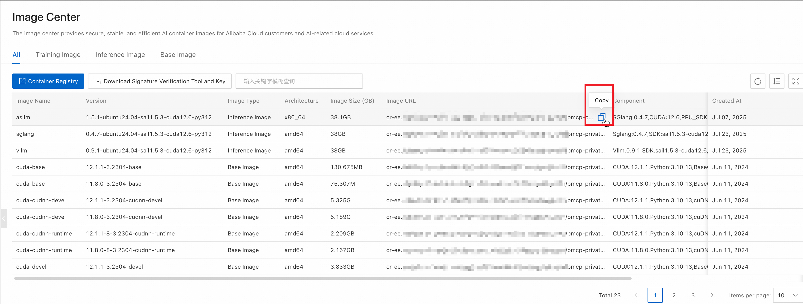

5. Obtain the username and password.

   <ol type="i">

   <li>

   Click **Container Registry** to go to the Container Registry console.

   </li>

   <li>

   Obtain the password.

   </li>

   </ol>

   On the Access Credentials page, click **Set User Account Password**. For more information about access credential, see **Configure an access credential** in **Container Registry User Guide**.

   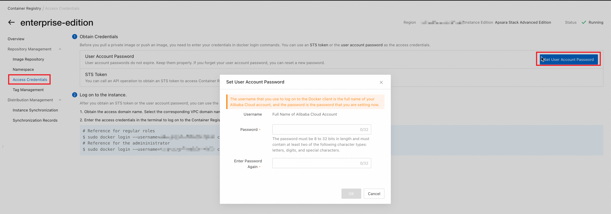

   <ol type="i" start="3">

   <li>

   Obtain the username.

   </li>

   </ol>

   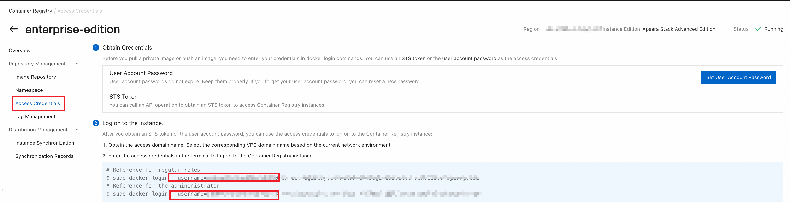

6. Verify the image signature.

   - The platform periodically checks the signature verification. The verification result is displayed in the **Signature Verification Status** column. Before you use an image, make sure that the image signature is manually verified. This ensures the integrity and security of the image.

     > **Important**
     >
     > If the signature verification fails, **Unknown** is displayed in the Signature Verification Status column. In this case, do not run the image.

     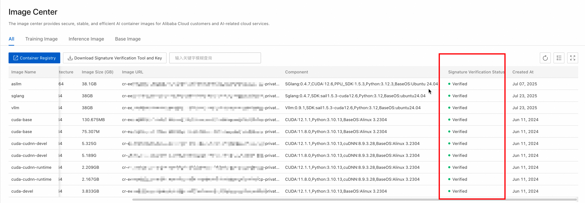

   - Manually verify the image signature by running the cosign verify command.

     ```text
     cosign verify \
       --registry-username=your_username \
       --registry-password=your_password \
       --key bmcp.pub \
       your_image_name:your_image_tag
     ```

     > **Note**
     >
     > For more information about the values of the your_username and your_password parameters, see the Obtain the username and password section of this topic.
     >
     > Replace your_image_name:your_image_tag with the URL of the image whose signature you want to verify. For more information about how to obtain the image URL, see the Obtain the image URL section of this topic.

**Other signature verification methods**

1. Configure Docker to enable signature verification.

   Configure Docker notary or use cosign and policy-controller to automatically intercept unsigned images.

   > **Note**
   >
   > Docker Content Trust (DCT) is not compatible with cosign. We recommend that you use cosign for signature verification.

2. Integrate products such as Kubernetes into continuous integration and continuous delivery (CI/CD) pipelines to add a verification step before deployment in automation scenarios.

   ```yaml
   name: Verify image signature
   run: |
    cosign verify 
     --registry-username=your_username \
     --registry-password=your_password \
     --key bmcp.pub \
     {{ your_image_name:your_image_tag }}  
   ```

   > **Note**
   >
   > For more information about the values of the your_username and your_password parameters, see the Obtain the username and password section of this topic.
   >
   > Replace your_image_name:your_image_tag with the URL of the image whose signature you want to verify. For more information about how to obtain the image URL, see the Obtain the image URL section of this topic.

**FAQ**

**What do I do if the signature verification fails?**

- Check whether the public key URL can be accessed from the network.

- Check whether the name and tag of the image are valid.

- For further assistance, contact technical support. In this case, you must provide the error logs.

**Can I skip signature verification?**

Security risks may arise for unverified images. Therefore, we recommend that you do not skip this step.

**How do I confirm that an image has been signed?**

If a valid signature is returned after the command to verify the image is run, the image is signed.

<a id="section-8-2"></a>

## 8.2. Data acceleration

This topic describes value-added services for training and inference optimization, such as image acceleration and data cache acceleration.

<a id="section-8-2-1"></a>

### 8.2.1. Image acceleration

This topic describes how to create an image conversion task.

**Procedure**

1. Log on to Bare Metal Computing Platform (BMCP).

2. In the left-side navigation pane, choose **Application Services > Data Acceleration**.

3. On the **Image Acceleration** tab, you can search images by URL in fuzzy match mode.

4. Click the  icon to search images in fuzzy match mode.

5. Click **Create Image Conversion Task**. In the dialog box that appears, enter the URL of the image.

6. Click **OK** to create the image conversion task.

<a id="section-8-2-2"></a>

### 8.2.2. Cache acceleration

This topic describes how to create a cache acceleration instance, delete a cache acceleration instance, and view cache acceleration instances.

**Prerequisites Prerequisites**

The cache acceleration feature relies on the ack-fluid component of Container Service for Kubernetes (ACK). Before you use cache acceleration, make sure that the ack-fluid component is installed in your ACK cluster. For more information, see **Kubernetes clusters > Components > Introduction > ack-fluid** in **ACK User Guide**.

**Create a cache acceleration instance**

1. Log on to Bare Metal Computing Platform (BMCP).

2. In the left-side navigation pane, choose **Application Services > Data Acceleration**.

3. Click the **Cache-based Acceleration** tab.

4. Click **Create Cache Acceleration Instance**.

5. In the **Basic Information** section, specify **Organization**, **Resource Set**, **Region**, **Zone**, **OSS RAM Role Authorization**, **Cluster**, **Cache Instance Name**, **Description**, and **Label**.

6. In the Instance Configurations section, specify **Specifications**, **Cache Acceleration Instance Capacity (GB)**, **OSS Domain Name**, **OSS Mount Path**, and **Instance Namespace**.

7. After you complete the configuration, click **Submit**.

**View cache acceleration instances**

1. Log on to BMCP.

2. In the left-side navigation pane, choose **Application Services > Data Acceleration**.

3. Click the **Cache-based Acceleration** tab.

4. In the cache acceleration instance list, you view instance information such as **Instance Type**, **Cluster ID**, and **Instance Namespace**.

5. Select filter conditions to filter instances.

   You can filter instances by **Cache Acceleration Instance ID**, **Cache Acceleration Instance Name**, **Cluster ID**, **Instance Namespace**, and Tag.

   You can also click Advanced Filter to select multiple filter conditions.

6. Click **Details** in the **Actions** column of a cache acceleration instance to view its detailed information.

**Delete a cache acceleration instance**

> **Important**
>
> This operation is irreversible and may cause data loss. Proceed with caution.

1. Log on to BMCP.

2. In the left-side navigation pane, choose **Application Services > Data Acceleration**.

3. Click the **Cache-based Acceleration** tab.

4. Delete one or more cache acceleration instances.

   - Delete a cache acceleration instance:

     - Click **Delete** in the **Actions** column of the cache acceleration instance.

     - In the message that appears, click **Delete**.

   - Delete multiple cache acceleration instances:

     - Select one or more cache acceleration instances and click **Delete** below the list.

     - In the message that appears, click **Delete**.

**Create an application to verify the acceleration**

You can create an application to use the cache acceleration service or submit machine learning jobs. In this topic, an application is created to access the same data multiple times in order to verify the acceleration.

**Usage notes**

The cache you create must belong to the same organization, resource set, region, zone, cluster, and namespace as the pod.

**Procedure**

1. Create a file named app.yaml based on the following YAML template:

   ```yaml
   apiVersion: v1
   kind: Pod
   metadata:
     name: demo-app
   spec:
     containers:
       - name: demo
         image: anolis-registry.cn-****.cr.aliyuncs.com/openanolis/nginx:1.14.1-8.6
         volumeMounts:
           - mountPath: /data
             name: hadoop
     volumes:
       - name: hadoop
         persistentVolumeClaim:
           claimName: hadoop
   ```

   > **Note**
   >
   > The claimName below persistentVolumeClaim must be set to the ID of the cache acceleration instance.

2. Run the following command to create an application:

   ```bash
   kubectl create -f app.yaml
   ```

3. Run the following commands to query the size of the specified file:

   ```bash
   kubectl exec -it demo-app -- bash
   du -sh /data/spark-3.0.1-bin-hadoop2.7.tgz
   ```

   Expected output:

   ```text
   210M    /data/spark-3.0.1-bin-hadoop2.7.tgz
   ```

4. Run the following command to query the time consumed to copy the file:

   ```text
   time cp /data/spark-3.0.1-bin-hadoop2.7.tgz /dev/null
   ```

   Expected output:

   ```text
   real    0m18.386s
   user    0m0.002s
   sys     0m0.105s
   ```

   The output indicates that 18 seconds are consumed to copy the file.

5. Run the following command to check the cached data of the dataset:

   ```bash
   kubectl get dataset hadoop
   ```

   Expected output:

   ```text
   NAME     UFS TOTAL SIZE   CACHED   CACHE CAPACITY   CACHED PERCENTAGE   PHASE   AGE
   hadoop   210.00MiB       210.00MiB    2.00GiB        10.25%             Bound   1h
   ```

   The output indicates that 210 MiB of data is cached to the on-premises storage.

6. Run the following command to delete the current application, and then create the same application.

   > **Note**
   >
   > This step is performed to avoid other factors, such as the page cache, from affecting the result.

   ```bash
   kubectl delete -f app.yaml && kubectl create -f app.yaml
   ```

7. Run the following command to query the time consumed to copy the file:

   ```bash
   kubectl exec -it demo-app -- bash
   time cp /data/spark-3.0.1-bin-hadoop2.7.tgz /dev/null
   ```

   Expected output:

   ```text
   real    0m0.048s
   user    0m0.001s
   sys     0m0.046s
   ```

   The output indicates that 48 milliseconds are consumed to copy the file. This means that the time consumption is reduced by more than 300 times.

   > **Note**
   >
   > This is because the file is cached. It is much faster to access a cached file.

<a id="section-8-2-3"></a>

### 8.2.3. Configure a Dragonfly image repository to accelerate image distribution

You can use Dragonfly to significantly improve file transfer efficiency. This topic describes how to specify a Dragonfly image repository to accelerate image distribution.

**Procedure**

On a Bare Metal Computing Platform (BMCP) node, perform the following operations. In this example, the image repository example.com is used. Replace the image repository address with the actual address.

> **Important**
>
> Make sure that you have replaced all "example.com".

1. Modify  `/etc/containerd/config.toml` .

   <ol type="i">

   <li>

   Add  `config_path = "/etc/containerd/certs.d"` . If it is already added, skip this step.

   > **Note**
   >
   > `/etc/containerd/certs.d`  is the default path of containerd. You can change the path based on your business requirements.

   </li>

   <li>

   Configure an accelerated image repository.

   </li>

   </ol>

   ```text
   [plugins."io.containerd.grpc.v1.cri".registry]

     # To use the image acceleration feature, manually add the config_path parameter and annotate other configurations in [plugins."io.containerd.grpc.v1.cri".registry].  
     config_path = "/etc/containerd/certs.d"  
     
     #[plugins."io.containerd.grpc.v1.cri".registry.auths]
       # Configure the accelerated image repository. 
       #[plugins."io.containerd.grpc.v1.cri".registry.configs."example.com"]   
   ```

2. Configure the hosts.toml file.

   > **Note**
   >
   > If multiple image repositories exist, repeat the step for each image repository.

   <ol type="i">

   <li>

   Create an accelerated image repository directory.

   ```bash
   mkdir -p /etc/containerd/certs.d/example.com
   ```

   </li>

   <li>

   In the directory, create a file named  `hosts.toml`  and add the following code to the file.

   </li>

   </ol>

   ```text
   server = "https://example.com"

   [host]

     [host."http://127.0.0.1:65001"]
       capabilites = ["pull", "resolve"]
       skip_verify = true

       [host."http://127.0.0.1:65001".header]
         X-Dragonfly-Registry = ["https://example.com"]

     [host."https://example.com"]
       capabilites = ["pull", "resolve"]
       skip_verify = true
   ```

3. Run the following command to restart containerd:

   ```bash
   systemctl restart containerd
   ```

**What to do next**

For more information about how to install Dragonfly, see **Kubernetes clusters > Components > Introduction > ack-dragonfly** in **ACK User Guide**. You can also modify the MySQL and Redis resource parameters on demand. For more information, see the related configuration instructions in the same topic.

<a id="section-8-3"></a>

## 8.3. Data distribution

Data distribution provides value-added features for Alibaba Cloud customers and AI-related products, including P2P distribution of files such as model files and training datasets in clusters.

<a id="section-8-3-1"></a>

### 8.3.1. Create a data distribution task

This topic describes the prerequisites and procedure for creating a data distribution task.

**Prerequisites**

- You have integrated multiple NVMe solid-state drives (SSDs) into one or more logical volumes by referring to the related KB document. To obtain the detailed KB document, contact Alibaba Cloud technical support engineers.

- The P2P distribution suite for Object Storage Service (OSS) data is installed in the cluster. For more information, see P2P distribution suite for OSS data.

**Procedure**

1. Log in to Bare Metal Computing Platform (BMCP).

2. In the left-side navigation pane, choose **Application Service > Data Distribution**.

3. Click **Create Data Distribution Task**.

4. In the Create Data Distribution Task dialog box, configure the parameters.

   | Parameter | Description |
   | --- | --- |
   | Task Name | The name of the task. |
   | Select Cluster | The cluster to which you want to distribute data. |
   | RRSA RAM Role Authorization | Select an authorized role or click <strong>Authorize</strong> to authorize the role. Then, return<br>to the <strong>Create Data Distribution Task</strong> dialog box and click theicon to<br>view the list of authorized roles. |
   | Select Node | Select the BMCP node to which data will be distributed. You can select multiple nodes in the same cluster.<br>You can specify <strong>Node Name</strong>, <strong>SN</strong>, <strong>Hostname</strong>, or <strong>IP</strong>. You can also click <strong>Advanced Filter</strong> to search for a node. |
   | OSS Storage Path | You can enter a file or directory. The directory must end with a forward slash (/). |
   | Prefetch Concurrency | • The number of files to be prefetched concurrently in a batch. If Tensor Parallelism (TP) is enabled for the model file, we recommend that you set this parameter to the number of TPs.<br>• Valid values: 1 to 100. |
   | Prefetch Timeout Period | • The timeout period of the prefetch task.<br>• Unit: minutes.<br>Note<br>Specify the prefetch timeout period based on the data size. We recommend that you set the timeout period to at least one minute for each 30 GB of data. |

5. Click **OK**.

**Execution result**

After the task is created, you can view the task on the Data Distribution page. The task is in the **Complete** state.

<a id="section-8-3-2"></a>

### 8.3.2. Delete a data distribution task

You can delete a data distribution task at any time if it is no longer needed, to avoid unnecessary management overhead. This topic describes how to delete a data distribution task.

**Procedure**

1. Log in to Bare Metal Computing Platform (BMCP).

2. In the left-side navigation pane, choose **Application Service > Data Distribution**.

3. On the Data Distribution page, find the data distribution task that you want to delete and click **Delete** in the **Actions** column.

4. In the message that appears, click **OK**.

<a id="section-8-3-3"></a>

### 8.3.3. Use P2P to distribute OSS data

This topic describes how to use a distributed file in a business process. In this example, an inference service is started.

**Preparations**

Upload a model file to an Object Storage Service (OSS) bucket. For more information about OSS, see OSS User Guide.

**Procedure**

1. Log on to Bare Metal Computing Platform (BMCP).

2. In the left-side navigation pane, choose **Clusters & Nodes > Cluster Management**.

3. On the **Cluster Management** page, click the **ACK - Intelligent Computing Cluster** tab.

4. Find the desired cluster and click **Details** in the **Actions** column.

5. Click the **Software Instance** tab.

6. On the OSS File P2P Distribution Suite card, click **Install**.

7. In the message that appears, click **OK**.

   > **Note**
   >
   > In addition to OSS File P2P Distribution Suite, the RAM Roles for Service Accounts (RRSA) feature is enabled and the ack-pod-identity-webhook component is installed for the ACK cluster.

8. Distribute the model file from the storage end to destination servers in P2P mode.

   For more information, see Create a data distribution task.

9. Start the inference service.

   <ol type="i">

   <li>

   Run the following command to start the inference service:

   ```bash
   kubectl apply -f modelcsi-test.yaml
   ```

   Sample modelcsi-test.yaml:

   ```yaml
   apiVersion: apps/v1
   kind: Deployment
   metadata:
     name: modelcsi-test
   spec:
     replicas: 1
     selector:
       matchLabels:
         model-pvname: modelcsi-test
     template:
       metadata:
         labels:
           model-pvname: modelcsi-test
         name: modelcsi-test
       spec:
         containers:
         - command:
           - sh
           - -c
           - sleep 360000
           env:
           - name: NVIDIA_VISIBLE_DEVICES
             value: "all"
           image: cr-ee.****/acr-aipaas/nvidia-vllm-lws:0.11.0-torch2.8-cuda12.8.1-py312-ubuntu22.04-lws
           name: llm
           ports:
           - containerPort: 8070
             protocol: TCP
           resources:
             limits:
               nvidia.com/gpu: "1"
             requests:
               cpu: "1"
               memory: 1Gi
               nvidia.com/gpu: "1"
           volumeMounts:
           - mountPath: /model/
             name: model-1
         tolerations:
         - effect: NoSchedule
           key: node-role.alibabacloud.com/bmcp
           operator: Exists
         - effect: NoSchedule
           key: node-role.alibabacloud.com/bmcp-managed
           operator: Exists
         volumes:
         - name: model-1
           csi:
             driver: "model.csi.modelpack.org" # Fixed value
             volumeAttributes:
               "model.csi.modelpack.org/type": "ossFile" # Fixed value
               # The following reference format is https://<bucket>.<oss 
   endpoint>/<subPath>/.
               "model.csi.modelpack.org/reference": "https://evan.oss-****/Qwen3-8B/"
   ```

   </li>

   <li>

   Switch to the inference service pod to view the model file of the mount point.

   </li>

   </ol>

   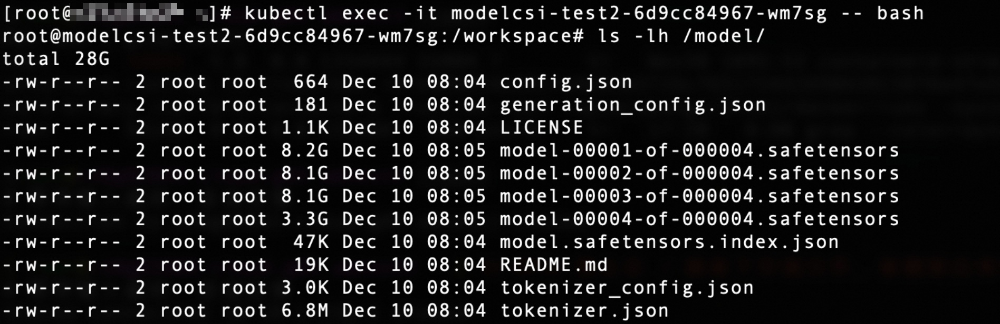

   <ol type="i" start="3">

   <li>

   Verify the performance of model loading.

   </li>

   </ol>

   > **Note**
   >
   > The results presented in the table represent the data obtained for this demonstration only.

   | Model loading time (unit: seconds) | Qwen3-32B | Qwen3-8B |
   | --- | --- | --- |
   | TP=1 | 13.66 | 8.20 |
   | TP=2 | 9.26 | 5.53 |

<a id="section-8-4"></a>

## 8.4. Application center

The application center integrates multiple types of kits. Different kits apply to different intelligent computing scenarios. You can manage kits uniformly based on kit capabilities.

**Basic intelligent computing kit**

**Scenarios**

This kit identifies GPU devices, manages drivers, handles virtualization, and provides basic monitoring. Without this kit, upper-layer AI tasks cannot schedule GPU resources.

**Component description**

- **bmcp-gpu-operator**: The unified management controller for device plugins (including DevicePlugin, Exporter) on the Bare Metal Computing Platform (BMCP) platform. After deployment, it centrally manages and orchestrates container-side GPU plug-ins and installs the node label NFD component.

- **gpu-deploy-engine**: The GPU deployment engine on the BMCP platform supports more flexible, adaptable, and upgradable GPU component deployment. You must create GPU component deployment tasks based on the custom resource (CR) - BMCPClusterPolicy.

- **kgpu**: A cloud-native component that provides APG userspace virtualization and supports isolation of computing power and GPU memory. It currently supports only APG. Install the BMCP GPU toolkit before use.

- **kgpu-overcommit**: The GPU memory overcommit component allows a single pod on APG to request resources that exceed the physical GPU memory capacity. It extends GPU memory through host memory to meet the large memory requirements of large model inference scenarios.

**High-performance data and image acceleration kit**

**Scenarios**

This kit solves the "I/O bottleneck" during large model training and loading. It covers dataset caching, file P2P distribution, image layer distribution, and on-demand loading. Bundling acceleration components into a kit prevents performance bottlenecks caused by user-defined installations.

**Component description**

- **dadi**: An image format based on overlaybd block storage, supported by the containerd community. When a container starts, it reads required block data from the data source on demand to achieve acceleration. After enabling it, you can build a DADI image service.

- dragonfly: A mature industry-standard component for P2P-based image and file distribution. It transfers images between nodes at the granularity of image layers, accelerating node image downloads and reducing registry bandwidth pressure.

- **fluid**: An open-source Kubernetes-native distributed dataset orchestration and acceleration engine, used to accelerate data access for data-intensive applications in cloud-native scenarios.

- **model-oss-p2p**: A model OSS P2P mount component that supports OSS mounting and P2P distribution of AI model data.

**Cluster O&M and stability kit**

**Scenarios**

This kit ensures stability. Data supports policy matching and manual inspection. Auto-recovery effectively reduces MTTR. It provides fault auto-recovery, node blocklist management, task topology visualization, and performance evaluation to ensure computing power stability.

**Component description**

- **ai-operator**: Based on the open-source K8s-Operator standard, it manages node blacklisting and unblacklisting. After deploying this module, you can perform auto-recovery operations for container computing clusters.

- **ai-profiling**: An AI performance analysis and tuning tool that provides performance analysis for training and inference.

- **ai-task-inspector**: After deploying this module, you can use the BMCP tenant and Operations Console to provide AI task topology display, model performance evaluation, and other functions for container computing clusters.

- **kea**: Submit and manage distributed training tasks based on the elastic fault tolerance framework (KEA). Through coordinated fault perception and self-healing mechanisms of underlying infrastructure, it automatically recovers from node anomalies and dynamically adjusts resources to ensure continuity of training tasks and overall platform robustness.

**LLM inference and optimization kit**

**Scenarios**

Designed specifically for large language model (LLM) inference scenarios, this kit provides request scheduling, parallel optimization, and GPU memory management to significantly improve inference throughput and reduce latency.

**Component description**

aspeed: Includes deeply optimized components such as ASpeed inference service control, inference request scheduling, and cluster parallel components. It provides features such as Prefilling and Decoding (P/D) separation, EP parallelism, and multi-level KVCache caching.

<a id="section-8-4-1"></a>

### 8.4.1. Install a component

This topic describes how to install a component for an intelligent computing cluster.

**Procedure**

1. Log in to BMCP.

2. In the left-side navigation pane, click **Application Service > Application Center** to go to the **All Applications** tab by default.

3. Click tabs of different component kits to find the component to install.

   You can also filter components by architecture.

4. Click the card of the component to install to go to its details page, then click **Install Comment**.

5. In the **Install Comment** panel, configure **Select Cluster**, **Publish Name**, and **Parameters**, and then click **OK**.

**Execution result**

After installation is complete, go to the details page of the corresponding cluster and click the **Software Instance** tab. When the status of the target component changes from **Installing** to **Running**, the component is successfully installed.

<a id="section-8-4-2"></a>

### 8.4.2. Add a custom component

Add a custom component when existing components do not meet your business requirements.

**Procedure**

1. Log in to BMCP.

2. In the left-side navigation pane, click **Application Service > Application Center** to go to the **All Applications** tab.

3. Click **Create Custom Component** in the upper-right corner of the page.

4. In the **Create Custom Component** panel, configure the component information and click **OK**.

   **Configurati**

   **File type**

   **Description**

   **on item**

   **Component**

   Set the component name.

   **Name**

   **Chart**

   Set the Chart version.

   **Version**

   **YAML**

   - You can upload one or more YAML files that define Kubernetes resources.

   - The content of a YAML file must comply with the Kubernetes API specification, with correct syntax for successful parsing.

   - If a YAML file contains multiple resources, separate them with  `---` .

   - Each resource definition must contain the  `apiVersion`  and  `kind`  fields.

   **YAML Configurati**

   - The YAML file must not contain invalid fields or configurations.

   **on**

   Resource definitions must not conflict with platform restrictions. If any such issues exist, an error occurs during deployment and the failure reason is returned.

   - The resource types used in a YAML file must be valid in Kubernetes. If a resource type does not exist, an error occurs during deployment and the failure reason is returned.

   - Ensure that resources referenced in a YAML file, such as images, storage, and configuration items, are complete and available. Otherwise, an error occurs during deployment.

   - The uploaded file must be a compressed package in Helm Chart format, typically a  `.tgz`  file.

   - The Chart package must be a valid Helm Chart package that passes the  `helm lint`  validation, including:

     - A  `Chart.yaml`  file that correctly defines the application name ( `name` ) and version number ( `version` ).

     - A  `values.yaml`  file.

     - A  `templates/`  directory where template files comply with Helm template syntax.

   **TGZ**

   **Upload File**

   - The  `description`  field is a brief one-sentence description automatically extracted from Chart.yaml.

   - The  `Details`  field is detailed Markdown-formatted content that you must provide separately through the upload form.

   - If the Chart depends on other sub-Charts, ensure that the dependency configuration is complete. Otherwise, an error occurs during installation.

   - The Chart package content must be compatible with the platform runtime environment, including Kubernetes version, image addresses, and storage types. Incompatible content causes an error during deployment.

**Execution result**

After you add the component, it appears under the **Custom Kit** tab. This indicates that the component has been added successfully.

<a id="section-8-4-3"></a>

### 8.4.3. Using KGPU

This topic describes how to verify and configure isolation policies, configure GPU selection policies for shared APG scheduling nodes, and modify the minimum memory allocation unit for shared APG scheduling.

**Prerequisites**

- The cluster contains ECS instances and Enable the cluster O&M service.

- You have installed the KGPU kit and the BMCP GPU Toolkit kit.

- You have enabled user mode virtualization. For more information, see GPU virtualization.

- Only APG and Hygon BW1000 are supported.

**Limits**

Privileged containers cannot use KGPU.

**Create a job to test KGPU runs normally**

1. Create a file named pod-test.yaml to verify the resource scheduling feature of KGPU. This file defines a pod that requests and uses KGPU resources.

   > **Note**
   >
   > - Fill in the value of image based on your actual needs.
   >
   > - When gpu-count is 0 or 1, the system schedules the workload to one physical GPU. If gpu-count is 0, you must request other resources together. When gpu-count is greater than 1, the system schedules the workload to more physical GPUs.

   Example of pod-test.yaml:

   ```yaml
   apiVersion: v1
   kind: Pod
   metadata:
     name: test-pod
   spec:
     tolerations:
       - operator: Exists
     containers:
       - name: test-container
         image: cr-ee.registry.cn-wulan-****.com/bmcp-private/cuda-base:12.1.1-3.2304-base
         command:
           - /bin/sleep
           - "inf"
         resources:
           requests:
             kgpu.com/gpu-count: 1
             kgpu.com/gpu-mem: 48
             kgpu.com/gpu-core.percentage: 50
           limits:
             kgpu.com/gpu-count: 1
             kgpu.com/gpu-mem: 48
             kgpu.com/gpu-core.percentage: 50
   ```

2. Run the following command to deploy the pod.

   ```bash
   kubectl apply -f pod-test.yaml
   ```

3. Run the following command to view the status of the pod. If the status is Running, KGPU runs normally.

   ```bash
   kubectl get po test-pod
   ```

   Expected output:

   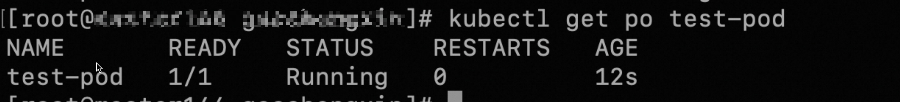

**Configure an isolation policy**

By default, KGPU provides dual isolation capabilities for GPU memory and computing power after installation. If you need to configure only GPU memory isolation or disable isolation, you can modify the configuration file and restart the device plugin (dp) component.

After installation, KGPU creates a ConfigMap named kgpu-dp in the kube-system namespace, containing all configurable items. In KGPU, the isolation capability is controlled by the shareModel field in the preceding ConfigMap. The values and meanings of this field are as follows:

| Value of shareModel | Meaning |
| --- | --- |
| 0 | Disabled |
| 1 | GPU memory isolation |
| 3 | GPU memory and computing power isolation |

You can modify the value of shareModel in the ConfigMap based on your actual needs and restart the DaemonSet of kgpu to make the configuration take effect. This example demonstrates how to change the isolation mode from GPU memory isolation only to GPU memory and computing power isolation.

**Procedure**

1. Run the command to check whether kgpu-dp has been created.

   ```bash
   kubectl get cm -n kube-system | grep kgpu
   ```

   Expected output:

   ```text
   kgpu-dp                                                1      17h
   ```

2. Modify shareModel in the ConfigMap to 3.

   ```yaml
   apiVersion: v1
   data:
     device-config.yaml: |-
     ...
       apg1:
         resourceCountName: kgpu.com/gpu-count
         ...
         shareModel: 3
   ```

3. Run the following command to view kgpu-scheduler. The value of pod is 1/1.

   ```bash
   kubectl get deploy -n kube-system | grep kgpu
   ```

   Expected output:

   

4. Run the following command to view kgpu-device-plugin. The number of pods equals the number of nodes where kgpu virtualization is enabled.

   ```bash
   kubectl get ds -n kube-system | grep kgpu
   ```

5. Run the following command to restart dp.

   ```bash
   kubectl rollout restart ds -n kube-system kgpu-device-plugin
   ```

   Expected output:

   ```text
   daemonset.apps/kgpu-device-plugin restarted
   ```

6. Run the following command to query the pod status. If the status is Running and AGE indicates the most recent startup time, the operation is successful.

   ```bash
   kubectl get po -n kube-system | grep kgpu-device-plugin
   ```

   Expected output:

   

**Configure GPU selection policies for shared APG scheduling nodes**

KGPU divides resource scheduling into two phases: node scheduling and device scheduling on the selected node. KGPU supports configuring separate scheduling policies for these two phases, including binpack and spread.

| Scheduling policy | Description |
| --- | --- |
| binpack | Prefer nodes or devices with higher resource utilization to reduce resource fragmentation and improve resource efficiency. Suitable for scenarios where you want to concentrate workloads on a few nodes or devices. |
| spread | Prefer nodes or devices with lower resource utilization to achieve load balancing and avoid single-point overload. Suitable for high-availability or performance-sensitive tasks. |

**Procedure**

1. Run the command to check whether the kgpu-scheduler component exists.

   ```bash
   kubectl get deploy -n kube-system | grep kgpu
   ```

   Expected output:

   ```bash
   # Query component
   # kubectl get deploy -n kube-system | grep kgpu
   kgpu-scheduler                      1/1     1            1           17h
   ```

2. Run the following command to edit the configuration.

   ```bash
   kubectl edit deploy -n kube-system kgpu-scheduler
   ```

3. Locate the scheduler extender container based on name: extender, and find the content that needs modification.

   ```yaml
   apiVersion: apps/v1
   kind: Deployment
   metadata:
     ...
     name: kgpu-scheduler
     namespace: kube-system
   spec:
     template:
       ...
       spec:
         containers:
         ...
         - command:
           - scheduler
           ...
           - --node-scheduler-policy=binpack
           - --gpu-scheduler-policy=spread
           name: extender
   ```

   The meanings of the modifiable parameters in the preceding YAML file are as follows:

   | Parameter | Description |
   | --- | --- |
   | node-scheduler-policy | Inter-node scheduling policy. Valid values:<br>• binpack<br>• spread |
   | gpu-scheduler-policy | Intra-node GPU device scheduling policy. Valid values:<br>• binpack<br>• spread |

   > **Note**
   >
   > By default, KGPU prefers binpack for inter-node scheduling and spread for intra-node multi-GPU card scheduling.

**Change the minimum allocation unit for shared APG scheduling GPU memory**

The kgpu-dp configuration file in the kube-system namespace contains some APG resource configurations. You can modify the settings related to the minimum allocation unit for APG scheduling within this file.

1. Run the command to view the ConfigMap resource for kgpu-dp and output it in YAML format.

   ```bash
   kubectl get cm -n kube-system kgpu-dp -o yaml
   ```

   Expected output:

   ```yaml
   apiVersion: v1
   data:
     device-config.yaml: |-
       ...
       apg1:
         ...
         deviceSplitCount: 100
         deviceMemoryUnit: 1Gi
         deviceCoreSplitCount: 100
   ```

   The following table describes the parameters:

   | Parameter | Description |
   | --- | --- |
   | deviceSplitCount | The maximum number of virtual devices into which a single physical GPU can be split, which equals the maximum number of concurrent tasks. In the example, <code> 100 </code> indicates that one GPU card supports up to 100 shared tasks. |
   | deviceMemoryUnit | The minimum unit for splitting GPU memory. The value must comply with Kubernetes resource format definitions and use binary units. In the example, the value indicates that the minimum split unit for GPU memory is 1 GiB, and the smallest supported granularity is 32 MiB.<br>Note<br>Use Mi instead of M. Mi is binary-based (base 1024), while M is decimal-based (base 1000). |
   | deviceCoreSplitCount | The minimum unit for splitting computing power. |

<a id="section-9"></a>

# 9.Models and images

<a id="section-9-1"></a>

## 9.1. Node models

You can add, query, modify, and remove node models.

<a id="section-9-1-1"></a>

### 9.1.1. Query models

This topic describes how to query models and view model details.

**Prerequisites**

You have added a model in the BMCP Operations Console.

**Procedure**

1. Log in to BMCP.

2. In the left-side navigation pane, select **Instance Type and Image > Node Model**.

3. On the **Node Model** page, enter a model name or architecture to search for models.

4. Click the  icon to search models in fuzzy match mode.

<a id="section-9-1-2"></a>

### 9.1.2. Modify a model

This topic describes how to modify the configuration of a model.

**Prerequisites**

A model is added.

**Procedure**

1. Log on to Bare Metal Computing Platform (BMCP).

2. In the left-side navigation pane, choose **Models & Images > Node Model.**

3. On the **Node Model** page, find the model to be modified and click **Modify** in the **Actions** column.

4. In the **Modify Model** dialog box, you can modify parameters other than **Specifications** and **Model Name**.

5. After you modify the model, click **OK**.

<a id="section-9-1-3"></a>

### 9.1.3. Delete a model

This topic describes how to delete a model.

**Prerequisites**

- A model is added.

- Models referenced by instances cannot be deleted.

**Background information**

You can delete a model with the specified name. If the model is referenced by Bare Metal Computing Platform (BMCP) instances registered on BMCP, you cannot delete the model.

> **Warning**
>
> This operation is a high-risk operation and is irreversible. Proceed with caution.

**Procedure**

1. Log on to BMCP.

2. In the left-side navigation pane, choose **Models & Images > Node Model.**

3. On the **Node Model** page, find the model that you want to delete and click **Delete** in the **Actions** column.

4. In the message that appears, click **OK**.

<a id="section-9-2"></a>

## 9.2. Bare metal instance images

Bare metal instance images contain image metadata that is used when you create bare metal instances or clusters. Bare metal instance images are classified into custom images and public images. You can query, delete, and export custom images or manage the status of custom images, and query and export public images or manage the status of public images. You can also upload custom images to meet your business requirements.

<a id="section-9-2-1"></a>

### 9.2.1. Upload a custom image

This topic describes how to upload a custom image.

**Prerequisites**

- A TGZ or QCOW2 custom image file that meets the specifications is stored in the on-premises environment.

- The certificate of the environment to which you have logged on has not expired.

**Background information**

You can upload TGZ or QCOW2 custom image files based on your business requirements.

**Procedure**

1. Log on to Bare Metal Computing Platform (BMCP).

2. In the left-side navigation pane, choose **Models & Images > Bare Metal Instance Image.**

3. On the **Bare Metal Instance Image** page, click the **Custom Image** tab and click **Upload Custom Image**.

4. In the dialog box that appears, specify **Region**, **Zone**, **System Architecture**, **Platform**, **Kernel Version**, and **Image Description**.

5. Click **Select File** below **Upload Image** and select the TGZ or QCOW2 image file that is saved on your computer. After the image file is uploaded, the **image name** is automatically generated.

6. Click **OK** to upload the image file.

   > **Note**
   >
   > The environment certificate affects image uploading. If the image fails to be uploaded, click **click here** to trust the certificate.

**Troubleshooting**

If the certificate of the environment has expired, the **Image upload failed** message is displayed when you upload the image. You can use the following solution to solve the issue:

1. When you failed to upload the image, enable the developer mode of your web browser.

2. Find the error message in the developer console and copy the link that starts with "https…".

3. Access the link in a new tab of the browser.

4. On the warning page that appears, click **Advanced** and select Continue. Then, you are redirected to a new page.

5. Upload the image file again after you complete the preceding steps.

<a id="section-9-2-2"></a>

### 9.2.2. View public images

This topic describes how to use public images.

**Prerequisites**

A public image is saved in the environment to which you have logged on.

**Background information**

- Bare Metal Computing Platform (BMCP) supports public images in the TGZ and QCOW2 formats.

- By default, BMCP provides some adapted public images. If no image is displayed on the Public Image tab or the status of the public images on the tab is not "Available", contact the developer.

- When a public image is **disabled**, it is not displayed in the Configure Image and Node Name fields. In this case, you need to enable the public image on the Public Image tab first.

- Some public images are only used to migrate products that are compatible with earlier versions. You cannot export these images.

**Procedure**

1. Log on to BMCP.

2. In the left-side navigation pane, choose **Models & Images > Bare Metal Instance Image**.

3. On the **Bare Metal Instance Image** page, click the **Public Image** tab.

4. The tab displays all public images. You can manage image status and export images.

<a id="section-9-2-3"></a>

### 9.2.3. Query custom images

This topic describes how to query custom images and view the details of custom images.

**Prerequisites**

You have created a custom image. For more information, see Upload a custom image.

**Procedure**

1. Log in to BMCP.

2. In the left-side navigation pane, select **Instance Type and Image > Bare Metal Instance Image** .

3. On the **Bare Metal Instance Image** page, enter **Image Name** or **Image ID** to search for images.

4. Click the  icon to search custom images in fuzzy match mode.

<a id="section-9-2-4"></a>

### 9.2.4. Delete an image

This topic describes how to delete an image.

**Prerequisites**

A custom image is created. For more information, see Upload a custom image.

> **Note**
>
> You can delete only custom images. Public images cannot be deleted.

**Procedure**

1. Log on to Bare Metal Computing Platform (BMCP).

2. In the left-side navigation pane, choose **Models & Images > Bare Metal Instance Image**.

3. On the **Bare Metal Instance Image** page, find the image that you want to delete and click **Delete Image** in the **Actions** column.

4. In the message that appears, click **OK**.

<a id="section-9-2-5"></a>

### 9.2.5. Manage image status

This topic describes how to change the status of an image.

**Prerequisites**

- A public image is created, or a custom image is uploaded.

- The image whose status you want to change is not referenced.

**Background information**

You can change the status of an image. After you change the status of an image to Disabled, the image cannot be referenced. If the image has been referenced, you cannot change the status of the image to Disabled.

**Procedure**

- Disable an image

  <ol type="i">

  <li>

  Log on to Bare Metal Computing Platform (BMCP).

  <ol type="i" start="2">

  <li>

  In the left-side navigation pane, choose **Models & Images > Bare Metal Instance**

  </li>

  </ol>

  **Image**.

  <ol type="i" start="3">

  <li>

  On the **Bare Metal Instance Image** page, find the image that you want to manage and

  </li>

  </ol>

  choose **Status > Disable Image** in the **Actions** column.

  </li>

  <li value="4">

  Then, the image is disabled.

  After the image is disabled, the status of the image changes from **Available** to **Unavailable. In addition, its status also changes from Enabled** to **Disabled**.

  </li>

  </ol>

- Enable an image

  <ol type="i">

  <li>

  On the **Bare Metal Instance Image** page, find the image that you want to manage and choose **Status > Enable Image** in the **Actions** column.

  </li>

  <li>

  Then, the image is enabled.

  </li>

  </ol>

  After the image is enabled, the status of the image changes from **Unavailable** to **Available. In addition, its status also changes from Disabled** to **Enabled**.

<a id="section-9-2-6"></a>

### 9.2.6. Export an image

This topic describes how to export an image. You can export public images and custom images to your on-premises environment.

**Prerequisites**

You already have a public image resource or have created a custom image. For more information, see Upload a custom image.

**Procedure**

1. Log on to Bare Metal Computing Platform (BMCP).

2. In the left-side navigation pane, choose **Instance Type and Image > Bare Metal Instance Image**.

3. Click the **Custom Image** or **Public Image** tab.

4. See Query images to find the image and click **Export Image** in the **Actions** column.

5. After you click **Export Image**, the browser automatically downloads the image file to your on-premises environment. Wait for the download to complete.

<a id="section-9-2-7"></a>

### 9.2.7. Verify the integrity of public images

Bare Metal Computing Platform (BMCP) allows you to verify the integrity of public images in case the images are tampered with. This topic describes how to verify the integrity of public images.

**Procedure**

1. Log on to BMCP.

2. In the left-side navigation pane, choose **Models & Images > Bare Metal Instance Image**.

3. Click the **Public Image** tab.

4. Click **Download Public Key** above the image list.

5. Click **Export Signature File** in the **Actions** column of the desired image.

6. You can run the following command to check whether the image is tampered with:  `openssl dgst -sha256 -verify public.key -signature signature.bin imagefile` .

   > **Note**
   >
   > - Before you run the command, make sure that the public key, signature file, and image to be verified are downloaded.
   >
   > - Set the following parameters to the actual values:
   >
   >   - `public.key`  indicates the public key.
   >
   >   - `signature.bin`  indicates the signature file.
   >
   >   - `imagefile`  indicates the image file to be verified.

<a id="section-10"></a>

# 10.Network and security

<a id="section-10-1"></a>

## 10.1. VPC

**Procedure**

1. Log on to Bare Metal Computing Platform (BMCP).

2. In the left-side navigation pane, choose **Network and Security > VPC** to redirect to the **Virtual Private Clouds** page.

3. On the **Virtual Private Clouds** page, you can manage virtual private clouds (VPCs).

4. For more information about VPC documentation, see *Apsara Stack VPC User Guide*. If you have permissions to access Apsara Stack Help Center, you can find the following information in Apsara Stack Help Center: **Apsara Stack Help Center > Apsara Stack > Network Services > VPC**.

<a id="section-10-2"></a>

## 10.2. EVPC management

Express Virtual Private Cloud (EVPC) manages the RDMA network for intelligent computing nodes, enabling you to manage RDMA CIDR blocks and subnets for intelligent computing nodes and isolate RDMA networks between different intelligent computing clusters. Additionally, based on different chips and combined with Alibaba Cloud's unique network characteristics and extensive experience in tuning communication for large model tasks, EVPC provides optimized Communication Library services. This topic describes how to create, edit, and delete an EVPC.

**Limits**

Only the following cluster types support EVPC configuration.

| Cluster type | Cluster instance type |
| --- | --- |
| Bare Metal - Intelligent Computing Cluster | Intelligent Computing High-Bandwidth Network instances, Computing-optimized Intelligent Computing Training &amp; Inference instances |
| ACK - Intelligent Computing Cluster | Intelligent Computing High-Bandwidth Network instances, Computing-optimized Intelligent Computing Training &amp; Inference instances |
| Bare Metal - HPC Cluster | High-Bandwidth Network HPC instances |
| Converged Computing Power Cluster | Converged High-Bandwidth Network |

**Create an EVPC**

1. Log in to BMCP.

2. In the left-side navigation pane, click **Network and Security > EPVC Management**.

3. On the EVPC management page, click **Create EVPC**.

4. On the pop-up **Create EVPC** page, configure parameters.

   <table>
     <tr>
       <td>Configuration item</td>
       <td></td>
       <td>Description</td>
     </tr>
     <tr>
       <td>Billing Configuration</td>
       <td>Billing Method</td>
       <td>Pay-as-you-go billing only. Users use the service first, and the system generates charges afterward based on actual resource consumption. This method suits scenarios where business usage fluctuates frequently, allowing users to flexibly allocate resources according to real-time demand and avoid waste.<br>Note<br>This option appears only if your administrator has configured billing rules in the Management Center. For detailed explanations of billing rules, see the <strong>Billing</strong> <strong>rules </strong>section in<strong> Apsara Uni-Manager Management</strong> <strong>Console User Guide</strong>.</td>
     </tr>
     <tr>
       <td rowspan="3">Basic Information</td>
       <td>Organization</td>
       <td>The organization to which the EVPC belongs.</td>
     </tr>
     <tr>
       <td>Resource Set</td>
       <td>The resource set to which the EVPC belongs.</td>
     </tr>
     <tr>
       <td>Region</td>
       <td>The region to which the EVPC belongs.</td>
     </tr>
     <tr>
       <td rowspan="4">Configuration</td>
       <td>IPv6</td>
       <td>Indicates whether to enable IPv6 for the EVPC.</td>
     </tr>
     <tr>
       <td>EVPC Name</td>
       <td>The name must be 2 . It can contain numbers, periods (.), underscores (_), and hyphens (-).</td>
     </tr>
     <tr>
       <td>Description</td>
       <td>The description must be 2 to 256 characters in length, and cannot start with http:// or https://.</td>
     </tr>
     <tr>
       <td>Tags</td>
       <td>Tags consist of case-sensitive key-value pairs. You can add up to 20 tags. Keys must be unique and no longer than 64 characters. Values can be empty and no longer than 128 characters. Neither keys nor values can start with aliyun, acs:, https://, or http://.</td>
     </tr>
   </table>

5. Create the EVPC.

   - If the service management already contains a service where the cloud product is **Bare Metal Computing Platform BMCP** and the resource item is **EVPC**: Confirm the parameters and click **Confirm Order**.

   - If the service management does not contain a service where the cloud product is **Bare Metal Computing Platform BMCP** and the resource item is **EVPC**: Confirm the parameters and click **Submit**.

**Edit an EVPC**

1. On the EVPC management page, click **Edit** in the **Modify** column for the target EVPC.

2. Modify **EVPC Name** and **Description**, then click **OK**.

**Delete an EVPC**

> **Warning**
>
> Deleting an EVPC affects the network of intelligent computing cluster instances. Proceed with caution.

1. On the EVPC management page, click **Delete** in the **Actions** column for the target EVPC.

2. In the **Delete EVPC** dialog that appears, confirm the resource information, then click **Release**.

<a id="section-10-3"></a>

## 10.3. Communication library management

This topic describes how to query communication libraries, download communication libraries, and copy the URLs of communication libraries.

**Query communication libraries**

**Procedure**

1. Log on to Bare Metal Computing Platform (BMCP).

2. In the left-side navigation pane, choose **Network and Security > EPVC Management**.

3. Click the **Communication Library Management** tab.

4. Enter a keyword into the search box on the tab to search communication libraries in fuzzy match mode.

**Copy the URLs of communication libraries**

**Procedure**

1. Log on to BMCP.

2. In the left-side navigation pane, choose **Network and Security > EPVC Management**.

3. Click the **Communication Library Management** tab.

4. Click **Copy File URL** in the Actions column of a communication library.

**Download communication libraries**

**Procedure**

1. Log on to BMCP.

2. In the left-side navigation pane, choose **Network and Security > EPVC Management**.

3. Click the **Communication Library Management** tab.

4. Click **Download** in the Actions column of a communication library.

<a id="section-10-4"></a>

## 10.4. Security groups

<a id="section-10-4-1"></a>

### 10.4.1. Overview

Security groups are a type of virtual firewall that controls inbound and outbound network traffic of Bare Metal Computing Platform (BMCP) instances in the security groups to improve instance security. Security groups provide the packet filtering capability. You can use security groups and security group rules to define security domains in the cloud.

**Terms**

- A security group functions as a virtual firewall to control network access of one or more BMCP instances.

- The rules of a security group control the inbound or outbound traffic to or from the instances in the security group. You can add or modify security group rules based on your business needs to implement fine-grained access control.

**Background information**

- After rules are added to a security group or after rules in the security group are modified, the rules are automatically applied to instances in the security group. Security group rules can be used to control access to or from specific IP addresses, CIDR blocks, or other security groups.

- If an instance is added to multiple security groups, the rules of all the security groups are applied to the instance. When a request destined for the instance is detected, the request is matched separately against the applied security group rules based on factors such as the protocol, port range, and priority. No sessions are established until the request matches an Allow rule.

**Work with security groups**

You can perform the following operations to use security groups to control the traffic of instances in the security groups:

1. Create a security group.

2. Add rules to the security group.

3. Add instances to the security group.

4. Manage the security group and security group rules based on your needs.

> **Note**
>
> - An instance can be added to at most five security groups.
>
> - The total number of inbound and outbound rules in a security group must not exceed 200.
>
> - By default, a BMCP security group allows all traffic. If you want to block traffic from specific sources, add Deny rules.

<a id="section-10-4-2"></a>

### 10.4.2. Manage security groups

This topic describes how to create, modify, and delete a security group.

**Create a security group**

1. Log in to BMCP.

2. In the left-side navigation pane, select **Network and Security > Security Group**.

3. On the **Security Group** page, click **Create Security Group**.

4. On the **Create Security Group** page, configure the security group properties, and then click **Submit**.

   **Configurati**

   **Type**

   **Required**

   **Description**

   **on Item**

   The organization to which the security group

   **Organizatio**

   Yes

   belongs. Ensure it matches the organization of

   **n**

   the Virtual Private Cloud (VPC).

   The resource set to which the security group

   **Area**

   **Resource**

   Yes

   belongs. Ensure it matches the resource set of

   **Set**

   the VPC.

   The region to which the security group belongs.

   **Region**

   Yes

   Ensure it matches the region of the VPC.

   The scope in which the security group can be shared. Supported options: **This resource set**, **This organization and its subordinate organizations**, and **The organization**.

   > **Note**

   **Shared**

   No

   **Scope**

   > To modify the sharing scope of a security group, click
   >
   > **> Sharing Settings** in the
   >
   > 
   >
   > **Actions** column of the target security group.

   Select an existing VPC, or click **Create a VPC** to create one. After creating the VPC, return to the

   **Create Security Group** page and click the 

   icon to view the latest VPC list.

   **VPC**

   Yes

   For detailed parameter descriptions for creating a VPC, see the **Create a Virtual Private Cloud** section in **Virtual Private Cloud (VPC) User Guide**.

   **Basic Configurati on**

   The name of the security group.

   **Security**

   The name must be 2 to 128 characters in length,

   **Group**

   No

   and start with a letter. It can contain digits,

   **Name**

   underscores (_), hyphens (-), and colons (:), and cannot start with  `http://`  or  `https://` .

   The description of the security group for easier management.

   The description must be 2 to 256 characters in length, and start with a letter. It can contain

   No

   **Description**

   digits, underscores (_), hyphens (-), periods (.), commas (,), colons (:), and forward slashes (/), and cannot start with  `http://`  or  `https://` .

**Modify a security group**

1. Log in to BMCP.

2. In the left-side navigation pane, select **Network and Security > Security Group**.

3. In the top navigation bar, select an **Organization**, **Resource Set**, and **Region**.

4. Find the security group that you want to modify and click **Modify** in the **Actions** column.

5. In the **Modify Security Group** dialog box, enter a new **Security Group Name** and **Description**.

6. Click **OK**.

**Delete a security group**

1. Log in to BMCP.

2. In the left-side navigation pane, select **Network and Security > Security Group**.

3. In the top navigation bar, select an **Organization**, **Resource Set**, and **Region**.

4. Use one of the following methods to delete security groups:

   <ol type="i">

   <li>

   Delete a single security group: Find the security group that you want to delete and click **Delete** in the **Actions** column.

   </li>

   <li>

   Delete security groups in batches: Select one or more security groups that you want to

   </li>

   </ol>

   delete, and click **Delete** at the bottom of the security group list.

5. In the confirmation dialog box, click **Delete**.

> **Note**
>
> - You cannot delete a security group that contains BMCP instances. Remove the instances before deletion.
>
> - You cannot delete a security group that is authorized for access by other security groups. Revoke the authorization before deletion.

<a id="section-10-4-3"></a>

### 10.4.3. Manage security group rules

This topic describes how to add, modify, delete, and clone a security group rule.

**Prerequisites**

You have identified the virtual private clouds (VPCs) to be blocked for Bare Metal Computing Platform (BMCP) instances before creating a security group rule.

**Background information**

Security groups are used to manage requests that are sent over VPCs.

Before you create security group rules, take note of the following items:

- By default, security groups allow outbound and inbound traffic. You can add security group rules to block traffic based on your business requirements.

- Security group rules support IPv4 rules and rules that authorize access from other security groups.

- The total number of inbound and outbound rules in each security group cannot exceed 200.

**Add a security group rule**

1. Log in to BMCP.

2. In the left-side navigation pane, select **Network and Security > Security Group**.

3. In the top navigation bar, select an **Organization**, **Resource Set**, and **Region**.

4. Find the security group that you want to manage and click **Configure Rule** in the **Actions** column.

5. Select the **Inbound** or **Outbound** tab, and click **Add Security Group Rule**.

6. In the **Add Security Group Rule** dialog box, configure the following attributes for the rule.

   | Configurati on Item | Required | Description |
   | --- | --- | --- |
   | Rule Direction | Yes | • <strong>Outbound</strong>: access from BMCP instances in the security group to other resources in the VPC.<br>• <strong>Inbound</strong>: access from other resources in the VPC to BMCP instances in the security group. |
   | Authorizati on Policy | Yes | • <strong>Allow</strong>: allows requests on a specific port.<br>• <strong>Reject</strong>: drops packets directly without returning any response.<br>If an Allow rule and a Reject rule differ only in the action, the <strong>Reject</strong> rule takes precedence over the <strong>Allow</strong> rule. |
   | Protocol Type | Yes | Valid values:<br>• <strong>All</strong>: applies to scenarios in which all requests are sent from trusted sources.<br>• <strong>TCP</strong>: allows or denies traffic on one or more consecutive ports.<br>• <strong>UDP</strong>: allows or denies traffic on one or more consecutive ports.<br>• <strong>ICMP</strong>: applies when the <code> ping </code> command is used to test network connectivity between instances.<br>• <strong>GRE</strong>: applies to VPN services. |
   | Port Range | Yes | The port range varies with the protocol type.<br>• If you set <strong>Protocol Type</strong> to <strong>All</strong>, the value is <strong>-1/-1</strong>, which indicates all ports. In this case, you cannot specify a port range.<br>• If you set <strong>Protocol Type</strong> to <strong>TCP</strong>, you can specify a port range.The port range must be in the &lt;start port&gt;/&lt;end port&gt; format.Valid values of port numbers: 1 to 65535. For example, 80/80 indicates port 80 and 1/22 indicates ports 1 to 22.<br>• If you set <strong>Protocol Type</strong> to <strong>UDP</strong>, you can specify a port range.The port range must be in the &lt;start port&gt;/&lt;end port&gt; format.Valid values of port numbers: 1 to 65535. For example, 80/80 indicates port 80 and 1/22 indicates ports 1 to 22.<br>• If you set <strong>Protocol Type</strong> to <strong>ICMP</strong>, the value is <strong>-1/-1</strong>, which indicates all ports. In this case, you cannot specify a port range.<br>• If you set <strong>Protocol Type</strong> to <strong>GRE</strong>, the value is <strong>-1/-1</strong>, which indicates all ports. In this case, you cannot specify a port range. |
   | Priority | Yes | The priority of the security group rule. Valid values: 1 to 100. The default value is 1, which indicates the highest priority. |
   | Authorizati on Type | Yes | • <strong>IPv4 CIDR Block</strong>: controls access from IPv4 addresses or IPv4 CIDR blocks to ECS instances in this security group.<br>• <strong>Security Group</strong>: controls access from BMCP instances in another security group within the same account to BMCP instances in the current security group. |
   | Authorizati on Object | Yes | Authorization objects vary with the set authorization type.<br>If you set <strong>Authorization Type</strong> to <strong>IPv4 CIDR Block</strong>, the following rules apply:<br>• Enter a single IPv4 address or a CIDR block. Example:<br><br><code>192.0.2.1</code> or<br><br><code>192.0.2.0/24</code>.<br>• Separate multiple authorization objects with commas (,).<br><br>• If you enter <code>0.0.0.0/0</code>, access from all IPv4 addresses is allowed or denied. Proceed with caution.<br>If you set <strong>Authorization Type</strong> to <strong>Security Group</strong>, select a security group ID from the drop-down list. The specified security group must be within the same VPC as the current security group. |
   | Description | No | The description of the security group rule for easier management.The description must be 1 to 512 characters in length, and cannot start with http:// or https://.<br>After creating a security group rule, you can find the rule and click <strong>Modify Description</strong> in the <strong>Actions</strong> column to modify the description of the rule. |

7. Click **OK**.

**Modify the properties of a security group rule**

1. Log in to BMCP.

2. In the left-side navigation pane, select **Network and Security > Security Group**.

3. In the top navigation bar, select an **Organization**, **Resource Set**, and **Region**.

4. Find the security group that you want to manage and click **Configure Rule** in the **Actions** column.

5. On the **Security Group Rule** tab, click the **Inbound** or **Outbound** tab.

6. Find the security group rule that you want to manage and click **Modify Properties** in the **Actions** column.

7. In the **Modify Properties** dialog box, modify the rule properties.

8. Click **OK**.

**Modify the description of a security group rule**

1. Log in to BMCP.

2. In the left-side navigation pane, select **Network and Security > Security Group**.

3. In the top navigation bar, select an **Organization**, **Resource Set**, and **Region**.

4. Find the security group that you want to manage and click **Configure Rule** in the **Actions** column.

5. On the **Security Group Rule** tab, click the **Inbound** or **Outbound** tab.

6. Find the security group rule that you want to manage and click **Modify Description** in the **Actions** column.

7. In the **Modify Description** dialog box, modify the description of the rule.

8. Click **OK**.

**Clone a security group rule**

1. Log in to BMCP.

2. In the left-side navigation pane, select **Network and Security > Security Group**.

3. In the top navigation bar, select an **Organization**, **Resource Set**, and **Region**.

4. Find the security group that you want to manage and click **Configure Rule** in the **Actions** column.

5. On the **Security Group Rule** tab, click the **Inbound** or **Outbound** tab.

6. Find the security group rule that you want to manage and click **Clone** in the **Actions** column.

7. In the **Clone Security Group Rule** dialog box, configure the security group rule properties, and then click **OK**.

**Delete a security group rule**

1. Log in to BMCP.

2. In the left-side navigation pane, select **Network and Security > Security Group**.

3. In the top navigation bar, select an **Organization**, **Resource Set**, and **Region**.

4. Find the security group that you want to manage and click **Configure Rule** in the **Actions** column.

5. On the **Security Group Rule** tab, click the **Inbound** or **Outbound** tab.

6. Find the security group rule that you want to delete and use one of the following methods to delete the rule:

   <ol type="i">

   <li>

   Delete a single rule: Click **Delete** in the **Actions** column of the security group rule.

   </li>

   <li>

   Delete rules in batches: Select one or more rules and click **Delete** below the rule list.

   </li>

   </ol>

7. In the confirmation dialog box, click **Delete**.

<a id="section-10-4-4"></a>

### 10.4.4. Manage BMCP instances in security groups

This topic describes how to add Bare Metal Computing Platform (BMCP) instances to and remove BMCP instances from a security group.

**Prerequisites**

The security group rules used to control access within virtual private clouds (VPCs) are determined.

**Background information**

Security groups are an important approach for security isolation. A security group can control access to or from one or more BMCP instances in the security group. Each BMCP instance can be added to at most five security groups.

**Add BMCP instances to a security group**

1. Log on to BMCP.

2. In the left-side navigation pane, choose **Network and Security > Security Groups**.

3. In the top navigation bar, select an organization, resource set, and region.

4. Find the security group that you want to manage and choose **... > Manage Instances** in the **Actions** column.

5. Click the **Instances Within Security Group** tab. You can view information about BMCP instances that belong to the current security group.

6. Click **Add Instance**.

7. Select BMCP instances that you want to add to the security group from the list.

8. Click **OK**.

**Remove BMCP instances from a security group**

1. Log on to BMCP.

2. In the left-side navigation pane, choose **Network and Security > Security Groups**.

3. In the top navigation bar, select an organization, resource set, and region.

4. Find the security group that you want to manage and choose **... > Manage Instances** in the **Actions** column.

5. Click the **Instances Within Security Group** tab. You can view information about BMCP instances that belong to the current security group.

6. Select the BMCP instances that you want to remove from the security group. Click **Remove from Security Group** below the list.

7. Click **OK**.

<a id="section-10-5"></a>

## 10.5. Key pairs

Key pairs provide a secure and convenient method to authenticate logins. A key pair consists of a public key and a private key, and is supported only on Linux instances. This topic describes how to create, delete, bind, and unbind key pairs.

**Create a key pair**

1. Log in to BMCP.

2. In the left-side navigation pane, select **Network and Security > Key Pair**.

3. On the key pair management page, click **Create Key Pair**.

4. On the **Create Key Pair** page, configure the key pair properties.

   <table>
     <tr>
       <th>Category</th>
       <th>Parameter</th>
       <th>Required</th>
       <th>Description</th>
     </tr>
     <tr>
       <td rowspan="3">Area</td>
       <td>Organizatio n</td>
       <td>Yes</td>
       <td>The organization to which the key pair belongs.</td>
     </tr>
     <tr>
       <td>Resource Set</td>
       <td>Yes</td>
       <td>The resource set to which the key pair belongs.</td>
     </tr>
     <tr>
       <td>Region</td>
       <td>Yes</td>
       <td>The region to which the key pair belongs.</td>
     </tr>
     <tr>
       <td rowspan="2">Basic Configurati ons</td>
       <td>Key Pair Name</td>
       <td>Yes</td>
       <td>The key pair name must be unique among existing key pairs. The name must be 2 to 128 characters in length, and cannot start with special characters or digits. It can contain only periods (.), underscores (_), hyphens (-), and colons (:) for special characters.</td>
     </tr>
     <tr>
       <td>Creation Type</td>
       <td>Yes</td>
       <td>Select one of the following types to create a key pair. We recommend that you select <strong>Auto</strong> <strong>Generate Key Pair</strong> and save the private key in time.<br>• <strong>Auto Generate Key Pair</strong>: The system automatically creates a key pair for you, and automatically downloads the private key. This is the only chance to download the private key, so make sure to save the private key file securely.<br>• <strong>Import Key Pair</strong>: Enter the Base64-encoded public key content in the Public Key Content text box.</td>
     </tr>
   </table>

5. Click **Create**. After the key pair is created, the browser automatically downloads the private key to your computer.

**Bind a key pair to BMCP instances**

1. Log in to BMCP.

2. In the left-side navigation pane, select **Network and Security > Key Pair**.

3. In the top navigation bar, select an **Organization**, **Resource Set**, and **Region**.

4. Find the key pair that you want to manage and click **Bind Key Pair** in the **Actions** column.

5. In the **Select BMCP Instance** list, click the BMCP instances to which you want to bind the key pair. The selected instances are moved to the right-side list.

   > **Note**
   >
   > To select or move all instances, click **Move All** below the list.

6. Click **OK**.

> **Note**
>
> - A BMCP instance can be bound to only one key pair. If an instance is already bound to a key pair, binding a new key pair automatically replaces the existing key pair.
>
> - After binding, find the key pair and click **Related Instance** in the **Actions** column to view all BMCP instances bound to the key pair.
>
> - After binding a key pair to an instance, the original password of the instance remains valid. Both password-based and private key-based logins are supported.

**Unbind a key pair from BMCP instances**

1. Log in to BMCP.

2. In the left-side navigation pane, select **Network and Security > Key Pair**.

3. In the top navigation bar, select an **Organization**, **Resource Set**, and **Region**.

4. Find the key pair that you want to manage and click **Unbind Key Pair** in the **Actions** column.

5. In the **Select BMCP Instance** list, click the BMCP instances from which you want to unbind the key pair. The selected instances are moved to the right-side list.

   > **Note**
   >
   > To select or move all instances, click **Move All** below the list.

6. Click **OK**.

**View bound instances**

1. Log in to BMCP.

2. In the left-side navigation pane, select **Network and Security > Key Pair**.

3. In the top navigation bar, select an **Organization**, **Resource Set**, and **Region**.

4. Find the key pair that you want to manage and click **Related Instance** in the **Actions** column.

5. You are redirected to the Node Management page with the filter condition set to this key pair. You can view all BMCP instances bound to this key pair.

**Delete a key pair**

You cannot delete a key pair that is currently bound to BMCP instances. Please Unbind a key pair from BMCP instances before deleting it.

1. Log in to BMCP.

2. In the left-side navigation pane, select **Network and Security > Key Pair**.

3. In the top navigation bar, select an **Organization**, **Resource Set**, and **Region**.

4. Find the key pair that you want to manage and click **Unbind Key Pair** in the **Actions** column.

5. Use one of the following methods to delete the key pair:

   <ol type="i">

   <li>

   Delete a single key pair: Find the key pair that you want to delete and select **... > Delete** in the **Actions** column.

   </li>

   <li>

   Delete key pairs in batches: Select one or more key pairs that you want to delete and

   </li>

   </ol>

   click **Delete** at the bottom of the key pair list.

6. In the pop-up dialog box, click **Delete**.

<a id="section-10-6"></a>

## 10.6. Bare metal network

The Bare Metal Network page allows you to manage the associations between vSwitches and Express Connect routers (ECRs) in host switch (HSW) and computing host switch (CHSW) de-stacking scenarios.

<a id="section-10-6-1"></a>

### 10.6.1. Bind an ECR

**Usage notes**

- A vSwitch cannot be used in both cross-stack and de-stacking network environments.

  - If a vSwitch is used by a machine connected to a host switch (HSW) or computing host switch (CHSW) stack, the vSwitch cannot be bound to an Express Connect router (ECR).

  - If a vSwitch is bound to an ECR, machines connected to an HSW or CHSW stack cannot use the vSwitch.

- A vSwitch can be bound to only one ECR.

- A vSwitch cannot be used in both HSW and CHSW network environments.

  - If a vSwitch is bound to an ECR of the HSW type, machines connected to CHSWs cannot use the vSwitch.

  - If a vSwitch is bound to an ECR of the CHSW type, machines connected to HSWs cannot use the vSwitch.

**Procedure**

1. Log in to Bare Metal Computing Platform (BMCP).

2. In the left-side navigation pane, choose **Network and Security > Bare Metal Instance Network**.

3. Click **Bind ECR**.

4. In the **Basic information** section, configure the **Organization**, **Resource Set**, and **Geography** parameters.

5. In the **Bind the leased line Gateway** section, configure the **VPC**, **VSwitch**, and **Leased line gateway device** parameters.

6. Click **Submit**.

**Execution result**

After you click **Submit**, you can view the information about the ECR on the Bare Metal Network page. The ECR is in the **Binding** state. After the ECR is bound, its status changes to **Effective**.

**Related operations**

Retry binding an ECR: Find the ECR that failed to be bound and click **Retry Binding** in the **Actions** column.

<a id="section-10-6-2"></a>

### 10.6.2. Unbind an ECR

**Procedure**

1. Log in to Bare Metal Computing Platform (BMCP).

2. In the left-side navigation pane, choose **Network and Security > Bare Metal Instance Network**.

3. Find the Express Connect router (ECR) that you want to unbind.

   Supported filter conditions: **Bare Metal Instance Network ID**, **vSwitch ID**, **ECR Device 1**, and **ECR Device 2**.

4. Click **Unbind** in the **Actions** column.

5. In the message that appears, click **OK**.

**Execution result**

After the ECR is unbound, it is no longer listed on the Bare Metal Instance Network page.

<a id="section-11"></a>

# 11.Tag management

Bare Metal Computing Platform (BMCP) integrates the tag management module of the Apsara Uni-manager Management Console. You can use tags to classify and manage resources from different dimensions.

<a id="section-11-1"></a>

## 11.1. Query tags

Each tag consists of a tag key and a tag value. On the Tag Management page, you can view all tag keys and values, as well as the information about the resources to which the tags are added.

**Procedure**

1. Log on to Bare Metal Computing Platform (BMCP).

2. In the left-side navigation pane, click **Tag Management**.

3. After you are redirected to the **Tags** page, click a tag key in the **Tag Key** list on the left.

4. Click the  icon to view all values of the current tag and the number of cloud services that

   have this tag.

5. Optional. In the Tag Key list on the left side of the **Tags** page, click the  icon. In the **Filter**

   **Conditions** dialog box, specify **The Organization Of The Resource**, **Resource Set**, **The Region Of The Resource**, or **Keyword** and click **Confirm** to filter tag keys.

<a id="section-11-2"></a>

## 11.2. Create a tag and add the tag to resources

This topic describes how to create a tag and add the tag to resources.

**Procedure**

1. Log on to Bare Metal Computing Platform (BMCP).

2. In the left-side navigation pane, click **Tag Management**.

3. Then, you are redirected to the **Tags** page. In the **Tag Key** list on the left, click **Create/Select Tags & Add to Resources**.

   <ol type="i">

   <li>

   In the **Create/Select Tags & Add to Resources** dialog box, select or enter a **tag key** and a **tag value** and click **Next**.

   > **Note**
   >
   > You can create up to 20 tags and add the tags to resources at a time. A tag key must be unique.

   </li>

   <li>

   In the **Create/Select Tags & Add to Resources** dialog box, specify **Select**

   </li>

   </ol>

   **Organization and Resource Set**, **Select Region**, and **Select Cloud Products** and click **Next**.

   > **Note**
   >
   > You can select up to 50 cloud resources at a time.

   <ol type="i" start="3">

   <li>

   Confirm the information about the tags and resources and click **Confirm**.

   </li>

   </ol>

<a id="section-12"></a>

# 12.Metering data

Bare Metal Computing Platform (BMCP) integrates the metering management module of the Apsara Uni-manager Management Console to help you manage the metering data of resources on the BMCP platform.

<a id="section-12-1"></a>

## 12.1. View metering data

Bare Metal Computing Platform (BMCP) integrates the metering management module of the Apsara Uni-manager Management Console to help you manage the metering data of resources. You can view the number of instances on BMCP from the time, organization, resource set, or region dimension and export the statistics.

**Procedure**

1. Log on to BMCP.

2. In the left-side navigation pane, click **Billing Data** to redirect to the **Metering Details** page.

3. On the **Metering Details** page, select **BMS Easy AI Cluster** from the **Metering Resource Items** drop-down list and click **Search** to view the detailed metering data of cluster resources.

   You can filter the data by **Organization**, **Resource Set**, **Region**, **Time**, or **Instance ID**.

   You can also click the  icon in the upper-right corner to export the statistics to an XLSX

   file and save the file to your computer.

   > **Note**
   >
   > You can view or export at most 1,000 entries in the console. To view or export more entries, call the MeteringQuery operation.

<a id="section-13"></a>

# 13.O&M management

<a id="section-13-1"></a>

## 13.1. Cluster monitoring

This topic describes how to view cluster monitoring for bare metal - intelligent computing clusters and Container Service for Kubernetes (ACK)  - intelligent computing clusters.

**Background information**

- This page provides performance metrics for **bare metal - intelligent computing clusters** and **ACK - intelligent computing clusters**, including monitoring of resources such as instances, GPUs, and RDMA.

  > **Note**
  >
  > The displayed monitoring metrics are subject to the actual display in the Bare Metal Computing Platform (BMCP) console of your deployment environment.

- Monitoring metrics data comes from the Cloud Monitor Service (CMS) platform.

**View cluster monitoring**

**Procedure**

1. Log in to BMCP.

2. In the left-side navigation pane, select **O&M Management > Cluster Monitoring**to go to the **Cluster Monitoring** page.

3. The current page contains the following three sections, which analyze and summarize cluster monitoring information from different perspectives. Select a target cluster from the drop-down list at the top of the page to view its corresponding cluster monitoring information. You can also customize the time range.

4. View **Basic Monitoring**.

   | Monitoring item | Description |
   | --- | --- |
   | NODE_CPU_USAGE | The current percentage of CPU usage reflects the CPU load. Excessively high usage may cause task delays. |
   | NODE_MEM_USAG E | The ratio of used memory to total memory. Persistently high ratio may trigger out-of-memory (OOM) errors. |
   | NODE_DISK_USAG E | The percentage of used disk space relative to total disk space, helping warn against the risk of running out of disk space. |
   | NODE_LOAD1 | The average system load over the past 1 minute, reflecting how busy the system is. |
   | NODE_LOAD5 | The average system load over the past 5 minutes. It is smoother than load1 and reflects medium-term trends. |
   | NODE_LOAD15 | The average system load over the past 15 minutes, reflecting long-term system load trends. |
   | TCP_ESTAB | The total number of TCP connections currently established by the system.An excessively high count may indicate heavy network pressure or abnormal connections. |
   | NETWORK_RX | The amount of data received per second by the network interface, reflecting downstream traffic pressure. |
   | NETWORK_TX | Same as <strong>NETWORK_RX</strong>, indicating the speed at which data enters the local machine from the network. |

5. View **GPU Monitoring**.

   | Monitoring item | Description |
   | --- | --- |
   | GPU_TEMP | The current GPU temperature. Excessively high temperatures may affect performance. |
   | GPU_POWER_USA GE | The current GPU power, reflecting the load intensity. |
   | GPU_USAGE | The current GPU utilization. |
   | GPU_ENC_USAGE | The current utilization of the GPU encoder. |
   | GPU_DEC_USAGE | The current utilization of the GPU decoder. |
   | GPU_FB_USAGE | The percentage of current GPU memory usage relative to total GPU memory capacity. |
   | DCGM_FI_PROF_S M_ACTIVE | The average percentage of GPU Streaming Multiprocessors (SMs) that are currently active. |
   | DCGM_FI_PROF_S M_OCCUPANCY | The percentage of currently active Warps on the SM out of the maximum Warps supported by the SM. |
   | DCGM_FI_PROF_PI PE_TENSOR_ACTIV E | The proportion of time during which the Tensor Core is in an active computing state. |
   | DCGM_FI_PROF_D RAM_ACTIVE | The proportion of data read/write bandwidth of GPU memory (HBM or GDDR) relative to the theoretical maximum bandwidth. |
   | DCGM_FI_PROF_PC IE_TX_BYTES | The bandwidth for the GPU to send data toward the host through PCIe. |
   | DCGM_FI_PROF_PC IE_RX_BYTES | The bandwidth for the GPU to receive data from the host through PCIe. |
   | DCGM_FI_PROF_N VLINK_TX_BYTES | The current rate at which the GPU sends data to other GPUs through NVLink. |
   | DCGM_FI_PROF_N VLINK_RX_BYTES | The current rate at which the GPU receives data from other GPUs through NVLink. |

6. View **RDMA Monitoring**.

   | Monitoring item | Description |
   | --- | --- |
   | rdma_tx_bytes | The amount of data the RDMA network sends per second, reflecting sending performance. |
   | rdma_rx_bytes | The amount of data the RDMA network receives per second, reflecting receiving performance. |
   | rdma_out_of_buffe r | The number of times the receiver discarded packets due to insufficient buffer space. A high count indicates inadequate receiving capability. |
   | rdma_out_of_seq | The number of times packets arrived out of sequence during RDMA transmission. This condition may cause performance degradation or retransmission. |
   | rdma_cqe_error | The number of errors recorded in the local completion queue (CQE), such as invalid requests or insufficient resources. This metric reflects abnormal local RDMA operations. |
   | rdma_service_mon itor_rnr_nak_retry _err | The number of NAK (negative acknowledgment) packets returned by the peer device due to resource unavailability (Receive Not Ready). An excessive count indicates untimely processing by the receiver. |

<a id="section-13-2"></a>

## 13.2. Event monitoring

This topic describes how to view the events of bare metal-intelligence computing clusters and Container Service for Kubernetes (ACK)-intelligence computing clusters. This topic also describes how to configure event-triggered alert rules.

**View event monitoring**

1. Log in to Bare Metal Computing Platform (BMCP).

2. In the left-side navigation pane, choose **O&M Management > Event Monitoring**.

3. In the upper part of the Event Monitoring page, configure the **Event Level**, **Event Name**, Keyword Search, and **Start Time** parameters to filter events.

4. In the **System Event Distribution Map** section, view the distribution of events at each point in time.

5. In the **System Events** section, find an event and click Details in the Operation column to view the event name, event level, and resource ID.

**Manage event-triggered alert rules**

**Create an event-triggered alert rule**

1. Log in to BMCP.

2. In the left-side navigation pane, choose **O&M Management > Event Monitoring**.

3. On the Event Monitoring page, click the **Event Alarm Rules** tab. On this tab, click **Create Event Alerts Rules**.

4. In the Create Event Alerts Rules panel, configure parameters that are described in the following table.

   | Parameter | Description |
   | --- | --- |
   | Alarm Rule Name | Required. The name of the alert rule. The name cannot exceed 255 characters in length. |
   | Product | The product to which the alert rule applies. Default value: <strong>BMCP</strong>. This parameter cannot be modified. |
   | Event Level | The level of events that trigger the alert rule. Valid values: <strong>Prompt</strong>, <strong>Serious</strong>, and <strong>Warning</strong>. If you do not select an event level, all event levels are selected. |
   | Event Name | The events that trigger the alert rule. By default, all events are selected. |
   | Alarm Callback | The callback URL to which alert notifications are sent You must enter a domain name that starts with http:// or https://. You cannot enter an IP address. |
   | Alarm Contact | The alert contact. You can specify multiple alert contacts. |

5. Click **OK**.

**View event-triggered alert rules**

1. Log in to BMCP.

2. In the left-side navigation pane, choose **O&M Management > Event Monitoring**.

3. On the **Event Alarm Rules** tab of the Event Monitoring page, view existing event-triggered alert rules.

   You can also search event-triggered alert rules by **rule name**.

**What to do next**

You can click **Edit**, **Enable**, **Disable**, or **Delete** in the **Operation** column of an event-triggered alert rule to manage the rule.

**View historical event alerts**

1. Log in to BMCP.

2. In the left-side navigation pane, choose **O&M Management > Event Monitoring**.

3. On the Event Monitoring page, click the **Event Alarm History** tab. In the upper part of the page, you can specify the **Rule Id**, **Rule Name**, and **Start Time** filter conditions to filter historical alerts.

4. You can also click the  icon in the upper-right corner to refresh the page, configure

   density, or customize the columns to be displayed.

**Manage auto-recovery event tickets**

**Background information**

To use this feature, you must first install the AI Operator suite. For more information, see Install a software instance.

**Procedure**

1. Log in to BMCP.

2. In the left-side navigation pane, choose **O&M Management > Event Monitoring**.

3. On the Event Monitoring page, click the **Auto-recovery Event Tickets** tab.

4. Click the Cluster drop-down list in the upper part of the page.

5. In the Select Cluster dialog box, select a cluster and click **OK**.

6. Manage auto-recovery events.

   <ol type="i">

   <li>

   View event details.

   On the **Closed**, **Timeout**, **Passed**, or **Rejected** tabs, find the event that you want to manage and click **Details** in the **Actions** column.

   The following table describes the sections in the Event Ticket Details panel.

   | Section | Description |
   | --- | --- |
   | Process Information | The processing procedure of the event and the state of the event in each stage. |
   | Basic Information | Displays the <strong>Event Ticket No.</strong>, <strong>Status</strong>, <strong>Node ID</strong>, and <strong>Node Name</strong> parameters. |
   | Problem Description | Displays the problem explanation and impact of the problem described in the event ticket. |
   | Operation Records | Displays the <strong>Operation Details</strong>, <strong>Event</strong>, and <strong>Description</strong> parameters. |

   </li>

   <li>

   Review an event.

   <ol type="a">

   <li>

   By default, the **Pending Review** tab appears after you select a cluster. On this tab, find the event that you want to manage and click **Review** in the **Actions** column.

   </li>

   <li>

   On the **Event Ticket Details** panel, click **Handle**.

   | Action | Procedure |
   | --- | --- |
   | Approve | a. Click <strong>OK</strong>.<br>b. In the <strong>Please enter the confirmation information.</strong> dialog box, enter <strong>I</strong> confirm that I am aware of the operational risks but still wish to proceed.<br>Important<br>After you approve the event ticket, the instance enters the O&amp;M state.In the O&amp;M state, the instance is unavailable and all tasks running on the instance are affected. Exercise caution when you confirm approval.<br>c. Click <strong>OK</strong>. |
   | Reject | Click <strong>OK</strong>. |

   </li>

   </ol>

   </li>

   </ol>

<a id="section-13-3"></a>

## 13.3. Quick diagnostics

This topic describes how to perform quick diagnostics on bare metal - intelligent computing clusters, Container Service for Kubernetes (ACK) - intelligent computing clusters, and converged computing clusters.

**Background information**

- This module can inspect clusters in various scenarios promptly to ensure the health of Bare Metal Computing Platform (BMCP).

- The quick diagnostics feature for bare metal - intelligent computing clusters supports server inspection and GPU inspection, and displays their health status in real time to detect hardware issues on bare metal nodes. Periodic inspections of physical servers identify issues such as potential hardware faults and performance bottlenecks. This helps you fix and prevent system faults promptly, ensuring the stability and reliability of intelligent computing clusters.

- The quick diagnostics module for ACK - intelligent computing clusters supports server inspection, GPU inspection, and Kubernetes base inspection at the IaaS and PaaS layer. This helps you identify container anomalies and abnormal health status at the earliest opportunity.

> **Important**
>
> If this detection includes time-consuming diagnostic items or stress tests, it occupies GPU resources. Make sure that this operation does not affect your business.

**Procedure**

1. Log in to BMCP.

2. In the left-side navigation pane, select **O&M Management > One-Click Diagnosis**.

3. In the upper-left part of the **Quick Diagnostics** page, click **Quick Diagnostics**.

4. Enter a **Task Name**, select a **Cluster Type** and the corresponding cluster, and configure the **Diagnostic Item**.

5. Click **OK**.

<a id="section-13-4"></a>

## 13.4. Performance evaluation

The performance evaluation feature collects the key performance metrics of machine learning models in complex topologies to measure the computing power usage and acceleration ratio of clusters. This helps identify potential performance issues.

<a id="section-13-4-1"></a>

### 13.4.1. Create an evaluation task

Performance evaluation measures cluster computing power utilization and acceleration ratio by collecting key performance metrics of machine learning models under complex topologies. This helps identify potential performance issues.

**Prerequisites**

The system currently supports only **ACK - intelligent computing cluster** for NVIDIA and APG cards, and the cluster must have installed the **Container O&M Service**. If not installed, install it under the **Software Instance** tab of the **Cluster Details** page.

**Procedure**

1. Log in to BMCP.

2. In the left-side navigation pane, select **Performance Evaluation**.

3. Click **Create Evaluation Task** above the performance evaluation task list.

4. In the **Basic Information** section, configure parameters.

   | Parameter | Description |
   | --- | --- |
   | Organization | Select the organization to which the cluster to evaluate belongs. |
   | Resource set | Select the resource set to which the cluster to evaluate belongs. |
   | Region | Select the region to which the cluster to evaluate belongs. |
   | Task Name | The name of the evaluation task. The name must be 2 to 128 characters in length, and start with a lette. It can contain numbers, periods (.), underscores (_), and hyphens (-). |
   | Task Type | Select the task type for evaluation. Valid values:<br>• Training<br>• Inference |
   | Description | The description of the evaluation task. The description must be 2 to 256 characters in length, and cannot start with http:// or https://. |
   | Tags | Select existing tags, or enter tag keys and tag values to create tags instantly. A tag consists of a tag key and a tag value. After you use tags to identify resources with the same characteristics, such as resources belonging to the same organization or serving the same purpose, you can easily retrieve and manage resources based on tags. You can configure up to 20 tag pairs. |

5. In the **Task Configuration** section, configure parameters.

   | Parameter | Description |
   | --- | --- |
   | Evaluate Cluster | Select the cluster whose performance you want to evaluate. |
   | Container O&amp;M Service | If the cluster has installed the Container O&amp;M Service, you can proceed.<br>If the cluster has not installed the Container O&amp;M Service, click <strong>Install Now</strong> on the right to install it immediately. |
   | Select Model | Select a model. You can enter <strong>Model Name</strong> for exact search. You can also perform <strong>advanced filtering</strong> by <strong>Model Name</strong> and <strong>Framework</strong>. |
   | Training Scale | Select the training scale. The scale cannot be empty and must not exceed the number of available cards for evaluation or the recommended scale of the model. You can add multiple subtasks. |

6. Click **Submit**.

<a id="section-13-4-2"></a>

### 13.4.2. View the details of an evaluation task

**Procedure**

1. Log in to Bare Metal Computing Platform (BMCP).

2. In the left-side navigation pane, click **Performance Benchmark**.

3. Search for a performance evaluation task.

   <ol type="i">

   <li>

   Basic filtering:

   <ol type="a">

   <li>

   You can directly enter a value in the search box. The system automatically identifies the filter condition based on the given value.

   </li>

   <li>

   You can enter a task ID, task name, or creator, or select a tag from the drop-down list.

   </li>

   </ol>

   <ol type="i" start="100">

   <li>

   Click the  icon to search for the task that meets the filter condition.

   </li>

   </ol>

   </li>

   <li>

   Advanced filtering:

   <ol type="a">

   <li>

   Click **Advanced Filter**.

   </li>

   <li>

   You can directly enter a value in the search box. The system automatically identifies the filter condition based on the given value.

   </li>

   </ol>

   <ol type="i" start="100">

   <li>

   You can also specify multiple filter conditions, including task ID, task name, creator, and tag.

   </li>

   <li value="500">

   Click **Search** to search for the task that meets the filter conditions.

   </li>

   </ol>

   </li>

   </ol>

4. Find the evaluation task that you want to manage and click **Details** in the Actions column.

   <ol type="i">

   <li>

   By default, the **Basic Information** tab appears.

   The following table describes the sections displayed on the Basic Information tab.

   | Section | Description |
   | --- | --- |
   | Basic Information | Displays the basic information about the task, including <strong>Task Name</strong>, <strong>Task ID</strong>, <strong>Status</strong>, and <strong>Task Type</strong>. |
   | Configuration Information | Displays the configuration information about the task, including <strong>Evaluated Cluster ID</strong>, <strong>Evaluated Cluster Name</strong>, <strong>Model</strong>, <strong>Framework</strong>, <strong>dataset</strong>, and <strong>GPUs</strong>. |
   | Throughput | The number of samples processed per unit time. Unit: samples/s. |
   | GPU Memory | Displays the maximum allocated GPU memory, maximum GPU memory usage, and total GPU memory. Unit: GB.<br>• Maximum allocated GPU memory: the maximum memory capacity requested by the training task from the driver during runtime, including the cache blocks that have been reserved but not actually occupied. This metric reflects the maximum memory capacity requested by the training task at the system level. Unit: GB.<br>• Maximum GPU memory usage: the maximum memory capacity that is actually consumed by tensor and context training during runtime, excluding the idle cache of the allocator. This metric reflects the actual maximum memory capacity required by the business.<br>• Total GPU memory: the total physical GPU memory capacity that can be allocated. Unit: GB. |
   | Tflops | The number of effective floating-point operations per second (FLOPS) of the model during the training task. |
   | Computing Power Usage | • MFU: the ratio of effective FLOPS of the model to the theoretical maximum FLOPS.<br>• HFU: the ratio of FLOPS of the hardware to the theoretical maximum FLOPS. |
   | Acceleration Ratio | The ratio of the change in throughput with the number of GPUs to the scale expansion, which indicates the performance extensibility of the model on the cluster. The closer the ratio is to 1, the better the performance extensibility is. |

   </li>

   <li>

   Click the **Subtask** tab. On this tab, you can perform the following operations to manage a

   </li>

   </ol>

   subtask:

   <ol type="a">

   <li>

   Delete the subtask: Click **Delete Task** in the **Actions** column.

   </li>

   <li>

   View the configurations of the subtask: Click **Running Configuration** in the **Actions** column.

   </li>

   </ol>

   <ol type="i" start="100">

   <li>

   View the logs of the subtask: Click **Task Logs** in the **Actions** column.

   </li>

   <li value="3">

   Click the **Event Pipeline** tab.

   </li>

   </ol>

   On this tab, you can view the time consumption statistics at the forward computing, backward computing, and optimizer step scaling stages, staged-based time consumption distribution, and staged-based time consumption trend.

<a id="section-13-5"></a>

## 13.5. Elastic fault tolerance task

The elastic fault tolerance task feature submits and manages distributed training tasks based on the Elastic Fault Tolerance framework (KEA). The feature collaborates with the fault detection and self-healing mechanism of underlying infrastructure to automatically recover from node anomalies and dynamically adjust resources, ensuring continuity of training tasks and overall platform robustness.

**Prerequisites**

The system supports only **ACK - intelligent computing clusters**. The cluster must have installed the **Cluster O&M Service** and the **KEA** elastic fault tolerance training kit. If you have not instanced these components, install them under the **Software Instances** tab of the **Cluster Details** page.

**Create an elastic fault tolerance task**

1. Log in to BMCP.

2. In the left-side navigation pane, select **O&M Management > Elastic Fault Tolerance Task**.

3. Click **Create Fault Tolerance Evaluation Task**.

4. Configure the evaluation task, then click **Submit**.

   **Configuration**

   **Description**

   **item**

   **Organization**

   The organization to which the evaluation task belongs.

   **Resource Set**

   The resource set to which the evaluation task belongs.

   **Region**

   The region to which the evaluation task belongs.

   The name must be 2 to 128 characters in length, and must

   **Task Name**

   start with a letter. It can contain numbers, periods (.),

   **Basic**

   underscores (_), and hyphens (-).

   **Information**

   A tag consists of a case-sensitive key-value pair. You can configure up to 20 tags. Tag keys cannot be duplicate and can be up to 64 characters in length. Tag values can be

   **Tags**

   empty and can be up to 128 characters in length. Neither tag keys nor tag values can start with "aliyun", "acs:", "https://", or "http://".

   **Evaluate**

   Select the cluster for evaluation. Currently, the system

   **Cluster**

   supports only **ACK - intelligent computing clusters**.

   Select the GPU type for evaluation. Currently, the system

   **GPU Type**

   supports only NVIDIA GPU and PPU.

   **Node Count**

   Select the number of GPU nodes to evaluate.

   If this service is not installed, click **Install** to go to the **Cluster Details** page and install it under the **Software**

   **Container**

   **Instance** tab.

   **Task**

   **O&M Service**

   **configuration**

   **Elastic Fault**

   If this service is not installed, click **Install** to go to the

   **Tolerance**

   **Cluster Details** page and install it under the **Software**

   **Service**

   **Instance** tab.

   Currently, the system supports only Qwen3-32B and Qwen3-

   **Select Model**

   32B-VL.

   **Advanced**

   Enable YAML-based configuration as needed. After enabling,

   **Features**

   you can modify the YAML configuration.

**Manage elastic fault tolerance tasks**

1. Log in to BMCP.

2. In the left-side navigation pane, select **O&M management > Elastic Fault Tolerance Task**.

3. In the upper-right corner of the page, query evaluation tasks by **Task ID** or **Task Name**.

4. Manage elastic fault tolerance tasks.

   | Management task | Operation |
   | --- | --- |
   | Stop a task | i. Click <strong>Stop</strong> in the <strong>Actions</strong> column for the target task.<br>ii. In the pop-up dialog box, click <strong>Close</strong>. |
   | Delete a task | i. Click <strong>Delete</strong> in the <strong>Actions</strong> column for the target task.<br>ii. In the pop-up dialog box, click <strong>Disable</strong>. |
   | View task details | i. Click <strong>Details</strong> in the <strong>Actions</strong> column for the target task to enter the <strong>Basic</strong> <strong>Information</strong> tab by default.<br>ii. On the <strong>Elastic Fault Tolerance Task Details</strong> page, view task details.<br>• <strong>Basic Information</strong>: Includes task name, task ID, status, task source, creation time, end time, and duration.<br>• <strong>Configuration Information</strong>: Includes evaluation cluster ID, evaluation cluster name, model, and number of replicas.<br>• <strong>Model Performance</strong>: Includes Tflops/s/GPU and MFU.<br>• <strong>Fault Tolerance Information</strong>: Includes process restart count and pod restart count.<br>iii. Click the <strong>Monitoring Data</strong> tab to view <strong>Model Monitoring</strong>, <strong>Basic</strong> <strong>Monitoring</strong>, <strong>GPU Monitoring</strong>, and <strong>RDMA Monitoring</strong>.<br>• <strong>Model Monitoring</strong> includes <strong>FP32 Operations Per Second per GPU</strong> and <strong>Training Loss</strong>.<br>• For monitoring metrics of <strong>Basic Monitoring</strong>, <strong>GPU Monitoring</strong>, and <strong>RDMA Monitoring</strong>, see Cluster monitoring. |

<a id="section-13-6"></a>

## 13.6. Cloud Assistant

<a id="section-13-6-1"></a>

### 13.6.1. Overview

BMCP Cloud Assistant is built on Elastic Compute Service (ECS) Cloud Assistant. It is an automated O&M tool developed for BMCP-related businesses to allow you to batch maintain bare metal nodes and batch execute shell, PowerShell, and batch scripts on nodes without passwords, logins, or jumpers. In most cases, you can use Cloud Assistant to install and uninstall software, start and stop services, and run common commands (or scripts).

**Functions and features**

After nodes that have the Cloud Assistant client installed enter the **Running** state, you can use Cloud Assistant to perform the following operations on the nodes by using the BMCP console or by calling API operations:

- Run batch and PowerShell scripts on Windows nodes, or run shell scripts on Linux nodes.

- Run the same script on multiple nodes. The execution of the script on one node does not affect that on other nodes.

- Specify custom parameters in a Cloud Assistant command to adapt to different scenarios.

> **Note**
>
> Cloud Assistant does not initiate any operations on its own. You have full control over all Cloud Assistant operations.

**Scenarios**

Cloud Assistant helps you perform deployment and O&M tasks, including but not limited to:

- Uploading and running automated O&M scripts

- Running scripts that are already on nodes

- Managing software lifecycle

- Deploying code or applications

- Polling processes

- Installing service-related patches or performing security updates

- Obtaining updates from Object Storage Service (OSS) or YUM repositories

- Changing hostnames or login passwords

**Limits**

- You can configure recurring Cloud Assistant tasks only by calling API operations. The interval at which a command is run cannot be less than 10 seconds.

- For files or commands that consist of batch, PowerShell, or shell scripts with custom parameters, the following limits apply to their sizes after Base64 encoding:

  - If a command is created not by using the immediate execution feature, the command cannot exceed 18 KB in size after Base64 encoding.

  - If a command is created and run simultaneously by using the immediate execution feature and is saved, the command cannot exceed 18 KB in size after Base64 encoding.

  - If a command is created and run simultaneously by using the immediate execution feature but is not saved, the command cannot exceed 24 KB in size after Base64 encoding.

- Each command can contain up to 20 custom parameters.

**Terms**

The following table describes relevant terms in Cloud Assistant.

| Term | Description |
| --- | --- |
| Cloud Assistant | A tool that helps you automatically perform routine maintenance tasks on multiple bare metal nodes in batches. Cloud Assistant is available in all regions of Apsara Stack. |
| Cloud Assistant client | A lightweight plug-in that can be installed on bare metal nodes to run Cloud Assistant commands.<br>• On Windows nodes, the process of the client program is named AliyunService.<br>• On Linux nodes, the process of the client program is named aliyun.service. |
| Cloud Assistant daemon process | A daemon process that is used to monitor the resource consumption of the Cloud Assistant client, report the status of the client, and restart the client if the client fails.<br>• Service name: <code> AssistDaemon </code><br>• Path: /usr/local/share/assist-daemon/assist_daemon<br>Note<br>The Cloud Assistant daemon process is available only for Linux operating systems. |
| Task execution path | A path in which Cloud Assistant saves your command as a file on a bare metal node and executes the file. The path varies based on the operating system.<br>• Linux: /tmp<br>• Windows: &lt;Path where Cloud Assistant is installed&gt;/work/script |
| Command | A specific command that can be run on bare metal nodes. Example: a command that consists of a shell or PowerShell script. |
| custom parameter | A variable that you specify in the {{key}} format in a command. You can specify a custom parameter and its value in the {{"&lt;key&gt;":"&lt;value&gt;"}} format when you create a task to run the command. |
| one-time execution | An execution (<code> Invocation </code>) of a one-time task. A one-time task runs a command only once on one or more nodes. |
| recurring execution | An execution of a recurring task. A recurring task runs a command on one or more nodes based on a schedule. |
| execution status | The relationships among different types of execution states. For more information, see the Execution states section of this topic. |

**Execution states**

The following table describes the node-level execution state of a command that is run on a single node. The InvocationStatus parameter in API responses indicates the execution state of a command.

| Execution state in API operations | Execution state in the console | Description |
| --- | --- | --- |
| <code>Running</code> | Running | The command is being run. |
| <code>Stopping</code> | Stopping | The command is being stopped. |
| <code>Stopped</code> | Stopped | The command is stopped. |
| <code>Finished</code> | Finished | The command is run to completion. This does not indicate that the command is successful. You can check whether the command is successful based on the command output (<code> Output </code>) and the exit code (<code> ExitCode </code>). |
| <code>Failed</code> | Failed | The command cannot be run, or the command process does not complete before the timeout period specified by <code> Timeout </code> expires. |

**Batch execution states**

To better manage batch executions and recurring executions, you can manage the lifecycles of the executions based on the overall execution states, node-level execution states, and execution-level states. The InvokeStatus parameter in API responses indicates the execution state of a command. The following figure shows the relationship among different execution states.

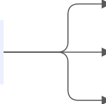

State of the first-time

execution

Execution state

State of the second-

on Instance A

time execution

State of the third-time

execution

...

Overall

execution state

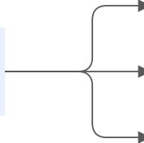

State of the first-time

execution

Execution state

State of the second-

on Instance B

time execution

State of the third-time

execution

...

- The following table describes the overall execution state of a command that is run on multiple nodes at the same time.

  | Execution state in API operations | Execution state in the console | Description | Priority |
  | --- | --- | --- | --- |
  | <code>Running</code> | Running | The node-level execution state is Running on specific or all nodes. | 1 |
  | <code>Stopping</code> | Stopping | The node-level execution state is Stopping on specific or all nodes. | 2 |
  | <code>Stopped</code> | Stopped | The node-level execution state is Stopped on all nodes. | 3 |
  | <code>Failed</code> | Failed | The node-level execution state is Failed on all nodes, or is Failed on specific nodes and is Stopped on the other nodes. | 4 |
  | <code>Finished</code> | Finished | The node-level execution state is Finished on all nodes, or is Finished on specific nodes and is Stopped on the other nodes. | 5 |
  | <code>PartialFailed</code> | Partially Failed | The node-level execution state is Failed on some nodes and is Finished on the other nodes. | 6 |


The following figure shows the relationship between the overall execution states and the node-level execution states of a one-time execution in which a command is run on multiple nodes at the same time.

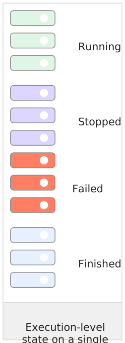

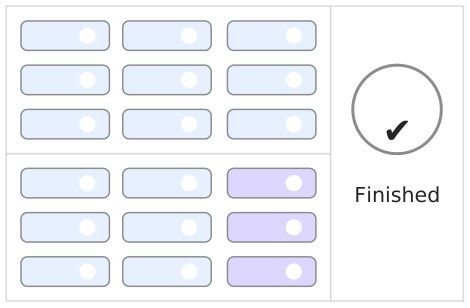

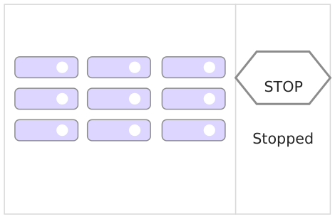

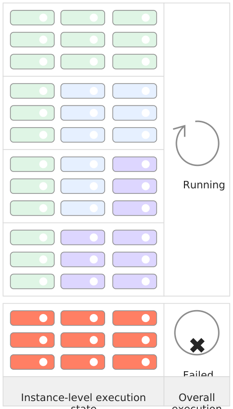

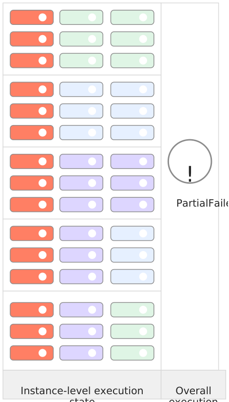

state on a single

instance

PartialFaile

state

execution

state

execution

- The following table describes the states of recurring executions of a command.

  | State | Description |
  | --- | --- |
  | Overall execution state | The overall execution state is always <code> Running </code> unless you stop the command on all the nodes. |
  | Node-level execution state | For each node, the node-level execution state is always <code> Running </code> unless you stop the command on the node. |
  | Execution-level state | For more information, see the Execution states section of this topic. |

<a id="section-13-6-2"></a>

### 13.6.2. Use Cloud Assistant

<a id="section-13-6-2-1"></a>

#### 13.6.2.1. Create/Run a command

You can run Cloud Assistant commands to perform routine tasks on bare metal nodes, including running automated O&M scripts, polling processes, resetting user passwords, installing or uninstalling software, updating applications, and installing patches. The Cloud Assistant commands can be batch or PowerShell commands for Windows servers and shell commands for Linux servers. You can specify custom parameters as variables in the commands.

**Prerequisites**

- The node on which you want to run a Cloud Assistant command is in the **Running** state.

- You have installed Tthe Cloud Assistant client on the node.

**Background information**

When you use the immediate execution feature, take note of the following items:

- Only operations administrators, organization administrators, and resource set administrators can create commands.

- When you encode commands in Base64, take note of the following size limits:

  - If a command is not created by using the immediate execution feature, the command cannot exceed 18 KB in size after Base64 encoding.

  - If a command is created and run by using the immediate execution feature and is saved, the command cannot exceed 18 KB in size after Base64 encoding.

  - If a command is created and run by using the immediate execution feature but is not saved, the command cannot exceed 24 KB in size after Base64 encoding.

- You can specify up to 20 custom parameters in a Cloud Assistant command.

- You can call an API operation to run a command on up to 50 nodes each time.

- When you create a command, make sure that the syntax, logic, or algorithm associated with the command is correct.

  For example, assume that you have created a /backup directory ( `mkdir /backup` ) on a node. You can run the following shell commands to archive a file in this directory:

  ```bash
  #!/bin/bash 
  OF=/backup/my-backup-$(date +%Y%m%d).tgz
  tar -cf $OF {{file}}
  ```

  > **Note**
  >
  > In the preceding example,  `{{file}}`  is a custom parameter. When running a command, you can set this custom parameter to the name of the file to be archived. Example: /app/usrcredential. You can use custom parameters in scenarios that require dynamic values and values that are shared across multiple commands. We recommend that you specify custom parameters for sensitive data or data that changes together with the environment, such as AccessKey pairs, node IDs, authorization codes, time parameters, and important system files.

**Procedure**

1. Log on to the BMCP console.

2. In the left-side navigation pane, choose **O&M Management > Cloud Assistant**.

3. In the top navigation bar, select an organization, resource set, and region.

4. Click **Create/RunCommand**.

5. On the **Create Command** page, configure the parameters described in the following table.

   **Section**

   **Parameter**

   **Description**

   Organization

   The organization to which the command belongs.

   Resource Owner

   Resource Set

   The resource set to which the command belongs.

   Select a command source.

   Command

   - **Enter the command content**: Create a command.

   Source

   - **Select Saved Command**: Select an existing command.

   Command Name

   Specify a name for the new command.

   Select a plan to run the command.

   - **Run Now**: Run the command immediately after you click **Run** or **Run and Save**.

   - **Run on Next System Startup**: Run the command the next time the associated nodes are started after you

   Execution Plan

   click **Run** or **Run and Save**.

   - **Run on Each System Startup**: Run the command each time the associated nodes are started after you click **Run** or **Run and Save**.

   Select the type of the command.

   Command Type

   - For Linux, select **Shell**.

   - For Windows, select **Bat** or **PowerShell**.

   Command

   Enter or paste command content in the field.

   Content

   Specify whether to use custom parameters.

   If you enable **Use Parameters**, specify custom

   Use Parameters

   parameters in the  `{{key}}`  format in the **Command Content** field.

   Specify the values of the custom parameters specified in the  `{{key}}`  format in the **Command Content** field.

   Command Parameters

   This parameter is available only when you enable **Use**

   Command

   **Parameters**.

   Information

   Enter a description for the new command. We recommend that you enter an informative description, such as the

   Command

   purpose of the command, to facilitate management and

   Description

   maintenance.

   You can enter 1 to 512 characters.

   The username that is used to run the command on BMCP nodes. You can specify a user that exists on a node to run the command. To reduce security risks, we recommend that you specify a regular user.

   Run By

   By default, Cloud Assistant commands are run by the root user on Linux nodes and by the System user on Windows nodes.

   Specify an execution path for the new command. Different default execution paths are provided based on the OS of the nodes on which the command is run.

   - For Linux, the default execution path is the /home directory of the root user.

   Execution Path

   - For Windows, the default execution path is the directory where the process of the Cloud Assistant client is located. Example: C:\\Windows\\System32.

   You can enter 1 to 200 characters.

   Specify **Timeout Period** for running the command on nodes. If the task that runs the command times out, Cloud Assistant forcefully terminates the task process.

   Unit: seconds. The value must be an integer. Default value: 60. Valid values: 10 to 86400. 86,400 seconds is equivalent to 24 hours.

   Timeout Period

   > **Note**
   >
   > If you set **Timeout Period** to a value smaller than 10, the system changes the value to 10 to ensure that that the command is run successfully.

   <table>
     <tr>
       <td>Select Node</td>
       <td>Node ID/Name</td>
       <td>Select the nodes on which you want to run the command.</td>
     </tr>
   </table>

6. (Optional) You can view the executable CLI command generated based on the execution parameters and selected instances in the **CLI Command**s section, and click **CLI Assignment Commands** at the bottom of the page to use the Alibaba Cloud CLI tool to run the generated command.

7. Click **Save**, **Run and Save**, or **Run**.

   - **Save**: Save the command without running the command.

   - **Run and Save**: Save and run the command.

   - **Run**: Run the command without saving the command.

<a id="section-13-6-2-2"></a>

#### 13.6.2.2. Clone a command

You can clone an existing Cloud Assistant command to create another command. You can retain all information of the original command (cloned command), or modify the name, description, type, content, execution path, or timeout period for the new command (command clone).

**Procedure**

> **Important**
>
> Only operations administrators, organization administrators, and resource set administrators can clone commands.

1. Log on to the BMCP console.

2. In the left-side navigation pane, choose **O&M Management > Cloud Assistant**.

3. In the top navigation bar, select an organization, a resource set, and a region.

4. Find the Cloud Assistant command that you want to clone and click **Clone** in the **Actions** column.

5. On the **Clone Command** page, configure the parameters described in the following table.

   **Section**

   **Parameter**

   **Description**

   Organization

   The organization to which the command belongs.

   Resource Owner

   Resource Set

   The resource set to which the command belongs.

   Command Name

   Specify a name for the new command.

   Select a plan to run the command.

   - **Run Now**: Run the command immediately after you click **Run** or **Run and Save**.

   - **Run on Next System Startup**: Run the command the

   Execution Plan

   next time the associated nodes are started after you click **Run** or **Run and Save**.

   - **Run on Each System Startup**: Run the command each time the associated nodes are started after you click **Run** or **Run and Save**.

   Select a type of the command.

   Command type

   - For Linux, select **Shell**.

   - For Windows, select **Bat** or **PowerShell**.

   Command

   Enter or paste command content in the field.

   Content

   Specify whether to use custom parameters.

   If you enable **Use Parameters**, specify custom

   Use Parameters

   parameters in the  `{{key}}`  format in the **Command Content** field.

   Specify the values of the custom parameters specified in the  `{{key}}`  format in the **Command Content** field.

   Command Parameters

   This parameter is available only when you enable **Use Parameters**.

   Enter a description for the new command. We recommend

   Command

   that you enter an informative description, such as the

   Information

   Command

   purpose of the command, to facilitate management and

   Description

   maintenance.

   You can enter 1 to 512 characters.

   The username that is used to run the command on BMCP nodes. You can specify a user that exists on a node to run the command. To reduce security risks, we recommend that you specify a regular user.

   Run By

   By default, Cloud Assistant commands are run by the root user on Linux nodes and by the System user on Windows nodes.

   Specify an execution path for the new command. Different default execution paths are provided based on the operating system of nodes on which the command is run.

   - For Linux, the default execution path is the /home directory of the root user.

   Execution Path

   - For Windows, the default execution path is the directory where the process of the Cloud Assistant client is located. Example: C:\\Windows\\System32.

   You can enter 1 to 200 characters.

   Specify a **Timeout Period** for the new command to run on nodes. If a task that runs a command times out, Cloud Assistant forcefully terminates the task process.

   Unit: seconds. The value must be an integer. Default value: 60. Minimum value: 10. Valid values: 10 to 86400 (equivalent to 24 hours).

   Timeout Period

   > **Note**
   >
   > If you set **Timeout Period** to a value smaller than 10 seconds, the system changes the value to 10 to ensure that the command is run successfully.

6. (Optional) You can view the executable CLI command generated based on the execution parameters and selected nodes in the **CLI Command** section, and click **oyCLI Assignment Command**s at the bottom of the page to use the Alibaba Cloud CLI tool to run the generated command.

7. Click **Save**.

<a id="section-13-6-2-3"></a>

#### 13.6.2.3. Delete a command

The number of Cloud Assistant commands that you can have within each Alibaba Cloud region is limited, and all cloud services share this quota. To ensure a sufficient command quota, we recommend that you regularly delete commands that are no longer needed.

**Procedure**

> **Important**
>
> Only operations administrators, organization administrators, and resource set administrators can delete commands.

1. Log on to the BMCP console.

2. In the left-side navigation pane, choose **O&M Management > Cloud Assistant**.

3. In the top navigation bar, select an organization, a resource set, and a region.

4. Find the Cloud Assistant command that you want to delete. In the **Actions** column, click **Delete**.

5. In the dialog box that appears, click **Delete**.

<a id="section-13-6-2-4"></a>

#### 13.6.2.4. Manage command execution results

You can view and export the execution results of Cloud Assistant commands for offline analysis, auditing, or archival storage.

**View command execution results**

1. Log on to the BMCP console.

2. In the left-side navigation pane, choose **O&M Management > Cloud Assistant**.

3. In the top navigation bar, select an organization, a resource set, and a region.

4. On the **BMCP Cloud Assistant** page<strong>,</strong> click the **Command Result**s tab to view the list of command execution results.

**Export command execution results**

1. Log on to the BMCP console.

2. In the left-side navigation pane, choose **O&M Management > Cloud Assistant**.

3. In the top navigation bar, select an organization, a resource set, and a region.

4. On the **BMCP Cloud Assistant** page, click the **Command Result**s tab.

5. There are two methods for exporting command execution results:

   **Method 1: Export from the command execution result list**

   <ol type="i">

   <li>

   Find the command execution record to export. In the **Actions** column on the right, click **Export**.

   </li>

   </ol>

   **Method 2: Export results for specific nodes from execution details**

   If a command is executed on multiple nodes, you can select specific nodes in the execution details and export only the results for those nodes.

   <ol type="i">

   <li>

   On the **Nodes** tab of the **Execution Details** dialog box, select the nodes for which to export results.

   </li>

   <li>

   Click **Export Results**.

   </li>

   </ol>

The system automatically downloads the execution result file for the selected nodes to your local device.
