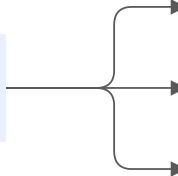
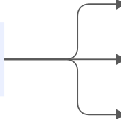
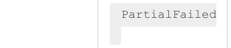
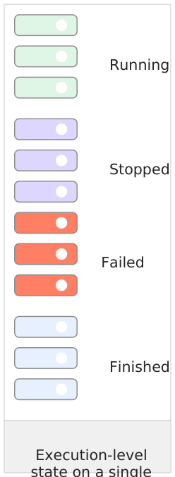
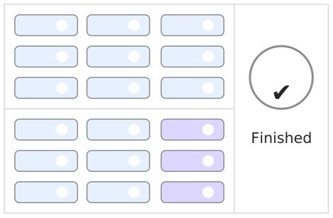
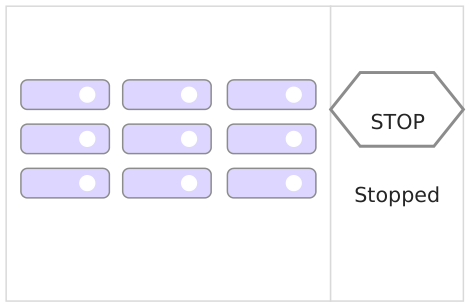
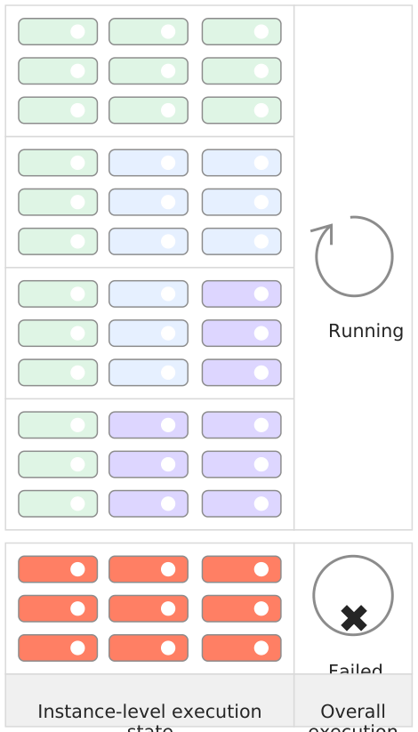
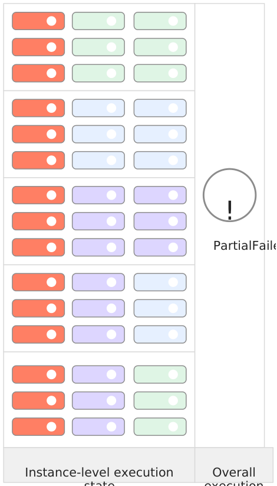

Alibaba Cloud  
Apsara Stack  
BareMetal Mangement  
Service  
User Guide  
Product Version: V3.18.6  
Document Version: 20260630

**Table of Contents**

- [1.What is BMS?](#section-1)
- [2.getting started with IoV CC](#section-2)
    - [2.1. Work with BMS](#section-2-1)
    - [2.2. Log on to the Bare Metal Management BMS console](#section-2-2)
- [3.Bare Metal Instance Management](#section-3)
    - [3.1. Overview](#section-3-1)
    - [3.2. ECS Bare Metal instances](#section-3-2)
        - [3.2.1. Create an instance](#section-3-2-1)
        - [3.2.2. Create multiple instances at a time](#section-3-2-2)
        - [3.2.3. Re-apply for an instance](#section-3-2-3)
        - [3.2.4. Release an instance](#section-3-2-4)
        - [3.2.5. View instance details](#section-3-2-5)
        - [3.2.6. Search for a BMS instance](#section-3-2-6)
        - [3.2.7. Restart an instance](#section-3-2-7)
        - [3.2.8. Stop an instance](#section-3-2-8)
        - [3.2.9. Start an instance](#section-3-2-9)
        - [3.2.10. Storage integration](#section-3-2-10)
        - [3.2.11. Add tags to VPCs](#section-3-2-11)
        - [3.2.12. Deletes a tag.](#section-3-2-12)
        - [3.2.13. Queries logs of a specific type of operation](#section-3-2-13)
        - [3.2.14. Remotely log on to an SAG device](#section-3-2-14)
        - [3.2.15. Modify Disk Property](#section-3-2-15)
        - [3.2.16. Change the hostname of a BMS instance](#section-3-2-16)
        - [3.2.17. Reset the password of an instance](#section-3-2-17)
        - [3.2.18. Change the status of instance release protection](#section-3-2-18)
        - [3.2.19. Use an activation code to activate Cloud Assistant](#section-3-2-19)
        - [3.2.20. Log on to the out-of-band console](#section-3-2-20)
    - [3.3. Images](#section-3-3)
        - [3.3.1. Upload a custom image](#section-3-3-1)
        - [3.3.2. Public image](#section-3-3-2)
        - [3.3.3. Query Images](#section-3-3-3)
        - [3.3.4. Delete an image](#section-3-3-4)
        - [3.3.5. Image status management](#section-3-3-5)
        - [3.3.6. Image export](#section-3-3-6)
    - [3.4. Bare Metal Instance Monitoring](#section-3-4)
        - [3.4.1. View the monitoring information of a bare metal instance](#section-3-4-1)
    - [3.5. Bare-metal instance alerts](#section-3-5)
        - [3.5.1. Query alerts for bare metal instances](#section-3-5-1)
        - [3.5.2. View unhandled alerts](#section-3-5-2)
        - [3.5.3. View handled alerts](#section-3-5-3)
        - [3.5.4. Handle alerts](#section-3-5-4)
    - [3.6. Key pairs](#section-3-6)
        - [3.6.1. Create a key pair](#section-3-6-1)
        - [3.6.2. Bind a key pair to an ECS bare metal instance](#section-3-6-2)
        - [3.6.3. Unbind a key pair from an ECS bare metal instance](#section-3-6-3)
        - [3.6.4. Delete a key pair](#section-3-6-4)
    - [3.7. Bare metal network](#section-3-7)
        - [3.7.1. Bind an ECR](#section-3-7-1)
        - [3.7.2. Unbind an ECR](#section-3-7-2)
- [4.Manage managed instances](#section-4)
    - [4.1. Overview](#section-4-1)
    - [4.2. Out-of-band managed instance](#section-4-2)
        - [4.2.1. Add an out-of-band managed instance](#section-4-2-1)
        - [4.2.2. Add managed instances in batches](#section-4-2-2)
        - [4.2.3. Re-hosting](#section-4-2-3)
        - [4.2.4. View the details of an out-of-band managed instance](#section-4-2-4)
        - [4.2.5. Query out-of-band managed instances](#section-4-2-5)
        - [4.2.6. Delete a managed instance](#section-4-2-6)
        - [4.2.7. Restart a managed instance](#section-4-2-7)
        - [4.2.8. Stop a managed instance](#section-4-2-8)
        - [4.2.9. Launch a managed instance](#section-4-2-9)
        - [4.2.10. Queries logs of a specific type of operation](#section-4-2-10)
        - [4.2.11. Modify Disk Property](#section-4-2-11)
        - [4.2.12. Log on to the out-of-band console](#section-4-2-12)
    - [4.3. Managed instance alerts](#section-4-3)
        - [4.3.1. Query managed instance alerts](#section-4-3-1)
        - [4.3.2. View unhandled alerts](#section-4-3-2)
        - [4.3.3. View Handle Alerts](#section-4-3-3)
        - [4.3.4. Handle alerts](#section-4-3-4)
- [5.O&M and Monitoring](#section-5)
    - [5.1. Bare Metal Cloud Assistant](#section-5-1)
        - [5.1.1. Overview](#section-5-1-1)
        - [5.1.2. Use Cloud Assistant](#section-5-1-2)
            - [5.1.2.1. View the command list](#section-5-1-2-1)
            - [5.1.2.2. View a command execution result](#section-5-1-2-2)
            - [5.1.2.3. Create commands](#section-5-1-2-3)
            - [5.1.2.4. Run the commands.](#section-5-1-2-4)
            - [5.1.2.5. Clone a command](#section-5-1-2-5)
            - [5.1.2.6. Delete a command](#section-5-1-2-6)

<a id="section-1"></a>

# 1.What is BMS?

Bare Metal Management Service (BMS) is a cloud service that allows tenants to use physical machines on a cloud platform on an elastic and pay-as-you-go basis. BMS is commonly used to provide computing resources for core databases, key application systems, and high-performance computing systems. BMS provides the Elastic Compute Service (ECS) bare metal instance management, managed instance management, and O&M and monitoring features.

BMS is powered by the one-stop operations console of Apsara Stack, allowing you to manage instances in a fine-grained manner. It allows administrators to run node-level physical machine management tasks, including but not limited to tasks for adding and deleting ECS bare metal instances, power management, and system deployment.

After servers are installed and preparations are complete, administrators can batch deploy bare metal devices in the web interface. After the deployment, you can create ECS bare metal instances on these bare metal devices. BMS allows you to install the following OSs in ECS bare metal instances: Alibaba Cloud Linux and CentOS for x86 and Alibaba Cloud Linux, Ubuntu, and Kylin for Arm. It also allows you to manage the lifecycle of these OSs.

**Bare Metal Instances**

- **Overview**: This module displays the monitoring data of instances to meet requirements for instance O&M on the user side. This module includes the **Instance Overview**, **Bare Metal Service**, and resource monitoring information sections.

  - The **Instance Overview** section displays **Total Instances in Resource Pool**, **Total Applied Instances**, **Total Running Instances**, and **Total Images**.

  - The **Bare Metal Service** section displays the total number of registered instances and the number of instances in each state.

  - The resource monitoring information section displays **CPU Utilization**, **Memory Usage**, **Disk Read and Write Speed**, **System Load**, **Network Bandwidth**, and **TCP Connection Status**.

- The **Bare Metal Instances** module provides the following features:

  - Features for creating a single instance, batch creating instances, releasing instances, re-registering instances, and querying assets for management and maintenance.

  - You can perform remote O&M operations. For example, you can start instances, stop instances, and restart instances.

  - You can also centrally monitor the resources of registered ECS bare metal instances, including the CPU utilization, memory usage, disk load, network load, and number of online servers.

- **Images**: This module provides metadata of **Public Images** and **Custom Images** required for installing ECS bare metal instances.

  - **Public Images**: On this tab, you can query public images, change the status of public images, and export public images.

  - **Custom Images**: On this tab, you can query custom images, view custom image information, manage custom images, and upload custom images to meet personalized image management requirements.

    - To upload a custom image, you need to specify the region, platform type, and system architecture information so that images can be classified for management.

    - Image information, including the image name, image ID, size, architecture, platform, format, availability status, and creation time, is also displayed.

- The **Bare Metal Instance Monitoring** module displays the status of existing ECS bare metal instances, allowing you to monitor the CPU utilization, memory usage, disk load, system load, and network load of ECS bare metal instances.

- The **Bare Metal Instance Alerts** module allows you to monitor and handle alerts generated by ECS bare metal instances.

**Manage Instances**

- **Overview**: This module provides a panoramic view of the metrics of managed instances. This helps you manage the status of managed services in a timely manner. This module includes the **Service Check**, **Unhandled Alerts**, and **Core Metrics** sections.

  - **Service Check**: This section displays the health status of managed instances. It checks several items and displays the results from the Normal, Risky, Abnormal, and Suggestion dimensions.

  - **Unhandled Alerts**: This section displays the pending alerts of out-of-band managed instances of the current day. The alerts are displayed based on alert levels from P1 to P4.

  - **Core Metrics**: This section displays **Out-of-band Managed Instances**.

- The **Out-of-band Managed Instances** module allows you to add, query, and release out-of-band managed instances in order to manage and host existing servers on the user side. In addition, you can perform remote O&M operations to remotely start or stop out-of-band managed instances, restart instances, monitor instances, query operation logs, and log in to the out-of-band console. When you add an out-of-band managed instance, you need to specify the basic information of the instance, data center information, and out-of-band information.

- The **Managed Instance Alerts** module allows you to monitor and handle alerts generated by managed instances. In addition, alerts are classified into pending alerts and handled alerts for fine-grained management.

**O&M and Monitoring**

**Bare Metal Cloud Assistant** is developed based on ECS Cloud Assistant. It is an automated O&M tool developed for BMS-related businesses to allow you to batch maintain ECS bare metal instances and batch execute shell, PowerShell, and batch scripts on instances without passwords, logins, or jumpers. In most cases, you can use Bare Metal Cloud Assistant to install and uninstall software, start and stop services, and run common commands (or scripts).

<a id="section-2"></a>

# 2.getting started with IoV CC

<a id="section-2-1"></a>

## 2.1. Work with BMS

This topic describes how to work with Elastic Compute Service (ECS) bare metal instances and managed instances.

**Procedure for ECS bare metal instances**

To manage ECS bare metal instances, you first need to apply for ECS bare metal instances and configure instance information. Then, you can perform operations such as viewing instance information and releasing instances.

| Operation | Description | References |
| --- | --- | --- |
| Create an instance | You need to configure basic information, select an instance architecture and specification, specify the image to be installed, configure network settings, and specify the instance name and description to apply for an ECS bare metal instance. | Create an instance |
| Query ECS bare metal instances | You can query and view the information about existing ECS bare metal instances. | Search for a BMS instance |
| Release an instance | You can release ECS bare metal instances in the list. The released ECS bare metal instances are available in the resource pool and re-installed.You can re-apply for released ECS bare metal instances. | Release an instance |

**Procedure for managed instances**

| Operation | Description | References |
| --- | --- | --- |
| Add an out-of-band managed instance | You can add out-of-band instances to host these instances. | Add an out-of-band managed instance |
| Query out-of-band managed instances | You can query and view the information about out-of-band managed instances. | Query out-of-band managed instances |
| Delete an out-of-band managed instance | You can delete out-of-band managed instances that are no longer needed. | Delete a managed instance |

<a id="section-2-2"></a>

## 2.2. Log on to the Bare Metal Management BMS console

This section describes how to log on to the Apsara Uni-manage Operations console and go to the Bare Metal Management BMS console.

**Prerequisites**

- You need to log on to the Apsara Uni-manager operation console and go to the bare metal management BMS console. Make sure that you have obtained the service domain name address of the Apsara Uni-manager operation console from the deployment personnel.

- A web browser is available. We recommend that you use Google Chrome.

**Procedure**

1. In the address bar of the browser, enter the URL of the Apsara Uni-manager Management Console and press the Enter key.

2. Enter the username and password.

   *You must obtain the username and password from the operations administrator.*

   > **Note**
   >
   > The first time you log on to the Apsara Uni-manager Management Console, you must change the password of your account as prompted. To improve security, the password must be 8 to 20 characters in length and contain at least two of the following types:
   >
   > - English uppercase or lowercase letters (A to Z, a to z)
   >
   > - Arabic numerals (0 to 9)
   >
   > - special character (such as exclamation points (!), at signs (@), number signs (#), dollar signs ($), and percent signs (%))
   >
   > *The admin account has all permissions and allows you to perform unlimited operations. Exercise caution when performing operations.*

3. Click Log On to go to the Apsara Uni-manager Operations Console page.

4. In the top navigation bar, choose **Products > Computing > Bare Metal ManagementBMS**.

<a id="section-3"></a>

# 3.Bare Metal Instance Management

The bare metal instance management module allows you to create, query, and unrun bare metal instances, manage images, monitor and manage bare metal instances, and handle alerts for bare metal instances.

<a id="section-3-1"></a>

## 3.1. Overview

The Overview page provides dashboards to display the monitoring information of instances created on existing servers. The page displays the total number of instances in the resource pool, total number of instances that you have applied for, total number of running instances, images, usage of the bare metal service, CPU utilization, and memory usage. This helps you learn about the status of your managed service in real time.

The Overview page consists of the following parts:

- **Instance Overview**

  - Instances in the resource pool: displays **Total Instances in Resource Pool**, **Total Applied Instances**, **Total Running Instances**, and **Total Images** to help you learn about the global resource usage.

  - Resource planning: compares and analyzes the total number of instances and the types of images to help you assess the appropriation of resource allocation, identifies issues such as a low reuse ratio of images, and optimizes image management policies.

- **Bare metal service**: displays the different states of instances that you have applied for, including Running, Shutdown, Error, and Others, and the number of instances in each state. This helps you learn about the health status of instances.

- O&M and Monitoring

  - Core metrics:

    - CPU utilization and memory usage: tracks the peak resource usage in real time and estimates scale-out demands based on historical trends.

    - Disk read/write rate: monitors the I/O throughput of disks and identifies performance bottlenecks.

    - Network bandwidth and TCP connection status: analyzes traffic fluctuations, such as unexpected traffic spikes, and connection status to help troubleshoot network exceptions.

  - System load analysis: analyzes system loads and core metrics such as CPU utilization and memory usage to comprehensively assess server loads and avoid resource overloading.

<a id="section-3-2"></a>

## 3.2. ECS Bare Metal instances

Bare-metal instances allow you to create, batch create, release, reapply, and query asset operations. You can also perform remote O&M operations on existing instances, such as on, off, and restart.

<a id="section-3-2-1"></a>

### 3.2.1. Create an instance

This topic describes how to create an instance.

**Prerequisites**

- Bare metal instances are registered in a resource pool by the O&M administrator of Bare-metal Management Service (BMS) in the Apsara Uni-manager Operations Console.

- A VPC and a vSwitch are created. For more information, see the **Create and manage a VPC** and **Create and manage a vSwitch** topics in **VPC User Guide**.

**Background information**

BMS allows you to create bare metal instances to meet operations requirements.

**Procedure**

1. Log in to the BMS console.

2. In the left-side navigation pane, choose **Bare Metal Instance Management > Bare Metal Instance**.

3. On the **Bare Metal Instances** page, click **Create Instance**. On the page that appears, configure the parameters.

   **Parameter**

   **Description**

   BMS supports only the pay-as-you-go billing method. You can use services first and then pay for the actual resources that you use. This billing method is suitable for scenarios where resource usage frequently fluctuates. It allows users to flexibly use resources to meet the actual needs and avoid resource waste.

   **Billing Configu**

   **Billing Method**

   > **Note**

   **ration**

   > This parameter is displayed only if the administrator has configured billing rules in the operations center. For more information about billing rules, see the **Manage billing configurations** topic in **Apsara Uni-manager Management Console User Guide**.

   **Organization/Re**

   The organization and resource set to which the bare metal

   **source Set**

   instance belongs.

   **Region/Availabil**

   The region and zone to which the bare metal instance belongs.

   **ity Zone**

   - If the system prompts that the organization is not authorized to access Cloud Gateway (CGW), click the button on the right side

   **Region**

   to complete authorization. Authorization is required before you

   **Cloud Gateway**

   **Informa**

   can proceed with the configuration. After you complete the

   **RAM Role**

   **tion**

   authorization, click the button on the right side to refresh.

   **Authorization**

   - If the system prompts that the organization is authorized to access CGW, you can proceed.

   The type of the instance. Valid values:

   - **Bare Metal Management**: A standard image provided by the

   **Instance Type**

   platform is used to initialize and start the bare metal instance.

   - **In-Band Management**: The original operating system of the device is used.

   The architecture of the instance. The x86 and Arm architectures

   **Architecture**

   are supported.

   **CPU**

   The CPU manufacturer.

   **Instanc**

   **Manufacturer**

   **e**

   **GPU**

   The GPU manufacturer.

   **Manufacturer**

   **Instance Series**

   The instance series.

   The specification of the instance. Select an instance specification based on your business requirements. The instance specification

   **Instance Type**

   information is displayed in the following columns: **SN**, **Instance Name**, **Hostname**, **CPU**, **Memory (GB)**, and **Image**.

   **IPv6 Toggle**

   Specifies whether to enable the IPv6 feature.

   **Virtual Private**

   The VPC in which you want to create the instance.

   **Configu**

   **Cloud (VPC)**

   **re Networ k**

   **vSwitch**

   The vSwitch that you want to use.

   **VPC IP**

   The CIDR block of the VPC.

   - Linux instance: **root**.

   **Log-in Name**

   - Windows instance: **administrator**

   The password must be 8 to 30 characters in length and contain at least three of the following character types: uppercase letters,

   **Log-in Password**

   lowercase letters, digits, and special characters. Supported

   **Configu**

   and **Confirm**

   special characters include  ``( ) ` ~ ! @ # $ % ^ & * - _ + =``

   **re**

   **Password**

   **Passwo**

   `| { } [ ] : ; ' < > , . ? /` . For Windows instances, the

   **rd**

   password cannot start with a forward slash (/).

   <table>
     <tr>
       <td rowspan="3">Advanc ed Configu ration</td>
       <td>Release Protection</td>
       <td>Specifies whether to protect the instance so that it cannot be deleted in the console or by calling API operations.</td>
     </tr>
     <tr>
       <td>Custom Script</td>
       <td>The script to run upon instance startup to automate instance configurations, or to be passed as common data to the instance.</td>
     </tr>
     <tr>
       <td>Configure Image and Instance Name</td>
       <td>The name and description of the instance. You can select <strong>Use</strong> <strong>Original Image</strong> or <strong>Reinstall Image.</strong> If you select Reinstall Image, select a public image or custom image. For more information about how to upload an image, see Upload a custom image.</td>
     </tr>
   </table>

4. Before you click Confirm Order, check the instance configurations in the **Configuration overview** section. Make sure that all configurations meet your business requirements.

   The **Quota** section displays the quota of bare metal instances in the current region, organization, and resource set. If the quota is insufficient, click **Quota Management** to go to the **Quotas** page to configure the quota.

5. Complete the instance creation.

   - Confirm the parameter settings and click **Confirm Order** if the following requirements are met: On the Service Management page, a service is created, **Bare-Metal Management Service (BMS)** is displayed in the Product column, and **Bare Metal Instance** is displayed in the Resources column.

   - Confirm the parameter settings and click **Submit** if the preceding service does not exist.

   For more information about service management, see the **Service management** topic in **Apsara Uni-manager Management Console User Guide**.

<a id="section-3-2-2"></a>

### 3.2.2. Create multiple instances at a time

The bare metal management service allows you to create multiple bare metal instances by uploading local files.

**Prerequisites**

- The bare metal service O&M administrator of the Apsara Uni-manager Operations console has registered a bare metal instance in the resource pool.

- You have uploaded a local file in the. csv/xls/xlsx format with the relevant parameters set.

**Background information**

In the bare metal management service, users can create bare metal instances in batches by uploading files in the. xls format.

**Procedure**

1. Log on to the BMS console.

2. In the left-side navigation pane, choose **Bare Metal Instance Management > Bare Metal Instance**.

3. On the **Bare Metal Instance** page, click **Batch Create** in the upper-left corner.

4. In the **Batch Create** dialog box, select **Organization,** **Resource Set,** **Region,** **Zone** as prompted.

5. In the **Upload File** section, set the parameters based on the template format requirements and select a file to upload.

6. Click **OK**.

**Template file description**

For more information about the template format, see the following table or download the template file. You can download the template file in the Batch Create dialog box.

| \* Instanc e type | \* Arc hite ctur e | \* Mod el | \*S N | \* Creat e a type | \* Imag e type | \* I m a g e | \* V ir t u al P ri v a t e C lo u d | \* V S w it c h | V i r t u a l P r i v a t e C l o u d I P | L o g o n N a m e | P a s s w o r d | \* H o s t n a m e | \* I n s t a n c e n a m e | In st a n c e D e s cr ip ti o n |
| --- | --- | --- | --- | --- | --- | --- | --- | --- | --- | --- | --- | --- | --- | --- |
| bms | x86_64 | test-mt | 123 456 | install _os | publi c | C e n t o s-7.9 -x 8 6 _6 4 | te st -v p c-0 1 | t e st -s u b n e t-0 1 | X X X.X X X.X X X.X X X | n a m e | p a s s w o r d | t e st -a p p ly -0 1 | t e st -a p pl y-0 1 |  |

<table>
  <tr>
    <td>no_clone</td>
    <td>x86_64</td>
    <td>test-mt</td>
    <td>654 321</td>
    <td>install _os</td>
    <td>custo mize</td>
    <td>A n ol is O S -8.6</td>
    <td>te st -v p c-0 1</td>
    <td>t e st -s u b n e t-0 1</td>
    <td>X X X.X X X.X X X.X X X</td>
    <td>n a m e</td>
    <td>p a s s w o r d</td>
    <td>t e st -a p p ly -0 2</td>
    <td>t e st -a p pl y-0 2</td>
    <td></td>
  </tr>
</table>

> **Note**
>
> The relevant main parameters in the template are annotated as follows (parameter values are not case-sensitive):
>
> - **Architecture**: the CPU architecture. Valid values: x86_64/aarch64/sw_64.
>
> - **Model**: the model.
>
> - **SN**: Serial number.
>
> - **Creation Type**: specifies whether to use the initial image. Valid values: origin_image. Use the initial image. Install_os.
>
> - **Image Type**: the image type. You can set this parameter to public or customize.
>
> - **Virtual Private Cloud**: Virtual Private Cloud ID.
>
> - **VSwitch**: the ID of the VSwitch.
>
> - **Virtual Private Cloud IP**: Virtual Private Cloud IP specified by the user. If no IP is specified, the system will automatically assign an IP address.
>
> - **Logon Name**: the username that is used to log on to the system.
>
> - **Logon Password**: the password of the system logon user.
>
> - **Host Name**: the hostname.
>
> - **Instance Name**: the name of the instance.
>
> - **Instance Description**: the description of the instance.

<a id="section-3-2-3"></a>

### 3.2.3. Re-apply for an instance

This topic describes how to re-apply for an Elastic Compute Service (ECS) bare metal instance. You can re-apply for a created instance to re-install the instance.

**Prerequisites**

- An ECS bare metal instance is created. For more information, see Create an instance.

- The ECS bare metal instance is in a stable state, such as Running, Stopped, Create Failed, or No Heartbeat.

**Background information**

Bare Metal Management Service (BMS) allows you to re-apply for ECS bare metal instances if the instances are faulty or you need to meet certain operations requirements.

**Procedure**

1. Log in to the BMS console.

2. In the left-side navigation pane, choose **Bare Metal Instance Management > Bare Metal Instance**.

3. On the **Bare Metal Instance** page, find the desired instance and click **Re-apply** in the Actions column.

4. On the **Apply Again** page, configure parameters. For more information, see Create an instance.

5. After you complete the configuration, click **Submit** to re-apply for the instance.

<a id="section-3-2-4"></a>

### 3.2.4. Release an instance

This section describes how to release bare metal.

**Prerequisites**

- A bare metal instance is created. For more information, see Create a bare metal instance.

- The bare metal instance in the instance list must be in the steady state, such as running, stopped, creation failed, and no heartbeat.

**Background information**

You can release bare metal instances in the instance list. After the bare metal is released, it enters the resource pool and reinstates it. After the bare metal is released, you can apply for it again.

**Procedure**

Method a:

1. Log on to the BMS console.

2. In the left-side navigation pane, choose **Bare Metal Instance Management > Bare Metal Instance**.

3. On the **Bare Metal Instance** page, find the bare metal instance that you want to release and click **Instance Status** in the Actions column.

4. Click **Release Instance** in the drop-down list.

5. In the dialog box that appears, you can select whether to clear the data disk. If you do not select **Clear Data Disk**, only the system disk is deleted. If you select the check box, both the system disk and the data disk are deleted.

6. Click **Release** to release the bare metal instance.

Method b:

1. Log on to the BMS console.

2. In the left-side navigation pane, choose **Bare Metal Instance Management > Bare Metal Instance**.

3. On the **Bare Metal Instance** page, find the bare metal instance that you want to release and click **Manage** in the Actions column.

4. On the instance details page, click **More** in the upper-right corner<strong>.</strong>

5. Click **Release** in the drop-down list.

6. In the dialog box that appears, you can select whether to clear the data disk. If you do not select **Clear Data Disk**, only the system disk is deleted. If you select the check box, both the system disk and the data disk are deleted.

7. Click **Release** to release the bare metal.

<a id="section-3-2-5"></a>

### 3.2.5. View instance details

You can view all Elastic Compute Service (ECS) bare metal instances created within your account and the details of each ECS bare metal instance. The details of an ECS bare metal instance include the basic information and configuration information of the instance.

**View the information about an instance on the Instance Detail page**

1. Log in to the BMS console.

2. In the left-side navigation pane, choose **Bare Metal Instance Management > Bare Metal Instance**.

3. Find the instance that you want to view and click its name to go to the Instance Detail page.

4. By default, the **Instance** tab is displayed. On this tab, you can view the basic information and configuration information of the instance. The basic information includes **Instance ID/Name**, **SN**, **Tag**, **Organization/Resource Group**, **Region**, **Zone**, **Hostname**, **Cloud Assistant ID**, **Online Status**, **Operation Status**, **Power Status**, **Agent**, **Created At**, and **Instance Description**.

5. The configuration information includes **Model**, **GPU**, **Instance Release Protection**, **CPU**, **Operating System**, **Network**, **NIC**, **Disk**, and **GPU**.

<a id="section-3-2-6"></a>

### 3.2.6. Search for a BMS instance

This topic describes how to query instances and view instance details.

**Prerequisites**

An instance is created. For more information, see Create an instance.

**Background information**

You can query and view the information about existing instances based on your business requirements.

**Procedure**

1. Log on to the BMS console.

2. In the left-side navigation pane, choose **Bare Metal Instance Management > Bare Metal Instance**.

3. On the **Bare Metal Instances** page, select a filter condition, enter the search information in the search box, and then click the **Search icon**. The following filter conditions are supported: instance name, instance ID, SN, Virtual Private Cloud IP address, out-of-band IP address, and tag filtering.

4. Find the bare metal instance and click **Manage** next to the instance. On the **Instances** page, you can view the details of the instance, such as the instance name, SN, region, online status, power status, agent status, creation time, and bare metal configuration.

<a id="section-3-2-7"></a>

### 3.2.7. Restart an instance

This section describes how to restart a bare metal instance.

**Prerequisites**

- A bare metal instance is created. For more information, see Create a bare metal instance.

- The bare metal instance in the instance list must be in the steady state, such as running, stopped, creation failed, and no heartbeat.

**Background information**

You can restart a specified bare metal instance. After the instance is restarted, the status of the bare metal instance changes to Restarting.

**Procedure**

Method a:

1. Log on to the Bare Metal Management BMS console.

2. In the left-side navigation pane, choose **Bare Metal Instance Management > Bare Metal Instance**.

3. On the **Bare Metal Instance** page, find the bare metal instance that you want to restart and click **Instance Status** in the Actions column.

4. In the dialog box that appears, click **Restart Instance**.

5. In the message that appears, click **OK**.

6. In the **Are you sure you want to restart the instance?** dialog box, click **OK** **to** restart the bare metal instance.

Method b:

1. Log on to the Bare Metal Management BMS console.

2. In the left-side navigation pane, choose **Bare Metal Instance Management > Bare Metal Instance**.

3. On the **Bare Metal Instance** page, find the bare metal instance that you want to restart and click **Manage** in the Actions column.

4. On the instance details page, click **Restart** in the upper-right corner<strong>.</strong>

5. In the message that appears, click **OK**.

6. In the **Are you sure you want to restart the instance?** dialog box, click **OK** **to** restart the bare metal instance.

<a id="section-3-2-8"></a>

### 3.2.8. Stop an instance

You can stop Elastic Compute Service (ECS) bare metal instances. After an instance is stopped, it enters the No Heartbeat state. This section describes how to stop an ECS bare metal instance.

**Prerequisites**

- An ECS bare metal instance is created. For more information, see Create an instance.

- The ECS bare metal instance is in a stable state, such as Running, Failed, or No Heartbeat.

**Procedure**

Method A:

1. Log in to the BMS console.

2. In the left-side navigation pane, choose **Bare Metal Instance Management > Bare Metal Instance**.

3. On the **Bare Metal Instances** page, find the ECS bare metal instance that you want to stop and move the pointer over **Instance Status** in the Actions column.

4. Click **Stop Instance** in the drop-down list.

5. In the **Are you sure you want to stop this instance?** message, click **OK** to stop the instance.

Method B:

1. Log in to the BMS console.

2. In the left-side navigation pane, choose **Bare Metal Instance Management > Bare Metal Instance**.

3. On the **Bare Metal Instances** page, find the ECS bare metal instance that you want to stop and click **Manage** in the Actions column.

4. On the Instance Detail page, click **Stop** in the upper-right corner<strong>.</strong>

5. In the **Are you sure you want to stop this instance?** message, click **OK** to stop the instance.

<a id="section-3-2-9"></a>

### 3.2.9. Start an instance

This section describes how to turn on bare metal. You can turn on a specified bare metal. After the bare metal is turned on, the status of the bare metal becomes Normal.

**Prerequisites**

- A bare metal instance is created. For more information, see Create a bare metal instance.

- Has bare metal that has been shut down.

**Procedure**

Method a:

1. Log on to the BMS console.

2. In the left-side navigation pane, choose **Bare Metal Instance Management > Bare Metal Instance**.

3. On the **Bare-Metal Instance** page, find the bare metal instance that you want to start and click **Instance Status** in the Actions column.

4. Click **Start Instance** in the drop-down list.

5. In the dialog box that appears, click **OK**.

Method b:

1. Log on to the BMS console.

2. In the left-side navigation pane, choose **Bare Metal Instance Management > Bare Metal Instance**.

3. On the **Bare-Metal Instance** page, find the bare metal instance that you want to enable and click **Manage** in the Actions column.

4. On the instance details page, click **Start** in the upper-right corner<strong>.</strong>

5. In the dialog box that appears, click **OK**.

<a id="section-3-2-10"></a>

### 3.2.10. Storage integration

This section describes how to attach third-party storage to a bare metal instance.

**Prerequisites**

- An instance is created. For more information, see Create an instance.

- The bare metal to be operated must be in the running state.

- The operation status of the bare metal to be operated must be Completed.

**Background information**

You can attach third-party storage to a bare metal instance based on your actual needs. A bare metal instance can be attached to multiple storages.

**Procedure**

1. Log on to the BMS console.

2. In the left-side navigation pane, choose **Bare Metal Instance Management > Bare Metal Instance**.

3. On the **Bare-Metal Instance** page, find the bare metal instance that you want to manage and click **Manage** in the Actions column.

4. On the **Instance Details** page, click the **Storage** tab and click **Mount Storage** to go to the **Batch Mount Storage** page.

5. On the **Batch Mount Storage** page, select a **storage type** and configure the parameters based on the storage type<strong>.</strong> For example, ISCSI contains the following parameters: server IP address /domain name, server IQN, client IQN, client mount path, LumID, and CHAP verification.

   > **Note**
   >
   > Currently, three storage types are supported: ISCSI, NFS, and Direct Mount.

6. After you configure the preceding parameters, you can click **Add Storage** in the lower part of the page to add a storage, or click **Submit** to mount the storage.

<a id="section-3-2-11"></a>

### 3.2.11. Add tags to VPCs

This topic describes how to bind tags to bare metal instances for tag classification management.

**Prerequisites**

A bare metal instance is created. For more information, see Create a bare metal instance.

**Background information**

- You can bind tags to bare metal instances and classify them.

- You can bind up to 20 tags to a bare metal instance.

**Procedure**

1. Log on to the BMS console.

2. In the left-side navigation pane, choose **Bare Metal Instance Management > Bare Metal Instance**.

3. On the **Bare Metal Instance** page, find the bare metal instance and click Edit Chart in the Label column.

4. In the **Edit Tag** dialog box, select an existing tag or enter a new **tag key** and **tag value**.

5. Click **OK**.

> **Note**
>
> - You can create up to 20 tags and bind them to resources at the same time.
>
> - A tag key must be unique.

<a id="section-3-2-12"></a>

### 3.2.12. Deletes a tag.

This topic describes how to unbind and delete tags from bare metal.

**Prerequisites**

- A bare metal instance is created. For more information, see Create a bare metal instance.

- Tags are bound to bare metal. For more information, see Bind tags.

**Background information**

You can remove tags from bare metal instances that have tags attached to them.

**Procedure**

1. Log on to the BMS console.

2. In the left-side navigation pane, choose **Bare Metal Instance Management > Bare Metal Instance**.

3. On the **Bare Metal Instance** page, find the bare metal instance and click the Edit icon in the Tag column.

4. In the **Edit Tags** dialog box, locate the row that contains the target tag, click Delete Chart, and then click Delete.

5. Click **OK**.

<a id="section-3-2-13"></a>

### 3.2.13. Queries logs of a specific type of operation

This topic describes how to view the operating log of a bare metal instance.

**Prerequisites**

A bare metal instance is created. For more information, see Create a bare metal instance.

**Background information**

You can view the specified bare metal operating log based on your business requirements.

**Procedure**

1. Log on to the BMS console.

2. In the left-side navigation pane, choose **Bare Metal Instance Management > Bare Metal Instance**.

3. On the **Bare Metal Instances** page, select a filter condition, enter information in the search box, and then click **Search**. The following filter conditions are supported: **Instance Name**, **Instance ID**, **SN**, **Virtual Private Cloud IP**, **Out-of-Band IP**, and **Tag Filtering**.

4. Find the physical server and click **Operation Status**, such as Running, Stopped, Creation Failed, and No Heartbeat, or **Operation Log.**

5. In the **Operation Log** dialog box that appears, view the operation information about the bare metal instance, such as the operation status, status sub-items, start time, execution status, and description.

<a id="section-3-2-14"></a>

### 3.2.14. Remotely log on to an SAG device

This section describes how to remotely log on to a bare metal.

**Prerequisites**

- A bare metal instance is created. For more information, see Create a bare metal instance.

- The bare metal to be operated must be in the running state.

- The operation status of the bare metal to be operated must be Completed.

**Background information**

You can remotely log on to a bare metal instance by using WorkBench.

**Procedure**

1. Log on to the BMS console.

2. In the left-side navigation pane, choose **Bare Metal Instance Management > Bare Metal Instance**.

3. On the **Bare Metal Instance** page, find the bare metal instance and click **Remote Logon** in the Actions column.

4. On the Workbench page, enter the **username** and **password** to log on to the Workbench console.

<a id="section-3-2-15"></a>

### 3.2.15. Modify Disk Property

This section describes how to modify the properties of bare metal.

**Prerequisites**

A bare metal instance is created. For more information, see Create a bare metal instance.

**Background information**

You can modify the name and description of a bare metal instance.

**Procedure**

1. Log on to the BMS console.

2. In the left-side navigation pane, choose **Bare Metal Instance Management > Bare Metal Instance**.

3. On the **Bare Metal Instance** page, find the bare metal instance that you want to release and click **Manage** in the Actions column.

4. On the instance details page, click **More** in the upper-right corner<strong>.</strong>

5. In the dialog box that appears, click **Edit Properties**.

6. In the dialog box that appears, enter the name or description of the instance and click **OK**.

<a id="section-3-2-16"></a>

### 3.2.16. Change the hostname of a BMS instance

This section describes how to modify the bare metal hostname.

**Prerequisites**

- A bare metal instance is created. For more information, see Create a bare metal instance.

- The bare metal instance in the instance list must be in the steady state, such as running, stopped, creation failed, and no heartbeat.

**Background information**

You can modify the hostname of a bare metal instance.

**Procedure**

1. Log on to the BMS console.

2. In the left-side navigation pane, choose **Bare Metal Instance Management > Bare Metal Instance**.

3. On the **Bare Metal Instance** page, find the bare metal instance that you want to release and click **Manage** in the Actions column.

4. On the instance details page, click **More** in the upper-right corner<strong>.</strong>

5. Click **Modify Host Name** in the drop-down list.

6. In the dialog box that appears, enter the hostname and click **OK**.

<a id="section-3-2-17"></a>

### 3.2.17. Reset the password of an instance

This section describes how to reset the instance password.

**Prerequisites**

- A bare metal instance is created. For more information, see Create a bare metal instance.

- The bare metal instance in the instance list must be in the steady state, such as running, stopped, creation failed, and no heartbeat.

**Background information**

You can reset the logon password of a bare metal instance.

**Procedure**

1. Log on to the BMS console.

2. In the left-side navigation pane, choose **Bare Metal Instance Management > Bare Metal Instance**.

3. On the **Bare Metal Instance** page, find the bare metal instance that you want to release and click **Manage** in the Actions column.

4. On the instance details page, click **More** in the upper-right corner<strong>.</strong>

5. In the dialog box that appears, click **Reset Instance Password**.

6. In the dialog box that appears, enter a new password, enter a new password, and then click **OK**.

<a id="section-3-2-18"></a>

### 3.2.18. Change the status of instance release protection

You can enable instance release protection for Elastic Compute Service (ECS) bare metal instances on which your core business is deployed to prevent the instances from being accidentally released. This can prevent irreversible consequences caused by unexpected operations and delayed communication between team members. This topic describes how to change the status of instance release protection for ECS bare metal instances.

**Prerequisites**

- An ECS bare metal instance is created. For more information, see Create an instance.

- The ECS bare metal instance is in a stable state, such as Running, Stopped, Create Failed, or No Heartbeat.

**Background information**

You can change the status of instance release protection for an ECS bare metal instance.

**Procedure**

1. Log in to the BMS console.

2. In the left-side navigation pane, choose **Bare Metal Instance Management > Bare Metal Instance**.

3. On the **Bare Metal Instances** page, find the instance that you want to manage and click **Manage** in the Actions column.

4. On the Instance Detail page, move the pointer over **More** in the upper-right corner.

5. Click **Modify Instance Release Protection Settings** in the drop-down list.

6. In the dialog box that appears, enable or disable instance release protection and click **OK**.

<a id="section-3-2-19"></a>

### 3.2.19. Use an activation code to activate Cloud Assistant

This section describes how to create a Cloud Assistant activation code.

**Prerequisites**

- A bare metal instance is created. For more information, see Create a bare metal instance.

- The bare metal instance in the instance list must be in the steady state, such as running, stopped, creation failed, and no heartbeat.

**Background information**

You can create Cloud Assistant activation code and manually install Cloud Assistant on bare metal instances.

**Procedure**

1. Log on to the BMS console.

2. In the left-side navigation pane, choose **Bare Metal Instance Management > Bare Metal Instance**.

3. On the **Bare Metal Instance** page, find the bare metal instance that you want to release and click **Manage** in the Actions column.

4. On the instance details page, click **More** in the upper-right corner<strong>.</strong>

5. Click **Create Cloud Assistant activation code** from the drop-down list.

6. In the dialog box that appears, copy or download the Cloud Assistant activation code as prompted, and click **OK** to close the dialog box.

<a id="section-3-2-20"></a>

### 3.2.20. Log on to the out-of-band console

This topic describes how to log on to the out-of-band console of a bare metal instance.

**Prerequisites**

- A bare metal instance is created. For more information, see Create a bare metal instance.

- The selected instance already has an out-of-band IP address.

**Background information**

You can log on to the out-of-band console of an instance to troubleshoot faults based on your business requirements.

**Procedure**

1. Log on to the BMS console.

2. In the left-side navigation pane, choose **Bare Metal Instance Management > Bare Metal Instance**.

3. On the **Bare Metal Instance** page, find the target instance and click **Manage** in the Actions column.

4. On the instance details page, click **More** in the upper-right corner<strong>.</strong>

5. In the drop-down list, click **Out-of-Band Console**.

6. On the out-of-band console logon page that appears, enter the account information and click **Log On.**

<a id="section-3-3"></a>

## 3.3. Images

Image management is used to maintain the metadata of images used when bare metal machines are installed. It provides functions such as query, status management, deletion, and export of custom images, and query, status management, and export of public images. You can customize images to upload as needed.

<a id="section-3-3-1"></a>

### 3.3.1. Upload a custom image

This topic describes how to upload a custom image.

**Prerequisites**

A custom image file that meets the specifications is available locally.

**Background information**

You can upload custom image files based on your business requirements. The formats of custom image files are tgz and qcow2.

**Procedure**

1. Log on to the BMS console.

2. In the left-side navigation pane, choose **Bare-Metal Instance Management** **>** **Images**.

3. On the **Images** page, click the **Custom Images** tab and click **Upload Custom Image**.

4. In the panel that appears, set the parameters as prompted, enter an image name, and select an image platform and system architecture.

5. Select a local image file. Supported image formats are tgz and qcow2.

6. Click **OK**.

> **Note**
>
> The certificate of the logon environment affects the image upload. Check the validity period of the certificate of the logon environment. If the certificate expires, the **Image Upload Failed** message appears when you upload an image. You can contact the environment administrator or troubleshoot the issue by yourself.
>
> 1. After an error is reported when you upload the image file, enable the browser developer mode.
>
> 2. Find the error message in the developer console and copy the "https…" error link.
>
> 3. The error link opens in a new tab.
>
> 4. On the Alerts page that appears, click **Advanced** and select Continue. You are redirected to the new page.
>
> 5. After completing the preceding operations, you can continue to upload the image file.

<a id="section-3-3-2"></a>

### 3.3.2. Public image

This topic describes how to use public images.

**Prerequisites**

The environment in which you are logged on already has the relevant image resources.

**Background information**

- Currently, the platform provides two public images in the tgz and qcow2 formats.

- By default, some adapted public images are provided on the platform. If the image information on the Public Images page is empty or the public image is not in the Available state, contact developers.

- If the public image is in the Disable state, you cannot view the image information on the bare metal creation page. You need to change the image status to Enabled on the Image Management page.

- Some public images are only used to migrate products that are compatible with earlier versions. You cannot export images.

> **Note**
>
> Public images do not provide the delete operation.

**Procedure**

1. Log on to the BMS console.

2. In the left-side navigation pane, choose **Bare-Metal Instance Management** **>** **Images**.

3. On the **Images** page, click the **Public Images** tab in the upper-left corner.

4. On the Public Images page, all available public images are listed, and the Image Status Management and Image Export features are provided.

<a id="section-3-3-3"></a>

### 3.3.3. Query Images

This topic describes how to query images and view image details.

**Prerequisites**

A shared image is created or a custom image is created. For more information, see Upload a custom image.

**Background information**

You can query and view information about existing images based on your business requirements.

**Procedure**

1. Log on to the BMS console.

2. In the left-side navigation pane, choose **Bare-Metal Instance Management** **>** **Images**.

3. On the **Images** page, select a filter condition, enter information in the search box, and then click the **Search icon** to search for images that meet the filter condition. The following filter conditions are supported: Image Name and Image ID.

4. After finding an image, you can view the details of the image in the list, such as the image name, ID, size, architecture, platform, format, creation time, available status, and enabled status.

<a id="section-3-3-4"></a>

### 3.3.4. Delete an image

This section describes how to delete an image.

**Prerequisites**

A custom image is created. For more information, see Upload a custom image.

**Background information**

You can delete a custom image with a specified name. When you delete a custom image, the source file of the image is also deleted. Exercise caution when you delete the custom image.

**Procedure**

1. Log on to the BMS console.

2. In the left-side navigation pane, choose **Bare-Metal Instance Management** **>** **Images**.

3. On the **Images** page, find the image that you want to delete and click **Delete Image**.

4. In the message that appears, click **OK**.

<a id="section-3-3-5"></a>

### 3.3.5. Image status management

This section describes how to change the image status.

**Prerequisites**

- A shared image is created or a custom image is created. For more information, see Upload a custom image.

- The error message returned because the image to be changed is not referenced.

**Background information**

You can change the status of a specified image. After you change the status of an image to disabled, the image cannot be referenced when it is installed. If the image has been referenced, you cannot change the status to disabled.

**Disable mirroring**

**Procedure**

1. Log on to the BMS console.

2. In the left-side navigation pane, choose **Bare-Metal Instance Management** **>** **Images**.

3. On the **Images** page, find the image whose status you want to change and click the **Enable Status** drop-down button.

4. Click **Disable Mirroring** in the drop-down list.

5. In the status list, the available state of the image changes to **unavailable,** and the enabled state changes to **disabled**.

**Enable Mirroring**

**Procedure**

1. Log on to the BMS console.

2. In the left-side navigation pane, choose **Bare-Metal Instance Management** **>** **Images**.

3. On the **Images** page, find the disabled image that you want to change and click the **Enable Status** drop-down button.

4. Click **Enable Mirroring** in the drop-down list.

5. In the status list, the image status changes to **Available** **and** the image status changes to **Enabled**.

<a id="section-3-3-6"></a>

### 3.3.6. Image export

This topic describes how to export an image.

**Prerequisites**

A shared image is created or a custom image is created. For more information, see Upload a custom image.

**Background information**

You can export public images and uploaded custom images to your on-premises machine.

**Procedure**

1. Log on to the BMS console.

2. In the left-side navigation pane, choose **Bare-Metal Instance Management** **>** **Images**.

3. On the **Images** page, find the image that you want to export and click **Export Image**.

4. Click **Download** and wait until the image is downloaded.

<a id="section-3-4"></a>

## 3.4. Bare Metal Instance Monitoring

Bare-metal instance monitoring provides information about the running status of bare-metal resources. For example, you can view the basic data metrics, RDMA network metrics, and GPU metrics of bare-metal instances.

**Overview**

- **Basic data metrics**:

  Total CPU cores, total memory capacity, total disk capacity, cluster disk usage, server resource list, cluster average CPU usage, cluster memory information, cluster average memory usage, cluster average system load, cluster disk read /write rate, and cluster network bandwidth usage.

- **RDMA network metrics**:

  RDMA network overview table, RDMA network sending throughput, RDMA network receiving throughput, RDMA network QPs, RDMA network interfaces, network status exceptions, network configuration exceptions, and cluster RDMA throughput

- **GPU metrics**:

  GPU overview, cluster GPU usage, cluster GPU memory usage, cluster GPU decoder usage, cluster GPU encoder usage, cluster GPU temperature, and cluster GPU power.

<a id="section-3-4-1"></a>

### 3.4.1. View the monitoring information of a bare metal instance

This topic describes how to view the running status of resources related to bare metal instances.

**Prerequisites**

A bare metal instance is created. For more information, see Create a bare metal instance.

**Background information**

Provides the ability to centrally monitor the resources of bare metal instances that you have applied for. This allows you to monitor the CPU usage, memory usage, disk load, network load, and number of online servers of bare metal instances.

**Procedure**

1. Log on to the BMS console.

2. In the left-side navigation pane, choose **Bare-Metal Instance Management > Bare-Metal Instance Monitoring**.

3. On the **Bare-Metal Instance Monitoring** page, you can view the basic data metrics (total CPU cores, total memory capacity, total disk capacity, and disk usage), CPU usage, memory usage, disk read /write rate, system load, network bandwidth, and TCP connection status of the bare-metal instance.

<a id="section-3-5"></a>

## 3.5. Bare-metal instance alerts

Bare Metal Instance Alert provides fault alerts generated by user-created bare metal instances and how to handle the alerts.

<a id="section-3-5-1"></a>

### 3.5.1. Query alerts for bare metal instances

This topic describes how to query the alert information of an applied bare metal instance.

**Prerequisites**

A bare metal instance is created. For more information, see Create a bare metal instance<strong>.</strong>

**Background information**

- You can query and view the alert information of the applied instance based on your actual needs.

- Currently, the alert types generated by the platform are MemoryMonitor, OobMonitor, CPUMonitor, BoardMonitor, and PowerMonitor.

- The alert levels of MemoryMonitor, CPUMonitor, BoardMonitor, and PowerMonitor are P2-Important.

- The alert level for OobMonitor is P3 · Minor.

**Procedure**

1. Log on to the BMS console.

2. In the left-side navigation pane, choose **Bare-Metal Instance Management > Bare-Metal Instance Alerts**.

3. On the **Bare-Metal Instance Alert** page, select a filter condition and click **Search**. The following filter conditions are supported: SN, Alert Type, Alert Level, Number of Alerts, Instance IP, and Start and End Time.

4. After you find the bare metal instance, you can view the alert information about the instance.

<a id="section-3-5-2"></a>

### 3.5.2. View unhandled alerts

This topic describes how to view the information about unhandled alerts of an applied instance.

**Prerequisites**

A bare metal instance is created. For more information, see Create a bare metal instance<strong>.</strong>

**Background information**

You can view the unhandled alerts of the applied instances based on your business requirements.

**Procedure**

1. Log on to the BMS console.

2. In the left-side navigation pane, choose **Bare-Metal Instance Management > Bare-Metal Instance Alerts**.

3. On the **Bare-Metal Instance Alert** page, click the **Unhandled** tab.

4. On the **Unhandled Alerts** page, you can view the alerts that are not handled for all instances.

<a id="section-3-5-3"></a>

### 3.5.3. View handled alerts

This topic describes how to view the processed alerts of an applied instance.

**Prerequisites**

A bare metal instance is created. For more information, see Create a bare metal instance<strong>.</strong>

**Background information**

You can view the processed alert information of the applied instance based on your actual needs.

**Procedure**

1. Log on to the BMS console.

2. In the left-side navigation pane, choose **Bare-Metal Instance Management > Bare-Metal Instance Alerts**.

3. On the **Bare-Metal Instance Alerts** page, click the **Handle** tab.

4. On the **Handle Alerts** page, you can view the alerts that are handled by the instance.

<a id="section-3-5-4"></a>

### 3.5.4. Handle alerts

This section describes how to handle alerts for applied instances.

**Prerequisites**

A bare metal instance is created. For more information, see Create a bare metal instance<strong>.</strong>

**Background information**

- You can handle alerts generated by applied instances based on your actual needs.

- Alert handling methods are classified into Ignore and Fixed. You can select a specific handling method based on the actual handling of bare metal.

- The alarm detection cycle is generally 30 minutes per time.

**Procedure**

1. Log on to the BMS console.

2. In the left-side navigation pane, choose **Bare-Metal Instance Management > Bare-Metal Instance Alerts**.

3. On the **Bare-Metal Instance Alerts** page, find the alert that you want to manage and click **Create Alert** in the Actions column.

4. In the dialog box that appears, select a handling method based on the actual handling status. For example, if the alert is a false positive or does not need to be handled, set the Handling Method parameter to **Ignore**. In the dialog box that appears, specify the **Handled By** parameter and the **reason why the alert is disabled**. Then, click **OK.**

5. If the on-site O&M personnel repair the bare metal based on the alert information and provide feedback to the relevant O&M personnel, the processing method can be set to **Fixed**, enter the **Handle By**, explain the **reason** for disabling the alert, and click **OK**.

<a id="section-3-6"></a>

## 3.6. Key pairs

Key pairs are a secure and convenient login authentication method provided by Apsara Stack. A key pair consists of a public key and a private key. Key pairs can be used to log in to only Linux instances.

**Advantages**

Key pair-based authentication has the following advantages over username and password-based authentication:

- Security: Key pairs provide higher security and reliability.

  - Key pairs are more secure than regular user passwords against brute-force attacks.

  - Private keys cannot be deduced even if the public keys are disclosed.

- Convenience: If you configure a public key on a Linux instance, you can run an SSH command or use a connection tool to log in to the instance with the corresponding private key, instead of a password.

**Limits**

- Key pairs can be used to log in to only Linux instances.

- Bare Metal Management Service (BMS) supports only RSA 4096-bit key pairs.

- Only one key pair can be bound to each Linux instance in the console. If an instance is already bound to a key pair, unbind the current key pair before you bind a new key pair to the instance. If you want to use multiple key pairs to log in to a Linux instance, you can manually modify the ~/.ssh/authorized_keys file from within the instance and add the key pairs.

<a id="section-3-6-1"></a>

### 3.6.1. Create a key pair

This topic describes how to create a key pair in the Bare Metal Management Service (BMS) console.

**Procedure**

1. Log in to the BMS console.

2. In the left-side navigation pane, choose **Bare Metal Instances > Key Pair**.

3. On the page that appears, click **Create Key Pair**.

4. On the Create Key Pair page, configure parameters. The following table describes the parameters.

   <table>
     <tr>
       <th>Section</th>
       <th>Parameter</th>
       <th>Description</th>
     </tr>
     <tr>
       <td rowspan="3">Region</td>
       <td>Organization</td>
       <td>Select the organization to which the key pair belongs. Make sure that the key pair and the specified virtual private cloud (VPC) belong to the same organization.</td>
     </tr>
     <tr>
       <td>Resource Set</td>
       <td>Select the resource set to which the key pair belongs. Make sure that the key pair and the specified VPC belong to the same resource set.</td>
     </tr>
     <tr>
       <td>Region</td>
       <td>Select the region in which you want to create the key pair. Make sure that the key pair and the specified VPC reside in the same region.</td>
     </tr>
     <tr>
       <td rowspan="2">Basic Configurati ons</td>
       <td>SSH Key Pair Name</td>
       <td>Enter a name for the key pair. The key pair name must be unique. The name must be 2 to 128 characters in length, and can contain letters, digits, periods (.), underscores (_), hyphens (-), and colons (:). The name cannot start with a digit or a special character.</td>
     </tr>
     <tr>
       <td>Creation Type</td>
       <td>Select a method for creating the key pair. We recommend that you select Automatically Create Key Pair. In this case, you must keep the private key confidential in a timely manner.<br>• <strong>Automatically Create Key Pair</strong>: The system automatically creates a key pair. The private key is automatically downloaded after the key pair is created. The private key can be downloaded only once. You must store the private key confidentially.<br>• <strong>Import Key Pair</strong>: You can enter a Base64-encoded public key in the Public Key Content field.</td>
     </tr>
   </table>

5. Click **Create**.

6. (Optional) Modify the sharing settings of a key pair.

   <ol type="i">

   <li>

   Find the key pair whose sharing settings you want to modify. In the Actions column, choose

   **> Sharing Settings**.

   

   </li>

   <li>

   In the Sharing Settings dialog box, modify the Sharing Scope parameter.

   </li>

   </ol>

   > **Note**
   >
   > Valid values: **Current Organization and Subordinate Organizations**, **Current Resource Set**, and **Current Organization**.

   <ol type="i" start="3">

   <li>

   Then, click **OK**.

   </li>

   </ol>

**Verify the result**

After the key pair is created, your browser downloads the private key file to your computer.

> **Important**
>
> The private key file is automatically downloaded to your computer only if you select Automatically Create Key Pair. The private key file is not stored in the BMS console. Keep the private key file confidential. If the file is lost, it cannot be restored.

**What to do next**

**Batch add tags**: Select multiple key pairs, click **Bind tags in batches** below the list, add tags, and click **OK**.

**Batch remove tags**: Select multiple key pairs, click **Bulk unbind tags** below the list, specify the tags that you want to remove, and click **OK**.

> **Note**
>
> Multiple tags are removed at a time based on tag keys. After you select a tag key, all tags with the same tag key are selected.

<a id="section-3-6-2"></a>

### 3.6.2. Bind a key pair to an ECS bare metal instance

This topic describes how to bind a key pair to an Elastic Compute Service (ECS) bare metal instance.

**Background information**

An ECS bare metal instance can be bound to only one key pair. If your ECS bare metal instance is already bound to a key pair, the new key pair replaces the existing key pair.

**Procedure**

1. Log in to the Bare Metal Management Service (BMS) console.

2. In the left-side navigation pane, choose **Bare Metal Instances > Key Pair**.

3. Select a filter condition, such as **Key Pair Name**, from the drop-down list and enter the relevant information into the search box. The key pairs that meet the specified filter condition are automatically displayed.

   > **Note**
   >
   > You can specify multiple filter conditions to narrow down the search results.

4. In the Actions column of the desired key pair, click **Bind Key Pair**.

5. In the dialog box that appears, select ECS bare metal instances in the **Select Bare Metal Instance** list and click **OK**.

<a id="section-3-6-3"></a>

### 3.6.3. Unbind a key pair from an ECS bare metal instance

This topic describes how to unbind a key pair from an Elastic Compute Service (ECS) bare metal instance.

**Procedure**

1. Log in to the Bare Metal Management Service (BMS) console.

2. In the left-side navigation pane, choose **Bare Metal Instances > Key Pair**.

3. Select a filter condition, such as **Key Pair Name**, from the drop-down list and enter the relevant information into the search box. The key pairs that meet the specified filter condition are automatically displayed.

   > **Note**
   >
   > You can specify multiple filter conditions to narrow down the search results.

4. In the Actions column of the desired key pair, click **Unbind Key Pair**.

5. In the dialog box that appears, select ECS bare metal instances in the **Select Bare Metal Instance** list and click **OK**.

<a id="section-3-6-4"></a>

### 3.6.4. Delete a key pair

If you no longer need a key pair, you can delete the key pair. This topic describes how to delete a key pair.

**Procedure**

1. Log in to the BMS console.

2. In the left-side navigation pane, choose **Bare Metal Instances > Key Pair**.

3. Use one of the following methods to delete key pairs.

   - To delete a single key pair, find the key pair and choose

     **> Delete** in the **Actions**

     

     column.

   - To delete multiple key pairs at a time, select the key pairs that you want to delete and click **Delete** below the list.

4. In the message that appears, click **Delete**.

<a id="section-3-7"></a>

## 3.7. Bare metal network

The Bare Metal Network page allows you to manage the associations between vSwitches and Express Connect routers (ECRs) in host switch (HSW) and computing host switch (CHSW) de-stacking scenarios.

<a id="section-3-7-1"></a>

### 3.7.1. Bind an ECR

**Usage notes**

- A vSwitch cannot be used in both cross-stack and de-stacking network environments.

  - If a vSwitch is used by a machine connected to a host switch (HSW) or computing host switch (CHSW) stack, the vSwitch cannot be bound to an Express Connect router (ECR).

  - If a vSwitch is bound to an ECR, machines connected to a HSW or CHSW stack cannot use the vSwitch.

- A vSwitch can be bound to only one ECR.

- A vSwitch cannot be used in both HSW and CHSW network environments.

  - If a vSwitch is bound to an ECR of the HSW type, machines connected to CHSWs cannot use the vSwitch.

  - If a vSwitch is bound to an ECR of the CHSW type, machines connected to HSWs cannot use the vSwitch.

**Procedure**

1. Log in to the Bare Metal Service (BMS) console.

2. In the left-side navigation pane, choose **Bare Metal Instance Management > Bare Metal Networking**.

3. Click **Bind ECR**.

4. In the **Basic information** section, configure the **Organization**, **Resource Set**, and **Geography** parameters.

5. In the **Bind the leased line Gateway** section, configure the **VPC**, **VSwitch**, and **Leased line gateway device** parameters.

6. Click **Submit**.

**Execution result**

After you click **Submit**, you can view the information about the ECR on the Bare Metal Network page. The ECR is in the **Binding** state. After the ECR is bound, its status changes to **Effective**.

**Related operations**

Retry binding an ECR: Find the ECR that failed to be bound and click **Retry Binding** in the **Actions** column.

<a id="section-3-7-2"></a>

### 3.7.2. Unbind an ECR

**Procedure**

1. Log in to the Bare Metal Service (BMS) console.

2. In the left-side navigation pane, choose **Bare Metal Instance Management > Bare Metal Networking**.

3. Find the Express Connect router (ECR) that you want to unbind.

   Supported filter conditions: **Bare Metal Instance Network ID**, **Switch ID**, **ECR Device 1**, and **ECR Device 2**.

4. Click **Unbind** in the **Actions** column.

5. In the message that appears, click **OK**.

**Execution result**

After the ECR is unbound, it is no longer listed on the Bare Metal Network page.

<a id="section-4"></a>

# 4.Manage managed instances

You can manage managed instances by adding, querying, modifying, and releasing managed instances. You can also manage alerts for managed instances and handle alerts.

<a id="section-4-1"></a>

## 4.1. Overview

The Managed Instances module provides a panoramic view of the metrics of managed instances. This helps you manage the status of managed services in a timely manner.

**Background information**

During the O&M of managed instances, the **Service Check** and **Unhandled Alerts** features are the core tools used to ensure system stability and business continuity. With real-time monitoring and AI analysis, you can quickly identify potential risks, locate root cause, and create optimization policies to reduce the complexity of O&M and improve resource utilization.

**Features**

- **Service Check**: The service check feature collects status data of managed instances, such as the CPU load, memory usage, and power status, and compares the data with the health threshold model to dynamically assess the status of instances from the following dimensions:

  - Normal: The instance metrics are normal. No intervention is required.

  - Risk: The values of some metrics are close to the thresholds. Pay close attention to the potential performance bottlenecks.

  - Exception: The values of key metrics have exceeded the thresholds. Locate the cause immediately.

  - Suggestion: Suggestions are provided for non-critical issues.

- **Unhandled Alerts**

  - This section displays the pending alerts of out-of-band managed instances of the current day. The alerts are displayed based on alert levels from P1 to P4.

    - P1: urgent

    - P2: critical

    - P3: warning

    - P4: prompt

  - You can click **View Details** to go to the alert page and view the alert details.

- **Core Metrics**: The global information of out-of-band managed instances is displayed.

<a id="section-4-2"></a>

## 4.2. Out-of-band managed instance

Out-of-band managed instances provide operations and management functions such as adding, querying, and releasing out-of-band managed instances. In addition, you can perform remote operations and maintenance operations on existing out-of-band managed instances, such as starting, starting, restarting, and monitoring, querying operation logs, and logging on to the out-of-band console.

<a id="section-4-2-1"></a>

### 4.2.1. Add an out-of-band managed instance

This section describes how to add an out-of-band managed instance.

**Background information**

You can add out-of-band instances to manage out-of-band instances.

**Procedure**

1. Log on to the BMS console.

2. In the left-side navigation pane, choose **Managed Instances > Out-of-band Managed Instances**.

3. On the **Out-of-band Managed Instances** page, click **Managed Instances** in the upper-left corner.

4. In the **Add Out-of-Band Hosting** dialog box that appears, set **Organization**, **Resource Set**, **Region**, and **Zone** in the **Basic Information** section.

5. In the **Instance** section, enter the **SN**, **IDC**, **Room**, **Cabinet**, and **Bits No.**.

6. In the **Out-of-band Information** section, set **Out-of-band IP**, **Out-of-band username**, and **Out-of-band password**.

7. In the **Instance Name** section, set **Instance Name** and **Instance Description** as required.

8. After you configure the preceding parameters, click **Submit**.

<a id="section-4-2-2"></a>

### 4.2.2. Add managed instances in batches

This topic describes how to add out-of-band managed instances at a time.

**Prerequisites**

You have uploaded a local file in the. csv/xls/xlsx format with the relevant parameters set.

**Background information**

In the bare metal management service, users can upload file instances in formats such as. xls for batch hosting.

**Procedure**

1. Log on to the BMS console.

2. In the left-side navigation pane, choose **Managed Instances > Out-of-band Managed Instances**.

3. On the **Out-of-band Managed Instances** page, click **Batch Managed Instances** in the upper-left corner.

4. In the **Batch Hosting** dialog box, set the parameters as prompted.

5. In the Upload File section, set the parameters based on the template format requirements and select a file to upload.

6. Click **OK**.

For more information about the template format, see the following table or download the template file. The red band \* is required. You can download the template file in the Batch Hosting dialog box.

| \*SN | \* Dat a cen ter | \* Roo m | \* Cabi net | \* Block numb er | \* Out-of-band IP addres s | \* Out-of-band userna me | \* Out-of-band passwor d | \* Instanc e name | Ins tan ce De scri pti on |
| --- | --- | --- | --- | --- | --- | --- | --- | --- | --- |
| SN666 66666 | test | 1 | A01 | 1-1-1 | xxx.xxx.xxx | The userna me. | xxxx | test-vpc-01 |  |
| SN888 88888 | test | 2 | A01 | 2-1-1 | xxx.xxx.xxx | The userna me. | xxxx | test-vpc-01 |  |

<a id="section-4-2-3"></a>

### 4.2.3. Re-hosting

This topic describes how to re-host an instance that fails to be hosted. In the bare metal management service, you can re-host and deploy instances based on actual operation requirements.

**Prerequisites**

- You have logged on to the Bare Metal Management BMS console.

- An out-of-band managed instance is added. For more information, see Add an out-of-band managed instance.

- The instances in the managed instance list must be in a stable state, such as Running, Stopped, and Hosting Failed.

**Procedure**

1. Log on to the BMS console.

2. In the left-side navigation pane, choose **Managed Instances > Out-of-band Managed Instances**.

3. On the **Out-of-band Managed Instances** page, find the target instance and click **Re-host** in the Actions column.

4. On the **Re-host** page that appears, set the parameters as prompted. For more information, see Add an out-of-band managed instance.

5. After you configure the preceding parameters, click **Submit**.

<a id="section-4-2-4"></a>

### 4.2.4. View the details of an out-of-band managed instance

You can view all out-of-band managed instances created within your account and the details of each out-of-band managed instance. The details of an out-of-band managed instance include the basic information and configuration information of the instance.

**View the information about an instance on the Instance Detail page**

1. Log in to the BMS console.

2. In the left-side navigation pane, choose **Managed Instances > External Managed Instances**.

3. Click the name of an instance to go to the Instance Details page to view the basic information and configuration information of the instance. The basic information includes **Instance ID**, **Instance Name**, **SN**, **Tag**, **Organization**, **Resource Group**, **Region**, **Zone**, **Operation Status**, **Power Status**, **Created At**, and **Instance Description**.

4. The configuration information includes **BMC IP Address**, **Data Center**, **Room**, **Rack**, and **Rack Slot**.

<a id="section-4-2-5"></a>

### 4.2.5. Query out-of-band managed instances

This topic describes how to query out-of-band managed instances and view the details of out-of-band managed instances.

**Prerequisites**

An out-of-band managed instance is added. For more information, see Add an out-of-band managed instance.

**Procedure**

1. Log on to the BMS console.

2. In the left-side navigation pane, choose **Managed Instances > Out-of-band Managed Instances**.

3. On the **External Managed Instances** page, select a filter condition, enter the keyword into the search box, and then click **Search** to search for instances that meet the filter condition. The following filter conditions are supported: **Instance Name**, **Instance ID**, **SN**, **BMC IP Address**, and **Tag**.

   > **Note**
   >
   > You can select **Automatic Identification** to automatically identify the keyword you entered.

4. After you find the desired instance, click its name in the **Instance Name** column or click **Manage** in the Actions column to go to the **Instance Details** page. On the page that appears, you can view information such as the instance name, SN, region, online status, power status, agent status, creation time, data center and room, and network.

<a id="section-4-2-6"></a>

### 4.2.6. Delete a managed instance

This topic describes how to delete a managed instance.

**Prerequisites**

A managed instance is added. For more information, see Add an out-of-band managed instance.

**Procedure**

**Method a:**

1. Log on to the BMS console.

2. In the left-side navigation pane, choose **Managed Instances > Out-of-band Managed Instances**.

3. On the **Out-of-Band Managed Instances** page, find the target instance and click **Instance Status** in the Actions column.

4. Click **Delete Instance** in the drop-down list.

5. In the dialog box that appears, click **Delete** to release the managed instance.

**Method b:**

1. Log on to the BMS console.

2. In the left-side navigation pane, choose **Managed Instances > Out-of-band Managed Instances**.

3. On the **Out-of-Band Managed Instances** page, find the bare metal instance that you want to release and click **Manage** in the Actions column.

4. On the instance details page, click **More** in the upper-right corner<strong>.</strong>

5. In the dialog box that appears, click **Delete**.

6. In the dialog box that appears, click **Delete** to release the managed instance.

<a id="section-4-2-7"></a>

### 4.2.7. Restart a managed instance

Supports users to restart a specified managed instance. After the restart, the instance status changes to Restarting. This section describes how to restart a managed instance.

**Prerequisites**

- A managed instance is added. For more information, see Add an out-of-band managed instance.

- The instance to be restarted is in the Running state.

**Procedure**

**Method a:**

1. Log on to the BMS console.

2. In the left-side navigation pane, choose **Managed Instances > Out-of-band Managed Instances**.

3. On the **Out-of-Band Managed Instances** page, find the target instance and click **Instance Status** in the Actions column.

4. In the dialog box that appears, click **Restart Instance**.

5. In the message that appears, click **OK**.

6. In the **Warning** message, click **OK** **to** restart the instance.

**Method b:**

1. Log on to the BMS console.

2. In the left-side navigation pane, choose **Managed Instances > Out-of-band Managed Instances**.

3. On the **Out-of-Band Managed Instances** page, find the instance that you want to restart and click **Manage** in the Actions column.

4. On the instance details page, click **Restart** in the upper-right corner<strong>.</strong>

5. In the message that appears, click **OK**.

6. In the **Warning** message, click **OK** **to** restart the instance.

<a id="section-4-2-8"></a>

### 4.2.8. Stop a managed instance

Supports users to shut down a specified managed instance. After the instance is shut down, the status of the instance changes to Shutting Down. This section describes how to stop a managed instance.

**Prerequisites**

- A managed instance is added. For more information, see Add an out-of-band managed instance.

- The instance to be shut down is in the Running state.

**Procedure**

**Method a:**

1. Log on to the BMS console.

2. In the left-side navigation pane, choose **Managed Instances > Out-of-band Managed Instances**.

3. On the **Out-of-Band Managed Instances** page, find the target instance and click **Instance Status** in the Actions column.

4. Click **Stop Instance** in the drop-down list.

5. In the message that appears, click **OK**.

6. In the **Secondary Warning** message, click **OK.**

**Method b:**

1. Log on to the BMS console.

2. In the left-side navigation pane, choose **Managed Instances > Out-of-band Managed Instances**.

3. On the **Out-of-Band Managed Instances** **Instance** page, find the instance that you want to shut down and click **Manage** in the Actions column.

4. On the instance details page, click **Stop** in the upper-right corner<strong>.</strong>

5. In the message that appears, click **OK**.

6. In the **Secondary Warning** message, click **OK.**

<a id="section-4-2-9"></a>

### 4.2.9. Launch a managed instance

Supports users to start a specified out-of-band managed instance. After the instance is started, the status of the instance changes to Normal. This section describes how to enable an out-of-band managed instance.

**Prerequisites**

- A managed instance is added. For more information, see Add an out-of-band managed instance.

- has an instance that has been shut down.

**Procedure**

**Method a:**

1. Log on to the BMS console.

2. In the left-side navigation pane, choose **Managed Instances > Out-of-band Managed Instances**.

3. On the **Out-of-Band Managed Instances** page, find the target instance and click **Instance Status** in the Actions column.

4. Click **Start Instance** in the drop-down list.

5. In the dialog box that appears, click **OK**.

**Method b:**

1. Log on to the BMS console.

2. In the left-side navigation pane, choose **Managed Instances > Out-of-band Managed Instances**.

3. On the **Out-of-Band Hosting** page, find the target instance and click **Manage** in the Actions column.

4. On the instance details page, click **Start** in the upper-right corner<strong>.</strong>

5. In the dialog box that appears, click **OK**.

<a id="section-4-2-10"></a>

### 4.2.10. Queries logs of a specific type of operation

You can view the operation logs of an existing managed instance based on your actual needs. This section describes how to query the operation log of an out-of-band managed instance.

**Prerequisites**

A managed instance is added. For more information, see Add an out-of-band managed instance.

**Procedure**

1. Log on to the BMS console.

2. In the left-side navigation pane, choose **Managed Instances > Out-of-band Managed Instances**.

3. On the **Out-of-Band Managed Instances** page, select a filter condition, enter the information in the search box, and then click **Search**. The following filter conditions are supported: instance name, instance ID, SN, out-of-band IP address, and tag filtering.

4. Find the bare metal instance and click **Operation Status**, such as Running, or click **Operation Log.**

5. In the **Operation Log** dialog box that appears, view the operation information about the bare metal instance, such as the operation status, status sub-item, start time, check result, and description.

<a id="section-4-2-11"></a>

### 4.2.11. Modify Disk Property

You can modify the instance name and instance description of the target bare metal instance. This section describes how to edit the properties of an out-of-band managed instance.

**Prerequisites**

A managed instance is added. For more information, see Add an out-of-band managed instance.

**Procedure**

1. Log on to the BMS console.

2. In the left-side navigation pane, choose **Managed Instances > Out-of-band Managed Instances**.

3. On the **Out-of-Band Managed Instances** page, find the bare metal instance that you want to release and click **Manage** in the Actions column.

4. On the instance details page, click **More** in the upper-right corner<strong>.</strong>

5. In the dialog box that appears, click **Edit Properties**.

6. In the dialog box that appears, set Instance Name and Instance Description, and click **OK**.

<a id="section-4-2-12"></a>

### 4.2.12. Log on to the out-of-band console

In actual operations, when users need to execute some advanced operation commands on managed instances in the out-of-band console, the platform provides the out-of-band console login function for the managed instances. This section describes how to log on to the out-of-band console of an out-of-band managed instance.

**Prerequisites**

A managed instance is added. For more information, see Add an out-of-band managed instance.

**Procedure**

1. Log on to the BMS console.

2. In the left-side navigation pane, choose **Managed Instances > Out-of-band Managed Instances**.

3. On the **Out-of-Band Managed Instances** page, find the target instance and click **Manage** in the Actions column.

4. On the instance details page, click **More** in the upper-right corner<strong>.</strong>

5. In the left-side navigation pane, click **Out-of-Band Console**.

6. On the out-of-band console logon page that appears, enter the account information and click **Log On.**

<a id="section-4-3"></a>

## 4.3. Managed instance alerts

Managed Instance Alert allows you to handle the faults generated by the managed instances that you have added.

<a id="section-4-3-1"></a>

### 4.3.1. Query managed instance alerts

This topic describes how to query the alert information of managed instances.

**Prerequisites**

A managed instance is added. For more information, see Add an out-of-band managed instance.

**Background information**

- You can query and view the alert information of managed instances based on your actual needs.

- Currently, the alert types generated by the platform are MemoryMonitor, OobMonitor, CPUMonitor, BoardMonitor, and PowerMonitor.

- The alert levels of MemoryMonitor, CPUMonitor, BoardMonitor, and PowerMonitor are P2-Important.

- The alert level for OobMonitor is P3 · Minor.

**Procedure**

1. Log on to the BMS console.

2. In the left-side navigation pane, choose **Managed Instances > Managed Instance Alerts**.

3. On the **Managed Instance Alert** page, select a filter condition and click **Search** to query the managed instances that meet the condition. The following filter conditions are supported: SN, Alert Type, Alert Level, Number of Alerts, Bare Metal IP, and Start and End Time.

4. After you find the bare metal instance, you can view the alert information about the instance.

<a id="section-4-3-2"></a>

### 4.3.2. View unhandled alerts

You can view the unhandled alert information of a managed instance based on your actual needs. This section describes how to view the unhandled alert information of a managed instance.

**Prerequisites**

A managed instance is added. For more information, see Add an out-of-band managed instance.

**Procedure**

1. Log on to the BMS console.

2. In the left-side navigation pane, choose **Managed Instances > Managed Instance Alerts**.

3. On the **Managed Instance Alerts** page, click the **Unhandled** tab.

4. On the **Unhandled Alerts** page, you can view the unhandled alerts of all managed instances.

<a id="section-4-3-3"></a>

### 4.3.3. View Handle Alerts

You can view the handled alerts of managed instances based on your actual needs. This section describes how to view the handled alerts of managed instances.

**Prerequisites**

A managed instance is added. For more information, see Add an out-of-band managed instance.

**Procedure**

1. Log on to the BMS console.

2. In the left-side navigation pane, choose **Managed Instances > Managed Instance Alerts**.

3. On the **Managed Instance Alerts** page, click the **Handed** tab.

4. On the **Handle Alerts** page, you can view the handled alerts of all managed instances.

<a id="section-4-3-4"></a>

### 4.3.4. Handle alerts

This section describes how to handle alerts for managed instances.

**Prerequisites**

A managed instance is added. For more information, see Add an out-of-band managed instance.

**Background information**

- You can handle alerts for managed instances based on your actual needs.

- Alert handling methods are classified into Ignore and Fixed. You can select a specific handling method based on the actual handling of bare metal.

- The alarm detection cycle is generally 30 minutes per time.

**Procedure**

1. Log on to the BMS console.

2. In the left-side navigation pane, choose **Managed Instances > Managed Instance Alerts**.

3. On the **Managed Instance Alerts** page, find the alert that you want to manage and click **Create Alert** in the Actions column.

4. In the dialog box that appears, select a handling method based on the actual handling status. For example, if the alert is a false positive or does not need to be handled, set the Handling Method parameter to **Ignore**. In the dialog box that appears, specify the **Handled By** parameter and the **reason why the alert is disabled**. Then, click **OK.**

5. If the on-site O&M personnel repair the bare metal instance based on the alert information and provide feedback to the related O&M personnel, the processing method can be set to **Fixed**. In the **Handle By** field, specify the **reason why the alert is disabled**, and then click **OK**.

<a id="section-5"></a>

# 5.O&M and Monitoring

<a id="section-5-1"></a>

## 5.1. Bare Metal Cloud Assistant

<a id="section-5-1-1"></a>

### 5.1.1. Overview

Bare Metal Cloud Assistant is developed based on Elastic Compute Service (ECS) Cloud Assistant. It is an automated O&M tool developed for Bare Metal Management Service (BMS)-related businesses to allow you to batch maintain ECS bare metal instances and batch execute shell, PowerShell, and batch scripts on instances without passwords, logins, or jumpers. In most cases, you can use Cloud Assistant to install and uninstall software, start and stop services, and run common commands (or scripts).

**Features**

After instances that have the Cloud Assistant client installed enter the **Running** state, you can use Cloud Assistant to perform the following operations on the instances by using the BMS console or by calling API operations:

- Run batch and PowerShell scripts on Windows instances, or run shell scripts on Linux instances.

- Run the same script on multiple instances. The execution of the script on one instance does not affect that on other instances.

- Specify custom parameters in Cloud Assistant commands to adapt to different scenarios.

> **Note**
>
> Cloud Assistant does not initiate any operations on its own. You have full control over all Cloud Assistant operations.

**Use scenarios**

Cloud Assistant helps you perform deployment and O&M tasks on ECS bare metal instances. The following list provides some examples of the tasks:

- Uploading and running automated O&M scripts

- Running scripts that are already uploaded to instances

- Managing software lifecycle

- Deploying code or applications

- Polling processes

- Installing service-related patches or performing security updates

- Obtaining updates from Object Storage Service (OSS) or YUM repositories

- Changing hostnames or logon passwords

**Limits**

- You can configure recurring Cloud Assistant tasks only by calling API operations. The interval at which a command is run cannot be less than 10 seconds.

- For files or commands that consist of batch, PowerShell, or shell scripts with custom parameters, the following limits apply to their sizes after Base64 encoding:

  - If a command is created not by using the immediate execution feature, the command cannot exceed 18 KB in size after Base64 encoding.

  - If a command is created and run simultaneously by using the immediate execution feature and is saved, the command cannot exceed 18 KB in size after Base64 encoding.

  - If a command is created and run simultaneously by using the immediate execution feature but is not saved, the command cannot exceed 24 KB in size after Base64 encoding.

  - A file that you want to upload cannot exceed 32 KB in size after Base64 encoding.

- Each command can contain up to 20 custom parameters.

- Cloud Assistant commands can be run only on instances that use the following OSs:

  - Alibaba Cloud Linux

  - CentOS 7, CentOS 8, and later

    > **Note**
    >
    > CentOS 8 reached end of life (EOL) and is no longer maintained by the Linux community. We recommend that you migrate from CentOS 8 to Anolis or Alibaba Cloud Linux.

  - Debian 9

  - OpenSUSE

  - SUSE Linux Enterprise Server (SLES) 11, SLES 12, SLES 15, and later

  - Ubuntu 14, Ubuntu 16, Ubuntu 18, and later

  - Windows Server 2012, Windows Server 2016, Windows Server 2019, and later

**Terms**

The following table describes relevant terms in Cloud Assistant.

<table>
  <tr>
    <td>Term</td>
    <td>Description</td>
  </tr>
  <tr>
    <td>Cloud Assistant</td>
    <td>A tool that helps you perform routine maintenance tasks on multiple ECS bare metal instances. Cloud Assistant is available in all regions of Apsara Stack.</td>
  </tr>
  <tr>
    <td>Cloud Assistant client</td>
    <td>A lightweight plug-in that can be installed on ECS bare metal instances to run Cloud Assistant commands.<br>• On Windows instances, the process of the client program is named AliyunService.<br>• On Linux instances, the process of the client program is named aliyun.service.</td>
  </tr>
  <tr>
    <td>Cloud Assistant daemon process</td>
    <td>A daemon process that is used to monitor the resource consumption of the Cloud Assistant client, report the status of the client, and restart the client if the client fails.<br>• Service name: <code> AssistDaemon </code><br>• Path: /usr/local/share/assist-daemon/assist_daemon<br><strong>Note</strong> The Cloud Assistant daemon process is available only for Linux instances.</td>
  </tr>
  <tr>
    <td>task execution path</td>
    <td>A path in which Cloud Assistant saves your command as a file on an ECS bare metal instance and executes the file. The path varies based on the OS.<br>• Linux: /tmp<br>• Windows: &lt;Path where Cloud Assistant is installed&gt;/work/script</td>
  </tr>
  <tr>
    <td>command</td>
    <td>A specific command that can be run on ECS bare metal instances. Example: a command that consists of a shell or PowerShell script.</td>
  </tr>
  <tr>
    <td>custom parameter</td>
    <td>A variable that you specify in the {{key}} format in a command. You can specify a custom parameter and the value of the parameter in the {{"&lt;key&gt;":"&lt;value&gt;"}} format when you create a task to run the command.</td>
  </tr>
  <tr>
    <td>one-time execution</td>
    <td>An execution (<code> Invocation </code>) of a one-time task. A one-time task runs a command only once on one or more instances.</td>
  </tr>
  <tr>
    <td>recurring execution</td>
    <td>An execution of a recurring task. A recurring task runs a command on one or more instances based on a schedule.</td>
  </tr>
  <tr>
    <td>execution status</td>
    <td>The relationships among different types of execution states. For more information, see the Execution states section of this topic.</td>
  </tr>
</table>

**Execution states**

The following table describes the instance-level execution state of a command that is run on a single instance. The InvocationStatus parameter in API responses indicates the execution state of a command.

<table>
  <tr>
    <td>Execution state in API operations</td>
    <td>Execution state in the console</td>
    <td>Description</td>
  </tr>
  <tr>
    <td><code>Running</code></td>
    <td>Executing</td>
    <td>The command is being run.</td>
  </tr>
  <tr>
    <td><code>Stopping</code></td>
    <td>Stopping</td>
    <td>The command is being stopped.</td>
  </tr>
  <tr>
    <td><code>Stopped</code></td>
    <td>Stopped</td>
    <td>The command is stopped.</td>
  </tr>
  <tr>
    <td><code>Finished</code></td>
    <td>Finished</td>
    <td>The command is run to completion. This does not indicate that the command is successful. You can check whether the command is successful based on the command output (<code> Output </code>) and the exit code (<code> ExitCode </code>).</td>
  </tr>
  <tr>
    <td><code>Failed</code></td>
    <td>Failed</td>
    <td>The command cannot be run, or the command process does not complete before the timeout period specified by <code> Timeout </code> expires.</td>
  </tr>
</table>

**Batch execution states**

A batch execution is a one-time execution in which a command is run on multiple instances. To better manage batch executions and recurring executions, you can manage the lifecycles of the executions based on the overall execution states, instance-level execution states, and execution-level states. The InvokeStatus parameter in API responses indicates the execution state of a command. The following figure shows the relationship among different execution states.



State of the first-time

execution

Execution state

State of the second-

on Instance A

time execution

State of the third-time

execution

...

Overall

execution state



State of the first-time

execution

Execution state

State of the second-

on Instance B

time execution

State of the third-time

execution

...

- The following table describes the overall execution state of a command that is run on multiple ECS instances at the same time.

  <table>
    <tr>
      <td>Execution state in API operations</td>
      <td>Execution state in the console</td>
      <td>Description</td>
      <td>Priority</td>
    </tr>
    <tr>
      <td><code>Running</code></td>
      <td>Executing</td>
      <td>The instance-level execution state is Running on specific or all instances.</td>
      <td>1</td>
    </tr>
    <tr>
      <td><code>Stopping</code></td>
      <td>Stopping</td>
      <td>The instance-level execution state is Stopping on specific or all instances.</td>
      <td>2</td>
    </tr>
    <tr>
      <td><code>Stopped</code></td>
      <td>Stopped</td>
      <td>The instance-level execution state is Stopped on all instances.</td>
      <td>3</td>
    </tr>
    <tr>
      <td><code>Failed</code></td>
      <td>Failed</td>
      <td>The instance-level execution state is Failed on all instances, or is Failed on specific instances and is Stopped on other instances.</td>
      <td>4</td>
    </tr>
    <tr>
      <td><code>Finished</code></td>
      <td>Finished</td>
      <td>The instance-level execution state is Finished on all instances, or is Finished on specific instances and is Stopped on other instances.</td>
      <td>5</td>
    </tr>
    <tr>
      <td><code>PartialFailed</code></td>
      <td>PartialFailed</td>
      <td>The instance-level execution state is Failed on some instances and is Finished on the other instances.</td>
      <td>6</td>
    </tr>
  </table>



The following figure shows the relationship between the overall execution states and the instance-level execution states of a one-time execution in which a command is run on multiple instances at the same time.











state on a single

instance

PartialFaile

state

execution

state

execution

- The following table describes the states of recurring executions of a command.

  <table>
    <tr>
      <td>State</td>
      <td>Description</td>
    </tr>
    <tr>
      <td>Overall execution state</td>
      <td>The overall execution state is always <code> Running </code> unless you stop the command on all the instances.</td>
    </tr>
    <tr>
      <td>Instance-level execution state</td>
      <td>For each instance, the instance-level execution state is always <code> Running </code> unless you stop the command on the instance.</td>
    </tr>
    <tr>
      <td>Execution-level state</td>
      <td>For more information, see the Execution states section of this topic.</td>
    </tr>
  </table>

<a id="section-5-1-2"></a>

### 5.1.2. Use Cloud Assistant

<a id="section-5-1-2-1"></a>

#### 5.1.2.1. View the command list

This section describes how to view the list of Cloud Assistant commands.

**Procedure**

1. Log on to the BMS console.

2. In the left-side navigation pane, choose **Maintenance&Monitoring > Bare Metal Cloud Assistant**.

3. In the top navigation bar, select an organization, a resource set, and a region.

4. On the **Bare Metal Cloud Assistant** page<strong>,</strong> click the **Commands** tab to view the commands.

<a id="section-5-1-2-2"></a>

#### 5.1.2.2. View a command execution result

This topic describes the execution results of Cloud Assistant commands.

**Console operation**

1. Log on to the BMS console.

2. In the left-side navigation pane, choose **Maintenance&Monitoring > Bare Metal Cloud Assistant**.

3. In the top navigation bar, select an organization, a resource set, and a region.

4. On the **Bare Metal Cloud Assistant** page<strong>,</strong> click the **Command Execution Result** tab to view the command execution results.

<a id="section-5-1-2-3"></a>

#### 5.1.2.3. Create commands

You can run Cloud Assistant commands to perform routine tasks on Elastic Compute Service (ECS) bare metal instances. The tasks include running automated O&M scripts, polling processes, resetting user passwords, installing or uninstalling software, updating applications, and installing patches. The Cloud Assistant commands can be batch or PowerShell commands for Windows servers and shell commands for Linux servers. You can specify custom parameters as variables in the commands.

**Prerequisites**

- The instance on which you want to run a Cloud Assistant command is in the **Running** state.

- The Cloud Assistant client is installed on the instance.

**Background information**

When you use the immediate execution feature, take note of the following items:

- Only operations administrators, organization administrators, and resource set administrators can create commands.

- When you encode commands in Base64, take note of the following size limits:

  - If a command is not created by using the immediate execution feature, the command cannot exceed 18 KB in size after Base64 encoding.

  - If a command is created and run by using the immediate execution feature and is saved, the command cannot exceed 18 KB in size after Base64 encoding.

  - If a command is created and run by using the immediate execution feature but is not saved, the command cannot exceed 24 KB in size after Base64 encoding.

- You can specify up to 20 custom parameters in a Cloud Assistant command.

- You can call an API operation to run a command on up to 50 instances each time.

- When you create a command, make sure that the syntax, logic, or algorithm that is associated with the command is correct.

  For example, assume that you have created a /backup directory ( `mkdir /backup` ) on an instance. You can run the following shell commands to archive a file in this directory:

  ```bash
  #!/bin/bash 
  OF=/backup/my-backup-$(date +%Y%m%d).tgz
  tar -cf $OF {{file}}
  ```

  > **Note**
  >
  > In the preceding example,  `{{file}}`  is a custom parameter. When you run the commands, you can set this custom parameter to the name of the file to be archived. Example: /app/usrcredential. You can use custom parameters in scenarios that require dynamic values and values that are shared across multiple commands. We recommend that you specify custom parameters for sensitive data or data that changes together with the environment, such as AccessKey pairs, instance IDs, authorization codes, time parameters, and important system files.

**Procedure**

1. Log in to the Bare Metal Management Service (BMS) console.

2. In the left-side navigation pane, choose **O&M and Monitoring > Bare Metal Cloud Assistant**.

3. In the top navigation bar, select an organization, resource set, and region.

4. Click **Create/Run** **Command**.

5. On the **Create Command** page, configure the parameters described in the following table.

   Section

   Parameter

   Description

   Organization

   The organization to which the instance belongs.

   Resource Group

   The resource set to which the instance belongs.

   Resource Owner

   Select a command source.

   Command

   - **Enter Command Content**: Create a command.

   Source

   - **Select Saved Command**: Select an existing command.

   Command Name

   Specify a name for the new command.

   Select a plan to run the command.

   - **Run Now**: The command is immediately run after you click **Run** or **Run and Save**.

   - **Run on Next System Startup**: The command is run

   Execution Plan

   the next time the associated instances are started after you click **Run** or **Run and Save**.

   - **Run on Each System Startup**: The command is run each time the associated instances are started after you click **Run** or **Run and Save**.

   Select the type of the command.

   - For Linux ECS instances, select **Shell**.

   Command Type

   - For Windows instances, select **Bat** or **PowerShell**.

   Command

   Enter or paste command content in the field.

   Content

   Specify whether to use custom parameters.

   If you turn on **Use Parameters**, specify custom

   Use Parameters

   parameters in the  `{{key}}`  format in the **Command Content** field.

   Specify the values of the custom parameters that are specified in the  `{{key}}`  format in the **Command**

   Command

   **Content** field.

   Parameters

   This parameter is available only when you turn on **Use**

   Command

   **Parameters**.

   Information

   Enter a description for the new command. We recommend

   Command

   that you enter an informative description, such as the

   Description

   purpose of the command, to facilitate management and maintenance.

   The username that is used to run the command.

   By default, Cloud Assistant commands are run by the root

   User

   user on Linux instances and by the system user on Windows instances.

   Specify an execution path for the new command. Different default execution paths are provided based on the OS of the instances on which the command is run.

   - For Linux instances, the default execution path is the /home directory of the root user.

   Execution Path

   - For Windows instances, the default execution path is the directory where the process of the Cloud Assistant client is located. Example: C:\\ProgramData\\aliyun\\assist\\$(version).

   Specify **Timeout Period** for running the command on instances. If the task that runs the command times out, Cloud Assistant forcefully terminates the task process.

   Unit: seconds. The value must be an integer. Default value: 60. Valid values: 10 to 86400. 86,400 seconds is equivalent to 24 hours.

   Timeout Period

   > **Note**
   >
   > If you set **Timeout Period** to a value smaller than 10, the system changes the value to 10 to ensure that the task that runs the command can be complete.

   Instance

   Select the instances on which you want to run the

   Instances

   Name/SN/VPC IP

   command.

   Address

   Generate an executable CLI command based

   The system can generate executable CLI commands based

   CLI Command

   on the execution

   on the execution parameters and selected instances.

   parameters and selected instances

6. After you complete the configuration, click **Save**, **Run and Save**, or **Run**.

<a id="section-5-1-2-4"></a>

#### 5.1.2.4. Run the commands.

After you create a Cloud Assistant command, you can run the command on one or more bare metal instances. The execution status and results of the command on multiple instances do not affect each other.

**Prerequisites**

Before you run the Cloud Assistant command, the target instance must meet the following conditions:

- The instances are in the **Running** ( `Running` ) state.

- The Cloud Assistant client is installed on the instances.

> **Important**
>
> Only operations administrators, organization administrators, and resource set administrators can run Cloud Assistant commands.

**Background information**

- You can call an API operation to run a command on up to 50 instances each time.

- If the number of instances on which command operations are executed at a time through the bare metal management BMS console is greater than 50, the system automatically executes commands in batches.

**Procedure**

1. Log on to the BMS console.

2. In the left-side navigation pane, choose **Maintenance&Monitoring > Bare Metal Cloud Assistant**.

3. In the top navigation bar, select an organization, a resource set, and a region.

4. Find the command that you want to run and click **Run** in the **Actions** column.

5. On the **Run Command** page, configure the parameters to run the command.

   <ol type="i">

   <li>

   In the **Command Information** section, check the command content and configure the parameters. The following table describes the parameters.

   | Parameter | Description |
   | --- | --- |
   | Command Name | The command name. |
   | Execution Plan | Specify when to run the command.<br>• <strong>Run Now</strong>: The command is run immediately after you click <strong>Run</strong> or <strong>Run and Save</strong>.<br>• <strong>Run on Next System Startup</strong>: The command is run the next time the selected instances are started after you click <strong>Run</strong> or <strong>Run and Save</strong>.<br>• <strong>Run on Each System Startup</strong>: The command is run each time the selected instances are started after you click <strong>Run</strong> or <strong>Run and Save</strong>. |
   | Command Type | Shell/Bat/PowerShell. |
   | Command content | Confirm the command content in the <strong>Command Content</strong> field. |
   | Used Parameters | Whether to use parameters. |
   | Command Parameters | In the <strong>Command Parameters</strong> field, enter the values of the custom parameters specified in the command. No format limits apply to the data types of values for the custom parameters. If the current task does not require values for the custom parameters, you can leave the parameters empty.<br>Note<br>If you did not select <strong>Use Parameters</strong> when you create the command, <strong>Command Parameters</strong> is not displayed on the Run Command page. |
   | Command Description | The description of the command. |
   | Username | The username that you use to run the command on simple application servers. The specified username must exist on the selected instances. To reduce security risks, we recommend that you run the command as a regular user.<br>By default, Cloud Assistant commands are run by the root user on Linux instances and by the system user on Windows instances. |
   | Configure Instance | Select the instance on which you want to run the command. The instance must be in the Running state and have the Cloud Assistant client installed. |
   | CLI command | Generates an executable CLI command based on the execution parameters and selected instances. |

   </li>

   <li>

   In the **Select Servers** section, select one or more servers on which you want to run the

   </li>

   </ol>

   command at the same time.

6. Click **Run**.

<a id="section-5-1-2-5"></a>

#### 5.1.2.5. Clone a command

You can clone an existing Cloud Assistant command to create another command. You can retain all information of the original command (cloned command), or modify the name, description, type, content, execution path, or timeout period for the new command (command clone).

**Procedure**

> **Important**
>
> Only operations administrators, organization administrators, and resource set administrators can clone commands.

1. Log on to the BMS console.

2. In the left-side navigation pane, choose **Maintenance&Monitoring > Bare Metal Cloud Assistant**.

3. In the top navigation bar, select an organization, a resource set, and a region.

4. Find the Cloud Assistant command that you want to clone and click **Clone** in the **Actions** column.

5. On the **Clone Command** page, configure the parameters described in the following table.

   Section

   Parameter

   Description

   Organization

   The organization to which the file system belongs.

   Resource Owner

   Resource Set

   Select the resource set to which the instances belong.

   Command Name

   Specify a name for the new command.

   Select a plan on how to run the command.

   - **Run Now**: The command is immediately run after you click **Run** or **Run and Save**.

   - **Run on Next System Startup**: The command is run

   Execution Plan

   the next time the associated instances are started after you click **Run** or **Run and Save**.

   - **Run on Each System Startup**: The command is run each time the associated instances are started after you click **Run** or **Run and Save**.

   Select a type of the command.

   Command type

   - For Linux instances, select **Shell**.

   - For Windows instances, select **Bat** or **PowerShell**.

   Command

   Enter or paste command content in the field.

   Content

   Use Parameters

   Set whether to use parameters.

   Command Information

   Enter a description for the new command. To facilitate

   Command

   management and maintenance, we recommend that you

   Description

   specify a description that can help you identify the command, such as the purpose of the command.

   Specify an execution path for the new command. Different default execution paths are provided based on the operating system of instances on which the command is run.

   Execution Path

   - Linux: By default, it is in the /home directory of the root user.

   - Windows: By default, it is in the Cloud Assistant client process directory, for example, C:\\ProgramData\\aliyun\\assist\\$(version).

   Specify a **timeout period** for the new command to run on instances. If a task that runs a command times out, Cloud Assistant forcefully stops the task process.

   The timeout period for

   Unit: seconds. Default value: 60. Minimum value: 10. If you

   sessions.

   set **Timeout** to a value of less than 10, the system changes the value to 10 to ensure that the execution succeeds.

   Generates an executable CLI command based on the

   Command

   Command

   execution parameters and selected instances.

6. Click **Save**.

<a id="section-5-1-2-6"></a>

#### 5.1.2.6. Delete a command

The number of Cloud Assistant commands that you can have within each Alibaba Cloud region is limited. To ensure a sufficient command quota, we recommend that you regularly delete commands that are no longer needed.

**Procedure**

> **Important**
>
> Only operations administrators, organization administrators, and resource set administrators can delete commands.

1. Log on to the BMS console.

2. In the left-side navigation pane, choose **Maintenance&Monitoring > Bare Metal Cloud Assistant**.

3. In the top navigation bar, select an organization, a resource set, and a region.

4. Find the Cloud Assistant command that you want to delete. In the **Actions** list, click **Delete**.

5. In the dialog box that appears, click **Delete**.
