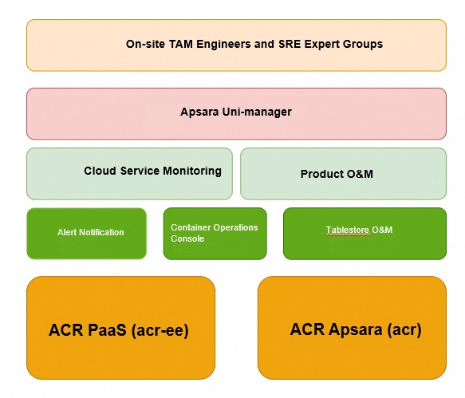
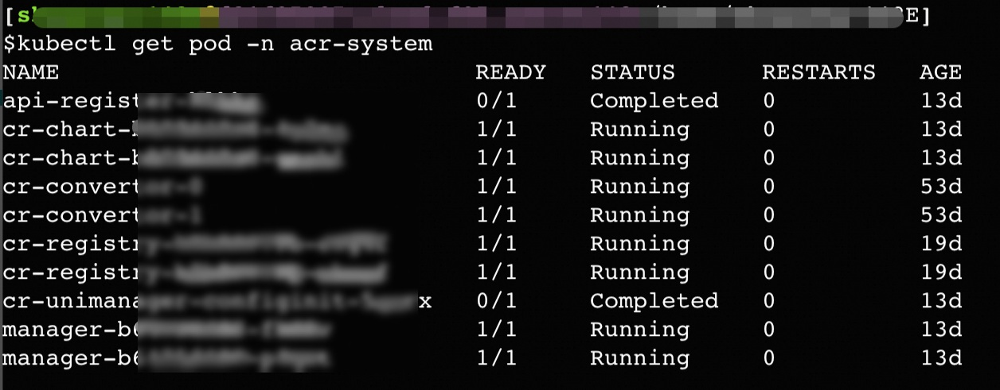
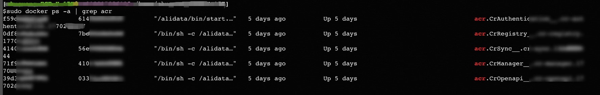
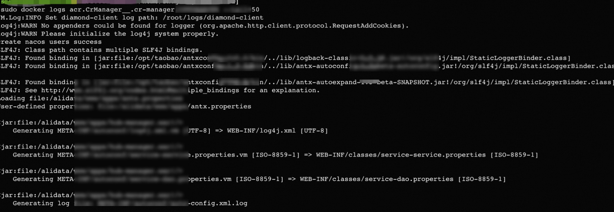
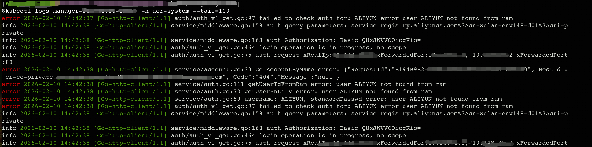

Alibaba Cloud  
Apsara Stack  
Container Registry  
Operations and Maintenance  
Guide  
Product Version: v3.18.6-2607  
Document Version: 20260828

**Table of Contents**

- [1.O&M](#section-1)
    - [1.1. O&M](#section-1-1)
    - [1.2. O&M architecture](#section-1-2)
- [2.O&M process](#section-2)

# 1.O&M

## 1.1. O&M

This document covers the purpose, requirements, and precautions for O&M of Container Registry (ACR), and how to get help.

**Purpose**

This manual guides maintenance personnel in performing preventive maintenance on Container Registry (ACR) to ensure its long-term stability. Use this manual to resolve system issues. If you cannot resolve an issue, contact Alibaba Cloud technical support for Container Registry (ACR).

**Requirements**

- Maintenance personnel must have professional IT skills, including knowledge of computer networking and distributed storage operations, and the ability to analyze and troubleshoot issues.

- Maintenance personnel must complete the Alibaba Cloud pre-job training and learn about Container Registry (ACR), including its system principles, networking, features, and the use of maintenance tools.

> **Important**
>
> During maintenance operations, maintenance personnel must follow all operating procedures to ensure personal safety and system security. Keep all user data strictly confidential. Do not copy or distribute user data without the user's written permission.

**Precautions**

To ensure system stability and prevent accidents, maintenance personnel must observe the following precautions:

- Hierarchical and role-based permission management:

  Implement a hierarchical, role-based permission model for networks, devices, systems, and data. To prevent unauthorized operations that could cause a system failure, grant each role only the permissions required for its tasks.

- System security:

  - Before any operation, understand its potential outcomes to avoid disrupting the system.

  - Clearly document any issues encountered during operations to aid troubleshooting.

- Personal safety and data security:

  - When operating electrical equipment, follow all safety precautions required by the equipment specifications.

  - Use secure devices to access the service network.

  - Do not copy or distribute data without authorization.

**Getting help**

If you need help during system maintenance, contact Alibaba Cloud technical support for Container Registry (ACR).

## 1.2. O&M architecture

This topic describes the O&M architecture of Container Registry (ACR).

The following figure shows the O&M architecture of ACR.

| Category | Description |
| --- | --- |
| Routine maintenance | Including unified inspection, alert viewing, and alert handling. |
| Troubleshooting | Performed by on-site TAM engineers and SRE expert groups. |

# 2.O&M process

This document outlines the operations and maintenance (O&M) process for Container Registry (ACR).

**ACR components**

**Apsara baseline components**

- **cr-authentication**: The ACR authentication component.

- **cr-cleaner**: Cleans up related images in ACR.

- **cr-init**: Handles API registration in ACR.

- **cr-manager**: The ACR management component.

- **cr-openapi**: Integrates with RAM for authentication.

- **cr-registry**: Stores images in ACR.

- **cr-sync:** Handles image synchronization in ACR.

- **cr-chart:** Manages Charts in ACR.

- **cr-convertor:** Provides image acceleration.

**PaaS baseline components**

- **acr-ee**: Handles API registration.

- **cr-chart**: Manages Charts in ACR.

- **cr-convertor:** Provides image acceleration.

- **manager**: The ACR management component.

- **cr-registry**: Stores images in ACR.

- **cr-unimanager-configinit:** The ACR frontend component.

- **multi-instance:** Supports multiple instances in ACR.

**ACR PaaS component pod inspection**

Log in to the VM where ACR is located, and run the  `kubectl get pod -n acr-system` command to check whether the ACR baseline component pods are in their final state.

**ACR Apsara container component inspection**

Log in to the VM that hosts the ACR, and run the  `sudo docker ps -a | grep acr`  command to check the status of the ACRPaaS baseline component container.

**ACR Apsara management component logs**

Log in to the VM that hosts ACR and run the  `sudo docker logs <docker-acr-manager-name>` command to view the status of the ACRPaaS baseline component container.

**ACR PaaS container management component logs**

Log on to the VM that hosts ACR and run the  `kubectl logs <manager-pod-name> -n acr-system`  command to check the status of the ACRPaaS baseline component management container.

