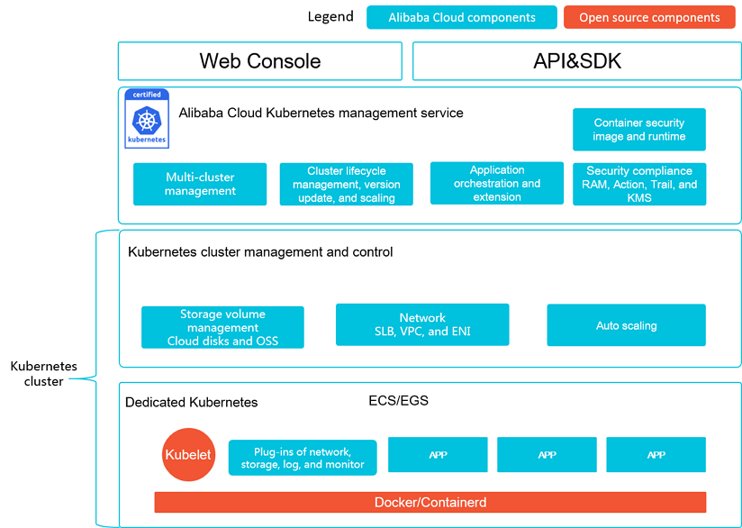
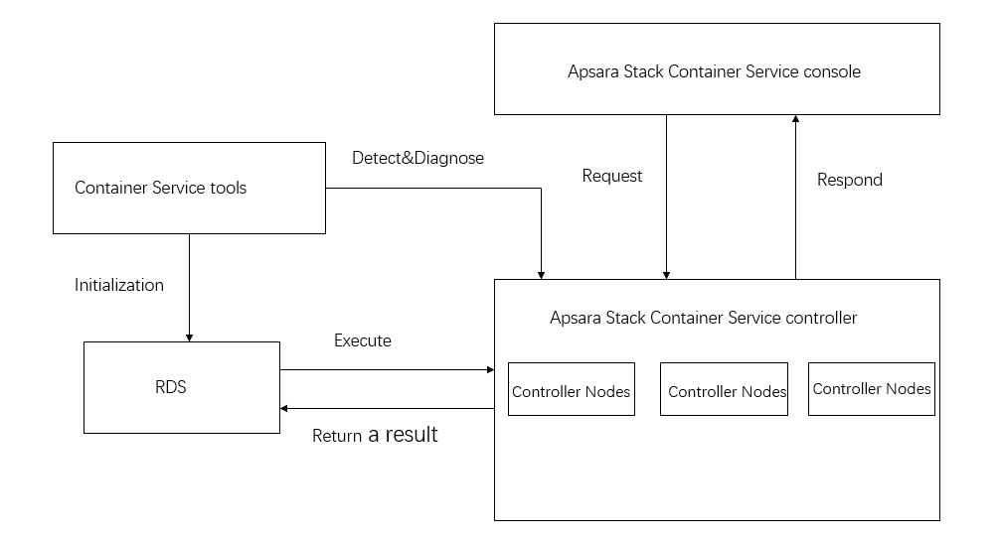
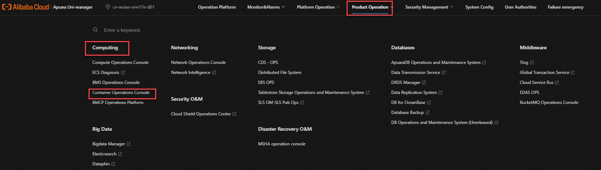
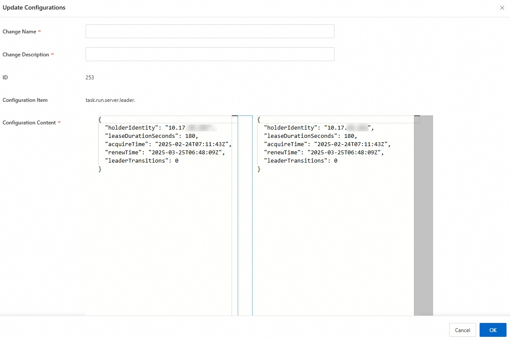
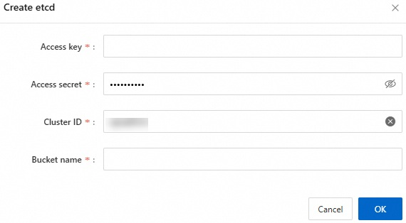

Alibaba Cloud  
Apsara Stack  
Container Service for  
Kubernetes  
Operations and Maintenance  
Guide  
Product Version: v3.18.6-2607  
Document Version: 20260828

**Table of Contents**

- [1.Before you start](#section-1)
- [2.Architecture](#section-2)
    - [2.1. System architecture](#section-2-1)
    - [2.2. Architecture](#section-2-2)
    - [2.3. Deployment architecture](#section-2-3)
    - [2.4. Server roles](#section-2-4)
- [3.ACK cluster O&M](#section-3)
- [4.Component O&M](#section-4)
    - [4.1. Components](#section-4-1)
- [5.GUI-based changes](#section-5)
    - [5.1. Kubernetes version baselines](#section-5-1)
    - [5.2. Troopers configurations](#section-5-2)
- [6.Log management](#section-6)
- [7.Operation audit](#section-7)
- [8.etcd O&M](#section-8)
    - [8.1. etcd backup](#section-8-1)

# 1.Before you start

Container Service for Kubernetes (ACK) provides container services. You may encounter service interruptions if you perform improper operations on applications in your ACK clusters. This topic describes the usage notes of ACK clusters and instructions on high-risk operations. This helps you learn the risks that may arise when you use ACK clusters.

**Usage notes**

**Data plane components**

Data plane components are system components that run on your Elastic Compute Service (ECS) instances. Data plane components include CoreDNS, Ingresses, kube-proxy, Terway, and the kubelet. You and the ACK team must collaborate to ensure the stability of data plane components that run on your ECS instances.

When you use data plane components, we recommend that you take note of the following items:

- Modifying the component configuration may cause the component to malfunction. Exercise caution when you modify the component configuration. For more information, see **Container Service for Kubernetes User Guide** > **Components** > **Manage components**.

- Do not use the APIs of Infrastructure as a Service (IaaS) services to modify the environment of data plane components. For example, do not use the ECS API to change the status of the ECS instances on which data plane components run, or modify the security groups or network settings of the worker nodes. Do not use the Server Load Balancer (SLB) API to modify the configurations of the SLB instances that are used by your cluster. Improper changes to the IaaS resources may cause the components to malfunction.

- Several data plane components may have the same bugs or vulnerabilities as the corresponding open source versions. Update your components at the earliest opportunity in case the bugs or vulnerabilities affect your business.

**Cluster updates**

Use the cluster update feature that is provided by ACK to update the Kubernetes version of ACK clusters. If you use other methods to update the Kubernetes version of your ACK clusters, stability or compatibility issues may occur in the ACK clusters. For more information, see **Container Service for Kubernetes User Guide** > **Kubernetes clusters** > **Clusters** > **Update the Kubernetes version of a cluster**.

ACK provides the following features to update clusters:

- Version updates for ACS clusters.

- Release notes for new Kubernetes versions. The release notes describe new Kubernetes versions and compare new versions with earlier versions.

- Notifications for potential risks due to resource changes. This feature can inform you of the risks that may arise due to resource changes caused by version updates.

We recommend that you follow these suggestions when you use the cluster update feature:

- Read the release notes of the new Kubernetes versions, confirm the status of the cluster and workloads based on the update risks that are reported by ACK, and evaluate the impacts of the risks. For more information, see **Container Service for Kubernetes User Guide** > **Announcements** and **Container Service for Kubernetes User Guide** > **Kubernetes clusters** > **Clusters** > **Update the Kubernetes version of a cluster**.

- You cannot roll back cluster updates. Before you update a cluster, prepare for the update and make a backup plan.

**Kubernetes configurations**

- Do not change key Kubernetes configurations. For example, do not change the following directories or modify the paths, links, and content of the files in the directories:

  - /var/lib/kubelet

  - /var/lib/docker

  - /etc/kubernetes

  - /etc/kubeadm

  - /var/lib/containerd

- Do not use annotations that are reserved by Kubernetes in YAML templates. Otherwise, resource unavailability, application failures, and exceptions may occur. Labels prefixed with `kubernetes.io/`  or  `k8s.io/`  are reserved for key components. For example, do not use the annotation  `pv.kubernetes.io/bind-completed: "yes"` .

**App catalog**

The application marketplace of ACK provides the app catalog feature to help you install applications that are developed based on open source versions. Open source applications may have potential risks. Proceed with caution.

**High-risk operation**

The following high-risk operations may adversely affect your business when you work with ACK. Read and understand the impacts of the following high-risk operations before you perform these operations:

**High-risk operations on clusters**

**Category**

**High-risk operation**

**Impact**

**How to recover**

Delete the SLB instance

You cannot manage the

Unrecoverable. You must

API Server

that is used to expose the

cluster.

create a new cluster.

API server.

Add the master nodes to the original security groups again. The security groups are created when

Modify the security group

The nodes may become

you create the cluster. For

of nodes.

unavailable.

more information, see **ECS User Guide** > **Security groups** > **Add an instance to a security group**.

The nodes become

Remove nodes.

Unrecoverable.

unavailable.

Remove the worker nodes

Components are

Reinstall the node OS.

and then add the nodes to

uninstalled from nodes.

the cluster again.

Worker nodes

Update component

The nodes may become

Roll back to the original

versions.

unavailable.

component versions.

Change the IP addresses

Change the IP addresses

The nodes become

of the nodes to the

of nodes.

unavailable.

original IP addresses.

Modify the parameters of

Refer to the ACK official

key components, such as

The nodes may become

documentation and

kubelet, docker, and

unavailable.

configure the component

containerd.

parameters.

Restore the

Modify node OS

The nodes may become

configurations, or remove

configurations.

unavailable.

the worker nodes and then purchase new nodes.

Add the master nodes to the original security groups again. The security groups are created when

Modify the security group

The master nodes may

you create the cluster. For

of master nodes.

become unavailable.

more information, see **ECS User Guide** > **Security groups** > **Add an instance to a security group**.

The master nodes become

Remove master nodes.

Unrecoverable.

unavailable.

Components are

Reinstall the node OS.

uninstalled from master

Unrecoverable.

nodes.

Update master nodes or

The cluster may become

Roll back to the original

the etcd component.

unavailable.

version.

Master

Delete or format the

nodes in

directories that store

ACK

The master nodes become

business-critical data on

Unrecoverable.

dedicated

unavailable.

nodes, for example,

clusters

/etc/kubernetes.

Change the IP addresses

Change the IP addresses

The master nodes become

of the master nodes to the

of master nodes.

unavailable.

original IP addresses.

Modify the parameters of

Refer to the ACK official

key components, such as

The master nodes may

documentation and

etcd, kube-apiserver, and

become unavailable.

configure the component

docker.

parameters.

Replace the certificates of

The cluster may become

Unrecoverable.

master nodes or the etcd.

unavailable.

Increase or decrease the

The cluster may become

Unrecoverable.

number of master nodes.

unavailable.

Use Resource Access

You may fail to create

Other

Management (RAM) to

specific resources, such as

Restore the permissions.

services

modify permissions.

SLB instances.

**High-risk operations on node pools**

| High-risk operation | Impact | How to recover |
| --- | --- | --- |
| Delete scaling groups. | Node pool exceptions occur. | Unrecoverable. You must create new node pools. |
| Use kubectl to remove nodes from a node pool. | The number of nodes in the node pool that is displayed in the ACK console is different from the actual number. | Remove the nodes by using the ACK console or by calling the ACK API. For more information, see <strong>Container Service for</strong> Kubernetes User Guide &gt; Kubernetes clusters &gt; Node management &gt; Nodes &gt; <strong>Remove a node</strong>. |
| Manually release ECS instances. | Incorrect information may be displayed on the node pool details page. | Unrecoverable. Remove the nodes by using the ACK console or by calling the ACK API. For more information, see Container Service for Kubernetes User Guide &gt; Kubernetes clusters &gt; Node management &gt; Nodes &gt; <strong>Remove a node</strong>. |
| Manually scale in or scale out a node pool that has auto scaling enabled. | The auto scaling component automatically adjusts the number of nodes in the node pool after you manually scale in or scale out the node pool. | Unrecoverable. You do not need to manually scale a node pool that has auto scaling enabled. |
| Change the upper or lower limit of instances that a scaling group can contain. | Scaling errors may occur. | • For a node pool that has auto scaling disabled, the default upper limit of instances for the scaling group is 2,000, and the default lower limit of instances is 0. • For a node pool that has auto scaling enabled, make sure that the upper and lower limits of instances for the scaling group are the same as the upper and lower limits of instances for the node pool. |
| Add existing nodes to a cluster without backing up the data on the nodes. | The data on the nodes is lost after the nodes are added to the cluster. | Unrecoverable. • If you want to add existing nodes in Manual mode, you must first back up the data on the nodes. • If you want to add existing nodes in Auto mode, you must first back up the data on the system disks because the system disks will be replaced when the nodes are added to the cluster. |

**High-risk operations on networks and load balancing**

| High-risk operation | Impact | How to recover |
| --- | --- | --- |
| Specify the following kernel setting: <code> net.ipv4.ip_forward=0 </code>. | Network connectivity issues occurred. | Replace the setting with the following content: <code> net.ipv4.ip_forward=1 </code>. |

<table>
  <tr>
    <td>Specify the following kernel parameter settings: <code>• net.ipv4.conf.all.rp_fil</code> <code>ter = 1&#124;2</code> <code>• net.ipv4.conf.</code> <code>[ethX].rp_filter = 1&#124;2</code> Note <code> ethX </code> specifies the network interface controllers whose names start with <code> eth </code>.</td>
    <td>Network connectivity issues occurred.</td>
    <td>Replace the settings with the following content: <code>• net.ipv4.conf.all.rp_fil</code> <code>ter = 0</code> <code>• net.ipv4.conf.</code> <code>[ethX].rp_filter = 0</code></td>
  </tr>
  <tr>
    <td>Specify the following kernel parameter setting: <code>net.ipv4.tcp_tw_reuse =</code> <code>1 </code>.</td>
    <td>Pods fail to pass health checks.</td>
    <td>Replace the setting with the following content: <code>net.ipv4.tcp_tw_reuse =</code> <code>0 </code>.</td>
  </tr>
  <tr>
    <td>Specify the following kernel setting: <code>net.ipv4.tcp_tw_recycle =</code> <code>1 </code>.</td>
    <td>Network address translation errors occur.</td>
    <td>Replace the setting with the following content: <code>net.ipv4.tcp_tw_recycle =</code> <code>0 </code>.</td>
  </tr>
  <tr>
    <td>Specify the following kernel setting: <code>net.ipv4.ip_local_port_ran</code> <code>ge </code>.</td>
    <td>Network connectivity issues occasionally occur.</td>
    <td>Replace the setting with the following content: <code>net.ipv4.ip_local_port_ran</code> <code>ge="32768 60999" </code>.</td>
  </tr>
  <tr>
    <td>Install firewall software, for example, Firewalld or ufw.</td>
    <td>The container network becomes inaccessible.</td>
    <td>Uninstall the firewall software and restart the nodes.</td>
  </tr>
  <tr>
    <td>The security group of a node does not open UDP port 53 for the pod CIDR block.</td>
    <td>DNS resolutions cannot be performed as normal in the cluster.</td>
    <td>Refer to the ECS official documentation and modify the security group configuration to open UDP port 53 for the pod CIDR block.</td>
  </tr>
  <tr>
    <td>Modify or delete the tags that ACK added to SLB instances.</td>
    <td>The SLB instances cannot work as normal.</td>
    <td>Restore the tags.</td>
  </tr>
  <tr>
    <td>Modify the configurations of the SLB instances that are managed by ACK, including the configurations of the instances, listeners, and vServer groups.</td>
    <td>The SLB instances cannot work as normal.</td>
    <td>Restore the SLB configurations.</td>
  </tr>
  <tr>
    <td>Remove the annotation <code>service.beta.kubernetes.io</code> <code>/alibaba-cloud-</code> <code>loadbalancer-id:</code> <code>${YOUR_LB_ID} </code> that is used to specify an existing SLB instance from the Service configuration.</td>
    <td>The SLB instances cannot work as normal.</td>
    <td>Add the annotation to the Service configuration. Note If a Service uses an existing SLB instance, you cannot modify the configuration to create an SLB instance for the Service. To use a newly created SLB instance, you must create a new Service.</td>
  </tr>
  <tr>
    <td>Delete the SLB instances that are created by ACK in the SLB console.</td>
    <td>Errors may occur on the cluster network.</td>
    <td>Delete SLB instances by deleting the Services that are associated with the SLB instances.</td>
  </tr>
  <tr>
    <td>Manually delete the <code> nginx-</code><code>ingress-lb </code> Service in the kube-system namespace of a cluster that has the NGINX Ingress controller installed.</td>
    <td>The NGINX Ingress controller does not run as normal or may stop running.</td>
    <td>Use the following YAML template to create a Service that has the same name: <code>apiVersion: v1</code> <code>kind: Service</code> <code>metadata:</code> <code>annotations:</code> <code>labels:</code> <code>app: nginx-ingress-</code> <code>lb</code> <code>name: nginx-ingress-lb</code> <code>namespace: kube-system</code> <code>spec:</code> <code>externalTrafficPolicy:</code> <code>Local</code> <code>ports:</code> <code>- name: http</code> <code>port: 80</code> <code>protocol: TCP</code> <code>targetPort: 80</code> <code>- name: https</code> <code>port: 443</code> <code>protocol: TCP</code> <code>targetPort: 443</code> <code>selector:</code> <code>app: ingress-nginx</code> <code>type: LoadBalancer</code></td>
  </tr>
</table>

**High-risk operations on storage**

| High-risk operation | Impact | How to recover |
| --- | --- | --- |
| Unmount cloud disks that are mounted to pods in the ECS console. | I/O errors occur when you write data to the pods. | Restart the pods and clear residual data on the nodes. |
| Unmount disks from their mount paths on nodes. | Pod data is written to local disks. | Restart the pods. |
| Manage cloud disks on the nodes. | Pod data is written to local disks. | Unrecoverable. |
| Mount a cloud disk to multiple pods. | Pod data is written to local disks or I/O errors occur when you write data to the pods. | Mount the cloud disk only to one pod. |
| Manually delete the NAS directories that are mounted to pods. | I/O errors occur when you write data to the pods. | Restart the pods. |
| Delete the NAS file systems that are mounted to pods or delete the mount targets that are used to mount NAS file systems. | I/O hangs occur when you write data to the pods. | Restart the ECS instances. |

**High-risk operations on logs**

| High-risk operation | Impact | How to recover |
| --- | --- | --- |
| Delete the /tmp/ccs-log-collector/pos directory on a node. | Duplicate logs are collected. | Unrecoverable. The /tmp/ccs-log-collector/pos directory contains information about the path from which logs are collected. |
| Delete the /tmp/ccs-log-collector/buffer directory on a node. | Logs are lost. | Unrecoverable. The /tmp/ccs-log-collector/buffer directory stores cached log files that need to be consumed. |

<table>
  <tr>
    <td>Delete the aliyunlogconfig CustomResourceDefinition (CRD) objects.</td>
    <td>Logs cannot be collected.</td>
    <td>Recreate the aliyunlogconfig CRD objects that are deleted and the related resources. Logs that are generated within the period of time during which the aliyunlogconfig CRD objects do not exist cannot be collected. If you delete the aliyunlogconfig CRD objects, the related log collection tasks are also deleted. After you recreate the aliyunlogconfig CRD objects, you must also relaunch the log collection tasks.</td>
  </tr>
  <tr>
    <td>Uninstall the logging component.</td>
    <td>Logs cannot be collected.</td>
    <td>Reinstall the logging component and manually create the aliyunlogconfig CRD objects. Logs that are generated within the period of time during which the logging component and the aliyunlogconfig CRD objects do not exist cannot be collected. If you delete the logging component, the aliyunlogconfig CRD objects and Logtail are also deleted. Logs that are generated within the period of time during which the logging component does not exist cannot be collected.</td>
  </tr>
</table>

# 2.Architecture

## 2.1. System architecture

This topic describes the system architecture of Container Service for Kubernetes (ACK).

Container Service is adapted and enhanced based on native Kubernetes. This service simplifies cluster creation and scaling, and is integrated with Apsara Stack virtualization, storage, network, and security capabilities. This service provides the optimal environment to run Kubernetes-based containerized applications in the cloud.

| Feature | Description |
| --- | --- |
| Dedicated Kubernetes mode | Integrated with Apsara Stack virtualization technologies, the service allows you to create dedicated Kubernetes clusters. You can use Elastic Compute Service (ECS), Elastic GPU Service (EGS), and ECS Bare Metal instances as cluster nodes. You can deploy a wide range of plug-ins and configure various specifications for the instances. |
| Cluster management and control | The service provides powerful network, storage, cluster management, scaling, and application extension features. |
| Kubernetes management | The service supports secure images and is integrated with Apsara Stack Resource Access Management (RAM), Key Management Service (KMS), and logging and monitoring services to provide a secure and compliant Kubernetes solution. |
| Convenient and efficient use | ACK provides services through the web console, APIs, and SDK. |

## 2.2. Architecture

This topic describes the component architecture of Container Service for Kubernetes (ACK).

**Category**

**Component**

**Description**

The console that is used to

CosConsoleAliyunCom

manage clusters, nodes, and applications.

Apsara Stack Container Service console

Backend

Dashboard.

Troopers

Controller backend.

RC

Component installation service.

CloudAccessVpc

Reverse tunneling.

Cert

Static file service.

Apsara Stack Container Service controller

CertControl

Component certificate signing.

Registry

Image service.

Mirana

API server traffic forwarding.

Certificate

Certificate update.

Data initialization and API

ControlInit

registration.

ACK tools

ServiceTest

Self-check service.

DiagnosticTool

Quick diagnostic tool.

## 2.3. Deployment architecture

This topic describes the deployment architecture of Container Service for Kubernetes (ACK).

| Component | Deployment method |
| --- | --- |
| Apsara Stack Container Service console | Containerized deployment |
| Apsara Stack Container Service controller | Containerized deployment |
| Container Service tools | Containerized deployment |

## 2.4. Server roles

This topic describes the server roles of Container Service for Kubernetes (ACK).

<table>
  <tr>
    <th>Project</th>
    <th>Cluster</th>
    <th>Service</th>
    <th>Server role</th>
    <th>Description</th>
  </tr>
  <tr>
    <td rowspan="12">acs</td>
    <td rowspan="12">AcsControlCluste r</td>
    <td rowspan="12">acs-acs_control</td>
    <td>ControlInit</td>
    <td>Data initialization and API registration.</td>
  </tr>
  <tr>
    <td>Troopers</td>
    <td>Controller backend.</td>
  </tr>
  <tr>
    <td>CloudAccessVpc</td>
    <td>Reverse tunneling.</td>
  </tr>
  <tr>
    <td>Cert</td>
    <td>Static file service.</td>
  </tr>
  <tr>
    <td>CertControl</td>
    <td>Component certificate signing.</td>
  </tr>
  <tr>
    <td>Registry</td>
    <td>Image service.</td>
  </tr>
  <tr>
    <td>Mirana</td>
    <td>API server traffic forwarding.</td>
  </tr>
  <tr>
    <td>Backend</td>
    <td>Dashboard.</td>
  </tr>
  <tr>
    <td>CosConsoleAliyun Com</td>
    <td>Console.</td>
  </tr>
  <tr>
    <td>Certificate</td>
    <td>Certificate updates.</td>
  </tr>
  <tr>
    <td>ServiceTest</td>
    <td>Self-check service.</td>
  </tr>
  <tr>
    <td>DiagnosticTool</td>
    <td>Quick diagnostic tool.</td>
  </tr>
</table>

# 3.ACK cluster O&M

This topic described how to view the basic information about all Container Service for Kubernetes (ACK) clusters on the ACK Clusters page.

**Procedure**

1. Log in to the Apsara Uni-manager Operations Console. In the top navigation bar, choose **Product Operation > Computing > Container Operations Console**.

   

2. In the left-side navigation pane, click **ACK Clusters** to go to the ACK Clusters page. You can view the following information on the page: **Clusters**, **Nodes**, **Kubernetes Versions**, **Operating Systems**, and brief information about all ACK clusters.

3. In the **Clusters** section, you can view information about all clusters. You can also search for clusters by **Name**, **Status**, **Type**, and **Label**.

   | Column | Description |
   | --- | --- |
   | Cluster ID/Name | The ID and name of the cluster. |
   | Cluster Status | The status of the cluster, such as <strong>Running</strong> or <strong>Create Failed</strong>. |
   | Label | The labels that are added to the cluster. |
   | Type | The type of the cluster. For example, the cluster is an ACK dedicated cluster. |
   | Nodes | The number of nodes in the cluster. You can click the number in the column to go to the <strong>Node Management</strong> page and view node information in the list. On the <strong>Node Management</strong> page, click the ID of a node to view the basic information of the node. |
   | Usage | The CPU utilization and memory usage of the cluster. |
   | Version | The Kubernetes version of the cluster. |
   | Created At | The time when the cluster was created. |
   | Actions | The operations that you can perform on the cluster. For example, you can click <strong>View Logs</strong> in the Actions column to view the cluster logs. |

4. Find the cluster that you want to manage and click its name in the **Cluster ID/Name** column to go to the cluster details page. The following parameters are displayed in the Cluster Information section of the Basic Information tab: **API Server Internal Endpoint**, **Pod Network CIDR**, **Service CIDR**, **Kube-proxy Mode**, **Node IP Addresses**, and **Network Plug-ins**.

# 4.Component O&M

## 4.1. Components

This topic describes how to view the basic information about all components on the Component List page.

**Procedure**

1. Log in to the Apsara Uni-manager Operations Console. In the top navigation bar, choose **Product Operation > Computing > Container Operations Console**.

   

2. In the left-side navigation pane, choose **Component OPS > Component List**. On the Component List page, view the information about all components in the environment.

3. On the **Component List** list, search for components by component name or component version. Find the component that you want to manage and click its name in the **Name** column to go to the **Component Details** page.

   > **Note**
   >
   > You can also click **View Cluster** in the **Actions** column to view the status of the cluster that is associated with the component.

4. On the **Component Details** page, view the basic information about the component. The following parameters are displayed: **Component Name**, **Component ID**, **Component Type**, **Created At**, **Component Description**, and **Component Template**.

# 5.GUI-based changes

## 5.1. Kubernetes version baselines

This topic describes how to view the information about baselines on the **K8S version baseline** page.

**Procedure**

1. Log in to the Apsara Uni-manager Operations Console. In the top navigation bar, choose **Product Operation > Computing > Container Operations Console**.

   

2. In the left-side navigation pane, choose **ACK Change > Version Baseline**. On the K8S version baseline page, view the baseline information displayed in the following columns: **Name**, **Baseline Type**, **Version**, **Cluster Type**, **Property**, **Creation Time**, and Operation. You can also search for baselines by name.

   > **Note**
   >
   > To view the YAML or JSON file of the baseline, click the file in the **Actions** column.

## 5.2. Troopers configurations

This topic describes how to view and modify the information about troopers configurations on the Troopers Configurations page.

**Procedure**

1. Log in to the Apsara Uni-manager Operations Console. In the top navigation bar, choose **Product Operation > Computing > Container Operations Console**.

   

2. In the left-side navigation pane, choose **ACK Change > Troops Config**. On the Troopers Configurations page, view the name, content, creation time, and update time of each configuration item, and the operations that you can perform on each configuration item. You can also search for configuration items by name.

3. Find the configuration item that you want to manage and click **View Configuration** in the **Actions** column to view the configuration. You can also click **Update configuration** in the **Actions** column to modify the configuration.

   

# 6.Log management

This topic describes how to query and view service logs such as troopers logs.

**Procedure**

1. Log in to the Apsara Uni-manager Operations Console. In the top navigation bar, choose **Product Operation > Computing > Container Operations Console**.

   

2. In the left-side navigation pane, click **Log Management**. On the page that appears, search for logs, such as troopers logs, by Logstore and time range.

# 7.Operation audit

This topic describes how to view the information about operations.

**Procedure**

1. Log in to the Apsara Uni-manager Operations Console. In the top navigation bar, choose **Product Operation > Computing > Container Operations Console**.

   

2. In the left-side navigation pane, click **Operation Audit**. On the page that appears, view the operation information in the following columns: **Change Name**, **Change Description**, **Operation Type**, **Operation Object**, **Change Type**, **Status**, and **User**.

   > **Important**
   >
   > In the **Actions** column, click **View Change** to view the change in read-only mode or click **Roll Back Change** to roll back the change.

# 8.etcd O&M

## 8.1. etcd backup

This topic describes how to back up the etcd data of a Container Service for Kubernetes (ACK) cluster and view historical backup information on the ETCD Backup Records page.

**Procedure**

1. Log in to the Apsara Uni-manager Operations Console. In the top navigation bar, choose **Product Operation > Computing > Container Operations Console**.

   

2. In the left-side navigation pane, click **ETCD Backup Records**. On the **ETCD Backup Records** page, you can view the following information about an etcd backup record: **cluster ID**, **bucket**, **user ID**, **ID**, **log**, **creation time**, and **status**.

3. In the upper-left corner of the page, click **Back Up**. In the Create etcd dialog box, configure the parameters that are described in the following table and click **OK**.

   

   | Parameter | Description |
   | --- | --- |
   | Access key | The AccessKey ID. |
   | Access secret | The AccessKey secret. |
   | Cluster ID | The ID of the cluster. |
   | Bucket name | The name of the Object Storage Service (OSS) bucket that stores the etcd data. |
