Alibaba Cloud  
Apsara Stack  
Elastic Compute Service  
Operations and Maintenance  
Guide  
Product Version: v3.18.6-2607  
Document Version: 20260828

**Table of Contents**

- [1.Log on to the Apsara Uni-manager Operations Console](#section-1)
- [2.ECS operations and maintenance](#section-2)
    - [2.1. Computing O&M overview](#section-2-1)
    - [2.2. Cluster O&M](#section-2-2)
        - [2.2.1. View compute clusters](#section-2-2-1)
        - [2.2.2. Log in to the AG of a cluster](#section-2-2-2)
        - [2.2.3. Manage computing clusters](#section-2-2-3)
            - [2.2.3.1. Get an overview of a compute cluster](#section-2-2-3-1)
            - [2.2.3.2. Manage cluster configurations](#section-2-2-3-2)
                - [2.2.3.2.1. View cluster configurations](#section-2-2-3-2-1)
                - [2.2.3.2.2. Configure cluster-level CPU oversold ratios](#section-2-2-3-2-2)
            - [2.2.3.3. Manage computing servers](#section-2-2-3-3)
                - [2.2.3.3.1. View computing servers](#section-2-2-3-3-1)
                - [2.2.3.3.2. Manage server status](#section-2-2-3-3-2)
    - [2.3. Computing servers](#section-2-3)
        - [2.3.1. Manage computing servers](#section-2-3-1)
            - [2.3.1.1. View computing servers](#section-2-3-1-1)
            - [2.3.1.2. View O&M details about a computing server](#section-2-3-1-2)
            - [2.3.1.3. Diagnose a computing server](#section-2-3-1-3)
            - [2.3.1.4. Lock physical machines](#section-2-3-1-4)
            - [2.3.1.5. Unlock a computing server](#section-2-3-1-5)
            - [2.3.1.6. Activate a computing server](#section-2-3-1-6)
            - [2.3.1.7. Migrate all instances from a computing server](#section-2-3-1-7)
            - [2.3.1.8. Deactivate a physical machine for maintenance](#section-2-3-1-8)
            - [2.3.1.9. View audit logs](#section-2-3-1-9)
        - [2.3.2. View computing server-level migration tasks](#section-2-3-2)
        - [2.3.3. ECS physical machine O&M](#section-2-3-3)
    - [2.4. DRP O&M](#section-2-4)
        - [2.4.1. Create a dedicated resource pool](#section-2-4-1)
        - [2.4.2. View the details of a dedicated resource pool](#section-2-4-2)
        - [2.4.3. Manage DRPs](#section-2-4-3)
            - [2.4.3.1. Add a server to a dedicated resource pool](#section-2-4-3-1)
            - [2.4.3.2. Remove a server from a dedicated resource pool](#section-2-4-3-2)
            - [2.4.3.3. Change the administrator account ID](#section-2-4-3-3)
            - [2.4.3.4. Modify an on-failure physical machine replacement policy](#section-2-4-3-4)
            - [2.4.3.5. Manage server status](#section-2-4-3-5)
        - [2.4.4. Delete a dedicated resource pool](#section-2-4-4)
    - [2.5. ECS](#section-2-5)
        - [2.5.1. VM](#section-2-5-1)
            - [2.5.1.1. View ECS instances](#section-2-5-1-1)
            - [2.5.1.2. View the details of an ECS instance](#section-2-5-1-2)
            - [2.5.1.3. Manage instance status](#section-2-5-1-3)
                - [2.5.1.3.1. Start instances](#section-2-5-1-3-1)
                - [2.5.1.3.2. Stop instances](#section-2-5-1-3-2)
                - [2.5.1.3.3. Restart instances](#section-2-5-1-3-3)
            - [2.5.1.4. Migrate an instance](#section-2-5-1-4)
            - [2.5.1.5. View migration logs in Server Controller](#section-2-5-1-5)
            - [2.5.1.6. ISO management](#section-2-5-1-6)
            - [2.5.1.7. Modify the internal bandwidth of instances](#section-2-5-1-7)
        - [2.5.2. Disks](#section-2-5-2)
            - [2.5.2.1. View disks](#section-2-5-2-1)
            - [2.5.2.2. View disk details](#section-2-5-2-2)
            - [2.5.2.3. View snapshots](#section-2-5-2-3)
        - [2.5.3. Images](#section-2-5-3)
            - [2.5.3.1. Overview](#section-2-5-3-1)
            - [2.5.3.2. View images](#section-2-5-3-2)
            - [2.5.3.3. Manage ISO images](#section-2-5-3-3)
            - [2.5.3.4. Convert the format of an image](#section-2-5-3-4)
            - [2.5.3.5. Unpublish an image](#section-2-5-3-5)
        - [2.5.4. Snapshots](#section-2-5-4)
            - [2.5.4.1. Overview](#section-2-5-4-1)
            - [2.5.4.2. View snapshots](#section-2-5-4-2)
            - [2.5.4.3. View audit logs](#section-2-5-4-3)
            - [2.5.4.4. View automatic snapshot policies](#section-2-5-4-4)
        - [2.5.5. ENIs](#section-2-5-5)
            - [2.5.5.1. View the details of an ENI](#section-2-5-5-1)
            - [2.5.5.2. View audit logs](#section-2-5-5-2)
        - [2.5.6. Security groups](#section-2-5-6)
            - [2.5.6.1. Overview](#section-2-5-6-1)
            - [2.5.6.2. View the details of a security group](#section-2-5-6-2)
            - [2.5.6.3. Security group configurations](#section-2-5-6-3)
            - [2.5.6.4. View audit logs](#section-2-5-6-4)
        - [2.5.7. O&M devices](#section-2-5-7)
            - [2.5.7.1. Attach a USB device to an instance](#section-2-5-7-1)
            - [2.5.7.2. Attach a CD-ROM device](#section-2-5-7-2)
    - [2.6. Specifications and capacity O&M](#section-2-6)
        - [2.6.1. Analyze compute capacity](#section-2-6-1)
        - [2.6.2. Instance type management](#section-2-6-2)
            - [2.6.2.1. All Specifications](#section-2-6-2-1)
            - [2.6.2.2. Custom instance types](#section-2-6-2-2)
                - [2.6.2.2.1. Create a custom instance type](#section-2-6-2-2-1)
                - [2.6.2.2.2. View a custom instance type](#section-2-6-2-2-2)
                - [2.6.2.2.3. Disable custom instance types](#section-2-6-2-2-3)
                - [2.6.2.2.4. View audit logs](#section-2-6-2-2-4)
        - [2.6.3. Resource reservations](#section-2-6-3)
            - [2.6.3.1. Create a resource reservation for an instance](#section-2-6-3-1)
            - [2.6.3.2. Create a resource reservation for a physical machine](#section-2-6-3-2)
    - [2.7. Migration task management](#section-2-7)
        - [2.7.1. Manage migration tasks](#section-2-7-1)
            - [2.7.1.1. Create an ECS migration task](#section-2-7-1-1)
            - [2.7.1.2. Create a computing server-level migration task](#section-2-7-1-2)
            - [2.7.1.3. Create a batch ECS migration task](#section-2-7-1-3)
            - [2.7.1.4. Create a batch machine migration task](#section-2-7-1-4)
            - [2.7.1.5. Create a cluster-level migration task](#section-2-7-1-5)
            - [2.7.1.6. Off-peak migration tasks](#section-2-7-1-6)
            - [2.7.1.7. View migration tasks](#section-2-7-1-7)
            - [2.7.1.8. Stop a migration task](#section-2-7-1-8)
        - [2.7.2. Configure migration constraints](#section-2-7-2)
        - [2.7.3. View CPU compatibility configurations](#section-2-7-3)
    - [2.8. ECS intelligent O&M](#section-2-8)
        - [2.8.1. ECS events](#section-2-8-1)
            - [2.8.1.1. View ECS instance events](#section-2-8-1-1)
            - [2.8.1.2. Physical machine events](#section-2-8-1-2)
        - [2.8.2. ECS maintenance events](#section-2-8-2)
            - [2.8.2.1. Physical machine O&M](#section-2-8-2-1)
            - [2.8.2.2. Instance O&M](#section-2-8-2-2)
        - [2.8.3. ECS workflows](#section-2-8-3)
        - [2.8.4. ECS diagnostics](#section-2-8-4)
    - [2.9. Computing O&M configurations](#section-2-9)
        - [2.9.1. View monitoring settings](#section-2-9-1)
        - [2.9.2. Configure O&M actions](#section-2-9-2)
            - [2.9.2.1. Configure throttling for a proactive O&M action](#section-2-9-2-1)
            - [2.9.2.2. Configure the approval process for a proactive O&M action](#section-2-9-2-2)
        - [2.9.3. Modify the release time of a disk](#section-2-9-3)
    - [2.10. View O&M audit logs](#section-2-10)
    - [2.11. Tiangong O&M](#section-2-11)
        - [2.11.1. View Tiangong services](#section-2-11-1)
        - [2.11.2. View Tiangong workflows](#section-2-11-2)
    - [2.12. ECS Operation Assistant](#section-2-12)
- [3.ECS Diagnose](#section-3)
    - [3.1. NC O&M](#section-3-1)
    - [3.2. Instance O&M](#section-3-2)
    - [3.3. View O&M events](#section-3-3)
    - [3.4. Configure OpsCode throttling rules](#section-3-4)
- [4.Hot migration of disks](#section-4)
    - [4.1. Use the CDS Ops tool to hot migrate disks](#section-4-1)
    - [4.2. Automatically migrate disks in the HaiTu console](#section-4-2)
- [5.Inspection](#section-5)
    - [5.1. Overview](#section-5-1)
    - [5.2. Cluster basic health inspection](#section-5-2)
        - [5.2.1. Overview](#section-5-2-1)
        - [5.2.2. Monitoring inspection](#section-5-2-2)
        - [5.2.3. Inspection of basic software package versions](#section-5-2-3)
        - [5.2.4. Inspections of basic public resources](#section-5-2-4)
    - [5.3. Cluster resource inspection](#section-5-3)
        - [5.3.1. Overview](#section-5-3-1)
        - [5.3.2. Cluster inventory inspection](#section-5-3-2)
        - [5.3.3. VM inspection](#section-5-3-3)
    - [5.4. What do I do if a split-brain issue occurs in the data centers in which ECS is deployed in disaster recovery mode?](#section-5-4)

<a id="section-1"></a>

# 1.Log on to the Apsara Uni-manager Operations Console

This topic describes how to log on to the Apsara Uni-manager Operations Console.

**Prerequisites**

- The endpoint of the Apsara Uni-manager Operations Console and the username and password used to log on to the console are obtained from the deployment engineer or an administrator.

  The endpoint of the Apsara Uni-manager Operations Console is in the following format: *regi on-id*.ops.console.*intranet-domain-id*.

- A web browser. We recommend that you use Google Chrome.

**Procedure**

1. Open your browser.

2. In the address bar, enter the endpoint of the Apsara Uni-manager Operations Console. Press the Enter key.

   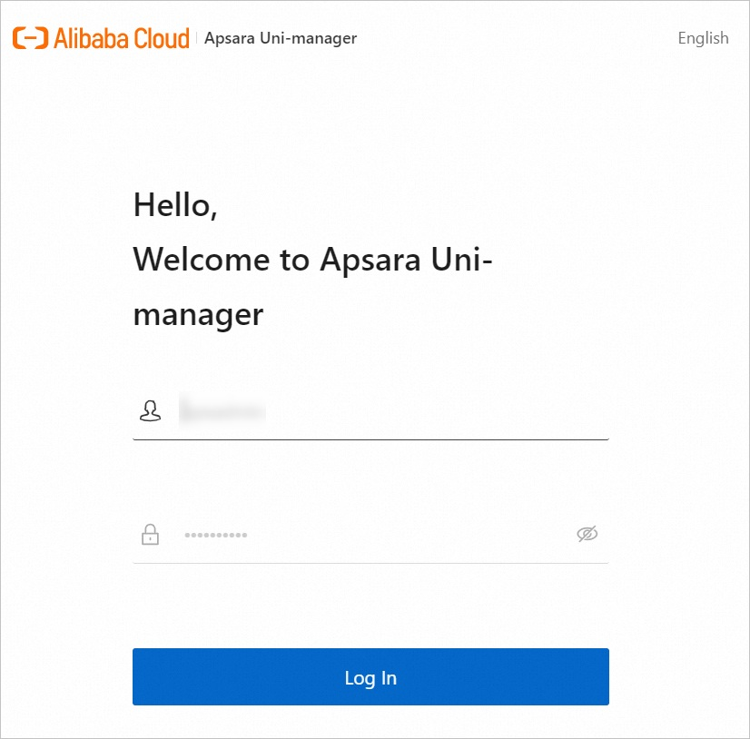

   > **Note**
   >
   > You can click the current language in the upper-right corner to switch to another language. Simplified Chinese, English, and Traditional Chinese are supported.

3. Enter your username and password.

   > **Note**
   >
   > Obtain the username and password that are used to log on to the Apsara Uni-manager Operations Console from the deployment engineer or an administrator.

   If you log on to the Apsara Uni-manager Operations Console for the first time, you must change the password of your username.

   To enhance security, your password must meet the following requirements:

   - The password contains uppercase and lowercase letters.

   - The password contains digits.

   - The password contains at least one of the following special characters: ! @ # $ %

   - The password is 10 to 20 characters in length.

4. Click **Log On**.

<a id="section-2"></a>

# 2.ECS operations and maintenance

<a id="section-2-1"></a>

## 2.1. Computing O&M overview

This topic describes the Overview page of the Compute Operations Console. On the Overview page, you can obtain a high-level overview of services in IaaS O&M, stay updated with service status, and view service information, such as diagnostics results, alerts, inventory usage, core metrics, and health status.

**Procedure**

1. Log in to the Apsara Uni-manager Operations Console.

2. In the top navigation bar, choose **Product Operation > Computing > Compute Operations Console**.

3. In the **Data Migration** section, view the number of migration tasks. The task types include **Cold Migration Tasks**, **Hot Migration Tasks**, **Machine-level Migration Tasks**, and **Cluster-level Migration Tasks**.

4. In the **One-click Search** section, enter an Elastic Compute Service (ECS) instance ID, a disk ID, a system image ID, an elastic network interface (ENI) ID, a security group ID, the private or public IP address of an ECS instance, or the IP address or hostname of a physical machine to search for a specific resource. In the search result, click the resource to go to the details page. On the page that appears, view the information about the resource.

5. In the **High Availability Monitoring** section, view the high availability-related data, including **Downtime Occurrences/Instance Failovers**, **Hang/Crash Checks**, and **Physical Machine Reservations/Instance Reservations**.

6. In the **Top 5 Proactive O&M Events** section, view the five most common operations that are automatically performed.

7. In the **Service Check** section, view the diagnostics score that is displayed on the dashboard and the numbers of check items in the **Normal**, **At-risk**, **Abnormal**, and **Suggestion** states.

   > **Note**
   >
   > The number of normal check items is displayed in green, the number of abnormal check items is displayed in red, and the number of check items in the Suggestion state is displayed in blue.

   In the upper-right corner of the section, click **Check Now**. In the **Service Check** dialog box, view the latest diagnostics score on the dashboard, the status of each check item, and exception details.

8. In the **Capacity Allocation Rate** section, view the total amount, used capacity, and allocation rate of each metric in your cluster. The metrics include **vCPUs (Cores)**, **Memory (GiB)**, and **EIPs**.

   > **Note**
   >
   > By default, the metric statistics of all clusters are displayed. To view the statistics of a specific cluster, select the cluster from the drop-down list in the upper-right corner of this section.

   The following table describes the metrics.

   | Metric | Description |
   | --- | --- |
   | vCPUs (Cores) | The number of vCPUs. vCPUs are the components of virtual machines (VMs). |
   | Memory (GiB) | The memory size. |
   | EIPs | The number of EIPs. |

9. In the **Resource Data** section, view the **number of clusters** (including **compute clusters**, **storage clusters**, and **hybrid clusters**), the **number of computing servers** (including computing servers in the **free**, **mlock**, **nc_down**, and **rlock** states), and the **number of ECS instances** (including ECS instances in the **Running**, **Stopped**, and **Pending** states.

0. In the **Health Status of Services** section, view the health status of each service.

   Click the name of a service that you want to view. In the **Deployed Machines** dialog box, view information about the service, including the service status, server role, IP address of the physical machine on which the service is deployed, hostname, cluster, description, and the Apsara Stack service to which the service belongs.

<a id="section-2-2"></a>

## 2.2. Cluster O&M

<a id="section-2-2-1"></a>

### 2.2.1. View compute clusters

This topic describes how to query and view information about all compute clusters, including the total number of clusters, the number of clusters that have not reached the desired state, the number of clusters that have reached the desired state, the cluster names, cluster types, and cluster instance types.

**Procedure**

1. Log in to the Apsara Uni-manager Operations Console.

2. In the top navigation bar, choose **Product Operation > Computing > Compute Operations Console**.

3. In the left-side navigation pane, click **Compute Cluster O&M**. By default, the information of all clusters is displayed on the Compute Cluster O&M page.

4. In the upper-right corner of the page, view the total number of clusters, the number of clusters that have not reached the desired state, and the number of clusters that have reached the desired state.

   > **Note**
   >
   > The number of clusters **that have not reached the desired state** is displayed in red.

5. Optional. Select the items that you want to display in the cluster list and specify a custom column order.

   <ol type="i">

   <li>

   In the upper-right corner of the page that appears, click the  icon.

   </li>

   <li>

   Select or deselect the items that you want to display in the cluster list.

   </li>

   </ol>

   The data of the items displayed in the cluster list is updated in real time.

6. In the upper-left corner of the page, enter a keyword in the search box to search for a cluster. Fuzzy queries are supported.

   The cluster information is displayed in the following columns: **Cluster Name/Alias**, **Region**, **CPU Processor**, **Cluster Type**, **Compute Type**, **Desired State**, **Zone**, **Servers**, **Instance Family**, and **Cluster Specifications**.

   > **Note**
   >
   > - Valid values of the **Compute Type** parameter:
   >
   >   - CPU: provides CPU and memory resources for Elastic Compute Service (ECS) instances in the Kernel-based Virtual Machine (KVM) architecture.
   >
   >   - Local Disk: provides local storage, CPU, and memory resources for ECS instances in the KVM architecture.
   >
   >   - GPU: provides GPU, CPU, and memory resources for ECS instances in the KVM architecture.
   >
   >   - Hybrid: provides cloud storage, CPU, and memory resources for ECS instances in the KVM architecture.
   >
   >   - SHENLONG: provides CPU and memory resources for ECS instances in the SHENLONG architecture.
   >
   >   - VMOC: provides CPU and memory resources for ECS instances in the Virtual Missions Operational Center (VMOC) architecture. The VMOC architecture can be deployed on non-SHENLONG physical machines to provide computing power for ECS instances.
   >
   > - Valid values of the **Cluster Specifications** parameter:
   >
   >   - share,ncTypeHybrid: shared clusters.
   >
   >   - pin,exclusive,ncTypeHybrid: exclusive clusters.
   >
   >   - ncTypeHybrid,bareMetal: bare metal clusters.

   - View the details of the cluster.

     Find the cluster that you want to view and click the cluster name in the **Cluster Name/Alias** column. The **Overview** tab of the Computing Cluster O&M Details page is displayed. You can view the basic information, instance resources, and inventory information of the cluster. For more information, see Get an overview of a compute cluster.

   - View the configurations and configuration change records of a cluster.

     Find the cluster that you want to view and click the cluster name in the **Cluster Name/Alias** column. On the Computing Cluster O&M Details page, click the **Configuration** tab. You can view the configurations of a cluster and the change records of the cluster configurations. For more information, see Manage cluster configurations.

   - Manage computing servers.

     On the Compute Cluster O&M page, find the cluster that you want to view and click the cluster name in the **Cluster Name/Alias** column. On the Computing Cluster O&M Details page, click the **Computing Servers** tab. You can view the basic information and O&M details of a computing server in a cluster, or manage the business status of a computing server, such as manually locking a server. For more information, see Manage computing servers.

   - Log on to the Admin Gateway (AG) of the cluster that you want to manage to perform simple O&M on VMs.

     For more information, see Log on to the AG of a cluster.

<a id="section-2-2-2"></a>

### 2.2.2. Log in to the AG of a cluster

You can log in to the Admin Gateway (AG) of a cluster to go to the Terminal Service page. Then, you can perform O&M operations on VMs in the cluster by using the CLI. This topic describes how to log in to the AG of a cluster from the Compute Cluster O&M page.

**Procedure**

1. Log in to the Apsara Uni-manager Operations Console.

2. In the top navigation bar, choose **Product Operation > Computing > Compute Operation Console**.

3. In the left-side navigation pane, click **Compute Cluster O&M**. By default, the information of all clusters is displayed on the Compute Cluster O&M page.

   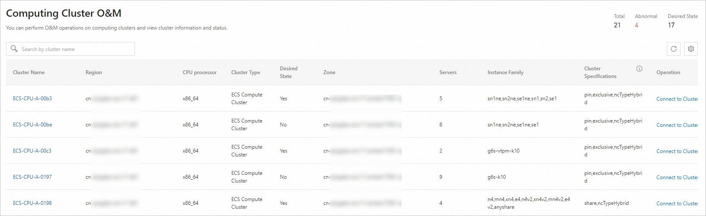

4. On the Compute Cluster O&M page, find the cluster that you want to manage and click **Connect to Cluster AG** in the **Operation** column.

5. In the dialog box that appears, read **Impact** and **Recovery Plan**, select **I have read the preceding instructions and confirm the operation**, and then click **OK**. The Terminal Service page appears.

6. In the left-side navigation pane, click ***vmXXX***. In the dialog box that appears, select the server account to be used to log in to the AG. Then, you can perform O&M operations at the right-side CLI.

   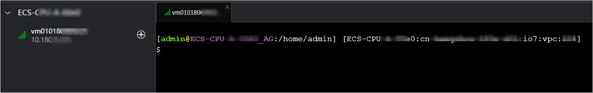

   > **Note**
   >
   > *vmXXX* indicates the VM ID.

<a id="section-2-2-3"></a>

### 2.2.3. Manage computing clusters

<a id="section-2-2-3-1"></a>

#### 2.2.3.1. Get an overview of a compute cluster

In the Compute Operations Console, you can view the details of a compute cluster on the Overview tab of the Computing Cluster Details page. The details include the basic information about the cluster, statistics about computing server resources, numbers of Elastic Compute Service (ECS) instances, distribution of physical servers by state, distribution of ECS instances by state, inventory utilization, and inventory of instances by instance type.

**Procedure**

1. Log in to the Apsara Uni-manager Operations Console.

2. In the top navigation bar, choose **Product Operation > Computing > Compute Operations Console**.

3. In the left-side navigation pane, click **Computing Cluster O&M**.

4. On the Computing Cluster O&M page, find the cluster that you want to view and click the cluster name in the **Cluster Name/Alias** column.

   By default, the **Overview** tab of the **Computing Cluster Details** page is displayed.

   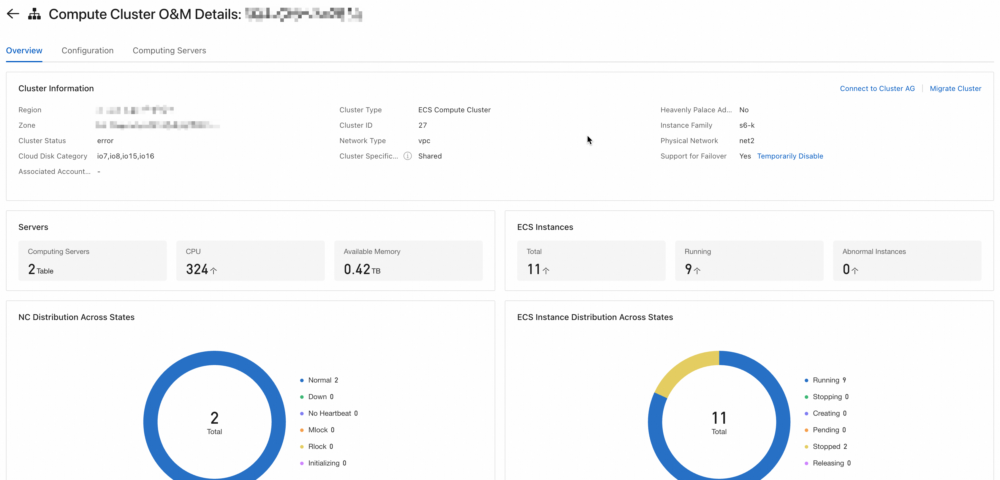

   > **Note**
   >
   > Valid values of the **Cloud Disk Category** parameter:
   >
   > - IO7: standard SSD
   >
   > - IO8: ultra disk
   >
   > - IO9: local SSD
   >
   > - IO11: local HDD
   >
   > - IO15: premium performance disk
   >
   > - IO16: standard performance disk

5. View the basic information of the compute cluster and the information about computing servers and ECS instances in the cluster.

   - In the **Cluster Information** section, view the basic information about the cluster, including the region, type, zone, and network type of the cluster, and whether the cluster is a Heavenly Palace Adapter 1.0 cluster.

     In the upper-right corner of this section, click **Connect to Cluster AG** to log on to the Admin Gateway (AG) and perform O&M on the cluster. For more information, see Log in to the AG of a cluster.

     In this section, you can modify the **Support for Failover** parameter. Default value: Yes. If you click **Temporarily Disable**, the failover feature is disabled during the countdown. After the countdown ends, the failover feature is automatically enabled.

   - In the **Servers** section, view the number of computing servers, the number of CPU cores, and the available memory.

   - In the **ECS Instances** section, view the total number of ECS instances, the number of ECS instances that are running, and the number of abnormal ECS instances.

   - In the **NC Distribution Across States** section, view the distribution of physical servers in different states.

     > **Note**
     >
     > You can move the pointer over the chart. The number of physical servers in each state is displayed.

     The following table describes the states of physical servers.

     | State | Description |
     | --- | --- |
     | Down | The physical server is down. |
     | Normal | The physical server runs as expected. You can schedule instances to the physical server. |
     | No Heartbeat | The physical server has no heartbeats. |
     | Mlock | The physical server is locked for maintenance. |
     | Rlock | The physical server is forcefully reserved and can be used to recover or modify VMs. When the resources of the physical server are insufficient, the physical server performs defragmentation. Otherwise, an alert is generated. The physical server must have heartbeats and remain available. |
     | Initializing | The physical server is being initialized. |

   - In the **ECS Instance Distribution Across States** section, view the distribution of ECS instances in different states.

     The following table describes the states of ECS instances.

     | State | Description |
     | --- | --- |
     | Running | The instance runs as expected. |
     | Stopped | After an instance is stopped or after an instance is created but not started, the instance is in the Stopped state. Instances in the Stopped state cannot provide external services. |
     | Pending | After an instance is created, the instance is in the Pending state before it enters the Running state. If the instance remains in the Pending state for an extended period of time, an exception occurs. |
     | Creating | After you start or restart an instance in the ECS console or by calling an API operation, the instance enters the Creating state before it enters the Running state. If the instance remains in the Creating state for an extended period of time, an exception occurs. |
     | Stopping | After you stop an instance in the ECS console or by calling an API operation, the instance enters the Stopping state before it enters the Stopped state. If the instance remains in the Stopping state for an extended period of time, an exception occurs. |
     | Releasing | After you release an instance, the instance enters the Releasing state before it enters the Released state. |

   - In the **Inventory Usage** section, view the total amount of resources, the amount of used resources, and the percentage of used resources in all resources.

   - In the **Inventory** section, view the inventory details of instances by instance type in the cluster. The inventories of public and dedicated resources are included.

     - All resources: include public and dedicated resources.

     - Public resources: the resources that are available to all users.

     - drp-xxxx: indicates the dedicated resources in a dedicated resource pool. The dedicated resources are available only to users who have access to the corresponding dedicated resource pool.

<a id="section-2-2-3-2"></a>

#### 2.2.3.2. Manage cluster configurations

<a id="section-2-2-3-2-1"></a>

##### 2.2.3.2.1. View cluster configurations

This topic describes how to view the configurations of a cluster, including the values of configuration items and the time when configuration items were last modified.

**Procedure**

1. Log in to the Apsara Uni-manager Operations Console.

2. In the top navigation bar, choose **Product Operation > Computing > Compute Operations Console**.

3. In the left-side navigation pane, click **Computing Cluster O&M**.

4. On the Compute Cluster O&M page, find the cluster that you want to view and click its name in the **Cluster Name/Alias** column.

   The **Overview** tab of the **Computing Cluster Details** page appears.

5. Click the **Configuration** tab.

   The **Configure CPU Oversold Ratio** tab is displayed by default.

6. Configure the CPU oversold ratio on the **Configure CPU Oversold Ratio** tab and view the CPU oversold ratio configuration records on the **CPU Oversold Ratio Configuration Records** tab.

<a id="section-2-2-3-2-2"></a>

##### 2.2.3.2.2. Configure cluster-level CPU oversold ratios

This topic describes how to change the CPU oversold ratio of a cluster. This way, the number of saleable vCPUs in a cluster can be dynamically adjusted based on your business requirements.

**Limits**

- You can change the CPU oversold ratio only at the cluster level. The CPU oversold ratio configuration feature is available only for clusters that use specific shared Elastic Compute Service (ECS) instances of the following instance families:

  - Intel processor-powered instance families: ecs.s5-k, ecs.s6-k, ecs.s7-k, and ecs.s8-k

  - Hygon processor-powered instance families: ecs.s5-hg-k, ecs.s6-hg-k, and ecs.s7-hg-k

  - Yitian processor-powered instance family: ecs.s8-yt-k

  - Kunpeng processor-powered instance family: ecs.s5-kp-k

  - Phytium processor-powered instance families: ecs.s5-ft-k and ecs.s6-ft-k

  - Custom instance family: ecs.anyshare (If only instances of the ecs.anyshare instance family are available for a cluster, the CPU oversold ratio of the cluster cannot be changed.)

- The CPU resources of offline servers in a cluster are unavailable for changing the CPU oversold ratio of the cluster.

- You cannot change the CPU oversold ratio of a cluster that is being scaled.

- You can change the CPU oversold ratio of a cluster only if at least one server in the cluster is in the free state.

- You can change the CPU oversold ratio of each cluster only once within 3 hours.

**Usage notes**

- Before you change the CPU oversold ratio of a cluster, the system checks whether the CPU oversold ratios of all servers in the cluster are the same. If the CPU oversold ratios of the servers are different, the system does not allow you to change the CPU oversold ratio of the cluster.

- When you change the CPU oversold ratio of a cluster, a precheck task is initiated. If the precheck task fails, you cannot change the CPU oversold ratio of the cluster. In this case, you must handle the error based on the failure message reported by the precheck task, and then change the CPU oversold ratio of the cluster again. You can change the CPU oversold ratio of a cluster only once within 3 hours. This limit does not apply to the precheck task.

- When you change the CPU oversold ratio of a cluster, the CPU oversold ratios of dedicated hosts associated with the cluster are not affected. The following specific rules apply:

  - After you change the CPU oversold ratio of a cluster, the number of saleable vCPUs of a dedicated host remains unchanged.

  - After a dedicated host is released, the number of saleable vCPUs of the dedicated host is recalculated based on the CPU oversold ratio that you last configured for the cluster.

- When you reduce the CPU oversold ratio of a cluster, the system checks whether **the current number of used vCPUs** is greater than 80% of **the number of saleable vCPUs in the cluster after the reduction**. If yes, you cannot reduce the CPU oversold ratio of the cluster.

- A high CPU oversold ratio may cause performance degradation issues, such as extended response time, intensified resource contention, and host instability. Proceed with caution.

- After you change the CPU oversold ratio of a cluster, you can view the details of the change on the **CPU Oversold Ratio Configuration Records** tab. An extended period of time is required to complete the change. You cannot terminate, cancel, or roll back the change.

- The CPU oversold ratio change may fail on specific servers. In this case, you can contact O&M engineers to change the CPU oversold ratios of these servers in the Emergency Operation Command Center (EOCC).

- If you change the cluster-level CPU oversold ratio of a cluster, the CPU oversold ratios of physical machines that are added to dedicated resource pools remain unchanged. After the physical machines are removed from the dedicated resource pools, the CPU oversold ratios of the physical machines change to the new cluster-level CPU oversold ratio.

**Procedure**

1. Log in to the Apsara Uni-manager Operations Console.

2. In the top navigation bar, choose **Product Operation** > **Computing** > **Compute Operations Console**.

3. In the left-side navigation pane, click **Compute Cluster O&M**.

4. On the Compute Cluster O&M page, find the cluster that you want to manage and click its name to go to the **Computing Cluster O&M Details** page.

5. On the Computing Cluster O&M Details page, click the **Configuration** tab.

6. On the **Configure CPU Oversold Ratio** tab, change the CPU oversold ratio of the cluster. Enter your reason for this change in the **Reason** field, select **I have read the preceding notes and want to perform the operation.**, and then click **Submit**.

7. On the **CPU Oversold Ratio Configuration Records** tab, view the records of CPU oversold ratio changes.

   You can configure the **Task Type** parameter to filter the records, and view the information about the records in the following columns: **Task ID**, **Cluster Name**, **Task Status**, **Task Type**, **Pre-change vCPUs per Server**, **Post-change vCPUs per Server**, **Task Start Time**, **Task End Time**, and **Result**.

**FAQ**

**What do I do if the CPU oversold ratios of servers are different in a cluster?**

You are not allowed to change the CPU oversold ratio of a cluster if the CPU oversold ratios of servers are different in the cluster. This may occur due to the following causes:

1. You changed the CPU oversold ratios of specific servers in the cluster by using a command line interface (CLI).

2. You changed the CPU oversold ratios of servers in the cluster in a visualized manner. However, the CPU oversold ratios of specific servers failed to be changed due to exceptions.

If you failed to change the CPU oversold ratio of a cluster due to inconsistent CPU oversold ratios of servers in the cluster, contact O&M engineers to change the CPU oversold ratios of all servers to the same value in the EOCC.

**What do I do if the number of unused vCPUs on specific servers is negative?**

When you reduce the CPU oversold ratio of a cluster, the system only checks whether the number of used vCPUs of the entire cluster instead of individual servers exceeds the threshold. As a result, the number of unused vCPUs on specific servers may be negative. In this case, you can perform hot or cold migration to move some ECS instances to other servers.

<a id="section-2-2-3-3"></a>

#### 2.2.3.3. Manage computing servers

<a id="section-2-2-3-3-1"></a>

##### 2.2.3.3.1. View computing servers

This topic describes how to view computing servers in a computing cluster and how to view the details of each computing server. The details include the basic server information, O&M details, and information about Elastic Compute Service (ECS) instances that are deployed on the server.

**Procedure**

1. Log in to the Apsara Uni-manager Operations Console.

2. In the top navigation bar, choose **Product Operation > Computing > Compute Operations Console**.

3. In the left-side navigation pane, click **Computing Cluster O&M**.

4. On the Compute Cluster O&M page, find the cluster that you want to view and click its name in the **Cluster Name/Alias** column.

   The **Overview** tab of the **Computing Cluster Details** page appears.

5. On the Computing Cluster Details page, click the **Computing Servers** tab.

6. View the list of computing servers.

   <ol type="i">

   <li>

   **Optional.** Modify the columns that are displayed in the computing server list.

   <ol type="a">

   <li>

   In the upper-right corner of the Computing Servers tab, click the  icon.

   </li>

   <li>

   In the **Custom Columns** list, select the columns that you want to display in the computing server list.

   </li>

   </ol>

   <ol type="i" start="100">

   <li>

   The selected columns are automatically displayed in the computing server list.

   </li>

   <li value="2">

   In the computing server list, you can view the following information: Hostname/Alias, **NC**

   </li>

   </ol>

   **IP/ID**, **Dedicated Resource Pool**, **CPU Cores/Memory**, **Model**, **Status**, **ECS Instances**, **Dedicated Host**, **SN**, and **Data Center/Rack**.

   For more information about the Status column, see Get an overview of a computing cluster.

   </li>

   </ol>

7. View O&M details of a computing server and the details of ECS instances that are deployed on the computing server.

   - View O&M details of a computing server.

     <ol type="a">

     <li>

     Click the name of a computing server in the **Hostname/Alias** column.

     </li>

     <li>

     View O&M details of the computing server on the **Computing Server Details** page.

     For more information, see View O&M details about a computing server.

     </li>

     </ol>

   - View the details of the ECS instances that are deployed on the computing server.

     <ol type="a">

     <li>

     Click the number in the **ECS Instances** column.

     </li>

     <li>

     In the **Instance List** panel, view the values in the Instance ID, Status, Instance Name, CPU, and Memory columns of each instance.

     </li>

     </ol>

     <ol type="i" start="100">

     <li>

     To view the details of an ECS instance, click the instance ID in the **Instance ID** column. The **Instance Details** page appears, which displays the basic information and configurations of the instance.

     For more information, see Query VMs.

     </li>

     </ol>

<a id="section-2-2-3-3-2"></a>

##### 2.2.3.3.2. Manage server status

This topic describes how to manage the status of computing servers (NCs) in a cluster. You can manually lock, unlock, and activate computing servers.

**Procedure**

1. Log in to the Apsara Uni-manager Operations Console.

2. In the top navigation bar, choose **Product Operation > Computing > Compute Operations Console**.

3. In the left-side navigation pane, click **Computing Cluster O&M**.

4. Find the cluster that you want to manage and click the cluster name in the **Cluster Name** column. The **Overview** tab of the **Computing Cluster Details** page appears.

5. In the upper-left corner of the page, click the **Computing Servers** tab.

6. Manage the business status of servers. The following table describes the operations that you can perform on computing servers.

   | Option | Description | Procedure |
   | --- | --- | --- |
   | Lock NC | • You can lock abnormal servers to prevent instances from being scheduled to these servers. If the servers are locked, the status of the servers cannot be automatically changed.<br>• You can also lock servers for which you want to reserve resources. | i. On the Computing Servers tab, find the server that you want to lock and click <strong>Lock NC</strong> in the <strong>Operation</strong> column.<br>ii. In the <strong>Lock NC</strong> dialog box, select a lock state and configure the Changed By, Change Ticket Title, and Reason parameters.<br>iii. Click <strong>OK</strong>. |
   | Unlock NC | You can unlock servers in the no heartbeat, mlock, and rlock states.After you unlock a server, the server is automatically activated and you can schedule instances to the server. | i. On the Compute Servers tab, find the server that you want to unlock and click <strong>Unlock NC</strong> in the <strong>Operation</strong> column.<br>ii. In the <strong>Unlock NC</strong> dialog box, enter a reason for unlocking the server.<br>iii. Click <strong>OK</strong>. |
   | Business Launch | You can activate servers in the no heartbeat, mlock, rlock, failover, and initializing states. | i. On the Computing Servers tab, find the server that you want to activate and click <strong>Business</strong> <strong>Launch</strong> in the <strong>Operation</strong> column.<br>ii. In the dialog box that appears, configure the <strong>Reason</strong> parameter.<br>iii. Click <strong>OK</strong>. |

<a id="section-2-3"></a>

## 2.3. Computing servers

<a id="section-2-3-1"></a>

### 2.3.1. Manage computing servers

<a id="section-2-3-1-1"></a>

#### 2.3.1.1. View computing servers

This topic describes how to view computing servers and the details of each computing server. The details of each computing server include the hostname, IP address, model, number of CPU cores, memory size, CPU processor, compute type, whether it is a dedicated host, business status, and compute cluster to which the computing server belongs.

**Procedure**

1. Log in to the Apsara Uni-manager Operations Console.

2. In the top navigation bar, choose **Product Operation > Computing > Compute Operations Console**.

3. In the left-side navigation pane, click **Computing Server O&M**.

   By default, the **Computing Servers** tab of the Computing Server O&M page appears. On the Computing Servers tab, you can view the details of all computing servers.

4. In the upper-right corner of the Computing Server O&M page, view the total number of computing servers and the numbers of computing servers in the **free**, **mlock**, and **nc_down** states.

5. Optional. Modify the columns that are displayed in the computing server list.

   <ol type="i">

   <li>

   In the upper-right corner of the Computing Servers tab, click the  icon.

   </li>

   <li>

   In the **Custom Columns** dialog box, select the columns that you want to display in the

   </li>

   </ol>

   computing server list.

   <ol type="i" start="3">

   <li>

   Click **OK**.

   </li>

   </ol>

6. In the upper-left corner of the Computing Servers tab, enter an IP address, a hostname, or a

   serial number in the search box and click the  icon to search for a computing server.

   You can also click **Advanced Filter** to specify filter conditions, such as a model, data center, and rack, and then click **Search**.

7. In the computing server list, view the information about each computing server in the following columns: **Hostname/Alias**, **NC IP/ID**, **CPU Cores/Memory**, **Cluster/Model**, **Dedicated Resource Pool ID**, **Service Status**, **CPU Processor**, **Compute Type**, **Dedicated Host**, **SN**, and **Data Center/Rack**.

   > **Note**
   >
   > - Valid values of the **Compute Type** parameter:
   >
   >   - CPU: provides CPU and memory resources for Elastic Compute Service (ECS) instances in the Kernel-based Virtual Machine (KVM) architecture.
   >
   >   - Local Disk: provides local storage, CPU, and memory resources for ECS instances in the KVM architecture.
   >
   >   - GPU: provides GPU, CPU, and memory resources for ECS instances in the KVM architecture.
   >
   >   - Hybrid: provides cloud storage, CPU, and memory resources for ECS instances in the KVM architecture.
   >
   >   - SHENLONG: provides CPU and memory resources for ECS instances in the SHENLONG architecture.
   >
   >   - VMOC: provides CPU and memory resources for ECS instances in the Virtual Missions Operational Center (VMOC) architecture. The VMOC architecture can be deployed on non-SHENLONG physical machines to provide computing power for ECS instances.
   >
   > - Valid values of the **Cluster Specifications** parameter:
   >
   >   - share,ncTypeHybrid: shared clusters.
   >
   >   - pin,exclusive,ncTypeHybrid: exclusive clusters.
   >
   >   - ncTypeHybrid,bareMetal: bare metal clusters.

   For more information about the Status parameter of computing servers, see Get an overview of a compute cluster.

8. View the O&M details of a computing server.

   <ol type="i">

   <li>

   Find the computing server that you want to view and click its name in the **Hostname/Alias** column.

   </li>

   <li>

   On the **Computing Server O&M** page, view the O&M information about the computing

   </li>

   </ol>

   server.

   For more information, see View O&M details about a computing server.

<a id="section-2-3-1-2"></a>

#### 2.3.1.2. View O&M details about a computing server

This topic describes how to view O&M details about a computing server. The O&M details include business information, hardware information, resource information, Elastic Compute Service (ECS) instances deployed on the computing server, performance monitoring information, control service status, server-level migration tasks (also known as machine migration tasks), and audited operations. You can perform operations on different tabs.

**Procedure**

1. Log in to the Apsara Uni-manager Operations Console.

2. In the top navigation bar, choose **Product Operation > Computing > Compute Operations Console**.

3. In the left-side navigation pane, click **Computing Server O&M**.

   By default, the **Computing Servers** tab of the Computing Server O&M page appears. On the Computing Servers tab, you can view the details of all computing servers.

4. Find the computing server that you want to view and click its name in the **Hostname/Alias** column.

5. View O&M details about the computing server on the Computing Server Details page.

   The following table describes the parameters on the page.

   | Section or tab | Description |
   | --- | --- |

   <table>
     <tr>
       <td>Business Information</td>
       <td>Displays the business information of the computing server, such as the business ID, IP address, hostname, status, management heartbeat status, selling mode, cluster name, available instance families, operating system, compute type, whether the computing server is a dedicated host, support for failover, and dedicated resource pool ID.<br>Note<br>Valid values of the <strong>Compute Type</strong> parameter:<br>• CPU: provides CPU and memory resources for Elastic Compute Service (ECS) instances in the Kernel-based Virtual Machine (KVM) architecture.<br>• Local Disk: provides local storage, CPU, and memory resources for ECS instances in the KVM architecture.<br>• GPU: provides GPU, CPU, and memory resources for ECS instances in the KVM architecture.<br>• Hybrid: provides cloud storage, CPU, and memory resources for ECS instances in the KVM architecture.<br>• SHENLONG: provides CPU and memory resources for ECS instances in the SHENLONG architecture.<br>• VMOC: provides CPU and memory resources for ECS instances in the Virtual Missions Operational Center (VMOC) architecture.The VMOC architecture can be deployed on non-SHENLONG physical machines to provide computing power for ECS instances.<br>To view the details of the computing cluster to which the computing server belongs, click the cluster name to go to the <strong>Computing Cluster Details</strong> page. For more information, see Get an overview of a computing cluster.</td>
     </tr>
     <tr>
       <td>Hardware Information</td>
       <td>Displays the hardware information of the computing server, such as its SN, model, rack, CPU model, GPU, number of vCPUs, and memory size.</td>
     </tr>
     <tr>
       <td>Resource Information</td>
       <td>Displays the vCPUs and memory usage of the computing server.</td>
     </tr>
     <tr>
       <td>ECS Instances</td>
       <td>• Displays the list of ECS instances deployed on the computing server and the details of each instance, including the number of vCPUs, memory size, status, dedicated resource pool ID, private IP address or elastic IP address (EIP), bandwidth, user information, image, creation time, and whether the instance is available for Heavenly Palace Adapter.<br>• You can migrate an instance, view its migration history or operation audit information, change its status or internal bandwidth, and manage its ISO.For more information, see ECS instances.</td>
     </tr>
     <tr>
       <td>Performance Monitoring</td>
       <td>Displays the trend charts of the following performance metrics over a period of time: CPU (%), memory (%), system load, network retransmission (%), and network traffic (MiB). You can set a start time and an end time in the Time Range field to specify a time range.</td>
     </tr>
     <tr>
       <td>Control Services</td>
       <td>• Displays server roles and their status.<br>• You can click <strong>Apsara Infrastructure Management Framework</strong> in the <strong>Operation</strong> column of a server role to view its information on the <strong>Project</strong> <strong>&amp; Cluster O&amp;M</strong> page. For more information, see <strong>Product and cluster</strong> <strong>O&amp;M</strong> in <em>Apsara Stack Operations and Maintenance Guide</em>.</td>
     </tr>
     <tr>
       <td>Machine Migration Tasks</td>
       <td>• Displays the list of server-level migration tasks and the details of each task, including the task ID, number of migrated instances, destination physical machine, task status, migration progress, start time, update time, and task creator.<br>• You can click Details in the Operation column of a server-level migration task to view its details, such as the task status, destination physical machine, migration type, and number of retries, in the panel that appears.<br>Note<br>• Cold migration: migrates instances in the Pending state.<br>• Hot migration: migrates instances in the Running state.<br>• You can click <strong>Terminate Task</strong> in the <strong>Operation</strong> column of a server-level migration task to cancel the task. In the message that appears, click <strong>OK</strong>.For more information, see Stop a migration task.</td>
     </tr>
     <tr>
       <td>Operation Audit</td>
       <td>Displays information about audited operations. During the O&amp;M process of the computing server, all operations that may cause risks are audited. You can view the historical operations in the Apsara Uni-manager Operations Console, historical POP API calls, and historical server controller API calls for the computing server. For more information, see Audit logs.</td>
     </tr>
   </table>

<a id="section-2-3-1-3"></a>

#### 2.3.1.3. Diagnose a computing server

This topic describes how to diagnose a computing server and view the diagnostic results.

**Procedure**

1. Log in to the Apsara Uni-manager Operations Console.

2. In the top navigation bar, choose **Product Operation > Computing > Compute Operations Console**.

3. In the left-side navigation pane, click **Computing Server O&M**.

   By default, the **Computing Servers** tab of the Computing Server O&M page appears. On the Computing Servers tab, you can view the details of all computing servers.

4. Click the server name in the **Hostname/Alias** column.

5. In the upper-right corner of the **Computing Server O&M** page, click **Diagnose**. The **End-to-end Demarcation** page appears. By default, the NC IP address of the host is entered in the **Machine ID** field.

6. View the diagnostics information of the ECS instance or host.

   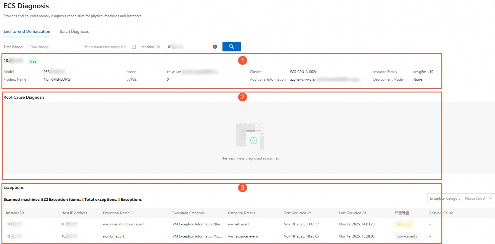

   | Section | Content | Description |
   | --- | --- | --- |
   | 1 | Basic information | The basic information of the diagnostic object, such as the model, cluster, and instance family. |

   <table>
     <tr>
       <td>2</td>
       <td>Diagnostic results</td>
       <td>The types and diagnostic information of exceptions.<br>Types of exceptions:<br>• <strong>Console Exception</strong>: affects user operations, such as starting instances, stopping instances, migrating instances, and creating snapshots.<br>• <strong>NC Exception</strong>: affects host availability. For example, this type of exception may cause service failures.<br>• <strong>NC Performance Exception</strong>: may affect host performance. For example, this type of exception may cause L3 cache misses, memory bandwidth contention, and an increase in the number of tdc retries.<br>• <strong>VM Availability Exception</strong>: affects the availability of ECS instances. For example, this type of exception may cause read/write failures on disks and service failures.<br>• <strong>VM Performance Exception</strong>: affects the performance of ECS instances. For example, this type of exception may cause packet loss based on throttling or security group settings.<br>Diagnostic information includes host information, exception information, and exception causes. You can click links to view details.</td>
     </tr>
     <tr>
       <td>3</td>
       <td>Exception list</td>
       <td>The list of exceptions that are related to the diagnostic object.</td>
     </tr>
   </table>

<a id="section-2-3-1-4"></a>

#### 2.3.1.4. Lock physical machines

You can lock physical machines based on your business requirements. If a physical machine is locked, you cannot create instances on it.

**Background information**

Common scenarios in which physical machines are locked:

- mlock: If a physical machine is locked and enters the mlock state, Elastic Compute Service (ECS) instances on it are restarted and scheduled to other physical machines, excluding the instances for which failover is disabled.

- rlock: If normal physical machines do not meet the failover requirements, the physical machines in the rlock state are used to restore instances that fail.

**Procedure**

1. Log in to the Apsara Uni-manager Operations Console.

2. In the top navigation bar, choose **Product Operation > Computing > Compute Operations Console**.

3. In the left-side navigation pane, click **Computing Server O&M**.

   By default, the **Computing Servers** tab of the Computing Server O&M page appears. On the Computing Servers tab, you can view the details of all computing servers.

4. Find the physical machine that you want to lock and click **Lock** in the **Operation** column.

5. In the **Lock NC** dialog box, confirm the physical machine and configure the **Lock Status**, **Operated By**, **Change Ticket Title**, and **Reason** parameters.

   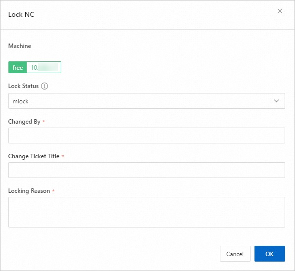

6. Click **OK**.

<a id="section-2-3-1-5"></a>

#### 2.3.1.5. Unlock a computing server

You can unlock a computing server to allow the server to be scheduled. After you unlock a computing server, the server is automatically activated and you can schedule instances to the server.

**Background information**

You can unlock computing servers that are in the No Heartbeat, mlock, and rlock states.

**Procedure**

1. Log in to the Apsara Uni-manager Operations Console.

2. In the top navigation bar, choose **Product Operation > Computing > Compute Operations Console**.

3. In the left-side navigation pane, click **Computing Server O&M**.

   By default, the **Computing Servers** tab of the Computing Server O&M page appears. On the Computing Servers tab, you can view the details of all computing servers.

4. Find the computing server that you want to unlock, move the pointer over the

   icon in

   

   the **Operation** column, and then click **Unlock**.

5. In the **Unlock NC** dialog box, confirm the **Machine** information and enter a **Reason** for the operation.

   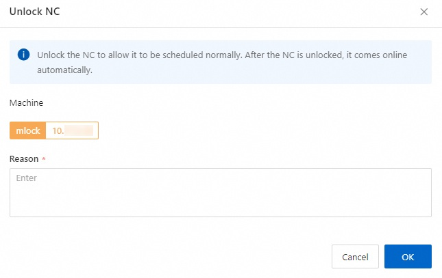

6. Click **OK**.

<a id="section-2-3-1-6"></a>

#### 2.3.1.6. Activate a computing server

This topic describes how to activate a computing server.

**Prerequisites**

The computing server that you want to activate is in the **mlock** state.

**Background information**

You can activate computing servers that are in the mlock, rlock, no heartbeat, nc_down, and initializing states.

**Procedure**

1. Log in to the Apsara Uni-manager Operations Console.

2. In the top navigation bar, choose **Product Operation > Computing > Compute Operation Console**.

3. In the left-side navigation pane, click **Computing Server O&M**.

   By default, the **Computing Servers** tab of the Computing Server O&M page appears. On the Computing Servers tab, you can view the details of all computing servers.

4. Find the computing server that you want to activate, move the pointer over the  icon in

   the **Operation** column, and then select **Activate**.

5. In the dialog box that appears, confirm the hostname and enter the reason.

6. Then, click **OK**.

<a id="section-2-3-1-7"></a>

#### 2.3.1.7. Migrate all instances from a computing server

This topic describes how to migrate all Elastic Compute Service (ECS) instances on a computing server to another computing server.

**Prerequisites**

The computing server is in the  `free`  or  `mlock`  state.

**Scenarios**

When you scale down or maintain a computing server, you must migrate all ECS instances on the server to another computing server first and then perform subsequent operations. In this case, you can create a computing server-level migration task to migrate all ECS instances on the server to another computing server.

**Usage notes**

When you migrate all ECS instances from a computing server, take note of the following items:

- After you submit a computing server-level migration task, the state of the computing server changes to mlock. If the migration task is complete, fails, or is canceled, you must submit an application to unlock the computing server.

- ECS instances on the computing server are migrated to another computing server based on the ECS scheduling rules. The migration task may not be successful in a single attempt due to various reasons.

- If an ECS instance in the **Stopped** or **Pending** state is migrated, the status of the ECS instance remains unchanged.

- After the migration task is complete, you must check whether all ECS instances are migrated.

- Instances in a dedicated resource pool (DRP) can be migrated only within the DRP.

**Procedure**

> **Note**
>
> You can also create a computing server-level migration task on the **Machine Migration Tasks** tab on the **Tasks** tab of the **Migration Tasks** page. For more information, see Create a computing server-level migration task.

1. Log in to the Apsara Uni-manager Operations Console.

2. In the top navigation bar, choose **Product Operation > Computing > Compute Operations Console**.

3. In the left-side navigation pane, click **Computing Server O&M**.

   By default, the **Computing Servers** tab of the Computing Server O&M page appears. On the Computing Servers tab, you can view the details of all computing servers.

4. On the Machines tab, find the server from which you want to migrate ECS instances, move the pointer over the

   icon in the **Operation** column, and then select **Migrate All**

   

   **Instances**.

   You can also create a computing server-level migration task for the server by using one of the following methods:

   - Select the server and click **Migrate All Instances** in the lower part of the server list.

   - Click the hostname of the server. In the upper-right corner of the **Computing Server Details** page, click **Migrate All Instances**.

5. On the **Create Machine Migration Task** page, configure the parameters that are described in the following table.

   **Section**

   **Parameter**

   **Description**

   The computing server from which you want to migrate all ECS instances. Enter a hostname, a server IP address, or a server ID in the search box to search for a server, and then select it.

   **Source NC**

   **Select Machine**

   > **Important**
   >
   > You can select only one server.

   Specifies whether to enable phased migration. If you enable phased migration, the migration task stops after a batch of instances is migrated based

   **Enable Phased**

   on the phased migration configurations. To

   **Migration**

   migrate the rest of the selected instances, you must resume the task. For more information about how to modify phased configurations, see Configure migration constraints.

   Specifies whether to enable the enhanced hot migration compatibility mode. This mode allows

   **Enhanced Hot**

   you to migrate ECS instances to an available

   **Migration**

   physical server with a different CPU model. For

   **Compatibility**

   more information about the CPU compatibility, see View CPU compatibility configurations.

   - **Random Selection**: migrates ECS instances to a random physical server that has sufficient resources. This is the default value.

   - **Specify NC**: migrates ECS instances to a specific server. If you select this policy, the migration may fail. To specify the destination

   **Migration**

   server, search for the server by cluster,

   **Destination**

   hostname, server IP address, or server ID and

   **Configurations**

   then select the server in the server list.

   > **Note**
   >
   > The system provides suggestions on whether each physical server is suitable for migration. The suggestions are for reference only. You can select a physical server that is **not recommended** based

   **Destination**

   > on your business requirements.

   **Selection Policy**

   - **Specify Cluster**: migrates ECS instances to a specific cluster. If you select this policy, the migration may fail. To specify the destination cluster, search for the cluster by name and then select it in the cluster list.

     > **Note**
     >
     > The system provides suggestions on whether each cluster is suitable for migration. The suggestions are for reference only. You can select a cluster that is **not recommended** based on your business requirements.

   The service interruption duration in the last phase of hot migration. Unit: milliseconds.

   **Allowed Service Interruption**

   - Valid values: 200 to 2000.

   **Duration**

   - Default value: 300.

   - Specifies whether to check Server Load Balancer (SLB) instance attachment status. Valid values:

     - **Yes**: checks whether the ECS instances to be migrated are associated with SLB instances.

   **Check SLB**

   If yes, the migration task may fail.

   - **No**: does not check whether the ECS instances are associated with SLB instances.

   - Default value: **No**.

   - Specifies whether to check the consistency of the application virtual switch (AVS) versions. Valid values:

   **Advanced Migration Parameters**

   - **Yes**: checks whether the AVS versions of the

   **Check AVS**

   source and destination hosts are the same. If

   **Version**

   not, the migration task fails.

   > **Note**

   - **No**: does not check the AVS versions and

   > - You can

   proceeds with migration.

   > configure advanced

   - Default value: **Yes**.

   > migration parameters based on

   - Specifies whether to check the support status

   > your

   of hot migration in the virtualization version on

   > business

   the destination host. Valid values:

   > requiremen ts to

   - **Yes**: checks whether the virtualization

   > increase

   version of the destination host supports hot

   **Check Virtual NC**

   > the success

   migration. If not, the migration task fails.

   **Version**

   > rate of instance

   - **No**: does not check the virtualization version

   > migration.

   and proceeds with the migration.

   > - You can

   - Default value: **Yes**.

   > click **Configurat ion**

   - Specifies whether the instances can be

   > **Descriptio**

   migrated to a reserved host. Valid values:

   > **n** to view the

   - **Yes**: allows the instances to be migrated to a

   > parameter

   **Allow Reserved**

   reserved host.

   > descriptions

   **NC**

   > in this

   - **No**: does not allow the instances to be

   > section.

   migrated to a reserved host.

   - Default value: **No**.

   - Specifies whether to check the CPU tags of the source host. Valid values:

     - **Yes**: checks whether the CPU tags of the source host are included in the CPU tags of the destination host. If not, the migration

   **Check CPU Tag**

   task fails.

   - **No**: does not check the CPU tags and proceeds with the migration.

   - Default value: **Yes**.

   - Specifies whether to check the images used by the instances support hot migration. Valid values:

     - **Yes**: checks whether the images used by the instances support hot migration. If not, the

   **Check Image.**

   migration task fails.

   - **No**: does not check whether the images used by the instances support hot migration.

   - Default value: **Yes**.

   **Operation**

   **Reason**

   The reason for computing server-level migration.

   **Information**

6. Select **I have read the preceding notes and confirm this operation.** and click **Submit**.

   - You can view the status and progress of the migration task in the task list. For more information, see View migration tasks.

   - You can stop the migration task if it is no longer needed. For more information, see Stop a migration task.

<a id="section-2-3-1-8"></a>

#### 2.3.1.8. Deactivate a physical machine for maintenance

This topic describes how to take a physical machine, also known as a computing server, out of service for maintenance by deactivating the physical machine.

**Prerequisites**

At least two physical machines exist in the computing cluster to which the physical machine that you want to deactivate belongs. For information about how to view physical machines in a cluster, see View computing servers.

**Scenarios**

If you cannot repair the fault in a physical machine at the software level and must deactivate the physical machine for maintenance, notify your customer at the earliest opportunity, deactivate and repair the physical machine on site with the approval of the customer, and then reactivate the physical machine to put the physical machine back into service in the computing cluster to which the physical machine belonged before it was deactivated.

You can deactivate physical machines only in computing clusters (CPU clusters and SHENLONG clusters) for maintenance, not physical machines in Hybrid, GPU, SCC, or SCC+RDMA clusters.

> **Note**
>
> On the **Computing Servers** tab of the **Computing Server O&M** page, you can view the cluster for each physical machine in the **Cluster** column. CPU cluster names are in the  `ECS-CPU-X-XXXX`  format, and MOC cluster names are in the  `ECS-MOC-X-XXXX`  format.

**Considerations**

Before you deactivate a physical machine for maintenance, take note of the following items:

- When you deactivate a physical machine for maintenance, the Elastic Compute Service (ECS) instances that reside on the deactivated physical machine are automatically migrated to other physical machines in the same cluster as the deactivated physical machine. After the physical machine is repaired and put back into service, the physical machine is automatically added to the cluster to which it belonged before it was deactivated.

  > **Warning**
  >
  > Service interruptions may occur during the instance migration process. Deactivate the physical machine during off-peak hours.

- If the destination physical machines to which the ECS instances are migrated have insufficient resources or encounter other issues, the migration fails. In this case, navigate to the Physical Machine Maintenance page in the Compute Operations console, find the physical machine that you want to deactivate, and then click Details in the Operation column. On the maintenance details page of the physical machine, click **Retry** below **Step3: ncMaintenanceMigrateEcsInstance**. If the retry fails, you must manually migrate the ECS instances away from the physical machine. After you manually migrate the ECS instances, go back to the maintenance details page of the physical machine and click **Retry** below **Step3: ncMaintenanceMigrateEcsInstance** to continue deactivating the physical machine. For information about how to migrate ECS instances, see Migrate all instances from a computing server or Migrate an instance.

**Procedure**

1. Log in to the Apsara Uni-manager Operations Console.

2. In the top navigation bar, choose **Product Operation > Computing > Compute Operations Console**.

3. In the top navigation bar, select an organization, resource group, and region.

4. Create a Deactivate for Maintenance task.

   <ol type="i">

   <li>

   In the left-side navigation pane, click **Computing Server O&M**.

   By default, the **Computing Servers** tab of the Computing Server O&M page appears. On the Machines tab, you can view the details of all computing servers.

   </li>

   <li>

   On the Machines tab, find the physical machine that you want to deactivate for

   </li>

   </ol>

   maintenance. In the **Operation** column, choose

   **> Deactivate for Maintenance**.

   

   <ol type="i" start="3">

   <li>

   In the **Deactivate for Maintenance** dialog box, confirm the information of the physical

   </li>

   </ol>

   machine, including the **Hostname** and **Cluster** parameters, and configure the **Reason** and **Operator** parameters.

   <ol type="i" start="4">

   <li>

   Click **OK**.

   </li>

   </ol>

5. On the **Physical Machine Maintenance** page, find the physical machine and click **Details** in the **Operation** column.

   In the **Basic Information** section of the page that appears, you can view the IP address, maintenance event ID, and maintenance status of the physical machine.

6. In the **Execution Information** section, view the procedure of deactivating the physical machine for maintenance.

   If **Step5: offlineEcsNc** is complete, the physical machine is deactivated in its cluster and you can repair the physical machine.

   > **Note**
   >
   > Take note of the following steps in the deactivation procedure:
   >
   > - **Step1: ncOfflinePreCheck**: If the physical machine does not meet the requirements for deactivation, the physical machine fails the check.
   >
   > - **Step3: ncMaintenanceMigrateEcsInstance**: If the ECS instances fail to be migrated away from the physical machine, we recommend that you click **Retry** below **Step3: ncMaintenanceMigrateEcsInstance** to migrate the instances again. You can also manually migrate the ECS instances and then click **Retry** below **Step3: ncMaintenanceMigrateEcsInstance**. For information about how to migrate ECS instances, see Migrate all instances from a computing server or Migrate an instance.
   >
   > - **Step4: offlineTianjiNc**: This step takes the physical machine out of service in Apsara Infrastructure Management and requires an extended period of time to complete. View the status of the physical machine in the Apsara Infrastructure Management console.

7. After confirming that maintenance on the target physical machine is complete, click **Maintenance Step Completed** in the **Step 6: Wait For Maintenance Completion Confirmation** section of the maintenance details page. Then, in the dialog box that appears, click **OK**.

   The procedure of deactivating the physical machine for maintenance is automatically executed. When **Step9: Finish** is complete, the procedure is complete and the physical machine is automatically added back to its original computing cluster.

   > **Note**
   >
   > If **Step8: expandTianjiClusterMachineExternal** remains in the **Waiting** (**rolling**) state, check the status and the **rolling** progress of the computing cluster to which the physical machine belongs.

<a id="section-2-3-1-9"></a>

#### 2.3.1.9. View audit logs

Server O&M operations that may introduce risks are audited. You can view the historical operations in the Apsara Uni-manager Operations Console, historical POP API calls, and historical server controller API calls for a computing server.

**Procedure**

1. Log in to the Apsara Uni-manager Operations Console.

2. In the top navigation bar, choose **Product Operation > Computing > Compute Operations Console**.

3. In the left-side navigation pane, click **Computing Server O&M**.

   By default, the **Computing Servers** tab of the Computing Server O&M page appears. On the Computing Servers tab, you can view the details of all computing servers.

4. Find the computing server for which you want to view audit logs and click **Audit Operations** in the **Operation** column.

5. In the **Audit Operations** panel, view audit logs. For more information, see View O&M audit logs.

<a id="section-2-3-2"></a>

### 2.3.2. View computing server-level migration tasks

After you run a task to migrate all instances from a computing server, you can check the progress and result of the migration task. You can also view the details of all instances and O&M details about the computing server involved in the migration task.

**Procedure**

> **Note**
>
> You can also view a computing server-level migration task on the **Machine Migration Tasks** tab on the **Tasks** tab of the **Migration Task Management** page. For more information, see View migration tasks.

1. Log in to the Apsara Uni-manager Operations Console.

2. In the top navigation bar, choose **Product Operation > Computing > Compute Operations Console**.

3. In the left-side navigation pane, click **Computing Server O&M**.

   By default, the **Computing Servers** tab of the Computing Server O&M page appears. On the Computing Servers tab, you can view the details of all computing servers.

4. On the **Server-level Migration Tasks** tab, find the computing server-level migration task that you want to manage and view its details in the migration task list.

   The following table describes the corresponding parameters. You can search for migration tasks by task ID or source physical server ID.

   > **Note**
   >
   > If the migration task fails, we recommend that you go to the details page of the corresponding source server and click **Migrate All Instances** to re-run the migration task.

   | Parameter | Description |
   | --- | --- |
   | Task ID | The ID of the migration task. |
   | Source NC ID and IP Address | The ID and IP address of the source physical machine from which ECS instances are migrated. |
   | Instances | The number of migrated ECS instances. |
   | Task Status | The status of the cluster-level migration task. Valid values:<br>• running<br>• canceled<br>• partial-success<br>• init<br>• paused<br>• create ecs migration task<br>• success<br>• scheduled<br>• failed<br>• create failed |
   | Task Success Rate | The success rate of the cluster-level migration task, which is calculated by using the following formula:<br>Success rate of a migration task = (Number of successful subtasks/Total number of subtasks) × 100% |
   | Destination Selection Policy | The policy used to select a destination server. The policy that you specified when you created the migration task is displayed. For information about how to select a destination selection policy for a computing server-level migration task, see Migrate all instances from a computing server. |
   | Destination Information | The destination physical machine or cluster to which the ECS instances are migrated. |
   | Task Result | The execution result of the migration task. A value of <code> all ecs </code> <code>migrate tasks belong to this task success! </code> indicates that the machine migration task is successful. |
   | Created Time | The time when the migration task was created. |
   | Updated At | The time when the migration task was updated. |
   | Migration Reason | The reason for creating the migration task. |
   | Operator | The account used to create the migration task. |
   | Operation | • Click <strong>Details</strong> to view information about the computing server-level migration task in the task details panel. The task details panel consists of the following sections:<br>• Basic Information: This section displays the basic information about the migration task, such as the task ID, number of Elastic Compute Service (ECS) instances, and task status.<br>• Instances: This section displays a list of ECS instances involved in the migration task. For more information about the parameters in the instance list, see the "View ECS migration tasks" step in the "Procedure" section of the View migration tasks topic.<br>Note<br>Each entry displayed in the instance list is a subtask of the machine migration task. Each subtask migrates an ECS instance. The information about each subtask is also displayed on the <strong>ECS Migration Tasks</strong> tab. On this tab, you can search for a subtask by ECS instance ID.<br>• Click <strong>Terminate Task</strong> to stop the computing server-level migration task. For more information about the usage notes and limits that apply when you stop a migration task, see Stop a migration task. |

<a id="section-2-3-3"></a>

### 2.3.3. ECS physical machine O&M

You can use the Elastic Compute Service (ECS) physical machine O&M feature to create and view physical machine maintenance tasks. Physical machines can be shut down or scaled in for maintenance.

**Scenarios**

If a physical machine cannot be repaired at the software level, you must notify your customer at the earliest opportunity and obtain approval before you can repair the physical machine on site. The following O&M types are available for physical machine maintenance.

| O&amp;M type | Description | Scenario |
| --- | --- | --- |
| Clone and Shut Down | When a physical machine is shut down for maintenance, ECS instances on the physical machine are automatically migrated to other physical machines in the same cluster. After the physical machine is repaired and activated, it is automatically added back to the original compute cluster. The ECS instances migrated before the maintenance are not migrated back to the physical machine. | The physical machine requires replacement of the system disk and SSD cache disk. |
| Shut down and Repair | After the physical machine is repaired and put back into service, it is automatically added to the compute cluster to which it belonged before it was deactivated. | The physical machine requires replacement of memory, CPU, network interface controller (NIC), motherboard, power supply, or fans. |
| Scale In | When a physical machine is scaled in, ECS instances on the physical machine are automatically migrated to other physical machines in the same cluster. After the physical machine is repaired and activated, it is not added back to the original compute cluster. The ECS instances migrated before the maintenance are not migrated back to the physical machine. | The physical machine needs to be removed from the original cluster. |

**Limits**

Only physical machines in compute clusters (CPU clusters and MOC clusters) are supported.

> **Note**
>
> On the **Computing Servers** tab of the **Computing Server O&M** page, you can view the names of clusters in the **Cluster** column. CPU clusters are named in the  `ECS-CPU-X-XXXX`  format, and MOC clusters are named in the  `ECS-MOC-X-XXXX`  format.

**Usage notes**

- Service interruptions may occur during the instance migration process. We recommend that you deactivate the physical machine during off-peak hours.

- If the destination physical machines to which the ECS instances are migrated have insufficient resources or encounter other issues, the migration fails. In this case, go to the Physical Machine Maintenance Events page, find the physical machine that you want to deactivate, and then click Details in the Operation column. On the maintenance details page of the physical machine, click **Retry** below **Step3: ncMaintenanceMigrateEcsInstance**. If the retry fails, you must manually migrate the ECS instances from the physical machine. After you manually migrate the ECS instances, go back to the maintenance details page of the physical machine and click **Retry** below **Step3: ncMaintenanceMigrateEcsInstance** to continue deactivating the physical machine. For more information about how to manually migrate an ECS instance, see Create an ECS migration task.

**Procedure**

1. Log in to the Apsara Uni-manager Operations Console.

2. In the top navigation bar, choose **Product Operation** > **Computing** > **Compute Operations Console**.

3. In the left-side navigation pane, click **Computing Server O&M**.

   By default, the **Computing Servers** tab of the Computing Server O&M page appears. On the Computing Servers tab, you can view the details of all computing servers.

4. Click the ECS Physical Machine O&M tab. Then, click **Create Physical Machine Maintenance Event** to create a physical machine maintenance task.

   > **Note**
   >
   > To create a physical machine maintenance task, you can also click **Deactivate for Maintenance** for a physical machine on the **Computing Servers** tab of the **Computing Server O&M** page.

5. In the dialog box that appears, configure the parameters described in the following table and click **OK**.

   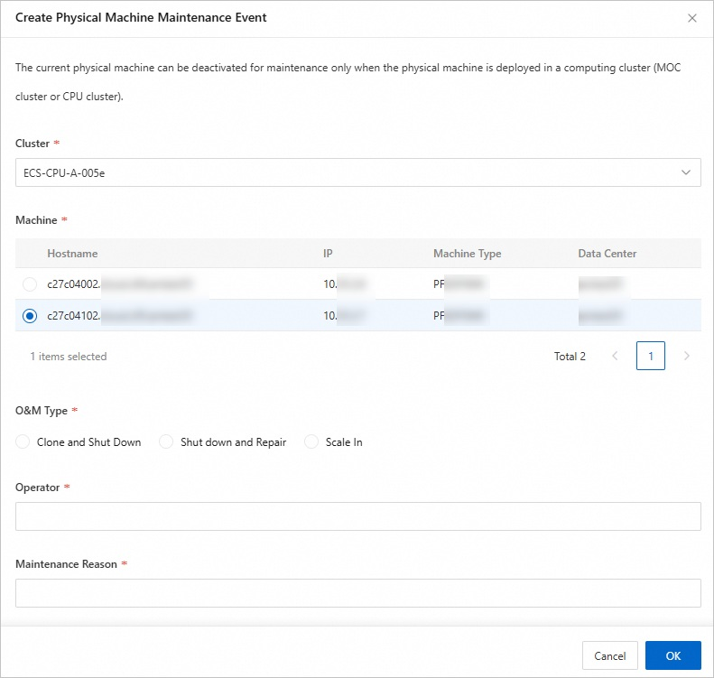

   | Parameter | Description |
   | --- | --- |
   | Cluster | Select the cluster to which the physical machine that you want to deactivate for maintenance belongs. You can select only a CPU or MOC cluster. |
   | Machine | Select the physical machine that you want to deactivate for maintenance. |
   | O&amp;M Type | <strong>Clone and Shut Down</strong>, <strong>Shut down and Repair</strong>, and <strong>Scale In</strong> are supported. |
   | Operator | Enter the name of the operator who deactivates the physical machine for maintenance. |
   | Maintenance Reason | Enter the reason for deactivating the physical machine for maintenance. |

6. View information about the physical machines that are deactivated for maintenance in the following columns: **Hostname**, **Maintenance Event ID**, **IP**, **Original Cluster**, **Maintenance Reason**, **Maintenance Status**, **Initiated At**, **Rack**, and **Operator**.

7. To view the maintenance details of a physical machine, click **Details** in the **Operation** column.

   - In the **Basic Information** section, view the following parameters: **Physical Machine IP Address**, **Maintenance Event ID**, **Current Step**, **Maintenance Status**, **Start Time**, **End Time**, and **Original Cluster**.

   - In the **Execution Information** section, view the procedure of deactivating the physical machine for maintenance.

     | O&amp;M type | Maintenance process |
     | --- | --- |
     | Clone and Shut Down | <strong>ncOfflinePreCheck</strong> &gt; <strong>ncMaintenanceLockNc</strong> &gt; <strong>ncMaintenanceMigrateEcsInstance</strong> &gt; <strong>offlineTianjiNc</strong> &gt; <strong>offlineEcsNc</strong> &gt; <strong>AsoAuthorizationWork</strong> &gt; <strong>expandTianjiClusterMachinePreCheck</strong> &gt; <strong>expandTianjiClusterMachineExternal</strong> &gt; <strong>Finish</strong> |
     | Shut down and Repair | <strong>ncOfflinePreCheck</strong> &gt; <strong>ncMaintenanceLockNc</strong> &gt; <strong>ncMaintenanceMigrateEcsInstance</strong> &gt; <strong>powerOffTianjiNc</strong> &gt; <strong>AsoAuthorizationWork</strong> &gt; <strong>powerOnTianjiNc</strong> &gt; <strong>Finish</strong> |

     | Scale In | <strong>ncOfflinePreCheck</strong> &gt; <strong>ncMaintenanceLockNc</strong> &gt; <strong>ncMaintenanceMigrateEcsInstance</strong> &gt; <strong>offlineTianjiNc</strong> &gt; <strong>offlineEcsNc</strong> &gt; <strong>Finish</strong> |
     | --- | --- |

     > **Note**
     >
     > During the physical machine offline process, pay attention to the following steps:
     >
     > - **ncOfflinePreCheck**: If the physical machine does not meet the requirements for deactivation, this step fails.
     >
     > - **ncMaintenanceMigrateEcsInstance**: If the ECS instances fail to be migrated from the physical machine, this step fails. In this case, we recommend that you click **Retry** below **ncMaintenanceMigrateEcsInstance** to migrate the instances again. You can also manually migrate the ECS instances and then click **Retry** below **ncMaintenanceMigrateEcsInstance**. For more information about how to manually migrate an ECS instance, see Create an ECS migration task.
     >
     > - **offlineTianjiNc**: This step takes the physical machine out of service in Apsara Infrastructure Management and requires an extended period of time to complete. View the status of the physical machine in the Apsara Infrastructure Management console.
     >
     > - When the **offlineEcsNc** step is complete, the physical machine is deactivated in its cluster and you can repair the physical machine.
     >
     > - If the offline maintenance of the physical machine is complete, click **Maintenance Completed** in the **AsoAuthorizationWork** step, and then click **OK** in the dialog box that appears.
     >
     > - If the **expandTianjiClusterMachineExternal** step remains in the **rolling** state, check the corresponding cluster and the rolling progress in the Apsara Infrastructure Management console.
     >
     > - After the **Finish** step is complete, the offline maintenance of the physical machine is complete. Whether the physical machine is added back to the original compute cluster depends on the operation type selected when you create the physical machine maintenance task.

<a id="section-2-4"></a>

## 2.4. DRP O&M

A Dedicated Resource Pool (DRP) is a resource pool dedicated to a tenant. A DRP is visible and available only to the corresponding tenant. Other tenants cannot access the DRP without authorization. DRPs are created by O&M administrators and assigned to tenants. DRPs allow you to allocate resources in a flexible manner, share resources among tenants, and perform O&M operations in a centralized manner. By creating a DRP, Apsara Stack O&M administrators can grant the permissions on a group of physical machines to a single tenant for exclusive use. This eliminates physical resource competition among tenants to implement resource isolation. Tenants can also obtain detailed attribute information about DRPs, including the number of vCPUs, memory size, list of available instance types, number of remaining specifications, and permissions to adjust oversold ratios. This allows tenants to plan resources independently, meet security compliance requirements, and optimize deployment costs. DRPs support the deployment set feature. Deployment sets can be used to constrain the instance affinity within a DRP.

<a id="section-2-4-1"></a>

### 2.4.1. Create a dedicated resource pool

This topic describes how to create a dedicated resource pool.

> **Important**
>
> Make sure that the version of the Apsara Uni-manager Operations Console is V3.18.6 or later before you use the dedicated resource pool feature.

**Prerequisites**

The menu settings are manually configured to display the Dedicated Resource Pool O&M module in the navigation pane. This prerequisite must be met if the environment is updated to V3.18.6 for the first time or the environment of V3.18.6 is redeployed. By default, the Dedicated Resource Pool O&M module is hidden in the left-side navigation pane of the Compute Operations Console. You can perform the following steps to display the Dedicated Resource Pool O&M module.

1. Log on to the Apsara Uni-manager Operations Console.

2. In the top navigation bar, click **User Authorities**.

3. In the left-side navigation pane, click **Menu Management**.

4. On the Menus page, choose **Product Operation > Computing > Compute Operations Console > Dedicated Resource Pool O&M**.

5. Click **Modify** in the Actions column.

6. In the Modify Menu panel, turn on **Show** and click **OK**.

For more information about menu management, see **Menu management > User permissions** in Apsara Uni-manager Operation Console User Guide.

**Usage notes**

- Instances may fail to be hot migrated between physical machines in a dedicated resource pool. To maximize the success rate of hot migration, select the physical machines that belong to the same cluster and use the same CPU model.

- A physical machine can be bound to only one dedicated resource pool at the same time. If a physical machine cannot be selected when you create a dedicated resource pool, you can move the pointer over the corresponding selection box to view the reason why the physical machine cannot be selected. Possible reasons:

  - INVALID_STATUS_RLOCK: The physical machine is in the rlock state.

  - MACHINE_HAS_ECS_INSTANCE: Instances exist on the physical machine.

  - MACHINE_ALREADY_BOND_OTHER_DRP: The physical machine is bound to another dedicated resource pool.

  - MACHINE_ALREADY_BOND_CURRENT_DRP: The physical machine is bound to the current dedicated resource pool.

  - MACHINE_IN_TIANGONG1: The physical machine belongs to a Tiangong 1.0 cluster.

  - MACHINE_ALREADY_CREATE_DEDICATED_HOST: A dedicated host is created for the physical machine.

  - CLUSTER_HAS_TOO_MANY_DRP: The number of dedicated resource pools in the same cluster is excessive.

  - UNKNOWN_REASON: unknown reasons.

**Procedure**

1. Log on to the Apsara Uni-manager Operations Console.

2. In the top navigation bar, choose **Product Operation > Computing > Compute Operation Console**.

3. In the left-side navigation pane, click **Dedicated Resource Pool O&M**.

4. In the upper part of the Dedicated Resource Pool O&M page, click **Create Dedicated Resource Pool**.

5. In the **Complete Basic Configurations** step of the Create Dedicated Resource Pool panel, configure the basic information, select a machine group, and then click **Next**.

   <table>
     <tr>
       <th>Section</th>
       <th>Parameter</th>
       <th>Required</th>
       <th>Description</th>
     </tr>
     <tr>
       <td rowspan="2">Basic Informatio n</td>
       <td>Zone</td>
       <td>Yes</td>
       <td>The zone of physical machines. Physical machines in the same dedicated resource pool must reside in the same zone.</td>
     </tr>
     <tr>
       <td>Instance Family</td>
       <td>No</td>
       <td>• The instance family of the machine group. You cannot modify the instance family after the dedicated resource pool is created.<br>• This parameter is optional. If you do not specify an instance family, machine groups that contain instances of all instance families in the zone are displayed by default in the <strong>Machine Group</strong> section.<br>• Fuzzy match is supported.</td>
     </tr>
     <tr>
       <td>Machine Group</td>
       <td>Machine Group</td>
       <td>Yes</td>
       <td>• You must select a machine group when you create a dedicated resource pool. The machine group cannot be modified after the dedicated resource pool is created.<br>• Physical machines in the same machine group host only instances of the same instance family.</td>
     </tr>
   </table>

6. In the **Select Physical Machines** step, select physical machines and click Next.

   By default, only available physical machines that can be scaled out are displayed. You can select **View All Physical Machines** to view all physical machines in the selected machine group. Alternatively, enter a physical machine ID, IP address, hostname, or serial number in the search field to filter physical machines.

7. In the **Configure Basic Information** step, configure the parameters described in the following table and click **Submit**.

   <table>
     <tr>
       <th>Section</th>
       <th>Parameter</th>
       <th>Require d</th>
       <th>Description</th>
     </tr>
     <tr>
       <td rowspan="3">Basic Information</td>
       <td>Administrator Account ID</td>
       <td>Yes</td>
       <td>The ID of the dedicated resource pool administrator. This ID corresponds to the UID of the level-1 organization to which the dedicated resource pool belongs. For more information about how to view the UID of a level-1 organization, see <strong>Enterprise &gt;</strong> Resource management &gt; Organization management &gt; Manage organizations in Apsara Uni-manager Management Console User Guide.</td>
     </tr>
     <tr>
       <td>Dedicated Resource Pool Name</td>
       <td>Yes</td>
       <td>• The name of the dedicated resource pool. The name consists of the following three parts that are separated by periods (.):<br>• Fixed prefix: drp<br>• Supported instance family: ecs.xxx<br>• Custom fields<br>• The name must be 2 to 120 characters in length.</td>
     </tr>
     <tr>
       <td>Dedicated Resource Pool Description</td>
       <td>Yes</td>
       <td>The description of the dedicated resource pool. The value must be 2 to 120 characters in length.</td>
     </tr>
     <tr>
       <td rowspan="2">Other Information</td>
       <td>Instance Scheduling Policy</td>
       <td>Yes</td>
       <td>Specifies whether the instances in the dedicated resource pool can be temporarily removed from the dedicated resource pool when a physical machine in the dedicated resource pool becomes abnormal and the resources are insufficient. Valid values:<br>• Do Not Allow Removal of Instances <strong>from Dedicated Resource Pool</strong>: The instances in the dedicated resource pool remain stopped and cannot be removed from the dedicated resource pool when a physical machine in the dedicated resource pool becomes abnormal and the resources are insufficient.<br>• Allow Removal of Instances from <strong>Dedicated Resource Pool</strong>: The instances can be temporarily removed from the dedicated resource pool. The removed instances still belong to the dedicated resource pool. When the dedicated resource pool has sufficient resources, you can add the instances to the dedicated resource pool by restarting, starting, or migrating the instances.</td>
     </tr>
     <tr>
       <td>Reason</td>
       <td>Yes</td>
       <td>The reason for creating the dedicated resource pool.</td>
     </tr>
   </table>

<a id="section-2-4-2"></a>

### 2.4.2. View the details of a dedicated resource pool

You can view the details of a dedicated resource pool, including the ID, name, status, instance family, and server information of the dedicated resource pool.

**Procedure**

1. Log on to the Apsara Uni-manager Operations Console.

2. In the top navigation bar, choose **Product Operation > Computing > Compute Operation Console**.

3. In the left-side navigation pane, click **Dedicated Resource Pool O&M**.

4. View the information about the dedicated resource pools.

   You can view the basic information about a dedicated resource pool, including the ID, name, status, and instance family of the dedicated resource pool.

   You can perform the following steps to specify the columns to be displayed in the dedicated resource pool list.

   <ol type="i">

   <li>

   In the upper-right corner of the Dedicated Resource Pool O&M page, click the  icon.

   </li>

   <li>

   In the **custom column display** dialog box, select the columns that you want to display

   </li>

   </ol>

   in the dedicated resource pool list. The list is updated upon your selection.

   <ol type="i" start="3">

   <li>

   View the displayed columns.

   </li>

   </ol>

5. In the upper-left corner of the Dedicated Resource Pool O&M page, search for a dedicated resource pool based on its ID or the ID of its administrator account.

   By default, all dedicated resource pools are displayed.

6. Find the dedicated resource pool whose details you want to view and click its ID in the **Dedicated Resource Pool ID/Name** column.

   The **Overview** tab of the Dedicated Resource Pool Details page appears by default.

   The following table describes the information displayed on the Overview tab.

   | Section | Description |
   | --- | --- |
   | Dedicated Resource Pool Information | Displays the basic information about the dedicated resource pool, including the ID, name, administrator account ID, and instance family of the dedicated resource pool. |
   | Servers | Displays the information about the servers in the dedicated resource pool, including the number of servers, number of CPU cores, and available memory. |
   | ECS Instances | Displays the total number of ECS instances in the dedicated resource pool, the number of ECS instances that are running, the number of abnormal ECS instances, and the number of ECS instances that are temporarily scheduled to the public resource pool. |
   | NC Distribution Across States | Displays the statistics on physical machines in different states. |
   | ECS Instance Distribution Across States | Displays the statistics on ECS instances in different states. |
   | Inventory Usage | Displays the usage of vCPUs, memory, GPUs, and local disks.<br>Note<br>Data update may be delayed. Check the inventory of ECS instance types for the actual data. |
   | Inventory | Displays the inventory details of the instance types in the dedicated resource pool.<br>You can also enter an instance type in the upper-left corner of the inventory list to search for the instance type. |

7. Click the **Computing Servers** tab to view the information about the servers in the dedicated resource pool.

<a id="section-2-4-3"></a>

### 2.4.3. Manage DRPs

<a id="section-2-4-3-1"></a>

#### 2.4.3.1. Add a server to a dedicated resource pool

This topic describes how to scale out a dedicated resource pool.

**Usage notes**

After a physical server is added to a dedicated resource pool, the CPU oversold ratio of the physical server may change:

- If the CPU oversold ratio of the dedicated resource pool has been adjusted, the CPU oversold ratio of the physical server is the same as that of the dedicated resource pool.

- If the CPU oversold ratio of the dedicated resource pool has not been adjusted, the CPU oversold ratio of the physical server remains unchanged.

**Procedure**

1. Log on to the Apsara Uni-manager Operations Console.

2. In the top navigation bar, choose **Product Operation > Computing > Compute Operation Console**.

3. In the left-side navigation pane, click **Dedicated Resource Pool O&M**.

4. On the Dedicated Resource Pool O&M page, find the dedicated resource pool that you want to manage and click its ID in the **Dedicated Resource Pool ID/Name** column.

   The **Overview** tab appears by default.

5. Click the **Computing Servers** tab.

6. In the upper part of the tab, click **Add Server**.

7. In the Add Server panel, select the physical server that you want to add to the dedicated resource pool and click **OK**.

<a id="section-2-4-3-2"></a>

#### 2.4.3.2. Remove a server from a dedicated resource pool

**Usage notes**

- You can remove a physical server that does not host Elastic Compute Service (ECS) instances from a dedicated resource pool.

- After a physical server is removed from a dedicated resource pool, the CPU oversold ratio of the physical server is restored to the CPU oversold ratio of the original cluster to which the physical server belongs.

**Procedure**

1. Log on to the Apsara Uni-manager Operations Console.

2. In the top navigation bar, choose **Product Operation > Computing > Compute Operation Console**.

3. In the left-side navigation pane, click **Dedicated Resource Pool O&M**.

4. On the Dedicated Resource Pool O&M page, find the dedicated resource pool that you want to manage and click its ID in the **Dedicated Resource Pool ID/Name** column.

   The **Overview** tab of the Dedicated Resource Pool Details page appears by default.

5. Click the **Computing Servers** tab.

6. On the Computing Servers tab, find the server that you want to remove from the dedicated resource pool and click **Remove from Dedicated Resource Pool** in the **Operation** column.

7. In the Remove from Dedicated Resource Pool message, confirm the information about the dedicated resource pool and the physical server to be removed, and click **OK**.

<a id="section-2-4-3-3"></a>

#### 2.4.3.3. Change the administrator account ID

The administrator account ID is the ID of the dedicated resource pool administrator, which corresponds to the UID of the level-1 organization to which the administrator belongs. This topic describes how to change the administrator account ID for a dedicated resource pool.

**Usage notes**

After you change the administrator account ID for a dedicated resource pool, the original administrator of the dedicated resource pool automatically becomes a regular user.

**Procedure**

1. Log on to the Apsara Uni-manager Operations Console.

2. In the top navigation bar, choose **Product Operation > Computing > Compute Operation Console**.

3. In the left-side navigation pane, click **Dedicated Resource Pool O&M**.

4. On the Dedicated Resource Pool O&M page, find the dedicated resource pool that you want to manage and click its name or ID in the **Dedicated Resource Pool ID/Name** column.

5. On the details page of the dedicated resource pool, click the  icon next to

   **Administrator Account ID**.

6. In the Administrator Account ID dialog box, clear the value in the field, select an account ID from the drop-down list or directly enter an account ID in the field, and then click **Submit**.

   For more information about the level-1 organization UID, see **Enterprise > Resource management > Organization management > Manage organizations** in **Apsara Uni-manager Management Console User Guide**.

<a id="section-2-4-3-4"></a>

#### 2.4.3.4. Modify an on-failure physical machine replacement policy

This topic describes how to modify the replacement policy for physical machines when a fault occurs in a dedicated resource pool and the differences between two replacement policies.

**Procedure**

1. Log on to the Apsara Uni-manager Operations Console.

2. In the top navigation bar, choose **Product Operation > Computing > Compute Operation Console**.

3. In the left-side navigation pane, click **Dedicated Resource Pool O&M**.

4. On the Dedicated Resource Pool O&M page, find the dedicated resource pool that you want to manage and click its name or ID in the **Dedicated Resource Pool ID/Name** column.

5. On the details page of the dedicated resource pool, click the  icon next to **On-failure**

   **Physical Machine Replacement Policy**.

6. In the dialog box that appears, select **On-failure Physical Machine Replacement Policy**, enter a reason in the **Reason** field, and then click **Submit**.

   - **Do Not Automatically Replace Physical Machines**: If a physical machine fails, no machine is automatically added to the dedicated resource pool. After the physical machine recovers, it is automatically added to the dedicated resource pool.

   - **Automatically Replace Physical Machines**: If a physical machine fails, an available physical machine in the public resource pool is automatically added to the dedicated resource pool. After the physical machine recovers, it is automatically added to the public resource pool.

     > **Note**
     >
     > <ol type="a">
     >
     > <li>
     >
     > The added physical machine must be in the same cluster as the physical machine that fails.
     >
     > </li>
     >
     > <li>
     >
     > Automatic replacement is initiated only when no ECS instance runs on the failed physical machine (all ECS instances are migrated to other physical machines).
     >
     > </li>
     >
     > </ol>

<a id="section-2-4-3-5"></a>

#### 2.4.3.5. Manage server status

This topic describes how to manage the status of servers in a dedicated resource pool, including locking and unlocking a server and activating a server.

**Procedure**

1. Log on to the Apsara Uni-manager Operations Console.

2. In the top navigation bar, choose **Product Operation > Computing > Compute Operation Console**.

3. In the left-side navigation pane, click **Dedicated Resource Pool O&M**.

4. On the Dedicated Resource Pool O&M page, find the dedicated resource pool whose details you want to view and click its ID in the **Dedicated Resource Pool ID/Name** column.

   The **Overview** tab of the Dedicated Resource Pool Details page appears by default.

5. On the Dedicated Resource Pool Details page, click the **Computing Servers** tab.

6. On the Computing Servers tab, manage the status of servers. The following table describes the operations that you can perform on the computing servers.

   | Operation | Scenario | Procedure |
   | --- | --- | --- |
   | Lock NC | • You can lock abnormal servers to prevent instances from being scheduled to these servers. If the servers are locked, the status of the servers cannot be automatically changed.<br>• You can also lock servers for which you want to reserve resources. | i. On the Computing Servers tab, find the server that you want to lock and click <strong>Lock NC</strong> in the Operation column.<br>ii. In the <strong>Lock NC</strong> dialog box, confirm the server and configure the Lock Status and <strong>Reason</strong> parameters.<br>iii. Click <strong>OK</strong>. |
   | Unlock NC | You can unlock servers in the no heartbeat, mlock, or rlock state. After you unlock a server, the server is automatically activated and you can schedule instances to the server. | i. On the Computing Servers tab, find the server that you want to unlock and click <strong>Unlock NC</strong> in the Operation column.<br>ii. In the <strong>Unlock NC</strong> dialog box, confirm the server and enter a reason for this operation in the <strong>Reason</strong> field.<br>iii. Click <strong>OK</strong>. |
   | Activate | You can activate servers in the no heartbeat, mlock, rlock, failover, or initializing state. | i. On the Computing Servers tab, find the server that you want to activate and click <strong>Activate</strong> in the Operation column.<br>ii. In the dialog box that appears, confirm the server and enter a reason for this operation in the <strong>Reason</strong> field.<br>iii. Click <strong>OK</strong>. |

<a id="section-2-4-4"></a>

### 2.4.4. Delete a dedicated resource pool

**Prerequisites**

The dedicated resource pool that you want to delete does not contain Elastic Compute Service (ECS) instances.

**Procedure**

1. Log on to the Apsara Uni-manager Operations Console.

2. In the top navigation bar, choose **Product Operation > Computing > Compute Operation Console**.

3. In the left-side navigation pane, click **Dedicated Resource Pool O&M**.

4. On the Dedicated Resource Pool O&M page, find the dedicated resource pool that you want to delete and click **Delete** in the **Operation** column.

5. In the Delete Dedicated Resource Pool dialog box, confirm the information about the dedicated resource pool, enter a reason for this operation in the **Reason** field, and then click **OK**.

<a id="section-2-5"></a>

## 2.5. ECS

<a id="section-2-5-1"></a>

### 2.5.1. VM

<a id="section-2-5-1-1"></a>

#### 2.5.1.1. View ECS instances

This topic describes how to search for Elastic Compute Service (ECS) instances and view information about the instances, such as the physical machines (computing servers) on which the instances reside, the clusters to which the instances belong, and the hostnames, aliases, status, networks, and bandwidth of the instances.

**Procedure**

1. Log in to the Apsara Uni-manager Operations Console.

2. In the top navigation bar, choose **Product Operation > Computing > Compute Operations Console**.

3. In the left-side navigation pane, choose **ECS O&M > ECS Instances**.

   In the upper-right corner of the ECS Instances page, view the total number of ECS instances and the number of ECS instances that are in the Running, Stopped, Creating, and Releasing states.

   > **Note**
   >
   > The total number of ECS instances that is displayed in the upper-right corner may be different from the number of ECS instances that are displayed in the instance list. The total number of ECS instances that is displayed in the upper-right corner is accurate and prevails.

4. In the upper-left corner of the page, search for an ECS instance by instance ID, private IP address, or elastic IP address (EIP). You can also click filter ECS instances by **Instance ID/Private IP Address/EIP**, **Instance Name**, **Host ID**, **Host IP Address**, **Hostname/Alias**, **Status in Business Foundation System**, **VPC ID**, **Apsara Stack Tenant Account ID**, and **Resources Available for Heavenly Palace Adapter**.

   > **Note**
   >
   > - You can specify multiple values for the **Instance ID/Private IP Address/EIP** parameter. Separate multiple values with commas (,)
   >
   > - You cannot configure the **Host ID**, **Host IP Address**, and **Hostname/Alias** parameters as filters at the same time.
   >
   > - You cannot configure the **Apsara Stack Tenant Account ID** and **Resources Available for Heavenly Palace Adapter** parameters as filters at the same time.
   >
   > - Valid values of the **Resources Available for Heavenly Palace Adapter** parameter:
   >
   >   - **Heavenly Palace Adapter 1.0**: the basic architecture for deploying On ECS services. You can deploy On ECS services on Heavenly Palace Adapter 1.0 only in the Apsara Infrastructure Management console Heavenly Palace Adapter 1.0 acts as an agent for cloud services to request resources from ECS and exclusively occupies ECS clusters during the resource requests. ECS instances in the clusters are owned by Heavenly Palace Adapter 1.0 accounts and deployed in virtual private clouds (VPCs).
   >
   >   - **Heavenly Palace Adapter 2.0**: the advanced architecture for deploying On ECS services. You can deploy On ECS services on Heavenly Palace Adapter 2.0 in the Apsara Infrastructure Management console or by using cloud-native Kubernetes. Heavenly Palace Adapter 2.0 simplifies resource lifecycle management by using Infrastructure as Code (IaC) baseline declarations and shares tenant-side ECS clusters when using resources. ECS instances in the clusters are owned by Heavenly Palace Adapter 2.0 accounts and deployed in VPCs.

5. (Optional) Change the columns that are displayed in the ECS instance list.

   <ol type="i">

   <li>

   In the upper-right corner of the Computing Servers tab, click the  icon.

   </li>

   <li>

   In the **Custom list item display** dialog box, select the columns that you want to display

   </li>

   </ol>

   in the ECS instance list.

   <ol type="i" start="3">

   <li>

   Click **OK**.

   </li>

   </ol>

6. View the values in the Host, Host Name/Alias, Cluster, CPU/Memory, Status, Private IP/Public IP Address, RDMA IP, and Bandwidth columns corresponding to an ECS instance.

   - View the details of an ECS instance.

     On the **ECS Instances** page, click the ID of an ECS instance in the **Instance ID/Name** column to view the details of the instance on the Instance Details page. For more information about instances, see View the details of an instance.

   - View the O&M details of the computing server that hosts an ECS instance.

     On the **ECS Instances** page, click the **NC IP** address in the **Host** column corresponding to an ECS instance to view the O&M details of the computing server that hosts the instance on the Computing Server Details page. For more information, see View O&M details about a computing server.

   - View the O&M details of the computing cluster to which an ECS instance belongs.

     On the **ECS Instances** page, click the cluster name in the **Cluster** column corresponding to an ECS instance to view the O&M details of the computing cluster to which the instance belongs on the Computing Cluster Details page. For more information, see Get an overview of a compute cluster.

<a id="section-2-5-1-2"></a>

#### 2.5.1.2. View the details of an ECS instance

This topic describes how to view the details of an Elastic Compute Service (ECS) instance and perform operations on the instance.

**Procedure**

1. Log in to the Apsara Uni-manager Operations Console.

2. In the top navigation bar, choose **Product Operation > Computing > Compute Operations Console**.

3. In the left-side navigation pane, choose **ECS O&M > ECS Instances**.

4. On the ECS Instances page, click the ID of the instance whose details you want to view in the **Instance ID/Name** column.

5. **Optional.** In the upper-right corner of the Instance Details page, perform operations on the instance. The following table describes the operations that you can perform on the instance.

   | Operation | Procedure |
   | --- | --- |
   | Migrate | Click <strong>Migrate</strong>. For more information, see Cold migration. |
   | Connect to AG | Click <strong>Connect to AG</strong>. For more information, see Log in to the AG of a cluster. |
   | Change instance status | Move the pointer over <strong>More actions</strong> and select <strong>Start</strong>, <strong>Stop</strong>, or <strong>Restart</strong>. For more information, see Start instances, Stop an instance, or Restart an instance. You can also select multiple instances on the ECS Instances page and select an option in the lower part of the page to change the status of the instances at a time. |
   | ISO management | Move the pointer over <strong>More actions</strong> and select <strong>Manage ISO</strong>. For more information, see Manage ISOs. |
   | Use the ECS diagnostics feature | Click <strong>Diagnose</strong>. For more information, see Diagnose exceptions on a host or an ECS instance. |

6. View the details of the ECS instance and perform operations based on your business requirements.

   The following table describes the sections and tabs on the Instance Details page.

   | Section or tab | Description |
   | --- | --- |
   | Basic Information | In this section, you can view the basic information about the instance, such as the instance ID, name, specifications, region, zone, and creation time. |
   | Configurations | In this section, you can view the configurations of the instance, such as the I/O optimization status, image, operating system, system disk, network type, internal bandwidth, private IP address, and Remote Direct Memory Access (RDMA) IP address of the instance. |
   | Disks | • On this tab, you can view the information about disks, including the disk ID, disk type, status, cluster, and features.<br>• You can also perform operations on the disks, including detaching the disks, auditing operations that involve the disks, creating snapshots for the disks, and viewing snapshots of the disks.<br>For more information, see the topics under <strong>ECS operations and</strong> <strong>maintenance &gt; ECS &gt; Disks</strong>. |
   | ENIs | • On this tab, you can view the information about elastic network interfaces (ENIs), including the ENI ID, MAC address, ENI status, ENI type, vSwitch, and IP addresses.<br>• You can also perform operations on the ENIs, including unbinding the ENIs and auditing operations that involve the ENIs.<br>For more information, see the topics under <strong>ECS operations and</strong> <strong>maintenance &gt; ECS &gt; ENIs</strong>. |
   | Security Groups | • On this tab, you can view the information about security groups, including the security group ID, security group name, network type, virtual private cloud (VPC) ID, and creation time.<br>• You can also audit operations that involve the security groups.<br>For more information, see the topics under <strong>ECS operations and</strong> <strong>maintenance &gt; ECS &gt; Security groups</strong>. |
   | Snapshots | • On this tab, you can view the information about snapshots, including the snapshot ID, snapshot name, snapshot ID in Server Controller, and snapshot type.<br>• You can also perform operations on the snapshots, including deleting the snapshots, creating images from the snapshots, and viewing auditing operations that involve the snapshots.<br>For more information, see the topics under <strong>ECS operations and</strong> <strong>maintenance &gt; ECS &gt; Snapshots</strong>. |
   | Performance Monitoring | On this tab, you can view the charts that show the instance performance during a specific period of time from the following aspects: CPU utilization, disk read/write (byte/s), disk IOPS, public bandwidth (bit/s), and internal bandwidth (bit/s). |
   | ASO Migration Tasks | On this tab, you can view the status and result of a migration task related to the instance after the migration task is triggered in the Apsara Uni-manager Operations Console.<br>The information of each migration task includes the source NC ID and IP address, destination NC ID and IP address, and migration type. The migration type can be hot migration or cold migration. |
   | Migration Logs in Server Controller | On this tab, you can view the historical migration tasks that were created for the instance during the instance lifecycle, including cold and hot migration tasks.<br>The information of each historical migration task includes the source NC, destination NC, task status, start time, end time, and migration reason. |
   | Audit Operations | On this tab, you can view the historical operations that were performed on the instance in the Apsara Uni-manager Operations Console and the historical POP API calls and historical Server Controller API calls that were made for the instance. For more information, see Audit logs. |

<a id="section-2-5-1-3"></a>

#### 2.5.1.3. Manage instance status

<a id="section-2-5-1-3-1"></a>

##### 2.5.1.3.1. Start instances

If an Elastic Compute Service (ECS) instance is in a state in which the instance cannot provide services, such as the Stopped state, you must start the instance before you can use it.

**Prerequisites**

The instance to be started is in the **Pending**, **Stopped**, or **StartFailure** state.

**Procedure**

1. Log in to the Apsara Uni-manager Operations Console.

2. In the top navigation bar, choose **Product Operation > Computing > Compute Operations Console**.

3. In the left-side navigation pane, choose **ECS O&M > ECS Instances**.

4. Find the instance that you want to manage, move the pointer over the  icon in the

   **Actions** column, and then select **Start Instance**.

   To start multiple instance at the same time, select the instances and click **Start** below the instance list.

5. If the instance is a tenant-side instance, click **Continue** in the dialog box that appears.

6. In the dialog box that appears, enter a reason for the operation in the **Reason** field.

7. Click **OK**.

<a id="section-2-5-1-3-2"></a>

##### 2.5.1.3.2. Stop instances

You can stop instances that you no longer use.

**Prerequisites**

The instance to be stopped is in the **Running** state.

> **Important**
>
> After you stop an instance, the applications running on the instance are also stopped. Perform this operation during off-peak hours to minimize the impact on services.

**Procedure**

1. Log in to the Apsara Uni-manager Operations Console.

2. In the top navigation bar, choose **Product Operation > Computing > Compute Operations Console**.

3. In the left-side navigation pane, choose **ECS O&M > ECS Instances**.

4. Find the instance that you want to stop, move the pointer over the

   icon in the **Actions**

   

   column, and then select **Stop Instance**.

   To stop multiple instances at the same time, select the instances and click **Stop** below the instance list.

5. If the instance that you want to stop is a tenant-side instance, click **Continue** in the dialog box that appears.

6. In the dialog box that appears, enter a reason for the operation in the **Reason** field.

7. Click **OK**.

<a id="section-2-5-1-3-3"></a>

##### 2.5.1.3.3. Restart instances

After you change the login passwords or install system updates for Elastic Compute Service (ECS) instances, you must restart the instances.

**Prerequisites**

The ECS instances that you want to restart are in the **Running** state.

> **Warning**
>
> The restart operation stops the ECS instances for a short period of time and interrupts services that are running on the instances. Proceed with caution.

**Procedure**

1. Log in to the Apsara Uni-manager Operations Console.

2. In the top navigation bar, choose **Product Operation > Computing > Compute Operations Console**.

3. In the left-side navigation pane, choose **ECS O&M > ECS Instances**.

4. Find the instance that you want to restart, move the pointer over the  icon in the **Actions**

   column, and then select **Restart Instance**.

   To restart multiple instances at the same time, select the instances and click **Restart** below the instance list.

5. If the instance to be restarted is a tenant-side instance, click **Continue** in the dialog box that appears.

6. In the dialog box that appears, select a restart mode and enter a reason for the restart operation.

7. Click **OK**.

<a id="section-2-5-1-4"></a>

#### 2.5.1.4. Migrate an instance

If an Elastic Compute Service (ECS) instance or the physical server (NC) that hosts it fails, you can migrate the instance to a healthy NC to ensure system stability. An instance can be migrated using cold migration or hot migration, depending on its status. This topic describes how to migrate a single ECS instance.

**Limits**

The following instances cannot be migrated:

> **Note**
>
> For more information about the limits, see the information displayed in the console.

**Hot migration**

- Instances that are not **running**

- Dedicated hosts

- GPU-accelerated instances

- ECS instances that use local disks

- Instances that have a running migration task

- Instances that use a trunk or member network interface controller (NIC)

- Instances whose specification is higher than expected

- Instances that are attached with an ISO image

**Cold migration**

- Instances that are not in the **Pending** or **Shutted** state

- Dedicated hosts

- ECS instances that use local disks

- Instances that use a trunk or member NIC

- Instances that are attached with an ISO image

**Procedure**

> **Note**
>
> For more information about how to migrate multiple ECS instances at once or all instances on a physical server, see Create a batch ECS migration task or Create a full-copy migration task.

1. Log in to the Apsara Uni-manager Operations Console.

2. In the top navigation bar, choose **Product Operation > Computing > Compute Operations Console**.

3. In the left-side navigation pane, choose **ECS O&M > ECS Instances**.

4. In the **Actions** column of the target ECS instance, choose **Migrate > Migrate Instance**.

5. On the **Create ECS Migration Task** page, configure the parameters.

   The system automatically selects the **Cold Migration** or **Hot Migration** tab based on the instance status. Configure the parameters on the appropriate tab. The following tables describe the parameters.

   - **Cold Migration**: migrates a stopped VM from one physical host to another. Cold migration is supported only for instances in the **Pending** or **Shutted** state.

     <table>
       <tr>
         <th>Section</th>
         <th>Parameter</th>
         <th>Description</th>
       </tr>
       <tr>
         <td>Instance Information</td>
         <td>Select Instance</td>
         <td>The system automatically enters the ID of the target instance in the search box above the instance list. Select the instance from the list. You can also change the ID of the instance to migrate, as needed.<br>Important<br>You can select only one ECS instance.</td>
       </tr>
       <tr>
         <td>Destination Selection</td>
         <td>Destination Selection Policy</td>
         <td>• <strong>Random Selection</strong>: migrates the instance to a random physical machine that has sufficient resources.<br>• <strong>System Recommendation</strong>: migrates the instance to a physical machine that is recommended by the system to ensure a high success rate of migration.<br>Important<br>If no data is displayed in the physical machine list, no physical machines are available. In this case, we recommend that you select another policy.<br>• <strong>Specify NC</strong>: migrates the instance to a specific physical machine. To specify the destination server, search for the server by cluster, hostname, server IP address, or server ID, and then select the server in the server list.<br>Note<br>The system provides suggestions on whether each physical machine is suitable for migration. The suggestions are for reference only.You can select a server that is <strong>not</strong> <strong>recommended</strong> based on your business requirements.</td>
       </tr>
       <tr>
         <td rowspan="2"></td>
         <td></td>
         <td>• <strong>Specify Cluster</strong>: migrates the instance to a specific cluster. To specify the destination cluster, search for the cluster by name and then select it in the cluster list.<br>Note<br>The system provides suggestions on whether each cluster is suitable for migration. The suggestions are for reference only. You can select a cluster that is <strong>not recommended</strong> based on your business requirements.</td>
       </tr>
       <tr>
         <td>Recovery Mode</td>
         <td>The state that you want the instance to enter after migration. Valid values:<br>• Start after Migration<br>• Stop After Migration</td>
       </tr>
       <tr>
         <td>Operation Information</td>
         <td>Reason</td>
         <td>Enter the reason for the cold migration.</td>
       </tr>
     </table>

   - **Hot Migration**: migrates a VM that is running from one physical host to another. Hot migration is supported only for instances in the **Running** state.

     | Region Configuration | Parameter | Description |
     | --- | --- | --- |
     | Instance Information | Select Instance | The system automatically enters the ID of the target instance in the search box above the instance list. Select the instance from the list.You can also change the ID of the instance to migrate, as needed.<br>Important<br>You can select only one ECS instance. |
     | Basic Migration Parameters | Migration Rate | The migration rate. Unit: Mbit/s.<br>A rate greater than 500 Mbps is recommended. |

     Specifies whether to enable enhanced hot migration compatibility. If you set this parameter to Yes, you can migrate the instance to an available physical machine with a different CPU model. For information about the CPU compatibility, see View CPU compatibility configurations.

     **Enhanced Hot Migration**

     > **Important**

     **Compatibility**

     > If you set the **Destination Selection Policy** parameter to **System Recommendation** after you enable this feature, the system displays available physical machines with different CPU models, in addition to the physical machines of the same CPU model.

     **Destination Selection**

     - **Random Selection**: migrates the instance to a random physical machine that has sufficient resources.

     - **System Recommendation**: migrates the instance to a physical machine that is recommended by the system to ensure a high success rate of migration.

       > **Important**
       >
       > If no data is displayed in the physical machine list, no physical machines are available. In this case, we recommend that you select another policy.

     - **Specify NC**: migrates the instance to a specific physical machine. To specify the destination server, search for the server by cluster, hostname, server IP address, or server ID, and then select the server in the server list.

     **Target Selection Policy**

     > **Note**
     >
     > The system provides suggestions on whether each physical machine is suitable for migration. The suggestions are for reference only. You can select a server that is **not recommended** based on your business requirements.

     - **Specify Cluster**: migrates the instance to a specific cluster. To specify the destination cluster, search for the cluster by name and then select it in the cluster list.

       > **Note**
       >
       > The system provides suggestions on whether each cluster is suitable for migration. The suggestions are for reference only. You can select a cluster that is **not recommended** based on your business requirements.

     The service interruption duration in the last phase of hot migration. Unit: milliseconds.

     **Allowed Service Downtime**

     - Valid values: 200 to 2000.

     - Default value: 300.

     - Specifies whether to check Server Load Balancer (SLB) instance attachment status. Valid values:

       - **Yes**: checks whether the instance is attached to an SLB instance. If yes, the

     **Check SLB**

     migration task may fail.

     - **No**: does not check whether the instance is attached to an SLB instance and proceeds with migration.

     - Default value: **No**.

     - Specifies whether to check the consistency of the application virtual switch (AVS) versions. Valid values:

       - **Yes**: checks whether the AVS versions of the source and destination hosts are the

     **Check AVS**

     same. If not, the migration task fails.

     **Version**

     - **No**: does not check the AVS versions of the source and destination hosts. A large AVS version difference may cause a migration failure.

     **Advanced Migration Parameters**

     - Default value: **Yes**.

     > **Note**

     - Specifies whether to check the support

     > - You can click

     status of hot migration in the virtualization

     > **Configuratio**

     version on the destination host. Valid

     > **n**

     values:

     > **Description** to view the

     - **Yes**: checks whether the virtualization

     > parameter

     version of the destination host supports

     **Check NC**

     > descriptions in

     hot migration. If not, the migration task

     **Virtualization**

     > this section.

     fails.

     **Version**

     > - You can

     - **No**: does not check the virtualization

     > configure

     version of the destination host. A large

     > advanced

     virtualization version difference may

     > migration

     cause a migration failure.

     > parameters based on your

     - Default value: **Yes**.

     > business requirements to increase

     - Specifies whether the instance can be

     > the success

     migrated to a reserved host. Valid values:

     > rate of instance

     - **Yes**: allows the instance to be migrated

     **Allow Use Of**

     > migration.

     to a reserved host.

     **Reserved NCs**

     - **No**: does not allow the instance to be migrated to a reserved host.

     - Default value: **No**.

     - Specifies whether to check the CPU tags of the source host. Valid values:

       - **Yes**: checks whether the CPU tags of the source host are included in the CPU tags of the destination host. If the CPU tag set of the source host is not a subset of the CPU tag set of the destination host, the

     **Check CPU**

     migration task fails.

     **Flags**

     - **No**: The system does not check the CPU tag set and proceeds with the migration. A lack of critical tags on the destination host may result in abnormal instance behaviors after migration.

     - Default value: **Yes**.

     - Value range:

       - **Yes**: Checks if the image supports hot migration. If not, the migration task fails.

     **Check Image**

     - **No**: Does not check the image and proceeds with the migration.

     - Default value: **Yes**.

     **Operation Information**

     **Reason**

     Enter the reason for the hot migration.

6. Select **I have read the preceding notes and confirm this operation**.

7. For cold migration, click **Submit**. For hot migration, click **Pre-migration Check**. After the precheck is passed, click **Submit**.

   You can view the status and progress of the migration task in the task list. For more information, see View migration tasks.

**Causes of hot migration failures**

- The call to the live_migrate_vm API fails.

  **Error**

  **Retry**

  **Description**

  **Erro**

  **Troubleshooting**

  **code**

  **suppo**

  **r**

  **rted**

  **type**

  -60001

  Yes

  The destination NC has

  The "600xx" series of error codes

  insufficient storage

  indicate insufficient resources. This

  device resources.

  means a suitable physical server cannot be found to be the destination for hot migration. Check why a physical server cannot be used as the

  -60002

  Yes

  The destination NC has

  destination from the following

  insufficient memory

  aspects:

  resources.

  -60003

  Yes

  The destination NC has insufficient CPU resources.

  - Instance family consistency: On the **Compute Cluster O&M** page,

  -60008

  Yes

  The destination NC has

  view the instance families

  insufficient PPS

  supported by the cluster where the

  resources.

  physical server is located. Compare them with the instance families supported by the source

  -60009

  Yes

  The destination NC has

  physical server of the ECS

  insufficient BPS

  instance. The destination must

  resources.

  support the instance families of the source.

  - CPU consistency: Check if the CPU

  -60011

  Yes

  The number of non-

  models of the destination and

  destroyed instances on

  source physical servers are the

  the destination NC

  same.

  exceeds the maximum number of instances

  - Sufficient CPU, memory, and GPU

  allowed on the NC. A

  resources: On the details page of

  single NC has a VM

  the **Compute Server O&M**, check

  density limit.

  if the destination physical server has sufficient remaining CPU, memory, and GPU resources.

  -60014

  Yes

  Insufficient resources.

  - DDH status: Confirm if the source

  On the regionmaster

  and destination physical servers

  side, many -600xx error

  are Dedicated Hosts (DDHs).

  codes are ultimately

  Currently, DDHs cannot be

  wrapped in this error

  migrated in ASO.

  code.

  - Sufficient inventory:

    <ol type="a">

    <li>

    Obtain the instance type of the

    </li>

    </ol>

  -60017

  Yes

  The NC tag does not

  ECS instance. Go to the

  meet the VM migration

  houyiregiondb and run: \`select

  conditions.

  vm_type from vm where \`name\`='{{instance_id}}';\`

  <ol type="a" start="2">

  <li>

  Use the inventory diagnosis command to find out why the instance type is out of stock on the destination physical server. Log on to the ecs-ag.EcsAg# of the cluster where the destination physical server is located and run the following command. Replace  `vm_type`  and  `nc_id` . The first two variables can be obtained directly from the EcsAg# environment variables.

  </li>

  </ol>

  Insuf ficie

  ```text
  go2hyapi 
  ```

  nt

  ```text
  inventory_diagnose_v2 
  ```

  reso

  ```text
  region_id=$houyi_big_regio
  ```

  urce

  s

  ```text
  n_no 
  zone_ids=$houyi_region_no"
  -A" 
  instance_type='{{vm_type}}
  ' nc_ids='{{nc_id}}'
  ```

  -60019

  Yes

  The corresponding instance type is not available on the destination NC.

  -1000006

  Yes

  Failed to obtain the

  Submit the hot migration request

  ZooKeeper lock due to

  again.

  throttling.

  -1020022

  Yes

  The number of VMs

  By default, only one migration stream

  being migrated from the

  is allowed on a physical server at a

  Throt

  source NC exceeds the

  time.

  tling

  limit.

  On the **Compute Server O&M** page, check if any ECS instance on the source or destination physical server

  Yes

  The number of VMs

  has a "Migrating" status. If so, wait

  being migrated to the

  for that migration to complete before

  -1020023

  destination NC exceeds

  submitting a new request.

  the limit.

  -1002022

  Yes

  This occurs only for the

  Wait 12 minutes and retry.

  Xen virtualization type. The same VM cannot be hot-migrated twice within 12 minutes.

  -181

  Yes

  The request to the

  <ol type="i">

  <li>

  Log on to the Apsara Infrastructure

  </li>

  </ol>

  live_migrate_vm API

  Management platform and check if

  timed out.

  the ecs-houyi service in the ECS-controller-xx-xx cluster of the ECS product has reached its desired state.

  -1000000

  Yes

  System exception. This is usually a problem

  <ol type="i" start="2">

  <li>

  If the service is in an abnormal

  </li>

  </ol>

  with the regionmaster

  state, perform a rolling update to

  service itself.

  bring it to the desired state. If the service is normal, submit the request again.

  -15026

  Yes

  The VM is not in the

  <ol type="i">

  <li>

  On the **ECS O&M** > **ECS**

  </li>

  </ol>

  expected **Running**

  **Instances** page, check the

  state.

  instance status.

  <ol type="i" start="2">

  <li>

  If the instance is in the **Running**

  </li>

  </ol>

  state, submit the migration request again.

  -1001000

  Yes

  An unexpected error

  <ol type="i">

  <li>

  Log on to the Apsara Infrastructure

  </li>

  </ol>

  occurred when calling

  Management platform, go to the

  the pync service on the

  ECS product, find the cluster where

  corresponding physical

  the ECS instance to be migrated is

  server.

  located, and check if the ecs-nc service has reached its desired state.

  <ol type="i" start="2">

  <li>

  If the service is in an abnormal

  </li>

  </ol>

  state, perform a rolling update to bring it to the desired state. If the service is normal, submit the request again.

  Yes

  An unexpected error

  This error code is thrown for any

  occurred during the hot

  unexpected error during the

  migration initiation

  preparation phase of a hot migration

  phase.

  on the control plane. It is usually caused by errors in related services.

  <ol type="i">

  <li>

  Log on to the Apsara Infrastructure Management platform and check if

  </li>

  </ol>

  -1002017

  the VPC, ECS, and CDS services have reached their desired state.

  <ol type="i" start="2">

  <li>

  If a service is in an abnormal state,

  </li>

  </ol>

  perform a rolling update to bring it to the desired state. If the services are normal, submit the request again.

  -1002052

  No

  The VM to be hot-

  The current VM is migrating and

  migrated is already in a

  another migration cannot be initiated.

  migrating state.

  Wait for the current migration to finish, or stop it, before starting a new one.

  No

  The VM to be hot-

  An unexpected scenario caused the

  migrated must be on

  VM to no longer be on the source

  the source physical

  physical server after hot migration

  server.

  was initiated.

  <ol type="i">

  <li>

  On the **ECS O&M** > **ECS**

  </li>

  </ol>

  -1020021

  **Instances** page, check the instance status to confirm it is active.

  <ol type="i" start="2">

  <li>

  After confirming the instance

  </li>

  </ol>

  status is normal, you can start the hot migration again.

  -1002014

  Yes

  The source and

  <ol type="i">

  <li>

  On the **ECS O&M** > **ECS**

  </li>

  </ol>

  destination physical

  **Instances** page, view the nc_id of

  servers are the same.

  the instance.

  Migration is not

  <ol type="i" start="2">

  <li>

  Confirm if the migration policy is

  </li>

  </ol>

  allowed.

  **Specify NC**. If it is, you cannot select the VM's original nc_id.

  API exce

  -1002021

  Yes

  When preparing to

  Diagnosis depends on the specific

  ption

  formally start the hot

  error message.

  migration of all components except the hypervisor, the system first calls the PreMigrateVm method on pync to perform a check. The check failed.

  Yes

  <ol type="i">

  <li>

  After initiating hot

  <ol type="i">

  <li>

  On the **ECS O&M** > **ECS**

  </li>

  </ol>

  migration, polling the

  **Instances** page, check the

  migration result

  instance status.

  shows the instance is

  <ol type="i" start="2">

  <li>

  If the instance status is normal,

  </li>

  </ol>

  not in a migrating

  you can start the migration again.

  state.

  </li>

  </ol>

  -1020030

  <ol type="i" start="2">

  <li>

  When calling the API

  </li>

  </ol>

  to cancel hot migration, the instance is not in a migrating state.

  -1005008

  Yes

  The hot migration log

  When a hot migration request passes

  was not found.

  the control plane's pre-check, a migration log is generated in the migration_log of houyiregiondb. When the migration officially starts, this log is queried. If it cannot be found, an exception has occurred. You can do the following:

  <ol type="i">

  <li>

  On the **ECS O&M** > **ECS Instances** page, check the instance status.

  </li>

  <li>

  If the instance status is normal,

  </li>

  </ol>

  you can start the migration again.

  -1005009

  Yes

  Source physical server

  The physical server information for

  information not found.

  the VM cannot be queried based on the VM information.

  <ol type="i">

  <li>

  On the **ECS O&M** > **ECS Instances** page, view the physical server information for the instance.

  </li>

  <li>

  Query the details of the

  </li>

  </ol>

  corresponding physical server on the ASO compute O&M console.

  <ol type="i" start="3">

  <li>

  If the physical server information

  </li>

  </ol>

  can be successfully queried, you can start the hot migration again.

  -1005010

  Yes

  Failed to update the

  An error occurred when updating the

  result_code field of the

  result_code field of the migration_log

  hot migration log.

  in houyiregiondb. This may be caused by issues such as obtaining a database lock or connecting to the database.

  <ol type="i">

  <li>

  On the **ECS O&M** > **ECS Instances** page, check the instance status.

  </li>

  <li>

  If the instance status is normal,

  </li>

  </ol>

  you can start the migration again.

  -1020034

  No

  The VM's source

  <ol type="i">

  <li>

  On the **ECS O&M** > **ECS**

  </li>

  </ol>

  physical server has

  **Instances** page, check the

  changed. The VM may

  instance status to confirm it is

  have been scheduled

  active.

  for other reasons. When

  <ol type="i" start="2">

  <li>

  After confirming the instance

  </li>

  </ol>

  preparing to start the

  status is normal, you can start the

  hot migration, the latest

  hot migration again.

  source physical server for the VM does not match.

  -1020026

  No

  The VM has a sound card and cannot be migrated.

  -1020038

  No

  Bare metal instances cannot be migrated.

  -1015044

  No

  Devices with GPUs cannot be migrated.

  -1015067

  No

  When the virtualization type is Xen, migration is not allowed if the network type is VPC.

  -1015091

  No

  The VM's instance family is in the hot migration blacklist (default: ecs.ebmi3,ecs.ebmhfg5, ecs.ebmc).

  -1002030

  No

  VMs with local disks cannot be hot-migrated.

  -1020039

  No

  The VM's instance type is in the hot migration blacklist.

  (Default: ecs.sccg5,ecs.scch5,ecs.sccgn5d,ecs.sccgn5,ec s.ebmg5,ecs.ebmr5,ecs. ebmr4,ecs.ebmg4,ecs.e bma1,ecs.ebmgn5t,ecs.

  Hot migration is strictly prohibited by

  sccgn5t,ecs.sccgn6,ecs.

  the control plane.

  ebmgn5,ecs.ebmgn5i,e cs.ebmhfg5,ecs.ebmhfg 4,ecs.ebmc4,ecs.ebmi2, ecs.ebmi3,ecs.ebmm5-inc,ecs.ebmm5i1-inc).

  -1015099

  No

  VMs with names starting with "netvm-" or "storagevm-" do not support hot migration. They are network or storage instances.

  -1005002

  Yes

  KVM instances and MOC instances cannot be migrated to each other.

  -1005003

  Yes

  MOC instances of different versions cannot be migrated to each other.

  -1005005

  Yes

  The vGPU features of the source physical server must be a subset of the vGPU features of the destination server.

  -1002020

  No

  VMs with an ISO mounted do not support hot migration.

  Yes

  Downgrade hot

  -1020031

  migration is not allowed for the classic network.

  -1020020

  Yes

  The number of NUMA

  The number of NUMA nodes on the

  nodes on the source

  source and destination physical

  and destination physical

  servers must be the same.

  servers are

  <ol type="i">

  <li>

  Go to houyiregiondb and enter the

  </li>

  </ol>

  inconsistent.

  following command to query the number of NUMA nodes on the source and destination physical servers.

  ```sql
  select tag_value from 
  tag_instance where 
  `tag_name`='nc_numa_node_num
  ' and `nc_id`='{{nc_id}}';
  ```

  <ol type="i" start="2">

  <li>

  Check if the number of NUMA

  </li>

  </ol>

  nodes is equal on both servers.

  Hot migr

  -319

  No

  The image does not

  <ol type="i">

  <li>

  Go to houyiregiondb and enter the

  </li>

  </ol>

  ation

  support migration. The

  following command to check if the

  not

  flag field in the image

  image supports migration (0: not

  supp

  table of houyiregiondb

  supported, 2: supported):

  orted

  records whether each image supports hot

  ```sql
  select flag&1 from image 
  ```

  migration.

  ```text
  where 
  `image_no`='{{image_no}}'
  ```

  <ol type="i" start="2">

  <li>

  If an image does not support hot

  </li>

  </ol>

  migration, **the ECS instance may not operate normally after the migration**. To proceed anyway, set **Do Not Check Image** to **Yes**.

  -1002013

  No

  Instances bound to an

  You cannot perform a hot migration

  SLB are not allowed to

  of a VM attached to an SLB due to the

  be migrated.

  risk of brief SLB service interruptions. If brief SLB service interruptions are acceptable, you can set **Skip SLB Check** to **Yes**.

  -1002019

  No

  The VM has an

  The VM has an unfinished

  unfinished configuration

  configuration change or pending

  change or pending

  migration task, so hot migration is not

  migration task.

  allowed at this time.

  <ol type="i">

  <li>

  Go to houyiregiondb and enter the following command:  `select`

  </li>

  </ol>

  ```text
  status from modify_vm_log 
  ```

  ```text
  where 
  ```

  ```text
  `name`='{{instance_id}}' 
  ```

  ``order by `id` desc limit 1`` . A status of 0 means this configuration change task has not yet taken effect.

  <ol type="i" start="2">

  <li>

  Go to houyiregiondb and enter the

  </li>

  </ol>

  following command:  `select`

  ```text
  status from transfer_log 
  ```

  ```text
  where 
  ```

  ```text
  `name`='{{instance_id}}' 
  ```

  ``order by `id` desc limit 1`` . A status of 0 means this migration task is not yet complete.

  -1020032

  No

  The VM's physical

  Go to houyiregiondb and enter the

  server is virtualization

  following command:  `select`

  2.0, which does not

  ```text
  node_strategy from nc_resource 
  ```

  support hot migration.

  ``where `id`='{{nc_id}}'`` . If node_strategy is 2, it is virtualization 2.0, and migration is not allowed.

  -1015080

  Yes

  AVS version issue

  During hot migration, AVS versions

  between the source and

  have the following restrictions:

  destination physical

  - Migration from a higher version to

  servers.

  a lower version is not allowed.

  - For migration from a lower version to a higher version (only 3 to 5), migration is possible if the destination supports CrossVersion.

  - If the versions are the same or the destination supports cross-version migration, and the virtualization switch is enabled for the source cluster, migration is possible as long as the destination physical server includes all AVS features supported by the source physical server.

  You can set **Check AVS Version** to **Yes** to bypass this check. However, **a successful migration is not guaranteed** and may cause unexpected errors.

  -1015081

  Yes

  The CPU flags differ

  You can skip the check by setting the

  between the source and

  **Check CPU Flag** to **Yes**. However, **a**

  destination physical

  **successful migration is not**

  servers. The set of flags

  **guaranteed** and unexpected errors

  on the source physical

  may occur.

  server must be a subset of the flags on the destination physical server.

  -1005001

  Yes

  By default, hot

  <ol type="i">

  <li>

  On the **Migration Task**

  </li>

  </ol>

  migration is only

  **Management** > **CPU**

  possible between CPUs

  **Compatibility Configuration**

  of the same model.

  page, view the CPU compatibility list.

  <ol type="i" start="2">

  <li>

  If the CPU models of the source

  </li>

  </ol>

  and destination physical servers are compatible, you can set **Enhanced Hot Migration Compatibility** to **Yes**.

- Errors occur after a successful live_migrate_vm API call. These errors can happen when the request is sent to the hypervisor or when the migration result is processed.

  | Error code | Retry suppor ted | Description | Erro r typ e | Troubleshooting |
  | --- | --- | --- | --- | --- |

  0

  Yes

  Failed to query the

  <ol type="i">

  <li>

  Log on to the Apsara Infrastructure

  </li>

  </ol>

  instance migration

  Management platform, go to the

  status through pync

  ECS product, find the cluster where

  while processing the

  the ECS instance to be migrated is

  migration result. This

  located, and check if the ecs-nc

  is usually a network

  service has reached its desired

  issue.

  state.

  <ol type="i" start="2">

  <li>

  If the service is in an abnormal

  </li>

  </ol>

  state, perform a rolling update to

  -1

  Yes

  An error occurred

  bring it to the desired state. If the

  when preparing to

  service is normal, submit the

  send the hot migration

  request again.

  request to the hypervisor. Possible causes:

  - The corresponding migration log does not exist.

  - Failed to send the hot migration request to the hypervisor through pync.

  -2

  Yes

  This error code is only

  The hot migration was manually

  entered when a hot

  rolled back and interrupted. This is

  migration task is

  not actually an abnormal situation.

  manually rolled back and the result_code in the migration log is empty during the rollback.

  -3

  Yes

  Failed to call the

  This is an unknown error.

  hypervisor's libvirt migration API.

  -4

  No

  After initiating hot

  Abnormal situation.

  migration, the VM is

  <ol type="i">

  <li>

  On the **ECS O&M** > **ECS**

  </li>

  </ol>

  not found on either the

  **Instances** page, check the

  source or destination

  instance status to confirm it is

  physical server.

  active.

  <ol type="i" start="2">

  <li>

  If the instance does not exist, it

  </li>

  </ol>

  Hot

  means the VM was lost due to hot

  -6

  No

  When formally calling

  migr

  migration. Contact R&D for

  the hypervisor hot

  atio

  investigation. If the instance exists,

  migration API, a pre-

  n

  you can start the hot migration

  check on the VM finds

  exce

  again.

  that the VM does not

  ptio

  exist.

  n

  -7

  Yes

  The VM's monitoring

  <ol type="i">

  <li>

  On the **ECS O&M** > **ECS**

  </li>

  </ol>

  data is abnormal.

  **Instances** page, check the instance status to confirm it is active.

  <ol type="i" start="2">

  <li>

  Log on to the physical server where

  </li>

  </ol>

  the VM is located and check if vmMonitor is normal.

  -8

  Yes

  While processing the

  <ol type="i">

  <li>

  On the **ECS O&M** > **ECS**

  </li>

  </ol>

  migration result, the

  **Instances** page, check the

  instance is found to

  instance status to confirm it is

  still be on the source

  active.

  physical server, but

  <ol type="i" start="2">

  <li>

  If the instance status is normal, you

  </li>

  </ol>

  the VM's status is no

  can start the hot migration again.

  longer **Migrating**.

  -9

  Yes

  Migration took too

  <ol type="i">

  <li>

  Check if the migration rate is too

  </li>

  </ol>

  long, triggering a

  low.

  rollback.

  <ol type="i" start="2">

  <li>

  If your business permits, increase

  </li>

  </ol>

  the value for **Allowed Service Downtime** in the console.

  -31

  Yes

  Hot migration

  <ol type="i">

  <li>

  Log on to the Apsara Infrastructure

  </li>

  </ol>

  preparation failed. This

  Management platform, go to the

  is likely due to a

  ECS product, find the cluster where

  problem when

  the ECS instance to be migrated is

  disabling the cache of

  located, and check if the ecs-nc

  the VM's original

  service has reached its desired

  mounted devices.

  state.

  <ol type="i" start="2">

  <li>

  Log on to the Apsara Infrastructure

  </li>

  </ol>

  Management platform and check if

  -32

  Yes

  Hot migration

  the VPC, ECS, and CDS services

  preparation failed.

  have reached their desired state.

  Before the hypervisor

  <ol type="i" start="3">

  <li>

  If a service has not reached its

  </li>

  </ol>

  migration, other

  desired state, perform a rolling

  components are pre-

  update to bring it to the desired

  migrated. An error

  state first.

  occurred during this pre-migration process.

- The hypervisor layer returns an error after the control plane successfully sends the hot migration request.

  | Error code | Retry suppor ted | Description | Troubleshooting |
  | --- | --- | --- | --- |

  3000

  No. The

  The hypervisor hot migration

  Error code 3000 indicates an unknown

  hypervi

  API call was successful. If the

  error. Contact technical support staff

  sor

  migration fails and the

  for investigation.

  reports

  hypervisor error code is 3000,

  the

  it indicates an unknown error.

  same error if you

  3001

  Hypervisor pre-check failed.

  retry.

  This currently occurs only in cross-QEMU version migration scenarios.

  3002

  Hot migration prepare phase failed.

  3004

  Failed to configure network routing.

  3006

  Failed to get the SLB session number.

  3007

  Failed to reset the SLB session.

  3008

  The current SLB session number of the VM to be migrated exceeds the threshold.

  3011

  Failed to call the AVS API during SLB copy.

  Check the libvirtd.log file on the source server for specific error messages.

  3012

  Failed to copy the session file during SLB copy.

  3013

  Actively canceled (houyi cancel_live_migrate_vm command).

  3015

  Pre-migration check found an exception with tdc or the system disk.

  3016

  Timeout mechanism: hot migration timed out and exited.

  3025

  The set value of max_slb_session exceeds the maximum limit.

  3030

  CPU compatibility check failed. The instruction set currently perceivable by the VM is partially unavailable on the destination.

<a id="section-2-5-1-5"></a>

#### 2.5.1.5. View migration logs in Server Controller

In the Compute Operations Console, you can view the migration logs of an Elastic Compute Service (ECS) instance in Server Controller, including hot migration and cold migration that are performed on the ECS instance.

**Procedure**

1. Log in to the Apsara Uni-manager Operations Console.

2. In the top navigation bar, choose **Product Operation > Computing > Compute Operations Console**.

3. In the left-side navigation pane, choose **ECS O&M > ECS Instances**.

4. On the ECS Instances page, find the ECS instance that you want to manage and choose **Migrate > Migration Logs in Server Controller** in the **Operation** column.

5. In the **Migration History** panel, view the historical migration tasks of the ECS instance.

   <table>
     <tr>
       <th>Filter condition</th>
       <th>Filter value</th>
       <th>Description</th>
     </tr>
     <tr>
       <td rowspan="2">Log Type</td>
       <td>Cold Migration</td>
       <td>Displays the information about cold migration tasks, such as source server, destination server, status, creation time, update time, and migration reason.</td>
     </tr>
     <tr>
       <td>Hot Migration</td>
       <td>Displays the information about hot migration tasks, such as source server, destination server, status, creation time, update time, migration rate, and migration reason.</td>
     </tr>
     <tr>
       <td rowspan="5">Log Status</td>
       <td>canceled</td>
       <td>Displays migration tasks that are canceled.</td>
     </tr>
     <tr>
       <td>init</td>
       <td>Displays migration tasks that are being initialized.</td>
     </tr>
     <tr>
       <td>success</td>
       <td>Displays migration tasks that are complete.</td>
     </tr>
     <tr>
       <td>failed</td>
       <td>Displays migration tasks that failed.</td>
     </tr>
     <tr>
       <td>migrating</td>
       <td>Displays migration tasks that are running.</td>
     </tr>
   </table>

<a id="section-2-5-1-6"></a>

#### 2.5.1.6. ISO management

You can mount an ISO file to or unmount an ISO file from an Elastic Compute Service (ECS) instance. After you mount an ISO file to an instance, the instance enters the Rescue mode and you can perform operations on the instance.

**Prerequisites**

An ECS instance is in the **Stopped** state.

**Procedure**

1. Log in to the Apsara Uni-manager Operations Console.

2. In the top navigation bar, choose **Product Operation > Computing > Compute Operations Console**.

3. In the left-side navigation pane, choose **ECS O&M > ECS Instances**.

4. On the ECS Instances page, find the instance that you want to manage, move the pointer over the

   icon in the **Operation** column, and then select **Manage ISO**.

   

5. In the **Manage ISO** dialog box, mount or unmount an ISO file based on your business requirements and click OK.

   - To mount an ISO file, find the ISO file in the **Available ISOs** section and click **Mount** in the **Operation** column. After the ISO file is mounted, it is displayed in the **Mounted ISOs** section.

   - To unmount an ISO file, find the ISO file in the **Mounted ISOs** section and click **Unmount** in the **Operation** column. After the ISO file is unmounted, it is displayed in the **Available ISOs** section.

6. In the dialog box that appears, enter an operator name, a ticket title, and a reason and click **OK**.

<a id="section-2-5-1-7"></a>

#### 2.5.1.7. Modify the internal bandwidth of instances

You can modify the maximum inbound and outbound internal bandwidth of Elastic Compute Service (ECS) instances. The internal bandwidth is the bandwidth for communication between ECS instances that reside in the same region and virtual private cloud (VPC). You can modify the bandwidth within the maximum value supported by the instance type.

**Procedure**

1. Log in to the Apsara Uni-manager Operations Console.

2. In the top navigation bar, choose **Product Operation > Computing > Compute Operations Console**.

3. You can use one of the following methods to modify the internal bandwidth of an instance.

   - In the left-side navigation pane, choose **ECS O&M > ECS Instances**. On the ECS Instances page, find the ECS instance that you want to manage, move the pointer over<strong>...</strong>, and then select **Modify Internal Bandwidth**.

   - In the left-side navigation pane, choose **ECS O&M > ECS Instances**. On the ECS Instances page, find the ECS instance that you want to manage and click its name to go to the Instance Details page. On the Instance Details page, click **Modify Internal Bandwidth** next to the internal bandwidth displayed on the page.

   - In the left-side navigation pane, click **Computing Server O&M**. On the Computing Server O&M page, find the computing server that you want to manage and click its name to go to the Computing Server Details page. On the Computing Server Details page, find the ECS instance that you want to manage on the ECS Instances tab, move the pointer over **...** in the **Operation** column, and then select **Modify Internal Bandwidth**.

4. If the instance is a tenant-side instance, click **Continue** in the dialog box that appears.

5. In the dialog box that appears, configure the Inbound Internal Bandwidth, Outbound Internal Bandwidth, and Reason parameters. The unit of bandwidth is KB/s.

   > **Important**
   >
   > - You can modify the internal bandwidth only for ECS instances that are in the Pending, Running, Shutted, or ShutFailure state.
   >
   > - You can modify the internal bandwidth of multiple instances at a time. If you modify the internal bandwidth of a single instance, the current inbound and outbound internal bandwidth values of the instance are displayed by default. If you modify the internal bandwidth of multiple instances at a time, these values are not displayed.
   >
   > - The outbound internal bandwidth takes effect only for an instance that has more than 4 CPU cores.
   >
   > - The maximum inbound and outbound internal bandwidth is 1,048,576,000 KB/s (1,000 Gbit/s) respectively.

<a id="section-2-5-2"></a>

### 2.5.2. Disks

<a id="section-2-5-2-1"></a>

#### 2.5.2.1. View disks

You can view a list of disks and the details of each disk. The details include the basic information of the disk, and Elastic Compute Service (ECS) instances and compute clusters that are associated with the disk.

**Procedure**

1. Log in to the Apsara Uni-manager Operations Console.

2. In the top navigation bar, choose **Product Operation > Computing > Compute Operations Console**.

3. In the left-side navigation pane, choose **ECS O&M > Disks**.

4. In the upper part of the page, specify one or more filter conditions and click **Search** to search for disks.

   In the upper-right corner of the page, select **All in ECS Project** to narrow down the search results

5. View information about the disks, including disk ID, disk types, disk capacity, associated ECS instances, and mount targets.

   - To view the details of a disk, find the disk and click the disk ID in the **Disk ID/Name** column to go to the **Disk Details** page.

     For more information, see View disk details.

   - To view the details of the ECS instance to which a disk is attached, find the disk and click the instance ID in the **ECS Instance** column to go to the **Instance Details** page.

     For more information, see Query VMs.

   - To view the details of the compute cluster to which a disk belongs, find the disk and click the cluster name in the **Cluster** column to go to the **Compute Cluster O&M Details** page.

     For more information, see the **Manage compute clusters** chapter.

   > **Note**
   >
   > - The following disk types are supported: system disk and data disk.
   >
   > - The following disk categories are supported: local SSD, standard SSD, ultra disk, standard performance disk, and Premium ESSD.

<a id="section-2-5-2-2"></a>

#### 2.5.2.2. View disk details

You can view the details of disks, such as the basic information and the snapshot information.

**Procedure**

1. Log in to the Apsara Uni-manager Operations Console.

2. In the top navigation bar, choose **Product Operation > Computing > Compute Operations Console**.

3. In the left-side navigation pane, choose **ECS O&M > Disks**.

4. Find the disk that you want to view and click the ID of the disk in the **Disk ID/Name** column.

5. View the basic information and snapshot information of the disk.

   - Basic Information: the disk ID, disk ID in the server controller, disk name, disk type, disk category, disk capacity, and mount point.

   - Snapshot Information: the ID of the automatic snapshot policy.

<a id="section-2-5-2-3"></a>

#### 2.5.2.3. View snapshots

You can view the snapshots of disks, manage snapshots, and view automatic snapshot policies.

**Procedure**

1. Log in to the Apsara Uni-manager Operations Console.

2. In the top navigation bar, choose **Product Operation > Computing > Compute Operations Console**.

3. In the left-side navigation pane, choose **ECS O&M > Disks**.

4. Find the disk that you want to view and click **View Snapshots** in the **Operation** column. For more information, see View snapshots.

<a id="section-2-5-3"></a>

### 2.5.3. Images

<a id="section-2-5-3-1"></a>

#### 2.5.3.1. Overview

An image is a template for running environments within Elastic Compute Service (ECS) instances. An image includes an operating system and pre-installed applications. An image works as a copy that stores data from one or more disks. An ECS image may store data from a system disk or from both system and data disks. You can use an image to create an ECS instance or replace the system disk of an ECS instance.

<a id="section-2-5-3-2"></a>

#### 2.5.3.2. View images

In the Compute Operations Console, you can view a list of images and the information about each image.

**Procedure**

1. Log in to the Apsara Uni-manager Operations Console.

2. In the top navigation bar, choose **Product Operation > Computing > Compute Operations Console**.

3. In the left-side navigation pane, choose **ECS O&M > Image**.

   By default, the **Images** tab appears. On the Images tab, you can view the information about each image, including the ID, name, operating system, capacity, status, region, and type of the image.

4. **(Optional)** To view the information about a specific image, enter the ID of the image in the search box and specify the image type. Then, the image is displayed in the image list.

   > **Important**
   >
   > If you set the **Image Type** parameter to **Custom Image**, you must configure the **Apsara Stack Tenant Account ID** parameter.

<a id="section-2-5-3-3"></a>

#### 2.5.3.3. Manage ISO images

This topic describes how to upload an ISO file, check the system type of the ISO file, and check whether the ISO file can be mounted.

**Procedure**

1. Log in to the Apsara Uni-manager Operations Console.

2. In the top navigation bar, choose **Product Operation > Computing > Compute Operations Console**.

3. In the left-side navigation pane, choose **ECS O&M > Images**.

   By default, the **Images** tab appears. On the Images tab, you can view the information about each image, including the ID, name, operating system, capacity, status, region, and type of the image.

4. On the Image page, click the **ISOs** tab.

5. Click **Upload ISO Image**. In the Upload ISO Image dialog box, click Upload File to select an ISO file, and configure the OSS and Operating System parameters.

   > **Important**
   >
   > - The ISO file must meet the following conditions: The file name is case-sensitive and encoded in UTF-8. The file name is 1 to 1,023 bytes in length and cannot start with a forward slash (/) or backslash (\\).
   >
   > - If the ISO file that you want to upload has the same name as that of an existing ISO file, the new ISO file overwrites the existing ISO file.
   >
   > - The file size cannot exceed 5 GiB.

6. Click **OK**. Then, check whether the ISO file is uploaded.

7. On the **ISOs** tab, view the system type and status of the ISO file. You can also search for an ISO file by name in the search box.

8. Mount or unmount an ISO file as needed. For more information, see Manage ISOs.

   > **Important**
   >
   > - If you want to mount an ISO file to an instance, make sure that the ISO file and the instance have the same architecture type. Otherwise, the instance may fail to start or fail to run as expected.
   >
   > - If you mount an ISO file that is not fully adapted to an instance, a timeout error may occur when you stop the instance. The timeout period for the stop operation is 500 seconds. After the period elapses, the instance is forcibly stopped.
   >
   > - After you mount an ISO file to an instance, you cannot perform management operations, such as hot configuration changes or hot migrations, on the instance. Unmount the ISO file at the earliest opportunity to restore the availability of the instance and prevent exceptions.

<a id="section-2-5-3-4"></a>

#### 2.5.3.4. Convert the format of an image

You are not allowed to import Virtual Machine Disk format (VMDK) images to the Apsara Uni-manager Operations Console. To import a VMDK image, you can convert a VMDK image into a RAW image. This topic describes how to convert a VMDK image into a RAW image.

**Background information**

- Before you convert an image, you must upload the image to an Object Storage Service (OSS) bucket by using the OSS console in Apsara Uni-manager Management Console.

- You can convert VMDK images into RAW images. Each image can be up to 100 GB in size.

**Procedure**

1. Log in to the Apsara Uni-manager Operations Console.

2. In the top navigation bar, choose **Product Operation > Computing > Compute Operations Console**.

3. In the left-side navigation pane, choose **ECS O&M > Images**.

   By default, the **Images** tab appears. On the Images tab, you can view the information about each image, including the ID, name, operating system, capacity, status, region, and type of the image.

4. On the Image page, click the **Format Conversion Tasks** tab.

5. On the Format Conversion Tasks tab, click **Create Image Conversion Task**. In the Create Image Conversion Task dialog box, configure the parameters that are described in the following table.

   | Parameter | Description |
   | --- | --- |
   | AccessKey ID | The AccessKey ID of the account for identity verification. |
   | AccessKey Secret | The AccessKey secret of the account for request signature generation. You must keep your AccessKey secret strictly confidential. |
   | OSS Bucket | The OSS bucket that stores the image. |
   | OSS Object | The OSS object corresponding to the image. |

   > **Note**
   >
   > - To obtain the required AccessKey ID and AccessKey secret, log on to the Apsara Uni-manager Management Console, click Enterprise in the top navigation bar. On the Organizations page, find the organization to which the specified OSS bucket belongs in the Organization Structure section and click its name. On the right side of the Organizations page, click Management AccessKey Pairs.
   >
   > - After the image is converted, the new image is automatically uploaded to the OSS bucket that stores the original image.

6. Click **OK** to convert the format of the image and check whether the conversion is successful.

<a id="section-2-5-3-5"></a>

#### 2.5.3.5. Unpublish an image

This topic describes how to unpublish an image. After you unpublish an image, the image is no longer displayed in the image list.

**Background information**

- By default, unpublished images are not displayed in the image list. You can search for them by selecting Deprecated Image from the Image Type drop-down list.

- By default, the unpublished images are unavailable when you create an Elastic Compute Service (ECS) instance.

- If you want to restore an unpublished image, click **Publish** in the Operation column of the image.

> **Note**
>
> The following commercial images are managed separately and cannot be unpublished:
>
> aliyun_3_x86_64_20G_pro_alibase_20241225.vhd
>
> aliyun_3_x86_64_20G_pro_dengbao_alibase_20241030.vhd
>
> aliyun_3_arm64_20G_uefi_pro_alibase_20241225.vhd
>
> aliyun_3_arm64_20G_uefi_pro_dengbao_alibase_20241030.vhd

**Procedure**

1. Log in to the Apsara Uni-manager Operations Console.

2. In the top navigation bar, choose **Product Operation > Computing > Compute Operations Console**.

3. In the left-side navigation pane, choose **ECS O&M > Images**.

   The **Images** tab of the Image page appears by default. On this tab, find the image that you want to manage and click **Deprecate** in the Operation column.

4. In the Deprecate dialog box, confirm the image ID, specify a reason for this operation, and then click **OK**.

<a id="section-2-5-4"></a>

### 2.5.4. Snapshots

<a id="section-2-5-4-1"></a>

#### 2.5.4.1. Overview

Snapshots are point-in-time copies of disks. You can use snapshots to back up data or create custom images.

When you use disks, you may encounter the following scenarios:

- You want to use the data of a disk to write or save data to a different disk.

- Disks provide secure storage for your data. However, data that is stored on a disk may be incorrect due to specific reasons, such as application errors or application vulnerabilities that are exploited. If this occurs, a mechanism is required to help restore your instance to a desired state.

Apsara Stack allows you to create snapshots to back up disk data at specific points in time. You can create disk snapshots on a schedule to ensure business continuity.

<a id="section-2-5-4-2"></a>

#### 2.5.4.2. View snapshots

In the Compute Operations Console, you can view snapshots and the details of each snapshot.

**Procedure**

1. Log in to the Apsara Uni-manager Operations Console.

2. In the top navigation bar, choose **Product Operation > Computing > Compute Operations Console**.

3. In the left-side navigation pane, choose **ECS O&M > Snapshots**.

   By default, the **Snapshots** tab is displayed.

4. In the upper part of the Snapshots tab, configure the **Apsara Stack Tenant Account ID**, **Snapshot ID**, **Disk ID**, and **Instance ID** parameters and click **Search**.

   > **Note**
   >
   > The **Apsara Stack Tenant Account ID** parameter is required.

5. View the information about each snapshot, such as the snapshot ID or name, snapshot ID in Server Controller, snapshot type, disk ID or type, and snapshot creation progress.

   > **Note**
   >
   > The snapshot ID in Server Controller indicates the unique ID that is generated for a snapshot when the snapshot is created. This ID is only used in the Server Controller database for Elastic Compute Service (ECS).
   >
   > The supported snapshot types include system snapshot, user snapshot, scheduled snapshot, and snapshot copy.

<a id="section-2-5-4-3"></a>

#### 2.5.4.3. View audit logs

This topic describes how to view the audit logs of a snapshot.

**Procedure**

1. Log in to the Apsara Uni-manager Operations Console.

2. In the top navigation bar, choose **Product Operation > Computing > Compute Operations Console**.

3. In the left-side navigation pane, choose **ECS O&M > Snapshots**.

   By default, the **Snapshots** tab is displayed.

4. In the upper part of the Snapshots tab, configure the **Apsara Stack Tenant Account ID**, **Snapshot ID**, **Disk ID**, and **Instance ID** parameters and click **Search**.

   > **Note**
   >
   > The **Apsara Stack Tenant Account ID** parameter is required.

5. Find the snapshot that you want to view and click **Audit Operations** in the **Operation** column.

6. In the **Audit Operations** panel, view the operations that were performed in the Apsara Uni-manager Operations Console, POP API calls, and API calls in Server Controller.

<a id="section-2-5-4-4"></a>

#### 2.5.4.4. View automatic snapshot policies

You can apply automatic snapshot policies to system disks and data disks to automatically create snapshots of the disks on a periodical basis. You can view the details of each automatic snapshot policy, including the policy ID, policy name, and number of associated disks.

**Background information**

You can use automatic snapshot policies to mitigate the risks that are associated with the manual creation of snapshots. Examples:

- When applications, such as personal websites or databases, that are deployed on an Elastic Compute Service (ECS) instance encounter attacks or system vulnerabilities, you may be unable to manually create snapshots. In this case, you can use the most recent automatic snapshots to roll back the affected disks to restore your data and reduce the impacts of data loss.

- Before regular system maintenance tasks are performed, you can specify an automatic snapshot policy to create snapshots. This eliminates the need to manually create snapshots and ensures that snapshots are always created before maintenance.

**Procedure**

1. Log in to the Apsara Uni-manager Operations Console.

2. In the top navigation bar, choose **Product Operation > Computing > Compute Operations Console**.

3. In the left-side navigation pane, choose **ECS O&M > Snapshots**.

   By default, the **Snapshots** tab is displayed.

4. In the upper-left corner of the page, click the **Automatic Snapshot Policies** tab.

5. On the **Automatic Snapshot Policies** tab, view the details of each automatic snapshot policy, including the policy ID, policy name, and number of associated disks.

<a id="section-2-5-5"></a>

### 2.5.5. ENIs

<a id="section-2-5-5-1"></a>

#### 2.5.5.1. View the details of an ENI

In the Compute Operations Console, you can view the list of elastic network interfaces (ENIs) and the details of each ENI.

**Procedure**

1. Log in to the Apsara Uni-manager Operations Console.

2. In the top navigation bar, choose **Product Operation > Computing > Compute Operations Console**.

3. In the left-side navigation pane, choose **ECS O&M > ENIs**.

4. In the upper part of the ENI list, configure the **ENI ID**, **VPC**, **Instance ID**, and **Private IP Address** parameters and click **Search**.

5. In the ENI list, view the details of the specified ENI and the associated Elastic Compute Service (ECS) instance.

   - View the details of the specified ENI.

     In the ENI list, click the ID of the ENI in the **ENI ID** column to go to the ENI Details page. On the **ENI Details** page, view the basic information, business information, VPort information, and security group information of the ENI.

   - View the details of the associated ECS instance.

     In the ENI list, click the ID of the ECS instance associated with the specified ENI in the **Instance ID** column to go to the Instance Details page. On the **Instance Details** page, view the details of the ECS instance. For more information about ECS instances, see View the details of an instance.

<a id="section-2-5-5-2"></a>

#### 2.5.5.2. View audit logs

You can view the historical operations that were performed in the Apsara Uni-manager Operations Console, historical POP API calls, and historical API calls in Server Controller for elastic network interfaces (ENIs).

**Procedure**

1. Log in to the Apsara Uni-manager Operations Console.

2. In the top navigation bar, choose **Product Operation > Computing > Compute Operations Console**.

3. In the left-side navigation pane, choose **ECS O&M > ENIs**.

4. In the upper part of the ENI list, configure the **ENI ID**, **VPC**, **Instance ID**, and **Private IP Address** parameters and click **Search**.

5. Find the ENI that you want to view and click **Audit Operations** in the **Operation** column.

6. In the **Audit Operations** panel, view the operations that were performed in the Apsara Uni-manager Operations Console, POP API calls, and API calls in Server Controller. For more information, see View O&M audit logs.

<a id="section-2-5-6"></a>

### 2.5.6. Security groups

<a id="section-2-5-6-1"></a>

#### 2.5.6.1. Overview

A security group is a virtual firewall that provides Stateful Packet Inspection (SPI). Security groups provide virtual firewall-like functionality and are used for network access control for one or more ECS instances. They are important means of network security isolation and are used to divide security domains on the cloud.

Security group rules can permit the inbound and outbound traffic of the ECS instances associated with the security group. You can authorize or cancel security group rules at any time. Changes to security group rules are automatically applied to ECS instances that are members of the security group.

When you configure security group rules, ensure that the rules are concise and easy to manage. If you associate an instance with multiple security groups, hundreds of rules may apply to the instance, which may cause connection errors when you access the instance.

<a id="section-2-5-6-2"></a>

#### 2.5.6.2. View the details of a security group

In the Compute Operations Console, you can view the information about each security group in the security group list, including the region, network type, virtual private cloud (VPC) ID, associated Elastic Compute Service (ECS) instances, and creation time. You can also view the details of a security group on the details page. The details include the basic information, inbound and outbound rules of the security group, and the details of ECS instances that are associated with the security group.

**Procedure**

1. Log in to the Apsara Uni-manager Operations Console.

2. In the top navigation bar, choose **Product Operation > Computing > Compute Operations Console**.

3. In the left-side navigation pane, choose **ECS O&M > Security Groups**.

   You can view the basic information of each security group in the security group list, including the security group ID and name, region, network type, VPC ID, and creation time.

   You can also configure the **Security Group ID**, **ECS Instance ID**, or **Apsara Stack Tenant Account ID** parameter and click **Search** to search for specific security groups.

4. In the security group list, find the security group that you want to view and click the ID of the security group in the **Security Group ID/Name** column to go to the Security Group Details page.

5. On the Security Group Details page, view the details of the security group, including the basic information, inbound and outbound rules of the security group, and the details of ECS instances that are associated with the security group.

   - View the basic information

     In the **Basic Information** section, view the basic information of the security group, including the security group ID, VPC, description, creation time, modification time, and the number of associated ECS instances.

   - View security group rules

     On the **Rules** tab, click the **Inbound** and **Outbound** tabs to view the inbound and outbound rules of the security group. The following table describes the parameters on the two tabs.

     | Parameter | Description |
     | --- | --- |
     | Direction | • <strong>Outbound</strong>: access from the ECS instances in the current security group to other ECS instances on the internal network or to resources on the Internet.<br>• <strong>Inbound</strong>: access from other ECS instances on the internal network or from resources on the Internet to ECS instances in the security group. |
     | Action | • <strong>Accept</strong>: allows access requests on a specific port.<br>• <strong>Drop</strong>: drops access requests on a specific port and drops data packets without returning a response.<br>If an Accept rule and a Drop rule differ only in the action, the <strong>Drop</strong> rule takes precedence over the <strong>Accept</strong> rule. |
     | NIC Type | The type of the network interface (NIC). Only intranet is supported.<br>Public NICs are not available to ECS instances that are deployed in VPCs. You can add only internal security group rules. However, the added rules control traffic on the Internet and the internal network. |
     | Protocol Type | The protocol type of the security group rule. Valid values:<br>• <strong>All</strong>: applies to the full-trust scenarios.<br>• <strong>TCP</strong>: allows or denies traffic on one or more consecutive ports.<br>• <strong>UDP</strong>: allows or denies traffic on one or more consecutive ports.<br>• <strong>ICMP</strong>: uses the <code> ping </code> command to test the network connectivity between instances.<br>• <strong>ICMPv6</strong>: uses the <code> ping6 </code> command to test the network connectivity between instances.<br>• <strong>GRE</strong>: applies to the VPN services. |
     | Authorization Object | The authorization objects of the rule, which vary based on the authorization action. |
     | Port Range | The port range of the rule, which varies based on the protocol type.<br>• If the Protocol Type parameter is set to <strong>All</strong>, the value <strong>-1/-1</strong> is displayed, which indicates all ports.<br>• If the Protocol Type parameter is set to <strong>TCP</strong>, a custom port range in the &lt;Start port&gt;/&lt;End port&gt; format is supported. Valid values of port numbers: 1 to 65535. For example, 80/80 indicates port 80 and 1/22 indicates ports 1 to 22.<br>• If the Protocol Type parameter is set to <strong>UDP</strong>, a custom port range in the &lt;Start port&gt;/&lt;End port&gt; format is supported. Valid values of port numbers: 1 to 65535. For example, 80/80 indicates port 80 and 1/22 indicates ports 1 to 22.<br>• If the Protocol Type parameter is set to <strong>ICMP</strong>, the value <strong>-1/-1</strong> is displayed, which indicates all ports.<br>• If the Protocol Type parameter is set to <strong>ICMPv6</strong>, the value <strong>-1/-1</strong> is displayed, which indicates all ports.<br>• If the Protocol Type parameter is set to <strong>GRE</strong>, the value <strong>-1/-1</strong> is displayed, which indicates all ports. |
     | Priority | The priority of the rule. Valid values: 1 to 100. The default value is 1, which indicates the highest priority. |
     | Description | The description of the rule. To facilitate rule management, we recommend that you provide an informative description. The description must be 1 to 512 characters in length. |

   - View the associated ECS instances

     Click the **Instances** tab to view the ECS instances that are associated with the security group.

<a id="section-2-5-6-3"></a>

#### 2.5.6.3. Security group configurations

The maximum number of inbound and outbound rules for each security group is 1,000. If you need to raise this limit, you can increase the number to 2,000 on the Security Group Configurations tab. We recommend that you periodically clear redundant rules to improve management efficiency.

**Procedure**

1. Log in to the Apsara Uni-manager Operations Console.

2. In the top navigation bar, choose **Product Operation > Computing > Compute Operations Console**.

3. In the left-side navigation pane, choose **ECS O&M > Security Groups**.

   By default, the **Security Groups** tab appears.

4. In the upper-left corner of the page, click the **Security Group Configurations** tab.

5. Click **Add Configuration**.

6. In the **Add Configuration** dialog box, set the **Apsara Stack Tenant Account ID** parameter.

   - **Apsara Stack Tenant Account ID**: Select the ID of the Apsara Stack tenant account for which you want to increase the number of security group rules.

   - **Plan Quantity**: The default value is 2000, which indicates that the total number of inbound and outbound rules for each security group under the account can reach 2,000.

   - **Type**: The default value is **Security Group Whitelist**.

> **Note**
>
> If you want to remove the limit on the number of security group rules, find the added configuration and click **Delete** in the **Actions** column.

<a id="section-2-5-6-4"></a>

#### 2.5.6.4. View audit logs

You can view the historical operations that were performed in the Apsara Uni-manager Operations Console, historical POP API calls, and historical Server Controller API calls for security groups.

**Procedure**

1. Log in to the Apsara Uni-manager Operations Console.

2. In the top navigation bar, choose **Product Operation > Computing > Compute Operations Console**.

3. In the left-side navigation pane, choose **ECS O&M > Security Groups**.

   You can view the basic information of each security group in the security group list, including the security group ID and name, region, network type, VPC ID, and creation time.

   You can also configure the **Security Group ID**, **ECS Instance ID**, or **Apsara Stack Tenant Account ID** parameter and click **Search** to search for specific security groups.

4. Find the security group that you want to view and click **Audit Operations** in the **Operation** column.

5. In the **Audit Operations** panel, view the operation records on the Operations in the Apsara Uni-manager Operations Console, POP API Calls, and Server Controller API Calls tabs.

   For more information, see Audit logs.

<a id="section-2-5-7"></a>

### 2.5.7. O&M devices

<a id="section-2-5-7-1"></a>

#### 2.5.7.1. Attach a USB device to an instance

This topic describes how to attach a USB device on a physical machine to an Elastic Compute Service (ECS) instance.

**Usage notes**

- You can attach USB devices on physical machines to ECS instances. By default, a single physical machine can have up to four USB devices, and you can attach up to four USB devices to an ECS instance.

- Before a USB device is attached to an ECS instance, a precheck is performed. When a USB device is being attached to an ECS instance, the instance is restarted. After you attach a USB device on a physical machine to an ECS instance, the physical machine enters the mlock state, and the ECS instance cannot be hot migrated in the Compute Operations Console or cold migrated.

- After you attach a USB device to an ECS instance, if the instance is unexpectedly migrated or the USB device is unplugged from the physical machine, the USB device is labeled as Peripheral Detached.

- You must check the environment in the Attach Device dialog box before you plug and attach a device. If a USB device is in the Peripheral Detached state, perform subsequent operations based on the solutions in the Emergency Operation Command Center (EOCC).

**Procedure**

1. Log in to the Apsara Uni-manager Operations Console.

2. In the top navigation bar, choose **Product Operation > Computing > Compute Operations Console**.

3. In the left-side navigation pane, choose **ECS O&M > O&M Devices**.

   By default, the **USB Devices** tab of the Device Attachment page appears. You can view the information about the attached USB devices. You can also filter USB devices by time range, physical machine IP address, instance ID, and attachment status.

4. In the upper-left corner, click **Attach Device**. In the Attach Device dialog box, configure the Instance and Device Name parameters.

5. Click **Environment Check** and **Query** to make sure that the device can be attached as expected.

6. After you confirm that the information is correct, click **Attach Device** to attach the USB device.

7. If the USB device is no longer in use, click **Detach** in the Operation column to detach the USB device.

<a id="section-2-5-7-2"></a>

#### 2.5.7.2. Attach a CD-ROM device

This topic describes how to attach a CD-ROM device from a physical server to an Elastic Compute Service (ECS) instance.

**Usage notes**

- You can attach only one CD-ROM device to an ECS instance. After you attach a CD-ROM device from a physical server to an ECS instance, the physical server enters the mlock state. In this case, you cannot perform hot or cold migration on the ECS instance.

- After you attach a CD-ROM device to an ECS instance, the CD-ROM device is labeled as Peripheral Detached if the instance is unexpectedly migrated or restarted.

**Procedure**

1. Log in to the Apsara Uni-manager Operations Console.

2. In the top navigation bar, choose **Product Operation > Computing > Compute Operations Console**.

3. In the left-side navigation pane, choose **ECS O&M > O&M Devices**.

4. On the Device Attachment page, click the **CD-ROM Devices** tab.

   You can view the information about the attached CD-ROM devices. You can also filter CD-ROM devices by time range, physical server IP address, instance ID, and attachment status.

5. In the upper-left corner, click **Attach Device**. In the Attach Device dialog box, configure the Instance, Device Name, CD-ROM Device File Address, and MD5 Verification parameters.

6. Click **Search**.

7. Confirm the instance information and physical machine information, and then click **Attach Device** to attach the CD-ROM device.

8. If a CD-ROMB device is no longer needed, find the CD-ROMB device in the device list and click **Detach** in the Operation column to detach the CD-ROM device.

<a id="section-2-6"></a>

## 2.6. Specifications and capacity O&M

<a id="section-2-6-1"></a>

### 2.6.1. Analyze compute capacity

This topic describes how to query the inventory usage of Elastic Compute Service (ECS) instance types. This helps you understand trends in ECS capacity and inventory usage.

**Procedure**

1. Log in to the Apsara Uni-manager Operations Console.

2. In the top navigation bar, choose **Product Operation > Computing > Compute Operations Console**.

3. In the navigation pane on the left, choose **Specifications and Capacity O&M > Compute Capacity Analytics**.

4. View the compute capacity analysis.

   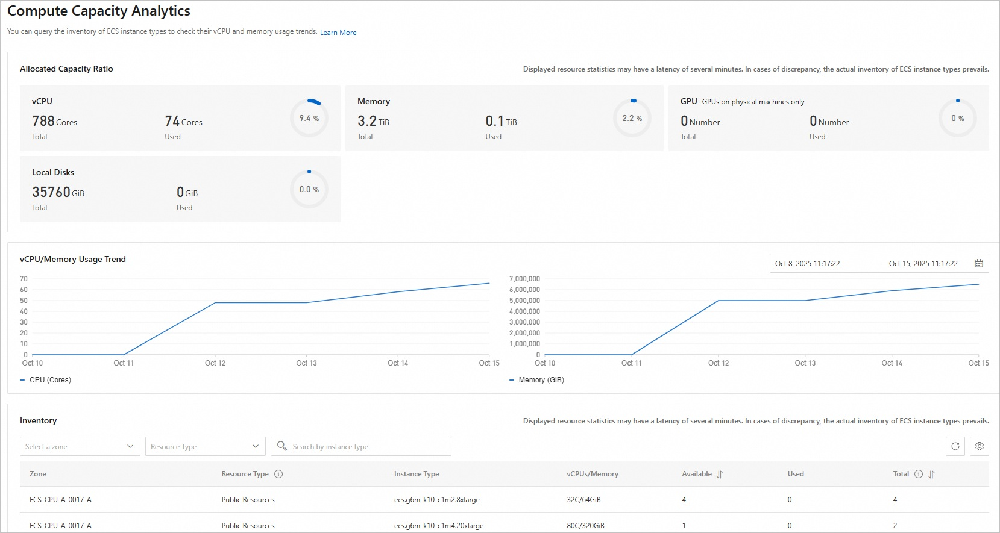

   - **Allocated Capacity Rate**: In the **Allocated Capacity Rate** section, you can view the inventory usage of ECS instance types. This includes the total inventory, the amount used, and the usage rate for resources such as vCPUs, memory, GPUs, and local disks.

   - **vCPU/Memory Usage Trend**: In the **vCPU/Memory Usage Trend** section, select a time range in the upper-right corner to view the usage trends of vCPUs and memory.

     > **Note**
     >
     > Hover the pointer over a point on the line chart to view the specific value for that day.

   - **Inventory**: In the **Inventory** section, select a zone and a resource type in the upper-left corner. Then, enter an instance type to view its inventory information.

<a id="section-2-6-2"></a>

### 2.6.2. Instance type management

<a id="section-2-6-2-1"></a>

#### 2.6.2.1. All Specifications

In the Compute Operations Console, you can view all instance types and the details of each instance type.

**Usage notes**

- On the All Specifications tab, you can manage all standard and custom instance types in the region, but you cannot manage dedicated host types.

- Instance types that are available for Tiangong products and instance types that are out of stock are unavailable in the Apsara Uni-manager Management Console, regardless of whether the instance types are in the **Enabled** state.

- After you enable or disable an instance type, do not perform operations on the instance type before the state of the instance type changes to **Enabled** or **Disabled**.

**Procedure**

1. Log in to the Apsara Uni-manager Operations Console.

2. In the top navigation bar, choose **Product Operation > Computing > Compute Operations Console**.

3. In the navigation pane on the left, choose **Specifications and Capacity O&M > Specifications**.

4. On the **All Specifications** tab, select an instance family from the Instance Family drop-down list and enter the name of an instance type in the search box to search for the instance type.

5. View the Name, Family, Status, CPU Cores (vCPU), Memory (GiB), Max Disks, Max Elastic Network Interfaces (ENIs), Max Network Bandwidth (Gbps), and Packet Forwarding Rate (10,000 PPS) of the target instance type.

6. Click **Details** in the Operation column of the instance type. In the Instance Type Details panel, view the basic information and extended attributes of the instance type.

7. Click **Disable** in the Operation column to disable the instance type. For more information, see Disable custom instance types.

8. Click **Operation Records** in the Operation column of the instance type. In the Operation Records panel, view the historical operations that were performed on the instance type in the Apsara Uni-manager Operations Console and historical POP API calls that were made for the instance type. For more information, see View audit logs.

<a id="section-2-6-2-2"></a>

#### 2.6.2.2. Custom instance types

<a id="section-2-6-2-2-1"></a>

##### 2.6.2.2.1. Create a custom instance type

When existing instance types cannot meet your business requirements, you can add custom instance types in the Compute Operations Console and create instances of the custom instance types.

**Background information**

A custom instance type is in the format of  `instance family.c(number of CPU cores)m(memory size).customize.XXX` . In this format,  `XXX`  is the description of the custom instance type that you manually enter. You can specify the instance type name, vCPU size, memory size, network bandwidth, network packet forwarding capacity, and multi-queue parameters.

> **Note**
>
> The Local Disks parameter is required for instances with local SSDs and local HDDs. The parameters displayed in the Apsara Uni-manager Operations Console shall prevail.

**Usage notes**

The instance families that support custom instance types are displayed in the Apsara Uni-manager Operations Console based on your environment. You can select an instance family from the instance family list to add a custom instance type. For more information about instance families, see *Introduction to Instance Families and Instance Types* in the Apsara Stack Documentation Center.

> **Important**
>
> You can continue to use existing custom instance types in the ecs.anyshare family.

**Procedure**

1. Log in to the Apsara Uni-manager Operations Console.

2. In the top navigation bar, choose **Product Operation > Computing > Compute Operations Console**.

3. In the left-side navigation pane, choose **Specifications and Capacity O&M > Specifications**.

4. On the **Custom Instance Types** tab, click **Create Instance Type**.

5. Configure the parameters and click **Create**.

   > **Note**
   >
   > After a custom instance type is created, some time is required for the instance type to take effect.

   The following table describes the parameters.

   | Parameter | Description |
   | --- | --- |
   | Instance Family | This parameter is required. You can select only one instance family from the <strong>Instance Family</strong> list.<br>Note<br>The supported instance families are displayed in the Apsara Uni-manager Operations Console. |

   <table>
     <tr>
       <td>Instance Type Name</td>
       <td>The name of a custom instance type is in the format of <code>instance family.c(number of CPU cores)m(memory</code> <code>size).customize.XXX </code>.<br>Important<br>• The name of a custom instance type with local SSDs is in the format of <code> instance family.c(number of </code> <code>CPU cores)m(memory size)i(number of local</code><br><code>SSDs).customize.XXX</code><br>• The name of a custom instance type with local HDDs is in the format of <code> instance family.c(number of </code> <code>CPU cores)m(memory size)d(number of local</code><br><code>HDDs).customize.XXX</code><br>• The <code> instance family </code> is the family that you select for the <strong>Instance Family</strong> parameter.<br>• <code> c(number of CPU cores)m(memory size) </code> cannot be modified. <code> c(number of CPU cores) </code> and <code> m(memory </code> <code>size) </code> are automatically generated after you configure the <strong>CPU Cores (vCPUs)</strong> and <strong>Memory Size (GiB)</strong> parameters.<br>• <code> XXX </code> is the description of the custom instance type. The description can contain up to 10 lowercase letters. You can leave this field empty.<br>For example, an instance type name can be <code> ecs.s6-</code><code>k.c1m1.customize.test </code>.</td>
     </tr>
     <tr>
       <td>CPU Cores (vCPUs)</td>
       <td>This parameter is required. Specify the number of vCPUs. Enter 1 or an even number greater than 1.<br>Important<br>The number of vCPUs cannot be greater than the maximum number of CPU cores of the physical machine. Otherwise, an error message appears and the instance type cannot be created.</td>
     </tr>
     <tr>
       <td>Memory Size (GiB)</td>
       <td>This parameter is required. Specify the virtual memory size. Enter 1 or an even number greater than 1.<br>Important<br>The virtual memory size cannot be greater than the maximum memory size of the physical machine. Otherwise, an error message appears and the instance type cannot be created.</td>
     </tr>
     <tr>
       <td>GPUs</td>
       <td>The number of GPUs. This parameter is available only when you select a GPU-accelerated instance family. Valid values: 0, 1, 2, 3, 4, and 8.</td>
     </tr>
     <tr>
       <td>GPU Specifications</td>
       <td>The GPU specification. This parameter is available only when you select a GPU-accelerated instance family. You can view the parameter but cannot modify the parameter.</td>
     </tr>
     <tr>
       <td>Local Disks</td>
       <td>The number of local disks. This parameter is available only when you select an instance family with local SSDs. Set the value to 0, 1, or an integer greater than 1.</td>
     </tr>
     <tr>
       <td>Available Capacity per Local Disk (GB)</td>
       <td>The available capacity per local SSD. This parameter is available only when you select an instance family with local SSDs. You can view the parameter but cannot modify the parameter.</td>
     </tr>
     <tr>
       <td>Local Disk Category</td>
       <td>The type of local SSDs. This parameter is available only when you select an instance family with local SSDs. You can view the parameter but cannot modify the parameter.</td>
     </tr>
     <tr>
       <td>Max Disks</td>
       <td>This value is automatically calculated. You can view the parameter but cannot modify the parameter.</td>
     </tr>
     <tr>
       <td>Max ENIs</td>
       <td>This value is automatically calculated. You can view the parameter but cannot modify the parameter.</td>
     </tr>
     <tr>
       <td>Max Network Bandwidth (Gbit/s)</td>
       <td>This value is automatically calculated. You can change the value based on your business scenario.<br>Important<br>The specified value cannot be greater than the maximum network bandwidth of the physical machine. Otherwise, an error message appears and the instance type cannot be created.</td>
     </tr>
     <tr>
       <td>Packet Forwarding Rate (10,000 PPS)</td>
       <td>This value is automatically calculated. You can change the value based on your business scenario.<br>Important<br>The specified value cannot be greater than the maximum packet forwarding rate of the physical machine. Otherwise, an error message appears and the instance type cannot be created.</td>
     </tr>
     <tr>
       <td>Reason</td>
       <td>This parameter is required. Enter a reason for this operation.</td>
     </tr>
   </table>

**Verify the result**

The new custom instance type is displayed on the Custom Specifications page. After you add a custom instance type, you can create instances based on it by selecting the instance type. For more information, see the **Instances > Create an instance** chapter of *User Guide -Elastic Compute Service* in the Apsara Stack Documentation Center.

<a id="section-2-6-2-2-2"></a>

##### 2.6.2.2.2. View a custom instance type

You can view existing custom instance types in the Compute Operations Console and the details of each custom instance type.

**Procedure**

1. Log in to the Apsara Uni-manager Operations Console.

2. In the top navigation bar, choose **Product Operation > Computing > Compute Operations Console**.

3. In the navigation pane on the left, choose **Specifications and Capacity O&M > Specifications**.

4. On the **All Instance Types** or **Custom Instance Types** tab, enter an instance type name in the text box in the upper-left corner to find a specific instance type.

5. You can view the instance family, instance type name, number of CPU cores (vCPU), memory (GiB), maximum number of attachable disks, maximum number of attachable Elastic Network Interfaces (ENIs), maximum network bandwidth (Gbps), and packet forwarding rate (10,000 PPS) of the target instance type.

6. Click **Details** in the **Operation** column of the instance type. In the Instance Type Details panel, view the basic information and extended attributes of the instance type.

<a id="section-2-6-2-2-3"></a>

##### 2.6.2.2.3. Disable custom instance types

In the Compute Operations Console, you can disable the custom instance types that you no longer require. After you disable a custom instance type, you can no longer select the custom instance type when you create instances.

**Procedure**

1. Log in to the Apsara Uni-manager Operations Console.

2. In the top navigation bar, choose **Product Operation > Computing > Compute Operations Console**.

3. 

4. On the **All Specifications** or **Custom Instance Type** tab, find the custom instance type that you want to disable and click **Disable** in the **Operation** column.

5. In the dialog box that appears, specify a reason and click **OK**.

   > **Note**
   >
   > - If a custom instance type was used to create instances, you cannot disable the instance type.
   >
   > - To re-enable a custom instance type that you disabled, find the instance type and click **Enable** in the **Operation** column.
   >
   > - After you disable or enable a custom instance type, you must wait for the disable or enable operation to take effect.
   >
   > - After you disable or enable a custom instance type, you must wait for the disable or enable operation to take effect. Do not perform operations on the instance type until the status of the instance type changes to **Disabled** or **Enabled**.

<a id="section-2-6-2-2-4"></a>

##### 2.6.2.2.4. View audit logs

You can view the historical operations that are performed in the Apsara Uni-manager Operations Console and the historical POP API calls that are made for a custom instance type.

**Procedure**

1. Log in to the Apsara Uni-manager Operations Console.

2. In the top navigation bar, choose **Product Operation > Computing > Compute Operations Console**.

3. 

4. On the **All Specifications** or **Custom Instance Type** tab, find the custom instance type that you want to manage and click **Operation Records** in the **Operation** column.

5. In the **Operation Records** panel, view the historical operations that are performed in the Apsara Uni-manager Operations Console and the historical POP API calls that are made for the custom instance type.

<a id="section-2-6-3"></a>

### 2.6.3. Resource reservations

<a id="section-2-6-3-1"></a>

#### 2.6.3.1. Create a resource reservation for an instance

This topic describes how to create a resource reservation for an Elastic Compute Service (ECS) instance. This ensures that the computing cluster has sufficient available resources if the ECS instance fails and a high-availability (HA) switchover is triggered.

**Procedure**

1. Log in to the Apsara Uni-manager Operations Console.

2. In the top navigation bar, choose **Product Operation > Computing > Compute Operations Console**.

3. In the left-side navigation pane, choose **Specifications and Capacity O&M > Resource Reservations**.

   The **Instance Reservations** tab of the Resource Reservations page appears by default. On the Instance Reservations tab, you can view information about ECS instances for which a resource reservation is created. You can filter instances by instance ID, reservation name, status, and creation time.

4. In the upper-left corner, click **Create Instance Reservation**. In the Create Instance Reservation dialog box, configure the Instance ID, Reservation Name, Expiration Time, and Reservation Description parameters.

5. Click **OK** to complete the creation.

   > **Important**
   >
   > - To create a resource reservation specific to an ECS instance, make sure that the ECS instance is in the Running or Stopped state.
   >
   > - After a resource reservation is created for an ECS instance, resources on a different physical server are reserved for the ECS instance.
   >
   > - After an ECS instance for which a resource reservation is created is cold migrated, hot migrated, or failed over to the physical server where the reserved resources reside, the ECS instance uses the reserved resources.
   >
   > - The reserved resources expire 6 hours after the resource reservation expires.

<a id="section-2-6-3-2"></a>

#### 2.6.3.2. Create a resource reservation for a physical machine

This topic describes how to create a resource reservation for a physical machine. This ensures that the computing cluster has sufficient available resources if the physical machine fails and a high-availability (HA) switchover is triggered.

**Usage notes**

- You can create a resource reservation to reserve resources for a physical machine on which no Elastic Compute Service (ECS) instances exist.

- After you create the resource reservation for the physical machine, resources are reserved for the physical machine and the physical machine enters the Reserved Lock (rlock) state.

**Procedure**

1. Log in to the Apsara Uni-manager Operations Console.

2. In the top navigation bar, choose **Product Operation > Computing > Compute Operations Console**.

3. In the left-side navigation pane, choose **Specifications and Capacity O&M > Resource Reservations**.

4. On the Resource Reservations page, click the **Physical Machine Reservations** tab, and view the information about the physical machines for which resources are reserved. You can filter physical machines by IP address, reservation name, status, and creation time.

5. In the upper-left corner, click **Create Physical Machine Reservation**. In the Create Physical Machine Reservation dialog box, configure the Physical Machine IP Address, Reservation Name, Expiration Time, and Reservation Description parameters.

6. Click **OK**.

<a id="section-2-7"></a>

## 2.7. Migration task management

<a id="section-2-7-1"></a>

### 2.7.1. Manage migration tasks

<a id="section-2-7-1-1"></a>

#### 2.7.1.1. Create an ECS migration task

If an Elastic Compute Service (ECS) instance or a physical server that hosts an ECS instance fails, you can migrate the instance from the failed physical server to another physical server to ensure system stability. This topic describes how to create an ECS migration task.

**Limits**

Migration is not supported if the instance to be migrated meets any of the following conditions:

> **Note**
>
> For more migration limits, see the information displayed in the console.

**Hot migration**

- The instance is not in the **Running** state.

- The instance is a Dedicated Host instance.

- The instance is a GPU-accelerated instance.

- The instance has local disks.

- A migration task is already running for the instance.

- The instance is attached to a trunk or member network interface card (NIC).

- The instance type is too large.

- An ISO file is attached to the instance.

**Cold migration**

- The instance is not in the **Pending** or **Stopped** state.

- The instance is a Dedicated Host instance.

- The instance has local disks.

- The instance is attached to a trunk or member NIC.

- An ISO file is attached to the instance.

**Procedure**

> **Note**
>
> In addition to the following procedure, you can also go to the **ECS Instances** page to create a migration task for an ECS instance. For more information, see Migrate an instance.

1. Log in to the Apsara Uni-manager Operations Console.

2. In the top navigation bar, choose **Product Operation > Computing > Compute Operations Console**.

3. In the navigation pane on the left, click **Migration Tasks**.

   By default, the **ECS Migration Tasks** tab of the **Tasks** tab appears.

4. On the ECS Migration Tasks tab, click **Create ECS Migration Task**.

5. On the **Create ECS Migration Task** page, configure the parameters.

   - **Cold Migration**: migrates a stopped VM from one physical host to another. Cold migration is supported only for instances in the **Pending** or **Shutted** state.

     > **Important**
     >
     > - This feature is used to create a scheduling task for ECS instance cold migration in the Apsara Uni-manager Operations Console. The results of a specific task can be viewed in the task list or on the ECS instance details page.
     >
     > - The final state of an ECS instance is determined by the task configuration parameters.
     >
     > - If cold migration fails, view the migration task results and troubleshoot specific issues based on ECS instance logs.
     >
     > - Instances in a dedicated resource pool can be migrated only within the dedicated resource pool.

     | Parameter or section | Parameter | Description |
     | --- | --- | --- |
     | Instance Information | Select Instance | Select the instance that you want to migrate.Enter the ID of the instance to be migrated in the search box above the instance list, and then select the instance in the instance list.<br>Important<br>You can select only one ECS instance. |

     - **Random Selection**: migrates the instance to a random physical server that has sufficient resources.

     - **System Recommendation**: migrates the instance to a physical server that is recommended by the system to ensure a high success rate of migration.

       > **Important**
       >
       > If no data is displayed in the physical server list, no physical servers are available. In this case, we recommend that you select another policy.

     - **Specify NC**: migrate the instance to a specific physical server. To specify the destination server, search for the server by cluster, hostname, server IP address, or server ID, and then select the server in the server list.

       > **Note**
       >
       > The system provides suggestions on whether each physical server is suitable for migration. The suggestions are for reference only. You can select a server

     **Destination**

     > that is **not recommended** as needed.

     **Selection Policy**

     - **Specify Cluster**: migrates the instance to a specific cluster. To specify the destination cluster, search for the cluster by name and

     **Destination**

     then select it in the cluster list.

     **Selection**

     > **Note**
     >
     > The system provides suggestions on whether each cluster is suitable for migration. The suggestions are for reference only. You can select a cluster that is **not recommended** as needed.

     The state that you want the instance to enter after migration. Valid values:

     **Recovery Mode**

     - **Start after Migration**

     - **Stop After Migration**

     **Operation**

     **Reason**

     The reason for cold migration.

     **Information**

   - **Hot Migration**: migrates a VM that is running from one physical host to another. Hot migration is supported only for instances in the **Running** state.

     > **Important**
     >
     > - This feature is used to create a scheduling task for ECS instance hot migration in the Apsara Uni-manager Operations Console. The results of a specific task can be viewed in the task list or on the ECS instance details page.
     >
     > - Regular hot migration requires that the source and destination hosts use the same CPU model. You can enable the enhanced hot migration compatibility feature to migrate hosts across CPU models.
     >
     > - If you frequently migrate an ECS instance, the ECS control service may lock the operations on the ECS instance, such as hot migration. You can retry hot migration or add more NO_CHECK parameters based on the knowledge base.
     >
     > - For ECS bare metal instances, set the Allowed Service Interruption Duration parameter to 2000 in the Advanced Migration Parameters section.
     >
     > - Instances in a dedicated resource pool can be migrated only within the dedicated resource pool.

     | Parameter or section | Parameter | Description |
     | --- | --- | --- |
     | Instance Information | Select Instance | The instance that you want to migrate. Enter the instance ID in the search box above the instance list, and then select the instance in the instance list.<br>Important<br>You can select only one ECS instance. |
     | Basic Migration Parameters | Migration Rate | The migration rate. Unit: Mbit/s.<br>We recommend that you set the parameter to a value greater than 500. |

     Specifies whether to enable enhanced hot migration compatibility. If you set this parameter to Yes, you can migrate the instance to an available physical server with a different CPU model. For information about the CPU compatibility, see View CPU compatibility configurations.

     > **Important**

     **Enhanced Hot**

     > If you set the **Destination Selection**

     **Migration**

     > **Policy** parameter to **System**

     **Compatibility**

     > **Recommendation** after you enable this feature, the system displays available physical servers with different CPU models, in addition to the physical servers of the same CPU model.

     **Destination Selection**

     - **Random Selection**: migrates the instance to a random physical server that has sufficient resources.

     - **System Recommendation**: migrates the instance to a physical server that is recommended by the system to ensure a high success rate of migration.

       > **Note**
       >
       > If no data is displayed in the host list, no physical servers are available. In this case, we recommend that you select another policy.

     - **Specify NC**: migrates the instance to a specific server. If you select this policy, the migration may fail. To specify the destination server, search for the server by cluster, hostname, server IP address, or server ID and then select the server in the server list.

       > **Note**
       >
       > The system provides suggestions on

     **Destination**

     > whether each physical server is suitable

     **Selection Policy**

     > for migration. The suggestions are for reference only. You can select a server that is **not recommended** as needed.

     - **Specify Cluster**: migrates the instance to a specific cluster. To specify the destination cluster, search for the cluster by name and then select it in the cluster list.

       > **Note**
       >
       > The system provides suggestions on whether each cluster is suitable for migration. The suggestions are for reference only. You can select a cluster that is **not recommended** as needed.

     The service interruption duration in the last phase of hot migration. Unit: milliseconds.

     **Allowed Service Interruption**

     - Valid values: 200 to 2000.

     **Duration**

     - Default value: 300.

     - Valid values:

       - **Yes**: checks whether the instance is attached to an SLB instance. If yes, the migration task may fail.

     **Check SLB**

     - **No**: does not check whether the instance is attached to an SLB instance and proceeds with migration.

     - Default value: **No**.

     - Valid values:

       - **Yes**: checks whether the AVS versions of the source and destination hosts are the

     **Check AVS**

     same. If not, the migration task fails.

     **Version**

     - **No**: does not check the AVS version and proceeds with migration.

     - Default value: **Yes**.

     - Valid values:

     **Advanced Migration**

     - **Yes**: checks whether the virtualization

     **Parameters**

     version of the destination host supports hot

     **Check Virtual NC**

     migration. If not, the migration task fails.

     **Version**

     > **Note**

     - **No**: does not check the virtualization version and proceeds with the migration.

     > - You can click

     - Default value: **Yes**.

     > **Configura tion Descripti on** to view

     - Valid values:

     > the

     - **Yes**: allows the instance to be migrated to

     > parameter

     a reserved host.

     > description

     **Allow Reserved**

     > s in this

     **NC**

     - **No**: does not allow the instance to be

     > section.

     migrated to a reserved host.

     > - You can

     - Default value: **No**.

     > configure advanced migration parameter s as needed to increase the success rate of instance migration.

     - Specifies whether to check the CPU tags of the source host. Valid values:

       - **Yes**: checks whether the CPU tags of the source host are included in the CPU tags of the destination host. If not, the migration task fails.

       - **No**: does not check the CPU tags and

     **Check CPU Tag**

     proceeds with the migration.

     - Default value: **Yes**.

     - Value range:

       - **Yes**: checks whether the image used by the instance supports hot migration. If not, the migration task fails.

     **Check Image**

     - **No**: does not check whether the image used by the instance supports hot migration.

     - Default value: **Yes**.

     **Operation**

     **Reason**

     The reason for hot migration.

     **Information**

6. Select **I have read the preceding notes and confirm this operation**.

7. For cold migration, click **Submit**. For hot migration, click **Pre-migration Check**. After the precheck is passed, click **Submit**.

   You can view the status and progress of the migration task in the task list. For more information, see View migration tasks.

<a id="section-2-7-1-2"></a>

#### 2.7.1.2. Create a computing server-level migration task

This topic describes how to migrate all Elastic Compute Service (ECS) instances on a computing server to another computing server.

**Prerequisites**

The computing server is in the  `free`  or  `mlock`  state.

**Scenarios**

When you scale down or maintain a computing server, you must migrate all ECS instances on the server to another computing server first and then perform subsequent operations. In this case, you can create a computing server-level migration task to migrate all ECS instances on the server to another computing server.

**Usage notes**

When you migrate all ECS instances from a computing server, take note of the following items:

- After you submit a computing server-level migration task, the state of the computing server changes to mlock. If the migration task is complete, fails, or is canceled, you must submit an application to unlock the computing server.

- ECS instances on the computing server are migrated to another computing server based on the ECS scheduling rules. The migration task may not be successful in a single attempt due to various reasons.

- If an ECS instance in the **Shutted** or **Pending** state is migrated, the status of the ECS instance remains unchanged after the migration.

- After the migration task is complete, you must check whether all ECS instances are migrated.

- Instances in a dedicated resource pool can be migrated only within the dedicated resource pool.

**Procedure**

> **Note**
>
> You can also find the computing server from which you want to migrate ECS instances on the **Computing Server O&M** page and create a computing server-level migration task for the computing server. For more information, see Migrate all instances from a computing server.

1. Log in to the Apsara Uni-manager Operations Console.

2. In the top navigation bar, choose **Product Operation > Computing > Compute Operations Console**.

3. In the left-side navigation pane, click **Migration Tasks**.

   By default, the **ECS Migration Tasks** tab of the **Tasks** tab appears.

4. Click the **Machine Migration Tasks** tab. On the Machine Migration Tasks tab, click **Create Machine Migration Task**.

5. On the **Create Machine Migration Task** page, configure the parameters that are described in the following table.

   | Section | Parameter | Description |
   | --- | --- | --- |
   | Source NC | Select Machine | The computing server from which you want to migrate all ECS instances. Enter a hostname, a server IP address, or a server ID in the search box to search for a server, and then select it.<br>Important<br>You can select only one server. |

   Specifies whether to enable phased migration. If you enable phased migration, the migration task stops after a batch of instances is migrated based

   **Enable Phased**

   on the phased migration configurations. To

   **Migration**

   migrate the rest of the selected instances, you must resume the task. For more information about how to modify phased configurations, see Configure migration constraints.

   Specifies whether to enable the enhanced hot migration compatibility mode. This mode allows

   **Enhanced Hot**

   you to migrate ECS instances to an available

   **Migration**

   physical server with a different CPU model. For

   **Compatibility**

   more information about the CPU compatibility, see View CPU compatibility configurations.

   - **Random Selection**: migrates ECS instances to a random physical server that has sufficient resources. This is the default value.

   - **Specify NC**: migrates ECS instances to a specific server. If you select this policy, the migration may fail. To specify the destination server, search for the server by cluster, hostname, server IP address, or server ID and then select the server in the server list.

     > **Note**

   **Migration**

   > The system provides suggestions on

   **Destination**

   > whether each physical server is suitable

   **Configurations**

   > for migration. The suggestions are for reference only. You can select a physical server that is **not recommended** based

   **Destination**

   > on your business requirements.

   **Selection Policy**

   - **Specify Cluster**: migrates ECS instances to a specific cluster. If you select this policy, the migration may fail. To specify the destination cluster, search for the cluster by name and then select it in the cluster list.

     > **Note**
     >
     > The system provides suggestions on whether each cluster is suitable for migration. The suggestions are for reference only. You can select a cluster that is **not recommended** based on your business requirements.

   The service interruption duration in the last phase of hot migration. Unit: milliseconds.

   **Allowed Service Interruption**

   - Valid values: 200 to 2000.

   **Duration**

   - Default value: 300.

   - Specifies whether to check Server Load Balancer (SLB) instance attachment status. Valid values:

     - **Yes**: checks whether the ECS instances to be migrated are associated with SLB instances.

   **Check SLB**

   If yes, the migration task may fail.

   - **No**: does not check whether the ECS instances are associated with SLB instances.

   - Default value: **No**.

   - Specifies whether to check the consistency of the application virtual switch (AVS) versions. Valid values:

     - **Yes**: checks whether the AVS versions of the

   **Check AVS**

   source and destination hosts are the same. If

   **Version**

   not, the migration task fails.

   - **No**: does not check the AVS versions and proceeds with migration.

   **Advanced Migration Parameters**

   - Default value: **Yes**.

   > **Note**

   - Specifies whether to check the support status

   > - You can

   of hot migration in the virtualization version on

   > configure

   the destination host. Valid values:

   > advanced migration

   - **Yes**: checks whether the virtualization

   > parameters

   **Check Virtual NC**

   version of the destination host supports hot

   > based on

   **Version**

   migration. If not, the migration task fails.

   > your

   - **No**: does not check the virtualization version

   > business

   and proceeds with the migration.

   > requiremen ts to

   - Default value: **Yes**.

   > increase the success rate of instance

   - Specifies whether the instances can be

   > migration.

   migrated to a reserved host. Valid values:

   > - You can

   - **Yes**: allows the instances to be migrated to a

   > click

   **Allow Reserved**

   reserved host.

   > **Configurat**

   **NC**

   - **No**: does not allow the instances to be

   > **ion**

   migrated to a reserved host.

   > **Descriptio n** to view

   - Default value: **No**.

   > the parameter descriptions in this section.

   - Specifies whether to check the CPU tags of the source host. Valid values:

     - **Yes**: checks whether the CPU tags of the source host are included in the CPU tags of the destination host. If not, the migration

   **Check CPU Tag**

   task fails.

   - **No**: does not check the CPU tags and proceeds with the migration.

   - Default value: **Yes**.

   - Specifies whether to check the images used by the instances support hot migration. Valid values:

     - **Yes**: checks whether the images used by the instances support hot migration. If not, the

   **Check Image.**

   migration task fails.

   - **No**: does not check whether the images used by the instances support hot migration.

   - Default value: **Yes**.

   **Operation**

   **Reason**

   The reason for computing server-level migration.

   **Information**

6. Select **I have read the preceding notes and confirm this operation.** and click **Submit**.

   - You can view the status and progress of the migration task in the task list. For more information, see View migration tasks.

   - You can stop the migration task if it is no longer needed. For more information, see Stop a migration task.

<a id="section-2-7-1-3"></a>

#### 2.7.1.3. Create a batch ECS migration task

If an ECS instance or the physical server that hosts it fails, you can migrate the instance to a healthy physical server to ensure system stability. In addition to migrating a single instance or performing a full-copy migration, you can also migrate multiple instances simultaneously. This topic describes how to perform a batch migration of ECS instances.

**Notes**

- A batch migration task attempts to migrate the specified ECS instances to the destination server based on the target configuration. However, the success of the task is not guaranteed because it can be affected by various factors.

- To improve the success rate of a batch task, select ECS instances from the same instance family.

- Batch migration is supported only for ECS instances that are in the **Running**, **Stopped**, or **Pending** state.

- If an ECS instance in the **Stopped** or **Pending** state is migrated, its state remains unchanged after the migration.

- Instances in a dedicated resource pool can be migrated only within the same pool. To improve the success rate of the task, select instances that have the same dedicated resource pool ID.

**Limits**

The following instances cannot be migrated:

> **Note**
>
> For more information about the limits, see the information displayed in the console.

**Hot migration**

- Instances that are not **running**

- Dedicated hosts

- GPU-accelerated instances

- ECS instances that use local disks

- Instances that have a running migration task

- Instances that use a trunk or member network interface controller (NIC)

- Instances whose specification is higher than expected

- Instances that are attached with an ISO image

**Cold migration**

- Instances that are not in the **Pending** or **Shutted** state

- Dedicated hosts

- ECS instances that use local disks

- Instances that use a trunk or member NIC

- Instances that are attached with an ISO image

**Procedure**

1. Log in to the Apsara Uni-manager Operations Console.

2. In the top navigation bar, choose **Product Operation > Computing > Compute Operations Console**.

3. In the navigation pane on the left, click **Migration Task Management**.

   By default, the **ECS Migration Tasks** tab under the **Task List** tab is displayed.

4. Click the **Batch ECS Migration Tasks** tab, and then click **Create Batch Migration Task**.

5. On the **Create Batch Migration Task** page, configure the parameters.

   | Section | Parameter | Description |
   | --- | --- | --- |

   Select the ECS instances to migrate.

   To search for the instances to migrate, enter their instance IDs in the search box above the instance

   **Instance Information**

   **Select Instances**

   list. Separate multiple instance IDs with commas (,). Example:  `i-ez*****deuz,i-ez*****g4b4,i-ez*****02zd` .

   **Enable In-batch**

   If you enable this feature, the task is split into

   **Migration**

   multiple batches for migration.

   **Enable**

   **Migration Task**

   If you enable this feature, the batch migration

   **Scheduled**

   **Configuration**

   task starts at the specified time.

   **Migration**

   **Migration Start**

   If you enable scheduled migration, you can set

   **Time**

   the running time for the batch task.

   Specifies whether to enable phased migration. If you enable phased migration, the migration task stops after a batch of instances is migrated based

   **Enable Grayscale**

   on the phased migration configurations. To

   **Migration**

   migrate the rest of the selected instances, you must resume the task. For more information about how to modify phased configurations, see Configure migration constraints.

   Specifies whether to enable enhanced hot migration compatibility. If you set this parameter

   **Enhance Hot**

   to Yes, you can migrate the instance to an

   **Migration**

   available physical machine with a different CPU

   **Compatibility**

   model. For information about CPU compatibility, see View CPU compatibility configurations.

   - **Random Selection**: migrates ECS instances to a random physical machine that has sufficient resources. a random physical machine that has sufficient resources.

   - **Specify NC**: migrates ECS instances to a specific server. If you select this policy, the migration may fail. To specify the destination server, search for the server based on the cluster, hostname, IP address, or server ID in

   **Migration**

   the search box and then select the server from

   **Destination**

   the server list.

   **Configurations**

   > **Note**
   >
   > The system provides suggestions on whether each physical machine is suitable for migration. The suggestions are for reference only. You can select a physical

   **Destination**

   > machine that is **not recommended** based

   **Selection Policy**

   > on your business requirements.

   - **Specify Cluster**: migrates ECS instances to a specific cluster. If you select this policy, the migration may fail. To specify the destination cluster, search for the cluster by name in the search box and select it from the cluster list.

     > **Note**
     >
     > The system provides suggestions on each cluster only for reference. You can select a cluster that is **not recommended** if it is necessary for your business.

   The service downtime in the final stage of a hot migration. Unit: ms.

   **Allowed Service Downtime**

   - Valid values: 200 to 2000.

   - Default value: 300.

   - Specifies whether to check Server Load Balancer (SLB) instance attachment status. Valid values:

     - **Yes**: checks whether the instance is attached to an SLB instance. If yes, the migration task may fail.

   **Check SLB**

   - **No**: does not check whether the instance is attached to an SLB instance and proceeds with migration.

   - Default value: **No**.

   - Specifies whether to check the consistency of the application virtual switch (AVS) versions. Valid values:

     - **Yes**: checks whether the AVS versions of the source and destination hosts are the same. If

   **Check AVS**

   not, the migration task fails.

   **Advanced Migration**

   **Version**

   **Parameter**

   - **No**: does not check the AVS versions of the

   **Configuration**

   source and destination hosts. A large AVS version difference may cause a migration failure.

   > **Note**
   >
   > - You can

   - Default value: **Yes**.

   > configure advanced migration

   - Specifies whether to check the support status

   > parameters

   of hot migration in the virtualization version on

   > based on

   the destination host. Valid values:

   > your business

   - **Yes**: checks whether the virtualization

   > requiremen

   version of the destination host supports hot

   **Check NC**

   > ts to

   migration. If not, the migration task fails.

   **Virtualization**

   > increase

   **Version**

   - **No**: does not check the virtualization version

   > the success

   of the destination host. A large virtualization

   > rate of

   version difference may cause a migration

   > instance

   failure.

   > migration.
   >
   > - You can

   - Default value: **Yes**.

   > click **Configurat ion**

   - Specifies whether the instance can be migrated

   > **Descriptio**

   to a reserved host. Valid values:

   > **n** to view the

   - **Yes**: allows the instance to be migrated to a

   > parameter

   **Allow Reserved**

   reserved host.

   > descriptions

   **NC**

   - **No**: does not allow the instance to be

   > in this

   migrated to a reserved host.

   > section.

   - Default value: **No**.

   - Specifies whether to check the CPU tags of the source host. Valid values:

     - **Yes**: checks whether the CPU tags of the source host are included in the CPU tags of the destination host. If the CPU tag set of the source host is not a subset of the CPU tag set of the destination host, the migration

   **Check CPU Flag**

   task fails.

   - **No**: The system does not check the CPU tag set and proceeds with the migration. A lack of critical tags on the destination host may result in abnormal instance behaviors after migration.

   - Default value: **Yes**.

   - Valid values:

     - **Yes**: Checks whether the image supports hot migration. If not, the migration task fails.

   **Check Image**

   - **No**: Does not check the image and proceeds with the migration.

   - Default value: **Yes**.

   **Operation**

   Enter the reason for the batch migration of ECS

   **Reason**

   **Information**

   instances.

6. Select **I Have Read The Preceding Notes And Confirm This Operation**, and then click **Submit**.

   - You can view the status of the migration task in the task list. For more information, see View migration tasks.

   - If the migration task is no longer required, you can stop it. For more information, see Stop a migration task.

<a id="section-2-7-1-4"></a>

#### 2.7.1.4. Create a batch machine migration task

This topic describes how to migrate all Elastic Compute Service (ECS) instances on computing servers to other computing servers at a time.

**Usage notes**

When you create a batch machine migration task, take note of the following items:

- After you submit a migration task, the state of the server changes to mlock. If the migration task is complete, fails, or is canceled, you must submit an application to unlock the server.

- The migration result is affected by multiple factors and may not be successful for all ECS instances. To check whether each ECS instance is migrated as expected, you can view the details of the migration task.

- If an ECS instance in the **Shutted** or **Pending** state is migrated, the status of the ECS instance remains unchanged after the migration.

- Instances in a dedicated resource pool can be migrated only within the dedicated resource pool. To improve the success rate of a migration task, we recommend that you select physical machines that have the same dedicated resource pool ID.

**Procedure**

1. Log in to the Apsara Uni-manager Operations Console.

2. In the top navigation bar, choose **Product Operation > Computing > Compute Operations Console**.

3. In the left-side navigation pane, click **Migration Tasks**.

   By default, the **ECS Migration Tasks** tab under the **Tasks** tab appears.

4. On the Tasks tab, click the **Batch Machine Migration Tasks** tab and then click **Create Batch Machine Migration Tasks**.

5. On the **Create Batch Machine Migration Tasks** page, configure the parameters described in the following table.

   **Parameter or section**

   **Parameter**

   **Description**

   The server from which you want to migrate ECS instances. Enter a hostname, a server IP address, or a server ID in the search box to search for a server, and then select it.

   **Source NC**

   **Select Machine**

   > **Note**
   >
   > You can select multiple servers at a time to migrate all ECS instances from the selected servers.

   Specifies whether to enable phased migration. If you enable phased migration, the batch machine migration task stops after instances are migrated from a specific number of selected physical machines. By default, the task stops after

   **Enable Phased**

   instances are migrated from one physical

   **Migration**

   machine. To migrate instances from the rest of the selected physical machines, you must resume the migration task. For more information, see Configure migration constraints.

   Specifies whether to enable enhanced hot migration compatibility. If you set this parameter

   **Enhanced Hot**

   **Migration**

   to Yes, you can migrate the instance to an

   **Migration**

   **Destination**

   available physical machine with a different CPU

   **Compatibility**

   **Configurations**

   model. For information about CPU compatibility, see View CPU compatibility configurations.

   **Random Selection** (default): migrates ECS

   **Destination**

   instances to random physical machines that have

   **Selection Policy**

   sufficient resources.

   The service interruption duration in the last phase of hot migration. Unit: milliseconds.

   **Allowed Service Interruption**

   - Valid values: 200 to 2000.

   **Duration**

   - Default value: 300.

   - Specifies whether to check Server Load Balancer (SLB) instance attachment status. Valid values:

     - **Yes**: checks whether the instance is attached to an SLB instance. If yes, the

   **Check SLB**

   migration task may fail.

   - **No**: does not check whether the instance is attached to an SLB instance and proceeds with migration.

   - Default value: **No**.

   - Specifies whether to check the consistency of the application virtual switch (AVS) versions. Valid values:

     - **Yes**: checks whether the AVS versions of the source and destination hosts are the same. If

   **Advanced Migration**

   **Check AVS**

   not, the migration task fails.

   **Parameters**

   **Version**

   - **No**: does not check the AVS versions of the source and destination hosts. A large AVS

   > **Note**

   version difference may cause a migration failure.

   > - You can configure

   - Default value: **Yes**.

   > advanced migration parameters

   - Specifies whether to check the support status

   > based on

   of hot migration in the virtualization version on

   > your

   the destination host. Valid values:

   > business requiremen

   - **Yes**: checks whether the virtualization

   > ts to

   version of the destination host supports hot

   > increase

   **Check Virtual NC**

   migration. If not, the migration task fails.

   > the success

   **Version**

   > rate of

   - **No**: does not check the virtualization version

   > instance

   of the destination host. A large virtualization

   > migration.

   version difference may cause a migration failure.

   > - You can click

   - Default value: **Yes**.

   > **Configurat ion Descriptio**

   - Specifies whether the instance can be migrated

   > **n** to view

   to a reserved host. Valid values:

   > the parameter

   - **Yes**: allows the instance to be migrated to a

   > descriptions

   **Allow Reserved**

   reserved host.

   > in this

   **NC**

   - **No**: does not allow the instance to be

   > section.

   migrated to a reserved host.

   - Default value: **No**.

   - Specifies whether to check the CPU tags of the source host. Valid values:

     - **Yes**: checks whether the CPU tags of the source host are included in the CPU tags of the destination host. If the CPU tag set of the source host is not a subset of the CPU tag set of the destination host, the migration

   **Check CPU Tag**

   task fails.

   - **No**: The system does not check the CPU tag set and proceeds with the migration. A lack of critical tags on the destination host may result in abnormal instance behaviors after migration.

   - Default value: **Yes**.

   - Specifies whether to check if the images used by the instances support hot migration. Valid values:

     - **Yes**: checks whether the images used by the instances support hot migration. If not, the

   **Check Image**

   migration task fails.

   - **No**: does not check whether the images used by the instances support hot migration.

   - Default value: **Yes**.

   **Operation**

   **Reason**

   The reason for batch machine migration.

   **Information**

6. Select **I have read the preceding notes and confirm this operation** and click **Submit**.

   - You can view the status and progress of the migration task in the task list. For more information, see View migration tasks.

   - You can stop the migration task if it is no longer needed. For more information, see Stop a migration task.

<a id="section-2-7-1-5"></a>

#### 2.7.1.5. Create a cluster-level migration task

This topic describes how to migrate all Elastic Compute Service (ECS) instances from all physical machines in a cluster to another cluster.

**Usage notes**

A cluster-level migration task attempts to migrate all ECS instances from all physical machines in the cluster. Take note of the following items:

- After the cluster-level migration task is submitted, all physical servers in the cluster enter the mlock state. After the migration task is complete or if the task fails, you must submit a request to unlock the physical servers.

- The migration is affected by multiple factors and may not be successful for all ECS instances. To check whether each ECS instance is migrated as expected, you can view the migration task details.

- If ECS instances in the **Shutted** or **Pending** state are migrated, the status of the ECS instances remains unchanged after the migration.

**Procedure**

1. Log in to the Apsara Uni-manager Operations Console.

2. In the top navigation bar, choose **Product Operation > Computing > Compute Operations Console**.

3. In the left-side navigation pane, click **Migration Tasks**.

   By default, the **ECS Migration Tasks** tab of the **Tasks** tab appears.

4. On the Tasks tab, click the **Cluster-level Migration Tasks** tab, and then click **Create Cluster-level Migration Task**.

5. On the **Create Cluster-level Migration Task** page, configure the parameters that are described in the following table.

   **Parameter or section**

   **Parameter**

   **Description**

   The compute cluster from which you want to

   **Source Cluster**

   **Cluster Name**

   migrate ECS instances. Enter a cluster name in the search box to search for the cluster.

   Specifies whether to enable phased migration. If you enable phased migration, the cluster-level migration task stops after instances are migrated from a specific number of physical servers in the

   **Enable Phased**

   cluster. By default, the task stops after instances

   **Migration**

   are migrated from one physical server. To migrate instances from the rest of the physical servers in the cluster, you must resume the migration task. For more information, see Configure migration constraints.

   Specifies whether to enable the enhanced hot migration compatibility mode. This mode allows

   **Enhanced Hot**

   you to migrate ECS instances to an available

   **Migration**

   physical server with a different CPU model. For

   **Compatibility**

   more information about the CPU compatibility, see View CPU compatibility configurations.

   **Migration Destination Configurations**

   The policy that is used to select the destination cluster. The default value is **Random Selection**,

   **Destination**

   which migrates the ECS instances to random

   **Selection Policy**

   physical servers that have sufficient resources in a cluster.

   The service interruption duration in the last phase of hot migration. Unit: milliseconds.

   **Allowed Service Interruption**

   - Valid values: 200 to 2000.

   **Duration**

   - Default value: 300.

   - Specifies whether to check Server Load Balancer (SLB) instance attachment status. Valid values:

     - **Yes**: checks whether the ECS instances to be migrated are associated with SLB instances. If yes, the migration task may fail.

   **Check SLB**

   - **No**: does not check whether the ECS instances are associated with SLB instances and proceeds with migration.

   - Default value: **No**.

   - Specifies whether to check the consistency of the application virtual switch (AVS) versions. Valid values:

     - **Yes**: checks whether the AVS versions of the

   **Check AVS**

   source and destination hosts are the same. If

   **Version**

   not, the migration task fails.

   **Advanced Migration Parameters**

   - **No**: does not check the AVS versions and proceeds with migration.

   > **Note**

   - Default value: **Yes**.

   > - You can configure advanced

   - Specifies whether to check the support status

   > migration

   of hot migration in the virtualization version on

   > parameters

   the destination host. Valid values:

   > based on

   - **Yes**: checks whether the virtualization

   > your

   **Check Virtual NC**

   version of the destination host supports hot

   > business

   **Version**

   migration. If not, the migration task fails.

   > requiremen ts to

   - **No**: does not check the virtualization

   > increase

   versions and proceeds with the migration.

   > the success rate of

   - Default value: **Yes**.

   > instance migration.
   >
   > - You can

   - Specifies whether the instances can be

   > click

   migrated to a reserved host. Valid values:

   > **Configurat**

   - **Yes**: allows the instances to be migrated to a

   > **ion**

   **Allow Reserved**

   reserved host.

   > **Descriptio**

   **NC**

   > **n** to view

   - **No**: does not allow the instances to be

   > the

   migrated to a reserved host.

   > parameter descriptions

   - Default value: **No**.

   > in this section.

   - Specifies whether to check the CPU tags of the source host. Valid values:

     - **Yes**: checks whether the CPU tags of the source host is a subset of the CPU tags of the destination host. If not, the migration

   **Check CPU Tag**

   task fails.

   - **No**: does not check the CPU tags and proceeds with the migration.

   - Default value: **Yes**.

   - Specifies whether to check the images used by the instances support hot migration. Valid values:

     - **Yes**: checks whether the images used by the instances support hot migration. If not, the migration task fails.

   **Check Image**

   - **No**: does not check whether the images used by the instances support hot migration.

   - Default value: **Yes**.

   The reason for creating the cluster-level migration

   **Operation**

   **Reason**

   task.

   **Information**

6. Select **I have read the preceding notes and confirm this operation.** and click **Submit**.

   - You can view the status and progress of the migration task in the task list. For more information, see View migration tasks.

   - You can stop the migration task if it is no longer needed. For more information, see Stop a migration task.

<a id="section-2-7-1-6"></a>

#### 2.7.1.6. Off-peak migration tasks

Hot migrations of Elastic Compute Service (ECS) instances can affect the performance of large-scale services. They can cause temporary service downtime or slow responses, which impacts business continuity and the user experience. To minimize this impact, you can analyze your services to identify off-peak periods and then schedule hot migrations within recommended time windows.

**Create an off-peak hour migration task**

**Prerequisites**

You have enabled off-peak migration tasks. For more information, see Configure migration constraints.

**Limitations**

- Only instances in the **Running** state are migrated during off-peak hours.

- Instances in the **Pending** or **Stopped** state are migrated immediately. Their original status is maintained, and no off-peak analysis or event push is performed.

- A maximum of 100 ECS instances can be in the off-peak migration process at the same time. If you submit a task that causes this limit to be exceeded, the task fails.

**Procedure**

1. Log in to the Apsara Uni-manager Operations Console.

2. In the top navigation bar, choose **Product Operation > Computing > Compute Operations Console**.

3. In the navigation pane on the left, click **Migration Task**.

   By default, the **ECS Migration Task**s tab is displayed under the **Task** tab.

4. Above the migration task list, click the **Off-peak Hour Migration Task** tab.

5. Click **Create Off-peak Hour Migration Task** and configure the migration parameters.

   **Configuration Area**

   **Parameter**

   **Description**

   Select the instances to migrate. In the search box above the instance list, enter the instance ID, NC IP, NC ID, or organization ID of the instance to migrate, and then select the instance from the list.

   **Instance Information**

   **Select Instances**

   - When you enter instance IDs, separate multiple IDs with commas (,). You can select up to 100 ECS instances.

   - You can enter only one NC IP, NC ID, or organization ID at a time.

   You can select one or more loads for analysis.

   You can set a load threshold. If you do not set a threshold, the default threshold is used for off-

   **Load Analysis**

   peak analysis.

   If you select multiple loads, the final off-peak period is the intersection of the off-peak periods of all selected loads.

   If you enable this option, off-peak migration events are pushed to the tenant as O&M events.

   **Push To Tenant**

   The tenant can then set the migration time for the instance. For more information, see the "O&M Events" chapter in the **ECS User Guide**.

   **Migration**

   The default deadline is 2 days. The maximum

   **Deadline**

   deadline is 7 days.

   **Basic Configurations**

   - Yes: If the user does not set a migration time, the instance is migrated during the last off-peak window within 12 hours before the deadline. If there is no off-peak window within 12 hours before the deadline, the instance is

   **Automatic**

   migrated at the deadline. After the user sets a

   **Migration Upon**

   migration time, the system does not change it.

   **Deadline**

   - No: If you disable this option, the user must set a migration time. If the user never sets a migration time, the instance migration plan times out after the deadline.

   Enabling this mode lets you migrate ECS instances to available physical servers with cross-generation CPU models, in addition to normal migration options. For information about CPU model compatibility, see View CPU compatibility configurations.

   **Enhanced Hot**

   **Migration Target**

   **Migration**

   **Configuration**

   > **Important**

   **Compatibility**

   > After you enable this feature, if you set **Target Selection Policy** to **System Recommended**, available physical servers with cross-generation CPU models are also displayed.

   The service downtime during the final stage of a hot migration. Unit: ms.

   **Allowed Service Interruption**

   - Value range: 200 to 2000.

   **Duration**

   - Default value: 300.

   - Value range:

     - **Yes**: Checks whether an SLB instance is attached to the instance to be migrated. If an SLB instance is attached, the migration task

   **Check SLB**

   may fail.

   - **No**: Does not check for SLB instances and proceeds with the migration.

   - Default value: **No**.

   **Advanced Migration Parameters**

   - Value range:

   > **Note**

   - **Yes**: Checks whether the source host and

   > - You can

   the destination host have the same

   > also click

   application virtual switch (AVS) version. If the

   > **Configurat**

   **Check AVS**

   versions are different, the migration task

   > **ion**

   **Version**

   fails.

   > **Descriptio**

   - **No**: Does not check the AVS version and

   > **n** to view

   proceeds with the migration.

   > the parameter

   - Default value: **Yes**.

   > descriptions in this area.
   >
   > - Configuring

   - Value range:

   > advanced

   - **Yes**: Checks whether the virtualization

   > migration

   version of the destination host supports hot

   > parameters

   **Check Virtual NC**

   migration. If not, the migration task fails.

   > can

   **Version**

   > increase

   - **No**: Does not check the virtualization version

   > the success

   and proceeds with the migration.

   > rate of migrations,

   - Default value: **Yes**.

   > but you must configure

   - Value range:

   > them based on your

   - **Yes**: Allows the instance to be migrated to a

   > actual

   reserved host.

   **Allow Reserved**

   > service

   **NC**

   > requiremen

   - **No**: Does not allow the instance to be

   > ts.

   migrated to a reserved host.

   - Default value: **No**.

   - Value range:

     - **Yes**: Checks whether the CPU tag set of the source host is a subset of the CPU tag set of the destination host. If not, the migration

   **Check CPU Tag**

   task fails.

   - **No**: Does not check the host tag sets and proceeds with the migration.

   - Default value: **Yes**.

   - Value range:

     - **Yes**: Checks whether the image supports hot migration. If not, the migration task fails.

   **Check Image**

   - **No**: Does not check the image and proceeds with the migration.

   - Default value: **Yes**.

   **Operation**

   Enter the reason for performing an off-peak

   **Reason**

   **Information**

   migration for the instance.

6. After you confirm the settings, select the **I have read the preceding notes and confirm this operation** checkbox, and then click **Submit**.

   After you submit the task, it appears in the off-peak migration task list with a status of **Pending**. The execution time and operation are based on the settings that you configured.

**View off-peak analysis results**

> **Note**
>
> The system stores load data for only the last 7 days. After an analysis is complete, load data older than 7 days is gradually deleted.

1. On the **Off-peak Hour Migration Task** tab, click **ECS Off-peak Hour Analysis Results**.

2. In the **ECS Off-peak Analysis Results** dialog box, select an **Instance**, a **Migration Plan**, and a **Start And End Time**.

3. The load analysis graph and off-peak periods for the migration task are displayed at the bottom of the dialog box.

**Manage off-peak migration tasks**

1. Click the **Off-peak Hour Migration Task** tab.

2. Above the task list, find the task that you want to manage by entering a task ID or filtering the list by task status.

3. View task details:

   <ol type="i">

   <li>

   In the **Operation** column, click **Details**.

   </li>

   <li>

   In the task panel that appears, the **Basic Information**, **Created Migration Tasks**, and

   </li>

   </ol>

   **Instance Migration Plan** sections for the migration task are displayed.

   <ol type="i" start="3">

   <li>

   In the **Instance Migration Plans** area, perform operations as needed.

   </li>

   </ol>

   | Operation | Procedure |
   | --- | --- |
   | Cancel Migration | Canceling the migration also cancels the off-peak migration event for the tenant.<br>a. In the <strong>Actions</strong> column of the migration plan, click <strong>Cancel</strong> <strong>Migration</strong>.<br>b. In the dialog box that appears, click <strong>OK</strong>. |
   | Specify Migration Time | Setting a migration time cancels the off-peak migration event for the tenant. The migration time must be before the task deadline.<br>a. In the <strong>Actions</strong> column of the migration plan, click <strong>Specify</strong> <strong>Migration Time</strong>.<br>b. In the dialog box that appears, set the <strong>Migration Time</strong> <strong>Information</strong> and specify whether to <strong>Migrate Immediately</strong>, and then click <strong>OK</strong>. |
   | Specify Off-peak Hour Load Thresh<strong>old</strong> | Off-peak analysis is performed at the top of every hour. The threshold you set takes effect in subsequent analyses. Incremental real and predicted data are analyzed using this threshold.<br>a. In the <strong>Actions</strong> column of the migration plan, click <strong>Specify Off-</strong><strong>peak Hour Load Threshol</strong>.<br>b. In the dialog box that appears, select a <strong>Load Type</strong>, set the <strong>Off-</strong><strong>peak Threshold</strong>, and then click <strong>OK</strong>.<br>Note<br>The load type must be the same as the one set when you created the off-peak migration task. It cannot be modified. |
   | View Analysis Results | The system stores load data for only the last 7 days. After the analysis is complete, load data older than 7 days is gradually cleared.<br>a. In the <strong>Actions</strong> column of the migration plan, click <strong>Analysis</strong> <strong>Results</strong>.<br>b. In the dialog box that appears, the <strong>Instance</strong>, <strong>Migration Plan</strong>, and <strong>Start And End Time</strong> are selected by default. The load analysis graph and off-peak periods for the migration task are displayed at the bottom of the page. |

4. Cancel the task:

   > **Note**
   >
   > After you cancel an off-peak migration task, the associated data analysis task that is running in the background does not stop immediately. These instances are still counted toward the total number of instances being analyzed in the environment. If you try to create a new off-peak migration task at this time, an error message may appear indicating that the number of instances being analyzed exceeds the limit of 100. You must wait for the previous analysis task to finish before you can create a new one.

   <ol type="i">

   <li>

   In the **Operation** column, click **Cancel Task**.

   </li>

   <li>

   In the dialog box that appears, click **OK**.

   </li>

   </ol>

<a id="section-2-7-1-7"></a>

#### 2.7.1.7. View migration tasks

After you create a migration task, you can view information about the migration task in the migration task list, such as the task ID, instance information, machine information, task status, task success rate, task execution result, migration reason, and operator.

**Background information**

You can view information about Elastic Compute Service (ECS) migration tasks, machine migration tasks (also known as computing server-level migration tasks), and batch migration tasks.

A machine or batch migration task consists of multiple subtasks. Each subtask is an ECS migration task that migrates an ECS instance. The subtasks are displayed together with the ECS migration tasks that you separately created in the ECS migration task list.

You can create migration tasks of different types based on your business requirements.

- To migrate an ECS instance, create an ECS migration task. For more information, see Create an ECS migration task.

- To migrate all ECS instances on one physical machine, create a machine migration task. For more information, see Create a machine migration task.

- To migrate multiple ECS instances at a time, create a batch ECS migration task. For more information, see Create a batch ECS migration task.

- To migrate all ECS instances on multiple physical machines, create a batch machine migration task. For more information, see Create a batch machine migration task.

- To migrate physical machines from a cluster, create a cluster-level migration task. For more information, see Create a cluster-level migration task

**Procedure**

1. Log in to the Apsara Uni-manager Operations Console.

2. In the top navigation bar, choose **Product Operation > Computing > Compute Operations Console**.

3. In the left-side navigation pane, click **Migration Tasks**.

   The **ECS Migration Tasks** tab of the **Tasks** tab appears.

4. View ECS migration tasks.

   On the **ECS Migration Tasks** tab, you can view all ECS migration tasks, including the subtasks of machine and batch ECS migration tasks. You can also view the migration progress of each migration task. You can search for ECS migration tasks by task ID, instance ID, task type (**Hot Migration** or **Cold Migration**), or task status (such as **success** or **migrating**). The following table describes the parameters displayed in the migration task list.

   | Parameter | Description |
   | --- | --- |
   | Task ID | The ID of the migration task. |
   | Instance ID | The ID of the migrated ECS instance. |
   | Source NC ID and IP Address | The ID and IP address of the source physical machine from which the ECS instance is migrated. |
   | Destination NC ID and IP Address | The ID and IP address of the destination physical machine to which the ECS instance is migrated. |
   | Task Status | The status of the migration task. Valid values:<br>• canceled<br>• init<br>• pre_check_failed<br>• pending<br>• migrating<br>• success<br>• failed |
   | Task Type | The type of the migration task. Valid values:<br>• Hot Migration<br>• Cold Migration |
   | Retries | The actual number of times that the migration task is retried after a failure and the maximum number of retries that can be performed on the migration task.<br>A migration task can be retried up to five times. After five retries fail, the value in the <strong>Task Status</strong> column of the migration task changes to <strong>failed</strong>. |
   | Migration Request Result | The result returned by Server Controller after a migration request is initiated. The result does not represent the final result of the migration task. |
   | Created At | The time when the migration task is created. |
   | Started At | The time when the migration task starts. |
   | Updated At | The time when the migration task is updated. |
   | Migration Reason | The reason why the migration task is created. |
   | Operator | The account used to create the migration task. |
   | Migration Task Result | The execution result of the migration task. A value of <code> Migration </code> <code>succeeded! </code> indicates that the migration task is successful. |
   | Operation | You can click <strong>Cancel Task</strong> in the Operation column to cancel the migration task. For more information about the usage notes and limits that apply when you stop a migration task, see Stop a migration task. |

5. View machine migration tasks.

   On the Tasks tab, click the **Machine Migration Tasks** tab and view information about machine migration tasks in the migration task list. You can view the success rate of each machine migration task. You can also search for a machine migration task by task ID or source physical machine ID. The following table describes the parameters displayed in the migration task list.

   > **Note**
   >
   > You can also click **Computing Server O&M** in the left-side navigation pane and then click the **Server-level Migration Tasks** tab to view information about existing machine migration tasks. For more information, see View computing server-level migration tasks.

   | Parameter | Description |
   | --- | --- |
   | Task ID | The ID of the migration task. |
   | Source NC ID and IP Address | The ID and IP address of the source physical machine from which ECS instances are migrated. |
   | Instances | The number of migrated ECS instances. |

   <table>
     <tr>
       <td>Task Status</td>
       <td>The status of the migration task. Valid values:<br>• running<br>• canceled<br>• partial_success<br>• init<br>• paused<br>• create ecs migration task<br>• success<br>• scheduled<br>• failed<br>• create failed</td>
     </tr>
     <tr>
       <td>Task Success Rate</td>
       <td>The success rate of the migration task, which is calculated by using the following formula:<br>Success rate of a migration task = (Number of successful subtasks/Total number of subtasks) × 100%</td>
     </tr>
     <tr>
       <td>Destination Selection Policy</td>
       <td>The policy for selecting a destination. The policy that you specified when you created the migration task is displayed. For more information about how to select a destination selection policy for a machine migration task, see Create a machine migration task.</td>
     </tr>
     <tr>
       <td>Destination Information</td>
       <td>The destination physical machine or cluster to which the ECS instances are migrated.</td>
     </tr>
     <tr>
       <td>Task Result</td>
       <td>The execution result of the migration task. A value of <code> all ecs </code> <code>migrate tasks belong to this task success! </code> indicates that the machine migration task is successful.</td>
     </tr>
     <tr>
       <td>Created At</td>
       <td>The time when the migration task is created.</td>
     </tr>
     <tr>
       <td>Updated At</td>
       <td>The time when the migration task is updated.</td>
     </tr>
     <tr>
       <td>Migration Reason</td>
       <td>The reason why the migration task is created.</td>
     </tr>
     <tr>
       <td>Operator</td>
       <td>The account used to create the migration task.</td>
     </tr>
     <tr>
       <td>Operation</td>
       <td>• <strong>Details</strong>: Click Details to view information about the machine migration task in the task details panel. The task details panel consists of the following sections:<br>• Basic Information: This section displays the basic information about the machine migration task, such as the task ID, number of ECS instances, and task status.<br>• Migrate Instance: This section displays the ECS instances involved in the machine migration task. For more information about the parameters in the instance list, see the View ECS migration tasks step of this topic.<br>Note<br>Each entry displayed in the instance list is a subtask of the machine migration task. Each subtask migrates an ECS instance. The information about each subtask is also displayed on the <strong>ECS Migration Tasks</strong> tab. On this tab, you can search for a subtask by ECS instance ID.<br>• <strong>Cancel Task</strong>: Click Cancel Task to stop the machine migration task.For more information about the usage notes and limits that apply when you stop a migration task, see Stop a migration task.<br>• <strong>Pause Task</strong>: Click Pause Task to pause the machine migration task.<br>• <strong>Restore Task</strong>: Click Restore Task to resume the paused machine migration task.</td>
     </tr>
   </table>

6. View batch ECS migration tasks.

   On the Tasks tab, click the **Batch ECS Migration Tasks** tab and view information about batch ECS migration tasks in the migration task list. You can view the success rate of each batch ECS migration task. You can also search for a batch ECS migration task by task ID. The following table describes the parameters displayed in the migration task list.

   | Parameter | Description |
   | --- | --- |
   | Task ID | The ID of the migration task. |
   | ECS Instances | The IDs of the migrated ECS instances. The instance IDs are separated by commas (,). Example: <code> i-ez*****deuz,i-ez*****g4b4,i-</code><code>ez*****02zd </code>. |
   | Instances | The number of migrated ECS instances. |
   | Task Status | The status of the migration task. Valid values:<br>• running<br>• canceled<br>• partial_success<br>• init<br>• paused<br>• create ecs migration task<br>• success<br>• scheduled<br>• failed<br>• create failed |
   | Task Success Rate | The success rate of the migration task, which is calculated by using the following formula:<br>Success rate of a migration task = (Number of successful subtasks/Total number of subtasks) × 100% |
   | Destination Selection Policy | The policy for selecting a destination. The policy that you specified when you created the migration task is displayed. For more information about how to select a destination selection policy for a batch migration task, see Create a batch ECS migration task. |
   | Destination Information | The destination physical machine or cluster to which the ECS instances are migrated. |
   | Task Result | The execution result of the migration task. A value of <code> all ecs </code> <code>migrate tasks belong to this task success! </code> indicates that the batch ECS migration task is successful. |
   | Migration Reason | The reason why the migration task is created. |
   | Created At | The time when the migration task is created. |
   | Updated At | The time when the migration task is updated. |
   | Operator | The account used to create the migration task. |
   | Operation | • <strong>Details</strong>: Click Details to view the information about the batch ECS migration task in the task details panel. The task details panel consists of the following sections:<br>• Basic Information: This section displays the basic information about the batch ECS migration task, including the task ID, number of ECS instances, and task status.<br>• Migrate Instance: This section displays the ECS instances involved in the batch ECS migration task. For more information about the parameters in the instance list, see the View ECS migration tasks step of this topic.<br>Note<br>Each entry displayed in the instance list is a subtask of the batch ECS migration task. Each subtask migrates an ECS instance. The information about each subtask is also displayed on the <strong>ECS Migration Tasks</strong> tab. You can search for a subtask by ECS instance ID.<br>• <strong>Cancel Task</strong>: Click Cancel Task to cancel the batch ECS migration task. For more information about the usage and limits that apply when you stop a migration task, see Stop a migration task.<br>• <strong>Pause Task</strong>: Click Pause Task to pause the batch ECS migration task.<br>• <strong>Restore Task</strong>: Click Restore Task to resume the paused batch ECS migration task.<br>• <strong>Schedule Migration</strong>: Click Schedule Migration to configure scheduling settings for the batch ECS migration task. |

7. View batch machine migration tasks.

   On the Tasks tab, click the **Batch Machine Migration Tasks** tab and view information about batch machine migration tasks in the migration task list. You can view the success rate of each batch machine migration task. You can also search for a batch machine migration task by task ID. The following table describes the parameters displayed in the migration task list.

   | Parameter | Description |
   | --- | --- |
   | Task ID | The ID of the migration task. |
   | Physical Machine List | The IDs of all migrated physical machines from which ECS instances are migrated. |
   | Physical Machines | The number of physical machines from which ECS instances are migrated. |
   | Task Status | The status of the batch machine migration task. Valid values:<br>• running<br>• canceled<br>• partial-success<br>• init<br>• paused<br>• create_nc_migration_task<br>• success<br>• failed<br>• create failed |
   | Task Success Rate | The success rate of the migration task, which is calculated by using the following formula:<br>Success rate of a migration task = (Number of successful subtasks/Total number of subtasks) × 100% |
   | Task Result | The execution result of the migration task. A value of <code> all ecs </code> <code>migrate tasks belong to this task success! </code> indicates that the batch machine migration task is successful. |
   | Migration Reason | The reason why the batch machine migration task is created. |
   | Created At | The time when the migration task is created. |
   | Updated At | The time when the migration task is updated. |
   | Operator | The account used to create the migration task. |

   <table>
     <tr>
       <td>Operation</td>
       <td>• <strong>Details</strong>: Click Details to view information about the batch machine migration task in the task details panel. The task details panel consists of the following sections:<br>• Basic Information: This section displays the basic information about the batch machine migration task, including the task ID, number of physical machines, and task status.<br>• Physical Machines: This section displays the physical machines involved in the batch machine migration task. Click <strong>Details</strong> in the <strong>Actions</strong> column of a physical machine to view the ECS instances migrated from the physical machine.<br>• <strong>Cancel Task</strong>: Click Cancel Task to cancel the batch machine migration task. For more information about the usage and limits that apply when you stop a migration task, see Stop a migration task.<br>• <strong>Pause Task</strong>: Click Pause Task to pause the batch machine migration task.<br>• <strong>Restore Task</strong>: Click Restore Task to resume the paused batch machine migration task.</td>
     </tr>
   </table>

8. View cluster-level migration tasks.

   On the Tasks tab, click the **Cluster-level Migration Tasks** tab and view information about cluster-level migration tasks in the migration task list. You can view the success rate of each cluster-level migration task. You can also search for a cluster-level migration task by task ID. The following table describes the parameters displayed in the migration task list.

   | Parameter | Description |
   | --- | --- |
   | Task ID | The ID of the cluster-level migration task. |
   | Cluster Name | The name of the cluster from which physical machines are migrated.Example: <code> ECS-CPU-A-0087 </code>. |
   | Physical Machines | The number of migrated physical machines. |
   | Task Status | The status of the cluster-level migration task. Valid values:<br>• running<br>• canceled<br>• partial_success<br>• init<br>• paused<br>• create_nc_migration_task<br>• success<br>• failed<br>• create failed |
   | Task Success Rate | The success rate of the cluster-level migration task, which is calculated by using the following formula:<br>Success rate of a migration task = (Number of successful subtasks/Total number of subtasks) × 100% |
   | Migration Reason | The reason why the cluster-level migration task is created. |
   | Created At | The time when the cluster-level migration task is created. |
   | Updated At | The time when the cluster-level migration task is updated. |
   | Operator | The account used to create the cluster-level migration task. |
   | Operation | • <strong>Details</strong>: Click Details to view information about the cluster-level migration task in the task details panel. The task details panel consists of the following sections:<br>• Basic Information: This section displays the basic information about the cluster-level migration task, including the task ID, number of physical machines, and task status.<br>• Physical Machines: This section displays the physical machines involved in the cluster-level migration task. Click <strong>Details</strong> in the <strong>Actions</strong> column of a physical machine to view the ECS instances migrated from the physical machine.<br>• <strong>Cancel Task</strong>: Click Cancel Task to cancel the cluster-level migration task. For more information about the usage notes and limits that apply when you stop a migration task, see Stop a migration task.<br>• <strong>Pause Task</strong>: Click Pause Task to pause the cluster-level migration task.<br>• <strong>Restore Task</strong>: Click Restore Task to resume the paused cluster-level migration task. |

<a id="section-2-7-1-8"></a>

#### 2.7.1.8. Stop a migration task

This topic describes how to stop an in-progress migration task. A migration task, such as a machine migration task, a batch Elastic Compute Service (ECS) migration task, a batch machine migration task, or a cluster-level migration task, includes multiple subtasks. You can stop a migration task based on your business requirements.

**Usage notes**

Before you stop a migration task, take note of the following items:

- You can stop an ECS migration task, a machine migration task, a batch ECS migration task, a batch machine migration task, or a cluster-level migration task.

- After you migrate a migration task:

  - The **state** of the migration task changes to **canceled**.

  - Subtasks in the **init** state are stopped.

    > **Important**
    >
    > Subtasks in the **pending** or **migrating** state are not affected.

**Procedure**

1. Log in to the Apsara Uni-manager Operations Console.

2. In the top navigation bar, choose **Product Operation > Computing > Compute Operations Console**.

3. Stop a migration task by performing the following steps based on the task type:

   - **Stop an ECS migration task**:

     <ol type="a">

     <li>

     In the left-side navigation pane, click **Migration Tasks**.

     </li>

     <li>

     By default, the **ECS Migration Tasks** tab of the **Tasks** tab appears.

     </li>

     </ol>

     <ol type="i" start="100">

     <li>

     On the ECS Migration Tasks tab, find the migration task that you want to stop and click **Cancel Task** in the **Operation** column.

     </li>

     </ol>

   - **Stop a machine migration task**:

     - Method 1: Stop a migration task on the **Computing Server O&M** page

       <ol type="a">

       <li>

       In the left-side navigation pane, click **Computing Server O&M**.

       By default, the **Machines** tab of the Computing Server O&M page appears. On this tab, you can view the details of all computing servers.

       </li>

       <li>

       Click the **Server-level Migration Tasks** tab. On this tab, find the migration task that you want to stop and click **Terminate Task** in the **Operation** column.

       > **Note**
       >
       > You can also click the hostname of the corresponding server on the **Machines** tab to go to the server details page. On the **Computing Server Details** page, find the migration task that you want to stop on the **Machine Migration Tasks** tab and click **Terminate Task** in the **Operation** column.

       </li>

       </ol>

     - Method 2: Stop a migration task on the **Migration Tasks** page

       <ol type="a">

       <li>

       In the left-side navigation pane, click **Migration Tasks**.

       By default, the **ECS Migration Tasks** tab of the **Tasks** tab appears.

       </li>

       <li>

       On the Tasks tab, click the **Machine Migration Tasks** tab.

       </li>

       </ol>

       <ol type="i" start="100">

       <li>

       On the Machine Migration Tasks tab, find the migration task that you want to stop and click **Cancel Task** in the **Operation** column.

       </li>

       </ol>

   - **Stop a batch ECS migration task**:

     <ol type="a">

     <li>

     In the left-side navigation pane, click **Migration Tasks**.

     By default, the **ECS Migration Tasks** tab of the **Tasks** tab appears.

     </li>

     <li>

     On the Tasks tab, click the **Batch ECS Migration Tasks** tab.

     </li>

     </ol>

     <ol type="i" start="100">

     <li>

     On the Batch ECS Migration Tasks tab, find the migration task that you want to stop and click **Cancel Task** in the **Operation** column.

     </li>

     </ol>

   - **Stop a batch machine migration task**:

     <ol type="a">

     <li>

     In the left-side navigation pane, click **Migration Tasks**.

     By default, the **ECS Migration Tasks** tab of the **Tasks** tab appears.

     </li>

     <li>

     On the Tasks tab, click the **Batch Machine Migration Tasks** tab.

     </li>

     </ol>

     <ol type="i" start="100">

     <li>

     On the Batch Machine Migration Tasks tab, find the migration task that you want to cancel and click **Cancel Task** in the **Operation** column.

     </li>

     </ol>

   - **Stop a cluster-level migration tasks**:

     <ol type="a">

     <li>

     In the left-side navigation pane, click **Migration Tasks**.

     By default, the **ECS Migration Tasks** tab of the **Tasks** tab appears.

     </li>

     <li>

     On the Tasks tab, click the **Cluster-level Migration Tasks** tab.

     </li>

     </ol>

     <ol type="i" start="100">

     <li>

     On the Cluster-level Migration Tasks tab, find the migration task that you want to cancel and click **Cancel Task** in the **Operation** column.

     </li>

     </ol>

4. In the message that appears, click **OK**.

   - You can click **Details** in the **Operation** column of a migration task to view the status of subtasks in the migration task. The stopped subtasks are in the **canceled** state.

   - To view details of a subtask in a machine migration task or a batch ECS migration task, you can search for the subtask based on the corresponding ECS instance ID on the **ECS Migration Tasks** tab. To view the details of a batch machine migration task or a cluster-level migration task, you can click **Details** in the **Operation** column of the task. For more information, see View migration tasks.

<a id="section-2-7-2"></a>

### 2.7.2. Configure migration constraints

Customize the migration task constraints if the default migration rate and timeout do not meet your business requirements.

**Procedure**

> **Note**
>
> Migration tasks created after you modify the default migration rate and timeout will use the new default settings.

1. Log in to the Apsara Uni-manager Operations Console.

2. In the top navigation bar, choose **Product Operation > Computing > Compute Operations Console**.

3. In the navigation pane on the left, click **Migration Task Management**.

   By default, the **ECS Migration Tasks** tab is displayed under the **Task List** tab.

4. Click the **Migration Constraint Configuration** tab.

5. Configure the parameters and click **Submit**.

   - **Default Rate Configuration**: Configure the default rate for migration tasks. If you do not set a migration rate for a specific task, the default rate is used. Before you modify the default configuration, note the following:

     > **Important**
     >
     > - The specified rate is the maximum allowed rate for the migration. The actual migration rate depends on factors such as the network and load of the physical server, and may be lower than the specified maximum rate.
     >
     > - The recommended default rate is at least 500 MBps. Configure the rate as needed. An excessively high migration rate may affect other instances on the server.
     >
     > - When you create a migration task for a single ECS instance, the task runs at the configured rate. If you do not configure a rate, the task uses the **KVM Instance Migration Rate** or **SHENLONG Instance Migration Rate** in the following table.
     >
     > - You cannot configure the migration rate when you create full-copy or batch migration tasks. For these tasks, subtasks use the **Full-copy Migration Rate** or **Batch Migration Rate** specified in the following table.

     | Parameter | Description | Default value |
     | --- | --- | --- |
     | KVM Instance Migration Rate | The default migration rate for ECS instances that use the KVM architecture. Unit: MBps.<br>Value range: 20 to 2000.<br>Note<br>The recommended default rate is at least 500 MBps. | 500 |
     | SHENLONG Instance Migration Rate | The default migration rate for ECS instances that use the SHENLONG architecture. Unit: MBps.<br>Value range: 20 to 2000.<br>Note<br>The recommended default rate is at least 1024 MBps. | 1024 |
     | Full-copy Migration Rate | The migration rate for full-copy migration.Unit: MBps.<br>Value range: 20 to 2000.<br>Note<br>The recommended default rate is at least 800 MBps. | 800 |
     | Batch ECS Migration Rate | The migration rate for batch migration. Unit: MBps.<br>Value range: 20 to 2000.<br>Note<br>The recommended default rate is at least 800 MBps. | 800 |
     | Batch Full-copy And Cluster Migration Rate | The migration rate for batch full-copy and cluster migrations. Unit: MBps.<br>Value range: 20 to 2000.<br>Note<br>The recommended default rate is at least 800 MBps. | 800 |

   - **Default Timeout Configuration**: Configure the default timeout for migration tasks. This default timeout is used for all migration tasks because a specific timeout cannot be configured when you create a task. Before you modify the default configuration, note the following:

     > **Important**
     >
     > - The timeout applies only to migration tasks on ASO. If a migration task times out, it fails immediately. However, the ECS instance may still be in the process of migration.
     >
     > - Do not set the default timeout to a very small value. If a migration task times out, carefully check the status of the corresponding ECS instance.
     >
     > - The ECS migration timeout must be shorter than the full-copy and batch migration timeouts. The batch full-copy and cluster timeouts must be longer than all other timeouts.
     >
     > - The **ECS Migration Timeout** must be shorter than the **Full-copy Migration Timeout** and the **Batch Migration Timeout**.
     >
     > - A migration task fails immediately if it times out. Therefore, do not set the timeout to a very small value. A value of less than 5 minutes is not recommended.

     | Parameter | Description | Default value |
     | --- | --- | --- |
     | ECS Migration Timeout | The timeout for a single ECS instance migration task. Unit: minutes.<br>Value range: 10 to 60. | 60 |
     | Full-copy Migration Timeout | The timeout for a full-copy migration task.Unit: minutes.<br>Value range: 30 to 600. | 120 |
     | Batch ECS Migration Timeout | The timeout for a batch ECS migration task. Unit: minutes.<br>Value range: 30 to 600. | 60 |
     | Batch Full-copy And Cluster Timeout | The timeout for batch full-copy and cluster migration tasks. Unit: minutes.<br>Value range: 30 to 600. | 600 |

   - **Grayscale Configuration for Full-copy and Batch ECS Migration Tasks**: Configure the number and ratio of instances for grayscale migration. These settings apply to full-copy and batch ECS migration tasks.

     > **Important**
     >
     > Grayscale migration is a phased migration method. The migration task first migrates a batch of instances based on the grayscale policy and then pauses. You must manually resume the task to continue the migration.

     | Parameter | Description | Default value |
     | --- | --- | --- |
     | Minimum Number Of Instances For Grayscale Migration | Grayscale migration takes effect only if the number of instances in the task is greater than or equal to this value. Unit: instances.<br>Value range: 1 to 100. | 5 |
     | Grayscale Migration Ratio | After grayscale migration is enabled, the task stops when the ratio of migrated instances to the total number of instances reaches this value. Unit: %.<br>Value range: 1 to 100. | 10 |

   - **Grayscale Configuration for Batch Full-copy and Cluster Migration**: Configure the number of physical servers for grayscale migration. These settings apply to batch full-copy and cluster migrations.

     > **Important**
     >
     > Grayscale migration is a phased migration method. The migration task first migrates a batch of physical servers based on the grayscale policy and then pauses. You must manually resume the task to continue the migration.

     | Parameter | Description | Default value |
     | --- | --- | --- |
     | Number Of Physical Servers For Grayscale Migration | Grayscale migration takes effect only if the number of physical servers in the task is greater than or equal to this value. Unit: servers.<br>Value range: 1 to 10. | 1 |

   - **ASO migration limit:** Configure the maximum memory of an instance that is permitted for hot migration.

     > **Important**
     >
     > The default maximum memory of an instance for hot migration in ASO is 256 GiB. This means you cannot create a hot migration task for an instance with more than 256 GiB of memory.
     >
     > When you create a migration task, the instance list indicates whether ASO supports hot migration for each instance and provides a reason if it does not.

     | Parameter | Description | Default value |
     | --- | --- | --- |
     | Maximum Allowed Instance Memory | The maximum memory of an instance type that ASO allows for hot migration. Unit: GiB.<br>Value range: 128 to 1024. | 256 |

   - **Off-peak Migration Configuration**: Enable or disable off-peak migration and set the migration rate.

     | Parameter | Description | Default value |
     | --- | --- | --- |
     | Enable Off-peak Migration | • <strong>Yes</strong>: Off-peak migration tasks are displayed in the task list.<br>• <strong>No</strong>: Off-peak migration tasks are not displayed in the task list. | Yes |
     | Off-peak Migration Rate | The rate that ASO allows for off-peak migration. Unit: MBps.<br>Value range: 20 to 2000. | 800 |

<a id="section-2-7-3"></a>

### 2.7.3. View CPU compatibility configurations

If **Enhanced Hot Migration Compatibility** is enabled when you create a hot migration task for an Elastic Compute Service (ECS) instance, the migration is successful only if the CPUs of the source and destination physical machines are compatible. A CPU incompatibility issue causes the hot migration task to fail. Before you enable the **Enhanced Hot Migration Compatibility** feature, we recommend that you follow the procedure in this topic to view the CPU models that support migration across physical machines and the CPU compatibility information.

**Usage notes on CPU compatibility for hot migration**

- If the CPU models of the source and destination servers that you configured for a hot migration task are not displayed on the **CPU Compatibility Configurations** tab, the task is not allowed to hot migrate ECS instances in the Apsara Uni-manager Operations Console, and the task fails.

- You cannot add the CPU compatibility information for hot migration in the Apsara Uni-manager Operations Console.

**Procedure**

1. Log in to the Apsara Uni-manager Operations Console.

2. In the top navigation bar, choose **Product Operation** > **Computing** > **Compute Operations Console**.

3. In the left-side navigation pane, click **Migration Tasks**.

   By default, the **ECS Migration Tasks** tab under the **Tasks** tab appears.

4. Click the **CPU Compatibility Configurations** tab.

   You can view CPU compatibility information in the CPU list. You can search for CPU compatibility information by source CPU model.

   | Parameter | Description |
   | --- | --- |
   | Source CPU Model | The CPU model of the physical machine that hosts the ECS instances to be migrated. |
   | Destination CPU Model | The CPU model of the physical machine to which the ECS instances are migrated. |

<a id="section-2-8"></a>

## 2.8. ECS intelligent O&M

<a id="section-2-8-1"></a>

### 2.8.1. ECS events

<a id="section-2-8-1-1"></a>

#### 2.8.1.1. View ECS instance events

You can query events by instance. This allows you to know the exceptions of Elastic Compute Service (ECS) instances.

**Prerequisites**

- ECS has reached the desired state.

- The Apsara Uni-manager Operations Console has reached the desired state.

**Procedure**

1. Log in to the Apsara Uni-manager Operations Console.

2. In the top navigation bar, choose **Product Operation** > **Computing** > **Compute Operations Console**.

3. In the left-side navigation pane, choose **ECS Intelligent O&M** > **ECS Events**. The **ECS Instance Events** tab appears.

4. On the ECS Instance Events page, you can query all ECS instance events. You can also filter ECS instance events by **Time Range**, **OpsCode**, **Event ID**, **Instance ID**, and **Physical Machine IP Address**.

   > **Note**
   >
   > - You must specify a time range and at least one parameter of the others.
   >
   > - Valid values of the OpsCode parameter:
   >
   >   - InstanceFailure.Reboot: The instance is restarted.
   >
   >   - SystemFailure.Alert: A system alert is triggered.
   >
   >   - InstanceFailure.Alert: An instance alert is triggered.
   >
   >   - SystemMaintenance.Reboot: The instance is restarted during active O&M.
   >
   >   - SystemFailure.PerformanceAffect: The system performance is affected.
   >
   >   - SystemFailure.PerformanceImpact: The system performance is significantly affected.
   >
   >   - SystemFailure.Reboot: The system is restarted.

   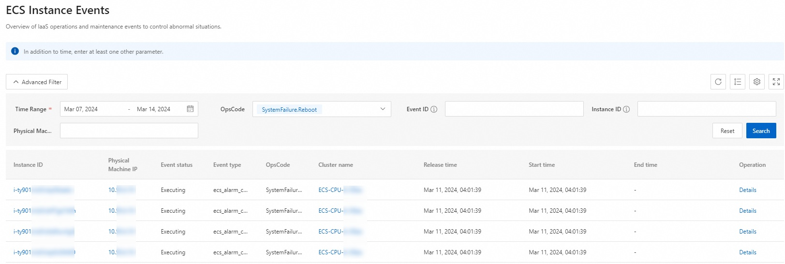

5. Find the instance event whose details you want to view and click **Details** in the **Operation** column to view the event details.

   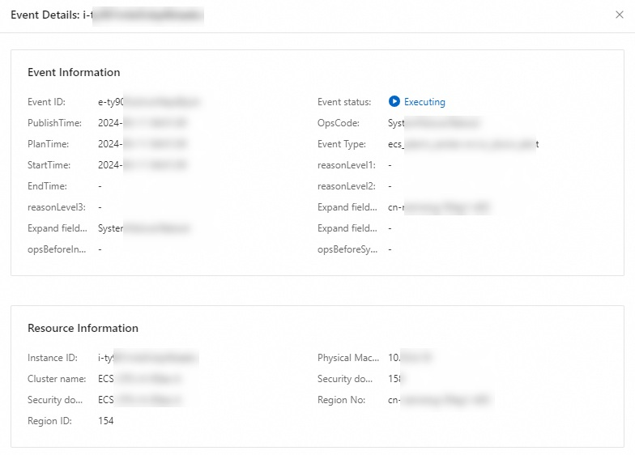

6. Find the ECS instance that you want to view and click the instance ID in the **Instance ID** column to view the instance details.

7. Find the instance event that you want to manage and click the IP address in the **Physical Machine IP Address** column to view the O&M details of the computing server that hosts the instance.

8. Find the instance event that you want to manage and click the cluster name in the **Cluster Name** column to view the O&M details of the compute cluster to which the instance belongs.

<a id="section-2-8-1-2"></a>

#### 2.8.1.2. Physical machine events

In the Compute Operations Console, you can use the Elastic Compute Service (ECS) physical machine events feature to analyze the impact of physical machine events. If the breakdown of an ECS physical machine triggers the ECS instance migration process, you can view the migrated ECS instances.

**Prerequisites**

ECS has reached the desired state.

**Procedure**

1. Log in to the Apsara Uni-manager Operations Console.

2. In the top navigation bar, choose **Product Operation > Computing > Compute Operation Console**.

3. In the left-side navigation pane, choose **ECS Intelligent O&M** > **ECS Events**. The **ECS Instance Events** tab appears.

4. Click the **Physical Machine Events** tab.

5. View all ECS physical machine events. You can configure the **Date Range**, **Physical Machine IP Address**, and **Event Status** parameters to filter ECS physical machine events.

   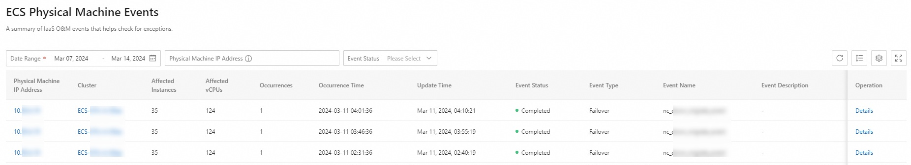

6. View the information about the ECS physical machine events in the following columns: **Physical Machine IP Address**, **Cluster**, **Affected Instances**, **Affected vCPUs**, **Occurrences**, **Occurrence Time**, **Update Time**, **Event Status**, **Event Type**, **Event Name**, **Event Description**, **Event Level**, and **Event Cause**.

7. Find the ECS physical machine event that you want to view and click **Details** in the **Operation** column. The details panel of the ECS physical machine event appears.

   | Section | Description |
   | --- | --- |
   | Physical Machine Basic Information | • This section displays the following parameters: <strong>Physical Machine IP</strong> <strong>Address</strong>, <strong>Hostname</strong>, <strong>SN</strong>, <strong>Model</strong>, <strong>CPU Cores</strong>, <strong>Memory (MiB)</strong>, <strong>Operating System Template</strong>, <strong>Cluster</strong>, <strong>Rack</strong>, and <strong>CPU Model</strong>.<br>• You can click the cluster name to go to the <strong>Compute Cluster O&amp;M</strong> <strong>Details</strong> page. For more information, see Get an overview of a computing cluster. |
   | Event Details | This section displays the following parameters: <strong>Event ID</strong>, <strong>Event Type</strong>, <strong>Affected ECS Instances</strong>, <strong>Published At</strong>, and <strong>Status</strong>. |
   | Affected Instance Information | • This section displays the following information about the affected instances: <strong>Instance ID</strong>, <strong>Instance Name</strong>, <strong>CPU Cores</strong>, <strong>Memory (GiB)</strong>, <strong>Alert Details</strong>, and <strong>Published At</strong>.<br>• You can click the <strong>instance ID</strong> to view instance details.<br>• You can click <strong>Export</strong> to download the ECS physical machine event in an XLSX file.<br>Note<br>Failover events of physical servers cannot be exported. |

8. Click the IP address in the **Physical Machine IP Address** column of an ECS physical machine event to go to the **Computing Server O&M** page. For more information, see View O&M details about a computing server.

9. Click the cluster name in the **Cluster** column to go to the **Compute Cluster O&M Details** page. For more information, see Get an overview of a computing cluster.

<a id="section-2-8-2"></a>

### 2.8.2. ECS maintenance events

<a id="section-2-8-2-1"></a>

#### 2.8.2.1. Physical machine O&M

You can view proactive O&M workflows in the ECS O&M Events module. You can also submit proactive O&M events and repair tickets for local disks.

**View proactive O&M workflows and their details**

1. Log in to the Apsara Uni-manager Operations Console.

2. In the top navigation bar, choose **Product Operation > Computing > Compute Operation Console**.

3. In the left-side navigation pane, choose **ECS Intelligent O&M** > **ECS O&M Events**.

   The **Physical Machine O&M** tab appears by default.

4. Click **Advanced Filter** and filter proactive O&M workflows by **Date Range**, **Proactive O&M Type**, **NC IP**, and **Event Status**, or their combinations.

   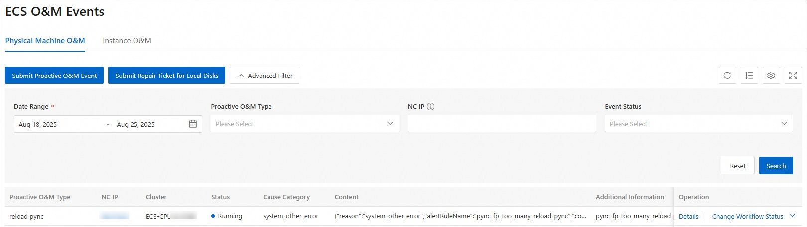

5. In the list of proactive O&M workflows, view the workflow information in the following columns: **Proactive O&M Type**, **NC IP**, **Cluster**, **Status**, **Cause Category**, **Content**, **Additional Information**, **Update Time**, **Creation Time**, **Submitted By**, and **Operation**.

6. Find the proactive O&M event that you want to view and click the IP address in the **NC IP** column. The **Computing Server Details** page appears, where you can view the O&M details of the computing server.

7. To view the details of a proactive O&M event, click **Details** in the **Operation** column of the O&M event. On the workflow details page, view the following information.

   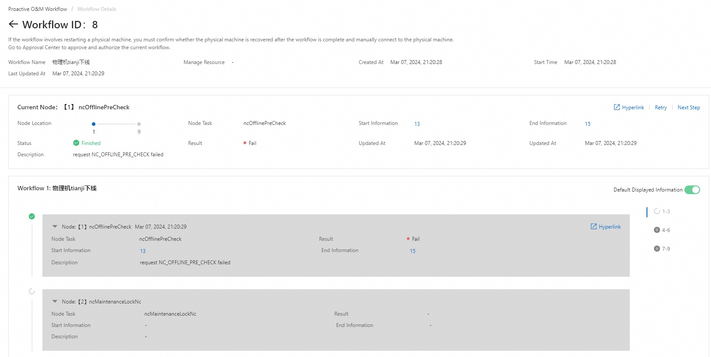

   | Section | Description |
   | --- | --- |
   | Basic Information | This section displays the basic information about the workflow, including <strong>Workflow ID</strong>, <strong>Workflow Name</strong>, <strong>Manage Resource</strong>, <strong>Created At</strong>, <strong>Start</strong> <strong>Time</strong>, and <strong>Last Updated At</strong>. |
   | Current Node | This section displays the information about the current node, including <strong>Node</strong> <strong>Location</strong>, <strong>Node Task</strong>, <strong>Start Information</strong>, <strong>End Information</strong>, <strong>Status</strong>, <strong>Result</strong>, <strong>Updated At</strong>, and <strong>Description</strong>.<br>• View the number next to the <strong>Start Information</strong> or <strong>End Information</strong> parameter to view the detailed start or end information of the workflow.<br>• Click <strong>Hyperlink</strong> to go to the ECS Diagnosis page and view the details of work items. For more information, see ECS Diagnosis.<br>• You can retry a failed work item. You must enter the reason for the retry. If the work item still fails, click <strong>Next Step</strong> to skip it and execute the next work item.<br>Warning<br>Perform the retry and skip operations only when unresolvable errors occur and make sure that you perform the operations under the guidance of R&amp;D personnel. |
   | Workflow | This section displays the execution details of the workflow.<br>• View the number next to the <strong>Start Information</strong> or <strong>End Information</strong> parameter to view the detailed start or end information of the workflow.<br>• To view the details of a failed node, click <strong>Hyperlink</strong> in the upper-right corner of the node section to go to the ECS Diagnosis page. |

8. If a workflow whose value in the **Proactive O&M Type** column is **Local Disk Nc Repair**, you can perform the following operations on the workflow details page.

   | Operation | Description |
   | --- | --- |
   | Confirm Repair Completed | After the repair is complete, click <strong>Confirm Repair Completed</strong> in the upper-right corner. In the dialog box that appears, enter the reason and click <strong>Complete Workflow</strong> to modify the workflow status. |
   | Authorize to Isolate Disks | If a local disk exception occurs and needs to be isolated for repair, click <strong>Authorize to Isolate Disks</strong> in the upper-right corner. In the dialog box that appears, enter the reason and click <strong>Authorize to Isolate Disks</strong> to complete the authorization. |
   | Authorize to Restore Isolated Disks | After you click Confirm Repair Completed, click <strong>Authorize to Restore</strong> <strong>Isolated Disks</strong> in the upper-right corner. In the dialog box that appears, enter the reason and click <strong>Authorize to Restore Isolated</strong> <strong>Disks</strong> to restore the isolated disks. |

**Submit a proactive O&M event**

> **Warning**
>
> During proactive O&M, services may be interrupted due to operations such as server restarts. Therefore, you must obtain the authorization from users and proceed with caution.

**Procedure**

1. Click **Submit Proactive O&M Event**.

2. In the dialog box that appears, configure the parameters and click **OK**.

   | Parameter | Description |
   | --- | --- |
   | IP | The IP address of the server on which you want to perform the proactive O&amp;M action. |
   | Proactive O&amp;M Type | The type of the proactive O&amp;M action, which is the OpsCode of the proactive O&amp;M event. Valid values:<br>• <strong>0x410A01-Lock NC</strong>: locks the physical machine. When the physical machine is locked, Elastic Compute Service (ECS) instances cannot be created on or migrated to the physical machine.<br>• <strong>0x40003000001001-OOB Reboot NC without live migration</strong>: migrates ECS instances on the physical machine in the O&amp;M window and then restarts the physical machine.<br>• <strong>0x40003000001066-Change NC configuration</strong>: changes the configurations of the physical machine.<br>• <strong>0x400003-OOB Reboot NC with live migration</strong>: hot migrates ECS instances on the physical machine and then restarts the physical machine.<br>• <strong>0x400012-Force NC OOB Reboot</strong>: forcibly restarts the physical machine.<br>• <strong>0x400011-recover NC status online</strong>: restores the physical machine to a normal state.<br>• <strong>0x3000000000802-Clean Wild Vm</strong>: clears residual ECS instances in the environment.<br>• <strong>0x400016-Start Local Disk Nc</strong>: performs an out-of-band (OOB) restart on the physical machine and then starts ECS instances after the physical machine is down due to a local disk failure.<br>• <strong>0x400018-Mark NC Down And Vm Migrate</strong>: forcibly migrates ECS instances on the physical machine when the physical machine is down.<br>• <strong>0x30000000001005-Start Crashed Vm</strong>: restarts ECS instance on the physical machine after a crash occurs.<br>• <strong>0x40001000008001-Stop MOC While CN Down</strong>: marks the MOC as down and cleans the MOC after the controller node (CN) of an ECS bare metal instance is down.<br>• <strong>0x4000A000000008-memory defragmentation</strong>: clears memory fragments from the physical machine.<br>• <strong>0x4000A000000007-Unlock Nc</strong>: automatically unlocks the physical machine after it is locked.<br>• <strong>0x30003000001001-Start Vm</strong>: starts the ECS instances.<br>• <strong>0x99001000000001-Local Disk Nc Repair</strong>: isolates local disks on the physical machine and replaces the disks for maintenance.<br>• <strong>0x30000000000408-Qemu live upgrade</strong>: hot upgrades the QEMU process.<br>• <strong>0x8000000000001-Nc Offline And Repair</strong>: deactivates the physical machine for maintenance.<br>• <strong>0x40007000000203-reload pync</strong>: reloads PYNC because PYNC is running for a long period of time and excessive file handles are generated.<br>• <strong>0x300000000301-preempt recover vm</strong>: cold migrates the ECS instances.<br>• <strong>0x3000000001003-restartVm:</strong> automatically handles the exception after the QEMU process of the instance is upgraded.<br>• <strong>0x30003000001002-Drp Nc Down Migrate:</strong> schedules the instances that are in the nc_down state and have insufficient resources outside the dedicated resource pool.<br>• <strong>0x4000100000240-RecoverOpenDiskVm While Nc Down</strong>: cold migrates ECS instances using preemptible disks during host downtime. This workflow preempts resources by ignoring the original instance state, preventing issues such as cloud disk split-brain.<br>• <strong>0x4000300001009-tpm ops:</strong> migrates all instances from the TPM physical machine.<br>Important<br>• The configuration parameters vary based on the type of the proactive O&amp;M action. Configure the parameters as prompted.<br>• When you submit a proactive O&amp;M event, only the O&amp;M actions that can be manually submitted are supported. You can enable or disable proactive O&amp;M actions based on your business requirements to prevent high-risk operations triggered by incorrect O&amp;M actions. For more information about how to configure O&amp;M actions, see Configure the approval process for a proactive O&amp;M action. |
   | Reason Type | The reason why you want to perform the proactive O&amp;M action on the physical machine. The following reasons are available:<br>• Hardware failures, such as failures in the fan, storage card, and motherboard.<br>• Kernel errors, such as cgroup-level out of memory (OOM) errors.<br>• Network failures, such as network cable failures.<br>• System failures, such as memory fragmentation failures.<br>• Abnormal shutdown.<br>• Security protection, such as the protection against DDoS attacks.<br>• Internal restarts. |
   | Reason | The reason for the proactive O&amp;M action. |

   **Proactive O&M types**

   | Category | Submission method | Process |
   | --- | --- | --- |
   | Lock NC | Manual submission | i. Lock the server.<br>ii. Complete O&amp;M. |
   | recover NC status online | Manual submission | i. Restore the physical machine to the online state.<br>ii. Complete O&amp;M. |
   | Unlock Nc | Manual submission | i. Lock the server.<br>ii. Wait for the scheduled time for unlocking.<br>iii. Unlock the server.<br>iv. Complete O&amp;M. |

   <table>
     <tr>
       <td>OOB Reboot NC without live migration</td>
       <td>• Automatic submission<br>• Manual submission</td>
       <td>i. Complete authorization in the Apsara Uni-manager Operations Console: Log in to the Apsara Uni-manager Operations Console as the administrator. In the top navigation bar, choose <strong>Platform Operation</strong> &gt; <strong>O&amp;M Change</strong> &gt; <strong>Process Approval</strong>. In the left-side navigation pane, choose Process Approval &gt; Pending Approval. On the Pending Approval page, complete authorization. Before you approve the proactive O&amp;M workflow, make sure that the services on the physical machine are running as expected.<br>ii. Lock the server.<br>iii. Initialize the instance status.<br>iv. Notify your customers.<br>v. Migrate ECS instances in the O&amp;M time window: If an instance exists, manually migrate the instance and then retry. Alternatively, skip the migration and perform downtime migration later.Downtime migration takes an extended period of time.<br>vi. Check the physical machine before you restart it.<br>vii. Shut down the physical machine: Log in to the Apsara Uni-manager Operations Console. In the top navigation bar, choose Platform Operation &gt; <strong>Apsara Infrastructure Management</strong> &gt; <strong>Resource Management</strong>. On the corresponding page, approve the shutdown requests for server roles.<br>viii. publish event<br>ix. oob on NC<br>x. Check whether the physical machine is started.<br>xi. Complete O&amp;M.</td>
     </tr>
   </table>

   <table>
     <tr>
       <td>OOB Reboot NC with live migration</td>
       <td>• Automatic submission<br>• Manual submission</td>
       <td>i. Complete authorization in the Apsara Uni-manager Operations Console: Log in to the Apsara Uni-manager Operations Console as the administrator. In the top navigation bar, choose <strong>Platform Operation</strong> &gt; <strong>O&amp;M Change</strong> &gt; <strong>Process Approval</strong>. In the left-side navigation pane, choose Process Approval &gt; Pending Approval. On the Pending Approval page, complete authorization. Before you approve the proactive O&amp;M workflow, make sure that the services on the physical machine are running as expected.<br>ii. Lock the server.<br>iii. Initialize the instance status.<br>iv. Perform online migration: If the migration fails, manually migrate instances on the <strong>Migration</strong> <strong>Tasks</strong> page. By default, if 50% or higher ECS instances are migrated, the migration is complete.<br>v. Reserve resource identifiers (RIs) for the ECS instances.<br>vi. Notify your customers.<br>vii. Migrate ECS instances in the O&amp;M time window: If the instance migration is not complete.Manually complete the migration and try again.Alternatively, skip the migration and perform downtime migration later. Downtime migration takes an extended period of time.<br>viii. Check the physical machine before you restart it.<br>ix. publish event<br>x. Shut down the physical machine: Log in to the Apsara Uni-manager Operations Console. In the top navigation bar, choose Platform Operation &gt; <strong>Apsara Infrastructure Management</strong> &gt; <strong>Resource Management</strong>. On the corresponding page, approve the shutdown requests for server roles.<br>xi. Start only machines with ECS instances or storage nodes.<br>xii. publish event<br>xiii. Release the RI resource pool.<br>xiv. Complete O&amp;M.</td>
     </tr>
   </table>

   <table>
     <tr>
       <td>Force NC OOB Reboot</td>
       <td>• Automatic submission<br>• Manual submission</td>
       <td>i. Complete authorization in the Apsara Uni-manager Operations Console: Log in to the Apsara Uni-manager Operations Console as the administrator. In the top navigation bar, choose <strong>Platform Operation</strong> &gt; <strong>O&amp;M Change</strong> &gt; <strong>Process Approval</strong>. In the left-side navigation pane, choose Process Approval &gt; Pending Approval. On the Pending Approval page, complete authorization. Before you approve the proactive O&amp;M workflow, make sure that the services on the physical machine are running as expected.<br>ii. Shut down the physical machine: Log in to the Apsara Uni-manager Operations Console. In the top navigation bar, choose Platform Operation &gt; <strong>Apsara Infrastructure Management</strong> &gt; <strong>Resource Management</strong>. On the corresponding page, approve the shutdown requests for server roles.<br>iii. Wait until the ECS instances are migrated.<br>iv. Wait until the physical machine fails.<br>v. oob on NC<br>vi. Complete O&amp;M.</td>
     </tr>
     <tr>
       <td>Clean Wild Vm</td>
       <td>Manual submission</td>
       <td>i. Clear residual ECS instances.<br>ii. Complete O&amp;M.</td>
     </tr>
   </table>

   <table>
     <tr>
       <td>Stop MOC While CN Down</td>
       <td>• Automatic submission<br>• Manual submission</td>
       <td>i. Complete authorization in the Apsara Uni-manager Operations Console: Log in to the Apsara Uni-manager Operations Console as the administrator. In the top navigation bar, choose <strong>Platform Operation</strong> &gt; <strong>O&amp;M Change</strong> &gt; <strong>Process Approval</strong>. In the left-side navigation pane, choose Process Approval &gt; Pending Approval. On the Pending Approval page, complete authorization. Before you approve the proactive O&amp;M workflow, make sure that the services on the physical machine are running as expected.<br>ii. Lock the server.<br>iii. Clean the MOC after the CN of an ECS instance is down.<br>iv. The physical machine is down.<br>v. Shut down the physical machine: Log in to the Apsara Uni-manager Operations Console. In the top navigation bar, choose Platform Operation &gt; <strong>Apsara Infrastructure Management</strong> &gt; <strong>Resource Management</strong>. On the corresponding page, approve the shutdown requests for server roles.<br>vi. Wait until the ECS instances are migrated.<br>vii. Wait until the physical machine fails.<br>viii. oob on NC<br>ix. Complete O&amp;M.</td>
     </tr>
     <tr>
       <td>Clear memory fragments on the physical machine.</td>
       <td>• Automatic submission<br>• Manual submission</td>
       <td>i. Lock the server.<br>ii. Drop Caches<br>iii. Trim Memory<br>iv. Unlock the server.<br>v. Complete O&amp;M.</td>
     </tr>
     <tr>
       <td>Mark NC Down And Vm Migrate</td>
       <td>• Automatic submission<br>• Manual submission</td>
       <td>i. The physical machine is down.<br>ii. Complete O&amp;M.</td>
     </tr>
     <tr>
       <td>reload pync</td>
       <td>• Automatic submission<br>• Manual submission</td>
       <td>i. Complete authorization in the Apsara Uni-manager Operations Console.<br>ii. Lock the server.<br>iii. Reload PYNC.<br>iv. Unlock the server.<br>v. Complete O&amp;M.</td>
     </tr>
     <tr>
       <td>RecoverOpenDiskVm While Nc Down</td>
       <td>Manual submission</td>
       <td>i. Use preemptible disks as much as possible to cold migrate ECS instances on a physical machine.<br>ii. The physical machine is down.<br>iii. Shut down the physical machine: Log in to the Apsara Uni-manager Operations Console. In the top navigation bar, choose Platform Operation &gt; <strong>Apsara Infrastructure Management</strong> &gt; <strong>Resource Management</strong>. On the corresponding page, approve the shutdown requests for server roles.<br>iv. Unlock the server.<br>v. Complete O&amp;M.</td>
     </tr>
     <tr>
       <td>tpm ops</td>
       <td>Manual submission</td>
       <td>i. Complete authorization in the Apsara Uni-manager Operations Console: Log in to the Apsara Uni-manager Operations Console as the administrator. In the top navigation bar, choose <strong>Platform Operation</strong> &gt; <strong>O&amp;M Change</strong> &gt; <strong>Process Approval</strong>. In the left-side navigation pane, choose Process Approval &gt; Pending Approval. On the Pending Approval page, complete authorization. Before you approve the proactive O&amp;M workflow, make sure that the services on the physical machine are running as expected.<br>ii. Lock the physical machine.<br>iii. Migrate all ECS instances from the physical machine.<br>iv. Complete O&amp;M.</td>
     </tr>
     <tr>
       <td>Start Crashed Vm</td>
       <td>• Automatic submission<br>• Manual submission</td>
       <td>i. Restore ECS instances after a crash occurs.<br>ii. Start ECS instances.<br>iii. Complete O&amp;M.</td>
     </tr>
     <tr>
       <td>Start Vm</td>
       <td>Manual submission</td>
       <td>i. Start ECS instances.<br>ii. Complete O&amp;M.</td>
     </tr>
   </table>

   <table>
     <tr>
       <td>preempt recover vm</td>
       <td>Manual submission</td>
       <td>i. Complete authorization in the Apsara Uni-manager Operations Console: Log in to the Apsara Uni-manager Operations Console as the administrator. In the top navigation bar, choose <strong>Platform Operation</strong> &gt; <strong>O&amp;M Change</strong> &gt; <strong>Process Approval</strong>. In the left-side navigation pane, choose Process Approval &gt; Pending Approval. On the Pending Approval page, complete authorization. Before you approve the proactive O&amp;M workflow, make sure that the services on the physical machine are running as expected.<br>ii. Migrate ECS instances.<br>iii. Wait until the instance migration is complete.<br>iv. Determine whether ECS instances are migrated.<br>v. Clear residual ECS instances.<br>vi. Complete O&amp;M.</td>
     </tr>
     <tr>
       <td>restartVm</td>
       <td>Manual submission</td>
       <td>i. Restart ECS instances.<br>ii. Complete O&amp;M.</td>
     </tr>
     <tr>
       <td>Drp Nc Down Migrate</td>
       <td>Manual submission</td>
       <td>i. Remove ECS instances from the dedicated resource pool (DRP).<br>ii. Modify the vm_gray_biz_type tag.<br>iii. Cold migrate ECS instances.<br>iv. Restore the vm_gray_biz_type tag.<br>v. Complete O&amp;M.</td>
     </tr>
   </table>

**Submit a repair ticket for local disks**

> **Note**
>
> If the machine already has a pending workflow, complete the workflow before you submit a repair ticket. Otherwise, the submission does not take effect.

**Procedure**

1. Click **Submit Repair Ticket for Local Disks**.

2. In the dialog box that appears, configure the following parameters and click **Report**.

   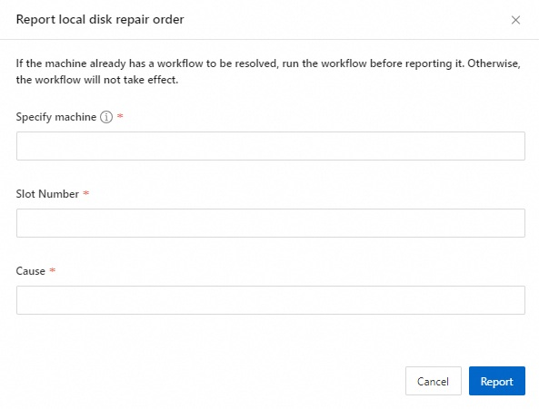

   | Parameter | Description |
   | --- | --- |
   | Machine | The hostname of the machine for which you want to submit a repair ticket.You must obtain the hostname from the physical machine on site. |
   | Slot Number | The slot number. You must obtain it from the physical machine on site. |
   | Cause | The reason for submitting the repair ticket for local disks. |

**Modify the status of a workflow**

**Prerequisites**

The proactive O&M workflow is in the Running state.

**Procedure**

- Complete a workflow

  <ol type="i">

  <li>

  Find the workflow that you want to manage, move the pointer over **Change Workflow Status** in the **Operation** column, and then select **Complete Workflow**.

  </li>

  <li>

  In the message that appears, click **OK**.

  </li>

  </ol>

- Cancel a workflow

  <ol type="i">

  <li>

  Find the workflow that you want to manage, move the pointer over **Change Workflow Status** in the **Operation** column, and then select **Cancel Workflow**.

  </li>

  <li>

  In the message that appears, click **OK**.

  </li>

  </ol>

<a id="section-2-8-2-2"></a>

#### 2.8.2.2. Instance O&M

You can use ECS O&M events to view active O&M workflows of ECS instances and modify the workflow status.

**View proactive O&M workflows and their details**

1. Log in to the Apsara Uni-manager Operations Console.

2. In the top navigation bar, choose **Product Operation** > **Computing** > **Compute Operations Console**.

3. In the left-side navigation pane, choose **ECS Intelligent O&M > ECS O&M Events**. Then, click the **Instance O&M** tab.

4. Click **Advanced Filter** and filter proactive O&M workflows by **Date Range**, **Proactive O&M Type**, **Event Status**, and Instance Id, or their combinations.

5. In the list of proactive O&M workflows, view the workflow information in the following columns: **Proactive O&M Type**, **Instance Id**, **Cluster**, **Status**, **Cause Category**, **Content**, **Additional Information**, **Update Time**, **Creation Time**, **Submitted By**, and **Operation**.

6. To view the details of a proactive O&M event, click **Details** in the **Operation** column of the O&M event. On the workflow details page, view the following information.

   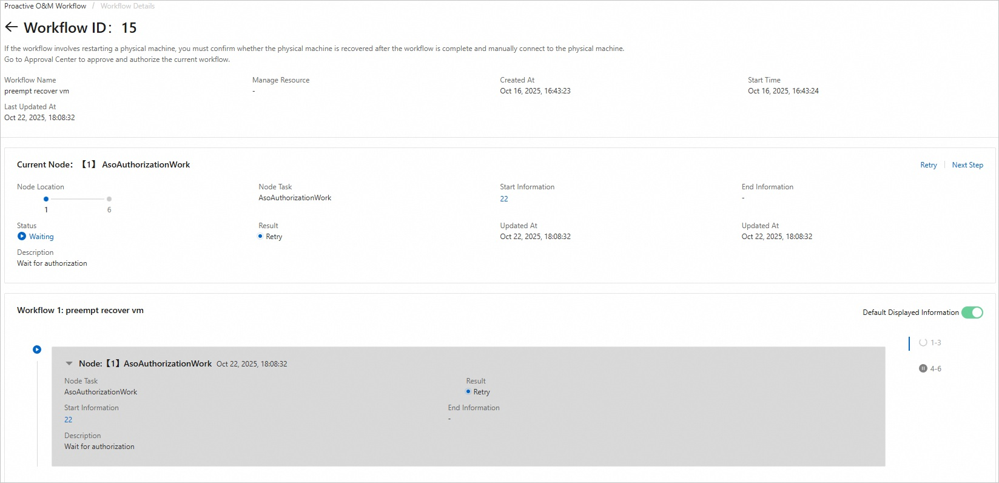

   | Section | Description |
   | --- | --- |
   | Basic Information | This section displays the basic information about the workflow, including <strong>Workflow ID</strong>, <strong>Workflow Name</strong>, <strong>Manage Resource</strong>, <strong>Created At</strong>, <strong>Start</strong> <strong>Time</strong>, and <strong>Last Updated At</strong>. |

   <table>
     <tr>
       <td>Current Node</td>
       <td>This section displays the information about the current node, including <strong>Node</strong> <strong>Location</strong>, <strong>Node Task</strong>, <strong>Start Information</strong>, <strong>End Information</strong>, <strong>Status</strong>, <strong>Result</strong>, <strong>Updated At</strong>, and <strong>Description</strong>.<br>• View the number next to the <strong>Start Information</strong> or <strong>End Information</strong> parameter to view the detailed start or end information of the workflow.<br>• If a node is stuck or fails to be executed due to sporadic environment-related issues, you can click <strong>Retry</strong> to execute the node again.<br>• If a node is stuck or fails to be executed, and skipping the node does not affect the overall O&amp;M process, click <strong>Next Step</strong> to skip the node.<br>Warning<br>Perform the retry and skip operations only when unresolvable errors occur and make sure that you perform the operations under the guidance of R&amp;D personnel.</td>
     </tr>
     <tr>
       <td>Workflow</td>
       <td>This section displays the execution details of the workflow.<br>View the number next to the <strong>Start Information</strong> or <strong>End Information</strong> parameter to view the detailed start or end information of the workflow.</td>
     </tr>
   </table>

**Modify the status of a workflow**

**Prerequisites**

The proactive O&M workflow is in the Running state.

**Procedure**

- Complete a workflow

  <ol type="i">

  <li>

  Find the workflow that you want to manage, move the pointer over **Change Workflow Status** in the **Operation** column, and then select **Complete Workflow**.

  </li>

  <li>

  In the message that appears, click **OK**.

  </li>

  </ol>

- Cancel a workflow

  <ol type="i">

  <li>

  Find the workflow that you want to manage, move the pointer over **Change Workflow Status** in the **Operation** column, and then select **Cancel Workflow**.

  </li>

  <li>

  In the message that appears, click **OK**.

  </li>

  </ol>

<a id="section-2-8-3"></a>

### 2.8.3. ECS workflows

This topic describes how to view the Elastic Compute Service (ECS) workflow information and manage ECS workflows.

**View workflow information and activity details**

1. Log in to the Apsara Uni-manager Operations Console.

2. In the top navigation bar, choose **Product Operation** > **Computing** > **Compute Operations Console**.

3. In the left-side navigation pane, choose **ECS Intelligent O&M > ECS Workflows**.

4. On the ECS Workflows page, click **Advanced Filter**. Then, configure parameters such as **Workflow ID**, **Workflow Name**, **Workflow Status**, **Business ID**, **Apsara Stack Tenant Account ID**, **InstanceId**, and **Time Range** to filter workflows.

   > **Note**
   >
   > Valid values of the **Workflow Status** parameter:
   >
   > - SCHEDULABLE: The workflow can be scheduled.
   >
   > - HUMAN_PROCESSING: The workflow needs to be manually processed.
   >
   > - RUNNING: The workflow is running.
   >
   > - COMPLETED: The workflow is complete.
   >
   > - FAILED: The workflow failed.
   >
   > - TERMINATED: The workflow is terminated.

5. View the information about workflows in the following columns: **Workflow Name**, **Workflow ID**, **Business ID**, **Apsara Stack Tenant Account ID**, **Instance ID**, **Start Time**, **End Time**, **Execution Node**, and **Execution Status**.

   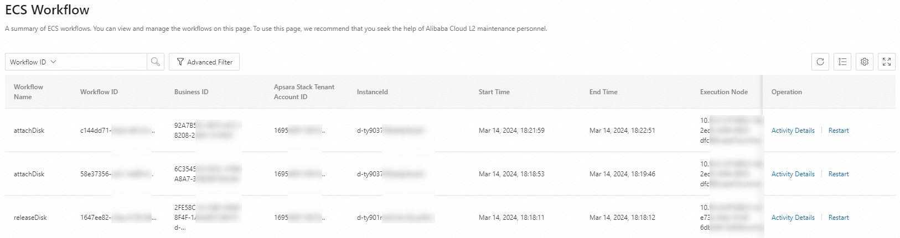

6. Find the workflow that you want to view and click **Activity Details** in the **Operation** column. On the Activity Details page, view the workflow details in the following columns: **Activity ID**, **Activity Name**, **Method**, **Status**, **Input**, **Output**, **Exception**, **Start Time**, and **End Time**.

   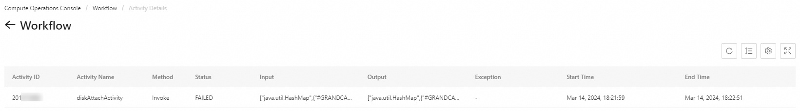

**Restart a workflow**

**Prerequisites**

The workflow that you want to restart is in the **COMPLETED**, **FAILED**, or **HUMAN_PROCESSING** state.

**Procedure**

1. On the ECS Workflows page, find the workflow that you want to restart and click **Restart** in the **Operation** column.

2. In the message that appears, click **OK**.

**Roll back a workflow**

**Prerequisites**

The workflow that you want to roll back is in the **HUMAN_PROCESSING** state.

**Procedure**

1. On the ECS Workflows page, find the workflow that you want to roll back and click **Roll Back** in the **Operation** column.

2. In the message that appears, click **OK**.

**Terminate a workflow**

**Prerequisites**

The workflow that you want to terminate is in the **HUMAN_PROCESSING** state.

**Procedure**

1. On the ECS Workflows page, find the workflow that you want to terminate and click **Terminate** in the **Operation** column.

2. In the message that appears, click **OK**.

<a id="section-2-8-4"></a>

### 2.8.4. ECS diagnostics

The Elastic Compute Service (ECS) diagnostics feature supports end-to-end exception diagnostics for physical machines and ECS instances. If an exception occurs on an ECS instance (VM) or a host (NC), you can diagnose the exception on the End-to-end Demarcation or Batch Diagnosis tab and identify the exception cause based on the diagnostics result.

**Prerequisites**

View the IDs of ECS instances or IP addresses of hosts on the **ECS Instances** page of the Apsara Uni-manager Operations Console. For more information, see View the details of an instance.

**Procedure**

1. Log in to the Apsara Uni-manager Operations Console.

2. In the top navigation bar, choose **Product Operation** > **Computing** > **Compute Operations Console**.

3. In the left-side navigation pane, choose **ECS Intelligent O&M > ECS diagnosis**.

4. On the ECS Diagnosis page, click the **End-to-end Demarcation** or **Batch Diagnosis** tab.

   - End-to-end Demarcation

     On the **End-to-end Demarcation** tab, specify query conditions and click the

     icon.

     

     The following table describes the query conditions.

     | Query condition | Description |
     | --- | --- |
     | Time Range | The time range in which the exceptions occurred. By default, the exceptions generated in the previous two days are displayed.<br>If you want to query the exceptions generated earlier, specify a time range. The time range can be up to 10 days. |
     | Machine ID | The ID of an ECS instance or IP address of a host.<br>You can view the ECS instance ID or the host IP address on the <strong>ECS Instances</strong> page of the Apsara Uni-manager Operations Console. For more information, see View the details of an instance. |

     In the query results, you can view the basic information, root cause diagnosis, and exceptions of the ECS instance or host.

   - Batch Diagnosis

     On the **Batch Diagnosis** tab, specify query conditions and click the

     icon. The

     

     following table describes the query conditions.

     | Query condition | Description |
     | --- | --- |
     | Time Range | The time range in which the exceptions occurred. By default, the exceptions generated in the previous two days are displayed.<br>If you want to query the exceptions generated earlier, specify a time range. The time range can be up to 10 days. |
     | Diagnostic Category | The diagnostic Item. Valid values:<br>• Reason Vm Applicability<br>• Reason Nc Perf<br>• Reason Nc Down<br>• Reason Start Stop<br>• Reason Vm Perf<br>• Default |
     | Machine ID | The IDs of ECS instances or IP addresses of hosts. |

     You can view the diagnostics information in the following columns: **Diagnostic Object**, **NcIP**, **Local Disk**, **Machine Status**, **Exception Occurred At**, **Severity Level**, and **Possible Cause**.

<a id="section-2-9"></a>

## 2.9. Computing O&M configurations

<a id="section-2-9-1"></a>

### 2.9.1. View monitoring settings

This topic describes how to enable the feature of pushing alerts to the alert list in the Apsara Uni-manager Operations Console for an Elastic Compute Service (ECS) monitoring metric and configure alert levels.

**Scenarios**

After you enable the feature of pushing alerts to the alert list in the Apsara Uni-manager Operations Console for an ECS monitoring metric and configure alert levels for the monitoring levels of the metric, log in to the Apsara Uni-manager Operations Console. In the top navigation bar, choose **Monitor&Alert > Alert Management > Alert List**. Then, you can find information about the alerts generated for the ECS monitoring metric in the alert list, including the alert levels, and troubleshoot issues based on the alert details.

> **Note**
>
> For information about how to view alerts, see the **Alert Management > Alert List** chapter in the *Apsara Uni-manager Operations Console User Guide*.

**Usage notes**

Alerts generated for an ECS monitoring metric are displayed in the alert list in the Alerts console only after you enable the feature of pushing alerts to the alert list in the Apsara Uni-manager Operations Console for the metric and configure alert levels for the monitoring levels of the metric. To display and view alerts generated for an ECS monitoring metric in the alert list in the Alerts console, perform the following steps:

1. Open the Edit dialog box of an ECS monitoring metric and select the Push Alert to Apsara Uni-manager Operations Console option. In the **Apsara Uni-manager Operations Console Alert Level** section, configure alert levels. For more information, see the Procedure section of this topic.

   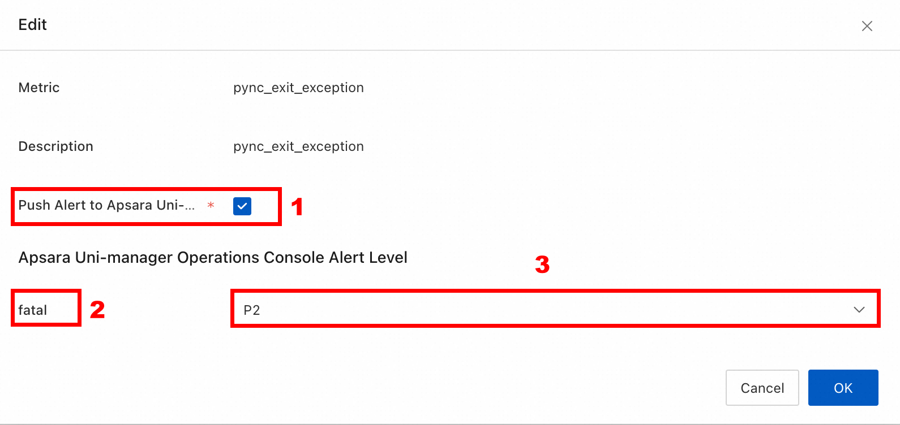

   - Section 1 in the preceding figure displays the Push Alert to Apsara Uni-manager Operations Console option. Select this option to enable the feature of pushing alerts to the alert list in the Apsara Uni-manager Operations Console.

   - Section 2 in the preceding figure displays the monitoring levels of the ECS monitoring metric.

     > **Note**
     >
     > The following list describes the monitoring levels of ECS metrics.
     >
     > - Each ECS monitoring metric has one or more built-in monitoring levels. The following monitoring levels are arranged from the highest to lowest severity level:
     >
     >   ```text
     >    fatal 
     >
     >    critical 
     >
     >    warning 
     >
     >    low_warning 
     >   ```
     >
     > - Different ECS monitoring metrics have different monitoring levels.
     >
     >   For example, the pync_prepare_vm_exception metric has the  `critical`  and  `warning`  monitoring levels. The nc_session_too_large metric has the  `fatal` monitoring level. The actual monitoring levels of each ECS monitoring metric are displayed on the **Monitoring** tab of the **Computing O&M Configurations** page in the **Compute Operations Console**.

   - Section 3 in the preceding figure displays the alert levels for monitoring levels.

     > **Note**
     >
     > The following alert levels are arranged from the highest to the lowest severity level:
     >
     > - P1: Critical
     >
     > - P2: Major
     >
     > - P3: Minor
     >
     > - P4: Informational

2. View alerts.

   After an alert is generated for an ECS monitoring metric, log on to the Apsara Uni-manager Operations Console. In the top navigation bar, choose **Monitor&Alarms > Alerts > Alerts**. Then, enter the ECS monitoring metric name in the search box. In the search results, you can view the alerts of the **alert level** that you configured in Step 1, as shown in the following figure.

   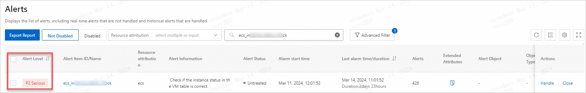

   > **Important**
   >
   > If you configure multiple alert levels for an ECS monitoring metric, such as  `critical` and  `warning` , and alerts of an alert level are generated for the metric, the alerts are pushed to the alert list in the Alerts console. In this case, multiple alerts of different alert levels for the ECS monitoring metric may be displayed in the alert list.

**Procedure**

1. Log in to the Apsara Uni-manager Operations Console.

2. In the top navigation bar, choose **Product Operation > Computing > Compute Operations Console**.

3. In the left-side navigation pane, click **ECS O&M Settings**.

4. Click a tab corresponding to a monitoring metric category under the **Monitoring** tab.

   The monitoring metric category-specific tab displays a list of ECS monitoring metrics that includes the following columns: Metric, Description, Monitoring Type, Resource Type, Push to Apsara Uni-manager Operations Console, and Apsara Uni-manager Operations Console Alert Level.

   | Monitoring metric category | Description |
   | --- | --- |
   | Control-side Monitoring | Includes the monitoring metrics for the ECS software control side. Example: <strong>monitor_data_loss_too_long</strong>, which indicates that monitoring data is unexpectedly missing for an extended period of time. |
   | Virtualization Monitoring | Includes the monitoring metrics for the virtualization services on ECS physical machines. Example: <strong>vm_monitor_qemu_exception</strong>, which indicates that an exception occurred while collecting virtualization-related monitoring data of virtual machines (VMs). |
   | System Monitoring | Includes the monitoring metrics for the operating systems of ECS physical machines. Example: <strong>cgroup_mem_limitation</strong>, which indicates that the memory usage of a cgroup exceeds the limit. |
   | Hardware Monitoring | Includes the monitoring metrics for ECS physical machine hardware. Example: <strong>hardware_exception_alarm</strong>, which indicates that alerts are generated for hardware exceptions. |
   | Hang Monitoring | Includes the monitoring metrics for the hangs of ECS physical machines. Example: <strong>nc_hang_exception</strong>, which indicates that ECS physical machines freeze. |
   | Failover Monitoring | Includes the monitoring metrics for physical machine-triggered failovers of ECS instances. Example: <strong>nc_down_alert</strong>, which indicates that ECS instances are failed over when the physical machine on which the instances reside is down. |

5. On the **Operation** column of the monitoring metric category-specific tab, click **Edit** to modify the parameters of monitoring metrics. The following table describes the parameters.

   | Parameter | Description |
   | --- | --- |
   | Push Alert to Apsara Uni-manager Operations Console | Specifies whether the generated alerts are pushed to the alert list in the Apsara Uni-manager Operations Console. Valid values: Yes and No.<br>Important<br>• No: The generated alerts are not pushed to the alert list. In this case, you cannot find the alerts in the alert list and may fail to obtain important alert information.<br>• Yes: The generated alerts are pushed to the alert list. In this case, the alerts are displayed in the alert list only if you configure the <strong>Apsara Uni-manager Operations Console</strong> <strong>Alert Level</strong> parameter. |
   | Apsara Uni-manager Operations Console Alert Level | The alert levels displayed in the alert list.<br>• The following monitoring levels of the monitoring metric may be displayed:<br>• fatal<br>• critical<br>• warning<br>• low_warning<br>• The valid values of alert levels for monitoring levels may vary based on the monitoring metric category.<br>• For the Control-side Monitoring, Virtualization Monitoring, System Monitoring, Hardware Monitoring, and Hang Monitoring categories, the valid values of alert levels for monitoring levels are P2, P3, and P4.<br>• For the Failover Monitoring category, the valid values of alert levels for monitoring levels are P2, P3, and P4.<br>Important<br>If you changed the alert level for the monitoring level of a failover monitoring metric from P1 to P2, P3, or P4, you cannot roll back the alert level to P1. |

6. Click **OK**.

   You can find a metric in the monitoring metric list and view the alert levels in the JSON-formatted array displayed in the **Apsara Uni-manager Operations Console Alert Level** column.

<a id="section-2-9-2"></a>

### 2.9.2. Configure O&M actions

<a id="section-2-9-2-1"></a>

#### 2.9.2.1. Configure throttling for a proactive O&M action

You can configure throttling limits for proactive O&M actions, such as the maximum number of times that the workflow of a proactive O&M action can be executed within the specified execution window. This prevents proactive O&M actions from being repeatedly and unnecessarily executed. This topic describes how to configure throttling for a proactive O&M action.

**Background information**

You can adjust throttling limits for proactive O&M actions based on actual conditions and on-site O&M requirements. For example, a proactive O&M action is configured to be executed when a physical machine freezes.

If the proactive O&M action is executed but does not resolve the issue and the physical machine remains frozen, the action is executed repeatedly to deactivate and reactivate the physical machine until the physical machine is recovered. In this case, you can configure throttling limits for the proactive O&M action. For example, you can configure throttling limits to allow the proactive O&M action to be executed only one time within a 168-hour execution window. This way, after the proactive action is executed, the Apsara Uni-manager Operations Console does not execute the action again within the next 168 hours, and you can perform other O&M operations to resolve the physical machine freeze issue at the earliest opportunity.

**Procedure**

1. Log in to the Apsara Uni-manager Operations Console.

2. In the top navigation bar, choose **Product Operation > Computing > Compute Operations Console**.

3. In the left-side navigation pane, click **ECS O&M Settings**.

   > **Note**
   >
   > By default, the **Monitoring** tab appears.

4. Click the **O&M Actions** tab.

   A list of proactive O&M actions is displayed, which includes the **OpsCode** (O&M type), **Throttling Status**, and **Throttling Effective Time** columns.

   > **Note**
   >
   > The **Support for Manual Reporting** and **Approval for Manually Reported O&M Workflow** parameters of a proactive O&M action vary based on the approval configuration of the action. For more information, see Configure the approval process for a proactive O&M action.

5. Find the proactive O&M action that you want to manage and click **Configure Throttling** in the **Operation** column. In the Configure Throttling dialog box, configure parameters and click **OK**. The following table describes the parameters.

   > **Important**
   >
   > If a proactive O&M action exceeds a regional or cluster-wide throttling limit, the Apsara Uni-manager Operations Console no longer executes the action.

   | Parameter | Description |
   | --- | --- |
   | opscode | The O&amp;M type of the proactive O&amp;M action. This parameter cannot be modified. |
   | Throttling Status | Specifies whether to enable throttling for the proactive O&amp;M action. |
   | Throttling Window (Minutes) | The execution window of the proactive O&amp;M action within the region. Unit: minutes.<br>We recommend that you set this parameter to<br>10080. 10,080 minutes equals 168 hours. |
   | Throttling Threshold | The maximum number of times that the workflow of the proactive O&amp;M action can be executed in the region. We recommend that you set this parameter to 1. |
   | Cluster-wide Throttling Window (Minutes) | The execution window for the proactive O&amp;M action within the cluster. Unit: minutes. We recommend that you set this parameter to<br>10080. 10,080 minutes equals 168 hours. |
   | Cluster-wide Throttling Window (Minutes) | The maximum number of times that the workflow of the proactive O&amp;M action can be executed in the cluster. We recommend that you set this parameter to 1. |
   | Throttling Policy | Set this parameter to <strong>Cancel</strong>, which specifies that the workflow is canceled when the proactive O&amp;M action exceeds a throttling limit. |

<a id="section-2-9-2-2"></a>

#### 2.9.2.2. Configure the approval process for a proactive O&M action

You can enable the Support for Manual Reporting feature for proactive O&M actions to submit relevant proactive O&M events and initiate O&M. You can also configure the approval process for proactive O&M actions based on your business requirements.

**Background information**

- On-site O&M personnel can create proactive O&M actions and configure the approval process for the actions, such as skipping the approval steps to perform the actions, based on actual scenarios and on-site O&M requirements. After you create a proactive O&M action and configure the approval process for the action, you must ask an Apsara Uni-manager Operations Console administrator to perform the following operations before you can perform the proactive O&M action: Log on to the Apsara Uni-manager Operations Console, choose Platform Operation > O&M Change > Process Approval in the top navigation bar, choose **Process Approval > Pending Approval** in the left-side navigation pane of the **O&M Change** console, and then approve the submitted proactive O&M events.

  > **Important**
  >
  > Skipping the approval process may affect subsequent audits. We recommend that you retain the approval process for an Apsara Uni-manager Operations Console administrator to follow.

- On-site O&M personnel can configure the **Support for Manual Reporting** feature for proactive O&M actions based on actual operating conditions to prevent accidental operations. For example, you can set the **Support for Manual Reporting** parameter to No in the **Configure Approval** dialog box to disable the Support for Manual Reporting feature for the **0x400012-Force NC OOB Reboot** proactive O&M action (O&M type). This way, you cannot select the proactive O&M action when you submit a proactive O&M event in the **Submit Proactive O&M Event** dialog box. This helps reduce related accidental operations.

**Considerations**

- By default, the **Support for Manual Reporting** feature is enabled for proactive O&M actions. You can submit proactive O&M events related to proactive O&M actions.

  > **Important**
  >
  > You can submit proactive O&M events related to only the proactive O&M actions for which the Support for Manual Reporting feature is enabled. For information about how to submit a proactive O&M event, see Submit a proactive O&M event for a server.

- The O&M types for which you can configure the Support for Manual Reporting feature and the Approval for Manually Reported O&M Workflow feature are displayed in the Apsara Uni-manager Operations Console. You can use only the default setting of the Approval for Manually Reported O&M Workflow feature for specific O&M types, but cannot change the default setting. For example, the Support for Manual Reporting feature is automatically enabled and the Approval for Manually Reported O&M Workflow feature is automatically disabled for the **0x4000A000000007-Unlock Nc** O&M type. In this case, the proactive O&M action can be performed without the need for approval of an Apsara Uni-manager Operations Console administrator after you submit a proactive O&M event related to the O&M type.

**Procedure**

1. Log in to the Apsara Uni-manager Operations Console.

2. In the top navigation bar, choose **Product Operation > Computing > Compute Operations Console**.

3. In the left-side navigation pane, click **ECS O&M Settings**.

   > **Note**
   >
   > The **Monitoring** tab appears.

4. Click the **O&M Actions** tab.

   On the O&M Actions tab, you can view information about each proactive O&M action in the action list, such as the O&M type (**OpsCode**), whether relevant proactive O&M events can be manually submitted (**Support for Manual Reporting**), and whether the manually submitted proactive O&M events require approval (**Approval for Manually Reported O&M Workflow**).

5. Find the proactive O&M action that you want to manage and click **Configure Approval** in the **Operation** column. In the dialog box that appears, configure the parameters and click **OK**. The following table describes the parameters.

   | Parameter | Description |
   | --- | --- |
   | opscode | The O&amp;M type. You cannot change the value of this parameter. |
   | Support for Manual Reporting | Specifies whether you can submit proactive O&amp;M events related to the proactive O&amp;M action on the <strong>Proactive O&amp;M</strong> page. Default value: <strong>Yes</strong>.<br>Important<br>If you set this parameter to <strong>No</strong>, you cannot submit proactive O&amp;M events related to the proactive O&amp;M action on the <strong>Proactive</strong> <strong>O&amp;M</strong> page. Proceed with caution when you set this parameter to No. |
   | Approval for Manually Reported O&amp;M Workflow | Specifies whether manually submitted proactive O&amp;M events require approval. Default value: <strong>Yes</strong>.<br>Important<br>If you set this parameter to <strong>No</strong>, the proactive O&amp;M action can be performed without the need for approval. |

<a id="section-2-9-3"></a>

### 2.9.3. Modify the release time of a disk

On the Computing O&M Configurations page, you can specify the disk release time based on your business requirements. This feature is used to prevent resource waste and ensure data security and business continuity. O&M engineers can specify the disk release time in the Compute Operations Console to complete O&M based on the actual business requirements.

**Usage notes**

- If you release a disk, the data stored in the disk cannot be restored. We recommend that you create snapshots for a disk to back up data before you release the disk.

- You can specify whether to delete automatic snapshots created for a disk when the disk is released. If the **Release Automatic Snapshots with Disk** feature is enabled for a disk, the automatic snapshots created for the disk are deleted when the disk is released.

**Procedure**

1. Log in to the Apsara Uni-manager Operations Console.

2. In the top navigation bar, choose **Product Operation > Computing > Compute Operations Console**.

3. In the left-side navigation pane, click **Computing O&M Configurations**.

4. On the **Computing O&M Configurations** page, click the **Disk Reclamation Time Adjustment** tab.

5. On the **Disk Reclamation Time Adjustment** tab, configure the parameters that are described in the following table and click **Submit**.

   | Parameter | Description |
   | --- | --- |
   | Disk Reclamation Time | • If you set this parameter to a value in the range of 0 to 48:<br>The period after which disks that are released together with associated instances are reclaimed by PANGU. A released disk is automatically reclaimed after 0 to 48 hours after the associated instance is released. The disk can be used as expected after it is reclaimed.<br>• If you set this parameter to -1:<br>The disk reclamation time is not specified. The disk is reclaimed based on the default policy of ECS. When the instance is released, the disk is released or reclaimed based on the policy. |
   | Description | The reason for adjusting the disk release time. |

<a id="section-2-10"></a>

## 2.10. View O&M audit logs

The Compute Operations Console provides traceability of resource operations. In the Compute Operations Console, you can view the historical operations performed on resources, historical POP API calls, and historical Server Controller API calls and identify high-risk operations.

**Procedure**

1. Log in to the Apsara Uni-manager Operations Console.

2. In the top navigation bar, choose **Product Operation > Computing > Compute Operations Console**.

3. In the left-side navigation pane, click **O&M Audit Logs**.

   By default, the **Operations in the Apsara Uni-manager Operations Console** tab of the O&M Audit Logs page is displayed.

4. View the information displayed on each tab. The following table describes the information that you can view on each tab.

   | Tab | Description |
   | --- | --- |
   | Operations in the Apsara Uni-manager Operations Console | In the upper part of the tab, enter an operation, an operator, a resource, or a request ID in the <strong>Keyword</strong> field, specify a time range for the <strong>Time Range</strong> parameter, and then click <strong>Search</strong>.<br>In the operation list, view the following information about the operation records: operation, operation time, operation result, operator, resource, error information, request ID, request parameters, and description. |
   | POP API Calls | In the upper part of the tab, enter an operation, a request ID, or a caller in the <strong>Keyword</strong> field, specify a time range for the <strong>Time Range</strong> parameter, and then click <strong>Search</strong>.<br>In the API call list, view the following information about the calls: operation, operation time, request ID, HTTP status code, error information, service, request parameters, and caller. |
   | Server Controller API Calls | In the upper part of the tab, enter an operation, a request ID, or a request IP address in the <strong>Keyword</strong> field, specify a time range for the <strong>Time Range</strong> parameter, and then click <strong>Search</strong>.<br>In the API call list, view the following information about the calls: operation, request ID, request time, response code, request IP address, request duration, and request parameters. |

<a id="section-2-11"></a>

## 2.11. Tiangong O&M

<a id="section-2-11-1"></a>

### 2.11.1. View Tiangong services

This topic describes how to view the basic information about cloud services that are deployed on Elastic Compute Service (ECS) in the Tiangong 2.0 architecture.

**Procedure**

1. Log in to the Apsara Uni-manager Operations Console.

2. In the top navigation bar, choose **Product Operation > Computing > Compute Operations Console**.

3. In the left-side navigation pane, choose **Tiangong O&M** > **Tiangong Services**.

4. View data on the Tiangong Services page. By default, the system displays the details of cloud services deployed on ECS, including the cloud service name, Tiangong architecture, and number of Tiangong machine groups.

   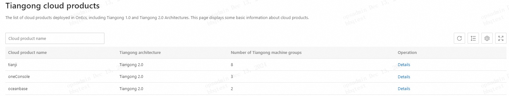

5. In the upper-left corner of the Tiangong Services page, you can enter a cloud service name in the search box to search for the cloud service.

6. View the details of a cloud service.

   <ol type="i">

   <li>

   Find the cloud service that you want to view and click **Details** in the **Operation** column. The details page of the cloud service appears.

   </li>

   <li>

   On the **Overview** tab, view information in the **Basic Information** and **Tiangong**

   </li>

   </ol>

   **Resource Inventory** sections.

   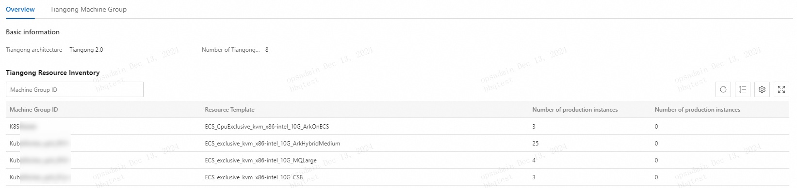

   - **Basic Information**: includes the **Tiangong architecture** and **Number of Tiangong machine groups** parameters.

   - **Tiangong Resource Inventory**: allows you to view information in the **Machine Group ID**, **Resource Template**, **Number of produced instances**, and **Number of production instances** columns.

     Enter a machine group ID in the search box to search for the machine group.

   <ol type="i" start="3">

   <li>

   Click the **Tiangong Machine Group** tab. On the Tiangong Machine Group tab, view

   </li>

   </ol>

   information about machine groups in the **Type**, **Resource Template**, **VM image**, **Supported specifications (families)**, **Deployment policy**, and **Instances (Created/Total)** columns.

   Enter a machine group ID in the search box to search for the machine group.

   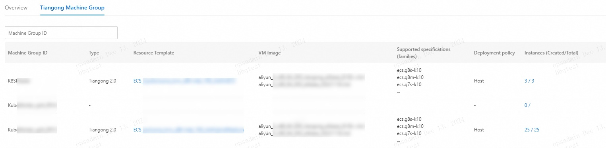

   - Find the machine group that you want to view and click the value in the **Resource Template** column. In the Resource Template Details panel, view the details of the resource template of the machine group.

   - Find the machine group that you want to view and click the value in the **Instances (Created/Total)** column. In the Instance Details panel, view the status of the instances.

<a id="section-2-11-2"></a>

### 2.11.2. View Tiangong workflows

This topic describes how to view the workflow of the Tiangong adaptation layer triggered by the task sent by Apsara Infrastructure Management, including the status information such as resource processing and instance cloning. You can also perform O&M operations on the workflow.

**Procedure**

1. Log in to the Apsara Uni-manager Operations Console.

2. In the top navigation bar, choose **Product Operation > Computing > Compute Operations Console**.

3. In the left-side navigation pane, choose **Tiangong O&M** > **Tiangong Workflows**.

4. By default, the information about workflows that are triggered by tasks sent by Apsara Infrastructure Management is displayed on the Tiangong Workflows page. The information includes **Workflow ID**, **Workflow Initiator**, **Workflow Type**, **Instance ID/Hostname**, **Workflow Status**, and **Exception Information**.

   | Parameter | Description |
   | --- | --- |
   | Workflow Initiator | The value of this parameter is globally unique and consists of information about a project, a cluster, and a server role group in Apsara Infrastructure Management. |
   | Workflow Type | The valid values of this parameter are Single Instance Creation, Single Instance Update, Instance Deletion, Instance Cloning, and Instance Recloning. |
   | Instance ID/Hostname | You can click the value in the <strong>Instance ID/Hostname</strong> column to view the instance details. For more information, see View the details of an instance. |
   | Workflow Status | Valid values: Complete and Failed. |
   | Exception Information | You can view the details of a workflow failure. |

5. Click **Advanced Filter** and filter workflows by **Workflow ID**, **Workflow Type**, and **Hostname**.

6. View workflow logs.

   <ol type="i">

   <li>

   Find the workflow that you want to manage and click **View workflow logs** in the **Operation** column.

   </li>

   <li>

   In the Workflow logs panel, specify a time range and view the workflow logs within the

   </li>

   </ol>

   specified time range. You can view the information about each log, including the time, log level, and log content.

   > **Note**
   >
   > You can view logs only within the previous seven days.

<a id="section-2-12"></a>

## 2.12. ECS Operation Assistant

Elastic Compute Service (ECS) Operation Assistant is an ECS O&M agent based on the cloud platform. It supports three features: resource query, alert analysis, and event diagnosis.

> **Important**
>
> The query results returned by ECS Operation Assistant are automatically generated by AI models. The results may not be completely accurate and are for reference only. We recommend that you verify the accuracy of the results based on the actual situation.

**Procedure**

1. Log in to the Apsara Uni-manager Operations Console.

2. In the top navigation bar, choose **Product Operation > Computing > Compute Operations Console**.

   

3. In the lower-right corner of any page in the Compute Operations Console, click the

   icon.

   Alternatively, choose **Platform Operations > Management and Control Service O&M > AIOps**.

4. In the **Apsara AIOps** console, choose O&M Agent > **ECS Operation Assistant** in the left-side navigation pane.

5. On the **ECS Operation Assistant** page, enter your question and press the Shift + Enter keys. Then, the system understands your intent and returns the query result.

**Resource query**

**Command keywords**

If the question contains keywords such as query instance, physical machine, cluster, disk, network interface controller, security group, image, specification, inventory, and capacity, a resource query is triggered.

**Limits**

- In the query result, only the first 10 entries are returned. For example, if more than 10 instances are obtained, only the first 10 instances are returned. Other instances are displayed on the corresponding instance page.

- For complex queries, only 10 entries are returned. For example, if you query instances that are available for each physical machine in the cluster  `ecs-compute-xxx` , and more than 10 physical machines are in the cluster  `ecs-compute-xxx` , only the information about the first 10 physical machines is displayed. The query task stops when the first 10 physical machines are obtained.

- Only query operations are supported. Operations such as modification or deletion are not supported.

**Examples**

ECS Operation Assistant can query the following resource information:

| Resource | Example |
| --- | --- |

<table>
  <tr>
    <td>Instance</td>
    <td>• Query the basic information about the instance <code> i-9nh00jr6nk4lmrsb**** </code><br>• Query the disks that are attached to the instance <code> i-9nh00jr6nk4lmrsb**** </code><br>• Query the network interface controller (NIC) information about the instance <code> i-</code><code>9nh00jr6nk4lmrsb****</code><br>• Query the security group of the instance <code> i-9nh00jr6nk4lmrsb**** </code><br>• Query the image used by the instance <code> i-9nh00jr6nk4lmrsb**** </code><br>• Query the physical machine on which the instance <code> i-</code><code>9nh00jr6nk4lmrsb**** </code> is deployed<br>• Query the cluster in which the instance <code> i-9nh00jr6nk4lmrsb**** </code> is deployed</td>
  </tr>
  <tr>
    <td>Physical server</td>
    <td>• Query information about the physical machine <code> 10.0.0.*** </code><br>• Query information about the cluster in which the physical machine <code> 10.0.0.*** </code> is deployed<br>• Query instances that are deployed on the physical machine <code> 10.0.0.*** </code></td>
  </tr>
  <tr>
    <td>Cluster</td>
    <td>• Query information about the cluster <code> ecs-compute-xxx </code><br>• Query physical machines that are deployed in the cluster <code> ecs-compute-xxx </code></td>
  </tr>
  <tr>
    <td>Image</td>
    <td>Query information about the image <code> m-9nh00jr6ld4q969w**** </code></td>
  </tr>
  <tr>
    <td>Disk</td>
    <td>Query details of the disk <code> d-9nh00jr6nk4lmrsa**** </code></td>
  </tr>
  <tr>
    <td>NIC</td>
    <td>Query details of the NIC <code> eni-9nh00jr6nk4lmrsc**** </code></td>
  </tr>
  <tr>
    <td>Security group</td>
    <td>Query information about the security group <code> sg-9nh00jr6ld50xxax**** </code></td>
  </tr>
  <tr>
    <td>Specification and inventory</td>
    <td>• Query specifications that are available in the region <code> xxx region </code><br>• Query inventory of the cluster <code> ecs-compute-xxx </code><br>• Query specifications of the instance <code> i-9nh00jr6nk4lmrsb**** </code><br>• Query the available number of the ecs.g6.large instance type in the cluster <code>ecs-compute-xxx</code></td>
  </tr>
  <tr>
    <td>Capacity</td>
    <td>• Query the capacity in the region <code> xxx region </code><br>• Query the capacity usage of the cluster <code> ecs-compute-xxx </code><br>• Query the capacity usage of the physical machine <code> 10.0.0.*** </code></td>
  </tr>
  <tr>
    <td>Cross-level complex query</td>
    <td>Query all disks in the cluster in which the instance <code> i-9nh00jr6nk4lmrsb**** </code> resides</td>
  </tr>
</table>

**Result**

The result displays a resource list or resource details obtained by the query.

**Alert analysis**

**Command keywords**

If the question contains keywords such as alert, alarm, and warning, alert analysis is triggered.

**Limits**

- In the query result, only the first 10 entries are returned. Other alerts are displayed in the alert list.

- You can query all ECS alerts or query ECS alerts by alert ID. If you want to query alerts by ID, you can enter only one alert name.

**Examples**

| Scenario | Example |
| --- | --- |
| Query all alerts. You can filter alerts by alert severity. | • Query all currently active alerts<br>• Query P1 alerts |
| Analysis, handling, and suggestions for a single alert. | Analyze the alert <code> ebs_ocean_jvm_threads_states_alarm </code> |

**Result**

Alert analysis results are classified into the following two types:

- If you query all alerts: An alert list is returned, which includes the alert name, alert description, alert severity, and affected resources. Then, the alert cause, alert handling suggestions, and alert precautions are returned.

- If you query specific alerts: The alert name, alert severity, affected resources, alert cause, alert handling suggestions, and alert precautions are returned.

**Event diagnosis**

**Command keywords**

If the question contains keywords such as diagnosis, troubleshooting, exception, fault, and why, and involves instances or physical machines, event diagnosis is triggered.

**Limits**

- In the query result, only the first 10 entries are returned. Other events are displayed on the event diagnosis page.

- Event diagnosis supports only a single physical machine or instance.

**Examples**

- The instance  `i-9nh00jr6nk4lmrsb****`  has been restarting recently, diagnose it.

- Diagnose abnormal events of the physical machine  `10.0.0.***` .

- Troubleshoot CPU errors of the instance  `i-9nh00jr6nk4lmrsb****` .

**Result**

The event diagnosis result contains the following two parts:

- Event list: includes the event name, event description, affected resources, event level, number of occurrences, and event cause.

- Event summary: includes event analysis and handling suggestions.

<a id="section-3"></a>

# 3.ECS Diagnose

<a id="section-3-1"></a>

## 3.1. NC O&M

After you diagnose the exceptions of an Elastic Compute Service (ECS) instance or a host on the End-to-end Demarcation page, you can use the NC O&M feature of proactive O&M to handle the exceptions.

**Background information**

If an exception occurs on an ECS instance or a host, perform the following steps for O&M:

1. Step 1: Create an NC O&M event

2. Step 2: View the execution result of the O&M workflow

3. (Optional) Step 3: Manage multiple NC O&M events at a time

**Step 1: Create an NC O&M event**

1. Log in to the Apsara Uni-manager Operations Console.

2. In the top navigation bar, choose **Product Operation > Computing > ECS Diagnosis**.

3. In the left-side navigation pane, choose **Proactive Operations > NC Operatioms**.

4. Click **Create O&M**. In the Create O&M Task dialog box, configure the parameters described in the following table.

   | Parameter | Description |
   | --- | --- |
   | Specify server | The IP address of the host. Separate multiple IP addresses with commas (,). |
   | Select O&amp;M Type | The O&amp;M type. Only <strong>Automated O&amp;M</strong> is available. |
   | Associated opcode | The O&amp;M workflow that you want to execute. Valid values:<br>• 0x410A01-\[NE\] Lock NC -&gt;Complete<br>This workflow locks hosts and puts the hosts into the <strong>mlock</strong> state. This way, ECS instances cannot be created on the hosts.<br>• 0x40003000001001-Physical machine deep offline (without thermal migration)<br>This workflow migrates ECS instances on the host in the O&amp;M window and then restarts the host.<br>• 0x400003-\[E\] \[Deep\] Offline physical machine (VM operation and maintenance attribute)<br>This workflow hot migrates ECS instances on the host and then restarts the host.<br>• 0x400012-NC forced restart<br>This workflow forcibly restarts hosts on which exceptions occurred.<br>Important After you execute this workflow on a host, the host is forcibly restarted, regardless of whether ECS instances reside on the host.<br>• 0x400011-Restore NC online<br>After a host is restarted, the host enters the <strong>nc_down</strong> state and ECS instances cannot be created on the host. If you have performed troubleshooting on the host and confirmed that the host can work as expected, you can execute this workflow to put the host into the <strong>free</strong> state and bring the host back online.<br>• 0x3000000000802-Residual VM processing on NC<br>After you hot migrate an ECS instance from one host to another host, you can execute this workflow to clear the residual of the instance on the source host.<br>• 0x400016-This disk crashed and was pulled up<br>This workflow performs an out-of-band (OOB) restart on the host and then starts ECS instances after the host is down due to a local disk failure.<br>• 0x400018-Forced NC crash migration<br>This workflow forcibly migrates ECS instances on the host when the host is down.<br>• 0x40001000008001-Clean up MOC after CN crash<br>This workflow marks the Microserver On Card (MoC) as down and performs an automatic cleanup after the controller node (CN) of an ECS bare metal instance is down.<br>• 0x4000A000000008-Memory Fragmentation<br>This workflow cleans memory fragments on the host.<br>• 0x4000A000000007-Automatically unlock after NC locking<br>This workflow unlocks the locked hosts.<br>• 0x99001000000001-Exclusive cloud local isolation and maintenance<br>This workflow isolates local disks on the host and replaces the disks for maintenance.<br>• 0x8000000000001-Physical machine tianji offline<br>This workflow shuts down the physical machine for maintenance.<br>• 0x40007000000203-Reload pync workflow<br>If the Pync service runs for an extended period of time, a large number of file handles may be accumulated. This workflow closes the file handles and reloads the Pync service to return it to a normal state.<br>• 0x4000300001009-TPM instance migration<br>• <strong>0x4000100000240-RecoverOpenDiskVm While Nc Down</strong>: This workflow performs cold migration of VMs using preemptible disks during host downtime. It preempts resources by ignoring the original instance state, preventing issues such as cloud disk split-brain.<br>After you select a workflow, you must configure the parameters of the workflow. For more information, see the Configure a workflow section of this topic. |

   | Whether to send notifications | Specifies whether to send notifications. Only <strong>No</strong> is available. |
   | --- | --- |
   | Select cause Category | The cause for O&amp;M. Specify the cause based on the exception type. |
   | Reason supplement | The description of the exception. |
   | Ignore check | Specifies whether to skip the check. By default, <strong>No</strong> is selected. |

5. Click **Submit**.

   You can view NC O&M events in the NC O&M event list.

**Step 2: View the execution result of the O&M workflow**

After an NC O&M event is created, the system performs operations based on the O&M workflow. To view the execution status of each node in the workflow, To release the existing disks, perform the following operations:

1. In the left-side navigation pane, choose **Proactive Operations > NC Operations**. On the **Active O&M** page, view the execution status of the NC O&M event.

   In the NC O&M event list, you can view the created NC O&M events and the host, O&M status, and O&M workflow of each event.

2. In the **Workflow** column, click the value to go to the workflow details page.

   On the workflow details page, you can view the execution status of each node in the workflow.

3. (Conditionally required) If a task node in the O&M workflow is in an interrupted state, such as **Pending**, you can perform the corresponding operations in the **Actions** column.

After all task nodes in the O&M workflow are executed, the system returns the final execution result.

**(Optional) Step 3: Manage multiple NC O&M events at a time**

You can also manage multiple NC O&M events at a time.

1. In the left-side navigation pane, choose **Proactive Operations > NC Operations**. On the **Active O&M** page, select multiple NC O&M events.

2. Click a button in the upper-left corner of the page to manage the selected NC O&M events at a time.

   The following batch operations are supported:

   - **Batch Unlock**: unlocks multiple hosts at a time. The **status** of the hosts changes from **mlock** to **free**.

   - **Batch Cancel O&M**: cancels O&M on multiple hosts. The value in the **O&M Status** column of the hosts changes to **Canceled**.

   - **Batch completion**: completes O&M on multiple hosts. The value in the **O&M Status** column of the hosts changes to **Completed**.

**Configure a workflow**

You can select different workflows from the **Associated opcode** parameter. The following tables describe the parameters of each workflow.

> **Note**
>
> In most cases, you can use the default settings without modifying them.

- **0x410A01-[NE] Lock NC ->Complete**

  | Parameter | Description |
  | --- | --- |
  | alertRuleName | The name of the triggered O&amp;M rule. |

- **0x40003000001001-Physical machine deep offline (without thermal migration)**

  | Parameter | Description |
  | --- | --- |
  | alertRuleName | The name of the triggered O&amp;M rule. |
  | expectRate | The preset success rate. If the success rate of the hot migration exceeds the value, the hot migration is successful. Unit: %.<br>Default value: 50. |
  | migpercent | The preset failure rate. Before you restart the host, check the failure rate of the hot migration. If the failure rate is lower than the value, the hot migration is successful.<br>Default value: 0.1. |
  | needLimit | Specifies whether to perform O&amp;M throttling. Valid values:<br>• 0: does not perform O&amp;M throttling.<br>• 1: performs O&amp;M throttling.<br>Default value: 1. |
  | orderId | The ticket ID. |
  | useNcDownRecover | Specifies whether to migrate VMs during the host downtime. Valid values:<br>• true<br>• false<br>Default value: true. |

- **0x400003-[E] [Deep] Offline physical machine (VM operation and maintenance attribute)**

  | Parameter | Description |
  | --- | --- |
  | alertRuleName | The name of the triggered O&amp;M rule. |
  | OpsEvnLiveMigrate.expectRate | The preset success rate. If the success rate of the hot migration exceeds the value, the hot migration is successful. Unit: %.<br>Default value: 50. |
  | CheckBeforeReboot.migpercent | The preset failure rate. Before you restart the host, check the failure rate of the hot migration. If the failure rate is lower than the value, the hot migration is successful.Default value: 0.1. |
  | needLimit | Specifies whether to perform O&amp;M throttling. Valid values:<br>• 0: does not perform O&amp;M throttling.<br>• 1: performs O&amp;M throttling.<br>Default value: 1. |
  | orderId | The ticket ID. |
  | useNcDownRecover | Specifies whether to migrate VMs during the host downtime. Valid values:<br>• true<br>• false<br>Default value: true. |

- **0x400012-NC forced restart**

  | Parameter | Description |
  | --- | --- |
  | alertRuleName | The name of the triggered O&amp;M rule. |
  | needDumpCn | Specifies whether to dump the memory of the CN. Valid values:<br>• 0: does not dump the memory of the CN.<br>• 1: dumps the memory of the CN.<br>Default value: 0. |
  | needLimit | Specifies whether to perform O&amp;M throttling. Valid values:<br>• 0: does not perform O&amp;M throttling.<br>• 1: performs O&amp;M throttling.<br>Default value: 1. |

- **0x400011-Restore NC online**

  | Parameter | Description |
  | --- | --- |
  | NcReOnline | The interval at which the system restarts the host. |
  | parallel | The concurrency. Default value: 4. |
  | ReOnline.ignoreStatus | Specifies whether to ignore the status of the host in Server Controller when the system restores the host online. |

- **0x3000000000802-Residual VM processing on NC**

  | Parameter | Description |
  | --- | --- |
  | foreCleanWildVm | Specifies whether to check the process status of ECS instances on the host. Valid values:<br>• true: does not check the process status of ECS instances if the ECS instances are in the Releasing state.<br>• false: checks the process status of ECS instances if the ECS instances are in a state other than the Releasing state.<br>Default value: false. |
  | vm | The ID of the ECS instance. |

- **0x400016-This disk crashed and was pulled up**

  | Parameter | Description |
  | --- | --- |
  | alertRuleName | The name of the triggered O&amp;M rule. |
  | ncIsFailure | Specifies whether to record abnormal data. Valid values:<br>• true<br>• false |
  | OpsEvnPowerOffNc.powerOffWait | The waiting time for instance shutdown. Unit: minutes.<br>Default value: 0. |
  | parallel | The concurrency. Default value: 2. |
  | WaitXSecondRetry.RetryTime | The waiting time for a retry. Unit: minutes. Default value: 90. |
  | StartVm.forceStart | Specifies whether to automatically start ECS instances after the host is restarted due to a local disk failure. Valid values:<br>• true<br>• false<br>Default value: false. |
  | vm | The ID of the ECS instance. |

- **0x400018-Forced NC crash migration**

  | Parameter | Description |
  | --- | --- |
  | alertRuleName | The name of the triggered O&amp;M rule. |
  | parallel | The concurrency. Default value: 2. |

- **0x40001000008001-Clean up MOC after CN crash**

  | Parameter | Description |
  | --- | --- |
  | alertRuleName | The name of the triggered O&amp;M rule. |

- **0x4000A000000008-Memory Fragmentation**

  | Parameter | Description |
  | --- | --- |
  | alertRuleName | The name of the triggered O&amp;M rule. |
  | DropCachesMessage | The step to delete caches. Default value: Drop Caches. |
  | DropCachesSkip | Specifies whether to skip the <strong>DropCachesMessage</strong> step.Valid values:<br>• true<br>• false<br>Default value: false. |
  | forceMocDropCache | Specifies whether to forcibly clear the MoC memory of ECS bare metal instances. Valid values:<br>• true<br>• false<br>Default value: false. |
  | TrimMemoryMessage | The step to reclaim the memory. Default value: Trim Memory. |
  | TrimMemorySkip | Specifies whether to skip the <strong>TrimMemoryMessage</strong> step.Valid values:<br>• true<br>• false<br>Default value: false. |

- **0x4000A000000007-Automatically unlock after NC locking**

  | Parameter | Description |
  | --- | --- |
  | alertRuleName | The name of the triggered O&amp;M rule. |
  | WaitThenRetry.waitMinutes | The elapsed time between host lock and automatic unlock.Unit: minutes.<br>Default value: 60. |

- **0x99001000000001-Exclusive cloud local isolation and maintenance**

  | Parameter | Description |
  | --- | --- |
  | orderId | The ticket ID. |
  | pciSlot | The slot number of the local disk. |
  | urlType | The source of the maintenance ticket. Default value: 0. |

- **0x8000000000001-Physical machine tianji offline**

  > **Note**
  >
  > This workflow does not require configuration settings. You can use this workflow without any settings.

- **0x40007000000203-Reload pync workflow**

  | Parameter | Description |
  | --- | --- |
  | alertRuleName | The name of the triggered O&amp;M rule. |

- **0x4000300001009-TPM instance migration**

  > **Note**
  >
  > This workflow does not require configuration settings. You can use this workflow without any settings.

- **0x4000100000240-RecoverOpenDiskVm While Nc Down**: This workflow performs cold migration of VMs using preemptible disks during host downtime. It preempts resources by ignoring the original instance state, preventing issues such as cloud disk split-brain.

  | Parameter | Description |
  | --- | --- |
  | alertRuleName | The name of the triggered O&amp;M rule. |
  | fvt | Specifies whether to perform a functional validation test (FVT). The workflow logs action types only. |
  | parallel | The concurrency. Default value: 2. |
  | preLock | Specifies whether to flag this O&amp;M event as locked. If it is flagged as locked, other O&amp;M events for the same machine cannot be submitted. |

<a id="section-3-2"></a>

## 3.2. Instance O&M

This topic describes how to use the instance O&M feature of proactive O&M to handle exceptions.

**Background information**

If an exception occurs on an Elastic Compute Service (ECS) instance, perform the following steps for O&M:

1. Step 1: Create an instance O&M event

2. Step 2: View the execution result of the O&M workflow

3. (Optional) Step 3: Batch manage O&M events of multiple instances

**Step 1: Create an instance O&M event**

1. Log in to the Apsara Uni-manager Operations Console.

2. In the top navigation bar, choose **Product Operation > Computing > ECS Diagnosis**.

3. In the left-side navigation pane, choose **Proactive Operations > Instance Operations**.

4. On the **Create O&M** page, configure the parameters of the task. The following table describes the parameters.

   | Parameter | Description |
   | --- | --- |
   | vm | The instance ID. |
   | O&amp;M type | The O&amp;M workflow that you want to execute. Valid values:<br>• 0x30000000001005-VM Crash Startup<br>Starts a virtual machine (VM) in the Crash state. Unlike a standard VM startup, a VM crash startup helps the VM to restore the normal state during the restart process.<br>• 0x30003000001001-Start VM<br>Starts a VM that is in the Stopped state to restore the Running state of the VM and allow the VM to proceed with tasks.<br>• 0x30000000000408-Qemu Hot Upgrade Workflow<br>Performs a hot upgrade of the VM to update the Qemu process to apply new patches or feature enhancements without the need to interrupt the running services of the VM.<br>• 0x3000000000301-Use preemptible disks to cold <strong>migrate VM</strong>: cold migrates the ECS instances.<br>• <strong>0x30003000001002-Drp Nc Down Migrate:</strong> schedules the instances that are in the nc_down state and have insufficient resources outside the dedicated resource pool.<br>• <strong>0x30000000001003-restartVm:</strong> automatically handles the exception after the QEMU process of the instance is upgraded.<br>After you select a workflow, you must configure the parameters of the workflow. For more information, see the Configure a workflow section of this topic. |
   | Cause Classification | Select a cause for O&amp;M based on the exception type. |
   | comment | The description of the O&amp;M task. |

5. Click **OK**.

**Step 2: View the execution result of the O&M workflow**

After an instance O&M event is created, the system performs operations based on the O&M workflow. You can view the execution status of each node in the workflow in the list. To view the execution result of an O&M workflow, perform the following operations:

1. On the **VM granularity O & M** page, view the execution status of instance O&M events.

   On the instance O&M event list page, you can view the O&M type, cause category, O&M status, and O&M workflow of the created instance O&M event.

2. In the **VmName** column, click the name of the VM whose information you want to view. In the panel that appears on the right side of the page, view the basic information about the instance O&M event.

3. In the **Workflow** column, click View Workflow Details.

   On the workflow details page, you can view the execution status of each node in the workflow.

4. (Conditionally required) If a task node in the O&M workflow is in an interrupted state, such as **Pending**, you can perform the corresponding operations in the **Operation** column.

   After all task nodes in the O&M workflow are executed, the system returns the final execution result.

**(Optional) Step 3: Manage multiple instance O&M events at a time**

You can also manage multiple instance O&M events at a time.

1. On the **VM granularity O & M** page, select multiple instance O&M events.

2. Click an action button in the upper-left corner of the page to manage the selected instance O&M events at a time.

   The following batch operations are supported:

   - **Batch completion**: completes multiple O&M operations for the VM at a time.

   - **Batch cancellation**: cancels multiple O&M operations for the VM at a time.

**Configure a workflow**

You can select different workflows from the **Associated opcode** parameter. The following table shows the parameters for each workflow.

> **Note**
>
> In most cases, you can use the default settings without modifying them.

- **0x30000000001005-VM Crash Startup**

  | Workflow parameter | Description |
  | --- | --- |
  | alertRuleName | The name of the triggered O&amp;M rule. |
  | isRedeployStartVM | Specifies whether to start a migration task. |

- **0x30003000001001-Start VM**

  | Workflow parameter | Description |
  | --- | --- |
  | alertRuleName | The name of the triggered O&amp;M rule. |
  | isRedeployStartVM | Specifies whether to replace the network computer (NC) during startup. Valid values:<br>• true: replaces the NC.<br>• false: does not replace the NC.<br>Default value: false. |
  | needDumpCn | Specifies whether to forcefully start the VM. Valid values:<br>• true: forcefully starts the VM.<br>• false: does not forcefully start the VM.<br>Default value: false. |

- **0x30000000000408-Qemu Hot Upgrade Workflow**

  > **Note**
  >
  > This workflow does not require configuration settings. You can use this workflow without any settings.

- **0x3000000000301-Use preemptible disks to cold migrate VM**

  | Workflow parameter | Description |
  | --- | --- |
  | fvt | Specifies whether to perform a functional validation test (FVT). The workflow logs action types only. |
  | gray.strategy | Specify a canary release policy.<br>Note<br>This parameter is not publicly available. |
  | isLockDisk | Specifies whether the disk is a local disk. |
  | isPreemptiveOpenDisk | Specifies whether to use preemptible disks for migration.Valid values:<br>• true<br>• false<br>Default value: true. |
  | preLock | Specifies whether to flag this O&amp;M event as locked. If it is flagged as locked, other O&amp;M events for the same machine cannot be submitted. |
  | send_event | Whether to send downtime events. Valid values:<br>• true<br>• false<br>Default value: false. |
  | WaitXSecondRetry.RetryTime | The number of seconds to wait before the migration task starts. Default value: 5. |

- **0x30003000001002-DRP instance migration**

  > **Note**
  >
  > This workflow does not require configuration settings. You can use this workflow without any settings.

- **0x30000000001003-restartVm**

  > **Note**
  >
  > This workflow does not require configuration settings. You can use this workflow without any settings.

<a id="section-3-3"></a>

## 3.3. View O&M events

The O&M event list can record O&M events submitted by network computer (NC) O&M, virtual machine (VM) O&M, and alert center. This topic describes how to search for and view event information in the O&M event list, including the ID, resource type, status, author, extended field, and workflow of an O&M event.

**Procedure**

1. Log in to the Apsara Uni-manager Operations Console.

2. In the top navigation bar, choose **Product Operation > Computing > ECS Diagnosis**.

3. In the left-side navigation pane, choose **Proactive Operations > Operations Event List**.

4. Go to the **O&M Event list** page.

   The system displays the basic information about all O&M events. The following table describes the parameters.

   > **Note**
   >
   > In the upper-right corner of the page, you can enter a resource ID or click **Advanced Search** to filter O&M events.

   | Parameter | Description |
   | --- | --- |
   | eventId | The ID of the O&amp;M event. |
   | resourceId | The ID of the resource associated with the event, which is used to quickly identify the affected resource. |
   | actionCode | The operations code (OpsCode) associated with the event, which marks a specific O&amp;M action. |
   | resouceType | The type of the involved resource, such as the virtual or physical machine. |
   | status | The status of the O&amp;M event. |
   | Status | The status of the O&amp;M event. |
   | Author | The person who submitted the O&amp;M event. |
   | Extended Field | Records submission information. |
   | Remarks | Records additional information to facilitate understanding or handling of the event. |
   | bizEventId | The business event ID, which is used if an associated workflow exists. |
   | gmtCreate | The time when the event was created. The time is displayed in UTC.Example: 2024-02-29T16:09:40. |
   | O&amp;M Time | The time when the workflow was updated. The time is displayed in UTC.Example: 2024-02-29T16:09:40.<br>Note<br>If no workflow is generated, the value is empty. |
   | Workflow | The ID of the workflow related to the O&amp;M event. You can click the workflow ID to view the workflow execution details. |

   <table>
     <tr>
       <td>Operation</td>
       <td>You can modify the status of the O&amp;M event:<br>• <strong>submitError</strong>: A failure occurs when the event is being submitted.<br>• <strong>ignore</strong>: The event is ignored. No further operation is performed.<br>• <strong>wait</strong>: The system waits for subsequent operations or retries the event.<br>• <strong>plan</strong>: The O&amp;M event is to be executed.<br>• <strong>scheduled</strong>: The O&amp;M event is in the progress.<br>• <strong>fail</strong>: The O&amp;M event failed.<br>• <strong>limited</strong>: The O&amp;M event is not executed and is terminated based on the throttling policy.<br>• <strong>blacked</strong>: The O&amp;M event is added to the blacklist for specific reasons and is not executed.<br>• <strong>abort</strong>: The O&amp;M event is interrupted or proactively terminated during execution.<br>• <strong>success</strong>: The event is successfully processed.<br>Note<br>In the lower-left corner of the page, click <strong>Batch Change Status</strong> to update the status of multiple O&amp;M events.</td>
     </tr>
   </table>

<a id="section-3-4"></a>

## 3.4. Configure OpsCode throttling rules

You can configure OpsCode throttling rules to control the number of O&M workflows that can be executed within a specific period of time. This prevents redundant operations and ensures the system stability and the reasonableness of resource allocation. You can also adjust the throttling rules to meet the requirements of different proactive O&M tasks. This topic describes how to configure an OpsCode throttling rule.

**Procedure**

1. Log in to the Apsara Uni-manager Operations Console.

2. In the top navigation bar, choose **Product Operation > Computing > ECS Diagnosis**.

3. In the left-side navigation pane, choose **Proactive Operations > Operations Rate Limiting Rules**.

4. On the **opscode throttling Rules** page, you can view the details of the throttling rule for each OpsCode, including the network-wide throttling duration, network-wide throttling number, throttling policy, and failure-based protection policy. In the upper-right corner of the page, enter OpsCode in the search box to view the target information. Fuzzy search is supported.

5. In the upper-right corner of the page, click **Create**. In the **create/edit OpsCodeLimit throttling rules** panel, configure an OpsCode throttling rule. The following table describes the parameters.

   > **Important**
   >
   > - For configuration items other than **Throttling Policy**, **Failure Protection Policy**, and **Failure Protection Duration (Minutes)**, if you set the number of throttling times of a specific condition parameter to 0, the OpsCode is not throttling in the specified condition.
   >
   > - Adjust the throttling parameters based on your business requirements to ensure that your OpsCode throttling rules can work as expected.

   | Parameter | Description |
   | --- | --- |
   | OpsCode | Specifies the OpsCode to which the throttling rule is applied. |
   | Network-wide Workflow Throttling Window | The throttling duration of the OpsCode across the network. Unit: minutes. |
   | Network-wide Throttling Threshold (24 Hours) | The maximum number of times that the OpsCode is throttled across the network within 24 hours. |
   | Network-wide Throttling Threshold per User | The maximum number of times for a specific OpsCode throttling operation for a single user. |
   | Network-wide Throttling Threshold per Reason | The maximum number of times for network-wide OpsCode throttling operations that are triggered for the same reason. |
   | Cluster Throttling Window | The throttling duration of the OpsCode in a specific cluster. Unit: minutes.<br>We recommend that you set this parameter to 10,080 minutes, which equals 168 hours. |
   | Throttling Threshold per Cluster | The maximum number of times for OpsCode throttling operations in a specific cluster.<br>We recommend that you set this parameter to one time. |
   | Zonal Throttling Window | The throttling duration of the OpsCode in a specific zone. Unit: minutes. |
   | Zonal Throttling Threshold | The maximum number of times for OpsCode throttling operations in a specific zone. |
   | Regional Throttling Duration Window | The duration of the OpsCode throttling operations in a specific region.Unit: minutes. |
   | Regional Throttling Threshold | The maximum number of times for an OpsCode throttling operation in a specific region. |
   | Throttling Policy | The policy rule that is used to implement throttling. Valid values:<br>• <strong>Cancel</strong>: If a metric of the proactive O&amp;M action exceeds the throttling upper limit, the workflow is automatically canceled.<br>• <strong>Wait</strong>: If a metric of the proactive O&amp;M action exceeds the throttling upper limit, the workflow is automatically suspended and reactivated based on schedule. |
   | Failure-based Protection Policy | The backup action taken when the throttling rule fails to be executed.Valid values:<br>• <strong>Cancel</strong>: If a metric of the proactive O&amp;M action exceeds the throttling upper limit, the workflow is automatically canceled.<br>• <strong>Wait</strong>: If a metric of the proactive O&amp;M action exceeds the throttling upper limit, the workflow is automatically suspended and reactivated based on schedule. |
   | Failure Protection Window (Minutes) | The validity period of the failure-based protection policy. Unit: minutes. |
   | Failure Protection Threshold | The maximum number of operations allowed within the protection duration. |

6. Click **Submit**.

   > **Note**
   >
   > On the opscode Throttling Rules page, you can view the **Modified By** and **Modification Time** information of the OpsCode.

7. (Optional) If you no longer require an OpsCode throttling rule, you can delete it.

   <ol type="i">

   <li>

   In the OpsCode throttling rule list, find the rule that you want to delete and click the 

   icon in the **Operation** column.

   </li>

   <li>

   In the dialog box that is displayed, click **OK**.

   </li>

   </ol>

<a id="section-4"></a>

# 4.Hot migration of disks

<a id="section-4-1"></a>

## 4.1. Use the CDS Ops tool to hot migrate disks

You can create hot migration jobs to migrate one or more cloud disks between Elastic Block Storage (EBS) 1.0 clusters, Cloud Defined Storage (CDS)-EBS clusters, or EBS 1.0 clusters and CDS-EBS clusters. The cloud disks can still be used during the migration process. This improves the O&M efficiency of cloud disks.

**Usage notes**

- You can migrate cloud disks only in a zone. The type and ID of a cloud disk remain unchanged after it is migrated.

  > **Important**
  >
  > The format and capacity of a cloud disk must remain unchanged before and after it is migrated. The source and destination clusters cannot be the same. Otherwise, the migration fails.

- You cannot migrate cloud disks for which instant access (IA) snapshots are created or that are added to replication pairs.

- The source and destination clusters must belong to the same Object Storage Service (OSS) region.

- During the migration, an I/O latency of less than 1 second is normal. We recommend that you migrate cloud disks during off-peak hours.

- The migration process consumes network bandwidth. Therefore, you need to pay attention to the number of cloud disks that are concurrently migrated. You can concurrently migrate up to 16 cloud disks in a cluster.

- You can cancel a migration job before the job is complete. After a cloud disk is migrated, if you want to migrate the cloud disk back to the source cluster, you can create another migration job.

- After the migration is complete, the data on a cloud disk is completely replicated from the source cluster to the destination cluster. To ensure data accuracy, the system retains data on the cloud disk in the source cluster for seven days before the cloud disk is automatically released. If the cloud disk space usage of the source cluster exceeds 80%, the retention period of the data on the cloud disk in the source cluster may be less than seven days.

**Create a hot migration job**

1. Log in to the CDS-OPS console.

   <ol type="i">

   <li>

   Log in to the Apsara Uni-manager Operations Console.

   <ol type="i" start="2">

   <li>

   In the top navigation bar, choose **Product Operation > Storage > CDS - OPS**.

   </li>

   </ol>

   </li>

   </ol>

2. In the left-side navigation pane, choose **CDS-EBS > Hot Migration of Disks**.

3. On the **Hot Migration of Disks** page, click **Create Migration Job**.

4. In the **Create Disk Migration Job** panel, use one of the following methods to configure the cloud disks to be migrated and select the destination cluster.

   > **Important**
   >
   > After you select cloud disks, the destination cluster must support the cloud disks of the I/O type.

   - Select **Cluster** from the **Search Type** drop-down list and select a cluster from the Cluster drop-down list. Then, select one or more disks of the same I/O type from the disk list.

   - Select **Disk** from the **Search Type** drop-down list and select one or more cloud disks of the same I/O type from the disk list.

     You can search for disks by disk device ID, disk frontend ID, cloud disk ID, or cloud disk name. Enter and select a value each time, or enter multiple values at a time and separate the values with commas (,). You can enter up to 20 values at a time.

5. Click **Create**.

   The system starts to migrate the cloud disks. The migration process takes a period of time. Wait until the migration is complete.

**What to do next**

After you create hot migration jobs to migrate cloud disks, you can view the migration details of each cloud disk and perform the following operations:

- Query hot migration jobs

  You can specify one or more of the following filter conditions to filter hot migration jobs: source cluster, destination cluster, device key, job type, and status. The state of a migration job can be Failed, Succeeded, Initializing, Invalid, Prepared, Created, Running, Stopped, Verify, Verifying, Verified, or Destroyed.

- View the details of a hot migration job

  Find the hot migration job that you want to view and click **View Details** in the **Actions** column. In the **Details** panel, view the basic information and log details of the hot migration job.

- Restore a hot migration job

  To restore a failed or stopped hot migration job, find the migration job and click **Restore** in the **Actions** column. In the **Restore** message, click **OK**.

- Close an invalid hot migration job

  To close an invalid hot migration job, find the hot migration job and click **Close** in the **Actions** column. In the **Close** message, click **OK**.

- Stop a hot migration job

  To stop a hot migration job in the Prepared, Created, Running, Verify, Verifying, or Verified state, find the hot migration job and click **Stop** in the **Actions** column. In the **Stop** message, click **OK**.

<a id="section-4-2"></a>

## 4.2. Automatically migrate disks in the HaiTu console

The automatic migration feature allows O&M engineers to migrate one or more disks between Elastic Block Storage (EBS) 1.0 clusters, between CDS-EBS clusters, or between EBS 1.0 and CDS-EBS clusters. This feature eliminates downtime during the entire migration process, ensures business continuity, and improves resource scheduling flexibility and O&M efficiency.

**Usage notes**

- The disk I/O type and disk ID remain unchanged before and after the migration. We recommend that you create a snapshot for the disk before the migration.

  To change the disk I/O type, log in to the Elastic Compute Service (ECS) console in the Apsara Uni-manager Management Console and modify the disk configurations.

  > **Important**
  >
  > The format and capacity of a disk must remain unchanged before and after it is migrated. The source and destination clusters cannot be the same. Otherwise, the migration fails.

- Cross-zone migration is not supported.

- You cannot migrate multi-attach disks or disks for which instant access (IA) snapshots are created or that are added to replication pairs.

- If the snapshot is in the Creating state during the migration operation, the migration may fail.

- If the disk is created from a storage set, the new disk does not belong to the specified storage set.

- The source and destination clusters must belong to the same Object Storage Service (OSS) region.

- If this is your first time using the feature, select a few disks for canary release testing.

- When you perform hot migration of disk data between EBS 1.0 clusters, make sure that the disk is in the Mounting state.

- When the disk status in tdc lsi is RDCHANGE, data migration from an EBS 1.0 cluster to a CDS-EBS cluster is not supported. In this case, you need to update the disk status to Read/Write before you can perform the migration.

- You cannot migrate disks from a later version of CDS to an earlier version of CDS.

- The migration process has an I/O latency of less than 1 second. We recommend that you migrate disks during off-peak hours.

- The migration consumes network bandwidth. Therefore, you need to pay attention to the number of disks that are concurrently migrated. You can concurrently migrate up to 16 disks in a cluster.

- You can cancel a migration task before the task is completed. After a disk is migrated, if you want to migrate the disk back to the source cluster, create another migration task.

- The following table describes the impacts of different migration scenarios.

  | Scenario | Migration type | Impacts |
  | --- | --- | --- |
  | Data migration between EBS 1.0 clusters | 1 to 1 | • When the disk is in the lazy loading state, the migration can be performed. In this case, the system waits for the lazy loading of the disk to be completed.<br>• Snapshots can be created during migration, which does not affect the migration task. |
  | You can migrate data from EBS 1.0 clusters to CDS-EBS clusters through hot migration. | 1 to 2 | • If the virtual machine (VM) is switched on or off, the disk is reattached, the disk is resized, or the disk is in the lazy loading state, the migration fails.<br>• During the migration, snapshots can be created, which do not affect the migration task. However, snapshot rollback fails. |
  | Data migration between CDS-EBS clusters | 2 to 2 | • If the disk is resized or the disk is in the lazy loading state, the migration fails.<br>• If a snapshot is created during migration, the migration may fail. However, snapshot rollback is supported. |

- After the migration is complete, the data is completely replicated from the source cluster to the destination cluster. To ensure data accuracy, the data on the disk in the source cluster is retained for seven days before the disk is automatically released. If the disk space usage of the source cluster exceeds 80%, the retention period of the disk data in the source cluster may be shorter.

**Create an automatic migration task**

1. Log in to the HaiTu console.

2. In the left-side navigation pane, choose **Migration and Replication O&M > Auto Migration**.

3. In the upper-right corner of the page, click **Create Task**.

4. On the **Create Migration Task** panel, select a disk.

   <ol type="i">

   <li>

   Select **O&M Platform** from the **Data Source** drop-down list, configure the **Source Cluster** and **Migration Type** parameters, and then click **Query**.

   Select a migration type based on the type of the source cluster to which the disk to be migrated belongs and the type of the destination cluster to which you want to migrate the disk. **1 to 1** specifies that data is migrated from the source EBS 1.0 cluster to the destination EBS 1.0 cluster. **1 to 2** specifies that data is migrated from the source EBS 1.0 cluster to the destination CDS-EBS cluster. **2 to 2** specifies that data is migrated from the source CDS-EBS cluster to the destination CDS-EBS cluster.

   </li>

   <li>

   Select the disks of the same I/O type and click **Next**.

   </li>

   </ol>

5. Configure the basic information.

   > **Important**
   >
   > Make sure that the selected migration type is correct. To export the information about the disks to your on-premises machine, click **Export as CSV** next to **Disks**.

   <ol type="i">

   <li>

   Enter a task name and select the destination zone.

   The system automatically selects a cluster in the destination zone for disk migration.

   </li>

   <li>

   Configure the advanced options of automatic migration as needed.

   </li>

   </ol>

   | Parameter | Description |
   | --- | --- |
   | NcIP | Important<br>This parameter is applicable only to tasks whose migration type is <strong>1 to 1</strong>. In most cases, you do not need to specify this parameter. Contact Apsara Stack technical support for evaluation before you proceed.<br>Select disks on a specified machine. |
   | Specify Destination Cluster | Select an available destination cluster. You can select only a cluster that contains disks of the same I/O type as those to be migrated. |
   | Destination Cluster Alternatives | When specified, the system selects the optimal destination cluster from the list. Separate multiple clusters with spaces. |
   | Destination Cluster Exclusion List | After clusters are specified, the system excludes these clusters from the destination cluster. Separate multiple clusters with spaces. |
   | Specify Destination I/O Type | The I/O type must be the same as that of the disks to be migrated. |
   | Forced Mode | In most cases, you do not need to specify this parameter. Before you specify this parameter, contact Apsara Stack technical support for verification. |
   | Copy All | This feature can be enabled only after thorough evaluation by the development team. |

6. Click **Submit**. In the message that appears, click **OK**.

   Wait until all disk data is migrated. When the task status changes to Done and the number of failures is 0, all disk data in the tasks is migrated.

<a id="section-5"></a>

# 5.Inspection

<a id="section-5-1"></a>

## 5.1. Overview

ECS inspection includes cluster basic health inspection and cluster resources inspection.

<a id="section-5-2"></a>

## 5.2. Cluster basic health inspection

<a id="section-5-2-1"></a>

### 5.2.1. Overview

Cluster basic health inspection includes monitoring inspection, inspection of basic software package versions, and basic public resources inspection.

<a id="section-5-2-2"></a>

### 5.2.2. Monitoring inspection

This topic describes basic monitoring inspections and connectivity monitoring inspections.

<a id="section-5-2-3"></a>

### 5.2.3. Inspection of basic software package versions

This topic describes the version inspections of Server Controller components, Apsara system, virtualization packages, and basic service packages.

<a id="section-5-2-4"></a>

### 5.2.4. Inspections of basic public resources

This topic describes ISO inspections and base image inspections.

**ISO inspection**

Elastic Compute Service (ECS) provides the following basic ISO files per region:

- linux-virt-release-xxxx.iso

- windows-virt-release-xxxx.iso

You can run the following command to search the database for relevant information:

```sql
houyiregiondb
select name,os_type,version,path,oss_info from iso_resource where os_type!=''\G
```

In the preceding command, take note of the following parameters:

- *name*: the name of the ISO file, such as xxxx.iso.

- *os_type*: the image type of the ISO file.

- *path*: the path on the Apsara Distributed File System cloud disk in which the ISO file is stored. You can run the  `/apsara/deploy/pu meta $path`  command to check whether the ISO file is stored in Apsara Distributed File System.

- *oss_info*: the path on the OSS local disk in which the ISO file is stored. To search for the path, provide relevant information to OSS support engineers.

**Base image inspection**

- Run the following command to check the status of a base image in the database:

  ```text
  houyiregiondb
  select image_no,status,visibility,platform,
  region_no from image;
  ```

- Check whether the base image works as expected. You can call the create_instance operation to create virtual machines (VMs) from the base image, and check whether the VMs run as expected.

<a id="section-5-3"></a>

## 5.3. Cluster resource inspection

<a id="section-5-3-1"></a>

### 5.3.1. Overview

Cluster resource inspection includes cluster inventory inspection and VM inspection.

<a id="section-5-3-2"></a>

### 5.3.2. Cluster inventory inspection

This topic describes the inspections of available cluster resources. The available resources of a cluster are measured by the number of virtual machines (VMs) that can be created from the resources. You can query the database that is installed in a cluster for the resources available in the cluster.

For example, to query the available resources of a cluster that can be used to create VMs that each have 16 vCPUs and 64 GB of memory, run the following command:

```sql
houyiregiondb
select sum( least ( floor(available_cpu/16),floor(available_memory/64/1024))) from nc_resource,nc where nc.cluster_id=$id and nc.biz_status='free' and nc.id=nc_resource.id;
```

If the cluster contains large VMs, make sure that a sufficient number of unoccupied physical machines that have sufficient resources are available in the cluster. This allows you to migrate the VMs to the physical machines when the physical machines that host the VMs become unavailable. If limited or no physical machines that have sufficient resources are available in the cluster, large VMs cannot be migrated to other physical machines when the physical machines that host the VMs become unavailable. If this issue occurs, you must perform hot migrations to free up resources or release redundant VMs in the cluster.

**NC status inspection**

NC status inspection checks whether the status of a physical machine, also known as an NC, is normal in the database and the Apsara Infrastructure Management console.

- A physical machine can be in one of the following states in the Apsara Infrastructure Management console:

  - Good: The physical machine works as expected.

  - Error: The physical machine has an active alert.

  - Probation: The physical machine is under observation and may fail.

  - OS _error: The physical machine failed and is being cloned.

  - Hw_error: The hardware of the physical machine failed and is being repaired.

  - OS _probation: The physical machine is recovering from a fault or hardware failure and is under observation. If the physical machine passes the observation, the physical machine enters the Probation state. If an error is reported during the observation period, the physical machine fails the observation and enters the OS_error state.

  > **Note**
  >
  > Good is considered a stable state, whereas all other states are considered
  >
  > unstable states.

- Physical machines can belong to the following types of cluster in the Apsara Infrastructure Management console:

  - Default cluster: the cluster in which NCs are placed when they go offline.

  - Non-default cluster: the cluster for online NCs.

  An NC that works as expected is placed in a non-default cluster, and is in the Good state.

Table 1 describes the mappings between the status of physical machines in the Elastic Compute Service (ECS) database and in the Apsara Infrastructure Management console.

Table 1. Table 1

| Status of a physical machine in the ECS database | Cluster | Status of a physical machine | Scenario |
| --- | --- | --- | --- |
| mlock | Non-default cluster | Unstable | The physical machine that goes online is proactively locked. |
| locked | Non-default cluster | Unstable | The physical machine is unlocked. |
| free | Non-default cluster | Stable | The physical machine works as expected. |
| nc_down | Non-default cluster | Unstable | The physical machine works as expected or is down. |
| offline | Default cluster | Unstable | The physical machine goes offline. |

<a id="section-5-3-3"></a>

### 5.3.3. VM inspection

This topic describes pending VM inspections, VM state inspections, and VM resource inspections.

**Pending VM inspection**

This type of inspection focuses on VMs that have been in the pending state for a long period of time. When a VM has been in the pending state for a long period of time, it is considered a redundant resource. Contact the user to handle it.

**VM state inspection**

This type of inspection focuses on the VM state consistency. For example, a VM is displayed as stopped in the database, but is displayed as running in NC. During the inspection, the VM states recorded in the database and on the host are checked. If the VM states are inconsistent, corresponding operations are performed.

- Run the following command to obtain the VM state in a database:

  ```text
  houyiregiondb –Ne “select status from vm where name=’$name’”
  ```

- Run the following command to obtain the VM state on a host:

  ```bash
  sudo virsh list | grep $name
  ```

**VM resource inspection**

After the configuration of a VM is changed, the system checks whether the configuration of the VM recorded in the database is consistent with that used on the host.

- Run the following command to obtain the VM configuration in a database:

  ```text
  houyiregiondb –Ne “select vcpu, memory from vm where name=’$name’”
  ```

- Run the following command to obtain the VM configuration on a host:

  ```bash
  sudo virsh list | grep $name
  ```

  Obtain information about CPU and memory by viewing the corresponding fields.

<a id="section-5-4"></a>

## 5.4. What do I do if a split-brain issue occurs in the data centers in which ECS is deployed in disaster recovery mode?

For data centers, split-brain is a state in which a severe failure occurs on the physical network. A split-brain issue may cause exceptions in Elastic Compute Service (ECS). This topic describes the impacts of a split-brain issue in data centers on ECS and how to resolve the issue.

**Background information**

The ECS in two data centers works in primary-secondary disaster recovery mode. The data centers reside in different zones. Management nodes, compute nodes, and storage nodes are deployed in each data center. When the physical network between the two data centers is disconnected because of network device exceptions or other reasons, a split-brain issue occurs in the data centers.

**Impacts**

The data center in which the primary management database of ECS resides is the primary data center. The data center in which the secondary management database of ECS resides is the secondary data center. The split-brain issue may have the following impacts:

Impacts on the operation of VMs

The operation of VMs in the primary and secondary data centers is not affected. However, whether the VMs can provide services externally depends on the scope of the network failure.

Impacts on the management of VMs

Due to the split-brain issue, the primary data center cannot be connected to the secondary data center. If the network does not recover within 1 minute after the failure occurs, the instances in the secondary data center may be stopped.

During the period of time when the split-brain issue occurs, unexpected errors occur when write operations (start, migrate, stop, and release operations) are performed on all instances in the secondary data center. Wait until the network recovers before you perform write operations on the instances. Theoretically, the status and operation of instances in the primary data center are not affected.

Impacts on failover events

During the period of time when the split-brain issue occurs, the primary and secondary data centers cannot be connected to each other, and the instances and NCs in the secondary data center cannot report heartbeats to those in the primary data center. As a result, specific instances generate false-posive events, which trigger failover tasks.

A split-brain issue in data centers triggers throttling on failover tasks. If the number of failover tasks in a cluster within 1 hour exceeds the throttling threshold, the failover tasks are throttled to reduce false positives.

The following scenarios occur for the failover tasks that are not throttled:

1. During the period of time when the split-brain issue occurs, unthrottled failover tasks cannot be completed. In this case, the failover tasks are repeatedly run until the vpc vport is migrated.

2. After the split-brain issue is resolved, network migration tasks are immediately completed and failover tasks continue to run to start VMs on other NCs.

3. In this case, whether the failover tasks can be completed varies based on whether the original VMs in the secondary data center are still running.

   - If the original VMs in the secondary data center are still running, the failover tasks fail and the operation of the VMs is not affected.

   - If the original VMs in the secondary data center encounter other faults, such as physical machine downtime, in-data center network downtime, and VM shutdown, the failover tasks can be completed. The instances are restarted and recover.

**Solution**

After the data centers recover from the split-brain issue and are connected to each other, the status of the VMs and NCs in the data centers is restored as follows:

- VMs: The status of the VMs on the ECS management side is restored in a full heartbeat cycle, which is expected to be 15 to 30 minutes.

- NCs: During the period of time when the split-brain issue occurs, specific NCs are in the **ncDown** state. You must call Server Controller APIs to restore the NCs.
