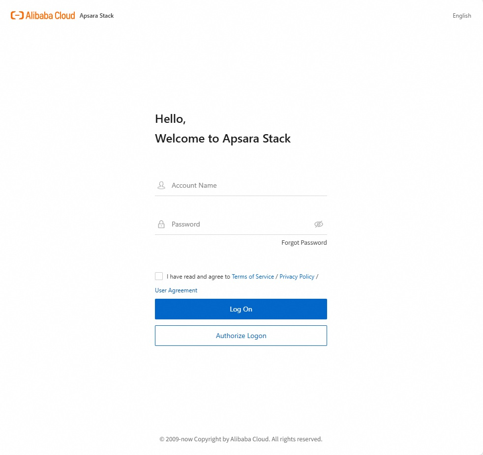
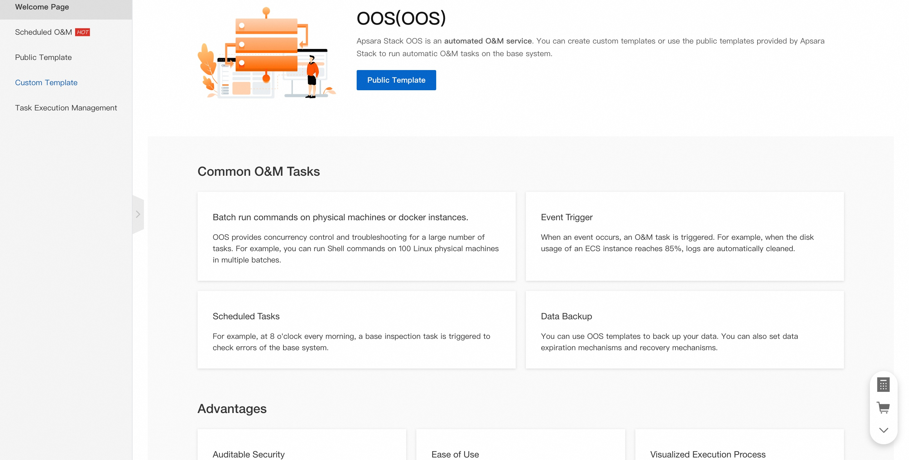
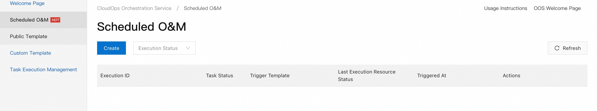
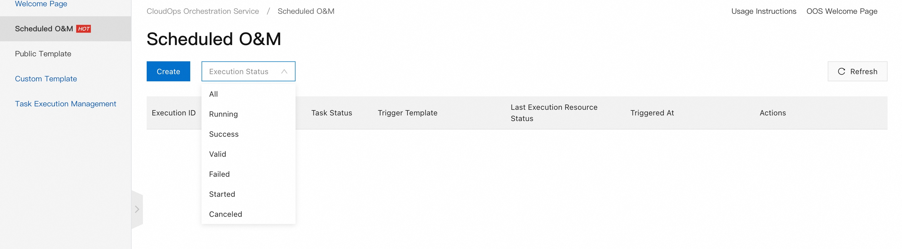
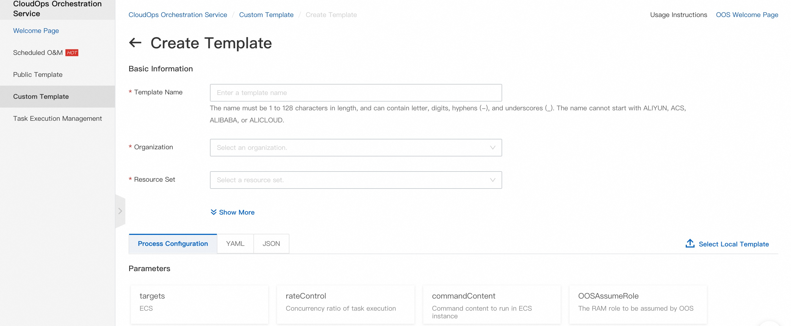
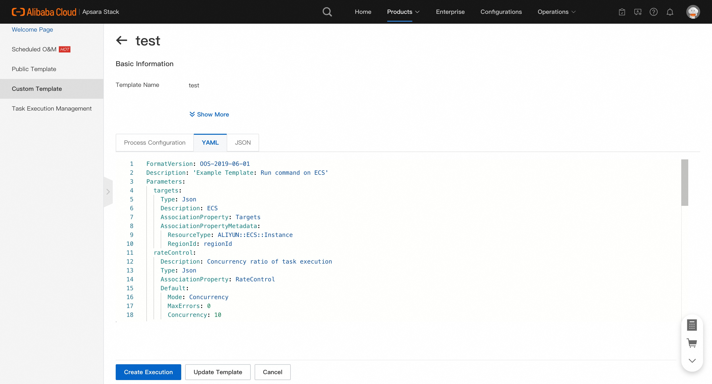
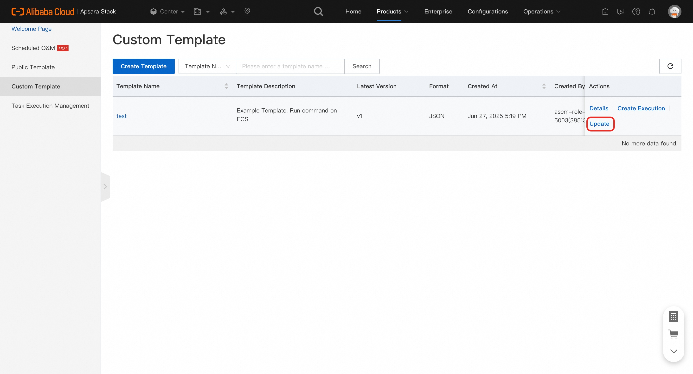
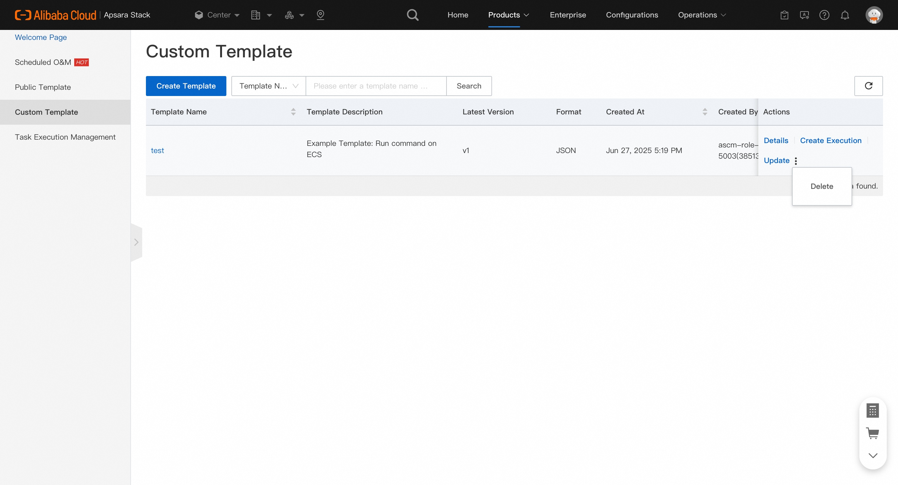

Alibaba Cloud  
Apsara Stack  
Operation Orchestration  
Service  
User Guide  
Product Version: v3.18.6-2607  
Document Version: 20260828

**Table of Contents**

- [1.Log on to the OOS console](#section-1)
- [2.Welcome page](#section-2)
- [3.Scheduled O&M](#section-3)
- [4.Public templates](#section-4)
- [5.Custom templates](#section-5)
    - [5.1. Template overview](#section-5-1)
    - [5.2. Template syntax](#section-5-2)
        - [5.2.1. Template structure](#section-5-2-1)
        - [5.2.2. Overview](#section-5-2-2)
        - [5.2.3. Tasks](#section-5-2-3)
        - [5.2.4. Output](#section-5-2-4)
        - [5.2.5. Built-in functions](#section-5-2-5)
        - [5.2.6. Loop](#section-5-2-6)
    - [5.3. Create a template](#section-5-3)
    - [5.4. Create an execution](#section-5-4)
    - [5.5. View a custom template](#section-5-5)
    - [5.6. Update a custom template](#section-5-6)
    - [5.7. Delete a custom template](#section-5-7)
- [6.Manage task executions](#section-6)

<a id="section-1"></a>

# 1.Log on to the OOS console

This topic describes how to log on to the CloudOps Orchestration Service (OOS) console.

**Prerequisites**

- The URL of the Apsara Uni-manager Management Console is obtained from the deployment personnel.

- A web browser is available. We recommend that you use Google Chrome.

**Procedure**

1. Enter the URL of the Apsara Uni-manager Management Console in the address bar and press the Enter key.

   

   > **Note**
   >
   > - You can click the current language in the upper-right corner to switch to another language.

2. Enter your username and password.

   > **Note**
   >
   > - Obtain the username and password from an operations administrator.
   >
   > - If this is the first time you log on to the Apsara Uni-manager Management Console, you must follow the on-screen instructions to change the password of your account. For security purposes, the password must be 10 to 32 characters in length. It must contain all of the following character types: uppercase letters, lowercase letters, digits, and special characters. The following special characters are supported: ! @ # $ %

3. Select **I have read and agree to the product service agreement, privacy agreement, and user agreement**.

   > **Note**
   >
   > - The link text displayed on the logon page is the document title. You can click the link text to view the details of the agreement.
   >
   > - The **Service Agreement**, **Privacy Agreement**, and **User Agreement** are displayed only when you publish a service. If none of the three types of protocols is published, you do not need to perform this operation.

4. Click **Account Logon** or **Authorized Logon**.

   > **Note**
   >
   > "Authorized Logon" is displayed only when the global IdP setting for third-party authentication is enabled, and the display name can be customized. The default display name is "Authorized Logon".

5. If multi-factor authentication (MFA) is enabled for your account, perform the corresponding operations in the following scenarios:

   > **Note**
   >
   > In Internet scenarios, multi-factor authentication is forcibly enabled on the logon portal by default.

   - **First logon after MFA is enabled**

     <ol type="a">

     <li>

     After you enter the account password, the Bind Virtual MFA Device page is displayed.

     </li>

     <li>

     On the Bind Virtual MFA Device page, follow the instructions on the page to bind a virtual MFA device.

     </li>

     </ol>

     <ol type="i" start="100">

     <li>

     Log on to the console.

     </li>

     </ol>

   - **MFA enabled and bound**

     Enter the six-digit MFA verification code and click **Authenticate**.

6. In the top navigation bar, choose **Products > Migration and O&M Management > CloudOps Orchestration Service**.

**Related operations**

**Forget password**

1. If you forget the login password, click **Forgot Password** below the Password field.

2. On the Forgot Password page, configure the **Account Name** and **Email Address** parameters, enter the verification code, and then click **Confirm**.

   

   > **Note**
   >
   > - Enter the username of your account in the Account Name field and the email address that was used to create the account in the Email Address field.
   >
   > - The system sends a link for resetting the password to the email address that you specify.

<a id="section-2"></a>

# 2.Welcome page

After you log on to the OOS console, the **Welcome** page appears.



This page displays the following information:

- Click **Public Template** to go to the Public Template page.

- In the **Common O&M** Tasks section, you can view the following details:

  - Batch run commands on physical machines or docker instances.

  - Event Trigger

  - Scheduled Tasks

  - Data Backup

- In the **Advantages** section, you can view the following benefits:

  - Auditable Security

  - Ease of Use

  - Visualized Execution Process

<a id="section-3"></a>

# 3.Scheduled O&M

This topic describes the operations on scheduled O&M tasks, including creating an execution, filtering tasks, viewing details, cloning an execution, cancelling an execution, and deleting an execution.

**Procedure**

Log on to the CloudOps Orchestration Service (OOS) console. In the left-side navigation pane, click **Scheduled O&M** to perform the following operations.

**Create an execution**

1. Click **Create** to go to the **Create Scheduled O&M Task** page.

   

2. Configure a scheduled O&M task.

   <ol type="i">

   <li>

   The settings of the scheduled task. Valid options:

   - Execute Now

   - Executed Once at the Specified Time

   - Executed Periodically

   </li>

   <li>

   Select the template that you want to use.

   </li>

   </ol>

   Enter a name in the search box to search for the template.

   <ol type="i" start="3">

   <li>

   Configure parameters.

   </li>

   </ol>

   The parameters that you need to specify vary with the template that you select. You can specify the parameters based on the parameters that are displayed on the page.

   <ol type="i" start="4">

   <li>

   The advanced options.

   - **Description**: You can describe the created scheduled O&M task in detail for subsequent identification.

   - **Save Template**: Select whether to save the task as a template.

   </li>

   </ol>

3. Click **Execute Now**.

**Filter tasks**

In the **Execution Status** drop-down list, you can filter tasks by specifying the task status.



**View Details**

Find the task and click **Details** in the **Actions** column to view details.

**Clone an execution**

1. Find the execution that you want to clone and click **Clone** in the **Actions** column.

2. Refer to this step to configure the parameters.

3. Click **Execute Now**.

**Delete an execution**

1. Find the execution that you want to delete. Click the More icon and select **Delete** in the **Actions** column.

2. In the **delete execution** message, click **OK**.

**Cancel an execution**

1. To cancel a task that is in the **Running** state, click **Cancel** in the **Actions** column.

2. In the **Cancel Execution** message, click **OK**.

   After the task is canceled, its status changes to **Canceled**.

<a id="section-4"></a>

# 4.Public templates

CloudOps Orchestration Service (OOS) provides a variety of templates that are suitable for different scenarios. The following table describes the templates and scenarios supported by OOS.

**Template**

**Template name**

**Description**

**category**

Modifies the instance type of a

ACS-ECS-ModifyInstanceSpec

pay-as-you-go Elastic Compute Service (ECS) instance.

Stops multiple ECS instances at

ACS-ECS-BulkyStopInstances

a time.

Increases the space of multiple

ACS-ECS-BulkyResizeDisk

disks at a time.

Instance management

Restarts multiple ECS instances

ACS-ECS-BulkyRebootInstances

at a time.

Deletes multiple pay-as-you-go

ACS-ECS-BulkyDeleteInstances

ECS instances at a time.

Starts multiple ECS instances at

ACS-ECS-BulkyStartInstances

a time.

Runs commands on multiple

Command running

ACS-ECS-BulkyRunCommand

ECS instances at a time.

ACS-ECS-DeleteImage

Deletes an ECS image.

Image management

ACS-ECS-CreateImage

Creates an ECS image.

Creates multiple snapshots at a

Data backup

ACS-ECS-BulkyCreateSnapshot

time.

ACS-RDS-

Releases the public IP address

ReleaseInstancePublicConnection

of an ApsaraDB RDS instance.

Enables the SQL Explorer and

ACS-RDS-BulkyModifySQLCollectorPolicy

Audit feature for an ApsaraDB RDS instance.

Security audit

Removes 0.0.0.0/0 from the IP

ACS-RDS-

address whitelist of an

BulkyModifySecurityIpsByInstanceIPArray

ApsaraDB RDS instance.

Stops an ECS instance at the

ACS-ECS-ScheduleToStopInstances

specified point in time.

Restarts an ECS instance at the

ACS-ECS-ScheduleToRebootInstances

specified point in time.

Starts and then stops an ECS

ACS-ECS-

instance at the specified points

ScheduleToStartAndStopInstances

in time.

Scheduled operation

Starts an ECS instance at the

ACS-ECS-ScheduleToStartInstances

specified point in time.

Stops and then starts an ECS

ACS-ECS-

instance at the specified points

ScheduleToStopAndStartInstances

in time.

Executes a template at the

ACS-ECS-ScheduleToExecuteTemplate

specified point in time.

ACS-ESS-

Creates an ECS image and

CreateImageAndUpdateScalingConfigurati

updates the image ID in the

on

scaling configurations.

Auto scaling management

Runs commands to update an existing ECS image, creates an

ACS-ESS-

ECS image, and then updates

UpdateScalingConfigurationImage

the image ID in the scaling configurations.

Cross-region

Clones multiple ECS instances

ACS-ECS-BulkyCloneInstances

replication

at a time.

Other

ACS-ECS-UpdateImage

Updates an image

After you find the template that you want to use on the Public Template page, you can click **Create Execution** to execute the template. For more information, see the **Manage task executions** topic.

<a id="section-5"></a>

# 5.Custom templates

<a id="section-5-1"></a>

## 5.1. Template overview

CloudOps Orchestration Service (OOS) uses templates to define the O&M operations that require orchestration. The templates are classified into public templates and custom templates. You can use the OOS process configuration editor to create templates. The template content uses the YAML or JSON format. OOS provides public templates for use and reference. Before you use a public template, you must check the operations to be performed in the template and observe the template performance in a test environment. You can also create custom templates to perform O&M operations based on your business requirements.

<a id="section-5-2"></a>

## 5.2. Template syntax

<a id="section-5-2-1"></a>

### 5.2.1. Template structure

An OOS template is a UTF-8 encoded JSON or YAML document that defines the version, parameters, tasks, sequence, inputs, and outputs for O&M operations.

A template is UTF-8 text in JSON or YAML format. It defines the version, parameters, tasks, sequence, inputs, and outputs for O&M operations.

**Syntax**

- YAML format

```yaml
---
FormatVersion: OOS-2019-06-01 # Required. The version of the template. Example: OOS-2019-06-01.
Description: "" # Optional. The description of the template, such as the features or usage of the template.
Parameters: # Optional. The parameters to be set for executing the template. For more information, see the relevant documentation.
RamRole: # Optional. The role that Operation Orchestration Service (OOS) assumes to call the API operations of each cloud product. Default value: OOSServiceRole.
Tasks: # Required. The tasks to be executed. As the most important component of a template, the Tasks parameter defines the details of O&M operations. Each task in the template corresponds to an action. By default, multiple tasks are executed one by one. If a task is a loop task, concurrent child execution may occur within the task. For more information, see the relevant documentation.
Outputs: # Optional. The template outputs, such as resource attributes. You can obtain the outputs through the API or the OOS console. For more information, see the relevant documentation.
```

- JSON format (For more information, see the parameter description for the YAML format.)

```json
{
  "FormatVersion": "OOS-2019-06-01",
  "Description": "",
  "Parameters": {},
  "RamRole": "",
  "Tasks": [],
  "Outputs": {}
}
```

<a id="section-5-2-2"></a>

### 5.2.2. Overview

When creating and executing a template, you can use parameters to improve the flexibility and reusability of the template.

**Definition**

You can define a parameter in the Parameters field of the template, including the parameter name, description, type, default value, and verification rules.

**Syntax**

- YAML format

```text
Parameters:
  Parameter-name-1: # The name of the parameter. The name can contain lowercase letters, uppercase letters, digits, underscores (_), and hyphens (-). Spaces are not allowed. 
We recommend that you use the lower camel case for a name. Example: instanceId.
    Type: String # Optional. The type of the parameter. Valid values: List, Number, String, Boolean, and Json. Default value: String.
    Description: description # Optional. The description of the parameter, such as the features of the parameter.
    Default: default-value # Optional. The default value of the parameter.
    AllowedValues: # Optional. The list of the valid values for the parameter.
      - value1
      - value2
    AllowedPattern: regular-expression # Optional. The regular expression that must be matched with the parameter value. This attribute is valid only when the parameter valueis a string.
    MinLength: 1 # Optional. The minimum length of the parameter value. This attribute is valid only when the parameter value is a string.
    MaxLength: 10 # Optional. The maximum length of the parameter value. This attributeis valid only when the parameter value is a string.
```

- JSON format (For more information, see the parameter description for the YAML format.)

```json
{
  "Parameters": {
    "parameter-name-1": {
      "Type": "String",
      "Description": "description",
      "Default": "default-value",
      "AllowedValues": [
        "value1",
        "value2"
      ],
      "AllowedPattern": "regular-expression",
      "MinLength": 1,
      "MaxLength": 10
    }
  }
}
```

**Reference**

You can reference the parameters defined above as attributes in the Tasks field. The following is the syntax for referencing parameters:

```text
"some text {{ parameter_name }} some text {{parameter_name_2}} ..."
```

For example:

When the YAML format is used, referenced parameters must be enclosed in the double quotation marks ("").

```text
"{parameter-name}" # Reference a parameter itself.
"this is the {parameter-name}" # Reference a parameter in a fixed string.
"hello {{ parameter-last-name }} {{ parameter-first-name }}" # Reference multiple parameters in a fixed string.
```

**Pseudo parameters**

OOS provides pseudo parameters for obtaining the execution information. You can reference these parameters without the need to define them. The following table describes the supported pseudo parameters. If you need more pseudo parameters, submit a ticket and describe your scenarios. We will give you feedback and support as soon as possible.

| Name | Type | Description | Example |
| --- | --- | --- | --- |
| ACS::TemplateName | String | The name of the template that is executed. | ACS-ECS-StartInstances br or MyTemplate1 |
| ACS::ExecutionId | String | The ID of the execution. | exec-21234455677892ac |
| ACS::Region | String | The region where the template is executed. | cn-hangzhou |
| ACS::AccountId | String | The account that is used to execute the template. | 12345678901234 |

<a id="section-5-2-3"></a>

### 5.2.3. Tasks

The Tasks parameter is the most important component of a template and defines the details of O&M operations. The type of a task is called an action. Operation Orchestration Service (OOS) provides you with a wide range of actions, including actions for common cloud products, such as Elastic Compute Service (ECS) and Relational Database Service (RDS). If you need more common actions for cloud products than those that are provided by OOS, you can contact us and provide us with your scenarios. You can also customize atom actions so that you can immediately orchestrate and execute O&M operations.

**General attributes**

Syntax

- YAML format

```text
Tasks:
  - Name: TaskName1 # Required. The name of the task. The name can contain letters, digits, underscores (_), and hyphens (-). It can be up to 200 characters in length. We recommend that you use the camel case for a name. Example: StartInstance. 
    When: Condition1 # Optional. Specifies whether to execute the task based on the evaluation result of the specified condition. If the condition is evaluated as true, OOS executes the task. If the condition is evaluated as false, OOS ignores the task and executes the subsequent tasks. 
    Action: TaskType # Required. The type of the task or action. For more information, see the relevant documentation. 
    Description: description # Optional. The description of the task, such as the purpose of the task. 
    Properties: # The attributes of the task. The attribute list varies depending on the action used. For more information, see the relevant documentation. 
      Property1: Value1 # The attribute that the action depends on. 
      Property2: Value2 # If the Properties parameter is set to Parameters, define the input parameter names based on the parameters of the source API operation. If a source parameter name does not contain periods(.), set the input parameter name to the source parameter name. If a source parameter name contains periods (.) that are irrelevant to tags, set the input parameter name to the source parameter name without periods (.). For example, for the source parameter Temporary.InternetMaxBandwidthOut of the ModifyInstanceSpec operation, set the input parameter name to TemporaryInternetMaxBandwidthOut. If a source parameter name contains periods (.) that are relevant to tags, set the inputparameter name to Tags and set the input parameter in the "Tags": [{"Key": tagKey1,"Value": tagValue1}] format. 
    Outputs: # The output parameters of the task. These parameters can be used as the input of subsequent tasks or the output of the template. 
      outputParameterName1:
        Type: # Optional. The type of the output parameter. Valid values: String, 
Number, Boolean, List, and Json. Default value: String. Note: The value of 
outputParameterName1 is generated by wrapping the returned result of ValueSelector based on the specified type. If the Type parameter is set to List, the value of 
outputParameterName1 is generated by wrapping the returned result of ValueSelector withbrackets ([]). For example, if the returned result of ValueSelector is "i-12345zxcv", the value of outputParameterName1 is ["i-12345zxcv"]. If the Type parameter is set to a value other than List, the value of outputParameterName1 is the returned result of ValueSelector. For example, if the Type parameter is set to String and the returned result of ValueSelector is "i-12345zxcv", the value of outputParameterName1 is "i-12345zxcv". 
        ValueSelector: "jq selector" # The jQuery selector for selecting the required J
SON data. For example, when you call an API operation for a task, the jQuery selector extracts the required information from the returned JSON data. For more information, seethe examples of cloud product actions and public templates. 
    # Parameters for process control
    OnError: "ACS::END/ACS::NEXT/other-task-name" # Optional. The process to be executed if an error occurs when the task is executed. Default value: END, which indicates that OOS ends the execution when an error occurs. 
    OnSuccess: "ACS::NEXT/other-task-name/ACS::END" # Optional. The process to be executed after the task is executed. Default value: NEXT, which indicates that OOS executes the next task after the current task is executed.
```

- JSON format (For more information, see the parameter description for the YAML format.)

```json
{
  "Tasks": [
    {
      "Name": "TaskName1",
      "Action": "TaskType",
      "When": "Condition",
      "Description": "description",
      "Properties": {
        "Property1": "Value1",
        "Property2": "Value2"
      },
      "Outputs": {
        "outputParameterName1": {
          "Type": null,
          "ValueSelector": "jq selector"
        }
      },
      "OnError": "ACS::END/ACS::NEXT/other-task-name",
      "OnSuccess": "ACS::NEXT/other-task-name/ACS::END",
    }
  ]
}
```

<a id="section-5-2-4"></a>

### 5.2.4. Output

You can configure the output parameters for a template. The output parameters can define the results you need after the O&M operations are completed. For example, you can set the output parameters to obtain the ID of an Elastic Compute Service (ECS) instance after the O&M operation for creating the ECS instance is completed.

**Syntax**

- YAML format

```text
Outputs:
  OutputParameterName1:# Required.The name of the output parameter. The name can contain lowercase letters, uppercase letters, digits, underscores (_), and hyphens (-). It can be up to 200 characters in length.
    Type: String # Optional. The type of the output parameter. The valid values includethe basic parameter types supported by the YAML or JSON format, such as String, Number,
Boolean, List or Array, and Object. Default value: String.
    Value: "{taskName. OutputParameter1}" # Required. The value of the output parameter. The value is usually the output of a task.
```

- JSON format (For more information, see the parameter description for the YAML format.)

```json
{
  "Outputs": {
    "OutputParameterName1": {
      "Type": "String",
      "Value": "{{ taskName.OutputParameter1 }}"
    }
  }
}
```

<a id="section-5-2-5"></a>

### 5.2.5. Built-in functions

Operation Orchestration Service (OOS) provides multiple built-in functions to help you process the parameters and outputs of templates.

**Built-in functions**

- Fn::Base64Encode: returns the Base64-encoded result of the source string.

- Fn::Base64Decode: returns the Base64-decoded result of the source string.

- Fn::MergeMapToList: returns a list in which multiple maps are merged.

- Fn::MergeMap: returns a map in which multiple maps are merged.

- Fn::Join: returns a string in which the elements in a list are joined by the specified delimiter.

- Fn::Select: returns a data element from a data element container based on the specified index.

- Fn::Split: splits a string into an array of substrings based on the specified delimiter and returns a list of the substrings.

- Fn::Replace: returns a string in which the specified substring is replaced by another substring.

- Fn::Min: returns the element with the smallest value in the specified list.

- Fn::Max: returns the element with the largest value in the specified list.

- Fn::First: returns the first element in the specified list.

- Fn::Last: returns the last element in the specified list.

- Fn::ListJoin: returns a list in which multiple elements are joined.

- Fn::Equals: compares whether two values are equal.

- Fn::If: returns one value if the specified condition evaluates to true or another value if the specified condition evaluates to false.

- Fn::Not: returns true for a condition that evaluates to false, or returns false for a condition that evaluates to true.

- Fn::AddHour: changes the time zone by offsetting N hours from the UTC time.

- Fn::FormatUTCTime: changes the time granularity of the UTC time as required.

- Fn::Eval: executes a single-line expression in a string and returns the execution result.

- Fn::CalculateTimeByOpsWindow: returns a point in time in the specified time period based on the execution time of this function.

- Fn::And: returns true if all the specified conditions evaluate to true, or returns false if one of the conditions evaluates to false.

- Fn::Or: returns true if one of the specified conditions evaluates to true, or returns false if all the conditions evaluate to false.

- Fn::Intersection: returns the intersection of multiple arrays.

- Fn::Union: returns the union of multiple arrays.

- Fn::Difference: returns a new array that contains the difference between the union and intersection of multiple arrays.

- Fn::Jq: filters a JSON object and returns the required property values in the JSON object.

- Fn::MapJoin: combines two lists into a map in which all values in the first list are used as the keys of key-value pairs and values in the second list are used as the values of key-value pairs.

- Fn::IsIpInCIDR: evaluates whether the specified IP address falls within the specified CIDR block.

- Fn::Sub: substitutes variables in an input string with the values that you specify.

- Fn::DurationBetween: returns the duration between two points in time.

- Fn::Escape: escapes a string.

- Fn::ConvertMapToList: converts a JSON object into a table that stores data as key-value pairs.

**Syntax**

A built-in function consists of the name of the function and the parameters to be processed. When you call the declaration expression of a function, the function processes the parameters and returns a result. You can reference the returned result in the same way as other parameters.

**Fn::Base64Encode**

Returns the Base64-encoded result of the source string.

**Syntax**

```json
{"Fn::Base64Encode": "StringToBeBase64"}        
```

**Parameter**

StringToBeBase64: the string to be encoded in Base64.

**Return value**

The Base64-encoded result of the source string.

**Sample request**

```json
{"Fn::Base64Encode": "hello"}        
```

**Sample return value**

```text
"aGVsbG8="
```

**Fn::Base64Decode**

Returns the Base64-decoded result of the source string.

**Syntax**

```json
{"Fn::Base64Decode": "Base64ToBeString"}
```

**Parameter** Base64ToBeString: the Base64-encoded string to be decoded.

**Return value**

The Base64-decoded result of the source string.

**Sample request**

```json
{"Fn::Base64Decode": "aGVsbG8="}        
```

**Sample return value**

```text
"hello"
```

**Fn::MergeMapToList**

Returns a list in which multiple maps are merged.

**Syntax**

```json
{"Fn::MergeMapToList": "aListConatinsDicts"}
```

**Parameter**

aListConatinsDicts: a list that contains multiple maps.

**Return value**

A list in which multiple maps are merged.

**Sample request 1**

```json
{
  "Fn::MergeMapToList": [
    {
      "key_1": [
        "kye_1_item_1",
        "kye_1_item_2"
      ]
    },
    {
      "key_2": [
        "kye_2_item_1",
        "kye_2_item_2"
      ]
    },
    {
      "key_3": [
        "kye_3_item_1",
        "kye_3_item_2"
      ]
    }
  ]
}
```

**Sample return value 1**

```json
[
  {
    "key_1": "kye_1_item_1",
    "key_2": "kye_2_item_1",
    "key_3": "kye_3_item_1"
  },
  {
    "key_1": "kye_1_item_2",
    "key_2": "kye_2_item_2",
    "key_3": "kye_3_item_2"
  }
]
```

**Sample request 2**

```json
{
  "Fn::MergeMapToList": [
    {
      "key_1": [
        "kye_1_item_1",
        "kye_1_item_2"
      ]
    },
    {
      "key_2": [
        "kye_2_item_1",
        "kye_2_item_2",
        "key_2_item_3"
      ]
    },
    {
      "key_3": [
        "kye_3_item_1",
        "kye_3_item_2"
      ]
    }
  ]
}
```

**Sample return value 2**

```json
[  
   {
      "key_1": "kye_1_item_1", 
      "key_2": "kye_2_item_1",
      "key_3": "kye_3_item_1"
    },
    {
      "key_1": "kye_1_item_2", 
      "key_2": "kye_2_item_2",
      "key_3": "kye_3_item_2"
    },
    {
      "key_1": "kye_1_item_2", 
      "key_2": "kye_2_item_3",
      "key_3": "kye_3_item_2"
    }
]  
```

**Fn::MergeMap**

Returns a map in which multiple maps are merged.

**Syntax**

```json
{  "Fn::MergeMap": "aListConatinsDicts"}
```

**Parameter**

aListConatinsDicts: a list that contains multiple maps.

**Return value**

A map in which multiple maps are merged.

**Sample request**

```json
{
  "Fn::MergeMap": [
    {
      "key_1": "value_1"
    },
    {
      "key_2": "value_2"
    }
  ]
}
```

**Sample return value**

```json
{"key_1": "value_1","key_2": "value_2"}
```

**Fn::Join**

Returns a string in which the elements in a list are joined by the specified delimiter.

**Syntax**

```json
{"Fn::Join": ["Connector","aListContainsString"]}                
```

**Parameter**

Connector: the string used to separate the elements in the returned string.

aListContainsString: a list that contains the elements to be joined.

**Return value**

A string in which the elements in the list are joined.

**Sample request**

```json
{
  "Fn::Join": [
    ",",
    [
      "a",
      "b",
      "c"
    ]
  ]
}
```

**Sample return value**

```text
"a,b,c"
```

**Fn::Select**

Returns a data element from a data element container based on the specified index.

**Syntax**

```json
{"Fn::Select": ["Index","Container"]}
```

**Parameter**

Index: the String or Number index that is used to query a data element from the container.

Container: the list or map to be queried.

**Return value**

A data element queried from the container based on the specified index.

**Sample request 1**

```json
{
  "Fn::Select": [
    "IpAddress",
    {
      "IpAddress": [
        "192.168.1.123",
        "192.168.1.234"
      ]
    }
  ]
}
```

**Sample return value 1**

```json
["192.168.1.123","192.168.1.234"]
```

**Sample request 2**

```json
{
  "Fn::Select": [
    "1",
    [
      "192.168.1.123",
      "192.168.1.234"
    ]
  ]
}
```

**Sample return value 2**

```text
"192.168.1.234"
```

**Fn::Split**

Splits a string into an array of substrings based on the specified delimiter and returns a list of the substrings.

**Syntax**

```json
{"Fn::Split": ["Separator","StringToSeprate"]}
```

**Parameter**

Separator: the string to be used as the delimiter.

StringToSeprate: the string to be split by the delimiter.

**Return value**

A list of substrings split by the delimiter.

**Sample request**

```json
{
  "Fn:: Split": [",","a,b,c"]
}
```

**Sample return value**

```json
[
  "a",
  "b",
  "c"
]
```

**Fn::Replace**

Returns a string in which the specified substring is replaced by another substring.

**Syntax**

```json
{  "Fn::Replace": [{"$varName": "StringToReplaceWith"}, "StringToReplace"]}
```

**Parameter**

$varName: a placeholder that starts with the dollar sign ($) followed by the name of a common parameter. The name requirements for the parameter that follows the dollar sign ($) are the same as those for the template parameters.

StringToReplaceWith: the substring that is used to replace the placeholder.

StringToReplace: the string that contains the placeholder to be replaced. Example: $varName is foo.

**Return value**

If the StringToReplaceWith parameter is set to baz, the returned string is baz is foo.

**Sample request**

```json
{  "Fn::Replace": [{"$varName": "baz"},    "$varName is foo"  ]}
```

**Sample return value**

```text
"baz is foo"
```

**Fn::Min**

Returns the element with the smallest value in the specified list.

**Syntax**

```json
{"Fn::Min": "aList"}
```

**Parameter**

aList: a list that contains elements. The types of the elements in the list can be String, Int, Datetime, or None. All elements in the same list must be of the same type.

**Return value**

The element with the smallest value in the list, excluding the element whose value is None. If the values of all elements in the list are None, None is returned.

**Sample request**

```json
{
  "Fn::Min": ["123","234"]
}
```

**Sample return value**

```text
"123"
```

**Fn::Max**

Returns the element with the largest value in the specified list.

**Syntax**

```json
{"Fn::Max": "aList"}
```

**Parameter**

aList: a list that contains elements. The types of the elements in the list can be String, Int, Datetime, or None. All elements in the same list must be of the same type.

**Return value**

The element with the largest value in the list, excluding the element whose value is None. If the values of all elements in the list are None, None is returned.

**Sample request**

```json
{
  "Fn::Max": ["123","234"]
}
```

**Sample return value**

```text
"234"
```

**Fn::First**

Returns the first element in the specified list.

**Syntax**

```json
{  "Fn::First": "aList"}
```

**Parameter**

aList: a list that contains elements. The types of the elements in the list are not limited.

**Return value**

The first element returned for an iteration. For a loop task, the elements are sorted based on the task execution IDs generated for iterations.

**Sample request**

```json
{
  "Fn::First": ["123","234"]
}
```

**Sample return value**

```text
"123"
```

**Fn::Last**

Returns the last element in the specified list.

**Syntax**

```json
{"Fn::Last": "aList"}
```

**Parameter**

aList: a list that contains elements. The types of the elements in the list are not limited.

**Return value**

The last element returned for an iteration. For a loop task, the elements are sorted based on the task execution IDs generated for iterations.

**Sample request**

```json
{
  "Fn::Last": ["123","234"]
}
```

**Sample return value**

```text
"234"
```

**Fn::ListJoin**

Returns a list in which multiple elements are joined.

**Syntax**

```json
{"Fn::ListJoin": "IterableContainer"}
```

**Parameter**

IterableContainer: a set of iterable elements. The types of the elements in the set are not limited.

**Return value**

A list in which the elements in the set are joined.

**Sample request**

```json
{"Fn::ListJoin": ["a",2, 3]}
```

**Sample return value**

```json
["a",2,3]
```

**Fn::Equals**

Compares whether two values are equal. If the two values are equal, true is returned. If the two values are not equal, false is returned.

**Syntax**

```json
{  "Fn::Equals": ["parameter1", "parameter2"]}
```

**Parameter**

parameter1 and parameter2: the values to be compared. The types of the values are not limited.

**Return value**

If the two values are equal, true is returned. If the two values are not equal, false is returned.

**Sample request**

```json
{  "Fn::Equals": ["Running","Stopped"]}
```

**Sample return value**

```text
false
```

**Fn::If**

Returns one value if the specified condition evaluates to true or another value if the specified condition evaluates to false.

**Syntax**

```json
{
  "Fn::If": [
    "condition",
    "value_if_true",
    "value_if_false"
  ]
}
```

**Parameter**

condition_name: the condition to be evaluated.

value_if_true: the value to be returned if the specified condition evaluates to true.

value_if_false: the value to be returned if the specified condition evaluates to false.

**Return value**

If the specified condition evaluates to true, the value specified by the value_if_true parameter is returned.

If the specified condition evaluates to false, the value specified by the value_if_false parameter is returned.

**Sample request**

```json
{"Fn::If": [false,"Stopped","Running"]}
```

**Sample return value**

```text
"Running"
```

**Fn::Or**

Returns true if one of the specified conditions evaluates to true, or returns false if all the conditions evaluate to false.

**Syntax**

```json
{"Fn::Or": ["condition1","condition2"]}
```

**Parameter**

condition1 and condition2: the conditions to be evaluated.

**Return value**

If both condition1 and condition2 evaluate to false, false is returned. Otherwise, true is returned.

**Sample request**

```json
{"Fn::Or": [true,false]}
```

**Sample return value**

```text
true
```

**Fn::And**

Returns true if one of the specified conditions evaluates to true, or returns false if all the conditions evaluate to false.

**Syntax**

```json
{"Fn::And": [ "condition1", "condition2"]}
```

**Parameter**

condition1 and condition2: the conditions to be evaluated.

**Return value**

If both condition1 and condition2 evaluate to true, true is returned. Otherwise, false is returned.

**Sample request**

```json
{"Fn::And": [true,false]}
```

**Sample return value**

```text
false
```

**Fn::Not**

Returns true for a condition that evaluates to false, or returns false for a condition that evaluates to true.

**Syntax**

```json
{"Fn::Not": "condition"}
```

**Parameter**

condition: the condition to be evaluated.

**Return value**

If the condition evaluates to true, false is returned. If the condition evaluates to false, true is returned.

**Sample request**

```json
{"Fn::Not": true}
```

**Sample return value**

```text
false
```

**Fn::AddHour**

Changes the time zone by offsetting N hours from the UTC time.

**Syntax**

```json
{"Fn::AddHour": ["utc_time", "hours_count"  ]}
```

**Parameter**

utc_time: the UTC time from which N hours are to be offset.

hours_count: the number of hours that you want to offset from the UTC time. The value must be an integer.

**Return value**

The new UTC time that is obtained after N hours are offset from the previous UTC time.

**Sample request**

```json
{  "Fn::AddHour": ["2019-06-01T02:12:45Z", 6]}
```

**Sample return value**

```text
"2019-06-01T08:12:45Z"
```

**Fn::FormatUTCTime**

Changes the time granularity of the UTC time based on your business requirements.

**Syntax**

```text
Fn::FormatUTCTime: ["utc_time", "to_be_utc_time_format"]        
```

**Parameter**

utc_time: the UTC time for which you want to change the time granularity.

to_be_utc_time_format: the specified time granularity.

**Return value**

The UTC time in the specified time granularity.

**Sample request**

```json
{  "Fn::FormatUTCTime": ["2019-06-01T02:12:45Z","%Y-%m-%dT%H:%MZ"]}
```

**Sample return value**

```text
"2019-06-01T02:12Z"
```

**Fn::Eval**

Executes a single-line expression in a string and returns the execution result. You cannot use this function to execute expressions that contain line breaks. **Syntax**

```json
{
  "Fn::Eval": [
    "expression"
  ]
}
```

**Parameter**

expression: the expression to be executed, such as an operation expression.

**Return value**

The execution result of the expression.

**Sample request**

```json
{  "Fn::Eval": ["1+3*2+3%2+1"]}
```

**Sample return value**

```text
9
```

Fn::CalculateTimeByOpsWindow

Returns a point in time in the specified time period based on the execution time of this function. The time period must be less than 24 hours. The Fn::CalculateTimeByOpsWindow function returns a point in time by following these rules: If the function is executed during the specified time period on the current day, it returns the point in time that is one minute later than the execution time of the specified function. If the function is executed earlier than the start time of the time period on the current day, it returns a random point in time during the time period on the current day. If the function is executed later than the end time of the time period on the current day, it returns a random point in time during the time period on the next day after the function is executed.

**Syntax**

```text
Fn::CalculateTimeByOpsWindow: [ "startTime", "endTime" ]
```

**Parameter**

startTime: the start time of the time period, such as 01:00:00Z.

endTime: the end time of the time period, such as 03:00:00Z. The interval between the start time and end time must be less than 24 hours.

**Return value**

A string that indicates a point in time in the specified time period, in UTC.

**Sample request**

```json
{  "Fn::CalculateTimeByOpsWindow": ["01:00:00Z", "03:00:00Z"]}
```

**Sample return value**

```text
"2019-09-24T01:01:00Z"
```

**Fn::Jq**

Filters a JSON object and returns the required property values in the JSON object.

**Syntax**

```json
{  "Fn::Jq": [ "type", "jqSelector", "jsonObject" ]}                
```

**Parameter**

type: specifies whether to return the first property value or all property values in the specified JSON object. Valid values: First and All. If you set the type parameter to First, only the first property value is returned. If you set the type parameter to All, all property values are returned.

jqSelector: the jq expression used for filtering. For more information, visit https://yq.aliyun.com/articles/714479.

jsonObject: the JSON object to be filtered.

**Return value**

The result returned after the JSON object is filtered by using the jq expression.

**Sample request 1**

```json
{
  "Fn::Jq": [
    "First",".PrivateIpAddress.IpAddress",
{
  "PrivateIpAddress": {
    "IpAddress": [
      "192.168.1.123", "192.168.1.234"
    ]
  },
  "VpcId": "vpc-xzxbamns",
  "VSwitchId": "vsw-zxcdsa"
}
}
```

**Sample return value 1**

```text
"192.168.1.123"
```

**Sample request 2**

```json
{
  "Fn::Jq": [
    "All",".PrivateIpAddress.IpAddress",
{
  "PrivateIpAddress": {
    "IpAddress": [
      "192.168.1.123", "192.168.1.234"
    ]
  },
  "VpcId": "vpc-xzxbamns",
  "VSwitchId": "vsw-zxcdsa"
}
}
```

**Sample return value 2**

```json
["192.168.1.123", "192.168.1.234"]
```

**Fn::Intersection**

Returns the intersection of multiple arrays.

**Syntax**

```json
{  "Fn::Intersection": [ list1, list2]}                
```

**Parameter**

list1 and list2: the arrays of which you want to take the intersection.

**Return value**

An array whose elements are values shared by multiple arrays.

**Sample request**

```json
{  "Fn::Intersection": [["i-1","i-2"],["i-1","i-3"]]}
```

**Sample return value**

```json
["i-1"]
```

**Fn::Union**

Returns the union of multiple arrays.

**Syntax**

```json
{  "Fn::Union": [ list1, list2]}                
```

**Parameter**

list1 and list2: the arrays to be merged.

**Return value**

An array whose elements are the values in the union of multiple arrays.

**Sample request**

```json
{
  "Fn::Union": [
    [
      "i-1",
      "i-2"
    ],
    [
      "i-1",
      "i-3"
    ]
  ]
}
```

**Sample return value**

```json
["i-1","i-2","i-3"]
```

**Fn::Difference**

Returns a new array that contains the difference between the union and intersection of multiple arrays.

**Syntax**

```json
{  "Fn::Difference": [ list1, list2]}                
```

**Parameter**

list1 and list2: the arrays that contain different elements.

**Return value**

An array whose elements are the difference between the union and intersection of multiple arrays.

**Sample request**

```json
{
  "Fn::Difference": [
    ["i-1","i-2"],
    ["i-1"]]
}
```

**Sample return value**

```json
["i-2"]
```

**Fn::MapJoin**

Combines two lists into a map in which all values in the first list are used as the keys of key-value pairs and values in the second list are used as the values of key-value pairs.

**Syntax**

```text
{'Fn::MapJoin': [List1, List2] } 
```

**Parameter**

aListConatinsDicts: a list that contains multiple maps.

**Return value**

A map in which the keys of key-value pairs are the elements of the List1 list and the values of key-value pairs are the elements of the List2 list.

**Sample request**

```text
{'Fn::MapJoin': [['i-1', 'i-2', 'i-3'], [1, 2, 3]] } 
```

**Sample return value**

```text
{'i-1': 1, 'i-2': 2, 'i-3': 3}
```

**Fn::IsIpInCIDR**

Evaluates whether the specified IP address falls within the specified CIDR block.

**Syntax**

```text
{'Fn::IsIpInCIDR': [Ip, CIDR] } 
```

**Parameter**

Ip: the IP address. CIDR: the CIDR block.

**Return value**

true or false

**Sample request 1**

```text
{'Fn::IsIpInCIDR': ["10.0.1.159", "192.168.0.0/16"] } 
```

**Sample return value 1**

```text
false
```

**Sample request 2**

```text
{'Fn::IsIpInCIDR': ["192.168.255.0", "192.168.0.0/16"] } 
```

**Sample return value 2**

```text
true
```

**Fn::Sub**

Substitutes variables in an input string with the values that you specify.

**Syntax**

```text
{'Fn::Sub': [TargetString, JSON]} 
```

**Parameter** TargetString: the input string that contains variables. JSON: the values that you specify.

**Return value**

String

**Sample request**

```json
{
    "Fn::Sub": [
        "Var1: ${Var1}, Var2: ${Var2}",
        {
            "Var1": "Var1Value",
            "Var2": "Var2Value"
        }
    ]
}
```

**Sample return value**

```text
"Var1: Var1Value, Var2: Var2Value"
```

**Fn::DurationBetween**

Returns the duration between two points in time.

**Syntax**

```text
{'Fn::DurationBetween': [DateTime_1, DateTime_2]} 
```

**Parameter**

DateTime_1 and DateTime_2: the two points in time.

**Return value**

String

**Sample request**

```json
{
    "Fn::DurationBetween": [
        "12:00:00",
        "13:00:00"
    ]
}
```

**Sample return value**

```text
PT3600S
```

**Fn::Escape**

Escapes a string.

**Syntax**

```text
{'Fn::Escape': [String, ShellType] } 
```

**Parameter**

String: the string to be escaped. ShellType: the type of the Shell.

> **Note**
>
> Set the ShellType parameter to PowerShell.

**Return value**

String

**Sample request**

```json
{
    "Fn::Sub": [
        '{"ACS:File":{"Collection":"Enabled","Filters":"[{\\"Path\\": 
\\"/home/admin/test\\",\\"Pattern\\":
[\\"*\\"],\\"Recursive\\":false}]"},"ACS:Application":{"Collection":"Enabled"}, "ACS:Network":{"Collection":"Enabled"}}',
        'PowerShell'
    ]
}
```

**Sample return value**

```text
'{\\"ACS:File\\":{\\"Collection\\":\\"Enabled\\",\\"Filters\\":\\"[{\\\\\\"Path\\\\\\": 
\\\\\\"/home/admin/test\\\\\\",\\\\\\"Pattern\\\\\\":
[\\\\\\"*\\\\\\"],\\\\\\"Recursive\\\\\\":false}]\\"},\\"ACS:Application\\":{\\"Collection\\":\\"Enabled\\"}, \\"ACS:Network\\":{\\"Collection\\":\\"Enabled\\"}}'
```

**Fn::ConvertMapToList**

Converts a JSON object into a table that stores data as key-value pairs.

**Syntax**

```text
{'Fn::ConvertMapToList': [JSON/JSONString] } 
```

**Parameter**

JSON

**Return value**

List

**Sample request 1**

```json
{
    "Fn::ConvertMapToList": [
        {
            "key1": "value1",
            "key2": "value2"
        }
    ]
}
```

**Sample return value 1**

```json
[
  {
    "Key": "key1",
    "Value": "value1"
  },
  {
    "Key": "key2",
    "Value": "value2"
  }
]
```

**Sample request 2**

```json
{
    "Fn::ConvertMapToList": [
        "{\"key1\": \"value1\", \"key2\": \"value2\"}"
    ]
}
```

**Sample return value 2**

```json
[
  {
    "Key": "key1",
    "Value": "value1"
  },
  {
    "Key": "key2",
    "Value": "value2"
  }
]
```

<a id="section-5-2-6"></a>

### 5.2.6. Loop

Operation Orchestration Service (OOS) provides a special task attribute Loop, which is used to loop a single task.

Tasks developed based on API actions and cloud product actions support loops, while tasks developed based on functional actions such as Trigger and Sleep do not support loops.

Multiple loop items can be executed at the same time. However, in the manual mode, the loop items need to be executed one by one.

**Limit**

The maximum number of loop Items is 1,000.

**Syntax**

- YAML format

```yaml
---
Tasks:
   Name: TaskName1 # Required. The name of the task. The name can contain lowercase letters, uppercase letters, digits, underscores (_), and hyphens (-). It can be up to 200characters in length. We recommend that you use the camel case for a name. Example: StartInstance.
    Action: TaskType # Required. The type of the task or action. For more information, see the relevant documentation.
    Description: description # Optional. The description of the task, such as the purpose of the task.
    Properties: # The attributes of the task. The attribute list varies depending on the action used. For more information, see the relevant documentation.
      Property1: Value1 # The attribute that the action depends on.
    Outputs: # The output parameters of the task. These parameters can be used as the input of subsequent tasks or the output of the template.
      OutputParameterName1:
        Type: TypeName # Optional. The type of the output parameter. Default value: String.
        ValueSelector: "jq selector" # The jQuery selector for selecting the required J
SON data. For example, when you call an API operation for a task, the jQuery selector extracts the required information from the returned JSON data. For more information, seethe examples of cloud product actions and public templates.
    Loop:
      Items: [i-id1,i-id2,i-id3,i-id4] # Required. A list that contains items, such as 
[i-id1,i-id2,i-id3,i-id4], or a parameter of the List type, such as 
{{describeInstance.InstanceIds}}. The items obtained by traversing the list act as the input for executing the next iteration of the loop task.
      RateControl:
          MaxErrors: 0 # Optional. The error limit. You can set this attribute to a number or a percentage, such as 10 or 10%. Default value: 0.
          Mode: "Batch/Concurrency" # Required. The mode for controlling the loop execution rate. Valid values: Concurrency and Batch. Concurrency indicates concurrent execution and Batch indicates batch execution.
          Batch: [1, 2, 3] # Optional. The batch control mode. This parameter is valid when the Mode parameter is set to Batch. For more information, see the "Control the 
batch size" section.
          ConcurrencyInBatches: [1, 1, 1] # Optional. The maximum number of concurrent items of each batch. Default value: 20. This parameter is valid when the Mode parameteris set to Batch. Enter the number of concurrent items of each batch in brackets ([]).
          Concurrency: 1 # Optional. The maximum number of concurrent items. This 
parameter is valid when the Mode parameter is set to Concurrency. You can set this attribute to a number or a percentage. Default value: 1.
          BatchPauseOption: "FirstBatchPause/Automatic/EveryBatchPause" # Optional. 
Specify whether to suspend the batch execution when each batch is completed. This parameter is valid when the Mode is set to Batch. Valid values: FirstBatchPause, Automatic, and EveryBatchPause. FirstBatchPause indicates execution suspension after the first batch is completed. Automatic indicates automatic execution without suspension. EveryBatch
Pause indicates execution suspension after each batch is completed.
      Outputs:
        FinalOutputParameterName1: # The name of the output parameter after the loop task is processed by a function.
          AggregateType: BuiltInFunctionName1 # The built-in function for aggregating the outputs, such as Fn::Sum, Fn::Max, and Fn::ListJoin.
          AggregateField: OutputParameterName1 # The output parameter of the loop task.
```

- JSON format (For more information, see the parameter description for the YAML format.)

```json
{
  "Tasks": [
    {
      "Name": "TaskName1",
      "Action": "TaskType",
      "Description": "description",
      "Properties": {
        "Property1": "Value1"
      },
      "Outputs": {
        "OutputParameterName1": {
          "Type": "TypeName",
          "ValueSelector": "jq selector"
        }
      },
      "Loop": {
        "Items": [
          "i-id1",
          "i-id2",
          "i-id3",
          "i-id4"
        ],
        "RateControl": {
          "MaxErrors": 0,
          "Mode": "Concurrency/Batch",
          "Batch": [
            1,
            2,
            3
          ],
          "ConcurrencyInBatches": [
            1,
            1,
            1
          ],
          "Concurrency": 1,
          "BatchPauseOption": "FirstBatchPause/Automatic/EveryBatchPause"
        },
        "Outputs": {
          "FinalOutputParameterName1": {
            "AggregateType": "BuiltInFunctionName1",
            "AggregateField": "OutputParameterName1"
          }
        }
      }
    }
  ]
}
```

**Items**

The Items attribute can be of the List type, such as List: [item1, item2, item3].

It can also be set to a parameter of the List type, such as the output parameter of the previous task, which is of the List type.

- Items as a list

  - YAML format

  ```text
  Loop:
    Items: [item1,item2,item3,item4] # A list that contains multiple items, such as [i-id1,i-id2,i-id3,i-id4]. The items returned for each iteration of the loop act as the input for executing the next iteration.     
  ```

  - JSON format (For more information, see the parameter description for the YAML format.)

  ```json
  {
    "Items": [
      "item1",
      "item2",
      "item3",
      "item4"
    ]
  }  
  ```

- Items as a parameter of the List type

  - YAML format

  ```text
  Items: '{{ParameterName1}} ' # A parameter of the List type, such as 
  describeInstance.InstanceIds. The parameter values returned for each iteration of theloop act as the input for executing the next iteration. 
  ```

  - JSON format (For more information, see the parameter description for the YAML format.)

  ```json
  {
    "Items": "{{ParameterName1}}"
  }  
  ```

**Control the loop execution rate**

You can control the loop execution rate in the following ways:

1. Control the number of concurrent items. The items are executed based on the specified number of concurrent items until all items are executed.

2. Control the batch size. All items are divided into multiple batches. The batches are executed one by one. The next batch can be executed only after the previous batch completes execution.

Control the number of concurrent items

- Assume that the list contains 10 items and the concurrency is 3. In this case, three items are executed concurrently each time until all of the items are executed.

  - YAML format

  ```text
  Concurrency: 3 # The number of concurrent items. Example: 3.
  Mode: Concurrency
  ```

  - JSON format (For more information, see the parameter description for the YAML format.)

  ```json
  {
    "Concurrency": 3,
    "Mode": "Concurrency"
  }
  ```

- Assume that the list contains 10 items and the concurrency is 20%. In this case, 20% of the items, namely, two items are executed concurrently each time until all of the items are executed.

  - YAML format

  ```text
  Concurrency: 20% # Optional. The percentage of the items to be executed concurrently each time to all items. Example: 20%.
  Mode: Concurrency
  ```

  - JSON format (For more information, see the parameter description for the YAML format.)

  ```json
  {
    "Concurrency": "20%",
    "Mode": "Concurrency"
  }
  ```

Control the batch size

- Assume that the list contains 10 items and the batch size is [3]. In this case, all items are divided into four batches with three items as a batch. The number of items in each of the four batches is respectively 3, 3, 3, and 1 if all items are successfully executed.

  - YAML format

  ```text
  Batch: [1, 2, 3] # Optional. The number of items in each batch. Example: [3].
  Mode: Batch
  ```

  - JSON format (For more information, see the parameter description for the YAML format.)

  ```json
  {
    "Batch": [
      1,
      2,
      3
    ],
    "Mode": "Batch"
  }
  ```

- Assume that the list contains 10 items and the batch size is [30%]. In this case, all items are divided into four batches with 30% of the items, namely, three items as a batch. The number of items in each of the four batches is respectively 3, 3, 3, and 1 if all items are successfully executed.

  - YAML format

  ```text
  Batch: [30%] # Optional. The percentage of the items in each batch to all items. Example: 30%.
  Mode: Batch
       
  ```

  - JSON format (For more information, see the parameter description for the YAML format.)

  ```json
  {
    "Batch": [
      "30%"
    ],
    "Mode": "Batch"
  }
  ```

- Assume that the list contains 10 items and the batch size is [3, 10%, 30%]. In this case, three items are in the first batch. 10% of the items, namely, one item, is in the second batch. [30%] of the items, namely, three items, are in the third batch and each of the subsequent batches. The number of items in each of the four batches is respectively 3, 1, 3, and 3 if all items are successfully executed.

  - YAML format

  ```text
  Mode: Batch
  Batch: [3, 10%, 30%] # Optional. A list of numbers and percentages that indicate the number of items in each batch. Example: [3, 10%, 30%].
       
  ```

  - JSON format (For more information, see the parameter description for the YAML format.)

  ```json
  {
    "Mode": "Batch",
    "Batch": [
      3,
      "10%",
      "30%"
    ]
  }
  ```

**MaxErrors**

You can define MaxErrors for a loop task based on the following description:

1. You can set this attribute to a number or a percentage, such as 10 or 10%. If the attribute is set to a percentage, multiply the total number of items by the percentage to obtain the maximum number of errors allowed. The default value is 0, indicating that the loop task stops once an error occurs.

2. The first item in a loop is always executed.

3. The relationship between MaxErrors and ErrorCount determines whether the second item or subsequent items can be executed.

   - If the value of ErrorCount is greater than that of MaxErrors, the subsequent items cannot be executed and the loop task is marked as failed.

   - If the value of ErrorCount is equal to or smaller than that of MaxErrors, the subsequent items can be executed.

4. The execution status of the loop task is determined based on the comparison condition: ErrorCount > MaxErrors. If the condition is true, the execution status is Failed. If the condition is false, the execution status is Success.

- MaxErrors as a number

  - YAML format

    ```text
    MaxErrors: 2 # Optional. The maximum number of errors allowed. Example: 2.
    ```

  - JSON format (For more information, see the parameter description for the YAML format.)

    ```json
    {
     "MaxErrors": 2 
    }
    ```

- MaxErrors as a percentage

  - YAML format

    ```text
    MaxErrors: 25% # Optional. The percentage of the maximum number of errors allowed to the total number of items. Assume that you set this attribute to 25% and the listcontains 4 items. In this case, the maximum number of errors allowed is 1.
    ```

  - JSON format (For more information, see the parameter description for the YAML format.)

    ```json
    {
     "MaxErrors": "25%"
    }
    ```

**Loop outputs**

In a template, not only each loop task but also each iteration of a loop task generates outputs. The actual loop outputs contain the outputs of multiple items. Therefore, you need aggregate the outputs of multiple child tasks to obtain the final loop outputs. You can set AggregateType to a built-in function to aggregate the loop outputs.

Define AggregateType.

- YAML format

```text
AggregateType: Fn::Max # A built-in function for aggregating the loop outputs, such as 
Fn::Max, which selects the largest OutputParameterName1 value of all child tasks as theoutput value of the loop.
```

- JSON format (For more information, see the parameter description for the YAML format.)

```json
{
"AggregateType": "Fn::Max"
}  
```

**Examples**

Concurrency mode

- YAML format

```text
FormatVersion: OOS-2019-06-01
Description: Creates one or more ECS instances.
Parameters:
  regionId:
    Description: The ID of region.
    Type: String
    Default: '{{ ACS::RegionId }}'
  imageId:
    Description: The ID of the image resource that you specify when you create the
      instance.
    Type: String
    AllowedPattern: '[A-Za-z0-9_\-\.] *'
    MinLength: 1
    MaxLength: 100
  instanceType:
    Description: The type of the instance.
    Type: String
    AllowedPattern: ecs\.[ A-Za-z0-9\. \-]*
    MaxLength: 30
    MinLength: 1
  securityGroupId:
    Description: The ID of the security group to which the instance belongs.
    Type: String
    AllowedPattern: sg-[A-Za-z0-9]*
    MaxLength: 30
    MinLength: 1
  vSwitchId:
    Description: The ID of the VSwitch.
    Type: String
    AllowedPattern: vsw-[A-Za-z0-9]*
    MaxLength: 30
    MinLength: 1
  amount:
    Description: The specified number of instances you want to create.
    Type: Number
    Default: 1
  internetMaxBandwidthIn:
    Description: The maximum inbound public bandwidth.
    Type: Number
    Default: 200
  internetMaxBandwidthOut:
    Description: The maximum outbound public bandwidth.
    Type: Number
    Default: 0
Tasks:
- Name: runInstances
  Action: ACS::ExecuteAPI
  Description: Creates one or more instances.
  Properties:
    Service: ECS
    API: RunInstances
    Parameters:
      RegionId: '{{ regionId }}'
      Amount: '{{ amount }}'
      ImageId: '{{ imageId }}'
      InstanceType: '{{ instanceType }}'
      SecurityGroupId: '{{ securityGroupId }}'
      VSwitchId: '{{ vSwitchId }}'
      InternetMaxBandwidthIn: '{{ internetMaxBandwidthIn }}'
      InternetMaxBandwidthOut: '{{ internetMaxBandwidthOut }}'
  Outputs:
    instanceIds:
      Type: List
      ValueSelector: InstanceIdSets.InstanceIdSet[]
- Name: untilInstanceReady
  Action: ACS::WaitFor
  Description: Waits for the created instances to be Running.
  Properties:
    Service: ECS
    API: DescribeInstances
    Parameters:
      RegionId: '{{ regionId }}'
      InstanceIds:
      - '{{ ACS::TaskLoopItem }}'
    DesiredValues:
    - Running
    PropertySelector: Instances.Instance[].Status
  Loop:
    RateControl:
      Mode: Concurrency
      MaxErrors: 0
      Concurrency: 1
    Items: '{{ runInstances.instanceIds }}'
Outputs:
  instanceIds:
    Type: List
    Value: '{{ runInstances.instanceIds }}'
   
```

- JSON f format

```json
{
  "FormatVersion": "OOS-2019-06-01",
  "Description": "Creates one or more ECS instances.",
  "Parameters": {
    "regionId": {
      "Description": "The ID of region.",
      "Type": "String",
      "Default": "{{ ACS::RegionId }}"
    },
    "imageId": {
      "Description": "The ID of the image resource that you specify when you create theinstance.",
      "Type": "String",
      "AllowedPattern": "[A-Za-z0-9_\\-\\.] *",
      "MinLength": 1,
      "MaxLength": 100
    },
    "instanceType": {
      "Description": "The type of the instance.",
      "Type": "String",
      "AllowedPattern": "ecs\\.[ A-Za-z0-9\\. \\-]*",
      "MaxLength": 30,
      "MinLength": 1
    },
    "securityGroupId": {
      "Description": "The ID of the security group to which the instance belongs.",
      "Type": "String",
      "AllowedPattern": "sg-[A-Za-z0-9]*",
      "MaxLength": 30,
      "MinLength": 1
    },
    "vSwitchId": {
      "Description": "The ID of the VSwitch.",
      "Type": "String",
      "AllowedPattern": "vsw-[A-Za-z0-9]*",
      "MaxLength": 30,
      "MinLength": 1
    },
    "amount": {
      "Description": "The specified number of instances you want to create.",
      "Type": "Number",
      "Default": 1
    },
    "internetMaxBandwidthIn": {
      "Description": "The maximum inbound public bandwidth.",
      "Type": "Number",
      "Default": 200
    },
    "internetMaxBandwidthOut": {
      "Description": "The maximum outbound public bandwidth.",
      "Type": "Number",
      "Default": 0
    }
  },
  "Tasks": [
    {
      "Name": "runInstances",
      "Action": "ACS::ExecuteAPI",
      "Description": "Creates one or more instances.",
      "Properties": {
        "Service": "ECS",
        "API": "RunInstances",
        "Parameters": {
          "RegionId": "{{ regionId }}",
          "Amount": "{{ amount }}",
          "ImageId": "{{ imageId }}",
          "InstanceType": "{{ instanceType }}",
          "SecurityGroupId": "{{ securityGroupId }}",
          "VSwitchId": "{{ vSwitchId }}",
          "InternetMaxBandwidthIn": "{{ internetMaxBandwidthIn }}",
          "InternetMaxBandwidthOut": "{{ internetMaxBandwidthOut }}"
        }
      },
      "Outputs": {
        "instanceIds": {
          "Type": "List",
          "ValueSelector": "InstanceIdSets.InstanceIdSet[]"
        }
      }
    },
    {
      "Name": "untilInstanceReady",
      "Action": "ACS::WaitFor",
      "Description": "Waits for the created instances to be Running.",
      "Properties": {
        "Service": "ECS",
        "API": "DescribeInstances",
        "Parameters": {
          "RegionId": "{{ regionId }}",
          "InstanceIds": [
            "{{ ACS::TaskLoopItem }}"
          ]
        },
        "DesiredValues": [
          "Running"
        ],
        "PropertySelector": "Instances.Instance[].Status"
      },
      "Loop": {
        "RateControl": {
          "Mode": "Concurrency",
          "MaxErrors": 0,
          "Concurrency": 1
        },
        "Items": "{{ runInstances.instanceIds }}"
      }
    }
  ],
  "Outputs": {
    "instanceIds": {
      "Type": "List",
      "Value": "{{ runInstances.instanceIds }}"
    }
  }
}
```

Batch mode

- YAML format

```text
FormatVersion: OOS-2019-06-01
Description: Creates one or more ECS instances.
Parameters:
  regionId:
    Description: The ID of region.
    Type: String
    Default: '{{ ACS::RegionId }}'
  imageId:
    Description: The ID of the image resource that you specify when you create the
      instance.
    Type: String
    AllowedPattern: '[A-Za-z0-9_\-\.] *'
    MinLength: 1
    MaxLength: 100
  instanceType:
    Description: The type of the instance.
    Type: String
    AllowedPattern: ecs\.[ A-Za-z0-9\. \-]*
    MaxLength: 30
    MinLength: 1
  securityGroupId:
    Description: The ID of the security group to which the instance belongs.
    Type: String
    AllowedPattern: sg-[A-Za-z0-9]*
    MaxLength: 30
    MinLength: 1
  vSwitchId:
    Description: The ID of the VSwitch.
    Type: String
    AllowedPattern: vsw-[A-Za-z0-9]*
    MaxLength: 30
    MinLength: 1
  amount:
    Description: The specified number of instances you want to create.
    Type: Number
    Default: 1
  internetMaxBandwidthIn:
    Description: The maximum inbound public bandwidth.
    Type: Number
    Default: 200
  internetMaxBandwidthOut:
    Description: The maximum outbound public bandwidth.
    Type: Number
    Default: 0
Tasks:
- Name: runInstances
  Action: ACS::ExecuteAPI
  Description: Creates one or more instances.
  Properties:
    Service: ECS
    API: RunInstances
    Parameters:
      RegionId: '{{ regionId }}'
      Amount: '{{ amount }}'
      ImageId: '{{ imageId }}'
      InstanceType: '{{ instanceType }}'
      SecurityGroupId: '{{ securityGroupId }}'
      VSwitchId: '{{ vSwitchId }}'
      InternetMaxBandwidthIn: '{{ internetMaxBandwidthIn }}'
      InternetMaxBandwidthOut: '{{ internetMaxBandwidthOut }}'
  Outputs:
    instanceIds:
      Type: List
      ValueSelector: InstanceIdSets.InstanceIdSet[]
- Name: untilInstanceReady
  Action: ACS::WaitFor
  Description: Waits for the created instances to be Running.
  Properties:
    Service: ECS
    API: DescribeInstances
    Parameters:
      RegionId: '{{ regionId }}'
      InstanceIds:
      - '{{ ACS::TaskLoopItem }}'
    DesiredValues:
    - Running
    PropertySelector: Instances.Instance[].Status
  Loop:
    RateControl:
      Mode: Batch
      MaxErrors: 0
      Batch: [1, 2, 3]
      BatchPauseOption: Automatic
      ConcurrencyInBatches: [1, 2, 3]
    Items: '{{ runInstances.instanceIds }}'
Outputs:
  instanceIds:
    Type: List
    Value: '{{ runInstances.instanceIds }}'
            
```

- JSON format

```json
{
  "FormatVersion": "OOS-2019-06-01",
  "Description": "Creates one or more ECS instances.",
  "Parameters": {
    "regionId": {
      "Description": "The ID of region.",
      "Type": "String",
      "Default": "{{ ACS::RegionId }}"
    },
    "imageId": {
      "Description": "The ID of the image resource that you specify when you create theinstance.",
      "Type": "String",
      "AllowedPattern": "[A-Za-z0-9_\\-\\.] *",
      "MinLength": 1,
      "MaxLength": 100
    },
    "instanceType": {
      "Description": "The type of the instance.",
      "Type": "String",
      "AllowedPattern": "ecs\\.[ A-Za-z0-9\\. \\-]*",
      "MaxLength": 30,
      "MinLength": 1
    },
    "securityGroupId": {
      "Description": "The ID of the security group to which the instance belongs.",
      "Type": "String",
      "AllowedPattern": "sg-[A-Za-z0-9]*",
      "MaxLength": 30,
      "MinLength": 1
    },
    vSwitchId: {
      "Description": "The ID of the VSwitch.",
      "Type": "String",
      "AllowedPattern": "vsw-[A-Za-z0-9]*",
      "MaxLength": 30,
      "MinLength": 1
    },
    "amount": {
      "Description": "The specified number of instances you want to create.",
      "Type": "Number",
      "Default": 1
    },
    "internetMaxBandwidthIn": {
      "Description": "The maximum inbound public bandwidth.",
      "Type": "Number",
      "Default": 200
    },
    "internetMaxBandwidthOut": {
      "Description": "The maximum outbound public bandwidth.",
      "Type": "Number",
      "Default": 0
    }
  },
  "Tasks": [
    {
      "Name": "runInstances",
      "Action": "ACS::ExecuteAPI",
      "Description": "Creates one or more instances.",
      "Properties": {
        "Service": "ECS",
        "API": "RunInstances",
        "Parameters": {
          "RegionId": "{{ regionId }}",
          "Amount": "{{ amount }}",
          "ImageId": "{{ imageId }}",
          "InstanceType": "{{ instanceType }}",
          "SecurityGroupId": "{{ securityGroupId }}",
          "VSwitchId": "{{ vSwitchId }}",
          "InternetMaxBandwidthIn": "{{ internetMaxBandwidthIn }}",
          "InternetMaxBandwidthOut": "{{ internetMaxBandwidthOut }}"
        }
      },
      "Outputs": {
        "instanceIds": {
          "Type": "List",
          "ValueSelector": "InstanceIdSets.InstanceIdSet[]"
        }
      }
    },
    {
      "Name": "untilInstanceReady",
      "Action": "ACS::WaitFor",
      "Description": "Waits for the created instances to be Running.",
      "Properties": {
        "Service": "ECS",
        "API": "DescribeInstances",
        "Parameters": {
          "RegionId": "{{ regionId }}",
          "InstanceIds": [
            "{{ ACS::TaskLoopItem }}"
          ]
        },
        "DesiredValues": [
          "Running"
        ],
        "PropertySelector": "Instances.Instance[].Status"
      },
      "Loop": {
        "RateControl": {
          "Mode": "Batch",
          "MaxErrors": 0,
          "Batch": [
            1,
            2,
            3
          ],
          "BatchPauseOption": "Automatic",
          "ConcurrencyInBatches": [
            1,
            2,
            3
          ]
        },
        "Items": "{{ runInstances.instanceIds }}"
      }
    }
  ],
  "Outputs": {
    "instanceIds": {
      "Type": "List",
      "Value": "{{ runInstances.instanceIds }}"
    }
  }
}
```

<a id="section-5-3"></a>

## 5.3. Create a template

This topic describes how to create a custom task template.

**Procedure**

1. Log on to the OOS console.

2. In the left-side navigation pane, click **Custom Template**.

3. On the **Custom Template** page, click **Create Template**.

4. In the **Basic Information** section, specify the parameters, including **Template Name**, **Organization**, and **Resource Set**. Click **Show More** to add a **version description**.

   

5. On the **Process Configuration** tab, view the **Parameters**, **Task Steps**, and **Output** parameters of the template. You can manually add or delete the parameters.

6. On the **YAML** or **JSON** tab, configure the template content based on the UTF-8 encoding method. You can also click **Select Local Template** to upload a template.

7. After the configuration is complete, click **Validate Template**. After the template is validated, click **Create Template** to create the template. You can also click **Create Template** to automatically validate the template.

<a id="section-5-4"></a>

## 5.4. Create an execution

This topic describes how to create and execute a task by using a template.

**Procedure**

1. Log on to the OOS console.

2. In the left-side navigation pane, click **Custom Template**.

3. Find the template and click **Create Execution** in the **Actions** column.

4. In the **Basic Information** section, specify the parameters including **Execution Description**, **Template Category**, **Select Template**, **Select Version**, **Template Description**, **Organization**, **Resource Set**, and **Execution Mode**. Then, click **Next Step: Parameter Settings**.

5. Configure the parameters in the Parameter Settings step.

   **Section**

   **Parameter**

   **Value**

   - Manually Select Instances

   targets

   Select Role

   - Specify Instance Tags

   - Select All

   - rateControl

   Execution Mode

   - Batch-based Control

   Concurrency-based Control

   > **Note**

   - Targets

   > Specify a number or percentage of

   - %

   > tasks that you want to run at the same time.

   rateControl

   Error Threshold

   > **Note**
   >
   > Specify The maximum number of errors that can occur before the clean-up task stops running. Enter a

   - Errors

   > number or percentage. Default

   - %

   > value: 0, which specifies that the clean-up task stops running when an error occurs. If you set this parameter to 100, the clean-up task runs to completion regardless of how many errors occur.

   The Cloud Assistant command to be run

   commandContent

   -

   on the ECS instances.

   - Use Existing Permissions of Current Account

   OOSAssumeRole

   The RAM role that is assumed by OOS.

   - Specify RAM Role and Use Permissions Granted to This Role

6. Click **Next Step: OK**.

7. Check the information. You can go back to previous steps to modify the information. After you confirm the information, click **Create**. You can view a created execution on the **Task Execution Management** page.

<a id="section-5-5"></a>

## 5.5. View a custom template

This topic describes how to view a custom template.

**Procedure**

1. Log on to the OOS console.

2. In the left-side navigation pane, click **Custom Template**.

3. In the template list, you can view the information about templates including the following parameters: Template Name, Template Description, Latest Version, Format, Created At, Updated At, Updated By, and Actions.

4. Find the template and click **Details** in the **Actions** column.

   - On the details page, click **Process Configuration** to view the template structure.

   - On the details page, click **YAML** or **JSON** to view the template content, including parameters, outputs, and tasks.

     

<a id="section-5-6"></a>

## 5.6. Update a custom template

This topic describes how to update a custom template.

**Procedure**

1. Log on to the OOS console.

2. In the left-side navigation pane, click **Custom Template**.

3. Find the template and click **Update** in the **Actions** column.

4. After you modify the template, click **Update Template**.

   

<a id="section-5-7"></a>

## 5.7. Delete a custom template

This topic describes how to delete a custom template.

**Procedure**

1. Log on to the OOS console.

2. In the left-side navigation pane, click **Custom Template**.

3. Find the template and click **Delete** in the **Actions** column.

   

4. In the **Delete Template** message, click OK.

<a id="section-6"></a>

# 6.Manage task executions

**Procedure**

Log on to the CloudOps Orchestration Service (OOS) console. In the left-side navigation pane, click **Task Execution Management**. On the page that appears, perform the following operations based on your business requirements.

**Create an execution**

1. Click **Create**.

2. Configure the parameters in the Basic Information step, and then click Next Step: Parameter Settings.

   The following table describes the parameters.

   | Parameter | Description |
   | --- | --- |
   | Execution Description | Enter a description for the execution that you want to create. |
   | Template Category | Select the type of the template that you want to use. Valid values:<br>• Public Template<br>• Custom Template |
   | Template | After you select a template type, select the template that you want to use from the Template drop-down list. |
   | Select Version | Select a template version. This parameter is displayed only if you select <strong>Custom Template</strong> as <strong>Template Category</strong>. |
   | Template Description | The description of the selected template. |
   | Organization | Select an organization. Organizations are the highest-level management units in Apsara Stack. Organizations are used to logically isolate cloud resources, users, and permissions. This ensures that the data and resources of each organization can be independently and securely accessed. |
   | Resource Set | Select a resource set. Resource sets are resource management units within an organization. You can group cloud resources with similar characteristics into a resource set. |
   | Execution Mode | Select an execution mode. Valid values:<br>• Automatic<br>• Suspend upon Failure<br>• Manual |

3. Configure the parameters in the Parameter Settings step. The required parameters vary based on the template. In this example, the ACS-ECS-ModifyInstanceSpec template is selected. This template is used to change the instance type of an Elastic Compute Service (ECS) instance.

   <ol type="i">

   <li>

   In the Parameter Configure section, specify the instance types before and after the change in the specified format.

   </li>

   <li>

   In the Select Ecs Instances section, select a region ID and the ECS instance whose

   </li>

   </ol>

   instance type you want to change.

   <ol type="i" start="3">

   <li>

   In the Control Options section, configure the Resource Access Management (RAM) role of

   </li>

   </ol>

   OOS.

4. Click **Next Step: OK**.

5. In the OK step, click **Create**.

**View the details of an execution**

Find the execution whose details you want to view and click **Details** in the **Actions** column.

**Clone an execution**

1. Find the execution that you want to clone and click **Clone** in the **Actions** column.

2. Configure the parameters in the Basic Information and Parameter Settings steps. For more information, see the Create an execution section of this topic.

3. Click **Next Step: OK**.

4. In the OK step, click **Create**.

**Delete an execution**

1. Find the execution that you want to delete. Click the More icon and select **Delete** in the **Actions** column.

2. In the **delete execution** message, click **OK**.

**View child executions**

1. Find the execution whose child executions you want to view and click **Child Execution** in the **Actions** column. A child execution is generated only when you execute an embedded template in the template.
