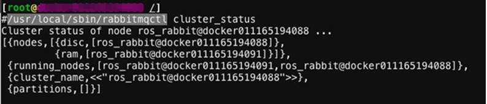
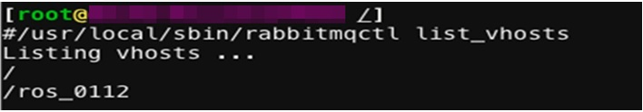

Alibaba Cloud  
Apsara Stack  
Resource Orchestration  
Service  
Operations and Maintenance  
Guide  
Product Version: v3.18.6-2607  
Document Version: 20260828

**Table of Contents**

- [1.ROS component O&M](#section-1)
    - [1.1. API Server](#section-1-1)
    - [1.2. Engine Server](#section-1-2)
    - [1.3. RabbitMQ clusters](#section-1-3)
    - [1.4. Notify Server](#section-1-4)

<a id="section-1"></a>

# 1.ROS component O&M

<a id="section-1-1"></a>

## 1.1. API Server

The API Server is used to receive ROS requests, send requests to RabbitMQ clusters, and send the responses returned by the Engine Server to callers. The API Server is used to connect the frontend and backend services.

- Components

  The Engine Server and API Server share three servers, all of which are attached to a special Server Load Balancer (SLB) instance.

- O&M methods

  - The storage path of the API Server information is /home/admin/ros-server/bin/.

  - Basic operations of the API Server:  `#/usr/local/ros-python/bin/python/home/admin/ros-`

    ```text
    service/bin/ros-api{stop|status|--daemon} 
    ```

    - `stop` : stops the API Server.

    - `status` : queries the status of the API Server.

    - `--daemon` : starts the API Server in daemon mode.

- Health criteria

  - Intrinsic availability: The CPU usage and system memory are within the normal range. The API Server is running normally.

  - Associated component availability: ROS is available.

<a id="section-1-2"></a>

## 1.2. Engine Server

The Engine Server is used to process stack requests. It shares the three servers with the API Server.

- O&M methods

  - The storage path of the API Server information is /home/admin/ros-server/bin/.

  - Basic operation of the Engine Server:  `/usr/local/ros-python/bin/python`

    ```text
    /home/admin/ros-service/bin/ros-engine {stop|status|--daemon} 
    ```

    - `stop` : stops the Engine Server.

    - `status` : queries the status of the Engine Server.

    - `--daemon` : starts the Engine Server in daemon mode.

- Health criteria

  - Intrinsic availability: The CPU usage and system memory are within the normal range. The Engine Server is running normally.

  - Associated component availability: ROS is available.

<a id="section-1-3"></a>

## 1.3. RabbitMQ clusters

RabbitMQ clusters are used to receive requests from the API Sever and responses from the Engine Server.

- Components

  RabbitMQ clusters are composed of nodes.

  RabbitMQ clusters are used for messaging. Nodes in the clusters use disks for non-persistent storage. Messages are written into the queues that correspond to the nodes. Nodes in a cluster can communicate with each other. Typically, to ensure data accuracy, the minimum number of working nodes is set to [Total number of nodes/2] rounded up. If data of nodes are inconsistent, the secondary nodes synchronize queue messages from the primary nodes.

- O&M methods

  The storage path of the RabbitMQ information is /opt/rabbitmq-server/.

  Common RabbitMQ commands are as follows:

  - You can run the following command to query the cluster status:  `sudo`

    ```text
    /usr/local/sbin/rabbitmq-server/sbin/rabbitmqctl cluster_status 
    ```

    

    - `Nodes` : indicates the nodes in the cluster.

    - `Disc` : indicates that the cluster uses disks for storage.

    - `Mem` : indicates that the cluster uses memory for non-persistent storage.

    - `Running_nodes` : indicates the information of the running nodes in the cluster.

    - `Partition` : indicates the partitions of the cluster. If the value field is brackets [], the cluster has no partitions. If this parameter is not empty, the cluster nodes are divided into several partitions.

  - You can run the following command to query the virtual hosts in a cluster:  `sudo`

    ```text
    /usr/local/sbin/rabbitmqctl list_vhosts 
    ```

    

    Typically, there are two virtual hosts. One is displayed as a forward slash (/), and the other is named based on the region where it resides.

  - Health criteria

    - Intrinsic availability: The CPU usage and system memory are within the normal range. RabbitMQ is running normally, which indicates that clusters have no partitions, queues are properly processed, and messages are properly consumed.

    - Associated component availability: ROS is available.

<a id="section-1-4"></a>

## 1.4. Notify Server

The Notify Server is the proxy server for ECS instances that reside in a VPC. It sends the execution status and information of operations on ECS instances to ROS.

- Components The Notify Server consists of three servers, all of which are attached to a special SLB instance.

- O&M methods

  For example, the virtual IP address of the SLB instance is 10.152.XX.XX. You can run curl  `http://10.152.XX.XX:80/health-check`  to check whether the Notify Server is running.

- Health criteria

  - Intrinsic availability: The CPU usage and system memory are within the normal range.

  - Associated component availability: ROS is available.
