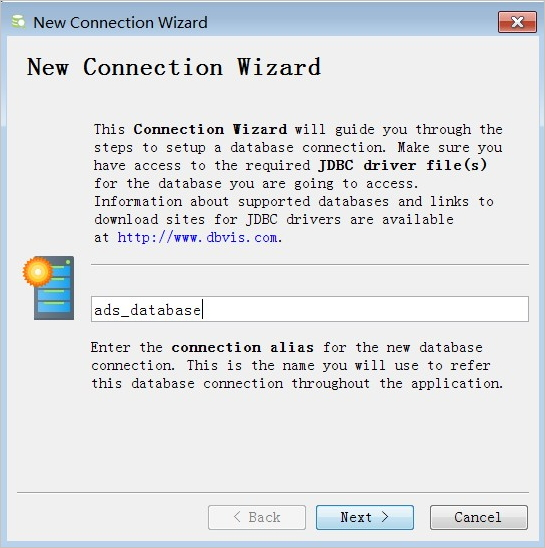
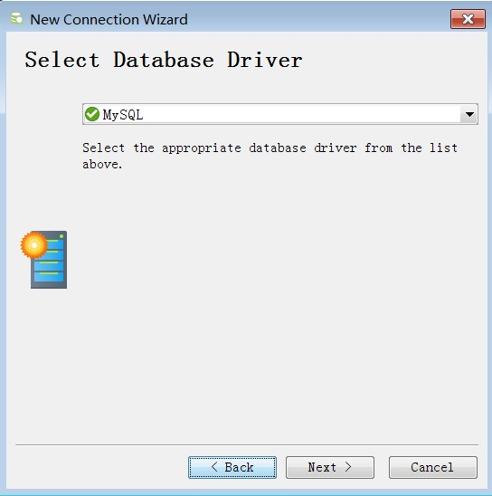
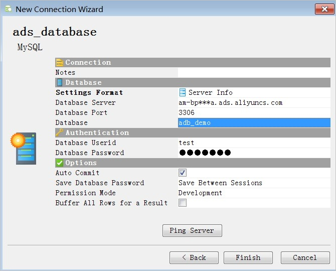
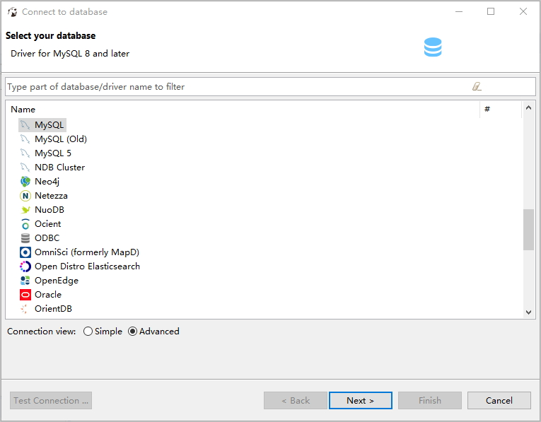
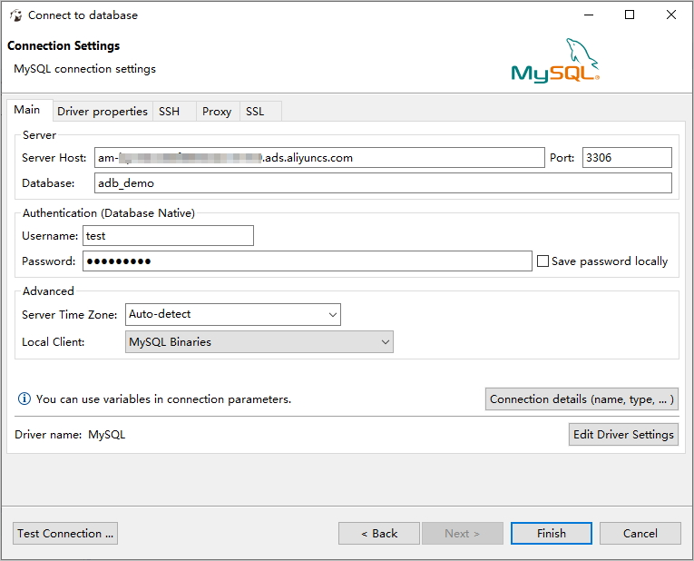
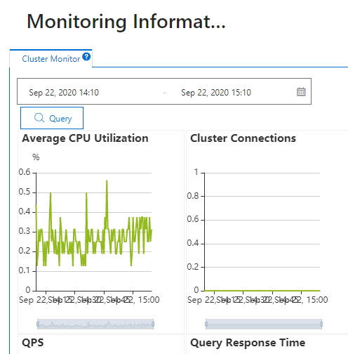
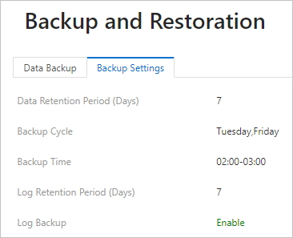

Alibaba Cloud  
Apsara Stack Enterprise  
AnalyticDB for MySQL  
User Guide  
Product Version: V3.12.0  
Document Version: 20220928

**Table of Contents**

- [1.What is AnalyticDB for MySQL?](#section-1)
- [2.Limits](#section-2)
- [3.Quick start](#section-3)
    - [3.1. Log on to the AnalyticDB for MySQL console](#section-3-1)
    - [3.2. Create a database cluster](#section-3-2)
    - [3.3. Configure a whitelist](#section-3-3)
    - [3.4. Create a database account](#section-3-4)
    - [3.5. Create a database](#section-3-5)
    - [3.6. Connect to a database cluster](#section-3-6)
    - [3.7. Apply for a public endpoint](#section-3-7)
    - [3.8. Synchronize data](#section-3-8)
- [4.Connect to a database cluster](#section-4)
    - [4.1. Use the MySQL command-line tool to connect to AnalyticDB for MySQL](#section-4-1)
    - [4.2. Use the code in a business system to connect to AnalyticDB for MySQL](#section-4-2)
        - [4.2.1. C#](#section-4-2-1)
        - [4.2.2. PHP](#section-4-2-2)
        - [4.2.3. Python](#section-4-2-3)
        - [4.2.4. Druid connection pool](#section-4-2-4)
        - [4.2.5. Java](#section-4-2-5)
    - [4.3. Enable PrepareStatement for a client in different programming languages](#section-4-3)
    - [4.4. Use a client to connect to AnalyticDB for MySQL](#section-4-4)
        - [4.4.1. SQL Workbench/J](#section-4-4-1)
        - [4.4.2. DbVisualizer](#section-4-4-2)
        - [4.4.3. DBeaver](#section-4-4-3)
        - [4.4.4. Navicat](#section-4-4-4)
- [5.Manage database clusters](#section-5)
    - [5.1. View monitoring information](#section-5-1)
    - [5.2. Change specifications](#section-5-2)
    - [5.3. Delete a cluster](#section-5-3)
- [6.Backup and restoration](#section-6)
    - [6.1. Back up data](#section-6-1)
    - [6.2. Restore data](#section-6-2)
- [7.Diagnostics and optimization](#section-7)
    - [7.1. Use functions related to slow SQL queries](#section-7-1)
- [8.Account and permission management](#section-8)
    - [8.1. Permission model](#section-8-1)
    - [8.2. Manage database accounts and permissions](#section-8-2)
- [9.Data visualization](#section-9)
    - [9.1. Tableau](#section-9-1)
    - [9.2. QlikView](#section-9-2)
    - [9.3. FineReport](#section-9-3)
- [10.Data migration and synchronization](#section-10)
    - [10.1. Use Kettle to synchronize local data to AnalyticDB for MySQL](#section-10-1)
- [11.SQL manual](#section-11)
    - [11.1. Data types](#section-11-1)
    - [11.2. Data definition statements](#section-11-2)
        - [11.2.1. CREATE DATABASE](#section-11-2-1)
        - [11.2.2. CREATE TABLE](#section-11-2-2)
        - [11.2.3. ALTER TABLE](#section-11-2-3)
        - [11.2.4. CREATE VIEW](#section-11-2-4)
        - [11.2.5. DROP DATABASE](#section-11-2-5)
        - [11.2.6. DROP TABLE](#section-11-2-6)
        - [11.2.7. DROP VIEW](#section-11-2-7)
    - [11.3. Data manipulation statements](#section-11-3)
        - [11.3.1. INSERT INTO](#section-11-3-1)
        - [11.3.2. REPLACE INTO](#section-11-3-2)
        - [11.3.3. INSERT SELECT FROM](#section-11-3-3)
        - [11.3.4. REPLACE SELECT FROM](#section-11-3-4)
        - [11.3.5. INSERT OVERWRITE INTO SELECT](#section-11-3-5)
        - [11.3.6. UPDATE](#section-11-3-6)
        - [11.3.7. DELETE](#section-11-3-7)
        - [11.3.8. TRUNCATE TABLE](#section-11-3-8)
        - [11.3.9. KILL PROCESS](#section-11-3-9)
        - [11.3.10. SHOW PROCESSLIST](#section-11-3-10)
    - [11.4. SELECT](#section-11-4)
        - [11.4.1. Syntax](#section-11-4-1)
        - [11.4.2. WITH](#section-11-4-2)
        - [11.4.3. GROUP BY](#section-11-4-3)
        - [11.4.4. HAVING](#section-11-4-4)
        - [11.4.5. JOIN](#section-11-4-5)
        - [11.4.6. LIMIT](#section-11-4-6)
        - [11.4.7. ORDER BY](#section-11-4-7)
        - [11.4.8. Subqueries](#section-11-4-8)
        - [11.4.9. UNION, INTERSECT, and EXCEPT](#section-11-4-9)
    - [11.5. CREATE USER](#section-11-5)
    - [11.6. GRANT](#section-11-6)
    - [11.7. REVOKE](#section-11-7)
    - [11.8. Query users](#section-11-8)
    - [11.9. RENAME USER](#section-11-9)
    - [11.10. DROP USER](#section-11-10)
    - [11.11. SHOW](#section-11-11)
- [12.System functions](#section-12)
    - [12.1. Aggregate functions](#section-12-1)
        - [12.1.1. AVG](#section-12-1-1)
        - [12.1.2. BIT_AND](#section-12-1-2)
        - [12.1.3. BIT_OR](#section-12-1-3)
        - [12.1.4. BIT_XOR](#section-12-1-4)
        - [12.1.5. COUNT](#section-12-1-5)
        - [12.1.6. MAX](#section-12-1-6)
        - [12.1.7. MIN](#section-12-1-7)
        - [12.1.8. STD/STDDEV](#section-12-1-8)
        - [12.1.9. STDDEV_POP](#section-12-1-9)
        - [12.1.10. STDDEV_SAMP](#section-12-1-10)
        - [12.1.11. SUM](#section-12-1-11)
        - [12.1.12. VAR_POP](#section-12-1-12)
        - [12.1.13. VAR_SAMP](#section-12-1-13)
        - [12.1.14. VARIANCE](#section-12-1-14)
    - [12.2. Date and time functions](#section-12-2)
        - [12.2.1. ADDDATE/DATE_ADD](#section-12-2-1)
        - [12.2.2. ADDTIME](#section-12-2-2)
        - [12.2.3. CONVERT_TZ](#section-12-2-3)
        - [12.2.4. CURDATE](#section-12-2-4)
        - [12.2.5. CURTIME](#section-12-2-5)
        - [12.2.6. DATE](#section-12-2-6)
        - [12.2.7. DATE_FORMAT](#section-12-2-7)
        - [12.2.8. SUBDATE/DATE_SUB](#section-12-2-8)
        - [12.2.9. DATEDIFF](#section-12-2-9)
        - [12.2.10. DAY/DAYOFMONTH](#section-12-2-10)
        - [12.2.11. DAYNAME](#section-12-2-11)
        - [12.2.12. DAYOFWEEK](#section-12-2-12)
        - [12.2.13. DAYOFYEAR](#section-12-2-13)
        - [12.2.14. EXTRACT](#section-12-2-14)
        - [12.2.15. FROM_DAYS](#section-12-2-15)
        - [12.2.16. FROM_UNIXTIME](#section-12-2-16)
        - [12.2.17. HOUR](#section-12-2-17)
        - [12.2.18. LAST_DAY](#section-12-2-18)
        - [12.2.19. LOCALTIME/LOCALTIMESTAMP/NOW](#section-12-2-19)
        - [12.2.20. MAKEDATE](#section-12-2-20)
        - [12.2.21. MAKETIME](#section-12-2-21)
        - [12.2.22. MINUTE](#section-12-2-22)
        - [12.2.23. MONTH](#section-12-2-23)
        - [12.2.24. MONTHNAME](#section-12-2-24)
        - [12.2.25. PERIOD_ADD](#section-12-2-25)
        - [12.2.26. PERIOD_DIFF](#section-12-2-26)
        - [12.2.27. QUARTER](#section-12-2-27)
        - [12.2.28. SEC_TO_TIME](#section-12-2-28)
        - [12.2.29. SECOND](#section-12-2-29)
        - [12.2.30. STR_TO_DATE](#section-12-2-30)
        - [12.2.31. SUBTIME](#section-12-2-31)
        - [12.2.32. SYSDATE](#section-12-2-32)
        - [12.2.33. TIME](#section-12-2-33)
        - [12.2.34. TIME_FORMAT](#section-12-2-34)
        - [12.2.35. TIME_TO_SEC](#section-12-2-35)
        - [12.2.36. TIMEDIFF](#section-12-2-36)
        - [12.2.37. TIMESTAMP](#section-12-2-37)
        - [12.2.38. TIMESTAMPADD](#section-12-2-38)
        - [12.2.39. TIMESTAMPDIFF](#section-12-2-39)
        - [12.2.40. TO_DAYS](#section-12-2-40)
        - [12.2.41. TO_SECONDS](#section-12-2-41)
        - [12.2.42. UNIX_TIMESTAMP](#section-12-2-42)
        - [12.2.43. UTC_DATE](#section-12-2-43)
        - [12.2.44. UTC_TIME](#section-12-2-44)
        - [12.2.45. UTC_TIMESTAMP](#section-12-2-45)
        - [12.2.46. WEEK](#section-12-2-46)
        - [12.2.47. WEEKDAY](#section-12-2-47)
        - [12.2.48. WEEKOFYEAR](#section-12-2-48)
        - [12.2.49. YEAR](#section-12-2-49)
        - [12.2.50. YEARWEEK](#section-12-2-50)
    - [12.3. String functions](#section-12-3)
        - [12.3.1. ASCII](#section-12-3-1)
        - [12.3.2. BIN](#section-12-3-2)
        - [12.3.3. BIT_LENGTH](#section-12-3-3)
        - [12.3.4. CHAR](#section-12-3-4)
        - [12.3.5. CHAR_LENGTH/CHARACTER_LENGTH](#section-12-3-5)
        - [12.3.6. CONCAT](#section-12-3-6)
        - [12.3.7. CONCAT_WS](#section-12-3-7)
        - [12.3.8. ELT](#section-12-3-8)
        - [12.3.9. EXPORT_SET](#section-12-3-9)
        - [12.3.10. FIELD](#section-12-3-10)
        - [12.3.11. FIND_IN_SET](#section-12-3-11)
        - [12.3.12. FORMAT](#section-12-3-12)
        - [12.3.13. HEX](#section-12-3-13)
        - [12.3.14. INSTR](#section-12-3-14)
        - [12.3.15. LEFT](#section-12-3-15)
        - [12.3.16. LENGTH/OCTET_LENGTH](#section-12-3-16)
        - [12.3.17. LIKE](#section-12-3-17)
        - [12.3.18. LOCATE](#section-12-3-18)
        - [12.3.19. LOWER/LCASE](#section-12-3-19)
        - [12.3.20. LPAD](#section-12-3-20)
        - [12.3.21. LTRIM](#section-12-3-21)
        - [12.3.22. MAKE_SET](#section-12-3-22)
        - [12.3.23. MID](#section-12-3-23)
        - [12.3.24. OCT](#section-12-3-24)
        - [12.3.25. POSITION](#section-12-3-25)
        - [12.3.26. REPEAT](#section-12-3-26)
        - [12.3.27. REPLACE](#section-12-3-27)
        - [12.3.28. REVERSE](#section-12-3-28)
        - [12.3.29. RIGHT](#section-12-3-29)
        - [12.3.30. RLIKE/REGEXP](#section-12-3-30)
        - [12.3.31. RPAD](#section-12-3-31)
        - [12.3.32. RTRIM](#section-12-3-32)
        - [12.3.33. SPACE](#section-12-3-33)
        - [12.3.34. STRCMP](#section-12-3-34)
        - [12.3.35. SUBSTR/SUBSTRING](#section-12-3-35)
        - [12.3.36. SUBSTRING_INDEX](#section-12-3-36)
        - [12.3.37. TRIM](#section-12-3-37)
        - [12.3.38. UPPER/UCASE](#section-12-3-38)
    - [12.4. Numeric functions](#section-12-4)
        - [12.4.1. ABS](#section-12-4-1)
        - [12.4.2. ROUND](#section-12-4-2)
        - [12.4.3. SQRT](#section-12-4-3)
        - [12.4.4. LN](#section-12-4-4)
        - [12.4.5. LOG](#section-12-4-5)
        - [12.4.6. LOG2](#section-12-4-6)
        - [12.4.7. PI](#section-12-4-7)
        - [12.4.8. LOG10](#section-12-4-8)
        - [12.4.9. POWER/POW](#section-12-4-9)
        - [12.4.10. RADIANS](#section-12-4-10)
        - [12.4.11. DEGREES](#section-12-4-11)
        - [12.4.12. SIGN](#section-12-4-12)
        - [12.4.13. CEILING/CEIL](#section-12-4-13)
        - [12.4.14. FLOOR](#section-12-4-14)
        - [12.4.15. EXP](#section-12-4-15)
        - [12.4.16. COS](#section-12-4-16)
        - [12.4.17. ACOS](#section-12-4-17)
        - [12.4.18. TAN](#section-12-4-18)
        - [12.4.19. ATAN](#section-12-4-19)
        - [12.4.20. ATAN2](#section-12-4-20)
        - [12.4.21. COT](#section-12-4-21)
        - [12.4.22. ASIN](#section-12-4-22)
        - [12.4.23. SIN](#section-12-4-23)
    - [12.5. Arithmetic operators](#section-12-5)
    - [12.6. Bit functions and operators](#section-12-6)
    - [12.7. Control flow functions](#section-12-7)

<a id="section-1"></a>

# 1.What is AnalyticDB for MySQL?

AnalyticDB for MySQL is a real-time online analytical processing (RT-OLAP) service that is developed by Alibaba Cloud to analyze large amounts of data at high concurrency. AnalyticDB for MySQL can analyze hundreds of billions of data records across multiple dimensions within milliseconds and provide you with data-driven insights into your business.

Note

OLAP systems are often compared with online transaction processing (OLTP) systems.

OLAP systems are ideal for systems that require complex multidimensional queries and analytics on large amounts of data. The OLAP model is commonly adopted in analytical databases. OLTP systems are suitable for transactional processing, and ensures strong atomicity and consistency in data manipulation. The OLTP model supports frequent INSERT and UPDATE operations and is often used for relational database management systems, such as MySQL and Microsoft SQL Server.

AnalyticDB for MySQL is an RT-OLAP system that offers the following benefits:

- Compatible with MySQL, business intelligence (BI) tools, and extract, transform, and load (ETL) tools for easy, cost-effective, and efficient analysis and integration of data.

- Uses relational models to store data and provides SQL statements to flexibly compute and analyze data. You do not need to create a data model in advance.

- Uses distributed computing technologies to provide excellent real-time computing capabilities.

  When AnalyticDB for MySQL processes tens of billions of data records or more, its performance can match or even surpass that of multidimensional online analytical processing (MOLAP) systems. AnalyticDB for MySQL can compute tens of billions of data records within several hundred milliseconds. You can then explore large amounts of data without constraints, instead of viewing data reports based on a predefined logic.

- Computes hundreds of billions of data records in real time.

  AnalyticDB for MySQL uses all data generated in your business system for data analysis, rather than sampling a portion of the data. This maximizes the effectiveness of analysis results.

- Supports a large number of concurrent queries and ensures high system availability through dynamic multi-copy storage and computing technology. Therefore, AnalyticDB for MySQL can serve as a backend system for various products, including user-facing and enterprise-facing products.

  AnalyticDB for MySQL is used in Internet business systems that have hundreds of thousands to tens of millions of users, such as Data Cube, Taobao Index, Kuaidi Dache, Alimama DMP, and Taobao Groceries.

AnalyticDB for MySQL is a real-time computing system that provides rapid and flexible online data analysis and computation.

<a id="section-2"></a>

# 2.Limits

Take note of the following limits before you use AnalyticDB for MySQL.

| Object | Naming convention | Limit |
| --- | --- | --- |
| Database name | A database name can be up to 64 characters in length, and can contain letters, digits, and underscores (_). It must start with a lowercase letter and cannot contain consecutive underscores (_). | Do not use analyticdb as the database name. The name analyticdb is reserved for a built-in database. |
| Table name | A table name must be 1 to 127 characters in length, and can contain letters, digits, and underscores (_). It must start with a letter or underscore (_). | • A table name cannot contain single quotation marks ('), double quotation marks (''), exclamation points (!), or spaces.<br>• A table name cannot be SQL reserved keywords. |
| Column name | A column name must be 1 to 127 characters in length, and can contain letters, digits, and underscores (_). It must start with a letter or underscore (_). | • A column name cannot contain single quotation marks ('), double quotation marks (''), exclamation points (!), or spaces.<br>• A column name cannot be SQL reserved keywords. |
| Account name | An account name must be 2 to 16 characters in length, and can contain lowercase letters, digits, and underscores (_). It must start with a lowercase letter and end with a lowercase letter or digit. | None |
| Password | A password must be 8 to 32 characters in length and must contain at least three of the following character types: uppercase letters, lowercase letters, digits, and special characters. Special characters include ! @ # $ % ^ &amp; \* ( ) _ + - = | None |
| Comment in a table | None | A table comment can be up to 1,024 characters in length. |
| Comment in a column | None | A column comment can be up to 1,024 characters in length. |
| Index name | None | An index name can be up to 64 characters in length. |
| Default value of a column | None | The default value of a column can be up to 127 characters in length. |

<a id="section-3"></a>

# 3.Quick start

<a id="section-3-1"></a>

## 3.1. Log on to the AnalyticDB for MySQL console

This topic describes how to log on to the AnalyticDB for MySQL console.

Prerequisites

- Before you log on to the Apsara Uni-manager Management Console, the endpoint of the console is obtained from the deployment staff.

- We recommend that you use Google Chrome.

Procedure

1. Enter the URL of the Apsara Uni-manager Management Console in the address bar and press the Enter key.

2. Enter your username and password.

   Obtain the username and password that you use to log on to the Apsara Uni-manager Management Console from the operations administrator.

   Note

   The first time that you log on to the Apsara Uni-manager Management Console,

   you must change the password of your account. For security purposes, your password must meet the minimum complexity requirements. The password must be 10 to 32 characters in length and must contain at least two of the following character types:

   - Uppercase or lowercase letters

   - Digits

   - Special characters, including exclamation points (!), at signs (@), number signs (#), dollar signs ($), and percent signs (%)

3. Click Log On.

4. In the top navigation bar, choose Products > Database Services > AnalyticDB for MySQL.

<a id="section-3-2"></a>

## 3.2. Create a database cluster

This topic describes how to create an AnalyticDB for MySQL cluster.

Procedure

1. Log on to the AnalyticDB for MySQL console.

2. Click Create Cluster in the upper-right corner of the Clusters page and configure the parameters.

   | Parameter | Description |
   | --- | --- |
   | Region | The region where the cluster resides. You cannot change the region after the cluster is created. We recommend that you select a region that is closest to the geographic area of your business to improve access speed and stability. |
   | Zone | The zone where the new cluster resides. A zone is an independent physical location within a region.There are no substantial differences between different zones within the same region. |
   | Organization | The organization to which the cluster belongs. |
   | Resource Set | The resource set of the cluster. |
   | Version | Only version 3.0 is supported. |
   | Edition | Only Basic is supported. |
   | Network Type | AnalyticDB for MySQL supports two types of networks.<br>• <em>VPC</em>: A VPC helps you build an isolated network environment in Apsara Stack. You can customize the route table, CIDR blocks, and gateway of a VPC. We recommend that you select VPC for higher security.<br>• <em>Classic Network</em>: Cloud services in the classic network are not isolated. Access control to cloud services in a classic network is implemented by the security groups or whitelist policies of the services. |
   | Specifications | The ECU specifications. |
   | Node Groups | The number of node groups. By default, each node group consists of three replicas. |
   | Storage | The storage space of a node group. |

3. After you configure the preceding parameters, click Submit.

<a id="section-3-3"></a>

## 3.3. Configure a whitelist

This topic describes how to configure a whitelist for a cluster in the AnalyticDB for MySQL console.

Context

After you create an AnalyticDB for MySQL cluster, you must configure a whitelist for the cluster to allow external devices to access the cluster. The default whitelist contains only the default IP address 127.0.0.1, which indicates that no devices are allowed to access the cluster. The whitelist can enhance access security of AnalyticDB for MySQL clusters. We recommend that you maintain the whitelist on a regular basis. The whitelist does not affect the normal operation of AnalyticDB for MySQL clusters.

Procedure

1. Log on to the AnalyticDB for MySQL console.

2. In the upper-left corner of the page, select the region where the cluster resides.

3. On the Clusters page, click Cluster ID corresponding to the cluster for which you want to configure a whitelist.

4. In the left-side navigation pane, click Data Security.

5. On the Whitelist Settings tab, click Edit to the right of the default whitelist.

   Note

   You can also click Create Whitelist to create a whitelist.

6. In the Edit Whitelist dialog box, delete the default IP address 127.0.0.1, enter the IP addresses or CIDR blocks that you want to allow, and then click OK.

   - The CIDR block 0.0.0.0/0 indicates that all IP addresses are allowed to access the cluster. Exercise caution when you add this CIDR block.

   - If you enter a CIDR block such as 10.10.10.0/24, any IP addresses in the 10.10.10.X format can access the cluster.

   - If you want to add multiple IP addresses or CIDR blocks, separate multiple entries with commas (,). Do not add spaces before or after the commas. Example: 192.168.0.1,172.16.213.9.

   - The whitelist modification takes effect within one minute.

<a id="section-3-4"></a>

## 3.4. Create a database account

This topic describes the database account types in AnalyticDB for MySQL and how to create database accounts.

Account types

AnalyticDB for MySQL supports two types of database accounts: privileged accounts and standard accounts.

Account types

<table>
  <tr>
    <td>Account type</td>
    <td>Description</td>
  </tr>
</table>

| Account type | Description |
| --- | --- |
| Privileged account | • You can create and manage privileged accounts only in the console.<br>• You can create only one privileged account for a cluster. You can use the privileged account to manage all standard accounts and databases of the cluster.<br>• You can use the privileged account of a cluster to disconnect any standard account of the cluster from AnalyticDB for MySQL. A privileged account has more permissions, which allows you to perform fine-grained management operations.For example, you can grant query permissions on different tables to different users.<br>• The privileged account in AnalyticDB for MySQL is equivalent to the root account in MySQL. |
| Standard account | • You can use only SQL statements to create and manage standard accounts.<br>• You can create up to 256 standard accounts for a cluster.<br>• You must manually grant a standard account the permissions to access a specific database.<br>• You cannot use a standard account to disconnect other accounts from AnalyticDB for MySQL. |

Create a privileged account

1. Log on to the AnalyticDB for MySQL console

2. In the upper-left corner of the page, select the region where the cluster resides.

3. On the Clusters page, click Cluster ID corresponding to the cluster for which you want to create a privileged account.

4. In the left-side navigation pane, click Accounts. On the Accounts page, click Create Account.

5. In the Create Account pane, configure the following parameters.

   | Parameter | Description |
   | --- | --- |
   | Account | The name of the privileged account.<br>The name must be 2 to 16 characters in length and can contain lowercase letters, digits, and underscores (_). It must start with a lowercase letter and end with a lowercase letter or digit. |
   | Account Type | The type of the account. The value is Privileged Account. This value cannot be changed. |
   | Password | The password of the privileged account.<br>The password must be 8 to 32 characters in length and contain at least three of the following character types: uppercase letters, lowercase letters, digits, and special characters. Special characters include ! @ # $ % ^ &amp; \* ( ) _ + - = |
   | Confirm Password | Enter the password of the privileged account again. |
   | Description | Optional. The description of the privileged account. |

6. Click OK to create the privileged account.

Create a standard account

For more information about how to create a standard account and grant permissions to the standard account, see CREATE USER.

What to do next

Create a database

<a id="section-3-5"></a>

## 3.5. Create a database

You can use a MySQL client (such as Navicat for MySQL, DBeaver, DbVisualizer, or SQL Workbench/J), application code, or the MySQL command-line tool to connect to an AnalyticDB for MySQL cluster, and execute the CREATE DATABASE statement to create a database.

Prerequisites

You have connected to a database cluster. For more information, see Connect to a database cluster.

Syntax

```sql
CREATE DATABASE [IF NOT EXISTS] db_name;
```

Example

You can execute the following statement to create a database named adb_demo:

```sql
create database adb_demo;
```

<a id="section-3-6"></a>

## 3.6. Connect to a database cluster

This topic describes how to connect to an AnalyticDB for MySQL cluster.

Prerequisites

After you configure a whitelist and create a database account, you can use a MySQL client (such as Navicat for MySQL, DBeaver, DbVisualizer, or SQL Workbench/J), or the MySQL command-line tool to connect to the AnalyticDB for MySQL cluster. For more information, see Configure a whitelist and Create a database account. You can also configure the connection information such as the endpoint, port, and account of an AnalyticDB for MySQL cluster in an application to connect to the cluster.

Use the code in an application to connect to AnalyticDB for MySQL

- C#

- PHP

- Python

- Configure the Druid connection pool

- Java

Use the MySQL command-line tool to connect to AnalyticDB for MySQL

Use the MySQL command-line tool to connect to AnalyticDB for MySQL

Use a client to connect to AnalyticDB for MySQL

- SQL Workbench/J

- DbVisualizer

- DBeaver

- Navicat

<a id="section-3-7"></a>

## 3.7. Apply for a public endpoint

This topic describes how to use the AnalyticDB for MySQL console to apply for a public endpoint for a cluster.

Context

- You must manually apply for a public endpoint. You can release the public endpoint if you do not need it.

- The public endpoint applies to the following scenarios:

  - You want to access an AnalyticDB for MySQL cluster on devices that are not deployed in the Alibaba Cloud environment.

  - You want to access an AnalyticDB for MySQL cluster from a region or of a network type that is different from the cluster.

Apply for a public endpoint

1. Log on to the AnalyticDB for MySQL console.

2. In the upper-left corner of the page, select the region where the cluster resides.

3. On the Clusters page, click Cluster ID corresponding to the cluster for which you want to apply for a public endpoint.

4. In the Network Information section of the Cluster Information page, click Apply for Public Endpoint.

5. In the Apply for Public Endpoint message, click OK to obtain a public endpoint.

   Note

   Before you use the public endpoint to access the AnalyticDB for MySQL cluster, you

   must add the IP address of the device that you use to access the cluster to the whitelist. For more information, see Configure a whitelist.

Release a public endpoint

1. Log on to the AnalyticDB for MySQL console.

2. In the upper-left corner of the page, select the region where the cluster resides.

3. On the Clusters page, click Cluster ID corresponding to the cluster for which you want to release a public endpoint.

4. On the Cluster Information page, click Release Public Endpoint.

5. In the Release Public Endpoint message, click OK to release the public endpoint.

<a id="section-3-8"></a>

## 3.8. Synchronize data

To synchronize data in different scenarios, you can use the following data loading solutions provided by AnalyticDB for MySQL:

- Use Kettle to synchronize data from relational databases, NoSQL databases such as HBase, or Microsoft Office Excel or Access to AnalyticDB for MySQL.

- Use external tables to import data from OSS to AnalyticDB for MySQL or export data from AnalyticDB for MySQL to OSS.

- Use the Load Data statement to write local data to AnalyticDB for MySQL.

- If the data already exists in AnalyticDB for MySQL tables, use the  `INSERT INTO...SELECT FROM` statement to synchronize data.

<a id="section-4"></a>

# 4.Connect to a database cluster

<a id="section-4-1"></a>

## 4.1. Use the MySQL command-line tool to connect to AnalyticDB for MySQL

This topic describes how to use the MySQL command-line tool to connect to an AnalyticDB for MySQL cluster.

Syntax

```text
mysql -hadb_url -P3306 -uadb_user -padb_password
```

Parameters

- `adb_url` : the endpoint of the AnalyticDB for MySQL cluster to which you want to connect. You can obtain the endpoint of the cluster in the Network Information section of the Cluster Information page in the AnalyticDB for MySQL console.

- `3306` : the port number of the AnalyticDB for MySQL cluster endpoint. The default port number is  `3306` .

- `adb_user` : the account used to connect to the AnalyticDB for MySQL cluster. The account can be a privileged account or a standard account that has the required permissions.

- `adb_password` : the password of the account used to connect to the AnalyticDB for MySQL cluster.

Example

```text
mysql -ham-bp****.ads.aliyuncs.com -P3306 -utest -pTest123
```

<a id="section-4-2"></a>

## 4.2. Use the code in a business system to connect to AnalyticDB for MySQL

<a id="section-4-2-1"></a>

### 4.2.1. C#

This topic describes how to use the MySQL Connector/NET connector to connect to an AnalyticDB for MySQL cluster.

```csharp
using System;
using System.Data;
using MySql.Data;
using MySql.Data.MySqlClient;
namespace adbdemo
{
    public class Tutorial2
    {
        public static void Main()
        {
    // server: the endpoint of the AnalyticDB for MySQL cluster to which you want to connect. You can obtain the endpoint on the Cluster Information page of the AnalyticDB for MySQL console.
    // UID: the account used to connect to the AnalyticDB for MySQL cluster. AnalyticDB for
MySQL offers the following types of accounts: privileged accounts and standard accounts.
    // database: the name of the database in the AnalyticDB for MySQL cluster.
    // port: the port number of the AnalyticDB for MySQL cluster endpoint.
    // password: the password of the account used to connect to the AnalyticDB for MySQL cluster.
            string connStr = "server=... ;UID=...;database=...;port=...;password=... ;SslMode=none;";
            MySqlConnection conn = new MySqlConnection(connStr);
            try
            {
                Console.WriteLine("Connecting to MySQL...");
                conn.Open();
                string sql = "select c_custkey, c_name from customer limit 1";
                MySqlCommand cmd = new MySqlCommand(sql, conn);
                MySqlDataReader rdr = cmd.ExecuteReader();
                while (rdr.Read())
                {
                    Console.WriteLine(rdr[0] + " --- " + rdr[]);
                }
                rdr.Close();
            }
            catch (Exception ex)
            {
                Console.WriteLine(ex.ToString());
            }
            conn.Close();
            Console.WriteLine("Done.") ;
        }
    }
}
```

<a id="section-4-2-2"></a>

### 4.2.2. PHP

This topic describes how to connect to an AnalyticDB for MySQL cluster in PHP.

Precautions

- If your operating system is Linux, you must install the php-mysql 5.1.x module.

- If your operating system is Windows, you must install the php_MySQL.dll library.

- For more information about how to enable PrepareStatement if you use PDO to connect to AnalyticDB for MySQL, see Enable PrepareStatement for a client in different programming languages.

Use MySQLi to connect to AnalyticDB for MySQL

```text
// am-bp***.ads.aliyuncs.com: the endpoint of the AnalyticDB for MySQL cluster to which youwant to connect. You can obtain the endpoint on the Cluster Information page of the AnalyticDB for MySQL console.
$ads_server_name="am-bp***.ads.aliyuncs.com"; 
// account_name: the account used to connect to the AnalyticDB for MySQL cluster. AnalyticD
B for MySQL offers the following types of accounts: privileged accounts and standard accounts.
$ads_username="account_name";
// account_password: the password of the account used to connect to the AnalyticDB for MySQ
L cluster.
$ads_password="account_password";  
// db_name: the name of the database in the AnalyticDB for MySQL cluster.
$ads_database="db_name"; 
// 3306: the port number of the AnalyticDB for MySQL cluster endpoint.
$ads_port=3306;     
// Connect to the AnalyticDB for MySQL cluster.     
$ads_conn=mysqli_connect($ads_server_name,$ads_username,$ads_password,$ads_database, $ads_port);
```

```text
$strsql="SELECT user_id FROM my_ads_db.my_first_table limit 20;";
$result=mysqli_query($ads_conn, $strsql);
while($row = mysqli_fetch_array($result)) {
 // user_id: the name of the column to be queried.
  echo $row["user_id"] ; 
}
```

Use PDO to connect to AnalyticDB for MySQL

```text
// am-bp***.ads.aliyuncs.com: the endpoint of the AnalyticDB for MySQL cluster to which youwant to connect. You can obtain the endpoint on the Cluster Information page of the AnalyticDB for MySQL console.
$ads_server_name = "am-bp***.ads.aliyuncs.com";
// account_name: the account used to connect to the AnalyticDB for MySQL cluster. AnalyticD
B for MySQL offers the following types of accounts: privileged accounts and standard accounts.
$ads_username = "account_name"; 
// account_password: the password of the account used to connect to the AnalyticDB for MySQ
L cluster.
$ads_password = "account_password"; 
// db_name: the name of the database in the AnalyticDB for MySQL cluster.
$ads_database = 'db_name'; 
// 3306: the port number of the AnalyticDB for MySQL cluster endpoint.
$ads_port = 3306;
$dsn = "mysql:host={$ads_server_name};dbname={$ads_database};port={$ads_port}";
try {
    $dbh = new PDO($dsn, $ads_username, $ads_password);
    echo 'PDO Success !' ;
} catch (PDOException $e) {
    echo 'PDO Connection failed: ' . $e->getCode() ."\n" . $e->getMessage() ."\n". $e->getTraceAsString();
}
```

<a id="section-4-2-3"></a>

### 4.2.3. Python

This topic describes how to use Python MySQLdb to connect to an AnalyticDB for MySQL cluster.

```python
#! /usr/bin/python
# -*- coding: UTF-8 -*-
import MySQLdb
# Create a database connection.
# host: the endpoint or IP address of the AnalyticDB for MySQL cluster to which you want toconnect.
# port: the port number of the AnalyticDB for MySQL cluster endpoint.
# user: the account used to connect to the AnalyticDB for MySQL cluster. AnalyticDB for MyS
QL offers the following types of accounts: privileged accounts and standard accounts.
# passwd: the password of the account used to connect to the AnalyticDB for MySQL cluster.
# db: the name of the database in the AnalyticDB for MySQL cluster.
db = MySQLdb.connect(host='am-bp***.ads.aliyuncs.com', port=3306, user='account_name', passwd='account_password', db='db_name')
# Use the cursor() method to obtain an operation cursor.
cursor = db.cursor()
# Use the execute() method to execute SQL statements.
cursor.execute("SELECT VERSION()")
# Use the fetchone() method to obtain a data entry.
data = cursor.fetchone()
print "Database version : %s " % data
# Close the database connection.
db.close()
```

<a id="section-4-2-4"></a>

### 4.2.4. Druid connection pool

This topic describes how to use the Java Database Connectivity (JDBC) Druid connection pool to connect to an AnalyticDB for MySQL cluster.

Precautions

- When you use the Druid connection pool to connect to an AnalyticDB for MySQL cluster, we recommend that you set  `keepAlive`  to true. In this way, you can reuse connections and avoid short-lived connections.

- Use Druid 1.1.12 or later.

Configure the Druid connection pool

```xml
 <bean id="dataSource" class="com.alibaba.druid.pool.DruidDataSource" init-method="init" destroy-method="close"> 
     <! -- jdbc_url: the endpoint of the AnalyticDB for MySQL cluster to which you want to connect. You can obtain the endpoint on the Cluster Information page of the AnalyticDB for 
MySQL console.-->
     <property name="url" value="${jdbc_url}" />
     <! -- jdbc_user: the account used to connect to the AnalyticDB for MySQL cluster. AnalyticDB for MySQL offers the following types of accounts: privileged accounts and standard accounts. -->
     <property name="username" value="${jdbc_user}" />
     <! -- jdbc_password: the password of the account used to connect to the AnalyticDB for
MySQL cluster. -->
     <property name="password" value="${jdbc_password}" />
     <! -- Set the initial size of the connection pool, and the minimum and maximum numbersof connections. -->
     <property name="initialSize" value="5" />
     <property name="minIdle" value="10" /> 
     <property name="maxActive" value="20" />
     <! -- Set the timeout period for obtaining a connection from the connection pool. -->
     <property name="maxWait" value="60000" />
     <! -- Set the interval for detecting idle connections to be closed. Unit: milliseconds. -->
     <property name="timeBetweenEvictionRunsMillis" value="2000" />
     <! -- Set the minimum validity period of a connection in the connection pool. Unit: milliseconds. -->
     <property name="minEvictableIdleTimeMillis" value="600000" />
     <property name="maxEvictableIdleTimeMillis" value="900000" />
     <property name="validationQuery" value="select 1" />
     <property name="testWhileIdle" value="true" />
      <! -- Specify whether to check the validity of the connection each time you obtain a connection from the connection pool. A value of true indicates that the validity of the connection is checked. A value of false indicates that the validity of the connection is not checked. -->
     <property name="testOnBorrow" value="false" />
      <! -- Specify whether to check the validity of the connection each time you return a connection to the connection pool. A value of true indicates that the validity of the connection is checked. A value of false indicates that the validity of the connection is not checked. -->
     <property name="testOnReturn" value="false" />
     <property name="keepAlive" value="true" />
     <property name="phyMaxUseCount" value="100000" />
     <! -- Set the filters to be used for monitoring statistics. -->
     <property name="filters" value="stat" /> 
 </bean>
```

<a id="section-4-2-5"></a>

### 4.2.5. Java

This topic describes how to use MySQL Connector/J to connect to an AnalyticDB for MySQL cluster.

Supported MySQL Connector/J versions

AnalyticDB for MySQL supports the following MySQL Connector/J versions:

- 5.0 series: 5.0.2, 5.0.3, 5.0.4, 5.0.5, 5.0.7, and 5.0.8.

- 5.1 series: 5.1.1, 5.1.2, 5.1.3, 5.1.4, 5.1.5, 5.1.6, 5.1.7, 5.1.8, 5.1.11, 5.1.12, 5.1.13, 5.1.14, 5.1.15, 5.1.16, 5.1.17, 5.1.18, 5.1.19, 5.1.20, 5.1.21, 5.1.22, 5.1.23, 5.1.24, 5.1.25, 5.1.26, 5.1.27, 5.1.28, 5.1.29, 5.1.31, 5.1.32, 5.1.33, and 5.1.34.

Precautions

To create MySQL Connector/J connections in Java, you must add the MySQL Connector/J package to your project. You must add the path of the mysql-connector-java-x.x.x.jar file to the value of the `CLASSPATH`  variable in your project. Otherwise, you cannot create a MySQL Connector/J connection.

Sample code for creating a MySQL Connector/J connection without retries

To connect to AnalyticDB for MySQL databases through MySQL Connector/J, you can add the following Java code to your business system:

```java
Connection connection = null;
Statement statement = null;
ResultSet rs = null;
try {
    Class.forName("com.mysql.jdbc.Driver");
    // adb_url: the endpoint of the AnalyticDB for MySQL cluster to which you want to connect. You can obtain the endpoint on the Cluster Information page of the AnalyticDB for MySQLconsole. The default port number is 3306.
    // db_name: the name of the database in the AnalyticDB for MySQL cluster.
    String url = "jdbc:mysql://adb_url:3306/db_name? useUnicode=true&characterEncoding=UTF-8";
    Properties connectionProps = new Properties();
    // account_name: the account used to connect to the AnalyticDB for MySQL cluster. AnalyticDB for MySQL offers the following types of accounts: privileged accounts and standard accounts.
    connectionProps.put("user", "account_name");
    // account_password: the password of the account used to connect to the AnalyticDB for 
MySQL cluster.
    connectionProps.put("password", "account_password");
    connection = DriverManager.getConnection(url, connectionProps);
    statement = connection.createStatement();
    String query = "select count(*) from information_schema.tables";
    rs = statement.executeQuery(query);
    while (rs.next()) {
        System.out.println(rs.getObject(1));
    }
} catch (ClassNotFoundException e) {
    e.printStackTrace();
} catch (SQLException e) {
    e.printStackTrace();
} catch (Exception e) {
    e.printStackTrace();
} finally {
    if (rs ! = null) {
        try {
            rs.close();
        } catch (SQLException e) {
            e.printStackTrace();
        }
    }
    if (statement ! = null) {
        try {
            statement.close();
        } catch (SQLException e) {
            e.printStackTrace();
        }
    }
    if (connection ! = null) {
        try {
            connection.close();
        } catch (SQLException e) {
            e.printStackTrace();
        }
    }
}
```

Sample code for creating a MySQL Connector/J connection with retries

When you create a MySQL Connector/J connection, you can configure the following parameters to implement a retry mechanism:

```java
public static final int MAX_QUERY_RETRY_TIMES = 3;
public static Connection conn = null;
public static Statement statement = null;
public static ResultSet rs = null;
public static void main(String[] args) throws ClassNotFoundException {
    // db_name: the name of the database in the AnalyticDB for MySQL cluster.
    String yourDB = "db_name";  
    // account_name: the account used to connect to the AnalyticDB for MySQL cluster. AnalyticDB for MySQL offers the following types of accounts: privileged accounts and standard accounts.
    String username = "account_name";  
    // account_password: the password of the account used to connect to the AnalyticDB for 
MySQL cluster.
    String password = "account_password"; 
    Class.forName("com.mysql.jdbc.Driver");
    // adb_url: the endpoint of the AnalyticDB for MySQL cluster to which you want to connect. You can obtain the endpoint on the Cluster Information page of the AnalyticDB for MySQLconsole. The default port number is 3306.
    String url = "jdbc:mysql://adb_url:3306/" + yourDB + "? useUnicode=true&characterEncoding=UTF-8";
    Properties connectionProps = new Properties();
    connectionProps.put("user", username);
    connectionProps.put("password", password);
    String query = "select id from test4dmp.test limit 10";
    int retryTimes = 0;
    // Run automatic retries by using loops.
    while (retryTimes < MAX_QUERY_RETRY_TIMES) {
        try {
            getConn(url, connectionProps);
            execQuery(query);// Run a query.
            break; // If the query is run, exit the loop.
        } catch (SQLException e) {
            System.out.println("Met SQL exception: " + e.getMessage() + ", then go to retrytask ...");
            try {
                if (conn == null || conn.isClosed()) {
                    retryTimes++;
                }
            } catch (SQLException e1) {
                if (conn ! = null) {
                    try {
                        conn.close();
                    } catch (SQLException e2) {
                        e.printStackTrace();
                    }
                }
            }
        }
    }
    // Clear connection resource.
    closeResource();
}
/**
 * Get connection.
 *
 * @param url
 * @param connectionProps
 * @throws SQLException
 */
public static void getConn(String url, Properties connectionProps) throws SQLException {
    conn = DriverManager.getConnection(url, connectionProps);
}
/**
 * Query task execution logic.
 *
 * @param sql
 * @throws SQLException
 */
public static void execQuery(String sql) throws SQLException {
    Statement statement = null;
    ResultSet rs = null;
    statement = conn.createStatement();
    for (int i = 0; i < 10; i++) {
        long startTs = System.currentTimeMillis();
        rs = statement.executeQuery(sql);
        int cnt = 0;
        while (rs.next()) {
            cnt++;
            System.out.println(rs.getObject(1) + " ");
        }
        long endTs = System.currentTimeMillis();
        System.out.println("Elapse Time: " + (endTs - startTs));
        System.out.println(Row count:  + cnt);
        try {
            Thread.sleep(160000);
        } catch (InterruptedException e) {
            e.printStackTrace();
        }
    }
}
/**
 * Close connection resource.
 */
public static void closeResource() {
    if (rs ! = null) {
        try {
            rs.close();
        } catch (SQLException e) {
            e.printStackTrace();
        }
    }
    if (statement ! = null) {
        try {
            statement.close();
        } catch (SQLException e) {
            e.printStackTrace();
        }
    }
    if (conn ! = null) {
        try {
            conn.close();
        } catch (SQLException e) {
            e.printStackTrace();
        }
    }
}
```

<a id="section-4-3"></a>

## 4.3. Enable PrepareStatement for a client in different programming languages

Background information

In most databases, SQL statements can be preprocessed on the server to improve database performance. AnalyticDB for MySQL databases deliver high performance without preprocessing SQL statements on the server side because these databases have the strong query capability, computing power, and plan cache feature.

AnalyticDB for MySQL databases do not support the protocol for preprocessing SQL statements on the server. In most programming languages, you can enable PrepareStatement for a client to prepare statements or interpolate parameters on the client.

This topic describes how to enable PrepareStatement for a client in different programming languages.

MySQL Connector/J (JDBC) driver

You can enable PrepareStatement for the MySQL Connector/J (JDBC) driver when the following condition is met:  `useServerPrepStmts=false` . For more information, visit Configuration Properties for Connector/J.

Note

If the  `useCursorFetch=true`  condition is met, the  `useServerPrepStmts=false`

condition is overwritten and PrepareStatement cannot be enabled.

MariaDB Connector/J

You can enable PrepareStatement for MariaDB Connector/J if the following condition is met: `useServerPrepStmts=false` . For more information, visit About MariaDB Connector/J.

Go MySQL driver

You can enable PrepareStatement for the Go MySQL driver if the following condition is met: `interpolateParams=true` . For more information, visit go-sql-driver.

PDO

You can enable PrepareStatement for PDO if the following condition is met: `PDO::ATTR_EMULATE_PREPARES=TRUE` . For more information, visit setAttribute.

<a id="section-4-4"></a>

## 4.4. Use a client to connect to AnalyticDB for MySQL

<a id="section-4-4-1"></a>

### 4.4.1. SQL Workbench/J

SQL Workbench/J is a DBMS-independent, cross-platform SQL query tool. This topic describes how to use SQL Workbench/J to connect to an AnalyticDB for MySQL cluster.

Preparations

Before you use SQL Workbench/J, complete the following steps:

- Install the MySQL JDBC driver.

- Install SQL Workbench/J.

- Add the IP address of the device on which SQL Workbench/J is installed to the whitelist of the AnalyticDB for MySQL cluster. For more information, see Configure a whitelist.

Precautions

For more information about how to enable PrepareStatement in SQL Workbench/J, see Enable PrepareStatement for a client in different programming languages.

Procedure

1. Start SQL Workbench/J and choose File > Manage Drivers....

   Note

   If you use SQL Workbench/J for the first time, you must add the JDBC driver and its

   JAR file. When you use SQL Workbench/J later, you can skip step 2.

2. In the Manage drivers dialog box that appears, select MySQL as the driver, add the JAR file of the driver, and then click OK.

3. Choose File > Connect window. In the Select Connection Profile dialog box that appears, configure the connection parameters as required.

   | Parameter | Description |
   | --- | --- |
   | New profile | The name of the connection, which facilitates subsequent management. |
   | Driver | The type of the driver. Select MySQL from the drop-down list. |
   | URL | The endpoint of the AnalyticDB for MySQL cluster to which you want to connect, including the endpoint, port number, and database name. The format is <code> jdbc:mysql://hostname:port/name_</code><code>of_database </code>, where:<br><code> hostname </code>: the public endpoint or VPC endpoint of the cluster.<br><code> port </code>: the port number of the AnalyticDB for MySQL cluster endpoint. The default port number is 3306.<br><code> name_of_database </code>: the name of the database in the cluster. This parameter is optional. |
   | Username | The account used to connect to the AnalyticDB for MySQL cluster. You can use either of the following accounts:<br>• Privileged accounts.<br>• Standard accounts that have the permissions to connect to the cluster. |
   | Password | The password of the account used to connect to the AnalyticDB for MySQL cluster. |

4. After configuring the preceding parameters, click Test to test connectivity. After the connection passes the test, click OK to connect to the AnalyticDB for MySQL database.

<a id="section-4-4-2"></a>

### 4.4.2. DbVisualizer

This topic describes how to use DbVisualizer to connect to an AnalyticDB for MySQL cluster.

Preparations

Before you use DbVisualizer, complete the following steps:

- Install MySQL Connector/J.

- Install DbVisualizer.

- Add the IP address of the device on which DbVisualizer is installed to the whitelist of the AnalyticDB for MySQL cluster. For more information, see Configure a whitelist.

Procedure

1. Start DbVisualizer and choose Tools > Connection Wizard. In the New Connection Wizard dialog box, enter a name for the connection to facilitate subsequent management.

   

2. Click Next and select MySQL as the database driver from the drop-down list.

   

3. Click Next and configure the connection parameters.

   | Parameter | Description |
   | --- | --- |
   | Notes | The description of the connection. |
   | Database Server | The endpoint of the AnalyticDB for MySQL cluster to which you want to connect. You can view the connection information about the cluster on the Cluster Information page of the AnalyticDB for MySQL console. |
   | Database Port | The port number of the AnalyticDB for MySQL cluster endpoint. The default port number is 3306. |
   | Database | The name of the database in the AnalyticDB for MySQL cluster. |
   | Database Userid | The account used to connect to the AnalyticDB for MySQL cluster. You can use one of the following account types:<br>• Privileged accounts.<br>• Standard accounts that have the permissions to connect to the cluster. |
   | Database Password | The password of the account used to connect to the AnalyticDB for MySQL cluster. |

   

4. After you configure the preceding parameters, click Ping Server to test connectivity. After the connection passes the test, click Finish.

   After the AnalyticDB for MySQL cluster is connected, you can use DbVisualizer to manage data.

<a id="section-4-4-3"></a>

### 4.4.3. DBeaver

This topic describes how to use DBeaver to connect to an AnalyticDB for MySQL cluster.

Context

DBeaver is a free and open source database management tool distributed under General Public License (GPL). It is designed for developers and database administrators. DBeaver supports databases that are compatible with Java Database Connectivity (JDBC), such as MySQL, PostgreSQL, Oracle, DB2, SQL Server, and Sybase. DBeaver provides a graphical user interface (GUI), on which you can view database schemas, execute SQL statements and scripts, view and export data, and process binary large object (BLOB) or character large object (CLOB) data.

Preparations

Before you use DBeaver, complete the following steps:

- Click here to download and install DBeaver.

- Install MySQL Connector/J.

- Add the IP address of the device on which DBeaver is installed to the whitelist of the AnalyticDB for MySQL cluster. For more information, see Configure a whitelist.

Procedure

1. Start DBeaver and choose Database > New Connection.

2. In the Create new connection dialog box, select MySQL as the connection type and click Next.

   

3. On the General tab of the Create new connection dialog box, configure the connection parameters.

   | Parameter | Description |
   | --- | --- |
   | Server Host | The endpoint of the AnalyticDB for MySQL cluster to which you want to connect. You can view the connection information about the cluster on the Cluster Information page of the AnalyticDB for MySQL console. |
   | Port | The port number of the AnalyticDB for MySQL cluster endpoint. The default port number is 3306. |
   | Database | The name of the database in the AnalyticDB for MySQL cluster. |
   | User Name | The account used to connect to the AnalyticDB for MySQL cluster. You can use one of the following account types:<br>• Privileged accounts.<br>• Standard accounts that have the permissions to connect to the cluster. |
   | Password | The password of the account used to connect to the AnalyticDB for MySQL cluster. |

   

4. After you configure the preceding parameters, click Test Connection.... After the connection passes the test, click Finish to connect to the cluster.

<a id="section-4-4-4"></a>

### 4.4.4. Navicat

This topic describes how to use Navicat to connect to an AnalyticDB for MySQL cluster.

Context

Navicat is a fast, reliable, and cost-effective database management tool designed to simplify database management and reduce costs. Navicat provides a graphical user interface (GUI) for you to create remote connections from the local computer to AnalyticDB for MySQL clusters and manage data.

Preparations

Before you use Navicat for MySQL, complete the following steps:

- Click here to download and install Navicat for MySQL.

- Add the IP address of the device on which Navicat for MySQL is installed to the whitelist of the AnalyticDB for MySQL cluster to which you want to connect. For more information, see Configure a whitelist.

Procedure

1. Start Navicat for MySQL and choose File > New Connection > MySQL. In the New Connection dialog box, configure the connection parameters.

   | Parameter | Description |
   | --- | --- |
   | Connection Name | The name of the connection. We recommend that you choose an identifiable name to facilitate subsequent management. |
   | Host | The endpoint of the AnalyticDB for MySQL cluster to which you want to connect. You can view the connection information about the cluster on the Cluster Information page of the AnalyticDB for MySQL console. |
   | Port | The port number of the AnalyticDB for MySQL cluster endpoint. The default port number is 3306. |
   | User Name | The account used to connect to the AnalyticDB for MySQL cluster. You can use one of the following account types:<br>• Privileged accounts.<br>• Standard accounts that have the permissions to connect to the cluster. |
   | Password | The password of the account used to connect to the AnalyticDB for MySQL cluster. |

   If your operating system is macOS, add the database name after you configure the connection information.

2. Click Test Connection. After the connection passes the test, click OK.

   The connection to the AnalyticDB for MySQL cluster is created but is not enabled. You must manually enable the connection.

3. Right-click a connection name and select Open Connection. Right-click a database name to enable the database connection. Then, you can use Navicat for MySQL to manage data.

<a id="section-5"></a>

# 5.Manage database clusters

<a id="section-5-1"></a>

## 5.1. View monitoring information

You can view cluster monitoring information in real time in the AnalyticDB for MySQL console.

Procedure

1. Log on to the AnalyticDB for MySQL console.

2. In the upper-left corner of the page, select the region where the cluster resides.

3. On the Clusters page, click Cluster ID corresponding to the cluster for which you want to view monitoring information.

4. In the left-side navigation pane, click Monitoring Information to view monitoring information of the cluster.

   

   The monitoring information includes CPU utilization, cluster connections, QPS, and query response time.

<a id="section-5-2"></a>

## 5.2. Change specifications

This topic describes how to change the specifications of AnalyticDB for MySQL clusters.

Context

Note

You can modify only the number of node groups.

Procedure

1. Log on to the AnalyticDB for MySQL console.

2. In the upper-left corner of the page, select the region where the cluster resides.

3. Click Change Specifications in the Actions column corresponding to the cluster.

4. On the Change Specifications page, set Node Groups and click Submit.

<a id="section-5-3"></a>

## 5.3. Delete a cluster

You can delete AnalyticDB for MySQL clusters.

Procedure

1. Log on to the AnalyticDB for MySQL console.

2. In the upper-left corner of the page, select the region where the cluster resides.

3. Choose More > Delete in the Actions column corresponding to the cluster that you want to delete.

4. In the Delete Cluster message, click OK.

<a id="section-6"></a>

# 6.Backup and restoration

<a id="section-6-1"></a>

## 6.1. Back up data

AnalyticDB for MySQL uses physical backups (snapshots) to automatically back up data every Tuesday and Friday from 02:00 to 03:00. The backup files are retained for seven days.

Procedure

1. Log on to the AnalyticDB for MySQL console.

2. In the upper-left corner of the page, select the region where the cluster resides.

3. On the Clusters page, click Cluster ID corresponding to the cluster for which you want to back up data.

4. In the left-side navigation pane, click Backup and Restoration.

5. Click the Backup Settings tab to view the automatic settings.

   

<a id="section-6-2"></a>

## 6.2. Restore data

In AnalyticDB for MySQL, the cluster administrator can restore data from backup sets.

<a id="section-7"></a>

# 7.Diagnostics and optimization

<a id="section-7-1"></a>

## 7.1. Use functions related to slow SQL queries

AnalyticDB for MySQL provides the slow SQL analysis feature. You can view the trends and statistics of slow query logs and obtain diagnostic analysis and suggestions.

Procedure

1. Log on to the AnalyticDB for MySQL console.

2. In the upper-left corner of the page, select the region where the cluster resides.

3. On the Clusters page, click Cluster ID corresponding to the cluster for which you want to view slow query logs.

4. In the left-side navigation pane, click Query.

   You can use one of the following methods to view slow query logs:

   - Slow SQL Trend: displays the trend line chart of the slow query logs.

   - Slow SQL Details: displays the detailed data of the slow query logs.

<a id="section-8"></a>

# 8.Account and permission management

<a id="section-8-1"></a>

## 8.1. Permission model

Permission levels

An AnalyticDB for MySQL cluster supports the following four levels of permission control:

- `GLOBAL` : cluster-level permissions

- `DB` : database-level permissions

- `TABLE` : table-level permissions

- `COLUMN` : column-level (field) permissions

  If you want a user to query the data of one specific column in a table, you can grant the  `SELECT` permission on the column to the user. Example:  `GRANT select (customer_id) ON customer TO 'test 321'` .

Operations and corresponding permissions

| Operation | Required permission | Supported permission level |
| --- | --- | --- |
| SELECT | SELECT | • DB<br>• TABLE<br>• COLUMN |
| INSERT | INSERT | • DB<br>• TABLE<br>• COLUMN |
| INSERT...SELECT...FROM... | • INSERT<br>• SELECT | • DB<br>• TABLE<br>• COLUMN |
| UPDATE | UPDATE | • DB<br>• TABLE<br>• COLUMN |
| DELETE | DELETE | • DB<br>• TABLE |
| TRUNCATE TABLE | DROP | • DB<br>• TABLE |
| ALTER TABLE | • ALTER<br>• INSERT<br>• CREATE | • DB<br>• TABLE |
| CREATE DATABASE | CREATE | N/A |
| CREATE TABLE | CREATE | • DB<br>• TABLE |
| SHOW CREATE TABLE | SELECT | • DB<br>• TABLE |
| DROP DATABASE | DROP | DB |
| DROP TABLE | DROP | • DB<br>• TABLE |
| CREATE VIEW | • CREATE_VIEW<br>• SELECT | • DB<br>• TABLE To execute the<br><code>CREATE VIEW REPLACE</code><br>statement, the DROP permission is also required in addition to the preceding permissions. |
| DROP VIEW | DROP | • DB<br>• TABLE |
| SHOW CREATE VIEW | • SHOW_VIEW<br>• SELECT | • DB<br>• TABLE |
| CREATE_PROCEDURE | CREATE_ROUTINE | N/A |
| DROP_PROCEDURE | ALTER_ROUTINE | N/A |
| CREATE_EVENT | EVENT | N/A |
| DROP_EVENT | EVENT | N/A |
| CREATE USER/DROP USER/RENAME USER | CREATE_USER | N/A |
| SET PASSWORD | SUPER | N/A |
| GRANT/REVOKE | GRANT | N/A |

<a id="section-8-2"></a>

## 8.2. Manage database accounts and permissions

- For more information about how to create a RAM user, see  `CREATE USER.`

- For more information about how to grant permissions to a RAM user, see  `GRANT` .

- For more information about how to revoke the permissions of a RAM user, see  `REVOKE` .

- For more information about how to modify the name of a database account, see  `RENAME USER` .

- For more information about how to delete a database account, see  `DROP USER` .

<a id="section-9"></a>

# 9.Data visualization

<a id="section-9-1"></a>

## 9.1. Tableau

This topic describes how to use Tableau to connect to an AnalyticDB for MySQL cluster and perform data analytics and visualization.

Preparations

Before you use Tableau, complete the following steps:

- Install the MySQL Open Database Connectivity (ODBC) driver. We recommend that you use MySQL Connector/ODBC 3.5.1 or 5.3.

- Install Tableau 9.0 or later.

Procedure

1. Start Tableau and click MySQL in the left-side navigation pane to create a MySQL connection. In the MySQL dialog box, configure the connection parameters.

   | Parameter | Description |
   | --- | --- |
   | Server | The endpoint of the AnalyticDB for MySQL cluster to which you want to connect. |
   | Port | The port number of the AnalyticDB for MySQL cluster endpoint. |
   | User Name | The account used to connect to the AnalyticDB for MySQL cluster. You can use one of the following account types:<br>• Privileged accounts.<br>• Standard accounts that have the permissions to connect to the cluster. |
   | Password | The password of the account used to connect to the AnalyticDB for MySQL cluster. |

2. After you configure the preceding parameters, click Log On to connect to the AnalyticDB for MySQL cluster.

Use Tableau

In Tableau, you can view the databases on which you have permissions. After you select a database, you can read tables, preview data, and generate visual reports. For more information about how to use Tableau, visit Tableau.

<a id="section-9-2"></a>

## 9.2. QlikView

This topic describes how to use QlikView to connect to an AnalyticDB for MySQL cluster and build a business intelligence (BI) system.

Preparations

Before you use QlikView, complete the following steps:

- Install the MySQL Open Database Connectivity (ODBC) driver. We recommend that you use MySQL Connector/ODBC 3.5.1 or 5.3.

- Install QlikView 11.20.x.

Procedure

1. On the host where QlikView is installed, click Control Panel, and choose System and Security > Administrative Tools > ODBC Data Sources. This path may vary with different operating systems. In the ODBC Data Source Administrator dialog box, add a system data source name (DSN) and select MySQL ODBC 5.xx Driver as the data source.

   | Parameter | Description |
   | --- | --- |
   | Data Source Name | The name of the database in the AnalyticDB for MySQL cluster. |
   | TCP/IP Server | The endpoint of the AnalyticDB for MySQL cluster to which you want to connect. |
   | Port | The port number of the AnalyticDB for MySQL cluster endpoint. |
   | User | The account used to connect to the AnalyticDB for MySQL cluster. You can use one of the following account types:<br>• Privileged accounts.<br>• Standard accounts that have the permissions to connect to the cluster. |
   | Password | The password of the account used to connect to the AnalyticDB for MySQL cluster. |

2. After you configure the preceding parameters, click Test to test connectivity. After the connection passes the test, click OK to create the ODBC connection.

3. Start QlikView and choose File > Edit Script. Select the database name specified in Step 1 to test connectivity.

4. After the database passes the connectivity test, you can use the following SELECT statement to obtain the data in the AnalyticDB for MySQL database:

   ```sql
   SELECT * FROM DATABASE_NAME.TABLE_NAME;
   ```

   For example, use the following statement to obtain data from the user_info table:

   ```sql
   SELECT * FROM adb_database.user_info;
   ```

Use QlikView

After you obtain data from AnalyticDB for MySQL databases, you can use QlikView to perform more operations. For more information about how to use QlikView, visit QlikView.

<a id="section-9-3"></a>

## 9.3. FineReport

This topic describes how to use FineReport to connect to an AnalyticDB for MySQL cluster and manage reports.

Preparations

Before you use FineReport, complete the following steps:

- Install MySQL Connector/J.

- Install FineReport.

Procedure

1. Start FineReport and choose Server > Define Data Connection.

2. In the Define Data Connection dialog box, configure the parameters.

   | Parameter | Description |
   | --- | --- |
   | Database | The type of the database. Select MySQL from the drop-down list. |
   | Driver | The type of the driver. Select MySQL JDBC driver from the drop-down list. |
   | URL | The connection string of the AnalyticDB for MySQL cluster to which you want to connect. The format is <code> jdbc:mysql://hostname:port </code>.<br><code> hostname </code>: the public or VPC endpoint of the cluster.<br><code> port </code>: the port number of the AnalyticDB for MySQL cluster endpoint. The default port number is 3306. |
   | User Name | The account used to connect to the AnalyticDB for MySQL cluster. You can use one of the following account types:<br>• Privileged accounts.<br>• Standard accounts that have the permissions to connect to the cluster. |
   | Password | The password of the account used to connect to the AnalyticDB for MySQL cluster. |

3. After you configure the preceding parameters, click Test Connection. After the connection passes the test, click Confirm to the AnalyticDB for MySQL cluster.

Use FineReport

After FineReport is connected to the AnalyticDB for MySQL cluster, you can obtain the data in AnalyticDB for MySQL databases and use FineReport to generate reports. For more information about how to use FineReport, visit FineReport.

<a id="section-10"></a>

# 10.Data migration and synchronization

<a id="section-10-1"></a>

## 10.1. Use Kettle to synchronize local data to AnalyticDB for MySQL

This topic describes how to use Kettle to synchronize local data to AnalyticDB for MySQL. Excel data is used in the example.

Background information

Kettle is a popular open source extract-transform-load (ETL) tool used for data collection, conversion, and migration. Kettle supports not only various relational databases and NoSQL databases such as HBase and MongoDB, but also niche data sources such as Microsoft Office Excel and Access. Kettle can support more data sources by using extensions and plug-ins.

For more information, visit Kettle.

Preparations

Before you use Kettle, complete the following steps:

- Click here to download and install Kettle.

- Create a database and a table in an AnalyticDB for MySQL cluster.

  For more information about how to create databases and tables, see Create a database and CREATE TABLE.

- Add the IP address of the device on which Kettle is installed to the whitelist of the AnalyticDB for MySQL cluster. For more information, see Configure a whitelist.

Procedure

1. Start Kettle, and choose File > New > Conversion to create a conversion task.

2. Choose File > New > Database Connection to create a database connection for the conversion task.

   | Parameter | Description |
   | --- | --- |
   | Connection Name | The name of the connection. We recommend that you choose an identifiable name, which facilitates subsequent management. |
   | Connection Type | The type of the connection. Select MySQL from the drop-down list. |
   | Access | The access mode of the connection. Select Native (JDBC). |
   | Host Name | The endpoint of the AnalyticDB for MySQL cluster to which you want to connect. You can view the connection information about the cluster on the Cluster Information page of the AnalyticDB for MySQL console. |
   | Database Name | The name of the database in the AnalyticDB for MySQL cluster. |
   | Port Number | The port number of the AnalyticDB for MySQL cluster endpoint. The default port number is 3306. |
   | User Name | The account used to connect to the AnalyticDB for MySQL cluster. You can use one of the following account types:<br>• Privileged accounts.<br>• Standard accounts that have the permissions to connect to the cluster. |
   | Password | The password of the account used to connect to the AnalyticDB for MySQL cluster. |

   Note

   Do not select Use Result Streaming Cursor when you configure the parameters.

3. After you configure the preceding parameters, click Test. In the Database Connection Test dialog box, follow the prompts to verify if the connection to the database is successful. After the connection passes the test, click OK.

4. In the left-side navigation pane of Kettle, click the Core objects tab, and choose Input > Excel Input. Drag and drop Excel Input to the workspace.

5. Double-click Excel Input in the workspace. In the Excel Input dialog box, click Browse and Add to add an Excel file to Selected Files.

   Configure parameters on tabs such as Worksheet, Content, and Field, and click Preview to check whether the specified values meet your requirements.

6. In the left-side navigation pane of Kettle, click the Core objects tab, and choose Output > Table Output. Drag and drop Table Output to the workspace.

7. Add a connection line from Excel Input to Table Output.

8. Double-click Table Output in the workspace. In the Table Output dialog box, configure the parameters.

   - Target Schema: Enter the name of the AnalyticDB for MySQL database.

   - Target Table: Enter the name of the table in the AnalyticDB for MySQL database.

   - Select Specify database fields.

   - Select Use batch update for inserts.

   On the Database fields tab of the Table Output dialog box, click Get fields and Enter field mapping to map columns in the Excel file to those in the AnalyticDB for MySQL table.

9. Click the white arrow to perform the conversion. During this period, you can check the operation logs and operating statuses.

   After the data in the Excel file is synchronized to the AnalyticDB for MySQL database, you can use AnalyticDB for MySQL to analyze the data.

<a id="section-11"></a>

# 11.SQL manual

<a id="section-11-1"></a>

## 11.1. Data types

Data types supported by AnalyticDB for MySQL

| Keyword | Data type | Valid value |
| --- | --- | --- |
| <code>BOOLEAN</code> | The Boolean type | Valid values: <code> 0 </code> and <code> 1 </code>.<br>A value of <code> 0 </code> indicates false. A value of <code> 1 </code> indicates true. A BOOLEAN value is 1 bit in size. |
| <code>TINYINT</code> | The tiny integer type | Valid values: <code> -128 to 127 </code>. A TINYINT value is 1 byte in size. |
| <code>SMALLINT</code> | The small integer type | Valid values: <code> -32768 to</code> <code>32767 </code>. A SMALLINT value is 2 bytes in size. |
| <code> INT </code> or <code> INTEGER </code> | The integer type | Valid values: <code> -2147483648 to</code> <code>2147483647 </code>. An INT value is 4 bytes in size. |
| <code>BIGINT</code> | The big integer type | Valid values: <code> -</code><code>9223372036854775808 to</code> <code>9223372036854775807 </code>. A BIGINT value is 8 bytes in size. |
| <code>FLOAT</code> | The single-precision floating-point type | Valid values: <code> -</code><code>3.402823466E+38 to -</code><br><code>1.175494351E-38, 0, and</code><br><code>1.175494351E-38 to</code> <code>3.402823466E+38 </code>. The FLOAT type follows the IEEE standard. A FLOAT value is 4 bytes in size. |
| <code>DOUBLE</code> | The double-precision floating-point type | Valid values: <code> -</code><code>1.7976931348623157E+308 to -</code><br><code>2.2250738585072014E-308, 0,</code><br><code>and 2.2250738585072014E-308</code> <code>to 1.7976931348623157E+308 </code>.The DOUBLE type follows the IEEE standard. A DOUBLE value is 8 bytes in size. |
| <code>DECIMAL(M,D)</code> | The decimal type | <code> M </code> is the maximum precision, and its value range is <code> 1 to</code> <code>1000 </code>. <code> D </code> is the decimal scale.The value of D must be less than or equal to that of <code> M </code>. |
| <code>VARCHAR</code> | The variable-length string type | A VARCHAR value can be up to 16 MB in size. You do not need to specify the size when you use VARCHAR. |
| <code>DATE</code> | The date type | Valid values: <code> '0001-01-01' to</code> <code>'9999-12-31' </code>. A DATE value is in the <code> 'YYYY-MM-DD' </code> format and is 4 bytes in size. |
| <code>TIME</code> | The time type | Valid values: <code> '00:00:00' to</code> <code>'23:59:59' </code>. A TIME value is in the <code> 'HH:MM:SS' </code> format and is 8 bytes in size. |
| <code>DATETIME</code> | The date and time type | Valid values: <code> '0001-01-01</code> <code>00:00:00.000' </code> to <code> '9999-12-</code><code>31 23:59:59.999' </code>. A DATETIME value is in the <code> 'YYYY-</code><code>MM-DD HH:MM:SS' </code> format. It is 8 bytes in size and in the UTC format.<br>Note DATETIME uses UTC time. You cannot change the time zone for DATETIME values. |
| <code>TIMESTAMP</code> | The timestamp type | Valid values: <code> '0001-01-01</code> <code>00:00:00.000' </code> to <code> '9999-12-</code><code>31 23:59:59.999' </code>. A TIMESTAMP value is in the <code>'YYYY-MM-DD HH:MM:SS'</code> format. It is 4 bytes in size and in the UTC format.<br>Note TIMESTAMP uses the time zone of the database system by default.You can specify the time zone for each session. |

Comparison with MySQL data types

| AnalyticDB for MySQL | MySQL | Difference |
| --- | --- | --- |
| BOOLEAN | BOOL and BOOLEAN | No difference. |
| TINYINT | TINYINT | No difference. |
| SMALLINT | SMALLINT | No difference. |
| INT and INTEGER | INT and INTEGER | No difference. |
| BIGINT | BIGINT | No difference. |
| FLOAT | FLOAT\[(M,D)\] | No difference. |
| DOUBLE | DOUBLE\[(M,D)\] | No difference. |
| DECIMAL | DECIMAL | AnalyticDB for MySQL supports a maximum precision of 1,000 digits, while MySQL supports a maximum precision of only 65 digits. |
| VARCHAR | VARCHAR | The VARCHAR type in AnalyticDB for MySQL corresponds to the CHAR, VARCHAR, TEXT, MEDIUMTEXT, and LONGTEXT types in MySQL. |
| DATE | DATE | MySQL supports the value <code> 0000-00-00 </code>, whereas AnalyticDB for MySQL automatically converts the value <code> 0000-00-00 </code> to NULL. |
| TIME | TIME | AnalyticDB for MySQL is precise to the millisecond. MySQL supports custom precision levels. |
| DATETIME | DATETIME | MySQL supports the value <code> 0000-00-00 00:00:00 </code>, whereas AnalyticDB for MySQL automatically converts the value <code> 0000-00-00 00:00:00 </code> to <code> NULL </code>. AnalyticDB for MySQL is precise to the millisecond. MySQL supports custom precision levels. |
| TIMESTAMP | TIMESTAMP | AnalyticDB for MySQL is precise to the millisecond. MySQL supports custom precision levels. |

<a id="section-11-2"></a>

## 11.2. Data definition statements

<a id="section-11-2-1"></a>

### 11.2.1. CREATE DATABASE

Create a database

Note

You can create up to 256 databases in each AnalyticDB for MySQL cluster.

Syntax

```text
ATE DATABASE [IF NOT EXISTS] db_name
```

Parameters

`db_name` : the name of the database. The database name can be up to 64 characters in length, and can contain letters, digits, and underscores (_). It must start with a lowercase letter and cannot contain consecutive underscores (_).

Note

Do not use analyticdb as the database name. The name analyticdb is reserved for a

built-in database.

Example

```sql
CREATE DATABASE adb_demo;
```

Use a database

You can execute the  `USE db_name`  statement to use a database after it is created.

Syntax

```text
USE db_name
```

Example

```text
use adb_demo;
show tables;
+-----------------------------+
|Tables_in_adb_demo           |
+-----------------------------+
|customer                     |
|test_table                   |
```

<a id="section-11-2-2"></a>

### 11.2.2. CREATE TABLE

You can execute the CREATE TABLE statement to create a table in AnalyticDB for MySQL.

Syntax

```sql
CREATE TABLE [IF NOT EXISTS] table_name  
({column_name column_type [column_attributes] [ column_constraints ] [COMMENT 'string']  
| table_constraints}   
[, ... ]  )   
table_attribute   
[partition_options]   
[AS] query_expression   
COMMENT 'string'
column_attributes:   
   [DEFAULT default_expr]
   [AUTO_INCREMENT]
column_constraints:
   [{NOT NULL|NULL} ]
   [PRIMARY KEY]
table_constraints:
   [{INDEX|KEY} [index_name] (column_name,...)]
   [PRIMARY KEY [index_name] (column_name,...)]
   [CLUSTERED KEY [index_name] (column_name,...)]
table_attribute:
   DISTRIBUTED BY HASH(column_name,...) | DISTRIBUTED BY BROADCAST
partition_options:
  PARTITION BY
         {VALUE(column_name) | VALUE(date_format(column_name, ?)}
  [LIFECYCLE N]
```

Parameters

| Parameter | Description |
| --- | --- |
| <code>table_name</code> | The name of the table.<br>The table name must be 1 to 127 characters in length, and can contain letters, digits, and underscores (_). The table name must start with a letter or underscore (_).<br>Specify the table name in the <code> db_name.table_name </code> format to distinguish tables that have the same name across different databases. |
| <code>column_name</code> | The name of the column.<br>The column name must be 1 to 127 characters in length and can contain letters, digits, and underscores (_). The table name must start with a letter or underscore (_). |
| <code>column_type</code> | The data type of the column to be added.<br>For more information about the data types supported by AnalyticDB for MySQL, see Data types. |
| <code>column_attributes</code> | <code> DEFAULT default_expr </code>: the default value of the column. Enter an expression without variables, such as <code> current_timestamp </code>.<br>If this parameter is not specified, the default value is NULL.<br><code> AUTO_INCREMENT </code>: optional. Specifies whether the column is an auto-increment column. The data type of an auto-increment column must be BIGINT. This is because AnalyticDB for MySQL provides unique values for an auto-increment column, but these values are not incremented in sequence. |
| <code>column_constraints</code> | <code> NOT NULL </code>\|<code> NULL </code>: specifies whether the column accepts the NULL value. A value of <code> NOT </code> <code>NULL </code> indicates that the column does not accept the <code> NULL </code> value. A value of <code> NULL </code> indicates that the column accepts the <code> NULL </code> value.Default value: NULL.<code> PRIMARY KEY </code>: the primary key of the column.You can define multiple primary keys in the <code> PRI</code> <code>MARY KEY(column_name [, ... ]) </code> format. |
| <code>table_constraints</code> | <code> INDEX&#124;KEY </code>: the inverted index.<br>AnalyticDB for MySQL automatically creates indexes for whole tables. You do not need to manually create an index. |
| <code>PRIMARY KEY</code> | The index for the primary keys.<br>• Only tables with primary keys support the DELETE and UPDATE operations.<br>• The primary keys must include the partition key.We recommend that you put the partition key before the primary key combination. |
| <code>CLUSTERED KEY</code> | The clustered index. It defines the columns used for sorting data in the table. The logical order of the key values in the clustered index determines the physical order of the corresponding rows in the table. You can add only one clustered index for each table.<br>For example, <code> clustered key</code> <code>col5_col6_cls_index(col5,col6) </code> specifies the <code> col5 col6 </code> clustered index. <code> col5 col6 </code> and <code> col6 col5 </code> are different clustered indexes. |
| <code>DISTRIBUTED BY HASH(column_name,...)</code> | The distribution key of the fact table. The data of the table is distributed based on the hash value of the columns specified by <code> column_name </code>.<br>AnalyticDB for MySQL allows you to select multiple fields as the partition key. |
| <code>DISTRIBUTED BY BROADCAST</code> | The dimension table. The dimension table is stored on each node of a cluster. For performance reasons, we recommend that you do not store large amounts of data in the dimension table. |
| <code>partition_options</code> | The options for fact table partitions.<br>AnalyticDB for MySQL manages the lifecycle of tables based on the <code> LIFECYCLE N </code> parameter.That is, AnalyticDB for MySQL only stores N number of partitions. All other partitions are deleted.<br>For example, <code> PARTITION BY</code> <code>VALUE(column_name) </code> specifies that the table is partitioned based on the column specified by <code> column_name </code>. <code> PARTITION BY</code> <code>VALUE(DATE_FORMAT(column_name, '%Y%m%d'))</code> specifies that the table is partitioned based on the column specified by <code> column_name </code> after the column is formatted to a date format such as <code> 20190101 </code>. <code> LIFECYCLE 365 </code> specifies that a maximum of 365 partitions can be retained on each node. That is, only data of the last 365 days is stored. When you write data on the 366th day, the data from the first day is deleted. |

Precautions

- AnalyticDB for MySQL clusters use the UTF-8 encoding format during table creation. This encoding format is equivalent to the utf8mb4 format in MySQL. AnalyticDB for MySQL does not support other encoding formats.

- You can create up to  `256 × Number of node groups`  tables in an AnalyticDB for MySQL cluster.

Examples

- Create a test table.

  ```sql
   create table test (
         id bigint auto_increment,
         name varchar,
         value int,
         ts timestamp
      )
         DISTRIBUTED BY HASH(id)
  ```

  The test table is a fact table. The  `id`  column is an auto-increment column. The distribution key is  `id` . The data of the table is distributed based on the hash value of the  `id`  column.

- Create a customer table.

  ```sql
   CREATE TABLE customer (
      customer_id bigint NOT NULL COMMENT 'Customer ID',
      customer_name varchar NOT NULL COMMENT 'Customer name',
      phone_num bigint NOT NULL COMMENT 'Phone number',
      city_name varchar NOT NULL COMMENT 'City',
      sex int NOT NULL COMMENT 'Gender',
      id_number varchar NOT NULL COMMENT 'ID card number',
      home_address varchar NOT NULL COMMENT 'Home address',
      office_address varchar NOT NULL COMMENT 'Office address',
      age int NOT NULL COMMENT 'Age',
      login_time timestamp NOT NULL COMMENT 'Logon time',
      PRIMARY KEY (login_time,customer_id,phone_num)
    )  DISTRIBUTED BY HASH(customer_id)
    PARTITION BY VALUE(DATE_FORMAT(login_time, '%Y%m%d')) LIFECYCLE 30
    COMMENT 'Customer information table';
  ```

  The customer table is a fact table. In the table, the distribution key is  `customer_id` . The partition key is  `login_time` .  `login_time` ,  `customer_id` , and  `phone_num`  form the primary key combination.

<a id="section-11-2-3"></a>

### 11.2.3. ALTER TABLE

You can execute the ALTER TABLE statement to modify a table.

Note

You cannot modify the data type of a column in AnalyticDB for MySQL.

Syntax

```sql
ALTER TABLE table_name
    ADD COLUMN (column_name column_definition,...)
  | ADD {INDEX|KEY} [index_name] (column_name,...)
  | ADD CLUSTERED [INDEX|KEY] [index_name] (column_name,...)
  | DROP COLUMN column_name
  | DROP {INDEX|KEY} index_name
  | DROP CLUSTERED [INDEX|KEY] index_name
  | MODIFY COLUMN column_name column_definition
  | RENAME new_table_name
  | TRUNCATE PARTITION {partition_names | ALL}
```

Add a column

Syntax

```sql
ALTER TABLE db_name.table_name ADD column_name data_type;
```

Example Add the  `province`  column of the  `VARCHAR`  type to the customer table.

```sql
ALTER TABLE adb_demo.customer ADD COLUMN province varchar comment 'Province';
```

Delete a column

Syntax

```sql
ALTER TABLE db_name.table_name DROP column_name data_type;
```

Example

Delete the  `province`  column of the  `VARCHAR`  type from the customer table.

Modify the comments of a column

Syntax

```sql
ALTER TABLE db_name.table_name MODIFY COLUMN column_name data_type comment 'new_comment';
```

Example

Modify the  `COMMENT`  of the  `province`  column to the province where the customer locates in the customer table.

```sql
ALTER TABLE adb_demo.customer MODIFY COLUMN province varchar comment 'Province where the customer locates';
```

Change the value constraint for a column from NOT NULL to NULL

Note

You can change the value constraint only from NOT NULL to NULL, but not from NULL to

NOT NULL.

Syntax

```sql
ALTER TABLE db_name.table_name MODIFY COLUMN column_name data_type {NULL}
```

Example

Change the value of the  `province`  column to  `NULL`  in the customer table.

```sql
 ALTER TABLE adb_demo.customer MODIFY COLUMN province varchar NULL; 
```

Change the default value of a column

Syntax

```sql
ALTER TABLE db_name.table_name MODIFY COLUMN column_name data_type DEFAULT 'default'
```

Example

Change the default value of the  `sex`  column to  `0`  (indicating male) in the customer table.

```sql
ALTER TABLE adb_demo.customer MODIFY COLUMN sex int(11) NOT NULL DEFAULT 0;
```

Add a clustered index

Note

You can add only one clustered index for each table.

Syntax

```sql
ALTER TABLE db_name.table_name ADD CLUSTERED KEY index_name(column_name1,column_name2);
```

```sql
ALTER TABLE db_name.table_name ADD CLUSTERED KEY index_name(column_name1);
```

Example

Create a clustered index for the  `customer_id`  and  `id_number`  columns in the customer table.

```sql
ALTER TABLE adb_demo.customer ADD CLUSTERED KEY c_k(customer_id, id_number);
```

Delete a clustered index

Syntax

```sql
ALTER TABLE db_name.table_name DROP CLUSTERED KEY index_name;
```

Example

Delete the clustered index of the customer table.

```sql
ALTER TABLE adb_demo.customer DROP CLUSTERED KEY c_k;
```

<a id="section-11-2-4"></a>

### 11.2.4. CREATE VIEW

You can execute the CREATE VIEW statement to create a view.

Syntax

```text
CREATE VIEW view_name AS select_stmt
```

Parameters

- `view_name` : the name of the view to create. You can prefix the view name with the database name to distinguish views with the same name in different databases.

- `select_stmt` : the data source of the view.

Example

Create a view named v and set its data source to the customer table.

```text
CREATE VIEW adb_demo.v AS SELECT * FROM customer;
```

<a id="section-11-2-5"></a>

### 11.2.5. DROP DATABASE

You can execute the DROP DATABASE statement to delete a database.

Syntax

```text
DROP DATABASE db_name;
```

Note

Before you delete a database, you must first delete the tables in the database.

Example

```text
use adb_demo2;
+------------------------------+
show tables;
+------------------------------+
|Tables_in_adb_demo2           |
+------------------------------+
| test2                        |
+------------------------------+
drop table test2;
drop database adb_demo2;
```

<a id="section-11-2-6"></a>

### 11.2.6. DROP TABLE

You can execute the DROP TABLE statement to delete a table.

Syntax

```text
DROP TABLE db_name.table_name;
```

Note

When you execute this statement, both the table data and schema are deleted.

Example

```text
DROP TABLE adb_demo.customer;
```

<a id="section-11-2-7"></a>

### 11.2.7. DROP VIEW

You can execute the DROP VIEW statement to delete a view.

Syntax

```text
DROP VIEW [IF EXISTS] view_name, [, view_name] ...
```

Parameters

`view_name` : the name of the view to delete. You can prefix the view name with the database name to distinguish views with the same name in different databases.

Example

Delete the view named v.

```text
DROP VIEW v;
```

<a id="section-11-3"></a>

## 11.3. Data manipulation statements

<a id="section-11-3-1"></a>

### 11.3.1. INSERT INTO

You can execute the  `INSERT INTO`  statement to insert data to a table. If a primary key is the same as an existing one in the records, the new record is not inserted. This statement is equivalent to the `INSERT IGNORE INTO`  statement.

Syntax

```text
INSERT [IGNORE]
     INTO table_name
     [( column_name [, ...] )]
     [VALUES]
     [(value_list[, ...])]
     [query];
```

Parameters

- `IGNORE` : optional. Specifies that a new record is not inserted if the primary key of the record is the same as that of an existing record.

- `column_name` : optional. The name of the column.

- `query` : inserts one or more records queried from another table to this table.

Precautions

If the column names are not specified, the sequence of the columns in the data to be inserted must be the same as that specified in the CREATE TABLE statement.

Example

Create the customer and courses tables.

```sql
CREATE TABLE customer (
  customer_id bigint NOT NULL COMMENT 'Customer ID',
  customer_name varchar NOT NULL COMMENT 'Customer name',
  phone_num bigint NOT NULL COMMENT 'Phone number',
  city_name varchar NOT NULL COMMENT 'City',
  sex int NOT NULL COMMENT 'Gender',
  id_number varchar NOT NULL COMMENT 'ID card number',
  home_address varchar NOT NULL COMMENT 'Home address',
  office_address varchar NOT NULL COMMENT 'Office address',
  age int NOT NULL COMMENT 'Age',
  login_time timestamp NOT NULL COMMENT 'Logon time',
  PRIMARY KEY (login_time,customer_id,phone_num)
)DISTRIBUTED BY HASH(customer_id)
PARTITION BY VALUE(DATE_FORMAT(login_time, '%Y%m%d')) LIFECYCLE 30
COMMENT 'Customer information table';
```

```sql
CREATE TABLE courses(
id bigint AUTO_INCREMENT PRIMARY KEY,
name varchar(20) NOT NULL,
grade varchar(20) default 'Grade 3',
submission_date timestamp)DISTRIBUTED BY HASH(id)
```

- Insert a record to the customer table.

  ```sql
  INSERT INTO customer(customer_id,customer_name,phone_num,city_name,sex,id_number,home_address,office_address,age,login_time)
  values
  (002367,'Alan','13678973421','Hangzhou',0,'987300','West Lake','Cloud Town',23,'2018-03-02 10:00:00');
  ```

- Insert multiple records to the customer table.

  ```sql
  INSERT INTO  customer(customer_id,customer_name,phone_num,city_name,sex,id_number,home_address,office_address,age,login_time) 
  values
  customer values(002367,'Tom','13678973421','Hangzhou',0,'987300','West Lake','Cloud Town',23,'2018-03-02 10:00:00'),(002368,'Alex','13878971234','Hangzhou',0,'987300','West Lake','Cloud Town',28,'2018-08-01 11:00:00'),(002369,'Eric','13968075284','Hangzhou',1,'987300
  ','West Lake','Cloud Town',35,'2018-09-12 08:11:00');
  ```

- Insert multiple records to the customer table without specifying the column names.

  ```sql
  INSERT INTO customer
  values(002367,'Tom','13678973421','Hangzhou',0,'987300','West Lake','Cloud Town',23,'2018-03-02 10:00:00'),(002368,'Alex','13878971234','Hangzhou',0,'987300','West Lake','Cloud Town',28,'2018-08-01 11:00:00'),(002369,'Eric','13968075284','Hangzhou',1,'987300','West Lake',Cloud Town',35,'2018-09-12 08:11:00');
  ```

- Insert a record to the courses table.

  ```sql
  insert into courses (name,submission_date) values("Jams",NOW());
  ```

<a id="section-11-3-2"></a>

### 11.3.2. REPLACE INTO

You can execute the  `REPLACE INTO`  statement to insert data to a table by overwriting the existing data in real time. The system first checks whether the primary key of a record to be inserted is the same as that of an existing record. If they are the same, the system deletes the existing record and inserts the new record. Otherwise, the system only inserts the new record.

Syntax

```text
REPLACE INTO table_name [(column_name,...)] VALUES ({Constant|NULL|DEFAULT},...),(...),...
```

Example

- Insert a record to the customer table by specifying the column names in the  `REPLACE INTO` statement.

  ```text
  REPLACE INTO customer(customer_id,customer_name,phone_num,city_name,sex,id_number,home_address,office_address,age,login_time) values  (002367,'Alan','13678973421','Hangzhou',0,'987300','West Lake','Cloud Town',23,'2018-03-02 10:00:00');
  ```

- Insert multiple records to the customer table without specifying the column names.

  ```text
  REPLACE INTO customer values(002367,'Tom','13678973421','Hangzhou',0,'987300','West Lake','Cloud Town',23,'2018-03-02 10:00:00'),(002368,'Alex','13878971234','Hangzhou',0,'987300
  ','West Lake','Cloud Town',28,'2018-08-01 11:00:00'),(002369,'Eric','13968075284','Hangzhou',1,'987300','West Lake','Cloud Town',35,'2018-09-12 08:11:00');
  ```

<a id="section-11-3-3"></a>

### 11.3.3. INSERT SELECT FROM

You can execute the  `INSERT SELECT FROM`  statement to copy records from one table to another.

Syntax

```sql
INSERT INTO table_name [( column_name [, ...] )]query;
```

Parameters

- `column_name` : the name of the column. If you want to copy data in only some columns of the source table to the target table, the columns specified in the SELECT clause must have the same sequence and data types as those specified in the INSERT clause.

- `query` : the  `SELECT FROM TABLE`  or  `SELECT FROM VIEW`  statement.

Example

- Copy data only in the specified columns of the customer table to the new_customer table by specifying the column names.

  ```sql
  INSERT INTO new_customer (customer_id, customer_name, phone_num)
      SELECT customer_id, customer_name, phone_num FROM customer
      WHERE customer.customer_name = 'Alan';
  ```

- Copy data in all columns of the customer table to the new_customer table and do not specify the column names.

  ```sql
  INSERT INTO new_customer
    SELECT customer_id,customer_name,phone_num,city_name,sex,id_number,home_address,office_address,age,login_time)
    FROM customer
    WHERE customer.customer_name = 'Alan';
  ```

<a id="section-11-3-4"></a>

### 11.3.4. REPLACE SELECT FROM

You can execute the  `REPLACE SELECT FROM`  statement to copy records from one table to another by overwriting existing data in real time. The system first checks whether the primary key of a record to be inserted is the same as that of an existing record. If they are the same, the system deletes the existing record and inserts the new record. If they are not the same, the system inserts the new record.

Syntax

```text
REPLACE INTO table_name [(column_name,...)]query;
```

Parameter

- `query` : the  `SELECT FROM TABLE`  or  `SELECT FROM VIEW`  statement.

- `column_name` : the name of the column. If you want to copy data in only some columns of the source table to the target table, the columns specified in the SELECT clause must have the same sequence and data types as those specified in the REPLACE clause.

Precautions

The target table to which the records are inserted must exist before you execute the  `REPLACE SELECT FROM`  statement.

Example

Copy data only in the specified columns of the customer table to the new_customer table by specifying the column names.

```text
REPLACE INTO new_customer (customer_id, customer_name, phone_num)
  SELECT customer_id, customer_name, phone_num
  FROM customer
  WHERE customer.customer_name = 'Alan';
```

<a id="section-11-3-5"></a>

### 11.3.5. INSERT OVERWRITE INTO SELECT

You can execute the  `INSERT OVERWRITE INTO SELECT`  statement to insert multiple records to a table at a time.

Syntax

```sql
INSERT OVERWRITE INTO table_name [(column_name,...)]
SELECT select_statement FROM from_statement
```

Precautions

- The target table to which the records are inserted must exist before you execute the  `INSERT OVERW RITE INTO SELECT`  statement.

- The existing data in the target table will not change before the  `INSERT OVERWRITE INTO SELECT` statement is completed. The system writes data to the target table after the  `INSERT OVERWRITE IN TO SELECT`  statement is completed.

- If you execute the  `INSERT OVERWRITE INTO SELECT`  statement to insert a primary key that is the same as an existing one in the records, the new record is not inserted.

<a id="section-11-3-6"></a>

### 11.3.6. UPDATE

You can execute the  `UPDATE`  statement to update data in a table.

Syntax

```text
UPDATE  table_reference
    SET assignment_list
    [WHERE where_condition]
    [ORDER BY ...]
```

Precautions

The table on which you execute the  `UPDATE`  statement must have a primary key.

Example

Change the name of the customer who has the  `customer_id ='2369'`  attribute to Claire in the customer table.

```sql
update customer set customer_name ='Claire' where customer_id ='2369';
```

<a id="section-11-3-7"></a>

### 11.3.7. DELETE

You can execute the DELETE statement to delete records from a table.

Syntax

```text
 DELETE FROM table_name[ WHERE condition ]
```

Precautions

- The table on which you execute the  `DELETE`  statement must have a primary key.

- You cannot use the alias of a table to execute the  `DELETE`  statement.

- If you need to delete all records of a table or all partitions, we recommend that you use the  `TRUNCA TE TABLE`  or  `TRUNCATE PARTITION`  statement, instead of the  `DELETE`  statement.

Example

- Delete the record where  `name`  is Alex from the customer table.

  ```text
  DELETE FROM customer WHERE customer_name='Alex';
  ```

- Delete the records where age is less than 18 from the customer table.

  ```text
  DELETE FROM customer WHERE age<18;
  ```

<a id="section-11-3-8"></a>

### 11.3.8. TRUNCATE TABLE

You can execute the  `TRUNCATE TABLE`  statement to clear the data of a table or specified partitions in a table.

Syntax

- Clear the data of a table.

  ```text
  TRUNCATE TABLE db_name.table_name;
  ```

- Clear the data of specified partitions in a table.

  ```text
  TRUNCATE TABLE db_name.table_name PARTITION partition_name;
  ```

- The data type of partition names is BIGINT. You can execute the following SQL statement to obtain the names of all partitions in a table:

  ```sql
  select partition_name from information_schema.partitions where table_name = 'your_table_name' order by partition_name desc limit 100;
  ```

Precautions

When you execute the  `TRUNCATE TABLE`  statement to clear the data of a table, the table schema is not deleted.

Example

- Clear the data of the customer table.

  ```text
  TRUNCATE TABLE adb_demo.customer;
  ```

- Clear the data of specified partitions in the customer table.

  ```text
  TRUNCATE TABLE adb_demo.customer partition 20170103,20170104,20170108
  ```

<a id="section-11-3-9"></a>

### 11.3.9. KILL PROCESS

You can execute the  `KILL PROCESS`  statement to terminate a running process.

Syntax

```text
KILL PROCESS process_id
```

Parameters

`process_id` : the ID of the process to terminate. You can query the process ID by executing the SHOW PROCESSLIST statement and checking the ProcessId field.

Permission

- You can execute the  `KILL PROCESS`  statement to terminate the running processes under your account.

- The privileged account can grant the PROCESS permission to a standard account by using the  `GRANT`


statement. The standard account can then terminate the running processes of all accounts in the cluster.

```sql
GRANT process on *.* to account_name;
```

<a id="section-11-3-10"></a>

### 11.3.10. SHOW PROCESSLIST

You can execute the  `SHOW PROCESSLIST`  statement to view the running processes.

Note

You can also execute the  `INFORMATION_SCHEMA PROCESSLIST`  statement to view the

running processes.

Syntax

```text
SHOW [FULL] PROCESSLIST
```

Response parameters

The following response parameters are returned after you execute the  `SHOW FULL PROCESSLIST`  or `SHOW PROCESSLIST`  statement:

- Id: the ID of the process.

- `ProcessId` : the unique ID of the task. This parameter is required when you execute the KILL PROCESS statement.

- `User` : the current account.

- `Host` : the hostname of the client that sends the SHOW PROCESSLIST statement, which consists of the IP address and port number.

- `DB` : the database to which the process is connected.

  

- `Command` : the command that is executed in the current connection. The command types include  `sleep` ,  `query` , and  `connect` .

- `Time` : the time when the  `Command`  is executed. Unit: seconds.

- `State` : the execution status of the SQL statement in the current connection.

- `Info` : the SQL statement.

  Note

  If you do not specify the  `FULL`  keyword, you can view only the first 100 characters

  of the  `Info`  field in each record.

Permission

- You can execute the  `SHOW PROCESSLIST`  statement to view the processes running under your account.

- A privileged account can grant the PROCESS permission to a standard account by using the GRANT statement. The standard account can then view the running processes of all accounts in the cluster.

  ```sql
  GRANT process on *.* to account_name;
  ```

<a id="section-11-4"></a>

## 11.4. SELECT

<a id="section-11-4-1"></a>

### 11.4.1. Syntax

You can use the SELECT statement to query data from one or more tables. The syntax is as follows:

```text
[ WITH with_query [, ...] ]
SELECT
[ ALL | DISTINCT ] select_expr [, ...]
[ FROM table_reference [, ...] ]
[ WHERE condition ]
[ GROUP BY [ ALL | DISTINCT ] grouping_element [, ...] ]
[ HAVING condition]
[ WINDOW window_name AS (window_spec) [, window_name AS (window_spec)] ...]
[ { UNION | INTERSECT | EXCEPT } [ ALL | DISTINCT ] select ]
[ ORDER BY {column_name | expr | position} [ASC | DESC], ... [WITH ROLLUP]]
[LIMIT {[offset,] row_count | row_count OFFSET offset}]
```

- `table_reference` : the data source from which data is queried. The source can be a table, view, associative table, or subquery.

- Table names and column names are not case-sensitive.

- If a table name or column name contains keywords or space characters, you can quote the table name or column name with backticks (\`\`).

WHERE

You can enter a  `BOOLEAN`  expression in the  `WHERE`  keyword to query data records that meet the specified condition. For example, you can execute the following statement to query the information of the customer whose  `customer_id`  is 2368.

```sql
SELECT * FROM CUSTOMER where customer_id=2368;
```

ALL and DISTINCT

You can use the ALL and DISTINCT keywords to specify whether duplicate rows are retained in the query result. The default value is ALL, indicating that all rows are returned. The DISTINCT keyword indicates that duplicate rows are deleted in the query result.

```sql
SELECT col1, col2 FROM t1;SELECT DISTINCT col1, col2 FROM t1;
```

The following methods show you how to use other keywords.

<a id="section-11-4-2"></a>

### 11.4.2. WITH

This topic describes how to use the WITH clause in a SELECT statement.

You can use the WITH clause to define subqueries by using common table expressions (CTEs) in a SELECT statement. The subqueries defined in the WITH clause can be referenced in the SELECT statement. The WITH clause can be used to flatten nested queries or simplify subqueries. Each subquery is performed only once in the SELECT statement. This improves the query performance.

Note

- A CTE is a named temporary result set, and is valid only in a single SQL statement, such as a SELECT, INSERT, and DELETE statement.

- A CTE is valid only during the period when the SQL statement is executing.

Precautions

- A CTE can be followed by a SQL statement, such as a SELECT, INSERT, or UPDATE statement, or other CTEs in the same WITH clause. Separate multiple CTEs with commas ( `,` ). Otherwise, the CTEs will not take effect.

- The paging feature is not supported in a CTE.

Use the WITH clause

- The following queries are equivalent:

  ```sql
  SELECT a, b  FROM (SELECT a, MAX(b) AS b FROM t GROUP BY a) AS x;
  ```

  ```sql
  WITH x AS (SELECT a, MAX(b) AS b FROM t GROUP BY a)  SELECT a, b FROM x;
  ```

- The WITH clause can be used to define multiple subqueries.

  ```text
  WITH
    t1 AS (SELECT a, MAX(b) AS b FROM x GROUP BY a),
    t2 AS (SELECT a, AVG(d) AS d FROM y GROUP BY a)
    SELECT t1.*, t2. *
    FROM t1 JOIN t2 ON t1.a = t2.a;
  ```

- After a subquery is defined, other subqueries following this subquery in the same WITH clause can reference this subquery.

  ```text
  WITH
    x AS (SELECT a FROM t),
    y AS (SELECT a AS b FROM x),
    z AS (SELECT b AS c FROM y)
    SELECT c FROM z;
  ```

<a id="section-11-4-3"></a>

### 11.4.3. GROUP BY

You can use the  `GROUP BY`  clause to group the query result. You can use the  `GROUPING SETS` , `CUBE` , and  `ROLLUP`  options in the  `GROUP BY`  clause to display the grouping result in different forms.

Syntax

```text
GROUP BY expression [, ...]
```

- GROUPING SETS

  The  `GROUPING SETS`  option is used to specify multiple  `GROUP BY`  conditions for one query, which is equal to the  `UNION`  of multiple  `GROUP BY`  clauses.

  ```text
  SELECT origin_state, origin_zip, destination_state, sum(package_weight)
  FROM shipping
  GROUP BY GROUPING SETS (
      (origin_state),
      (origin_state, origin_zip),
      (destination_state));
  ```

  The preceding statement is equal to the following statement:

  ```text
  SELECT origin_state, NULL, NULL, sum(package_weight)
  FROM shipping GROUP BY origin_state
  UNION ALL
  SELECT origin_state, origin_zip, NULL, sum(package_weight)
  FROM shipping GROUP BY origin_state, origin_zip
  UNION ALL
  SELECT NULL, NULL, destination_state, sum(package_weight)
  FROM shipping GROUP BY destination_state;
  ```

- CUBE

  The  `CUBE`  option is used to list all possible grouping sets.

  ```text
  SELECT origin_state, destination_state, sum(package_weight)
  FROM shipping
  GROUP BY origin_state, destination_state WITH CUBE
  ```

  The preceding statement is equal to the following statement:

  ```text
  SELECT origin_state, destination_state, sum(package_weight)
  FROM shipping
  GROUP BY GROUPING SETS (
      (origin_state, destination_state),
      (origin_state),
      (destination_state),
      ())
  ```

- ROLLUP

  The  `ROLLUP`  option is used to list the grouping sets in a hierarchical manner.

  ```text
  SELECT origin_state, origin_zip, sum(package_weight)
  FROM shipping
  GROUP BY ROLLUP (origin_state, origin_zip)
  ```

  The preceding statement is equal to the following statement:

  ```text
  SELECT origin_state, origin_zip, sum(package_weight)
  FROM shipping
  GROUP BY GROUPING SETS ((origin_state, origin_zip), (origin_state), ())
  ```

Precautions

- You must use standard aggregate functions such as  `SUM` ,  `AVG` , and  `COUNT`  to specify the columns that are not used for grouping. Otherwise, the  `GROUP BY`  clause does not take effect.

- The  `GROUP BY`  clause must contain all the columns and non-aggregate expressions specified for the SELECT statement.

Example

The following statement contains two aggregate expressions. The first aggregate expression uses the SUM function, and the second uses the COUNT function. The LISTID and EVENTID columns are the columns that are used for grouping.

```text
select listid, eventid, sum(pricepaid) as revenue,
count(qtysold) as numtix
from sales
group by listid, eventid
order by 3, 4, 2, 1
limit 5;
listid | eventid | revenue | numtix
-------+---------+---------+--------
89397  |       47|   20.00 |      1
106590 |      76 |   20.00 |      1
124683 |     393 |   20.00 |      1
103037 |     403 |   20.00 |      1
47685  |     429 |   20.00 |      1
(5 rows)
```

You can also use the sequence numbers to reference columns in the GROUP BY clause.

For example, you can modify the preceding statement as follows:

```text
select listid, eventid, sum(pricepaid) as revenue,
count(qtysold) as numtix
from sales
group by 1,2
order by 3, 4, 2, 1
limit 5;
listid | eventid | revenue | numtix
-------+---------+---------+--------
89397  |      47 |   20.00 |      1
106590 |      76 |   20.00 |      1
124683 |     393 |   20.00 |      1
103037 |     403 |   20.00 |      1
147685 |     429 |   20.00 |      1
```

<a id="section-11-4-4"></a>

### 11.4.4. HAVING

You can use the HAVING clause with the GROUP BY clause and aggregate functions to display groups that only meet certain conditions after grouping and aggregation.

Syntax

```text
[ HAVING condition ]
```

Precautions

- The columns that you reference in the HAVING clause must be used for grouping or contain an aggregate function.

- The HAVING clause must be used together with aggregate functions and the GROUP BY clause to display groups that only meet certain conditions after grouping based on GROUP BY.

Example

Group records in the CUSTOMER table and query the records whose account balance is greater than the specified value.

```text
SELECT count(*), mktsegment, nationkey,
       CAST(sum(acctbal) AS bigint) AS totalbal
FROM customer
GROUP BY mktsegment, nationkey
HAVING sum(acctbal) > 5700000
ORDER BY totalbal DESC; 
_col0 | mktsegment | nationkey | totalbal
-------+------------+-----------+----------
  1272 | AUTOMOBILE |        19 |  5856939
  1253 | FURNITURE  |        14 |  5794887
  1248 | FURNITURE  |         9 |  5784628
  1243 | FURNITURE  |        12 |  5757371
  1231 | HOUSEHOLD  |         3 |  5753216
  1251 | MACHINERY  |         2 |  5719140
  1247 | FURNITURE  |         8 |  5701952
```

<a id="section-11-4-5"></a>

### 11.4.5. JOIN

Syntax

```text
join_table:
    table_reference [INNER] JOIN table_factor [join_condition]
  | table_reference {LEFT|RIGHT|FULL} [OUTER] JOIN table_reference join_condition
  | table_reference CROSS JOIN table_reference [join_condition])
table_reference:
    table_factor
  | join_table
table_factor:
    tbl_name [alias]
  | table_subquery alias
  | ( table_references )
join_condition:
    ON expression
```

Example

```text
select catgroup1, sold, unsold
from
(select catgroup, sum(qtysold) as sold
from category c, event e, sales s
where c.catid = e.catid and e.eventid = s.eventid
group by catgroup) as a(catgroup1, sold)
join
(select catgroup, sum(numtickets)-sum(qtysold) as unsold
from category c, event e, sales s, listing l
where c.catid = e.catid and e.eventid = s.eventid
and s.listid = l.listid
group by catgroup) as b(catgroup2, unsold)
on a.catgroup1 = b.catgroup2
order by 1;
```

<a id="section-11-4-6"></a>

### 11.4.6. LIMIT

You can use the LIMIT clause to specify the maximum number of rows to return in a query. Typically, you must specify one or two numbers in the LIMIT clause. The first number specifies the number of rows to skip from the beginning, and the second number specifies the maximum number of rows to return.

Example

Query the orders table and limit the number of rows to return to five by using the LIMIT clause.

```sql
SELECT orderdate FROM orders LIMIT 5;
-------------
o_orderdate
-------------
 1996-04-14
 1992-01-15
 1995-02-01
 1995-11-12
 1992-04-26
```

Query the customer table and return the information of the third customer to the seventh customer sorted by the creation date.

```sql
SELECT * FROM customer ORDER BY create_date LIMIT 2,5;
```

<a id="section-11-4-7"></a>

### 11.4.7. ORDER BY

You can use the ORDER BY clause to sort the query result. Each expression in the ORDER BY clause consists of column names or the sequence numbers (starting from 1) of columns.

Syntax

```text
[ ORDER BY expression
[ ASC | DESC ]
[ NULLS FIRST | NULLS LAST ]
[ LIMIT { count | ALL } ]
```

<a id="section-11-4-8"></a>

### 11.4.8. Subqueries

The following example shows how to query the top ten sellers in ticket sales. The WHERE clause defines a table subquery, and the result of the subquery consists of multiple rows and one column.

Note

The result of a table subquery can contain multiple rows and columns.

```text
select firstname, lastname, cityname, max(qtysold) as maxsold
from users join sales on users.userid=sales.sellerid
where users.city not in(select venuecity from venue)
group by firstname, lastname, city
order by maxsold desc, city desc
limit 10;
firstname  | lastname |      cityname  | maxsold
-----------+----------+----------------+---------
Noah       | Guerrero | Worcester      |       8
Isadora    | Moss     | Winooski       |       8
Kieran     | Harrison | Westminster    |       8
Heidi      | Davis    | Warwick        |       8
Sara       | Anthony  | Waco           |       8
Bree       | Buck     | Valdez         |       8
Evangeline | Sampson  | Trenton        |       8
Kendall    | Keith    | Stillwater     |       8
Bertha     | Bishop   | Stevens Point  |       8
Patricia   | Anderson | South Portland |       8
```

<a id="section-11-4-9"></a>

### 11.4.9. UNION, INTERSECT, and EXCEPT

You can use the UNION, INTERSECT, and EXCEPT operators to combine multiple query result sets to a single result set.

Syntax Syntax

```text
query
{ UNION [ ALL ] | INTERSECT | EXCEPT | MINUS }
query
```

Parameters

- `UNION` : returns the union of two result sets.

- `UNION ALL` : returns the union of two result sets where duplicate rows are retained. The  `ALL` keyword indicates that the duplicate rows are retained after the  `UNION`  calculation.

- `INTERSECT` : returns the intersection of two result sets.

- `EXCEPT` | `MINUS` : returns rows that appear in the first result set, but not in the other result set. The  `MINUS`  operator is equivalent to the  `EXCEPT`  operator.

Calculation sequence

- The  `UNION`  and  `EXCEPT`  operators are left-associative. That is, if you do not use parentheses () to change the calculation sequence, the calculation starts from left to right.

  For example, in the following statement, the  `UNION`  operator returns the union of T1 and T2. Then the  `EXCEPT`  operator returns the rows that appear only in the union returned by the  `UNION` operator, but not T3.

  ```sql
   select * from t1
    union
    select * from t2
    except
    select * from t3
    order by c1;
  ```

- In the same statement, the  `INTERSECT`  operator is prioritized over the  `UNION`  and  `EXCEPT` operators.

  For example, the following statement finds the intersection of T2 and T3, and then the union of the intersection and T1.

  ```sql
   select * from t1
    union
    select * from t2
    intersect
    select * from t3
    order by c1;
  ```

- You can use parentheses () to change the calculation sequence of these operators.

  For example, the following statement finds the union of T1 and T2, and then the intersection of the union and T3.

  ```text
  (select * from t1
    union
    select * from t2)
    intersect
    (select * from t3)
    order by c1;
  ```

<a id="section-11-5"></a>

## 11.5. CREATE USER

You can execute the CREATE USER statement to create an account.

Syntax

```text
CREATE USER
    [if not exists] user [auth_option] [, [if not exists] user [auth_option]] ...
```

Precautions

To create an account by executing the CREATE USER statement, you must have the  `CREATE_USER` permission.

Examples

Create an account named account2 and set the password to Account2.

```text
CREATE USER if not exists 'account2' IDENTIFIED BY 'Account2';
```

<a id="section-11-6"></a>

## 11.6. GRANT

You can execute the GRANT statement to grant permissions to an account.

Syntax

```text
GRANT
    priv_type [(column_list)]
      [, priv_type [(column_list)]] ...
    ON priv_level
    TO user [auth_option]
    [WITH {GRANT OPTION}]
```

Parameters

- `priv_type` : the type of permission to grant.

- `column_list` : optional. If the  `priv_type`  parameter is set to  `SELECT` , you can enter the names of columns to grant the  `SELECT`  permission on these columns.

- `priv_level` : the level of the permission to grant.

  - `*. *` : the cluster level.

  - `db_name. *` : the database level.

  - `db_name.table_name`  or  `table_name` : the table level.

Precautions

To grant permissions to the other accounts by executing the  `GRANT`  statement, you must have the `GRANT OPTION`  permission.

Examples

- Grant the cluster-level  `all`  permission to account2.

  ```sql
  GRANT all ON *. * TO 'account2';
  ```

- Grant the database-level  `all`  permission to account3.

  ```sql
  GRANT all ON adb_demo. * TO 'account3';
  ```

- Execute the GRANT statement to create and grant permissions to an account. For example, create an account with the cluster-level data manipulation permissions.

  ```sql
  GRANT insert,select,update,delete on *.* to 'test'@'%' identified by 'Testpassword1';
  ```

  Create an account with the database-level data manipulation permissions.

  ```sql
  GRANT insert,select,update,delete on adb_demo.* to 'test123' identified by 'Testpassword123';
  ```

- Create an account that has the  `SELECT`  permission on the specified columns.

  ```sql
  GRANT select (customer_id, sex) ON customer TO 'test321' identified by 'Testpassword321';
  ```

<a id="section-11-7"></a>

## 11.7. REVOKE

You can execute the REVOKE statement to revoke permissions from an account.

Syntax

```text
REVOKE
    priv_type [(column_list)]
      [, priv_type [(column_list)]] ...
    ON [object_type] priv_level
    FROM user
```

Parameters

- `priv_type` : the type of permission to revoke.

- `column_list` : optional. If the  `priv_type`  parameter is set to  `SELECT` , you can enter the names of columns to revoke the  `SELECT`  permission on these columns.

- `priv_level` : the level of the permission to revoke.

  - `*. *` : the cluster level.

  - `db_name. *` : the database level.

  - `db_name.table_name`  or  `table_name` : the table level.

Precautions

To revoke permissions from other accounts by executing the REVOKE statement, you must have the `GRANT OPTION`  permission.

Examples

Revoke the database-level  `all`  permission of account3.

```text
REVOKE all ON adb_demo. * FROM 'account3';
```

<a id="section-11-8"></a>

## 11.8. Query users

AnalyticDB for MySQL is compatible with MySQL databases. AnalyticDB for MySQL provides a built-in database named MySQL, which stores user information, permission information, and stored procedures of AnalyticDB for MySQL. You can execute a SELECT statement to query user information of AnalyticDB for MySQL.

Precautions

- In AnalyticDB for MySQL, only the privileged account can query user information.

- The privileged account in AnalyticDB for MySQL is equivalent to the root account in MySQL.

Example

```sql
USE MYSQL;
SELECT User, Host, Password FROM mysql.user;
+---------+-----+--------------------------+
| User    | Host| Password                 |
+---------+-----+--------------------------+
| account1|  %  | *61f3777f02386598cd***** |
| account2|  %  | *0fe79c07e168cabc99***** |
```

<a id="section-11-9"></a>

## 11.9. RENAME USER

You can execute the RENAME USER statement to modify the name of an account.

Syntax

```text
RENAME USER old_user TO new_user    [, old_user TO new_user] ...
```

Examples

```sql
RENAME USER account2 TO account_2;
SELECT User, Host, Password FROM mysql.user;
+----------+-----+----------------------- -+
| User     | Host| Password                |
+----------+-----+-------------------------+
| account2 | %   | *61f3777f02386598cda****|
| account_2| %   | *0fe79c07e168cabc99b****|
```

<a id="section-11-10"></a>

## 11.10. DROP USER

You can execute the DROP USER statement to delete an account.

Syntax

```text
DROP USER [if exists] user [, [if exists] user] ...
```

Precautions

To delete an account by executing the DROP USER statement, you must have the  `CREATE_USER` permission.

Examples

```text
DROP USER account_2;
```

<a id="section-11-11"></a>

## 11.11. SHOW

SHOW DATABASES

You can execute the SHOW DATABASES statement to view the databases.

Syntax

```text
SHOW DATABASES [EXTRA];
```

You can specify the  `EXTRA`  parameter to view extra information about the databases, such as the IDs of the creators and the connection information.

Examples

```text
SHOW DATABASES EXTRA;
+--------------------+
| Database           |
+--------------------+
| adb_demo           |
| MYSQL              |
| INFORMATION_SCHEMA |
| adb_demo2          |
```

SHOW TABLES

Syntax

You can execute the SHOW TABLES statement to view the tables in the current database.

```text
SHOW TABLES [IN db_name];
```

Examples

```text
SHOW TABLES IN adb_demo;
+------------------------------+
| Tables_in_adb_demo           |
+------------------------------+
| customer                     |
| customer2                    |
| new_customer                 |
| test_table                   |
| v                            |
```

SHOW COLUMNS

You can execute the SHOW COLUMNS statement to view the columns in a table.

Syntax

```text
SHOW COLUMNS IN db_name.table_name;
```

Examples

```text
SHOW COLUMNS IN adb_demo.test_table;
```

SHOW CREATE TABLE

You can execute the SHOW CREATE TABLE statement to view the statement that is used to create a table.

Syntax

```text
SHOW CREATE TABLE db_name.table_name;
```

Examples

```text
SHOW CREATE TABLE adb_demo.customer;
```

SHOW GRANTS

You can execute the SHOW GRANTS statement to view the permissions that are granted to the current account.

Syntax

```text
SHOW GRANTS;
```

<a id="section-12"></a>

# 12.System functions

This topic describes the system functions supported by AnalyticDB for MySQL.

<a id="section-12-1"></a>

## 12.1. Aggregate functions

The aggregate functions described in this topic use the testtable table as test data.

```sql
create table testtable(a int) distributed by hash(a);
```

```sql
insert into testtable values (1),(2),(3);
```

<a id="section-12-1-1"></a>

### 12.1.1. AVG

This function calculates the average value of all input values.

```text
AVG(bigint x)
AVG(double x)
AVG(float x)
```

- Return value type: DOUBLE.

- Example:

  ```sql
    select avg(a) from testtable;
    +--------+
    | avg(a) |
    +--------+
    |    2.0 |
  ```

<a id="section-12-1-2"></a>

### 12.1.2. BIT_AND

This function returns the result of bitwise AND of all bits in the parameter.

```text
BIT_AND(float x)
BIT_AND(bigint x)
BIT_AND(double x)
```

- Return value type: BIGINT.

- Example:

  ```sql
    select bit_and(a) from testtable;
    +------------+
    | bit_and(a) |
    +------------+
    |          0 |   
  ```

<a id="section-12-1-3"></a>

### 12.1.3. BIT_OR

This function returns the result of bitwise OR of all bits in the parameter.

```text
BIT_OR(float x)
BIT_OR(bigint x)
BIT_OR(double x)
```

- Return value type: BIGINT.

- Example:

  ```sql
    select bit_or(a) from testtable;
    +----------------------------+
    |          bit_or(a)         |
    +----------------------------+
    |           3                |
  ```

<a id="section-12-1-4"></a>

### 12.1.4. BIT_XOR

This function returns the result of bitwise XOR of all bits in the parameter.

```text
BIT_XOR(double x)
BIT_XOR(bigint x)
bit_xor(float x)
```

- Return value type: BIGINT.

- Example:

  ```sql
    select bit_xor(a) from testtable;
    +----------------------------+
    |          bit_xor(a)        |
    +----------------------------+
    |          0                 |
  ```

<a id="section-12-1-5"></a>

### 12.1.5. COUNT

This function counts the number of records.

```text
COUNT([distinct|all] value x)
```

- Description: distinct and all specify whether to exclude duplicate records in the counting process. The default value is all, indicating that all records are counted. If distinct is specified, only records with distinct values are counted.

- Return value type: BIGINT.

- Example:

  ```sql
    select count(distinct a) from testtable;
    +-------------------+
    | count(DISTINCT a) |
    +-------------------+
    |                 3 |
  ```

<a id="section-12-1-6"></a>

### 12.1.6. MAX

This function returns the maximum value of all input values.

```text
MAX(value x)
```

- Description: value can be of any data type. However, data of the BOOLEAN type is not supported in the calculation. If the value for a row in the specified column is null, this row is ignored.

- Return value type: LONG.

- Example:

  ```sql
    select max(a) from testtable;
    +--------+
    | max(a) |
    +--------+
    |      3 |
  ```

<a id="section-12-1-7"></a>

### 12.1.7. MIN

This function returns the minimum value of all input values.

```text
MIN(value x)
```

- Description: value can be of any data type. However, data of the BOOLEAN type is not supported in the calculation. If the value for a row in the specified column is null, this row is ignored.

- Return value type: LONG.

- Example:

  ```sql
    select min(a) from testtable;
    +--------+
    | min(a) |
    +--------+
    |      1 |
  ```

<a id="section-12-1-8"></a>

### 12.1.8. STD/STDDEV

This function returns the sample standard deviation of all input values.

```text
STD(double x)
STD(bigint x)
STDDEV(double x)
STDDEV(bigint x)
```

- Return value type: DOUBLE.

- Example:

  ```sql
    select std(a) from testtable;
    +-------------------+
    | std(a)            |
    +-------------------+
    | 0.816496580927726 |
  ```

<a id="section-12-1-9"></a>

### 12.1.9. STDDEV_POP

This function returns the population standard deviation of all input values.

```text
STDDEV_POP(double x)
STDDEV_POP(bigint x)
```

- Return value type: DOUBLE.

- Example:

  ```sql
    select stddev_pop(a) from testtable;
    +----------------------------+
    |    stddev_pop(a)           |
    +----------------------------+
    |    0.816496580927726       |
  ```

<a id="section-12-1-10"></a>

### 12.1.10. STDDEV_SAMP

This function returns the population standard deviation for a group of integers, decimals, or floating-point numbers.

```text
STDDEV_SAMP(double x)
STDDEV_SAMP(bigint x)
```

- Return value type: DOUBLE.

- Example:

  ```sql
    select stddev_samp(a) from testtable;
    +----------------------------+
    |     stddev_samp(a)         |
    +----------------------------+
    |         1.0                |
  ```

<a id="section-12-1-11"></a>

### 12.1.11. SUM

This function calculates the sum of all input values.

```text
SUM(double x)
SUM(float x)
SUM(bigint x)
```

- Return value type: BIGINT.

- Example:

  ```sql
    select sum(a) from testtable;
    +----------------------------+
    |         sum(a)             |
    +----------------------------+
    |          6                 |
  ```

<a id="section-12-1-12"></a>

### 12.1.12. VAR_POP

This function returns the population variance for a group of integers, decimals, or floating-point numbers.

```text
VAR_POP(double x)
VAR_POP(bigint x)
```

- Description: You can also use the  `VARIANCE()`  function, which is equivalent to the VAR_POP function. However, the  `VARIANCE()`  function is not a standard SQL function. If no matches are found,  `VAR_POP()`  returns the value NULL.

- Return value type: DOUBLE.

- Example:

  ```sql
    select var_pop(a)  from testtable;
    +----------------------------+
    |         var_pop(a)         |
    +----------------------------+
    |   0.6666666666666666       |
  ```

<a id="section-12-1-13"></a>

### 12.1.13. VAR_SAMP

This function returns the sample variance for a group of integers, decimals, or floating-point numbers.

```text
VAR_SAMP(double x)
VAR_SAMP(bigint x)
```

- Return value type: DOUBLE.

- Example:

  ```sql
    select var_samp(a)  from testtable;
    +----------------------------+
    |         var_samp(a)        |
    +----------------------------+
    |            1.0             |
  ```

<a id="section-12-1-14"></a>

### 12.1.14. VARIANCE

This function returns the population variance for a group of integers, decimals, or floating-point numbers.

```text
VARIANCE(double x)
VARIANCE(bigint x)
```

- Description: The  `VARIANCE()`  function is an extension to standard SQL and can be replaced by the standard SQL function  `VAR_POP()` . If no matches are found,  `VARIANCE()`  returns the value NULL.

- Return value type: DOUBLE.

- Example:

  ```sql
    select variance(a)  from testtable;
    +----------------------------+
    |         variance(a)        |
    +----------------------------+
    |    0.6666666666666666      |
  ```

<a id="section-12-2"></a>

## 12.2. Date and time functions

<a id="section-12-2-1"></a>

### 12.2.1. ADDDATE/DATE_ADD

This function adds an interval to a specified date.

```text
ADDDATE(date,INTERVAL expr unit)
ADDDATE(expr,days)
```

- Description:

  - Valid values of unit: second, minute, hour, day, month, year, minute_second, hour_second, hour_minute, day_second, day_minute, day_hour, and year_month. Default value of unit: day.

  - days and expr: This function returns the value of expr plus days.

- Parameter types:

  ```text
    adddate(date, INTERVAL expr unit)
    adddate(timestamp, INTERVAL expr unit)
    adddate(datetime, INTERVAL expr unit)
    adddate(varchar, INTERVAL expr unit)
    adddate(date, varchar)
    adddate(date, bigint)
    adddate(datetime, bigint)
    adddate(datetime, varchar)
    adddate(timestamp, varchar)
    adddate(timestamp, bigint)
    adddate(varchar, bigint)
    adddate(varchar, varchar)
  ```

- Return value type: DATE.

- Example:

  ```text
    select adddate(date '2001-1-22',interval '3' day);
    +----------------------------------------------+
    | adddate(DATE '2001-1-22', INTERVAL  '3' DAY) |
    +----------------------------------------------+
    | 2001-01-25                                   |
  ```

  ```text
    select adddate(timestamp '2001-1-22',interval '3' day);
    +---------------------------------------------------+
    | adddate(TIMESTAMP '2001-1-22', INTERVAL  '3' DAY) |
    +---------------------------------------------------+
    | 2001-01-25 00:00:00                               |
  ```

  ```text
    select adddate(datetime '2001-1-22',interval '3' day);
    +--------------------------------------------------+
    | adddate(DATETIME '2001-1-22', INTERVAL  '3' DAY) |
    +--------------------------------------------------+
    | 2001-01-25 00:00:00                              |
  ```

  ```text
    select adddate('2001-1-22',interval '3' day);
    +-----------------------------------------+
    | adddate('2001-1-22', INTERVAL  '3' DAY) |
    +-----------------------------------------+
    | 2001-01-25                              |
  ```

  ```text
    select adddate(datetime '2001-1-22',interval '3' second);
    +-----------------------------------------------------+
    | adddate(DATETIME '2001-1-22', INTERVAL  '3' SECOND) |
    +-----------------------------------------------------+
    |                                 2001-01-22 00:00:03 |
  ```

<a id="section-12-2-2"></a>

### 12.2.2. ADDTIME

This function adds time to a specified time. That is, this function returns the result of expr1 plus expr2.

```text
ADDTIME(expr1,expr2)
```

- Parameter types:

  ```text
    addtime(date,varchar)
    addtime(time,varchar)
    addtime(datetime,varchar)
    addtime(timestamp,varchar)
    addtime(varchar,varchar)
  ```

- Return value type: VARCHAR.

- Example:

  ```text
    select addtime(date '1998-01-01','01:01:01');
    +----------------------------------------+
    | addtime(DATE '1998-01-01', '01:01:01') |
    +----------------------------------------+
    | 1998-01-01 01:01:01                    |
  ```

<a id="section-12-2-3"></a>

### 12.2.3. CONVERT_TZ

This function converts the value of dt from from_tz to to_tz and returns the result.

```text
CONVERT_TZ(dt,from_tz,to_tz)
```

- Parameter types:

  ```text
    convert_tz(varchar, varchar, varchar)
  ```

- Return value type: DATETIME.

- Example:

  ```text
    select convert_tz('2004-01-01 12:00:00','+00:00','+10:00');
    +-------------------------------------------------------+
    | convert_tz('2004-01-01 12:00:00', '+00:00', '+10:00') |
    +-------------------------------------------------------+
    |                                   2004-01-01 22:00:00 |
  ```

<a id="section-12-2-4"></a>

### 12.2.4. CURDATE

This function returns the current date.

```text
CURDATE()
```

- Return value type: DATE.

- Example:

  ```text
    select curdate;
    +------------+
    | curdate()  |
    +------------+
    | 2019-05-25 |
  ```

<a id="section-12-2-5"></a>

### 12.2.5. CURTIME

This function returns the current time.

```text
CURTIME()
```

- Return value type: TIME.

- Example:

  ```text
    select curtime();
    +--------------+
    | curtime()    |
    +--------------+
    | 14:39:22.109 |
  ```

<a id="section-12-2-6"></a>

### 12.2.6. DATE

This function returns the date part of a date or datetime expression.

```text
DATE(expr)
```

- Parameter types:

  ```text
    date(timestamp)
    date(datetime)
    date(varchar)
  ```

- Return value type: DATE.

- Example:

  ```text
    select date(timestamp '2003-12-31 01:02:03');
    +---------------------------------------+
    | date(TIMESTAMP '2003-12-31 01:02:03') |
    +---------------------------------------+
    | 2003-12-31                            |
  ```

<a id="section-12-2-7"></a>

### 12.2.7. DATE_FORMAT

This function returns a date as a string in the specified format.

```text
DATE_FORMAT(date,format)
```

- Description: The following table describes the format specifiers.

  | Specifier | Description |
  | --- | --- |
  | %a | The abbreviation of a day of a week. Valid values: Sun to Sat. |
  | %b | The abbreviation of a month name. Valid values: Jan to Dec. |
  | %c | The month in numeric format. Valid values: 0 to 12. |
  | %d | The day of the month in numeric format. Valid values: 00 to 31. |
  | %e | The day of the month in numeric format. Valid values: 0 to 31. |
  | %f | The microseconds. Valid values: 000000 to 999999. |
  | %H | The hour. Valid values: 00 to 23. |
  | %h | The hour. Valid values: 01 to 12. |
  | %I | The hour. Valid values: 01 to 12. |
  | %i | The minutes in numeric format. Valid values: 00 to 59. |
  | %j | The day of the year. Valid values: 001 to 366. |
  | %k | The hour. Valid values: 0 to 23. |
  | %l | The hour. Valid values: 1 to 12. |
  | %M | The name of the month. Valid values: January to December. |
  | %m | The month in numeric format. Valid values: 00 to 12. |
  | %p | The abbreviation of a time period in 12-hour format. Valid values: AM and PM. |
  | %r | The time in 12-hour format (hh:mm:ss AM or hh:mm:ss PM). |
  | %S | The seconds. Valid values: 00 to 59. |
  | %s | The seconds. Valid values: 00 to 59. |
  | %T | The time in 24-hour format (hh:mm:ss). |
  | %v | The week number. Monday is the first day of a week. This specifier applies to WEEK() mode 3 and is used with %x. |
  | %W | The name of the weekday. Valid values: Sunday to Saturday. |
  | %x | The year of the week in numeric format. Monday is the first day of a week. This specifier is used with %v, and the value contains four digits. |
  | %Y | The year of the week in numeric format. The value contains four digits. |
  | %y | The year of the week in numeric format. The value contains two digits. |
  | %% | The percent sign (%). |
  | %x | x, for any "x" not listed above. |

- Parameter types:

  ```text
      date_format(timestamp, varchar)
    date_format(varchar, varchar) 
    date_format(datetime, varchar)
    date_format(date, varchar)
  ```

- Return value type: VARCHAR.

- Example:

  ```text
    select date_format(timestamp '2019-05-27 13:23:00', '%W %M %Y')as result;
    +-----------------+
    | result          |
    +-----------------+
    | Monday May 2019 |
  ```

<a id="section-12-2-8"></a>

### 12.2.8. SUBDATE/DATE_SUB

This function returns the value of date minus the specified INTERVAL.

```text
DATE_SUB(date,INTERVAL expr unit)
```

- Description: Valid values of unit: second, minute, hour, day, month, year, minute_second, hour_second, hour_minute, day_second, day_minute, day_hour, and year_month. Default value of unit: day.

- Parameter types:

  ```text
    subdate(date, INTERVAL expr unit)
    subdate(timestamp, INTERVAL expr unit)
    subdate(datetime, INTERVAL expr unit)
    subdate(varchar, INTERVAL expr unit)
    subdate(date, bigint)
    subdate(date, varchar)
    subdate(datetime, bigint)
    subdate(datetime, varchar)
    subdate(timestamp, bigint)
    subdate(timestamp, varchar)
    subdate(varchar, bigint)
    subdate(varchar, varchar)
  ```

- Return value type: DATE.

- Example:

  ```text
    select date_sub(date '2001-1-22',interval '3' day);
    +-----------------------------------------------+
    | date_sub(DATE '2001-1-22', INTERVAL  '3' DAY) |
    +-----------------------------------------------+
    | 2001-01-19                                    |
  ```

<a id="section-12-2-9"></a>

### 12.2.9. DATEDIFF

This function returns the number of days between expr1 and expr2.

```text
DATEDIFF(expr1,expr2)
```

- Parameter types:

  ```text
   datediff(varchar, varchar) 
    datediff(datetime, varchar)
    datediff(varchar, datetime)
    datediff(datetime, datetime)
    datediff(varchar, timestamp)
    datediff(timestamp, timestamp)
    datediff(timestamp, varchar)
    datediff(date, date)
    datediff(date, varchar)
    datediff(varchar, date)
  ```

- Return value type: BIGINT.

- Example:

  ```text
   select datediff('2007-12-31 23:59:59','2007-12-30');
    +-----------------------------------------------+
    | datediff('2007-12-31 23:59:59', '2007-12-30') |
    +-----------------------------------------------+
    |                                             1 |
  ```

<a id="section-12-2-10"></a>

### 12.2.10. DAY/DAYOFMONTH

This function returns the day in date. Valid values:  `[1,31]` .

```text
DAY(date)
DAYOFMONTH(date)
```

- Parameter types:

  ```text
    dayofmonth(timestamp)
    dayofmonth(datetime)
    dayofmonth(date)
    dayofmonth(time)
    dayofmonth(varchar)
  ```

- Return value type: BIGINT.

- Example:

  ```text
  select dayofmonth(timestamp '2007-02-03 12:23:09');
    +---------------------------------------------+
    | dayofmonth(TIMESTAMP '2007-02-03 12:23:09') |
    +---------------------------------------------+
    |                                           3 |
  ```

<a id="section-12-2-11"></a>

### 12.2.11. DAYNAME

This function returns the day of the week for a date, such as Monday.

```text
DAYNAME(date)
```

- Parameter types:

  ```text
    dayname(timestamp)
    dayname(datetime)
    dayname(date)
    dayname(varchar)
  ```

- Return value type: VARCHAR.

- Example:

  ```text
    select dayname(timestamp '2007-02-03 00:00:00');
    +------------------------------------------+
    | dayname(TIMESTAMP '2007-02-03 00:00:00') |
    +------------------------------------------+
    | Saturday                                 |
  ```

<a id="section-12-2-12"></a>

### 12.2.12. DAYOFWEEK

This function returns the weekday index for a date. For example, the weekday indexes for Sunday, Monday, and Saturday are 1, 2, and 7, respectively.

```text
DAYOFWEEK(date)
```

- Parameter types:

  ```text
    dayofweek(timestamp)
    dayofweek(datetime)
    dayofweek(date)
    dayofweek(varchar)
  ```

- Return value type: BIGINT.

- Example:

  ```text
    select dayofweek(timestamp '2007-02-03 00:00:00');
    +--------------------------------------------+
    | dayofweek(TIMESTAMP '2007-02-03 00:00:00') |
    +--------------------------------------------+
    |                                          7 |
  ```

<a id="section-12-2-13"></a>

### 12.2.13. DAYOFYEAR

This function returns the day of the year for a date. Valid values:  `[1,366]` .

```text
DAYOFYEAR(date)
```

- Parameter types:

  ```text
    dayofyear(timestamp)
    dayofyear(datetime) 
    dayofyear(date) 
    dayofyear(varchar)
  ```

- Return value type: BIGINT.

- Example:

  ```text
    select dayofyear(timestamp '2007-02-03 00:12:12');
    +--------------------------------------------+
    | dayofyear(TIMESTAMP '2007-02-03 00:12:12') |
    +--------------------------------------------+
    |                                         34 |
  ```

<a id="section-12-2-14"></a>

### 12.2.14. EXTRACT

This function returns a part of a date or time, which is specified by unit. For example, this function can return the year, month, day, hour, or minute of a date or time.

```text
EXTRACT(unit FROM date)
```

- Valid values of unit: second, minute, hour, day, month, year, minute_second, hour_second, hour_minute, day_second, day_minute, day_hour, and year_month.

- Supported parameter types: VARCHAR, TIMESTAMP, DATETIME, and TIME.

- Return value type: BIGINT.

- Example:

  ```sql
    select extract(second from '2019-07-02 00:12:34');
    +-------+
    | _col0 |
    +-------+
    |    34 |
  ```

<a id="section-12-2-15"></a>

### 12.2.15. FROM_DAYS

This function returns a DATE value based on the parameter N indicating the number of days.

```text
FROM_DAYS(N)
```

- Parameter types:

  ```text
    from_days(varchar) 
    from_days(bigint)
  ```

- Return value type: DATE.

- Example:

  ```text
    select from_days(730669);
    +-------------------+
    | from_days(730669) |
    +-------------------+
    | 2000-07-03        |
  ```

<a id="section-12-2-16"></a>

### 12.2.16. FROM_UNIXTIME

This function returns a Unix timestamp in the specified format.

```text
FROM_UNIXTIME(unix_timestamp[,format])
```

- Description: The format parameter conforms to the format in the DATE_FORMAT function.

- Parameter types:

  ```text
    from_unixtime(varchar, varchar)
    from_unixtime(varchar)
    from_unixtime(double, varchar)
    from_unixtime(double)
  ```

- Return value type: DATETIME.

- Example:

  ```text
   select from_unixtime('1447430881','%Y %M %h:%i:%s %x');
    +--------------------------------------------------+
    | from_unixtime('1447430881', '%Y %M %h:%i:%s %x') |
    +--------------------------------------------------+
    | 2015 November 12:08:01 2015                      |
  ```

<a id="section-12-2-17"></a>

### 12.2.17. HOUR

This function returns the hour part of a specified time.

```text
HOUR(time)
```

- Parameter types:

  ```text
    hour(timestamp)
    hour(datetime)
    hour(date)
    hour(time)
    hour(varchar)
  ```

- Return value type: BIGINT.

- Example:

  ```text
    select hour(timestamp '2019-12-07 10:05:03');
    +---------------------------------------+
    | hour(TIMESTAMP '2019-12-07 10:05:03') |
    +---------------------------------------+
    |                                    10 |
  ```

<a id="section-12-2-18"></a>

### 12.2.18. LAST_DAY

This function returns the last day of the month for a date or datetime.

```text
LAST_DAY(date)
```

- Parameter types:

  ```text
    last_day(varchar)
    last_day(timestamp)
    last_day(datetime)
    last_day(date)
  ```

- Return value type: DATE.

- Example:

  ```text
    select last_day('2003-02-05');
    +------------------------+
    | last_day('2003-02-05') |
    +------------------------+
    | 2003-02-28             |
  ```

<a id="section-12-2-19"></a>

### 12.2.19. LOCALTIME/LOCALTIMESTAMP/NOW

This function returns the current timestamp.

```text
localtime
localtime()
localtimestamp
localtimestamp()
now()
```

- Return value type: DATETIME.

- Example:

  ```text
    select now();
    +---------------------+
    | now()              |
    +---------------------+
    | 2019-05-25 00:28:37 |
  ```

<a id="section-12-2-20"></a>

### 12.2.20. MAKEDATE

This function returns a date based on the year and dayofyear parameters.

```text
MAKEDATE(year,dayofyear)
```

- Parameter types:

  ```text
    makedate(bigint, bigint)
    makedate(varchar, varchar)
  ```

- Return value type: DATE.

- Example:

  ```text
    select makedate(2011,31), makedate(2011,32);
    +--------------------+--------------------+
    | makedate(2011, 31) | makedate(2011, 32) |
    +--------------------+--------------------+
    | 2011-01-31         | 2011-02-01         |
  ```

<a id="section-12-2-21"></a>

### 12.2.21. MAKETIME

This function returns a time based on the hour, minute, and second parameters.

```text
MAKETIME(hour,minute,second)
```

- Parameter types:

  ```text
    maketime(bigint, bigint, bigint)
    maketime(varchar, varchar, varchar)
  ```

- Return value type: TIME.

- Example:

  ```text
    select maketime(12,15,30);
    +----------------------+
    | maketime(12, 15, 30) |
    +----------------------+
    | 12:15:30             |
  ```

<a id="section-12-2-22"></a>

### 12.2.22. MINUTE

This function returns the minute part of a specified time.

```text
MINUTE(time)
```

- Parameter types:

  ```text
    minute(timestamp)
    minute(datetime)
    minute(date)
    minute(time)
    minute(varchar)
  ```

- Return value type: BIGINT.

- Example:

  ```text
    select minute(timestamp '2008-02-03 10:05:03');
    +-----------------------------------------+
    | minute(TIMESTAMP '2008-02-03 10:05:03') |
    +-----------------------------------------+
    |                                       5 |
  ```

<a id="section-12-2-23"></a>

### 12.2.23. MONTH

This function returns the month for a date.

```text
MONTH(date)
```

- Parameter types:

  ```text
    month(timestamp)
    month(datetime)
    month(date)
    month(time)
    month(varchar)
  ```

- Return value type: BIGINT.

- Example:

  ```text
    select month(timestamp '2008-02-03 00:00:00');
    +----------------------------------------+
    | month(TIMESTAMP '2008-02-03 00:00:00') |
    +----------------------------------------+
    |                                      2 |
  ```

<a id="section-12-2-24"></a>

### 12.2.24. MONTHNAME

This function returns the full name of the month for a date.

```text
MONTHNAME(date)
```

- Parameter types:

  ```text
    monthname(timestamp)
    monthname(datetime)
    monthname(date)
    monthname(varchar)
  ```

- Return value type: VARCHAR.

- Example:

  ```text
    select monthname(datetime '2008-02-03 00:00:00');
    +-------------------------------------------+
    | monthname(DATETIME '2008-02-03 00:00:00') |
    +-------------------------------------------+
    | February                                  |
  ```

<a id="section-12-2-25"></a>

### 12.2.25. PERIOD_ADD

This function adds N months to period P.

```text
PERIOD_ADD(P,N)
```

- Parameter types:

  ```text
    period_add(bigint, bigint)
    period_add(varchar, varchar) 
    period_add(varchar, bigint)
  ```

- Return value type: BIGINT.

- Example:

  ```text
    select period_add(200801,2);
    +-----------------------+
    | period_add(200801, 2) |
    +-----------------------+
    |                200803 |
  ```

<a id="section-12-2-26"></a>

### 12.2.26. PERIOD_DIFF

This function returns the number of months between periods P1 and P2.

```text
PERIOD_DIFF(P1,P2)
```

- Parameter types:

  ```text
    period_diff(bigint, bigint)
    period_diff(varchar, varchar)
  ```

- Return value type: BIGINT.

- Example:

  ```text
    select period_diff(200802,200703);
    +-----------------------------+
    | period_diff(200802, 200703) |
    +-----------------------------+
    |                          11 |
  ```

<a id="section-12-2-27"></a>

### 12.2.27. QUARTER

This function returns the quarter of the year for a date. Valid values:  `[1,4]` .

```text
QUARTER(date)
```

- Parameter types:

  ```text
    quarter(datetime)
    quarter(varchar)
    quarter(timestamp)
    quarter(date)
  ```

- Return value type: BIGINT.

- Example:

  ```text
    select quarter(datetime '2008-04-01 12:12:12');
    +-----------------------------------------+
    | quarter(DATETIME '2008-04-01 12:12:12') |
    +-----------------------------------------+
    |                                       2 |
  ```

<a id="section-12-2-28"></a>

### 12.2.28. SEC_TO_TIME

This function converts seconds to time.

```text
SEC_TO_TIME(seconds)
```

- Parameter types:

  ```text
    sec_to_time(bigint)
    sec_to_time(varchar)
  ```

- Return value type: TIME.

- Example:

  ```text
    select sec_to_time(2378);
    +-------------------+
    | sec_to_time(2378) |
    +-------------------+
    | 00:39:38          |
  ```

<a id="section-12-2-29"></a>

### 12.2.29. SECOND

This function returns the second part of a specified time. Valid values:  `[0,59]` .

```text
SECOND(time)
```

- Parameter types:

  ```text
    second(timestamp)
    second(datetime)
    second(date)
    second(time)
    second(varchar)
  ```

- Return value type: BIGINT.

- Example:

  ```text
    select second(timestamp '2019-03-12 12:13:14');
    +-----------------------------------------+
    | second(TIMESTAMP '2019-03-12 12:13:14') |
    +-----------------------------------------+
    |                                      14 |
  ```

<a id="section-12-2-30"></a>

### 12.2.30. STR_TO_DATE

This function converts a string to a date or datetime in the specified format.

```text
STR_TO_DATE(str,format)
```

- Parameter types:

  ```text
    str_to_date(varchar, varchar)
  ```

- Return value type: DATETIME.

- Example:

  ```text
    select str_to_date('2017-01-06 10:20:30','%Y-%m-%d %H:%i:%s') as result;
    +---------------------+
    | result              |
    +---------------------+
    | 2017-01-06 10:20:30 |
  ```

<a id="section-12-2-31"></a>

### 12.2.31. SUBTIME

This function subtracts expr2 from expr1.

```text
SUBTIME(expr1,expr2)
```

- Parameter types:

  ```text
    subtime(date, varchar)
    subtime(datetime, varchar)
    subtime(timestamp, varchar)
    subtime(time, varchar)
    subtime(varchar, varchar)
  ```

- Return value type: DATETIME.

- Example:

  ```text
    select subtime(date '2018-10-31','0:1:1');
    +-------------------------------------+
    | subtime(DATE '2018-10-31', '0:1:1') |
    +-------------------------------------+
    |                 2018-10-30 23:58:59 |
  ```

<a id="section-12-2-32"></a>

### 12.2.32. SYSDATE

This function returns the system time.

```text
SYSDATE()
```

- Return value type: DATETIME.

- Example:

  ```text
   select sysdate();
    +---------------------+
    | sysdate()           |
    +---------------------+
    | 2019-05-26 00:47:21 |
  ```

<a id="section-12-2-33"></a>

### 12.2.33. TIME

This function returns the time in expr as a string.

```text
TIME(expr)
```

- Parameter types:

  ```text
    time(varchar)
    time(datetime)
    time(timestamp)
  ```

- Return value type: VARCHAR.

- Example:

  ```text
    select time('2003-12-31 01:02:03');
    +-----------------------------+
    | time('2003-12-31 01:02:03') |
    +-----------------------------+
    | 01:02:03                    |
  ```

<a id="section-12-2-34"></a>

### 12.2.34. TIME_FORMAT

This function returns time as a string in the specified format.

```text
TIME_FORMAT(time,format)
```

- Description: The format parameter conforms to the format in the DATE_FORMAT function.

- Parameter types:

  ```text
    time_format(varchar, varchar) 
    time_format(timestamp, varchar)
    time_format(datetime, varchar)
    time_format(time, varchar) 
    time_format(date, varchar)
  ```

- Return value type: VARCHAR.

- Example:

  ```text
    select time_format('12:00:00', '%H %k %h %I %l');
    +-------------------------------------------+
    | time_format('12:00:00', '%H %k %h %I %l') |
    +-------------------------------------------+
    | 12 12 12 12 12                            |
  ```

<a id="section-12-2-35"></a>

### 12.2.35. TIME_TO_SEC

This function converts time to seconds.

```text
TIME_TO_SEC(time)
```

- Parameter types:

  ```text
    time_to_sec(varchar)
    time_to_sec(datetime)
    time_to_sec(timestamp)
    time_to_sec(date)
    time_to_sec(time)
  ```

- Return value type: BIGINT.

- Example:

  ```text
    select time_to_sec(datetime '2009-12-12 22:23:00');
    +---------------------------------------------+
    | time_to_sec(DATETIME '2009-12-12 22:23:00') |
    +---------------------------------------------+
    |                                       80580 |
  ```

<a id="section-12-2-36"></a>

### 12.2.36. TIMEDIFF

This function subtracts expr2 from expr1.

```text
TIMEDIFF(expr1,expr2)
```

- Parameter types:

  ```text
    timediff(time, varchar)
    timediff(time, time)
    timediff(varchar, varchar)
  ```

- Return value type: DATETIME.

- Example:

  ```text
    select timediff(time '12:00:00','10:00:00');
    +---------------------------------------+
    | timediff(TIME '12:00:00', '10:00:00') |
    +---------------------------------------+
    | 02:00:00                              |
  ```

<a id="section-12-2-37"></a>

### 12.2.37. TIMESTAMP

This function returns expr as a datetime value.

```text
TIMESTAMP(expr)
```

- Parameter types:

  ```text
    timestamp(date)
    timestamp(varchar)
  ```

- Return value type: DATETIME.

- Example:

  ```text
    select timestamp(date '2019-05-27');
    +------------------------------+
    | timestamp(DATE '2019-05-27') |
    +------------------------------+
    | 2019-05-27 00:00:00          |
  ```

<a id="section-12-2-38"></a>

### 12.2.38. TIMESTAMPADD

This function adds interval to datetime_expr.

```text
TIMESTAMPADD(unit,interval,datetime_expr)
```

- Description: unit specifies the unit of interval. Valid values of unit: second, minute, hour, day, week, month, quarter, and year.

- Parameter types:

  ```text
    timestampadd(varchar, varchar, timestamp) 
    timestampadd(varchar, bigint, timestamp)
    timestampadd(varchar, varchar, date)
    timestampadd(varchar, bigint, date)
    timestampadd(varchar, varchar, datetime)
    timestampadd(varchar, bigint, datetime) 
    timestampadd(varchar, varchar, varchar)
    timestampadd(varchar, bigint, varchar)
  ```

- Return value type: DATETIME.

- Example:

  ```text
   select timestampadd(second,'1',timestamp '2003-01-02 12:12:12')as result;
    +---------------------+
    | result              |
    +---------------------+
    | 2003-01-02 12:12:13 |
  ```

<a id="section-12-2-39"></a>

### 12.2.39. TIMESTAMPDIFF

This function subtracts datetime_expr2 from datetime_expr1. unit specifies the unit of the result.

```text
TIMESTAMPDIFF(unit,datetime_expr1,datetime_expr2)
```

- Description: Valid values of unit: second, minute, hour, day, week, month, quarter, and year. Use this function in the same way as the TIMESTAMPADD function.

- Parameter types:

  ```text
    timestampdiff(varchar, timestamp, timestamp)
    timestampdiff(varchar, date, date)
    timestampdiff(varchar, datetime, datetime)
    timestampdiff(varchar, varchar, varchar)
  ```

- Return value type: BIGINT.

- Example:

  ```text
    select timestampdiff(second,datetime '2003-02-01 10:12:13',datetime '2003-05-01 10:12:13')as result;
    +---------+
    | result  |
    +---------+
    | 7689600 |
  ```

<a id="section-12-2-40"></a>

### 12.2.40. TO_DAYS

This function returns the number of days since year 0 based on date.

```text
TO_DAYS(date)
```

- Parameter types:

  ```text
    to_days(date)
    to_days(time)
    to_days(varchar)
    to_days(timestamp)
    to_days(datetime)
  ```

- Return value type: BIGINT.

- Example:

  ```text
    select to_days(date '2018-12-12');
    +----------------------------+
    | to_days(DATE '2018-12-12') |
    +----------------------------+
    |                     737405 |
  ```

<a id="section-12-2-41"></a>

### 12.2.41. TO_SECONDS

This function returns the number of seconds since year 0 based on expr.

```text
TO_SECONDS(expr)
```

- Parameter types:

  ```text
    to_seconds(date)
    to_seconds(datetime)
    to_seconds(timestamp)
    to_seconds(varchar)
    to_seconds(time)
  ```

- Return value type: BIGINT.

- Example:

  ```text
     select to_seconds(date '2019-09-08');
    +-------------------------------+
    | to_seconds(DATE '2019-09-08') |
    +-------------------------------+
    |                   63735120000 |
  ```

<a id="section-12-2-42"></a>

### 12.2.42. UNIX_TIMESTAMP

UNIX_TIMESTAMP returns the Unix timestamp for the current time in seconds since  `'1970-01-01 00:00:00'`  UTC.

```text
UNIX_TIMESTAMP([date])
```

- Description:  `UNIX_TIMESTAMP(date)`  returns the Unix timestamp for the date parameter in seconds since  `'1970-01-01 00:00:00'`  UTC.

- Parameter types:

  ```text
   unix_timestamp()
    unix_timestamp(varchar)
    unix_timestamp(timestamp)
    unix_timestamp(date)
    unix_timestamp(datetime)
  ```

- Return value type: BIGINT.

- Example:

  ```text
    select unix_timestamp();
    +------------------+
    | unix_timestamp() |
    +------------------+
    |       1558935850 |
  ```

<a id="section-12-2-43"></a>

### 12.2.43. UTC_DATE

This function returns the UTC date.

```text
UTC_DATE()
```

- Return value type: VARCHAR.

- Example:

  ```text
    select utc_date();
    +------------+
    | utc_date() |
    +------------+
    | 2019-05-27 |
  ```

<a id="section-12-2-44"></a>

### 12.2.44. UTC_TIME

This function returns the UTC time.

```text
UTC_TIME()
```

- Return value type: VARCHAR.

- Example:

  ```text
     select utc_time();
    +------------+
    | utc_time() |
    +------------+
    | 05:53:19   |
  ```

<a id="section-12-2-45"></a>

### 12.2.45. UTC_TIMESTAMP

This function returns the UTC timestamp.

```text
utc_timestamp()
```

- Return value type: VARCHAR.

- Example:

  ```text
    select utc_timestamp();
    +---------------------+
    | utc_timestamp()     |
    +---------------------+
    | 2019-05-27 05:55:15 |
  ```

<a id="section-12-2-46"></a>

### 12.2.46. WEEK

This function returns the week number for date, which is the week to which date belongs in the year.

```text
WEEK(date[,mode])
```

- Description:

  - date specifies the date for which you want to obtain the week number.

  - mode is an optional parameter that specifies the logic for calculating the week number. It allows you to specify whether the week starts from Monday or Sunday. The returned value ranges from 0 to 52 or from 1 to 53. The following table describes the formats that mode supports.

    | Mode | First day of the week | Range |
    | --- | --- | --- |
    | 0 | Sunday | 0 to 53 |
    | 1 | Monday | 0 to 53 |
    | 2 | Sunday | 1 to 53 |
    | 3 | Monday | 1 to 53 |
    | 4 | Sunday | 0 to 53 |
    | 5 | Monday | 0 to 53 |
    | 6 | Sunday | 1 to 53 |
    | 7 | Monday | 1 to 53 |

- Parameter types:

  ```text
   week(varchar)
    week(varchar, bigint)
    week(date)
    week(date, bigint)
    week(datetime)
    week(datetime, bigint)
    week(timestamp)
    week(timestamp, bigint)
  ```

- Return value type: BIGINT.

- Example:

  ```text
    select week('2019-05-27');
    +--------------------+
    | week('2019-05-27') |
    +--------------------+
    |                 21 |
  ```

<a id="section-12-2-47"></a>

### 12.2.47. WEEKDAY

This function returns the weekday for date. The result is an integer indicating the weekday. The mapping is as follows:  `0 = Monday` ,  `1 = Tuesday` , and  `6 = Sunday` .

```text
WEEKDAY(date)
```

- Parameter types:

  ```text
    weekday(timestamp)
    weekday(datetime)
    weekday(date)
    weekday(varchar)
  ```

- Return value type: BIGINT.

- Example:

  ```text
    select weekday(timestamp '2019-05-27 00:09:00');
    +------------------------------------------+
    | weekday(TIMESTAMP '2019-05-27 00:09:00') |
    +------------------------------------------+
    |                                        0 |
  ```

<a id="section-12-2-48"></a>

### 12.2.48. WEEKOFYEAR

This function returns the calendar week for date. Valid values:  `[1, 53]` .

```text
WEEKOFYEAR(date)
```

- Parameter types:

  ```text
    weekofyear(timestamp)
    weekofyear(datetime)
    weekofyear(date)
    weekofyear(varchar)
  ```

- Return value type: BIGINT.

- Example:

  ```text
    select weekofyear(timestamp '2019-05-27 09:00:00');
    +---------------------------------------------+
    | weekofyear(TIMESTAMP '2019-05-27 09:00:00') |
    +---------------------------------------------+
    |                                          22 |
  ```

<a id="section-12-2-49"></a>

### 12.2.49. YEAR

This function returns the year for date.

```text
YEAR(date)
```

- Parameter types:

  ```text
    year(timestamp)
    year(datetime)
    year(date)
    year(time)
    year(varchar)
  ```

- Return value type: BIGINT.

- Example:

  ```text
    select year(timestamp '2019-05-27 00:00:00');
    +---------------------------------------+
    | year(TIMESTAMP '2019-05-27 00:00:00') |
    +---------------------------------------+
    |                                  2019 |
  ```

<a id="section-12-2-50"></a>

### 12.2.50. YEARWEEK

This function returns the year and week for a date.

```text
YEARWEEK(date)
YEARWEEK(date,mode)
```

- Description: The year in the result may be different from the year in the date parameter for the first and the last week of the year.

  mode works in the same way as mode in the WEEK function. For the single-parameter syntax, the value of mode is 0.

- Parameter types:

  ```text
    yearweek(timestamp)
    yearweek(timestamp, bigint)
    yearweek(datetime)
    yearweek(datetime, bigint)
    yearweek(date, bigint) 
    yearweek(date) 
    yearweek(varchar)
    yearweek(varchar, bigint)
  ```

- Return value type: BIGINT.

- Example:

  ```text
   select yearweek(timestamp '2019-05-27 00:00:00');
    +-------------------------------------------+
    | yearweek(TIMESTAMP '2019-05-27 00:00:00') |
    +-------------------------------------------+
    |                                    201921 |
  ```

<a id="section-12-3"></a>

## 12.3. String functions

<a id="section-12-3-1"></a>

### 12.3.1. ASCII

This function returns the decimal ASCII code of the str character or the leftmost character in the string str.

```text
ASCII(varchar str)
```

- Return value type: BIGINT.

- Example:

  ```text
    select ascii('2');
    +------------+
    | ascii('2') |
    +------------+
    |         50 |
  ```

<a id="section-12-3-2"></a>

### 12.3.2. BIN

This function returns the binary string of the integer N.

```text
BIN(bigint N)
```

- Description: If N is null, null is returned.

- Return value type: VARCHAR.

- Example:

  ```text
    select bin(12);
    +---------+
    | bin(12) |
    +---------+
    | 1100    |
  ```

<a id="section-12-3-3"></a>

### 12.3.3. BIT_LENGTH

This function returns the length of the string str, measured in bits.

```text
BIT_LENGTH(varchar str)
```

- Return value type: BIGINT.

- Example:

  ```text
    select bit_length('text');
    +--------------------+
    | bit_length('text') |
    +--------------------+
    |                 32 |
  ```

<a id="section-12-3-4"></a>

### 12.3.4. CHAR

This function returns a string of decimal ASCII codes of the integers N1, N2, and so on.

```text
CHAR(bigint N1, bigint N2...)
```

- Return value type: VARBINARY.

- Example:

  ```text
    select char(97,110,97,108,121,116,105,99,100,98);
    +----------------------------------------------------+
    | char(97, 110, 97, 108, 121, 116, 105, 99, 100, 98) |
    +----------------------------------------------------+
    | analyticdb                                         |
  ```

<a id="section-12-3-5"></a>

### 12.3.5. CHAR_LENGTH/CHARACTER_LENGTH

This function returns the length of the string str, measured in characters.

```text
CHAR_LENGTH(varchar str)
```

- Return value type: BIGINT.

- Example:

  ```text
    select char_length('China');
    +---------------------+
    | char_length('China') |
    +---------------------+
    |                   2 |
  ```

<a id="section-12-3-6"></a>

### 12.3.6. CONCAT

This function concatenates strings. If any of the parameters is null, null is returned.

```text
concat(varchar str1, ..., varchar strn)
```

- Return value type: VARCHAR.

- Example:

  ```text
    select concat('aliyun', ', ', 'analyticdb');
    +--------------------------------------+
    | concat('aliyun', ', ', 'analyticdb') |
    +--------------------------------------+
    | aliyun, analyticdb                   |
  ```

<a id="section-12-3-7"></a>

### 12.3.7. CONCAT_WS

This function concatenates strings and separates them with delimiters. The separator parameter specifies the delimiter. Parameters whose value is null are not included in the final string.

```text
concat_ws(varchar separator, varchar str1, ..., varchar strn)
```

- Return value type: VARCHAR.

- Example:

  ```text
    select concat_ws(',', 'First name', 'Second name', 'Last Name')as result;
    +----------------------------------+
    | result                           |
    +----------------------------------+
    | First name,Second name,Last Name |
  ```

<a id="section-12-3-8"></a>

### 12.3.8. ELT

This function returns the string specified by the integer N.

```text
ELT(bigint N, varchar str1, varchar str2, varchar str3,...)
```

- If N is less than 1 or greater than the number of the specified strings, null is returned.

- Return value type: VARCHAR.

- Example:

  ```text
    select elt(4, 'Aa', 'Bb', 'Cc', 'Dd');
    +--------------------------------+
    | elt(4, 'Aa', 'Bb', 'Cc', 'Dd') |
    +--------------------------------+
    | Dd                             |
  ```

<a id="section-12-3-9"></a>

### 12.3.9. EXPORT_SET

This function returns a string in which the strings on and off are placed based on the bits 0 or 1 from right to left (from low-order to high-order) in the binary value of the bits integer.

```text
EXPORT_SET(bigint bits, varchar on, varchar off[, varchar separator[, bigint number_of_bits
]])EXPORT_SET(bigint bits, varchar on, varchar off[, varchar separator[, bigint number_of_bits]])
```

- Description: The string on is placed for bit 1, and the string off is placed for bit 0. These strings are separated by delimiters. The default delimiter is a comma (,). The number_of_bits parameter specifies the number of bits that are checked. Default value: 64.

  If the value of the number_of_bits parameter is greater than 64, the parameter is silently clipped to 64.

  The same value is returned when the number_of_bits parameter is set to -1 or 64.

- Return value type: VARCHAR.

- Example:

  ```text
    select export_set(5,'1','0',',',2);
    +---------------------------------+
    | export_set(5, '1', '0', ',', 2) |
    +---------------------------------+
    | 1,0                             |
  ```

<a id="section-12-3-10"></a>

### 12.3.10. FIELD

This function returns the position of the string str in the strings such as str1, str2, and str3. If the string str is not found, 0 is returned.

```text
field(varchar str, varchar str1, varchar str2, varchar str3,...)
```

- Return value type: BIGINT.

- Example:

  ```text
    select field('Bb', 'Aa', 'Bb', 'Cc', 'Dd', 'Ff');
    +-------------------------------------------+
    | field('Bb', 'Aa', 'Bb', 'Cc', 'Dd', 'Ff') |
    +-------------------------------------------+
    |                                         2 |
  ```

<a id="section-12-3-11"></a>

### 12.3.11. FIND_IN_SET

This function returns the position of the string str in the string list strlist.

```text
FIND_IN_SET(varchar str, varchar strlist)
```

- Description: If str is not found in strlist or strlist is empty, 0 is returned.

  If either str or strlist is null, null is returned.

- Return value type: BIGINT.

- Example:

  ```text
    select find_in_set('b','a,b,c,d');
    +-----------------------------+
    | find_in_set('b', 'a,b,c,d') |
    +-----------------------------+
    |                           2 |
  ```

<a id="section-12-3-12"></a>

### 12.3.12. FORMAT

This function formats the integer X to the  `#,###,###. ##`  format rounded to D decimal places, and returns the result as a string.

```text
format(double X, bigint D)
```

- Description: If D is 0, the result has no decimal point or fractional part.

- Return value type: BIGINT.

- Example:

  ```text
      select format(12332.123456, 4)as result1, format(12332.1,4)as result2, format(12332.2,0)as result3;
      +-------------+-------------+---------+
      | result1     | result2     | result3 |
      +-------------+-------------+---------+
      | 12,332.1235 | 12,332.1000 | 12,332  |
  ```

<a id="section-12-3-13"></a>

### 12.3.13. HEX

This function returns the hexadecimal string of the integer N, or returns a string consisting of the hexadecimal values of all characters in the string str.

```text
HEX(bigint N)
HEX(varchar str)
```

- Return value type: VARCHAR.

- Example:

  ```text
    select hex(16);
    +---------+
    | hex(16) |
    +---------+
    | 10      |
  ```

<a id="section-12-3-14"></a>

### 12.3.14. INSTR

This function returns the position of the first occurrence of the substring substr in the string str.

```text
INSTR(varchar str, varchar substr)
```

- Return value type: BIGINT.

- Example:

  ```text
    select instr('foobarbar', 'bar');
    +---------------------------+
    | instr('foobarbar', 'bar') |
    +---------------------------+
    |                         4 |
  ```

<a id="section-12-3-15"></a>

### 12.3.15. LEFT

This function returns the leftmost len characters of the string str.

```text
LEFT(varchar str, bigint len)
```

- Description: If str or len is null, null is returned.

- Return value type: VARCHAR.

- Example:

  ```text
    select left('foobarbar', 5);
    +-----------------------------+
    | left('foobarbar', 5) |
    +-----------------------------+
    | fooba                       |
  ```

<a id="section-12-3-16"></a>

### 12.3.16. LENGTH/OCTET_LENGTH

This function returns the length of the string str.

```text
length(varchar str)
```

- Return value type: BIGINT.

- Example:

  ```text
    select length('aliyun');
    +------------------+
    | length('aliyun') |
    +------------------+
    |                6 |
  ```

<a id="section-12-3-17"></a>

### 12.3.17. LIKE

The LIKE operator is used to match the string expression with the string pattern. If the two strings match, 1 is returned. Otherwise, 0 is returned.

```text
expression [ NOT ] LIKE pattern [ESCAPE 'escape_char']
```

- Description: The string pattern can contain the following wildcard characters:

  - %: matches strings in any length.

  - _: matches a single character.

  escape_char: escapes the percent signs (%) and underscores (_) in the string pattern. The percent signs (%) and underscores (_) following the escape character are not used as wildcard characters.

- Return value type: BIGINT.

- Example:

  ```text
    select 'David!' like 'David_' as result1, 'David!' not like 'David_' as result2,  'David!' like '%D%v%' as result3;
    +---------+---------+---------+
    | result1 | result2 | result3 |
    +---------+---------+---------+
    |       1 |       0 |       1 |
  ```

<a id="section-12-3-18"></a>

### 12.3.18. LOCATE

This function returns the position of the first occurrence of substring substr in string str, or returns the position of the first occurrence of the substring substr in the string str, starting at position pos.

```text
LOCATE(varchar substr, varchar str)
LOCATE(varchar substr, varchar str, bigint pos)
```

- Description: If substr is not found in str, 0 is returned.

  If substr or str is null, null is returned.

- Return value type: BIGINT.

- Example:

  ```text
    select locate('bar', 'foobarbar');
    +----------------------------+
    | locate('bar', 'foobarbar') |
    +----------------------------+
    |                          4 |
  ```

<a id="section-12-3-19"></a>

### 12.3.19. LOWER/LCASE

This function converts the string str to lowercase.

```text
lower(varchar str)
```

- Return value type: VARCHAR.

- Example:

  ```text
    select lower('Aliyun');
    +-----------------+
    | lower('Aliyun') |
    +-----------------+
    | aliyun          |
  ```

<a id="section-12-3-20"></a>

### 12.3.20. LPAD

This function returns the string str, left-padded with the string padstr to a length of len characters.

```text
lpad(varchar str, bigint len, varchar padstr)
```

- Description: If str is longer than len, the return value is shortened to len characters.

- Return value type: VARCHAR.

- Example:

  ```text
    select lpad('Aliyun',9,'#');
    +------------------------+
    | lpad('Aliyun', 9, '#') |
    +------------------------+
    | ###Aliyun              |
  ```

<a id="section-12-3-21"></a>

### 12.3.21. LTRIM

This function removes the leading space characters of the string str.

```text
LTRIM(varchar str)
```

- Return value type: VARCHAR.

- Example:

  ```text
    select ltrim('  abc');
    +----------------+
    | ltrim('  abc') |
    +----------------+
    | abc            |
  ```

<a id="section-12-3-22"></a>

### 12.3.22. MAKE_SET

This function returns a set value (a string containing substrings separated by delimiters) consisting of the string that have the corresponding bit in the bits set.

```text
MAKE_SET(bits, str1, str2,...)
```

- Description: The string str1 corresponds to bit 0 and the string str2 corresponds to bit 1. The same rule applies to the rest numbers. The strings whose value is null are not included in the final string.

- Return value type: VARCHAR.

- Example:

  ```text
    select make_set(5,'hello','nice','world');
    +---------------------------------------+
    | make_set(5, 'hello', 'nice', 'world') |
    +---------------------------------------+
    | hello,world                           |
  ```

<a id="section-12-3-23"></a>

### 12.3.23. MID

This function returns a substring that contains len characters in length from the string str, starting from the pos position.

```text
MID(varchar str, bigint pos, bigint len)
```

- Return value type: VARCHAR.

- Example:

  ```text
    select mid('Quadratically',5,6);
    +----------------------------+
    | mid('Quadratically', 5, 6) |
    +----------------------------+
    | ratica                     |
  ```

<a id="section-12-3-24"></a>

### 12.3.24. OCT

This function returns the octal string of the integer N.

```text
OCT(bigint N)
```

- Description: If N is null, null is returned.

- Return value type: VARCHAR.

- Example:

  ```text
    select oct(12);
    +---------+
    | oct(12) |
    +---------+
    | 14      |
  ```

<a id="section-12-3-25"></a>

### 12.3.25. POSITION

This function returns the position of the first occurrence of the substring substr in the string str, starting from position 1. If substr is not found in str, 0 is returned.

```text
POSITION(varchar substr IN varchar str)
```

- Return value type: BIGINT.

- Example:

  ```text
    select position('bar' in 'foobarbar');
    +----------------------------+
    | locate('bar', 'foobarbar') |
    +----------------------------+
    |                          4 |
  ```

<a id="section-12-3-26"></a>

### 12.3.26. REPEAT

This function repeats the string str for count times.

```text
REPEAT(varchar str, bigint count)
```

- If count < 1, an empty string is returned.

  If str or count is null, null is returned.

- Return value type: VARCHAR.

- Example:

  ```text
    select repeat('a', 3);
    +----------------+
    | repeat('a', 3) |
    +----------------+
    | aaa            |
  ```

<a id="section-12-3-27"></a>

### 12.3.27. REPLACE

This function replaces all occurrences of the string from_str in the string str with the string to_str.

```text
REPLACE(varchar str, varchar from_str, varchar to_str)
```

- Return value type: VARCHAR.

- Example:

  ```text
    select replace('WWW.aliyun.com', 'W', 'w');
    +-------------------------------------+
    | replace('WWW.aliyun.com', 'W', 'w') |
    +-------------------------------------+
    | www.aliyun.com                      |
  ```

<a id="section-12-3-28"></a>

### 12.3.28. REVERSE

This function returns the string str with the order of the characters reversed.

```text
REVERSE(varchar str)
```

- Return value type: VARCHAR.

- Example:

  ```text
    select reverse('123456');
    +-------------------+
    | reverse('123456') |
    +-------------------+
    | 654321            |
  ```

<a id="section-12-3-29"></a>

### 12.3.29. RIGHT

This function returns the rightmost len characters from the string str.

```text
RIGHT(varchar str, bigint len)
```

- Description: If str or len is null, null is returned.

- Return value type: VARCHAR.

- Example:

  ```text
    select right('abc',3);
    +------------------------+
    | presto_right('abc', 3) |
    +------------------------+
    | abc                    |
  ```

<a id="section-12-3-30"></a>

### 12.3.30. RLIKE/REGEXP

This function matches the expression string with the pattern string, which is a regular expression. If the two strings match, 1 is returned. Otherwise, 0 is returned.

```text
expression  RLIKE pattern
expression  REGEXP pattern
```

- If expression or pattern is null, null is returned.

- Return value type: BIGINT.

- Example:

  ```text
    select 'Michael!' regexp '.*';
    +-------------------------------+
    | regexp_like('Michael!', '. *') |
    +-------------------------------+
    |                             1 |
  ```

<a id="section-12-3-31"></a>

### 12.3.31. RPAD

This function returns the string str, right-padded with the string padstr to a length of len characters.

```text
rpad(varchar str, bigint len, varchar padstr)
```

- If str is longer than len, the return value is shortened to len characters.

- Return value type: VARCHAR.

- Example:

  ```text
    select rpad('Aliyun',9,'#');
    +------------------------+
    | rpad('Aliyun', 9, '#') |
    +------------------------+
    | Aliyun###              |
  ```

<a id="section-12-3-32"></a>

### 12.3.32. RTRIM

This function removes the trailing space characters of the string str.

```text
RTRIM(varchar str)
```

- Return value type: VARCHAR.

- Example:

  ```text
    select rtrim('barbar   ');
    +--------------------+
    | rtrim('barbar   ') |
    +--------------------+
    | barbar             |
  ```

<a id="section-12-3-33"></a>

### 12.3.33. SPACE

This function returns a string consisting of a specified number of space characters.

```text
SPACE(bigint N)
```

- Return value type: VARCHAR.

- Example:

  ```text
    select concat("#", space(6), "#");
    +----------------------------+
    | concat('#', space(6), '#') |
    +----------------------------+
    | #      #                   |
  ```

<a id="section-12-3-34"></a>

### 12.3.34. STRCMP

If the string str1 is the same as the string str2, 0 is returned. If the string str1 is smaller than the string str2 based on the current sort order, -1 is returned. Otherwise, 1 is returned.

```text
STRCMP(varchar str1, varchar str2)
```

- Return value type: BIGINT.

- Example:

  ```text
    select strcmp('text', 'text2');
    +-------------------------+
    | strcmp('text', 'text2') |
    +-------------------------+
    |                      -1 |
  ```

<a id="section-12-3-35"></a>

### 12.3.35. SUBSTR/SUBSTRING

```text
SUBSTRING(varchar str, bigint pos)
SUBSTRING(varchar str FROM pos)
SUBSTRING(varchar str, bigint pos, bigint len)
SUBSTRING(varchar str FROM pos FOR len)
```

- Description:

  - SUBSTRING(varchar str, bigint pos) or SUBSTRING(varchar str FROM pos): returns the substring starting from the pos position to the end of the string. If pos < 0, the beginning of the substring is pos characters from the end of the string.

  - SUBSTRING(varchar str, bigint pos, bigint len) or SUBSTRING(varchar str FROM pos FOR len): returns a substring that contains len characters in length from the string, starting from the pos position. If pos < 0, the beginning of the substring is pos characters from the end of the string.

- Return value type: VARCHAR.

- Example:

  ```text
    select substr('helloworld', 6);
    +-------------------------+
    | substr('helloworld', 6) |
    +-------------------------+
    | world                   |
  ```

<a id="section-12-3-36"></a>

### 12.3.36. SUBSTRING_INDEX

This function returns the substring before the last occurrence of the delim delimiter in the str string.

```text
SUBSTRING_INDEX(varchar str, varchar delim, bigint count)
```

- Description:

  - If count > 0, this function returns all the characters to the left of the last delim delimiter.

  - If count < 0, this function returns all the characters to the right of the last delim delimiter.

  - The SUBSTRING_INDEX function performs a case-sensitive match when searching for the delim delimiter.

- Return value type: VARCHAR.

- Example:

  ```text
    select substring_index('www.aliyun.com', '.', 2);
    +-------------------------------------------+
    | substring_index('www.aliyun.com', '.', 2) |
    +-------------------------------------------+
    | www.aliyun                                |
  ```

<a id="section-12-3-37"></a>

### 12.3.37. TRIM

This function removes the leading and trailing space characters or other specified characters from a string.

```text
TRIM([remstr FROM] str)
TRIM([{BOTH | LEADING | TRAILING} [remstr] FROM] str)
```

- Return value type: VARCHAR.

- Example:

  ```text
    select trim('  bar   ');
    +------------------+
    | trim('  bar   ') |
    +------------------+
    | bar              |
  ```

<a id="section-12-3-38"></a>

### 12.3.38. UPPER/UCASE

This function converts the string str to uppercase.

```text
upper(varchar str)
```

- Return value type: VARCHAR.

- Example:

  ```text
    select upper('Aliyun');
    +-----------------+
    | upper('Aliyun') |
    +-----------------+
    | ALIYUN          |
  ```

<a id="section-12-4"></a>

## 12.4. Numeric functions

<a id="section-12-4-1"></a>

### 12.4.1. ABS

This function returns the absolute value of x.

```text
abs(tinyint x)
abs(smallint x)
abs(int x)
abs(bigint x)
abs(float x)
abs(double x)
abs(decimal x)
```

- Return value types: LONG, DECIMAL, and DOUBLE.

- Example:

  ```text
    select abs(4.5);
    +----------+
    | abs(4.5) |
    +----------+
    |      4.5 |
  ```

<a id="section-12-4-2"></a>

### 12.4.2. ROUND

This function rounds the parameter x. d specifies the number of decimal places. The default value of d is 0. The rounding algorithm changes based on the data type of x.

```text
round(tinyint x)
round(smallint x)
round(int x)
round(bigint x)
round(float x)
round(double x)
round(x, d)
```

- Description:

  - If x is null, null is returned.

  - If d > 0, the parameter is rounded to the specified decimal place.

  - If d = 0, the parameter is rounded to the nearest integer.

  - If d < 0, digits to the left of the decimal point of the parameter are rounded.

- Return value types: LONG, DECIMAL, and DOUBLE.

- Example:

  ```text
    select round(4);
    +----------+
    | round(4) |
    +----------+
    |        4 |
  ```

<a id="section-12-4-3"></a>

### 12.4.3. SQRT

This function returns the square root of x.

```text
sqrt(double x)
```

- Return value type: DOUBLE.

- Example:

  ```text
    select sqrt(4.222);
    +-------------------+
    | sqrt(4.222)       |
    +-------------------+
    | 2.054750593137766 |
  ```

<a id="section-12-4-4"></a>

### 12.4.4. LN

This function returns the natural logarithm of x.

```text
ln(double x)
```

- Return value type: DOUBLE.

- Example:

  ```text
    select ln(2.718281828459045);
    +-----------------------+
    | ln(2.718281828459045) |
    +-----------------------+
    |                   1.0 |
  ```

<a id="section-12-4-5"></a>

### 12.4.5. LOG

If called with one parameter, this function returns the natural logarithm of x. If called with two parameters, this function returns the logarithm of y to the base x.

- Return value type: DOUBLE.

- Example:

  ```text
    select log(16);
    +-------------------+
    | log(16)           |
    +-------------------+
    | 2.772588722239781 |
  ```

<a id="section-12-4-6"></a>

### 12.4.6. LOG2

This function returns the base-2 logarithm of the parameter.

- Return value type: DOUBLE.

- Example:

  ```text
    select log2(8.7654);
    +-------------------+
    | log2(8.7654)      |
    +-------------------+
    | 3.131819928389146 |
  ```

<a id="section-12-4-7"></a>

### 12.4.7. PI

This function returns the value of Pi.

```text
pi()
```

- Return value type: DOUBLE.

- Example:

  ```text
    select pi();
    +-------------------+
    | pi()              |
    +-------------------+
    | 3.141592653589793 |
  ```

<a id="section-12-4-8"></a>

### 12.4.8. LOG10

This function returns the base-10 logarithm of the parameter.

```text
log10(double x)
```

- Return value type: DOUBLE.

- Example:

  ```text
    select log10(100.876);
    +--------------------+
    | log10(100.876)     |
    +--------------------+
    | 2.0037878529824615 |
  ```

<a id="section-12-4-9"></a>

### 12.4.9. POWER/POW

This function returns the value of x raised to the power of y.

```text
power(double x, double y)
pow(double x, double y)
```

- Return value type: DOUBLE.

- Example:

  ```text
    select power(1.2,3.4);
    +-------------------+
    | power(1.2, 3.4)   |
    +-------------------+
    | 1.858729691979481 |
  ```

<a id="section-12-4-10"></a>

### 12.4.10. RADIANS

This function converts degrees to radians.

```text
radians(double x)
```

- Return value type: DOUBLE.

- Example:

  ```text
    select radians(60.0);
    +--------------------+
    | radians(60.0)      |
    +--------------------+
    | 1.0471975511965976 |
  ```

<a id="section-12-4-11"></a>

### 12.4.11. DEGREES

This function converts radians to degrees.

```text
degrees(double x)
```

- Return value type: DOUBLE.

- Example:

  ```text
    select degrees(1.3);
    +-------------------+
    | degrees(1.3)      |
    +-------------------+
    | 74.48451336700703 |
  ```

<a id="section-12-4-12"></a>

### 12.4.12. SIGN

This function returns the sign of x.

```text
sign(smallint x)
sign(tinyint x)
sign(int x)
sign(bigint x)
sign(float x)
sign(double x)
sign(decimal x)
```

- Return value type: LONG.

- Example:

  ```text
    select sign(12);
    +----------+
    | sign(12) |
    +----------+
    |        1 |
  ```

<a id="section-12-4-13"></a>

### 12.4.13. CEILING/CEIL

This function returns the minimum integer value that is greater than the value of x.

```text
ceiling(tinyint x)
ceiling(smallint x)
ceiling(int x)
ceiling(bigint x)
ceiling(float x)
ceiling(double x)
```

- Return value types: LONG, DECIMAL, and DOUBLE.

- Example:

  ```text
    select ceiling(4);
    +------------+
    | ceiling(4) |
    +------------+
    |          4 |
  ```

<a id="section-12-4-14"></a>

### 12.4.14. FLOOR

This function returns the maximum integer value that is less than the value of x.

```text
floor(tinyint x)
floor(smallint x)
floor(int x)
floor(bigint x)
floor(float x)
floor(double x)
```

- Return value types: LONG, DECIMAL, and DOUBLE.

- Example:

  ```text
    select floor(4.5);
    +------------+
    | floor(4.5) |
    +------------+
    |        4.0 |
  ```

<a id="section-12-4-15"></a>

### 12.4.15. EXP

This function returns the value of e (the base of natural logarithms) raised to the power of x.

```text
exp(double x)
```

- Return value type: DOUBLE.

- Example:

  ```text
    select exp(4.5);
    +-------------------+
    | exp(4.5)          |
    +-------------------+
    | 90.01713130052181 |
  ```

<a id="section-12-4-16"></a>

### 12.4.16. COS

This function returns the cosine of x.

```text
cos(double x)
```

- Return value type: DOUBLE.

- Example:

  ```text
    select cos(1.3);
    +---------------------+
    | cos(1.3)            |
    +---------------------+
    | 0.26749882862458735 |
  ```

<a id="section-12-4-17"></a>

### 12.4.17. ACOS

This function returns the arc cosine of x.

```text
acos(double x)
```

- Description: If x > 1 or x < -1, null is returned.

- Return value type: DOUBLE.

- Example:

  ```text
    select acos(0.5);
    +--------------------+
    | acos(0.5)          |
    +--------------------+
    | 1.0471975511965979 |
  ```

<a id="section-12-4-18"></a>

### 12.4.18. TAN

This function returns the tangent of x.

```text
tan(double x)
```

- Return value type: DOUBLE.

- Example:

  ```text
    select tan(8);
    +--------------------+
    | tan(8)             |
    +--------------------+
    | -6.799711455220379 |
  ```

<a id="section-12-4-19"></a>

### 12.4.19. ATAN

This function returns the arc tangent of x.

```text
atan(double x)
```

- Return value type: DOUBLE.

- Example:

  ```text
    select atan(0.5);
    +--------------------+
    | atan(0.5)          |
    +--------------------+
    | 0.4636476090008061 |
  ```

<a id="section-12-4-20"></a>

### 12.4.20. ATAN2

This function returns the arc tangent of the result of x divided by y.

```text
atan2(double x, double y)
atan(double x, double y)
```

- Return value type: DOUBLE.

- Example:

  ```text
    select atan2(0.5,0.3);
    +--------------------+
    | atan2(0.5, 0.3)    |
    +--------------------+
    | 1.0303768265243125 |
  ```

<a id="section-12-4-21"></a>

### 12.4.21. COT

This function returns the cotangent of x.

```text
cot(double x)
```

- Return value type: DOUBLE.

- Example:

  ```text
    select cot(1.234);
    +---------------------+
    | cot(1.234)          |
    +---------------------+
    | 0.35013639786701445 |
  ```

<a id="section-12-4-22"></a>

### 12.4.22. ASIN

This function returns the arc sine of x.

```text
asin(double x)
```

- Return value type: DOUBLE.

- Example:

  ```text
    select asin(0.5);
    +--------------------+
    | asin(0.5)          |
    +--------------------+
    | 0.5235987755982989 |
  ```

<a id="section-12-4-23"></a>

### 12.4.23. SIN

This function returns the sine of x.

```text
sin(double x)
```

- Return value type: DOUBLE.

- Example:

  ```text
    select sin(1.234);
    +--------------------+
    | sin(1.234)         |
    +--------------------+
    | 0.9438182093746337 |
  ```

<a id="section-12-5"></a>

## 12.5. Arithmetic operators

+

- Description: This operator is used for addition.

- Example:

  ```text
    select 3+5;
    +-------+
    | _col0 |
    +-------+
    |     8 |
  ```

-

- Description: This operator is used for subtraction.

- Example:

  ```text
    select 3-5;
    +-------+
    | _col0 |
    +-------+
    |    -2 |
  ```

\*

- Description: This operator is used for multiplication.

- Example:

  ```text
    select 3*pi();
    +------------------+
    | _col0            |
    +------------------+
    | 9.42477796076938 |
  ```

/

- Description: This operator is used for division.

- Example:

  ```text
    select 3/pi();
    +-------------------+
    | _col0             |
    +-------------------+
    | 0.954929658551372 |
  ```

DIV

- Description: This operator is used for division. The decimal part of the result is discarded.

- Example:

  ```text
    select 3 div pi();
    +-------+
    | _col0 |
    +-------+
    |     0 |
  ```

% or MOD

- Description: This operator returns the remainder of one argument divided by the other argument.

- Example:

  ```text
    select 3 mod pi();
    +-------+
    | _col0 |
    +-------+
    |   3.0 |
  ```

-

- Description: This operator converts a positive number to a negative number or a negative number to a positive number.

- Example:

  ```text
    select - 2;
    +-------+
    | _col0 |
    +-------+
    |    -2 |
  ```

<a id="section-12-6"></a>

## 12.6. Bit functions and operators

BIT_COUNT

- Description: This function converts the parameter to a binary value, and then returns the number of bits that are set to 1 in the value.

- Return value type: BIGINT.

- Example:

  ```text
    select bit_count(2);
    +--------------+
    | bit_count(2) |
    +--------------+
    |            1 |
  ```

&

- Description: This function is used for bitwise AND.

- Return value type: BIGINT.

- Example:

  ```text
    select 12 & 15;
    +---------------------+
    | bitwise_and(12, 15) |
    +---------------------+
    |                  12 |
  ```

~

- Description: This function inverts all bits.

- Return value type: BIGINT.

- Example:

  ```text
    select 2 & ~1;
    +--------------------------------+
    | bitwise_and(2, bitwise_not(1)) |
    +--------------------------------+
    |                              2 |
  ```

|

- Description: This function is used for bitwise OR.

- Return value type: BIGINT.

- Example:

  ```text
    select 29 | 15;
    +--------------------+
    | bitwise_or(29, 15) |
    +--------------------+
    |                 31 |
  ```

^

- Description: This function is used for bitwise XOR.

- Return value type: BIGINT.

- Example:

  ```text
    select 1 ^ 10;
    +--------------------+
    | bitwise_xor(1, 10) |
    +--------------------+
    |                 11 |
  ```

>>(BITWISE_RIGHT_SHIFT)

```text
bitwise_right_shift(double x, double y) 
bitwise_right_shift(varchar x, varchar y)
bitwise_right_shift(bigint x, bigint y)
```

- Description: This function shifts a value to the right.

- Return value type: BIGINT.

- Example:

  ```text
    select 3 >> 2;
    +---------------------------+
    | bitwise_right_shift(3, 2) |
    +---------------------------+
    |                         0 |
  ```

<<(BITWISE_LEFT_SHIFT)

```text
bitwise_left_shift(double x, double y) 
bitwise_left_shift(varchar x, varchar y)
bitwise_left_shift(bigint x, bigint y)
```

- Description: This function shifts a value to the left.

- Return value type: BIGINT.

- Example:

  ```text
    SELECT 3 << 2;
    +--------------------------+
    | bitwise_left_shift(3, 2) |
    +--------------------------+
    |                       12 |
  ```

<a id="section-12-7"></a>

## 12.7. Control flow functions

The control flow functions described in this topic use the conditiontest table as test data.

```sql
create table conditiontest(a int) distributed by hash(a);
```

```sql
insert into conditiontest values (1),(2),(3);
```

```sql
SELECT * FROM conditiontest;
+---+
| a |
+---+
| 2 |
| 1 |
| 3 |
```

CASE

```text
CASE expression
    WHEN value THEN result
    [ WHEN ... ]
    [ ELSE result ]
END
```

- Description: A simple CASE expression checks each value from left to right, and returns the result for the first value that is equal to the expression. If no match is found, result is returned.

- Example:

  ```text
    SELECT a,
        CASE a
         WHEN 1 THEN 'one'
              WHEN 2 THEN 'two'
              ELSE 'three'
          END as caseresult
    FROM conditiontest;
    +---+------------+
    | a | caseresult |
    +---+------------+
    | 2 | two        |
    | 1 | one        |
    | 3 | three      |
  ```

```text
CASE
    WHEN condition THEN result
    [ WHEN ... ]
    [ ELSE result ]
END
```

- Description: An advanced CASE expression calculates conditions from left to right, and returns the result for the first condition that is TRUE. If no condition is TRUE, result is returned.

- Example:

  ```text
     SELECT a,
            CASE a
              WHEN a=1 THEN 'one1'
              WHEN a=2 THEN 'two2'
              ELSE 'three3'
          END as caseresult
    FROM conditiontest;
    +---+------------+
    | a | caseresult |
    +---+------------+
    | 1 | one1       |
    | 3 | three3     |
    | 2 | three3     |
  ```

IF

```text
if(condition, true_value)
```

- Description: If the condition is true, true_value is returned. Otherwise, null is returned.

- Example:

  ```text
    SELECT IF((2+3)>4,5);
    +-------+
    | _col0 |
    +-------+
    |     5 |
  ```

```text
if(condition, true_value, false_value)
```

- Description: If the condition is true, true_value is returned. Otherwise, false_value is returned.

- Example:

  ```text
    SELECT IF((2+3)<5,5,6);
    +-------+
    | _col0 |
    +-------+
    |     6 |
  ```

IFNULL

```text
IFNULL(expr1,expr2)
```

- Description: If expr1 is not null, expr1 is returned. Otherwise, expr2 is returned.

- Example:

  ```text
    SELECT IFNULL(NULL,2);
    +-------+
    | _col0 |
    +-------+
    |     2 |
    SELECT IFNULL(1,0);
    +-------+
    | _col0 |
    +-------+
    |     1 |
  ```

NULLIF

```text
NULLIF(expr1,expr2)
```

- Description: If expr1 is equal to expr2, null is returned. Otherwise, expr1 is returned.

- Example:

  ```text
    SELECT NULLIF (2,1);
    +-------+
    | _col0 |
    +-------+
    |     2 |
    SELECT NULLIF (2,2);
    +-------+
    | _col0 |
    +-------+
    | NULL  |
  ```
