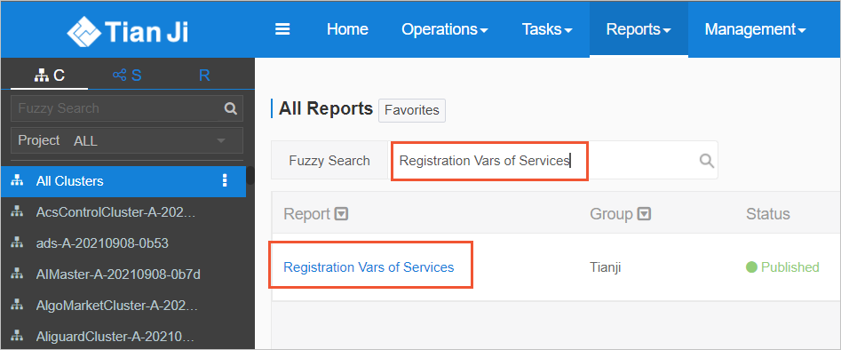
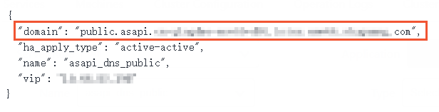
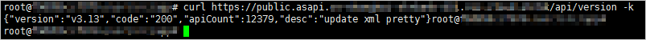
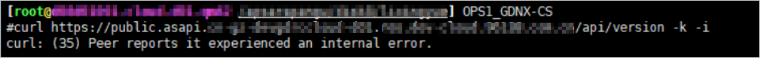

Alibaba Cloud  
Apsara Stack  
ApsaraDB for POLARDB  
Developer Guide (PolarDB-X)  
Product Version: V3.18.2  
Document Version: 20240607

**Table of Contents**

- [1.API Reference](#section-1)
    - [1.1. Request structure](#section-1-1)
    - [1.2. Common parameters](#section-1-2)
    - [1.3. Performance parameters](#section-1-3)
    - [1.4. Instance states](#section-1-4)
    - [1.5. Instance management](#section-1-5)
        - [1.5.1. CreateDBInstance](#section-1-5-1)
        - [1.5.2. DeleteDBInstance](#section-1-5-2)
        - [1.5.3. DescribeDBInstanceAttribute](#section-1-5-3)
        - [1.5.4. DescribeDBInstances](#section-1-5-4)
        - [1.5.5. DescribeScaleOutMigrateTaskList](#section-1-5-5)
        - [1.5.6. DescribeTasks](#section-1-5-6)
        - [1.5.7. ModifyDBInstanceClass](#section-1-5-7)
        - [1.5.8. ModifyDBInstanceConfig](#section-1-5-8)
        - [1.5.9. ModifyDBInstanceDescription](#section-1-5-9)
        - [1.5.10. ReleaseInstancePublicConnection](#section-1-5-10)
        - [1.5.11. RestartDBInstance](#section-1-5-11)
        - [1.5.12. UpgradeDBInstanceKernelVersion](#section-1-5-12)
        - [1.5.13. UpdatePolarDBXInstanceNode](#section-1-5-13)
        - [1.5.14. DescribeBinaryLogList](#section-1-5-14)
    - [1.6. Database management](#section-1-6)
        - [1.6.1. CreateDB](#section-1-6-1)
        - [1.6.2. DescribeTableDetail](#section-1-6-2)
        - [1.6.3. DeleteDB](#section-1-6-3)
        - [1.6.4. DescribeCharacterSet](#section-1-6-4)
        - [1.6.5. DescribeDistributeTableList](#section-1-6-5)
        - [1.6.6. ModifyDatabaseDescription](#section-1-6-6)
        - [1.6.7. DescribeDbList](#section-1-6-7)
    - [1.7. Regions](#section-1-7)
        - [1.7.1. DescribeRegions](#section-1-7-1)
    - [1.8. Account management](#section-1-8)
        - [1.8.1. CreateAccount](#section-1-8-1)
        - [1.8.2. ModifyAccountPrivilege](#section-1-8-2)
        - [1.8.3. EnableRightsSeparation](#section-1-8-3)
        - [1.8.4. ResetAccountPassword](#section-1-8-4)
        - [1.8.5. CreateSuperAccount](#section-1-8-5)
        - [1.8.6. DeleteAccount](#section-1-8-6)
        - [1.8.7. DescribeAccountList](#section-1-8-7)
        - [1.8.8. ModifyAccountDescription](#section-1-8-8)
    - [1.9. Data security](#section-1-9)
        - [1.9.1. AllocateInstancePublicConnection](#section-1-9-1)
        - [1.9.2. CheckCloudResourceAuthorized](#section-1-9-2)
        - [1.9.3. DescribeDBInstanceTDE](#section-1-9-3)
        - [1.9.4. DescribeSecurityIps](#section-1-9-4)
        - [1.9.5. DescribeUserEncryptionKeyList](#section-1-9-5)
        - [1.9.6. ModifySecurityIps](#section-1-9-6)
        - [1.9.7. UpdateDBInstanceTDE](#section-1-9-7)
    - [1.10. Backup management](#section-1-10)
        - [1.10.1. CreateBackup](#section-1-10-1)
        - [1.10.2. DescribeBackupPolicy](#section-1-10-2)
        - [1.10.3. DescribeBackupSetList](#section-1-10-3)
        - [1.10.4. UpdateBackupPolicy](#section-1-10-4)
    - [1.11. Parameter management](#section-1-11)
        - [1.11.1. DescribeParameters](#section-1-11-1)
        - [1.11.2. ModifyParameter](#section-1-11-2)
    - [1.12. SSL encryption](#section-1-12)
        - [1.12.1. DescribeDBInstanceSSL](#section-1-12-1)
        - [1.12.2. UpdateDBInstanceSSL](#section-1-12-2)
    - [1.13. Monitoring](#section-1-13)
        - [1.13.1. DescribeInstanceDbPerformance](#section-1-13-1)
        - [1.13.2. DescribeInstanceStoragePerformance](#section-1-13-2)
        - [1.13.3. DescribeInstancePerformance](#section-1-13-3)
        - [1.13.4. DescribeMetricsPerf](#section-1-13-4)
- [2.Appendixes](#section-2)
    - [2.1. Call the ASAPI gateway](#section-2-1)
    - [2.2. Use the ASAPI gateway to make API calls](#section-2-2)
        - [2.2.1. Obtain the endpoint of Auto Scaling API](#section-2-2-1)
        - [2.2.2. Obtain Apsara Stack SDKs](#section-2-2-2)
    - [2.3. STS overview](#section-2-3)
        - [2.3.1. What is STS?](#section-2-3-1)
        - [2.3.2. AssumeRole](#section-2-3-2)

<a id="section-1"></a>

# 1.API Reference

<a id="section-1-1"></a>

## 1.1. Request structure

This topic describes the request structure that is supported by PolarDB-X. A request includes the endpoints of the PolarDB-X API, and the syntax and protocols that can be used to send API requests.

**Endpoints**

The following table lists the endpoints of the PolarDB-X API.

| Region | Endpoint |
| --- | --- |
| China (Hangzhou) | polardbx.cn-hangzhou.aliyuncs.com |
| China (Beijing) | polardbx.cn-beijing.aliyuncs.com |

**Protocols**

You can send requests over HTTP or HTTPS. To ensure that your data is secure, we recommend that you send requests over HTTPS.

**Request syntax**

You can call PolarDB-X API operations by sending HTTP GET requests. To send an HTTP GET request, include request parameters in the following request URL:

```text
http://Endpoint/?Action=xx&Parameters
```

> **Note**
>
> - **Endpoint**: the endpoint of the PolarDB-X API. For more information, see Endpoints.
>
> - **Action**: the name of the operation that you want to call. For example, if you want to query tables that are created in your PolarDB-X database, you must set the Action parameter to DescribeTables.
>
> - **Version**: the version of the PolarDB-X API. Set the value to 2020-02-02.
>
> - **Parameters**: the request parameters for the operation. Separate multiple parameters by using ampersands (&).
>
>   Request parameters include both common parameters and operation-specific parameters. Common parameters include the API version and the authentication information. For more information, see Common parameters.

**Request parameters**

You must configure the Action parameter based on the API operation that you want to call. For example, set Action to CreateDatabase. You must also configure other common request parameters and operation-specific request parameters that are required to call the operation.

**Character encoding**

Requests and responses are encoded in UTF-8.

<a id="section-1-2"></a>

## 1.2. Common parameters

This topic describes the common parameters that can be used to call each API operation in PolarDB-X. Common parameters include request parameters and response parameters.

**Common request parameters**

| Parameter | Type | Requi red | Description |
| --- | --- | --- | --- |
| Format | Strin g | No | The format in which to return the response. Valid values: JSON and XML. Default value: JSON. |
| Version | Strin g | Yes | The version number of the API. Specify the version number in the YYYY-MM-DD format. Set the value to 2020-02-02. |
| AccessKeyId | Strin g | Yes | The AccessKey ID that is used to connect to PolarDB-X. |
| Signature | Strin g | Yes | The signature string of the current request. |
| SignatureMe thod | Strin g | Yes | The encryption method of the signature string. Set the value to HMAC-SHA1. |
| Timestamp | Strin g | Yes | The timestamp of the request. Specify the time in the ISO 8601 standard in the <code> yyyy-MM-ddTHH:mm:ssZ </code> format. The time must be in UTC.<br>For example, if you want to specify 20:00:00 (UTC+8) on January 10, 2013 as the value of the timestamp, set the value to 2013-01-10T12:00:00Z. |
| SignatureVer sion | Strin g | Yes | The version of the signature encryption algorithm. Set the value to 1.0. |
| SignatureNo nce | Strin g | Yes | A unique, random number used to prevent replay attacks. You must use different numbers for different requests. |
| ResourceOw nerAccount | Strin g | No | The name of the account that owns the resource that you want to access. You can use this account to log on to PolarDB-X to call API operations. |

**Common response parameters**

API responses use the HTTP response format. Responses can be returned in the JSON or XML format. You can specify the response format in the request. The default response format is

<ol type="I" start="1040">

<li>

Each response returns a unique **RequestId** regardless of whether the call is successful.

</li>

</ol>

- A  `2xx`  status code indicates a successful call.

- A  `4xx`  or  `5xx`  status code indicates a failed call.

Sample responses:

- XML format

  ```xml
  <?xml version="1.0" encoding="utf-8"?> 
      <!--Result Root Node-->
      <Interface Name+Response>
          <!--Return Request Tag-->
          <RequestId>4C467B38-3910-447D-87BC-AC0491******</RequestId>
          <!--Return Result Data-->
      </Interface Name+Response>           
  ```

- JSON format

  ```json
  {
      "RequestId":"4C467B38-3910-447D-87BC-AC0491******",
      /*Return Result Data*/
      }
  ```

<a id="section-1-3"></a>

## 1.3. Performance parameters

This topic describes the parameters that are used to monitor the performance of compute nodes, data nodes, Global Meta Service (GMS) nodes, and change data capture (CDC) nodes in PolarDB-X instances.

**Parameters related to compute nodes**

| API parameter | Description |
| --- | --- |
| Cpu_Usage | The CPU utilization as a percentage value. |
| Mem_Usage | The usage of heap memory of a Java Virtual Machine (JVM) as a percentage value.<br>The value of this parameter is calculated based on the following formula: Usage of JVM heap memory = Amount of the used JVM heap memory/Total amount of JVM heap memory × 100%. |
| Logic_RT | The average response time of requests that are sent by users. Unit: microseconds.<br>The value of this parameter is calculated based on the following formula: Response time of a request = Point in time at which the result of the request is returned - Point in time at which the request is received. |
| Physical_RT | The average response time of requests that are sent from compute nodes to data nodes. Unit: microseconds.<br>The value of this parameter is calculated based on the following formula: Response time of a request = Point in time at which the compute node receives the result from the data node -Point in time at which the compute node sends the request to the data node. |
| Logic_QPS | The average number of user requests that are processed per second. |
| Logic_TPS | The average number of transactions that are processed per second. |
| Physical_QPS | The average number of requests that are sent to data nodes per second. |
| Network_Usage | The network throughput, which indicates the sum of the inbound traffic and the outbound traffic per second. Unit: byte/s. |
| Connections | The number of connections. The following data can be returned:<br>• active_connection: the total number of connections.<br>• connection_count: the number of connections that are created per second. |
| Thread_Detail | The number of active connections. |
| JVM_CollectorTime | The average period of time that is required to perform garbage collection (GC) per second. The unit of the value is nanoseconds. The following data can be returned:<br>• The average period of time that is required to perform GC in the young generation space per second.<br>• The average period of time that is required to perform full GC per second. |
| Slow_RequestCount | The following data can be returned:<br>• The average number of slow SQL requests that are sent by users per second.<br>• The average number of slow SQL requests that are sent to data nodes per second. |

**Parameters related to data nodes or GMS nodes**

| API parameter | Description |
| --- | --- |
| MySQL_NetworkTraffic | The following data can be returned:<br>• The average amount of inbound traffic to the PolarDB-X instance per second. Unit: KB.<br>• The average amount of outbound traffic from the PolarDB-X instance per second. Unit: KB. |
| MySQL_QPSTPS | The following data can be returned:<br>• The average number of SQL statements that are executed per second.<br>• The average number of transactions that are processed per second. |
| MySQL_Sessions | The following data can be returned:<br>• The number of active connections.<br>• The total number of connections. |
| MySQL_InnoDBBufferRatio | The following data can be returned:<br>• The read hit ratio of the InnoDB buffer pool.<br>• The usage of the InnoDB buffer pool.<br>• The dirty ratio of the InnoDB buffer pool. |
| MySQL_InnoDBDataReadWriten | The following data can be returned:<br>• The average volume of data that InnoDB reads per second. Unit: KB.<br>• The average volume of data that InnoDB writes per second. Unit: KB. |
| MySQL_InnoDBLogRequests | The following data can be returned:<br>• The average number of read operations that are performed on an InnoDB buffer pool per second.<br>• The average number of write operations that are performed on an InnoDB buffer pool per second. |
| MySQL_InnoDBLogWrites | The following data can be returned:<br>• The average number of log write requests that are processed per second.<br>• The average number of physical writes that are performed on log files per second.<br>• The average number of operations that are performed by using the fsync() function to write data to log files per second. |
| MySQL_TempDiskTableCreates | The number of temporary tables that are automatically created on the hard disk during statement execution. |
| MySQL_COMDML | The following data can be returned:<br>• The average number of times for which the DELETE statements are executed per second.<br>• The average number of times for which the INSERT statements are executed per second.<br>• The average number of times for which the INSERT_SELECT statements are executed per second.<br>• The average number of times for which the REPLACE statements are executed per second.<br>• The average number of times for which the REPLACE_SELECT statements are executed per second.<br>• The average number of times for which the SELECT statements are executed per second.<br>• The average number of times for which the UPDATE statements are executed per second. |
| MySQL_RowDML | The following data can be returned:<br>• The average number of rows that are read from an InnoDB table per second.<br>• The average number of rows that are updated in an InnoDB table per second.<br>• The average number of rows that are deleted from an InnoDB table per second.<br>• The average number of rows that are inserted into an InnoDB table per second.<br>• The average number of physical writes that are performed on log files per second. |
| MySQL_MemCpuUsage | The following data can be returned:<br>• The CPU utilization of the PolarDB-X instance.<br>• The memory usage of the PolarDB-X instance. |
| MySQL_IOPS | The IOPS of the PolarDB-X instance. |
| MySQL_DetailedSpaceUsage | The following data can be returned:<br>• The used storage of the PolarDB-X instance.<br>• The data storage.<br>• The log storage.<br>• The temporary storage.<br>• The system storage. |
| slavestat | The replication delay between the primary instance and the read-only instances. |
| MySQL_ThreadStatus | The following data can be returned: the number of active threads and the number of connected threads. |
| MySQL_ReplicationDelay | The replication delay between the primary instance and the secondary instance. Unit: seconds. |
| MySQL_ReplicationThread | The following data can be returned: the states of I/O threads and SQL threads based on which data can be replicated. The value 1 indicates that the related threads are normal. The value 0 indicates that the related threads are lost. |
| IOPSUsage | The IOPS usage as a percentage value. |
| MySQL_Slow_Queries | The average number of slow SQL requests that are processed per second. |

**Parameters related to CDC nodes**

| API parameter | Description |
| --- | --- |
| Cdc_DumperDelay | The latency that occurs when binary log events are being processed. Unit: milliseconds. |
| Cdc_DumperThroughput | The data size of binary log events that are processed per second. Unit: byte/s. |
| Cdc_CpuUsage | The CPU utilization as a percentage value. |
| Cdc_DumperHeapUsage | The usage of JVM heap memory as a percentage value.<br>The value of this parameter is calculated based on the following formula: Usage of JVM heap memory = Amount of the used JVM heap memory/Total amount of JVM heap memory × 100%. |
| Cdc_DumperOps | The information about binary log events that are processed. The following data can be returned:<br>• dumper_total_eps: the average number of binary log events that are processed per second.<br>• dumper_dml_eps: the average number of binary log events during which DML statements are executed per second.<br>• dumper_tps: the average number of transactions that are processed per second. |

<a id="section-1-4"></a>

## 1.4. Instance states

| State | Description |
| --- | --- |
| Creating | The instance is being created. |
| Running | The instance is running. |
| Deleting | The instance is being deleted. |
| Rebooting | The instance is restarting. |
| DBInstanceClassChanging | The instance is being upgraded or downgraded. |
| TRANSING | The instance is being migrated. |
| EngineVersionUpgrading | The version of the database engine that the instance runs is being upgraded. |
| TransingToOthers | The data of the PolarDB-X instance is being migrated to an ApsaraDB RDS for MySQL instance. |
| GuardDBInstanceCreating | A disaster recovery instance is being created for the instance. |
| Restoring | The instance is being restored from a backup. |
| Importing | Data is being imported to the instance. |
| ImportingFromOthers | Data is being imported to the PolarDB-X instance from an ApsaraDB RDS for MySQL instance. |
| DBInstanceNetTypeChanging | The network type of the instance is being changed. |
| GuardSwitching | A failover operation is being performed for an instance in a disaster recovery scenario. |
| INS_CLONING | The instance is being cloned. |
| Released | The instance is released. |

<a id="section-1-5"></a>

## 1.5. Instance management

<a id="section-1-5-1"></a>

### 1.5.1. CreateDBInstance

Creates a PolarDB-X instance.

**Debugging**

OpenAPI Explorer automatically calculates the signature value. For your convenience, we recommend that you call this operation in OpenAPI Explorer. OpenAPI Explorer dynamically generates the sample code of the operation for different SDKs.

**Request parameters**

| Parameter | Type | Requir ed | Example | Description |
| --- | --- | --- | --- | --- |
| Action | String | Yes | CreateDBInstanc e | The operation that you want to perform. Set the value to <strong>CreateDBInstance</strong>. |
| RegionId | String | Yes | cn-hangzhou | The region ID of the instance. |
| PayType | String | Yes | PREPAY | The billing method of the instance.Valid values: PREPAY: the subscription billing method.POSTPAY: the pay-as-you-go billing method. |
| DBNodeCount | Integer | Yes | 2 | The number of nodes that you want to create in the instance. |
| DBNodeClass | String | Yes | polarx.x4.2xlarg e.2d | The specification of nodes. If you want to use a specification of 16 cores and 64 GB memory, set the value to polarx.x4.2xlarge.2e. |
| ZoneId | String | Yes | cn-hangzhou-a | The zone ID of the instance. |
| ClientToken | String | No | xxxxxx-xxx | The client token that is used to ensure the idempotence of the request. You can use the client to generate the value, but you must ensure that it is unique among different requests. |
| NetworkType | String | No | vpc | The network type of the instance.Valid values: vpc and classic. |
| VPCId | String | No | vpc-\*\*\*\*\* | The ID of the virtual private cloud (VPC) in which you want to deploy the instance. |
| VSwitchId | String | No | vsw-\*\*\*\*\*\*\*\*\* | The ID of the vSwitch to which you want to connect the instance. |
| UsedTime | Integer | No | 1 | The subscription period of the instance. Unit: month or year. |
| Period | String | No | Month | The unit of the billing cycle for the instance. The valid values vary based on the billing method. If you use the subscription billing method, set the value to Year or Month. If you use the pay-as-you-go billing method, the value is automatically set to Hour. |
| ResourceGroupI d | String | No | null | The ID of the resource group. The value of this parameter may be null.You cannot configure this parameter for the PolarDB-X instance. |
| AutoRenew | Boolean | No | true | Specifies whether to enable auto-renewal for the instance. Default value: true. |
| EngineVersion | String | Yes | 2.0 | The version number of the database engine. Set the value to 2.0. |
| IsReadDBInstanc e | Boolean | No | false | Specifies whether the instance is a read-only instance. |
| PrimaryDBInstan ceName | String | No | pxc-\*\*\*\*\*\*\*\*\* | The name of the primary instance. If you create a read-only instance, configure this parameter. |

**Response parameters**

| Parameter | Type | Example | Description |
| --- | --- | --- | --- |
| DBInstanceNa me | String | pxc-\*\*\*\*\*\*\*\*\* | The name of the instance that you created. |
| RequestId | String | 9B2F3840-5C98-475C-B269-2D5C3A31797C | The ID of the request. |
| OrderId | String | 12345 | The ID of the order. |

**Examples**

Sample requests

```text
http(s)://[Endpoint]/?Action=CreateDBInstance
&RegionId=cn-hangzhou
&PayType=PREPAY
&DBNodeCount=2
&DBNodeClass=polarx.x4.2xlarge.2d
&ZoneId=cn-hangzhou-a
&ClientToken=xxxxxx-xxx
&NetworkType=vpc
&VPCId=vpc-*****
&VSwitchId=vsw-*********
&UsedTime=1
&Period=Month
&ResourceGroupId=null
&AutoRenew=true
&EngineVersion=2.0
&IsReadDBInstance=false
&PrimaryDBInstanceName=pxc-*********
&<Common request parameters>
```

Sample success responses

`XML`  format

```xml
HTTP/1.1 200 OK
Content-Type:application/xml

<CreateDBInstanceResponse>
    <DBInstanceName>pxc-*********</DBInstanceName>
    <RequestId>9B2F3840-5C98-475C-B269-2D5C3A31797C</RequestId>
    <OrderId>12345</OrderId>
</CreateDBInstanceResponse>
```

`JSON`  format

```text
HTTP/1.1 200 OK
Content-Type:application/json

{
  "DBInstanceName" : "pxc-*********",
  "RequestId" : "9B2F3840-5C98-475C-B269-2D5C3A31797C",
  "OrderId" : "12345"
}
```

**Error codes**

For a list of error codes, visit the API Error Center.

For a list of error codes, visit the API Error Center.

<a id="section-1-5-2"></a>

### 1.5.2. DeleteDBInstance

Deletes a PolarDB-X instance.

**Debugging**

OpenAPI Explorer automatically calculates the signature value. For your convenience, we recommend that you call this operation in OpenAPI Explorer. OpenAPI Explorer dynamically generates the sample code of the operation for different SDKs.

**Request parameters**

| Parameter | Type | Requir ed | Example | Description |
| --- | --- | --- | --- | --- |
| Action | String | Yes | DeleteDBInstanc e | The operation that you want to perform. Set the value to <strong>DeleteDBInstance</strong>. |
| RegionId | String | Yes | cn-hangzhou | The region ID of the instance. |
| DBInstanceNam e | String | Yes | pxc-\*\*\*\*\*\*\*\* | The name of the instance. |

**Response parameters**

| Parameter | Type | Example | Description |
| --- | --- | --- | --- |
| RequestId | String | 9B2F3840-5C98-475C-B269-2D5C3A31797C | The ID of the request. |

**Examples**

Sample requests

```text
http(s)://[Endpoint]/?Action=DeleteDBInstance
&RegionId=cn-hangzhou
&DBInstanceName=pxc-********
&<Common request parameters>
```

Sample success responses

`XML`  format

```xml
HTTP/1.1 200 OK
Content-Type:application/xml

<DeleteDBInstanceResponse>
    <RequestId>9B2F3840-5C98-475C-B269-2D5C3A31797C</RequestId>
</DeleteDBInstanceResponse>
```

`JSON`  format

```text
HTTP/1.1 200 OK
Content-Type:application/json

{
  "RequestId" : "9B2F3840-5C98-475C-B269-2D5C3A31797C"
}
```

**Error codes**

For a list of error codes, visit the API Error Center.

For a list of error codes, visit the API Error Center.

<a id="section-1-5-3"></a>

### 1.5.3. DescribeDBInstanceAttribute

Queries the attribute details about a specified instance.

**Debugging**

OpenAPI Explorer automatically calculates the signature value. For your convenience, we recommend that you call this operation in OpenAPI Explorer. OpenAPI Explorer dynamically generates the sample code of the operation for different SDKs.

**Request parameters**

| Parameter | Type | Requir ed | Example | Description |
| --- | --- | --- | --- | --- |
| Action | String | Yes | DescribeDBInsta nceAttribute | The operation that you want to perform. Set the value to <strong>DescribeDBInstanceAttribute</strong>. |
| DBInstanceNam e | String | Yes | pxc-\*\*\*\*\*\*\*\*\*\*\*\*\*\*\*\* | The ID of the instance. |
| RegionId | String | Yes | cn-hangzhou | The region where the instance is deployed. |

**Response parameters**

| Parameter | Type | Example | Description |
| --- | --- | --- | --- |
| DBInstance | Struct |  | The instance information. |
| CommodityCo de | String | drds_polarxpre_pu blic_cn | The product ID. Valid values:<br>• <strong>drds_polarxpre_public_cn</strong>: subscription instance<br>• <strong>drds_polarxpost_public_cn</strong>: pay-as-you-go instance |
| ConnAddrs | Array of ConnAddr |  | The information about the instance connection. |
| ConnectionStri ng | String | pxc-\*\*\*\*\*\*\*\*\*\*\*\*\*\*\*\*.po larx.rds.aliyuncs.co m | The connection URL that is used to connect to the virtual private cloud (VPC). |
| Port | String | 3306 | The port number. The port is connected to the VPC. |
| Type | String | VPC | The type of the network. Only the VPC type is supported. |
| VPCId | String | vpc-\*\*\*\*\*\*\*\*\*\*\*\*\*\*\*\*\*\*\* | The ID of the VPC. |
| VSwitchId | String | vsw-\*\*\*\*\*\*\*\*\*\*\*\*\*\*\*\*\*\*\* \*\* | The ID of the vSwitch that is connected to the VPC. |
| ConnectionStri ng | String | pxc-\*\*\*\*\*\*\*\*\*\*\*\*\*\*\*\*.po larx.rds.aliyuncs.co m | The primary endpoint of the instance. |
| CreateTime | String | 2020-07-29T06:09:30.000+ 0800 | The time when the instance was created.The time is in the <code> yyyy-MM-</code><code>ddTHH:mm:ss.SSSZ </code> format. For example, the value 2020-07-29T06:09:30.000+0800 indicates that the instance was created at 06:09:30 in the morning on July 29, 2020 (UTC+8). |
| DBInstanceTy pe | String | ReadWrite | The type of the instance. Valid values:<br>• <strong>ReadWrite</strong>: primary instance<br>• <strong>ReadOnly</strong>: read-only instance |
| DBNodeClass | String | polarx.x4.large.2d | The specification of the instance node. |
| DBNodeCount | Integer | 2 | The number of instance nodes. |
| DBNodes | Array of DBNode |  | The node information. |
| Id | String | pxi-\*\*\*\*\*\*\*\*\*\*\*\*\*\*\* | The ID of the node. |
| NodeClass | String | polarx.x4.large.2d | The node specification. |
| RegionId | String | cn-hangzhou | The region where the node is deployed. |
| ZoneId | String | cn-hangzhou-h-aliyun | The zone where the node is deployed. |
| DBType | String | polarx | The database type of the instance. Set the value to <strong>polarx</strong>. |
| DBVersion | String | 5.7 | The MySQL version number of the database. Set the value to <strong>5.7</strong>. |
| Description | String | test | The description of the instance. |
| Engine | String | polarx | The database type of the instance. Set the value to <strong>polarx</strong>. |
| ExpireDate | String | 2020-08-29T06:09:30.000+ 0800 | The time when the instance expires. The time is in the <code> yyyy-MM-</code><code>ddTHH:mm:ss.SSSZ </code> format. For example, the value 2020-08-29T06:09:30.000+0800 indicates that the instance expired at 06:09:30 in the morning on August 29, 2020 (UTC+8).<br>Note This parameter is available for only subscription instances. |
| Expired | String | false | Indicates whether the instance has expired.<br>Note This parameter is available for only subscription instances. |
| Id | String | pxc-\*\*\*\*\*\*\*\*\*\*\*\*\*\*\*\* | The ID of the instance. |
| LatestMinorVe rsion | String | polarx-kernel-5.4.5-15941979-xdb-20200125 | The latest kernel minor version of the instance. |
| LockMode | String | Unlock | The lock status of the instance. Valid values:<br>• <strong>Unlock</strong>: The instance is in the normal state.<br>• <strong>LockByExpiration</strong>: The instance is automatically locked when it expires.<br>Note The instance is automatically locked when you have an overdue payment for the instance.We recommend that you maintain sufficient account balance in your Alibaba Cloud account or renew your instance at the earliest possible opportunity before an overdue payment occurs. This prevents your business from being affected by the instance locking that is caused by overdue payments.<br>关于如何续费，详情请参见实例续费。 |
| MaintainEndTi me | String | 06:00 | The end time of the instance maintenance period. |
| MaintainStartT ime | String | 02:00 | The start time of the instance maintenance period. |
| MinorVersion | String | polarx-kernel-5.4.5-15941979-xdb-20200125 | The current kernel minor version of the instance. |
| Network | String | VPC | The network type of the instance. Set the value to <strong>VPC</strong>. |
| PayType | String | Prepaid | The payment type. Valid values:<br>• <strong>Postpaid</strong>: pay-as-you-go<br>• <strong>Prepaid</strong>: subscription<br>关于付费类型，详情请参见产品定价。 |
| Port | String | 3306 | The port number. The port is connected to the primary endpoint of the instance. |
| ReadDBInstan ces | List | \["pxc-\*\*\*\*\*\*\*\*\*\*\*\*\*\*\*\*", "pxc-\*\*\*\*\*\*\*\*\*\*\*\*\*\*\*\*"\] | The list of read-only instance names. |
| RegionId | String | cn-hangzhou | The region where the instance is deployed. |
| Status | String | Running | The status of the instance. Valid values:<br>• <strong>Creating</strong>: The instance is being created.<br>• <strong>Running</strong>: The instance is running.<br>• <strong>Deleting</strong>: The instance is being released.<br>• <strong>MinorVersionUpgrading</strong>: The version is being upgraded.<br>• <strong>ClassChanging</strong>: The node specification is being changed.<br>• <strong>NodeCreating(scale out)</strong>: The nodes are being added.<br>• <strong>NodeDeleting(scale in)</strong>: The nodes are being deleted. |
| StorageUsed | String | 6781140992 | The occupied disk space for the instance.Unit: byte. |
| Type | String | ReadWrite | The type of the instance. Valid values:<br>• <strong>ReadWrite</strong>: primary instance<br>• <strong>ReadOnly</strong>: read-only instance |
| VPCId | String | vpc-\*\*\*\*\*\*\*\*\*\*\*\*\*\*\*\*\*\*\* | The ID of the VPC. |
| VSwitchId | String | vsw-\*\*\*\*\*\*\*\*\*\*\*\*\*\*\*\*\*\*\* \*\* | The ID of the vSwitch that is connected to the VPC. |
| ZoneId | String | cn-hangzhou-h | The zone where the instance is deployed. |
| RequestId | String | 7307D0CA-E315-4D51-8D36-F83767\*\*\*\*\*\* | The ID of the request. |

**Examples**

Sample requests

```text
http(s)://polardbx.cn-hangzhou.aliyuncs.com/? Action=DescribeDBInstanceAttribute
&DBInstanceName=pxc-****************
&RegionId=cn-hangzhou
&<Common request parameters>
```

Sample success responses

`XML`  format

```xml
<DescribeDBInstanceAttributeResponse>
  <RequestId>7307D0CA-E315-4D51-8D36-F83767******</RequestId>
  <DBInstance>
        <Description>test</Description>
        <ExpireDate>2020-08-29T06:09:30.000+0800</ExpireDate>
        <ReadDBInstances>["pxc-****************", "pxc-****************"]
</ReadDBInstances>
        <ConnAddrs>
              <Type>VPC</Type>
              <ConnectionString>pxc-
****************.polarx.rds.aliyuncs.com</ConnectionString>
              <VPCId>vpc-*******************</VPCId>
              <VSwitchId>vsw-*********************</VSwitchId>
              <Port>3306</Port>
        </ConnAddrs>
        <Port>3306</Port>
        <DBInstanceType>ReadWrite</DBInstanceType>
        <DBType>polarx</DBType>
        <DBVersion>5.7</DBVersion>
        <MaintainEndTime>06:00</MaintainEndTime>
        <DBNodes>
              <NodeClass>polarx.x4.large.2d</NodeClass>
              <RegionId>cn-hangzhou</RegionId>
              <Id>pxi-***************</Id>
              <ZoneId>cn-hangzhou-h-aliyun</ZoneId>
        </DBNodes>
        <Network>VPC</Network>
        <CommodityCode>drds_polarxpre_public_cn</CommodityCode>
        <DBNodeCount>2</DBNodeCount>
        <MaintainStartTime>02:00</MaintainStartTime>
        <Engine>polarx</Engine>
        <Status>Running</Status>
        <ZoneId>cn-hangzhou-h</ZoneId>
        <VPCId>vpc-*******************</VPCId>
        <VSwitchId>vsw-*********************</VSwitchId>
        <CreateTime>2020-07-29T06:09:30.000+0800</CreateTime>
        <MinorVersion>polarx-kernel-5.4.5-15941979-xdb-20200125</MinorVersion>
        <LatestMinorVersion>polarx-kernel-5.4.5-15941979-xdb-
20200125</LatestMinorVersion>
        <Expired>false</Expired>
        <LockMode>Unlock</LockMode>
        <PayType>Prepaid</PayType>
        <DBNodeClass>polarx.x4.large.2d</DBNodeClass>
        <StorageUsed>6781140992</StorageUsed>
        <Type>ReadWrite</Type>
        <Id>pxc-****************</Id>
        <RegionId>cn-hangzhou</RegionId>
        <ConnectionString>pxc-
****************.polarx.rds.aliyuncs.com</ConnectionString>
  </DBInstance>
</DescribeDBInstanceAttributeResponse>
```

`JSON`  format

```json
{
    "RequestId": "7307D0CA-E315-4D51-8D36-F83767******",
    "DBInstance": {
        "Description": "test",
        "ExpireDate": "2020-08-29T06:09:30.000+0800",
        "ReadDBInstances": "[\"pxc-****************\", \"pxc-****************\"]",
        "ConnAddrs": {
            "Type": "VPC",
            "ConnectionString": "pxc-****************.polarx.rds.aliyuncs.com",
            "VPCId": "vpc-*******************",
            "VSwitchId": "vsw-*********************",
            "Port": 3306
        },
        "Port": 3306,
        "DBInstanceType": "ReadWrite",
        "DBType": "polarx",
        "DBVersion": 5.7,
        "MaintainEndTime": "06:00",
        "DBNodes": {
            "NodeClass": "polarx.x4.large.2d",
            "RegionId": "cn-hangzhou",
            "Id": "pxi-***************",
            "ZoneId": "cn-hangzhou-h-aliyun"
        },
        "Network": "VPC",
        "CommodityCode": "drds_polarxpre_public_cn",
        "DBNodeCount": 2,
        "MaintainStartTime": "02:00",
        "Engine": "polarx",
        "Status": "Running",
        "ZoneId": "cn-hangzhou-h",
        "VPCId": "vpc-*******************",
        "VSwitchId": "vsw-*********************",
        "CreateTime": "2020-07-29T06:09:30.000+0800",
        "MinorVersion": "polarx-kernel-5.4.5-15941979-xdb-20200125",
        "LatestMinorVersion": "polarx-kernel-5.4.5-15941979-xdb-20200125",
        "Expired": false,
        "LockMode": "Unlock",
        "PayType": "Prepaid",
        "DBNodeClass": "polarx.x4.large.2d",
        "StorageUsed": 6781140992,
        "Type": "ReadWrite",
        "Id": "pxc-****************",
        "RegionId": "cn-hangzhou",
        "ConnectionString": "pxc-****************.polarx.rds.aliyuncs.com"
    }
}
```

**Errors**

访问错误中心查看更多错误码。

For a list of error codes, visit the API Error Center.

<a id="section-1-5-4"></a>

### 1.5.4. DescribeDBInstances

Queries the PolarDB-X instances that are deployed in a specified region.

**Debugging**

OpenAPI Explorer automatically calculates the signature value. For your convenience, we recommend that you call this operation in OpenAPI Explorer. OpenAPI Explorer dynamically generates the sample code of the operation for different SDKs.

**Request parameters**

| Parameter | Type | Requir ed | Example | Description |
| --- | --- | --- | --- | --- |
| Action | String | Yes | DescribeDBInsta nces | The operation that you want to perform. Set the value to <strong>DescribeDBInstances</strong>. |
| RegionId | String | Yes | cn-hangzhou | The ID of the region. |
| PageNumber | Integer | No | 1 | The number of the page to return.Pages start from page 1. |
| PageSize | Integer | No | 20 | The number of entries to return on each page. |

**Response parameters**

| Parameter | Type | Example | Description |
| --- | --- | --- | --- |
| RequestId | String | C458B1E8-1683-3645-B154-6BA32080EEA | The ID of the request. |
| PageNumber | Integer | 1 | The page number of the returned page. |
| PageSize | Integer | 30 | The number of entries returned per page. |
| TotalNumber | Integer | 30 | The total number of returned instances. |
| DBInstances | Array of DBInstance |  | The details about the returned instances. |
| Type | String | ReadWrite | The role of the instance. Valid values:<br>• ReadWrite: The instance is a primary instance.<br>• ReadOnly: The instance is a read-only instance. |
| Status | String | Running | The state of the instance. For more information, see Instance states. |
| CommodityCo de | String | drds_polarxpre_pu blic_cn | The commodity code of the instance. |
| ExpireTime | String | 2021-12-01T16:00:00.000+ 0000 | The time when the instance expires. |
| Expired | Boolean | false | Indicates whether the instance has expired. |
| CreateTime | String | 2021-11-01T03:49:50.000+ 0000 | The time when the instance was created. |
| PayType | String | Prepaid | The billing method of the instance. Valid values:<br>• Postpaid: pay-as-you-go<br>• Prepaid: subscription |
| LockReason | String | OverduePayments | The reason why the instance is locked. |
| DBType | String | polarx | The database type of the instance. |
| LockMode | String | Unlock | Indicates whether the instance is locked. |
| VPCId | String | VPCID | The ID of the virtual private cloud (VPC) to which the instance is connected. |
| MinorVersion | String | polarx-kernel_5.4.12-16349923_xcluster -20210926 | The minor kernel version of the instance. |
| RegionId | String | cn-hangzhou | The region ID of the instance. |
| Network | String | VPC | The network type of the instance. |
| DBVersion | String | 5.7 | The version of the database engine that is used by the instance. |
| Description | String | Testing | The description of the instance. |
| NodeClass | String | polarx.x4.large.2e | The instance type of each node for the instance. |
| StorageUsed | Long | 40658534400 | The storage space that has been used. |
| NodeCount | Integer | 5 | The number of nodes. |
| ZoneId | String | cn-hangzhou-g | The zone ID of the instance. |
| Engine | String | polarx | The engine that is used by the instance. |
| Id | String | pxc-hzr2yeov9jmg3z | The ID of the instance. |
| Nodes | Array of PolarDBXNode |  | The details about nodes. |
| ZoneId | String | cn-hangzhou-g | The zone ID of the node. |
| Id | String | pxi-zd89wrzqhbfwyuo" | The ID of the node. |
| ClassCode | String | polarx.x4.large.2e | The instance type of the node. |
| RegionId | String | cn-hangzhou-g-aliyun | The region ID of the node. |
| ReadDBInstan ces | Array of String | pxr-hzr2yeov9jmg3z | The names of read-only instances. |

**Examples**

Sample requests

```text
http(s)://[Endpoint]/?Action=DescribeDBInstances
&RegionId=cn-hangzhou
&PageNumber=1
&PageSize=20&<Common request parameters>
```

Sample success responses

`XML`  format

```xml
HTTP/1.1 200 OK
Content-Type:application/xml

<DescribeDBInstancesResponse>
    <RequestId>C458B1E8-1683-3645-B154-6BA32080EEA</RequestId>
    <PageNumber>1</PageNumber>
    <PageSize>30</PageSize>
    <TotalNumber>30</TotalNumber>
    <DBInstances>
        <Type>ReadWrite</Type>
        <Status>Running</Status>
        <CommodityCode>drds_polarxpre_public_cn</CommodityCode>
        <ExpireTime>2021-12-01T16:00:00.000+0000</ExpireTime>
        <Expired>false</Expired>
        <CreateTime>2021-11-01T03:49:50.000+0000</CreateTime>
        <PayType>Prepaid</PayType>
        <LockReason>OverduePayments</LockReason>
        <DBType>polarx</DBType>
        <LockMode>Unlock</LockMode>
        <VPCId>VPCID</VPCId>
        <MinorVersion>polarx-kernel_5.4.12-16349923_xcluster-20210926</MinorVersion>
        <RegionId>cn-hangzhou</RegionId>
        <Network>VPC</Network>
        <DBVersion>5.7</DBVersion>
        <Description>Testing</Description>
        <NodeClass>polarx.x4.large.2e</NodeClass>
        <StorageUsed>40658534400</StorageUsed>
        <NodeCount>5</NodeCount>
        <ZoneId>cn-hangzhou-g</ZoneId>
        <Engine>polarx</Engine>
        <Id>pxc-hzr2yeov9jmg3z</Id>
        <Nodes>
            <ZoneId>cn-hangzhou-g</ZoneId>
            <Id>pxi-zd89wrzqhbfwyuo"</Id>
            <ClassCode>polarx.x4.large.2e</ClassCode>
            <RegionId>cn-hangzhou-g-aliyun</RegionId>
        </Nodes>
        <ReadDBInstances>pxr-hzr2yeov9jmg3z</ReadDBInstances>
    </DBInstances>
</DescribeDBInstancesResponse>
```

`JSON`  format

```text
HTTP/1.1 200 OK
Content-Type:application/json

{
  "RequestId" : "C458B1E8-1683-3645-B154-6BA32080EEA",
  "PageNumber" : 1,
  "PageSize" : 30,
  "TotalNumber" : 30,
  "DBInstances" : [ {
    "Type" : "ReadWrite",
    "Status" : "Running",
    "CommodityCode" : "drds_polarxpre_public_cn",
    "ExpireTime" : "2021-12-01T16:00:00.000+0000",
    "Expired" : false,
    "CreateTime" : "2021-11-01T03:49:50.000+0000",
    "PayType" : "Prepaid",
    "LockReason" : "OverduePayments",
    "DBType" : "polarx",
    "LockMode" : "Unlock",
    "VPCId" : "VPCID",
    "MinorVersion" : "polarx-kernel_5.4.12-16349923_xcluster-20210926",
    "RegionId" : "cn-hangzhou",
    "Network" : "VPC",
    "DBVersion" : "5.7",
    "Description" : "Testing",
    "NodeClass" : "polarx.x4.large.2e",
    "StorageUsed" : 40658534400,
    "NodeCount" : 5,
    "ZoneId" : "cn-hangzhou-g",
    "Engine" : "polarx",
    "Id" : "pxc-hzr2yeov9jmg3z",
    "Nodes" : [ {
      "ZoneId" : "cn-hangzhou-g",
      "Id" : "pxi-zd89wrzqhbfwyuo\"",
      "ClassCode" : "polarx.x4.large.2e",
      "RegionId" : "cn-hangzhou-g-aliyun"
    } ],
    "ReadDBInstances" : [ "pxr-hzr2yeov9jmg3z" ]
  } ]
}
```

**Error codes**

For a list of error codes, visit the API Error Center.

For a list of error codes, visit the API Error Center.

<a id="section-1-5-5"></a>

### 1.5.5. DescribeScaleOutMigrateTaskList

Queries the progress of a scale-out task.

**Debugging**

OpenAPI Explorer automatically calculates the signature value. For your convenience, we recommend that you call this operation in OpenAPI Explorer. OpenAPI Explorer dynamically generates the sample code of the operation for different SDKs.

**Request parameters**

| Parameter | Type | Requir ed | Example | Description |
| --- | --- | --- | --- | --- |
| Action | String | No | DescribeScaleO utMigrateTaskLi st | The operation that you want to perform. Set the value to DescribeScaleOutMigrateTaskLis <strong>t</strong>. |
| DBInstanceNam e | String | Yes | pxc-\*\*\*\*\*\*\*\* | The ID of the instance. |

**Response parameters**

| Parameter | Type | Example | Description |
| --- | --- | --- | --- |
| Progress | Integer | 32 | The progress of the scale-out task. |
| RequestId | String | C458B1E8-1683-3645-B154-6BA32080EEA | The ID of the request. |

**Examples**

Sample requests

```text
http(s)://[Endpoint]/?Action=DescribeScaleOutMigrateTaskList
&ResourceOwnerId=111
&DBInstanceName=pxc-********
&<Common request parameters>
```

Sample success responses

`XML`  format

```xml
HTTP/1.1 200 OK
Content-Type:application/xml

<DescribeScaleOutMigrateTaskListResponse>
    <Progress>32</Progress>
    <RequestId>C458B1E8-1683-3645-B154-6BA32080EEA</RequestId>
</DescribeScaleOutMigrateTaskListResponse>
```

`JSON`  format

```text
HTTP/1.1 200 OK
Content-Type:application/json

{
  "Progress" : 32,
  "RequestId" : "C458B1E8-1683-3645-B154-6BA32080EEA"
}
```

**Error codes**

For a list of error codes, visit the API Error Center.

For a list of error codes, visit the API Error Center.

<a id="section-1-5-6"></a>

### 1.5.6. DescribeTasks

Queries the tasks that are performed on a PolarDB-X instance.

**Debugging**

OpenAPI Explorer automatically calculates the signature value. For your convenience, we recommend that you call this operation in OpenAPI Explorer. OpenAPI Explorer dynamically generates the sample code of the operation for different SDKs.

**Request parameters**

| Parameter | Type | Requir ed | Example | Description |
| --- | --- | --- | --- | --- |
| Action | String | No | DescribeTasks | The operation that you want to perform. Set the value to <strong>DescribeTasks</strong>. |
| DBInstanceId | String | Yes | pxc-hzjasd\*\*\*\* | The name of the instance. |
| StartTime | String | Yes | 2021-11-01 | The beginning of the time range to query. |
| EndTime | String | Yes | 2021-11-04 | The end of the time range to query. |
| PageSize | Integer | No | 20 | The number of entries to return on each page, the value range of the PageSize parameter is 5 to 1000. |
| PageNumber | Integer | No | 30 | The number of the page to return. |
| RegionId | String | Yes | cn-hangzhou | The region ID of the instance. |

**Response parameters**

| Parameter | Type | Example | Description |
| --- | --- | --- | --- |
| RequestId | String | D6045D78-C119-5A17-9DEA-0F810394E008 | The ID of the request. |
| PageNumber | Integer | 1 | The page number of the returned page. |
| PageRecordCo unt | Integer | 30 | The number of entries returned per page. |
| TotalRecordCo unt | Integer | 2 | The total number of returned entries. |
| Items | Array of TaskProgressI nfo |  |  |
| Status | String | RUNNING | The state of the task. Valid values:<br>• RUNNING: The task is running.<br>• FAILED: The task failed. |
| FinishTime | String | 2021-10-20T20:00:00Z | The end time of the task. The time follows the ISO 8601 standard in the yyyy-MM-ddThh:mm:ssZ format. |
| Progress | String | 80 | The progress of the task in percentage. |
| BeginTime | String | 2021-10-20T19:40:00Z | The start time of the task. The time follows the ISO 8601 standard in the yyyy-MM-ddThh:mm:ssZ format. |
| TaskErrorCode | String | 400 | The error code. This parameter is returned only for failed tasks. |
| DBName | String | DBName | The name of the database that is associated with the task. In most cases, an empty string is returned for this parameter. |
| ProgressInfo | String | ProgressInfo | The details about the task progress. In most cases, an empty string is returned for this parameter. |
| ScaleOutToke n | String | FEA5DC20-6D8A-5979-97AA-FC57546ADC20 | The token of the task. The token uniquely identifies the task in the backend. This parameter is returned only for scale-out tasks. |
| TaskId | String | 20089398 | The ID of the task. |
| TaskErrorMess age | String | xxxxxxxx | The error message. This parameter is returned only for failed tasks. |
| TaskAction | String | multi_scale_out | The unique identifier of the task type in the backend. |

**Examples**

Sample requests

```text
http(s)://[Endpoint]/?Action=DescribeTasks
&DBInstanceId=pxc-hzjasd****
&StartTime=2021-11-01
&EndTime=2021-11-04
&PageSize=20
&PageNumber=30
&RegionId=cn-hangzhou
&<Common request parameters>
```

Sample success responses

`XML`  format

```xml
HTTP/1.1 200 OK
Content-Type:application/xml

<DescribeTasksResponse>
    <RequestId>D6045D78-C119-5A17-9DEA-0F810394E008</RequestId>
    <PageNumber>1</PageNumber>
    <PageRecordCount>30</PageRecordCount>
    <TotalRecordCount>2</TotalRecordCount>
    <Items>
        <Status>RUNNING</Status>
        <FinishTime>2021-10-20T20:00:00Z</FinishTime>
        <Progress>80</Progress>
        <BeginTime>2021-10-20T19:40:00Z</BeginTime>
        <TaskErrorCode>400</TaskErrorCode>
        <DBName>DBName</DBName>
        <ProgressInfo>ProgressInfo</ProgressInfo>
        <ScaleOutToken>FEA5DC20-6D8A-5979-97AA-FC57546ADC20</ScaleOutToken>
        <TaskId>20089398</TaskId>
        <TaskErrorMessage>xxxxxxxx</TaskErrorMessage>
        <TaskAction>multi_scale_out</TaskAction>
    </Items>
</DescribeTasksResponse>
```

`JSON`  format

```text
HTTP/1.1 200 OK
Content-Type:application/json

{
  "RequestId" : "D6045D78-C119-5A17-9DEA-0F810394E008",
  "PageNumber" : 1,
  "PageRecordCount" : 30,
  "TotalRecordCount" : 2,
  "Items" : [ {
    "Status" : "RUNNING",
    "FinishTime" : "2021-10-20T20:00:00Z",
    "Progress" : "80",
    "BeginTime" : "2021-10-20T19:40:00Z",
    "TaskErrorCode" : "400",
    "DBName" : "DBName",
    "ProgressInfo" : "ProgressInfo",
    "ScaleOutToken" : "FEA5DC20-6D8A-5979-97AA-FC57546ADC20",
    "TaskId" : "20089398",
    "TaskErrorMessage" : "xxxxxxxx",
    "TaskAction" : "multi_scale_out"
  } ]
}
```

**Error codes**

For a list of error codes, visit the API Error Center.

For a list of error codes, visit the API Error Center.

<a id="section-1-5-7"></a>

### 1.5.7. ModifyDBInstanceClass

Changes the instance type of a PolarDB-X instance.

**Debugging**

OpenAPI Explorer automatically calculates the signature value. For your convenience, we recommend that you call this operation in OpenAPI Explorer. OpenAPI Explorer dynamically generates the sample code of the operation for different SDKs.

**Request parameters**

| Parameter | Type | Requir ed | Example | Description |
| --- | --- | --- | --- | --- |
| Action | String | Yes | ModifyDBInstanc eClass | The operation that you want to perform. Set the value to <strong>ModifyDBInstanceClass</strong>. |
| RegionId | String | Yes | cn-hangzhou | The ID of region in which the instance you want to change is located. |
| DBInstanceNam e | String | Yes | pxc-hzjasd\*\*\*\* | The ID of the instance whose type you want to change. |
| TargetDBInstanc eClass | String | Yes | polarx.x4.xlarge.2e | The new instance type of the instance. Valid values:<br>• <strong>polarx.x4.medium.2e</strong>: Instances of this type have 2 CPU cores and 8 GB of memory.<br>• <strong>polarx.x4.large.2e</strong>: Instances of this type have 4 CPU cores and 16 GB of memory.<br>• <strong>polarx.x8.large.2e</strong>: Instances of this type have 4 CPU cores and 32 GB of memory.<br>• <strong>polarx.x4.xlarge.2e</strong>: Instances of this type have 8 CPU cores and 32 GB of memory.<br>• <strong>polarx.x8.xlarge.2e</strong>: Instances of this type have 8 CPU cores and 64 GB of memory.<br>• <strong>polarx.x4.2xlarge.2e</strong>: Instances of this type have 16 CPU cores and 64 GB of memory.<br>• <strong>polarx.x8.2xlarge.2e</strong>: Instances of this type have 16 CPU cores and 128 GB of memory.<br>• <strong>polarx.x4.4xlarge.2e</strong>: Instances of this type have 32 CPU cores and 128 GB of memory.<br>• <strong>polarx.x8.4xlarge.2e</strong>: Instances of this type have 32 CPU cores and 256 GB of memory.<br>• <strong>polarx.st.8xlarge.2e</strong>: Instances of this type have 60 CPU cores and 470 GB of memory.<br>• <strong>polarx.st.12xlarge.2e</strong>: Instances of this type have 90 CPU cores and 720 GB of memory. |
| ClientToken | String | No | FEA5DC20-6D8A-5979-97AA-FC57546ADC20 | The client token that is used to ensure the idempotence of the request. You can use the client to generate the value, but you must make sure that it is unique among different requests. |

**Response parameters**

| Parameter | Type | Example | Description |
| --- | --- | --- | --- |
| OrderId | String | 20211103105558 | The ID of the order. An order is created each time you upgrade or downgrade the specifications of your instance or change the instance type of your instance. |
| RequestId | String | FEA5DC20-6D8A-5979-97AA-FC57546ADC20 | The ID of the request. |

**Examples**

Sample requests

```text
http(s)://[Endpoint]/?Action=ModifyDBInstanceClass
&RegionId=cn-hangzhou
&DBInstanceName=pxc-hzjasd****
&TargetDBInstanceClass=polarx.x4.xlarge.2e
&ClientToken=FEA5DC20-6D8A-5979-97AA-FC57546ADC20
&Common request parameters
```

Sample success responses

`XML`  format

```xml
HTTP/1.1 200 OK
Content-Type:application/xml

<ModifyDBInstanceClassResponse>
    <OrderId>20211103105558</OrderId>
    <RequestId>FEA5DC20-6D8A-5979-97AA-FC57546ADC20</RequestId>
</ModifyDBInstanceClassResponse>
```

`JSON`  format

```text
HTTP/1.1 200 OK
Content-Type:application/json

{
  "OrderId" : "20211103105558",
  "RequestId" : "FEA5DC20-6D8A-5979-97AA-FC57546ADC20"
}
```

**Error codes**

访问错误中心查看更多错误码。

For a list of error codes, visit the API Error Center.

<a id="section-1-5-8"></a>

### 1.5.8. ModifyDBInstanceConfig

Modifies the configuration items of a PolarDB-X instance.

**Debugging**

OpenAPI Explorer automatically calculates the signature value. For your convenience, we recommend that you call this operation in OpenAPI Explorer. OpenAPI Explorer dynamically generates the sample code of the operation for different SDKs.

**Request parameters**

| Parameter | Type | Requir ed | Example | Description |
| --- | --- | --- | --- | --- |
| Action | String | Yes | ModifyDBInstanc eConfig | The operation that you want to perform. Set the value to <strong>ModifyDBInstanceConfig</strong>. |
| RegionId | String | Yes | cn-hangzhou | The region ID of the instance. |
| DBInstanceNam e | String | Yes | pxc-hzjasd\*\*\*\* | The ID of the instance. |
| ConfigName | String | Yes | ENABLE_CONSIS TENT_REPLICA_R EAD | The configuration item.<br>If you set this parameter to ENABLE_CONSISTENT_REPLICA_READ, this operation enables or disables consistent reads among read-only instances in hybrid transaction/analytical processing (HTAP) scenarios for the specified PolarDB-X instance. |
| ConfigValue | String | Yes | true | If ConfigName is set to ENABLE_CONSISTENT_REPLICA_READ, the valid values of the ConfigValue parameter are true and false. |
| ResourceGroupI d | String | No | rg-acfmx2qz2eh2\*\* \* | The ID of the resource group. |

**Response parameters**

| Parameter | Type | Example | Description |
| --- | --- | --- | --- |
| RequestId | String | FEA5DC20-6D8A-5979-97AA-FC57546ADC20 | The ID of the request. |

**Examples**

Sample requests

```text
http(s)://[Endpoint]/?Action=ModifyDBInstanceConfig
&RegionId=cn-hangzhou
&DBInstanceName=pxc-hzjasd****
&ConfigName=ENABLE_CONSISTENT_REPLICA_READ
&ConfigValue=true
&ResourceGroupId=rg-acfmx2qz2eh2***
&<Common request parameters>
```

Sample success responses

`XML`  format

```xml
HTTP/1.1 200 OK
Content-Type:application/xml

<ModifyDBInstanceConfigResponse>
    <RequestId>FEA5DC20-6D8A-5979-97AA-FC57546ADC20</RequestId>
</ModifyDBInstanceConfigResponse>
```

`JSON`  format

```text
HTTP/1.1 200 OK
Content-Type:application/json

{
  "RequestId" : "FEA5DC20-6D8A-5979-97AA-FC57546ADC20"
}
```

**Error codes**

For a list of error codes, visit the API Error Center.

For a list of error codes, visit the API Error Center.

<a id="section-1-5-9"></a>

### 1.5.9. ModifyDBInstanceDescription

Changes the description of a PolarDB-X instance.

**Debugging**

OpenAPI Explorer automatically calculates the signature value. For your convenience, we recommend that you call this operation in OpenAPI Explorer. OpenAPI Explorer dynamically generates the sample code of the operation for different SDKs.

**Request parameters**

| Parameter | Type | Requir ed | Example | Description |
| --- | --- | --- | --- | --- |
| Action | String | Yes | ModifyDBInstanc eDescription | The operation that you want to perform. Set the value to <strong>ModifyDBInstanceDescription</strong>. |
| RegionId | String | Yes | cn-hangzhou | The region ID of the instance. |
| DBInstanceNam e | String | Yes | pxc-hzjasd\*\*\*\* | The ID of the instance. |
| DBInstanceDesc ription | String | Yes | test | The new description of the instance. |

**Response parameters**

| Parameter | Type | Example | Description |
| --- | --- | --- | --- |
| RequestId | String | FEA5DC20-6D8A-5979-97AA-FC57546ADC20 | The ID of the request. |

**Examples**

Sample requests

```text
http(s)://[Endpoint]/?Action=ModifyDBInstanceDescription
&RegionId=cn-hangzhou
&DBInstanceName=pxc-hzjasd****
&DBInstanceDescription=test
&<Common request parameters>
```

Sample success responses

`XML`  format

```xml
HTTP/1.1 200 OK
Content-Type:application/xml

<ModifyDBInstanceDescriptionResponse>
    <RequestId>FEA5DC20-6D8A-5979-97AA-FC57546ADC20</RequestId>
</ModifyDBInstanceDescriptionResponse>
```

`JSON`  format

```text
HTTP/1.1 200 OK
Content-Type:application/json

{
  "RequestId" : "FEA5DC20-6D8A-5979-97AA-FC57546ADC20"
}
```

**Error codes**

For a list of error codes, visit the API Error Center.

For a list of error codes, visit the API Error Center.

<a id="section-1-5-10"></a>

### 1.5.10. ReleaseInstancePublicConnection

Releases the public endpoint of a PolarDB-X instance.

**Debugging**

OpenAPI Explorer automatically calculates the signature value. For your convenience, we recommend that you call this operation in OpenAPI Explorer. OpenAPI Explorer dynamically generates the sample code of the operation for different SDKs.

**Request parameters**

| Parameter | Type | Requir ed | Example | Description |
| --- | --- | --- | --- | --- |
| Action | String | Yes | ReleaseInstance PublicConnectio n | The operation that you want to perform. Set the value to ReleaseInstancePublicConnection. |
| DBInstanceNam e | String | Yes | pxc-hzjasd\*\*\*\* | The name of the instance. |
| CurrentConnecti onString | String | Yes | pxc-hzjasdyuoo.pola rx.rds.aliyuncs.c om | The connection string in the public endpoint. |
| RegionId | String | No | cn-hangzhou | The region ID of the instance. |

**Response parameters**

| Parameter | Type | Example | Description |
| --- | --- | --- | --- |
| RequestId | String | FEA5DC20-6D8A-5979-97AA-FC57546ADC20 | The ID of the request. |

**Examples**

Sample requests

```text
http(s)://[Endpoint]/?Action=ReleaseInstancePublicConnection
&DBInstanceName=pxc-hzjasd****
&CurrentConnectionString=pxc-hzjasdyuoo.polarx.rds.aliyuncs.com
&RegionId=cn-hangzhou
&<Common request parameters>
```

Sample success responses

`XML`  format

```xml
HTTP/1.1 200 OK
Content-Type:application/xml

<ReleaseInstancePublicConnectionResponse>
    <RequestId>FEA5DC20-6D8A-5979-97AA-FC57546ADC20</RequestId>
</ReleaseInstancePublicConnectionResponse>
```

`JSON`  format

```text
HTTP/1.1 200 OK
Content-Type:application/json

{
  "RequestId" : "FEA5DC20-6D8A-5979-97AA-FC57546ADC20"
}
```

**Error codes**

For a list of error codes, visit the API Error Center.

For a list of error codes, visit the API Error Center.

<a id="section-1-5-11"></a>

### 1.5.11. RestartDBInstance

Restarts a PolarDB-X instance.

**Debugging**

OpenAPI Explorer automatically calculates the signature value. For your convenience, we recommend that you call this operation in OpenAPI Explorer. OpenAPI Explorer dynamically generates the sample code of the operation for different SDKs.

**Request parameters**

| Parameter | Type | Requir ed | Example | Description |
| --- | --- | --- | --- | --- |
| Action | String | Yes | RestartDBInstan ce | The operation that you want to perform. Set the value to <strong>RestartDBInstance</strong>. |
| RegionId | String | Yes | cn-hangzhou | The region ID of the instance. |
| DBInstanceNam e | String | Yes | pxc-hzjasd\*\*\*\* | The name of the instance. |

**Response parameters**

| Parameter | Type | Example | Description |
| --- | --- | --- | --- |
| RequestId | String | FEA5DC20-6D8A-5979-97AA-FC57546ADC20 | The ID of the request. |

**Examples**

Sample requests

```text
http(s)://[Endpoint]/?Action=RestartDBInstance
&RegionId=cn-hangzhou
&DBInstanceName=pxc-hzjasd****
&<Common request parameters>
```

Sample success responses

`XML`  format

```xml
HTTP/1.1 200 OK
Content-Type:application/xml

<RestartDBInstanceResponse>
    <RequestId>FEA5DC20-6D8A-5979-97AA-FC57546ADC20</RequestId>
</RestartDBInstanceResponse>
```

`JSON`  format

```text
HTTP/1.1 200 OK
Content-Type:application/json

{
  "RequestId" : "FEA5DC20-6D8A-5979-97AA-FC57546ADC20"
}
```

**Error codes**

For a list of error codes, visit the API Error Center.

For a list of error codes, visit the API Error Center.

<a id="section-1-5-12"></a>

### 1.5.12. UpgradeDBInstanceKernelVersion

Updates the kernel version of a PolarDB-X instance.

**Debugging**

OpenAPI Explorer automatically calculates the signature value. For your convenience, we recommend that you call this operation in OpenAPI Explorer. OpenAPI Explorer dynamically generates the sample code of the operation for different SDKs.

**Request parameters**

| Parameter | Type | Requir ed | Example | Description |
| --- | --- | --- | --- | --- |
| Action | String | Yes | UpgradeDBInsta nceKernelVersio n | The operation that you want to perform. Set the value to UpgradeDBInstanceKernelVersio <strong>n</strong>. |
| RegionId | String | Yes | cn-hangzhou | The region ID of the instance. |
| DBInstanceNam e | String | Yes | pxc-hzjasd\*\*\*\* | The name of the instance. |

**Response parameters**

| Parameter | Type | Example | Description |
| --- | --- | --- | --- |
| DBInstanceNa me | String | pxc-hzjasd\*\*\*\* | The name of the instance. |
| TargetMinorVe rsion | String | polarx-kernel_5.4.7-16001481_xcluster -20200910 | The kernel version after the update. |
| RequestId | String | FEA5DC20-6D8A-5979-97AA-FC57546ADC20 | The ID of the request. |
| TaskId | String | 422922413 | The ID of the backend task. |

**Examples**

Sample requests

```text
http(s)://[Endpoint]/?Action=UpgradeDBInstanceKernelVersion
&RegionId=cn-hangzhou
&DBInstanceName=pxc-hzjasd****
&<Common request parameters>
```

Sample success responses

`XML`  format

```xml
HTTP/1.1 200 OK
Content-Type:application/xml

<UpgradeDBInstanceKernelVersionResponse>
    <DBInstanceName>pxc-hzjasd****</DBInstanceName>
    <TargetMinorVersion>polarx-kernel_5.4.7-16001481_xcluster-
20200910</TargetMinorVersion>
    <RequestId>FEA5DC20-6D8A-5979-97AA-FC57546ADC20</RequestId>
    <TaskId>422922413</TaskId>
</UpgradeDBInstanceKernelVersionResponse>
```

`JSON`  format

```text
HTTP/1.1 200 OK
Content-Type:application/json

{
  "DBInstanceName" : "pxc-hzjasd****",
  "TargetMinorVersion" : "polarx-kernel_5.4.7-16001481_xcluster-20200910",
  "RequestId" : "FEA5DC20-6D8A-5979-97AA-FC57546ADC20",
  "TaskId" : "422922413"
}
```

**Error codes**

For a list of error codes, visit the API Error Center.

For a list of error codes, visit the API Error Center.

<a id="section-1-5-13"></a>

### 1.5.13. UpdatePolarDBXInstanceNode

Changes the number of nodes in a PolarDB-X instance. You can call this operation to scale out or scale in a PolarDB-X instance. After you call this API operation, a transaction order is generated.

**Debugging**

OpenAPI Explorer automatically calculates the signature value. For your convenience, we recommend that you call this operation in OpenAPI Explorer. OpenAPI Explorer dynamically generates the sample code of the operation for different SDKs.

**Request parameters**

| Parameter | Type | Requir ed | Example | Description |
| --- | --- | --- | --- | --- |
| Action | String | Yes | UpdatePolarDBX InstanceNode | The operation that you want to perform. Set the value to <strong>UpdatePolarDBXInstanceNode</strong>. |
| RegionId | String | Yes | cn-hanzhou | The region ID of the instance. |
| DBInstanceNam e | String | Yes | pxc-hzjasdyuoo | The name of the instance. Valid values: 0-99. |
| DbInstanceNode Count | String | Yes | 3 | The number of nodes after the scaling operation. |
| ClientToken | String | Yes | FEA5DC20-6D8A-5979-97AA-FC57546ADC20 | The client token that is used to ensure the idempotence of the request. You can use the client to generate the value, but you must make sure that it is unique among different requests. |

**Response parameters**

| Parameter | Type | Example | Description |
| --- | --- | --- | --- |
| OrderId | String | 20211103105558 | The ID of the order that is generated for this request. |
| RequestId | String | FEA5DC20-6D8A-5979-97AA-FC57546ADC20 | The ID of the request. |

**Examples**

Sample requests

```text
http(s)://[Endpoint]/?Action=UpdatePolarDBXInstanceNode
&RegionId=cn-hanzhou
&DBInstanceName=pxc-hzjasdyuoo
&DbInstanceNodeCount=3
&ClientToken=FEA5DC20-6D8A-5979-97AA-FC57546ADC20
&<Common request parameters>
```

Sample success responses

`XML`  format

```xml
HTTP/1.1 200 OK
Content-Type:application/xml

<UpdatePolarDBXInstanceNodeResponse>
    <OrderId>20211103105558</OrderId>
    <RequestId>FEA5DC20-6D8A-5979-97AA-FC57546ADC20</RequestId>
</UpdatePolarDBXInstanceNodeResponse>
```

`JSON`  format

```text
HTTP/1.1 200 OK
Content-Type:application/json

{
  "OrderId" : "20211103105558",
  "RequestId" : "FEA5DC20-6D8A-5979-97AA-FC57546ADC20"
}
```

**Error codes**

For a list of error codes, visit the API Error Center.

For a list of error codes, visit the API Error Center.

<a id="section-1-5-14"></a>

### 1.5.14. DescribeBinaryLogList

Queries the binary log files of a PolarDB-X instance.

- By default, binary log files are saved for 15 days.

- Each binary log file that is returned by this operation contains the log entries that are generated over the time range that is specified by the StartTime and EndTime parameters.

- If the value of the DownloadLink response parameter is a URL instead of NULL, you can download the binary log file from this URL. This URL is valid within two days after it is generated. Download the binary log file before the URL expires.

**Debugging**

OpenAPI Explorer automatically calculates the signature value. For your convenience, we recommend that you call this operation in OpenAPI Explorer. OpenAPI Explorer dynamically generates the sample code of the operation for different SDKs.

**Request parameters**

| Parameter | Type | Requir ed | Example | Description |
| --- | --- | --- | --- | --- |
| Action | String | Yes | DescribeBinaryL ogList | The operation that you want to perform. Set the value to <strong>DescribeBinaryLogList</strong>. |
| RegionId | String | Yes | cn-hangzhou | The region ID of the instance. |
| PageNumber | Integer | No | 1 | The number of the page to return.Default value: 1. |
| PageSize | Integer | No | 30 | The number of entries to return on each page. Default value: 30. |
| DBInstanceNam e | String | Yes | pxc-hzfd13214\*\*\*\*\*\* | The name of the instance. |
| StartTime | String | Yes | 2021-09-09 10:27:46 | The beginning of the time range to query. |
| EndTime | String | Yes | 2021-11-09 10:27:46 | The end of the time range to query. |

**Response parameters**

| Parameter | Type | Example | Description |
| --- | --- | --- | --- |
| RequestId | String | 2DFF784E-DC31-5BBC-9B25-9261CD9E0AA9 | The ID of the request. |
| PageNumber | Integer | 1 | The page number of the returned page. |
| PageSize | Integer | 30 | The number of entries returned on the current page. |
| TotalNumber | Integer | 100 | The total number of the returned binary log files. |
| LogList | Array of LogList |  | The details about the returned binary log files. |
| EndTime | String | 2021-11-09 10:27:46 | The end of the time range in which log entries were generated in the binary log file. |
| ModifiedTime | String | 2021-11-09 10:27:46 | The last time when the binary log file was updated. |
| UploadHost | String | 10.110.88.9 | The IP address of the host to which the binary log file is backed up. |
| UploadStatus | Integer | 2 | The backup state of the binary log file.Valid values:<br>• 0: The binary log file is not backed up.<br>• 1: The binary log file is being backed up.<br>• 2: The binary log file is backed up. |
| DownloadLink | String | http://polarx-cdc-binlog-cn-hangzhou.oss-cn-hangzhou.aliyuncs.com/polardbx_cdc/pxc-hzfd1321\*\*\*\*\*\*/bin log.000001? Expires=16364695 02&amp;OSSAccessKeyI d=LT13fds12dsaf\*\* \*\*&amp;Signature=fdp m%bdsfadsa%2F% bdsafd\*\*\*\*\*\* | The download URL of the binary log file.This URL is valid within two days after it is generated. |
| BeginTime | String | 2021-09-09 10:27:46 | The beginning of the time range in which log entries were generated in the binary log file. |
| LogSize | Long | 536870912 | The size of the binary log file. Unit: bytes. |
| FileName | String | binlog.000001 | The name of the binary log file. |
| CreatedTime | String | 2021-09-09 10:27:46 | The time when the binary log file was created. |
| PurgeStatus | Integer | 0 | Indicates whether the binary log file is deleted. Valid values:<br>• 0: The binary log file is not deleted.<br>• 1: The binary log file is deleted. |
| Id | Long | 100 | The unique ID of the returned entry. |

**Examples**

Sample requests

```text
http(s)://[Endpoint]/?Action=DescribeBinaryLogList
&RegionId=cn-hangzhou
&PageNumber=1
&PageSize=30
&DBInstanceName=pxc-hzfd13214******
&StartTime=2021-09-09 10:27:46
&EndTime=2021-11-09 10:27:46
&<Common request parameters>
```

Sample success responses

`XML`  format

```xml
HTTP/1.1 200 OK
Content-Type:application/xml

<DescribeBinaryLogListResponse>
    <RequestId>2DFF784E-DC31-5BBC-9B25-9261CD9E0AA9</RequestId>
    <PageNumber>1</PageNumber>
    <PageSize>30</PageSize>
    <TotalNumber>100</TotalNumber>
    <LogList>
        <EndTime>2021-11-09 10:27:46</EndTime>
        <ModifiedTime>2021-11-09 10:27:46</ModifiedTime>
        <UploadHost>10.110.88.9</UploadHost>
        <UploadStatus>2</UploadStatus>
        <DownloadLink>http://polarx-cdc-binlog-cn-hangzhou.oss-cn-
hangzhou.aliyuncs.com/polardbx_cdc/pxc-hzfd13214******/binlog.000001?
Expires=1636469502&amp;OSSAccessKeyId=LT13fds12dsaf****&amp;Signature=fdpm%bdsfadsa%2F%bd
*****</DownloadLink>
        <BeginTime>2021-09-09 10:27:46</BeginTime>
        <LogSize>536870912</LogSize>
        <FileName>binlog.000001</FileName>
        <CreatedTime>2021-09-09 10:27:46</CreatedTime>
        <PurgeStatus>0</PurgeStatus>
        <Id>100</Id>
    </LogList>
</DescribeBinaryLogListResponse>
```

`JSON`  format

```text
HTTP/1.1 200 OK
Content-Type:application/json

{
  "RequestId" : "2DFF784E-DC31-5BBC-9B25-9261CD9E0AA9",
  "PageNumber" : 1,
  "PageSize" : 30,
  "TotalNumber" : 100,
  "LogList" : [ {
    "EndTime" : "2021-11-09 10:27:46",
    "ModifiedTime" : "2021-11-09 10:27:46",
    "UploadHost" : "10.110.88.9",
    "UploadStatus" : 2,
    "DownloadLink" : "http://polarx-cdc-binlog-cn-hangzhou.oss-cn-
hangzhou.aliyuncs.com/polardbx_cdc/pxc-hzfd13214******/binlog.000001?
Expires=1636469502&OSSAccessKeyId=LT13fds12dsaf****&Signature=fdpm%bdsfadsa%2F%bdsaf*****
,
    "BeginTime" : "2021-09-09 10:27:46",
    "LogSize" : 536870912,
    "FileName" : "binlog.000001",
    "CreatedTime" : "2021-09-09 10:27:46",
    "PurgeStatus" : 0,
    "Id" : 100
  } ]
}
```

**Error codes**

| HttpCod e | Error code | Error message | Description |
| --- | --- | --- | --- |
| 400 | InvalidPageSize.Ma lformed | The specified parameter PageSize is not valid. | The error message returned because the specified PageSize parameter is invalid. |

For a list of error codes, visit the API Error Center.

For a list of error codes, visit the API Error Center.

<a id="section-1-6"></a>

## 1.6. Database management

<a id="section-1-6-1"></a>

### 1.6.1. CreateDB

Creates a PolarDB-X database.

**Debugging**

Alibaba Cloud provides OpenAPI Explorer to simplify API usage. OpenAPI Explorer automatically calculates the signature value. For your convenience, we recommend that you call this operation in OpenAPI Explorer. OpenAPI Explorer dynamically generates the sample code of the operation for different SDKs.

**Request parameters**

| Parameter | Type | Requir ed | Example | Description |
| --- | --- | --- | --- | --- |
| Action | String | Yes | CreateDB | The operation that you want to perform. Set the value to <strong>CreateDB</strong>. |
| RegionId | String | Yes | cn-hangzhou | The ID of the region where your PolarDB-X instance is deployed. |
| DBInstanceNam e | String | Yes | pxc-\*\*\*\*\*\*\*\*\*\*\*\*\*\* | The name of the PolarDB-X instance. |
| AccountName | String | Yes | testaccount | The username of the account that is used to access the database. |
| Charset | String | Yes | utf8mb4 | The character set that the database supports. For example, you can set the value to utf8mb4. |
| DbName | String | Yes | testdb | The name of the database. |
| AccountPrivilege | String | Yes | ReadWrite | The permissions on the database.Specify the type of permissions that you want to grant to the account that is specified by the AccountName parameter. Valid values:<br>• ReadWrite<br>• ReadOnly<br>• DMLOnly<br>• DDLOnly |
| DbDescription | String | No | db for test | The description of the database. |
| SecurityAccount Name | String | No | securityAccount | The username of the data security administrator (DSA) account.<br>Note If the three-role mode is enabled for the PolarDB-X instance to which the database belongs, you must specify this parameter. |
| SecurityAccount Password | String | No | securityPasswor d | The password of the DSA account.<br>Note If the three-role mode is enabled for the PolarDB-X instance to which the database belongs, you must specify this parameter. |

**Response parameters**

| Parameter | Type | Example | Description |
| --- | --- | --- | --- |
| Message | String | \*\*\*\*\* | The message that is returned. If the request is successful, "success" is returned. If the request fails, an error code is returned. |
| RequestId | String | 9B2F3840-5C98-475C-B269-2D5C3A31797C | The ID of the request. |
| Success | Boolean | true | Indicates whether the request is successful. |

**Examples**

Sample requests

```text
http(s)://[Endpoint]/?Action=CreateDB
&RegionId=cn-hangzhou
&DBInstanceName=pxc-**************
&AccountName=testaccount
&Charset=utf8mb4
&DbName=testdb
&AccountPrivilege=ReadWrite
&DbDescription=db for test
&SecurityAccountName=securityAccount
&SecurityAccountPassword=securityPassword
&<Common request parameters>
```

Sample success responses

`XML`  format

```xml
HTTP/1.1 200 OK
Content-Type:application/xml

<CreateDBResponse>
    <Message>*****</Message>
    <RequestId>9B2F3840-5C98-475C-B269-2D5C3A31797C</RequestId>
    <Success>true</Success>
</CreateDBResponse>
```

`JSON`  format

```text
HTTP/1.1 200 OK
Content-Type:application/json

{
  "Message" : "*****",
  "RequestId" : "9B2F3840-5C98-475C-B269-2D5C3A31797C",
  "Success" : true
}
```

**Error codes**

For a list of error codes, visit the API Error Center.

For a list of error codes, visit the API Error Center.

<a id="section-1-6-2"></a>

### 1.6.2. DescribeTableDetail

Queries the schema of a table.

**Debugging**

Alibaba Cloud provides OpenAPI Explorer to simplify API usage. OpenAPI Explorer automatically calculates the signature value. For your convenience, we recommend that you call this operation in OpenAPI Explorer. OpenAPI Explorer dynamically generates the sample code of the operation for different SDKs.

**Request parameters**

| Parameter | Type | Requir ed | Example | Description |
| --- | --- | --- | --- | --- |
| Action | String | Yes | DescribeTableD etail | The operation that you want to perform. Set the value to <strong>DescribeTableDetail</strong>. |
| RegionId | String | Yes | cn-hangzhou | The ID of the region where your PolarDB-X instance is deployed. |
| DBInstanceNam e | String | Yes | pxc-sprcym7g7w\*\*\*\* | The name of the PolarDB-X instance. |
| DbName | String | Yes | sbtest | The name of the database to which the table belongs. |
| TableName | String | Yes | k_4 | The name of the table. |

**Response parameters**

| Parameter | Type | Example | Description |
| --- | --- | --- | --- |
| Message | String | success | The message that is returned. If the request is successful, "success" is returned. If the request fails, an error code is returned. |
| RequestId | String | FE5D94E3-3C93-3594-95D9-AAED2A980915 | The ID of the request. |
| Success | Boolean | true | Indicates whether the request is successful. |
| Data | Object |  | The data that is returned. |
| Fields | Array of Field |  | The information about the fields that are contained in the table. |
| Key | String | k_1 | The field name of the column. |
| DataType | String | multi | The type of the data in the column. |
| Column | String | k | The alias of the column. |
| Extra | String | \* | A hidden parameter. |

**Examples**

Sample requests

```text
http(s)://[Endpoint]/?Action=DescribeTableDetail
&RegionId=cn-hangzhou
&DBInstanceName=pxc-sprcym7g7w****
&DbName=sbtest
&TableName=k_4
&<Common request parameters>
```

Sample success responses

`XML`  format

```xml
HTTP/1.1 200 OK
Content-Type:application/xml

<DescribeTableDetailResponse>
    <Message>success</Message>
    <RequestId>FE5D94E3-3C93-3594-95D9-AAED2A980915</RequestId>
    <Success>true</Success>
    <Data>
        <Fields>
            <Key>k_1</Key>
            <DataType>multi</DataType>
            <Column>k</Column>
            <Extra>*</Extra>
        </Fields>
    </Data>
</DescribeTableDetailResponse>
```

`JSON`  format

```text
HTTP/1.1 200 OK
Content-Type:application/json

{
  "Message" : "success",
  "RequestId" : "FE5D94E3-3C93-3594-95D9-AAED2A980915",
  "Success" : true,
  "Data" : {
    "Fields" : [ {
      "Key" : "k_1",
      "DataType" : "multi",
      "Column" : "k",
      "Extra" : "*"
    } ]
  }
}
```

**Error codes**

For a list of error codes, visit the API Error Center.

For a list of error codes, visit the API Error Center.

<a id="section-1-6-3"></a>

### 1.6.3. DeleteDB

Deletes a PolarDB-X database.

**Debugging**

Alibaba Cloud provides OpenAPI Explorer to simplify API usage. OpenAPI Explorer automatically calculates the signature value. For your convenience, we recommend that you call this operation in OpenAPI Explorer. OpenAPI Explorer dynamically generates the sample code of the operation for different SDKs.

**Request parameters**

| Parameter | Type | Requir ed | Example | Description |
| --- | --- | --- | --- | --- |
| Action | String | Yes | DeleteDB | The operation that you want to perform. Set the value to <strong>DeleteDB</strong>. |
| RegionId | String | Yes | cn-hangzhou | The ID of the region where your PolarDB-X instance is deployed. |
| DBInstanceNam e | String | Yes | pxc-\*\*\*\*\*\*\*\* | The name of the PolarDB-X instance. |
| DbName | String | Yes | testdb | The name of the database that you want to delete. |

**Response parameters**

| Parameter | Type | Example | Description |
| --- | --- | --- | --- |
| Message | String | \*\*\*\*\* | The message that is returned. If the request is successful, "success" is returned. If the request fails, an error code is returned. |
| RequestId | String | 9B2F3840-5C98-475C-B269-2D5C3A31797C | The ID of the request. |
| Success | Boolean | true | Indicates whether the request is successful. |

**Examples**

Sample requests

```text
http(s)://[Endpoint]/?Action=DeleteDB
&RegionId=cn-hangzhou
&DBInstanceName=pxc-********
&DbName=testdb
&<Common request parameters>
```

Sample success responses

`XML`  format

```xml
HTTP/1.1 200 OK
Content-Type:application/xml

<DeleteDBResponse>
    <Message>*****</Message>
    <RequestId>9B2F3840-5C98-475C-B269-2D5C3A31797C</RequestId>
    <Success>true</Success>
</DeleteDBResponse>
```

`JSON`  format

```text
HTTP/1.1 200 OK
Content-Type:application/json

{
  "Message" : "*****",
  "RequestId" : "9B2F3840-5C98-475C-B269-2D5C3A31797C",
  "Success" : true
}
```

**Error codes**

For a list of error codes, visit the API Error Center.

For a list of error codes, visit the API Error Center.

<a id="section-1-6-4"></a>

### 1.6.4. DescribeCharacterSet

Queries the character sets that are supported by databases in a PolarDB-X instance.

**Debugging**

Alibaba Cloud provides OpenAPI Explorer to simplify API usage. OpenAPI Explorer automatically calculates the signature value. For your convenience, we recommend that you call this operation in OpenAPI Explorer. OpenAPI Explorer dynamically generates the sample code of the operation for different SDKs.

**Request parameters**

| Parameter | Type | Requir ed | Example | Description |
| --- | --- | --- | --- | --- |
| Action | String | Yes | DescribeCharact erSet | The operation that you want to perform. Set the value to <strong>DescribeCharacterSet</strong>. |
| DBInstanceNam e | String | Yes | pxc-\*\*\*\*\*\*\*\*\* | The name of the PolarDB-X instance. |
| RegionId | String | Yes | cn-hangzhou | The ID of the region where the PolarDB-X instance is deployed. |

**Response parameters**

| Parameter | Type | Example | Description |
| --- | --- | --- | --- |
| Message | String | success | The message that is returned. If the request is successful, "success" is returned. If the request fails, an error code is returned. |
| RequestId | String | 709C1E40-092D-4A3D-9958-6D7438\*\*\*\*\*\* | The ID of the request. |
| Success | Boolean | true | Indicates whether the request is successful. |
| Data | Object |  | The data that is returned. |
| Engine | String | polarx | The storage class of databases in the PolarDB-X instance. Set the value to polarx. |
| CharacterSet | Array of String | utf8 | The character sets that are supported by databases in the PolarDB-X instance. |

**Examples**

Sample requests

```text
http(s)://[Endpoint]/?Action=DescribeCharacterSet
&DBInstanceName=pxc-*********
&RegionId=cn-hangzhou
&<Common request parameters>
```

Sample success responses

`XML`  format

```xml
HTTP/1.1 200 OK
Content-Type:application/xml

<DescribeCharacterSetResponse>
    <Message>success</Message>
    <RequestId>709C1E40-092D-4A3D-9958-6D7438******</RequestId>
    <Success>true</Success>
    <Data>
        <Engine>polarx</Engine>
        <CharacterSet>utf8</CharacterSet>
    </Data>
</DescribeCharacterSetResponse>
```

`JSON`  format

```text
HTTP/1.1 200 OK
Content-Type:application/json

{
  "Message" : "success",
  "RequestId" : "709C1E40-092D-4A3D-9958-6D7438******",
  "Success" : true,
  "Data" : {
    "Engine" : "polarx",
    "CharacterSet" : [ "utf8" ]
  }
}
```

**Error codes**

For a list of error codes, visit the API Error Center.

For a list of error codes, visit the API Error Center.

<a id="section-1-6-5"></a>

### 1.6.5. DescribeDistributeTableList

Queries information about tables in a PolarDB-X database.

**Debugging**

Alibaba Cloud provides OpenAPI Explorer to simplify API usage. OpenAPI Explorer automatically calculates the signature value. For your convenience, we recommend that you call this operation in OpenAPI Explorer. OpenAPI Explorer dynamically generates the sample code of the operation for different SDKs.

**Request parameters**

| Parameter | Type | Requir ed | Example | Description |
| --- | --- | --- | --- | --- |
| Action | String | Yes | DescribeDistribu teTableList | The operation that you want to perform. Set the value to <strong>DescribeDistributeTableList</strong>. |
| RegionId | String | Yes | cn-hangzhou | The ID of the region where your PolarDB-X instance is deployed. |
| DBInstanceNam e | String | Yes | pxc-\*\*\*\*\*\*\*\* | The name of the PolarDB-X instance. |
| DbName | String | Yes | sbtest1 | The name of the database. |

**Response parameters**

| Parameter | Type | Example | Description |
| --- | --- | --- | --- |
| Message | String | Success | The message that is returned. If the request is successful, "success" is returned. If the request fails, an error code is returned. |
| RequestId | String | C458B1E8-1683-3645-B154-6BA32080EEA | The ID of the request. |
| Success | Boolean | true | Indicates whether the request is successful. |
| Data | Object |  | The data that is returned. |
| Tables | Array of Table |  | The list of tables. |
| TableName | String | sbtest1 | The name of the table. |
| TableType | String | multi | The type of the table. |
| TbKey | String | "" | The primary key of the table. |
| DbKey | String | id | The primary key of the database. |

**Examples**

Sample requests

```text
http(s)://[Endpoint]/?Action=DescribeDistributeTableList
&RegionId=cn-hangzhou
&DBInstanceName=pxc-********
&DbName=sbtest1
&<Common request parameters>
```

Sample success responses

`XML`  format

```xml
HTTP/1.1 200 OK
Content-Type:application/xml

<DescribeDistributeTableListResponse>
    <Message>Success</Message>
    <RequestId>C458B1E8-1683-3645-B154-6BA32080EEA</RequestId>
    <Success>true</Success>
    <Data>
        <Tables>
            <TableName>sbtest1</TableName>
            <TableType>multi</TableType>
            <TbKey>""</TbKey>
            <DbKey>id</DbKey>
        </Tables>
    </Data>
</DescribeDistributeTableListResponse>
```

`JSON`  format

```text
HTTP/1.1 200 OK
Content-Type:application/json

{
  "Message" : "Success",
  "RequestId" : "C458B1E8-1683-3645-B154-6BA32080EEA",
  "Success" : true,
  "Data" : {
    "Tables" : [ {
      "TableName" : "sbtest1",
      "TableType" : "multi",
      "TbKey" : """",
      "DbKey" : "id"
    } ]
  }
}
```

**Error codes**

For a list of error codes, visit the API Error Center.

For a list of error codes, visit the API Error Center.

<a id="section-1-6-6"></a>

### 1.6.6. ModifyDatabaseDescription

Modifies the description of a PolarDB-X database.

**Debugging**

Alibaba Cloud provides OpenAPI Explorer to simplify API usage. OpenAPI Explorer automatically calculates the signature value. For your convenience, we recommend that you call this operation in OpenAPI Explorer. OpenAPI Explorer dynamically generates the sample code of the operation for different SDKs.

**Request parameters**

| Parameter | Type | Requir ed | Example | Description |
| --- | --- | --- | --- | --- |
| Action | String | Yes | ModifyDatabase Description | The operation that you want to perform. Set the value to <strong>ModifyDatabaseDescription</strong>. |
| RegionId | String | Yes | cn-hangzhou | The ID of the region where your PolarDB-X instance is deployed. |
| DBInstanceNam e | String | Yes | pxc-hzjasd\*\*\*\* | The name of the PolarDB-X instance. |
| DbName | String | Yes | testDB | The name of the database. |
| DbDescription | String | Yes | DatabaseForTes t | The new description of the database. |

**Response parameters**

| Parameter | Type | Example | Description |
| --- | --- | --- | --- |
| Message | String | success | The message that is returned. If the request is successful, "success" is returned. If the request fails, an error code is returned. |
| RequestId | String | FEA5DC20-6D8A-5979-97AA-FC57546ADC20 | The ID of the request. |
| Success | Boolean | true | Indicates whether the request is successful. |

**Examples**

Sample requests

```text
http(s)://[Endpoint]/?Action=ModifyDatabaseDescription
&RegionId=cn-hangzhou
&DBInstanceName=pxc-hzjasd****
&DbName=testDB
&DbDescription=DatabaseForTest
&<Common request parameters>
```

Sample success responses

`XML`  format

```xml
HTTP/1.1 200 OK
Content-Type:application/xml

<ModifyDatabaseDescriptionResponse>
    <Message>success</Message>
    <RequestId>FEA5DC20-6D8A-5979-97AA-FC57546ADC20</RequestId>
    <Success>true</Success>
</ModifyDatabaseDescriptionResponse>
```

`JSON`  format

```text
HTTP/1.1 200 OK
Content-Type:application/json

{
  "Message" : "success",
  "RequestId" : "FEA5DC20-6D8A-5979-97AA-FC57546ADC20",
  "Success" : true
}
```

**Error codes**

For a list of error codes, visit the API Error Center.

For a list of error codes, visit the API Error Center.

<a id="section-1-6-7"></a>

### 1.6.7. DescribeDbList

Queries information about databases in a PolarDB-X instance.

**Debugging**

Alibaba Cloud provides OpenAPI Explorer to simplify API usage. OpenAPI Explorer automatically calculates the signature value. For your convenience, we recommend that you call this operation in OpenAPI Explorer. OpenAPI Explorer dynamically generates the sample code of the operation for different SDKs.

**Request parameters**

| Parameter | Type | Requir ed | Example | Description |
| --- | --- | --- | --- | --- |
| Action | String | Yes | DescribeDbList | The operation that you want to perform. Set the value to <strong>DescribeDbList</strong>. |
| RegionId | String | Yes | cn-hangzhou | The ID of the region where the PolarDB-X instance is deployed. |
| DBInstanceNam e | String | Yes | pxc-\*\*\*\*\*\*\*\* | The name of the PolarDB-X instance. |
| DBName | String | No | db_name | The name of the database that you want to query. |

**Response parameters**

| Parameter | Type | Example | Description |
| --- | --- | --- | --- |
| Message | String | Success | The message that is returned. If the request is successful, "success" is returned. If the request fails, an error code is returned. |
| RequestId | String | C458B1E8-1683-3645-B154-6BA32080EEA | The ID of the request. |
| Success | Boolean | true | Indicates whether the request is successful. |
| Data | Array of DB |  | The list of databases. |
| DBName | String | test | The name of the database. |
| DBDescription | String | test | The description of the database. |
| DBInstanceNa me | String | pxc-\*\*\*\*\*\*\*\* | The name of the PolarDB-X instance in which the database is deployed. |
| CharacterSetN ame | String | utf8mb4 | The character set that is supported by the database. |
| Accounts | Array of Account |  | The list of accounts that can be used to access the database. |
| AccountPrivile ge | String | ReadWrite | The type of permissions that are granted to the account. |
| AccountName | String | root4test | The username of the account. |

**Examples**

Sample requests

```text
http(s)://[Endpoint]/?Action=DescribeDbList
&RegionId=cn-hangzhou
&DBInstanceName=pxc-********
&DBName=db_name
&<Common request parameters>
```

Sample success responses

`XML`  format

```xml
HTTP/1.1 200 OK
Content-Type:application/xml

<DescribeDbListResponse>
    <Message>Success</Message>
    <RequestId>C458B1E8-1683-3645-B154-6BA32080EEA</RequestId>
    <Success>true</Success>
    <Data>
        <DBName>test</DBName>
        <DBDescription>test</DBDescription>
        <DBInstanceName>pxc-********</DBInstanceName>
        <CharacterSetName>utf8mb4</CharacterSetName>
        <Accounts>
            <AccountPrivilege>ReadWrite</AccountPrivilege>
            <AccountName>root4test</AccountName>
        </Accounts>
    </Data>
</DescribeDbListResponse>
```

`JSON`  format

```text
HTTP/1.1 200 OK
Content-Type:application/json

{
  "Message" : "Success",
  "RequestId" : "C458B1E8-1683-3645-B154-6BA32080EEA",
  "Success" : true,
  "Data" : [ {
    "DBName" : "test",
    "DBDescription" : "test",
    "DBInstanceName" : "pxc-********",
    "CharacterSetName" : "utf8mb4",
    "Accounts" : [ {
      "AccountPrivilege" : "ReadWrite",
      "AccountName" : "root4test"
    } ]
  } ]
}
```

**Error codes**

For a list of error codes, visit the API Error Center.

For a list of error codes, visit the API Error Center.

<a id="section-1-7"></a>

## 1.7. Regions

<a id="section-1-7-1"></a>

### 1.7.1. DescribeRegions

Queries available regions.

**Debugging**

Alibaba Cloud provides OpenAPI Explorer to simplify API usage. OpenAPI Explorer automatically calculates the signature value. For your convenience, we recommend that you call this operation in OpenAPI Explorer. OpenAPI Explorer dynamically generates the sample code of the operation for different SDKs.

**Request parameters**

| Parameter | Type | Requir ed | Example | Description |
| --- | --- | --- | --- | --- |
| Action | String | Yes | DescribeRegions | The operation that you want to perform. Set the value to <strong>DescribeRegions</strong>. |

**Response parameters**

| Parameter | Type | Example | Description |
| --- | --- | --- | --- |
| Code | Integer | 200 | The HTTP code that is returned. |
| Message | String | success | The message that is returned. |
| RequestId | String | C458B1E8-1683-3645-B154-6BA32080EEA | The ID of the request. |
| Success | Boolean | true | Indicates whether the request is successful. |
| ErrorCode | Integer | 200 | The HTTP code that is returned. |
| Regions | Array of Region |  | The list of regions. |
| Region |  |  |  |
| SupportPolarx 10 | Boolean | true | Indicates whether PolarDB-X V1.0 is supported in the region. |
| SupportPolarx 20 | Boolean | true | Indicates whether PolarDB-X V2.0 is supported in the region. |
| RegionId | String | ch-hangzhou | The ID of the region. |
| Zones | Array of Zone |  | The list of zones in the region. |
| Zone |  |  |  |
| ZoneId | String | cn-hangzhou-a | The ID of the zone. |
| VpcEnabled | Boolean | true | Indicates whether virtual private clouds (VPCs) are supported in the zone. |

**Examples**

Sample requests

```text
http(s)://[Endpoint]/?Action=DescribeRegions
&<Common request parameters>
```

Sample success responses

`XML`  format

```xml
HTTP/1.1 200 OK
Content-Type:application/xml

<DescribeRegionsResponse>
    <Code>200</Code>
    <Message>success</Message>
    <RequestId>C458B1E8-1683-3645-B154-6BA32080EEA</RequestId>
    <Success>true</Success>
    <ErrorCode>200</ErrorCode>
    <Regions>
        <SupportPolarx10>true</SupportPolarx10>
        <SupportPolarx20>true</SupportPolarx20>
        <RegionId>ch-hangzhou</RegionId>
        <Zones>
            <ZoneId>cn-hangzhou-a</ZoneId>
            <VpcEnabled>true</VpcEnabled>
        </Zones>
    </Regions>
</DescribeRegionsResponse>
```

`JSON`  format

```text
HTTP/1.1 200 OK
Content-Type:application/json

{
  "Code" : 200,
  "Message" : "success",
  "RequestId" : "C458B1E8-1683-3645-B154-6BA32080EEA",
  "Success" : true,
  "ErrorCode" : 200,
  "Regions" : [ {
    "SupportPolarx10" : true,
    "SupportPolarx20" : true,
    "RegionId" : "ch-hangzhou",
    "Zones" : [ {
      "ZoneId" : "cn-hangzhou-a",
      "VpcEnabled" : true
    } ]
  } ]
}
```

**Error codes**

For a list of error codes, visit the API Error Center.

For a list of error codes, visit the API Error Center.

<a id="section-1-8"></a>

## 1.8. Account management

<a id="section-1-8-1"></a>

### 1.8.1. CreateAccount

Creates an account for a PolarDB-X instance.

**Debugging**

Alibaba Cloud provides OpenAPI Explorer to simplify API usage. OpenAPI Explorer automatically calculates the signature value. For your convenience, we recommend that you call this operation in OpenAPI Explorer. OpenAPI Explorer dynamically generates the sample code of the operation for different SDKs.

**Request parameters**

| Parameter | Type | Requir ed | Example | Description |
| --- | --- | --- | --- | --- |
| Action | String | Yes | CreateAccount | The operation that you want to perform. Set the value to <strong>CreateAccount</strong>. |
| RegionId | String | Yes | cn-hangzhou | The ID of the region where the PolarDB-X instance is deployed. |
| DBInstanceNam e | String | Yes | pxc-\*\*\*\*\*\*\*\*\*\*\*\*\*\* | The name of the PolarDB-X instance. |
| AccountName | String | Yes | testAccount | The username of the account. |
| AccountPasswor d | String | Yes | Test@1111 | The password of the account. |
| DBName | String | Yes | testdb | The name of the database that can be accessed by using the account. |
| AccountPrivilege | String | Yes | ReadWrite | The permissions on the database that is specified by the DBName parameter. Specify the type of permissions that you want to grant to the account that is created. Valid values:<br>• ReadWrite<br>• ReadOnly<br>• DMLOnly<br>• DDLOnly |
| AccountDescripti on | String | No | test | The description of the account. |
| SecurityAccount Name | String | No | securityAccount | The username of the data security administrator (DSA) account.<br>Note If the three-role mode is enabled for the PolarDB-X instance, you must specify this parameter. |
| SecurityAccount Password | String | No | securityPasswor d | The password of the DSA account.<br>Note If the three-role mode is enabled for the PolarDB-X instance, you must specify this parameter. |

**Response parameters**

| Parameter | Type | Example | Description |
| --- | --- | --- | --- |
| Message | String | \*\*\*\* | The message that is returned. If the request is successful, "success" is returned. If the request fails, an error code is returned. |
| RequestId | String | 9B2F3840-5C98-475C-B269-2D5C3A31797C | The ID of the request. |
| Success | Boolean | true | Indicates whether the request is successful. |

**Examples**

Sample requests

```text
http(s)://[Endpoint]/?Action=CreateAccount
&RegionId=cn-hangzhou
&DBInstanceName=pxc-**************
&AccountName=testAccount
&AccountPassword=Test@1111
&DBName=testdb
&AccountPrivilege=ReadWrite
&AccountDescription=test
&SecurityAccountName=securityAccount
&SecurityAccountPassword=securityPassword
&<Common request parameters>
```

Sample success responses

`XML`  format

```xml
HTTP/1.1 200 OK
Content-Type:application/xml

<CreateAccountResponse>
    <Message>****</Message>
    <RequestId>9B2F3840-5C98-475C-B269-2D5C3A31797C</RequestId>
    <Success>true</Success>
</CreateAccountResponse>
```

`JSON`  format

```text
HTTP/1.1 200 OK
Content-Type:application/json

{
  "Message" : "****",
  "RequestId" : "9B2F3840-5C98-475C-B269-2D5C3A31797C",
  "Success" : true
}
```

**Error codes**

For a list of error codes, visit the API Error Center.

For a list of error codes, visit the API Error Center.

<a id="section-1-8-2"></a>

### 1.8.2. ModifyAccountPrivilege

Changes the type of permissions that are granted to an account.

**Debugging**

Alibaba Cloud provides OpenAPI Explorer to simplify API usage. OpenAPI Explorer automatically calculates the signature value. For your convenience, we recommend that you call this operation in OpenAPI Explorer. OpenAPI Explorer dynamically generates the sample code of the operation for different SDKs.

**Request parameters**

| Parameter | Type | Requir ed | Example | Description |
| --- | --- | --- | --- | --- |
| Action | String | Yes | ModifyAccountPr ivilege | The operation that you want to perform. Set the value to <strong>ModifyAccountPrivilege</strong>. |
| RegionId | String | Yes | cn-hangzhou | The ID of the region where your PolarDB-X instance is deployed. |
| DBInstanceNam e | String | Yes | pxc-htri0ori2r4k9p | The name of the PolarDB-X instance. |
| AccountName | String | Yes | account_sec | The username of the account. |
| DbName | String | Yes | sbtest | The name of the database that can be accessed by using the account. |
| AccountPrivilege | String | Yes | ReadWrite | The type of permissions that you want to grant to the account.<br>• ReadWrite<br>• ReadOnly<br>• DMLOnly<br>• DDLOnly |
| SecurityAccount Name | String | No | account_audit | The username of the data security administrator (DSA) account. |
| SecurityAccount Password | String | No | \*\*\*\*\* | The password of the DSA account. |

**Response parameters**

| Parameter | Type | Example | Description |
| --- | --- | --- | --- |
| Message | String | success | The message that is returned. If the request is successful, "success" is returned. If the request fails, an error code is returned. |
| RequestId | String | 73559800-3c8c-11ec-bd40-99cfcff3fe1e | The ID of the request. |
| Success | Boolean | true | Indicates whether the request is successful. |

**Examples**

Sample requests

```text
http(s)://[Endpoint]/?Action=ModifyAccountPrivilege
&RegionId=cn-hangzhou
&DBInstanceName=pxc-htri0ori2r4k9p
&AccountName=account_sec
&DbName=sbtest
&AccountPrivilege=ReadWrite
&SecurityAccountName=account_audit
&SecurityAccountPassword=*****
&<Common request parameters>
```

Sample success responses

`XML`  format

```xml
HTTP/1.1 200 OK
Content-Type:application/xml

<ModifyAccountPrivilegeResponse>
    <Message>success</Message>
    <RequestId>73559800-3c8c-11ec-bd40-99cfcff3fe1e</RequestId>
    <Success>true</Success>
</ModifyAccountPrivilegeResponse>
```

`JSON`  format

```text
HTTP/1.1 200 OK
Content-Type:application/json

{
  "Message" : "success",
  "RequestId" : "73559800-3c8c-11ec-bd40-99cfcff3fe1e",
  "Success" : true
}
```

**Error codes**

For a list of error codes, visit the API Error Center.

For a list of error codes, visit the API Error Center.

<a id="section-1-8-3"></a>

### 1.8.3. EnableRightsSeparation

Enables the three-role mode for a PolarDB-X instance.

**Debugging**

Alibaba Cloud provides OpenAPI Explorer to simplify API usage. OpenAPI Explorer automatically calculates the signature value. For your convenience, we recommend that you call this operation in OpenAPI Explorer. OpenAPI Explorer dynamically generates the sample code of the operation for different SDKs.

**Request parameters**

| Parameter | Type | Requir ed | Example | Description |
| --- | --- | --- | --- | --- |
| Action | String | Yes | EnableRightsSep aration | The operation that you want to perform. Set the value to <strong>EnableRightsSeparation</strong>. |
| RegionId | String | Yes | cn-hangzhou | The ID of the region where the PolarDB-X instance is deployed. |
| DBInstanceNam e | String | Yes | pxc-htri0ori2r4k9p | The name of the PolarDB-X instance. |
| SecurityAccount Name | String | Yes | account_sec | The username of the data security administrator (DSA) account |
| SecurityAccount Password | String | Yes | \*\*\*\*\* | The password of the DSA account. |
| SecurityAccount Description | String | No | test123 | The description of the DSA account. |
| AuditAccountNa me | String | Yes | account_audit | The username of the data audit administrator (DAA) account |
| AuditAccountPas sword | String | Yes | \*\*\*\*\*\* | The password of the DAA account. |
| AuditAccountDe scription | String | No | test123 | The description of the DAA account. |

**Response parameters**

| Parameter | Type | Example | Description |
| --- | --- | --- | --- |
| Message | String | success | The message that is returned. If the request is successful, "success" is returned. If the request fails, an error code is returned. |
| RequestId | String | 73559800-3c8c-11ec-bd40-99cfcff3fe1e | The ID of the request. |
| Success | Boolean | true | Indicates whether the request is successful. |

**Examples**

Sample requests

```text
http(s)://[Endpoint]/?Action=EnableRightsSeparation
&RegionId=cn-hangzhou
&DBInstanceName=pxc-htri0ori2r4k9p
&SecurityAccountName=account_sec
&SecurityAccountPassword=*****
&SecurityAccountDescription=test123
&AuditAccountName=account_audit
&AuditAccountPassword=******
&AuditAccountDescription=test123
&<Common request parameters>
```

Sample success responses

`XML`  format

```xml
HTTP/1.1 200 OK
Content-Type:application/xml

<EnableRightsSeparationResponse>
    <Message>success</Message>
    <RequestId>73559800-3c8c-11ec-bd40-99cfcff3fe1e</RequestId>
    <Success>true</Success>
</EnableRightsSeparationResponse>
```

`JSON`  format

```text
HTTP/1.1 200 OK
Content-Type:application/json

{
  "Message" : "success",
  "RequestId" : "73559800-3c8c-11ec-bd40-99cfcff3fe1e",
  "Success" : true
}
```

**Error codes**

For a list of error codes, visit the API Error Center.

For a list of error codes, visit the API Error Center.

<a id="section-1-8-4"></a>

### 1.8.4. ResetAccountPassword

Changes the password for a database account.

**Debugging**

Alibaba Cloud provides OpenAPI Explorer to simplify API usage. OpenAPI Explorer automatically calculates the signature value. For your convenience, we recommend that you call this operation in OpenAPI Explorer. OpenAPI Explorer dynamically generates the sample code of the operation for different SDKs.

**Request parameters**

| Parameter | Type | Requir ed | Example | Description |
| --- | --- | --- | --- | --- |
| Action | String | Yes | ResetAccountPa ssword | The operation that you want to perform. Set the value to <strong>ResetAccountPassword</strong>. |
| RegionId | String | Yes | cn-hangzhou | The ID of the region where your PolarDB-X instance is deployed. |
| DBInstanceNam e | String | Yes | pxc-htri0ori2r4k9p | The name of the PolarDB-X instance. |
| AccountName | String | Yes | account | The username of the account for which you want to change the password. |
| AccountPasswor d | String | Yes | \*\*\*\*\* | The new password of the account. |
| SecurityAccount Name | String | No | account_sec | The username of the data security administrator (DSA) account |
| SecurityAccount Password | String | No | \*\*\*\*\* | The password of the DSA account. |

**Response parameters**

| Parameter | Type | Example | Description |
| --- | --- | --- | --- |
| Message | String | success | The message that is returned. If the request is successful, "success" is returned. If the request fails, an error code is returned. |
| RequestId | String | 73559800-3c8c-11ec-bd40-99cfcff3fe1e | The ID of the request. |
| Success | Boolean | true | Indicates whether the request is successful. |

**Examples**

Sample requests

```text
http(s)://[Endpoint]/?Action=ResetAccountPassword
&RegionId=cn-hangzhou
&DBInstanceName=pxc-htri0ori2r4k9p
&AccountName=account
&AccountPassword=*****
&SecurityAccountName=account_sec
&SecurityAccountPassword=*****
&<Common request parameters>
```

Sample success responses

`XML`  format

```xml
HTTP/1.1 200 OK
Content-Type:application/xml

<ResetAccountPasswordResponse>
    <Message>success</Message>
    <RequestId>73559800-3c8c-11ec-bd40-99cfcff3fe1e</RequestId>
    <Success>true</Success>
</ResetAccountPasswordResponse>
```

`JSON`  format

```text
HTTP/1.1 200 OK
Content-Type:application/json

{
  "Message" : "success",
  "RequestId" : "73559800-3c8c-11ec-bd40-99cfcff3fe1e",
  "Success" : true
}
```

**Error codes**

For a list of error codes, visit the API Error Center.

For a list of error codes, visit the API Error Center.

<a id="section-1-8-5"></a>

### 1.8.5. CreateSuperAccount

Creates a privileged account for a PolarDB-X instance. An instance can have only one privileged account.

**Debugging**

Alibaba Cloud provides OpenAPI Explorer to simplify API usage. OpenAPI Explorer automatically calculates the signature value. For your convenience, we recommend that you call this operation in OpenAPI Explorer. OpenAPI Explorer dynamically generates the sample code of the operation for different SDKs.

**Request parameters**

| Parameter | Type | Requir ed | Example | Description |
| --- | --- | --- | --- | --- |
| Action | String | Yes | CreateSuperAcc ount | The operation that you want to perform. Set the value to <strong>CreateSuperAccount</strong>. |
| RegionId | String | Yes | cn-hangzhou | The ID of the region where the PolarDB-X instance is deployed. |
| DBInstanceNam e | String | Yes | pxc-\*\*\*\*\*\*\*\*\*\*\*\* | The name of the PolarDB-X instance. |
| AccountName | String | Yes | dba | The username of the privileged account. |
| AccountPasswor d | String | Yes | testdbapasswor d | The password of the privileged account. |
| AccountDescripti on | String | No | testdbadescripti on | The description of the privileged account. |

**Response parameters**

| Parameter | Type | Example | Description |
| --- | --- | --- | --- |
| Message | String | \*\*\*\*\* | The message that is returned. If the request is successful, "success" is returned. If the request fails, an error code is returned. |
| RequestId | String | 9B2F3840-5C98-475C-B269-2D5C3A31797C | The ID of the request. |
| Success | Boolean | true | Indicates whether the request is successful. |

**Examples**

Sample requests

```text
http(s)://[Endpoint]/?Action=CreateSuperAccount
&RegionId=cn-hangzhou
&DBInstanceName=pxc-************
&AccountName=dba
&AccountPassword=testdbapassword
&AccountDescription=testdbadescription
&<Common request parameters>
```

Sample success responses

`XML`  format

```xml
HTTP/1.1 200 OK
Content-Type:application/xml

<CreateSuperAccountResponse>
    <Message>*****</Message>
    <RequestId>9B2F3840-5C98-475C-B269-2D5C3A31797C</RequestId>
    <Success>true</Success>
</CreateSuperAccountResponse>
```

`JSON`  format

```text
HTTP/1.1 200 OK
Content-Type:application/json

{
  "Message" : "*****",
  "RequestId" : "9B2F3840-5C98-475C-B269-2D5C3A31797C",
  "Success" : true
}
```

**Error codes**

For a list of error codes, visit the API Error Center.

For a list of error codes, visit the API Error Center.

<a id="section-1-8-6"></a>

### 1.8.6. DeleteAccount

Deletes a database account from a PolarDB-X instance.

**Debugging**

Alibaba Cloud provides OpenAPI Explorer to simplify API usage. OpenAPI Explorer automatically calculates the signature value. For your convenience, we recommend that you call this operation in OpenAPI Explorer. OpenAPI Explorer dynamically generates the sample code of the operation for different SDKs.

**Request parameters**

| Parameter | Type | Requir ed | Example | Description |
| --- | --- | --- | --- | --- |
| Action | String | Yes | DeleteAccount | The operation that you want to perform. Set the value to <strong>DeleteAccount</strong>. |
| DBInstanceNam e | String | Yes | pxc-\*\*\*\*\*\*\*\*\* | The name of the PolarDB-X instance. |
| AccountName | String | Yes | testaccount | The username of the account that you want to delete. |
| RegionId | String | Yes | cn-hangzhou | The ID of the region where the PolarDB-X instance is deployed. |
| SecurityAccount Name | String | No | securityAccount | The username of the data security administrator (DSA) account.<br>Note If the three-role mode is enabled for the PolarDB-X instance, you must specify this parameter. |
| SecurityAccount Password | String | No | securityPasswor d | The password of the DSA account.<br>Note If the three-role mode is enabled for the PolarDB-X instance, you must specify this parameter. |

**Response parameters**

| Parameter | Type | Example | Description |
| --- | --- | --- | --- |
| Message | String | \*\*\*\* | The message that is returned. If the request is successful, "success" is returned. If the request fails, an error code is returned. |
| RequestId | String | 9B2F3840-5C98-475C-B269-2D5C3A31797C | The ID of the request. |
| Success | Boolean | true | Indicates whether the request is successful. |

**Examples**

Sample requests

```text
http(s)://[Endpoint]/?Action=DeleteAccount
&DBInstanceName=pxc-*********
&AccountName=testaccount
&RegionId=cn-hangzhou
&SecurityAccountName=securityAccount
&SecurityAccountPassword=securityPassword
&<Common request parameters>
```

Sample success responses `XML`  format

```xml
HTTP/1.1 200 OK
Content-Type:application/xml

<DeleteAccountResponse>
    <Message>****</Message>
    <RequestId>9B2F3840-5C98-475C-B269-2D5C3A31797C</RequestId>
    <Success>true</Success>
</DeleteAccountResponse>
```

`JSON`  format

```text
HTTP/1.1 200 OK
Content-Type:application/json

{
  "Message" : "****",
  "RequestId" : "9B2F3840-5C98-475C-B269-2D5C3A31797C",
  "Success" : true
}
```

**Error codes**

For a list of error codes, visit the API Error Center.

For a list of error codes, visit the API Error Center.

<a id="section-1-8-7"></a>

### 1.8.7. DescribeAccountList

Queries information about all accounts or specified accounts in a PolarDB-X instance.

**Debugging**

Alibaba Cloud provides OpenAPI Explorer to simplify API usage. OpenAPI Explorer automatically calculates the signature value. For your convenience, we recommend that you call this operation in OpenAPI Explorer. OpenAPI Explorer dynamically generates the sample code of the operation for different SDKs.

**Request parameters**

| Parameter | Type | Requir ed | Example | Description |
| --- | --- | --- | --- | --- |
| Action | String | Yes | DescribeAccount List | The operation that you want to perform. Set the value to <strong>DescribeAccountList</strong>. |
| RegionId | String | Yes | cn-hangzhou | The ID of the region where the PolarDB-X instance is deployed. |
| DBInstanceNam e | String | Yes | pxc-\*\*\*\*\*\*\*\* | The name of the PolarDB-X instance. |
| AccountName | String | No | testaccount | The username of the account that you want to query. If you want to query information about a specific account, you must specify this parameter. |
| AccountType | String | No | 0 | The type of accounts that you want to query. If you want to query a specific type of accounts, you must specify this parameter. If you do not specify this parameter, information about all accounts of the specified instance is returned.<br>• If the three-role mode is disabled, valid values are 0 and 1. The value 0 specifies standard accounts, and the value 1 specifies the privileged account.<br>• If the three-role mode is enabled, valid values are 0, 2, 3, and 4. The value 0 specifies standard accounts, the value 2 specifies the database administrator (DBA) account, the value 3 specifies the data security administrator (DSA) account, and the value 4 specifies the data audit administrator (DAA) account. |

**Response parameters**

| Parameter | Type | Example | Description |
| --- | --- | --- | --- |
| Message | String | success | The message that is returned. If the request is successful, "success" is returned. If the request fails, an error code is returned. |
| RequestId | String | 9B2F3840-5C98-475C-B269-2D5C3A31797C | The ID of the request. |
| Success | Boolean | true | Indicates whether the request is successful. |
| Data | Array of Account |  | The data that is returned. |
| GmtCreated | String | 2012-06-08T15:00Z | The point in time when the account was created. |
| DBInstanceNa me | String | pxc-\*\*\*\*\*\*\*\*\* | The name of the PolarDB-X instance. |
| AccountDescri ption | String | testaccount desc | The description of the account. |
| DBName | String | testdb | The PolarDB-X database that can be accessed by using the account. |
| AccountPrivile ge | String | ReadWrite | The type of permissions that are granted to the account. |
| AccountType | String | 0 | The type of the account.<br>• If the three-role mode is disabled, the returned value can be 0 or 1. 0 indicates standard accounts, and 1 indicates the privileged account.<br>• If the three-role mode is enabled, the returned value can be 0, 2, 3, or 4. The value 0 indicates standard accounts, the value 2 indicates the database administrator (DBA) account, the value 3 indicates the data security administrator (DSA) account, and the value 4 indicates the data audit administrator (DAA) account. |
| AccountName | String | testAccount | The username of the account. |

**Examples**

Sample requests

```text
http(s)://[Endpoint]/?Action=DescribeAccountList
&RegionId=cn-hangzhou
&DBInstanceName=pxc-********
&AccountName=testaccount
&AccountType=0
&<Common request parameters>
```

Sample success responses

`XML`  format

```xml
HTTP/1.1 200 OK
Content-Type:application/xml

<DescribeAccountListResponse>
    <Message>success</Message>
    <RequestId>9B2F3840-5C98-475C-B269-2D5C3A31797C</RequestId>
    <Success>true</Success>
    <Data>
        <GmtCreated>2012-06-08T15:00Z</GmtCreated>
        <DBInstanceName>pxc-*********</DBInstanceName>
        <AccountDescription>testaccount desc</AccountDescription>
        <DBName>testdb</DBName>
        <AccountPrivilege>ReadWrite</AccountPrivilege>
        <AccountType>0</AccountType>
        <AccountName>testAccount</AccountName>
    </Data>
</DescribeAccountListResponse>
```

`JSON`  format

```text
HTTP/1.1 200 OK
Content-Type:application/json

{
  "Message" : "success",
  "RequestId" : "9B2F3840-5C98-475C-B269-2D5C3A31797C",
  "Success" : true,
  "Data" : [ {
    "GmtCreated" : "2012-06-08T15:00Z",
    "DBInstanceName" : "pxc-*********",
    "AccountDescription" : "testaccount desc",
    "DBName" : "testdb",
    "AccountPrivilege" : "ReadWrite",
    "AccountType" : "0",
    "AccountName" : "testAccount"
  } ]
}
```

**Error codes**

For a list of error codes, visit the API Error Center.

For a list of error codes, visit the API Error Center.

<a id="section-1-8-8"></a>

### 1.8.8. ModifyAccountDescription

Modifies the description of an account.

**Debugging**

Alibaba Cloud provides OpenAPI Explorer to simplify API usage. OpenAPI Explorer automatically calculates the signature value. For your convenience, we recommend that you call this operation in OpenAPI Explorer. OpenAPI Explorer dynamically generates the sample code of the operation for different SDKs.

**Request parameters**

| Parameter | Type | Requir ed | Example | Description |
| --- | --- | --- | --- | --- |
| Action | String | Yes | ModifyAccountD escription | The operation that you want to perform. Set the value to <strong>ModifyAccountDescription</strong>. |
| RegionId | String | Yes | cn-hangzhou | The ID of the region where your PolarDB-X instance is deployed. |
| DBInstanceNam e | String | Yes | pxc-hzjasd\*\*\*\* | The name of the PolarDB-X instance. |
| AccountName | String | Yes | account | The username of the account whose description you want to modify. |
| AccountDescripti on | String | No | AccountForTest | The new description of the account. |

**Response parameters**

| Parameter | Type | Example | Description |
| --- | --- | --- | --- |
| Message | String | msg | The message that is returned. If the request is successful, "success" is returned. If the request fails, an error code is returned. |
| RequestId | String | FEA5DC20-6D8A-5979-97AA-FC57546ADC20 | The ID of the request. |
| Success | Boolean | true | Indicates whether the request is successful. |

**Examples**

Sample requests

```text
http(s)://[Endpoint]/?Action=ModifyAccountDescription
&RegionId=cn-hangzhou
&DBInstanceName=pxc-hzjasd****
&AccountName=account
&AccountDescription=AccountForTest
&<Common request parameters>
```

Sample success responses

`XML`  format

```xml
HTTP/1.1 200 OK
Content-Type:application/xml

<ModifyAccountDescriptionResponse>
    <Message>msg</Message>
    <RequestId>FEA5DC20-6D8A-5979-97AA-FC57546ADC20</RequestId>
    <Success>true</Success>
</ModifyAccountDescriptionResponse>
```

`JSON`  format

```text
HTTP/1.1 200 OK
Content-Type:application/json

{
  "Message" : "msg",
  "RequestId" : "FEA5DC20-6D8A-5979-97AA-FC57546ADC20",
  "Success" : true
}
```

**Error codes**

For a list of error codes, visit the API Error Center.

For a list of error codes, visit the API Error Center.

<a id="section-1-9"></a>

## 1.9. Data security

<a id="section-1-9-1"></a>

### 1.9.1. AllocateInstancePublicConnection

Creates a public endpoint for a PolarDB-X instance.

**Debugging**

OpenAPI Explorer automatically calculates the signature value. For your convenience, we recommend that you call this operation in OpenAPI Explorer. OpenAPI Explorer dynamically generates the sample code of the operation for different SDKs.

**Request parameters**

| Parameter | Type | Requir ed | Example | Description |
| --- | --- | --- | --- | --- |
| Action | String | No | AllocateInstance PublicConnectio n | The operation that you want to perform. Set the value to AllocateInstancePublicConnectio <strong>n</strong>. |
| DBInstanceNam e | String | Yes | pxc-\*\*\*\*\*\*\*\*\*\*\*\*\*\* | The name of the instance. |
| ConnectionStrin gPrefix | String | Yes | pxc-\*\*\*\*\*\*\*\*\*\*\*\*\*\* | The prefix of the public endpoint. |
| Port | String | Yes | 3306 | The port number in the public endpoint. |
| RegionId | String | No | cn-hangzhou | The region ID of the instance. |

**Response parameters**

| Parameter | Type | Example | Description |
| --- | --- | --- | --- |
| RequestId | String | 9B2F3840-5C98-475C-B269-2D5C3A31797C | The ID of the request. |

**Examples**

Sample requests

```text
http(s)://[Endpoint]/?Action=AllocateInstancePublicConnection
&DBInstanceName=pxc-**************
&ConnectionStringPrefix=pxc-**************
&Port=3306
&RegionId=cn-hangzhou
&<Common request parameters>
```

Sample success responses

`XML`  format

```xml
HTTP/1.1 200 OK
Content-Type:application/xml

<AllocateInstancePublicConnectionResponse>
    <RequestId>9B2F3840-5C98-475C-B269-2D5C3A31797C</RequestId>
</AllocateInstancePublicConnectionResponse>
```

`JSON`  format

```text
HTTP/1.1 200 OK
Content-Type:application/json

{
  "RequestId" : "9B2F3840-5C98-475C-B269-2D5C3A31797C"
}
```

**Error codes**

For a list of error codes, visit the API Error Center.

For a list of error codes, visit the API Error Center.

<a id="section-1-9-2"></a>

### 1.9.2. CheckCloudResourceAuthorized

Queries whether your Alibaba Cloud account is authorized to use Key Management Service (KMS) for a PolarDB-X instance.

**Debugging**

OpenAPI Explorer automatically calculates the signature value. For your convenience, we recommend that you call this operation in OpenAPI Explorer. OpenAPI Explorer dynamically generates the sample code of the operation for different SDKs.

**Request parameters**

| Parameter | Type | Requir ed | Example | Description |
| --- | --- | --- | --- | --- |
| Action | String | Yes | CheckCloudReso urceAuthorized | The operation that you want to perform. Set the value to <strong>CheckCloudResourceAuthorized</strong>. |
| RegionId | String | Yes | cn-hangzhou | The region ID of the instance. |
| DBInstanceNam e | String | Yes | pxc-\*\*\*\*\*\*\*\* | The ID of the instance. |
| RoleArn | String | Yes | acs:ram::12345 6789012\*\*\*\*:rol e/AliyunRdsInsta nceEncryptionD efaultRole | The Alibaba Cloud Resource Name (ARN) of the Resource Access Management (RAM) role that you want to assign to your account.Specify the ARN in the format of acs:ram::$accountID:role/$roleName.After the RAM role is assigned, you can use KMS for your PolarDB-X instance.<br>• $accountID: the ID of the Alibaba Cloud account. To view the account ID, you can log on to the Alibaba Cloud Management Console, move the pointer over your profile picture in the upper-right corner of the page, and then click Security Settings.<br>• $roleName: the name of the RAM role. Set the value to AliyunRdsInstanceEncryptionDefau ltRole. |

**Response parameters**

| Parameter | Type | Example | Description |
| --- | --- | --- | --- |
| RequestId | String | A501A191-BD70-5E50-98A9-C2A486A82\*\*\*\* | The ID of the request. |
| Data | Object |  | The returned data. |
| AuthorizationS tate | String | 0 | The authorization state of your account.Valid values:<br>• 0: Your account is not authorized to use KMS.<br>• 1: Your account is authorized to use KMS.<br>• 2: KMS is not activated for your account. |
| RoleArn | String | acs:ram::12345678 9012\*\*\*\*:role/Aliyu nRdsInstanceEncry ptionDefaultRole | The ARN of the RAM role that is assigned to your account. The ARN is in the format of acs:ram::$accountID:role/$roleName.After the RAM role is assigned, you can use KMS for the PolarDB-X instance. |

**Examples**

Sample requests

```text
http(s)://[Endpoint]/?Action=CheckCloudResourceAuthorized
&RegionId=cn-hangzhou
&DBInstanceName=pxc-********
&RoleArn=acs:ram::123456789012****:role/AliyunRdsInstanceEncryptionDefaultRole
&<Common request parameters>
```

Sample success responses

`XML`  format

```xml
HTTP/1.1 200 OK
Content-Type:application/xml

<CheckCloudResourceAuthorizedResponse>
    <RequestId>A501A191-BD70-5E50-98A9-C2A486A82****</RequestId>
    <Data>
        <AuthorizationState>0</AuthorizationState>
        
<RoleArn>acs:ram::123456789012****:role/AliyunRdsInstanceEncryptionDefaultRole</RoleArn>

    </Data>
</CheckCloudResourceAuthorizedResponse>
```

`JSON`  format

```text
HTTP/1.1 200 OK
Content-Type:application/json

{
  "RequestId" : "A501A191-BD70-5E50-98A9-C2A486A82****",
  "Data" : {
    "AuthorizationState" : "0",
    "RoleArn" : "acs:ram::123456789012****:role/AliyunRdsInstanceEncryptionDefaultRole"
  }
}
```

**Error codes**

| HttpCod e | Error code | Error message | Description |
| --- | --- | --- | --- |
| 403 | IncorrectEngineVer sion | The current engine version does not support the operation. | The error message returned because the engine version of the specified PolarDB-X instance does not support this operation. |

For a list of error codes, visit the API Error Center.

For a list of error codes, visit the API Error Center.

<a id="section-1-9-3"></a>

### 1.9.3. DescribeDBInstanceTDE

Queries whether Transparent Data Encryption (TDE) is enabled for a PolarDB-X instance.

**Debugging**

OpenAPI Explorer automatically calculates the signature value. For your convenience, we recommend that you call this operation in OpenAPI Explorer. OpenAPI Explorer dynamically generates the sample code of the operation for different SDKs.

**Request parameters**

| Parameter | Type | Requir ed | Example | Description |
| --- | --- | --- | --- | --- |
| Action | String | Yes | DescribeDBInsta nceTDE | The operation that you want to perform. Set the value to <strong>DescribeDBInstanceTDE</strong>. |
| DBInstanceNam e | String | No | pxc-\*\*\*\*\*\*\*\* | The ID of the instance. |
| RegionId | String | No | cn-hangzhou | The region ID of the instance. |

**Response parameters**

| Parameter | Type | Example | Description |
| --- | --- | --- | --- |
| RequestId | String | C458B1E8-1683-3645-B154-6BA32080EEA | The ID of the request. |
| Data | Object |  | The returned data. |
| TDEStatus | String | 0 | Indicates whether TDE is enabled for the instance. Valid values:<br>• 0: disabled<br>• 1: enabled |

**Examples**

Sample requests

```text
http(s)://[Endpoint]/?Action=DescribeDBInstanceTDE
&DBInstanceName=pxc-********
&RegionId=cn-hangzhou
&<Common request parameters>
```

Sample success responses

`XML`  format

```xml
HTTP/1.1 200 OK
Content-Type:application/xml

<DescribeDBInstanceTDEResponse>
    <RequestId>C458B1E8-1683-3645-B154-6BA32080EEA</RequestId>
    <Data>
        <TDEStatus>0</TDEStatus>
    </Data>
</DescribeDBInstanceTDEResponse>
```

`JSON`  format

```text
HTTP/1.1 200 OK
Content-Type:application/json

{
  "RequestId" : "C458B1E8-1683-3645-B154-6BA32080EEA",
  "Data" : {
    "TDEStatus" : "0"
  }
}
```

**Error codes**

| HttpCod e | Error code | Error message | Description |
| --- | --- | --- | --- |
| 403 | IncorrectEngineVer sion | The current engine version does not support the operation. | The error message returned because the engine version of the specified PolarDB-X instance does not support this operation. |

For a list of error codes, visit the API Error Center.

For a list of error codes, visit the API Error Center.

<a id="section-1-9-4"></a>

### 1.9.4. DescribeSecurityIps

Queries the IP address whitelists of a PolarDB-X instance.

**Debugging**

OpenAPI Explorer automatically calculates the signature value. For your convenience, we recommend that you call this operation in OpenAPI Explorer. OpenAPI Explorer dynamically generates the sample code of the operation for different SDKs.

**Request parameters**

| Parameter | Type | Requir ed | Example | Description |
| --- | --- | --- | --- | --- |
| Action | String | Yes | DescribeSecurit yIps | The operation that you want to perform. Set the value to <strong>DescribeSecurityIps</strong>. |
| RegionId | String | Yes | cn-hangzhou | The region ID of the instance. |
| DBInstanceNam e | String | Yes | pxc-hzjasd\*\*\*\* | The name of the instance. |

**Response parameters**

| Parameter | Type | Example | Description |
| --- | --- | --- | --- |
| Message | String | success | The additional information returned for the request. If "success" is returned, the request is successful. If an error code is returned, the request failed. |
| RequestId | String | 14036EBE-CF2E-44DB-ACE9-AC6157D3A6FC | The ID of the request. |
| Success | Boolean | true | Indicates whether the request is successful. |
| Data | Object |  | The returned data. |
| DBInstanceNa me | String | pxc-hzjasd\*\*\*\* | The name of the instance. |
| GroupItems | Array of GroupItem |  | The details about the IP address whitelists. |
| GroupName | String | defaultGroup | The name of the IP address whitelist. |
| SecurityIPList | String | 127.0.0.1,172.168.0.0 | The IP addresses and CIDR blocks that are specified in the IP address whitelist. |

**Examples**

Sample requests

```text
http(s)://[Endpoint]/?Action=DescribeSecurityIps
&RegionId=cn-hangzhou
&DBInstanceName=pxc-hzjasd****
&<Common request parameters>
```

Sample success responses

`XML`  format

```xml
HTTP/1.1 200 OK
Content-Type:application/xml

<DescribeSecurityIpsResponse>
    <Message>success</Message>
    <RequestId>14036EBE-CF2E-44DB-ACE9-AC6157D3A6FC</RequestId>
    <Success>true</Success>
    <Data>
        <DBInstanceName>pxc-hzjasd****</DBInstanceName>
        <GroupItems>
            <GroupName>defaultGroup</GroupName>
            <SecurityIPList>127.0.0.1,172.168.0.0</SecurityIPList>
        </GroupItems>
    </Data>
</DescribeSecurityIpsResponse>
```

`JSON`  format

```text
HTTP/1.1 200 OK
Content-Type:application/json

{
  "Message" : "success",
  "RequestId" : "14036EBE-CF2E-44DB-ACE9-AC6157D3A6FC",
  "Success" : true,
  "Data" : {
    "DBInstanceName" : "pxc-hzjasd****",
    "GroupItems" : [ {
      "GroupName" : "defaultGroup",
      "SecurityIPList" : "127.0.0.1,172.168.0.0"
    } ]
  }
}
```

**Error codes**

For a list of error codes, visit the API Error Center.

For a list of error codes, visit the API Error Center.

<a id="section-1-9-5"></a>

### 1.9.5. DescribeUserEncryptionKeyList

Queries the keys that are used by Transparent Data Encryption (TDE) for a PolarDB-X instance.

**Debugging**

OpenAPI Explorer automatically calculates the signature value. For your convenience, we recommend that you call this operation in OpenAPI Explorer. OpenAPI Explorer dynamically generates the sample code of the operation for different SDKs.

**Request parameters**

| Parameter | Type | Requir ed | Example | Description |
| --- | --- | --- | --- | --- |
| Action | String | Yes | DescribeUserEn cryptionKeyList | The operation that you want to perform. Set the value to <strong>DescribeUserEncryptionKeyList</strong>. |
| DBInstanceNam e | String | No | pxc-hzjasdyu\*\*\*\* | The ID of the instance. |
| RegionId | String | No | cn-hangzhou | The region ID of the instance. |

**Response parameters**

| Parameter | Type | Example | Description |
| --- | --- | --- | --- |
| RequestId | String | FEA5DC20-6D8A-5979-97AA-FC57546ADC20 | The ID of the request. |
| Data | Object |  | The returned data. |
| KeyIds | Array of String | RkVBNURDMjAtNk Q4QS01OTc5LTk3 QUEtRkM1NzU0Nk\* \*\*\*\*\* | The keys that are used by TDE to encrypt data. |

**Examples**

Sample requests

```text
http(s)://[Endpoint]/?Action=DescribeUserEncryptionKeyList
&DBInstanceName=pxc-hzjasdyu****
&RegionId=cn-hangzhou
&<Common request parameters>
```

Sample success responses

`XML`  format

```xml
HTTP/1.1 200 OK
Content-Type:application/xml

<DescribeUserEncryptionKeyListResponse>
    <RequestId>FEA5DC20-6D8A-5979-97AA-FC57546ADC20</RequestId>
    <Data>
        <KeyIds>RkVBNURDMjAtNkQ4QS01OTc5LTk3QUEtRkM1NzU0Nk******</KeyIds>
    </Data>
</DescribeUserEncryptionKeyListResponse>
```

`JSON`  format

```text
HTTP/1.1 200 OK
Content-Type:application/json

{
  "RequestId" : "FEA5DC20-6D8A-5979-97AA-FC57546ADC20",
  "Data" : {
    "KeyIds" : [ "RkVBNURDMjAtNkQ4QS01OTc5LTk3QUEtRkM1NzU0Nk******" ]
  }
}
```

**Error codes**

| HttpCod e | Error code | Error message | Description |
| --- | --- | --- | --- |
| 403 | IncorrectEngineVer sion | The current engine version does not support the operation. | The error message returned because the engine version of the specified PolarDB-X instance does not support this operation. |

For a list of error codes, visit the API Error Center.

For a list of error codes, visit the API Error Center.

<a id="section-1-9-6"></a>

### 1.9.6. ModifySecurityIps

Modifies an IP address whitelist of a PolarDB-X instance.

**Debugging**

OpenAPI Explorer automatically calculates the signature value. For your convenience, we recommend that you call this operation in OpenAPI Explorer. OpenAPI Explorer dynamically generates the sample code of the operation for different SDKs.

**Request parameters**

| Parameter | Type | Requir ed | Example | Description |
| --- | --- | --- | --- | --- |
| Action | String | Yes | ModifySecurityIp s | The operation that you want to perform. Set the value to <strong>ModifySecurityIps</strong>. |
| RegionId | String | Yes | cn-hangzhou | The region ID of the instance. |
| DBInstanceNam e | String | Yes | pxc-hzjasd\*\*\*\* | The ID of the instance. |
| GroupName | String | Yes | default | The name of the IP address whitelist. |
| SecurityIPList | String | Yes | 127.0.0.1,192.1 68.0.0 | The IP addresses and CIDR blocks that you want to specify in the new IP address whitelist. Separate multiple IP address settings with commas (,). |
| ModifyMode | String | Yes | 1 | The method that is used to modify the IP address whitelist. Valid values:<br>• 0: overwrites the original IP address whitelist with the new IP address whitelist.<br>• 1: creates an IP address whitelist.<br>• 2: deletes the original IP address whitelist. |

**Response parameters**

| Parameter | Type | Example | Description |
| --- | --- | --- | --- |
| Message | String | success | The information returned for the request.If "success" is returned, the request is successful. If an error code is returned, the request failed. |
| RequestId | String | FEA5DC20-6D8A-5979-97AA-FC57546ADC20 | The ID of the request. |
| Success | Boolean | true | Indicates whether the request is successful. |

**Examples**

Sample requests

```text
http(s)://[Endpoint]/?Action=ModifySecurityIps
&RegionId=cn-hangzhou
&DBInstanceName=pxc-hzjasd****
&GroupName=default
&SecurityIPList=127.0.0.1,192.168.0.0
&ModifyMode=1
&<Common request parameters>
```

Sample success responses

`XML`  format

```xml
HTTP/1.1 200 OK
Content-Type:application/xml

<ModifySecurityIpsResponse>
    <Message>success</Message>
    <RequestId>FEA5DC20-6D8A-5979-97AA-FC57546ADC20</RequestId>
    <Success>true</Success>
</ModifySecurityIpsResponse>
```

`JSON`  format

```text
HTTP/1.1 200 OK
Content-Type:application/json

{
  "Message" : "success",
  "RequestId" : "FEA5DC20-6D8A-5979-97AA-FC57546ADC20",
  "Success" : true
}
```

**Error codes**

For a list of error codes, visit the API Error Center.

For a list of error codes, visit the API Error Center.

<a id="section-1-9-7"></a>

### 1.9.7. UpdateDBInstanceTDE

Enables Transparent Data Encryption (TDE) for a PolarDB-X instance.

**Debugging**

OpenAPI Explorer automatically calculates the signature value. For your convenience, we recommend that you call this operation in OpenAPI Explorer. OpenAPI Explorer dynamically generates the sample code of the operation for different SDKs.

**Request parameters**

| Parameter | Type | Requir ed | Example | Description |
| --- | --- | --- | --- | --- |
| Action | String | Yes | UpdateDBInstan ceTDE | The operation that you want to perform. Set the value to <strong>UpdateDBInstanceTDE</strong>. |
| RegionId | String | Yes | cn-hangzhou | The region ID of the instance. |
| DBInstanceNam e | String | Yes | pxc-hzjasdyuoo | The ID of the instance. |
| TDEStatus | Integer | Yes | 1 | Enables TDE. Set the value to 1. |
| EncryptionKey | String | Yes | RkVBNURDMjAt NkQ4QS01OTc5 LTk3QUEtRkM1N zU0N\*\*\*\*\*\* | The custom key that is used to encrypt data. This parameter is required if you want to use a custom key. If you do not specify this parameter, the key that is automatically generated by the backend is used to encrypt data. |
| RoleArn | String | Yes | acs:ram::14069 26\*\*\*\*:role/aliyu nrdsinstanceenc ryptiondefaultrol e | The Alibaba Cloud Resource Name (ARN) of the Resource Access Management (RAM) role that you want to assign to your account. For more information, see RAM role overview. |

**Response parameters**

| Parameter | Type | Example | Description |
| --- | --- | --- | --- |
| RequestId | String | FEA5DC20-6D8A-5979-97AA-FC57546ADC20 | The ID of the request. |
| Data | Object |  | The returned information. |
| TaskId | String | 42292\*\*\*\* | The ID of the backend task. |

**Examples**

Sample requests

```text
http(s)://[Endpoint]/?Action=UpdateDBInstanceTDE
&RegionId=cn-hangzhou
&DBInstanceName=pxc-hzjasdyuoo
&TDEStatus=1
&EncryptionKey=RkVBNURDMjAtNkQ4QS01OTc5LTk3QUEtRkM1NzU0Nk******
&RoleArn=acs:ram::1406926****:role/aliyunrdsinstanceencryptiondefaultrole
&<Common request parameters>
```

Sample success responses

`XML`  format

```xml
HTTP/1.1 200 OK
Content-Type:application/xml

<UpdateDBInstanceTDEResponse>
    <RequestId>FEA5DC20-6D8A-5979-97AA-FC57546ADC20</RequestId>
    <Data>
        <TaskId>42292****</TaskId>
    </Data>
</UpdateDBInstanceTDEResponse>
```

`JSON`  format

```text
HTTP/1.1 200 OK
Content-Type:application/json

{
  "RequestId" : "FEA5DC20-6D8A-5979-97AA-FC57546ADC20",
  "Data" : {
    "TaskId" : "42292****"
  }
}
```

**Error codes**

| HttpCod e | Error code | Error message | Description |
| --- | --- | --- | --- |
| 403 | IncorrectEngineVer sion | The current engine version does not support the operation. | The error message returned because the engine version of the specified PolarDB-X instance does not support this operation. |

For a list of error codes, visit the API Error Center.

For a list of error codes, visit the API Error Center.

<a id="section-1-10"></a>

## 1.10. Backup management

<a id="section-1-10-1"></a>

### 1.10.1. CreateBackup

Creates a backup for a PolarDB-X instance.

**Debugging**

Alibaba Cloud provides OpenAPI Explorer to simplify API usage. OpenAPI Explorer automatically calculates the signature value. For your convenience, we recommend that you call this operation in OpenAPI Explorer. OpenAPI Explorer dynamically generates the sample code of the operation for different SDKs.

**Request parameters**

| Parameter | Type | Requir ed | Example | Description |
| --- | --- | --- | --- | --- |
| Action | String | Yes | CreateBackup | The operation that you want to perform. Set the value to <strong>CreateBackup</strong>. |
| RegionId | String | Yes | cn-hangzhou | The ID of the region where the PolarDB-X instance is deployed. |
| DBInstanceNam e | String | Yes | pxc-\*\*\*\*\*\*\*\*\*\*\*\*\*\* | The name of the PolarDB-X instance. |
| BackupType | String | No | 0 | The type of the backup. Valid values:<br>0. The value 0 specifies fast backup. |

**Response parameters**

| Parameter | Type | Example | Description |
| --- | --- | --- | --- |
| Message | String | \*\*\*\*\* | The message that is returned. If the request is successful, "success" is returned. If the request fails, an error code is returned. |
| RequestId | String | 9B2F3840-5C98-475C-B269-2D5C3A31797C | The ID of the request. |
| Success | Boolean | true | Indicates whether the request is successful. |
| Data | Array of Account |  |  |
| BackupSetId | Long | 627833 | The ID of the backup set. |

**Examples**

Sample requests

```text
http(s)://[Endpoint]/?Action=CreateBackup
&RegionId=cn-hangzhou
&DBInstanceName=pxc-**************
&BackupType=0
&<Common request parameters>
```

Sample success responses

`XML`  format

```xml
HTTP/1.1 200 OK
Content-Type:application/xml

<CreateBackupResponse>
    <Message>*****</Message>
    <RequestId>9B2F3840-5C98-475C-B269-2D5C3A31797C</RequestId>
    <Success>true</Success>
    <Data>
        <BackupSetId>627833</BackupSetId>
    </Data>
</CreateBackupResponse>
```

`JSON`  format

```text
HTTP/1.1 200 OK
Content-Type:application/json

{
  "Message" : "*****",
  "RequestId" : "9B2F3840-5C98-475C-B269-2D5C3A31797C",
  "Success" : true,
  "Data" : [ {
    "BackupSetId" : 627833
  } ]
}
```

**Error codes**

For a list of error codes, visit the API Error Center.

For a list of error codes, visit the API Error Center.

<a id="section-1-10-2"></a>

### 1.10.2. DescribeBackupPolicy

Queries the backup policy of a PolarDB-X instance.

**Debugging**

OpenAPI Explorer automatically calculates the signature value. For your convenience, we recommend that you call this operation in OpenAPI Explorer. OpenAPI Explorer dynamically generates the sample code of the operation for different SDKs.

**Request parameters**

| Parameter | Type | Requir ed | Example | Description |
| --- | --- | --- | --- | --- |
| Action | String | Yes | DescribeBackup Policy | The operation that you want to perform. Set the value to <strong>DescribeBackupPolicy</strong>. |
| RegionId | String | Yes | cn-hangzhou | The region ID of the instance. |
| DBInstanceNam e | String | Yes | pxc-\*\*\*\*\*\*\*\* | The name of the instance. |

**Response parameters**

| Parameter | Type | Example | Description |
| --- | --- | --- | --- |
| Message | String | success | The message that is returned. If the request is successful, "success" is returned. If the request fails, an error code is returned. |
| RequestId | String | B87E2AB3-B7C9-4394-9160-7F639F732031 | The ID of the request. |
| Success | Boolean | true | Indicates whether the request is successful. |
| Data | Array of Account |  | The returned data. |
| LogLocalReten tionSpace | Integer | 30 | The maximum percentage of storage space that can be consumed by binary log (binlog) files. |
| DBInstanceNa me | String | pxc-xxxxxx | The ID of the instance that was queried. |
| BackupWay | String | P | The backup method. Valid values:<br>• <strong>L</strong>: logical backup<br>• <strong>P</strong>: physical backup |
| BackupPeriod | String | 1001000 | The days on which the system backs up data in a week. The value must be a string of seven digits to specify that backup is performed on at least two days in each week. Each digit specifies whether the system performs backup for the instance on a day of the week. The digit 0 specifies that backup is not performed on the day and the digit 1 specifies that the system performs backup for the instance on the day.<br>• The first digit from the left side specifies whether the system performs backup for the instance on Monday.<br>• The second digit from the left side specifies whether the system performs backup for the instance on Tuesday.<br>• The third digit from the left side specifies whether the system performs backup for the instance on Wednesday.<br>• The fourth digit from the left side specifies whether the system performs backup for the instance on Thursday.<br>• The fifth digit from the left side specifies whether the system performs backup for the instance on Friday.<br>• The sixth digit from the left side specifies whether the system performs backup for the instance on Saturday.<br>• The seventh digit from the left side specifies whether the system performs backup for the instance on Sunday. |
| ForceCleanOn HighSpaceUsa ge | Integer | 1 | Indicates whether the system automatically deletes binlog files when the space usage of the instance exceeds 80% or the remaining space of the instance is less than 50 GB. Valid values:<br>• <strong>0</strong>: The system does not automatically delete binlog files when the space usage of the instance exceeds 80% or the remaining space of the instance is less than 50 GB.<br>• <strong>1</strong>: The system automatically deletes binlog files when the space usage of the instance exceeds 80% or the remaining space of the instance is less than 50 GB. |
| BackupType | String | 0 | The type of the backup. Valid values:<br>• <strong>0</strong>: fast backup<br>• <strong>1</strong>: consistent backup |
| LocalLogReten tion | Integer | 30 | The number of hours for which log backup files can be retained in the PolarDB-X instance. |
| RemoveLogRe tention | Integer | 7 | The number of days for which log backup files can be retained in the backup storage space that is provided by Alibaba Cloud.Valid values: 7 to 730. Default value: 7. |
| BackupPlanBe gin | String | 03:00Z | The point in time that the system starts to back up data. |
| BackupSetRet ention | Integer | 7 | The number of days for which the backup set is retained. |
| IsEnabled | Integer | 1 | Indicates whether the log backup feature is enabled. Valid values:<br>• <strong>1</strong>: The log backup feature is enabled.<br>• <strong>0</strong>: The log backup feature is disabled. |
| ColdDataBack upInterval | Integer | 30 | The number of days between backups for cold data. Valid values: 1 to 59. |
| ColdDataBack upRetention | Integer | 30 | The number of days for which backup files for cold data are retained. Valid values: 30 to 730. |

**Examples**

Sample requests

```text
http(s)://[Endpoint]/?Action=DescribeBackupPolicy
&RegionId=cn-hangzhou
&DBInstanceName=pxc-********
&Common request parameters
```

Sample success responses

`XML`  format

```xml
HTTP/1.1 200 OK
Content-Type:application/xml

<DescribeBackupPolicyResponse>
    <Message>success</Message>
    <RequestId>B87E2AB3-B7C9-4394-9160-7F639F732031</RequestId>
    <Success>true</Success>
    <Data>
        <LogLocalRetentionSpace>30</LogLocalRetentionSpace>
        <DBInstanceName>pxc-xxxxxx</DBInstanceName>
        <BackupWay>P</BackupWay>
        <BackupPeriod>1001000</BackupPeriod>
        <ForceCleanOnHighSpaceUsage>1</ForceCleanOnHighSpaceUsage>
        <BackupType>0</BackupType>
        <LocalLogRetention>30</LocalLogRetention>
        <RemoveLogRetention>7</RemoveLogRetention>
        <BackupPlanBegin>03:00Z</BackupPlanBegin>
        <BackupSetRetention>7</BackupSetRetention>
        <IsEnabled>1</IsEnabled>
        <ColdDataBackupInterval>30</ColdDataBackupInterval>
        <ColdDataBackupRetention>30</ColdDataBackupRetention>
    </Data>
</DescribeBackupPolicyResponse>
```

`JSON`  format

```text
HTTP/1.1 200 OK
Content-Type:application/json

{
  "Message" : "success",
  "RequestId" : "B87E2AB3-B7C9-4394-9160-7F639F732031",
  "Success" : true,
  "Data" : [ {
    "LogLocalRetentionSpace" : 30,
    "DBInstanceName" : "pxc-xxxxxx",
    "BackupWay" : "P",
    "BackupPeriod" : "1001000",
    "ForceCleanOnHighSpaceUsage" : 1,
    "BackupType" : "0",
    "LocalLogRetention" : 30,
    "RemoveLogRetention" : 7,
    "BackupPlanBegin" : "03:00Z",
    "BackupSetRetention" : 7,
    "IsEnabled" : 1,
    "ColdDataBackupInterval" : 30,
    "ColdDataBackupRetention" : 30
  } ]
}
```

**Error codes**

访问错误中心查看更多错误码。

For a list of error codes, visit the API Error Center.

<a id="section-1-10-3"></a>

### 1.10.3. DescribeBackupSetList

Queries backup sets of a PolarDB-X instance.

**Debugging**

Alibaba Cloud provides OpenAPI Explorer to simplify API usage. OpenAPI Explorer automatically calculates the signature value. For your convenience, we recommend that you call this operation in OpenAPI Explorer. OpenAPI Explorer dynamically generates the sample code of the operation for different SDKs.

**Request parameters**

| Parameter | Type | Requir ed | Example | Description |
| --- | --- | --- | --- | --- |
| Action | String | Yes | DescribeBackup SetList | The operation that you want to perform. Set the value to <strong>DescribeBackupSetList</strong>. |
| RegionId | String | Yes | cn-hangzhou | The ID of the region where the PolarDB-X instance is deployed. |
| DBInstanceNam e | String | Yes | pxc-xxxxxx | The name of the PolarDB-X instance. |
| StartTime | Long | No | 1635707845000 | The start time of the backup. Unit: millisecond. |
| EndTime | Long | No | 1635707845000 | The end time of the backup. Unit: millisecond. |
| PageSize | Integer | No | 30 | The number of entries to return on each page. |
| PageNumber | Integer | No | 1 | The number of the page to return.Pages start from page 1. |

**Response parameters**

| Parameter | Type | Example | Description |
| --- | --- | --- | --- |
| Message | String | success | The message that is returned. If the request is successful, "success" is returned. If the request fails, an error code is returned. |
| RequestId | String | 1A6D328C-84B8-40DC-BF49-6C73984D7494 | The ID of the request. |
| Success | Boolean | true | Indicates whether the request is successful. |
| Data | Array of BackupSet |  | The data that is returned. |
| EndTime | Long | 1635706960956 | The end time of the backup. |
| Status | Integer | 1 | The status of the backup set.<br>• 0: The system is backing up the data.<br>• 1: The backup is successful.<br>• 2: The backup failed. |
| BackupSetSize | Long | 88803195 | The size of the backup set. Unit: byte. |
| BackupSetId | Long | 111 | The ID of the backup set. |
| BackupType | Integer | 1 | The type of the backup.<br>• 0: fast backup<br>• 1: consistent backup |
| BeginTime | Long | 1635706960956 | The start time of the backup. |
| BackupModel | Integer | 0 | The backup method.<br>• 0: automatic backup<br>• 1: manual backup |

**Examples**

Sample requests

```text
http(s)://[Endpoint]/?Action=DescribeBackupSetList
&RegionId=cn-hangzhou
&DBInstanceName=pxc-xxxxxx
&StartTime=1635707845000
&EndTime=1635707845000
&PageSize=30
&PageNumber=1
&<Common request parameters>
```

Sample success responses

`XML`  format

```xml
HTTP/1.1 200 OK
Content-Type:application/xml

<DescribeBackupSetListResponse>
    <Message>success</Message>
    <RequestId>1A6D328C-84B8-40DC-BF49-6C73984D7494</RequestId>
    <Success>true</Success>
    <Data>
        <EndTime>1635706960956</EndTime>
        <Status>1</Status>
        <BackupSetSize>88803195</BackupSetSize>
        <BackupSetId>111</BackupSetId>
        <BackupType>1</BackupType>
        <BeginTime>1635706960956</BeginTime>
        <BackupModel>0</BackupModel>
    </Data>
</DescribeBackupSetListResponse>
```

`JSON`  format

```text
HTTP/1.1 200 OK
Content-Type:application/json

{
  "Message" : "success",
  "RequestId" : "1A6D328C-84B8-40DC-BF49-6C73984D7494",
  "Success" : true,
  "Data" : [ {
    "EndTime" : 1635706960956,
    "Status" : 1,
    "BackupSetSize" : 88803195,
    "BackupSetId" : 111,
    "BackupType" : 1,
    "BeginTime" : 1635706960956,
    "BackupModel" : 0
  } ]
}
```

**Error codes**

For a list of error codes, visit the API Error Center.

For a list of error codes, visit the API Error Center.

<a id="section-1-10-4"></a>

### 1.10.4. UpdateBackupPolicy

Modifies the backup policy of a PolarDB-X instance.

**Debugging**

Alibaba Cloud provides OpenAPI Explorer to simplify API usage. OpenAPI Explorer automatically calculates the signature value. For your convenience, we recommend that you call this operation in OpenAPI Explorer. OpenAPI Explorer dynamically generates the sample code of the operation for different SDKs.

**Request parameters**

| Parameter | Type | Requir ed | Example | Description |
| --- | --- | --- | --- | --- |
| Action | String | Yes | UpdateBackupP olicy | The operation that you want to perform. Set the value to <strong>UpdateBackupPolicy</strong>. |
| RegionId | String | Yes | cn-hangzhou | The ID of the region where the PolarDB-X instance is deployed. |
| DBInstanceNam e | String | Yes | pxc-hzjasdyuoo | The name of the PolarDB-X instance. |
| BackupPeriod | String | No | 1001000 | The backup cycle. The value must be string of seven digits to specify that backup is performed on at least two days in each week. Each digit specifies whether the system performs backup for the instance on a day of the week. The digit 0 specifies that backup is not performed on the day and the digit 1 specifies that the system performs backup for the instance on the day.<br>• The first digit from the left side specifies whether the system performs backup for the instance on Monday.<br>• The second digit from the left side specifies whether the system performs backup for the instance on Tuesday.<br>• The third digit from the left side specifies whether the system performs backup for the instance on Wednesday.<br>• The fourth digit from the left side specifies whether the system performs backup for the instance on Thursday.<br>• The fifth digit from the left side specifies whether the system performs backup for the instance on Friday.<br>• The sixth digit from the left side specifies whether the system performs backup for the instance on Saturday.<br>• The seventh digit from the left side specifies whether the system performs backup for the instance on Sunday. |
| BackupPlanBegi n | String | No | 03:00Z | The point in time when the system starts to back up data on the specified days of the week. The value must be in the UTC time format. |
| BackupSetReten tion | Integer | No | 30 | The period of time for which backup files are retained. Unit: day. |
| BackupType | String | No | 0 | The type of the backup. Set the value to 0. The value 0 specifies fast backup. |
| BackupWay | String | No | P | The backup method. Valid values:<br>• P: physical backup<br>• L: logical backup |
| ForceCleanOnHi ghSpaceUsage | Integer | No | 1 | Specifies whether the system automatically deletes binary log (binlog) files when the space usage of the instance exceeds 80% or the remaining space of the instance is less than 50 GB. When the space usage of the instance exceeds 80% or the remaining space of the instance is less than 50 GB, the system can delete binlog files that are retained for the longest period of time till the total space usage drops below 80% and the remaining space is more than 50 GB. Valid values:<br>• 1: The system automatically deletes binlog files when the space usage of the instance exceeds 80% or the remaining space of the instance is less than 50 GB.<br>• 0: The system does not automatically delete binlog files when the space usage of the instance exceeds 80% or the remaining space of the instance is less than 50 GB. |
| IsEnabled | Integer | No | 1 | Specifies whether to enable the backup feature. Set the value to 1. |
| LocalLogRetenti on | Integer | No | 7 | The number of hours for which log backup files can be retained on the storage nodes of the PolarDB-X instance.<br>The value must be in the range of 0 to 168. The default value is 7. The unit is hour. If you set the value to 0, log backup files are not retained on the storage nodes of the PolarDB-X instance. |
| RemoveLogRete ntion | Integer | No | 7 | The number of days for which log backup files can be retained in the backup storage space that is provided by Alibaba Cloud. Valid values range from 7 to 730. The default value is 7. |
| LogLocalRetenti onSpace | Integer | No | 30 | The maximum percentage of storage space that can be consumed by binlog files. Valid values range from 0 to 50. The default value is 30.When the specified percentage of space is fully occupied by binlog files, the system can delete the binlog files that are retained for the longest period of time till the space usage of binlog files drops to a value that is less than the specified value. |

**Response parameters**

| Parameter | Type | Example | Description |
| --- | --- | --- | --- |
| Message | String | success | The message that is returned. If the request is successful, "success" is returned. If the request fails, an error code is returned. |
| RequestId | String | FEA5DC20-6D8A-5979-97AA-FC57546ADC20 | The ID of the request. |
| Success | Boolean | true | Indicates whether the request is successful. |
| Data | Array of Account |  | The details of the backup policy. |
| LogLocalReten tionSpace | Integer | 30 | The maximum percentage of storage space that can be consumed by binlog files. Valid values range from 0 to 50. The default value is 30. When the specified percentage of space is fully occupied by binlog files, the system can delete the binlog files that are retained for the longest period of time till the space usage of binlog files drops to a value that is less than the specified value. |
| DBInstanceNa me | String | pxc-hzjasdyuoo | The name of the PolarDB-X instance. |
| BackupWay | String | P | The backup method. The returned value is P or L.<br>• P: physical backup<br>• L: logical backup |
| BackupPeriod | String | 1001000 | The backup cycle. |
| ForceCleanOn HighSpaceUsa ge | Integer | 1 | Indicates whether the system automatically deletes binlog files. |
| BackupType | String | 0 | The type of the backup. The value is 0.The value 0 indicates fast backup. |
| LocalLogReten tion | Integer | 7 | The number of hours for which log backup files are retained on the storage nodes of the PolarDB-X instance. Valid values range from 0 to 168. The default value is 7. If the value is 0, log backup files are not retained on the storage nodes of the PolarDB-X instance. |
| RemoveLogRe tention | Integer | 7 | The number of days for which log backup files can be retained in the backup storage space that is provided by Alibaba Cloud.Valid values range from 7 to 730. The default value is 7. |
| BackupPlanBe gin | String | 03:00Z | The point in time when the system starts to back up data on the specified days of the week. The value is in the UTC time format. |
| BackupSetRet ention | Integer | 30 | The number of days for which backup files are retained. |
| IsEnabled | Integer | 1 | Indicates whether the backup feature is enabled. The value is 1. |

**Examples**

Sample requests

```text
http(s)://[Endpoint]/?Action=UpdateBackupPolicy
&RegionId=cn-hangzhou
&DBInstanceName=pxc-hzjasdyuoo
&BackupPeriod=1001000
&BackupPlanBegin=03:00Z
&BackupSetRetention=30
&BackupType=0
&BackupWay=P
&ForceCleanOnHighSpaceUsage=1
&IsEnabled=1
&LocalLogRetention=7
&RemoveLogRetention=7
&LogLocalRetentionSpace=30
&<Common request parameters>
```

Sample success responses

`XML`  format

```xml
HTTP/1.1 200 OK
Content-Type:application/xml

<UpdateBackupPolicyResponse>
    <Message>success</Message>
    <RequestId>FEA5DC20-6D8A-5979-97AA-FC57546ADC20</RequestId>
    <Success>true</Success>
    <Data>
        <LogLocalRetentionSpace>30</LogLocalRetentionSpace>
        <DBInstanceName>pxc-hzjasdyuoo</DBInstanceName>
        <BackupWay>P</BackupWay>
        <BackupPeriod>1001000</BackupPeriod>
        <ForceCleanOnHighSpaceUsage>1</ForceCleanOnHighSpaceUsage>
        <BackupType>0</BackupType>
        <LocalLogRetention>7</LocalLogRetention>
        <RemoveLogRetention>7</RemoveLogRetention>
        <BackupPlanBegin>03:00Z</BackupPlanBegin>
        <BackupSetRetention>30</BackupSetRetention>
        <IsEnabled>1</IsEnabled>
    </Data>
</UpdateBackupPolicyResponse>
```

`JSON`  format

```text
HTTP/1.1 200 OK
Content-Type:application/json

{
  "Message" : "success",
  "RequestId" : "FEA5DC20-6D8A-5979-97AA-FC57546ADC20",
  "Success" : true,
  "Data" : [ {
    "LogLocalRetentionSpace" : 30,
    "DBInstanceName" : "pxc-hzjasdyuoo",
    "BackupWay" : "P",
    "BackupPeriod" : "1001000",
    "ForceCleanOnHighSpaceUsage" : 1,
    "BackupType" : "0",
    "LocalLogRetention" : 7,
    "RemoveLogRetention" : 7,
    "BackupPlanBegin" : "03:00Z",
    "BackupSetRetention" : 30,
    "IsEnabled" : 1
  } ]
}
```

**Error codes**

For a list of error codes, visit the API Error Center.

For a list of error codes, visit the API Error Center.

<a id="section-1-11"></a>

## 1.11. Parameter management

<a id="section-1-11-1"></a>

### 1.11.1. DescribeParameters

Queries the parameter settings of a PolarDB-X instance.

**Debugging**

OpenAPI Explorer automatically calculates the signature value. For your convenience, we recommend that you call this operation in OpenAPI Explorer. OpenAPI Explorer dynamically generates the sample code of the operation for different SDKs.

**Request parameters**

| Parameter | Type | Requir ed | Example | Description |
| --- | --- | --- | --- | --- |
| Action | String | Yes | DescribeParame ters | The operation that you want to perform. Set the value to <strong>DescribeParameters</strong>. |
| RegionId | String | Yes | cn-hangzhou | The ID of the region. |
| DBInstanceId | String | Yes | pxc-\*\*\*\*\*\*\*\* | The ID of the instance. |
| ParamLevel | String | No | compute | The type of nodes whose parameters you want to query. Valid values:<br>• compute: data nodes<br>• storage: storage nodes |

**Response parameters**

| Parameter | Type | Example | Description |
| --- | --- | --- | --- |
| RequestId | String | 6BA32080EEA | The ID of the request. |
| Data | Object |  | The details of the parameters. |
| EngineVersion | String | 2.0 | The engine version. The default value is 2.0. |
| Engine | String | polarx | The engine type. The default value is polarx. |
| ConfigParamet ers | Array of DBInstancePar ameter |  | The list of original parameters. |
| ParameterDes cription | String | Specifies whether to turn on the proprietary protocol for storage nodes.(-1: turn off; 0: turn on) | The description of the parameter. |
| ParameterNa me | String | CONN_POOL_XPRO TO_STORAGE_DB_P ORT | The name of the parameter. |
| ParameterValu e | String | -1 | The value of the parameter. |
| RunningParam eters | Array of DBInstancePar ameter |  | The details of each parameter. |
| ParameterDes cription | String | Specifies whether to turn on the proprietary protocol for storage nodes.(-1: turn off; 0: turn on) | The description of the parameter. |
| ParameterNa me | String | CONN_POOL_XPRO TO_STORAGE_DB_P ORT | The name of the parameter. |
| ParameterValu e | String | -1 | The value of the parameter. |

**Examples**

Sample requests

```text
http(s)://[Endpoint]/?Action=DescribeParameters
&RegionId=cn-hangzhou
&DBInstanceId=pxc-********
&ParamLevel=compute
&<Common request parameters>
```

Sample success responses

`XML`  format

```xml
HTTP/1.1 200 OK
Content-Type:application/xml

<DescribeParametersResponse>
    <RequestId>6BA32080EEA</RequestId>
    <Data>
        <EngineVersion>2.0</EngineVersion>
        <Engine>polarx</Engine>
        <ConfigParameters>
            <ParameterDescription>Specifies whether to turn on the proprietary protocol 
for storage nodes.(-1: turn off; 0: turn on)</ParameterDescription>
            <ParameterName>CONN_POOL_XPROTO_STORAGE_DB_PORT</ParameterName>
            <ParameterValue>-1</ParameterValue>
        </ConfigParameters>
        <RunningParameters>
            <ParameterDescription>Specifies whether to turn on the proprietary protocol 
for storage nodes.(-1: turn off; 0: turn on)</ParameterDescription>
            <ParameterName>CONN_POOL_XPROTO_STORAGE_DB_PORT</ParameterName>
            <ParameterValue>-1</ParameterValue>
        </RunningParameters>
    </Data>
</DescribeParametersResponse>
```

`JSON`  format

```text
HTTP/1.1 200 OK
Content-Type:application/json

{
  "RequestId" : "6BA32080EEA",
  "Data" : {
    "EngineVersion" : "2.0",
    "Engine" : "polarx",
    "ConfigParameters" : [ {
      "ParameterDescription" : "Specifies whether to turn on the proprietary protocol for storage nodes.(-1: turn off; 0: turn on)",
      "ParameterName" : "CONN_POOL_XPROTO_STORAGE_DB_PORT",
      "ParameterValue" : "-1"
    } ],
    "RunningParameters" : [ {
      "ParameterDescription" : "Specifies whether to turn on the proprietary protocol for storage nodes.(-1: turn off; 0: turn on)",
      "ParameterName" : "CONN_POOL_XPROTO_STORAGE_DB_PORT",
      "ParameterValue" : "-1"
    } ]
  }
}
```

**Error codes**

| HttpCod e | Error code | Error message | Description |
| --- | --- | --- | --- |
| 404 | InvalidDBInstance.NotFound | The specified DB instance does not exist. | The error message returned because the specified database instance does not exist. |

For a list of error codes, visit the API Error Center.

For a list of error codes, visit the API Error Center.

<a id="section-1-11-2"></a>

### 1.11.2. ModifyParameter

Modifies parameter settings for data nodes and storage nodes of a PolarDB-X instance.

**Debugging**

OpenAPI Explorer automatically calculates the signature value. For your convenience, we recommend that you call this operation in OpenAPI Explorer. OpenAPI Explorer dynamically generates the sample code of the operation for different SDKs.

**Request parameters**

| Parameter | Type | Requir ed | Example | Description |
| --- | --- | --- | --- | --- |
| Action | String | Yes | ModifyParamete r | The operation that you want to perform. Set the value to <strong>ModifyParameter</strong>. |
| RegionId | String | Yes | cn-hangzhou | The ID of the region. |
| DBInstanceId | String | Yes | pxc-hzjasdyuoo | The ID of the instance. |
| ParamLevel | String | No | compute | Specifies whether each parameter that you want to modify is used to describe data nodes or storage nodes. The value is an enumeration value. Valid values:<br>• compute: The parameter is used to describe data nodes.<br>• storage: The parameter is used to describe storage nodes. |
| Parameters | String | Yes | null | The details about each parameter that you want to modify. The value of the Parameters parameter must be a JSON string that consists of maps. In a map, MapKey specifies the name of a parameter name and MapValue specifies the new value of the parameter. |
| ClientToken | String | No | FEA5DC20-6D8A-5979-97AA-FC57546ADC20 | The client token that is generated by your client. A client token is a unique random string. |

**Response parameters**

| Parameter | Type | Example | Description |
| --- | --- | --- | --- |
| RequestId | String | FEA5DC20-6D8A-5979-97AA-FC57546ADC20 | The ID of the request. |

**Examples**

Sample requests

```text
http(s)://[Endpoint]/?Action=ModifyParameter
&RegionId=cn-hangzhou
&DBInstanceId=pxc-hzjasdyuoo
&ParamLevel=compute
&Parameters={"CONN_POOL_BLOCK_TIMEOUT":6000}
&ClientToken=FEA5DC20-6D8A-5979-97AA-FC57546ADC20
&<Common request parameters>
```

Sample success responses `XML`  format

```xml
HTTP/1.1 200 OK
Content-Type:application/xml

<ModifyParameterResponse>
    <RequestId>FEA5DC20-6D8A-5979-97AA-FC57546ADC20</RequestId>
</ModifyParameterResponse>
```

`JSON`  format

```text
HTTP/1.1 200 OK
Content-Type:application/json

{
  "RequestId" : "FEA5DC20-6D8A-5979-97AA-FC57546ADC20"
}
```

**Error codes**

| HttpCod e | Error code | Error message | Description |
| --- | --- | --- | --- |
| 404 | InvalidDBInstance.NotFound | The specified DB instance does not exist. | The error message returned because the specified database instance does not exist. |

For a list of error codes, visit the API Error Center.

For a list of error codes, visit the API Error Center.

<a id="section-1-12"></a>

## 1.12. SSL encryption

<a id="section-1-12-1"></a>

### 1.12.1. DescribeDBInstanceSSL

Queries SSL settings of a PolarDB-X instance.

**Debugging**

OpenAPI Explorer automatically calculates the signature value. For your convenience, we recommend that you call this operation in OpenAPI Explorer. OpenAPI Explorer dynamically generates the sample code of the operation for different SDKs.

**Request parameters**

| Parameter | Type | Requir ed | Example | Description |
| --- | --- | --- | --- | --- |
| Action | String | Yes | DescribeDBInsta nceSSL | The operation that you want to perform. Set the value to <strong>DescribeDBInstanceSSL</strong>. |
| DBInstanceNam e | String | No | pxc-\*\*\*\*\*\*\*\*\* | The ID of the instance. |
| RegionId | String | No | cn-hangzhou | The ID of the region. |

**Response parameters**

| Parameter | Type | Example | Description |
| --- | --- | --- | --- |
| RequestId | String | C458B1E8-1683-3645-B154-6BA32080EEA | The ID of the request. |
| Data | Object |  | The data that is returned. |
| SSLEnabled | Boolean | false | Indicates whether SSL encryption is enabled.<br>• true: enabled.<br>• false: disabled. |
| SSLExpiredTim e | String | 2022-11-04T09:39:07Z | The expiration time of the certificate. |
| CertCommonN ame | String | pxc-sddddddcym7g7wj 7kv.polarx.singapo re.rds.aliyuncs.com | The domain name to which the certificate is bound. |

**Examples**

Sample requests

```text
http(s)://[Endpoint]/?Action=DescribeDBInstanceSSL
&DBInstanceName=pxc-*********
&RegionId=cn-hangzhou   
&<Common request parameters>
```

Sample success responses

`XML`  format

```xml
HTTP/1.1 200 OK
Content-Type:application/xml

<DescribeDBInstanceSSLResponse>
    <RequestId>C458B1E8-1683-3645-B154-6BA32080EEA</RequestId>
    <Data>
        <SSLEnabled>false</SSLEnabled>
        <SSLExpiredTime>2022-11-04T09:39:07Z</SSLExpiredTime>
        <CertCommonName>pxc-
sddddddcym7g7wj7kv.polarx.singapore.rds.aliyuncs.com</CertCommonName>
    </Data>
</DescribeDBInstanceSSLResponse>
```

`JSON`  format

```text
HTTP/1.1 200 OK
Content-Type:application/json

{
  "RequestId" : "C458B1E8-1683-3645-B154-6BA32080EEA",
  "Data" : {
    "SSLEnabled" : false,
    "SSLExpiredTime" : "2022-11-04T09:39:07Z",
    "CertCommonName" : "pxc-sddddddcym7g7wj7kv.polarx.singapore.rds.aliyuncs.com"
  }
}
```

**Error codes**

| HttpCod e | Error code | Error message | Description |
| --- | --- | --- | --- |
| 400 | IdempotentParame terMismatch | The request uses the same client token as a previous, but non-identical request. Do not reuse a client token with different requests, unless the requests are identical. | The error message returned because the request uses the same token that is used by a non-identical request. Only identical requests can use the same client token. |
| 400 | InvalidAction | The specified Action is invalid. | The error message returned because the Action parameter is invalid. |
| 500 | InternalError | An error occurred while processing your request. | The error message returned because an error occurred when the operation is called. |
| 404 | InvalidDBInstance.NotFound | The specified DB instance does not exist. | The error message returned because the specified database instance does not exist. |

For a list of error codes, visit the API Error Center.

For a list of error codes, visit the API Error Center.

<a id="section-1-12-2"></a>

### 1.12.2. UpdateDBInstanceSSL

Updates the SSL settings for a PolarDB-X instance.

**Debugging**

OpenAPI Explorer automatically calculates the signature value. For your convenience, we recommend that you call this operation in OpenAPI Explorer. OpenAPI Explorer dynamically generates the sample code of the operation for different SDKs.

**Request parameters**

| Parameter | Type | Requir ed | Example | Description |
| --- | --- | --- | --- | --- |
| Action | String | Yes | UpdateDBInstan ceSSL | The operation that you want to perform. Set the value to <strong>UpdateDBInstanceSSL</strong>. |
| EnableSSL | Boolean | Yes | true | Specifies whether to enable SSL. |
| CertCommonNa me | String | Yes | pxc-hzrqjarxdocd4t.polarx.rds.aliyun cs.com | The domain name to which the certificate is bound. |
| DBInstanceNam e | String | Yes | pxc-hzjasd\*\*\*\* | The ID of the instance. |
| RegionId | String | No | cn-hangzhou | The ID of the region. |

**Response parameters**

| Parameter | Type | Example | Description |
| --- | --- | --- | --- |
| RequestId | String | FEA5DC20-6D8A-5979-97AA-FC57546ADC20 | The ID of the request. |
| Data | Object |  | The data returned by the request. |
| TaskId | Long | 2209883 | The ID of the backend task. |

**Examples**

Sample requests

```text
http(s)://[Endpoint]/?Action=UpdateDBInstanceSSL
&EnableSSL=true
&CertCommonName=pxc-hzrqjarxdocd4t.polarx.rds.aliyuncs.com
&DBInstanceName=pxc-hzjasd****
&RegionId=cn-hangzhou
&<Common request parameters>
```

Sample success responses

`XML`  format

```xml
HTTP/1.1 200 OK
Content-Type:application/xml

<UpdateDBInstanceSSLResponse>
    <RequestId>FEA5DC20-6D8A-5979-97AA-FC57546ADC20</RequestId>
    <Data>
        <TaskId>2209883</TaskId>
    </Data>
</UpdateDBInstanceSSLResponse>
```

`JSON`  format

```text
HTTP/1.1 200 OK
Content-Type:application/json

{
  "RequestId" : "FEA5DC20-6D8A-5979-97AA-FC57546ADC20",
  "Data" : {
    "TaskId" : 2209883
  }
}
```

**Error codes**

| HttpCod e | Error code | Error message | Description |
| --- | --- | --- | --- |
| 404 | InvalidDBInstance.NotFound | The specified DB instance does not exist. | The error message returned because the specified database instance does not exist. |

For a list of error codes, visit the API Error Center.

For a list of error codes, visit the API Error Center.

<a id="section-1-13"></a>

## 1.13. Monitoring

<a id="section-1-13-1"></a>

### 1.13.1. DescribeInstanceDbPerformance

Queries the detailed information about database monitoring.

**Request parameters Request parameters**

| Parameter | Type | Requir ed | Example | Description |
| --- | --- | --- | --- | --- |
| Action | String | Yes | DescribeInstanc eDbPerformance | The operation that you want to perform. Set the value to DescribeInstanceDbPerformance. |
| DbInstanceNam e | String | Yes | pxc-\*\*\*\*\*\*\*\*\*\*\*\*\*\*\*\* | The ID of the instance |
| DbName | String | Yes | db2 | The name of the database. |
| RegionId | String | Yes | cn-hangzhou | The region ID of the instance. |
| Keys | String | No | qps,active,runni ng_count | The metrics that you want to query.Valid values:<br>• <strong>lqps</strong>: queries per second (QPS)<br>• <strong>active</strong>: the number of connections<br>• <strong>running_count</strong>: the number of active threads<br>Note You can specify multiple metrics at the same time. Separate multiple metrics with commas (,). |
| StartTime | String | No | 2020-08-19 11:02:50 | The beginning of the time range to query. Specify the time in the time zone of the queried database in the yyyy-mm-dd hh:mm:ss format. |
| EndTime | String | No | 2020-08-19 11:03:50 | The end of the time range to query.Specify the time in the time zone of the queried database in the yyyy-mm-dd hh:mm:ss format.<br>Note The end of the time range must be later than the beginning of the time range. |

**Response parameters**

| Parameter | Type | Example | Description |
| --- | --- | --- | --- |
| Data | Struct |  | The monitoring data. |
| PerformanceIt ems | Array of PerformanceIt em |  | The list of metrics. |
| Measurement | String | lqps,active,running _count | The monitoring metrics. Valid values:<br>• <strong>lqps</strong>: queries per second (QPS).<br>• <strong>active</strong>: the number of connections.<br>• <strong>running_count</strong>: the number of active threads. |
| MetricName | String | lqps | The details of a single monitoring metric, such as lqps. |
| Points | Array of Point |  | The monitoring data of the metric.<br>Note If no monitoring data is collected within the query time range, the value of this parameter is empty. |
| Timestamp | Long | 1597179542 | The point in time at which the monitoring data is collected within the query time range. The value is a UNIX timestamp.Unit: seconds. |
| Value | String | 1 | The value of the metric. |
| Message | String | \*\*\*\* | The returned message. |
| RequestId | String | 5C07B700-A7CC-4F81-8861-86F840G7YH6U | The request ID. |
| Success | Boolean | true | Indicates whether the request is successful. |

**Examples**

Sample requests

```text
http(s)://[Endpoint]/?Action=DescribeInstanceDbPerformance
&DbInstanceName=pxc-****************
&DbName=db2
&RegionId=cn-hangzhou
&<Common request parameters>
```

Sample success responses

`XML`  format

```xml
<Message>****</Message>
<RequestId>5C07B700-A7CC-4F81-8861-86F840G7YH6U</RequestId>
<Data>
    <PerformanceItems>
        <Measurement>lqps,active,running_count</Measurement>
        <MetricName>lqps</MetricName>
        <Points>
            <Value>1</Value>
            <Timestamp>1597179542</Timestamp>
        </Points>
    </PerformanceItems>
</Data>
<Success>true</Success>
```

`JSON`  format

```json
{"Message":"****","RequestId":"5C07B700-A7CC-4F81-8861-86F840G7YH6U","Data":{"PerformanceItems":[{"Measurement":"lqps,active,running_count","MetricName":"lqps","Points":[{"Value":"1","Timestamp":"1597179542"}]}]},"Success":"true"}
```

<a id="section-1-13-2"></a>

### 1.13.2. DescribeInstanceStoragePerformance

Queries the monitoring information of a storage node.

**Request parameters**

| Parameter | Type | Requir ed | Example | Description |
| --- | --- | --- | --- | --- |
| Action | String | Yes | DescribeInstanc eStoragePerfor mance | The operation that you want to perform. Set the value to DescribeInstanceStoragePerformanc e. |
| DbInstanceNam e | String | Yes | pxc-hzr2ak5ll5\*\*\*\* | The name of the instance. |
| RegionId | String | Yes | cn-hangzhou | The region ID of the instance. |
| StorageInstanceI d | String | No | pxc-xdb-s-pxchzr2ak5ll529 yz\*\*\*\* | The ID of the storage node. |
| Keys | String | No | MySQL_MemCpu Usage,MySQL_N etworkTraffic | The metrics that you want to view. |
| StartTime | String | No | 2020-08-12 05:16:35 | The beginning of the time range to query. Specify the time in the time zone of the queried instance in the yyyy-mm-dd hh:mm:ss format. |
| EndTime | String | No | 2020-08-12 11:16:35 | The end of the time range to query.Specify the time in the time zone of the queried instance in the yyyy-mm-dd hh:mm:ss format. |

**Response parameters**

| Parameter | Type | Example | Description |
| --- | --- | --- | --- |
| Data | Struct |  | The monitoring data. |
| PerformanceIt ems | Array of PerformanceIt em |  | The list of metrics. |
| Measurement | String | com_insert | The metric. |
| MetricName | String | com_insert | The details of a single monitoring metric, such as com_insert. |
| Points | Array of Point |  | The monitoring data of the metric. |
| Timestamp | Long | 1597180560000 | The point in time at which the monitoring data is collected within the query time range. The value is a UNIX timestamp.Unit: seconds. |
| Value | String | 0.1 | The value of the metric. |
| Message | String | \*\*\*\* | The returned message. |
| RequestId | String | 39518C53-F3C3-424B-8108-27CCF9DR54TH | The request ID. |
| Success | Boolean | true | Indicates whether the request is successful. |

**Description**

Sample requests

```text
http(s)://[Endpoint]/?Action=DescribeInstanceStoragePerformance
&DbInstanceName= pxc-hzr2ak5ll5****
&RegionId=cn-hangzhou
&<Common request parameters>
```

Sample success responses `XML`  format

```xml
<Message>****</Message>
<RequestId>39518C53-F3C3-424B-8108-27CCF9DR54TH</RequestId>
<Data>
    <PerformanceItems>
        <Measurement>com_insert</Measurement>
        <MetricName>com_insert</MetricName>
        <Points>
            <Value>0.1</Value>
            <Timestamp>1597180560000</Timestamp>
        </Points>
    </PerformanceItems>
</Data>
<Success>true</Success>
```

`JSON`  format

```json
{"Message":"****","RequestId":"39518C53-F3C3-424B-8108-27CCF9DR54TH","Data":{"PerformanceItems":[{"Measurement":"com_insert","MetricName":"com_insert","Points":
[{"Value":"0.1","Timestamp":"1597180560000"}]}]},"Success":"true"}
```

<a id="section-1-13-3"></a>

### 1.13.3. DescribeInstancePerformance

Queries the monitoring information of an instance.

**Request parameters**

| Parameter | Type | Requir ed | Example | Description |
| --- | --- | --- | --- | --- |
| Action | String | Yes | DescribeInstanc ePerformance | The operation that you want to perform. Set the value to DescribeInstancePerformance. |
| DbInstanceNam e | String | Yes | pxc-hzr2ak5ll5\*\*\*\* | The ID of the instance |
| RegionId | String | Yes | cn-hangzhou | The region ID of the instance. |
| NodeId | String | No | pxc-i-xbmb73\*\*\*\* | The ID of the node on the instance. |
| Keys | String | No | cpu,old | The metrics that you want to query.Valid values:<br>• <strong>lqps</strong>: logical queries per second (QPS)<br>• <strong>lrt</strong>: logical response time (RT)<br>• <strong>con</strong>: the number of front-end connections<br>• <strong>active</strong>: the number of active threads<br>• <strong>netin</strong>: inbound traffic<br>• <strong>netout</strong>: outbound traffic<br>• <strong>cpu</strong>: CPU utilization<br>• <strong>old</strong>: memory utilization |
| StartTime | String | No | 2020-08-12 04:59:02 | The beginning of the time range to query. Specify the time in the time zone of the queried instance in the yyyy-mm-dd hh:mm:ss format. |
| EndTime | String | No | 2020-08-12 10:59:02 | The end of the time range to query.Specify the time in the time zone of the queried instance in the yyyy-mm-dd hh:mm:ss format.<br>Note The end of the time range must be later than the beginning of the time range. |

**Response parameters**

| Parameter | Type | Example | Description |
| --- | --- | --- | --- |
| Data | Struct |  | The monitoring data. |
| PerformanceIt ems | Array of PerformanceIt em |  | Metrics and monitoring data. |

<table>
  <tr>
    <td>Measurement</td>
    <td>String</td>
    <td>cpu,old</td>
    <td>The list of metrics. Valid values:<br>• <strong>lqps</strong>: logical queries per second (QPS)<br>• <strong>lrt</strong>: logical response time (RT)<br>• <strong>con</strong>: the number of front-end connections<br>• <strong>active</strong>: the number of active threads<br>• <strong>netin</strong>: inbound traffic<br>• <strong>netout</strong>: outbound traffic<br>• <strong>cpu</strong>: CPU utilization<br>• <strong>old</strong>: memory utilization</td>
  </tr>
  <tr>
    <td>MetricName</td>
    <td>String</td>
    <td>cpu</td>
    <td>The details of a single monitoring metric.</td>
  </tr>
  <tr>
    <td>Points</td>
    <td>Array of Point</td>
    <td></td>
    <td>The monitoring data of the metric.</td>
  </tr>
  <tr>
    <td>Timestamp</td>
    <td>Long</td>
    <td>1597201474</td>
    <td>The point in time at which the monitoring data is collected within the query time range. The value is a UNIX timestamp.Unit: seconds.</td>
  </tr>
  <tr>
    <td>Value</td>
    <td>String</td>
    <td>1</td>
    <td>The value of the metric.</td>
  </tr>
  <tr>
    <td>Message</td>
    <td>String</td>
    <td>****</td>
    <td>The returned message.</td>
  </tr>
  <tr>
    <td>RequestId</td>
    <td>String</td>
    <td>88DC5709-8BEC-4D17-A6D5-4DACA9DF45TP</td>
    <td>The request ID.</td>
  </tr>
  <tr>
    <td>Success</td>
    <td>Boolean</td>
    <td>true</td>
    <td>Indicates whether the request is successful.</td>
  </tr>
</table>

**Description**

Sample requests

```text
http(s)://[Endpoint]/?Action=DescribeInstancePerformance
&DbInstanceName=pxc-hzr2ak5ll5****
&RegionId=cn-hangzhou
&<Common request parameters>
```

Sample success responses

`XML`  format

```xml
<Message>****</Message>
<RequestId>88DC5709-8BEC-4D17-A6D5-4DACA9DF45TP</RequestId>
<Data>
    <PerformanceItems>
        <Measurement>cpu,old</Measurement>
        <MetricName>cpu</MetricName>
        <Points>
            <Value>1</Value>
            <Timestamp>1597201474</Timestamp>
        </Points>
    </PerformanceItems>
</Data>
<Success>true</Success>
```

`JSON`  format

```json
{"Message":"****","RequestId":"88DC5709-8BEC-4D17-A6D5-4DACA9DF45TP","Data":{"PerformanceItems":[{"Measurement":"cpu,old","MetricName":"cpu","Points":
[{"Value":"1","Timestamp":"1597201474"}]}]},"Success":"true"}
```

<a id="section-1-13-4"></a>

### 1.13.4. DescribeMetricsPerf

Queries the monitoring information of computing resources, storage resources, and log resources.

**Request parameters**

| Parameter | Type | Requir ed | Example | Description |
| --- | --- | --- | --- | --- |
| Action | String | Yes | DescribeMetrics Perf | The operation that you want to perform. Set the value to <strong>DescribeMetricsPerf</strong>. |
| DBInstanceNam e | String | Yes | pxc-unrwuyttjx\*\*\*\* | The name of the instance. |
| EndTime | String | Yes | 2022-08-22T08:00:57Z | The end of the time range to query.Specify the time in the yyyy-MM-ddTHH:mmZ format. The time must be in UTC. |
| InstanceName | String | Yes | pxc-unrwuyttjx\*\*\*\* | The name of the instance. |
| IsMultipleIns | Boolean | No | false | Indicates whether multiple instances are monitored. Valid values: true and false. |
| MetricsGroupKe y | String | No | Connections | The group of performance metrics that you want to query. You can specify only one group. |
| MetricsKeys | String | No | avg(node_slow_r equest_count),a vg(node_physica l_slow_request_c ount),avg(node_network_in_byte s),avg(node_net work_out_bytes), avg(jvmstats_yg c_collector_time),avg(jvmstats_f gc_collector_tim e) | The performance metrics that you want to query. Separate multiple metrics with commas (,). |
| MetricsMeasure ment | String | Yes | polarx | The name of the monitored service. |
| RegionId | String | Yes | cn-wulan-env213-d01 | The region ID of the instance. |
| StartTime | String | Yes | 2022-08-22T02:00:57Z | The beginning of the time range to query. Specify the time in the yyyy-MM-ddTHH:mmZ format. The time must be in UTC. |
| HostId | String | No | 10000 | The ID of the host. You must specify this parameter or the InstanceName parameter. |
| DbRole | String | No | 0 | The role of the node. Valid values:<br>• <strong>0</strong>: master<br>• <strong>1</strong>: slave<br>• <strong>18</strong>: standby |
| InsLogicId | String | No | pxc-c-xxxxxxx | The names of physical nodes.Separate multiple names with commas (,). |

**Response parameters**

| Parameter | Type | Example | Description |
| --- | --- | --- | --- |
| Data | Struct |  | The data returned. |
| Code | String | 200 | The returned status code. |
| EndTime | String | 2022-08-24T06:57:37Z | The end of the query time range. |
| HostId | String | 1000 | The ID of the server. |
| HostMetricIte ms | Array of HostMetricIte m |  | The performance metrics of the server. |
| InsId | String | pxc-hzrqdp9iwn\*\*\*\* | The ID of the instance |
| InsLogicId | String | pxc-c-xxxxxxx | The logical ID of the instance. |
| InsName | String | pxc-hzr1m03gei\*\*\*\* | The name of the instance. |
| MetricsGroupK ey | String | Connections | The group of performance metrics that you query. |
| MetricsKey | String | avg(node_slow_req uest_count),avg(no de_physical_slow_r equest_count),avg(node_network_in_b ytes),avg(node_net work_out_bytes),av g(jvmstats_ygc_coll ector_time),avg(jv mstats_fgc_collect or_time) | The performance metric that you query.Multiple values are separated with commas (,). |
| MetricsValues | Array of MetricValue |  | The performance metrics that are returned. |
| MetricsData | String | 24 | The value of the metric. |
| MetricsTimest amp | String | 1568620311000 | The timestamp of the metric. |
| HttpStatusCod e | Integer | 200 | The status code of the request. A value of 200 indicates that the request is successful. |
| InstanceEngin e | String | polarx | The type of the instance. |
| InstanceID | String | pxc-unrwuyttjx\*\*\*\* | The ID of the instance |
| InstanceNode Role | String | master | The role of the node. Valid values: master and slave. |
| Message | String | success | The returned message. |
| StartTime | String | 2022-08-24T05:57:37Z | The beginning of the query time range.The time is in the yyyy-MM-ddTHH:mmZ format. The time is in UTC. |
| Success | Boolean | true | Indicates whether the request is successful. |
| UserID | String | 26842 | The user ID. |
| RequestId | String | BFC01449-C5D2-4457-8909-8285B9E1710 | The ID of the request. |

**Examples**

Sample requests

```text
http(s)://[Endpoint]/?Action=DescribeMetricsPerf
&DBInstanceName=pxc-unrwuyttjx****
&EndTime=2022-08-22T08:00:57Z
&InstanceName=pxc-unrwuyttjx****
&IsMultipleIns=false
&MetricsGroupKey=Connections
&MetricsKeys=avg(node_slow_request_count),avg(node_physical_slow_request_count),avg(node_
twork_in_bytes),avg(node_network_out_bytes),avg(jvmstats_ygc_collector_time),avg(jvmstats
gc_collector_time)
&MetricsMeasurement=polarx
&RegionId=cn-wulan-env213-d01
&StartTime=2022-08-22T02:00:57Z
&<Common request parameters>
```

Sample success responses

`XML`  format

```xml
<RequestId>BFC01449-C5D2-4457-8909-8285B9E1710</RequestId>
<Data>
    <EndTime>2022-08-24T06:57:37Z</EndTime>
    <Message>success</Message>
    <InstanceID>pxc-unrwuyttjx****</InstanceID>
    <UserID>26842</UserID>
    <InstanceNodeRole>master</InstanceNodeRole>
    <StartTime>2022-08-24T05:57:37Z</StartTime>
    <HttpStatusCode>200</HttpStatusCode>
    <InstanceEngine>polarx</InstanceEngine>
    <HostId>1000</HostId>
    <Code>200</Code>
    <Success>true</Success>
    <HostMetricItems>
        <InsId> pxc-hzrqdp9iwn****</InsId>
        
<MetricsKey>avg(node_slow_request_count),avg(node_physical_slow_request_count),avg(node_n
work_in_bytes),avg(node_network_out_bytes),avg(jvmstats_ygc_collector_time),avg(jvmstats_
c_collector_time)</MetricsKey>
        <MetricsGroupKey>Connections</MetricsGroupKey>
        <InsLogicId>pxc-c-xxxxxxx</InsLogicId>
        <InsName>pxc-hzr1m03gei****</InsName>
        <MetricsValues>
            <MetricsData>24</MetricsData>
            <MetricsTimestamp>1568620311000</MetricsTimestamp>
        </MetricsValues>
    </HostMetricItems>
</Data>
```

`JSON`  format

```json
{"RequestId":"BFC01449-C5D2-4457-8909-8285B9E1710","Data":{"EndTime":"2022-08-24T06:57:37Z","Message":"success","InstanceID":"pxc-
unrwuyttjx****","UserID":"26842","InstanceNodeRole":"master","StartTime":"2022-08-24T05:57:37Z","HttpStatusCode":"200","InstanceEngine":"polarx","HostId":"1000","Code":"200","S
cess":"true","HostMetricItems":[{"InsId":" pxc-
hzrqdp9iwn****","MetricsKey":"avg(node_slow_request_count),avg(node_physical_slow_request
ount),avg(node_network_in_bytes),avg(node_network_out_bytes),avg(jvmstats_ygc_collector_t
e),avg(jvmstats_fgc_collector_time)","MetricsGroupKey":"Connections","InsLogicId":"pxc-c-xxxxxxx","InsName":"pxc-hzr1m03gei****","MetricsValues":
[{"MetricsData":"24","MetricsTimestamp":"1568620311000"}]}]}}
```

<a id="section-2"></a>

# 2.Appendixes

<a id="section-2-1"></a>

## 2.1. Call the ASAPI gateway

You can use the Apsara Stack API (ASAPI) gateway to call API operations of most Apsara Stack services. This topic describes how to call API operations by using the ASAPI gateway and provides links to references.

**Flowchart**

**Procedure**

1. Obtain ASAPI SDK.

   Before you use ASAPI to call an API operation, you must obtain ASAPI SDK. For more information, see Obtain ASAPI SDK.

2. Obtain the endpoint of ASAPI. For more information, see Obtain the endpoint of ASAPI .

3. Obtain an AccessKey pair.

   Obtain the AccessKey pair that is required when you call an API operation.

   > **Note**
   >
   > We recommend that you use the AccessKey pair of a personal account to call the API operations of the Apsara Uni-manager Management Console and cloud services.

4. Obtain the region ID.

   Obtain the region ID that is required when you call an API operation.

5. Obtain the organization ID and resource set ID.

   You must call an API operation to obtain an organization ID. For more information about how to obtain organization IDs, see the *GetOrganizationList* section in *Apsara Uni-manager Management Console Developer Guide*.

   You must call an API operation to obtain a resource set ID. For more information about how to obtain resource set IDs, see the *ListResourceGroup* section in *Apsara Uni-manager Mana gement Console Developer Guide*.

   > **Note**
   >
   > When you call an API operation, you can specify the organization ID and resource set ID by using the &lt;x-acs-organizationid> and &lt;x-acs-resourcegroupid> parameters. This allows you to query specified resources.
   >
   > - If you do not set the &lt;x-acs-organizationid> parameter, the organization to which the current user belongs is used by default.
   >
   > - If you do not set the &lt;x-acs-resourcegroupid> parameter, it is empty by default. If you specify a resource set ID, you must also specify an organization ID.

6. Refer to API references.

   Obtain the developer guide of the cloud service that you want to use. You can learn the features of API operations and how to call the API operations. For more information, see Use developer guides.

7. Use ASAPI SDK to call API operations.

   After you complete the preceding preparations, you can use ASAPI SDK to call API operations. For more information about how to use SDKs for different languages, see the relevant topics.

   The following example shows how to call the DescribeInstances operation of Elastic Compute Service (ECS) by using SDK for Java:

   ```java
   public static void main(String[] args) {
       ASClient client = new ASClient();
       // Specify the caller. The caller is recorded in logs.
       client.setSdkSource("autoTest");

       // Configure request parameters.
       Map<String, Object> parameters = new HashMap<String, Object>();;

       parameters.put("Product", "Ecs");// Specify the POP code, which is the same as the POP code in the corresponding API directory.

       parameters.put("Action", "DescribeInstances"); // Specify the name of the API operation. Use the same case as the case in the corresponding API directory.

       parameters.put("Version", "2014-05-26"); // Specify the API version.

       // Specify the region ID that you obtained.
       parameters.put("RegionId", "xxx");

       // Specify the AccessKey ID and AccessKey secret that you obtained.
       parameters.put("AccessKeyId", "xxx");
       parameters.put("AccessKeySecret", "xxx");

       // Add the parameters based on the API documentation. Take note that the parameters are case-sensitive.
       parameters.put("PageNumber",1);
       parameters.put("PageSize",10);

       Map<String,String> headers=new HashMap<>();
       // Specify the organization ID in the Apsara Uni-manager Management Console.
       headers.put("x-acs-organizationid","3");
       // Specify the resource set ID in the Apsara Uni-manager Management Console.
       //headers.put("x-acs-resourcegroupid", "<your-resourcegroupid>");


       // Specify the endpoint of ASAPI.
       String endpoint="https://public.asapi.xxx.xxx/asapi/v3";

       // Initiate a request.
       String result = client.doPost(endpoint,headers, parameters);

       // Display the results.
       System.out.println(JSONObject.toJSONString(JSONObject.parseObject(result), SerializerFeature.PrettyFormat));
   }
   ```

<a id="section-2-2"></a>

## 2.2. Use the ASAPI gateway to make API calls

<a id="section-2-2-1"></a>

### 2.2.1. Obtain the endpoint of Auto Scaling API

This topic describes three methods that you can use to obtain an endpoint of Apsara Stack API (ASAPI) and how to verify the endpoint.

**Methods**

**Method 1: Use Registration Vars of Services to obtain an endpoint**

1. Log on to the Apsara Infrastructure Management console.

   <ol type="i">

   <li>

   Log on to the Apsara Uni-manager Operations Console.

   </li>

   <li>

   In the top navigation bar, click **Products**.

   </li>

   <li>

   Choose **Platforms** > **Apsara Infrastructure Management Framework**.

   </li>

   </ol>

2. In the left-side navigation pane, click **Reports**.

3. On the **All Reports** page, search for  `Registration Vars of Services`  and click the report name.

   

4. On the **Registration Vars of Services** page, click the  icon next to **Service** and search

   for  `asapi` .

5. Find the asapi service, right-click in the **Service Registration** column, and then select **Show More** from the shortcut menu.

   In the **Details** dialog box, obtain the value of **asapi.public.endpoint**.

6. Generate an endpoint of ASAPI based on the following format:

   ```text
   https://<asapi.public.endpoint>/asapi/v3
   ```

**Method 2: Use cluster resources to generate an endpoint**

1. Log on to the Apsara Infrastructure Management console.

   <ol type="i">

   <li>

   Log on to the Apsara Uni-manager Operations Console.

   </li>

   <li>

   In the top navigation bar, click **Products**.

   </li>

   <li>

   Choose **Platforms** > **Apsara Infrastructure Management Framework**.

   </li>

   </ol>

2. Go to the Clusters page.

   <ol type="i">

   <li>

   In the left-side navigation pane, choose **Operations** > **Cluster Operations**.

   </li>

   <li>

   In the **Cluster** search box, enter  `ascm` .

   </li>

   <li>

   Click **Operations** in the **Actions** column.

   </li>

   </ol>

3. Obtain the value of the domain parameter.

   <ol type="i">

   <li>

   Click the **Cluster Resources** tab.

   </li>

   <li>

   In the **Name** field, search for  `asapi_dns_public` .

   </li>

   <li>

   Click **Details** in the **Application Parameter** column.

   </li>

   </ol>

   In the **Application Parameter** message, obtain the value of the **domain** parameter.

   

4. Generate an endpoint of ASAPI based on the following format:

   ```text
   https://<domain>/asapi/v3
   ```

**Method 3: Concatenate strings to generate an endpoint**

You can also concatenate strings to generate an endpoint based on the following format:

```text
https://public.asapi.<region>.<internet-domain>/asapi/v3
```

> **Note**
>
> 1. Replace &lt;region> with the actual region ID.
>
> 2. Replace &lt;internet-domain> with the root domain of your Apsara Stack service. To obtain the root domain, contact Apsara Stack O&M personnel. Take note of this point: Use the internet-domain parameter instead of the intranet-domain parameter.

If the **region** value is  `cn-****-****-d01`  and the **internet-domain** value is  `inter.****.****.com` ,

the following endpoint is used:

```text
https://public.asapi.cn-****-****-d01.inter.****.****.com/asapi/v3
```

**Verify the endpoint**

Enter the following code. If you cannot access the endpoint, the endpoint is unavailable. You can use the historical endpoint.

```bash
 curl https://public.asapi.${global:region}.${global:internet-domain}/api/version -k 
```

> **Note**
>
> `${global:region}`  and  `${global:internet-domain}`  are variables. You must replace them with the actual values that you obtained.

Available endpoint example:



Unavailable endpoint example:



**Historical endpoint**

Only the HTTP protocol is supported. The historical endpoint is suffixed with  `intranet-domain`  and in the following format:

```text
 http://server.asapi.${global:region}.${global:intranet-domain}/asapi/v3 
```

> **Note**
>
> `${global:region}`  and  `${global:intranet-domain}`  are variables. You must replace them with the actual values that you obtained.

**Procedure**

To obtain the actual values of the variables ${global:region}, ${global:internet-domain}, and ${global:intranet-domain}, perform the following operations:

1. In the address bar, enter the *region-id*.aso.*intranet-domain-id*.com URL and press the Enter key.

   > **Note**
   >
   > You can select a language from the drop-down list in the upper-right corner of the page.

2. Enter your username and password.

   > **Note**
   >
   > Obtain the username and password used to log on to the Apsara Uni-manager Operations Console from the deployment personnel or an administrator.

   When you log on to the Apsara Uni-manager Operations Console for the first time, you must change the password of your username.

   To enhance security, your password must meet the following requirements:

   - The password contains uppercase and lowercase letters.

   - The password contains digits.

   - The password contains special characters such as exclamation points (!), at signs (@), number signs (#), dollar signs ($), and percent signs (%).

   - The password is 10 to 20 characters in length.

3. Click **Log On** to log on to the **Apsara Uni-manager Operations Console**.

4. In the top navigation bar, choose **Products** > **Platforms** > **Apsara Infrastructure Management Framework** to go to Apsara Infrastructure Management.

5. In the left-side navigation pane, choose **Operations** > **Cluster Operations**.

6. On the **Clusters** page, enter **ascm-A** in the Cluster search box to find the cluster. Click the cluster name.

7. On the **Cluster Dashboard** page, click **Operations Menu** > **Configuration Files**.

8. In the **File List** window on the left side of the **Cluster Configuration** page, click **kv.conf**, click the file content in the right window, and then press Ctrl + F. Search for region, internet-domain, and intranet-domain.

   Replace  `${global:region}`  with the obtained region value,  `${global:internet-domain}` with the obtained internet-domain value, and  `${global:intranet-domain}`  with the obtained intranet-domain value.

   > **Note**
   >
   > `${global:}`  is not included in the endpoint of ASAPI that you can use.

<a id="section-2-2-2"></a>

### 2.2.2. Obtain Apsara Stack SDKs

Apsara Stack API (ASAPI) is a unified portal provided by Apsara Stack. You can use ASAPI to connect to all Apsara Stack services. Apsara Stack provides SDKs for API calls.

**Public environment**

If you are using the public environment, you can go to the Apsara Stack documentation page and download the Apsara Stack SDKs in the **Other Resources** section at the lower part of the page.

**Private environment**

If you are using the private environment, you must switch to the public environment and then go to the Apsara Stack documentation page. At the lower part of the page, download the Apsara Stack SDKs in the **Other Resources** section.

Table 1. Apsara Stack SDK for Java

| greopId | artifactId | Version |
| --- | --- | --- |
| com.alibaba | alicrypto-java-aliyun | 1.0.4 |
| com.alibaba | fastjson | 1.2.68 |
| org.bouncycastle | bcprov-jdk15to18 | 1.66 |
| org.bouncycastle | bcpkix-jdk15on | 1.65 |
| org.bouncycastle | bcprov-jdk15on | 1.65 |
| com.aliyun | gmsse | 1.1.0 |
| org.apache.commons | commons-lang3 | 3.0 |
| commons-codec | commons-codec | 1.11 |
| commons-logging | commons-logging | 1.2 |
| org.apache.httpcomponents | httpcore | 4.4.11 |
| org.apache.httpcomponents | httpclient | 4.5.7 |

Table 2. Apsara Stack SDK for Python

| Package | Version |
| --- | --- |
| aliyun-python-sdk-core | 2.13.35 |
| certifi | 2021.5.30 |
| cffi | 1.14.6 |
| charset-normalizer | 2.0.4 |
| cryptography | 3.4.8 |
| idna | 3.2 |
| jmespath | 0.10.0 |
| pycparser | 2.20 |
| requests | 2.26.0 |
| urllib3 | 1.26.6 |

> **Note**
>
> You can use the version for each package listed in the preceding table or a
>
> later version.

<a id="section-2-3"></a>

## 2.3. STS overview

<a id="section-2-3-1"></a>

### 2.3.1. What is STS?

Security Token Service (STS) allows you to manage temporary credentials to your Apsara Stack resources. Resource Access Management (RAM) provides RAM users and RAM roles. A RAM role does not have permanent identity credentials. A RAM role can be assumed to access Apsara Stack resources by using an issued STS token. When the STS token is issued, you can specify a validity period and access permissions for the STS token.

**Use a RAM user to obtain an STS token**

An authorized RAM user can use an AccessKey pair to call the AssumeRole operation. This way, the RAM user can obtain an STS token of a RAM role and can use the STS token to access Apsara Stack resources.

**Benefits**

- STS tokens help reduce the risks of AccessKey pair leaks. An AccessKey pair is a long-term credential for a RAM user.

- STS tokens are temporary credentials. You can specify the validity period for STS tokens. After STS tokens expire, they become invalid. Therefore, you do not need to rotate the STS tokens on a regular basis.

- You can attach custom policies to STS tokens for flexible and fine-grained authorization.

<a id="section-2-3-2"></a>

### 2.3.2. AssumeRole

Obtains a Security Token Service (STS) token that is used by a RAM user to assume a RAM role. In this example, an Apsara Stack tenant account is used as the trusted entity of the RAM role.

**Request parameters**

| Parameter | Type | Requ ired | Example | Description |
| --- | --- | --- | --- | --- |
| Action | String | Yes | AssumeRole | The operation that you want to perform. Set the value to AssumeRole. |
| RoleArn | String | Yes | acs:ram::123456 789012\*\*\*\*:role/adminrole | The Apsara Stack Resource Name (ARN) of the RAM role.<br>The trusted entity of the RAM role is an Apsara Stack tenant account. |
| RoleSessionNa me | String | Yes | alice | The name of the role session.<br>Set this parameter based on your business requirements. In most cases, you can set this parameter to the identity of the user who calls the operation. For example, specify a username. In ActionTrail logs, you can distinguish the users who assume the same RAM role to perform operations based on the value of the <strong>RoleSessionName</strong> parameter. This way, you can perform user-specific auditing.<br>The name must be 2 to 64 characters in length and can contain letters, digits, periods (.), at signs (@), hyphens (-), and underscores (_). |
| Policy | String | No | {"Statement": \[{"Action": \["\*"\],"Effect": "Allow","Resourc e": \["\*"\]}\],"Version":" 1"} | The policy that specifies the permissions of the STS token. You can use this parameter to grant the STS token fewer permissions than the permissions granted to the RAM role.<br>The policy must be 1 to 1,024 characters in length. |

**Responses**

| Parameter | Type | Example | Description |
| --- | --- | --- | --- |
| RequestId | String | 6894B13B-6D71-4EF5-88FA-F32781734A7F | The ID of the request. |
| Credentials | None | None | The access credentials. |
| AccessKeyId | String | STS.L4aBSCSJVMuK g5U1\*\*\*\* | The AccessKey ID. |
| AccessKeySecret | String | wyLTSmsyPGP1ohv vw8xYgB29dlGI8KM iH2pK\*\*\*\* | The AccessKey secret. |
| SecurityToken | String | \*\*\*\*\*\*\*\* | The security token. |
| Expiration | String | 2015-04-09T11:52:19Z | The time when the STS token expires. |
| AssumedRoleUser | None | None | The temporary identity that you use to assume the RAM role. |
| Arn | String | acs:ram::12345678 9012\*\*\*\*:role/admi nrole/alice | The ARN of the temporary identity that you use to assume the RAM role. |
| AssumedRoleId | String | 34458433936495\*\* \*\*:alice | The ID of the temporary identity that you use to assume the RAM role. |

**Examples**

**Add Project Object Model (POM) dependencies**

The Alibaba Cloud core library is required. Perform the following steps to add the Alibaba Cloud core library to POM:

```xml
    <dependency>
      <groupId>com.aliyun</groupId>
      <artifactId>aliyun-java-sdk-core</artifactId>
      <version>[4.4.9,5.0.0)</version>
    </dependency>
```

**Call an API operation to obtain the STS AccessKey 3-tuple.**

In the following sample code, the  `Sts::AssumeRole::2015-04-01`  operation is used to obtain the 3-tuple.

```xml
package com.aliyuns.test;

import com.alibaba.fastjson.JSONObject;
import com.aliyuncs.CommonRequest;
import com.aliyuncs.CommonResponse;
import com.aliyuncs.DefaultAcsClient;
import com.aliyuncs.IAcsClient;
import com.aliyuncs.exceptions.ClientException;
import com.aliyuncs.exceptions.ServerException;
import com.aliyuncs.http.FormatType;
import com.aliyuncs.http.HttpClientConfig;
import com.aliyuncs.http.MethodType;
import com.aliyuncs.http.ProtocolType;
import com.aliyuncs.profile.DefaultProfile;
import org.apache.commons.lang3.StringUtils;

public class STSAccessKeyDemo {
    public static void main(String[] args) {
        // Create and initialize a DefaultAcsClient instance. 
        DefaultProfile profile = DefaultProfile.getProfile("<yourRegionID>", "
<yourAccessKeyID>", "<yourAccessKeySecret>");
        HttpClientConfig clientConfig = HttpClientConfig.getDefault();
        clientConfig.setIgnoreSSLCerts(true);
        clientConfig.setProtocolType(ProtocolType.HTTPS);
        profile.setHttpClientConfig(clientConfig);
        IAcsClient client = new DefaultAcsClient(profile);
        CommonRequest request = new CommonRequest();
        // Replace "sts.aliyuns.com" with the actual endpoint of STS. In most cases, the endpoint is in the following format: sts-vpc.${global:region}.${global:internet-domain}.
        request.setSysDomain("sts.aliyuns.com");
        request.setSysProduct("Sts");
        request.setSysAction("AssumeRole");
        request.setSysVersion("2015-04-01");
        request.setSysMethod(MethodType.POST);
        request.setHttpContentType(FormatType.FORM);
        // Replace "<yourRoleSessionName>" with the alias that you specify for the current role session.
        request.putQueryParameter("RoleSessionName", "<yourRoleSessionName>");
        // Replace "<yourRoleArn>" with the actual ARN that you obtained for the RAM role in the preceding step.
        request.putQueryParameter("RoleArn", "<yourRoleArn>");
        try {
            CommonResponse response = client.getCommonResponse(request);
            String assumeRole = response.getData();
            if (StringUtils.isEmpty(assumeRole)) return;
            JSONObject assumeRoleJson = JSONObject.parseObject(assumeRole);
            JSONObject credentials = assumeRoleJson.getJSONObject("Credentials");
            // Obtain the STS AccessKey 3-tuple.
            String stsAK = credentials.getString("AccessKeyId");
            String stsSK = credentials.getString("AccessKeySecret");
            String stsToken = credentials.getString("SecurityToken");
            System.out.println("stsAk: " + stsAK +"\nstsSk: " + stsSK + "\nstsToken: " 
+ stsToken);
        } catch (ServerException e) {
            System.out.println(e.getErrCode());
            System.out.println(e.getErrMsg());
        } catch (ClientException e) {
            System.out.println(e.getErrCode());
            System.out.println(e.getErrMsg());
        }
    }
}
```

**Call examples**

In the following sample code, the  `DescribeZones`  operation in Elastic Compute Service (ECS) is used.

```xml
package com.aliyuns.test;

import com.aliyuncs.CommonRequest;
import com.aliyuncs.CommonResponse;
import com.aliyuncs.DefaultAcsClient;
import com.aliyuncs.IAcsClient;
import com.aliyuncs.exceptions.ClientException;
import com.aliyuncs.exceptions.ServerException;
import com.aliyuncs.http.FormatType;
import com.aliyuncs.http.HttpClientConfig;
import com.aliyuncs.http.MethodType;
import com.aliyuncs.http.ProtocolType;
import com.aliyuncs.profile.DefaultProfile;

public class DescribeZonesDemo {
    public static void main(String[] args) {
        // Replace "<yourRegionID>" with the actual region ID.
        // Replace "<yourStsAccesskey>" and "<yourStsAccessKeySecret>" with the 
AccessKey ID and secret in the 3-tuple that you obtained in the preceding step.
        DefaultProfile profile = DefaultProfile.getProfile("<yourRegionID>", "
<yourStsAccessKey>", "<yourStsAccessKeySecret>");
        HttpClientConfig clientConfig = HttpClientConfig.getDefault();
        clientConfig.setIgnoreSSLCerts(true);
        clientConfig.setProtocolType(ProtocolType.HTTPS);
        profile.setHttpClientConfig(clientConfig);
        IAcsClient client = new DefaultAcsClient(profile);
        CommonRequest request = new CommonRequest();
        request.setSysDomain("ecs.aliyuns.com");
        request.setSysProduct("Ecs");
        request.setSysAction("DescribeZones");
        request.setSysVersion("2014-05-26");
        request.setSysMethod(MethodType.POST);
        request.setHttpContentType(FormatType.FORM);
        //Replace "<yourRegionID>" with the actual region ID.
        request.putHeadParameter("x-acs-regionid", "<yourRegionID>");
        // Replace "<yourStsToken>" with the STS token in the 3-tuple that you obtained 
in the preceding step.
        request.putQueryParameter("SecurityToken", "<yourStsToken>");
        // Optional. Specify the resource set ID.
        // request.putHeadParameter("x-acs-resourcegroupid", "<yourResourceGroupID>");
        // Required. Specify the organization ID.
        request.putHeadParameter("x-acs-organizationid", "<yourOrganizationID>");
        try {
            CommonResponse response = client.getCommonResponse(request);
            System.out.println(response.getData());
        } catch (ServerException e) {
            System.out.println(e.getErrCode());
            System.out.println(e.getErrMsg());
        } catch (ClientException e) {
            System.out.println(e.getErrCode());
            System.out.println(e.getErrMsg());
        }
    }
}
```

**Error codes**

| HttpCode | Error code | Error message | Description |
| --- | --- | --- | --- |
| 400 | InvalidParameter | The parameter RoleArn is wrongly formed. | The error message returned because the ARN format of the RAM role is invalid. |
| 400 | InvalidParameter.Role Arn | The parameter RoleArn is wrongly formed. | The error message returned because the ARN format of the RAM role is invalid. |
| 400 | InvalidParameter.Role SessionName | The parameter RoleSessionName is wrongly formed. | The error message returned because the value of the RoleSessionName parameter is in an invalid format. The value must be 2 to 64 characters in length and can contain letters, digits, periods (.), at signs (@), hyphens (-), and underscores (_). |
| 400 | InvalidParameter.Dura tionSeconds | The Min/Max value of DurationSeconds is 15min/1hr. | The error message returned because the value of the DurationSeconds parameter is invalid.The minimum value is 900, and the maximum value is equal to the value of the MaxSessionDuration parameter. |
| 400 | InvalidParameter.Polic yGrammar | The parameter Policy has not passed grammar check. | The error message returned because the syntax of the policy is invalid. |
| 400 | InvalidParameter.Polic ySize | The size of Policy must be smaller than 1024 bytes. | The error message returned because the length of the specified policy string exceeds the upper limit. The policy string can be up to 1,024 characters in length. |
| 403 | NoPermission | You are not authorized to do this action. You should be authorized by RAM. | The error message returned because the STS token does not have the required permissions. |
| 404 | EntityNotExist.Role | The specified Role not exists. | The error message returned because the specified RAM role does not exist. |
| 500 | InternalError | STS Server Internal Error happened. | The error message returned because an internal server error occurred. |
