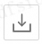
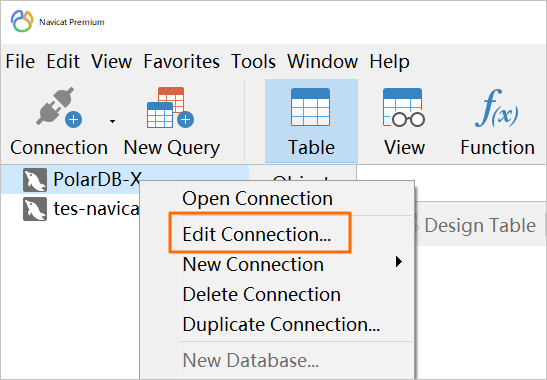
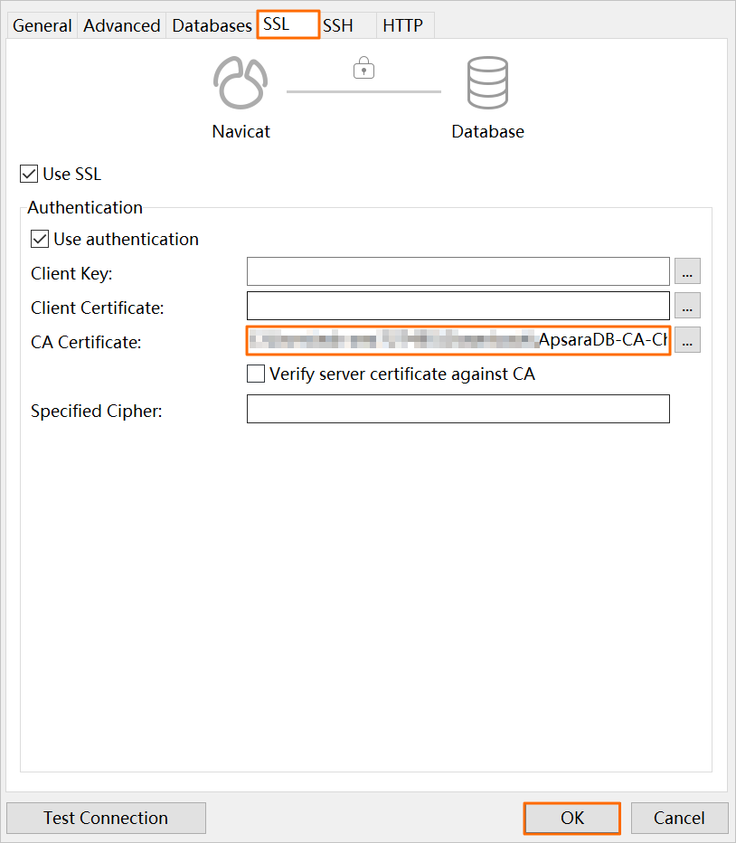
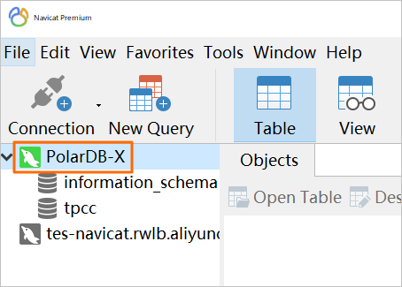
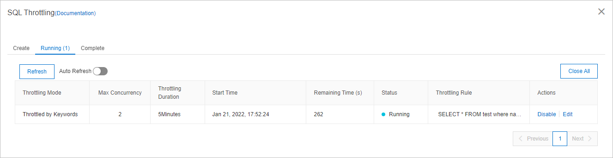
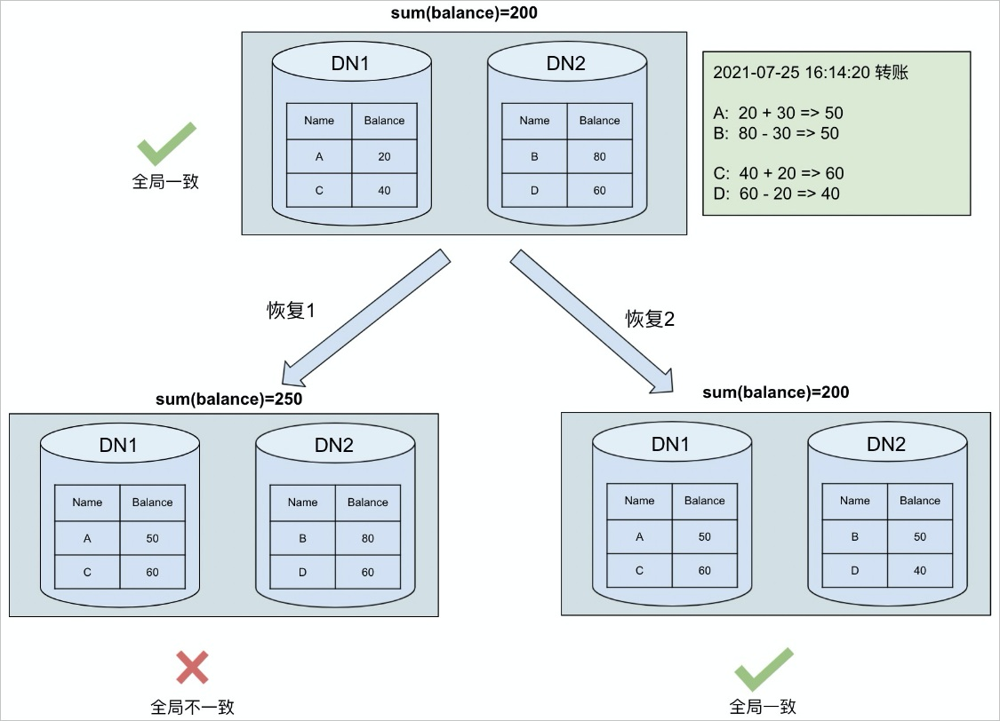

Alibaba Cloud  
Apsara Stack  
ApsaraDB for POLARDB  
User Guide (PolarDB-X)  
Product Version: V3.18.2  
Document Version: 20240607

**Table of Contents**

- [1.Log on to the PolarDB-X console](#section-1)
- [2.Instance management](#section-2)
    - [2.1. Create a PolarDB-X instance](#section-2-1)
    - [2.2. Change instance specifications](#section-2-2)
    - [2.3. Add nodes](#section-2-3)
    - [2.4. Release a PolarDB-X instance](#section-2-4)
    - [2.5. Restart an instance](#section-2-5)
    - [2.6. Add read-only instances](#section-2-6)
- [3.Network and connection](#section-3)
    - [3.1. Connect to a database](#section-3-1)
    - [3.2. Cluster endpoints and read-only endpoints](#section-3-2)
    - [3.3. Apply for and release a public endpoint](#section-3-3)
- [4.Accounts and security](#section-4)
    - [4.1. Manage database accounts](#section-4-1)
    - [4.2. Configure a whitelist](#section-4-2)
    - [4.3. Configure SSL encryption](#section-4-3)
    - [4.4. Three-role mode](#section-4-4)
        - [4.4.1. Overview](#section-4-4-1)
        - [4.4.2. Enable and disable the three-role mode](#section-4-4-2)
        - [4.4.3. Manage the accounts for the three-role mode](#section-4-4-3)
        - [4.4.4. Permission verification](#section-4-4-4)
- [5.Parameter settings](#section-5)
- [6.Performance monitoring](#section-6)
    - [6.1. Computing resource monitoring](#section-6-1)
    - [6.2. Monitor storage resources](#section-6-2)
    - [6.3. Log resource monitoring](#section-6-3)
- [7.Diagnosis and optimization](#section-7)
    - [7.1. SQL audit and analysis](#section-7-1)
    - [7.2. Instance sessions](#section-7-2)
    - [7.3. Slow query logs](#section-7-3)
    - [7.4. Storage analysis](#section-7-4)
    - [7.5. Deadlock analysis](#section-7-5)
    - [7.6. Performance trend](#section-7-6)
    - [7.7. Real-time performance](#section-7-7)
- [8.SQL log details](#section-8)
- [9.Backup and restoration](#section-9)
    - [9.1. Data backup](#section-9-1)
    - [9.2. Data restoration](#section-9-2)
    - [9.3. Log backup](#section-9-3)

<a id="section-1"></a>

# 1.Log on to the PolarDB-X console

This topic describes how to log on to the PolarDB-X console. Google Chrome is used in this example.

**Prerequisites**

- The URL of the Apsara Uni-manager Management Console is obtained from the deployment personnel.

- A web browser is available. We recommend that you use Google Chrome.

**Procedure**

1. Enter the URL of the Apsara Uni-manager Management Console in the address bar and press the Enter key.

   > **Note**
   >
   > - You can click the current language in the upper-right corner to switch to another language.
   >
   > - 由于浏览器证书过期或环境开启HTTPS认证等出现多次单击继续访问或无Apsara Uni-manager运营控制台地址入口等现象，此时需要安装证书才能正常访问。单击右上角的**浏览器证书安装**，可打开浏览器证书安装指南。

2. Enter your username and password.

   Obtain the username and password from an operations administrator.

   > **Note**
   >
   > - **First logon**
   >
   >   The first time that you log on to the Apsara Uni-manager Management Console, you need to change the password of your account. The password must be 10 to 32 characters in length. It must contain all of the following character types: uppercase letters, lowercase letters, digits, and special characters. Supported special characters include: ! @ # $ %
   >
   > - **Forget password**
   >
   >   If you have forgotten your password, click Forgot Password. On the page that appears, enter the username of your account, the email address that was used to create the account, and the CAPTCHA code. Then, the system sends a link for resetting the password to the specified email address.

3. Click **Log On**.

4. In the top navigation bar, choose **Products > Database Services > PolarDB-X 2.0**.

<a id="section-2"></a>

# 2.Instance management

<a id="section-2-1"></a>

## 2.1. Create a PolarDB-X instance

This topic describes how to create a PolarDB-X instance.

**Procedure**

1. Log on to the PolarDB-X console.

   > **Note**
   >
   > You can click the following icons in the console to perform corresponding operations:
   >
   > : refreshes the instance list.
   >
   > 
   >
   > : displays the instance list in the **Default** or **Compact** mode.
   >
   > 
   >
   > : specifies the instance properties displayed in the instance list.
   >
   > 
   >
   > : enters or exits the full screen mode.
   >
   > 
   >
   > : exports the instance list to your on-premises devices.
   >
   > 

2. In the upper-left corner, click **Create Instance**.

3. On the **Create PolarDB-X V2.0 Instance** page, configure the following parameters.

   | Parameter | Description |
   | --- | --- |
   | Organization | The organization to which the instance belongs. |
   | Resource Set | The resource set to which the instance belongs. |
   | Region | The region in which you want to deploy the standalone instance. |
   | Edition | The edition of the instance. You can select <strong>Enterprise Edition</strong> or <strong>Standard Edition</strong>. |
   | Deployment Method | Select <strong>Single-zone Deployment</strong> or <strong>Multi-zone Deployment</strong>.<br>• Single-zone Deployment: If you select this deployment mode, specify a primary zone for the instance. The secondary nodes and change data capture (CDC) nodes of the instance are automatically deployed in the same zone as the primary node.<br>• Multi-zone Deployment: If you select this deployment mode, the nodes of the instance are deployed in different zones. Instances deployed across zones provide IDC-level disaster recovery. |
   | Deployment Mode | The value of this parameter is fixed as <strong>default</strong>. |
   | Primary Zone | The primary zone to which the instance belongs. |
   | Secondary Zone | The secondary zone of the instance. You need to specify this parameter only when you select the multi-zone deployment mode. |
   | The Tertiary Zone | The tertiary zone of the instance. You need to specify this parameter only when you select the multi-zone deployment mode. |
   | Chip Architecture | The chip architecture. You can select <strong>Hygon</strong>, <strong>Kunpeng</strong>, <strong>Phytium</strong>, or <strong>Intel</strong>. |
   | Compatibility | You can select <strong>MySQL 5.7</strong> or <strong>MySQL 8.0</strong>. |
   | Share Type | You can select <strong>Universal</strong> or <strong>Exclusive</strong>.<br>• Dedicated: The computing resources such as CPU cores that are allocated to each instance are exclusive to the instance. This improves performance stability.<br>• General: Idle computing resources such as CPU cores are shared among instances on the same server. This improves cost-effectiveness. |
   | Compute Node Specifications | The specifications of the compute node.<br>Note<br>You need to configure this parameter only when you select <strong>Enterprise Edition</strong>. |
   | Compute Node Groups | The number of compute node groups.<br>Note<br>You need to configure this parameter only when you select <strong>Enterprise Edition</strong>. |
   | Storage Node Specifications | The specifications of the storage node.<br>Note<br>You need to configure this parameter only when you select <strong>Enterprise Edition</strong>. |
   | Storage Node Groups | The number of storage node groups.<br>Note<br>You need to configure this parameter only when you select <strong>Enterprise Edition</strong>. |
   | Storage | The storage capacity of the node. |
   | Instance Specification | The specification of the instance.<br>Note<br>You need to configure this parameter only when you select <strong>Standard</strong> <strong>Edition</strong>. |
   | Node Groups | The number of node groups. The minimum value of this parameter is 2.<br>Note<br>You need to configure this parameter only when you select <strong>Standard</strong> <strong>Edition</strong>. |
   | Network Type | The value of this parameter is fixed as <strong>VPC</strong>. |
   | VPC | Select a VPC. |
   | vSwitch | Select a vSwitch. |

4. Click **Submit** to create the instance and go to the instance list to view the created instance.

<a id="section-2-2"></a>

## 2.2. Change instance specifications

A PolarDB-X instance is a distributed cluster that consists of multiple nodes. Each node provides features such as SQL routing, data merging, and data aggregation. You can change the node specifications for an instance. During peak hours, you can upgrade the specifications to handle high numbers of queries per second (QPS). During off-peak hours, you can downgrade the specifications to prevent inefficient use of resources.

**Precautions**

When you downgrade the specifications of an instance, transient connections may occur due to disconnections between your application and the instance. Make sure that your application can automatically reconnect to your instance.

**Procedure**

1. Log on to the PolarDB-X console.

   > **Note**
   >
   > You can click the following icons in the console to perform corresponding operations:
   >
   > : refreshes the instance list.
   >
   > 
   >
   > : displays the instance list in the **Default** or **Compact** mode.
   >
   > 
   >
   > : specifies the instance properties displayed in the instance list.
   >
   > 
   >
   > : enters or exits the full screen mode.
   >
   > 
   >
   > : exports the instance list to your on-premises devices.
   >
   > 

2. On the Instance List page, find the instance that you want to change and click **Configuration** in the **Operation** column.

3. On the configuration page, select the target node specifications and storage space.

   > **Note**
   >
   > After the specifications are changed, the compute nodes and storage nodes
   >
   > of the instance are upgraded or downgraded to the same node specifications.

4. Click **Submit** to complete the configuration change.

<a id="section-2-3"></a>

## 2.3. Add nodes

A PolarDB-X instance is a distributed cluster that consists of multiple nodes. You can add nodes to a PolarDB-X cluster.

**Procedure**

1. Log on to the PolarDB-X console.

   > **Note**
   >
   > You can click the following icons in the console to perform corresponding operations:
   >
   > : refreshes the instance list.
   >
   > 
   >
   > : displays the instance list in the **Default** or **Compact** mode.
   >
   > 
   >
   > : specifies the instance properties displayed in the instance list.
   >
   > 
   >
   > : enters or exits the full screen mode.
   >
   > 
   >
   > : exports the instance list to your on-premises devices.
   >
   > 

2. On the Instance List page, find the instance that you want to change and click **Add Node** in the **Operation** column.

3. On the page that appears, specify the number of nodes.

4. Click Go to open.

   After you complete the operation, the instance is in the **Adding Node** state on the Instance List page.

<a id="section-2-4"></a>

## 2.4. Release a PolarDB-X instance

This topic describes how to release a PolarDB-X instance.

**Procedure**

1. Log on to the PolarDB-X console.

   > **Note**
   >
   > You can click the following icons in the console to perform corresponding operations:
   >
   > : refreshes the instance list.
   >
   > 
   >
   > : displays the instance list in the **Default** or **Compact** mode.
   >
   > 
   >
   > : specifies the instance properties displayed in the instance list.
   >
   > 
   >
   > : enters or exits the full screen mode.
   >
   > 
   >
   > : exports the instance list to your on-premises devices.
   >
   > 

2. Find the instance that you want to release and click the instance name.

3. On the **Basic Information** page, click **Release Instance**.

   > **Warning**
   >
   > After an instance is released, the instance cannot be restored. Proceed
   >
   > with caution.

4. In the message that appears, click **OK** to release the instance.

<a id="section-2-5"></a>

## 2.5. Restart an instance

If the number of connections to an PolarDB-X reaches the upper limit or performance issues occur on the instance, you can manually restart the instance in the console. This topic describes how to restart an instance in the PolarDB-X console.

**Procedure**

1. Log on to the PolarDB-X console.

   > **Note**
   >
   > You can click the following icons in the console to perform corresponding operations:
   >
   > : refreshes the instance list.
   >
   > 
   >
   > : displays the instance list in the **Default** or **Compact** mode.
   >
   > 
   >
   > : specifies the instance properties displayed in the instance list.
   >
   > 
   >
   > : enters or exits the full screen mode.
   >
   > 
   >
   > : exports the instance list to your on-premises devices.
   >
   > 

2. Find the instance that you want to restart and click the instance name.

3. On the Basic information page, click **Restart an instance** in the upper-right corner.

   > **Warning**
   >
   > If the instance restarts, your application is disconnected from the
   >
   > instance. Make sure that your application is configured to reconnect to your instance. To minimize the impacts, we recommend that you arrange your business before you restart the instance. Proceed with caution.

4. In the dialog box that appears, click **OK** to restart the instance.

<a id="section-2-6"></a>

## 2.6. Add read-only instances

This topic describes how to create a read-only PolarDB-X instance for a primary PolarDB-X instance.

**Background information**

An X-Paxos-based architecture is used for the data nodes of a primary PolarDB-X instance. This architecture uses a three-replica mechanism to ensure high availability. Learners are added to the data nodes of a read-only PolarDB-X instance to ensure physical resource isolation. In addition, strong consistency in read-only queries are ensured based on Timestamp Oracle (TSO).

**Usage notes**

- A primary instance and the read-only instances that are associated with the primary instance must be deployed in the same region and can be deployed in different zones within the region.

- A read-only PolarDB-X instance must be associated with a primary PolarDB-X instance. If you create a database in the primary instance, the database is replicated to each read-only instance that is associated with the primary instance. If you delete a database in the primary instance, the replicated database in each read-only instance that is associated with the primary instance is also deleted.

**Procedure**

1. Log on to the PolarDB-X console.

   > **Note**
   >
   > You can click the following icons in the console to perform corresponding operations:
   >
   > : refreshes the instance list.
   >
   > 
   >
   > : displays the instance list in the **Default** or **Compact** mode.
   >
   > 
   >
   > : specifies the instance properties displayed in the instance list.
   >
   > 
   >
   > : enters or exits the full screen mode.
   >
   > 
   >
   > : exports the instance list to your on-premises devices.
   >
   > 

2. Find the instance that you want to manage, click the

   icon in the **Operation** column and

   

   then click **Read-only instance**. Alternatively, you can click the instance name to go to the instance details page. In the **Read-only instance** section on the right side of the page, click **Add a read-only instance**.

3. On the page that appears, configure parameters described in the following table.

   | Parameter | Description |
   | --- | --- |
   | Resource set | You do not need to configure this parameter. The default resource set is used. |
   | Region | The region in which you want to deploy the instance. |
   | Zone | The zone in which you want to deploy the instance. |
   | Network Type | You do not need to configure this parameter. The default value is <strong>VPC</strong>. |
   | VPC | Select a VPC. |
   | VSwitch | Select a vSwitch. |
   | Compatibility | You do not need to configure this parameter. The default value is <strong>MySQL</strong> 5.7 |
   | Instance specifications | The specifications of the instance. |
   | Node Groups | The number of node groups. The minimum value is 2. |
   | Storage space | The storage capacity. The minimum storage capacity is 50 GB. |

4. Click **Submit**. You can go to the console to view the new instance.

<a id="section-3"></a>

# 3.Network and connection

<a id="section-3-1"></a>

## 3.1. Connect to a database

You can connect to PolarDB-X databases by using Data Management (DMS), the MySQL command-line client mysql, third-party clients, and third-party drivers for MySQL. This topic describes how to use mysql to connect to a PolarDB-X database.

**Prerequisites**

You have created a PolarDB-X instance, an account, and a database.

The MySQL command-line client mysql is installed on your server. For more information about how to download and install mysql, go to the MySQL website.

> **Note**
>
> We recommend that you do not use mysql 8.0.x.

**Use mysql to connect to a database**

1. Log on to the PolarDB-X console.

   > **Note**
   >
   > You can click the following icons in the console to perform corresponding operations:
   >
   > : refreshes the instance list.
   >
   > 
   >
   > : displays the instance list in the **Default** or **Compact** mode.
   >
   > 
   >
   > : specifies the instance properties displayed in the instance list.
   >
   > 
   >
   > : enters or exits the full screen mode.
   >
   > 
   >
   > : exports the instance list to your on-premises devices.
   >
   > 

2. Find the instance that you want to manage and click the instance ID.

3. In the **Connection Information** section, find the internal and public endpoints of the instance.

   > **Note**
   >
   > If you need to access the instance over the Internet for a test, click **Apply**
   >
   > **for Public Endpoint**. Then, use the **Public Endpoint** and **Public Port** to connect to the instance. To ensure database security, we recommend that you use the internal endpoint to access the instance during your use of PolarDB-X.

4. After you obtain the **connection information**, run the following command to obtain the local public IP address. Then, add the IP address to a whitelist of the instance.

   ```bash
    curl 'https://api.ipify.org'
   ```

5. Run the following command to connect to your database:

   ```text
   mysql -h<Endpoint> -P<Port number> -u<Username> -p -D<Database name>
   ```

   | Paramete r | Description | Example |
   | --- | --- | --- |
   | <code>-h</code> | The internal endpoint or public endpoint that is used to connect to the instance. | <code>pxc-</code><br><code>******************.public.polarx.rds</code><br><code>.aliyuncs.com</code> |
   | <code>-P</code> | The number of the port that is used to connect to the instance.<br>• If you connect to the instance over an internal network, specify the internal port number for the instance.<br>• If you connect to the instance over the Internet, specify the public port number for the instance.<br>Note<br>• The letter P in <code> -P </code> must be in uppercase.<br>• The default port number is 3306. | <code>3306</code> |
   | <code>-u</code> | The username of the account that is used to connect to the instance. | <code>testuser</code> |
   | <code>-p</code> | The password of the account.<br>Note<br>• To ensure password security, we recommend that you do not specify the password at the end of <code> -p </code>. After the command is run, you are prompted to enter the password. After you enter the password, press Enter to connect to the database.<br>• If you configure this parameter, do not enter space characters between -p and the password.<code>  </code> | <code>passWord123</code> |
   | <code>-D</code> | The name of the database to which you want to connect.<br>Note<br>• This parameter is optional.<br>• If you need to specify a database, you can omit -D and directly specify the database name.<code>  </code> | <code>mysql</code> |

**Use a third-party client to connect to a database**

You can connect to PolarDB-X databases by using the following clients. You can go to the corresponding official websites to download the clients.

- MySQL Workbench (Recommended)

- SQLyog

- Sequel Pro

- Navicat for MySQL

> **Note**
>
> On a third-party GUI client, you can perform basic database operations. For
>
> example, you can insert, delete, modify, and query data and perform DDL operations. PolarDB-X may not support the advanced features of the client.

**Use third-party drivers for MySQL to connect to a database**

You can connect to PolarDB-X databases by using the following third-party drivers for MySQL:

- JDBC Driver for MySQL (Connector/J)

- Python Driver for MySQL (Connector/Python)

- C++ Driver for MySQL (Connector/C++)

- C Driver for MySQL (Connector/C)

- ADO.NET Driver for MySQL (Connector/NET)

- ODBC Driver for MySQL (Connector/ODBC)

- PHP Drivers for MySQL (mysqli, ext/mysqli, PDO_MYSQL, PHP_MYSQLND)

- Perl Driver for MySQL (DBD::mysql)

- Ruby Driver for MySQL (ruby-mysql)

The following code provides an example on how to use JDBC Driver for MySQL (Connector/J) to connect to a PolarDB-X database:

```text
//JDBC
Class.forName("com.mysql.jdbc.Driver"); 
Connection conn = DriverManager.getConnection("jdbc:mysql://pxc-
******************.public.polarx.rds.aliyuncs.com:3306/doc_test","doc_test","doc_test_pas
ord");
//...
conn.close();    
```

The following code provides an example on how to use a connection pool to connect to a PolarDB-X database from your application.

```xml
<bean id="dataSource" class="com.alibaba.druid.pool.DruidDataSource" init-method="init" 
destroy-method="close"> 
<property name="url" value="jdbc:mysql://pxc-
******************.public.polarx.rds.aliyuncs.com:3306/doc_test" />
<property name="username" value="doc_test" />
<property name="password" value="doc_test_password" />
<property name="filters" value="stat" />
<property name="maxActive" value="100" />
<property name="initialSize" value="20" />
<property name="maxWait" value="60000" />
<property name="minIdle" value="1" />
<property name="timeBetweenEvictionRunsMillis" value="60000" />
<property name="minEvictableIdleTimeMillis" value="300000" />
<property name="testWhileIdle" value="true" />
<property name="testOnBorrow" value="false" />
<property name="testOnReturn" value="false" />
<property name="poolPreparedStatements" value="true" />
<property name="maxOpenPreparedStatements" value="20" />
<property name="asyncInit" value="true" />
</bean>
```

> **Note**
>
> We recommend that you use the Druid connection pools.

<a id="section-3-2"></a>

## 3.2. Cluster endpoints and read-only endpoints

This topic describes the endpoints of PolarDB-X instances and how to configure an endpoint.

**Background information**

If you do not create a read-only instance for a primary instance, you can use only one endpoint to connect to the primary instance. This endpoint is known as a cluster endpoint. A cluster endpoint is used in general scenarios for online business. If read-only instances are created for a primary instance, one read-only endpoint is provided for each read-only instance. A read-only endpoint ensures that you have exclusive resources in scenarios in which access to resources is isolated, such as batch processing and the export of offline data. If you create a primary instance and a read-only instance in scenarios in which hybrid transaction/analytical processing (HTAP) is performed, you can use the cluster endpoint and the read-only endpoint.

**Configure a cluster endpoint**

1. Log on to the PolarDB-X console.

2. Find the target instance and click the instance ID.

3. In the **Connection Information** section, click the  icon of the cluster endpoint.

4. Click **Configuration Management** to view the configuration items of the cluster endpoint.

   456789

   Parameter description:

   - Read-only instances are automatically added: If you create read-only instances, you can enable this feature. This way, the read/write splitting feature routes complex queries in the primary instance to your read-only instances.

   - Intelligent Read/write Splitting: If you enable intelligent read/write splitting, PolarDB-X can automatically identify query workloads and route the traffic generated by analytical processing to the read-only instances to reduce the workloads of the primary instance. If you do not create a read-only instance or do not add a read-only instance to the management list of the primary instance, you can ignore this configuration item.

Parameter description:

| Parameter | Description |
| --- | --- |
| Resource Configuration | If you have created read-only instances, you can add the read-only instances to the resource pool of the primary instance to offload read requests sent to the primary instance. Read-only instances that are not added to the resource pool cannot be used to offload read requests sent to the primary instance. |
| Read-only instances are automatically added | Specifies whether newly created read-only instances are added to the resource pool of the primary instance. By default, this feature is enabled. |
| Intelligent Read/write Splitting | By default, this feature is enabled. PolarDB-X automatically routes the traffic generated by analytical processing (AP) to the read-only instances and performs massively parallel processing (MPP). This helps accelerate queries. |
| Read-Only Traffic (%) | The read queries that need to be routed to the storage nodes of the primary instance are routed to the storage nodes of read-only instances based on the specified percentage. This way, the query data can be stored in the read-only instances. |

<table>
  <tr>
    <td>Data read consistency</td>
    <td>• Strong consistency: If requests are routed to the read-only instances, the data that is updated on the primary instance before the read requests are performed can be queried.This provides strong external consistency.<br>• Weak consistency: If requests are routed to the read-only instances, only the latest data can be read from the read-only instances. Data reads are delayed due to asynchronous replication between your primary and read-only instances.<br>Note<br>Due to the read latency, data that requires strong consistency can be read only after the data is updated. By default, 3 seconds are consumed to read the data.</td>
  </tr>
  <tr>
    <td>Latency Threshold for Read-Only Instances (s)</td>
    <td>If this threshold is exceeded, read-only requests are sent to other read-only instances in which the read latency does not exceed the threshold. You can also determine whether to send the requests back to the primary instance based on the availability of the read-only instances.</td>
  </tr>
  <tr>
    <td>Read-only Traffic Switched Back to the Primary Instance</td>
    <td>If the read latency in each read-only instance exceeds the threshold or each read-only instance is in the high availability (HA) status, all read-only instances are considered to be unavailable and the system determines whether to send read-only requests back to the primary instance. We recommend that two or more read-only instances be used to improve the availability of read-only instances.</td>
  </tr>
</table>

**Configure a read-only endpoint**

1. Log on to the PolarDB-X console.

2. Find the target instance and click the instance ID.

3. Click the  icon of the read-only endpoint.

4. Click **Configuration Management** to view the configuration items of the read-only endpoint.

   Parameter description:

   - Strong consistency: You can use the read-only endpoint to query the latest data that is submitted by the primary instance. This ensures the consistency of global data queries. If the replication latency between your primary and read-only instances is large, the queried data cannot be immediately returned.

   - Weak consistency: You can use the read-only endpoint to query the latest data of the read-only instance. The queried data can be immediately returned even if replication latency between your primary and read-only instances exists.

<a id="section-3-3"></a>

## 3.3. Apply for and release a public endpoint

By default, a PolarDB-X assigned a private endpoint when the instance is created. You can use the private endpoint to connect your applications and MySQL clients on Alibaba Cloud Elastic Compute Service (ECS) instances to databases on the PolarDB-X instance. If you need to access the PolarDB-X instance over the Internet, you must apply for a public endpoint for the PolarDB-X instance. This topic describes how to apply for and release a public endpoint.

**Apply for a public endpoint**

1. Log on to the PolarDB-X console.

   > **Note**
   >
   > You can click the following icons in the console to perform corresponding operations:
   >
   > : refreshes the instance list.
   >
   > 
   >
   > : displays the instance list in the **Default** or **Compact** mode.
   >
   > 
   >
   > : specifies the instance properties displayed in the instance list.
   >
   > 
   >
   > : enters or exits the full screen mode.
   >
   > 
   >
   > : exports the instance list to your on-premises devices.
   >
   > 

2. Find the instance that you want to manage and click the instance name.

3. In the **Connection Information** section of the **Basic Information** page, click **Apply for Public Endpoint** in the upper-right corner.

4. In the dialog box that appears, click **OK**.

   > **Note**
   >
   > If you want to connect to the PolarDB-X instance by using the public endpoint, you must add the public IP address of your client to a whitelist of the instance. For more information, see Configure a whitelist.

**Release a public endpoint**

1. Log on to the PolarDB-X console.

   > **Note**
   >
   > You can click the following icons in the console to perform corresponding operations:
   >
   > : refreshes the instance list.
   >
   > 
   >
   > : displays the instance list in the **Default** or **Compact** mode.
   >
   > 
   >
   > : specifies the instance properties displayed in the instance list.
   >
   > 
   >
   > : enters or exits the full screen mode.
   >
   > 
   >
   > : exports the instance list to your on-premises devices.
   >
   > 

2. Find the instance that you want to manage and click the instance name.

3. In the **Connection Information** section of the **Basic Information** page, click **Release Public Endpoint** in the upper-right corner.

4. In the dialog box that appears, click **OK**.

   > **Note**
   >
   > After you release the public endpoint, you cannot use the public endpoint to connect to the instance. After the public endpoint is released, we recommend that you remove the corresponding public IP address from the whitelist to ensure data security.

<a id="section-4"></a>

# 4.Accounts and security

<a id="section-4-1"></a>

## 4.1. Manage database accounts

You can create privileged accounts and standard accounts for PolarDB-X instances. This topic describes how to create an account.

**Account types**

The following table describes the types of database accounts that are supported by PolarDB-X instances:

| Account type | Description |
| --- | --- |
| Privileged account | • You can create and manage privileged accounts by using the PolarDB-X console or API operations.<br>• You can create only one privileged account for each instance. The privileged account can be used to manage all standard accounts and databases in the instance.<br>• The privileged account is granted more permissions than a standard account. You can use the privileged account to perform fine-grained permission management based on your business requirements. For example, you can use the privileged account to grant different RAM users permissions to access different tables.<br>• The privileged account is granted full permissions on all databases in the instance and can be used to close connections that are established by using standard accounts. |
| Standard account | • You can create and manage standard accounts by using the PolarDB-X console, calling API operations, or executing SQL statements.<br>• You can create one or more standard accounts for each instance. The maximum number of standard accounts that can be created is determined by the kernel engine of the instance.<br>• You must grant the permissions on specified databases to standard accounts.<br>• You cannot use a standard account to create, manage, or log off other accounts from the instance on which the standard account is created. |

> **Note**
>
> After an account is created, the type of the account cannot be changed. If you want to change the type of the account, delete the account and then use the same username of the account to create an account of the other type.

The following sections describe the operations that you can perform on database accounts in the console.

- Create an account

- Reset the password of an account

- Modify the permissions that are granted to a standard account

- Delete an account

**Create an account**

1. Log on to the PolarDB-X console.

   > **Note**
   >
   > You can click the following icons in the console to perform corresponding operations:
   >
   > : refreshes the instance list.
   >
   > 
   >
   > : displays the instance list in the **Default** or **Compact** mode.
   >
   > 
   >
   > : specifies the instance properties displayed in the instance list.
   >
   > 
   >
   > : enters or exits the full screen mode.
   >
   > 
   >
   > : exports the instance list to your on-premises devices.
   >
   > 

2. Find the instance that you want to manage and click its ID.

3. In the left-side navigation pane, choose **Configuration Management > Account Management**.

4. Click **Create Account**. In the panel that appears, configure the following parameters.

   | Parameter | Description |
   | --- | --- |
   | Account Name | The name of the account.<br>Note<br>The account name must meet the following requirements:<br>• The name can be up to 16 characters in length and can contain lowercase letters, digits, and underscores (_).<br>• The name must start with a lowercase letter and end with a lowercase letter or a digit.<br>• The name must be unique and cannot be the same as the name of an existing account. |
   | Account Type | The type of the account. You can specify the account to be a <strong>privileged</strong> <strong>account</strong> or <strong>standard account</strong>.<br>Note<br>You can create only one privileged account for each PolarDB-X instance. |
   | Authorize Database | You can authorize or unauthorize selected databases for a standard account. |
   | Password | The password of the account.<br>Note<br>The password must meet the following requirements:<br>• The password must be 8 to 20 characters in length.<br>• The password must contain at least three types of the following characters: uppercase letters, lowercase letters, digits, and special characters.<br>• Special characters include @ # $ % ^ &amp; + = |
   | Confirm Password | Enter the password again to confirm the password. |
   | Description | The information that can help you manage the account. The description can be up to 256 characters in length. |

**Reset the password of an account**

1. Log on to the PolarDB-X console.

   > **Note**
   >
   > You can click the following icons in the console to perform corresponding operations:
   >
   > : refreshes the instance list.
   >
   > 
   >
   > : displays the instance list in the **Default** or **Compact** mode.
   >
   > 
   >
   > : specifies the instance properties displayed in the instance list.
   >
   > 
   >
   > : enters or exits the full screen mode.
   >
   > 
   >
   > : exports the instance list to your on-premises devices.
   >
   > 

2. Find the instance that you want to manage and click its ID.

3. In the left-side navigation pane, choose **Configuration Management > Account Management**.

4. On the **Account Management** page, find the account that you want to manage and click **Change Password** in the **Actions** column.

5. In the dialog box that appears, enter and confirm the password, and then click **OK**.

   > **Note**
   >
   > The password must meet the following requirements:
   >
   > - The password must be 8 to 20 characters in length.
   >
   > - The password must contain at least three types of the following characters: uppercase letters, lowercase letters, digits, and special characters.
   >
   > - Special characters include @ # $ % ^ & + =

**Modify the permissions that are granted to a standard account**

1. Log on to the PolarDB-X console.

   > **Note**
   >
   > You can click the following icons in the console to perform corresponding operations:
   >
   > : refreshes the instance list.
   >
   > 
   >
   > : displays the instance list in the **Default** or **Compact** mode.
   >
   > 
   >
   > : specifies the instance properties displayed in the instance list.
   >
   > 
   >
   > : enters or exits the full screen mode.
   >
   > 
   >
   > : exports the instance list to your on-premises devices.
   >
   > 

2. Find the instance that you want to manage and click the instance ID.

3. In the left-side navigation pane, choose **Configuration Management > Account Management**.

4. On the **Account Management** page, find the account that you want to manage and click **Modify Permissions** in the **Actions** column.

   > **Note**
   >
   > The privileged account of an instance is granted full permissions on all databases in the instance. You do not need to modify permissions for the privileged account.

5. In the panel that appears, select one or more databases and click the

   icon to move the

   

   databases from the **Unauthorized Database** section to the **Authorized Databases** section.

6. In the Authorized Databases section, select the permissions on the databases.

   > **Note**
   >
   > - Supported permissions: **Read and Write**, **Read Only**, **DML Only**, and **DDL Only**.
   >
   > - If you want to grant the same permissions on multiple selected databases, click the permission name such as **All DDL Only** next to **Authorized Databases**.

7. Click **OK**.

**Delete an account**

1. Log on to the PolarDB-X console.

   > **Note**
   >
   > You can click the following icons in the console to perform corresponding operations:
   >
   > : refreshes the instance list.
   >
   > 
   >
   > : displays the instance list in the **Default** or **Compact** mode.
   >
   > 
   >
   > : specifies the instance properties displayed in the instance list.
   >
   > 
   >
   > : enters or exits the full screen mode.
   >
   > 
   >
   > : exports the instance list to your on-premises devices.
   >
   > 

2. Find the instance that you want to manage and click the instance ID.

3. In the left-side navigation pane, choose **Configuration Management > Account Management**.

4. On the **Account Management** page, find the account that you want to delete and click **Delete** in the **Actions** column.

5. In the message that appears, click **OK**.

<a id="section-4-2"></a>

## 4.2. Configure a whitelist

You can configure whitelists for your PolarDB-X instances. Whitelists do not impact the performance of PolarDB-X instances. You can update the configured whitelists on a regular basis to provide high-level access control and security protection for PolarDB-X instances. This topic describes how to configure a whitelist for your PolarDB-X instance.

**Usage notes**

- After a database is created, the default whitelist contains only the IP address  `127.0.0.1` , which indicates that no IP addresses are allowed to access the cluster. To ensure that your data is secure, we recommend that you specify only the public IP addresses or CIDR blocks of your web servers in the whitelists of your instance.

- You can create up to 50 whitelists for a PolarDB-X instance, and each whitelist can contain up to 300 IP addresses and CIDR blocks.

**Add a whitelist**

1. Log on to the PolarDB-X console.

   > **Note**
   >
   > You can click the following icons in the console to perform corresponding operations:
   >
   > : refreshes the instance list.
   >
   > 
   >
   > : displays the instance list in the **Default** or **Compact** mode.
   >
   > 
   >
   > : specifies the instance properties displayed in the instance list.
   >
   > 
   >
   > : enters or exits the full screen mode.
   >
   > 
   >
   > : exports the instance list to your on-premises devices.
   >
   > 

2. Find the instance that you want to manage and click the instance ID.

3. In the left-side navigation pane, choose **Configuration Management > Security Management**.

4. On the Whitelists tab, click **Add Whitelist**.

5. In the **Add Whitelist** panel, configure the following parameters:

   | Parameter | Description |
   | --- | --- |
   | Group Name | The name of the whitelist. |
   | Group Whitelist | IP addresses in the whitelist.<br>Note<br>• You can enter IP addresses and CIDR blocks. For example, you can enter the IP address 192.168.0.1 and the CIDR block 192.168.0.0/24.<br>• You can specify up to 300 IP addresses and CIDR blocks in a whitelist.<br>• Separate multiple IP addresses and CIDR blocks with commas (,). For example, you can enter 192.168.0.1,192.168.0.0/24.<br>• If you want to block access from all IP addresses, you can specify 127.0.0.1 in the whitelist. |

6. Click **OK**.

   > **Note**
   >
   > The whitelist takes effect approximately 1 minute after it is created.

**Modify a whitelist**

1. Log on to the PolarDB-X console.

   > **Note**
   >
   > You can click the following icons in the console to perform corresponding operations:
   >
   > : refreshes the instance list.
   >
   > 
   >
   > : displays the instance list in the **Default** or **Compact** mode.
   >
   > 
   >
   > : specifies the instance properties displayed in the instance list.
   >
   > 
   >
   > : enters or exits the full screen mode.
   >
   > 
   >
   > : exports the instance list to your on-premises devices.
   >
   > 

2. Find the instance from which you want to detach the data disk and click the instance ID.

3. In the left-side navigation pane, choose **Configuration Management > Security Management**.

4. On the **Whitelists** tab, find the whitelist that you want to configure and click **Configuration** in the **Actions** column.

5. In the **Configure Whitelist** panel, modify the **Group Whitelist** parameter.

   | Parameter | Description |
   | --- | --- |

   <table>
     <tr>
       <td>Group Whitelist</td>
       <td>IP addresses in the whitelist.<br>Note<br>• You can enter IP addresses and CIDR blocks. For example, you can enter the IP address 192.168.0.1 and the CIDR block 192.168.0.0/24.<br>• You can specify up to 300 IP addresses and CIDR blocks in a whitelist.<br>• Separate multiple IP addresses and CIDR blocks with commas (,). For example, you can enter 192.168.0.1,192.168.0.0/24.<br>• If you want to block access from all IP addresses, you can specify 127.0.0.1 in the whitelist.</td>
     </tr>
   </table>

6. Click **OK**.

   > **Note**
   >
   > The whitelist takes effect approximately 1 minute after it is modified.

**Delete a whitelist**

1. Log on to the PolarDB-X console.

   > **Note**
   >
   > You can click the following icons in the console to perform corresponding operations:
   >
   > : refreshes the instance list.
   >
   > 
   >
   > : displays the instance list in the **Default** or **Compact** mode.
   >
   > 
   >
   > : specifies the instance properties displayed in the instance list.
   >
   > 
   >
   > : enters or exits the full screen mode.
   >
   > 
   >
   > : exports the instance list to your on-premises devices.
   >
   > 

2. Find the instance that you want to manage and click the instance ID.

3. In the left-side navigation pane, choose **Configuration Management > Security Management**.

4. On the **Whitelist s** tab, find the whitelist that you want to delete and click **Delete** in the **Actions** column.

5. In the message that appears, click **OK**.

<a id="section-4-3"></a>

## 4.3. Configure SSL encryption

This topic describes how to make data transmission more secure by configuring Secure Sockets Layer (SSL) encryption. You must enable SSL encryption and install SSL certificates that are issued by certificate authorities (CAs) to the required applications. SSL is used to encrypt connections at the transport layer and enhance the security and integrity of the transmitted data. However, SSL encryption increases the round-trip time.

**Usage notes**

- The validity period of an SSL certificate is one year. Before an SSL certificate expires, you must renew the SSL certificate. You must also download the required SSL certificate file and configure the SSL certificate again after you renew the SSL certificate. Otherwise, clients that are connected to your cluster over encrypted connections are disconnected. For more information, see Update the validity period of an SSL CA certificate.

- SSL encryption may cause a significant increase in CPU utilization. We recommend that you enable SSL encryption only when you need to encrypt the connections to the public endpoint of your RDS instance. In most cases, connections that are established to the internal endpoint of your instance are secure and do not require SSL encryption.

- When you enable or disable SSL encryption for an instance, the instance is restarted. Proceed with caution.

**Enable SSL encryption**

1. Log on to the PolarDB-X console.

   > **Note**
   >
   > You can click the following icons in the console to perform corresponding operations:
   >
   > : refreshes the instance list.
   >
   > 
   >
   > : displays the instance list in the **Default** or **Compact** mode.
   >
   > 
   >
   > : specifies the instance properties displayed in the instance list.
   >
   > 
   >
   > : enters or exits the full screen mode.
   >
   > 
   >
   > : exports the instance list to your on-premises devices.
   >
   > 

2. Find the instance that you want to manage and click the instance ID.

3. In the left-side navigation pane, choose **Configuration Management > Security Management**.

4. Click the **SSL Configuration** tab and turn on the **SSL Configuration** switch.

   > **Note**
   >
   > After you turn on the switch, the value of **SSL-protected Endpoint** is the private endpoint. You can change the value to the public endpoint. For more information, see Change the protected endpoint for SSL encryption.

5. In the message that appears, click **OK**.

   > **Important**
   >
   > After you click OK, the instance is restarted. We recommend that you enable or disable your instance during off-peak hours and make sure that your applications can automatically reconnect to the instance.

6. After SSL encryption is enabled, click **Download CA Certificate**.

   The file that you downloaded is a package that contains the following files:

   - P7B file: contains the CA certificate that can be imported into a Windows application, such as Internet Information Services (IIS) and Microsoft Exchange Server.

   - PEM file: used to import CA certificates to other applications such as MySQL Workbench and Navicat.

   - JKS file: stores truststore certificates for Java. The password is apsaradb. The file is used to import the CA certificate chain to Java programs.

     > **Note**
     >
     > When you use the JKS file in JDK 7 or JDK 8, you must modify the following default JDK security configuration items in the  `jre/lib/security/java.security`  file on the host on which your application resides:
     >
     > ```text
     > jdk.tls.disabledAlgorithms=SSLv3, RC4, DH keySize < 224
     > jdk.certpath.disabledAlgorithms=MD2, RSA keySize < 1024
     > ```
     >
     > If you do not apply these configurations, the following error is returned. In most cases, other similar errors are also caused by invalid Java security configurations:
     >
     > ```text
     > javax.net.ssl.SSLHandshakeException: DHPublicKey does not comply to algorithm constraints
     > ```

**Configure an SSL certificate**

After SSL encryption is enabled, you must configure an SSL certificate on your application or client to connect to your PolarDB-X instance. In this topic, MySQL Workbench and Navicat are used as examples. If you want to use other applications or clients, see the related instructions.

**Configure a certificate on MySQL Workbench**

1. Start MySQL Workbench.

2. Choose **Database > Manage Connections**.

3. Configure the **Use SSL** parameter and import the SSL certificate file.

   

**Configure a certificate on Navicat**

1. Start Navicat.

2. Right-click the database that you want to connect. Then, select **Edit Connection**.

   

3. Click the **SSL** tab and select the path of the PEM certificate file.

   

4. Click **OK**.

   > **Note**
   >
   > If the  `connection is being used`  error message is displayed, the previous session remains connected. In this case, you must restart Navicat.

5. Double-click your database and check whether Navicat can connect to the database.

   

**Update the validity period of an SSL CA certificate**

> **Note**
>
> - After you click **Update Validity Period**, the instance is restarted. We recommend that you perform this operation during off-peak hours and make sure that your application can automatically reconnect to the instance.
>
> - After you click **Update Validity Period**, you must download the SSL certificate file and configure the SSL certificate again.

**Change the protected endpoint for SSL encryption**

> **Note**
>
> After you apply for a public endpoint, you can set the public endpoint to a protected endpoint. For more information about how to apply for a public endpoint, see Apply for a public endpoint.

1. Log on to the PolarDB-X console.

   > **Note**
   >
   > You can click the following icons in the console to perform corresponding operations:
   >
   > : refreshes the instance list.
   >
   > 
   >
   > : displays the instance list in the **Default** or **Compact** mode.
   >
   > 
   >
   > : specifies the instance properties displayed in the instance list.
   >
   > 
   >
   > : enters or exits the full screen mode.
   >
   > 
   >
   > : exports the instance list to your on-premises devices.
   >
   > 

2. Find the instance that you want to manage and click the instance ID.

3. In the left-side navigation pane, choose **Configuration Management > Security Management**.

4. Click the SSL Configuration tab.

5. Click **Configure SSL**.

6. In the dialog box that appears, select the endpoint to which the connections you want to encrypt.

   3

   > **Note**
   >
   > - After you turn on the switch next to the SSL configuration parameter, the value of **SSL-protected Endpoint** is the private endpoint. You can change the private endpoint to the public endpoint.
   >
   > - After you change the endpoint to which connections are encrypted by the SSL certificate, the instance is restarted. We recommend that you perform this operation during off-peak hours and make sure that your application can automatically reconnect to the instance.
   >
   > - After you change the endpoint for SSL encryption, you must download and configure the SSL certificate again.

7. Click **OK**.

**Disable SSL encryption**

> **Note**
>
> - After you disable SSL encryption for an instance, the instance is restarted. We recommend that you perform this operation during off-peak hours and make sure that your application can automatically reconnect to the instance.
>
> - After you disable SSL encryption for an instance, the performance of your instance is improved but data security is compromised. We recommend that you disable SSL encryption only in secure environments.

1. Log on to the PolarDB-X console.

   > **Note**
   >
   > You can click the following icons in the console to perform corresponding operations:
   >
   > : refreshes the instance list.
   >
   > 
   >
   > : displays the instance list in the **Default** or **Compact** mode.
   >
   > 
   >
   > : specifies the instance properties displayed in the instance list.
   >
   > 
   >
   > : enters or exits the full screen mode.
   >
   > 
   >
   > : exports the instance list to your on-premises devices.
   >
   > 

2. Find the instance that you want to manage and click the instance ID.

3. In the left-side navigation pane, choose **Configuration Management > Security Management**.

4. Click the SSL configuration tab.

5. Turn off the SSL configuration switch.

6. In the message that appears, click **OK**.

<a id="section-4-4"></a>

## 4.4. Three-role mode

<a id="section-4-4-1"></a>

### 4.4.1. Overview

PolarDB-X supports the three-role mode for database management. In the three-role mode, three roles are created to manage databases. The three roles are database administrator (DBA), database security administrator (DSA), and data audit administrator (DAA). This makes your database more secure because the database management permissions are not granted to one account.

**Risks and risk mitigation**

- **Risks** In traditional database O&M mode, the DBA of a database is granted full permissions on the database. In this mode, issues can occur on your business in the following scenarios:

  - False positives that are identified by the DBA cause system security accidents.

  - The DBA performs malicious operations.

  - The DBA, third-party outsourcing personnel, or program developers that are not granted the required permissions can access sensitive data.

- **Solution**

  PolarDB-X supports the three-role mode. In this mode, the permissions that are granted to the DBA role in the traditional mode are divided among the DBA, DSA and DAA roles. Each role is granted a part of the database management permissions. In this mode:

  - DBA: DBA is authorized to execute DDL statements.

  - DSA: DSA is authorized to manage roles and users, and grant permissions to standard accounts.

  - DAA: DAA is authorized to view audit logs.

**Permissions for different roles**

The following table describes the permissions that are granted to each system account in the default mode and the three-role mode.

> **Note**
>
> - In the default mode, the DBA account is the privileged account.
>
> - After you enable or disable the three-role mode for your instance, only the permissions that are granted to system accounts are changed. The system accounts include the privileged account, DBA account, DSA account, and DAA account. The permissions that are granted to standard accounts are not affected.
>
> - After the three-role mode is enabled, all system accounts are not authorized to execute DML statements, Data Query Language (DQL) statements, or Data Administration Language (DAL) statements. You can use the DSA account to grant permissions to standard accounts to execute these types of statements.
>
> - ✔️ indicates that this role has this permission. Indicates that this role does not have this permission.

**Default**

**Permission**

**Three-role mode**

**mode**

**Privilege**

**DBA**

**DSA**

**DAA**

**Type**

**Description**

**d**

**account**

**account**

**account**

**account**

- ALTER TABLE

- CREATE TABLE

- CREATE VIEW

- CREATE INDEX

DDL

- CREATE CCL_RULE

  ✔️

  ✔️

  

  

- DROP VIEW

- DROP INDEX

- DROP TABLE

- TRUNCATE TABLE

- DELETE

DML

- UPDATE

- INSERT

  ✔️

  

  

  

- SELECT

DQL

- EXPLAIN

- SHOW CCL_RULE

DAL

- SHOW INDEX

Permis sions to

Permissions to manage accounts

manag

✔️



✔️



e roles

Permissions to manage roles

and accoun ts

View audit logs in the following types of tables:

Permis sions

```text
 information_schema.polardbx_a
```

to view

✔️





✔️

```text
udit_log 
```

audit

```text
 information_schema.polardbx_d
```

logs

```text
dl_log 
```

**Limits**

Before you use the three-role mode, you must take note of the following limits:

- You cannot run GRANT ROLE or REVOKE ROLE commands on the DBA, DSA, and DAA accounts.

- You cannot run GRANT PRIVILEGES or REVOKE PRIVILEGES commands on the DBA, DSA, and DAA accounts.

- You can change the password of a system account when you use the account to log on to the database. For example, if you want to change the password of the DBA account, you must log on to the database by using the DBA account.

- You cannot run the SET DEFAULT ROLE command on the DBA, DSA, and DAA accounts.

<a id="section-4-4-2"></a>

### 4.4.2. Enable and disable the three-role mode

You can enable and disable the three-role mode in the PolarDB-X console. After you enable the three-role mode for your PolarDB-X instance, the privileged account is selected as the database administrator (DBA) account, and you must create a security administrator (DSA) account and a data audit administrator (DAA) account. This topic describes how to enable and disable the three-role mode.

**Enable the three-role mode**

1. Log on to the PolarDB-X console.

   > **Note**
   >
   > You can click the following icons in the console to perform corresponding operations:
   >
   > : refreshes the instance list.
   >
   > 
   >
   > : displays the instance list in the **Default** or **Compact** mode.
   >
   > 
   >
   > : specifies the instance properties displayed in the instance list.
   >
   > 
   >
   > : enters or exits the full screen mode.
   >
   > 
   >
   > : exports the instance list to your on-premises devices.
   >
   > 

2. Find the instance that you want to manage and click the instance ID.

3. In the left-side navigation pane, choose **Configuration Management > Security management**.

4. Click the **Account Dashboard** tab. In the upper-right corner of the tab, turn on the **Current account security mode** switch.

   > **Note**
   >
   > Create a privileged account before you enable the three-role mode.

5. In the **Create accounts for the three roles** panel, set the following parameters.

   | Parameter | Description |
   | --- | --- |
   | Account name | The name of the account.<br>Note<br>The account name must meet the following requirements:<br>• The name can be up to 16 characters in length and can contain lowercase letters, digits, and underscores (_).<br>• The name must start with a lowercase letter and end with a lowercase letter or a digit.<br>• The name must be unique. |
   | Account type | The value is fixed as <strong>Security administrator account</strong>. |
   | Password | The password of the account.<br>Note<br>The password must meet the following requirements:<br>• The password must be 8 to 20 characters in length.<br>• It contains at least three types of the following characters: uppercase letters, lowercase letters, digits, and special characters.<br>• It can contain the following special characters:<br>@#$%^&amp;+= |
   | Confirm password | Enter the logon password again. |
   | Description | The information about the account. The description helps you better manage the account later. The description can be up to 256 characters in length. |

6. Click **Next Step** and set the following parameters.

   | Parameter | Description |
   | --- | --- |
   | Account name | The name of the account.<br>Note<br>The account name must meet the following requirements:<br>• The name can be up to 16 characters in length and can contain lowercase letters, digits, and underscores (_).<br>• The name must start with a lowercase letter and end with a lowercase letter or a digit.<br>• The name must be unique. |
   | Account type | The value is fixed as <strong>Audit administrator account</strong>. |
   | Password | The password of the account.<br>Note<br>The password must meet the following requirements:<br>• The password must be 8 to 20 characters in length.<br>• It contains at least three types of the following characters: uppercase letters, lowercase letters, digits, and special characters.<br>• It can contain the following special characters:<br>@#$%^&amp;+= |
   | Confirm password | Enter the logon password again. |
   | Description | The information about the account. The description helps you better manage the account later. The description can be up to 256 characters in length. |

7. Click **OK**.

   > **Note**
   >
   > About 3 to 5 seconds are required for the new configuration to take effect.

**Disable the three-role mode**

1. Log on to the PolarDB-X console.

   > **Note**
   >
   > You can click the following icons in the console to perform corresponding operations:
   >
   > : refreshes the instance list.
   >
   > 
   >
   > : displays the instance list in the **Default** or **Compact** mode.
   >
   > 
   >
   > : specifies the instance properties displayed in the instance list.
   >
   > 
   >
   > : enters or exits the full screen mode.
   >
   > 
   >
   > : exports the instance list to your on-premises devices.
   >
   > 

2. Find the instance that you want to manage and click the instance ID.

3. In the left-side navigation pane, choose **Configuration Management > Security**.

4. Click the Account Permissions tab. In the upper-right corner of the tab, turn off the **Current account security mode** switch.

5. In the dialog box that appears, click **OK**.

6. In the **Password verification of high-privilege account** dialog box, enter the password of the privileged account and click **OK**.

   > **Note**
   >
   > About 3 to 5 seconds are required for the new configuration to take effect.

<a id="section-4-4-3"></a>

### 4.4.3. Manage the accounts for the three-role mode

After you enable the three-role mode, you can view the accounts for the three roles and change the passwords for the accounts in the PolarDB-X console. This topic describes how to manage the accounts for the three-role mode.

**Limits**

Before you use the three-role mode, you must take note of the following limits:

- You cannot run GRANT ROLE or REVOKE ROLE commands on the DBA, DSA, and DAA accounts.

- You cannot run GRANT PRIVILEGES or REVOKE PRIVILEGES commands on the DBA, DSA, and DAA accounts.

- You can change the password of a system account when you use the account to log on to the database. For example, if you want to change the password of the DBA account, you must log on to the database by using the DBA account.

- You cannot run the SET DEFAULT ROLE command on the DBA, DSA, and DAA accounts.

**View account information**

1. Log on to the PolarDB-X console.

   > **Note**
   >
   > You can click the following icons in the console to perform corresponding operations:
   >
   > : refreshes the instance list.
   >
   > 
   >
   > : displays the instance list in the **Default** or **Compact** mode.
   >
   > 
   >
   > : specifies the instance properties displayed in the instance list.
   >
   > 
   >
   > : enters or exits the full screen mode.
   >
   > 
   >
   > : exports the instance list to your on-premises devices.
   >
   > 

2. Find the instance that you want to manage and click the instance ID.

3. You can use one of the following methods to view the information about the accounts:

   - Method 1: View account information on the **Safety Management** page.

     <ol type="a">

     <li>

     In the left-side navigation pane, choose **Configuration Management > Security Management**.

     </li>

     <li>

     Click the **Account Permissions** tab to view the names and descriptions of the database administrator (DBA) account, security administrator (DSA) account, and data audit administrator (DAA) account.

     </li>

     </ol>

   - Method 2: View account information on the **Account Management** page.

     <ol type="a">

     <li>

     In the left-side navigation pane, choose **Configuration Management > Account Management**.

     </li>

     <li>

     On the **Account Management** page, you can view information about the DBA account, DSA account, and DAA account, including the account type, databases that the account can access, and permissions that are granted to the account. On this page, you can also view information about standard accounts.

     </li>

     </ol>

**Reset a password**

1. Log on to the PolarDB-X console.

   > **Note**
   >
   > You can click the following icons in the console to perform corresponding operations:
   >
   > : refreshes the instance list.
   >
   > 
   >
   > : displays the instance list in the **Default** or **Compact** mode.
   >
   > 
   >
   > : specifies the instance properties displayed in the instance list.
   >
   > 
   >
   > : enters or exits the full screen mode.
   >
   > 
   >
   > : exports the instance list to your on-premises devices.
   >
   > 

2. Find the instance that you want to manage and click the instance ID.

3. In the left-side navigation pane, choose **Configuration Management > Security Management**.

4. Click the Account Permissions tab.

5. Find the account for which you want to change the password and click **Change Password** in the Actions column.

6. In the dialog box that appears, specify and confirm the new password.

   > **Note**
   >
   > The password must meet the following requirements:
   >
   > - The password must be 8 to 20 characters in length.
   >
   > - The password must contain at least three of the following character types: uppercase letters, lowercase letters, digits, and special characters.
   >
   > - Supported special characters:
   >
   >   @#$%^&+=

7. Click **OK**.

<a id="section-4-4-4"></a>

### 4.4.4. Permission verification

After you enable the three-role mode for your PolarDB-X instance, the privileged account becomes the database administrator (DBA) account. You must create a security administrator (DSA) account and a data audit administrator (DAA) account. The DBA, DSA, and DAA accounts are granted different permissions. When you perform an operation on your database, you must enter the password of the account that is granted the required permissions for this operation. This topic describes the operations that require permission verification and how you can be authorized to perform the operations.

**Operations that require the permissions of the DBA account**

Disable the three-role mode. If you want to you disable the three-role mode, you must enter the password of the DBA account. The username and password of the DBA account are the same as those of the privileged account in the default mode. For more information about how to disable the three-role mode, see Disable the three-role mode.

**Operations that require the permissions of the DSA account**

You are required to enter the password of the DSA account when you perform the following operations:

- Delete a standard account.

- Modify the permissions that are granted to a standard account

- Change the password of a standard account.

- Authorize a standard account to access a database when you create the database.

This section describes the procedure to delete a standard account.

1. Log on to the PolarDB-X console.

   > **Note**
   >
   > You can click the following icons in the console to perform corresponding operations:
   >
   > : refreshes the instance list.
   >
   > 
   >
   > : displays the instance list in the **Default** or **Compact** mode.
   >
   > 
   >
   > : specifies the instance properties displayed in the instance list.
   >
   > 
   >
   > : enters or exits the full screen mode.
   >
   > 
   >
   > : exports the instance list to your on-premises devices.
   >
   > 

2. Find the instance that you want to manage and click the instance ID.

3. In the left-side navigation pane, choose **Configuration Management > Account Management**.

4. On the **Account Management** page, find the standard account that you want to delete and click **Delete** in the **Actions** column.

5. In the **Delete Account** message that appears, click **OK**.

6. In the **Confirm Account Authorization** dialog box that appears, enter the password of the DSA account and click **OK**.

   1

**Operations that require the permissions of the DAA account**

1. Log on to the PolarDB-X console.

   > **Note**
   >
   > You can click the following icons in the console to perform corresponding operations:
   >
   > : refreshes the instance list.
   >
   > 
   >
   > : displays the instance list in the **Default** or **Compact** mode.
   >
   > 
   >
   > : specifies the instance properties displayed in the instance list.
   >
   > 
   >
   > : enters or exits the full screen mode.
   >
   > 
   >
   > : exports the instance list to your on-premises devices.
   >
   > 

2. Find the instance that you want to manage and click the instance ID.

3. In the left-side navigation pane, choose **Diagnostics and Optimization > SQL Log Details**.

4. In the **Confirm Audit Permissions** dialog box, enter the password of the DAA account and click **OK**.

   2

<a id="section-5"></a>

# 5.Parameter settings

In the PolarDB-X console, you can view the description of parameters at the computing and storage layers. You can also specify the values of these parameters.

**Procedure**

1. Log on to the PolarDB-X console.

   > **Note**
   >
   > You can click the following icons in the console to perform corresponding operations:
   >
   > : refreshes the instance list.
   >
   > 
   >
   > : displays the instance list in the **Default** or **Compact** mode.
   >
   > 
   >
   > : specifies the instance properties displayed in the instance list.
   >
   > 
   >
   > : enters or exits the full screen mode.
   >
   > 
   >
   > : exports the instance list to your on-premises devices.
   >
   > 

2. Find the instance that you want to restart and click the instance name.

3. In the left-side navigation pane, choose **Configuration Management > Parameter Settings**. On the page that appears, you can modify the parameters of the **Compute Layer** or **Storage Layer**.

   Change the value of a parameter on the Calculation layer tab

   <ol type="i">

   <li>

   On the Calculation layer tab, find the parameter whose value you want to change, and enter the new value in the **Current value** column.

   </li>

   </ol>

   Change the value of a parameter on the Storage Layer tab

   <ol type="i">

   <li>

   Click the **Storage Layer** tab.

   </li>

   <li>

   Find the parameter whose value you want to change, and specify the new value in the

   </li>

   </ol>

   **Current Value** column.

   > **Note**
   >
   > - Enter a parameter value that is specified in the **Modification Scope** column on the right of the parameter. Otherwise, you receive an error message after you click **Submit**.
   >
   > - Click the  icon next to the name of a parameter to view the description of the
   >
   >   parameter.

4. Click **Bulk Submit**. In the **Save Changes** panel, confirm the parameter information and click **OK**.

5. In the upper-right corner of the page, click **Restart Instance**.

   > **Note**
   >
   > If the value in the **Whether to Restart** column of a parameter is **Yes**, you must restart the instance for the new **parameter values** to take effect after you click **Bulk Submit**.

<a id="section-6"></a>

# 6.Performance monitoring

<a id="section-6-1"></a>

## 6.1. Computing resource monitoring

PolarDB-X provides the resource monitoring feature to help you monitor the running status of instances. You can view the information of computing resources, storage resources, and log resources in the console. This topic describes how to view the performance data of computing resources.

**Procedure**

1. Log on to the PolarDB-X console.

   > **Note**
   >
   > You can click the following icons in the console to perform corresponding operations:
   >
   > : refreshes the instance list.
   >
   > 
   >
   > : displays the instance list in the **Default** or **Compact** mode.
   >
   > 
   >
   > : specifies the instance properties displayed in the instance list.
   >
   > 
   >
   > : enters or exits the full screen mode.
   >
   > 
   >
   > : exports the instance list to your on-premises devices.
   >
   > 

2. Find the instance that you want to restart and click the instance name.

3. In the left-side navigation pane, choose **Performance > Computing Monitoring**.

4. On the **Computing Monitoring** page, you can view the following metrics for instances, clusters, and nodes.

   | Metric | Description |
   | --- | --- |
   | CPU | The average CPU utilization within a specified period of time. |
   | Average or Logical Response Time | The average response time of logical requests (user requests). |
   | Physical Response Time | The average response time of physical requests that are sent to data nodes. |
   | Memory or Memory Usage | The usage of Java virtual machine (JVM) heap memory as a percentage value. |
   | QPS or Logical QPS | The number of user requests processed per second. |
   | TPS or Logical TPS | The number of transactions processed per second. |
   | Physical QPS | The number of requests sent to data nodes processed per second. |
   | Logical Slow SQL Statements | The number of logical slow SQL statements that are sent by users per second. |
   | Physical Slow SQL Statements | The number of physical slow SQL statements that are sent to data nodes per second. |
   | Inbound Traffic | The total amount of inbound network traffic. Unit: Kbit/s. Inbound network traffic is generated when a storage node returns data to the compute node. |
   | Outbound Traffic | The total amount of outbound network traffic. Unit: Kbps. Outbound network traffic is generated when the compute node sends physical SQL statements to the storage node or the compute node returns data to applications. |
   | Total Sessions | The total number of sessions per second. |
   | Active Sessions | The number of active sessions per second. |
   | Young GC Duration | The time consumed by garbage collection (GC) in the young generation per second. |
   | Full GC Duration | The time consumed by full garbage collection (GC) per second. |

   - View the performance data of your instance: Click the **Instance** tab. On the Instance tab, specify the time range within which the performance data that you want to view is collected and click **OK**.

   - View the performance data of your cluster: Click the **Cluster** tab. On the Cluster tab, specify the time range within which the performance data that you want to view is collected and click **OK**.

   - View the performance data of a node: Click the **Node** tab. On the Node tab, select the node whose performance data you want to view from the drop-down list, specify the time range within which the performance data that you want to view is collected, and then click **OK**.

<a id="section-6-2"></a>

## 6.2. Monitor storage resources

PolarDB-X provides the monitoring feature to help you monitor the status of your instance. You can view the information of computing resources, storage resources, and log resources in the console. This topic describes how to view the performance data of storage resources on your instance.

**Procedure**

1. Log on to the PolarDB-X console.

   > **Note**
   >
   > You can click the following icons in the console to perform corresponding operations:
   >
   > : refreshes the instance list.
   >
   > 
   >
   > : displays the instance list in the **Default** or **Compact** mode.
   >
   > 
   >
   > : specifies the instance properties displayed in the instance list.
   >
   > 
   >
   > : enters or exits the full screen mode.
   >
   > 
   >
   > : exports the instance list to your on-premises devices.
   >
   > 

2. Find the instance that you want to restart and click the instance name.

3. In the left-side navigation pane, choose **Performance Monitoring > Storage Resource Monitoring**.

4. On the **Storage Resource Monitoring** page, you can view the following performance metrics of your instances, nodes, or clusters.

   <table>
     <tr>
       <th>Metric</th>
       <th>Description</th>
     </tr>
     <tr>
       <td>CPU</td>
       <td>The average CPU utilization of data nodes in the instance.</td>
     </tr>
     <tr>
       <td>Memory or Memory Usage</td>
       <td>The memory usage of the Java virtual machine (JVM) old generation in the instance. It is normal that the memory usage fluctuates.</td>
     </tr>
     <tr>
       <td rowspan="5">Storage Capacity</td>
       <td>The used storage space of the instance. Unit: MB.</td>
     </tr>
     <tr>
       <td>The storage space occupied by data. Unit: MB.</td>
     </tr>
     <tr>
       <td>The storage space occupied by logs. Unit: MB.</td>
     </tr>
     <tr>
       <td>The storage space occupied by temporary files. Unit: MB.</td>
     </tr>
     <tr>
       <td>The storage space occupied by other items, such as the storage space occupied by system files. Unit: MB.</td>
     </tr>
     <tr>
       <td>Instance Space Usage</td>
       <td>The usage of the instance storage capacity. Unit: percentage (%).</td>
     </tr>
     <tr>
       <td>Inbound Traffic</td>
       <td>The inbound traffic per second of the instance.</td>
     </tr>
     <tr>
       <td>Outbound Traffic</td>
       <td>The outbound traffic per second of the instance.</td>
     </tr>
     <tr>
       <td rowspan="2">Connections</td>
       <td>The number of active sessions. The number of current active connections.</td>
     </tr>
     <tr>
       <td>The total number of sessions. The total number of current connections.</td>
     </tr>
     <tr>
       <td>Data Read per Second</td>
       <td>The amount of data read that the instance reads per second. Unit: KB.</td>
     </tr>
     <tr>
       <td>Data Written per Second</td>
       <td>The amount of data that the instance writes per second. Unit: KB.</td>
     </tr>
     <tr>
       <td>IOPS</td>
       <td>The number of writes and reads that are performed per second. The value consists of the total number of reads and writes performed per second, the number of reads performed per second, and the number of writes performed per second.</td>
     </tr>
     <tr>
       <td>IOPS Usage</td>
       <td>The IOPS usage. Unit: percentage (%).</td>
     </tr>
     <tr>
       <td>QPS</td>
       <td>The number of queries per second (QPS).</td>
     </tr>
     <tr>
       <td>TPS</td>
       <td>The number of transactions per second (TPS).</td>
     </tr>
     <tr>
       <td rowspan="3">Memory Buffer Pool</td>
       <td>The dirty ratio of the buffer pool.</td>
     </tr>
     <tr>
       <td>The read hit rate of the buffer pool.</td>
     </tr>
     <tr>
       <td>The space usage of the buffer pool.</td>
     </tr>
     <tr>
       <td rowspan="2">Data Written To InnoDB/Data Read From InnoDB</td>
       <td>The average amount of data written to InnoDB per second on the storage node. Unit: KB.</td>
     </tr>
     <tr>
       <td>The average amount of data read from InnoDB per second on the storage node. Unit: KB.</td>
     </tr>
     <tr>
       <td rowspan="2">InnoDB Buffer Pool Requests</td>
       <td>The number of read requests that the buffer pool receives per second.</td>
     </tr>
     <tr>
       <td>The number of write requests that the buffer pool receives per second.</td>
     </tr>
     <tr>
       <td rowspan="3">InnoDB Log Writes</td>
       <td>The average number of requests that write logs to the data node per second.</td>
     </tr>
     <tr>
       <td>The average number of physical writes that are performed on log files per second.</td>
     </tr>
     <tr>
       <td>The average number of operations that are performed by using the fsync() function to write data to log files per second.</td>
     </tr>
     <tr>
       <td>Temporary Table</td>
       <td>The number of temporary tables created on the storage node per second.</td>
     </tr>
     <tr>
       <td rowspan="7">Actions</td>
       <td>The number of DELETE operations per second.</td>
     </tr>
     <tr>
       <td>The number of INSERT operations per second.</td>
     </tr>
     <tr>
       <td>The number of INSERT_SELECT operations per second.</td>
     </tr>
     <tr>
       <td>The number of REPLACE operations per second.</td>
     </tr>
     <tr>
       <td>The number of REPLACE_SELECT operations per second.</td>
     </tr>
     <tr>
       <td>The number of SELECT operations per second.</td>
     </tr>
     <tr>
       <td>The number of UPDATE operations per second.</td>
     </tr>
     <tr>
       <td>Lock Wait Duration</td>
       <td>The duration of lock waits per second. Unit: milliseconds.</td>
     </tr>
     <tr>
       <td>Lock Wait Times</td>
       <td>The number of lock waits per second.</td>
     </tr>
     <tr>
       <td>Slow SQL Statements</td>
       <td>The average number of slow SQL statements that are processed per second.</td>
     </tr>
     <tr>
       <td>Secondary Instance Latency</td>
       <td>The replication delay of the secondary instance. Unit: seconds.</td>
     </tr>
   </table>

   - To view the metrics of an instance, click the **Instance** tab. Specify the time range within which the metrics that you want to view are collected and click **OK**.

   - To view the metrics of a node, click the **Node** tab. Select the data node whose metrics you want to view from the drop-down list, specify the time range within which the metrics that you want to view are collected, and then click **OK**.

   - To view the metrics of a cluster, click the **Cluster** tab. Specify the time range within which the metrics that you want to view are collected and click **OK**.

<a id="section-6-3"></a>

## 6.3. Log resource monitoring

This topic describes how to view log resource monitoring information in the PolarDB-X console.

**Procedure**

1. Log on to the PolarDB-X console.

   > **Note**
   >
   > You can click the following icons in the console to perform corresponding operations:
   >
   > : refreshes the instance list.
   >
   > 
   >
   > : displays the instance list in the **Default** or **Compact** mode.
   >
   > 
   >
   > : specifies the instance properties displayed in the instance list.
   >
   > 
   >
   > : enters or exits the full screen mode.
   >
   > 
   >
   > : exports the instance list to your on-premises devices.
   >
   > 

2. Find the instance that you want to restart and click the instance name.

3. In the left-side navigation pane, choose **Performance > Log Monitoring**.

4. On the Log Monitoring page, you can view the following metrics of your cluster or node.

   | Metric | Description |
   | --- | --- |
   | Processing Latency | The latency that occurs when binary log events are being processed. Unit: milliseconds. |
   | Processed Data Amount | The data size of binary log events that are processed per second. Unit: byte/s. |
   | CPU Utilization | The CPU utilization as a percentage value. |
   | Memory Utilization | The usage of Java virtual machine (JVM) heap memory as a percentage value. The value of this parameter is calculated based on the following formula: Usage of JVM heap memory = Amount of the used JVM heap memory/Total amount of JVM heap memory × 100%. |
   | Processed Events | The number of binary log events that are processed per second. |
   | Processed Transactions | The number of transactions that are processed per second. |

   - To view the metrics of your cluster, click the **Cluster** tab. Specify the time range within which the metrics that you want to view are collected and click **OK**.

   - To view the metrics of a node, click the **Node** tab. Select the log node whose metrics you want to view from the drop-down list, specify the time range within which the metrics that you want to view are collected, and then click **OK**.

<a id="section-7"></a>

# 7.Diagnosis and optimization

<a id="section-7-1"></a>

## 7.1. SQL audit and analysis

This topic describes how to query SQL statements.

**Procedure**

1. Log on to the PolarDB-X console.

   > **Note**
   >
   > You can click the following icons in the console to perform corresponding operations:
   >
   > : refreshes the instance list.
   >
   > 
   >
   > : displays the instance list in the **Default** or **Compact** mode.
   >
   > 
   >
   > : specifies the instance properties displayed in the instance list.
   >
   > 
   >
   > : enters or exits the full screen mode.
   >
   > 
   >
   > : exports the instance list to your on-premises devices.
   >
   > 

2. Find the instance that you want to restart and click the instance name.

3. In the left-side navigation pane, choose **SQL Audit and Analysis**.

4. Select a time range and date.

5. Enter **Database Name**, **Database User**, **Transaction ID**, **Node ID**, or **TraceID**, and click **Query**. You can view the returned SQL statements in the list below.

<a id="section-7-2"></a>

## 7.2. Instance sessions

PolarDB-X allows you to view information about instance sessions and session statistics. When an alert is generated due to a rapid increase in CPU utilization, the number of active sessions, or the response time of your PolarDB-X instance, you can use the 10s SQL Analysis feature to analyze the SQL statements that are executed within a 10-second time window on your instance in real time.

**Session management**

1. Log on to the PolarDB-X console.

2. Find the instance that you want to manage and click the instance ID.

3. In the left-side navigation pane, choose **Diagnostics and Optimization > Instance Sessions**. On the page that appears, view details such as **Instance Sessions** and **Session Statistics**.

   - You can perform the following operations in the **Instance Sessions** section:

     - View information such as exceptional sessions, active sessions, the longest execution duration, CPU utilization, and connection usage.

     - In the upper-right corner of the section, click **10s SQL Analysis**. In the dialog box that appears, view the information about SQL statements that are executed within a 10-second time window, such as SQL statistics, slow query logs, and SQL overview.

     - Click SQL Throttling. In the dialog box that appears, configure the parameters to enable threshold-based SQL throttling on sessions.

     - Select sessions and click Optimize to optimize the sessions.

     - Export active sessions.

     - Terminate sessions.

       > **Warning**
       >
       > Service interruptions may occur if you terminate sessions. Exercise caution when you perform this operation.

   - In the **Session Statistics** section, you can perform the following operations:

     - View summary information and session statistics by user, access source, or database. The summary information includes the total number of sessions, the total number of ongoing sessions, and the longest session duration.

       > **Note**
       >
       > The statistics information includes the total number of sessions, the total number of active sessions, the maximum session duration in seconds, the number of sessions that are active for more than 3 seconds, and the number of queries that do not use indexes.

     - Export summary information and session statistics by user, access source, or database.

**SQL throttling**

1. Log on to the PolarDB-X console.

2. Find the instance that you want to manage and click the instance ID.

3. In the left-side navigation pane, choose **Diagnostics and Optimization > Instance Sessions**.

4. Click **SQL Throttling** in the **Instance Sessions** section.

5. In the **SQL Throttling** dialog box, configure the parameters described in the following table.

   | Parameter | Description |
   | --- | --- |
   | Throttling Mode | The throttling mode. Valid values:<br>• Throttled by SQL Template ID: throttles the SQL statements that use the SQL templates with the specified IDs. The SQL template IDs can be obtained from SQL logs, sessions, and results that are returned after EXPLAIN statements are executed.<br>Note<br>The ID of an SQL template is a hexadecimal string that contains eight characters in length.<br>• Throttled by Execution Duration: throttles SQL statements by execution duration. If the execution duration of an SQL statement of the specified type exceeds the specified threshold value, the system fetches the ID of the SQL template used by the SQL statement and adds the ID to the throttling rule. Then, SQL statements that use the SQL template are executed with the specified concurrency.<br>Note<br>You can configure the maximum number of SQL template IDs. After the number of SQL template IDs added to the throttling rule reaches the upper limit, the system stops fetching SQL template IDs. |
   | SQL Type | The type of SQL statements that you want to throttle. Valid values: <strong>SELECT</strong>, <strong>UPDATE</strong>, <strong>DELETE</strong>, and <strong>INSERT</strong>. |
   | Maximum Concurrency | The maximum number of concurrent SQL statements. The minimum value of this parameter is 1.<br>Throttling is triggered when the number of SQL statements that are concurrently executed and meet the throttling policy reaches the maximum value. |
   | Throttling Duration | The duration during which the SQL throttling rule takes effect. The throttling feature is intended only for emergency use. We recommend that you specify the throttling duration based on your business requirements and disable throttling when it is no longer needed. |
   | Template ID | The ID of an SQL template used by an SQL statement that you want to throttle. Separate multiple IDs with commas (,).<br>Note<br>This parameter takes effect only when the <strong>Throttling Mode</strong> parameter is set to <strong>Throttled by SQL Template ID</strong>. |
   | Executed At | The threshold value of the execution duration. If the execution duration of an SQL statement exceeds the specified threshold value, the system fetches the ID of the SQL template used by the SQL statement and adds the ID to the throttling rule.<br>Note<br>This parameter takes effect only when the <strong>Throttling Mode</strong> parameter is set to <strong>Throttled by Execution Duration</strong>. |
   | Maximum Number of Throttled Queries | The maximum number of IDs of SQL templates used by SQL statements throttled by execution duration. After the number of SQL template IDs added to the throttling rule reaches the upper limit, the system stops fetching IDs of SQL templates used by SQL statements whose execution duration exceeds the specified threshold value.<br>Note<br>This parameter takes effect only when the <strong>Throttling Mode</strong> parameter is set to <strong>Throttled by Execution Duration</strong>. |
   | Database Account with Throttled Queries | The database account to which the throttled SQL statement belongs.<br>Note<br>This parameter takes effect only when the <strong>Throttling Mode</strong> parameter is set to <strong>Throttled by SQL Template ID</strong>. |

6. Click **Create**.

   After the SQL throttling rule is created, you can view the status of the rule in the list of throttling rules.

   

   If you want to **disable** or **modify** a throttling rule before the specified throttling duration expires, click **Disable** or **Edit** in the **Actions** column corresponding to the throttling rule.

**Perform a 10s SQL analysis**

The 10s SQL analysis feature helps you analyze SQL statements that are executed within a 10-second time window on your instance in real time. When you perform a 10-second SQL analysis on a PolarDB-X instance, the system executes the  `show processlist`  statement at an interval of 1 second within a 10-second time window. Then, the system analyzes the returned result sets. The analysis result shows the SQL statements that are most frequently executed and whether slow SQL queries exist within the 10-second time window.

1. Log on to the PolarDB-X console

2. Find the instance that you want to manage and click the instance ID.

3. In the left-side navigation pane, choose **Diagnostics and Optimization > Instance Sessions**.

4. Click **10s SQL Analysis**.

5. After 10 seconds, you can view the SQL statements that are most frequently executed and whether slow SQL queries exist within this 10-second time window.

<a id="section-7-3"></a>

## 7.3. Slow query logs

This topic describes the slow query log feature provided by PolarDB-X.

PolarDB-X provides the slow query log feature. You can view the CPU utilization and the number of slow queries of an instance on the same page. This can help you locate the SQL statements that affect the database performance. On the page for slow query logs, you can view the formatted templates that are used by slow SQL queries and the list of slow queries. You can also view the details of each slow query, such as the number of executions, the execution duration, and the number of rows returned. You can diagnose and optimize slow queries. The slow query log feature provides suggestions on how to create local indexes and global secondary indexes based on the analysis of slow query executions. The feature also provides information about the expected optimization benefits.

The following list describes slow queries that are executed on compute nodes and data nodes.

- A compute node (CN) slow query is a slow query that the client sends to PolarDB-X and is executed on logical tables.

- A data node (DN) slow query is a slow query that PolarDB-X sends to storage nodes at the storage layer and is executed on physical tables. DN slow queries cannot be optimized.

PolarDB-X nodes retain slow query logs for up to 30 days. After the retention period expires, the slow query logs are automatically deleted.

**View slow query logs**

1. Log on to the PolarDB-X console.

2. Find the instance that you want to manage and click the instance ID.

3. In the left-side navigation pane, choose **Diagnostics and Optimization > Slow Query Logs**.

4. In the upper part of the page, you can click the **Compute Node (CN)** tab to view slow queries on compute nodes, or click the **Data Node (DN)** tab to view slow queries on data nodes.

**Optimize templates that are used by slow queries**

1. Log on to the PolarDB-X console.

2. Find the instance that you want to manage and click the instance ID.

3. In the left-side navigation pane, choose **Diagnostics and Optimization > Slow Query Logs**.

4. On the Slow Log Statistics tab in the lower part of the page, view the list of slow SQL templates. Click **Optimize** of the template that you want to optimize. Only the slow queries on compute nodes can be optimized.

5. View the optimization suggestions for the templates that are used by slow queries.

<a id="section-7-4"></a>

## 7.4. Storage analysis

PolarDB-X provides the storage analysis feature. You can use this feature to view the storage usage of a PolarDB-X instance and the number of days for which the remaining storage space is available. You can also view information about the usage, fragments, and anomaly diagnosis results of a tablespace in a database. This topic describes how to use the storage analysis feature of PolarDB-X.

**Procedure**

1. Log on to the PolarDB-X console.

2. Find the instance that you want to manage and click the instance ID.

3. In the left-side navigation pane, choose **Diagnostics and Optimization > Storage Analysis**.

4. On the **Storage Analysis** page, you can click the **Storage Overview** and **Data Space** tab. On the Storage Overview tab, you can view the **Exceptions** and **Storage Trend** of the instance. On the Data Space tab, you can view the storage usage.

   | Parameter | Description |
   | --- | --- |
   | Storage Overview | You can view information such as the average space usage per day within the previous seven days, the number of days for which the remaining storage space is available, and the total amount of used space. |
   | Data Space | You can view the usage of each data space and tablespace. Click a table name to view the information about the table, such as the fields, indexes, sharding methods, and physical space. |
   | Exceptions | • You can check whether the storage space usage of the instance is more than 90%.<br>• You can check whether the existing storage space is sufficient for the use in the next seven days. |
   | Storage Trend | You can view the usage trends of data space, used storage, log space, and temporary space. |
   | Tablespaces | You can view information about each table, such as the data space, index space, GSI space, and fragmentation rate. You can click a table name to view the information about the table, such as the fields, indexes, sharding methods, and physical space. |

<a id="section-7-5"></a>

## 7.5. Deadlock analysis

This topic describes how to perform deadlock analysis.

**Procedure**

1. Log on to the PolarDB-X console.

2. Find the target instance and click its ID.

3. In the left-side navigation pane, choose **Diagnostics and Optimization > Deadlock Analysis**.

4. On the **Deadlock Analysis** tab, click **Diagnose** in the upper-left corner.

5. Click **View Details** in the Details column corresponding to the latest deadlock that is detected.

6. In the Deadlock Analysis dialog box, check the deadlock analysis results. You can click **View Deadlock Logs** to view the details of the most recent deadlock log.

<a id="section-7-6"></a>

## 7.6. Performance trend

This topic describes how to view the performance trend of your PolarDB-X instance.

PolarDB-X is integrated with the performance trend feature that is provided by Data Autonomy Service (DAS). You can use this feature to view the details of each performance metric of compute nodes, data nodes, Global Meta Service (GMS) nodes, and change data capture (CDC) nodes of your PolarDB-X instance. You can use multiple methods to view the performance trends of your PolarDB-X instance. You can view the performance metrics that are collected in a specified time range. You can compare the performance metrics that are collected on two specified dates. You can also use custom dashboards to display the performance metrics that you want to view.

**View performance trends**

1. Log on to the PolarDB-X console.

2. Find the instance that you want to manage and click the instance ID.

3. In the left-side navigation pane, choose **Diagnostics and Optimization > Performance Trend**.

   - On the page that appears, you can view the performance metrics of the compute nodes, data nodes, GMS nodes, and CDC nodes. For more information, see Performance metrics.

     In the Nodes section of each tab, you can view information about the nodes, including the specifications, CPU utilization, memory usage, and current active connections.

   - Click the **Performance Trends** tab, specify a node and a time range, and then click Search to view performance monitoring data in each chart.

     - You can click **More Metrics** to select the metrics whose performance trend that you want to view.

     - Drag and select a time range in the trend chart of a metric and click Diagnose to analyze the trend of the metric within the selected time range.

     - You can click **Details** in the upper-right corner of the trend chart of a metric to zoom in the trend chart. In this case, you can modify the time to view the trend of the metric over time.

   - Click the **Performance Trend Comparison** tab. Specify a node, two dates, and a time range, and then click **Search** to view the comparison between the performance metrics that are collected on the specified days.

   - On the **Custom Chart** tab, you can create dashboards to display the performance metrics that you want to view. When you create a chart, you can specify multiple performance metrics that you want to display on the chart. This way, you can analyze metrics that are displayed on the dashboards and troubleshoot performance issues.

     > **Note**
     >
     > If you are using the dashboard for the first time, you must first create a dashboard.

**Diagnose node performance**

PolarDB-X provides the performance diagnostics feature. In a performance trend chart of a node, select a time range to diagnose the performance of the node based on resource usage and slow SQL queries.

> **Note**
>
> Compute nodes and data nodes support the performance diagnostics feature. GMS nodes and CDC nodes do not support this feature.

1. Log on to the PolarDB-X console.

2. Find the instance that you want to manage and click the instance ID.

3. In the left-side navigation pane, choose **Diagnostics and Optimization > Performance Trend**.

4. In a performance trend chart, select a time range and click Diagnose.

   456789

5. On the Details page that appears, you can view the statistical information about resource usage and slow SQL queries.

   456789

   456789

**Performance metrics**

**Compute nodes**

| Metric | Unit | Description |
| --- | --- | --- |
| polardbx.cpu_usage | % | The average CPU utilization within a specified period of time. |
| polardbx.mem_usage | % | The memory usage of the Java Virtual Machine (JVM). In specific scenarios, the memory usage fluctuates. |
| polardbx.active_connection | Count | The total number of connections. |
| polardbx.running_thread | Count | The number of active connections. |
| polardbx.network_in_bytes | Byte | The total amount of inbound traffic. |
| polardbx.network_out_bytes | Byte | The total amount of outbound traffic. |
| polardbx.logic_qps | Per Second | The total number of logical SQL query statements that are executed per second. Logical SQL query statements are SQL statements that are sent from your business application to your PolarDB-X database. |
| polardbx.physical_qps | Per Second | The total number of physical SQL query statements that are executed per second. Physical SQL query statements are executed on the read-only nodes of your database. |
| polardbx.logic_rt | Ms | The average response time of logical SQL queries. |
| polardbx.physical_rt | Ms | The average response time of physical SQL queries. |
| polardbx.slow_request_count | Per Second | The number of slow logical SQL queries. |
| polardbx.physical_slow_request _count | Per Second | The number of slow physical SQL queries. |

**Data nodes and GMS nodes**

| Metric | Unit | Description |
| --- | --- | --- |
| mysql.tps | Per Second | The number of transactions per second (TPS). |
| mysql.qps | Per Second | The number of queries per second (QPS). |
| mysql.total_session | Count | The total number of sessions. |
| mysql.active_session | Count | The number of active sessions. |
| mysql.bytes_received | KByte | The average number of bytes in the data that the node receives from all clients per second. |
| mysql.bytes_sent | KByte | The average number of bytes in the data that is sent from the node to all clients per second. |
| mysql.tb.tmp.disk | Count | The number of temporary tables that are automatically created on the disk of the node when SQL statements are executed. |
| mysql.insert_ps | Per Second | The average number of INSERT statements that are executed per second. |
| mysql.select_ps | Per Second | The average number of SELECT statements that are executed per second. |
| mysql.update_ps | Per Second | The average number of UPDATE statements that are executed per second. |
| mysql.delete_ps | Per Second | The average number of DELETE statements that are executed per second. |
| mysql.replace_ps | Per Second | The average number of REPLACE statements that are executed per second. |
| mysql.innodb_data_written | KByte | The average number of bytes in the data that is written to InnoDB per second. |
| mysql.innodb_data_read | KByte | The average number of bytes in the data that is read from InnoDB per second. |
| mysql.innodb_buffer_pool_read s_requests | Count | The average number of logical reads that read data pages from the InnoDB buffer pool per second. |
| mysql.innodb_bp_dirty_pct | % | The dirty page ratio of the InnoDB buffer pool. Formula: Innodb_buffer_pool_pages_dirty/Innodb_buffer_pool_pages_dat a × 100% |
| mysql.innodb_bp_hit | % | The read cache hit ratio of the InnoDB buffer pool. Formula: (Innodb_buffer_pool_read_requ ests -Innodb_buffer_pool_reads)/Inno db_buffer_pool_read_requests × 100% |
| mysql.innodb_bp_usage_pct | % | The usage of the InnoDB buffer pool. Formula: Innodb_buffer_pool_pages_data/(Innodb_buffer_pool_pages_dat a + innodb_buffer_pool_pages_free) × 100% |
| mysql.innodb_log_writes | Per Second | The average number of physical writes to the InnoDB redo log file per second. |
| mysql.innodb_os_log_fsyncs | Per Second | The average number of fsync() writes to the log file per second. |
| mysql.innodb_rows_deleted | Per Second | The average number of InnoDB rows from which data is deleted per second. |
| mysql.innodb_rows_read | Per Second | The average number of InnoDB rows from which data is read per second. |
| mysql.innodb_rows_inserted | Per Second | The average number of InnoDB rows into which data is inserted per second. |
| mysql.innodb_rows_updated | Per Second | The average number of InnoDB rows in which data is updated per second. |
| mysql.mem_usage | % | The memory usage of the MySQL instance in the entire operating system. |
| mysql.cpu_usage | % | The CPU utilization of the MySQL process. The maximum value of this metric is 100% for PolarDB-X instances. |
| mysql.data.size | MByte | The size of the data space. |
| mysql.tmp.size | MByte | The size of the temporary tablespace. |
| mysql.other.size | MByte | The system space. |
| mysql.instance.size | MByte | The total used space of the MySQL database instance. |
| mysql.log.size | MByte | The size of the log space. |
| mysql.iops | Count | The IOPS of the MySQL instance. |

**CDC nodes**

| Metric | Unit | Description |
| --- | --- | --- |
| polardbx_cdc.cpu_usage | % | The CPU utilization. |
| polardbx_cdc.mem_usage | % | The memory usage. |
| polardbx_cdc.dumper_heapUsa ge | % | The memory usage of the heap. |
| polardbx_cdc.dumper_delay | ms | The latency for processing binary log events. |

<a id="section-7-7"></a>

## 7.7. Real-time performance

PolarDB-X provides the real-time monitoring feature to monitor database instances. You can use this feature to check the performance of your database instance in real time during stress testing or peak hours.

**Procedure**

1. Log on to the PolarDB-X console.

2. Find the target instance and click its ID.

3. In the left-side navigation pane, choose **Diagnostics and Optimization > Real-time Performance**.

4. On the **Real-time Performance** page, view the performance metrics.

   You can perform the following operations on the page:

   - Click **Metric Description** to view the description of each metric.

   - Click the **Compute Node (CN)**, **Data Node (DN)**, **GMS Node**, or **Cluster** tab to view the performance information about related nodes.

   - Select a node from the **Select Node** drop-down list to view the performance information about the node.

   > **Note**
   >
   > PolarDB-X provides two views: **Real-time Charts** and **Real-time Tables**.

<a id="section-8"></a>

# 8.SQL log details

This topic describes how to view SQL log details.

**Procedure**

1. Log on to the PolarDB-X console.

   > **Note**
   >
   > You can click the following icons in the console to perform corresponding operations:
   >
   > : refreshes the instance list.
   >
   > 
   >
   > : displays the instance list in the **Default** or **Compact** mode.
   >
   > 
   >
   > : specifies the instance properties displayed in the instance list.
   >
   > 
   >
   > : enters or exits the full screen mode.
   >
   > 
   >
   > : exports the instance list to your on-premises devices.
   >
   > 

2. Find the instance that you want to manage and click the instance name.

3. In the left-side navigation pane, choose **Diagnostics and Optimization > SQL Log Details**.

4. In the **Confirm Audit Permissions** dialog box, enter an audit account name and password, and click **OK**.

5. Select the time range in which you want to query logs. You can query logs within the last 24 hours. The SQL statements within the specified time range are displayed in the lower part of the page.

   You can also query SQL statements by the database name, database user, and transaction ID.

<a id="section-9"></a>

# 9.Backup and restoration

<a id="section-9-1"></a>

## 9.1. Data backup

PolarDB-X supports automatic backup and manual backup. This helps you restore historical data from backups. This topic describes the features that are used to back up data.

**Backup type**

PolarDB-X backups consist of data backup and log backup.

- **Data backup**: The system backs up data and creates a backup set. Physical backup is used for data backup. You can restore data to the specific point in time when a backup set is created.

- **Log backup**: The log backup feature is also known as the incremental backup feature. This feature backs up binary logs that record data changes. After log backup is enabled, you can restore data to a specific point in time within the retention period. The data is restored based on data backup and log backup. The point in time that you specify to restore data is accurate to seconds. For example, if a data backup set of an instance was created at 00:00:01 on January 1, 2021 and log backup is enabled, you can restore data to any second since 00:00:01 on January 1, 2021.

**Usage notes**

- During the backup process, we recommend that you do not scale out, scale up, or scale down your instance to avoid backup failures.

- During the backup process, we recommend that you do not execute DDL statements to avoid backup failures caused by locks on tables.

- You cannot download data backup files or log backup files.

**Configure automatic backups**

1. Log on to the PolarDB-X console.

   > **Note**
   >
   > You can click the following icons in the console to perform corresponding operations:
   >
   > : refreshes the instance list.
   >
   > 
   >
   > : displays the instance list in the **Default** or **Compact** mode.
   >
   > 
   >
   > : specifies the instance properties displayed in the instance list.
   >
   > 
   >
   > : enters or exits the full screen mode.
   >
   > 
   >
   > : exports the instance list to your on-premises devices.
   >
   > 

2. Find the instance that you want to manage and click the instance name.

3. In the left-side navigation pane, choose **Restore Data > Backup and Restoration**.

4. Click Backup policy.**Backup Policy**

5. On the **Data Backup Settings** tab, configure the following parameters.

   | Parameter | Description |
   | --- | --- |
   | Enable Backup | By default, automatic backup is enabled. |
   | Backup Set Retention Time | The retention period for automatic backup. Valid values: 7 to 730. Unit: days.<br>Note<br>PolarDB-X deletes backup files when their specified retention period expires. |
   | Backup Start Time | The start time for automatic backup. You can select a time range from the drop-down list. We recommend that you select a time period that is within off-peak hours. |
   | Backup Cycle | The days on which automatic backup is performed.<br>Note<br>To prevent data loss, we recommend that you set the frequency of automatic backup to at least twice a week. |
   | Log Backup Retention Period | The retention period of log backup files. Valid values: 7 to 730.<br>Note<br>PolarDB-X deletes backup files when their specified retention period expires. |

6. Click **OK**.

**Configure log backup for local storages**

1. Log on to the PolarDB-X console.

   > **Note**
   >
   > You can click the following icons in the console to perform corresponding operations:
   >
   > : refreshes the instance list.
   >
   > 
   >
   > : displays the instance list in the **Default** or **Compact** mode.
   >
   > 
   >
   > : specifies the instance properties displayed in the instance list.
   >
   > 
   >
   > : enters or exits the full screen mode.
   >
   > 
   >
   > : exports the instance list to your on-premises devices.
   >
   > 

2. Find the instance that you want to manage and click the instance ID.

3. In the left-side navigation pane, choose **Restore Data > Backup and Restoration**.

4. Click **Backup Policy**.

5. On the **Local Log Settings** tab, configure the parameters described in the following table.

   | Parameter | Description |
   | --- | --- |
   | Retention Period | The retention period for log backup files in the PolarDB-X instance. Default value: 7. Unit: hours. The default value specifies that only the log backup files created within the most recent 7 hours are retained in local storage after log backup is enabled. The log backup files that are created before the most recent 7 hours are deleted. Valid values: 0 to 168. |
   | Space usage does not exceed | The maximum storage that can be used by the backup files of binary logs. Calculation formula: Local storage usage = Size of local binary log backups/Total storage of your PolarDB-X instance. By default, this parameter is set to 30.This value specifies that if the local backup files of binary logs consume more than 30% of the total storage, the system deletes the earliest backup files of binary logs. Valid values: 0 to 50. |
   | Available Space Protection | Specifies whether to forcibly delete the earliest backup files of binary logs. Log deletion is triggered if the used storage of the instance exceeds 80% of the total storage or the available storage is less than 50 GB. By default, this feature is enabled. When the overall storage usage is less than 80% and the available storage exceeds 50 GB, the system stops deleting the backup files of binary logs. |

**Manually create a backup**

1. Log on to the PolarDB-X console.

   > **Note**
   >
   > You can click the following icons in the console to perform corresponding operations:
   >
   > : refreshes the instance list.
   >
   > 
   >
   > : displays the instance list in the **Default** or **Compact** mode.
   >
   > 
   >
   > : specifies the instance properties displayed in the instance list.
   >
   > 
   >
   > : enters or exits the full screen mode.
   >
   > 
   >
   > : exports the instance list to your on-premises devices.
   >
   > 

2. Find the instance that you want to manage and click the instance name.

3. In the left-side navigation pane, choose **Restore Data > Backup and Restoration**.

4. Click Create Backup.

5. In the message that appears, click **OK**.

<a id="section-9-2"></a>

## 9.2. Data restoration

PolarDB-X allows you to restore historical data from backups. This topic describes how to restore data.

**Restoration methods**

PolarDB-X supports two recovery modes: by backup set and by point in time.

- Restoration by backup set: The system restores data from a specific backup set. You can restore data only to the point in time when the backup set is created.

- Restoration by point in time: The system restores data based on data backups and log backups. You can restore data to a specific point in time within the specified backup window. The point in time is accurate to seconds. For example, if a data backup set of an instance was created at 00:00:01 on January 1, 2021 and log backup is enabled, you can restore data to any second since 00:00:01 on January 1, 2021.

**Global consistency**

PolarDB-X is a distributed database service. In PolarDB-X, data is stored on multiple data nodes. If distributed transactions exist in an instance, the instance to which data is restored must ensure that data is consistent among data nodes. The following figure provides an example on how to ensure global consistency during account transfers.



PolarDB-X contains a table of account balances, the data of which is distributed over two data nodes. The sum of the account balances is USD 200. In this example, distributed transactions are used to transfer money between different accounts.

At 16:14:20 on July 25, 2021, Account C transferred CNY 30 to Account A, and Account D transferred CNY 20 to Account C. If you want to restore data to 16:14:20 on July 25, 2021 and ensure global consistency, you can restore data only to the specific point in time before or after the transactions are processed. In this case, the sum of account balances must equal CNY 200, as shown in Restoration 2 in the preceding figure. In this scenario, data cannot be restored based on Restoration 1 that is shown in the preceding figure. If data is restored based on Restoration 1, the sum of account balances during data restoration equals CNY 250. This causes global inconsistency.

**Restore data to a new instance**

PolarDB-X allows you to restore data only to a new instance. After data is restored, we recommend that you use services such as DTS to import the data back to the original instance.

- The new instance to which the data is restored and the original instance must contain the same IP addresses and CIDR blocks in their whitelists, and use the same backup and parameter configurations.

- The data in the new instance is the same as the data in the backup file or the data at the specified point in time.

- The information about the account that is used to create the data backup or log backup is replicated to the new instance.

- The new instance and the original instance use the same topology. This means that the number of nodes in the new instance is the same as the number of nodes in the original instance.

**Restoration by point in time**

1. Log on to the PolarDB-X console.

   > **Note**
   >
   > You can click the following icons in the console to perform corresponding operations:
   >
   > : refreshes the instance list.
   >
   > 
   >
   > : displays the instance list in the **Default** or **Compact** mode.
   >
   > 
   >
   > : specifies the instance properties displayed in the instance list.
   >
   > 
   >
   > : enters or exits the full screen mode.
   >
   > 
   >
   > : exports the instance list to your on-premises devices.
   >
   > 

2. Find the instance that you want to manage and click the instance ID.

3. In the left-side navigation pane, choose **Restore Data > Backup and Restoration**.

4. Click **Restore By Time**.

5. Set the parameters and click **Create Instance**.

   The created instance contains all the data of the original instance. You can use the new instance or migrate the data of the new instance to the original instance.

**Restoration by backup set**

1. Log on to the PolarDB-X console.

   > **Note**
   >
   > You can click the following icons in the console to perform corresponding operations:
   >
   > : refreshes the instance list.
   >
   > 
   >
   > : displays the instance list in the **Default** or **Compact** mode.
   >
   > 
   >
   > : specifies the instance properties displayed in the instance list.
   >
   > 
   >
   > : enters or exits the full screen mode.
   >
   > 
   >
   > : exports the instance list to your on-premises devices.
   >
   > 

2. Find the instance that you want to manage and click the instance name.

3. In the left-side navigation pane, choose **Restore Data > Backup and Restoration**.

4. On the **Backup and Restoration** page, find the backup set that you want to restore and click **Restore** in the Actions column.

5. Set the parameters and click **Create Instance**.

   The created instance contains all the data of the original instance. You can use the new instance or migrate the data of the new instance to the original instance.

<a id="section-9-3"></a>

## 9.3. Log backup

This topic describes how to download global binary logs on the log backup page.

1. Log on to the PolarDB-X console.

   > **Note**
   >
   > You can click the following icons in the console to perform corresponding operations:
   >
   > : refreshes the instance list.
   >
   > 
   >
   > : displays the instance list in the **Default** or **Compact** mode.
   >
   > 
   >
   > : specifies the instance properties displayed in the instance list.
   >
   > 
   >
   > : enters or exits the full screen mode.
   >
   > 
   >
   > : exports the instance list to your on-premises devices.
   >
   > 

2. Find the instance that you want to manage and click the instance ID.

3. In the left-side navigation pane, choose **Data recovery > Log Backup**.

4. All available binary log backups are list. Click **Download** in the Operation column to download the corresponding binary log file.

   > **Note**
   >
   > - A binary log file is about 500 MB in size.
   >
   > - By default, binary logs are retained for 15 days.
   >
   > - If the URL used to download a binary log file within the retention period expires, refresh the page. A new URL that can be used to download the log is generated.
