Alibaba Cloud  
Apsara Stack  
ApsaraDB for POLARDB  
PolarDB-X 2.0 User Guide  
Product Version: v3.18.6-2607  
Document Version: 20260828

**Table of Contents**

- [1.Kernel release notes](#section-1)
- [2.Primary instance specifications](#section-2)
- [3.Log in to the PolarDB Converged Edition (Centralized & Distributed) console](#section-3)
- [4.Instance management](#section-4)
    - [4.1. Create an instance](#section-4-1)
    - [4.2. Change instance specifications](#section-4-2)
    - [4.3. Add or remove nodes](#section-4-3)
    - [4.4. Release an instance and manage release protection](#section-4-4)
    - [4.5. Restart a PolarDB-X cluster or a node](#section-4-5)
    - [4.6. Upgrade the kernel version](#section-4-6)
    - [4.7. Add read-only instances](#section-4-7)
    - [4.8. Manage tags](#section-4-8)
    - [4.9. Manage binary logs](#section-4-9)
    - [4.10. Columnar engine](#section-4-10)
    - [4.11. Upgrade an instance from Standard Edition to Enterprise Edition](#section-4-11)
    - [4.12. Migrate network zones](#section-4-12)
    - [4.13. Perform a canary upgrade on a single data node](#section-4-13)
    - [4.14. Quick data rollback](#section-4-14)
- [5.PolarDB AI](#section-5)
    - [5.1. Intelligent Assistant](#section-5-1)
    - [5.2. Intelligent migration](#section-5-2)
        - [5.2.1. Intelligent migration guide](#section-5-2-1)
        - [5.2.2. AI Migration Assistant](#section-5-2-2)
        - [5.2.3. Migrate data from an ApsaraDB RDS for MySQL instance to a cluster of PolarDB-X V2.0 Standard Edition by using the console](#section-5-2-3)
        - [5.2.4. Migrate data from a PolarDB-X 2.0 instance to a PolarDB-X 2.0 instance through visualized operations](#section-5-2-4)
- [6.Parameter management](#section-6)
    - [6.1. Configure parameters on the Parameter Settings page](#section-6-1)
    - [6.2. Use parameter templates](#section-6-2)
- [7.Database management](#section-7)
    - [7.1. Manage databases](#section-7-1)
    - [7.2. Disable full table scan](#section-7-2)
- [8.Network and connection](#section-8)
    - [8.1. Connect to a database](#section-8-1)
    - [8.2. Cluster endpoints and read-only endpoints](#section-8-2)
    - [8.3. Apply for and release a public endpoint](#section-8-3)
    - [8.4. Manage custom endpoints](#section-8-4)
- [9.Data node management](#section-9)
    - [9.1. Add or release nodes](#section-9-1)
    - [9.2. Change configurations](#section-9-2)
- [10.Accounts and security](#section-10)
    - [10.1. Manage database accounts](#section-10-1)
    - [10.2. Configure an IP address whitelist](#section-10-2)
    - [10.3. Configure SSL encryption](#section-10-3)
    - [10.4. Configure the TDE feature](#section-10-4)
    - [10.5. Three-role mode](#section-10-5)
        - [10.5.1. Overview](#section-10-5-1)
        - [10.5.2. Enable and disable the three-role mode](#section-10-5-2)
        - [10.5.3. Manage the accounts for the three-role mode](#section-10-5-3)
        - [10.5.4. Permission verification](#section-10-5-4)
- [11.Performance monitoring](#section-11)
    - [11.1. Computing resource monitoring](#section-11-1)
    - [11.2. Monitor storage resources](#section-11-2)
    - [11.3. Log resource monitoring](#section-11-3)
    - [11.4. Monitor columnstore resources](#section-11-4)
- [12.Cloud Monitor](#section-12)
    - [12.1. View performance metrics](#section-12-1)
    - [12.2. Alert history](#section-12-2)
    - [12.3. Alert rules](#section-12-3)
        - [12.3.1. Create an alert rule](#section-12-3-1)
        - [12.3.2. Manage alert rules](#section-12-3-2)
- [13.Diagnosis and optimization](#section-13)
    - [13.1. Sessions](#section-13-1)
    - [13.2. Slow query log](#section-13-2)
    - [13.3. Storage analysis](#section-13-3)
    - [13.4. Lock analysis](#section-13-4)
    - [13.5. Performance trends](#section-13-5)
    - [13.6. Real-time performance](#section-13-6)
    - [13.7. Diagnostic reports](#section-13-7)
- [14.Log management](#section-14)
    - [14.1. SQL audit and analysis](#section-14-1)
    - [14.2. Slow query logs](#section-14-2)
- [15.Backup and restoration](#section-15)
    - [15.1. Back up data](#section-15-1)
    - [15.2. View and download Binlog backups](#section-15-2)
    - [15.3. Data restoration](#section-15-3)
    - [15.4. Native flashback](#section-15-4)
    - [15.5. Data archiving](#section-15-5)
- [16.Migration evaluation](#section-16)
    - [16.1. Migrate data from a PolarDB-X V1.0 instance to a PolarDB-X V2.0 instance](#section-16-1)
        - [16.1.1. Migration solution](#section-16-1-1)
        - [16.1.2. Business switchover and rollback solution](#section-16-1-2)
- [17.High availability](#section-17)
    - [17.1. Single-zone instance](#section-17-1)
    - [17.2. Three-zone deployment](#section-17-2)
- [18.Appendix](#section-18)
    - [18.1. Authorize a tenant organization to access SLB](#section-18-1)

<a id="section-1"></a>

# 1.Kernel release notes

This topic describes the kernel release notes for PolarDB HTAP.

> **Note**
>
> For a detailed list of updates, see the **cloud-native distributed database PolarDB-X 2.0** section in the **Hotfix release notes**.

**Release date: 2026-07-30**

v3.18.6r-paas-drds-hotfeature-SP007 provides a kernel upgrade for PolarDB-X 2.0 Enterprise Edition (Distributed):

<table>
  <tr>
    <td>Product version</td>
    <td>Component</td>
    <td>Component version</td>
  </tr>
  <tr>
    <td rowspan="3">V2.5.0</td>
    <td>compute node (CN)</td>
    <td>5.4.20-20260617</td>
  </tr>
  <tr>
    <td rowspan="2">data node (DN)</td>
    <td>8.4.19-20260205 (compatible with MySQL 8.0)</td>
  </tr>
  <tr>
    <td>5.4.20-20260617<br>(compatible with MySQL 5.7)</td>
  </tr>
</table>

v3.18.6r-paas-drds-hotfeature-SP007 provides a kernel upgrade for PolarDB-X 2.0 Standard Edition (Centralized):

<table>
  <tr>
    <td>Product version</td>
    <td>Component</td>
    <td>Component version</td>
  </tr>
  <tr>
    <td>V2.5.0</td>
    <td>data node (DN)</td>
    <td>5.4.20-20260617</td>
  </tr>
</table>

<a id="section-2"></a>

# 2.Primary instance specifications

This topic describes the primary instance specifications for ApsaraDB for PolarDB HTAP Edition, including specification code, CPU, and memory.

**Comparison of general-purpose and dedicated specifications**

| Type | Features | Use cases |
| --- | --- | --- |
| Dedicated specifications | • Each cluster with dedicated specifications exclusively uses its allocated computing resources (such as CPU).<br>• These clusters do not share computing resources with other clusters on the same server, ensuring stable and reliable performance. | Ideal for applications that require consistently high performance, such as database-centric systems in industries like finance, e-commerce, government services, and medium to large-scale internet businesses. |
| General-purpose specifications | • Multiple clusters on the same server use each other's idle computing resources, such as CPU.<br>• Offers higher cost-effectiveness by reusing computing resources and leveraging economies of scale. | Ideal for applications where high cost-effectiveness is a priority. |

**Enterprise edition specifications**

> **Note**
>
> Enterprise Edition primary instances let you customize the specifications and number of compute and storage nodes.

**Compute nodes**

**Specificatio**

**CPU (cores) and memory**

**Max**

**Bandwidth**

**Max IOPS**

**n type**

**(GB)**

**connections**

**limit**

4

8

8000

6000

480

4

16

11000

8000

480

4

32

15000

8000

600

8

16

14000

8000

600

8

32

18000

10000

600

8

64

24000

10000

800

16

32

28000

10000

800

16

64

32000

15000

800

Dedicated specifications

128

16

40000

20000

1000

32

64

46000

15000

1000

32

128

50000

20000

1000

32

256

72000

25000

1000

48

192

100000

20000

1200

64

128

100000

20000

1200

64

256

120000

25000

1200

64

512

140000

40000

1400

2

8

6000

6000

300

2

16

6000

8000

300

4

8

6000

6000

300

4

16

7000

8000

300

4

32

12000

8000

300

8

16

8000

8000

300

8

32

16000

10000

480

General-purpose

8

64

18000

10000

480

specifications

16

32

12000

10000

560

16

64

24000

15000

600

16

128

28000

20000

600

32

64

26000

15000

600

32

128

32000

20000

700

32

256

46000

25000

700

**Storage nodes**

<table>
  <tr>
    <th>Specificati on type</th>
    <th colspan="2">CPU (cores) and memory (GB)</th>
    <th>Max IOPS</th>
    <th>Max connectio ns</th>
    <th>Bandwidt h limit</th>
    <th>Storage space</th>
  </tr>
  <tr>
    <td rowspan="10"></td>
    <td>2</td>
    <td>4</td>
    <td>5000</td>
    <td>1200</td>
    <td>360</td>
    <td rowspan="7">50–2000 GB</td>
  </tr>
  <tr>
    <td>2</td>
    <td>8</td>
    <td>7000</td>
    <td>2500</td>
    <td>360</td>
  </tr>
  <tr>
    <td>2</td>
    <td>16</td>
    <td>8000</td>
    <td>2500</td>
    <td>360</td>
  </tr>
  <tr>
    <td>4</td>
    <td>8</td>
    <td>10000</td>
    <td>2500</td>
    <td>480</td>
  </tr>
  <tr>
    <td>4</td>
    <td>16</td>
    <td>12000</td>
    <td>2500</td>
    <td>480</td>
  </tr>
  <tr>
    <td>4</td>
    <td>32</td>
    <td>20000</td>
    <td>5000</td>
    <td>600</td>
  </tr>
  <tr>
    <td>8</td>
    <td>16</td>
    <td>25000</td>
    <td>5000</td>
    <td>600</td>
  </tr>
  <tr>
    <td>8</td>
    <td>32</td>
    <td>30000</td>
    <td>5000</td>
    <td>600</td>
    <td rowspan="3"></td>
  </tr>
  <tr>
    <td>8</td>
    <td>64</td>
    <td>40000</td>
    <td>10000</td>
    <td>800</td>
  </tr>
  <tr>
    <td colspan="5"></td>
  </tr>
  <tr>
    <td rowspan="11">Dedicated specificatio ns</td>
    <td colspan="5"></td>
    <td rowspan="5">50–3000 GB</td>
  </tr>
  <tr>
    <td>16</td>
    <td>32</td>
    <td>45000</td>
    <td>10000</td>
    <td>800</td>
  </tr>
  <tr>
    <td>16</td>
    <td>64</td>
    <td>50000</td>
    <td>10000</td>
    <td>800</td>
  </tr>
  <tr>
    <td>16</td>
    <td>128</td>
    <td>60000</td>
    <td>20000</td>
    <td>1000</td>
  </tr>
  <tr>
    <td>32</td>
    <td>64</td>
    <td>65000</td>
    <td>20000</td>
    <td>1000</td>
  </tr>
  <tr>
    <td>32</td>
    <td>128</td>
    <td>70000</td>
    <td>20000</td>
    <td>1000</td>
    <td rowspan="6">50–6000 GB</td>
  </tr>
  <tr>
    <td>32</td>
    <td>256</td>
    <td>80000</td>
    <td>40000</td>
    <td>1000</td>
  </tr>
  <tr>
    <td>48</td>
    <td>192</td>
    <td>100000</td>
    <td>32000</td>
    <td>1200</td>
  </tr>
  <tr>
    <td>64</td>
    <td>128</td>
    <td>100000</td>
    <td>32000</td>
    <td>1200</td>
  </tr>
  <tr>
    <td>64</td>
    <td>256</td>
    <td>120000</td>
    <td>40000</td>
    <td>1200</td>
  </tr>
  <tr>
    <td>64</td>
    <td>512</td>
    <td>140000</td>
    <td>80000</td>
    <td>1400</td>
  </tr>
  <tr>
    <td rowspan="10">General-purpose specificatio ns</td>
    <td>2</td>
    <td>4</td>
    <td>4000</td>
    <td>1200</td>
    <td>300</td>
    <td rowspan="7">50–2000 GB</td>
  </tr>
  <tr>
    <td>2</td>
    <td>8</td>
    <td>6000</td>
    <td>2000</td>
    <td>300</td>
  </tr>
  <tr>
    <td>2</td>
    <td>16</td>
    <td>7000</td>
    <td>3000</td>
    <td>300</td>
  </tr>
  <tr>
    <td>4</td>
    <td>8</td>
    <td>8000</td>
    <td>2000</td>
    <td>300</td>
  </tr>
  <tr>
    <td>4</td>
    <td>16</td>
    <td>12000</td>
    <td>4000</td>
    <td>300</td>
  </tr>
  <tr>
    <td>4</td>
    <td>32</td>
    <td>15000</td>
    <td>6000</td>
    <td>300</td>
  </tr>
  <tr>
    <td>8</td>
    <td>16</td>
    <td>20000</td>
    <td>4000</td>
    <td>480</td>
  </tr>
  <tr>
    <td>8</td>
    <td>32</td>
    <td>25000</td>
    <td>8000</td>
    <td>480</td>
    <td rowspan="3"></td>
  </tr>
  <tr>
    <td>8</td>
    <td>64</td>
    <td>30000</td>
    <td>16000</td>
    <td>480</td>
  </tr>
  <tr>
    <td colspan="5"></td>
  </tr>
  <tr>
    <td rowspan="7"></td>
    <td colspan="5"></td>
    <td rowspan="5">50–3000 GB</td>
  </tr>
  <tr>
    <td>16</td>
    <td>32</td>
    <td>35000</td>
    <td>10000</td>
    <td>560</td>
  </tr>
  <tr>
    <td>16</td>
    <td>64</td>
    <td>40000</td>
    <td>16000</td>
    <td>560</td>
  </tr>
  <tr>
    <td>16</td>
    <td>128</td>
    <td>40000</td>
    <td>32000</td>
    <td>560</td>
  </tr>
  <tr>
    <td>32</td>
    <td>64</td>
    <td>45000</td>
    <td>16000</td>
    <td>800</td>
  </tr>
  <tr>
    <td>32</td>
    <td>128</td>
    <td>50000</td>
    <td>32000</td>
    <td>800</td>
    <td rowspan="2">50–6000 GB</td>
  </tr>
  <tr>
    <td>32</td>
    <td>256</td>
    <td>55000</td>
    <td>64000</td>
    <td>800</td>
  </tr>
</table>

**Standard specifications**

<table>
  <tr>
    <th>Type</th>
    <th colspan="2">CPU (cores) and memory (GB)</th>
    <th>Max IOPS</th>
    <th>Max connectio ns</th>
    <th>Bandwidt h</th>
    <th>Storage</th>
  </tr>
  <tr>
    <td rowspan="11">Dedicated</td>
    <td>2</td>
    <td>4</td>
    <td>5000</td>
    <td>1200</td>
    <td>360</td>
    <td rowspan="7">50 GB to 2000 GB</td>
  </tr>
  <tr>
    <td>2</td>
    <td>8</td>
    <td>7000</td>
    <td>2500</td>
    <td>360</td>
  </tr>
  <tr>
    <td>2</td>
    <td>16</td>
    <td>8000</td>
    <td>2500</td>
    <td>360</td>
  </tr>
  <tr>
    <td>4</td>
    <td>8</td>
    <td>10000</td>
    <td>2500</td>
    <td>480</td>
  </tr>
  <tr>
    <td>4</td>
    <td>16</td>
    <td>12000</td>
    <td>2500</td>
    <td>480</td>
  </tr>
  <tr>
    <td>4</td>
    <td>32</td>
    <td>20000</td>
    <td>5000</td>
    <td>600</td>
  </tr>
  <tr>
    <td>8</td>
    <td>16</td>
    <td>25000</td>
    <td>5000</td>
    <td>600</td>
  </tr>
  <tr>
    <td>8</td>
    <td>32</td>
    <td>30000</td>
    <td>5000</td>
    <td>600</td>
    <td rowspan="4">50 GB to 3000 GB</td>
  </tr>
  <tr>
    <td>8</td>
    <td>64</td>
    <td>40000</td>
    <td>10000</td>
    <td>800</td>
  </tr>
  <tr>
    <td>16</td>
    <td>32</td>
    <td>45000</td>
    <td>10000</td>
    <td>800</td>
  </tr>
  <tr>
    <td colspan="5"></td>
  </tr>
  <tr>
    <td rowspan="10"></td>
    <td colspan="5"></td>
    <td rowspan="4"></td>
  </tr>
  <tr>
    <td>16</td>
    <td>64</td>
    <td>50000</td>
    <td>10000</td>
    <td>800</td>
  </tr>
  <tr>
    <td>16</td>
    <td>128</td>
    <td>60000</td>
    <td>20000</td>
    <td>1000</td>
  </tr>
  <tr>
    <td>32</td>
    <td>64</td>
    <td>65000</td>
    <td>20000</td>
    <td>1000</td>
  </tr>
  <tr>
    <td>32</td>
    <td>128</td>
    <td>70000</td>
    <td>20000</td>
    <td>1000</td>
    <td rowspan="6">50 GB to 6000 GB</td>
  </tr>
  <tr>
    <td>32</td>
    <td>256</td>
    <td>80000</td>
    <td>40000</td>
    <td>1000</td>
  </tr>
  <tr>
    <td>48</td>
    <td>192</td>
    <td>100000</td>
    <td>32000</td>
    <td>1200</td>
  </tr>
  <tr>
    <td>64</td>
    <td>128</td>
    <td>100000</td>
    <td>32000</td>
    <td>1200</td>
  </tr>
  <tr>
    <td>64</td>
    <td>256</td>
    <td>120000</td>
    <td>40000</td>
    <td>1200</td>
  </tr>
  <tr>
    <td>64</td>
    <td>512</td>
    <td>140000</td>
    <td>80000</td>
    <td>1400</td>
  </tr>
  <tr>
    <td rowspan="11">General-purpose</td>
    <td>2</td>
    <td>4</td>
    <td>4000</td>
    <td>1200</td>
    <td>300</td>
    <td rowspan="7">50 GB to 2000 GB</td>
  </tr>
  <tr>
    <td>2</td>
    <td>8</td>
    <td>6000</td>
    <td>2000</td>
    <td>300</td>
  </tr>
  <tr>
    <td>2</td>
    <td>16</td>
    <td>7000</td>
    <td>3000</td>
    <td>300</td>
  </tr>
  <tr>
    <td>4</td>
    <td>8</td>
    <td>8000</td>
    <td>2000</td>
    <td>300</td>
  </tr>
  <tr>
    <td>4</td>
    <td>16</td>
    <td>12000</td>
    <td>4000</td>
    <td>300</td>
  </tr>
  <tr>
    <td>4</td>
    <td>32</td>
    <td>15000</td>
    <td>6000</td>
    <td>300</td>
  </tr>
  <tr>
    <td>8</td>
    <td>16</td>
    <td>20000</td>
    <td>4000</td>
    <td>480</td>
  </tr>
  <tr>
    <td>8</td>
    <td>32</td>
    <td>25000</td>
    <td>8000</td>
    <td>480</td>
    <td rowspan="4"></td>
  </tr>
  <tr>
    <td>8</td>
    <td>64</td>
    <td>30000</td>
    <td>16000</td>
    <td>480</td>
  </tr>
  <tr>
    <td>16</td>
    <td>32</td>
    <td>35000</td>
    <td>10000</td>
    <td>560</td>
  </tr>
  <tr>
    <td colspan="5"></td>
  </tr>
  <tr>
    <td rowspan="6"></td>
    <td colspan="5"></td>
    <td rowspan="4">50 GB to 3000 GB</td>
  </tr>
  <tr>
    <td>16</td>
    <td>64</td>
    <td>40000</td>
    <td>16000</td>
    <td>560</td>
  </tr>
  <tr>
    <td>16</td>
    <td>128</td>
    <td>40000</td>
    <td>32000</td>
    <td>560</td>
  </tr>
  <tr>
    <td>32</td>
    <td>64</td>
    <td>45000</td>
    <td>16000</td>
    <td>800</td>
  </tr>
  <tr>
    <td>32</td>
    <td>128</td>
    <td>50000</td>
    <td>32000</td>
    <td>800</td>
    <td rowspan="2">50 GB to 6000 GB</td>
  </tr>
  <tr>
    <td>32</td>
    <td>256</td>
    <td>55000</td>
    <td>64000</td>
    <td>800</td>
  </tr>
</table>

<a id="section-3"></a>

# 3.Log in to the PolarDB Converged Edition (Centralized & Distributed) console

This topic describes how to log in to the PolarDB Converged Edition (Centralized & Distributed) console (the PolarDB-X 2.0 console) by using Google Chrome.

**Prerequisites**

- The URL of the Apsara Uni-manager Management Console is obtained from the deployment engineer.

- A web browser is available. We recommend that you use Google Chrome.

**Procedure**

1. Enter the URL of the Apsara Uni-manager Management Console in the address bar and press the Enter key.

   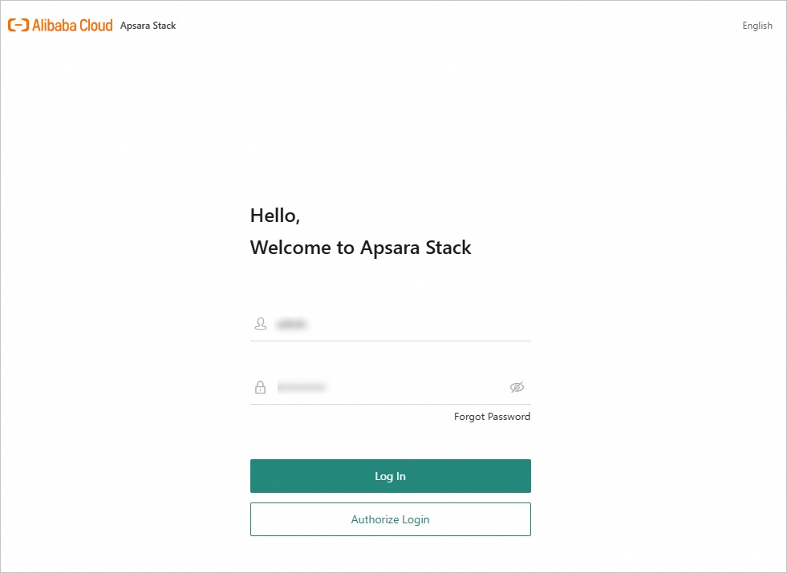

   > **Note**
   >
   > - You can click the current language in the upper-right corner to switch to another language.
   >
   > - The Authorized Login button is displayed only when a global identity provider (IdP) is configured in third-party authentication. You can specify a name for the Authorized Login button.
   >
   > - If you need to click Continue multiple times or cannot find the entry to the Apsara Uni-manager Management Console because the browser certificate has expired or HTTPS authentication is enabled in your environment, you must install a valid certificate. Click **Browser certificate installation** in the upper-right corner to open the browser certificate installation guide.

2. Enter your username and password.

   > **Note**
   >
   > - Obtain the username and password from an operations administrator.
   >
   > - The first time you log in to the Apsara Uni-manager Management Console, you must change the password of your account as prompted. For security purposes, the password must be 10 to 32 characters in length. It must contain all of the following character types: uppercase letters, lowercase letters, digits, and special characters. The following special characters are supported: ! @ # $ %

3. Click **Log On**.

4. If multi-factor authentication (MFA) is enabled for your account, perform the corresponding operations in the following scenarios:

   - **This is your first time logging in to the Apsara Uni-manager Management Console after MFA is enabled by the administrator:**

     <ol type="a">

     <li>

     On the Bind Virtual MFA Device page, follow the instructions to bind an MFA device.

     </li>

     <li>

     Enter the username and password again as in Step 2 and click **Log On**.

     </li>

     </ol>

     <ol type="i" start="100">

     <li>

     Enter the 6-digit MFA verification code and click **Authenticate**.

     </li>

     </ol>

   - **You have enabled MFA and bound an MFA device:**

     Enter the 6-digit MFA verification code and click **Authenticate**.

     > **Note**
     >
     > For more information about how to enable MFA and bind an MFA device, see the **Manage MFA** topic in Apsara Uni-manager Management Console User Guide.

5. In the top navigation bar, choose **Products > Database Services > Relational Database > Cloud-Native Distributed Database PolarDB-X 2.0**.

<a id="section-4"></a>

# 4.Instance management

<a id="section-4-1"></a>

## 4.1. Create an instance

This topic shows you how to create a PolarDB for HTAP instance.

**Procedure**

1. Log on to the PolarDB for HTAP console.

   > **Note**
   >
   > The console provides the following features:
   >
   > : Click to refresh the instance list.
   >
   > 
   >
   > : Click to switch the instance list view between **Default** and **Compact** modes.
   >
   > 
   >
   > : Click to select the instance properties to display in the list.
   >
   > 
   >
   > : Click to export the instance list to a local file.
   >
   > 

2. In the upper-left corner, click **Create New Instance**.

3. On the **Create PolarDB-X 2.0** page, configure the following parameters.

   | Parameter | Description |
   | --- | --- |
   | Organization | Select an organization for the instance. |
   | Resource set | Select a resource set for the instance. |
   | Region | Select the deployment region. |
   | Edition | You can select <strong>Enterprise Edition (Distributed)</strong> or <strong>Standard Edition</strong> <strong>(Standalone)</strong>. |
   | Deployment topology | • Single-AZ: You only need to select a primary availability zone. The standby and log nodes are automatically deployed in the same availability zone.<br>• Dual-AZ: Provides disaster recovery across two data centers in the same city and supports three or four storage node replicas.<br>• Triple-AZ: Nodes are deployed across three availability zones, providing the instance with data center-level disaster recovery. |
   | Deployment mode | • This option is available when <strong>Edition</strong> is set to <strong>Enterprise Edition</strong> <strong>(Distributed)</strong> and <strong>Deployment Topology</strong> is set to <strong>Dual-AZ</strong>:<br>• Primary AZ (Default): The leader nodes are deployed in the primary availability zone.<br>• Balanced Mode: The leader nodes are evenly distributed across the primary and secondary availability zones. This may cause cross-data center application access.<br>Note<br><strong>Balanced Mode</strong> is available for dual-AZ deployments with four storage node replicas or for triple-AZ deployments. It is not supported for dual-AZ deployments with three storage node replicas.<br>• If <strong>Edition</strong> is set to <strong>Enterprise Edition (Distributed)</strong> and <strong>Deployment</strong> <strong>Topology</strong> is set to <strong>Triple-AZ</strong>, only <strong>Balanced Mode</strong> is available.<br>Note<br>This option is configurable only when <strong>Edition</strong> is set to <strong>Enterprise</strong> <strong>Edition (Distributed)</strong>. |
   | Primary AZ | Select the primary availability zone for the instance. |
   | Resource pool | Select a resource pool to view the supported chip architectures. |
   | Chip architecture | You can select <strong>HyGon</strong>, <strong>Kunpeng</strong>, <strong>Phytium</strong>, <strong>Intel</strong>, and more. |
   | Compatibility | You can select <strong>MySQL 5.7</strong> or <strong>MySQL 8.0</strong>. |
   | Sharing type | You can select <strong>General-purpose</strong> or <strong>Dedicated</strong>.<br>• <strong>Dedicated</strong>: Provides dedicated compute resources, such as CPU, to ensure stable performance by preventing resource sharing with other instances.<br>• <strong>General-purpose</strong>: Improves cost-effectiveness by sharing idle compute resources, such as CPU, among instances on the same server. |
   | Compute node specification | Select a specification for the compute nodes.<br>Note<br>This option is configurable only when <strong>Edition</strong> is set to <strong>Enterprise</strong> <strong>Edition (Distributed)</strong>. |
   | Number of compute node groups | Select the number of compute node groups.<br>Note<br>This option is configurable only when <strong>Edition</strong> is set to <strong>Enterprise</strong> <strong>Edition (Distributed)</strong>. |
   | Storage node specification | Select a specification for the storage nodes.<br>Note<br>This option is configurable only when <strong>Edition</strong> is set to <strong>Enterprise</strong> <strong>Edition (Distributed)</strong>. |
   | Number of storage node replicas | Select the number of storage node replicas. The options are:<br>• 3: For a dual-AZ deployment, this option does not guarantee a Recovery Point Objective (RPO) of zero.<br>• 4 (Default): Guarantees an RPO of zero if a single storage node fails.<br>Note<br>This option is configurable only when <strong>Deployment Topology</strong> is set to <strong>Dual-AZ</strong>. |
   | Number of storage node groups | Select the number of storage node groups.<br>Note<br>This option is configurable only when <strong>Edition</strong> is set to <strong>Enterprise</strong> <strong>Edition (Distributed)</strong>. |
   | Instance specification | Select the target instance specification.<br>Note<br>This option is configurable only when <strong>Edition</strong> is set to <strong>Standard Edition</strong> <strong>(Standalone)</strong>. |
   | Number of node groups | The number is fixed at 1.<br>Note<br>This option is configurable only when <strong>Edition</strong> is set to <strong>Standard Edition</strong> <strong>(Standalone)</strong>. |
   | Storage | Select the storage capacity. |
   | Network type | The network type is fixed to <strong>VPC</strong>. |
   | IP type | • <strong>IPv4</strong>: Assigns an IPv4 address. Suitable for IPv4-only environments.<br>• <strong>IPv4/v6 Dual Stack</strong>: Assigns both IPv4 and IPv6 addresses for hybrid networks. After enabling this feature, you must configure an IPv6 whitelist for access control.<br>Note<br>• You must enable the IPv6 switch to configure this option. For more information, see the "Enable the IPv6 switch for PolarDB-X" section in the <strong>Operations Guide</strong>.<br>• If an authorization error is reported, see Authorize Tenant Organizations to Access SLB. |
   | VPC | Select a VPC. |
   | vSwitch | Select a vSwitch. |
   | Parameter template | You can select an existing parameter template. |

4. Review your settings in the **Configuration Overview** panel on the right side of the page.

   If your quota is insufficient, click **Manage** to adjust it. For more information, see the **Quota Management** section in the **Unified Cloud Management Platform User Guide**.

5. Click **Submit**. You are redirected to the console to view the successfully created instance.

<a id="section-4-2"></a>

## 4.2. Change instance specifications

A PolarDB-X instance is a distributed cluster that consists of multiple nodes. Each node provides features such as SQL routing, data merging, and data aggregation. You can change the node specifications for an instance. During peak hours, you can upgrade the specifications to handle high numbers of queries per second (QPS). During off-peak hours, you can downgrade the specifications to reduce resource waste.

**Usage notes**

When you downgrade the specifications of an instance, transient connection interruptions may occur due to disconnections between your application and the instance. Make sure that your application can automatically reconnect to your instance.

**Procedure**

1. Log on to the PolarDB for HTAP console.

   > **Note**
   >
   > The console provides the following features:
   >
   > : Click to refresh the instance list.
   >
   > 
   >
   > : Click to switch the instance list view between **Default** and **Compact** modes.
   >
   > 
   >
   > : Click to select the instance properties to display in the list.
   >
   > 
   >
   > : Click to export the instance list to a local file.
   >
   > 

2. On the Instance List page, find the instance that you want to manage and click **Change configuration** in the **Operation** column.

   > **Note**
   >
   > You can also click the ID of the instance to go to the **Basic Information** page. In the upper-right corner of the **Configuration Information** section, click **Change Specifications**.

3. On the **Change Specifications** page, configure the node specifications, storage space, share type, and configuration change time.

   > **Note**
   >
   > - After you submit the change, the compute nodes and storage nodes of the instance are upgraded or downgraded to the same node specifications.
   >
   > - You can select **Immediately change configuration** or **O&M time configuration change** for the Configuration change time parameter. For more information about how to set the O&M time, see Set a maintenance window.

4. Click **Submit** to complete the specification change.

<a id="section-4-3"></a>

## 4.3. Add or remove nodes

A PolarDB-X instance is a distributed cluster that consists of multiple nodes. This topic describes how to scale out or in a PolarDB-X instance by adding or removing nodes.

**Procedure**

1. Log on to the PolarDB for HTAP console.

   > **Note**
   >
   > The console provides the following features:
   >
   > : Click to refresh the instance list.
   >
   > 
   >
   > : Click to switch the instance list view between **Default** and **Compact** modes.
   >
   > 
   >
   > : Click to select the instance properties to display in the list.
   >
   > 
   >
   > : Click to export the instance list to a local file.
   >
   > 

2. On the Instance List page, find the instance that you want to manage and click **Add nodes** or **Delete nodes** in the **Operation** column.

3. On the page that appears, specify the number of nodes.

4. Click **Activate Now**.

   After the operation is successful, you can view the post-change status of the instance in the console.

<a id="section-4-4"></a>

## 4.4. Release an instance and manage release protection

This topic describes how to release a PolarDB-X instance and manage its release protection.

**Release an instance**

1. Log on to the PolarDB for HTAP console.

   > **Note**
   >
   > The console provides the following features:
   >
   > : Click to refresh the instance list.
   >
   > 
   >
   > : Click to switch the instance list view between **Default** and **Compact** modes.
   >
   > 
   >
   > : Click to select the instance properties to display in the list.
   >
   > 
   >
   > : Click to export the instance list to a local file.
   >
   > 

2. Click the name of the desired instance.

3. On the **basic information** page, click **Release Instance**.

   > **Warning**
   >
   > This action is irreversible. After the release process begins, the instance becomes unavailable and cannot be recovered. Proceed with caution.

4. On the Release Instance page, click **Release**.

   If release protection is enabled for the instance, the operation fails. You must first disable release protection. For instructions, see Manage release protection.

**Manage release protection**

1. Log on to the PolarDB for HTAP console.

   > **Note**
   >
   > The console provides the following features:
   >
   > : Click to refresh the instance list.
   >
   > 
   >
   > : Click to switch the instance list view between **Default** and **Compact** modes.
   >
   > 
   >
   > : Click to select the instance properties to display in the list.
   >
   > 
   >
   > : Click to export the instance list to a local file.
   >
   > 

2. Click the name of the desired instance.

3. On the **basic information** page, click **Modify Instance Release Protection**.

4. In the dialog box that appears, select **Enable**.

5. Click **Confirm**.

<a id="section-4-5"></a>

## 4.5. Restart a PolarDB-X cluster or a node

If the number of connections to a PolarDB-X cluster reaches the upper limit or the cluster encounters performance issues, you can manually restart the cluster in the console. You can also restart a specific node if your cluster is of Enterprise Edition.

**Procedure**

1. Log on to the PolarDB for HTAP console.

   > **Note**
   >
   > The console provides the following features:
   >
   > : Click to refresh the instance list.
   >
   > 
   >
   > : Click to switch the instance list view between **Default** and **Compact** modes.
   >
   > 
   >
   > : Click to select the instance properties to display in the list.
   >
   > 
   >
   > : Click to export the instance list to a local file.
   >
   > 

2. Find the cluster that you want to manage and click its name.

3. On the **Basic Information** page, restart the cluster or the desired node.

   - Restart the cluster

     In the upper-right corner of the page, click **Restart Instance**.

     > **Warning**
     >
     > This operation disconnects the cluster from your application. Make sure that your business is not interrupted before you perform this operation.

   - Restart a node

     In the **Compute NodeList** section, click **Restart Node** in the **Actions** column of the desired node.

- In the message that appears, click **Determine** to restart the cluster or node.

<a id="section-4-6"></a>

## 4.6. Upgrade the kernel version

You can manually upgrade the kernel version of your PolarDB for HTAP instances. Although the console automatically checks for new versions when you log on, it does not apply upgrades automatically. You can initiate an upgrade from the Basic Information page of your instance. An upgrade may include performance enhancements, new features, or bug fixes.

**Considerations**

- Upgrading the kernel version restarts the instance, causing a transient disconnection of about 30 seconds. We recommend performing this upgrade during off-peak hours and ensuring that your application has an automatic reconnection mechanism. If it does not, you will need to manually reconnect your application to the database.

- After you upgrade the kernel version, you cannot downgrade it.

- If a primary instance has read-only instances, they are upgraded along with the primary instance.

**Procedure**

1. Log on to the PolarDB for HTAP console.

2. On the **Instance List** page, click the ID of the target instance to open the **Basic Information** page.

3. In the **Configuration Information** section, click **Upgrade Kernel Version**.

   > **Note**
   >
   > If this button is unavailable (grayed out), it means the kernel is already at the latest version.

4. In the dialog box that appears, select a **Target Version** (optional), set the **Upgrade Time**, **Canary Batches**, and **Canary Interval (Hours)**, and then click **OK**.

   > **Important**
   >
   > If you do not select a target version, the instance is upgraded to the latest kernel version by default.

<a id="section-4-7"></a>

## 4.7. Add read-only instances

This topic describes how to create a read-only PolarDB-X instance for a primary PolarDB-X instance.

**Background information**

An X-Paxos-based architecture is used for the data nodes of a primary PolarDB-X instance. This architecture uses a three-replica mechanism to ensure high availability. Learners are added to the data nodes of a read-only PolarDB-X instance to ensure physical resource isolation. In addition, strong consistency in read-only queries are ensured based on Timestamp Oracle (TSO).

**Usage notes**

- A primary instance and the read-only instances that are associated with the primary instance must be deployed in the same region and can be deployed in different zones within the region.

- A read-only PolarDB-X instance must be associated with a primary PolarDB-X instance. If you create a database in the primary instance, the database is replicated to each read-only instance that is associated with the primary instance. If you delete a database in the primary instance, the replicated database in each read-only instance that is associated with the primary instance is also deleted.

**Procedure**

1. Log on to the PolarDB for HTAP console.

   > **Note**
   >
   > The console provides the following features:
   >
   > : Click to refresh the instance list.
   >
   > 
   >
   > : Click to switch the instance list view between **Default** and **Compact** modes.
   >
   > 
   >
   > : Click to select the instance properties to display in the list.
   >
   > 
   >
   > : Click to export the instance list to a local file.
   >
   > 

2. On the Instance List page, find the instance that you want to manage and click **Read-only instance** in the **Operation** column.

   Alternatively, you can click the instance name to go to the instance details page. In the **Read-only instance** section on the right side of the page, click **Create Read-only Instance**.

3. On the **Create Read-only Instance** page, configure the parameters based on your requirements. The following table describes the parameters.

   **Parameter**

   **Parameter**

   **Description**

   **category**

   Regions and

   The resource pool of the instance. The system displays the

   Resource Pool

   zones

   supported CPUs in the selected resource pool.

   The deployment mode. You can select **Single Zone**, **Dual-**

   Deployment

   **Zone**, or **Three-Zone**.

   The database engine that the read-only instance is

   Compatibility

   compatible with. Valid values: MySQL 5.7 and MySQL 8.0.

   Instance Family

   Valid values: General-purpose and Dedicated.

   Select the number of CPU cores and the size of memory

   CN Node Spec

   for compute nodes.

   The number of compute nodes. The minimum number of

   Specification

   CN Nodes

   compute nodes is 2.

   Settings

   Select the number of CPU cores and the size of memory

   DN Node Spec

   for data nodes.

   The number of data nodes. The minimum number of data

   DN Nodes

   nodes is 2.

   The storage capacity. The minimum storage capacity is 50

   Storage Capacity

   GB.

   VPC

   The virtual private cloud (VPC).

   Network settings

   VSwitch

   The vSwitch.

4. Click **Buy Now**. You can go to the PolarDB-X console to view the new instance.

<a id="section-4-8"></a>

## 4.8. Manage tags

To efficiently categorize and search for instances when a large number of instances exist, you can create and add tags to the instances.

**Add a tag**

1. Log in to the PolarDB Converged Edition (Centralized & Distributed) console.

2. In the left-side navigation pane, click **Instances**.

3. On the **Instances** page, find the instance to which you want to add a tag and click the

   

   icon in the **Tag** column.

4. In the **Edit Tag** dialog box, specify values for the **Tag Key** and **Tag Value** parameters.

5. Click **OK**. The tag is added to the instance<strong>.</strong>

**Add tags to multiple instances at the same time**

1. Log in to the PolarDB Converged Edition (Centralized & Distributed) console.

2. In the left-side navigation pane, click **Instances**. On the page that appears, click the

   

   icon in the **Tag** column **of an instance.**

3. In the **Edit Tags** dialog box, click **Tab Management** to go to the **Tags** page<strong>.</strong>

4. In the **Tag Key** section, click **+Create/Select Tags & Add to Resources**, and then specify values for the **Tag Key** and **Tag Value** parameters. You can click Add to add more tags based on your business requirements.

5. Click **Next**. Then, select the organization and resource set to which the resources belong, the region where the resources are located, the cloud products, and the instances to which you want to add the instances.

6. Click **Next** and then click **OK** to add tags to multiple instances at the same time<strong>.</strong>

**Search for an instance by tag**

1. Log in to the PolarDB Converged Edition (Centralized & Distributed) console.

2. In the left-side navigation pane, click **Instances**.

3. Click **Advanced Filter**.

4. In the **Filter by Tag** text box, enter the tag key or tag value<strong>.</strong>

5. Click **Search.**

**View the tags that are added to an instance**

1. Log in to the PolarDB Converged Edition (Centralized & Distributed) console.

2. In the left-side navigation pane, click **Instances**.

3. On the **Instances** page, you can view the tags in the Tags column.

> **Note**
>
> If  is displayed in the Tags column, move the pointer over it to view all tags added to
>
> the instance.

**Remove a tag**

1. Log in to the PolarDB Converged Edition (Centralized & Distributed) console.

2. In the left-side navigation pane, click **Instances**.

3. On the **Instances** page, move the pointer over the

   icon in the **Tag** column.

   

4. In the **Edit Tag** dialog box, find the tag that you want to delete and click the

   icon.

   

5. Click OK.

<a id="section-4-9"></a>

## 4.9. Manage binary logs

Change data capture (CDC) nodes of PolarDB-X provide the incremental subscription capability, which is compatible with the format and protocol of MySQL binary logs. CDC nodes also provide the primary/secondary replication capability, which is compatible with the MySQL replication protocol. This topic describes how to manage binary logs on the log engine page in the PolarDB-X console. You can perform the following operations in the PolarDB-X console: view the details of an instance, activate binary logging in multi-stream mode, upgrade an instance, change instance configurations, and release an instance.

**Procedure**

1. Log in to the PolarDB-X 2.0 console.

2. In the left-side navigation pane, click **Instances**.

3. On the **List Page** page, find the instance that you want to manage and click its ID to go to the instance details page.

4. In the left-side navigation pane, choose **Configuration Management > Log Engine**.

   On the page that appears, perform the following operations:

   - View the details of an instance

     The Configuration Information section displays some key information about the logging feature, and the Clusters section displays all instances for which the logging feature is enabled. Each instance can contain multiple nodes. You can enable the feature for all nodes in each instance in the single- or multi-stream mode.

     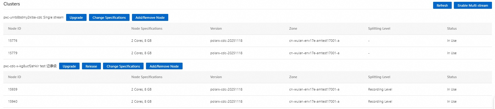

   - Upgrade an instance

     Find the instance that you want to upgrade and click **Upgrade**. In the dialog box that appears, select the version to which you want to update and click **OK**.

     > **Important**
     >
     > - In the node list, you can view the version of a CDC node in the **Version** column. An upgrade may interrupt the subscription to binary logs.
     >
     > - When you select a destination version, we recommend that you select the latest version, which is also the version displayed by default.

   - Release an instance

     Find the instance that you want to release and click **Release**. In the message that appears, click **OK**. Wait for the release task to complete.

     > **Important**
     >
     > Instances that store a single stream of binary logs cannot be released.

   - Change instance configurations

     Find the instance that you want to modify and click **Change Specifications**. In the dialog box that appears, modify the parameters click **OK**. Wait for the specification change task to complete.

     > **Important**
     >
     > This operation may interrupt the subscription to binary logs.

   - Enable binary logging in multi-stream mode

     PolarDB-X allows you to enable binary logging in multi-stream mode in scenarios of large-scale instances and high concurrency. You can enable this feature in the console.

     Click **Enable Multi-stream**. In the dialog box that appears, configure the parameters and click **OK**. The following table describes the parameters.

     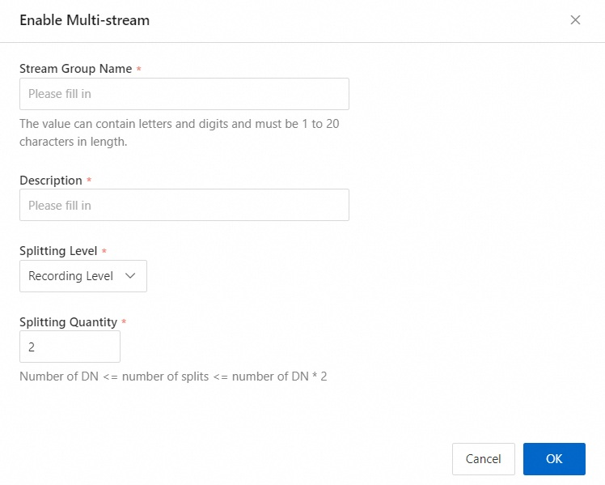

     | Parameter | Description |
     | --- | --- |
     | Description | The description of the instance. This clarifies the usage of the instance and facilitates subsequent management. |
     | Stream Group Name | The name of the group to which the multiple log streams belong. |
     | Splitting Quantity | The number of log streams that you want to split into. Valid values: 2 to twice the number of data nodes. We recommend that you set this parameter to the number of data nodes. |
     | Splitting Level | The splitting level. You can select Recording Level, Database Level, or Table Level to split binary logs into multiple streams based on a hash function. |

<a id="section-4-10"></a>

## 4.10. Columnar engine

This topic describes how to manage columnar nodes.

**Usage notes**

- The columnar engine feature is supported only for Enterprise Edition.

- The version of the PolarDB-X instance must be 5.4.19-16989811 or later.

**Manage columnar nodes**

1. Log in to the PolarDB Converged Edition (Centralized & Distributed) console.

2. In the left-side navigation pane, click **Instance List**.

3. On the **Instance List** page, click the ID of the instance that you want to manage.

4. In the left-side navigation pane, click **Column Storage Engine**. On the page that appears, you can perform the following operations:

   - Upgrade

     In the upper-right corner of the page, click Column storage engine upgrade. In the dialog box that appears, select the version to which you want to upgrade the current version and click OK.

     > **Important**
     >
     > In the instance list, the version column displays the version of columnar nodes in the current instance. Version upgrades cause service interruption during Clustered Columnar Index (CCI) synchronization and synchronization latency for several tens of seconds.

     When you select a destination version, we recommend that you select the latest version, which is also the version displayed by default.

   - Change configuration

     In the upper-right corner of the page, click Change configuration, select an instance type, and then click OK. Wait until the task is complete.

     > **Important**
     >
     > Configuration changes cause service interruption during CCI synchronization and therefore result in a synchronization latency of several tens of seconds.

**Add a read-only column store instance**

1. Log in to the PolarDB Converged Edition (Centralized & Distributed) console.

2. In the left-side navigation pane, click **Instance List**.

3. On the **Instance List** page, click the ID of the instance that you want to manage.

4. On the Basic Information page, click **Add Read-only Column Store Instance** on the right side of the page and configure the following parameters.

   **Section**

   **Parameter**

   **Description**

   Region

   Resource Pool

   The resource pool of the instance.

   Deployment

   The deployment mode. Valid values: **Single-Zone**, **Dual-**

   Method

   **Zone**, or **Three-Zone Deployment**.

   The compatible database engine. The value is fixed and

   Compatibility

   cannot be changed.

   Instance Type

   Shared Type

   Valid values: **Dedicated** and **General-Purpose**.

   Configuration

   Compute-

   Select the number of CPU cores and the size of memory

   Optimized

   for compute nodes.

   Instance Family

   Number of

   The number of compute nodes. The minimum number of

   Compute Nodes

   compute nodes is 2.

   Storage Node

   Select the number of CPU cores and the size of memory

   Specification

   for data nodes.

   The network type of the instance. The value of this

   Network Type

   parameter is automatically set to **VPC** and cannot be changed.

   Network Configuration

   VPC

   The virtual private cloud (VPC).

   VSwitch

   The vSwitch.

5. Click **Submit**.

<a id="section-4-11"></a>

## 4.11. Upgrade an instance from Standard Edition to Enterprise Edition

This topic describes how to upgrade an instance from Standard Edition to Enterprise Edition.

> **Important**
>
> If Secure Sockets Layer (SSL) is enabled before the upgrade, you must re-enable SSL in the Apsara Uni-manager Management Console after the upgrade.

**Prerequisites**

- For Standard Edition instances of PolarDB Converged Edition (Centralized & Distributed), the instance version must be upgraded to the latest kernel version.

- If a Standard Edition instance of PolarDB Converged Edition (Centralized & Distributed) has a public endpoint, you must apply for and then release the public endpoint.

- During the upgrade, the specifications of storage nodes of Enterprise Edition must be consistent with the specifications of Standard Edition. You must upgrade the specifications of the Standard Edition instance before you can upgrade the storage node specifications of the Enterprise Edition instance.

**Perform a check before an upgrade**

1. Log in to the PolarDB Converged Edition (Centralized & Distributed) console.

2. In the top navigation bar, select the region where the instance is deployed.

3. **On the Instance List page, click the ID of the instance that you want to manage.**

4. In the **Common Operations** section, click **Upgrade to the Enterprise Edition**.

5. Perform a precheck before the upgrade. A temporary instance of Enterprise Edition is created in the background. The temporary instance and the Standard Edition instance use the same storage node. Click **Start checking**. The following items are checked.

   | Check item | Description | Criterion |
   | --- | --- | --- |
   | Account | Checks whether the accounts can be imported. | The database accounts of the Standard Edition instance can be imported to the temporary Enterprise Edition instance. |
   | Whitelist | Checks whether the whitelists can be imported. | The whitelists of the Standard Edition instance can be imported to the temporary Enterprise Edition instance. |
   | XA transaction | Checks whether eXtended Architecture (XA) transactions exist. | An Enterprise Edition instance does not support XA transaction-related statements. The XA RECOVER statement is sent to the Standard Edition instance. |
   | Number of databases | Checks whether the number of databases exceeds the limit of the Enterprise Edition instance. | The number of databases on the Standard Edition instance does not exceed the logical database limit of the Enterprise Edition instance. If this check item fails, contact technical support. |
   | Stored procedure or custom function | Checks whether user-defined stored procedures or custom functions exist. | No user-defined stored procedures or custom functions exist. |
   | Connection address | Checks whether only one endpoint exists. | Only one virtual private cloud (VPC) endpoint exists. |
   | Read-only instance | Checks whether read-only instances exist. | No read-only instances exist. |
   | Isolation Level | Checks whether the isolation level is supported by Enterprise Edition. | The isolation level is supported by Enterprise Edition. |

6. Click **OK**. Then, PolarDB Converged Edition (Centralized & Distributed) initiates a check task for the upgrade of the instance from Standard Edition to Enterprise Edition. You can click **Tasks** in the upper-right corner to view the task progress.

   After the check task is complete, view the check results in the **Upgrade to the Enterprise Edition** dialog box.

**Upgrade the instance to Enterprise Edition**

**Procedure**

1. In the **Upgrade to the Enterprise Edition** dialog box, click **Start upgrading**.

2. On the Upgrade to Enterprise Edition page, select the specifications and number of compute nodes.

3. Click **Submit**.

4. On the Basic Information page of the instance, click the 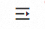 icon in the upper-right corner

   to open the task list and view the task progress.

5. The instance edition is changed to Enterprise Edition on the instance list page a few minutes after the upgrade is complete. Click the instance ID to go to the management page of the Enterprise Edition instance.

<a id="section-4-12"></a>

## 4.12. Migrate network zones

**Prerequisites**

- The instance is in the Running state and no other O&M tasks such as scaling and configuration changes are in progress.

- The primary node and the network device are not located in the same zone. For example, the vSwitch is in Zone A and the primary node is in Zone B.

- A vSwitch is created in the destination zone in advance so that it can be selected during a switchover.

- The instance is a Standard Edition (Centralized) instance deployed with four replicas across dual zones.

**Procedure**

1. Log in to the PolarDB Converged Edition (Centralized & Distributed) console.

2. In the left-side navigation pane, click **Instance List**.

3. On the **Instance List** page, find the instance that you want to manage and click its ID to go to the instance details page.

4. In the left-side navigation pane, choose **Configuration Management > Basic Information**.

5. In the Common Operations section, click **Migrate network zones**.

6. In the dialog box that appears, configure the **VSwitch after switching** parameter and specify **Switching time**.

7. Click **OK**.

   In the instance list, you can view that the instance is in the **Modifying a network connection** state. After the instance changes to the **Running** state, the operation is complete.

<a id="section-4-13"></a>

## 4.13. Perform a canary upgrade on a single data node

You can upgrade the kernel version of a single data node in an Enterprise Edition instance of PolarDB Converged Edition (Centralized & Distributed). A canary upgrade ensures high availability and data security of your business during the upgrade process, enabling a smooth transition.

**Prerequisites**

- The instance is in the Running state, and no other O&M tasks, such as scaling and configuration changes, are in progress.

- Only Enterprise Edition (Distributed) instances support this feature.

- All replicas (primary, secondary, and log) on the data node that you want to manage are healthy without delayed alerts.

**Terms**

| Term | Description |
| --- | --- |
| DN | The data node, which stores actual data. |
| Leader | The primary replica, which processes read and write requests. |
| Follower | The secondary replica, which synchronizes data from the primary replica for disaster recovery or read-only operations. |
| Logger | The log replica, which records logs to ensure data consistency. |

**Procedure**

**Step 1: Perform a canary upgrade on a single replica**

1. Log in to the PolarDB Converged Edition (Centralized & Distributed) console.

2. In the left-side navigation pane, click **Instance List**.

3. On the **Instance List** page, find the instance that you want to manage and click its ID to go to the instance details page.

4. In the left-side navigation pane, choose **Configuration Management > Basic Information**.

5. In the data node list, find the data node that you want to manage and click **Single-replica upgrade** in the Actions column.

6. In the message that appears, click **OK**.

   The system automatically selects a secondary replica on the data node and rebuilds it with the new kernel version. The primary and log replicas remain at the earlier version, and only the secondary replica is upgraded to the later version. At this time, business traffic is still routed to the primary replica of the earlier version, ensuring zero impact on service operations.

**Step 2: Verify the business**

Verify that data synchronization on the secondary replica of the later version works properly and the secondary replica remains compatible with current workloads.

1. You can direct a small amount of test traffic to this secondary replica of the later version by using a read-only endpoint or other methods, or check its synchronization status in the backend.

2. Monitor the latency, error logs, and resource usage of the secondary replica.

3. Perform the following operations based on the verification results:

   - If the verification fails, perform a rollback. For more information, see Step 3: Roll back a single replica.

   - If the verification succeeds, proceed with the upgrade. For more information, see Step 4: Perform a full upgrade on the single data node.

**Step 3: Roll back a single replica**

1. Log in to the PolarDB Converged Edition (Centralized & Distributed) console.

2. In the left-side navigation pane, click **Instance List**.

3. On the **Instance List** page, find the instance that you want to manage and click its ID to go to the instance details page.

4. In the left-side navigation pane, choose **Configuration Management > Basic Information**.

5. In the data node list, find the data node that you want to manage and click **Single-replica upgrade rollback** in the Actions column.

6. In the message that appears, click **OK**.

   All replicas (primary, secondary, and log) on the data node are restored to the earlier version before the upgrade. After troubleshooting, you can re-initiate an upgrade process.

**Step 4: Perform a full upgrade on the single data node**

1. Log in to the PolarDB Converged Edition (Centralized & Distributed) console.

2. In the left-side navigation pane, click **Instance List**.

3. On the **Instance List** page, find the instance that you want to manage and click its ID to go to the instance details page.

4. In the left-side navigation pane, choose **Configuration Management > Basic Information**.

5. In the data node list, find the data node that you want to manage and click **Single-replica upgrade continues** in the Actions column.

6. In the message that appears, click **OK**.

   The three replicas (primary, standby, and log) on the data node are all upgraded to the new kernel version.

<a id="section-4-14"></a>

## 4.14. Quick data rollback

Quick data rollback is a data protection feature provided by Standard Edition instances of PolarDB Converged Edition (Centralized & Distributed). After business verification, such as DDL changes or data writes, this feature enables you to rapidly roll back data to the status before the verification.

**Core features**

- **Stop replica synchronization**: Before business verification, this feature stops data synchronization between the follower (secondary replica) nodes and the leader (primary replica) node on all data nodes, so that the follower node retains a data snapshot from before the verification.

- **Restore replica synchronization**: After successful business verification, this feature resumes data synchronization between the follower and leader nodes to restore the instance to normal operation.

- **Force single-replica startup**: If business verification fails, this feature forcibly promotes a follower node to the leader role, and rebuilds the remaining replicas based on this new leader, thereby quickly rolling back data to the status before verification.

**Applicable scenarios**

- Data protection prior to major version upgrades or changes

- Security verification before DDL operations, such as adding columns and modifying table schemas

- Risk isolation before batch data writes

- Business release windows that require rapid rollback capabilities

**Usage notes**

- **Read-only instances**: If read-only instances are attached to the primary instance, after replica synchronization is stopped, the follower nodes corresponding to the read-only instances remain unaffected and continue to maintain synchronization.

- **Force single-replica startup is an irreversible operation**: Once executed, the data on the original leader node will be discarded, and the remaining replicas will be rebuilt based on the new leader.

- Before you stop replica synchronization, ensure that necessary data backups have been completed.

**Stop replica synchronization**

This section describes how to stop data synchronization between the follower nodes and leader node of data nodes before business verification.

**Prerequisites**

- The instance is a Standard Edition (Centralized) instance.

- The instance is in the Running state.

**Procedure**

1. Log in to the PolarDB Converged Edition (Centralized & Distributed) console.

2. In the left-side navigation pane, click **Instance List**.

3. On the **Instance List** page, find the instance that you want to manage and click its ID.

4. In the left-side navigation pane, choose **Configuration Management > Basic Information**.

5. In the data node list, click **Disconnect replica synchronization**.

6. In the message that appears, click **OK**. Wait until the task is complete.

7. Verify the result:

   - Check the data node list and verify that the follower nodes have been disconnected from data synchronization with the leader node.

   - Confirm that the instance status has changed to Copy is being maintained.

**Restore replica synchronization**

This section describes how to resume data synchronization between the follower nodes and leader node after business verification.

**Prerequisites**

- The instance is in the Copy is being maintained state (the Disconnect replica synchronization operation has been performed).

- The business verification result is normal. Confirm that the data changes after verification need to be retained.

**Procedure**

1. Log in to the PolarDB Converged Edition (Centralized & Distributed) console.

2. In the left-side navigation pane, click **Instance List**.

3. On the **Instance List** page, find the instance that you want to manage and click its ID.

4. In the left-side navigation pane, choose **Configuration Management > Basic Information**.

5. In the data node list, click **Restore replica synchronization**. Wait until the task is complete.

6. Verify the result:

   - View the data node list and confirm that the replica synchronization has been restored.

   - The instance is in the Running state.

**Force single-replica startup**

This section describes how to roll back data to the status before business verification by forcibly start a single replica after business verification fails.

**Prerequisites**

- The instance is in the Copy is being maintained state (the Disconnect replica synchronization operation has been performed).

- Business verification fails, and data rollback is required.

**Procedure**

1. Log in to the PolarDB Converged Edition (Centralized & Distributed) console.

2. In the left-side navigation pane, click **Instance List**.

3. On the **Instance List** page, find the instance that you want to manage and click its ID.

4. In the left-side navigation pane, choose **Configuration Management > Basic Information**.

5. In the data node list, click **Force single-replica startup**. Wait until the task is complete.

6. Verify the rollback result:

   - View the data node list and confirm that the original follower node has been promoted to the leader node.

   - Confirm that the remaining replicas have been re-built based on the new leader.

   - Log in to the primary instance to query data and confirm that the data has been restored to the status before replica synchronization is stopped.

<a id="section-5"></a>

# 5.PolarDB AI

<a id="section-5-1"></a>

## 5.1. Intelligent Assistant

The PolarDB-X 2.0 Intelligent Assistant is an intelligent operations and maintenance (O&M) assistance tool for PolarDB-X (also known as PolarDB-X). Based on large language models (LLMs) and an expert knowledge base for distributed databases, the assistant integrates capabilities such as instance detail query, intelligent Q&A, and intelligent diagnosis. It supports natural language interaction, has a deep understanding of the distributed architecture of PolarDB-X, performs root cause diagnosis for multi-node performance issues, and provides optimization suggestions.

**Notes**

- **Ask precise questions**: For an accurate diagnosis, specify the instance ID, region, time range, and a description of the issue in your question. In distributed scenarios, you can specify a DN node or database name for a more precise analysis.

- **Contextual conversation**: The Intelligent Assistant supports multi-turn conversations, letting you ask follow-up questions based on previous diagnostic results. However, always carefully evaluate recommendations before you implement them, especially for sensitive operations such as suggested changes to a sharding rule.

- **Timeliness of diagnostics**: Performance diagnostics depend on monitoring data. Initiate an analysis as soon as possible after an issue occurs to ensure that the relevant metrics are still within their retention period.

- **Session issues**: If the session becomes unresponsive, exit the session and ask your question again.

- **Cautious decision-making**: All optimization recommendations are for reference only. You must thoroughly test and evaluate changes, especially those affecting the distributed architecture, before implementation.

**Accessing the Intelligent Assistant**

You can access the chat interface in the following ways:

- Log on to the PolarDB-X console, and in the left-side navigation pane, select **AI Assistant** to open the chat interface.

- On the **ApsaraDB for PolarDB-X 2.0** page, click the

  icon in the far-right sidebar to

  open the chat interface.

**Intelligent Assistant capabilities**

The PolarDB-X Intelligent Assistant offers expertise in the following areas to provide comprehensive support for O&M scenarios, from querying instance information to optimizing performance:

| Area of expertise | Core capability | Description |
| --- | --- | --- |
| Instance O&amp;M | Full-stack health inspection | Performs comprehensive health checks, from basic configuration to topology, to proactively identify potential issues and generate optimization recommendations. |
| Performance diagnostics | Instance performance diagnostics | Analyzes CPU, memory, and distributed architecture bottlenecks in depth to identify the root cause of resource anomalies in real time and ensure system stability. |
| SQL optimization | SQL diagnostics and optimization | Intelligently identifies slow SQL queries, analyzes execution plans, and provides recommendations for indexing and query rewriting to improve query efficiency. |
| Sessions and locks | Session and lock troubleshooting | Quickly identifies abnormally long-running sessions and deadlock chains to resolve blocking issues and restore smooth operation. |
| Security audit | Security risk audit | Scans permission assignments, account risks, and sensitive operations to ensure that database access is compliant and traceable. |
| Knowledge retrieval | Knowledge base Q&amp;A | Retrieves product documentation and best practices through natural language interaction to provide instant answers to O&amp;M and usage questions. |
| Instance information | Instance asset query | Lets you query instance specifications, account lists, task progress, and runtime parameters from a single interface for transparent asset management. |

**Security and compliance**

- **Scope of data access**: To provide accurate diagnostics and answers, the PolarDB-X 2.0 Intelligent Assistant accesses instance metadata, topology information, performance monitoring metrics, key information from the slow log, and the questions you enter. The Intelligent Assistant does not execute any DDL or DML statements, nor does it directly modify instance configurations or trigger data migration.

- **Data privacy**: Alibaba Cloud handles your query history and instance data in strict accordance with our privacy policy. We do not use this data for model training or share it with any third parties.

- **Disclaimer**: The diagnostic conclusions and optimization recommendations provided by the Intelligent Assistant are for reference only. Before you apply any changes in a production environment, especially distributed operations that involve adjustments to sharding rules or global indexes, a qualified technical professional must review and evaluate them.

<a id="section-5-2"></a>

## 5.2. Intelligent migration

<a id="section-5-2-1"></a>

### 5.2.1. Intelligent migration guide

Intelligent One-Click Migration of PolarDB is a one-stop database migration platform built on DTS capabilities. It provides an end-to-end visual guided workflow that covers scenario selection, prechecks, task configuration, and endpoint switching. Through automated configuration and seamless switchover, it enables transparent application migration with zero downtime. In addition, the integrated AI Migration Assistant supports intelligent Q&A, log diagnostics, and optimization recommendations, significantly improving both migration efficiency and success rates.

**Overview**

PolarDB Intelligent One-Click Migration is an end-to-end, user-friendly, and intelligent database migration solution designed for enterprises. This feature integrates operations previously scattered across multiple consoles into a unified PolarDB console, enabling you to complete the entire process from instance preparation to service cutover without switching between consoles.

**Core features**

| Category | Feature description |
| --- | --- |
| End-to end visualization | Four-step guided workflow with clear status visibility and closed-loop operation management. |
| Automated configuration | Automatically matches Data Transmission Service (DTS) links and creates migration tasks based on migration scenarios, minimizing manual intervention. |
| Transparent application switchover | Supports one-click switching of database endpoints without service interruption. |
| AI-powered assistance | Features a built-in AI Migration Assistant that provides real-time Q&amp;A, log analysis, and fixing suggestions. |

**Supported migration scenarios**

The following migration paths are supported. The system automatically loads the corresponding operation plans and check items based on the selected scenario to ensure compliant and efficient migration.

| Migration path classification | Supported migration path |
| --- | --- |
| MySQL engine migration | • From ApsaraDB RDS for MySQL to PolarDB for MySQL Primary/Secondary Edition<br>• From ApsaraDB RDS for MySQL to PolarDB for MySQL Cluster Edition<br>• From PolarDB for MySQL Primary/Secondary Edition 5.7 to PolarDB for MySQL Primary/Secondary Edition 8.0<br>• From PolarDB for MySQL Primary/Secondary Edition to PolarDB for MySQL Cluster Edition<br>• From PolarDB for MySQL Cluster Edition to PolarDB for MySQL Cluster Edition |
| PostgreSQL engine migration | • From ApsaraDB RDS for PostgreSQL to PolarDB for PostgreSQL Primary/Secondary Edition<br>• From PolarDB for PostgreSQL Primary/Secondary Edition to PolarDB for PostgreSQL Primary/Secondary Edition |
| PolarDB-X engine migration | • From ApsaraDB RDS for MySQL to PolarDB-X 2.0<br>• From PolarDB-X 2.0 to PolarDB-X 2.0 |

**Process**

Intelligent one-click migration adopts a linear four-step guided workflow, which allows you to complete all migration operations on a single page.

**Step 1: Select a migration scenario**

1. Log in to the PolarDB console.

2. In the left-side navigation pane, choose **AI Capabilities > Intelligent Migration**. On the page that appears, select the type of the source database and the type of the destination PolarDB instance.

**Benefits**

- The system automatically identifies migration requirements and pre-populates the parameters required for subsequent steps.

- The system recommends optimal DTS links and synchronization policies.

- This significantly reduces configuration overhead and prevents manual selection errors.

**Step 2: Perform a precheck**

Click **Check it out**. You are redirected to the official migration guide based on your selected scenario. There, you will find detailed step-by-step instructions and a pre-migration checklist, covering items such as whether Binlog is enabled and properly formatted on the source database, and whether security groups and whitelists are correctly configured to allow communication.

**Benefits**

- Check items are tightly coupled with specific scenarios to prevent omissions.

- Quick access to official documentation significantly accelerates troubleshooting.

**Step 3: Create a DTS data migration task**

After you confirm that the precheck is complete, click **To migrate**. The DTS migration task configuration page appears. You need to only specify key information as specified in Step 2 to build a migration path.

**Benefits**

- You do not need to go to the DTS console. All task statuses are displayed on this page.

- Configuration time is significantly reduced, accelerating task startup.

- Real-time alerts for task exceptions facilitate timely intervention.

**Step 4: View the migration results and change the database endpoints**

When the incremental synchronization latency approaches zero and no errors are reported, you can proceed to change the endpoint configured in your application.

> **Note**
>
> We recommend that the endpoint switching be performed during off-peak hours and the reconnection mechanism of your application be verified in advance.

1. On the **Database migration results** tab, confirm that the migration status is normal and then click **Migrate Endpoint** in the Operation column.

   In the result list, you can view the details of the task, such as the creation time, running status, the number of rows in the source when the task starts, and the number of rows in the destination when the task ends.

   > **Note**
   >
   > Once the task starts, if the source data changes, data inconsistency occurs between the source and destination after the task is complete.

2. On the tab that appears, confirm the information about the source and destination databases and click **Switch Endpoint**.

**Benefits**

- Seamless application migration is implemented with zero downtime.

- The switchover process can be traced and rolled back with high security.

<a id="section-5-2-2"></a>

### 5.2.2. AI Migration Assistant

AI Migration Assistant is an intelligent tool that supports the one-click migration platform. It uses the Data Transmission Service (DTS) Model Context Protocol (MCP) to provide natural language Q&A, task status queries, and diagnostic capabilities. This helps you resolve issues related to migration path queries, configuration guidance, and error handling during the migration process.

**Features**

AI Migration Assistant is integrated into the Intelligent Migration page of the PolarDB console. It understands your questions and automatically retrieves data and logs from the DTS backend to provide accurate migration support. You can obtain real-time, actionable solutions without leaving the page. Key features include the following:

- Intent recognition: Supports natural language input in Chinese and accurately parses the intent of your questions.

- Migration path query: Query supported DTS migration paths and connection methods, such as cloud instances and public IP addresses, in the current region.

- Configuration guidance: View the supported object types, such as tables and indexes, and the scope of supported Data Definition Language (DDL) operations for a specific migration path.

- Status monitoring: Obtain real-time updates on task status, latency, traffic, and synchronization progress.

- Diagnostics: Analyze task logs to identify the cause of errors and receive recommended solutions.

**Example scenarios**

**Scenario 1: Querying for supported migration paths**

User question: Does the current environment support migration from RDS for PostgreSQL to PolarDB for PostgreSQL? What are the supported data source connection methods, such as cloud instances and public IP addresses?

AI response: DTS MCP automatically identifies the current region, product edition, and network environment. It then provides a real-time list of all available DTS migration paths in the region. The response clearly indicates the source and destination database types, supported connection modes (VPC, cloud instance, or public IP address), and any limitations. This improves information retrieval efficiency and reduces tickets related to unclear migration paths by approximately 20%.

**Scenario 2: Querying for migration task configuration**

- User question: For a migration path from an RDS for PostgreSQL cloud instance to PolarDB for PostgreSQL, what object types and synchronization operations are supported?

- AI response: Based on the source and destination information, DTS MCP automatically retrieves and provides the supported migration objects for the path, such as tables, views, functions, and stored procedures. It also lists the supported scope for DDL and Data Manipulation Language (DML) synchronization and any operational restrictions. The response provides configuration guidance for stages such as initial schema synchronization, full migration, and incremental synchronization. This reduces task configuration complexity by up to 20%.

**Scenario 3: Troubleshooting task errors**

- User question: Is DTS migration task \`l65e721\` running correctly? If there are errors, how do I resolve them?

- AI response: DTS MCP automatically pulls the task's real-time status, latency trends, synchronization progress, throughput, and error logs to accurately assess its health. If an error or potential threat is detected, the AI assistant generates a diagnostic report and recommends a solution. This approach reduces the response time for failures and the need for manual intervention, which decreases tickets and alerts by 30%.

<a id="section-5-2-3"></a>

### 5.2.3. Migrate data from an ApsaraDB RDS for MySQL instance to a cluster of PolarDB-X V2.0 Standard Edition by using the console

This topic describes how to migrate data from an ApsaraDB RDS for MySQL instance to a cluster of PolarDB-X V2.0 Standard Edition by using the console.

> **Note**
>
> The quick migration feature relies on ApsaraDB RDS, PolarDB, Data Transmission Service (DTS), and OneConsole. You must upgrade the versions of these components to the target version or later.

1. **Overview**

PolarDB allows you to migrate data from a local disk-based ApsaraDB RDS for MySQL instance to a cluster of PolarDB-X V2.0 Standard Edition. The following table describes the supported MySQL versions.

| Source | Destination |
| --- | --- |
| RDS MySQL 5.6 | PolarDB for MySQL 5.7 and 8.0 |
| RDS MySQL 5.7 | PolarDB for MySQL 5.7 and 8.0 |
| RDS MySQL 8.0 | PolarDB for MySQL 8.0 (you cannot roll back the major engine version after an upgrade) |

Solution: After you create a PolarDB-X cluster, you can use DTS to migrate data to the cluster and then connect your application to the endpoint of the PolarDB-X cluster.

**Usage notes**

- The migration operation requires your permissions.

- After the migration is complete, you need to connect your application to the endpoint of the PolarDB-X cluster. We recommend that you perform the migration during off-peak hours.

**Benefits**

- Migration with the endpoint unchanged: The endpoint of the source database instance can be retained. This way, you can migrate data without the need to change the endpoint on your application.

- Migration rollback: After the migration is complete, you can roll back the m migration if compatibility issues are identified.

- Migration progress observation: You can view the current migration progress anytime so that you can flexibly adjust your service switchover plan.

- Incremental data migration with service downtime of less than 10 minutes: DTS can be used to dynamically migrate data, which means your businesses are not interrupted during the migration process. A temporary disconnection occurs only when you switch from the ApsaraDB RDS for MySQL instance to the PolarDB-X cluster. Therefore, you must schedule and apply for a 10-minute service downtime window.

**Limits**

- Cross-region migration is not supported. You can migrate data only between instances in the same region.

- Major engine versions of MySQL may be incompatible with each other. If you migrate data across major engine versions of MySQL, for example, from ApsaraDB RDS for MySQL 5.7 to PolarDB for MySQL 8.0, you must assess the syntax compatibility first.

- Limits on endpoint changes: Endpoint changes involve only DNS records. Pay attention to the following limits:

  - The system only switches from the endpoint of the ApsaraDB RDS for MySQL instance to the endpoint of the PolarDB-X cluster. Other configurations, such as the vSwitches and virtual IP addresses (VIPs), remain unchanged. The ports also remain unchanged.

  - Possible DNS caching failures: After the endpoint is changed, issues may occur due to the expiration of the DNS cache. You may fail to connect to the PolarDB-X cluster or only read requests are processed as normal. To resolve this issue, we recommend that you manually update the DNS cache on your server.

- Other limits and usage notes: For more information, see the usage notes and limits for source and destination databases that are described in data migration cases of the DTS documentation.

  2. **Create a PolarDB-X cluster**

You need to create a cluster of PolarDB-X V2.0 Standard Edition before you perform the migration. To avoid syntax errors or data inconsistency, we recommend that you perform tests and drills to assess the SQL syntax compatibility before you migrate data.

**Usage notes for creating a PolarDB-X cluster**

- Instance type: We recommend that you use the same instance type as the ApsaraDB RDS for MySQL instance.

- Virtual private cloud (VPC): We recommend that you deploy the PolarDB-X cluster in the same VPC as the ApsaraDB RDS for MySQL instance. If you use a different VPC, check whether the VPC is accessible to your application before the migration.

- Network whitelist: After you create a PolarDB-X cluster, you need to configure the same IP address whitelist as the ApsaraDB RDS for MySQL instance. This ensures that your application can access the PolarDB-X cluster.

The instance ID changes after the migration. In any of the following scenarios, we recommend that you communicate with the corresponding team in advance to ensure that all involved systems are switched to the PolarDB-X cluster after the migration. Otherwise, you may encounter issues when you use these systems.

If you perform the migration with endpoint switching, you do not need to modify the database endpoint or port. In this case, existing connections are not affected. However, you need to update the configurations of the following services:

- Database services: DTS and Data Management (DMS) that are accessed over cloud instances.

- Big data services: DataWorks and DataHub that are accessed over cloud instances.

- Cloud Monitor: You need to configure Cloud Monitor to monitor the PolarDB-X cluster.

> **Note**
>
> The following services do not support PolarDB-X V2.0:
>
> - Elastic scaling service: Auto Scaling
>
> - Security audit service: Sensitive Data Discovery and Protection (SDDP)

3. **Migration precheck**

**Read and assess the migration limits of DTS**

Data is migrated based on DTS. Before the migration, read the limits and usage notes for using DTS to migrate data between the source and destination databases in the DTS documentation, and complete the preparations as requested.

**Check the syntax compatibility**

If you want to migrate data across major engine versions of MySQL, verify the SQL syntax compatibility of your application before the migration. This ensures that the application works as expected after the migration. For more information about the differences among different MySQL versions, see Upgrade the major engine version in the ApsaraDB RDS for MySQL documentation and MySQL 5.7 Release Notes.

4. **Procedure**

**Migrate data**

1. Log in to the PolarDB console. In the left-side navigation pane, choose **AI Capabilities > Intelligent Migration**.

2. On the Intelligent Migration page, click **RDS MySQL to PolarDB-X 2.0**.

3. Click **To migrate** to configure the migration task.

4. Configure the source and destination databases. The following table describes the parameters.

   **Section**

   **Parameter**

   **Description**

   The name of the task. DTS automatically generates a task name.

   None

   **Task Name**

   We recommend that you specify an informative name to identify the task. You do not need to specify a unique task name.

   The region in which the source ApsaraDB RDS for MySQL instance

   **Instance**

   resides. The region is automatically specified and cannot be

   **Region**

   changed.

   **Replicate Data Across Alibaba**

   Select **No**.

   **Cloud Accounts**

   **RDS**

   Select the ID of the source ApsaraDB RDS for MySQL instance.

   **Instance ID**

   **Database**

   The username used to access the source database.

   **Account**

   **Database**

   The password used to access the source database.

   **Password**

   The encryption method for connections to the source database. To

   **Encryption**

   select **SSL-encrypted**, you must enable SSL encryption for the ApsaraDB RDS for MySQL instance first.

   **Replicate Data Across Alibaba**

   Select **No**.

   **Cloud Accounts**

   **Instance**

   The region in which the destination PolarDB-X cluster resides. The

   **Region**

   region is automatically specified and cannot be changed.

   **Instance ID**

   Select the ID of the PolarDB-X 2.0 cluster.

   **Database**

   The username used to access the destination database.

   **Account**

   **Database**

   The password used to access the destination database.

   **Password**

5. In the lower part of the page, click **Test Connectivity and Proceed**.

6. Select the objects to be migrated and the migration types. The following table describes the parameters.

   | Parame ter | Description |
   | --- | --- |
   | Task Stages | • To perform only full data migration, select <strong>Schema Migration</strong> and <strong>Full Data</strong> <strong>Migration</strong>.<br>• To ensure service continuity during data migration, select <strong>Schema Migration</strong>, <strong>Full</strong> <strong>Data Migration</strong>, and <strong>Incremental Data Migration</strong>.<br>Note<br>If <strong>Incremental Data Migration</strong> is not selected, do not write data to the source database during full data migration. This ensures data consistency between the source and destination databases. |
   | Process ing Mode of Conflict ing Tables | • <strong>Precheck and Report Errors</strong>: checks whether the destination database contains tables that use the same names as those in the source database. If the source and destination databases do not contain tables using the same names, the precheck is passed. Otherwise, an error is returned, and the data migration task cannot be started.<br>• <strong>Ignore Errors and Proceed</strong>: skips the precheck for identical table names in the source database and destination cluster.<br>Warning<br>If you select <strong>Ignore Errors and Proceed</strong>, data inconsistency may occur, and your business may be exposed to potential risks. Examples:<br>• If the source and destination databases use the same schemas, DTS does not migrate data records that have the same primary keys as those in the destination database.<br>• If the source and destination databases use different schemas, some columns may not be migrated, or the data migration task may fail. |
   | Capitali zation of Object Names in Destina tion Instanc e | The capitalization of database names, table names, and column names in the destination instance. By default, <strong>DTS default policy</strong> is selected. You can also choose to keep the capitalization the same as that of the source or destination database. |
   | Source Objects | Select one or more objects from the <strong>Source Objects</strong> section and click theicon to<br>move the objects to the <strong>Selected Objects</strong> section.<br>Note<br>• You can use the navigation tree to search for one or more objects.<br>• You can select tables or databases as the objects to be migrated. |
   | Selecte d Objects | By default, after an object is migrated to the destination database, the name of the object remains unchanged.<br>Note<br>• To select the SQL operations performed on a specific database or table, right-click an object in the <strong>Selected Objects</strong> section. In the dialog box that appears, select the SQL operations that you want to migrate.<br>• If you use the object name mapping feature to rename an object, other objects relying on the object may fail to be migrated. |

7. Click **Next: Advanced Settings** to configure the advanced settings. The following table describes the parameters.

   | Parameter | Description |
   | --- | --- |
   | Retry Time for Failed Connections | The retry timeout period for failed connections. If the source or destination database fails to be connected after the data migration task is started, an error is returned. For predictable errors, DTS immediately retries a connection within the retry timeout period. Valid values: 10 to 1440. Unit: minutes. Default value: 720. We recommend that you set the parameter to a value greater than 30. If DTS reconnects to the source and destination databases within the specified retry timeout period, DTS resumes the data migration task. Otherwise, the data migration task fails.<br>Note<br>If you specify different retry timeout periods for multiple data migration tasks that share the same source or destination database, the shortest retry timeout period takes precedence. |

8. In the lower part of the page, click **Next: Precheck and Start Task**.

   > **Important**
   >
   > - Before you can start the data migration task, DTS performs a precheck. You can start the data migration task only after the task passes the precheck.
   >
   > - If the task fails to pass the precheck, click **View Details** next to each failed item. After you troubleshoot the issues based on the causes, run a precheck again.

9. Wait until **Success Rate** displays 100% and then click **Back**.

   > **Note**
   >
   > If Incremental Data Migration is not selected, wait until the migration task is complete. If Incremental Data Migration is selected, the migration task does not automatically stop. In this case, you must wait until the migration task enters the **Running** state and is not delayed, and then manually stop the task.

**Synchronize data**

1. Log in to the PolarDB console. In the left-side navigation pane, choose **AI Capabilities > Intelligent Migration**.

2. On the Intelligent Migration page, click **RDS MySQL to PolarDB-X 2.0**.

3. Click **De-synchronization** to configure the data synchronization task.

4. Configure the source and destination databases. The following table describes the parameters.

   **Section**

   **Parameter**

   **Description**

   The name of the task. DTS automatically generates a task name.

   None

   **Task Name**

   We recommend that you specify an informative name to identify the task. You do not need to specify a unique task name.

   The region in which the source database resides. The region is

   **Instance**

   automatically specified and cannot be changed.

   **Region**

   **Replicate Data Across Alibaba**

   Select **No**.

   **Cloud Accounts**

   **RDS**

   Select the ID of the source ApsaraDB RDS for MySQL instance.

   **Instance ID**

   **Database**

   The username used to access the source database.

   **Account Database**

   The password used to access the source database.

   **Password**

   The encryption method for connections to the source database. To

   **Encryption**

   select **SSL-encrypted**, you must enable SSL encryption for the ApsaraDB RDS for MySQL instance first.

   **Replicate Data Across Alibaba**

   Select **No**.

   **Cloud Accounts**

   **Instance**

   The region in which the source database resides. The region is

   **Region**

   automatically specified and cannot be changed.

   **Cluster ID**

   Select the ID of the PolarDB-X 2.0 cluster.

   **Database**

   The username used to access the destination database.

   **Account**

   **Database**

   The password used to access the destination database.

   **Password**

5. In the lower part of the page, click **Test Connectivity and Proceed**.

6. Select the objects to be synchronized and the synchronization types. The following table describes the parameters.

   | Parameter | Description |
   | --- | --- |
   | Task Stages | <strong>Incremental Data Synchronization</strong> is automatically selected. You must also select <strong>Schema Synchronization</strong> and <strong>Full Data</strong> <strong>Synchronization</strong>. After the precheck is complete, DTS synchronizes the historical data of selected objects from the source to the destination. The historical data is the basis for subsequent incremental synchronization. |

   <table>
     <tr>
       <td>Processing Mode of Conflicting Tables</td>
       <td>• <strong>Precheck and Report Errors</strong>: checks whether the destination database contains tables that use the same names as those in the source database. If the source and destination databases do not contain tables using the same names, the precheck is passed.Otherwise, an error is returned, and the data synchronization task cannot be started.<br>• <strong>Ignore Errors and Proceed</strong>: skips the precheck for identical table names in the source database and destination cluster.<br>Warning<br>If you select <strong>Ignore Errors and Proceed</strong>, data inconsistency may occur, and your business may be exposed to potential risks. Examples:<br>• During initial data synchronization, DTS does not synchronize the data records that have the same primary keys as the data records in the destination database. This occurs if the source and destination databases use the same schema. However, DTS synchronizes these data records during incremental data synchronization.<br>• If the source and destination databases use different schemas, initial data synchronization may fail. In this case, only specific columns are synchronized, or the data synchronization task fails.</td>
     </tr>
     <tr>
       <td>Capitalization of Object Names in Destination Instance</td>
       <td>Specify the capitalization of database names, table names, and column names in the destination cluster. By default, <strong>DTS default</strong> <strong>policy</strong> is selected. You can also choose to keep the capitalization the same as that of the source or destination database.</td>
     </tr>
     <tr>
       <td>Source Objects</td>
       <td>Select objects (tables or a database) from the <strong>Source Objects</strong><br>section and click theicon to move the objects to the <strong>Selected</strong><br><strong>Objects</strong> section.<br>Note<br>You can select schemas or tables as the objects to be synchronized.</td>
     </tr>
   </table>

   <table>
     <tr>
       <td>Selected Objects</td>
       <td>By default, after an object is synchronized to the destination database, the name of the object remains unchanged.<br>Note<br>• To select SQL operations for the synchronization task, right-click an object in the <strong>Selected Objects</strong> section. In the dialog box that appears, select the SQL operations that you want to synchronize.<br>• To specify WHERE clauses to filter data, right-click a table in the <strong>Selected Objects</strong> section. In the dialog box that appears, specify the filter conditions.<br>• If you use the object name mapping feature to rename an object, other objects relying on the object may fail to be synchronized.</td>
     </tr>
   </table>

7. Click **Next: Advanced Settings** to configure the advanced settings. The following table describes the parameters.

   | Parameter | Description |
   | --- | --- |
   | Retry Time for Failed Connections | The retry timeout period for failed connections. If the source or destination database fails to be connected after the data synchronization task is started, an error is returned. For predictable errors, DTS immediately retries a connection within the retry timeout period. Valid values: 10 to<br>1440. Unit: minutes. Default value: 720. We recommend that you set the parameter to a value greater than 30. If DTS reconnects to the source and destination databases within the specified retry timeout period, DTS resumes the data synchronization task. Otherwise, the data synchronization task fails.<br>Note<br>If you specify different retry timeout periods for multiple data synchronization tasks that have the same source or destination database, the shortest retry timeout period takes precedence. |

8. In the lower part of the page, click **Next: Precheck and Start Task**.

   > **Important**
   >
   > - Before you can start the data synchronization task, DTS performs a precheck. You can start the data synchronization task only after the task passes the precheck.
   >
   > - If the task fails the precheck, click **View Details** and fix the issue by following the on-screen instructions. Then, perform a precheck again.

9. Wait until **Success Rate** displays 100% and then click **Back**.

   5. **Switch to the endpoint of the destination database**

Switch to the endpoint of the destination database during the migration process. After you update the DNS record, clients may still be connected to the source database due to the caching mechanism. You need to close the connections to the source database.

6. **(Optional) Roll back the migration**

If you want to roll back the migration, perform Step 5 to switch to the endpoint of the source database.

<a id="section-5-2-4"></a>

### 5.2.4. Migrate data from a PolarDB-X 2.0 instance to a PolarDB-X 2.0 instance through visualized operations

This topic describes how to migrate data from a PolarDB-X 2.0 instance to a PolarDB-X 2.0 instance through visualized operations.

> **Note**
>
> The one-click migration feature depends on ApsaraDB RDS, PolarDB, Data Transmission Service (DTS), and OneConsole. You must upgrade the versions of these components to the destination versions or later.

1. **Overview**

You can migrate data from a PolarDB-X 2.0 instance to a PolarDB-X 2.0 instance. The following table lists the supported versions.

| Source instance (Enterprise Edition or Standard Edition) | Destination instance (Enterprise Edition or Standard Edition) |
| --- | --- |
| 5.7 | 5.7 and 8.0 |
| 8.0 | 5.7 and 8.0 |

Solution overview: After you create a PolarDB-X instance, you can use Data Transmission Service (DTS) to migrate data to the instance. You only need to change the database endpoint after the migration.

**Usage notes**

- The migration operation requires your permission.

- After the migration, the endpoint for connecting to the instance is changed. We recommend that you perform the migration during off-peak hours.

**Benefits**

- Supports migration with the endpoint unchanged: The endpoint of the source database is retained. This way, you can perform the migration without the need to change endpoints on your applications.

- Supports migration rollback: After the migration, you can roll back to the source instance if any compatibility issues are detected.

- Supports visible migration progress at any time: You can view the current migration progress at any time. This helps you to develop a switchover plan.

- Supports incremental data migration, with the service downtime of less than 10 minutes: DTS is used to implement online hot migration. You do not need to shut down your source instance during the migration. A transient disconnection occurs only when you switch from a PolarDB-X 2.0 instance (Standard Edition or Enterprise Edition) with the engine version of MySQL 5.7 to a PolarDB-X 2.0 instance (Standard Edition or Enterprise Edition) with the engine version of MySQL 8.0. Therefore, you must schedule and apply for a 10-minute service downtime window.

**Limits**

- Cross-region migration not supported: You can migrate data only between instances in the same region.

- Major engine versions are not fully compatible with each other. If you migrate data across major engine versions, you must evaluate the syntax compatibility.

- Limits on endpoint changes: Only the Domain Name System (DNS) record is modified when the endpoint of the instance is changed. The following limits apply:

  - Switchovers with endpoints only swap the domain names between the source and destination instances Other configurations, such as the vSwitches and virtual IP addresses (VIPs), remain unchanged. The port number also remains unchanged.

  - Possible DNS caching failures: After the domain name is changed, issues may arise due to the expiration of the DNS cache. You may fail to connect to the PolarDB-X instance or only read operations are supported. To resolve this issue, we recommend that you refresh the DNS cache of your server to speed up the cache update.

- Other limits and usage notes: For more information, see the usage notes and limits for source and destination databases that are described in data migration cases of the DTS documentation.

  2. **Create a PolarDB-X instance**

You need to create a PolarDB-X 2.0 instance before you perform the migration. To avoid syntax errors or data chaos, we recommend that you perform tests and drills to evaluate the SQL syntax compatibility before you migrate data.

**Usage notes**

- Instance type: We recommend that you use the same instance type as the PolarDB-X 2.0 instance to be migrated.

- Virtual private cloud (VPC): We recommend that you create the PolarDB-X instance in the same VPC as the PolarDB-X 2.0 instance. If you use a different VPC, make sure that the VPC is accessible to applications before you start the migration.

- Network whitelist: After you create a PolarDB-X instance, you need to configure an IP address whitelist the same as that of the PolarDB-X 2.0 instance. This ensures that applications can access the PolarDB-X instance after you switch to the destination instance.

The instance ID changes after the migration. If you are in one of the following scenarios, we recommend that you communicate with the relevant teams in advance to ensure that all involved systems are switched after the migration. Otherwise, you may encounter issues when you use these application systems.

Switchover with endpoints does not require modifications to the endpoint and port number of the destination database, and the existing endpoint is unaffected. However, if you want to change the configurations, you need to change relevant parameters in the following systems:

- Database services: DTS and Data Management (DMS) that are accessed over cloud instances.

- Big data services: DataWorks and DataHub that are accessed over cloud instances.

- Cloud Monitor: Cloud Monitor monitors the destination instance after the migration.

> **Note**
>
> Note that the following services do not support PolarDB-X V2.0.
>
> - Elastic scaling service: Auto Scaling
>
> - Security audit service: SDDP

3. **Precheck for migration**

**Read and evaluate the migration limits of DTS**

Data is migrated based on DTS. Before the migration, read and understand the usage notes and limits for source and destination databases that are described in data migration cases of the DTS documentation, and make migration preparations as required.

**Check the syntax compatibility**

Verify or develop the SQL syntax compatibility for your applications before you start the migration. This ensures that the applications can be used as expected before and after the migration. For more information about the differences among different MySQL versions, see MySQL 5.7 Reference Manual.

4. **Use DTS to migrate data**

**Data migration procedure**

**Procedure**

1. Log in to the PolarDB console. In the left-side navigation pane, choose **AI Capabilities > Intelligent Migration**.

2. On the Intelligent Migration page, click **PolarDB-X 2.0 to PolarDB-X 2.0**.

3. Click **To migrate** to configure the migration task.

4. Configure the source and destination databases. The following table describes the parameters.

   **Section**

   **Parameter**

   **Description**

   The task name that DTS automatically generates. We recommend that you specify a descriptive name that makes it

   None

   **Task Name**

   easy to identify the task. You do not need to specify a unique task name.

   The region in which the source instance resides. The region is

   **Instance**

   the source region that you selected when you created the data

   **Region**

   migration task. You cannot change the value of this parameter.

   **Replicate Data Across**

   Specifies whether to synchronize data across Alibaba Cloud

   **Alibaba**

   accounts. In this example, **No** is selected.

   **Cloud Accounts**

   **Source Database**

   **Instance ID**

   Select the ID of the source PolarDB instance.

   **Database**

   The database account of the source PolarDB instance.

   **Account**

   **Database**

   The password that is used to access the database.

   **Password**

   The region in which the destination instance resides. The region

   **Instance**

   is the destination region that you selected when you created the

   **Region**

   data migration task. You cannot change the value of this parameter.

   **Replicate Data Across Alibaba**

   Select No.

   **Cloud Accounts**

   **Destination Database**

   **Instance ID**

   The ID of the destination PolarDB-X instance.

   The database account of the destination PolarDB instance. The

   **Database**

   account must have the read and write permissions on the

   **Account**

   destination instance.

   **Database**

   The password that is used to access the database.

   **Password**

5. In the lower part of the page, click **Test Connectivity and Proceed**.

6. Select the objects to be migrated and the migration types. The following table describes the parameters.

   | Parame ter | Description |
   | --- | --- |
   | Task Stages | • To perform only full data migration, select <strong>Schema Migration</strong> and <strong>Full Data</strong> <strong>Migration</strong>.<br>• To ensure service continuity during data migration, select <strong>Schema Migration</strong>, <strong>Full</strong> <strong>Data Migration</strong>, and <strong>Incremental Data Migration</strong>.<br>Note<br>If <strong>Incremental Data Migration</strong> is not selected, do not write data to the source database during full data migration. This ensures data consistency between the source and destination databases. |
   | Process ing Mode of Conflict ing Tables | • <strong>Precheck and Report Errors</strong>: checks whether the destination database contains tables that use the same names as tables in the source database. If the source and destination databases do not contain tables with identical names, the precheck is passed. Otherwise, an error is returned during the precheck, and the data migration task cannot be started.<br>• <strong>Ignore Errors and Proceed</strong>: skips the precheck for identical table names in the source database and destination databases.<br>Warning<br>If you select <strong>Ignore Errors and Proceed</strong>, data inconsistency may occur, and your business may be exposed to potential risks.<br>• If the source and destination databases have the same schemas, DTS does not migrate data records that have the same primary key values as data records in the destination database.<br>• If the source and destination databases have different schemas, only specific columns are migrated, or the data migration task fails. |
   | Capitali zation of Object Names in Destina tion Instanc e | The capitalization of database names, table names, and column names in the destination instance. By default, <strong>DTS default policy</strong> is selected. You can select another option to ensure that the capitalization of object names is the same as that of the source or destination database. |
   | Source Objects | Select one or more objects from the <strong>Source Objects</strong> section and click theicon to<br>add the objects to the <strong>Selected Objects</strong> section.<br>Note<br>• You can use the navigation tree to search for one or more objects.<br>• You can select tables or databases as the objects to be migrated. |
   | Selecte d Objects | By default, after an object is migrated to the destination database, the name of the object remains unchanged.<br>Note<br>• To select the SQL operations performed on a specific database or table, right-click an object in the <strong>Selected Objects</strong> section. In the dialog box that appears, select the SQL operations that you want to migrate.<br>• If you use the object name mapping feature to rename an object, other objects that are dependent on the object may fail to be migrated. |

7. Click **Next: Advanced Settings** to configure advanced settings. The following table describes the parameters.

   | Parameter | Description |
   | --- | --- |
   | Select the engine type of the destination database | The engine type of the destination database. Select <strong>InnoDB</strong> or <strong>X-Engine</strong> based on your business requirements. |
   | Retry Time for Failed Connections | If the source or destination database fails to be connected after the data migration task is started, an error is returned. For predictable errors, DTS immediately retries a connection within the time range. Valid values: 10 to<br>1440. Unit: minutes. Default value: 720. We recommend that you set the parameter to a value greater than 30. If DTS reconnects to the source and destination databases within the specified retry time range, DTS resumes the data migration task. Otherwise, the data migration task fails.<br>Note<br>If you specify different retry time ranges for multiple data migration tasks that have the same source or destination database, the shortest retry time range that is specified takes precedence. |

8. In the lower part of the page, click **Next: Precheck and Start Task**.

   > **Important**
   >
   > - Before you can start the data migration task, DTS performs a precheck. You can start the data migration task only after the task passes the precheck.
   >
   > - If the task fails to pass the precheck, click **View Details** next to each failed item. After you troubleshoot the issues based on the causes, run a precheck again.

9. Wait until **Success Rate** reaches 100%. Then, click **Back**.

   > **Note**
   >
   > If Incremental Data Migration is not selected, wait until the migration task is complete. If Incremental Data Migration is selected, the migration task does not automatically stop. In this case, you must wait until the migration task enters the **Running** state and is not delayed, and then manually stop the task.

**Data synchronization procedure**

1. Log in to the PolarDB console. In the left-side navigation pane, choose **AI Capabilities > Intelligent Migration**.

2. On the Intelligent Migration page, click **PolarDB-X 2.0 to PolarDB-X 2.0**.

3. Click **De-synchronization** to configure the data synchronization task.

4. Configure the source and destination databases.

   <table>
     <tr>
       <th>Section</th>
       <th>Parameter</th>
       <th>Description</th>
     </tr>
     <tr>
       <td>None</td>
       <td>Task Name</td>
       <td>The task name that DTS automatically generates. We recommend that you specify a descriptive name that makes it easy to identify the task. You do not need to specify a unique task name.</td>
     </tr>
     <tr>
       <td rowspan="5">Source Database</td>
       <td>Instance Region</td>
       <td>The region in which the source database resides. The region is specified when you created the data synchronization task. You cannot change the value of this parameter.</td>
     </tr>
     <tr>
       <td>Replicate Data Across Alibaba Cloud Accounts</td>
       <td>Specifies whether to synchronize data across Alibaba Cloud accounts. In this example, <strong>No</strong> is selected.</td>
     </tr>
     <tr>
       <td>Instance ID</td>
       <td>Select the ID of the source PolarDB instance.</td>
     </tr>
     <tr>
       <td>Database Account</td>
       <td>The database account of the source PolarDB instance.</td>
     </tr>
     <tr>
       <td>Database Password</td>
       <td>The password that is used to access the database.</td>
     </tr>
     <tr>
       <td rowspan="5">Destination Database</td>
       <td>Instance Region</td>
       <td>The region in which the destination database resides. The region is specified when you created the data synchronization task. You cannot change the value of this parameter.</td>
     </tr>
     <tr>
       <td>Replicate Data Across Alibaba Cloud Accounts</td>
       <td>Select No.</td>
     </tr>
     <tr>
       <td>Instance ID</td>
       <td>The ID of the destination PolarDB-X instance.</td>
     </tr>
     <tr>
       <td>Database Account</td>
       <td>The database account of the destination PolarDB instance. The account must have the read and write permissions on the destination instance.</td>
     </tr>
     <tr>
       <td>Database Password</td>
       <td>The password that is used to access the database.</td>
     </tr>
   </table>

5. In the lower part of the page, click **Test Connectivity and Proceed**.

6. Select the objects to be synchronized and the synchronization types. The following table describes the parameters.

   | Parameter | Description |
   | --- | --- |
   | Task Stages | <strong>Incremental Data Synchronization</strong> is automatically selected. You must also select <strong>Schema Synchronization</strong> and <strong>Full Data</strong> <strong>Synchronization</strong>. After the precheck is complete, DTS synchronizes the historical data of selected objects from the source instance to the destination instance. The historical data is the basis for subsequent incremental synchronization. |
   | Processing Mode of Conflicting Tables | • <strong>Precheck and Report Errors</strong>: checks whether the destination database contains tables that use the same names as tables in the source database. If the source and destination databases do not contain tables that have identical table names, the precheck is passed. Otherwise, an error is returned during the precheck and the data synchronization task cannot be started.<br>• <strong>Ignore Errors and Proceed</strong>: skips the precheck for identical table names in the source and destination databases.<br>Warning<br>If you select <strong>Ignore Errors and Proceed</strong>, data inconsistency may occur, and your business may be exposed to potential risks.<br>• During initial data synchronization, DTS does not synchronize the data records that have the same primary keys as the data records in the destination database. This occurs if the source and destination databases have the same schema. However, DTS synchronizes these data records during incremental data synchronization.<br>• If the source and destination databases have different schemas, initial data synchronization may fail. In this case, only specific columns are synchronized, or the data synchronization task fails. |
   | Capitalization of Object Names in Destination Instance | Specify the capitalization of database names, table names, and column names in the destination instance. By default, <strong>DTS default</strong> <strong>policy</strong> is selected. You can select another option to ensure that the capitalization of object names is the same as that of the source or destination database. |

   <table>
     <tr>
       <td>Source Objects</td>
       <td>Select objects (tables or a database) from the <strong>Source Objects</strong><br>section and click theicon to move the objects to the <strong>Selected</strong><br><strong>Objects</strong> section.<br>Note<br>You can select schemas or tables as the objects to be synchronized.</td>
     </tr>
     <tr>
       <td>Selected Objects</td>
       <td>By default, after an object is synchronized to the destination database, the name of the object remains unchanged.<br>Note<br>• To select SQL operations for the synchronization task, right-click an object in the <strong>Selected Objects</strong> section. In the dialog box that appears, select the SQL operations that you want to synchronize.<br>• To specify a WHERE clause to filter data, right-click a table in the <strong>Selected Objects</strong> section. In the dialog box that appears, specify the filter conditions.<br>• If you use the object name mapping feature to rename an object, other objects that are dependent on the object may fail to be synchronized.</td>
     </tr>
   </table>

7. Click **Next: Advanced Settings** to configure advanced settings. The following table describes the parameters.

   | Parameter | Description |
   | --- | --- |

   <table>
     <tr>
       <td>Retry Time for Failed Connections</td>
       <td>The retry time range for failed connections. If the source or destination database fails to be connected after the data synchronization task is started, an error is returned. For predictable errors, DTS immediately retries a connection within the time range. Valid values: 10 to 1440. Unit: minutes. Default value: 720. We recommend that you set the parameter to a value greater than 30. If DTS reconnects to the source and destination databases within the specified retry time range, DTS resumes the data synchronization task. Otherwise, the data synchronization task fails.<br>Note<br>If you specify different retry time ranges for multiple data synchronization tasks that have the same source or destination database, the shortest retry time range that is specified takes precedence.</td>
     </tr>
   </table>

8. In the lower part of the page, click **Next: Precheck and Start Task**.

   > **Important**
   >
   > - Before you can start the data synchronization task, DTS performs a precheck. You can start the data synchronization task only after the task passes the precheck.
   >
   > - If the task fails the precheck, click **View Details** and fix the issue by following the on-screen instructions. Then, perform a precheck again.

9. Wait until **Success Rate** displays 100% and then click **Back**.

   5. **Switch to the endpoint of the destination database**

Switch to the endpoint of the destination database during the migration process. After you update the DNS record, clients may still be connected to the source database due to the caching mechanism. You need to close the connections to the source database.

6. **(Optional) Roll back the migration**

If you want to roll back the migration, perform Step 5 to switch to the endpoint of the source database.

<a id="section-6"></a>

# 6.Parameter management

<a id="section-6-1"></a>

## 6.1. Configure parameters on the Parameter Settings page

In the PolarDB-X console, you can view the description of parameters related to the computing and storage layers. You can also modify these parameters in the console.

**Procedure**

1. Log on to the PolarDB for HTAP console.

   > **Note**
   >
   > The console provides the following features:
   >
   > : Click to refresh the instance list.
   >
   > 
   >
   > : Click to switch the instance list view between **Default** and **Compact** modes.
   >
   > 
   >
   > : Click to select the instance properties to display in the list.
   >
   > 
   >
   > : Click to export the instance list to a local file.
   >
   > 

2. Find the cluster that you want to manage and click its name.

3. In the left-side navigation pane, choose **Configuration Management > Parameter Settings**. On the page that appears, you can modify the parameters on the **Compute Layer** or **Storage Layer** tab.

   Modify parameters on the Compute Layer tab

   <ol type="i">

   <li>

   On the **Compute Layer** tab, find the parameter that you want to modify and enter the new value in the **Current Value** column.

   </li>

   </ol>

   Modify parameters on the Storage Layer tab

   <ol type="i">

   <li>

   Click the **Storage Layer** tab.

   </li>

   <li>

   Find the parameter that you want to modify and enter the new value in the **Current**

   </li>

   </ol>

   **Value** column.

   > **Note**
   >
   > - Enter a value within the value range in the **Modification Scope** column. Otherwise, an error is thrown after you click **Submit**.
   >
   > - You can move the pointer over the  icon next to the name of a parameter to
   >
   >   view the parameter description.

4. Click **Batch Submit**. In the **Save Changes** panel, confirm the parameter information and click **Determine**.

5. In the upper-right corner of the page, click **Restart Instance**.

   > **Note**
   >
   > If the value in the **Whether to Restart** column of a parameter is **Yes**, you must restart the cluster for the settings to take effect after you click **Batch Submit**.

**Parameters**

**Parameters on the Compute Layer tab**

> **Note**
>
> Only PolarDB-X Enterprise Edition supports compute layer parameters.

| Parameter | Wh eth er to rest art | Defau lt value | Value range | Description |
| --- | --- | --- | --- | --- |
| PLAN_CACHE | No | FALSE | \[TRUE\|FA LSE\] | Specifies whether to enable the plan cache feature. |
| ENABLE_REC YCLEBIN | No | FALSE | \[TRUE\|FA LSE\] | Specifies whether to enable the recycle bin. |
| SHOW_TABL ES_CACHE | No | FALSE | \[TRUE\|FA LSE\] | Specifies whether to cache the results of <code> SHOW </code> <code>TABLES </code>. |
| MERGE_CON CURRENT | No | FALSE | \[TRUE\|FA LSE\] | Specifies whether to enable the massively parallel processing (MPP) mode. The value of this parameter determines the degree of parallelism (DOP) of DDL operations and simple queries that are pushed down to the data node layer for execution. |
| MERGE_UNIO N | No | FALSE | \[TRUE\|FA LSE\] | Specifies whether to perform <code> UNION </code> operations to optimize physical SQL statements and whether to execute the physical SQL statements that are pushed down to the data node layer one by one. If this parameter is set to TRUE, the system performs union operations to optimize physical SQL statements and executes physical SQL statements that are pushed down to the data node layer one by one. Default value: FALSE. |
| MERGE_UNIO N_SIZE | No | -1 | \[0-10000\] | Specifies the maximum number of physical SQL statements that the system can merge by performing a <code> UNION </code> operation. By default, the system automatically calculates the number of physical SQL statements based on the number of available connections in the connection pool. |
| TABLE_META _CACHE_EXPI RE_TIME | No | 300 | \[0-180000\] | Specifies the validity period of metadata caches. |
| COLUMN_LA BEL_INSENSI TIVE | No | TRUE | \[FALSE\|T RUE\] | Specifies whether the names of returned columns are case-sensitive. |
| RECORD_SQ L | No | TRUE | \[FALSE\|T RUE\] | Specifies whether to enable the log audit feature. |
| SOCKET_TIM EOUT | No | 90000 0 | \[0~3600 000\] | Specifies the timeout period of physical SQL statements. |
| TRANSACTIO N_POLICY | No | TSO | \[XA\|TSO\| TSO_REA DONLY\] | Specifies the transaction policy. |
| SHARE_READ _VIEW | No | FALSE | \[TRUE\|FA LSE\] | Specifies whether to enable the ReadView feature. |
| ENABLE_TRX _SINGLE_SH ARD_OPTIMI ZATION | No | TRUE | \[TRUE\|FA LSE\] | Specifies whether to enable the optimization feature to optimize a single shard for transactions. |
| GET_TSO_TI MEOUT | No | 10 | \[1-1800\] | Specifies the timeout period of queries for Timestamp Oracle (TSO) timestamps. |
| MAX_TRX_D URATION | No | 28800 | \[1-180000\] | Specifies the timeout period of transactions that are not committed. |
| TRANSACTIO N_ISOLATION | No | REPEA TABLE -READ | \[READ-UNCOMM ITTED\|RE AD-COMMITT ED\|REPE ATABLE-READ\|SE RIALIZAB LE\] | Specifies the transaction isolation level. |
| GROUP_CON CURRENT_BL OCK | No | TRUE | \[TRUE\|FA LSE\] | Specifies whether to use the execution policy for database shards when the execution mode is not the MPP mode. |
| SEQUENTIAL _CONCURRE NT_POLICY | No | FALSE | \[TRUE\|FA LSE\] | Specifies whether to use the execution policy to process concurrent requests on a single cluster when the execution mode is not the MPP mode. |
| DML_SKIP_D UPLICATE_C HECK_FOR_P K | No | TRUE | \[TRUE\|FA LSE\] | Specifies whether to skip the check for primary key conflicts when DML statements are executed. |
| DML_SKIP_C RUCIAL_ERR_CHECK | No | FALSE | \[TRUE\|FA LSE\] | Specifies whether transactions on which the system reports DML errors can be committed when DML statements are executed. |
| DML_USE_RE TURNING | No | TRUE | \[TRUE\|FA LSE\] | Specifies whether to use the RETURNING clause to optimize DML statements. |
| BROADCAST _DML | No | FALSE | \[TRUE\|FA LSE\] | Specifies whether data can be written to broadcast tables without executing distributed transactions. |
| SEQUENCE_S TEP | No | 10000 | \[1-1000000 0\] | Specifies the step size in sequences. Default value: 100,000. |
| MERGE_DDL _TIMEOUT | No | 0 | \[1-1000000 0\] | Specifies the timeout period of physical DDL connections. Default value: 0. The default value indicates that connections do not time out. |
| MERGE_DDL _CONCURRE NT | No | FALSE | \[FALSE\|T RUE\] | Specifies whether to execute DDL statements in MPP mode. By default, DDL statements are concurrently executed at the database level. |
| SLOW_SQL_T IME | No | 1000 | \[1-180000\] | Specifies the threshold for slow SQL queries. |
| LOAD_DATA_BATCH_INSE RT_SIZE | No | 1024 | \[1-180000\] | Specifies the maximum number of records that the LOAD DATA statement can insert at a time. |
| LOAD_DATA_CACHE_BUFF ER_SIZE | No | 60 | \[1-180000\] | Specifies the maximum size of data that can be cached by using the LOAD DATA statement. Default value: 60 MB. This parameter is used for throttling. |
| MAX_ALLOW ED_PACKET | No | 16777 216 | \[419430 4-3355443 2\] | Specifies the maximum size of a packet. |
| KILL_CLOSE_STREAM | No | FALSE | \[FALSE\|T RUE\] | Specifies whether to close connections between compute nodes and data nodes when the number of records that the system obtains reaches the upper limit. |
| ALLOW_SIMP LE_SEQUENC E | No | FALSE | \[FALSE\|T RUE\] | Specifies whether simple sequences are allowed. |
| MAX_PARAM ETERIZED_S QL_LOG_LEN GTH | No | 5000 | \[1-1000000\] | Specifies the maximum size of a single log that the system can generate for parameterized SQL statements. |
| FORBID_EXE CUTE_DML_A LL | No | TRUE | \[TRUE\|FA LSE\] | Specifies whether to disable the full table deletion feature and the full table update feature. |
| GROUP_SEQ_CHECK_INTE RVAL | Yes | 60 | \[1-36000\] | Specifies the interval at which the system checks inserted values. Unit: seconds. |
| JOIN_BLOCK_SIZE | Yes | 300 | \[1-100000\] | Specifies the maximum number of values that can be included in the IN condition for a Batched Key Access (BKA) join operation in non-dynamical pruning mode. |
| LOOKUP_JOIN _MAX_BATCH _SIZE | Yes | 6400 | \[1-100000\] | Specifies the maximum number of values that can be included in the IN condition for a BKA join operation. |
| LOOKUP_JOIN _MIN_BATCH _SIZE | Yes | 100 | \[1-100000\] | Specifies the minimum number of values that can be included in the IN condition for a BKA join operation. |
| PURGE_TRAN S_INTERVAL | Yes | 300 | \[1-180000\] | Specifies the interval at which the system deletes transaction logs. |
| PURGE_TRAN S_BEFORE | Yes | 1800 | \[1-180000\] | Specifies the period of time for which the system stores transaction logs. The system deletes the transaction logs whose durations exceed the specified period of time. |
| ENABLE_BAC KGROUND_S TATISTIC_CO LLECTION | No | TRUE | \[TRUE\|FA LSE\] | Specifies whether to enable the statistics collection feature. |
| GENERAL_DY NAMIC_SPEE D_LIMITATIO N | No | -1 | \[-1-1000000 0\] | Specifies the limit on the speed at which the system backfills and verifies data. The default value -1 indicates that the speed limit is 10,000 rows per second. |
| PARALLELIS M | No | -1 | \[1-1024\] | Specifies the DOP on a node. By default, the system calculates the value based on the specification of the node. |
| LOGICAL_DB _TIME_ZONE | No | SYSTE M | \[SYSTEM\| ±HH:mm\] | Specifies the time zone of the database. |
| MPP_PARALL ELISM | No | -1 | \[1-1024\] | Specifies the DOP for the MPP mode. By default, the system calculates the value based on the specifications of the nodes. |
| DATABASE_P ARALLELISM | No | 0 | \[0-1024\] | Specifies the maximum number of SQL statements that can be executed for a single query on a data node. The DOP of scanning operations is calculated based on the value of this parameter. |
| POLARDBX_P ARALLELISM | No | 0 | \[0-1024\] | Specifies the maximum DOP for a single query on a compute node. The default value is equal to the number of CPU cores of the node. |
| MPP_METRIC _LEVEL | No | 3 | \[0\|1\|2\|3\] | Specifies the level of statistics that the system collects during the process of computing. A higher level indicates a higher granularity of statistics collection. |
| ENABLE_CO MPLEX_DML_CROSS_DB | No | TRUE | \[TRUE\|FA LSE\] | Specifies whether complex DML statements can be executed across databases. |
| PER_QUERY_MEMORY_LIM IT | Yes | -1 | \[-1-9223372 0368547 75807\] | Specifies the maximum size of the memory pool for queries. By default, the maximum size of the memory pool for queries is one third the size of the global connection pool. |
| ENABLE_SPIL L | No | FALSE | \[FALSE\|T RUE\] | Specifies whether to flush temporary tables to the disk. |
| CONN_POOL_MIN_POOL_SI ZE | No | 20 | \[0-60\] | Specifies the minimum number of connections to physical database shards. |
| CONN_POOL_MAX_POOL_S IZE | No | 60 | \[1-1600\] | Specifies the maximum number of connections to physical database shards. |
| CONN_POOL_MAX_WAIT_T HREAD_COU NT | No | 0 | \[-1-8192\] | Specifies the maximum number of pending connections from an Apache Druid database to a single database shard in PolarDB-X. |
| CONN_POOL_IDLE_TIMEOU T | No | 30 | \[1-60\] | Specifies the validity period of idle physical connections. |
| CONN_POOL_BLOCK_TIME OUT | No | 5000 | \[1000-60000\] | Specifies the longest period of time that the system can wait for a connection from the physical connection pool. |
| CONN_POOL_XPROTO_MA X_POOLED_S ESSION_PER_INST | No | 512 | \[1-8192\] | Specifies the maximum number of sessions that can be cached on a single data node. The sessions are established over the proprietary protocol provided by PolarDB-X. |
| XPROTO_MA X_DN_CONC URRENT | No | 500 | \[1-8192\] | Specifies the maximum number of concurrent requests on a single data node. The requests are sent over the proprietary protocol provided by PolarDB-X.The default value of this parameter was set to 2000 on October 23, 2023. The default setting can meet requirements in most production and stress testing scenarios. |
| XPROTO_MA X_DN_WAIT_CONNECTIO N | No | 32 | \[1-8192\] | Specifies the maximum number of pending requests on a single data node. The requests are sent over the proprietary protocol provided by PolarDB-X. The default value of this parameter was set to 2000 on June 13, 2024. The default setting can meet requirements in most production and stress testing scenarios. |
| MERGE_SOR T_BUFFER_SI ZE | No | 2048 | \[1024-81920\] | Specifies the size of cache that can be used for merge sort at the TableScan layer. Default value: 2 MB. |
| WORKLOAD_TYPE | No |  | \[AP\|TP\] | Specifies the type of query workloads. By default, the system automatically determines a type based on resource costs. |
| EXECUTOR_MODE | No |  | \[MPP\|TP_LOCAL\|A P_LOCAL\] | Specifies the mode in which the system performs queries. By default, the system determines a mode based on the type of the query workload. |
| ENABLE_MAS TER_MPP | No | FALSE | \[TRUE\|FA LSE\] | Specifies whether to enable the MPP mode for the primary instance. |
| LOOKUP_JOIN _BLOCK_SIZE _PER_SHARD | Yes | 50 | \[1-100000\] | Specifies the maximum number of values that can be included in the IN condition for a BKA join operation on a single shard in dynamical pruning mode. |
| ENABLE_RUN TIME_FILTER | No | TRUE | \[TRUE\|FA LSE\] | Specifies whether to enable the runtime filter. |
| FEEDBACK_WORKLOAD_AP_THRESHO LD | No | FALSE | \[TRUE\|FA LSE\] | Specifies whether to enable the HTAP feedback feature for analytical processing (AP) queries. |
| FEEDBACK_WORKLOAD_TP_THRESHO LD | No | FALSE | \[TRUE\|FA LSE\] | Specifies whether to enable the HTAP feedback feature for transaction processing (TP) queries. |
| MASTER_REA D_WEIGHT | No | -1 | \[0-100\] | Specifies the ratio of queries that can be sent to read-only data nodes. Default value:100. |
| SHOW_ALL_P ARAMS | No | FALSE | \[TRUE\|FA LSE\] | Specifies whether to display all parameters. |
| FORCE_READ _OUTSIDE_T X | No | FALSE | \[TRUE\|FA LSE\] | Specifies whether to forcibly establish multiple connections to a database shard to process a transaction. |
| ENABLE_COR OUTINE | Yes | FALSE | \[TRUE\|FA LSE\] | Specifies whether to enable the Wisp coroutine feature. |
| TRUNCATE_T ABLE_WITH_GSI | No | FALSE | \[TRUE\|FA LSE\] | Specifies whether the TRUNCATE statement can be executed on global secondary index (GSI) tables. |
| DDL_ON_GSI | No | FALSE | \[TRUE\|FA LSE\] | Specifies whether DDL statements can be executed on GSI tables. |
| DML_ON_GSI | No | FALSE | \[TRUE\|FA LSE\] | Specifies whether DML statements can be executed on GSI tables. |
| ENABLE_HAS H_JOIN | No | TRUE | \[TRUE\|FA LSE\] | Specifies whether to allow the system to add hash join operations when the system optimizes execution plans. |
| ENABLE_BKA _JOIN | No | TRUE | \[TRUE\|FA LSE\] | Specifies whether to allow the system to add BKA join operations when the system optimizes execution plans. |
| ENABLE_NL_J OIN | No | TRUE | \[TRUE\|FA LSE\] | Specifies whether to allow the system to add nested loop join operations when the system optimizes execution plans. |
| ENABLE_SEM I_NL_JOIN | No | TRUE | \[TRUE\|FA LSE\] | Specifies whether to allow the system to convert semi join operations to nested loop join operations when the system optimizes execution plans. |
| ENABLE_SEM I_HASH_JOIN | No | TRUE | \[TRUE\|FA LSE\] | Specifies whether to allow the system to convert semi join operations to hash join operations when the system optimizes execution plans. |
| ENABLE_SEM I_BKA_JOIN | No | TRUE | \[TRUE\|FA LSE\] | Specifies whether to allow the system to convert semi join operations to BKA join operations when the system optimizes execution plans. |
| ENABLE_SEM I_SORT_MER GE_JOIN | No | TRUE | \[TRUE\|FA LSE\] | Specifies whether to allow the system to convert semi join operations to merge join operations when the system optimizes execution plans. |
| ENABLE_MAT ERIALIZED_S EMI_JOIN | No | TRUE | \[TRUE\|FA LSE\] | Specifies whether to allow the system to convert semi join operations to materialized view join operations when the system optimizes execution plans. |
| ENABLE_SEM I_JOIN_REOR DER | No | TRUE | \[TRUE\|FA LSE\] | Specifies whether to allow the system to use semi join operations to optimize the Cost-Based Optimization (CBO) recorder when the system optimizes execution plans. |
| ENABLE_HAS H_AGG | No | TRUE | \[TRUE\|FA LSE\] | Specifies whether to allow the system to use the HashAgg operator to add a hash aggregation operation when the system optimizes execution plans. |
| ENABLE_PAR TIAL_AGG | No | TRUE | \[TRUE\|FA LSE\] | Specifies whether to allow the system to split the execution of an aggregate function into two phases when the system optimizes execution plans. |
| ENABLE_SOR T_AGG | No | TRUE | \[TRUE\|FA LSE\] | Specifies whether to allow the system to use the SortAgg operator to add a sort aggregation operation when the system optimizes execution plans. |
| ENABLE_PUS H_PROJECT | No | TRUE | \[TRUE\|FA LSE\] | Specifies whether to allow the system to push down projection operations when the system optimizes execution plans. |
| ENABLE_PUS H_JOIN | No | TRUE | \[TRUE\|FA LSE\] | Specifies whether to allow the system to push down join operations when the system optimizes execution plans. |
| ENABLE_PUS H_AGG | No | TRUE | \[TRUE\|FA LSE\] | Specifies whether to allow the system to push down aggregate operations when the system optimizes execution plans. |
| ENABLE_CBO _PUSH_AGG | No | TRUE | \[TRUE\|FA LSE\] | Specifies whether to allow the system to use aggregate functions to pass through join operations when the system optimizes execution plans. |
| ENABLE_PUS H_SORT | No | TRUE | \[TRUE\|FA LSE\] | Specifies whether to allow the system to push down sort operations when the system optimizes execution plans. |
| ENABLE_STA TISTIC_FEED BACK | No | TRUE | \[TRUE\|FA LSE\] | Specifies whether to collect statistical information from correction feedbacks. |
| ENABLE_CBO _PUSH_JOIN | No | TRUE | \[TRUE\|FA LSE\] | Specifies whether to allow the system to pass through join operations when the system optimizes execution plans. |
| ENABLE_SOR T_JOIN_TRAN SPOSE | No | TRUE | \[TRUE\|FA LSE\] | Specifies whether to allow the system to use sort functions to pass through join operations when the system optimizes execution plans. |
| CHUNK_SIZE | No | 1024 | \[1-10240\] | Specifies the maximum size of data that the executor can compute at a time. |
| ENABLE_SOR T_MERGE_JOI N | No | TRUE | \[TRUE\|FA LSE\] | Specifies whether to prevent the system from using the MergeJoin operator to add merge join operations when the system optimizes execution plans. |
| ENABLE_BKA _PRUNING | No | TRUE | \[TRUE\|FA LSE\] | Specifies whether to enable the pruning feature for BKA join operations. |
| ENABLE_SPM | No | TRUE | \[TRUE\|FA LSE\] | Specifies whether to enable the execution plan management feature. |
| ENABLE_EXP RESSION_VE CTORIZATIO N | No | TRUE | \[TRUE\|FA LSE\] | Specifies whether to enable the expression vectorization feature. |
| FORCE_DDL_ON_LEGACY_ENGINE | No | TRUE | \[TRUE\|FA LSE\] | Specifies whether to automatically update the DDL engine to the most recent version. |
| PURE_ASYNC _DDL_MODE | No | FALSE | \[TRUE\|FA LSE\] | Specifies whether to execute DDL statements in asynchronous mode. If this parameter is set to TRUE, the client returns a response when the client receives a DDL request. You can execute a SHOW \[FULL\] DDL statement to view the status of the DDL request. |
| DDL_JOB_RE QUEST_TIME OUT | No | 90000 | \[1-9223372 0368547 75807\] | Specifies the timeout period of DDL executions. The default timeout period is 25 days. |
| LOGICAL_DD L_PARALLELI SM | No | 1 | \[1-10240\] | Specifies the DOP of logical DDL statements. If this parameter is set to 1, the system serially executes DDL statements. |
| ENABLE_BRO ADCAST_RA NDOM_READ | No | TRUE | \[TRUE\|FA LSE\] | Specifies whether to enable random read optimization for broadcast tables. |
| STORAGE_D ELAY_THRES HOLD | No | 16777 216s | \[0-1677721 6\] | Specifies the maximum latency that is allowed when data nodes return data to compute nodes. If a compute node does not receive data from a read-only data node within the specified period of time, the system routes read queries to read-only data nodes based on the policy that is specified by the DELAY_EXECUTION_STRATEGY parameter. |
| DELAY_EXEC UTION_STRA TEGY | No | CONTI NUE_T O_SLA VE | \[CONTIN UE_TO_S LAVE \| CHANGE _TO_MAS TER \| THROW_EXCEPTI ON\] | Specifies the policy based on which you want the system to route read queries when a compute node does not receive data from a read-only data node within the period of time specified by the STORAGE_DELAY_THRESHOLD parameter. Valid values:<br>• CONTINUE_TO_SLAVE: The system continues to route read queries to the read-only data node that does not return data to the compute node within the specified period of time.<br>• CHANGE_TO_MASTER: The system routes read queries to read-only nodes that can return data within the specified period of time. If the latency of all read-only data nodes exceeds the value of the STORAGE_DELAY_THRESHOLD parameter, the system routes read queries to the data nodes of the primary instance.<br>• THROW_EXCEPTION: If the latency of all read-only data nodes exceeds the value of the STORAGE_DELAY_THRESHOLD parameter, the system returns errors when you specify the system to route read queries to the read-only data nodes. |
| STORAGE_B USY_THRESH OLD | No | 100 | \[0-1677721 6\] | Specifies the maximum number of active threads that can be run on a single read-only data node. If an instance contains multiple read-only data nodes and the number of active threads on a read-only data node exceeds the specified threshold value, the system determines that the read-only data node is busy. In this case, the system does not route more read queries to the read-only data node. If all read-only data nodes are busy, the system routes read queries to a random read-only data node. |

<table>
  <tr>
    <td>ENABLE_CON SISTENT_REP LICA_READ</td>
    <td>No</td>
    <td>TRUE</td>
    <td>[TRUE|FA LSE]</td>
    <td>Specifies whether to enable the consistent read feature.<br>TRUE: The consistent read feature is enabled. The data that the system obtains from read-only data nodes is the most recent data.<br>FALSE: The consistent read feature is disabled. The freshness of the data that the system obtains from read-only data nodes is determined based on the latency of data synchronization between the primary instance and secondary instances.</td>
  </tr>
  <tr>
    <td>SUPPORT_IN STANT_ADD_COLUMN</td>
    <td>No</td>
    <td>OFF</td>
    <td>[ON|OFF]</td>
    <td>Specifies whether to enable the instant add column feature. You can execute a <code> SET GLOBAL </code> statement to enable this feature.</td>
  </tr>
  <tr>
    <td>ENABLE_STA TEMENTS_SU MMARY</td>
    <td>No</td>
    <td>true</td>
    <td>[true|fals e]</td>
    <td>Specifies whether to enable the summary feature for SQL statements.</td>
  </tr>
  <tr>
    <td>STATEMENTS _SUMMARY_PERCENT</td>
    <td>No</td>
    <td>1</td>
    <td>[0-100]</td>
    <td>Specifies the percentage of SQL statements that are included in a summary.</td>
  </tr>
</table>

**Parameters on the Storage Layer tab**

PolarDB-X uses an architecture that decouples computing from storage. The names and definitions of parameters related to the storage layer (data nodes) are same as those in MySQL. The following table describes the common parameters related to the storage layer. You can configure these parameters in the PolarDB-X console. For more information about other parameters, see MySQL parameters.

| Parameter | W he th er to re st art | Defau lt value | Value range | Description |
| --- | --- | --- | --- | --- |
| loose_default_aut hentication_plugi n | Ye s | mysql_native _passw ord | \[mysql_nativ e_password\|s ha256_passw ord\|caching_s ha2_passwor d\] | Specifies the default password policy of the cluster. Only clusters that are compatible with the syntax of MySQL 8.0 Standard Edition (centralized) are supported. |
| loose_enable_gts | Ye s | 1 | \[0\|1\] | Specifies whether to enable the Global Timestamp Service (GTS). |
| loose_gts_lease | Ye s | 5000 | \[0-10000\] | Specifies the lease period of the GTS. |
| performance_sch ema | No | ON | \[ON,OFF\] | Specifies whether to monitor the performance of the ApsaraDB RDS for MySQL server. |
| binlog_rows_quer y_key_content | No | ON | \[ON,OFF\] | Specifies whether to display SQL statements in binary logs. |
| loose_polarx_max _allowed_packet | No | 16777 216 | (0-2147483648) | Specifies the size of packets received and sent by the server over the proprietary protocol provided by PolarDB-X. |
| innodb_buffer_po ol_load_at_startu p | Ye s | ON | \[ON\|OFF\] | Specifies whether to reload the buffer pool after the server is started. |
| bulk_insert_buffe r_size | No | 41943 04 | \[0-4294967295\] | Specifies the number of records written to the temporary cache when data that is inserted in batches is cached. |
| show_old_tempor als | No | OFF | \[ON\|OFF\] | - |
| ft_query_expansi on_limit | Ye s | 20 | \[0-1000\] | Specifies the maximum number of characters that are matched when full-text searches are performed on MyISAM tables by using WITH QUERY EXPANSION. |
| innodb_old_block s_time | No | 1000 | \[0-1024\] | Specifies the time window after the mid position of a page is read. During the time window, the page can be accessed without being moved to the most recently used end of the least recently used (LRU) list. |
| innodb_stats_sa mple_pages | No | 8 | \[1-4294967296\] | Specifies the interval at which data is collected. |
| thread_stack | Ye s | 26214 4 | \[131072-1844674407 3709551615\] | Specifies the size of memory allocated by PolarDB-X when each connection thread is created. |
| lc_time_names | No | en_US | \[ja_JP\|pt_BR\|e n_US\] | Specifies the language used to display the names of days, months, and abbreviations. |
| innodb_thread_co ncurrency | No | 0 | \[0-1000\] | Specifies the number of concurrent threads. |
| default_time_zon e | Ye s | SYSTE M | \[SYSTEM\|-12:00\|-11:00\|-10:00\|-9:00\|-8:00\|-7:00\|-6:00\|-5:00\|-4:00\|-3:00\|-2:00\|-1:00\|+0:00\|+ 1:00\|+2:00\|+ 3:00\|+4:00\|+ 5:00\|+5:30\|+ 5:45\|+6:00\|+ 6:30\|+7:00\|+ 8:00\|+9:00\|+ 10:00\|+11:00 \|+12:00\|+13: 00\] | Specifies the time zone. |
| old_passwords | No | 0 | \[0\|2\] |  |
| optimizer_search _depth | No | 62 | \[0-62\] | Specifies the recursion depth of the optimizer when multiple tables are correlated. |
| innodb_compress ion_level | No | 6 | \[0-9\] | - |
| loose_innodb_log _optimize_ddl | No | OFF | \[ON\|OFF\] | - |
| max_sort_length | No | 1024 | \[4-8388608\] | - |
| slave_pending_jo bs_size_max | No | 10737 41824 | \[1024-1844674407 3709551615\] | - |
| innodb_online_alt er_log_max_size | No | 13421 7728 | \[134217728-2147483647\] | - |
| key_cache_block_size | No | 1024 | \[512-16384\] | - |
| mysql_native_pas sword_proxy_use rs | No | OFF | \[ON\|OFF\] | - |
| innodb_adaptive_max_sleep_delay | No | 15000 0 | \[1-1000000\] | - |
| innodb_purge_rse g_truncate_frequ ency | No | 128 | \[1-128\] | - |
| query_alloc_block _size | No | 8192 | \[1024-16384\] | - |
| innodb_lock_wait _timeout | No | 50 | \[1-1073741824\] | - |
| innodb_purge_thr eads | Ye s | 1 | \[1-32\] | - |
| innodb_compress ion_failure_thresh old_pct | No | 5 | \[0-100\] | - |
| innodb_compress ion_pad_pct_max | No | 50 | \[0-70\] | - |
| binlog_rows_quer y_log_events | No | ON | \[ON\|OFF\] | - |
| innodb_stats_per sistent_sample_p ages | No | 20 | \[0-4294967295\] | - |
| innodb_ft_total_c ache_size | Ye s | 64000 0000 | \[32000000-1600000000\] | - |
| innodb_flush_met hod | Ye s | O_DIR ECT | \[fsync\|O_DSY NC\|littlesync\| nosync\|O_DIR ECT\|O_DIREC T_NO_FSYNC\] | - |
| eq_range_index_dive_limit | No | 10 | \[0-4294967295\] | - |
| loose_max_execu tion_time | No | 0 | \[0-4294967295\] | - |
| loose_optimizer_t race_features | No | greedy _searc h=on,r ange_o ptimiz er=on, dynam ic_ran ge=on,repeat ed_sub select =on | .\* | - |
| rds_reserved_con nections | No | 512 | \[0-512\] | - |
| connect_timeout | No | 10 | \[1-3600\] | - |
| innodb_purge_ba tch_size | Ye s | 300 | \[1-5000\] | - |
| div_precision_incr ement | No | 4 | \[0-30\] | - |
| avoid_temporal_u pgrade | No | OFF | \[ON\|OFF\] | - |
| innodb_sync_arra y_size | Ye s | 1 | \[1-64\] | - |
| sync_binlog | No | 1 | \[0-2147483647\] | - |
| innodb_stats_met hod | No | nulls_e qual | \[nulls_equal\| nulls_unequal \|nulls_ignore d\] | - |
| lock_wait_timeou t | No | 31536 000 | \[1-1073741824\] | - |
| net_read_timeout | No | 30 | \[1-1844674407 3709551615\] | - |
| innodb_deadlock_detect | No | ON | \[ON\|OFF\] | - |
| innodb_write_io_t hreads | Ye s | 4 | \[1-64\] | - |
| end_markers_in_j son | No | OFF | \[ON\|OFF\] | - |
| ngram_token_siz e | Ye s | 2 | \[0-20\] | - |
| loose_innodb_nu ma_interleave | Ye s | ON | \[ON\|OFF\] | - |
| max_binlog_stmt _cache_size | No | 18446 74407 37095 47520 | \[4096-1844674407 3709547520\] | - |
| innodb_checksu m_algorithm | No | crc32 | \[innodb\|crc32 \|none\|strict_i nnodb\|strict_crc32\|strict_n one\] | - |
| query_cache_typ e | Ye s | 0 | \[0\|1\|2\] | - |
| innodb_ft_enable _diag_print | No | OFF | \[ON\|OFF\] | - |
| innodb_ft_enable _stopword | No | ON | \[ON\|OFF\] | - |
| innodb_io_capacit y | No | 20000 | \[0-1844674407 3709551615\] | - |
| slow_launch_time | No | 2 | \[1-1024\] | - |
| innodb_table_loc ks | No | ON | \[ON\|OFF\] | - |
| innodb_stats_per sistent | No | ON | \[ON\|OFF\] | - |
| tmp_table_size | No | 20971 52 | \[262144-134217728\] | - |
| disconnect_on_ex pired_password | Ye s | ON | \[ON\|OFF\] | - |
| default_storage_e ngine | Ye s | InnoD B | \[InnoDB\|inno db\] | - |
| net_retry_count | No | 10 | \[1-4294967295\] | - |
| innodb_ft_cache_size | Ye s | 80000 00 | \[1600000-80000000\] | - |
| binlog_cache_size | No | 20971 52 | \[4096-16777216\] | - |
| innodb_max_dirty _pages_pct | No | 75 | \[0-99\] | - |
| query_cache_limi t | No | 10485 76 | \[1-1048576\] | - |
| innodb_disable_s ort_file_cache | No | ON | \[ON\|OFF\] | - |
| innodb_lru_scan_depth | No | 1024 | \[100-1844674407 3709551615\] | - |
| innodb_ft_result_cache_limit | No | 20000 00000 | \[1000000-4294967295\] | - |
| long_query_time | No | 1 | \[0.03-31536000\] | - |
| interactive_timeo ut | No | 7200 | \[10-86400\] | - |
| innodb_read_io_t hreads | Ye s | 4 | \[1-64\] | - |
| transaction_preal loc_size | No | 4096 | \[1024-131072\] | - |
| open_files_limit | Ye s | 65535 | \[1-1844674407 3709551615\] | - |
| innodb_open_files | Ye s | 3000 | \[10-4294967295\] | - |
| max_heap_table_size | No | 67108 864 | \[16384-1844674407 370954752\] | - |
| automatic_sp_pri vileges | No | ON | \[ON\|OFF\] | - |
| explicit_defaults_for_timestamp | No | OFF | \[ON\|OFF\] | - |
| ft_max_word_len | Ye s | 84 | \[10-4294967295\] | - |
| innodb_autoexte nd_increment | No | 64 | \[1-1000\] | - |
| sql_mode | No |  | (\\s\*\|REAL_AS _FLOAT\|PIPES _AS_CONCAT\| ANSI_QUOTE S\|IGNORE_SP ACE\|ONLY_FU LL_GROUP_B Y\|NO_UNSIGN ED_SUBTRAC TION\|NO_DIR _IN_CREATE\|P OSTGRESQL\| ORACLE\|MSS QL\|DB2\|MAX DB\|NO_KEY_OPTIONS\|NO_TABLE_OPTIO NS\|NO_FIELD _OPTIONS\|MY SQL323\|MYS QL40\|ANSI\|N O_AUTO_VAL UE_ON_ZERO \|NO_BACKSL ASH_ESCAPE S\|STRICT_TR ANS_TABLES\| STRICT_ALL_T ABLES\|NO_ZE RO_IN_DATE\| NO_ZERO_DA TE\|ALLOW_IN VALID_DATES \|ERROR_FOR_DIVISION_BY_ZERO\|TRADIT IONAL\|HIGH_NOT_PRECED ENCE\|NO_EN GINE_SUBSTI TUTION\|PAD_CHAR_TO_FU LL_LENGTH\|N O_AUTO_CRE ATE_USER) (,NO_AUTO_C REATE_USER\|,REAL_AS_FL OAT\|,PIPES_A S_CONCAT\|,A NSI_QUOTES\|,IGNORE_SPA CE\|,ONLY_FU LL_GROUP_B Y\|,NO_UNSIG NED_SUBTRA CTION\|,NO_DI R_IN_CREATE \|,POSTGRESQ L\|,ORACLE\|,M SSQL\|,DB2\|,M AXDB\|,NO_KE Y_OPTIONS\|,N O_TABLE_OPT IONS\|,NO_FIE LD_OPTIONS\|, MYSQL323\|,M YSQL40\|,ANSI \|,NO_AUTO_V ALUE_ON_ZE RO\|,NO_BACK SLASH_ESCA PES\|,STRICT_TRANS_TABL ES\|,STRICT_A LL_TABLES\|,N O_ZERO_IN_D ATE\|,NO_ZER O_DATE\|,ALL OW_INVALID_DATES\|,ERRO R_FOR_DIVISI ON_BY_ZERO\|,TRADITIONA L\|,HIGH_NOT_PRECEDENCE \|,NO_ENGINE_SUBSTITUTIO N\|,PAD_CHAR _TO_FULL_LE NGTH)\* | - |
| innodb_stats_tran sient_sample_pag es | No | 8 | \[1-4294967295\] | - |
| innodb_random_r ead_ahead | No | OFF | \[ON\|OFF\] | - |
| session_track_sta te_change | No | OFF | \[ON\|OFF\] | - |
| table_open_cach e | No | 2000 | \[1-524288\] | Specifies the size of the high-speed cache for table file handles. |
| range_optimizer_max_mem_size | No | 83886 08 | \[0-1844674407 3709551615\] | - |
| innodb_status_ou tput | No | OFF | \[ON\|OFF\] | - |
| innodb_log_comp ressed_pages | No | OFF | \[ON\|OFF\] | - |
| slave_net_timeou t | No | 60 | \[15-300\] | - |
| delay_key_write | No | ON | \[ON\|OFF\|ALL\] | - |
| query_cache_wlo ck_invalidate | No | OFF | \[ON\|OFF\] | - |
| max_points_in_ge ometry | No | 65536 | \[3-1048576\] | - |
| max_prepared_st mt_count | No | 16382 | \[0-1048576\] | - |
| wait_timeout | No | 86400 | \[1-31536000\] | - |
| query_cache_min _res_unit | No | 1024 | \[512-1844674407 3709551608\] | Specifies the minimum size of a block that stores query results in the query cache. |
| innodb_print_all_deadlocks | No | OFF | \[OFF\|ON\] | - |
| loose_thread_poo l_size | No | 32 | \[1-1024\] | Specifies the number of groups in the thread pool. Default value: 32. Threads in the thread pool are evenly divided into groups and managed by group. |
| binlog_stmt_cach e_size | No | 32768 | \[4096-16777216\] | - |
| transaction_isolat ion | No | READ-COMMI TTED | \[READ-UNCOMMITTE D\|READ-COMMITTED\| REPEATABLE-READ\|SERIALI ZABLE\] | Specifies the transaction isolation level. |
| innodb_buffer_po ol_dump_at_shut down | No | ON | \[ON\|OFF\] | - |
| query_prealloc_si ze | No | 8192 | \[8192-1048576\] | - |
| key_cache_age_t hreshold | No | 300 | \[100-4294967295\] | - |
| loose_rds_kill_con nections | No | 20 | \[0, 18446744 0737095516 15\] | - |
| transaction_alloc _block_size | No | 8192 | \[1024-131072\] | - |
| optimizer_trace_li mit | No | 1 | \[0-4294967295\] | - |
| metadata_locks_c ache_size | Ye s | 1024 | \[1-1048576\] | - |
| optimizer_prune_l evel | No | 1 | \[0\|1\] | - |
| innodb_max_purg e_lag | No | 0 | \[0-4294967295\] | - |
| innodb_buffer_po ol_dump_pct | No | 25 | \[1-100\] | - |
| innodb_max_dirty _pages_pct_lwm | No | 0 | \[0-99\] | - |
| max_sp_recursio n_depth | No | 0 | \[0-255\] | - |
| innodb_status_ou tput_locks | No | OFF | \[ON\|OFF\] | - |
| updatable_views_with_limit | No | YES | \[YES\|NO\] | - |
| binlog_row_imag e | No | full | \[full\|minimal\] | - |
| innodb_change_b uffer_max_size | No | 25 | \[0-50\] | - |
| innodb_optimize_fulltext_only | No | OFF | \[ON\|OFF\] | - |
| loose_opt_rds_las t_error_gtid | No | ON | \[ON\|OFF\] | - |
| innodb_ft_max_to ken_size | Ye s | 84 | \[10-84\] | - |
| innodb_max_und o_log_size | No | 10737 41824 | \[10485760-1844674407 3709551615\] | - |
| slave_parallel_typ e | No | LOGIC AL_CL OCK | DATABASE,L OGICAL_CLO CK | - |
| loose_rds_check_core_file_enabled | No | ON | \[ON\|OFF\] | - |
| innodb_adaptive_hash_index | No | ON | \[ON\|OFF\] | - |
| innodb_sync_spin _loops | No | 30 | \[0-4294967295\] | - |
| net_write_timeou t | No | 60 | \[1-1844674407 3709551615\] | - |
| flush_time | No | 0 | \[0-31536000\] | - |
| lower_case_table _names | Ye s | 1 | \[0\|1\] | - |
| sha256_password _proxy_users | No | OFF | \[ON\|OFF\] | - |
| character_set_file system | No | binary | \[utf8\|latin1\|g bk\|binary\] | - |
| innodb_flush_syn c | No | ON | \[ON\|OFF\] | - |
| tls_version | Ye s | TLSv1, TLSv1.1,TLSv 1.2 | \[TLSv1,TLSv1.1,TLSv1.2\|TL Sv1,TLSv1.1\] | - |
| key_cache_divisio n_limit | No | 100 | \[1-100\] | - |
| delayed_insert_ti meout | No | 300 | \[1-3600\] | - |
| preload_buffer_si ze | No | 32768 | \[1024-1073741824\] | - |
| innodb_read_ahe ad_threshold | No | 56 | \[0-1024\] | - |
| loose_optimizer_s witch | No | index_merge =on,in dex_m erge_u nion=o n,inde x_mer ge_sor t_unio n=on,i ndex_merge _inters ection =on,e ngine_conditi on_pus hdown =on,in dex_co ndition _pushd own=o n,mrr= on,mrr _cost_based =on,bl ock_ne sted_lo op=on,batch ed_key _acces s=off, materi alizatio n=on,s emijoi n=on,l oosesc an=on,firstm atch= on,sub query_materi alizatio n_cost _based =on,us e_inde x_exte nsions =on | .\* | - |
| concurrent_insert | No | 1 | \[0\|1\|2\] | Specifies whether to enable concurrent inserts. |
| block_encryption _mode | No | "aes-128-ecb" | \["aes-128-ecb"\|"aes-192-ecb"\|"aes-256-ecb"\|"aes-128-cbc"\|"aes-192-cbc"\|"aes-256-cbc"\] |  |
| slow_query_log | No | ON | \[ON\|OFF\] | Specifies whether to record slow query logs. |
| net_buffer_length | No | 16384 | \[1024-1048576\] | - |
| query_cache_size | No | 31457 28 | \[0-104857600\] | - |
| delayed_insert_li mit | No | 100 | \[1-4294967295\] | - |
| innodb_large_pre fix | No | ON | \[ON\|OFF\] | - |
| innodb_monitor_disable | No |  | all | - |
| innodb_adaptive_flushing_lwm | No | 10 | \[0-70\] | - |
| innodb_log_check sums | No | ON | \[ON\|OFF\] | - |
| delayed_queue_si ze | No | 1000 | \[1-4294967295\] | - |
| session_track_gti ds | No | OFF | \[OFF\|OWN_G TID\|ALL_GTID S\] | - |
| innodb_thread_sl eep_delay | No | 10000 | \[0-1000000\] | - |
| loose_rds_set_co nnection_id_enab led | No | ON | \[ON\|OFF\] | - |
| innodb_old_block s_pct | No | 37 | \[5-95\] | - |
| innodb_ft_sort_pll _degree | Ye s | 2 | \[1-16\] | - |
| log_slow_admin_s tatements | No | OFF | \[ON\|OFF\] | - |
| innodb_stats_on_metadata | No | OFF | \[ON\|OFF\] | - |
| stored_program_cache | No | 256 | \[16-524288\] | - |
| group_concat_ma x_len | No | 1024 | \[4-1844674407 370954752\] | - |
| innodb_sort_buffe r_size | Ye s | 10485 76 | \[65536-67108864\] | - |
| innodb_page_cle aners | Ye s | 1 | \[1-64\] | - |
| innodb_spin_wait _delay | No | 6 | \[0-4294967295\] | - |
| myisam_sort_buff er_size | No | 26214 4 | \[262144-16777216\] | - |
| innodb_rollback_s egments | No | 128 | \[1-128\] | - |
| innodb_commit_c oncurrency | Ye s | 0 | \[0-1000\] | - |
| innodb_concurre ncy_tickets | No | 5000 | \[1-4294967295\] | - |
| table_definition_c ache | No | 512 | \[1-524288\] | - |
| auto_increment_i ncrement | No | 1 | \[1-65535\] | - |
| binlog_checksum | Ye s | CRC32 | - | - |
| max_seeks_for_k ey | No | 18446 74407 37095 00000 | \[1-1844674407 3709551615\] | - |
| sync_relay_log | No | 1 | \[0-2147483647\] | - |
| max_length_for_s ort_data | No | 1024 | \[0-838860\] | - |
| back_log | Ye s | 3000 | \[0-65535\] | - |
| max_error_count | No | 64 | \[0-65535\] | - |
| innodb_io_capacit y_max | No | 40000 | \[0-1844674407 3709551615\] | - |
| innodb_strict_mo de | No | OFF | \[ON\|OFF\] | - |
| binlog_order_com mits | Ye s | OFF | - | - |
| min_examined_ro w_limit | No | 0 | \[0-4294967295\] | - |
| innodb_ft_min_to ken_size | Ye s | 3 | \[0-16\] | - |
| innodb_stats_aut o_recalc | No | ON | \[ON\|OFF\] | - |
| max_connect_err ors | No | 100 | \[0-4294967295\] | - |
| session_track_sch ema | No | ON | \[ON\|OFF\] | - |
| join_buffer_size | No | 26214 4 | \[128-4294967295\] | - |
| innodb_change_b uffering | No | all | \[none\|inserts\| deletes\|chan ges\|purges\|al l\] | - |
| optimizer_trace_max_mem_size | No | 16384 | \[0-4294967295\] | - |
| innodb_autoinc_l ock_mode | Ye s | 2 | \[0\|1\|2\] | - |
| innodb_rollback_on_timeout | Ye s | OFF | \[OFF\|ON\] | - |
| loose_opt_rds_en able_show_slave_lag | No | ON | \[ON\|OFF\] | - |
| max_write_lock_c ount | No | 10240 0 | \[1-102400\] | - |
| master_verify_ch ecksum | Ye s | OFF | - | - |
| innodb_ft_num_w ord_optimize | No | 2000 | \[0-10000\] | - |
| max_join_size | No | 18446 74407 37095 51615 | \[1-1844674407 3709551615\] | - |
| loose_validate_pa ssword_length | No | 8 | \[1-12\] | - |
| log_throttle_queri es_not_using_ind exes | No | 0 | \[0-4294967295\] | - |
| innodb_max_purg e_lag_delay | No | 0 | \[0-10000000\] | - |
| loose_optimizer_t race | No | enable d=off, one_lin e=off | .\* | - |
| loose_thread_han dling | Ye s | one-thread -per-connec tion | \[one-thread-per-connection\|p ool-of-threads\] | - |
| default_week_for mat | No | 0 | \[0-7\] | - |
| innodb_cmp_per_index_enabled | No | OFF | \[ON\|OFF\] | - |
| show_compatibili ty_56 | No | OFF | \[ON\|OFF\] | - |
| host_cache_size | No | 644 | \[0-65535\] | Specifies the size of the host cache. |
| low_priority_upda tes | No | 0 | \[0\|1\] | - |
| auto_increment_o ffset | No | 1 | \[1-65535\] | Specifies the auto-increment step size of the auto-increment column. |
| range_alloc_block _size | No | 4096 | \[4096-1844674407 3709551615\] | - |
| ft_min_word_len | Ye s | 4 | \[1-3600\] | - |
| sort_buffer_size | No | 26214 4 | \[32768-4294967295\] | Specifies the size of the sort buffer used to sort data. |
| max_allowed_pac ket | No | 10737 41824 | \[16384-1073741824\] | Specifies the maximum size of the packet that can be received by the server. |
| thread_cache_siz e | No | 256 | \[0-16384\] | Specifies the size of the thread cache. |
| optimizer_trace_o ffset | No | -1 | \[0-4294967295\] | - |
| character_set_ser ver | Ye s | utf8 | \[utf8\|latin1\|g bk\|gb18030\| utf8mb4\] | Specifies the character set for databases. |
| innodb_adaptive_flushing | No | ON | \[ON\|OFF\] | Specifies whether to dynamically adjust the speed at which dirty pages are flushed based on the workload. |
| log_queries_not_using_indexes | No | OFF | \[ON\|OFF\] | Specifies whether to record queries that do not use indexes in slow query logs. |
| innodb_monitor_e nable | No |  | all | - |
| table_open_cach e_instances | Ye s | 16 | \[1-64\] | Specifies the number of table cache instances. |
| innodb_flush_nei ghbors | No | 1 | \[0\|1\|2\] | Specifies whether to flush neighbor dirty pages of a dirty page to the disk when the dirty page in the buffer pool is flushed.Neighbor dirty pages are in the same extent as the dirty page. |
| innodb_buffer_po ol_instances | Ye s | 8 | \[1-64\] | Specifies the size of each buffer pool instance. |
| innodb_data_file_purge | No | OFF | \[ON\|OFF\] | Specifies whether to enable asynchronous deletion of data files. |
| innodb_data_file_purge_all_at_shut down | No | OFF | \[ON\|OFF\] | Specifies whether to delete all files when the host on which your PolarDB-X cluster is deployed is shut down. |
| innodb_data_file_purge_immediate | No | OFF | \[ON\|OFF\] | Specifies whether to disable the links between data files without deleting the files. |
| innodb_data_file_purge_interval | No | 100 | \[1-1073741824\] | Specifies the interval at which InnoDB deletes files. Unit: milliseconds. |
| innodb_data_file_purge_max_size | No | 512 | \[1-1073741824\] | Specifies the maximum size of a single file that can be deleted. Unit: MB. |
| hotspot | No | OFF | \[ON\|OFF\] | Specifies whether to enable the hot spot update feature. |
| hotspot_lock_typ e | No | OFF | \[ON\|OFF\] | Specifies the type of the lock for the hot spot update. |
| loose_innodb_dat a_file_purge_inter val | No | 100 | \[0-10000\] | Specifies the interval at which files are purged. Unit: milliseconds. |
| loose_innodb_dat a_file_purge_max _size | No | 128 | \[16-1073741824\] | Specifies the maximum size of a single file that can be purged. Unit: MB. |

<a id="section-6-2"></a>

## 6.2. Use parameter templates

This topic describes how to use a parameter template to configure the parameters of multiple instances at a time.

**Create a custom parameter template**

1. Log in to the PolarDB Converged Edition (Centralized & Distributed) console.

2. In the left-side navigation pane, click **Parameter Template**.

3. On the Parameter Template page, click **Create Parameter Template**.

4. Configure the parameters described in the following table.

   | Parameter | Description |
   | --- | --- |
   | Template Name | Enter a template name. The name must be 8 to 64 characters in length and can contain letters, digits, dots (.), and underscores (_). The name must start with a letter. |
   | Compatibility version | Select the version of the database engine that is run by the instance. Valid values: MySQL 5.7 and MySQL 8.0. |
   | Template series | Valid values: Standard edition and Enterprise edition. |
   | Description | Enter a description for the parameter template. The description can be 0 to 200 characters in length. |
   | Add Configuration | Configure the parameter names and values for compute nodes and storage nodes. |

5. Click **OK**.

**Apply a parameter template to instances**

1. Log in to the PolarDB Converged Edition (Centralized & Distributed) console.

2. In the left-side navigation pane, click **Parameter Template**.

3. Find the parameter template that you want to apply and click **Apply to Instances** in the **Actions** column.

4. In the All Instances section of the panel that appears, select the instances to which you want to apply the parameter template, click the

   icon to move the selected instances to

   

   the Selected Instances section, and then view the changes to the parameter settings in the Parameter Comparison section.

   > **Important**
   >
   > Before you apply a parameter template to multiple instances, you must verify that the parameter settings are suitable for the instances. Proceed with caution.

5. Click **OK**.

**Manage a parameter template**

1. Log in to the PolarDB Converged Edition (Centralized & Distributed) console.

2. In the left-side navigation pane, click **Parameter Template**.

3. Manage parameter templates in this region.

   - View a parameter template

     Find the parameter template that you want to view and click **View** in the **Actions** column to view the basic information and parameter settings of the parameter template.

   - View parameter templates

     In the upper-right corner of the template list, you can filter engines of different versions to view parameter templates created in different versions.

   - Modify a parameter template

     > **Important**
     >
     > - If you modify a custom parameter template, you must re-apply the custom parameter template to your instance for the modification to take effect.
     >
     > - After the custom parameter template is re-applied to your instance, your instance may be restarted. If you modify the parameters for which instance restart is required for the modifications to take effect, you must restart your instance.

     <ol type="a">

     <li>

     Click the

     icon and select **Modify** in the **Actions** column next to the parameter

     

     template ID to modify the parameter template.

     </li>

     <li>

     Click **OK**.

     </li>

     </ol>

- Delete a parameter template.

  > **Note**
  >
  > When you delete a parameter template, the instances to which the parameter template is applied are not affected.

  Find the parameter template that you want to delete, click the  icon, and then select

  **Delete** in the **Actions** column. In the message that appears, click **OK**.

**Configure a default template**

> **Note**
>
> The default template settings for Standard Edition and Enterprise Edition do not conflict and can be configured simultaneously.

1. Log in to the PolarDB Converged Edition (Centralized & Distributed) console.

2. In the left-side navigation pane, click **Parameter Template**.

3. Find the parameter template that you want to manage and click **Set to default** in the **Actions** column.

4. In the message that appears, click **OK**.

**Export parameter templates**

1. Log in to the PolarDB Converged Edition (Centralized & Distributed) console.

2. In the left-side navigation pane, click **Parameter Template**.

3. Find the parameter template that you want to manage and click **Export parameter templates** in the **Actions** column.

4. In the All Instances section of the panel that appears, select the instances from which you

   

   want to export parameter templates, and click the

   icon to move the selected instances

   to the Selected Instances section.

5. Select an export type. You can select **Storage node** or **Compute Node**.

6. Click **OK**.

<a id="section-7"></a>

# 7.Database management

<a id="section-7-1"></a>

## 7.1. Manage databases

After you create an instance of PolarDB Converged Edition (Centralized & Distributed), you need to create a database and a database account on the cluster.

**Prerequisites**

- The instance is in the Running state.

- The database name complies with naming conventions and is not occupied.

**Create a database**

1. Log in to the PolarDB Converged Edition (Centralized & Distributed) console.

2. On the **Instance List** page, click the ID of the instance that you want to manage.

3. In the left-side navigation pane, choose **Configuration Management > Database Management**.

4. On the page that appears, click **Create Database**.

5. Configure the parameters described in the following table.

   | Parameter | Description |
   | --- | --- |
   | Database Name | • The database name can contain lowercase letters, digits, and underscores (_). It must start with a letter and end with a letter or digit.<br>• The name must be 2 to 32 characters in length.<br>• Special names such as test and admin are not supported. |
   | Supported Character Set | Select a character set from the list. |
   | Authorized Account | Select the account that you want to authorize to access this database. You can leave this parameter empty. This way, you can grant the permissions on the database to an account after the database is created.<br>Note<br>Only standard accounts are available in the drop-down list. Privileged accounts have full permissions on all databases. You do not need to authorize privileged accounts to access the database. For more information about permissions, see Account types in Manage database accounts. |
   | Mode | <strong>AUTO</strong>: a transparent, native mode that is compatible with the MySQL protocol and automatically handles distributed routing and scaling.<br><strong>DRDS</strong>: a compatibility mode designed specifically for the smooth migration of legacy PolarDB-X 1.0 (formally DRDS) workloads, preserving their specific syntax and behavior characteristics.<br>Note<br>• Only Enterprise Edition supports mode selection.<br>• We recommend that you use the AUTO mode for applications that are migrated from PolarDB-X 1.0 or new applications in V5.4.13 and later. |
   | Description | The description of the database. This parameter is optional. The description can be up to 256 characters in length. |

6. Click **OK**.

7. You can view the creation status of the database in the database list. If the database is in the Running state, the database is created.

**Delete a database**

1. Log in to the PolarDB Converged Edition (Centralized & Distributed) console.

2. On the **Instance List** page, click the ID of the instance that you want to manage.

3. In the left-side navigation pane, choose **Configuration Management > Database Management**.

4. Find the database that you want to delete and click **Delete** in the Actions column.

5. In the message that appears, click **OK**.

<a id="section-7-2"></a>

## 7.2. Disable full table scan

This topic describes how to disable and enable full table scan for a PolarDB-X V2.0 instance.

**View the schema of a table**

1. Log on to the PolarDB for HTAP console.

   > **Note**
   >
   > The console provides the following features:
   >
   > : Click to refresh the instance list.
   >
   > 
   >
   > : Click to switch the instance list view between **Default** and **Compact** modes.
   >
   > 
   >
   > : Click to select the instance properties to display in the list.
   >
   > 
   >
   > : Click to export the instance list to a local file.
   >
   > 

2. Find the cluster that you want to manage and click its name.

3. In the left-side navigation pane of the instance details page, choose **Configuration Management > Database Management**.

4. On the Database Management page, find the database that you want to manage and click **Management** in the **Actions** column.

5. In the **Data Table Configuration** dialog box, find the table that you want to manage and click **Query table structure** in the Operation column.

   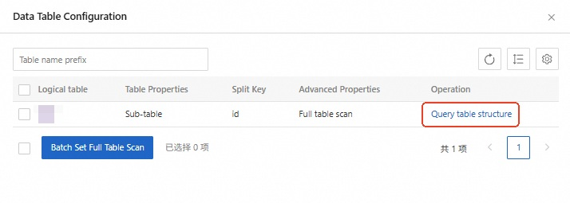

**Batch enable full table scan**

1. Log on to the PolarDB for HTAP console.

   > **Note**
   >
   > The console provides the following features:
   >
   > : Click to refresh the instance list.
   >
   > 
   >
   > : Click to switch the instance list view between **Default** and **Compact** modes.
   >
   > 
   >
   > : Click to select the instance properties to display in the list.
   >
   > 
   >
   > : Click to export the instance list to a local file.
   >
   > 

2. Find the cluster that you want to manage and click its name.

3. In the left-side navigation pane, choose **Configuration Management > Database Management**.

4. On the page that appears, find the database that you want to manage and click **Management** in the Actions column.

5. In the lower part of the **Data Table Configuration** dialog box, click **Batch Set Full Table Scan**.

6. In the **Set full table scan** dialog box, click **OK**.

<a id="section-8"></a>

# 8.Network and connection

<a id="section-8-1"></a>

## 8.1. Connect to a database

You can connect to a PolarDB-X database by using Data Management (DMS), the MySQL command-line client mysql, a third-party client, or a third-party driver for MySQL. This topic describes how to connect to a PolarDB-X database by using the MySQL command line.

**Prerequisites**

- A PolarDB-X instance, a database account, and a database are created.

- A MySQL client is installed on your server. For information about how to install a MySQL client, go to the MySQL website.

**Use DMS to connect to a database**

1. Log on to the PolarDB for HTAP console.

   > **Note**
   >
   > The console provides the following features:
   >
   > : Click to refresh the instance list.
   >
   > 
   >
   > : Click to switch the instance list view between **Default** and **Compact** modes.
   >
   > 
   >
   > : Click to select the instance properties to display in the list.
   >
   > 
   >
   > : Click to export the instance list to a local file.
   >
   > 

2. Find the PolarDB-X instance that you want to manage and click the instance name.

3. On the **Basic Information** page, click **Log On to Database** in the upper-right corner.

4. In the **Log on to Database Instance** dialog box, configure the **Database Account** and **Database Password** parameters, and then click **Login**.

**Use the MySQL command line to connect to a database**

1. Log on to the PolarDB for HTAP console.

   > **Note**
   >
   > The console provides the following features:
   >
   > : Click to refresh the instance list.
   >
   > 
   >
   > : Click to switch the instance list view between **Default** and **Compact** modes.
   >
   > 
   >
   > : Click to select the instance properties to display in the list.
   >
   > 
   >
   > : Click to export the instance list to a local file.
   >
   > 

2. Find the PolarDB-X instance that you want to manage and click the instance name.

3. In the **Connection Information** section, find the internal endpoint and port number and the public endpoint and port number.

   > **Note**
   >
   > By default, no public endpoint is available. If you want to connect to the instance over the Internet for a test, click **Apply for Public Endpoint**. Then, use the **public endpoint** and **public port number** to connect to the instance. To ensure database security, we recommend that you use the internal endpoint to connect to the instance.

4. After you obtain the **connection information**, run the following command to obtain your local public IP address. Then, add the IP address to a whitelist of the instance.

   ```bash
    curl 'https://api.ipify.org'
   ```

5. Run the following MySQL command to connect to your database:

   ```text
   mysql -h<Endpoint> -P<Port number> -u<Username> -p -D<Database name>
   ```

   | Option | Description | Example |
   | --- | --- | --- |
   | <code>-h</code> | The internal or public endpoint that is used to connect to the instance. | <code>pxc-</code><br><code>******************.public.polarx.rds</code><br><code>.aliyuncs.com</code> |

   <table>
     <tr>
       <td><code>-P</code></td>
       <td>The port number that is used to connect to the instance.<br>• If you connect to the instance over an internal network, specify the internal port number of the instance.<br>• If you connect to the instance over the Internet, specify the public port number of the instance.<br>Note<br>• The letter P in the <code> -P </code> option must be in uppercase.<br>• The default port number is 3306.</td>
       <td><code>3306</code></td>
     </tr>
     <tr>
       <td><code>-u</code></td>
       <td>The username of the account that is used to connect to the database.</td>
       <td><code>testuser</code></td>
     </tr>
     <tr>
       <td><code>-p</code></td>
       <td>The password of the account.<br>Note<br>• To ensure password security, we recommend that you do not specify the password after the <code> -p </code> option. After the command is executed, you are prompted to enter the password. After you enter the password, press the Enter key to connect to the database.<br>• When you enter the password, do not include a space between the <code> -p </code> option and the password.</td>
       <td><code>passWord123</code></td>
     </tr>
     <tr>
       <td><code>-D</code></td>
       <td>The name of the database to which you want to connect.<br>Note<br>• This parameter is optional.<br>• You can omit the <code> -D </code> option and directly specify the database name.</td>
       <td><code>mysql</code></td>
     </tr>
   </table>

**Use a third-party client to connect to a database**

You can connect to a PolarDB-X database by using the following third-party clients. You can go to the corresponding official websites to download the clients.

- MySQL Workbench (recommended)

- SQLyog

- Sequel Pro

- Navicat for MySQL

> **Note**
>
> You can perform basic database operations on a third-party GUI client. For example, you can add, delete, modify, and query data and perform DDL operations. You cannot perform advanced operations on a PolarDB-X database from the third-party GUI clients.

**Use a third-party driver for MySQL to connect to a database**

You can connect to a PolarDB-X database by using the following third-party drivers for MySQL:

- JDBC Driver for MySQL (Connector/J)

- Python Driver for MySQL (Connector/Python)

- C++ Driver for MySQL (Connector/C++)

- C Driver for MySQL (Connector/C)

- ADO.NET Driver for MySQL (Connector/NET)

- ODBC Driver for MySQL (Connector/ODBC)

- PHP Drivers for MySQL (mysqli, ext/mysqli, PDO_MYSQL, PHP_MYSQLND)

- Perl Driver for MySQL (DBD::mysql)

- Ruby Driver for MySQL (ruby-mysql)

The following code provides an example on how to use JDBC Driver for MySQL (Connector/J) to connect to a PolarDB-X database:

```text
//JDBC
Class.forName("com.mysql.jdbc.Driver"); 
Connection conn = DriverManager.getConnection("jdbc:mysql://pxc-
******************.public.polarx.rds.aliyuncs.com:3306/doc_test","doc_test","doc_test_pas
ord");
//...
conn.close();    
```

The following sample code provides an example on how to use a connection pool to connect to a PolarDB-X database from your application:

```xml
<bean id="dataSource" class="com.alibaba.druid.pool.DruidDataSource" init-method="init" 
destroy-method="close"> 
<property name="url" value="jdbc:mysql://pxc-
******************.public.polarx.rds.aliyuncs.com:3306/doc_test" />
<property name="username" value="doc_test" />
<property name="password" value="doc_test_password" />
<property name="filters" value="stat" />
<property name="maxActive" value="100" />
<property name="initialSize" value="20" />
<property name="maxWait" value="60000" />
<property name="minIdle" value="1" />
<property name="timeBetweenEvictionRunsMillis" value="60000" />
<property name="minEvictableIdleTimeMillis" value="300000" />
<property name="testWhileIdle" value="true" />
<property name="testOnBorrow" value="false" />
<property name="testOnReturn" value="false" />
<property name="poolPreparedStatements" value="true" />
<property name="maxOpenPreparedStatements" value="20" />
<property name="asyncInit" value="true" />
</bean>
```

> **Note**
>
> We recommend that you use the Druid connection pools.

<a id="section-8-2"></a>

## 8.2. Cluster endpoints and read-only endpoints

This topic describes the endpoints of PolarDB-X instances and how to configure an endpoint.

**Background information**

If you do not create a read-only instance for a primary instance, you can use only one endpoint to connect to the primary instance. This endpoint is known as a cluster endpoint. A cluster endpoint is used in general scenarios for online business. If read-only instances are created for a primary instance, one read-only endpoint is provided for each read-only instance. A read-only endpoint ensures that you have exclusive resources in scenarios in which access to resources is isolated, such as batch processing and the export of offline data. If you create a primary instance and a read-only instance in scenarios in which hybrid transaction/analytical processing (HTAP) is performed, you can use the cluster endpoint and the read-only endpoint.

**Configure a cluster endpoint**

1. Log in to the PolarDB Converged Edition (Centralized & Distributed) console.

2. On the Instances page, click the name of your instance.

3. In the **Connection Information** section, click **Configuration Management** to view the cluster endpoint configuration items.

   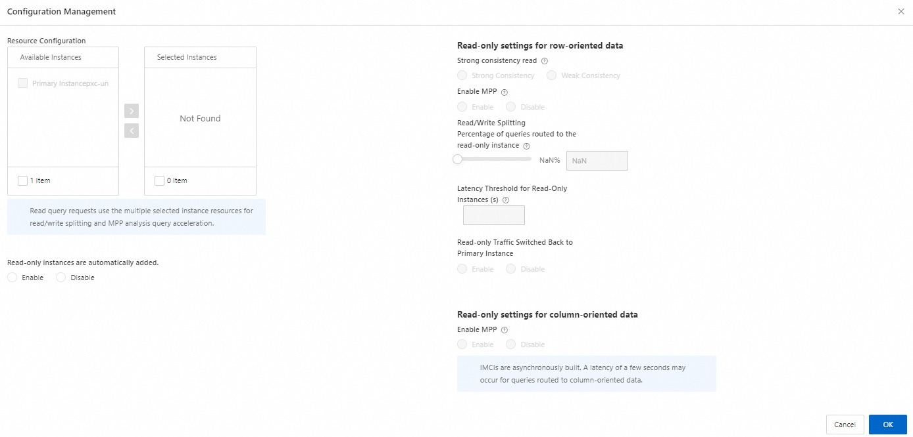

   The following table describes parameters:

   | Parameter | Description |
   | --- | --- |
   | Resource Configuration | If you have created read-only instances, you can add the read-only instances to the resource pool of the primary instance to offload read requests sent to the primary instance. Read-only instances that are not added to the resource pool cannot be used to offload read requests sent to the primary instance. |
   | Read-only instances are automatically added | Specifies whether newly created read-only instances are added to the resource pool of the primary instance. By default, this feature is enabled. If you create read-only instances, you can enable this feature. This way, the read/write splitting feature routes complex queries in the primary instance to your read-only instances. |
   | Intelligent Read/write Splitting | By default, this feature is enabled. PolarDB-X automatically routes the traffic generated by analytical processing (AP) to the read-only instances and performs massively parallel processing (MPP). This helps accelerate queries. If you enable intelligent read/write splitting, PolarDB-X can automatically identify query workloads and route the traffic generated by analytical processing to the read-only instances to reduce the workloads of the primary instance. If you do not create a read-only instance or do not add a read-only instance to the management list of the primary instance, you can ignore this configuration item. |
   | Percentage of queries routed to the read-only instance | The read queries that need to be routed to the storage nodes of the primary instance are routed to the storage nodes of read-only instances based on the specified percentage. This way, the query data can be stored in the read-only instances. |
   | Strong consistency read | • Strong consistency: If requests are routed to the read-only instances, the data that is updated on the primary instance before the read requests are performed can be queried. This provides strong external consistency.<br>• Weak consistency: If requests are routed to the read-only instances, only the latest data can be read from the read-only instances. Data reads are delayed due to asynchronous replication between your primary and read-only instances.<br>Note<br>Due to the read latency, data that requires strong consistency can be read only after the data is updated. By default, 3 seconds are consumed to read the data. |
   | Latency Threshold for Read-Only Instances (s) | If this threshold is exceeded, read-only requests are sent to other read-only instances in which the read latency does not exceed the threshold. You can also determine whether to send the requests back to the primary instance based on the availability of the read-only instances. |
   | Read-only Traffic Switched Back to Primary Instance | If the read latency in each read-only instance exceeds the threshold or each read-only instance is in the high availability (HA) status, all read-only instances are considered to be unavailable and the system determines whether to send read-only requests back to the primary instance. We recommend that two or more read-only instances be used to improve the availability of read-only instances. |
   | Enable MPP | Specifies whether to estimate the costs of queries based on statistics and route complex queries of AP workloads to the compute nodes (CNs) and data nodes (DNs) of the read-only instance for acceleration by using the massively parallel processing (MPP) capabilities. |

4. (Optional) Click **Edit** to customize the prefix of the private and public endpoints.

   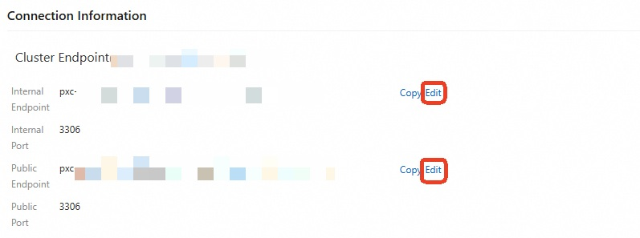

   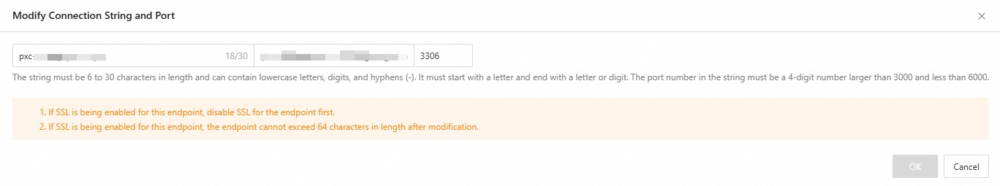

**Configure a read-only endpoint**

1. Log in to the PolarDB Converged Edition (Centralized & Distributed) console.

2. On the Instances page, click the name of your instance.

3. Click **Configuration Management** to set the configuration items of the read-only endpoint.

4. Click **OK**.

<a id="section-8-3"></a>

## 8.3. Apply for and release a public endpoint

By default, a PolarDB-X assigned a private endpoint when the instance is created. You can use the private endpoint to connect your applications and MySQL clients on Alibaba Cloud Elastic Compute Service (ECS) instances to databases on the PolarDB-X instance. If you need to access the PolarDB-X instance over the Internet, you must apply for a public endpoint for the PolarDB-X instance. This topic describes how to apply for and release a public endpoint.

**Apply for a public endpoint**

1. Log on to the PolarDB for HTAP console.

   > **Note**
   >
   > The console provides the following features:
   >
   > : Click to refresh the instance list.
   >
   > 
   >
   > : Click to switch the instance list view between **Default** and **Compact** modes.
   >
   > 
   >
   > : Click to select the instance properties to display in the list.
   >
   > 
   >
   > : Click to export the instance list to a local file.
   >
   > 

2. Find the instance that you want to manage and click the instance name.

3. In the **Connection Information** section of the **Basic Information** page, click **Apply for Public Endpoint** in the upper-right corner.

4. In the dialog box that appears, click **OK**.

   > **Note**
   >
   > If you want to connect to the PolarDB-X instance by using the public endpoint, you must add the public IP address of your client to a whitelist of the instance. For more information, see Configure an IP address whitelist.

**Release a public endpoint**

1. Log on to the PolarDB for HTAP console.

   > **Note**
   >
   > The console provides the following features:
   >
   > : Click to refresh the instance list.
   >
   > 
   >
   > : Click to switch the instance list view between **Default** and **Compact** modes.
   >
   > 
   >
   > : Click to select the instance properties to display in the list.
   >
   > 
   >
   > : Click to export the instance list to a local file.
   >
   > 

2. Find the instance that you want to manage and click the instance name.

3. In the **Connection Information** section of the **Basic Information** page, click **Release Public Endpoint** in the upper-right corner.

4. In the dialog box that appears, click **OK**.

   > **Note**
   >
   > After you release the public endpoint, you cannot use the public endpoint to connect to the instance. After the public endpoint is released, we recommend that you remove the corresponding public IP address from the whitelist to ensure data security.

<a id="section-8-4"></a>

## 8.4. Manage custom endpoints

PolarDB Converged Edition (Centralized & Distributed) instances support custom endpoints. You can use custom endpoints to distribute traffic to specific compute nodes based on your business requirements.

**Limits**

Only Enterprise Edition instances of PolarDB Converged Edition (Centralized & Distributed) support custom endpoints.

**Usage notes**

You must associate at least two compute nodes with a custom endpoint.

**Benefits**

In most cases, a PolarDB Converged Edition (Centralized & Distributed) instance has two or more compute nodes. The number of compute nodes associated with an internal endpoint cannot be changed. Therefore, you cannot specify the number of compute nodes for different business traffic based on your business requirements. To address the increasing demand for custom business traffic management, PolarDB Converged Edition (Centralized & Distributed) provides the custom endpoint feature. This feature provides the following benefits:

- Physical isolation of business traffic: You can use different custom endpoints for various business operations and associate different compute nodes with the custom endpoints to physically isolate business traffic.

- Reduced network latency across data centers: A PolarDB Converged Edition (Centralized & Distributed) multi-zone instance has independent sets of compute nodes in the primary and secondary zones. You can create different custom endpoints for the primary and secondary zones. Applications deployed in a specific zone can access the nearest compute nodes by using the custom endpoint for the zone, which minimizes the cross-data center network latency.

**Create a custom endpoint**

1. Log in to the PolarDB Converged Edition (Centralized & Distributed) console.

2. In the top navigation bar, select the region where the instance is deployed.

3. On the **Instance List** page, find the instance that you want to manage and click its ID.

4. In the left-side navigation pane, click **Connection Management**.

5. In the upper-left corner of the page that appears, click **Create a custom connection**. In the **Create a custom connection** panel, configure the parameters. The following table describes the parameters.

   <table>
     <tr>
       <th>Paramete r</th>
       <th>Description</th>
     </tr>
     <tr>
       <td>Address alias</td>
       <td>The name of the custom endpoint.</td>
     </tr>
     <tr>
       <td>IP Type</td>
       <td>• <strong>IPv4</strong>: assigns an IPv4 address to the instance. This option is suitable for IPv4 networks.<br>• <strong>IPv4/IPv6 Dual-Stack</strong>: assigns IPv4 and IPv6 addresses to the instance. This option is suitable for hybrid networks in which both IPv4 and IPv6 clients need to access the instance. If you select this option, you must configure an IPv6 address whitelist to specify the IPv6 addresses that can access the instance.</td>
     </tr>
     <tr>
       <td>VPC</td>
       <td rowspan="2">The virtual private cloud (VPC) and vSwitch.</td>
     </tr>
     <tr>
       <td>Switch</td>
     </tr>
     <tr>
       <td>Service node</td>
       <td>The compute nodes that you want to associate with the custom endpoint.<br>Note<br>• A compute node can be associated with one or more custom endpoints.<br>• Associate at least two compute nodes with a custom endpoint. If only two compute nodes are associated with a custom endpoint, you cannot remove the two compute nodes.</td>
     </tr>
     <tr>
       <td>Whether the node is automati cally added</td>
       <td>Specifies whether to enable automatic association of new compute nodes with the custom endpoint. Valid values:<br>• <strong>Yes</strong>: A new compute node that meets the conditions specified by the Conditions for adding new nodes parameter is automatically associated with the custom endpoint.<br>• <strong>No</strong>: A new compute node is not automatically associated with the custom endpoint.</td>
     </tr>
     <tr>
       <td>Condition s for adding new nodes</td>
       <td>The conditions that must be met for a new compute node to be automatically associated with the custom endpoint. Valid values:<br>• <strong>All zones</strong>: All new compute nodes of the instance are automatically associated with the custom endpoint.<br>• <strong>Same zone</strong>: New compute nodes of the instance are automatically associated with the custom endpoint only if they reside in the same zone as the most recently associated compute node.<br>Note<br>• If a new compute node meets the conditions specified by the <strong>Conditions</strong> <strong>for adding new nodes</strong> parameter of multiple custom endpoints, the new compute node is automatically associated with the custom endpoints.<br>• For information about how to identify the zone of the most recently associated compute node, see the ModifyCustom endpoint section of this topic.</td>
     </tr>
   </table>

6. Click **OK**. The custom endpoint is created.

**Modify a custom endpoint**

1. Log in to the PolarDB Converged Edition (Centralized & Distributed) console.

2. In the top navigation bar, select the region where the instance is deployed.

3. On the **Instance List** page, find the instance that you want to manage and click its ID.

4. In the left-side navigation pane, click **Connection Management**.

5. On the page that appears, find the custom endpoint that you want to modify and click **Edit** in the Operation column. The following table describes the parameters that you can modify.

   | Paramete r | Description |
   | --- | --- |
   | Address alias | The name of the custom endpoint. |
   | Service node | The compute nodes that you want to associate with or disassociate from the custom endpoint.<br>Note<br>• A compute node can be associated with one or more custom endpoints.<br>• Associate at least two compute nodes with a custom endpoint. If only two compute nodes are associated with a custom endpoint, you cannot remove the two compute nodes.<br>• If compute nodes in different zones are available, even if you set the <strong>Conditions for adding new nodes</strong> parameter to <strong>Same zone</strong>, you can still manually associate compute nodes that are not in the same zone as the most recently associated compute nodes. |
   | Network informati on | The network information of the custom endpoint. You can click Edit in the <strong>Network</strong> <strong>information</strong> section and configure the parameters in the <strong>Edit the private access</strong> <strong>address</strong> dialog box. The following list describes the parameters.<br>• IP Type: IPv4 and IPv4/IPv6 Dual-Stack are supported.<br>• VPC<br>• Switch<br>• Access address<br>• The prefix of the endpoint. The prefix must be 6 to 30 characters in length, and can contain lowercase letters, digits, and hyphens (-). The prefix must start with a letter and end with a letter or a digit.<br>• The port number. The port number must be a four-digit number in the range of 3000 to 6000. |
   | Whether the node is automati cally added | Specifies whether to enable automatic association of new compute nodes with the custom endpoint. Valid values:<br>• <strong>Yes</strong>: A new compute node that meets the conditions specified by the <strong>Conditions</strong> <strong>for adding new nodes</strong> parameter is automatically associated with the custom endpoint.<br>• <strong>No</strong>: A new compute node is not automatically associated with the custom endpoint. |
   | Condition s for adding new nodes | The conditions that must be met for a new compute node to be automatically associated with the custom endpoint. Valid values:<br>• <strong>All zones</strong>: All new compute nodes of the instance are automatically associated with the custom endpoint.<br>• <strong>Same zone</strong>: New compute nodes of the instance are automatically associated with the custom endpoint only if they reside in the same zone as the most recently associated compute node.<br>Note<br>• If a new compute node meets the conditions specified by the <strong>Conditions</strong> <strong>for adding new nodes</strong> parameter of multiple custom endpoints, the new compute node is automatically associated with the custom endpoints.<br>• If you select compute nodes in different zones and the Conditions for adding new nodes parameter is set to Same zone, the following message appears, which contains the zone information of the most recently associated compute node. |

6. Click **OK**. The custom endpoint is modified.

**Delete a custom endpoint**

1. Log in to the PolarDB Converged Edition (Centralized & Distributed) console.

2. In the top navigation bar, select the region where the instance is deployed.

3. On the **Instance List** page, find the instance that you want to manage and click its ID.

4. In the left-side navigation pane, click **Connection Management**.

5. On the page that appears, find the custom endpoint that you want to delete and click **Delete** in the Operation column.

6. In the message that appears, click **OK**.

<a id="section-9"></a>

# 9.Data node management

Only Enterprise Edition instances support the data node management feature.

<a id="section-9-1"></a>

## 9.1. Add or release nodes

A PolarDB-X instance is a distributed cluster that consists of multiple nodes. This topic describes how to scale out or in a PolarDB-X instance by adding or releasing nodes.

**Usage notes**

- After nodes are added or released, data is migrated and evenly redistributed. To ensure data consistency, the primary instance and read-only instances are scaled out at the same time.

- Adding and releasing nodes may trigger underlying data migration, which requires a period of time to complete. After the migration is complete, a switchover of your workloads is triggered. During the switchover, a transient connection interruption lasts approximately 30 seconds. Make sure that your application is configured to automatically reconnect to your PolarDB-X instance.

**Add a node**

1. Log on to the PolarDB for HTAP console.

   > **Note**
   >
   > The console provides the following features:
   >
   > : Click to refresh the instance list.
   >
   > 
   >
   > : Click to switch the instance list view between **Default** and **Compact** modes.
   >
   > 
   >
   > : Click to select the instance properties to display in the list.
   >
   > 
   >
   > : Click to export the instance list to a local file.
   >
   > 

2. Find the PolarDB-X instance that you want to manage and click the instance name.

3. On the Instance page that appears, choose Configuration Management > **Data Node Management**, and click **Add Node** in the upper-right corner.

4. In the **Add Node** panel, you can specify the **Node Specifications**, **Storage Size**, and **Increase quantity** parameters in the **Node Specifications** section.

**Release a node**

1. Log on to the PolarDB for HTAP console.

   > **Note**
   >
   > The console provides the following features:
   >
   > : Click to refresh the instance list.
   >
   > 
   >
   > : Click to switch the instance list view between **Default** and **Compact** modes.
   >
   > 
   >
   > : Click to select the instance properties to display in the list.
   >
   > 
   >
   > : Click to export the instance list to a local file.
   >
   > 

2. Find the PolarDB-X instance that you want to manage and click the instance name.

3. On the Instance page that appears, choose Configuration Management > **Data Node Management**. In the **Data node list**, find the node that you want to manage, and click **Release node**.

4. In the **Release node** dialog box that appears, click **Release**.

   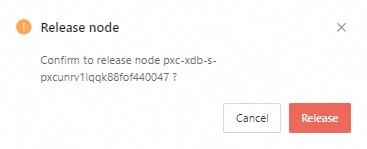

<a id="section-9-2"></a>

## 9.2. Change configurations

A PolarDB-X instance is a distributed cluster that consists of multiple nodes. Each node provides features such as SQL routing, data merging, and data aggregation. You can change the node specifications for an instance. During peak hours, you can upgrade the specifications to handle high numbers of queries per second (QPS). During off-peak hours, you can downgrade the specifications to reduce resource waste.

**Usage notes**

After you change the data node configurations, the data nodes of the PolarDB-X instance use different specifications. Take note of the following changes when you manage the instance:

- You cannot change the overall configurations of the PolarDB-X instance. You can change the configurations of compute nodes and data nodes.

- You cannot scale in a PolarDB-X instance by changing the number of data nodes. To scale in a PolarDB-X instance, you must delete the specified data nodes on the Data Node Management page.

**Procedure**

1. Log on to the PolarDB for HTAP console.

   > **Note**
   >
   > The console provides the following features:
   >
   > : Click to refresh the instance list.
   >
   > 
   >
   > : Click to switch the instance list view between **Default** and **Compact** modes.
   >
   > 
   >
   > : Click to select the instance properties to display in the list.
   >
   > 
   >
   > : Click to export the instance list to a local file.
   >
   > 

2. Find the PolarDB-X instance that you want to manage and click the instance name.

3. In the left-side navigation pane, choose Configuration Management > **Data Node Management**. Find the node that you want to manage and click **Change configuration**.

4. On the **Change configuration** panel, you can change the **Node Specifications**, **Storage Size**, and **Configuration change time** parameters.

   > **Note**
   >
   > - You can select **Immediately change configuration** or **O&M time configuration change** for the **Configuration change time** parameter.
   >
   > - After you change the storage size and node specifications of data nodes, you can also change the storage space of an instance in a unified manner.

<a id="section-10"></a>

# 10.Accounts and security

<a id="section-10-1"></a>

## 10.1. Manage database accounts

A PolarDB-X instance supports two types of accounts: privileged accounts and standard accounts. This topic describes how to create and manage an account.

**Account types**

The following table describes the types of database accounts that are supported by PolarDB-X instances.

| Account type | Description |
| --- | --- |
| Privileged account | • You can create and manage privileged accounts by using the PolarDB-X V2.0 console or API operations.<br>• You can create only one privileged account for each instance. The privileged account can be used to manage all standard accounts and databases in the instance.<br>• The privileged account is granted more permissions than a standard account. You can use the privileged account to perform fine-grained permission management based on your business requirements. For example, you can use the privileged account to grant different Resource Access Management (RAM) users permissions to access different tables.<br>• The privileged account is granted full permissions on all databases in the instance and can be used to close connections that are established by using standard accounts. |
| Standard account | • You can create and manage standard accounts by using the PolarDB-X V2.0 console, calling API operations, or executing SQL statements.<br>• You can create one or more standard accounts for each instance. The maximum number of standard accounts that can be created is determined by the kernel engine of the instance.<br>• You must grant standard accounts the required permissions on specific databases.<br>• You cannot use a standard account to create or manage other accounts, or close connections that are established by using other accounts. |

> **Note**
>
> After an account is created, the type of the account cannot be changed. If you want to change the type of the account, delete the account and then use the same username of the account to create an account of the other type.

The following sections describe the operations that you can perform on database accounts in the console.

- Create an account

- Reset the password of a database account

- Modify permissions for a standard account

- Delete an account

**Create an account**

1. Log on to the PolarDB for HTAP console.

   > **Note**
   >
   > The console provides the following features:
   >
   > : Click to refresh the instance list.
   >
   > 
   >
   > : Click to switch the instance list view between **Default** and **Compact** modes.
   >
   > 
   >
   > : Click to select the instance properties to display in the list.
   >
   > 
   >
   > : Click to export the instance list to a local file.
   >
   > 

2. Find the instance that you want to manage and click its ID.

3. In the left-side navigation pane, choose **Configuration Management > Account Management**.

4. Click **Create Account**. In the panel that appears, configure the following parameters.

   | Parameter | Description |
   | --- | --- |
   | Account Name | The name of the account.<br>Note<br>The account name must meet the following requirements:<br>• The name can be up to 32 characters in length and can contain lowercase letters, digits, and underscores (_).<br>• The name must start with a lowercase letter and end with a lowercase letter or a digit.<br>• The name must be unique and cannot be the same as the name of an existing account. |
   | Account Type | The type of the account. You can specify the account to be a <strong>Privileged</strong> <strong>Account</strong> or <strong>Standard Account</strong>.<br>Note<br>You can create only one privileged account for each PolarDB-X instance. |
   | Authorize Database | You can authorize or unauthorize selected databases for a standard account. |
   | Password | Enter the password for the account.<br>Note<br>The password must meet the following requirements:<br>• The password must be 8 to 32 characters in length.<br>• The password must contain at least three types of the following characters: uppercase letters, lowercase letters, digits, and special characters.<br>• The following special characters are supported: @ # $ % ^ &amp; + = |
   | Confirm Password | Enter the password for the account again. |
   | Password Policy | Select the required password policy. Valid values:<br>• Default<br>• mysql_native_password<br>• caching_sha2_password<br>• sha256_password<br>Note<br>• You can configure the <code> loose_default_authentication_plugin </code> parameter to modify the default password policy. For more information, see Storage layer parameters in Configure parameters on the Parameter Settings page.<br>• The custom password policy feature is only supported on Standard Edition (Centralized) instances that are compatible with MySQL 8.0 syntax.<br>• The selected password policy takes effect only for the account that is being created and does not affect existing accounts. |
   | Description | Optional. The information about the account. The description helps you better manage the account later. The description can be up to 256 characters in length. |

**Reset the password of a database account**

1. Log on to the PolarDB for HTAP console.

   > **Note**
   >
   > The console provides the following features:
   >
   > : Click to refresh the instance list.
   >
   > 
   >
   > : Click to switch the instance list view between **Default** and **Compact** modes.
   >
   > 
   >
   > : Click to select the instance properties to display in the list.
   >
   > 
   >
   > : Click to export the instance list to a local file.
   >
   > 

2. Find the instance that you want to manage and click its ID.

3. In the left-side navigation pane, choose **Configuration Management > Account Management**.

4. On the **Account Management** page, find the account that you want to manage and click **Change Password** in the **Actions** column.

5. In the dialog box that appears, enter and confirm the new password, and then click **Determine**.

   > **Note**
   >
   > The password must meet the following requirements:
   >
   > - The password must be 8 to 32 characters in length.
   >
   > - The password must contain at least three types of the following characters: uppercase letters, lowercase letters, digits, and special characters.
   >
   > - The following special characters are supported: @ # $ % ^ & + =

**Modify permissions for a standard account**

1. Log on to the PolarDB for HTAP console.

   > **Note**
   >
   > The console provides the following features:
   >
   > : Click to refresh the instance list.
   >
   > 
   >
   > : Click to switch the instance list view between **Default** and **Compact** modes.
   >
   > 
   >
   > : Click to select the instance properties to display in the list.
   >
   > 
   >
   > : Click to export the instance list to a local file.
   >
   > 

2. Find the instance that you want to manage and click its ID.

3. In the left-side navigation pane, choose **Configuration Management > Account Management**.

4. On the **Account Management** page, find the account that you want to manage and click **Modify Permissions** in the **Actions** column.

   > **Note**
   >
   > The privileged account of an instance is granted full permissions on all databases in the instance. You do not need to **modify permissions** for the privileged account.

5. In the panel that appears, select one or more databases and click the

   icon to move the

   

   databases from the **Unauthorized Database** section to the **Authorized Databases** section.

6. In the **Authorized Databases** section, select the database permissions that you want to grant to the account.

   > **Note**
   >
   > - Supported permissions: **Read and write**, **Read only**, **DML only**, and **DDL only**.
   >
   > - If you want to grant the same permissions on multiple selected databases, click the permission name such as **All DDL only** next to **Authorized Databases**.

7. Click **Determine**.

**Delete an account**

1. Log on to the PolarDB for HTAP console.

   > **Note**
   >
   > The console provides the following features:
   >
   > : Click to refresh the instance list.
   >
   > 
   >
   > : Click to switch the instance list view between **Default** and **Compact** modes.
   >
   > 
   >
   > : Click to select the instance properties to display in the list.
   >
   > 
   >
   > : Click to export the instance list to a local file.
   >
   > 

2. Find the instance that you want to manage and click its ID.

3. In the left-side navigation pane, choose **Configuration Management > Account Management**.

4. On the **Account Management** page, find the account that you want to delete and click **Delete** in the **Actions** column.

5. In the dialog box that appears, click **Determine**.

**Lock an account**

1. Log on to the PolarDB for HTAP console.

   > **Note**
   >
   > The console provides the following features:
   >
   > : Click to refresh the instance list.
   >
   > 
   >
   > : Click to switch the instance list view between **Default** and **Compact** modes.
   >
   > 
   >
   > : Click to select the instance properties to display in the list.
   >
   > 
   >
   > : Click to export the instance list to a local file.
   >
   > 

2. Find the instance that you want to manage and click its ID.

3. In the left-side navigation pane, choose **Configuration Management > Account Management**.

4. Find the account that you want to lock and click **Lock** in the Actions column.

   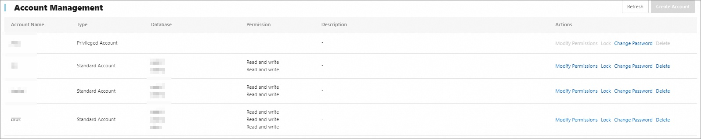

5. In the message that appears, click **Determine**.

<a id="section-10-2"></a>

## 10.2. Configure an IP address whitelist

You can configure an IP address whitelist for your PolarDB-X instance. This whitelist does not affect the performance of your PolarDB-X instance. You can update the configured IP address whitelist on a regular basis to provide high-level access control and security protection for your PolarDB-X instance. This topic describes how to configure an IP address whitelist for your PolarDB-X instance.

**Usage notes**

- After a database is created, the default IP address whitelist contains only the IP address  `127.0.0.1` , which indicates that no IP addresses are allowed to access the cluster. To ensure that your data is secure, we recommend that you specify only the public IP addresses or CIDR blocks of your web servers in the whitelist of your instance.

- You can create up to 50 IP address whitelists for a PolarDB-X instance, and each whitelist can contain up to 300 IP addresses and CIDR blocks.

**Add a whitelist**

1. Log on to the PolarDB for HTAP console.

   > **Note**
   >
   > The console provides the following features:
   >
   > : Click to refresh the instance list.
   >
   > 
   >
   > : Click to switch the instance list view between **Default** and **Compact** modes.
   >
   > 
   >
   > : Click to select the instance properties to display in the list.
   >
   > 
   >
   > : Click to export the instance list to a local file.
   >
   > 

2. Find the instance that you want to manage and click its ID.

3. In the left-side navigation pane, choose **Configuration Management > Security Management > Whitelist Settings**.

4. In the upper-left corner of the page that appears, click **Add a whitelist group**.

5. In the **Add a whitelist group** panel, configure the parameters described in the following table.

   | Parameter | Description |
   | --- | --- |
   | Group name | The name of the IP address whitelist. |
   | Type | • <strong>IPv4</strong>: Only an IPv4 address is assigned to the instance. This option is suitable for IPv4 networks. You are allowed to access the database using an IPv4 address such as <code> 192.168.1.1 </code>. This option is compatible with most existing network environments.<br>• <strong>IPv6</strong>: You are allowed to access the database using an IPv6 address such as <code> 2400:3200::1 </code>. This option meets future network expansion and compliance requirements. |
   | Whitelist within a group | IP addresses in the whitelist.<br>Note<br>• You can enter IP addresses and CIDR blocks. For example, you can enter the IP address 192.168.0.1 or the CIDR block 192.168.0.0/24.<br>• You can specify up to 300 IP addresses or CIDR blocks in a whitelist.<br>• Separate multiple IP addresses and CIDR blocks with commas (,). For example, you can enter 192.168.0.1,192.168.0.0/24.<br>• If you want to block access from all IP addresses, you can specify 127.0.0.1 in the whitelist. |

6. Click **OK**.

   > **Note**
   >
   > The whitelist takes effect approximately 1 minute after it is created.

**Modify a whitelist**

1. Log on to the PolarDB for HTAP console.

   > **Note**
   >
   > The console provides the following features:
   >
   > : Click to refresh the instance list.
   >
   > 
   >
   > : Click to switch the instance list view between **Default** and **Compact** modes.
   >
   > 
   >
   > : Click to select the instance properties to display in the list.
   >
   > 
   >
   > : Click to export the instance list to a local file.
   >
   > 

2. Find the instance that you want to manage and click its ID.

3. In the left-side navigation pane, choose **Configuration Management > Security Management > Whitelist Settings**.

4. On the page that appears, find the whitelist that you want to manage and click **Configure** in the **Operation** column.

5. In the **Configure whitelist** panel, modify the **Whitelist within a group** parameter.

   | Parameter | Description |
   | --- | --- |

   <table>
     <tr>
       <td>Whitelist within a group</td>
       <td>Click Add IP and enter the IP addresses.<br>Note<br>• You can enter IP addresses and CIDR blocks. For example, you can enter the IP address 192.168.0.1 or the CIDR block 192.168.0.0/24.<br>• You can specify up to 300 IP addresses or CIDR blocks in a whitelist.<br>• Separate multiple IP addresses and CIDR blocks with commas (,). For example, you can enter 192.168.0.1,192.168.0.0/24.<br>• If you want to block access from all IP addresses, you can specify 127.0.0.1 in the whitelist.</td>
     </tr>
   </table>

6. Click **OK**.

   > **Note**
   >
   > The whitelist takes effect approximately 1 minute after it is created.

**Delete a whitelist**

1. Log on to the PolarDB for HTAP console.

   > **Note**
   >
   > The console provides the following features:
   >
   > : Click to refresh the instance list.
   >
   > 
   >
   > : Click to switch the instance list view between **Default** and **Compact** modes.
   >
   > 
   >
   > : Click to select the instance properties to display in the list.
   >
   > 
   >
   > : Click to export the instance list to a local file.
   >
   > 

2. Find the instance that you want to manage and click its ID.

3. In the left-side navigation pane, choose **Configuration Management > Security Management > Whitelist Settings**.

4. On the page that appears, find the whitelist that you want to manage and click **Delete** in the **Operation** column.

5. In the message that appears, click **OK**.

<a id="section-10-3"></a>

## 10.3. Configure SSL encryption

This topic describes how to make data transmission more secure by configuring Secure Sockets Layer (SSL) encryption. You must enable SSL encryption and install SSL certificates that are issued by certificate authorities (CAs) to the required applications. SSL is used to encrypt connections at the transport layer and enhance the security and integrity of the transmitted data. However, SSL encryption increases the round-trip time.

**Usage notes**

- The validity period of an SSL certificate is one year. Before an SSL certificate expires, you must renew the SSL certificate. You must also download the required SSL certificate file and configure the SSL certificate again after you renew the SSL certificate. Otherwise, clients that are connected to your cluster over encrypted connections are disconnected. For more information, see Update the validity period of an SSL CA certificate.

- SSL encryption may cause a significant increase in CPU utilization. We recommend that you enable SSL encryption only when you need to encrypt the connections to the public endpoint of your RDS instance. In most cases, connections that are established to the internal endpoint of your instance are secure and do not require SSL encryption.

- When you enable or disable SSL encryption for an instance, the instance is restarted. Proceed with caution.

**Enable SSL encryption**

1. Log on to the PolarDB for HTAP console.

   > **Note**
   >
   > The console provides the following features:
   >
   > : Click to refresh the instance list.
   >
   > 
   >
   > : Click to switch the instance list view between **Default** and **Compact** modes.
   >
   > 
   >
   > : Click to select the instance properties to display in the list.
   >
   > 
   >
   > : Click to export the instance list to a local file.
   >
   > 

2. Find the instance that you want to manage and click the instance ID.

3. In the left-side navigation pane, choose **Configuration Management > Security Management**.

4. Click the **SSL Configuration** tab and turn on the **SSL Configuration** switch.

   > **Note**
   >
   > After you turn on the switch, the value of **SSL-protected Endpoint** is the private endpoint. You can change the value to the public endpoint. For more information, see Change the protected endpoint for SSL encryption.

5. In the message that appears, click **OK**.

   > **Important**
   >
   > After you click OK, the instance is restarted. We recommend that you enable or disable your instance during off-peak hours and make sure that your applications can automatically reconnect to the instance.

6. After SSL encryption is enabled, click **Download CA Certificate**.

   The file that you downloaded is a package that contains the following files:

   - P7B file: contains the CA certificate that can be imported into a Windows application, such as Internet Information Services (IIS) and Microsoft Exchange Server.

   - PEM file: used to import CA certificates to other applications such as MySQL Workbench and Navicat.

   - JKS file: stores truststore certificates for Java. The password is apsaradb. The file is used to import the CA certificate chain to Java programs.

     > **Note**
     >
     > When you use the JKS file in JDK 7 or JDK 8, you must modify the following default JDK security configuration items in the  `jre/lib/security/java.security`  file on the host on which your application resides:
     >
     > ```text
     > jdk.tls.disabledAlgorithms=SSLv3, RC4, DH keySize < 224
     > jdk.certpath.disabledAlgorithms=MD2, RSA keySize < 1024
     > ```
     >
     > If you do not apply these configurations, the following error is returned. In most cases, other similar errors are also caused by invalid Java security configurations:
     >
     > ```text
     > javax.net.ssl.SSLHandshakeException: DHPublicKey does not comply to algorithm constraints
     > ```

**Configure an SSL certificate**

After SSL encryption is enabled, you must configure an SSL certificate on your application or client to connect to your PolarDB-X instance. In this topic, MySQL Workbench and Navicat are used as examples. If you want to use other applications or clients, see the related instructions.

**Configure a certificate on MySQL Workbench**

1. Start MySQL Workbench.

2. Choose **Database > Manage Connections**.

3. Configure the **Use SSL** parameter and import the SSL certificate file.

**Configure a certificate on Navicat**

1. Start Navicat.

2. Right-click the database that you want to connect. Then, select **Edit Connection**.

3. Click the **SSL** tab and select the path of the PEM certificate file.

4. Click **OK**.

   > **Note**
   >
   > If the  `connection is being used`  error message is displayed, the previous session remains connected. In this case, you must restart Navicat.

5. Double-click your database and check whether Navicat can connect to the database.

**Update the validity period of an SSL CA certificate**

> **Note**
>
> - After you click **Update Validity Period**, the instance is restarted. We recommend that you perform this operation during off-peak hours and make sure that your application can automatically reconnect to the instance.
>
> - After you click **Update Validity Period**, you must download the SSL certificate file and configure the SSL certificate again.

**Change the protected endpoint for SSL encryption**

> **Note**
>
> After you apply for a public endpoint, you can set the public endpoint to a protected endpoint. For more information about how to apply for a public endpoint, see Apply for a public endpoint.

1. Log on to the PolarDB for HTAP console.

   > **Note**
   >
   > The console provides the following features:
   >
   > : Click to refresh the instance list.
   >
   > 
   >
   > : Click to switch the instance list view between **Default** and **Compact** modes.
   >
   > 
   >
   > : Click to select the instance properties to display in the list.
   >
   > 
   >
   > : Click to export the instance list to a local file.
   >
   > 

2. Find the instance that you want to manage and click the instance ID.

3. In the left-side navigation pane, choose **Configuration Management > Security Management**.

4. Click the SSL Configuration tab.

5. Click **Configure SSL**.

6. In the dialog box that appears, select the endpoint to which the connections you want to encrypt.

   > **Note**
   >
   > - After you turn on the switch next to the SSL configuration parameter, the value of **SSL-protected Endpoint** is the private endpoint. You can change the private endpoint to the public endpoint.
   >
   > - After you change the endpoint to which connections are encrypted by the SSL certificate, the instance is restarted. We recommend that you perform this operation during off-peak hours and make sure that your application can automatically reconnect to the instance.
   >
   > - After you change the endpoint for SSL encryption, you must download and configure the SSL certificate again.

7. Click **OK**.

**Disable SSL encryption**

> **Note**
>
> - After you disable SSL encryption for an instance, the instance is restarted. We recommend that you perform this operation during off-peak hours and make sure that your application can automatically reconnect to the instance.
>
> - After you disable SSL encryption for an instance, the performance of your instance is improved but data security is compromised. We recommend that you disable SSL encryption only in secure environments.

1. Log on to the PolarDB for HTAP console.

   > **Note**
   >
   > The console provides the following features:
   >
   > : Click to refresh the instance list.
   >
   > 
   >
   > : Click to switch the instance list view between **Default** and **Compact** modes.
   >
   > 
   >
   > : Click to select the instance properties to display in the list.
   >
   > 
   >
   > : Click to export the instance list to a local file.
   >
   > 

2. Find the instance that you want to manage and click the instance ID.

3. In the left-side navigation pane, choose **Configuration Management > Security Management**.

4. Click the SSL configuration tab.

5. Turn off the SSL configuration switch.

6. In the message that appears, click **OK**.

<a id="section-10-4"></a>

## 10.4. Configure the TDE feature

This topic describes how to configure the transparent data encryption (TDE) feature for a PolarDB-X instance.

**Usage notes**

- After you enable the TDE feature for a PolarDB-X instance, you cannot disable the feature for the instance.

- When you enable the TDE feature for a PolarDB-X instance, the connection between your application and the PolarDB-X instance may be transiently interrupted. We recommend that you enable the TDE feature during off-peak hours and make sure that your application can automatically reconnect to the PolarDB-X instance.

- When you perform TDE encryption or TDE decryption on a table, you cannot perform write operations on the table.

- The TDE feature may affect the database performance.

**Procedure**

1. Log on to the PolarDB for HTAP console.

   > **Note**
   >
   > The console provides the following features:
   >
   > : Click to refresh the instance list.
   >
   > 
   >
   > : Click to switch the instance list view between **Default** and **Compact** modes.
   >
   > 
   >
   > : Click to select the instance properties to display in the list.
   >
   > 
   >
   > : Click to export the instance list to a local file.
   >
   > 

2. Find the PolarDB-X instance for which you want to enable the TDE feature and click the instance name.

3. In the left-side navigation pane, choose **Configuration Management > Security Management**.

4. Click the **TDE** tab. By default, the TDE feature is disabled. Click the slider for enabling the TDE feature.

   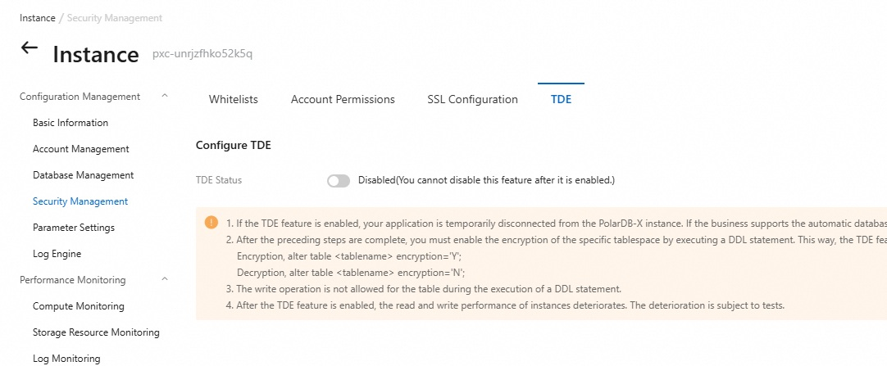

5. In the **Configure TDE** dialog box, configure the following settings:

   - In the dialog box that appears, select **Use Automatically Generated Key** and click **OK**.

   - In the dialog box that appears, select **Use Existing Custom Key** and click **OK**.

     > **Note**
     >
     > If you do not have a custom key, click **Create now** to create a key and import your own key material the KMS console.

   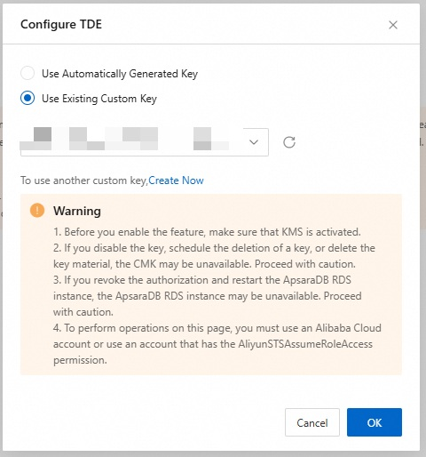

**Encrypt a table by using the TDE feature**

To use the TDE feature to encrypt a table on a PolarDB-X instance, log on to the instance and execute the following statement:

```sql
alter table <tablename> encryption='Y';
```

To create a TDE-encrypted table, execute the following statement:

```sql
create table <tablename> <col definition> ENCRYPTION='Y';
```

**Decrypt a TDE-encrypted table**

To decrypt a TDE-encrypted table on a PolarDB-X instance, log on to the instance and execute the following statement:

```sql
alter table <tablename> ENCRYPTION='N';
```

<a id="section-10-5"></a>

## 10.5. Three-role mode

<a id="section-10-5-1"></a>

### 10.5.1. Overview

PolarDB-X supports the three-role mode for database management. In the three-role mode, three roles are created to manage databases. The three roles are database administrator (DBA), database security administrator (DSA), and data audit administrator (DAA). This makes your database more secure because the database management permissions are not granted to one account.

**Risks and risk mitigation**

- **Risks** In traditional database O&M mode, the DBA of a database is granted full permissions on the database. In this mode, issues can occur on your business in the following scenarios:

  - False positives that are identified by the DBA cause system security accidents.

  - The DBA performs malicious operations.

  - The DBA, third-party outsourcing personnel, or program developers that are not granted the required permissions can access sensitive data.

- **Solution**

  PolarDB-X supports the three-role mode. In this mode, the permissions that are granted to the DBA role in the traditional mode are divided among the DBA, DSA and DAA roles. Each role is granted a part of the database management permissions. In this mode:

  - DBA: DBA is authorized to execute DDL statements.

  - DSA: DSA is authorized to manage roles and users, and grant permissions to standard accounts.

  - DAA: DAA is authorized to view audit logs.

**Permissions for different roles**

The following table describes the permissions that are granted to each system account in the default mode and the three-role mode.

> **Note**
>
> - In the default mode, the DBA account is the privileged account.
>
> - After you enable or disable the three-role mode for your instance, only the permissions that are granted to system accounts are changed. The system accounts include the privileged account, DBA account, DSA account, and DAA account. The permissions that are granted to standard accounts are not affected.
>
> - After the three-role mode is enabled, all system accounts are not authorized to execute DML statements, Data Query Language (DQL) statements, or Data Administration Language (DAL) statements. You can use the DSA account to grant permissions to standard accounts to execute these types of statements.
>
> - ✔️ indicates that this role has this permission. Indicates that this role does not have this permission.

<table>
  <tr>
    <th colspan="2">Permission</th>
    <th>Default mode</th>
    <th colspan="3">Three-role mode</th>
  </tr>
  <tr>
    <td>Type</td>
    <td>Description</td>
    <td>Privilege d account</td>
    <td>DBA account</td>
    <td>DSA account</td>
    <td>DAA account</td>
  </tr>
  <tr>
    <td>DDL</td>
    <td>• ALTER TABLE<br>• CREATE TABLE<br>• CREATE VIEW<br>• CREATE INDEX<br>• CREATE CCL_RULE<br>• DROP VIEW<br>• DROP INDEX<br>• DROP TABLE<br>• TRUNCATE TABLE</td>
    <td>✔️</td>
    <td>✔️</td>
    <td></td>
    <td></td>
  </tr>
  <tr>
    <td>DML</td>
    <td>• DELETE<br>• UPDATE<br>• INSERT</td>
    <td rowspan="3">✔️</td>
    <td rowspan="3"></td>
    <td rowspan="3"></td>
    <td rowspan="3"></td>
  </tr>
  <tr>
    <td>DQL</td>
    <td>• SELECT<br>• EXPLAIN</td>
  </tr>
  <tr>
    <td>DAL</td>
    <td>• SHOW CCL_RULE<br>• SHOW INDEX</td>
  </tr>
  <tr>
    <td>Permis sions to manag e roles and accoun ts</td>
    <td>Permissions to manage accounts<br>Permissions to manage roles</td>
    <td>✔️</td>
    <td></td>
    <td>✔️</td>
    <td></td>
  </tr>
  <tr>
    <td>Permis sions to view audit logs</td>
    <td>View audit logs in the following types of tables:<br><code>• information_schema.polardbx_a</code><br><code>udit_log</code><br><code>• information_schema.polardbx_d</code><br><code>dl_log</code></td>
    <td>✔️</td>
    <td></td>
    <td></td>
    <td>✔️</td>
  </tr>
</table>

**Limits**

Before you use the three-role mode, you must take note of the following limits:

- You cannot run GRANT ROLE or REVOKE ROLE commands on the DBA, DSA, and DAA accounts.

- You cannot run GRANT PRIVILEGES or REVOKE PRIVILEGES commands on the DBA, DSA, and DAA accounts.

- You can change the password of a system account when you use the account to log on to the database. For example, if you want to change the password of the DBA account, you must log on to the database by using the DBA account.

- You cannot run the SET DEFAULT ROLE command on the DBA, DSA, and DAA accounts.

<a id="section-10-5-2"></a>

### 10.5.2. Enable and disable the three-role mode

You can enable and disable the three-role mode in the PolarDB-X console. After you enable the three-role mode for your PolarDB-X instance, the privileged account is selected as the database administrator (DBA) account, and you must create a security administrator (DSA) account and a data audit administrator (DAA) account. This topic describes how to enable and disable the three-role mode.

**Enable the three-role mode**

1. Log on to the PolarDB for HTAP console.

   > **Note**
   >
   > The console provides the following features:
   >
   > : Click to refresh the instance list.
   >
   > 
   >
   > : Click to switch the instance list view between **Default** and **Compact** modes.
   >
   > 
   >
   > : Click to select the instance properties to display in the list.
   >
   > 
   >
   > : Click to export the instance list to a local file.
   >
   > 

2. Find the instance that you want to manage and click the instance ID.

3. In the left-side navigation pane, choose **Configuration Management > Security management**.

4. Click the **Account Dashboard** tab. In the upper-right corner of the tab, turn on the **Current account security mode** switch.

   > **Note**
   >
   > Create a privileged account before you enable the three-role mode.

5. In the **Create accounts for the three roles** panel, set the following parameters.

   | Parameter | Description |
   | --- | --- |
   | Account name | The name of the account.<br>Note<br>The account name must meet the following requirements:<br>• The name can be up to 16 characters in length and can contain lowercase letters, digits, and underscores (_).<br>• The name must start with a lowercase letter and end with a lowercase letter or a digit.<br>• The name must be unique. |
   | Account type | The value is fixed as <strong>Security administrator account</strong>. |
   | Password | The password of the account.<br>Note<br>The password must meet the following requirements:<br>• The password must be 8 to 20 characters in length.<br>• It contains at least three types of the following characters: uppercase letters, lowercase letters, digits, and special characters.<br>• It can contain the following special characters:<br>@#$%^&amp;+= |
   | Confirm password | Enter the logon password again. |
   | Description | The information about the account. The description helps you better manage the account later. The description can be up to 256 characters in length. |

6. Click **Next Step** and set the following parameters.

   | Parameter | Description |
   | --- | --- |
   | Account name | The name of the account.<br>Note<br>The account name must meet the following requirements:<br>• The name can be up to 16 characters in length and can contain lowercase letters, digits, and underscores (_).<br>• The name must start with a lowercase letter and end with a lowercase letter or a digit.<br>• The name must be unique. |
   | Account type | The value is fixed as <strong>Audit administrator account</strong>. |
   | Password | The password of the account.<br>Note<br>The password must meet the following requirements:<br>• The password must be 8 to 20 characters in length.<br>• It contains at least three types of the following characters: uppercase letters, lowercase letters, digits, and special characters.<br>• It can contain the following special characters:<br>@#$%^&amp;+= |
   | Confirm password | Enter the logon password again. |
   | Description | The information about the account. The description helps you better manage the account later. The description can be up to 256 characters in length. |

7. Click **OK**.

   > **Note**
   >
   > About 3 to 5 seconds are required for the new configuration to take effect.

**Disable the three-role mode**

1. Log on to the PolarDB for HTAP console.

   > **Note**
   >
   > The console provides the following features:
   >
   > : Click to refresh the instance list.
   >
   > 
   >
   > : Click to switch the instance list view between **Default** and **Compact** modes.
   >
   > 
   >
   > : Click to select the instance properties to display in the list.
   >
   > 
   >
   > : Click to export the instance list to a local file.
   >
   > 

2. Find the instance that you want to manage and click the instance ID.

3. In the left-side navigation pane, choose **Configuration Management > Security**.

4. Click the Account Permissions tab. In the upper-right corner of the tab, turn off the **Current account security mode** switch.

5. In the dialog box that appears, click **OK**.

6. In the **Password verification of high-privilege account** dialog box, enter the password of the privileged account and click **OK**.

   > **Note**
   >
   > About 3 to 5 seconds are required for the new configuration to take effect.

<a id="section-10-5-3"></a>

### 10.5.3. Manage the accounts for the three-role mode

After you enable the three-role mode, you can view the accounts for the three roles and change the passwords for the accounts in the PolarDB-X console. This topic describes how to manage the accounts for the three-role mode.

**Limitations**

The DBA, DSA, and DAA accounts have the following restrictions:

- `GRANT ROLE`  and  `REVOKE ROLE`  commands cannot be run on these accounts.

- `GRANT PRIVILEGES`  and  `REVOKE PRIVILEGES`  commands cannot be run on these accounts.

- `SET DEFAULT ROLE`  cannot be run on these accounts.

- To change the password of a system account, log in using that account. For example, to change the DBA password, log in as DBA first.

**View account information**

1. Log on to the PolarDB for HTAP console.

   > **Note**
   >
   > The console provides the following features:
   >
   > : Click to refresh the instance list.
   >
   > 
   >
   > : Click to switch the instance list view between **Default** and **Compact** modes.
   >
   > 
   >
   > : Click to select the instance properties to display in the list.
   >
   > 
   >
   > : Click to export the instance list to a local file.
   >
   > 

2. Find the instance that you want to manage and click the instance ID.

3. You can use one of the following methods to view the information about the accounts:

   - Method 1: View account information on the **Safety Management** page.

     <ol type="a">

     <li>

     In the left-side navigation pane, choose **Configuration Management > Security Management**.

     </li>

     <li>

     Click the **Account Permissions** tab to view the names and descriptions of the database administrator (DBA) account, security administrator (DSA) account, and data audit administrator (DAA) account.

     </li>

     </ol>

   - Method 2: View account information on the **Account Management** page.

     <ol type="a">

     <li>

     In the left-side navigation pane, choose **Configuration Management > Account Management**.

     </li>

     <li>

     On the **Account Management** page, you can view information about the DBA account, DSA account, and DAA account, including the account type, databases that the account can access, and permissions that are granted to the account. On this page, you can also view information about standard accounts.

     </li>

     </ol>

**Reset a password**

1. Log on to the PolarDB for HTAP console.

   > **Note**
   >
   > The console provides the following features:
   >
   > : Click to refresh the instance list.
   >
   > 
   >
   > : Click to switch the instance list view between **Default** and **Compact** modes.
   >
   > 
   >
   > : Click to select the instance properties to display in the list.
   >
   > 
   >
   > : Click to export the instance list to a local file.
   >
   > 

2. Find the instance that you want to manage and click the instance ID.

3. In the left-side navigation pane, choose **Configuration Management > Security Management**.

4. Click the Account Permissions tab.

5. Find the account for which you want to change the password and click **Change Password** in the Actions column.

6. In the dialog box that appears, specify and confirm the new password.

   > **Note**
   >
   > The password must meet the following requirements:
   >
   > - The password must be 8 to 20 characters in length.
   >
   > - The password must contain at least three of the following character types: uppercase letters, lowercase letters, digits, and special characters.
   >
   > - Supported special characters:
   >
   >   @#$%^&+=

7. Click **OK**.

<a id="section-10-5-4"></a>

### 10.5.4. Permission verification

After you enable the three-role mode for your PolarDB-X instance, the privileged account becomes the database administrator (DBA) account. You must create a database security administrator (DSA) account and a data audit administrator (DAA) account. The DBA, DSA, and DAA accounts are granted different permissions. When you perform an operation on your database, you must enter the password of the account that is granted the required permissions for this operation. This topic describes the operations that require permission verification and how you can be authorized to perform the operations.

**Operations that require the permissions of the DBA account**

Disable the three-role mode. If you want to disable the three-role mode, you must enter the password of the DBA account. The username and password of the DBA account are the same as those of the privileged account in the default mode. For more information about how to disable the three-role mode, see Disable the three-role mode.

**Operations that require the permissions of the DSA account**

You are required to enter the password of the DSA account when you perform the following operations:

- Delete a standard account.

- Modify the permissions that are granted to a standard account.

- Change the password of a standard account.

- Authorize a standard account to access a database when you create the database.

This section describes the procedure to delete a standard account.

1. Log on to the PolarDB for HTAP console.

   > **Note**
   >
   > The console provides the following features:
   >
   > : Click to refresh the instance list.
   >
   > 
   >
   > : Click to switch the instance list view between **Default** and **Compact** modes.
   >
   > 
   >
   > : Click to select the instance properties to display in the list.
   >
   > 
   >
   > : Click to export the instance list to a local file.
   >
   > 

2. Find the instance that you want to manage and click its ID.

3. In the left-side navigation pane, choose **Configuration Management > Account Management**.

4. On the **Account Management** page, find the standard account that you want to delete and click **Delete** in the **Actions** column.

5. In the **Delete Account** message that appears, click **Determine**.

6. In the **Confirm Account Authorization** dialog box that appears, enter the password of the DSA account and click **OK**.

**Operations that require the permissions of the DAA account**

1. Log on to the PolarDB for HTAP console.

   > **Note**
   >
   > The console provides the following features:
   >
   > : Click to refresh the instance list.
   >
   > 
   >
   > : Click to switch the instance list view between **Default** and **Compact** modes.
   >
   > 
   >
   > : Click to select the instance properties to display in the list.
   >
   > 
   >
   > : Click to export the instance list to a local file.
   >
   > 

2. Find the instance that you want to manage and click its ID.

3. In the left-side navigation pane, choose **Log Management > SQL Audit and Analysis**.

4. In the **Confirm Audit Permissions** dialog box, enter the password of the DAA account and click **OK**.

<a id="section-11"></a>

# 11.Performance monitoring

<a id="section-11-1"></a>

## 11.1. Computing resource monitoring

PolarDB-X provides the monitoring feature to help you monitor the status of your instance. You can view the information of computing resources, storage resources, and log resources in the console. This topic describes how to view the performance data of computing resources.

**Procedure**

1. Log on to the PolarDB for HTAP console.

   > **Note**
   >
   > The console provides the following features:
   >
   > : Click to refresh the instance list.
   >
   > 
   >
   > : Click to switch the instance list view between **Default** and **Compact** modes.
   >
   > 
   >
   > : Click to select the instance properties to display in the list.
   >
   > 
   >
   > : Click to export the instance list to a local file.
   >
   > 

2. Find the cluster that you want to manage and click its name.

3. In the left-side navigation pane, choose **Performance Monitoring > Compute Monitoring**.

4. On the **Compute Monitoring** page, you can view the following metrics for instances, clusters, and nodes.

   | Tab | Description |
   | --- | --- |
   | CPU | The average CPU utilization within the specified period of time. |
   | Average/Logical Response Time | The average response time of logical requests (user requests). |
   | Physical Response Time | The average response time of physical requests that are sent to data nodes. |
   | QPS | The number of user requests processed per second. |
   | TPS | The number of transactions processed per second. |
   | Total Sessions | The total number of sessions per second. |
   | Active Sessions | The number of active sessions per second. |
   | Logical Slow SQL Statements | The number of logical slow SQL statements that are sent by users per second. |
   | Physical Slow SQL Statements | The number of physical slow SQL statements that are sent to data nodes per second. |
   | Inbound Traffic | The total amount of inbound network traffic. Unit: Kbit/s. Inbound network traffic is generated when a storage node returns data to the compute node. |
   | Outbound Traffic | The total amount of outbound network traffic. Unit: Kbit/s. Outbound network traffic is generated when the compute node sends physical SQL statements to the storage node or the compute node returns data to applications. |
   | Memory | The usage of Java virtual machine (JVM) heap memory as a percentage value. |
   | Young GC Duration | The time consumed by garbage collection (GC) in the young generation per second. |
   | Full GC Period | The time consumed by full garbage collection (GC) per second. |

   - View the performance data of your instance: Click the **Instance** tab. On the Instance tab, specify a time range and click **OK**.

   - View the performance data of your cluster: Click the **Cluster** tab. On the Cluster tab, specify a time range and click **OK**.

   - View the performance data of a node: Click the **Node** tab. On the Node tab, select the node whose performance data you want to view from the drop-down list, specify a time range, and then click **OK**.

<a id="section-11-2"></a>

## 11.2. Monitor storage resources

PolarDB-X provides the monitoring feature to help you monitor the status of your instance. You can view the information of computing resources, storage resources, and log resources in the console. This topic describes how to view the performance data of storage resources on your instance.

**Procedure**

1. Log on to the PolarDB for HTAP console.

   > **Note**
   >
   > The console provides the following features:
   >
   > : Click to refresh the instance list.
   >
   > 
   >
   > : Click to switch the instance list view between **Default** and **Compact** modes.
   >
   > 
   >
   > : Click to select the instance properties to display in the list.
   >
   > 
   >
   > : Click to export the instance list to a local file.
   >
   > 

2. Find the cluster that you want to manage and click its name.

3. In the left-side navigation pane, choose **Performance Monitoring > Storage Resource Monitoring**.

4. On the **Storage Resource Monitoring** page, you can view the following performance metrics of your instances, nodes, or clusters.

   **Metric**

   **Description**

   CPU

   The average CPU utilization of data nodes in the instance.

   Memory or

   The memory usage of the Java virtual machine (JVM) old generation in the

   Memory Usage

   instance. It is normal that the memory usage fluctuates.

   The used storage space of the instance. Unit: MB.

   The storage space occupied by data. Unit: MB.

   The storage space occupied by logs. Unit: MB.

   Storage Capacity

   The storage space occupied by temporary files. Unit: MB.

   The storage space occupied by other items, such as the storage space occupied by system files. Unit: MB.

   Instance Space

   The usage of the instance storage capacity. Unit: percentage (%).

   Usage

   Inbound Traffic: the average inbound traffic of the instance per second.

   Network Traffic

   Outbound Traffic: the average outbound traffic of the instance per second.

   The number of active sessions. The number of current active connections.

   Active Sessions/Total Sessions

   The total number of sessions. The total number of current connections.

   Data Read per Second

   The amount of data that the instance reads per second. Unit: KB.

   Data Written per

   The amount of data that the instance writes per second. Unit: KB.

   Second

   The number of writes and reads that are performed per second. The value consists of the total number of reads and writes performed per second, the

   IOPS

   number of reads performed per second, and the number of writes performed per second.

   IOPS Usage

   The IOPS usage. Unit: percentage (%).

   QPS

   The number of queries per second (QPS).

   TPS

   The number of transactions per second (TPS).

   The dirty ratio of the buffer pool.

   Memory Buffer

   The read hit rate of the buffer pool.

   Pool

   The space usage of the buffer pool.

   The average amount of data written to InnoDB per second on the storage node. Unit: KB.

   Data Written To InnoDB/Data Read From InnoDB

   The average amount of data read from InnoDB per second on the storage node. Unit: KB.

   The number of read requests that the buffer pool receives per second.

   InnoDB Buffer

   The number of write requests that the buffer pool receives per second.

   Pool Requests

   <table>
     <tr>
       <td rowspan="3">InnoDB Log Writes</td>
       <td>The average number of requests that write logs to the data node per second.</td>
     </tr>
     <tr>
       <td>The average number of physical writes that are performed on log files per second.</td>
     </tr>
     <tr>
       <td>The average number of operations that are performed by using the fsync() function to write data to log files per second.</td>
     </tr>
     <tr>
       <td>Temporary Table</td>
       <td>The number of temporary tables created on the data node per second.</td>
     </tr>
     <tr>
       <td rowspan="7">Actions</td>
       <td>The number of DELETE operations per second.</td>
     </tr>
     <tr>
       <td>The number of INSERT operations per second.</td>
     </tr>
     <tr>
       <td>The number of INSERT_SELECT operations per second.</td>
     </tr>
     <tr>
       <td>The number of REPLACE operations per second.</td>
     </tr>
     <tr>
       <td>The number of REPLACE_SELECT operations per second.</td>
     </tr>
     <tr>
       <td>The number of SELECT operations per second.</td>
     </tr>
     <tr>
       <td>The number of UPDATE operations per second.</td>
     </tr>
     <tr>
       <td>Lock Wait Duration</td>
       <td>The duration of lock waits per second. Unit: milliseconds.</td>
     </tr>
     <tr>
       <td>Lock Wait Times</td>
       <td>The number of lock waits per second.</td>
     </tr>
     <tr>
       <td>Slow SQL Statements</td>
       <td>The average number of slow SQL statements that are processed per second.</td>
     </tr>
     <tr>
       <td>Secondary Instance Latency</td>
       <td>The replication delay of the secondary instance. Unit: seconds.</td>
     </tr>
     <tr>
       <td>SQL Thread of Secondary Database</td>
       <td>The operational status of this core synchronization thread is monitored to detect any data synchronization interruptions caused by thread termination or exceptions.</td>
     </tr>
   </table>

   - To view the metrics of an instance, click the **Instance** tab. Specify the time range within which the metrics that you want to view are collected and click **OK**.

   - To view the metrics of a node, click the **Node** tab. Select the data node whose metrics you want to view from the drop-down list, specify the time range within which the metrics that you want to view are collected, and then click **OK**.

   - To view the metrics of a cluster, click the **Cluster** tab. Specify the time range within which the metrics that you want to view are collected and click **OK**.

<a id="section-11-3"></a>

## 11.3. Log resource monitoring

This topic describes how to view log resource monitoring information in the PolarDB-X console.

**Procedure**

1. Log on to the PolarDB for HTAP console.

   > **Note**
   >
   > The console provides the following features:
   >
   > : Click to refresh the instance list.
   >
   > 
   >
   > : Click to switch the instance list view between **Default** and **Compact** modes.
   >
   > 
   >
   > : Click to select the instance properties to display in the list.
   >
   > 
   >
   > : Click to export the instance list to a local file.
   >
   > 

2. Find the cluster that you want to manage and click its name.

3. In the left-side navigation pane, choose **Performance > Log Monitoring**.

4. On the Log Monitoring page, you can view the following metrics of your cluster or node.

   | Metric | Description |
   | --- | --- |
   | Processing Latency | The latency that occurs when binary log events are being processed. Unit: milliseconds. |
   | Processed Data Amount | The data size of binary log events that are processed per second. Unit: byte/s. |
   | CPU Utilization | The CPU utilization as a percentage value. |
   | Memory Utilization | The usage of Java virtual machine (JVM) heap memory as a percentage value. The value of this parameter is calculated based on the following formula: Usage of JVM heap memory = Amount of the used JVM heap memory/Total amount of JVM heap memory × 100%. |
   | Processed Events | The number of binary log events that are processed per second. |
   | Processed Transactions | The number of transactions that are processed per second. |

   - To view the metrics of your cluster, click the **Cluster** tab. Specify the time range within which the metrics that you want to view are collected and click **OK**.

   - To view the metrics of a node, click the **Node** tab. Select the log node whose metrics you want to view from the drop-down list, specify the time range within which the metrics that you want to view are collected, and then click **OK**.

<a id="section-11-4"></a>

## 11.4. Monitor columnstore resources

This topic describes how to view the monitoring information of columnstore resources in the PolarDB-X console.

**Procedure**

1. Log on to the PolarDB for HTAP console.

   > **Note**
   >
   > The console provides the following features:
   >
   > : Click to refresh the instance list.
   >
   > 
   >
   > : Click to switch the instance list view between **Default** and **Compact** modes.
   >
   > 
   >
   > : Click to select the instance properties to display in the list.
   >
   > 
   >
   > : Click to export the instance list to a local file.
   >
   > 

2. Find the cluster that you want to manage and click its name.

3. In the left-side navigation pane, choose **Performance Monitoring > Columnstore Resource Monitoring**.

4. On the **Columnstore Resource Monitoring** page, you can view the metrics for your clusters and nodes. The following table describes the metrics.

   > **Note**
   >
   > - To view the metrics of a cluster, click the **Clusters** tab. Specify the time range within which the metrics that you want to view are collected and click **OK**.
   >
   > - To view the metrics of a node, click the **Nodes** tab. Select the log node whose metrics you want to view from the drop-down list, specify the time range within which the metrics that you want to view are collected, and then click **OK**.

   | Metric | Description |
   | --- | --- |
   | CPU Utilization | The CPU utilization of each column store node. Unit: percentage. |
   | Memory Utilization | The memory utilization of each column store node. Unit: percentage. |
   | Total Column Store Indexes | The total number of in-memory column indexes (IMCIs) in the instance. |
   | Total Column Store Index Partitions | The total number of IMCI partitions in the instance. |
   | Sync Batch Commit Throughput | The throughput at which data is synchronized to columnar storage based on the binary logs. Unit: bytes/s. |
   | Sync Batch Commit Rows | The number of rows of data synchronized to columnar storage. |
   | Column Store Sync Latency | The binlog event synchronization delay. Unit: milliseconds. |
   | Column Store Background Compaction Tasks | The number of real-time backend compaction tasks that are performed in columnar storage. |
   | Binlog Event Sync Throughput | The number of binlog events consumed by columnar storage. |
   | Binlog Receive Latency | The binlog event reception delay. Unit: milliseconds. |

<a id="section-12"></a>

# 12.Cloud Monitor

<a id="section-12-1"></a>

## 12.1. View performance metrics

PolarDB for MySQL V2.0 provides rich performance metrics and second-level monitoring frequency, which allow you to easily track the status of clusters and address operational challenges.

**View the dashboard**

1. Log in to the PolarDB for MySQL V2.0 console.

2. On the **Instances Using Local Disks** page, find the cluster that you want to manage and click its ID.

3. In the left-side navigation pane, click **CloudMonitor**.

4. You can view metrics related to **computing resources**, **disks**, **networks**, **deadlocks**, and **read-only instances**. View performance metrics

**View monitoring information**

1. Log in to the PolarDB for MySQL V2.0 console.

2. In the left-side navigation pane, click **CloudMonitor**.

3. In the **time granularity** drop-down list, select **1 Minute** or **1 Hour** (default value) as the data collection interval.

<a id="section-12-2"></a>

## 12.2. Alert history

After an alert is triggered, you can view its history. You can also export and download the alert history for local data analytics.

**Procedure**

1. Log on to the ApsaraDB for Tair (Redis-compatible) console.

2. On the **Instance List** page, click the ID of the instance.

3. In the navigation pane on the left, click **Cloud Monitor** and choose **Alert Service** > **Alert History**.

4. (Optional) On the **Alert History** page, filter the alert history by **Rule ID**, **Rule Name**, **Alert Level**, and time.

5. On the Alert History page, you can perform the following tasks.

   | Task | Procedure |
   | --- | --- |
   | View alert history | In the <strong>Alert History</strong> list, view the <strong>Product Name</strong>, <strong>Affected</strong> <strong>Instance</strong>, <strong>Time</strong>, <strong>Rule Name</strong>, <strong>Status</strong>, <strong>Level</strong>, and <strong>Notification</strong> <strong>Recipient</strong>. Click the rule name to view the details of the alert rule.<br>Note<br>By default, you can query alert history data from the last 2 days. |
   | Export alert history | i. On the <strong>Alert History</strong> page, clickin the upper-right<br>corner.<br>ii. In the <strong>Export Task</strong> dialog box, set <strong>Time Range</strong> and <strong>Task</strong> <strong>Name</strong>. Then, click <strong>OK</strong>. |

<a id="section-12-3"></a>

## 12.3. Alert rules

<a id="section-12-3-1"></a>

### 12.3.1. Create an alert rule

Create an alert rule that triggers alerts for a cloud service based on specified metric thresholds and promptly notifies relevant users.

**Background information**

During its effective period, an alert rule checks at a default detection frequency if a metric exceeds the specified threshold. If a metric exceeds the threshold and becomes abnormal, an alert is sent to the specified alert contacts or other alert processing platforms.

> **Note**
>
> The minimum alert detection frequency is once per minute.

**Procedure**

1. Log on to the ApsaraDB for Tair (Redis-compatible) console.

2. On the **Instance List** page, click the ID of the instance.

3. In the navigation pane on the left, click **CloudMonitor**, and then choose **Alert Service** > **Alert Rules**.

4. Above the list, click **Create Alert Rule**.

5. In the **Create Alert Rule** panel, set the parameters as needed.

   | Parameter | Description |
   | --- | --- |
   | Cloud Service Selection | This is set by default and does not need to be selected. |
   | Resource Scope | The scope of resources associated with the alert rule. The following types are supported. The available scope types may vary by cloud service.<br>• <strong>Instance</strong>: Select one or more target instances from the resource set of the current organization.<br>• <strong>Resource Set</strong>: Select a target resource set in the current organization and region.<br>• <strong>Application Group</strong>: Select an application group in the current organization and region.<br>• <strong>All Resources</strong>: This option is not supported by default. |
   | Resource Selection | Based on the selected <strong>Resource Scope</strong>, select a specific resource instance, resource set, or application group. |
   | Alert Rule Description | The main body of the alert rule. The rule is triggered when monitoring data meets the alert conditions.<br>To set the rule description:<br>i. Click <strong>Create Alert Rule</strong>.<br>ii. In the <strong>Create Alert Rule</strong> panel, set the <strong>Rule Name</strong>, <strong>Metric Dimension</strong>, <strong>Monitoring Metric</strong>, <strong>Threshold, AndAlert Level</strong>.<br>Note<br>The Metric Dimension parameter is displayed only when Resource Scope is set to <strong>Instance</strong>.<br>iii. Click <strong>Confirm</strong>. |
   | Mute For | The interval at which to resend an alert notification if the alert is not resolved.Valid values: <strong>5 Minutes</strong>, <strong>15 Minutes</strong>, <strong>30 Minutes</strong>, <strong>1 Hour</strong>, <strong>3 Hours</strong>, <strong>6 Hours</strong>, <strong>12 Hours</strong>, and <strong>24 Hours</strong>.<br>When a metric exceeds the alert threshold, an alert is triggered. If the metric continues to exceed the threshold during the mute period, no more alert notifications are sent. If the metric has not recovered after the mute period, CloudMonitor sends another alert notification.<br>For example, if <strong>Mute For</strong> is set to <strong>12 Hours</strong>, CloudMonitor sends another alert notification if the metric that exceeded the threshold has not recovered 12 hours after the first alert was triggered. |
   | Effective Period | The period during which the alert rule is active. The rule only checks if monitoring data exceeds the alert threshold during this period. |
   | Alert Callback | A webhook address that receives alert messages pushed by CloudMonitor through POST requests.<br>Note<br>The webhook address must be a domain name accessible to CloudMonitor.Only the HTTP protocol is supported. You cannot enter an IP address. |
   | No Data Handling Method | The method for handling alerts when there is no monitoring data.<br>• Do Nothing<br>• Send No-data Alert |
   | Alert Contact | Select the user group or user to whom alert messages are sent.<br>The default alert contact group for an Alibaba Cloud account is an empty group.You can use it to test the validity of an alert rule. |

6. Click **OK**.

**Rule description parameters**

| Parameter | Description |
| --- | --- |
| Rule Name | Enter a name for the alert rule. |
| Monitoring Metric | From all the metrics available for the selected cloud service, select the target metric. For more information about the metrics for each cloud service, see the relevant monitoring documentation. |
| Metric Dimension | Refers to dimensions other than the instance ID. This parameter is displayed only when Resource Scope is set to <strong>Instance</strong>. |
| <strong>Threshold</strong> <strong>And</strong> Alert Level (unit: %) | • The alert levels are <strong>Critical</strong>, <strong>Warning</strong>, and <strong>Info</strong>.<br>• The aggregation method for monitoring data can be <strong>Average</strong>, <strong>Minimum</strong>, or <strong>Maximum</strong>.<br>• You can set the monitoring data epoch to <strong>1 Consecutive Epoch</strong>, <strong>5</strong> <strong>Consecutive Epochs</strong>, <strong>10 Consecutive Epochs</strong>, <strong>15 Consecutive Epochs</strong>, <strong>30</strong> <strong>Consecutive Epochs</strong>, or <strong>60 Consecutive Epochs</strong>.<br>• The comparison operator between the actual monitoring data and the alert threshold. Supported operators include “<strong>&gt;</strong>”, “ <strong>&gt;=</strong>”, “<strong>&lt;</strong>”, “<strong>&lt;=</strong> ”, “<strong>=</strong>”, “<strong>!=</strong>”, “<strong>Day-on-day Increase</strong>”, “<strong>Day-on-day Decrease</strong>”, “<strong>Period-on-period</strong> <strong>Increase”</strong>, <strong>“period-on-period Decrease”</strong>, <strong>“increase From Last Period”</strong>, and <strong>“decrease From Last Period”</strong>. You can also set a threshold and the number of times it must be met to trigger an alert. |

**Example configuration**

This example creates an alert rule named "example" for an Elastic Compute Service (ECS) instance to monitor its CPU utilization. The rule triggers a Critical alert if the maximum CPU utilization is greater than or equal to 70% for three occurrences within five detection periods.

The following figure shows the rule description configuration for this scenario.

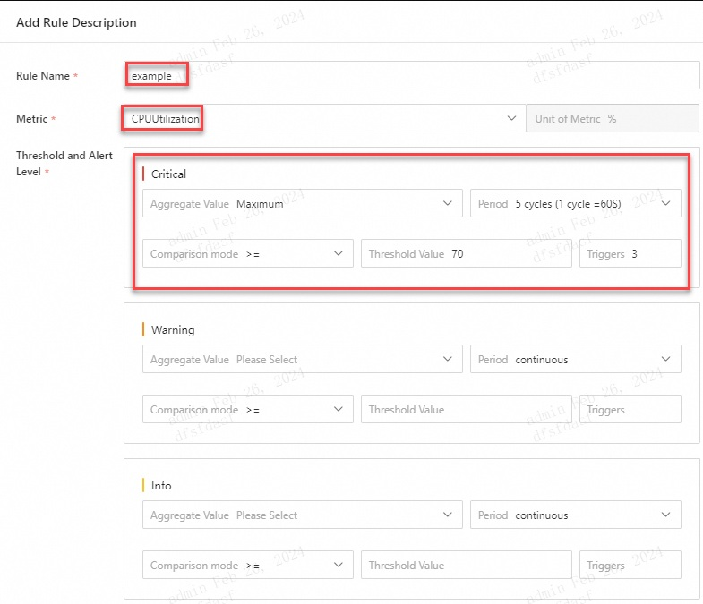

<a id="section-12-3-2"></a>

### 12.3.2. Manage alert rules

From the list of alert rules, you can modify, enable, disable, and delete rules.

**Procedure**

1. Log on to the ApsaraDB for Tair (Redis-compatible) console.

2. On the **Instance List** page, click the ID of the instance.

3. In the navigation pane on the left, click **Cloud Monitor** and then choose **Alert Service** > **Alert Rules**.

4. Find the desired alert rule and perform the required operation.

   | Task | Procedure |
   | --- | --- |
   | View alert rule details | In the <strong>Operation</strong> column of the target alert rule, click <strong>Details</strong> to view the rule details on the <strong>Alert Rule/Alert History/Faulty Resources</strong> panel. |
   | Check rule validity | In the <strong>Validity</strong> column of the target alert rule, click <strong>Click To Inspect</strong>. The inspection result is displayed in the Validity column.<br>Note<br>• If the inspection result is abnormal, click <strong>Detection Result</strong>. In the panel that appears, view the results for <strong>Alert Rule Execution</strong> <strong>Anomaly Detection</strong>, <strong>Alert Rule Load Detection</strong>, <strong>Invalid Alert</strong> <strong>Rule Detection</strong>, and <strong>Alert Rule Callback Detection</strong>.<br>• Click <strong>Re-detect</strong> to check the rule validity again. |
   | View rule execution records | In the <strong>Rule Execution Record</strong> column of the target alert rule, click <strong>View</strong> <strong>Rule Execution Record</strong>. On the <strong>Alert Rule Execution Record</strong> panel, filter the execution records by time range. |
   | Modify an alert rule | i. In the <strong>Operation</strong> column of the target alert rule, click <strong>Edit.</strong><br>ii. On the <strong>Modify Alert Rule</strong> panel, modify the alert rule. For more information about the configuration parameters, see Create an alert rule.<br>iii. After you finish the modification, click <strong>OK</strong>. |
   | Disable an alert rule | Disable alert rules when you manually stop a cloud product for maintenance or an upgrade. This prevents unnecessary alert notifications.<br>Note<br>Before disabling an alert rule, make sure that its <strong>Status</strong> is <strong>Normal</strong>.<br>• Disable a single rule<br>a. In the <strong>Operation</strong> column of the target alert rule, click theicon, and then click <strong>Disable.</strong><br>b. In the <strong>Disable Alert Rule</strong> dialog box, click <strong>OK.</strong><br>• Disable rules in a batch<br>a. Select the check boxes next to the target alert rules, and then click <strong>Disable</strong> in the lower-left corner of the list.<br>b. In the <strong>Disable Alert Rule</strong> dialog box, click <strong>OK</strong>. |
   | Enable an alert rule | After you finish the maintenance or upgrade of a cloud product, re-enable the disabled alert rules.<br>Note<br>Before enabling an alert rule, make sure that its <strong>Status</strong> is <strong>Disabled</strong>.<br>• Enable a single rule<br>a. In the <strong>Operation</strong> column of the target alert rule, click <strong>Enable.</strong><br>b. In the <strong>Enable Alert Rule</strong> dialog box, click <strong>OK.</strong><br>• Enable rules in a batch<br>a. Select the check boxes next to the target alert rules, and then click <strong>Enable</strong> in the lower-left corner of the list.<br>b. In the <strong>Enable Alert Rule</strong> dialog box, click <strong>OK</strong>. |
   | Delete an alert rule | • Delete a single rule<br>a. In the Operation column of the target alert rule, click theicon, and then click <strong>Delete</strong>.<br>b. In the <strong>Delete Alert Rule</strong> dialog box, click <strong>OK</strong>.<br>• Delete rules in a batch<br>a. Select the check boxes next to the target alert rules, and then click Delete in the lower-left corner of the list.<br>b. In the <strong>Delete Alert Rule</strong> dialog box, click <strong>OK</strong>. |

<a id="section-13"></a>

# 13.Diagnosis and optimization

<a id="section-13-1"></a>

## 13.1. Sessions

You can view the sessions of a PolarDB-X cluster and the relevant statistics. PolarDB-X provides the 10-second SQL analysis feature to help you analyze SQL queries whose execution duration is less than 10 seconds in real time if your cluster experiences a sharp spike in the CPU utilization, number of active sessions, or response time.

**Session management**

1. Log in to the PolarDB Converged Edition (Centralized & Distributed) console.

2. Find the cluster that you want to manage and click its ID.

3. In the left-side navigation pane, choose **Diagnostics and Optimization > Instance Sessions**. On the page that appears, view **Instance Sessions** and **Session Statistics**.

   **Instance sessions**

   <ol type="i">

   <li>

   **View abnormal sessions**

   - Click **Anomaly Detection**. In the pop-up dialog box, you can view abnormal sessions that the system identifies, including sessions that have not submitted transactions for a long period of time and sessions that occupy excessive resources.

   - You can click **Optimize** or **End** to handle these sessions.

   </li>

   <li>

   **View key metrics**

   Move the pointer over **Active session**, **Maximum Execution Duration**, **CPU Utilization**, or **Connection Usage** to view the detailed information and trend in the pop-up window.

   </li>

   <li>

   **Other core features**

   - **10s SQL analysis**: Click **10s SQL Analysis** in the upper-right corner to view SQL execution statistics, slow SQL queries, and SQL overview information within the previous 10 seconds, helping you identify transient performance issues.

   - **SQL throttling**: Click **SQL Throttling** to go to the **SQL Throttling** page. On this page, you can configure throttling rules to automatically throttle abnormal or high-load SQL queries to prevent system exhaustion. For more information, see the **SQL throttling** section.

   - **Optimization**: Click **Optimize** to optimize the sessions of the desired instance. For more information, see the **SQL optimization** section.

   - **Export active sessions**.

   - **End sessions**: To terminate a session, you must enter the database account and password for authentication. You can also use a database account with the permissions to terminate the sessions created by using other database accounts, such as a privileged account.

     > **Note**
     >
     > - In the **User** column of a session, you can view the database account that is used to create the session.
     >
     > - Click **End Session History** to query the operation records of all terminated sessions, including the task ID, start time, and end time. This facilitates tracing and auditing.

   </li>

   </ol>

**Session statistics**

- **View session statistics**

  You can view summarized session information by user, access source, or database, including the total number of sessions, the total number of ongoing sessions, and the longest session duration.

- **Export session statistics**

  You can export session statistics by summary, user, access source, or database.

**SQL throttling**

1. Log in to the PolarDB Converged Edition (Centralized & Distributed) console.

2. Find the cluster that you want to manage and click its ID.

3. In the left-side navigation pane, choose **Diagnostics and Optimization > Instance Sessions**.

4. Click **SQL Throttling** in the **Instance Sessions** section.

5. In the **SQL Throttling** dialog box, configure the parameters described in the following table.

   | Parameter | Description |
   | --- | --- |
   | Throttling Mode | The throttling mode. Valid values:<br>• Throttled by Keywords: filters by SQL keywords and throttles the matching SQL queries.<br>• Throttled by SQL Template ID: throttles SQL queries that match the SQL templates with the specified IDs. You can obtain SQL template IDs from SQL logs, sessions, and results of EXPLAIN statements.<br>Note<br>The ID of an SQL template is a hexadecimal string that contains eight characters in length.<br>• Throttled by Execution Duration: throttles SQL queries by execution duration. If the execution duration of an SQL query of the specified type exceeds the specified threshold, the system fetches the ID of the SQL template used by the SQL query and adds the ID to the throttling rule.Then, SQL queries that match the SQL template are executed based on the specified concurrency.<br>Note<br>You can specify the maximum number of SQL template IDs. After the number of SQL template IDs added to the throttling rule reaches the upper limit, the system stops fetching SQL template IDs. |
   | SQL Type | The type of SQL statements that you want to throttle. Valid values: <strong>SELECT</strong>, <strong>UPDATE</strong>, <strong>DELETE</strong>, and <strong>INSERT</strong>. |
   | Maximum Concurrency | The maximum number of concurrent SQL queries. The minimum value is 1.<br>Throttling is triggered when the number of concurrent SQL queries that match the throttling rule reaches the maximum. |
   | Throttling Duration | The duration during which the SQL throttling rule is effective. The throttling feature is intended for emergencies only. We recommend that you specify the throttling duration based on your business requirements and disable SQL throttling when it is no longer needed. |
   | Template ID | The ID of the SQL template used to match and throttle SQL queries.Separate multiple IDs with commas (,).<br>Note<br>This parameter takes effect only when the <strong>Throttling Mode</strong> parameter is set to <strong>Throttled by SQL Template ID</strong>. |
   | Executed At | The execution duration threshold. If the execution duration of an SQL query exceeds the specified threshold, the system fetches the ID of the SQL template that matches the SQL query and adds the ID to the throttling rule.<br>Note<br>This parameter takes effect only when the <strong>Throttling Mode</strong> parameter is set to <strong>Throttled by Execution Duration</strong>. |
   | Maximum Number of Throttled Queries | The maximum number of IDs of SQL templates used to match SQL queries when you set the throttling mode to Throttled by Execution Duration. After the number of SQL template IDs added to the throttling rule reaches the upper limit, the system stops fetching SQL template IDs for SQL queries whose execution duration exceeds the specified threshold.<br>Note<br>This parameter takes effect only when the <strong>Throttling Mode</strong> parameter is set to <strong>Throttled by Execution Duration</strong>. |
   | Database Account with Throttled Queries | The database account to which the throttled SQL queries belong.<br>Note<br>This parameter takes effect only when the <strong>Throttling Mode</strong> parameter is set to <strong>Throttled by SQL Template ID</strong>. |

6. After you complete the configuration, click **Create**.

   After the SQL throttling rule is created, you can view the status of the rule in the throttling rule list.

   If you want to **disable** or **modify** a throttling rule before the specified throttling duration expires, click **Disable** or **Edit** in the **Actions** column of the throttling rule.

**Perform 10-second SQL analysis**

The 10-second SQL analysis feature helps you analyze SQL queries that are executed within a 10-second time window on your cluster in real time. When you perform 10-second SQL analysis on a PolarDB-X cluster, the system executes the  `show processlist`  statement at an interval of 1 second within a 10-second time window. Then, the system analyzes the returned result sets. The analysis result shows the SQL queries that are most frequently executed and whether slow SQL queries exist within the 10-second time window.

1. Log in to the PolarDB Converged Edition (Centralized & Distributed) console.

2. Find the cluster that you want to manage and click its ID.

3. In the left-side navigation pane, choose **Diagnostics and Optimization > Instance Sessions**.

4. Click **10s SQL Analysis**.

5. After 10 seconds, you can view the SQL queries that are most frequently executed and whether slow SQL queries exist within the 10-second time window.

<a id="section-13-2"></a>

## 13.2. Slow query log

This topic describes the slow query log feature of PolarDB-X.

**Introduction**

PolarDB-X provides a slow query log feature that correlates CPU utilization with the number of slow queries, helping you quickly identify SQL statements that degrade database performance. On the feature's interactive page, you can view formatted slow SQL templates, statement details, and key metrics such as execution counts, execution times, and the number of returned rows. You can also diagnose and optimize slow SQL statements. Based on an analysis of a statement's execution plan, the system recommends suitable indexing strategies, such as creating a local index or a global secondary index, and provides a detailed breakdown of the expected performance benefits.

Compute node (CN) slow SQL and data node (DN) slow SQL are defined as follows:

- Compute node (CN) slow SQL: These are logical slow SQL statements that a client sends to PolarDB-X.

- Data node (DN) slow SQL: These are physical slow SQL statements that PolarDB-X sends to storage nodes. This type of slow SQL cannot be optimized.

> **Note**
>
> - PolarDB-X stores slow query logs on each node for up to 30 days before automatically deleting them.
>
> - For a column-oriented read-only instance, you can only view the slow query logs of the compute node (CN).

**View slow query logs**

1. Log on to the PolarDB-X console.

2. Find the target instance and click its instance ID.

3. In the left-side navigation pane, choose **Diagnosis and Optimization > Slow Log**.

4. At the top of the page, click the **Compute Node (CN)** or **Data Node (DN)** tab to view the slow SQL statements for compute nodes and data nodes, respectively.

**Optimize slow queries**

1. Log on to the PolarDB-X console.

2. Find the target instance and click its instance ID.

3. In the left-side navigation pane, choose **Diagnosis and Optimization > Slow Log**.

4. In the slow log statistics tab, find the slow SQL template that you want to optimize and click **Optimize**. Note that you can only optimize slow queries from compute nodes (CNs).

5. View the optimization suggestions for the slow SQL statement.

<a id="section-13-3"></a>

## 13.3. Storage analysis

PolarDB-X provides the storage analysis feature. You can use this feature to view the storage usage of a PolarDB-X instance and the number of days for which the remaining storage space is available. You can also view information about the usage, fragments, and anomaly diagnosis results of a tablespace in a database. This topic describes how to use the storage analysis feature of PolarDB-X.

**Procedure**

1. Log in to the PolarDB Converged Edition (Centralized & Distributed) console.

2. Find the instance that you want to manage and click the instance ID.

3. In the left-side navigation pane, choose **Diagnostics and Optimization > Storage Analysis**.

4. On the **Storage Analysis** page, you can view the following information.

   - On the **Storage Analysis** tab, click the **Storage Overview** tab. You can view data such as the storage overview, exception list, storage trend, and tablespaces.

   - On the **Storage Analysis** tab, click the **Data Space** tab. You can view the storage usage of each database and tablespace.

     Click the name of a tablespace to view the fields and indexes of the tablespace.

<a id="section-13-4"></a>

## 13.4. Lock analysis

This topic describes how to use Lock Analysis.

**Usage notes**

- Version requirement: The instance must be version 5.4.13 or later. Otherwise, clicking **Diagnose Now** returns no results.

- Permission or data exceptions: If the deadlock details show the "You do not have permission to view this deadlock information" message, this can happen if your account lacks the required permissions for the table, or if the table has been deleted.

- Instance limitation: This feature is available only for primary instances and is not supported on read-only instances.

**Procedure**

1. Log on to the PolarDB Integrated Edition console.

2. Find the instance and click **Instance ID** to go to the instance details page.

3. In the left-side navigation pane, click **Diagnosis and Optimization > Lock Analysis**.

4. On the **Lock Analysis** page, click **Diagnose Now** on the left.

5. In the generated deadlock diagnostics list, click **View Details** in the **Details** column.

6. The Lock Analysis dialog box displays deadlock diagnosis details. Click **View Deadlock Log** to view the most recent deadlock log.

<a id="section-13-5"></a>

## 13.5. Performance trends

This topic describes how to view performance trends for PolarDB-X.

PolarDB-X integrates with the performance trends feature of Database Autonomy Service (DAS) to provide monitoring metrics for compute nodes (CNs), data nodes (DNs), GMS nodes, and log nodes (CDCs). It allows you to view performance trends over a specific time range, compare trends between two periods, and create custom charts.

**View performance trends**

1. Log on to the PolarDB-X console.

2. Find the target instance and click the instance ID.

3. In the left-side navigation pane, click **Diagnosis and Optimization > Performance Trends**.

   - Click the tabs on the page to view monitoring metrics for compute nodes (CNs), data nodes (DNs), GMS nodes, and log nodes (CDCs). For detailed descriptions of the metrics, see Performance metrics.

     > **Note**
     >
     > Column-oriented read-only instances do not support viewing metrics for data nodes (DNs) or log nodes (CDCs).

     The node list displays information for each node, such as specifications, CPU usage, memory usage, and active connections.

   - On the **Performance Trends** tab, view the performance trends of each metric within the selected time range.

     - Click **More Metrics** to select the metrics to view.

     - In any metric trend chart, drag to select a time range. You can then diagnose the metric's behavior during the selected period.

     - Click **Details** in a metric trend chart to enlarge it. You can then change the time range to view the metric's trend over different periods.

   - On the **Performance Trend Comparison** tab, set two time periods and click **View** to compare their performance trends.

   - On the **Custom Charts** tab, you can create custom monitoring dashboards to display multiple performance metrics in a single chart for easier troubleshooting and analysis.

     > **Note**
     >
     > If this is your first time using this feature, you must create a monitoring dashboard first.

**Run a performance diagnosis**

In addition to viewing performance trends, you can diagnose a node's resource utilization and slow SQL query performance. In any node's trend chart, drag to select a time range to begin the diagnosis.

> **Note**
>
> Currently, only compute nodes and data nodes support performance diagnosis. GMS nodes and log nodes do not.

1. Log on to the PolarDB-X console.

2. Find the target instance and click the instance ID.

3. In the left-side navigation pane, click **Diagnosis and Optimization > Performance Trends**.

4. In any node's trend chart, drag to select a time range, and then click **Diagnose**.

5. On the diagnosis details page, wait for the task to complete. You can then view any abnormalities in resource utilization and slow SQL queries.

**Performance metrics Compute nodes**

| Metric | Unit | Description |
| --- | --- | --- |
| polardbx.cpu_usage | % | The average CPU usage. |
| polardbx.mem_usage | % | The memory usage of the JVM.Fluctuations in memory usage are normal. |
| polardbx.active_connection | Count | The total number of connections. |
| polardbx.running_thread | Count | The number of active connections. |
| polardbx.network_in_bytes | Byte | The total network input traffic. |
| polardbx.network_out_bytes | Byte | The total network output traffic. |
| polardbx.logic_qps | Per Second | The number of logical SQL statements processed per second. |
| polardbx.physical_qps | Per Second | The number of physical SQL statements processed per second. |
| polardbx.logic_rt | ms | The average response time for logical SQL. |
| polardbx.physical_rt | ms | The average response time for physical SQL. |
| polardbx.slow_request_count | Per Second | The number of logical slow SQL queries per second. |
| polardbx.physical_slow_request _count | Per Second | The number of physical slow SQL queries per second. |

**Data nodes and GMS nodes**

| Metric | Unit | Description |
| --- | --- | --- |
| mysql.tps | Per Second | The number of transactions per second. |
| mysql.qps | Per Second | The number of requests per second. |
| mysql.total_session | Count | The total number of sessions. |
| mysql.active_session | Count | The number of active sessions. |
| mysql.bytes_received | KByte | The average number of bytes received from all clients per second. |
| mysql.bytes_sent | KByte | The average number of bytes sent to all clients per second. |
| mysql.tb.tmp.disk | Count | The number of temporary tables automatically created on disk by MySQL when executing statements. |
| mysql.insert_ps | Per Second | The average number of <code> INSERT </code> statements executed per second. |
| mysql.select_ps | Per Second | The average number of <code> SELECT </code> statements executed per second. |
| mysql.update_ps | Per Second | The average number of <code> UPDATE </code> statements executed per second. |
| mysql.delete_ps | Per Second | The average number of <code> DELETE </code> statements executed per second. |
| mysql.replace_ps | Per Second | The average number of <code> REPLACE </code> statements executed per second. |
| mysql.innodb_data_written | KByte | The average number of bytes written by InnoDB per second. |
| mysql.innodb_data_read | KByte | The average number of bytes read by InnoDB per second. |
| mysql.innodb_buffer_pool_read s_requests | Count | The average number of logical reads from the InnoDB buffer pool per second. |
| mysql.innodb_bp_dirty_pct | % | The percentage of dirty pages in the InnoDB buffer pool.Formula: (Innodb_buffer_pool_pages_dirt y /Innodb_buffer_pool_pages_data) \* 100%. |
| mysql.innodb_bp_hit | % | The InnoDB buffer pool hit ratio.Formula: (Innodb_buffer_pool_read_requ ests -Innodb_buffer_pool_reads) /Innodb_buffer_pool_read_reque sts \* 100%. |
| mysql.innodb_bp_usage_pct | % | The usage percentage of the InnoDB buffer pool. Formula: innodb_buffer_pool_pages_data/(innodb_buffer_pool_pages_dat a + innodb_buffer_pool_pages_free)<br>\* 100%. |
| mysql.innodb_log_writes | Per Second | The average number of physical writes to the InnoDB redo log file per second. |
| mysql.innodb_os_log_fsyncs | Per Second | The average number of <code> fsync() </code> writes to the log file per second. |
| mysql.innodb_rows_deleted | Per Second | The average number of rows deleted from InnoDB tables per second. |
| mysql.innodb_rows_read | Per Second | The average number of rows read from InnoDB tables per second. |
| mysql.innodb_rows_inserted | Per Second | The average number of rows inserted into InnoDB tables per second. |
| mysql.innodb_rows_updated | Per Second | The average number of rows updated in InnoDB tables per second. |
| mysql.mem_usage | % | The memory usage of the MySQL instance as a percentage of the total OS memory. |
| mysql.cpu_usage | % | The CPU usage of the MySQL process (up to 100% on Alibaba Cloud databases). |
| mysql.data.size | MByte | The amount of data space used. |
| mysql.tmp.size | MByte | The amount of temporary table space used. |
| mysql.other.size | MByte | The amount of system space used. |
| mysql.instance.size | MByte | The total space used by the MySQL instance. |
| mysql.log.size | MByte | The amount of log space used. |
| mysql.iops | Count | The number of read and write operations per second. |

**Log nodes**

| Metric | Unit | Description |
| --- | --- | --- |
| polardbx_cdc.cpu_usage | % | CPU usage. |
| polardbx_cdc.mem_usage | % | Memory usage. |
| polardbx_cdc.dumper_heapUsa ge | % | Heap memory usage. |
| polardbx_cdc.dumper_delay | ms | The latency of processing binlog events. |

<a id="section-13-6"></a>

## 13.6. Real-time performance

PolarDB for HTAP provides instance-level real-time performance, helping you monitor your database in real time during stress tests or high-traffic events.

**Procedure**

1. Log on to the PolarDB for HTAP console.

2. Find the instance and click **Instance ID** to go to the instance details page.

3. In the left-side navigation pane, click **Diagnostics and Optimization > Real-time Performance**.

4. On the **Real-time Performance** details page, view the performance metrics.

   > **Note**
   >
   > - PolarDB for HTAP supports two views: **Real-time Chart** and **Real-time Table**. The charts refresh every second.
   >
   > - You cannot view data node (DN) metrics for a column-store read-only instance.

   You can perform the following operations on the details page:

   - Enterprise Edition (Distributed)

     - Click **Parameter Description** to view metric descriptions.

     - Click the **Compute Node(CN)**, **Data Node(DN)**, **GMS Node**, or **Cluster** tab to view its performance information.

     - Click the **Select Node** drop-down list to view performance information for different nodes.

   - Standard Edition (Centralized)

     - Click **Parameter Description** to view metric descriptions.

<a id="section-13-7"></a>

## 13.7. Diagnostic reports

PolarDB Converged Edition (Centralized & Distributed) provides the diagnostic report feature, which helps you comprehensively assess the operational status of your database instance and identify performance bottlenecks and potential risks. You can trigger diagnostics manually or configure scheduled tasks to generate reports automatically. Currently, this feature provides only operational status assessments and issue identification. It does not provide automated optimization recommendations. You can perform troubleshooting and optimization based on the report findings.

**Suggestions**

- Periodically generate diagnostic reports: We recommend that you configure the system to automatically generate daily diagnostic reports for production instances and formulate performance baselines.

- Use slow SQL query optimization: Pay close attention to the top 10 slow SQL queries and high-risk SQL queries, and optimize them promptly.

- Focus on changes in health scores: If the health score consistently drops, check resource configurations or look for performance bottlenecks caused by business growth.

**Procedure**

1. Log in to the PolarDB Converged Edition (Centralized & Distributed) console.

2. Find the instance and click **Instance ID** to go to the instance details page.

3. In the left-side navigation pane, choose **Diagnostics and Optimization > Diagnostic Report**.

4. **Manually initiate a diagnostic**

   Click **Create Reports**. In the dialog box that appears, select a time range (Last 1 Hour, Last 3 Hours, Last 6 Hours, Last 12 Hours, or Last 24 Hours) and click **Confirmation**. The system immediately starts the diagnostic task.

   **Automatically generate diagnostic reports at a scheduled time**

   Click **Auto-generating Report Settings**, select **Scheduled Trigger**, select days and a specific time, and then click **OK**.

   > **Note**
   >
   > Due to system scheduling and resource usage, diagnostic reports may be generated with a delay. The actual time prevails.

   **View diagnostic report details**

   The list on the page shows all available diagnostic reports. Click **View Report** in the Actions column of a diagnostic report to go to the details page. The report displays the following information: instance health status, active sessions, top 10 slow SQL queries, high-risk SQL queries, top 5 tablespaces, redundant indexes, lock analysis, and performance trends.

   In the upper-right corner of the diagnostic report page, click **Deduction Details** to view the health score deduction details.

   **Download a diagnostic report**

   Click **View Report** to go to the diagnostic report details page. Then, click **Download** to download the report to your on-premises machine for archiving or sharing.

<a id="section-14"></a>

# 14.Log management

<a id="section-14-1"></a>

## 14.1. SQL audit and analysis

This topic describes how to query SQL statements.

**Procedure**

1. Log in to the PolarDB Converged Edition (Centralized & Distributed) console.

   > **Note**
   >
   > You can click the following icons in the console to perform corresponding operations:
   >
   > : refreshes the instance list.
   >
   > 
   >
   > : displays the instances in the **Default** or **Compact** mode.
   >
   > 
   >
   > : specifies the instance properties displayed in the instance list.
   >
   > 
   >
   > : exports the instance list to your on-premises device.
   >
   > 

2. Find the cluster that you want to manage and click its name.

3. In the left-side navigation pane, choose **Log Management > SQL Audit and Analysis**.

4. Select a time range from the list or specify a custom time range.

5. Click **Advanced Filter** and enter **SQL statement**, **Database Name**, **Database User**, **Transaction ID**, **Node ID**, and **TraceID** as needed in sequence. Click **Search**.

   > **Note**
   >
   > You can also click **Export File** in the upper-right corner to export the search results as a file.

<a id="section-14-2"></a>

## 14.2. Slow query logs

All PolarDB Converged Edition (Centralized & Distributed) instances support log management. You can query the details of slow query logs of an instance in the PolarDB Converged Edition (Centralized & Distributed) console. The logs help you troubleshoot issues.

**Procedure**

1. Log in to the PolarDB Converged Edition (Centralized & Distributed) console.

2. On the **Instance List** page, click the ID of the instance that you want to view to go to the instance details page.

3. In the left-side navigation pane, choose **Log Management > Slow Query**.

4. Select a time range to view slow query logs.

   > **Note**
   >
   > **Instances of Enterprise Edition (Distributed)** allow you to view the details of slow query logs by **compute node (CN)** and **data node (DN)**.

   | Item | Content |
   | --- | --- |
   | Slow query logs | Records SQL statements within the last 7 days that took longer than one second to execute. Duplicated SQL statements are removed.<br>Note<br>Slow query logs in the console are updated once per minute. However, you can query real-time slow query logs from the <code> mysql.slow_log </code> table. |

<a id="section-15"></a>

# 15.Backup and restoration

<a id="section-15-1"></a>

## 15.1. Back up data

PolarDB-X supports automatic backup and manual backup. This helps you restore historical data from backups. This topic describes the features that are used to back up data.

**Backup types**

PolarDB-X backups consist of data backup and log backup.

- **Data backup**: The system backs up data and creates a backup set. Physical backup is used for data backup. You can restore data to the specific point in time when a backup set is created.

- **Log backup**: The log backup feature is also known as the incremental backup feature. This feature backs up binary logs that record data changes. After log backup is enabled, you can restore data to a specific point in time within the retention period. The data is restored based on the data backup and log backup. The point in time that you specify to restore data is accurate to seconds. For example, if a data backup set of an instance was created at 00:00:01 on January 1, 2021, and log backup is enabled, you can restore data to any second since 00:00:01 on January 1, 2021.

**Usage notes**

- During the backup process, we recommend that you do not scale out, scale up, or scale down your instance to avoid backup failures.

- During the backup process, we recommend that you do not execute DDL statements to avoid backup failures caused by locks on tables.

- You cannot download data backup files or log backup files.

**Configure automatic backup**

1. Log on to the PolarDB for HTAP console.

   > **Note**
   >
   > The console provides the following features:
   >
   > : Click to refresh the instance list.
   >
   > 
   >
   > : Click to switch the instance list view between **Default** and **Compact** modes.
   >
   > 
   >
   > : Click to select the instance properties to display in the list.
   >
   > 
   >
   > : Click to export the instance list to a local file.
   >
   > 

2. Find the instance that you want to manage and click the instance name.

3. In the left-side navigation pane, choose **Restore Data > Backup and Restoration**.

4. On the page that appears, click **Backup Policy**.

5. On the **Data Backup Settings** tab of the Backup Policy page, configure the parameters described in the following table.

   | Parameter | Description |
   | --- | --- |
   | Enable Backup | By default, automatic backup is enabled. |
   | Backup set retention time (7-730) | The retention period for automatic backup. Valid values: 7 to 730. Unit: day.<br>Note<br>• PolarDB-X deletes backup files when their specified retention period expires.<br>• You can configure the related parameters in the ApsaraDB Operations and Maintenance System console to extend the maximum retention period of backup sets. For more information, see the system administration chapter of the Operations and Maintenance Guide. To modify the upper limit of the retention period, click the System Parameter Configuration tab, select Resource Name, search for resources by <code> FRONT_CONFIG_CENTER </code>, and change the value of <code> polardbx_backup_max_retention_time </code>. |
   | Backup Start Time | The start time for automatic backup. You can select a time range from the drop-down list. We recommend that you select a period that is within off-peak hours. |
   | Backup Cycle | The days on which automatic backup is performed.<br>Note<br>To prevent data loss, we recommend that you set the frequency of automatic backup to at least twice a week. |
   | Retention time for log backup (7-730) | The retention period of log backup files. Valid values: 7 to 730. Unit: day.<br>Note<br>PolarDB-X deletes backup files when their specified retention period expires. |

6. Click **OK**.

**Configure log backup for local storage**

1. Log on to the PolarDB for HTAP console.

   > **Note**
   >
   > The console provides the following features:
   >
   > : Click to refresh the instance list.
   >
   > 
   >
   > : Click to switch the instance list view between **Default** and **Compact** modes.
   >
   > 
   >
   > : Click to select the instance properties to display in the list.
   >
   > 
   >
   > : Click to export the instance list to a local file.
   >
   > 

2. Find the instance that you want to manage and click the instance name.

3. In the left-side navigation pane, choose **Restore Data > Backup and Restoration**.

4. On the page that appears, click **Backup Policy**.

5. On the **Local Log Settings** tab of the Backup Policy page, configure the parameters described in the following table.

   | Parameter | Description |
   | --- | --- |
   | Local Logs | The number of recent log backup files retained by the control system. Valid values: 6 to 100. |
   | Retention Period | The retention period for log backup files in the PolarDB-X instance. Default value: 7. Unit: hour.The default value specifies that only the log backup files created within the most recent 7 hours are retained in local storage after log backup is enabled. The log backup files that are created before the most recent 7 hours are deleted. Valid values: 0 to 168. |
   | Space Usage Threshold | The maximum storage that can be used by the backup files of binary logs. Calculation formula: Local storage usage = Size of local binary log backups/Total storage of your PolarDB-X instance. By default, this parameter is set to 30.This value specifies that if the local backup files of binary logs consume more than 30% of the total storage, the system deletes the earliest backup files of binary logs. Valid values: 0 to 50. |
   | Available Space Protection | Specifies whether to forcibly delete the earliest backup files of binary logs. Log deletion is triggered if the used storage of the instance exceeds 80% of the total storage or the available storage is less than 50 GB. By default, this feature is enabled. When the overall storage usage is less than 80% and the available storage exceeds 50 GB, the system stops deleting the backup files of binary logs. |

**Manually create a backup**

1. Log on to the PolarDB for HTAP console.

   > **Note**
   >
   > The console provides the following features:
   >
   > : Click to refresh the instance list.
   >
   > 
   >
   > : Click to switch the instance list view between **Default** and **Compact** modes.
   >
   > 
   >
   > : Click to select the instance properties to display in the list.
   >
   > 
   >
   > : Click to export the instance list to a local file.
   >
   > 

2. Find the instance that you want to manage and click the instance name.

3. In the left-side navigation pane, choose **Restore Data > Backup and Restoration**.

4. On the page that appears, click **Create Backup**.

5. In the message that appears, click **OK**.

**Download backup files**

1. Log on to the PolarDB for HTAP console.

   > **Note**
   >
   > The console provides the following features:
   >
   > : Click to refresh the instance list.
   >
   > 
   >
   > : Click to switch the instance list view between **Default** and **Compact** modes.
   >
   > 
   >
   > : Click to select the instance properties to display in the list.
   >
   > 
   >
   > : Click to export the instance list to a local file.
   >
   > 

2. Find the instance that you want to manage and click the instance name.

   Find the instance that you want to manage and click the instance name.

3. In the left-side navigation pane, choose **Restore Data > Backup and Restoration**.

4. Find the backup file that you want to download and click **Download** in the Actions column.

5. In the **Download Backup Sets** dialog box, click **Copy** below the download link of the backup file that you want to download. Access the copied download link in your browser. The file is automatically downloaded.

<a id="section-15-2"></a>

## 15.2. View and download Binlog backups

This topic describes how to download Binlog backup files for an instance.

1. Log on to the PolarDB for HTAP console.

   > **Note**
   >
   > The console provides the following features:
   >
   > : Click to refresh the instance list.
   >
   > 
   >
   > : Click to switch the instance list view between **Default** and **Compact** modes.
   >
   > 
   >
   > : Click to select the instance properties to display in the list.
   >
   > 
   >
   > : Click to export the instance list to a local file.
   >
   > 

2. Click the name or ID of the target instance to open its details page.

   - For Enterprise Edition (Distributed) instances: In the navigation pane on the left, click **Data Recovery > CDC Binlog Backup**.

   - For Standard Edition (Centralized) instances: In the navigation pane on the left, click **Data Recovery > Binlog Backup**.

   - **Download backup**: Click **Download** in the Actions column for the target backup set.

     > **Note**
     >
     > By default, Binlog backup files are retained for 15 days. If a download link expires during this period, you can refresh the page to generate a new link.

<a id="section-15-3"></a>

## 15.3. Data restoration

PolarDB-X allows you to restore historical data from backups. This topic describes how to restore data.

**Restoration methods**

PolarDB-X supports two restoration modes: by backup set and by point in time.

- Restoration by backup set: The system restores data from a specific backup set. You can restore data only to the point in time when the backup set is created.

- Restoration by point in time: The system restores data based on data backups and log backups. You can restore data to a specific point in time within the specified backup window. The point in time is accurate to seconds. For example, if a data backup set of an instance was created at 00:00:01 on January 1, 2021 and log backup is enabled, you can restore data to any second since 00:00:01 on January 1, 2021.

**Global consistency**

PolarDB-X is a distributed database service. In PolarDB-X, data is stored on multiple data nodes. If distributed transactions exist in an instance, the instance to which data is restored must ensure that data is consistent among data nodes. The following figure provides an example on how to ensure global consistency during account transfers.

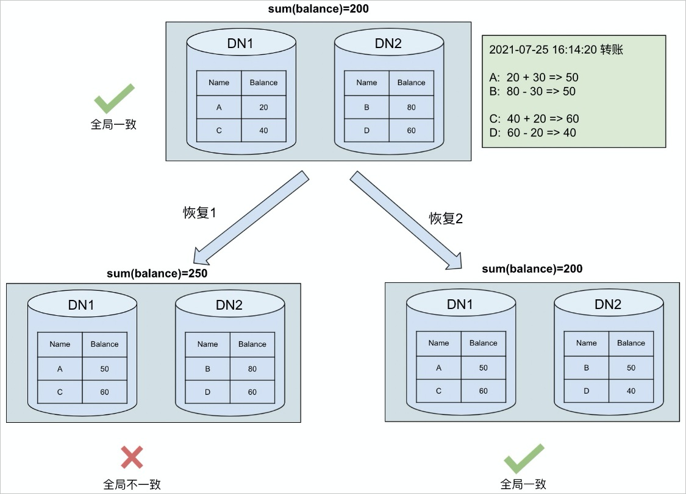

PolarDB-X contains a table of account balances, the data of which is distributed over two data nodes. The sum of the account balances is USD 200. In this example, distributed transactions are used to transfer money between different accounts.

At 16:14:20 on July 25, 2021, Account C transferred CNY 30 to Account A, and Account D transferred CNY 20 to Account C. If you want to restore data to 16:14:20 on July 25, 2021 and ensure global consistency, you can restore data only to the specific point in time before or after the transactions are processed. In this case, the sum of account balances must equal CNY 200, as shown in Restoration 2 in the preceding figure. In this scenario, data cannot be restored based on Restoration 1 that is shown in the preceding figure. If data is restored based on Restoration 1, the sum of account balances during data restoration equals CNY 250. This causes global inconsistency.

**Restore data to a new instance**

PolarDB-X allows you to restore data only to a new instance. After data is restored, we recommend that you use services such as DTS to import the data back to the original instance.

- The new instance to which the data is restored and the original instance must contain the same IP addresses and CIDR blocks in their whitelists, and use the same backup and parameter configurations.

- The data in the new instance is the same as the data in the backup file or the data at the specified point in time.

- The information about the account that is used to create the data backup or log backup is replicated to the new instance.

- The new instance and the original instance use the same topology. This means that the number of nodes in the new instance is the same as the number of nodes in the original instance.

**Restoration by point in time**

1. Log on to the PolarDB for HTAP console.

   > **Note**
   >
   > The console provides the following features:
   >
   > : Click to refresh the instance list.
   >
   > 
   >
   > : Click to switch the instance list view between **Default** and **Compact** modes.
   >
   > 
   >
   > : Click to select the instance properties to display in the list.
   >
   > 
   >
   > : Click to export the instance list to a local file.
   >
   > 

2. Find the instance that you want to manage and click the instance name.

3. In the left-side navigation pane, choose **Restore Data > Backup and Restoration**.

4. Click **Restore By Time**.

5. Configure the parameters and click **Submit**.

   The created instance contains all the data of the original instance. You can use the new instance or migrate the data of the new instance to the original instance.

**Restoration by backup set**

1. Log on to the PolarDB for HTAP console.

   > **Note**
   >
   > The console provides the following features:
   >
   > : Click to refresh the instance list.
   >
   > 
   >
   > : Click to switch the instance list view between **Default** and **Compact** modes.
   >
   > 
   >
   > : Click to select the instance properties to display in the list.
   >
   > 
   >
   > : Click to export the instance list to a local file.
   >
   > 

2. Find the instance that you want to manage and click the instance name.

3. In the left-side navigation pane, choose **Restore Data > Backup and Restoration**.

4. On the **Backup and Restoration** page, find the backup set that you want to restore and click **Restore** in the Actions column.

5. Configure the parameters and click **Submit**.

   > **Note**
   >
   > You must set the restoration method to restoration by backup set.

   The created instance contains all the data of the original instance. You can use the new instance or migrate the data of the new instance to the original instance.

<a id="section-15-4"></a>

## 15.4. Native flashback

This topic describes the native flashback feature. This feature allows you to use SQL statements to query or restore data at a specific point in time. This feature enables you to quickly retrieve historical data after unintended operations. During database O&M, errors such as accidental update or deletion operations may cause business interruptions. Traditional restoration methods, such as binary logs or backup sets, are complex and time-consuming. PolarDB Converged Edition (Centralized & Distributed) provides the native flashback feature. You can use simple SQL statements to query historical data at the specified point in time or restore data to the state before an error occurs. This minimizes business loss.

**Introduction**

Native flashback is a feature implemented by PolarDB Converged Edition (Centralized & Distributed) based on the InnoDB engine. It retains undo logs within a specific time range. This way, you are able to view the historical versions of data. When an unexpected data operation is performed, you can use the  `AS OF`  syntax to quickly query and restore historical data within a few seconds.

**Applicable scope**

- Service edition: PolarDB Converged Edition (Centralized & Distributed)

- Engine version: 8.0

**Usage notes**

- The native flashback feature consumes additional undo tablespace. You can configure the  `innodb_undo_space_supremum_size`  parameter to specify the undo tablespace.

- The native flashback feature returns data at the point in time that is closest to the specified point in time but cannot ensure that the query results exactly match the data at the specified point in time.

- You cannot use the native flashback feature to query or restore tables on which DDL operations have been performed. For example, you cannot use the native flashback feature to query a deleted table.

**Syntax**

The native flashback feature provides the AS OF syntax, which is used to specify the point in time to which you want to restore a table. The following code shows the AS OF syntax:

```sql
 SELECT ... FROM <Table name> AS OF TIMESTAMP <Expression>;
```

The expression specifies the point in time to which you want to restore a table and supports multiple formats. Examples:

```sql
SELECT ... FROM tablename AS OF TIMESTAMP '2020-11-11 00:00:00';

SELECT ... FROM tablename AS OF TIMESTAMP now();

SELECT ... FROM tablename AS OF TIMESTAMP (SELECT now());

SELECT ... FROM tablename AS OF TIMESTAMP DATE_SUB(now(), INTERVAL 1 minute);
```

**Parameters**

The following table describes the parameters for the native flashback feature. You can modify the parameters on the **Configuration Management > Parameter Settings** page.

| Parameter | Description |
| --- | --- |
| innodb_undo_retentio n | • This parameter specifies the retention period of undo records. Undo records that are generated after the retention period ends cannot be queried.<br>• Command format: <code> --innodb-undo-retention=# </code>.<br>• Scope: global parameter.<br>• Data type: INTEGER.<br>• Valid values: 0 to 4294967295.<br>• Unit: seconds.<br>• Default value: 300<br>Note<br>A larger value indicates that the native flashback feature supports queries of earlier historical data and a larger amount of storage is occupied by the undo tablespace. |
| innodb_undo_space_s upremum_size | • This parameter specifies the maximum disk space that can be occupied by the undo tablespace. When the maximum size is reached, the undo records are forcefully deleted regardless of the value of the innodb_undo_retention parameter.<br>• Command format: <code> --innodb-undo-space-supremum-size=# </code>.<br>• Scope: global parameter.<br>• Data type: INTEGER.<br>• Valid values: 0 to 4294967295.<br>• Unit: MB.<br>• Default value: 102400. |
| innodb_undo_space_r eserved_size | • This parameter specifies the amount of the preserved undo tablespace. If the value of the innodb_undo_retention parameter is not 0, a larger value of the innodb_undo_space_reserved_size parameter indicates that more undo records can be reserved in the undo tablespace.<br>• Command format: <code> --innodb-undo-space-reserved-size=# </code>.<br>• Scope: global parameter.<br>• Data type: INTEGER.<br>• Valid values: 0 to 4294967295.<br>• Unit: MB.<br>• Default value: 0.<br>Note<br>If you set this parameter to a large value, a large number of undo records are reserved. As a result, the performance of your cluster is compromised. We recommend that you set this parameter to 0. |

**Example**

1. Prepare test data.

   ```sql
   CREATE TABLE flashback_test (
       id INT PRIMARY KEY,
       name VARCHAR(50)
   );

   INSERT INTO flashback_test VALUES (1, 'Alice'), (2, 'Bob'), (3, 'Charlie');
   ```

2. View the raw data.

   ```sql
   SELECT * FROM flashback_test;

   -- Results
   +----+---------+
   | id | name    |
   +----+---------+
   |  1 | Alice   |
   |  2 | Bob     |
   |  3 | Charlie |
   +----+---------+
   3 rows in set (0.00 sec)
   ```

3. Query the current point in time.

   ```text
   SELECT now();

   -- Results
   +---------------------+
   | now()               |
   +---------------------+
   | 2025-09-25 10:54:48 |
   +---------------------+
   1 row in set (0.00 sec)
   ```

4. Update the data to simulate an unexpected operation.

   ```sql
   UPDATE flashback_test SET name = 'DELETED';

   -- Query data
   SELECT * FROM flashback_test;

   -- Results
   +----+---------+
   | id | name    |
   +----+---------+
   |  1 | DELETED |
   |  2 | DELETED |
   |  3 | DELETED |
   +----+---------+
   3 rows in set (0.00 sec)
   ```

5. Query the historical data at a point in time. A result is successfully returned.

   ```sql
   SELECT * FROM flashback_test AS OF timestamp '2025-09-25 10:54:48';

   -- Results
   +----+---------+
   | id | name    |
   +----+---------+
   |  1 | Alice   |
   |  2 | Bob     |
   |  3 | Charlie |
   +----+---------+
   3 rows in set (0.00 sec)
   ```

   If you query historical data outside the retention period (5 minutes by default) or query a table on which DDL operations are performed, the query failed.

   ```text
   -- Query historical data outside the retention period
   ERROR 7510 (HY000): Snapshot too old

   -- Query a table on which DDL operations are performed
   ERROR 7509 (HY000): The definition of the table required by the flashback query has changed
   ```

6. Restore data.

   > **Note**
   >
   > The following full table restoration operation is used only as an example. In actual scenarios, if you can locate the accidentally modified data, restore the data in batches or record by record.

   <ol type="i">

   <li>

   Create a temporary table with the same schema as the original table.

   ```sql
   CREATE TABLE flashback_test_tmp LIKE flashback_test;
   ```

   </li>

   <li>

   Write historical data from the original table to the temporary table.

   </li>

   </ol>

   ```sql
   INSERT INTO flashback_test_tmp SELECT * FROM flashback_test AS OF timestamp '2025-09-25 10:54:48';
   ```

   <ol type="i" start="3">

   <li>

   Check whether the data in the temporary table is correct.

   </li>

   </ol>

   ```sql
   -- Query data
   SELECT * FROM flashback_test_tmp;

   -- Results
   +----+---------+
   | id | name    |
   +----+---------+
   |  1 | Alice   |
   |  2 | Bob     |
   |  3 | Charlie |
   +----+---------+
   3 rows in set (0.00 sec)
   ```

   <ol type="i" start="4">

   <li>

   Change the name of the original table to  `flashback_test_bak`  and the name of the temporary table to that of the original table. Then, the restoration process is complete.

   > **Note**
   >
   > Before you perform this operation, you must stop reading data from or writing data to the current table.

   ```text
   -- Rename the original table and change the name of the temporary table to that of the original table.
   RENAME TABLE flashback_test TO flashback_test_bak, flashback_test_tmp to 
   flashback_test;
   ```

   </li>

   <li>

   Confirm the restored data.

   ```sql
   -- Query data
   SELECT * FROM flashback_test;

   -- Results
   +----+---------+
   | id | name    |
   +----+---------+
   |  1 | Alice   |
   |  2 | Bob     |
   |  3 | Charlie |
   +----+---------+
   3 rows in set (0.00 sec)
   ```

   </li>

   </ol>

<a id="section-15-5"></a>

## 15.5. Data archiving

The data archiving feature helps you reduce data storage costs. This topic describes how to archive data.

**Background**

In production environments, many applications only require access to recent data. As historical data accumulates, it is accessed less frequently. Businesses need to store this older data at a lower cost while keeping it available for analytics. The key requirements are:

- Automatically clean up data on a schedule.

- Lower data storage costs.

- Keep archived data available for backend analysis and statistics.

PolarDB-X provides a data archiving feature based on a Time-to-Live (TTL) mechanism to address these needs.

**Usage notes**

- PolarDB-X 5.4.20-20251124 and later supports separate storage for hot data.

- You must enable the columnar storage engine before you can use the data archiving feature.

- Data archiving is available only in the Enterprise Edition.

**Enable data archiving**

1. Log on to the PolarDB for HTAP console.

   > **Note**
   >
   > The console provides the following features:
   >
   > : Click to refresh the instance list.
   >
   > 
   >
   > : Click to switch the instance list view between **Default** and **Compact** modes.
   >
   > 
   >
   > : Click to select the instance properties to display in the list.
   >
   > 
   >
   > : Click to export the instance list to a local file.
   >
   > 

2. Find the instance and click its name.

3. In the left-side navigation pane, choose **Data Recovery > Data Archiving**, click **Enable with One Click**, and then click **OK**.

<a id="section-16"></a>

# 16.Migration evaluation

<a id="section-16-1"></a>

## 16.1. Migrate data from a PolarDB-X V1.0 instance to a PolarDB-X V2.0 instance

<a id="section-16-1-1"></a>

### 16.1.1. Migration solution

PolarDB-X provides the migration evaluation feature to help you migrate databases from PolarDB-X 1.0 to PolarDB-X 2.0.

**Terms**

- Source instance: the PolarDB-X 1.0 instance from which you want to migrate a database.

- Source database: the database that you want to migrate from the source instance.

- Destination instance: the PolarDB-X 2.0 instance that receives the database from the source instance.

- Destination database: the database that receives the source database in the destination instance.

**Usage notes**

- The migration evaluation feature allows you to migrate data at the database level. You can migrate data in multiple databases at the same time.

- The migration evaluation feature allows you to migrate schemas and data. Only tables and views can be migrated by using schema migration.

- Database accounts, whitelists, backup policies, and instance parameters cannot be migrated. You must manually configure them at the destination database.

- During migration, do not upgrade or downgrade the source and destination instances, migrate frequently updated tables, change shard keys, or perform DDL operations on the objects that you want to migrate. Otherwise, issues such as migration failures, data inconsistency, and scaling failures may occur.

- If the storage type of the source instance is PolarDB for MySQL, you must enable the binary logging feature for the PolarDB for MySQL instance.

  > **Note**
  >
  > For more information about how to enable binary logging, see the **Upload binary logs** topic in **PolarDB for MySQL (Local Disk) User Guide**.

- The migration process increases the performance load on the destination instance. Therefore, we recommend that you migrate databases to the PolarDB-X 2.0 instance that is currently not serving production workloads.

- You can migrate data from PolarDB-X 1.0 databases to PolarDB-X 2.0 databases that are in AUTO or DRDS mode.

  - When you migrate data to a database in AUTO mode, the version of the destination instance must be 5.4.16-16717637 or later. In addition, you must create an intermediate database in DRDS mode with read and write permissions (the name of the intermediate database must end with _drdstoauto).

  - Due to certain architectural differences between databases in AUTO mode and databases in DRDS mode, if you choose to change the database mode during migration, we recommend that you conduct a business assessment of the destination database mode.

**Prepare for the migration**

**Configure the source instance**

- Set the **binlog_row_image** and binlog_rows_query_log_events parameters of the underlying RDS instance to FULL and ON, respectively. If you do not perform this operation, an error is reported in the precheck phase and the data migration task cannot be started. You can view and modify the preceding parameters by performing the following steps:

  <ol type="i">

  <li>

  Log in to ApsaraDB Operations and Maintenance System.

  > **Note**
  >
  > For more information about how to log in to ApsaraDB Operations and Maintenance System, see the **Log in to ApsaraDB Operations and Maintenance System** topic in **PolarDB Converged Edition (Centralized & Distributed) O&M Guide**.

  </li>

  <li>

  In the left-side navigation pane, choose **Instance management > Instance List**.

  </li>

  <li>

  On the Instance List page, search for the source instance and click the instance ID to go

  </li>

  </ol>

  to the **Instance details** page.

  <ol type="i" start="4">

  <li>

  In the left-side navigation pane, click **Kernel-instance parameters**. On the page that appears, click the **Read/write parameters(The database will not be restarted)** tab.

  </li>

  <li>

  Modify the values of binlog_row_image and binlog_rows_query_log_events.

  </li>

  </ol>

- Set the retention period of local binary logs of the source instance to at least seven days. Otherwise, the incremental task may fail because the binary logs cannot be obtained. You can modify the retention period of local binary logs on the **Backup and Restore** page in the PolarDB-X console.

  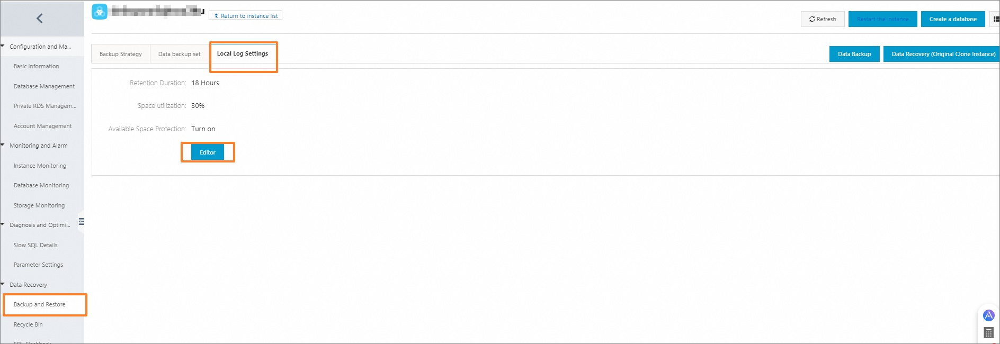

- Make sure that the tables that you want to migrate have **PRIMARY KEY** or **UNIQUE** constraints. Otherwise, an error is reported in the precheck phase and the data migration task cannot be started.

- We recommend that you create and use a dedicated migration account and grant it the read/write permissions to reduce mutual impacts between normal business and migration.

**Configure the destination instance**

- The destination instance must be within the same Apsara Stack account and in the same region as the source instance.

- Create and use a dedicated migration account to reduce mutual impacts between normal business and migration.

- Create a destination database in the destination instance that has the **same character set** as the source database.

  > **Note**
  >
  > You can execute the following statement to view the character set of the source database on the PolarDB-X 1.0 instance:
  >
  > ```sql
  > SELECT default_character_set_name FROM information_schema.SCHEMATA WHERE 
  > schema_name = '...'
  > ```

- Create an account and grant the read/write permissions on the destination database.

- Check for and clean up tables with the same names in both the source and destination databases. Tables that are unique to the destination database are not affected during migration.

**Migration procedure**

1. **Create a migration task**

1. Log in to the PolarDB Converged Edition (Centralized & Distributed) console.

2. In the left-side navigation pane, click **Assess Migration**.

3. On the page that appears, click **Create Migration Task**.

   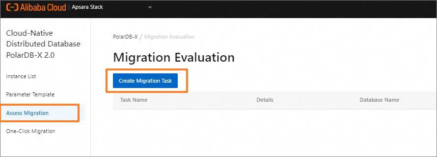

4. On the page that appears, configure the following parameters.

   | Parameter | Description |
   | --- | --- |
   | Task Name | The name of the migration task. |

   <table>
     <tr>
       <td rowspan="5">PolarDB-X 1.0 Instance</td>
       <td>Instance Region</td>
       <td>The region where the source PolarDB-X 1.0 instance resides.<br>Note<br>The source PolarDB-X 1.0 instance and the destination PolarDB-X 2.0 instance must reside in the same region.</td>
     </tr>
     <tr>
       <td>Instance</td>
       <td>The ID of the source PolarDB-X 1.0 instance.<br>Note<br>After you select a region, all PolarDB-X 1.0 instances in the region are displayed in the <strong>Instance</strong> drop-down list.</td>
     </tr>
     <tr>
       <td>Database</td>
       <td>Select the source database to be migrated on the PolarDB-X 1.0 instance.</td>
     </tr>
     <tr>
       <td>Database Account</td>
       <td rowspan="2">The account and password of the selected database. Make sure that the account is granted read/write permissions on the database.</td>
     </tr>
     <tr>
       <td>Database Password</td>
     </tr>
     <tr>
       <td rowspan="4">PolarDB-X 2.0 Instance</td>
       <td>Instance</td>
       <td>• Select a PolarDB-X 2.0 instance in the same region as the PolarDB-X 1.0 instance.<br>• After you select a region for the source instance, all PolarDB-X 2.0 instances in the region are displayed in the <strong>Instance</strong> drop-down list.</td>
     </tr>
     <tr>
       <td>Database</td>
       <td>The destination database on the PolarDB-X 2.0 instance to which you want to migrate data.</td>
     </tr>
     <tr>
       <td>Database Account</td>
       <td rowspan="2">The account and password of the selected database. Make sure that the account is granted read/write permissions on the database.</td>
     </tr>
     <tr>
       <td>Database Password</td>
     </tr>
   </table>

5. Apsara Stack does not support compatibility evaluation. Click **Skip** and then click **Next** to skip the compatibility evaluation step.

   2. **Perform a precheck**

After the compatibility evaluation is skipped, proceed to the **precheck** step:

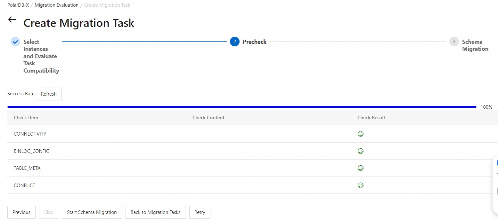

The following items describe the precheck items:

- **CONNECTIVITY**: Check the validity of the usernames, passwords, and permissions of the source and destination databases and the network connectivity between the databases. If this precheck item fails, check whether the usernames, passwords, and permissions of the source and destination instances are correct.

- **BINLOG_CONFIG**: Check whether the parameters related to the binary logging feature are correctly configured for the underlying RDS instance. Make sure that the **binlog_row_image** and binlog_rows_query_log_events parameters of the underlying RDS instance are set to FULL and ON, respectively.

- **TABLE_META**: Check the primary keys of databases and tables on the source instance. If this precheck item fails, check the tables that you want to migrate and make sure that they have PRIMARY KEY or UNIQUE constraints.

- **CONFLICT**: Check whether the destination database contains tables that have the same names as tables in the source database. If this precheck item fails, modify the names of the corresponding tables in the destination database.

> **Note**
>
> - If failed items or errors are reported, you can fix them and click **Retry** to perform a precheck again.
>
> - Make sure that all check items are passed. Otherwise, you cannot proceed to the next step.
>
> - Automatic migration of simple sequences is supported.

3. **Migrate schemas**

After all precheck items are passed, click **Start Schema Migration** to migrate schemas.

> **Important**
>
> If you manually created tables on the destination instance and migrated all tables on the source instance to the destination instance, click **Skip** to skip the schema migration step.

4. **Migrate data**

1. After schemas are migrated, click **Start Migration** to migrate data.

2. After the migration is started, the task status changes to **Preparing**. The system is scheduling resources to prepare for the migration.

3. When the migration task is ready, the status of the task changes to **Migrating**. In this phase, full data and incremental data are migrated.

4. Click the task name to go to the **Task Details** page. In the left-side navigation pane, choose **Migration > Data Migration Details** to view the progress of the migration task.

> **Note**
>
> - Start the full migration process. After the migration task is started, all historical data that you want to migrate from the source database is migrated to the destination database.
>
> - After the full migration is complete, the system immediately starts the incremental migration process. In this process, all data updated in the source database after the full migration starts is synchronized to the destination database.
>
> - Incremental migration is a dynamic and continuous process and does not stop until the business is switched to the destination database.
>
> - If the incremental data migration is delayed by 30 seconds, the data in the destination database is almost the same as the data in the source database. In this case, the system starts the data verification process to verify the consistency between the source and destination databases.

<a id="section-16-1-2"></a>

### 16.1.2. Business switchover and rollback solution

This topic describes the business switchover and rollback solutions for upgrading PolarDB-X 1.0 to PolarDB-X 2.0.

**Prerequisites**

- **Completed** is displayed in the **Calibration progress** section.

- The latency of **Incremental Migration** is less than 20 seconds.

**Overview of switchover solutions**

> **Note**
>
> Switchover with endpoints:
>
> - The version of the PolarDB-X 1.0 instance must be 5.3.8-15489913 or later.
>
> - All databases within a PolarDB-X 1.0 instance must be migrated in the same migration task.
>
> - Switchovers with endpoints modify only the endpoints, not the instance name. Services, such as Data Management (DMS), Data Transmission Service (DTS), and DataWorks, configured based on the instance name must be manually updated.
>
> - The source and destination instances must use the same port number.
>
> - By default, switchovers with endpoints modify the private and public primary endpoints on both sides, but do not modify read-only endpoints. You can update them manually if needed.
>
> - After the domain name is switched, you must wait for the DNS cache on the application side to expire before connections can be established to the new database. This typically takes 30 seconds to 5 minutes. You can also manually fresh the DNS cache on your application server.
>
> - You must **suspend all business operations** throughout the entire switchover process until the DNS records are updated to the new domain name and services can successfully connect to the new database.
>
> Switchover without endpoints:
>
> - The version of the PolarDB-X 1.0 instance must be 5.3.8-15489913 or later.
>
> - After you click Start forward switching, the source database will be set to the read-only state for 60 minutes. You must complete the endpoint modification within this 60-minute window.
>
> - To ensure that all endpoints on the application side are properly updated, we recommend that you revoke write permissions before modifying the endpoints. This prevents accidental dual writes to both the source and destination instances due to missed configurations, which could result in data inconsistency.

**Switchover procedure**

1. In the left-side navigation pane of the migration task details page, click **Switch Details**.

2. If the latency of the **Incremental Migration** is less than 20 seconds, click **Start forward switching** to switch the services from PolarDB-X 1.0 to PolarDB-X 2.0.

3. In the **Start Switchover** dialog box, select **Switchover with Endpoints (Connection Changes Not Required)** or **Switchover without Endpoints (Connection Changes Required)**.

   - If you select **Switchover with Endpoints (Connection Changes Not Required)**, perform the following steps:

     <ol type="a">

     <li>

     Select **Switchover with Endpoints (Connection Changes Not Required)** and click **OK**. The system sets the source database to the read-only state for 60 minutes and waits for the forward synchronization to complete. That is, the destination database and the source database have the same data. Once data consistency is achieved, the system automatically changes the endpoint of PolarDB-X 2.0 to the endpoint of PolarDB-X 1.0.

     </li>

     <li>

     After the endpoint is modified and the DNS cache on the application side becomes invalid, you can automatically connect to PolarDB-X 2.0 without modifying any configurations on the application side.

     > **Note**
     >
     > The duration of this step depends on the expiration time of the DNS cache on the application side, which usually takes 30 seconds to 5 minutes. You can also manually refresh the DNS cache on the application side to accelerate the endpoint modification to take effect.

     </li>

     </ol>

     <ol type="i" start="100">

     <li>

     Continuously observe the source database and confirm that all applications are automatically connected to PolarDB-X 2.0. Then, click **Confirm that the source database has no business connection** to release the read-only status of the source database and start the reverse synchronization link for a rollback.

     > **Note**
     >
     > You can run the  `show processlist`  command to check IP addresses and determine whether a connection from the application side exists.

     </li>

     </ol>

   - If you select **Switchover without Endpoints (Connection Changes Required)**, perform the following steps:

     <ol type="a">

     <li>

     Select **Switchover without Endpoints (Connection Changes Required)** and click **OK**. The system sets the source database to the read-only state for 60 minutes and waits for the forward synchronization to complete. That is, the destination database and the source database have the same data.

     </li>

     <li>

     Once data consistency is achieved, the frontend prompts that you can enable manual switching of database endpoint on the application side. In this case, modify the database endpoint on the application side to connect the application to PolarDB-X 2.0.

     > **Note**
     >
     > If you cannot modify the endpoint string within 60 minutes, you can modify the permissions to ensure that the source database remains in the read-only state during the switchover.

     </li>

     </ol>

     <ol type="i" start="100">

     <li>

     Continuously observe the source database and confirm that all applications are connected to the destination PolarDB-X 2.0. Then, click **Confirm that the source database has no business connection** to release the read-only status of the source database and start the reverse synchronization link for a rollback.

     > **Note**
     >
     > You can run the  `show processlist`  command to check IP addresses and determine whether a connection from the application side exists.

     </li>

     </ol>

**Rollback procedure**

1. In the left-side navigation pane of the migration task details page, click **Switch Details**.

2. When the latency of the reverse synchronization drops below 20 seconds, click **Start Reverse Rollback and Confirm**. The system sets the destination database to the read-only state for 60 minutes and waits until the reverse synchronization is complete. This ensures that the source and destination databases have the same data.

   - If you select **Switchover with Endpoints (Connection Changes Not Required)** for a forward switchover, perform the following steps:

     <ol type="a">

     <li>

     Once data consistency is achieved, the system automatically changes the endpoint of PolarDB-X 2.0 to the endpoint of PolarDB-X 1.0.

     </li>

     <li>

     After the endpoint is modified and the DNS cache on the application side becomes invalid, the system automatically connects to PolarDB-X 1.0 without the need to modify any configurations on the application side.

     > **Note**
     >
     > The duration of this step depends on the expiration time of the DNS cache on the application side, which usually takes 30 seconds to 5 minutes. You can manually refresh the DNS cache on the application side to accelerate the endpoint modification to take effect.

     </li>

     </ol>

     <ol type="i" start="100">

     <li>

     Continuously observe the destination database and confirm that all applications are automatically connected to the source PolarDB-X 1.0. Then, click **Confirm that the destination database has no business connection** to release the read-only status of the destination database.

     > **Note**
     >
     > You can run the  `show processlist`  command to check the connected client IP addresses and determine whether a connection from the application side exists.

     </li>

     </ol>

   - If you select **Switchover without Endpoints (Connection Changes Required)** for a forward switchover, perform the following steps:

     <ol type="a">

     <li>

     Once data consistency is achieved, the frontend prompts that "You can start manual switching of the endpoint string on the application side." In this case, modify the endpoint string on the application side to connect the application to PolarDB-X 1.0.

     > **Note**
     >
     > If you cannot modify the endpoint string within 60 minutes, you can modify the permissions to ensure that the destination database remains in the read-only state during the switchover.

     </li>

     <li>

     Continuously observe the destination database and confirm that all applications are connected to the source PolarDB-X 1.0. Then, click **Confirm that the destination database has no business connection** to release the read-only status of the destination database.

     > **Note**
     >
     > You can run the  `show processlist`  command to check the connected client IP addresses and determine whether a connection from the application side exists.

     </li>

     </ol>

<a id="section-17"></a>

# 17.High availability

<a id="section-17-1"></a>

## 17.1. Single-zone instance

This topic describes the operations performed on a single-zone instance.

**Create an instance**

On the PolarDB-X instance creation page, set the **Deployment Method** parameter to **Single Zone**. For more information, see Create a PolarDB-X instance.

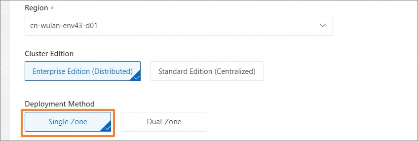

**View an instance**

You can view the details of a zone in the following ways.

- View the zone information in the instance list.

  On the Instance List page, you can view the zone information of the instance.

  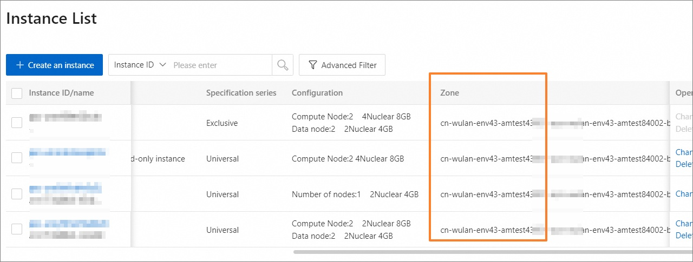

- View the zone information on the instance details page.

  On the instance details page, you can view the zone information of the instance.

  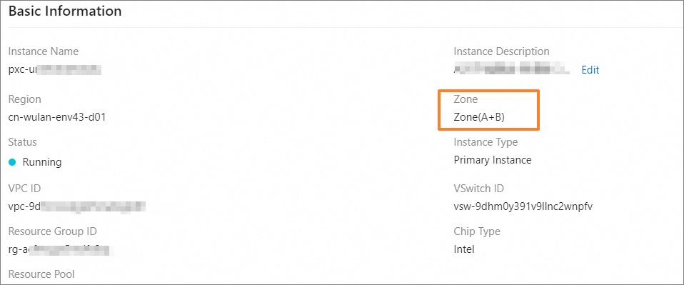

<a id="section-17-2"></a>

## 17.2. Three-zone deployment

This topic describes the operations related to three-zone deployment.

**Create an instance**

On the PolarDB-X instance creation page, set the **Deployment Method** parameter to **Three-Zone Deployment**. For more information, see Create an instance.

**View instances**

You can view the details of a zone in the following ways.

- View the zone information in the instance list.

  On the Instance List page, you can view the zone information of the instance.

  

- View the zone information on the instance details page.

  On the instance details page, you can view the zone information of the instance.

  

- View the zone information in the topology information section.

  On the Basic Information page, you can view the zone in which each node resides and the status of each node in the Topology Information section.

  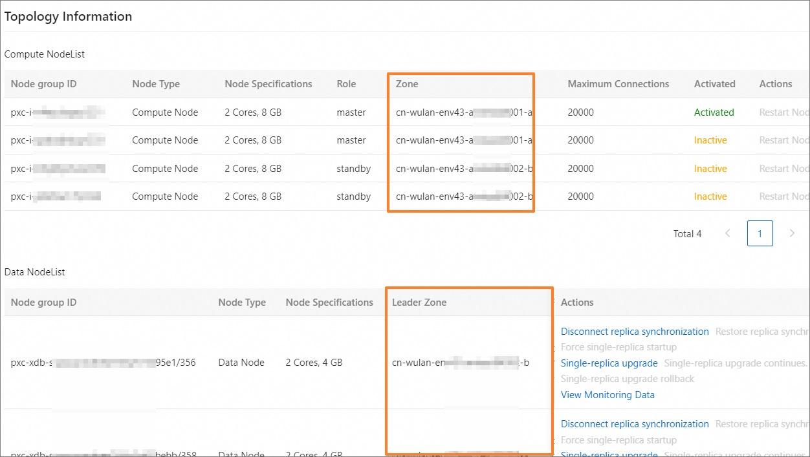

**Add or remove a replica**

1. Log in to the PolarDB Converged Edition (Centralized & Distributed) console.

2. On the **Instance List** page, click the ID of the instance that you want to manage.

3. In the **Topology Information** section of the **Basic Information** page, click **Copy online and offline**.

4. In the dialog box that appears, configure the **Zone**, **Replica Removal and Addition**, and **Forcible Addition and Removal** parameters.

   > **Note**
   >
   > - A replica addition operation adds a data node replica to the instance in the destination zone. You can add a replica only when you remove a replica and want to recover the instance to the original status.
   >
   > - A replica removal operation removes a data node replica from the instance in the destination zone. This may cause data loss. We recommend that you remove a replica only in emergency scenarios, such as a data center failure.

5. Click **OK** to submit the task.

6. In the upper-right corner of the page, click **Tasks** to view the progress of the task.

**Switch the zone of the primary node**

1. Log in to the PolarDB Converged Edition (Centralized & Distributed) console.

2. On the **Instance List** page, click the ID of the instance that you want to manage.

3. In the **Topology Information** section of the **Basic Information** page, click **Primary node zone switchover**.

4. In the dialog box that appears, configure the **Primary Zone** and **Switch mode** parameters.

   > **Note**
   >
   > - When you switch your workloads to another zone, a transient disconnection that lasts approximately 30 seconds occurs. We recommend that you perform the switchover during off-peak hours.
   >
   > - After the switchover succeeds, all primary nodes of the instance are located in the specified primary zone.

5. Click OK to submit the task.

6. In the upper-right corner of the page, click **Tasks** to view the progress of the task.

<a id="section-18"></a>

# 18.Appendix

<a id="section-18-1"></a>

## 18.1. Authorize a tenant organization to access SLB

This topic describes how to grant a tenant organization the permissions to access Server Load Balancer (SLB) and helps you efficiently resolve related issues.

> **Important**
>
> If you need to create and use IPv6 addresses for your business, you must ensure that the current tenant organization has explicitly granted database services the permissions to access SLB. If such permissions are not granted, IPv6 addresses cannot be created.

**Procedure**

1. Log in to the Apsara Uni-manager Management Console.

2. In the top navigation bar, click **Configurations**.

3. In the left-side navigation pane, click **Service-linked Roles**.

4. On the Service-linked Roles page, click **Create Service-linked Role** in the upper-left corner.

   Select **Server Load Balancer** for the **Service Name** parameter, and select the organization to which you want to grant permissions for the **Authorized Organization Name** parameter.

5. Click **OK**.
