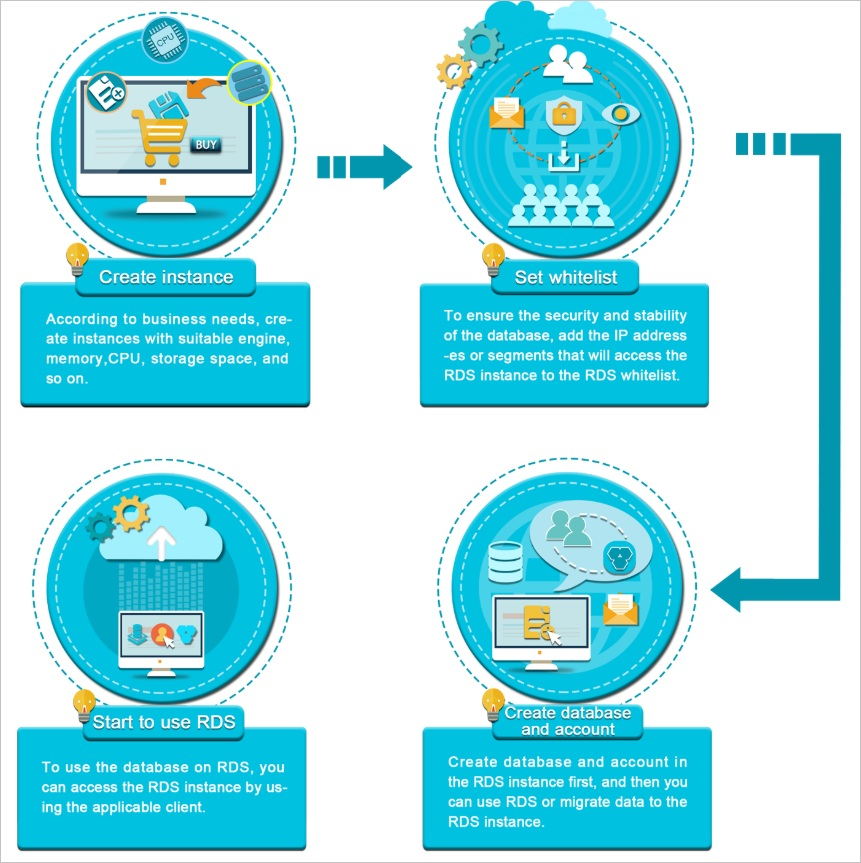
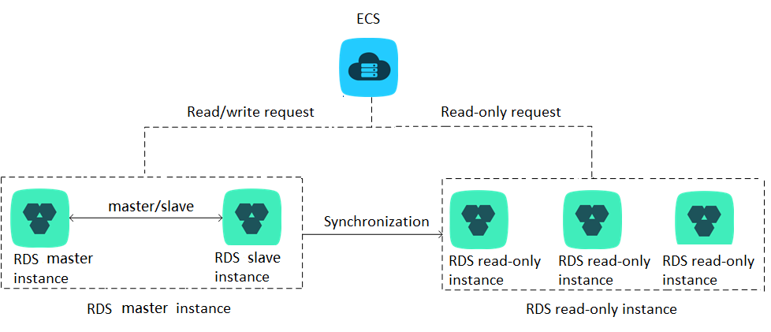
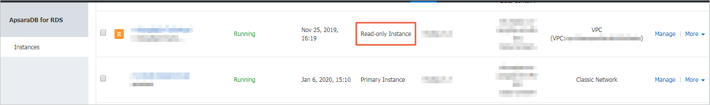
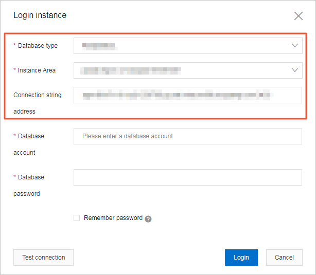
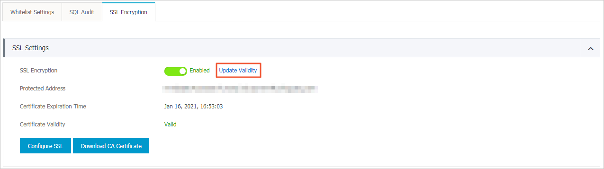

Alibaba Cloud  
Apsara Stack  
ApsaraDB RDS for SQL Server  
User Guide  
Product Version: V3.18.2  
Document Version: 20251105

**Table of Contents**

- [1.Announcement of the lifecycle of ApsaraDB RDS for SQL Server](#section-1)
- [2.What is ApsaraDB RDS?](#section-2)
- [3.Instance types](#section-3)
- [4.Log on to the ApsaraDB RDS console](#section-4)
- [5.Quick Start](#section-5)
    - [5.1. Procedure](#section-5-1)
    - [5.2. Create an instance](#section-5-2)
    - [5.3. Configure an IP address whitelist for an ApsaraDB RDS instance](#section-5-3)
    - [5.4. Connect to an instance](#section-5-4)
    - [5.5. Create an account](#section-5-5)
    - [5.6. Create a database](#section-5-6)
- [6.Instances](#section-6)
    - [6.1. Create an instance](#section-6-1)
    - [6.2. View basic information of an instance](#section-6-2)
    - [6.3. Restart an instance](#section-6-3)
    - [6.4. Specification change](#section-6-4)
    - [6.5. Set a maintenance window](#section-6-5)
    - [6.6. Configure primary/secondary switchover](#section-6-6)
    - [6.7. Release an instance](#section-6-7)
    - [6.8. Read-only instances](#section-6-8)
        - [6.8.1. Overview of read-only ApsaraDB RDS for SQL Server instances](#section-6-8-1)
        - [6.8.2. Create a read-only ApsaraDB RDS for SQL Server instance](#section-6-8-2)
        - [6.8.3. View details of read-only instances](#section-6-8-3)
- [7.Accounts](#section-7)
    - [7.1. Create an account](#section-7-1)
    - [7.2. Reset the password of a database account](#section-7-2)
- [8.Databases](#section-8)
    - [8.1. Create a database](#section-8-1)
    - [8.2. Delete a database](#section-8-2)
    - [8.3. Change the character set collation and the time zone of system databases](#section-8-3)
    - [8.4. Replicate databases between ApsaraDB RDS instances](#section-8-4)
- [9.Database connection](#section-9)
    - [9.1. Change the endpoint and port number of an instance](#section-9-1)
    - [9.2. Apply for or release a public endpoint](#section-9-2)
    - [9.3. Connect to an instance](#section-9-3)
- [10.Monitoring](#section-10)
    - [10.1. View resource and engine monitoring data](#section-10-1)
- [11.Data security](#section-11)
    - [11.1. Configure an IP address whitelist for an ApsaraDB RDS instance](#section-11-1)
    - [11.2. Configure SSL encryption](#section-11-2)
    - [11.3. Configure TDE](#section-11-3)
- [12.Service availability](#section-12)
    - [12.1. Switch workloads between primary and secondary ApsaraDB RDS instances](#section-12-1)
- [13.Database backup and restoration](#section-13)
    - [13.1. Configure an automatic backup policy](#section-13-1)
    - [13.2. Manually back up an instance](#section-13-2)
    - [13.3. Shrink transaction logs](#section-13-3)
- [14.Migrate full backup data to ApsaraDB RDS for SQL Server](#section-14)

<a id="section-1"></a>

# 1.Announcement of the lifecycle of ApsaraDB RDS for SQL Server

Dear customers,

The end of marketing (EOM) date of ApsaraDB RDS for SQL Server on Alibaba Cloud Apsara Stack is April 30, 2024. To better help you complete business innovation and maintain business continuity, Alibaba Cloud hereby informs you of the milestones and alternative services in the lifecycle of ApsaraDB RDS for SQL Server on Alibaba Cloud Apsara Stack. The following table describes the service, end date, and alternative service for each milestone.

<table>
  <tr>
    <th>Service name</th>
    <th>Milestone</th>
    <th>Description</th>
    <th>Date</th>
    <th>Alternative service</th>
  </tr>
  <tr>
    <td rowspan="3">ApsaraDB RDS for SQL Server</td>
    <td>EOM</td>
    <td>Orders for new purchases are no longer supported, but orders for scaling are supported.</td>
    <td>April 30, 2024</td>
    <td rowspan="3">Elastic Compute Service (ECS)-based deployment of commercial SQL Server</td>
  </tr>
  <tr>
    <td>End of full support (EOFS)</td>
    <td>New features or security patches are no longer released. New issues are no longer fixed.However, technical support for existing security patches and bug fixes is provided.</td>
    <td>July 08, 2025</td>
  </tr>
  <tr>
    <td>End of service (EOS)</td>
    <td>Technical support for the service is no longer provided.</td>
    <td>July 8, 2026</td>
  </tr>
</table>

Alibaba Cloud recommends that you make a plan as soon as possible. If you have any questions, contact technical support.

April 2024

<a id="section-2"></a>

# 2.What is ApsaraDB RDS?

ApsaraDB RDS supports four database engines, which are MySQL, SQL Server, PolarDB, and PostgreSQL. You can create RDS instances that run these engines to meet your business requirements.

**SQL Server**

ApsaraDB RDS for SQL Server provides strong support for a variety of enterprise applications under the high-availability architecture, and can restore data to a specific point in time. ApsaraDB RDS for SQL Server helps you reduce costs.

ApsaraDB RDS for SQL Server provides basic features such as whitelist configuration, backup and restoration, transparent data encryption, data migration, and management for instances, accounts, and databases.

<a id="section-3"></a>

# 3.Instance types

This topic describes the instance types of ApsaraDB RDS for SQL Server. Different instance types deliver different performance.

**IOPS**

The maximum IOPS of a standard SSD or an ESSD varies based on the instance type and the storage capacity. The following formula can be used to calculate the IOPS of an ApsaraDB RDS instance that uses standard SSDs or ESSDs. The storage capacity is measured in GB.

```text
min{1800 + 30 × Storage capacity, 25000}
```

> **Note**
>
> If the throughput of an RDS instance reaches the upper limit, the IOPS of the
>
> instance also decreases.

**Primary instance**

**2012 SE and 2016 SE**

<table>
  <tr>
    <th>Instance type</th>
    <th>Number of CPU cores and memory capacity</th>
    <th>Maximum IOPS</th>
    <th>Maximum number of connections</th>
    <th>Storage capacity</th>
  </tr>
  <tr>
    <td>mssql.x4.large.s2</td>
    <td>4 cores, 16 GB</td>
    <td rowspan="9">See IOPS.</td>
    <td rowspan="9">Unlimited</td>
    <td rowspan="9">20 GB-4,000 GB</td>
  </tr>
  <tr>
    <td>mssql.x8.medium.s2</td>
    <td>2 cores, 16 GB</td>
  </tr>
  <tr>
    <td>mssql.x4.3xlarge.s2</td>
    <td>24 cores, 96 GB</td>
  </tr>
  <tr>
    <td>mssql.x4.xlarge.s 2</td>
    <td>8 cores, 32 GB</td>
  </tr>
  <tr>
    <td>mssql.x8.large.s2</td>
    <td>4 cores, 32 GB</td>
  </tr>
  <tr>
    <td>mssql.x8.xlarge.s 2</td>
    <td>8 cores, 64 GB</td>
  </tr>
  <tr>
    <td>mssql.x4.medium.s2</td>
    <td>2 cores, 8 GB</td>
  </tr>
  <tr>
    <td>mssql.x8.2xlarge.s2</td>
    <td>16 cores, 128 GB</td>
  </tr>
  <tr>
    <td>mssql.x4.2xlarge.s2</td>
    <td>16 cores, 64 GB</td>
  </tr>
</table>

**SQL Server 2012 EE and SQL Server 2016 EE**

<table>
  <tr>
    <th>Instance type</th>
    <th>Number of CPU cores and memory capacity</th>
    <th>Maximum IOPS</th>
    <th>Maximum number of connections</th>
    <th>Storage capacity</th>
  </tr>
  <tr>
    <td>mssql.x4.3xlarge.e2</td>
    <td>24 cores, 96 GB</td>
    <td rowspan="14">See IOPS.</td>
    <td rowspan="14">Unlimited</td>
    <td rowspan="14">20 GB-4,000 GB</td>
  </tr>
  <tr>
    <td>mssql.x8.xlarge.e 2</td>
    <td>8 cores, 64 GB</td>
  </tr>
  <tr>
    <td>mssql.x4.2xlarge.e2</td>
    <td>16 cores, 64 GB</td>
  </tr>
  <tr>
    <td>mssql.x4.medium.e2</td>
    <td>2 cores, 8 GB</td>
  </tr>
  <tr>
    <td>mssql.x8.2xlarge.e2</td>
    <td>16 cores, 128 GB</td>
  </tr>
  <tr>
    <td>mssql.x8.7xlarge.e2</td>
    <td>56 cores, 480 GB</td>
  </tr>
  <tr>
    <td>mssql.x8.medium.e2</td>
    <td>2 cores, 16 GB</td>
  </tr>
  <tr>
    <td>mssql.x4.xlarge.e 2</td>
    <td>8 cores, 32 GB</td>
  </tr>
  <tr>
    <td>mssql.x4.4xlarge.e2</td>
    <td>32 cores, 128 GB</td>
  </tr>
  <tr>
    <td>mssql.x8.8xlarge.e2</td>
    <td>64 cores, 512 GB</td>
  </tr>
  <tr>
    <td>mssql.x8.large.e2</td>
    <td>4 cores, 32 GB</td>
  </tr>
  <tr>
    <td>mssql.x8.4xlarge.e2</td>
    <td>32 cores, 256 GB</td>
  </tr>
  <tr>
    <td>mssql.x4.8xlarge.e2</td>
    <td>64 cores, 256 GB</td>
  </tr>
  <tr>
    <td>mssql.x4.large.e2</td>
    <td>4 cores, 16 GB</td>
  </tr>
</table>

**SQL Server 2017 EE**

**Number of CPU**

**Maximum**

**cores and**

**Storage**

**Instance type**

**Maximum IOPS**

**number of**

**memory**

**capacity**

**connections**

**capacity**

mssql.x4.2xlarge.

16 cores, 64 GB

e2

mssql.x8.xlarge.e

8 cores, 64 GB

2

mssql.x4.medium

2 cores, 8 GB

.e2

mssql.x8.2xlarge.

16 cores, 128 GB

e2 mssql.x4.xlarge.e

8 cores, 32 GB

2

mssql.x8.medium

2 cores, 16 GB

.e2

See IOPS.

Unlimited

20 GB-4,000 GB

mssql.x4.4xlarge.

32 cores, 128 GB

e2

mssql.x8.3.xlarge

24 cores, 192 GB

.e2

mssql.x8.8xlarge.

64 cores, 512 GB

e2

mssql.x8.large.e2

4 cores, 32 GB

mssql.x4.8xlarge.

64 cores, 256 GB

e2

mssql.x8.4xlarge.

32 cores, 256 GB

e2

mssql.x4.large.e2

4 cores, 16 GB

**Read-only instance**

**Number of CPU**

**Maximum number**

**Instance type**

**cores and memory**

**Storage capacity**

**of connections**

**capacity**

rds.mssql.c1.large

8 cores, 16 GB

mssql.x8.7xlarge.ro

56 cores, 490 GB

mssql.x4.xlarge.ro

8 cores, 32 GB

mssql.x8.medium.ro

2 cores, 16 GB

rds.mssql.c1.xlarge

8 cores, 32 GB

mssql.x4.4xlarge.ro

32 cores, 131 GB

mssql.x8.3xlarge.ro

24 cores, 196 GB

mssql.x8.8xlarge.ro

64 cores, 524 GB

mssql.x8.large.ro

4 cores, 32 GB

rds.mssql.c2.xlarge

16 cores, 64 GB

Unlimited

20 GB-4,000 GB

mssql.x4.8xlarge.ro

64 cores, 262 GB

mssql.x8.4xlarge.ro

32 cores, 262 GB

rds.mssql.m1.medium

4 cores, 16 GB

rds.mssql.s2.xlarge

2 cores, 8 GB

rds.mssql.s3.large

4 cores, 8 GB

rds.mssql.s2.large

2 cores, 4 GB

mssql.x4.2xlarge.ro

16 cores, 64 GB

mssql.x8.xlarge.ro

8 cores, 64 GB

mssql.x4.medium.ro

2 cores, 8 GB

mssql.x8.2xlarge.ro

16 cores, 131 GB

<a id="section-4"></a>

# 4.Log on to the ApsaraDB RDS console

This topic describes how to log on to the ApsaraDB RDS console.

**Prerequisites**

- Before you log on to the Apsara Uni-manager Management Console, the endpoint of the console is obtained from the deployment staff.

- We recommend that you use Google Chrome.

**Procedure**

1. Enter your username and password.

   Obtain the username and password that you use to log on to the Apsara Uni-manager Management Console from the operations administrator.

   > **Note**
   >
   > The first time that you log on to the Apsara Uni-manager Management
   >
   > Console, you must change the password of your account. For security purposes, your password must meet the minimum complexity requirements. The password must be 10 to 32 characters in length and must contain at least two of the following character types:
   >
   > - Uppercase or lowercase letters
   >
   > - Digits
   >
   > - Special characters, including exclamation points (!), at signs (@), number signs (#), dollar signs ($), and percent signs (%)

2. Click **Log On**.

3. If your account has multi-factor authentication (MFA) enabled, perform corresponding operations in the following scenarios:

   - You log on to the Apsara Uni-manager Management Console for the first time after MFA is enabled by the administrator:

     <ol type="a">

     <li>

     On the Bind Virtual MFA Device page, bind an MFA device.

     </li>

     <li>

     Enter the username and password again as in Step 2 and click **Log On**.

     </li>

     </ol>

     <ol type="i" start="100">

     <li>

     Enter a six-digit MFA verification code and click **Authenticate**.

     </li>

     </ol>

   - You have enabled MFA and bound an MFA device:

     Enter a six-digit MFA verification code and click **Authenticate**.

     > **Note**
     >
     > For more information, see the **Bind a virtual MFA device to enable**
     >
     > **MFA** topic in **Apsara Uni-manager Management Console User Guide**.

4. In the top navigation bar, choose **Products > Database Services > ApsaraDB RDS**.

<a id="section-5"></a>

# 5.Quick Start

<a id="section-5-1"></a>

## 5.1. Procedure

ApsaraDB RDS quick start covers the following topics: creating an ApsaraDB RDS instance, configuring an IP address whitelist, creating a database, creating an account, and connecting to the instance.

The following figure shows the operations that you must perform before you use an ApsaraDB RDS instance.

Figure 1. Quick start flowchart



<a id="section-5-2"></a>

## 5.2. Create an instance

This topic describes how to create an ApsaraDB RDS for SQL Server instance in the ApsaraDB RDS console.

**Prerequisites**

An Apsara Stack tenant account is created.

**Procedure**

1. Log on to the ApsaraDB RDS console.

2. On the **Instances** page, click **Create Instance** in the upper-right corner.

3. Configure the parameters described in the following table.

   **Paramete**

   **Section**

   **Description**

   **r**

   **Organizat**

   The organization to which the instance belongs.

   **ion**

   **Basic Configura tions**

   **Resource**

   The resource set to which the instance belongs.

   **Set**

   The region in which you want to create the instance. Services in

   **Region**

   different regions cannot communicate over an internal network. After the instance is created, the region cannot be changed.

   **Primary Node**

   The zone where the primary instance is deployed.

   **Area**

   **Zone**

   Specifies whether to deploy the primary and secondary instances in

   **Deployme**

   different zones. ApsaraDB RDS supports **Multi-zone Deployment**

   **nt**

   and **Single-zone Deployment**. If you select **Multi-zone**

   **Method**

   **Deployment**, you must configure **Secondary Node Zone**.

   **Database**

   The database engine of the instance. Select **SQLServer**.

   **Engine**

   The version of the database engine. Valid values:

   - **2012_ent_ha**: SQL Server 2012 EE

   - **2012_std_ha**: SQL Server 2012 SE

   **Engine Version**

   - **2016_ent_ha**: SQL Server 2016 EE

   - **2016_std_ha**: SQL Server 2016 SE

   - **2017_ent_ha**: SQL Server 2017 EE

   The edition of the instance. For more information, see the **Instance**

   **Edition**

   **types** topic in **ApsaraDB RDS Product Introduction**.

   The storage type of the instance. Local SSDs, standard SSDs, and

   **Specificat**

   enhanced SSDs (ESSDs) are supported.

   **ions**

   **Storage Type**

   The storage types that are supported vary based on the engine version. The available storage types are listed on the page.

   The specifications of the instance. The maximum number of

   **Instance**

   connections and the maximum IOPS vary based on the memory size.

   **Specificat**

   The actual specifications are displayed in the console. The edition of

   **ions**

   the instance. For more information, see the **Instance types** topic in **ApsaraDB RDS Product Introduction**.

   The storage capacity that is provided to store data files, system files,

   **Storage**

   binary log files, and transaction files in the instance. For more

   **Capacity**

   information, see the **Instance types** topic in **ApsaraDB RDS Product Introduction**.

   <table>
     <tr>
       <td rowspan="6">Network</td>
       <td>Connectio n Type</td>
       <td>The connection type of the instance. Valid values:<br>• <strong>Internet</strong>: Instances of this connection type can be connected over the Internet.<br>• <strong>Internal Network</strong>: Instances of this connection type can be connected over an internal network.<br>Note After the instance is created, its connection type cannot be changed. Proceed with caution.</td>
     </tr>
     <tr>
       <td>Network Type</td>
       <td>The network type of the instance. Valid values:<br>• <strong>Classic Network</strong>: Cloud services in the classic network are not isolated. Unauthorized access to a cloud service can be blocked only by the security group or whitelist of the service.<br>• <strong>VPC</strong>: A virtual private cloud (VPC) helps you build an isolated network environment on Apsara Stack. You can customize route tables, CIDR blocks, and gateways in a VPC. We recommend that you select VPC for improved security.</td>
     </tr>
     <tr>
       <td>VPC</td>
       <td>The VPC in which you want to create the instance.<br>Note When <strong>Network Type</strong> is set to <strong>VPC</strong>, you must specify this parameter.</td>
     </tr>
     <tr>
       <td>vSwitch Zone</td>
       <td>Select the zone where the instance resides.</td>
     </tr>
     <tr>
       <td>VSwitch</td>
       <td>The vSwitch to which the instance is connected.<br>Note When <strong>Network Type</strong> is set to <strong>VPC</strong>, you must specify this parameter.</td>
     </tr>
     <tr>
       <td>IP Whitelist</td>
       <td>The IP address or CIDR block that is allowed to connect to the instance.</td>
     </tr>
     <tr>
       <td rowspan="2">Instance Settings</td>
       <td>Quantity</td>
       <td>The number of instances that you want to create. Default value: 1.</td>
     </tr>
     <tr>
       <td>Instance Name</td>
       <td>The name of the instance.<br>• It must be 2 to 64 characters in length.<br>• It must start with a letter.<br>• It can contain letters, digits, and the following special characters:<br>_ - :<br>• It cannot start with http:// or https://.</td>
     </tr>
   </table>

4. Click **Submit**.

<a id="section-5-3"></a>

## 5.3. Configure an IP address whitelist for an ApsaraDB RDS instance

After you create an ApsaraDB RDS instance, you must add the IP addresses or CIDR blocks that are used for database access to the IP address whitelist of the instance to ensure database security and reliability.

**Background information**

**Procedure**

1. Log on to the ApsaraDB RDS console.

2. On the **Instances** page, find the target instance.

3. Click the instance ID or click **Manage** in the Actions column corresponding to the instance to go to the **Basic Information** page.

4. In the left-side navigation pane, click **Data Security**.

5. On the **Whitelist Settings** tab, click **Edit** corresponding to the **default** whitelist.

   > **Note**
   >
   > - If you want to connect an ECS instance to an ApsaraDB RDS instance by using an internal endpoint, make sure that the two instances are in the same region and have the same network type. Otherwise, the connection fails.
   >
   > - You can also click **Create Whitelist** to create an IP address whitelist.

6. In the **Edit Whitelist** dialog box, enter the IP addresses or CIDR blocks that are allowed to access the instance and click **OK**.

   > **Note**
   >
   > - Limits for IP address whitelists:
   >
   >   - You must separate multiple IP addresses with commas (,). A maximum of 1,000 different IP addresses can be added.
   >
   >     Supported formats are  `0.0.0.0/0` , IP addresses such as  `10.23.12.24` , or CIDR blocks such as  `10.23.12.24/24` .  `/24`  indicates the length of the IP address prefix in the CIDR block. An IP address prefix can contain 1 to 32 bits.
   >
   >   - If an IP address whitelist is empty or contains only  `0.0.0.0/0` , all IP addresses can access the ApsaraDB RDS instance. This may cause security risks to the instance. Proceed with caution.
   >
   > - If you click **Add Internal IP Addresses of ECS Instances**, the IP addresses of all the Elastic Compute Service (ECS) instances that are created within your Apsara Stack tenant account appear. Then, you can select the IP addresses and add them to an IP address whitelist.

<a id="section-5-4"></a>

## 5.4. Connect to an instance

This topic describes how to use Data Management (DMS) to connect to an ApsaraDB RDS instance.

**Prerequisites**

- A database is created. For more information, see Create a database

- A database account is created. For more information, see Create an account.

**Procedure**

1. Log on to the ApsaraDB RDS console.

2. On the **Instances** page, find the target instance.

3. Click the instance ID or click **Manage** in the Actions column corresponding to the instance to go to the **Basic Information** page.

4. Click **Log On to Database** in the upper-right corner of the page.

5. In the **Log on to Database Instance** dialog box of the **DMS** console, check the values of **Database Type**, **Instance Region**, and **Connection string address**. If the values are correct, specify the **Database Account** and **Database password** parameters.

   | Parameter | Description |
   | --- | --- |
   | Database Type | The engine of the database. By default, the engine of the database to be connected is selected. |
   | Instance Region | The region where the instance is deployed. By default, the region of the current instance is selected. |
   | Connection string address | The endpoint of the instance. By default, the endpoint of the current instance is specified. |
   | Database Account | The username of the database account. |
   | Database password | The password of the database account. |

6. Click **Login**.

   > **Note**
   >
   > - If you want the browser to remember the password, select **Remember password** and click **Login**.
   >
   > - If you cannot connect to the instance, check the IP address whitelist settings. For more information, see Configure an IP address whitelist for an ApsaraDB RDS instance.

<a id="section-5-5"></a>

## 5.5. Create an account

This topic describes how to create an account on an ApsaraDB RDS for SQL Server instance.

**Prerequisites**

The instance is in the **Running** state.

**Procedure**

1. Log on to the ApsaraDB RDS console.

2. On the **Instances** page, find the target instance.

3. Click the instance ID or click **Manage** in the Actions column corresponding to the instance to go to the **Basic Information** page.

4. In the left-side navigation pane, click **Accounts**.

5. On the right side of the page, click **Create Account**.

6. Enter the information of the account that you want to create.

   | Paramete r | Description |
   | --- | --- |
   | Database Account | Enter the name of the account. The name must be 2 to 16 characters in length and can contain lowercase letters, digits, and underscores (_). It must start with a lowercase letter and end with a lowercase letter or a digit. |
   | Account Type | • <strong>Privileged Account</strong>: You can select the <strong>Privileged Account</strong> option only if you create an account on your ApsaraDB RDS instance for the first time. Each ApsaraDB RDS instance can have only a single privileged account. The privileged account of an ApsaraDB RDS instance cannot be deleted.<br>• <strong>Standard Account</strong>: You can select the <strong>Standard Account</strong> option only after a privileged account is created on your ApsaraDB RDS instance. Each ApsaraDB RDS instance can have more than one standard account. You must manually grant the permissions on databases to each standard account. |
   | Authorize d Database s (available only for standard accounts) | Select the authorized databases of the account when the <strong>Standard Account</strong> type is selected. If no databases are created, you can leave this parameter empty.<br>You can perform the following steps to grant permissions on more than one database to the account:<br>i. In the <strong>Unauthorized Databases</strong> section, select the databases on which you want to grant permissions to the account.<br>ii. Click <strong>Add</strong> to add the selected databases to the <strong>Authorized Databases</strong> section.<br>iii. In the Authorized Databases section, specify the permissions that the account is granted on each authorized database. The permissions can be <strong>Read/Write</strong>, <strong>Read-</strong><strong>only</strong>, or <strong>Owner</strong>. You can also click <strong>Set All to Read/Write</strong>, <strong>Set All to Read-only</strong>, or <strong>Set All to Owner</strong> to set the permissions of the account on all authorized databases.<br>Note<br>• The account is authorized to create tables, delete tables, and modify schemas in a database only when it has the <strong>Owner</strong> permission on the database.<br>• The account has permissions on all databases and does not require authorization if you select the <strong>Privileged Account</strong> type. |
   | Password | Enter the password of the account. The password must meet the following requirements:<br>• The password is 8 to 32 characters in length.<br>• The password contains at least three of the following character types: uppercase letters, lowercase letters, digits, and special characters.<br>• Special characters include <code> ! @ # $ % ^ &amp; * ( ) _ + - = </code> |
   | Re-enter Password | Enter the password of the account again. |
   | Descripti on | Enter a description that helps identify the account. The description can be up to 256 characters in length. |

7. Click **Create**.

<a id="section-5-6"></a>

## 5.6. Create a database

This topic describes how to create a database on an ApsaraDB RDS for SQL Server instance in the ApsaraDB RDS console.

**Procedure**

1. Log on to the ApsaraDB RDS console.

2. On the **Instances** page, find the target instance.

3. Click the instance ID or click **Manage** in the Actions column corresponding to the instance to go to the **Basic Information** page.

4. In the left-side navigation pane, click **Databases**.

5. In the upper-right corner of the page, click **Create Database**.

6. Configure the parameters for the database that you want to create.

   | Paramete r | Description |
   | --- | --- |
   | Database Name | Enter the name of the database. The name must be 2 to 64 characters in length. It can contain lowercase letters, digits, underscores (_), and hyphens (-). It must start with a lowercase letter and end with a lowercase letter or digit. |
   | Supporte d Character Sets | Select the character set that is supported by the database. You can also select <strong>all</strong> and then select a character set from the drop-down list that appears. |
   | Descripti on | Enter a description of the database to facilitate subsequent management. The description can be up to 256 characters in length. |

7. Click **Create**.

<a id="section-6"></a>

# 6.Instances

<a id="section-6-1"></a>

## 6.1. Create an instance

This topic describes how to create an ApsaraDB RDS for SQL Server instance in the ApsaraDB RDS console.

**Prerequisites**

An Apsara Stack tenant account is created.

**Procedure**

1. Log on to the ApsaraDB RDS console.

2. On the **Instances** page, click **Create Instance** in the upper-right corner.

3. Configure the parameters described in the following table.

   **Paramete**

   **Section**

   **Description**

   **r**

   **Organizat**

   The organization to which the instance belongs.

   **ion**

   **Basic Configura tions**

   **Resource**

   The resource set to which the instance belongs.

   **Set**

   The region in which you want to create the instance. Services in

   **Region**

   different regions cannot communicate over an internal network. After the instance is created, the region cannot be changed.

   **Primary Node**

   The zone where the primary instance is deployed.

   **Area**

   **Zone**

   Specifies whether to deploy the primary and secondary instances in

   **Deployme**

   different zones. ApsaraDB RDS supports **Multi-zone Deployment**

   **nt**

   and **Single-zone Deployment**. If you select **Multi-zone**

   **Method**

   **Deployment**, you must configure **Secondary Node Zone**.

   **Database**

   The database engine of the instance. Select **SQLServer**.

   **Engine**

   The version of the database engine. Valid values:

   - **2012_ent_ha**: SQL Server 2012 EE

   - **2012_std_ha**: SQL Server 2012 SE

   **Engine Version**

   - **2016_ent_ha**: SQL Server 2016 EE

   - **2016_std_ha**: SQL Server 2016 SE

   - **2017_ent_ha**: SQL Server 2017 EE

   The edition of the instance. For more information, see the **Instance**

   **Edition**

   **types** topic in **ApsaraDB RDS Product Introduction**.

   **Specificat ions**

   The storage type of the instance. Local SSDs, standard SSDs, and enhanced SSDs (ESSDs) are supported.

   **Storage Type**

   The storage types that are supported vary based on the engine version. The available storage types are listed on the page.

   The specifications of the instance. The maximum number of

   **Instance**

   connections and the maximum IOPS vary based on the memory size.

   **Specificat**

   The actual specifications are displayed in the console. The edition of

   **ions**

   the instance. For more information, see the **Instance types** topic in **ApsaraDB RDS Product Introduction**.

   The storage capacity that is provided to store data files, system files,

   **Storage**

   binary log files, and transaction files in the instance. For more

   **Capacity**

   information, see the **Instance types** topic in **ApsaraDB RDS Product Introduction**.

   The connection type of the instance. Valid values:

   - **Internet**: Instances of this connection type can be connected over the Internet.

   - **Internal Network**: Instances of this connection type can be

   **Connectio**

   connected over an internal network.

   **n Type**

   > **Note**
   >
   > After the instance is created, its connection type
   >
   > cannot be changed. Proceed with caution.

   The network type of the instance. Valid values:

   - **Classic Network**: Cloud services in the classic network are not isolated. Unauthorized access to a cloud service can be blocked only by the security group or whitelist of the service.

   **Network Type**

   - **VPC**: A virtual private cloud (VPC) helps you build an isolated network environment on Apsara Stack. You can customize route tables, CIDR blocks, and gateways in a VPC. We recommend that

   **Network**

   you select VPC for improved security.

   The VPC in which you want to create the instance.

   **VPC**

   > **Note**
   >
   > When **Network Type** is set to **VPC**, you must
   >
   > specify this parameter.

   **vSwitch**

   Select the zone where the instance resides.

   **Zone**

   The vSwitch to which the instance is connected.

   **VSwitch**

   > **Note**
   >
   > When **Network Type** is set to **VPC**, you must
   >
   > specify this parameter.

   **IP**

   The IP address or CIDR block that is allowed to connect to the

   **Whitelist**

   instance.

   **Quantity**

   The number of instances that you want to create. Default value: 1.

   **Instance**

   The name of the instance.

   **Settings**

   - It must be 2 to 64 characters in length.

   - It must start with a letter.

   **Instance**

   - It can contain letters, digits, and the following special characters:

   **Name**

   _ - :

   - It cannot start with http:// or https://.

4. Click **Submit**.

<a id="section-6-2"></a>

## 6.2. View basic information of an instance

This topic describes how to view the details of an ApsaraDB RDS instance, such as its basic information, internal network connection information, status, and configurations.

**Procedure**

1. Log on to the ApsaraDB RDS console.

2. Use one of the following methods to go to the **Basic Information** page of an instance:

   - On the **Instances** page, click the ID of an instance to go to the **Basic Information** page.

   - On the **Instances** page, click **Manage** in the **Actions** column corresponding to an instance to go to the **Basic Information** page.

<a id="section-6-3"></a>

## 6.3. Restart an instance

This topic describes how to manually restart an RDS instance. This applies if the number of connections exceeds the specified threshold or if an instance has performance issues.

**Prerequisites**

The instance is in the **Running** state.

**Procedure**

1. Log on to the ApsaraDB RDS console.

2. On the **Instances** page, find the instance that you want to manage.

3. Click **Restart Instance** in the upper-right corner.

   > **Note**
   >
   > When you restart an instance, applications are disconnected from the
   >
   > instance. We recommend that you make appropriate service arrangements before you restart an instance. Proceed with caution.

4. In the dialog box that appears, click **OK**.

<a id="section-6-4"></a>

## 6.4. Specification change

This topic describes how to change the specifications of your instance, such as the instance type and storage capacity, if the specifications do not meet the requirements of your application.

> **Important**
>
> When the specification changes take effect, a 30-second network

> **Important**
>
> When the specification changes take effect, a 30-second network
>
> interruption may occur. Business operations that involve databases, accounts, and networks are interrupted. We recommend that you change the specifications during off-peak hours or make sure that your applications are configured with automatic reconnection policies.

**Procedure**

1. Log on to the ApsaraDB RDS console.

2. On the **Instances** page, find the target instance.

3. Click the instance ID or click **Manage** in the Actions column corresponding to the instance to go to the **Basic Information** page.

4. In the **Configuration Information** section, click **Change Specifications**.

5. On the Change Specifications page, set the **Edition**, **Instance Type**, and **Storage Capacity** parameters.

6. Click **Submit**.

<a id="section-6-5"></a>

## 6.5. Set a maintenance window

This topic describes how to set the maintenance window of an ApsaraDB RDS for SQL Server instance. The backend system performs maintenance on the ApsaraDB RDS instance during the maintenance window. This ensures the stability of the ApsaraDB RDS instance. The default maintenance window is from 02:00 (UTC+8) to 06:00 (UTC+8). We recommend that you set the maintenance window to off-peak hours of your business to avoid impacts on your business.

**Background information**

- An instance enters the **Maintaining Instance** state before the maintenance window to ensure stability during the maintenance process. When the instance is in this state, access to data in the database and query operations such as performance monitoring are not affected. However, except for account and database management and IP address whitelist configuration, modification operations such as upgrade, downgrade, and restart are temporarily unavailable.

- During the maintenance window, one or two network interruptions may occur. Make sure that your applications are configured with automatic reconnection policies.

**Procedure**

1. Log on to the ApsaraDB RDS console.

2. On the **Instances** page, find the target instance.

3. Click the instance ID or click **Manage** in the Actions column corresponding to the instance to go to the **Basic Information** page.

4. In the **Configuration Information** section, click **Configure** to the right of **Maintenance Window**.

5. Select a maintenance window and click **Save**.

   > **Note**
   >
   > The maintenance window is displayed in UTC+8.

<a id="section-6-6"></a>

## 6.6. Configure primary/secondary switchover

ApsaraDB RDS provides the primary/secondary switchover feature to ensure the high availability of databases. The primary/secondary switchover is performed when the primary instance becomes unavailable. You can also manually switch your business to the secondary instance.

**Prerequisites**

The instance is in the **Running** state.

**Background information**

An ApsaraDB RDS for SQL Server instance has a secondary instance. Data is synchronized in real time between the primary and secondary instances. You can access only the primary instance. The secondary instance serves only as a backup and does not allow external access. If the primary instance cannot be accessed, your workloads are automatically switched over to the secondary instance. After the switchover, the primary instance becomes the secondary instance.

> **Important**
>
> - You may encounter a network interruption during a switchover. Make sure that your application is configured to automatically reconnect to the instance.
>
> - During a switchover, a 1-minute data quality protection mechanism is enabled for data synchronization. If the primary and secondary database states are incorrect or if the latency for data synchronization exceeds 1 minute due to SQL Server errors, the HA system does not automatically perform the primary/secondary switchover. You must determine whether to perform the switchover.
>
> - If an instance is intermittently unavailable due to excessive mirroring event waits, the switchover is not performed. The instance automatically becomes available again.

**Procedure**

1. Log on to the ApsaraDB RDS console.

2. On the **Instances** page, find the target instance.

3. Click the instance ID or click **Manage** in the Actions column corresponding to the instance to go to the **Basic Information** page.

4. In the left-side navigation pane, click **Service Availability**.

5. In the **Availability Information** section, click **Switch Primary/Secondary Instance**.

6. In the dialog box that appears, specify the time when the switching is performed and click **OK**.

**Result**

After the switchover is complete, the original primary instance becomes the secondary instance for the next primary/secondary switchover.

<a id="section-6-7"></a>

## 6.7. Release an instance

This topic describes how to manually release an instance.

**Background information**

- Only instances in the running state can be manually released.

- After an instance is released, the instance data is immediately deleted. We recommend that you back up your data before you release an instance.

**Procedure**

1. Log on to the ApsaraDB RDS console.

2. Find the instance that you want to release and choose **More > Release Instance**.

3. In the **Release Instance** message, click **Confirm**.

<a id="section-6-8"></a>

## 6.8. Read-only instances

<a id="section-6-8-1"></a>

### 6.8.1. Overview of read-only ApsaraDB RDS for SQL Server instances

This topic provides an overview of read-only ApsaraDB RDS for SQL Server instances. If a large number of read requests overwhelm the primary instance, your business may be interrupted. In this case, you can create one or more read-only instances to offload read requests from the primary instance. This scales the read capability of your database system and increases the throughput of your application.

**Overview**

When a read-only instance is created, the data is replicated from the secondary instance. The data is consistent with that of the primary instance. Data updates of the primary instance are synchronized to all read-only instances.

> **Note**
>
> - Only ApsaraDB RDS instances that run SQL Server 2017 EE support read-only instances.
>
> - Each read-only instance works in a single-node architecture, where no instances are provided as backups.

The following figure shows the topology of read-only instances.



**Features**

- The specifications of a read-only instance can differ from the specifications of the primary instance, and can be changed at any time. We recommend that you select specifications of a read-only instance that are higher than or equal to those of the primary instance. If the specifications of a read-only instance are lower than those of the primary instance, the read-only instance may have high latency or workloads.

- Read-only instances do not require database or account maintenance, because their database and account information is synchronized with the primary instance.

- A read-only instance automatically replicates the IP address whitelists of the primary instance. However, the IP address whitelists for the read-only instance are independent of those of the primary instance. For information about how to modify the whitelists of a read-only instance, see Configure an IP address whitelist for an ApsaraDB RDS instance.

- You can monitor up to 20 system performance metrics, such as the disk capacity, input/output operations per second (IOPS), number of connections, CPU utilization, and network traffic.

**Limits**

- You can create up to seven read-only instances.

- You cannot configure backup policies or manually create backups for read-only instances, because these are already configured or created on the primary instance.

- You cannot create a temporary instance by using a backup set or from a point in time. In addition, you cannot overwrite a read-only instance by using a backup set.

- After a read-only instance is created, you cannot use a data backup file to restore it in overwrite mode.

- You cannot migrate data to read-only RDS instances.

- You cannot create or delete databases on read-only instances.

- You cannot create or delete accounts, authorize accounts, or change the passwords of accounts on read-only instances.

**FAQ**

Can I manage the accounts created on the primary instance from its read-only instances?

No, although accounts created on the primary instance are replicated to its read-only instances, you cannot manage the accounts on the read-only instances. The accounts have only read permissions on the read-only instances.

<a id="section-6-8-2"></a>

### 6.8.2. Create a read-only ApsaraDB RDS for SQL Server instance

This topic describes how to create a read-only ApsaraDB RDS for SQL Server instance. Read-only RDS instances help increase the read capability of your database system and the throughput of your application. Each read-only RDS instance is a replica of the primary RDS instance and has the same data as the primary RDS instance. Data updates on the primary RDS instance are automatically synchronized to all read-only RDS instances that are attached to the primary RDS instance.

**Prerequisites**

The primary instance runs SQL Server 2017 EE.

**Precautions**

- You can create read-only RDS instances for the primary RDS instance, but cannot convert existing RDS instances to read-only RDS instances.

- When you create a read-only RDS instance, ApsaraDB RDS replicates data from the secondary RDS instance to the read-only RDS instance. This prevents interruptions to your workloads on the primary RDS instance.

- You can create up to seven read-only RDS instances for each primary RDS instance.

- For more information about read-only RDS instances, see Overview of read-only ApsaraDB RDS for SQL Server instances.

**Create a read-only instance**

1. Log on to the ApsaraDB RDS console.

2. On the **Instances** page, find the target instance.

3. Click the instance ID or click **Manage** in the Actions column corresponding to the instance to go to the **Basic Information** page.

4. In the **Distributed by Instance Role** section on the right side of the page, click **Create Read-only Instance**.

5. Configure the following parameters and click **Submit**.

   <table>
     <tr>
       <th>Category</th>
       <th>Parameter</th>
       <th>Description</th>
     </tr>
     <tr>
       <td>Area</td>
       <td>Region</td>
       <td>The value is set to the region of the primary RDS instance and cannot be changed.</td>
     </tr>
     <tr>
       <td rowspan="5">Specificatio ns</td>
       <td>Database Engine</td>
       <td>The database engine of the read-only instance, which is the same as that of the primary instance and cannot be changed.</td>
     </tr>
     <tr>
       <td>Engine Version</td>
       <td>The version of the database engine, which is the same as that of the primary instance and cannot be changed.</td>
     </tr>
     <tr>
       <td>Edition</td>
       <td>Set the value to <strong>Read-only</strong>.</td>
     </tr>
     <tr>
       <td>Instance Specificatio ns</td>
       <td>The instance type of the read-only instance. The instance type of the read-only instance can be different from that of the primary instance, and can be changed at any time. For more information, see the <strong>Instance types</strong> topic in <strong>ApsaraDB RDS Product</strong> <strong>Introduction</strong>.<br>Note To ensure I/O performance for data synchronization, we recommend that you make sure that the specifications of the read-only RDS instance are higher than or equal to the specifications of the primary RDS instance. In this case, the specifications refer to the memory capacity.</td>
     </tr>
     <tr>
       <td>Storage Capacity</td>
       <td>The storage capacity of the read-only instance. To ensure sufficient I/O throughput for data synchronization, we recommend that you select at least the same instance type and storage capacity as the primary instance for the read-only instance. For more information, see the <strong>Instance types</strong> topic in <strong>ApsaraDB</strong> <strong>RDS Product Introduction</strong>.</td>
     </tr>
     <tr>
       <td rowspan="3">Network</td>
       <td>Network Type</td>
       <td>The network type of the read-only instance. This must be the same as that of the primary instance and cannot be changed.</td>
     </tr>
     <tr>
       <td>VPC</td>
       <td>The VPC in which you want to create the read-only instance.</td>
     </tr>
     <tr>
       <td>VSwitch</td>
       <td>The vSwitch in the VPC.</td>
     </tr>
   </table>

<a id="section-6-8-3"></a>

### 6.8.3. View details of read-only instances

This topic describes how to view details of read-only instances. You can go to the Basic Information page of a read-only instance from the Instances page or the read-only instance list of the primary instance. Read-only instances are managed in the same way as primary instances. The read-only instance management page shows the management operations that can be performed.

**View instance details by using a read-only instance**

1. Log on to the ApsaraDB RDS console.

2. On the **Instances** page, click the ID of a read-only instance. The **Basic Information** page appears. In the instance list, **Instance Role** of read-only instances is displayed as **Read-only Instance**, as shown in View a read-only instance.

   Figure 1. View a read-only instance

   

**View instance details by using the primary instance**

1. Log on to the ApsaraDB RDS console.

2. On the **Instances** page, find the target instance.

3. Click the instance ID or click **Manage** in the Actions column corresponding to the instance to go to the **Basic Information** page.

4. On the **Basic Information** page, move the pointer over the number below **Read-only Instance** in the **Distributed by Instance Role** section. The ID of the read-only instance is displayed.

5. Click the ID of the read-only instance to go to the read-only instance management page.

<a id="section-7"></a>

# 7.Accounts

<a id="section-7-1"></a>

## 7.1. Create an account

This topic describes how to create an account on an ApsaraDB RDS for SQL Server instance.

**Prerequisites**

The instance is in the **Running** state.

**Procedure**

1. Log on to the ApsaraDB RDS console.

2. On the **Instances** page, find the target instance.

3. Click the instance ID or click **Manage** in the Actions column corresponding to the instance to go to the **Basic Information** page.

4. In the left-side navigation pane, click **Accounts**.

5. On the right side of the page, click **Create Account**.

6. Enter the information of the account that you want to create.

   | Paramete r | Description |
   | --- | --- |
   | Database Account | Enter the name of the account. The name must be 2 to 16 characters in length and can contain lowercase letters, digits, and underscores (_). It must start with a lowercase letter and end with a lowercase letter or a digit. |
   | Account Type | • <strong>Privileged Account</strong>: You can select the <strong>Privileged Account</strong> option only if you create an account on your ApsaraDB RDS instance for the first time. Each ApsaraDB RDS instance can have only a single privileged account. The privileged account of an ApsaraDB RDS instance cannot be deleted.<br>• <strong>Standard Account</strong>: You can select the <strong>Standard Account</strong> option only after a privileged account is created on your ApsaraDB RDS instance. Each ApsaraDB RDS instance can have more than one standard account. You must manually grant the permissions on databases to each standard account. |

   <table>
     <tr>
       <td>Authorize d Database s (available only for standard accounts)</td>
       <td>Select the authorized databases of the account when the <strong>Standard Account</strong> type is selected. If no databases are created, you can leave this parameter empty.<br>You can perform the following steps to grant permissions on more than one database to the account:<br>i. In the <strong>Unauthorized Databases</strong> section, select the databases on which you want to grant permissions to the account.<br>ii. Click <strong>Add</strong> to add the selected databases to the <strong>Authorized Databases</strong> section.<br>iii. In the Authorized Databases section, specify the permissions that the account is granted on each authorized database. The permissions can be <strong>Read/Write</strong>, <strong>Read-</strong><strong>only</strong>, or <strong>Owner</strong>. You can also click <strong>Set All to Read/Write</strong>, <strong>Set All to Read-only</strong>, or <strong>Set All to Owner</strong> to set the permissions of the account on all authorized databases.<br>Note<br>• The account is authorized to create tables, delete tables, and modify schemas in a database only when it has the <strong>Owner</strong> permission on the database.<br>• The account has permissions on all databases and does not require authorization if you select the <strong>Privileged Account</strong> type.</td>
     </tr>
     <tr>
       <td>Password</td>
       <td>Enter the password of the account. The password must meet the following requirements:<br>• The password is 8 to 32 characters in length.<br>• The password contains at least three of the following character types: uppercase letters, lowercase letters, digits, and special characters.<br>• Special characters include <code> ! @ # $ % ^ &amp; * ( ) _ + - = </code></td>
     </tr>
     <tr>
       <td>Re-enter Password</td>
       <td>Enter the password of the account again.</td>
     </tr>
     <tr>
       <td>Descripti on</td>
       <td>Enter a description that helps identify the account. The description can be up to 256 characters in length.</td>
     </tr>
   </table>

7. Click **Create**.

<a id="section-7-2"></a>

## 7.2. Reset the password of a database account

You can reset the password of your database account in the ApsaraDB RDS console.

**Prerequisites**

- The RDS instance is in the **Running** state.

- A database account is created. For information about how to create a database account, see Create an account.

**Procedure**

1. Log on to the ApsaraDB RDS console.

2. On the **Instances** page, find the instance that you want to manage.

3. In the left-side navigation pane, click **Accounts**.

4. Find an account and click **Reset Password** in the Actions column.

5. In the dialog box that appears, enter and confirm the new password, and then click **OK**.

   > **Note**
   >
   > The password must meet the following requirements:
   >
   > - It can be 8 to 32 characters in length.
   >
   > - It must contain at least three of the following character types: uppercase letters, lowercase letters, digits, and special characters.
   >
   > - Supported special characters:
   >
   >   ! @ # $ % ^ & \* ( ) _ + - =

<a id="section-8"></a>

# 8.Databases

<a id="section-8-1"></a>

## 8.1. Create a database

This topic describes how to create a database on an ApsaraDB RDS for SQL Server instance.

**Terms**

- Instance: a virtualized database server on which you can create and manage more than one database.

- Database: a set of data that is stored in an organized manner and can be shared by a number of users. A database provides the minimal redundancy and is independent of applications. In simple words, a database is a data warehouse that is used to store data.

- Character set: a collection of letters, special characters, and encoding rules that are used in a database.

**Prerequisites**

An ApsaraDB RDS for SQL Server instance is created. For more information, see Create an instance.

**Procedure**

For more information, see Create a database.

<a id="section-8-2"></a>

## 8.2. Delete a database

This topic describes how to delete a database from an ApsaraDB RDS for SQL Server instance. You can delete a database by using the ApsaraDB RDS console or an SQL statement.

**Use the console to delete a database**

1. Log on to the ApsaraDB RDS console.

2. On the **Instances** page, find the target instance.

3. Click the instance ID or click **Manage** in the Actions column corresponding to the instance to go to the **Basic Information** page.

4. In the left-side navigation pane, click **Databases**.

5. Find the database that you want to delete and click **Delete** in the **Actions** column.

6. In the message that appears, click **Confirm**.

**Execute an SQL statement to delete a database**

1. Log on to the ApsaraDB RDS console.

2. On the **Instances** page, find the target instance.

3. Click the instance ID or click **Manage** in the Actions column corresponding to the instance to go to the **Basic Information** page.

4. Click **Log On to DB** in the upper-right corner of the page.

5. In the **Login instance** dialog box of the **DMS** console, check values of **Database type**, **Instance Area**, and **Connection string address**. If the information is correct, enter **Database account** and **Database password**, as shown in the following figure.

   

   | Parameter | Description |
   | --- | --- |
   | Database type | The engine of the database. By default, the engine of the database to be connected is displayed. |
   | Instance Area | The region where the instance is deployed. By default, the region of the current instance is displayed. |
   | Connection string address | The endpoint of the instance. By default, the endpoint of the current instance is displayed. |
   | Database account | The account of the database to be connected. |
   | Database password | The password of the account used to connect to the database. |

6. Click **Login**.

   > **Note**
   >
   > - If you want the browser to remember the password, select **Remember password** and click **Login**.
   >
   > - If you cannot connect to the instance, check the IP address whitelist settings. For more information, see Configure an IP address whitelist for an ApsaraDB RDS instance.

7. The **SQLConsole** page appears after you log on to the instance. Execute a statement in the following format to delete a database:

   ```text
   drop database <database name>;
   ```

   > **Note**
   >
   > If the instance runs SQL Server 2012 or later on RDS High-availability
   >
   > Edition, you can also use the following stored procedure. This stored procedure deletes the specified database, removes the associated image, and closes the connection to the database.
   >
   > ```text
   > EXEC sp_rds_drop_database 'database name'
   > ```

8. Click **Execute**.

<a id="section-8-3"></a>

## 8.3. Change the character set collation and the time zone of system databases

This topic describes how to change the character set collation and the time zone of system databases. System databases include master, msdb, tempdb, and model.

**Prerequisites**

- The instance runs SQL Server 2012, 2016, or 2017.

- No database other than system databases exists on the instance.

  > **Note**
  >
  > If you have just deleted databases from the instance, the deletion task may
  >
  > be pending in the secondary instance. Before you change the character set collation and the time zone, make sure that the primary and secondary instances do not contain databases.

**Precautions**

- The default character set collation is Chinese_PRC_CI_AS.

- The default time zone is China Standard Time.

- You can view the available character set collations and time zones in the console.

- The instance is in the unavailable state during the change process. It takes about 1 minute to change the time zone, and 2 to 10 minutes to change the character set collation.

**Procedure**

1. Log on to the ApsaraDB RDS console.

2. On the **Instances** page, find the target instance.

3. Click the instance ID or click **Manage** in the Actions column corresponding to the instance to go to the **Basic Information** page.

4. In the left-side navigation pane, click **Databases**.

5. On the Databases page, click **Change Character Set Collation and Time Zone**.

   > **Note**
   >
   > If you fail to find this button on the page, make sure that the requirements
   >
   > in Prerequisites are met.

6. In the dialog box that appears, select **Time Zone**, **Character Set Collation**, or both of them, and click **OK**.

**UTC offsets of time zones**

| Time zone | UTC offset | Description |
| --- | --- | --- |
| Afghanistan Standard Time | (UTC+04:30) | Kabul |
| Alaskan Standard Time | (UTC-09:00) | Alaska |
| Arabian Standard Time | (UTC+04:00) | Abu Dhabi, Muscat |
| Atlantic Standard Time | (UTC-04:00) | Atlantic Time (Canada) |
| AUS Central Standard Time | (UTC+09:30) | Darwin |
| AUS Eastern Standard Time | (UTC+10:00) | Canberra, Melbourne, Sydney |
| Belarus Standard Time | (UTC+03:00) | Minsk |
| Canada Central Standard Time | (UTC-06:00) | Saskatchewan |
| Cape Verde Standard Time | (UTC-01:00) | Cabo Verde Is. |
| Cen. Australia Standard Time | (UTC+09:30) | Adelaide |
| Central America Standard Time | (UTC-06:00) | Central America |
| Central Asia Standard Time | (UTC+06:00) | Astana |
| Central Brazilian Standard Time | (UTC-04:00) | Cuiaba |
| Central Europe Standard Time | (UTC+01:00) | Belgrade, Bratislava, Budapest, Ljubljana, Prague |
| Central European Standard Time | (UTC+01:00) | Sarajevo, Skopje, Warsaw, Zagreb |
| Central Pacific Standard Time | (UTC+11:00) | Solomon Islands, New Caledonia |
| Central Standard Time | (UTC-06:00) | Central Time (US and Canada) |
| Central Standard Time (Mexico) | (UTC-06:00) | Guadalajara, Mexico City, Monterrey |
| China Standard Time | (UTC+08:00) | Beijing, Chongqing, Hong Kong, Urumqi |
| E. Africa Standard Time | (UTC+03:00) | Nairobi |
| E. Australia Standard Time | (UTC+10:00) | Brisbane |
| E. Europe Standard Time | (UTC+02:00) | Chisinau |
| E. South America Standard Time | (UTC-03:00) | Brasilia |
| Eastern Standard Time | (UTC-05:00) | Eastern Time (US and Canada) |
| Georgian Standard Time | (UTC+04:00) | Tbilisi |
| GMT Standard Time | (UTC) | Dublin, Edinburgh, Lisbon, London |
| Greenland Standard Time | (UTC-03:00) | Greenland |
| Greenwich Standard Time | (UTC) | Monrovia, Reykjavik |
| GTB Standard Time | (UTC+02:00) | Athens, Bucharest |
| Hawaiian Standard Time | (UTC-10:00) | Hawaii |
| India Standard Time | (UTC+05:30) | Chennai, Kolkata, Mumbai, New Delhi |
| Jordan Standard Time | (UTC+02:00) | Amman |
| Korea Standard Time | (UTC+09:00) | Seoul |
| Middle East Standard Time | (UTC+02:00) | Beirut |
| Mountain Standard Time | (UTC-07:00) | Mountain Time (US and Canada) |
| Mountain Standard Time (Mexico) | (UTC-07:00) | Chihuahua, La Paz, Mazatlan |
| US Mountain Standard Time | (UTC-07:00) | Arizona |
| New Zealand Standard Time | (UTC+12:00) | Auckland, Wellington |
| Newfoundland Standard Time | (UTC-03:30) | Newfoundland |
| Pacific SA Standard Time | (UTC-03:00) | Santiago |
| Pacific Standard Time | (UTC-08:00) | Pacific Time (US and Canada) |
| Pacific Standard Time (Mexico) | (UTC-08:00) | Baja California |
| Russian Standard Time | (UTC+03:00) | Moscow, St. Petersburg, Volgograd |
| SA Pacific Standard Time | (UTC-05:00) | Bogota, Lima, Quito, Rio Branco |
| SE Asia Standard Time | (UTC+07:00) | Bangkok, Hanoi, Jakarta |
| China Standard Time | (UTC+08:00) | Kuala Lumpur, Singapore |
| Tokyo Standard Time | (UTC+09:00) | Osaka, Sapporo, Tokyo |
| US Eastern Standard Time | (UTC-05:00) | Indiana (East) |
| UTC | UTC | Coordinated Universal Time |
| UTC-02 | (UTC-02:00) | Coordinated Universal Time-02 |
| UTC-08 | (UTC-08:00) | Coordinated Universal Time-08 |
| UTC-09 | (UTC-09:00) | Coordinated Universal Time-09 |
| UTC-11 | (UTC-11:00) | Coordinated Universal Time-11 |
| UTC+12 | (UTC+12:00) | Coordinated Universal Time+12 |
| W. Australia Standard Time | (UTC+08:00) | Perth |
| W. Central Africa Standard Time | (UTC+01:00) | West Central Africa |
| W. Europe Standard Time | (UTC+01:00) | Amsterdam, Berlin, Bern, Rome, Stockholm, Vienna |

<a id="section-8-4"></a>

## 8.4. Replicate databases between ApsaraDB RDS instances

This topic describes how to replicate databases between ApsaraDB RDS instances that run SQL Server 2012 or SQL Server 2016.

**Prerequisites**

The source and destination instances must meet the following requirements:

- The source and destination instances belong to the same Apsara Stack tenant account.

- The engine version of the destination instance is not earlier than that of the source instance.

- The source and destination instances reside in the same region and use the same network type. Their zones can be different.

- The destination instance does not have databases whose names are the same as those of the databases that you want to replicate.

- The available storage capacity of the destination instance is larger than the size of the databases that you want to replicate from the source instance.

**Background information**

During the replication process, ApsaraDB RDS first performs a full backup of the source instance and then replicates the full data to the destination instance. If data is written to the source instance during the replication, incremental data of the source instance is not replicated to the destination instance.

You can choose to replicate a single database or all databases in the source instance. If the replication task fails, no data is transferred to the destination instance. This ensures data consistency.

**Procedure**

1. Log on to the ApsaraDB RDS console.

2. On the **Instances** page, find the instance that you want to manage.

3. In the left-side navigation pane, click **Databases**.

4. Click **Replicate to Another Instance**. In the dialog box that appears, configure the parameters described in the following table.

   | Paramete r | Description |
   | --- | --- |
   | Source Instance Name | The ID of the source instance. |
   | Target Instance Name | The ID of the destination instance.<br>The drop-down list displays all the instances that reside in the same region and use the same SQL Server version as the source instance. You can select a destination instance from the drop-down list. |
   | Source Database s | The databases that you want to replicate to the destination instance. You can click the <strong>&gt;</strong> or <strong>&lt;</strong> icon to add or remove databases.<br>Note You can select multiple databases to batch add or remove databases.<br>Make sure that the following conditions are met:<br>• The available storage capacity of the destination instance is larger than the size of the databases that you want to replicate from the source instance.<br>• The destination instance does not have databases whose names are the same as those of the databases that you want to replicate.<br>Note<br>• During the replication process, database accounts and account permissions are also replicated from the source instance to the destination instance.<br>• If the destination instance has accounts whose usernames are the same as those of accounts on the source instance, the accounts on the destination instance are granted the same permissions as the accounts on the source instance.<br>• If the destination instance does not have the same accounts, the accounts are first created on the destination instance and then granted the same permissions as the accounts on the source instance.<br>• If the source and destination instances have databases whose names are the same, these databases are not replicated. |

5. Click **OK**.

<a id="section-9"></a>

# 9.Database connection

<a id="section-9-1"></a>

## 9.1. Change the endpoint and port number of an instance

This topic describes how to view and change the endpoint and port number of an instance.

**View the endpoint and port number**

1. Log on to the ApsaraDB RDS console.

2. On the **Instances** page, find the instance that you want to manage.

3. In the left-side navigation pane, click **Database Connection**.

   You can view the **Internal Endpoint** and **Internal Port** of the instance in the **Database Connection** section.

**Change the endpoint and port number of an instance**

1. Log on to the ApsaraDB RDS console.

2. On the **Instances** page, find the instance that you want to manage.

3. In the left-side navigation pane, click **Database Connection**.

4. On the page that appears, click **Modify Endpoint**.

5. In the dialog box that appears, set Connection Type, Endpoint, and Port, and click **OK**.

   > **Note**
   >
   > - The prefix of an endpoint must be 8 to 64 characters in length and can contain letters, digits, and hyphens (-). It must start with a lowercase letter.
   >
   > - The port number must be a value within the range of 1000 to 65534.

<a id="section-9-2"></a>

## 9.2. Apply for or release a public endpoint

ApsaraDB RDS supports two types of endpoints: internal endpoints and public endpoints. By default, you are provided with an internal endpoint that is used to connect to your ApsaraDB RDS instance. If you want to connect to your instance over the Internet, you must apply for a public endpoint.

**Internal and public endpoints**

| Endpoint type | Description |
| --- | --- |
| Internal endpoint | • By default, an internal endpoint is provided. You do not need to apply for the internal endpoint. In addition, you cannot release the internal endpoint.However, you can change the network type of your instance.<br>• If an Elastic Compute Service (ECS) instance resides in the same region and has the same network type as your RDS instance, these instances can communicate over an internal network. If your application is deployed on such an ECS instance, you do not need to apply for a public endpoint.<br>• For security and performance purposes, we recommend that you connect to your RDS instance by using the internal endpoint. |
| Public endpoint | • You must manually apply for a public endpoint for your RDS instance. You can release the public endpoint if it is no longer needed.<br>• If you cannot connect to your RDS instance by using the internal endpoint, you must apply for a public endpoint. You may need to apply for a public endpoint in the following scenarios:<br>• You need to access an RDS instance from an ECS instance that resides in a different region or has a different network type.<br>• You need to access an RDS instance from a device outside Apsara Stack.<br>Note If you use a public endpoint to connect to an RDS instance, data security is compromised. Proceed with caution. For faster transmission and higher security, we recommend that you migrate your application to an ECS instance that resides in the same region and has the same network type as the RDS instance. This way, you can connect to the RDS instance by using the internal endpoint. |

**Apply for or release a public endpoint**

1. Log on to the ApsaraDB RDS console.

2. On the **Instances** page, find the instance that you want to manage.

3. In the left-side navigation pane, click **Database Connection**.

4. Apply for or release a public endpoint.

   To apply for a public endpoint, click **Apply for Public Endpoint**.

5. In the message that appears, click **OK**.

**FAQ**

- Q: Can I change the endpoints and port numbers of my RDS instance?

  A: You cannot change the endpoints of your RDS instance, but you can change the port numbers and prefixes of the endpoints. For more information, see Change the endpoint and port number of an instance.

- Q: Can I configure the endpoints of my RDS instances to static IP addresses?

  A: No, you cannot set the endpoints of your RDS instance to static IP addresses. Both primary/secondary switchovers and specification changes may cause changes to the IP addresses. We recommend that you connect to your RDS instance by using an endpoint. This can minimize the impact on your workloads and eliminates the need to modify the configuration data on your application.

<a id="section-9-3"></a>

## 9.3. Connect to an instance

This topic describes how to use Data Management (DMS) to connect to an ApsaraDB RDS instance.

**Prerequisites**

- A database is created. For more information, see Create a database

- A database account is created. For more information, see Create an account.

**Procedure**

1. Log on to the ApsaraDB RDS console.

2. On the **Instances** page, find the target instance.

3. Click the instance ID or click **Manage** in the Actions column corresponding to the instance to go to the **Basic Information** page.

4. Click **Log On to Database** in the upper-right corner of the page.

5. In the **Log on to Database Instance** dialog box of the **DMS** console, check the values of **Database Type**, **Instance Region**, and **Connection string address**. If the values are correct, specify the **Database Account** and **Database password** parameters.

   | Parameter | Description |
   | --- | --- |
   | Database Type | The engine of the database. By default, the engine of the database to be connected is selected. |
   | Instance Region | The region where the instance is deployed. By default, the region of the current instance is selected. |
   | Connection string address | The endpoint of the instance. By default, the endpoint of the current instance is specified. |
   | Database Account | The username of the database account. |
   | Database password | The password of the database account. |

6. Click **Login**.

   > **Note**
   >
   > - If you want the browser to remember the password, select **Remember password** and click **Login**.
   >
   > - If you cannot connect to the instance, check the IP address whitelist settings. For more information, see Configure an IP address whitelist for an ApsaraDB RDS instance.

<a id="section-10"></a>

# 10.Monitoring

<a id="section-10-1"></a>

## 10.1. View resource and engine monitoring data

The ApsaraDB RDS console provides a variety of performance metrics to monitor the status of your instances.

**Procedure**

1. Log on to the ApsaraDB RDS console.

2. On the **Instances** page, find the target instance.

3. Click the instance ID or click **Manage** in the Actions column corresponding to the instance to go to the **Basic Information** page.

4. In the left-side navigation pane, click **Monitoring and Alerts**.

5. On the **Monitoring and Alerts** page, select **Resource Monitoring** or **Engine Monitoring**, and select a time range to view the corresponding monitoring data. The following table describes the metrics.

   **Monitori**

   **Metric**

   **Description**

   **ng type**

   The disk usage of the instance, which includes the following items:

   - Instance Size

   - Data Usage

   Disk Space (unit: MB)

   - Log Size

   - Temporary File Size

   - Other System File Size

   **Resourc e**

   The number of input/output operations per second (IOPS) for

   IOPS

   **Monitori**

   the instance.

   **ng**

   Total Connections

   The total number of current connections of the instance.

   MSSQL Instance CPU Utilization

   The CPU utilization of the instance. This includes the CPU

   (percentage in the

   utilization for the operating system. Unit: %.

   operating system)

   SQLServer Average

   The inbound and outbound traffic of the instance per second.

   Input/Output Traffic

   Unit: KB.

   Average Transaction

   The number of transactions processed per second.

   Frequency

   Average QPS

   The number of SQL statements executed per second.

   Buffer Hit Ratio (%)

   The read hit ratio of the buffer pool.

   Page Write Frequency

   The number of checkpoints written to pages per second.

   at Check Point

   **Engine**

   Login Frequency

   The number of logons to the instance per second.

   **Monitori ng**

   Average Frequency of

   The number of full table scans per second.

   Whole Table Scans

   SQL Compilations per

   The number of SQL statements compiled per second.

   Second

   Lock Timeout Times

   The number of lock timeouts on the instance per second.

   Deadlock Frequency

   The number of deadlocks on the instance per second.

   Lock Wait Frequency

   The number of lock waits on the instance per second.

<a id="section-11"></a>

# 11.Data security

<a id="section-11-1"></a>

## 11.1. Configure an IP address whitelist for an ApsaraDB RDS instance

After you create an ApsaraDB RDS instance, you must add the IP addresses or CIDR blocks that are used for database access to the IP address whitelist of the instance to ensure database security and reliability.

**Background information**

**Procedure**

1. Log on to the ApsaraDB RDS console.

2. On the **Instances** page, find the target instance.

3. Click the instance ID or click **Manage** in the Actions column corresponding to the instance to go to the **Basic Information** page.

4. In the left-side navigation pane, click **Data Security**.

5. On the **Whitelist Settings** tab, click **Edit** corresponding to the **default** whitelist.

   > **Note**
   >
   > - If you want to connect an ECS instance to an ApsaraDB RDS instance by using an internal endpoint, make sure that the two instances are in the same region and have the same network type. Otherwise, the connection fails.
   >
   > - You can also click **Create Whitelist** to create an IP address whitelist.

6. In the **Edit Whitelist** dialog box, enter the IP addresses or CIDR blocks that are allowed to access the instance and click **OK**.

   > **Note**
   >
   > - Limits for IP address whitelists:
   >
   >   - You must separate multiple IP addresses with commas (,). A maximum of 1,000 different IP addresses can be added.
   >
   >     Supported formats are  `0.0.0.0/0` , IP addresses such as  `10.23.12.24` , or CIDR blocks such as  `10.23.12.24/24` .  `/24`  indicates the length of the IP address prefix in the CIDR block. An IP address prefix can contain 1 to 32 bits.
   >
   >   - If an IP address whitelist is empty or contains only  `0.0.0.0/0` , all IP addresses can access the ApsaraDB RDS instance. This may cause security risks to the instance. Proceed with caution.
   >
   > - If you click **Add Internal IP Addresses of ECS Instances**, the IP addresses of all the Elastic Compute Service (ECS) instances that are created within your Apsara Stack tenant account appear. Then, you can select the IP addresses and add them to an IP address whitelist.

<a id="section-11-2"></a>

## 11.2. Configure SSL encryption

This topic describes how to enhance endpoint security. You can enable Secure Sockets Layer (SSL) encryption and install SSL certificates that are issued by certificate authorities (CAs) to the required application services. SSL is used at the transport layer to encrypt network connections and enhance the security and integrity of communication data. However, SSL increases the response time.

**Precautions**

- An SSL CA certificate is valid for one year. You must update the validity period of the SSL CA certificate in your application or client within one year. Otherwise, your application or client that uses encrypted network connections cannot connect to the ApsaraDB RDS instance.

- SSL encryption may cause a significant increase in CPU utilization. We recommend that you enable SSL encryption only when you want to encrypt connections from the Internet. In most cases, connections that use an internal endpoint do not require SSL encryption.

- SSL encryption cannot be disabled after it is enabled. Proceed with caution.

**Enable SSL encryption**

1. Log on to the ApsaraDB RDS console.

2. On the **Instances** page, find the target instance.

3. Click the instance ID or click **Manage** in the Actions column corresponding to the instance to go to the **Basic Information** page.

4. In the left-side navigation pane, click **Data Security**.

5. Click the **SSL Encryption** tab.

6. In the SSL Settings section, turn on **SSL Encryption**.

7. In the **Configure SSL** dialog box, select the endpoint for which you want to enable SSL encryption and click **OK**.

8. Click **Download CA Certificate** to download the SSL CA certificate files in a compressed package.

   The downloaded package contains the following files:

   - P7B file: contains the server CA certificate that can be imported into a Windows operating system.

   - PEM file: contains the server CA certificate that can be imported into an operating system rather than Windows or an application that is not Windows-based.

   - JKS file: contains the server CA certificate that is stored in a Java-supported truststore. You can use the file to import the CA certificate chain into a Java-based application. The default password is apsaradb.

     > **Note**
     >
     > When the JKS file is used in Java, you must modify the default JDK
     >
     > security configuration in JDK 7 and JDK 8. Open the  `/jre/lib/security/java.security`  file on the host where your application resides, and modify the following configurations:
     >
     > ```text
     > jdk.tls.disabledAlgorithms=SSLv3, RC4, DH keySize < 224
     > jdk.certpath.dis
     >
     >
     > abledAlgorithms=MD2, RSA keySize < 1024
     > ```
     >
     > If you do not modify the JDK security configuration, the following error is reported. Similar errors are also caused by the Java security configuration.
     >
     > ```text
     > javax.net.ssl.SSLHandshakeException: DHPublicKey does not comply to algorithm constraints
     > ```

**Configure an SSL CA certificate**

After you enable SSL encryption, configure the SSL CA certificate on your application or client before they can connect to the ApsaraDB RDS instance. This section describes how to configure an SSL CA certificate. MySQL Workbench and Navicat are used in the example. If you are using other applications or clients, see the related instructions.

**Configure a certificate on MySQL Workbench**

1. Start MySQL Workbench.

2. Choose **Database > Manage Connections**.

3. Enable **Use SSL** and import the SSL CA certificate file.

   

**Configure a certificate on Navicat**

1. Start Navicat.

2. Right-click the database and select **Edit Connection**.

3. Click the **SSL** tab. Select the path of the PEM-formatted CA certificate, as shown in the following figure.

4. Click **OK**.

   > **Note**
   >
   > If the  `connection is being used`  error is reported, the previous session is
   >
   > still connected. Restart Navicat.

5. Double-click the database to test whether the database is connected.

**Update the validity period of an SSL CA certificate**

> **Note**
>
> - **Update Validity** causes the ApsaraDB RDS instance to restart. Proceed with caution.
>
> - After you perform the **Update Validity period** operation, you must download and configure the SSL CA certificate again.

1. Log on to the ApsaraDB RDS console.

2. On the **Instances** page, find the target instance.

3. Click the instance ID or click **Manage** in the Actions column corresponding to the instance to go to the **Basic Information** page.

4. In the left-side navigation pane, click **Data Security**.

5. Click the **SSL Encryption** tab.

6. Click **Update Validity**.

   

7. In the message that appears, click **OK**.

<a id="section-11-3"></a>

## 11.3. Configure TDE

Transparent Data Encryption (TDE) allows you to perform real-time I/O encryption and decryption on data files. Data is encrypted before it is written to the disk and is decrypted when it is read from the disk to the memory. After you enable TDE for your RDS instance, the size of data files in your RDS instance does not increase. You can use TDE without the need to modify the configurations of your application. This topic describes how to enable and configure TDE for your RDS instance.

**Usage notes**

- TDE cannot be disabled after it is enabled for an RDS instance. TDE can be enabled or disabled for a database based on your business requirements.

- The keys used for data encryption are generated and managed by Key Management Service (KMS). ApsaraDB RDS does not provide the keys or certificates used for data encryption. If you want to restore data to your computer after TDE is enabled, you must decrypt the data on your RDS instance. For more information, see Decrypt data.

- After you enable TDE, the CPU utilization of your RDS instance significantly increases.

**Prerequisites**

- Your RDS instance runs SQL Server EE.

- KMS is activated. If KMS is not activated, you can activate it as prompted when you enable TDE.

**Procedure**

1. Log on to the ApsaraDB RDS console.

2. On the **Instances** page, find the target instance.

3. Click the instance ID or click **Manage** in the Actions column corresponding to the instance to go to the **Basic Information** page.

4. In the left-side navigation pane, choose **Data Security > TDE**.

5. If TDE is disabled, click the slider to the left of **Disabled**. In the dialogue box that appears, click **OK** to enable TDE.

   > **Note**
   >
   > If you have not activated KMS, you are prompted to do so when you enable
   >
   > TDE. After you enable KMS, you can turn on **TDE Status** to enable TDE.

6. Click **Configure TDE**. In the dialog box that appears, select the databases that you want to encrypt from the Unselected Databases list and click the

   icon to add them to the

   

   **Selected Databases** list.

7. Then, click **OK**.

**Decrypt a table**

If you no longer want to use TDE to protect a database, you can remove the database from the Selected Databases section in the **TDE Settings** dialog box.

<a id="section-12"></a>

# 12.Service availability

<a id="section-12-1"></a>

## 12.1. Switch workloads between primary and secondary ApsaraDB RDS instances

This topic describes how to switch workloads between a primary ApsaraDB RDS instance and its secondary instance. ApsaraDB RDS supports both manual switchover and automatic switchover. After a switchover is complete, the primary RDS instance becomes the secondary instance.

**Background information**

- Automatic switchover: By default, the automatic switchover feature is enabled. If the primary RDS instance becomes faulty, ApsaraDB RDS automatically switches workloads to the secondary instance.

- Manual switchover: You can manually switch workloads between the primary and secondary RDS instances even when the automatic switchover feature is enabled.

> **Note**
>
> Data is synchronized in real time between the primary and secondary RDS
>
> instances. You can access only the primary instance. The secondary instance serves only as a standby and does not allow external access.

**Precautions**

- During a switchover, your service may be interrupted. Make sure that your application is configured to automatically reconnect to the instance.

- If the primary RDS instance is attached with read-only instances, the read-only instances need to re-establish the connections that are used for data replication and synchronize incremental data after a switchover. As a result, data synchronization to the read-only instances has a latency of a few minutes.

**Perform a manual primary/secondary switchover**

1. Log on to the ApsaraDB RDS console.

2. On the **Instances** page, find the instance that you want to manage.

3. In the left-side navigation pane, click **Service Availability**.

4. Click **Switch Primary/Secondary Instance** on the right side of the page.

   > **Note**
   >
   > You may encounter a few service interruptions during a switchover. Make
   >
   > sure that your application is configured to automatically reconnect to the instance.

5. In the dialog box that appears, click **OK**.

   > **Note**
   >
   > In the dialog box, you can also select **Switch Within Maintenance**
   >
   > **Window** and click **OK**. Then, the system performs the primary/secondary switchover within the maintenance window. For more information about how to set the maintenance window, see Set a maintenance window. You can also click **Change** on the right to change the maintenance window.

**FAQ**

Q: Can I access the secondary RDS instance of my database system?

A: No, you cannot access secondary instances. You can access only the primary RDS instance. The secondary RDS instance serves as a standby and cannot be accessed.

<a id="section-13"></a>

# 13.Database backup and restoration

<a id="section-13-1"></a>

## 13.1. Configure an automatic backup policy

When automatic backup is enabled, ApsaraDB RDS automatically performs full physical backup based on pre-configured policies. This topic describes how to configure a policy for automatic backup.

**Procedure**

1. Log on to the ApsaraDB RDS console.

2. On the **Instances** page, find the target instance.

3. Click the instance ID or click **Manage** in the Actions column corresponding to the instance to go to the **Basic Information** page.

4. In the left-side navigation pane, choose **Backup and Restoration**. On the **Backup Settings** tab, click **Edit**.

5. In the **Backup Settings** dialog box, configure the automatic backup policy.

   | Parameter | Description |
   | --- | --- |
   | Data Retention Period | The number of days for which you want to retain data backup files. Valid values: 7 to 730. Default value: 7. |
   | Backup Cycle | The cycle based on which you want to perform a backup. You can select one or more days of the week.<br>Note For data security purposes, we recommend that you select at least two days of the week. |
   | Backup Time | The hour on which you want to perform a backup. |
   | Backup Frequency | The frequency at which you want to back up logs. The following options are available:<br>• Same as Data Backup<br>• Every 30 Minutes<br>The total size of log backup files does not vary based on the backup frequency that you specify. |

6. Click **OK**.

   > **Note**
   >
   > - If you enable log backup or set a longer backup retention period, more OSS storage is required.
   >
   > - If you disable log backup, data cannot be restored by point in time.

<a id="section-13-2"></a>

## 13.2. Manually back up an instance

This topic describes how to manually back up an ApsaraDB RDS instance.

**Procedure**

1. Log on to the ApsaraDB RDS console.

2. On the **Instances** page, find the target instance.

3. Click the instance ID or click **Manage** in the Actions column corresponding to the instance to go to the **Basic Information** page.

4. On the **Basic Information** page, click **Back Up Instance** in the upper-right corner.

5. In the **Back Up Instance** dialog box, select **Automatic Backup** or **Full Backup** from the **Select Backup Mode** drop-down list.

   > **Note**
   >
   > ApsaraDB RDS supports the following backup methods:
   >
   > - **Automatic Backup**: After you select Automatic Backup, the system immediately performs an incremental or full backup based on the instance.
   >
   > - **Full Backup**: After you select Full Backup, the system immediately performs a full backup.

6. Click **OK**.

**Result**

After the backup is complete, you can view the backup task on the **Data Backup** tab of the **Backup and Restoration** page.

<a id="section-13-3"></a>

## 13.3. Shrink transaction logs

ApsaraDB RDS for SQL Server allows you to shrink transaction logs to reduce the log file size.

**Prerequisites**

The instance is in the **Running** state.

**Procedure**

1. Log on to the ApsaraDB RDS console.

2. On the **Instances** page, find the target instance.

3. Click the instance ID or click **Manage** in the Actions column corresponding to the instance to go to the **Basic Information** page.

4. In the left-side navigation pane, click **Backup and Restoration**.

5. In the upper-right corner of the page, click **Shrink Transaction Log**. In the message that appears, click **OK**.

   > **Note**
   >
   > The shrinkage takes about 20 minutes to complete. ApsaraDB RDS for SQL
   >
   > Server shrinks transaction logs during each backup.

<a id="section-14"></a>

# 14.Migrate full backup data to ApsaraDB RDS for SQL Server

This topic describes how to migrate the full backup data of a self-managed SQL Server database from an Object Storage Service (OSS) bucket to an ApsaraDB RDS for SQL Server instance.

**Prerequisites**

- The available storage of the RDS instance is sufficient. If the available storage is insufficient, you must expand the storage capacity of the RDS instance before you start the migration.

- The names of existing databases on the RDS instance are different from the name of the self-managed database.

- A privileged account is created on the RDS instance. For more information, see Create an account.

- An OSS bucket is created in the region where the RDS instance resides. For more information, see Create buckets in the **OSS User Guide**.

- The DBCC CHECKDB statement is executed, and the return result indicates that no allocation or consistency errors occur.

  > **Note**
  >
  > If no allocation or consistency errors occur, the following execution result is
  >
  > returned:
  >
  > ```text
  > ...
  > CHECKDB found 0 allocation errors and 0 consistency errors in database 'xxx'.
  > DBCC execution completed. If DBCC printed error messages, contact your system administrator.
  > ```

**Precautions**

- The migration from a later SQL Server version to an earlier SQL Server version is not supported. For example, if the self-managed database runs SQL Server 2016 and the RDS instance runs SQL Server 2012, you cannot migrate the full backup data of the self-managed database to the RDS instance.

- Differential backup files and log backup files are not supported.

- The names of full backup files cannot contain special characters such as  `at signs (@) and vertical bars (|)` . If the file names contain special characters, the migration fails.

- After you authorize the service account of ApsaraDB RDS to access the OSS bucket, a RAM role named **AliyunRDSImportRole** is created. Do not modify or delete this role. If you modify or delete this role, the backup files cannot be downloaded from the OSS bucket. In this case, you must re-authorize the service account by using the migration wizard.

- Before the migration is complete, do not delete the backup files from the OSS bucket. If you delete the backup files before the migration is complete, the migration fails.

- The names of the backup files can have the following suffixes: bak, diff, trn, and log. If the backup files are not generated by using the backup script that is provided in this topic, you must add one of the following suffixes to the file names:

  - bak: indicates a full backup file.

  - diff: indicates a differential backup file.

  - trn or log: indicates a transaction log backup file.

**Back up the self-managed database**

> **Note**
>
> Before you perform a full backup, you must stop all data writes to the self-
>
> managed database. The data that is written to the self-managed database during the full backup process cannot be backed up.

1. Download the backup script. Then, open the file by using Microsoft SQL Server Management Studio (SSMS).

2. Configure the parameters described in the following table.

   | Parameter | Description |
   | --- | --- |
   | @backup_databases_l ist | The name of the self-managed database that you want to back up. If you specify multiple databases, separate the names of these databases with semicolons (;) or commas (,). |
   | @backup_type | The backup type. Valid values:<br>• FULL: full backup<br>• DIFF: differential backup<br>• LOG: log backup |
   | @backup_folder | The directory that is used to store the backup files of the self-managed database. If the specified directory does not exist, the system automatically creates one. |
   | @is_run | Specifies whether to perform a backup or a check. Valid values:<br>• 1: performs a backup.<br>• 0: performs a check. |

3. Run the backup script.

**Upload the generated full backup file to the OSS bucket**

After the full backup on the self-managed database is complete, you must use one of the following methods to upload the generated full backup file to the OSS bucket:

- Use the OSS console

  If the size of the generated full backup file is less than 5 GB, you can upload the full backup file by using the OSS console. For more information, see Upload objects in the **OSS User Guide**.

- Use the OSS API

  You can call an OSS API operation to upload the generated full backup file by using the resumable upload method. For more information, see Multipart upload-relevant operations in the **OSS Developer Guide**.

**Create a migration task**

1. Log on to the ApsaraDB RDS console.

2. On the **Instances** page, find the instance that you want to manage.

3. In the left-side navigation pane, click **Backup and Restoration**.

4. In the upper-right corner of the page, click **Restore Backup Data to RDS**.

5. Click **Next** twice until the Import Data step appears.

6. Configure the parameters described in the following table.

   | Parameter | Description |
   | --- | --- |
   | Database Name | Enter the name of the destination database on your RDS instance.<br>Note The name of the destination database must meet the requirements of open source SQL Server. |
   | OSS Bucket | Select the OSS bucket that stores the full backup file. |
   | OSS Subfolder Name | Enter the name of the OSS subfolder that stores the full backup file. |
   | OSS File | Specify the full backup file that you want to import. You can enter a prefix in the search box and click the search icon to search for the full backup file by using fuzzy match. The name, size, and update time of each full backup file whose name contains the prefix are displayed. Select the full backup file that you want to migrate to the RDS instance. |
   | Cloud Migration Method | • <strong>Immediate Access (Full Backup)</strong>: If you want to migrate only a full backup file, select this migration method. In this example, select Immediate Access (Full Backup). In this case, the following parameter settings take effect in the <strong>CreateMigrateTask</strong> operation: <code> BackupMode = FULL </code> and <code> IsOnlineDB </code> <code>= True </code>.<br>• <strong>Access Pending (Incremental Backup)</strong>: If you want to migrate a full backup file and a log or differential backup file, select this migration method.In this case, the following parameter settings take effect in the <strong>CreateMigrateTask</strong> operation: <code> BackupMode = UPDF </code> and <code> IsOnlineDB </code> <code>= False </code>. |
   | Consistency Check Mode | • <strong>Asynchronous DBCC</strong>: The DBCC CHECKDB statement is executed after the destination database is opened. This reduces the amount of time that is required to open the destination database and minimizes the downtime of your application. If the destination database is large, it may take a long time to execute the DBCC CHECKDB statement. Therefore, if your application is sensitive to downtime but is not sensitive to the result of the DBCC CHECKDB statement, we recommend that you select this consistency check mode. In this mode, the following parameter setting takes effect in the <strong>CreateMigrateTask</strong> operation: <code> CheckDBMode = AsyncExecuteDBCheck </code>.<br>• <strong>Synchronous DBCC</strong>: The DBCC CHECKDB statement is executed at the same time when the destination database is opened. If you want to identify consistency errors between the self-managed database and the destination database based on the result of the DBCC CHECKDB statement, we recommend that you select this consistency check mode. However, the amount of time that is required to open the destination database increases.In this mode, the following parameter setting takes effect in the <strong>CreateMigrateTask</strong> operation: <code> CheckDBMode = SyncExecuteDBCheck </code>. |

7. Click **OK**.

Wait until the migration task is complete. You can click **Refresh** to view the latest state of the migration task. If the migration task fails, you can troubleshoot the failure based on the description of the migration task. For more information, see Common errors.

**View the migration task**

If you want to view the details of the migration task, go to the **Backup and Restoration** page and click the **Backup Data Upload History** tab. By default, this tab displays the migration tasks over the last week.

**Common errors**

Each migration task record on the Backup Data Upload History tab of the Backup and Restoration page contains a task description. If the migration task fails or an error is reported, you can troubleshoot the failure or error based on the task description. The following common errors may occur:

- An existing database on the RDS instance has the same name as the self-managed database.

  - Error message: The database (xxx) is already exist on RDS, please backup and drop it, then try again.

  - Cause: If an existing database on the RDS instance has the same name as the self-managed database, the migration is not supported. This mechanism is designed to ensure the security of your data.

  - Solution: If you want to overwrite an existing database on the RDS instance, back up the database, delete the database from the RDS instance, and then create and run a migration task again.

- A differential backup file is used.

  - Error message: Backup set (xxx.bak) is a Database Differential backup, we only accept a FULL Backup.

  - Cause: The file that you upload is a differential backup file rather than a full backup file. The migration method in this topic supports only full backup files.

- A log backup file is used.

  - Error message: Backup set (xxx.trn) is a Transaction Log backup, we only accept a FULL Backup.

  - Cause: The file that you upload is a log backup file rather than a full backup file. The migration method in this topic supports only full backup files.

- The full backup file fails the verification.

  - Error message: Failed to verify xxx.bak, backup file was corrupted or newer edition than RDS.

  - Cause: The full backup file is corrupted, or the self-managed database runs an SQL Server version later than the RDS instance. For example, this error occurs if the self-managed database runs SQL Server 2016 and the RDS instance runs SQL Server 2012.

  - Solution: If the full backup file is corrupted, perform a full backup on the self-managed database again. Then, create and run a new migration task. If the self-managed database runs an SQL Server version later than the RDS instance, select a different RDS instance that runs the same version as or a later version than the self-managed database.

- The DBCC CHECKDB statement fails.

  - Error message: DBCC checkdb failed.

  - Cause: The self-managed database encounters allocation or consistency errors.

  - Solution: Execute the following statement on the self-managed database to fix the error. Then, create and run a migration task again.

    > **Note**
    >
    > If you execute the following statement, your data may be lost.

    ```text
    DBCC CHECKDB (DBName, REPAIR_ALLOW_DATA_LOSS) WITH NO_INFOMSGS, ALL_ERRORMSGS
    ```

- The available storage of the RDS instance is insufficient.

  - Error message: Not Enough Disk Space for restoring, space left (xxx MB) < needed (xxx MB).

  - Cause: The available storage of the RDS instance is less than the minimum storage that is required to restore data by using the full backup file.

  - Solution: Expand the storage capacity of the RDS instance.

- The available storage of the RDS instance is insufficient.

  - Error message: Not Enough Disk Space, space left (xxx MB) < bak file (xxx MB)

  - Cause: The available storage of the RDS instance is less than the size of the full backup file.

  - Solution: Expand the storage capacity of the RDS instance.

- No privileged account is created on the RDS instance.

  - Error message: Your RDS doesn't have any init account yet, please create one and grant permissions on RDS console to this migrated database (xxx).

  - Cause: No privileged account is created on the RDS instance. As a result, the system cannot determine which account needs to be authorized during the migration task. However, the data has been restored from the full backup file to the RDS instance, and the migration task is successful.

  - Solution: Create a privileged account on the RDS instance. For more information, see Create an account.
