Alibaba Cloud  
Apsara Stack  
ApsaraDB for RDS  
ApsaraDB RDS for MySQL  
User Guide  
Product Version: v3.18.6-2607  
Document Version: 20260831

**Table of Contents**

- [1.Console feature release notes](#section-1)
- [2.What is ApsaraDB RDS?](#section-2)
- [3.Instance types](#section-3)
- [4.Log on to the ApsaraDB RDS console](#section-4)
- [5.Quick start](#section-5)
    - [5.1. Limits](#section-5-1)
    - [5.2. Procedure](#section-5-2)
    - [5.3. Create an instance](#section-5-3)
    - [5.4. Initialization settings](#section-5-4)
        - [5.4.1. Configure an IP address whitelist for an ApsaraDB RDS instance](#section-5-4-1)
        - [5.4.2. Create an account](#section-5-4-2)
        - [5.4.3. Create a database](#section-5-4-3)
    - [5.5. Connect to an ApsaraDB RDS for MySQL instance](#section-5-5)
- [6.Instances](#section-6)
    - [6.1. Create an instance](#section-6-1)
    - [6.2. View the details of an ApsaraDB RDS instance](#section-6-2)
    - [6.3. Restart an instance](#section-6-3)
    - [6.4. Change instance specifications](#section-6-4)
    - [6.5. Set a maintenance window](#section-6-5)
    - [6.6. Change the data replication mode](#section-6-6)
    - [6.7. Release an instance](#section-6-7)
    - [6.8. Update the minor engine version of an instance](#section-6-8)
    - [6.9. Configure instance parameters](#section-6-9)
    - [6.10. Read-only instances](#section-6-10)
        - [6.10.1. Overview of read-only instances](#section-6-10-1)
        - [6.10.2. Create a read-only instance](#section-6-10-2)
        - [6.10.3. View details of read-only instances](#section-6-10-3)
    - [6.11. Manage instances in the recycle bin](#section-6-11)
    - [6.12. Manage tags](#section-6-12)
- [7.Accounts](#section-7)
    - [7.1. Language Detection](#section-7-1)
    - [7.2. Reset the password of a database account](#section-7-2)
    - [7.3. Product Material Optimization Pro](#section-7-3)
    - [7.4. Modify the permissions of an account](#section-7-4)
    - [7.5. Product Material Optimization Lite](#section-7-5)
- [8.Category Match](#section-8)
    - [8.1. Category Attribute Match](#section-8-1)
    - [8.2. Smart Matting](#section-8-2)
- [9.Size Chart Extraction](#section-9)
    - [9.1. Change the endpoint and port number of an instance](#section-9-1)
    - [9.2. Apply for and release an internal endpoint or a public endpoint for an instance](#section-9-2)
    - [9.3. Use DMS to log on to an ApsaraDB RDS instance](#section-9-3)
    - [9.4. Configure the hybrid access solution for an instance](#section-9-4)
    - [9.5. Change the network type of an instance](#section-9-5)
    - [9.6. Change the VPC and vSwitch for an instance](#section-9-6)
- [10.Database proxy](#section-10)
    - [10.1. Configure a dedicated proxy](#section-10-1)
    - [10.2. Configure a connection pool](#section-10-2)
    - [10.3. Set the consistency level](#section-10-3)
    - [10.4. Read/write splitting](#section-10-4)
        - [10.4.1. Enable read/write splitting](#section-10-4-1)
        - [10.4.2. Configure read/write splitting](#section-10-4-2)
        - [10.4.3. Disable read/write splitting](#section-10-4-3)
- [11.Monitoring and alerts](#section-11)
    - [11.1. View monitoring data](#section-11-1)
    - [11.2. Configure an alert rule](#section-11-2)
- [12.Cloud Monitor](#section-12)
    - [12.1. View performance metrics](#section-12-1)
    - [12.2. Alert history](#section-12-2)
    - [12.3. Alert rules](#section-12-3)
        - [12.3.1. Create an alert rule](#section-12-3-1)
        - [12.3.2. Manage alert rules](#section-12-3-2)
- [13.Data security](#section-13)
    - [13.1. Configure an IP address whitelist](#section-13-1)
    - [13.2. Configure SSL encryption](#section-13-2)
    - [13.3. Configure TDE](#section-13-3)
    - [13.4. Use the SQL audit feature](#section-13-4)
- [14.Service availability](#section-14)
    - [14.1. Switch workloads between primary and secondary ApsaraDB RDS instances](#section-14-1)
    - [14.2. Change the data replication mode](#section-14-2)
- [15.Database backup and restoration](#section-15)
    - [15.1. Configure automatic backup](#section-15-1)
    - [15.2. Manually back up an instance](#section-15-2)
    - [15.3. Download data backup files and log backup files](#section-15-3)
    - [15.4. Upload binlogs](#section-15-4)
    - [15.5. Database recovery](#section-15-5)
- [16.CloudDBA](#section-16)
    - [16.1. Introduction to DAS](#section-16-1)
    - [16.2. Diagnostics and analysis](#section-16-2)
        - [16.2.1. Perform quick diagnostics](#section-16-2-1)
        - [16.2.2. Session Management](#section-16-2-2)
        - [16.2.3. Real-time monitoring](#section-16-2-3)
        - [16.2.4. Lock analysis](#section-16-2-4)
        - [16.2.5. Storage Analysis](#section-16-2-5)
    - [16.3. Dashboard](#section-16-3)
    - [16.4. View slow query logs](#section-16-4)
    - [16.5. Diagnostic reports](#section-16-5)
- [17.Log management](#section-17)
- [18.Use mysqldump to migrate MySQL data](#section-18)

<a id="section-1"></a>

# 1.Console feature release notes

This topic describes new features and key updates for RDS for MySQL.

**2026**

**v3.18.6sp-2607**

| Feature overview | Description | References |
| --- | --- | --- |
| Configuration overview for instance creation | When creating an instance, a <code> Configuration Overview </code> panel appears on the right after you set all parameters. Use this panel to review the instance's full configuration. | Create an instance |

<a id="section-2"></a>

# 2.What is ApsaraDB RDS?

ApsaraDB RDS is a stable, reliable, and scalable online database service. Based on the distributed file system and high-performance storage, ApsaraDB RDS provides a set of solutions for disaster recovery, backup, restoration, monitoring, and migration.

ApsaraDB RDS supports four database engines, which are MySQL, SQL Server, PolarDB, and PostgreSQL. You can create RDS instances that run these engines to meet your business requirements.

**ApsaraDB RDS for MySQL**

ApsaraDB RDS for MySQL is developed based on AliSQL and provides excellent performance. ApsaraDB RDS for MySQL is a tried and tested solution that handled the high-volume concurrent traffic during Double 11. ApsaraDB RDS for MySQL supports deployment with mixed x86 and ARM clusters. It integrates basic features such as whitelist configuration, backup and restoration, Transparent Data Encryption (TDE), data migration, and management of instances, accounts, and databases. ApsaraDB RDS for MySQL also provides the following advanced features:

- **Read-only instance:** In scenarios in which ApsaraDB RDS for MySQL handles a small number of write requests but a large number of read requests, you can create read-only instances to scale up reading capabilities and increase the application throughput.

- **Read/write splitting:** The read/write splitting feature provides a read/write splitting endpoint. This endpoint enables automatic read/write splitting for a primary RDS instance and all of its read-only RDS instances. An application can connect to the read/write splitting endpoint to read and write data. Write requests are forwarded to the primary RDS instance while read requests are forwarded to read-only RDS instances based on their weights. To increase the reading capability of your database system, you need to only add more read-only RDS instances.

- **High availability based on zone-disaster recovery**: RDS for MySQL instances that run RDS High-availability Edition adopt an HA architecture that consists of a primary node and a secondary node deployed in two different zones within the same region, such as China (Shanghai) Zone A and China (Shanghai) Zone B.

  - The primary node handles read and write requests.

  - The secondary node synchronizes data from the primary node in real time and does not handle requests.

  - When the zone in which the primary node is deployed becomes unavailable due to power outage or network issues, the secondary node is automatically promoted to the primary node within a period ranging from 30 seconds to 5 minutes. The time required for the failover depends on the fault detection and recovery mechanism.

<a id="section-3"></a>

# 3.Instance types

This topic describes the instance types of ApsaraDB RDS for MySQL. Different instance types deliver different performance.

**IOPS**

The maximum IOPS of an ApsaraDB RDS for MySQL instance that uses local disks varies based on the instance type. The maximum IOPS of an ApsaraDB RDS for MySQL instance that uses cloud disks varies based on the instance type and storage capacity. The following formula can be used to calculate the IOPS of an ApsaraDB RDS for MySQL instance that uses cloud disks. The storage capacity is measured in GB.

```text
min{1800 + 30 × Storage capacity, 25000}
```

> **Note**
>
> If the throughput of an ApsaraDB RDS for MySQL instance reaches the upper limit, the IOPS of the instance also decreases.

**Primary ApsaraDB RDS for MySQL instances**

**High-availability Edition**

<table>
  <tr>
    <th>Instanc e family</th>
    <th>Suppor ted version</th>
    <th>Instance type</th>
    <th>Number of CPU cores and memory capacity</th>
    <th>Maxim um IOPS</th>
    <th>Maxim um numb er of conne ctions</th>
    <th>Storage capacity</th>
  </tr>
  <tr>
    <td rowspan="7"></td>
    <td rowspan="7">MySQL 5.7 and MySQL 8.0</td>
    <td>rds.mysql.t1.small</td>
    <td>1 core, 1 GB</td>
    <td>1,200</td>
    <td>300</td>
    <td rowspan="7">5 GB to 2,000 GB</td>
  </tr>
  <tr>
    <td>rds.mysql.s1.small</td>
    <td>1 core, 2 GB</td>
    <td>2,000</td>
    <td>600</td>
  </tr>
  <tr>
    <td>rds.mysql.s2.large</td>
    <td>2 cores, 4 GB</td>
    <td>4,000</td>
    <td>1,200</td>
  </tr>
  <tr>
    <td>rds.mysql.s2.xlarge</td>
    <td>2 cores, 8 GB</td>
    <td>6,000</td>
    <td>2,000</td>
  </tr>
  <tr>
    <td>rds.mysql.s3.large</td>
    <td>4 cores, 8 GB</td>
    <td>8,000</td>
    <td>2,000</td>
  </tr>
  <tr>
    <td>rds.mysql.m1.medi um</td>
    <td>4 cores, 16 GB</td>
    <td>14,000</td>
    <td>4,000</td>
  </tr>
  <tr>
    <td colspan="4"></td>
  </tr>
</table>

8 cores, 16

rds.mysql.c1.large

20,000

4,000

GB

8 cores, 32

rds.mysql.c1.xlarge

28,000

8,000

GB

rds.mysql.g2.2xlarg

16 cores,

50 GB to 3,000

General-

40,000

8,000

e

32 GB

GB

purpose instance family

16 cores,

rds.mysql.c2.xlarge

40,000

16,000

64 GB

16 cores,

5 GB to 3,000

rds.mysql.c2.xlp2

40,000

24,000

96 GB

GB

rds.mysql.c2.2xlarg

16 cores,

5.7

16,000

32,000

e

128 GB

rds.mysql.g2.3xlarg

24 cores,

50 GB to 3,000

40,000

12,000

e

48 GB

GB

rds.mysql.x2.3xlarg

24 cores,

50 GB to 2,000

50,000

12,000

e

48 GB

GB

rds.mysql.g4.3xlarg

24 cores,

50,000

24,000

e

96 GB

MySQL 5.7 and MySQL 8.0

rds.mysql.g2.4xlarg

32 cores,

60,000

16,000

e

64 GB

50 GB to 3,000 GB

rds.mysql.g4.4xlarg

32 cores,

60,000

32,000

e

128 GB

rds.mysql.g2.8xlarg

64 cores,

60,000

32,000

e

128 GB

2 cores, 16

mysql.x8.medium.2

15,000

2,500

GB

4 cores, 16

50 GB to 1,000

mysql.x4.large.2

30,000

2,500

GB

GB

4 cores, 32

mysql.x8.large.2

40,000

5,000

GB 8 cores, 32

mysql.x4.xlarge.2

45,000

5,000

GB

500 GB to 3,000 GB

8 cores, 64

mysql.x8.xlarge.2

50,000

10,000

GB

rds.mysql.x2.2xlarg

16 cores,

50 GB to 2,000

40,000

8,000

e

32 GB

GB

16 cores,

mysql.x4.2xlarge.2

60,000

10,000

64 GB

500 GB to

Dedicat

MySQL

3,000 GB

ed

5.7 and

16 cores,

mysql.x8.2xlarge.2

60,000

20,000

instance

MySQL

128 GB

family

8.0

rds.mysql.x4.3xlarg

24 cores,

50 GB to 2,000

50,000

24,000

e

96 GB

GB

rds.mysql.x2.4xlarg

32 cores,

50 GB to 3,000

60,000

16,000

e

64 GB

GB

32 cores,

1,000 GB to

mysql.x4.4xlarge.2

80,000

20,000

128 GB

6,000 GB

rds.mysql.x4.4xlarg

32 cores,

50 GB to 3,000

60,000

32,000

e

128 GB

GB

32 cores,

1,000 GB to

mysql.x8.4xlarge.2

100,000

40,000

256 GB

6,000 GB

rds.mysql.x2.8xlarg

64 cores,

50 GB to 3,000

60,000

32,000

e

128 GB

GB

64 cores,

1,000 GB to

mysql.x8.8xlarge.2

150,000

80,000

512 GB

6,000 GB

60 cores,

100,00

5.7

rds.mysql.st.h43

150,000

470 GB

0

Dedicat ed host

1,000 GB to

instance

6,000 GB

MySQL

family

5.7 and

90 cores,

150,00

rds.mysql.st.v52

150,000

MySQL

720 GB

0

8.0

**Read-only instance**

**Maxim**

**Number of**

**um**

**Instance**

**Supporte**

**CPU cores**

**numbe**

**Storage**

**Instance type**

**family**

**d version**

**and memory**

**r of**

**capacity**

**capacity**

**connec tions**

rds.mysql.t1.small

1 core, 1 GB

300

rds.mysql.s1.small

1 core, 2 GB

600

rds.mysql.s2.large

2 cores, 4 GB

1,200

rds.mysql.s2.xlarge

2 cores, 8 GB

2,000

5 GB to 2,000

rds.mysql.s3.large

4 cores, 8 GB

2,000

GB

General-

MySQL 5.7

4 cores, 16

purpose

rds.mysql.m1.medium

4,000

and MySQL

GB

instance

8.0

family

8 cores, 16

rds.mysql.c1.large

4,000

GB

8 cores, 32

rds.mysql.c1.xlarge

8,000

GB

16 cores, 64

rds.mysql.c2.xlarge

16,000

GB

5 GB to 3,000 GB

16 cores, 96

rds.mysql.c2.xlp2

24,000

GB

2 cores, 16

mysqlro.x8.medium.1

2,500

GB

4 cores, 16

mysqlro.x4.large.1

2,500

GB

50 GB to 1,000 GB

4 cores, 32

mysqlro.x8.large.1

5,000

GB

8 cores, 32

mysqlro.x4.xlarge.1

5,000

GB 8 cores, 64

10,000

mysqlro.x8.xlarge.1

Dedicated

MySQL 5.7

GB

instance

and MySQL

family

8.0

16 cores, 64

mysqlro.x4.2xlarge.1

10,000

GB

500 GB to 3,000 GB

16 cores, 128

mysqlro.x8.2xlarge.1

20,000

GB

32 cores, 128

mysqlro.x4.4xlarge.1

20,000

GB

32 cores, 256

mysqlro.x8.4xlarge.1

40,000

GB

1,000 GB to 6,000 GB

64 cores, 512

mysqlro.x8.8xlarge.1

80,000

GB

60 cores, 470

Dedicated

5.7

rds.mysql.st.h43

100,000

GB

host instance

1,000 GB to

family

6,000 GB

MySQL 5.7

90 cores, 720

and MySQL

rds.mysql.st.v52

150,000

GB

8.0

<a id="section-4"></a>

# 4.Log on to the ApsaraDB RDS console

This topic describes how to log on to the ApsaraDB RDS console.

**Prerequisites**

- Before you log on to the Apsara Uni-manager Management Console, the endpoint of the console is obtained from the deployment staff.

- We recommend that you use Google Chrome.

**Procedure**

1. Enter your username and password.

   Obtain the username and password that you use to log on to the Apsara Uni-manager Management Console from the operations administrator.

   > **Note**
   >
   > The first time that you log on to the Apsara Uni-manager Management
   >
   > Console, you must change the password of your account. For security purposes, your password must meet the minimum complexity requirements. The password must be 10 to 32 characters in length and must contain at least two of the following character types:
   >
   > - Uppercase or lowercase letters
   >
   > - Digits
   >
   > - Special characters, including exclamation points (!), at signs (@), number signs (#), dollar signs ($), and percent signs (%)

2. Click **Log On**.

3. If your account has multi-factor authentication (MFA) enabled, perform corresponding operations in the following scenarios:

   - You log on to the Apsara Uni-manager Management Console for the first time after MFA is enabled by the administrator:

     <ol type="a">

     <li>

     On the Bind Virtual MFA Device page, bind an MFA device.

     </li>

     <li>

     Enter the username and password again as in Step 2 and click **Log On**.

     </li>

     </ol>

     <ol type="i" start="100">

     <li>

     Enter a six-digit MFA verification code and click **Authenticate**.

     </li>

     </ol>

   - You have enabled MFA and bound an MFA device:

     Enter a six-digit MFA verification code and click **Authenticate**.

     > **Note**
     >
     > For more information, see the **Bind a virtual MFA device to enable**
     >
     > **MFA** topic in **Apsara Uni-manager Management Console User Guide**.

4. In the top navigation bar, choose **Products > Database Services > ApsaraDB RDS**.

<a id="section-5"></a>

# 5.Quick start

<a id="section-5-1"></a>

## 5.1. Limits

To ensure instance stability and security, ApsaraDB RDS for MySQL has specific service limits, as listed in the following table.

| Item | Limits |
| --- | --- |
| Instance parameters | Instance parameters can be modified by using the ApsaraDB RDS console or API operations. Due to security and stability considerations, only specific parameters can be modified. |
| Root permissions of databases | The root or system administrator permissions are not provided. |
| Database backup | • Logical backup can be performed by using the CLI or GUI.<br>• Physical backup can be performed only by using the ApsaraDB RDS console or API operations. |
| Database restoration | • Logical restoration can be performed by using the CLI or GUI.<br>• Physical restoration can be performed only by using the ApsaraDB RDS console or API operations. |
| ApsaraDB RDS for MySQL storage engine | Only InnoDB is supported.<br>• To ensure performance and security, we recommend that you use the InnoDB storage engine.<br>• The TokuDB storage engine is not supported. Percona no longer provides support for TokuDB, which in extreme cases may lead to bugs that cannot be fixed and impact your workloads.<br>• The MyISAM storage engine is not supported Due to the inherent shortcomings of the MyISAM engine, data may be lost. Only specific existing instances use the MylSAM engine. MyISAM engine tables in newly created instances are automatically converted to InnoDB engine tables.<br>• The Memory engine is not supported. Newly created Memory tables are automatically converted into InnoDB tables. |
| Database replication | ApsaraDB RDS for MySQL provides a primary/secondary replication architecture. The secondary instances in this replication architecture are hidden and cannot be directly accessed. |
| Instance restart | Instances must be restarted by using the ApsaraDB RDS console or API operations. |
| Account and database management | ApsaraDB RDS for MySQL allows you to manage accounts and databases by using the ApsaraDB RDS console. ApsaraDB RDS for MySQL also allows you to create a privileged account to manage users, passwords, and databases. |
| Standard account | • Authorization is not allowed.<br>• The ApsaraDB RDS console allows you to manage accounts and databases.<br>• Instances that support standard accounts also support privileged accounts. |
| Privileged account | • Authorization is allowed on standard accounts.<br>• The privileged account cannot be reverted to a standard account. |

<a id="section-5-2"></a>

## 5.2. Procedure

ApsaraDB RDS quick start covers the following topics: creating an ApsaraDB RDS instance, configuring an IP address whitelist, creating a database, creating an account, and connecting to the instance. This topic describes how to use ApsaraDB RDS and provides all the necessary information to create an ApsaraDB RDS instance. ApsaraDB RDS for MySQL is used in the example.

Typically, after an instance is created, you must perform several operations to make the instance ready for use, as shown in Quick start flowchart.

Figure 1. Quick start flowchart

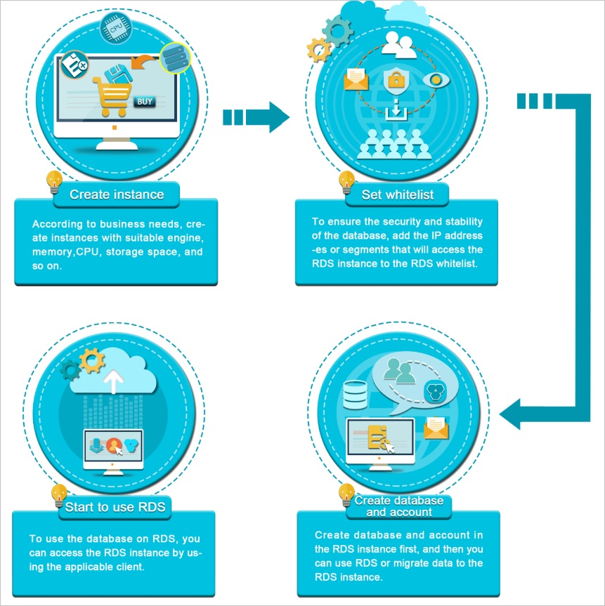

- Create an instance

  An instance is a virtual database server on which you can create and manage multiple databases.

- Configure an IP address whitelist After you create an RDS instance, you must configure IP address whitelists for the RDS instance to allow access from external devices.

  Whitelists make your ApsaraDB RDS instance more secure. We recommend that you maintain whitelists on a regular basis. When you configure IP address whitelists for your RDS instance, the workloads on the instance are not affected.

- Category Attribute Match and Create an account

  Before you use a database, you must create the database and an account on the ApsaraDB RDS instance.

- Connect to an ApsaraDB RDS for MySQL instance

  After you create an ApsaraDB RDS instance, configure an IP address whitelist, and create a database and an account, you can connect to the instance by using a database client.

<a id="section-5-3"></a>

## 5.3. Create an instance

This topic describes how to create an instance in the ApsaraDB RDS Console.

**Prerequisites**

An Apsara Stack tenant account is created.

**Procedure**

1. Log on to the ApsaraDB RDS console.

2. In the left-side navigation pane, click **Instance List**. On the page that appears, click **Create an instance**.

3. Configure the following parameters.

   **Paramete**

   **Section**

   **Description**

   **r**

   **Organizat**

   The organization to which the instance belongs.

   **ion**

   **Basic Configura tion**

   **Resource**

   The resource set to which the instance belongs.

   **Set**

   The region in which you want to create the instance. Services in

   **Region**

   different regions cannot communicate over an internal network. After the instance is created, the region cannot be changed.

   **Deployme**

   ApsaraDB RDS supports **Multi-zone Deployment** and **Single-zone**

   **nt**

   **Deployment**. You can select the zones for the primary and secondary

   **Method**

   nodes based on your requirements.

   **Area**

   **Primary Node**

   The zone of the primary node.

   **Zone Secondar**

   The zone of the secondary node. This parameter is available only

   **y Node**

   when you select the **Multi-zone Deployment** option.

   **Zone**

   **Database**

   The database engine of the instance. Select **MySQL**.

   **Engine**

   The chip architecture of the host on which the instance is deployed.

   **Chip**

   > **Note**

   **Architect ure**

   > If you do not have permissions to select an option, contact the operations administrator to grant the permissions to your account.

   The version of the database engine. Valid values:

   **Engine**

   - 8.0

   **Version**

   - 5.7

   The edition of the instance. For more information, see **Instance types**

   **Edition**

   **Specificat**

   in **ApsaraDB RDS Product Introduction**.

   **ions**

   **Storage**

   The storage type of the instance. Select Local SSD.

   **Type**

   The specifications of the instance. The maximum number of connections and the maximum IOPS vary based on the memory size. The actual specifications are displayed in the console. For more

   **Instance**

   information, see **Instance types** in **ApsaraDB RDS Product**

   **Specificat**

   **Introduction**.

   **ions**

   You can click **AI Specification Recommendation** and enter your usage scenario in Apsara Copilot to obtain optimal specification recommendations that balance cost and performance.

   The maximum amount of storage that is provisioned to store data

   **Storage**

   files, system files, binary log files, and transaction files in the new

   **Capacity**

   ApsaraDB RDS instance. For more information, see **Instance types** in **ApsaraDB RDS Product Introduction**.

   The connection type of the instance. Valid values:

   - **Internet**: Instances of this connection type can be connected over the Internet.

   - **Internal Network**: Instances of this connection type can be

   **Connectio**

   connected over an internal network.

   **n Type**

   > **Note**
   >
   > After the instance is created, the value of this parameter cannot be changed. Proceed with caution.

   The network type of the instance. Valid values:

   - **Classic Network**: Cloud services in the classic network are not isolated. Unauthorized access to a cloud service can be blocked only by the security group or whitelist of the service.

     > **Note**

   **Network**

   > Instances that use standard SSDs cannot be deployed in the

   **Type**

   > classic network.

   - **VPC**: A virtual private cloud (VPC) helps you build an isolated network environment on Apsara Stack. You can customize route tables, CIDR blocks, and gateways in a VPC. We recommend that you select VPC for improved security.

   **Network**

   The VPC in which you want to create the instance.

   **VPC**

   > **Note**
   >
   > This parameter is required when **Network Type** is set to **VPC**.

   The zone in which the vSwitch is located.

   **vSwitch**

   > **Note**

   **Zone**

   > This parameter is available only when **Network Type** is set to **VPC**.

   The vSwitch to which the instance is connected.

   > **Note**

   **vSwitch**

   > This parameter is required when **Network Type** is set to **VPC**.

   **IP**

   The IP address or CIDR block that is allowed to connect to the

   **Whitelist**

   instance.

   **Quantity**

   The number of instances that you want to create. Default value: 1.

   The name of the instance.

   **Instance**

   - It must be 2 to 64 characters in length.

   **Settings**

   **Instance**

   - It must start with a letter.

   **Name**

   - It can contain letters, digits, hyphens (-), underscores (_), and colons (:).

   - It cannot start with http:// or https://.

4. Click **Submit**.

<a id="section-5-4"></a>

## 5.4. Initialization settings

<a id="section-5-4-1"></a>

### 5.4.1. Configure an IP address whitelist for an ApsaraDB RDS instance

After you create an ApsaraDB RDS instance, you must add the IP addresses or CIDR blocks that are allowed to access the instance to the IP address whitelist of the instance to ensure database security and reliability.

**Background information**

Whitelists make your ApsaraDB RDS instance more secure. We recommend that you maintain whitelists on a regular basis. When you configure IP address whitelists for your ApsaraDB RDS instance, the workloads on the instance are not affected.

You can configure a whitelist in two modes:

- Configure an IP address whitelist: Add IP addresses to allow only specified origins to connect to the ApsaraDB RDS instance.

- Configure an Elastic Compute Service (ECS) security group: Add an ECS security group for the ApsaraDB RDS instance to allow all ECS instances in the security group to connect to the ApsaraDB RDS instance.

**Usage notes**

- **Default group restrictions**: The default whitelist group ( `default` ) can be modified or cleared, but it cannot be deleted.

- **Quantity limits**: A maximum of 1,000 IP addresses or CIDR blocks can be added to a whitelist. If you want to add a large number of IP addresses, we recommend that you merge them into CIDR blocks (such as  `192.168.1.0/24` ) to reduce the number of entries.

- **Format requirements**: You must separate multiple IP addresses or CIDR blocks with commas (,). Do not include spaces before or after the commas.

- **Override mechanism**: After you add any new IP address to the  `default`  group, the system automatically removes the default deny rule  `127.0.0.1` .

- **Prerequisites for network connectivity**: If you want to connect an ECS instance to an ApsaraDB RDS instance by using an internal endpoint, make sure that the two instances are in the same region and have the same network type (such as VPC). Otherwise, the connection fails.

**Configure a standard IP address whitelist**

1. 

2. 

3. In the left-side navigation pane, click **Data Security**.

4. On the **Whitelist Settings** tab, click **Modify**.

   > **Note**
   >
   > Click **Create Whitelist** to create a custom group.

5. In the **Modify Whitelist** dialog box, enter the IP addresses or CIDR blocks that are allowed to connect to your ApsaraDB RDS instance, and then click **OK**. Then, click OK to save the configuration.

   - If you enter a CIDR block such as 10.10.10.0/24, all IP addresses in the 10.10.10.XX range can access your ApsaraDB RDS instance.

   - If you click **Add Internal IP Addresses of ECS Instances**, the IP addresses of all ECS instances that are created within the current Alibaba Cloud account appear. Then, you can select the IP addresses and add them to an IP address whitelist.

<a id="section-5-4-2"></a>

### 5.4.2. Create an account

Detect the language of the input text. Supports automatic recognition of 23 languages. Best suited to short text such as search queries, product titles, and chat messages. Synchronous.

**Endpoint**

```text
POST /ai/text/marco/language-detection
```

**Use cases**

- Cross-border search -- detect the buyer's search-query language and route to the matching index.

- Title preprocessing -- detect source language automatically before calling the Text Translation API, so callers do not need to pass  `SourceLanguage` .

- Chat routing -- forward users to native-language agents based on detected language.

**Quick start**

```python
import json

data = json.dumps({ "SourceText": "Hello world" })
result = make_signed_request("/ai/text/marco/language-detection", data)
print(result["Data"]["DetectedLanguage"])  # en
```

**Request parameters**

| Parameter | Type | Required | Description |
| --- | --- | --- | --- |
| <code>SourceText</code> | String | Yes | Text to identify. Up to ~1024 characters recommended; very short inputs (single tokens) have lower accuracy. |

**Response fields**

| Field | Type | Description |
| --- | --- | --- |
| <code>Code</code> | String | Business status. <code> Success </code> when OK; otherwise see Error codes. |
| <code>Message</code> | String | Business message. |
| <code>RequestId</code> | String | Unique request identifier. |
| <code>Success</code> | Boolean | Whether the call succeeded. |
| <code>Data.DetectedLanguage</code> | String | Detected language code; see "Supported languages" below. |
| <code>Data.UsageMap.RequestCount</code> | Number | Request count for billing reconciliation. |

**Response example**

```json
{
  "Code": "Success",
  "Message": "ok",
  "RequestId": "21570000-0000-0000-0000-000000000001",
  "Success": true,
  "Data": {
    "DetectedLanguage": "en",
    "UsageMap": { "RequestCount": 1 }
  }
}
```

**Supported languages (23)**

Arabic ( `ar` ), Bengali ( `bn` ), German ( `de` ), English ( `en` ), Spanish ( `es` ), French ( `fr` ), Hebrew ( `he` ), Indonesian ( `id` ), Italian ( `it` ), Japanese ( `ja` ), Korean ( `ko` ), Malay ( `ms` ), Dutch ( `nl` ), Polish ( `pl` ), Portuguese ( `pt` ), Russian ( `ru` ), Thai ( `th` ), Turkish ( `tr` ), Ukrainian ( `uk` ), Urdu ( `ur` ), Vietnamese ( `vi` ), Chinese Simplified ( `zh` ), Chinese Traditional ( `zh-tw` ).

**Error codes**

Common error codes:  `InvalidParameter`  (missing or empty  `SourceText` ),  `InternalError` (system busy). See Error codes for the full reference.

**What's next**

- Text Translation API -- translate plain text.

- Text Correction API -- spelling correction.

<a id="section-5-4-3"></a>

### 5.4.3. Create a database

Multimodal-LLM-based cross-platform category-attribute filling. Given source-platform product info (title, source category, description, SKU, attributes, up to 10 images), match the precise target-platform category and fill every required attribute, with a per-attribute confidence and rationale. Synchronous.

**Endpoint**

```text
POST /ai/material/category/attribute
```

**Use cases**

- 1688 → TEMU cross-platform listing where platform categories differ significantly and have complex hierarchical relations (material → wood species → density).

- Top sellers' bulk publishing, ERP / SaaS integrations, fast SMB single-item listing.

**Request parameters**

| Parameter | Type | Required | Description |
| --- | --- | --- | --- |
| <code>ProductTitle</code> | String | Yes | Product title. |
| <code>SourceCategory</code> | String | Yes | Source-platform category path. |
| <code>ProductDescription</code> | String | No | Product description. |
| <code>SkuInfo</code> | Object\[\] | No | SKU list (spec + price per item). |
| <code>ProductAttributes</code> | Object | No | Source-platform attribute key-value pairs. |
| <code>ImageUrls</code> | String\[\] | No | Up to 10 image URLs.The multimodal model infers attributes from images. |
| <code>TargetPlatform</code> | String | Yes | Listing platform. Only <code> TEMU </code> today. |

**Response fields**

| Field | Type | Description |
| --- | --- | --- |
| <code>Data.CategoryPath</code> | String | Matched precise category path on the target platform. |
| <code>Data.Attributes</code> | Object\[\] | Filled attributes. Each item has <code> Name </code>, <code> Value </code>, <code> Confidence </code> (0-100), <code> Reason </code>, and <code> SourceMatched </code> (whether the value reused a source-platform attribute). |

**Response example**

```json
{
  "Code": "Success",
  "Data": {
    "CategoryPath": "Home Appliances > Fans > USB Fans",
    "Attributes": [
      { "Name": "Battery Type", "Value": "Lithium-Ion", "Confidence": 92, "Reason": "Title and image both indicate rechargeable", "SourceMatched": false },
      { "Name": "Connectivity",  "Value": "USB Type-C",  "Confidence": 88, "Reason": "Port visible in image",                  "SourceMatched": true  }
    ]
  }
}
```

**Error codes**

See Error codes.

**What's next**

- Category Match API -- category match alone.

<a id="section-5-5"></a>

## 5.5. Connect to an ApsaraDB RDS for MySQL instance

After you complete the initial configuration of your ApsaraDB RDS for MySQL instance, you can connect to it from an Elastic Compute Service (ECS) instance or an on-premises client.

**Background information**

After you Create an instance, Configure an IP address whitelist, and Create an account, you can connect to the ApsaraDB RDS for MySQL instance by using a database client or by configuring the endpoint, port, and account information in your application.

If you need to connect an ECS instance to an ApsaraDB RDS instance, you must make sure that both instances are in the classic network or in the same virtual private cloud (VPC), and the IP address of the ECS instance is added to an IP address whitelist of the ApsaraDB RDS instance.

**Connect to an instance from a client**

ApsaraDB RDS for MySQL is fully compatible with open source MySQL. You can connect to an ApsaraDB RDS instance from a database client by using a method similar to the method that is used to connect to an open source MySQL database. In the following example, the HeidiSQL client is used.

1. Start the HeidiSQL client.

2. In the lower-left corner of the Session manager dialog box, click **New**.

3. Enter information about the ApsaraDB RDS instance to which you want to connect. The following table describes the required parameters.

   | Paramet er | Description |
   | --- | --- |
   | Networ k type | Select the network type of the ApsaraDB RDS instance to which you want to connect.For example, select <strong>MariaDB or MySQL (TCP/IP)</strong>. |
   | Hostna me / IP | Enter the internal or public endpoint of the ApsaraDB RDS instance.<br>• If your client is deployed on an ECS instance that is in the same region and has the same network type as the ApsaraDB RDS instance, use the internal endpoint. For example, if the ECS and ApsaraDB RDS instances are both in a VPC located in the China (Hangzhou) region, you can use the internal endpoint of the ApsaraDB RDS instance to create a secure connection.<br>• In other scenarios, use the public endpoint.<br>To view the internal and public endpoints and port numbers of the ApsaraDB RDS instance, perform the following operations:<br>i. Log on to the ApsaraDB RDS console.<br>ii. Find the ApsaraDB RDS instance to which you want to connect and click its ID.<br>iii. In the <strong>Basic Information</strong> section, view the internal and public endpoints and port numbers of the instance. |
   | User | Enter the name of the account used to connect to the ApsaraDB RDS instance. |
   | Passwor d | Enter the password of the account used to connect to the ApsaraDB RDS instance. |
   | Port | If you connect to the instance over an internal network, enter the internal port number of the instance. If you connect to the instance over the Internet, enter the public port number of the instance. |

   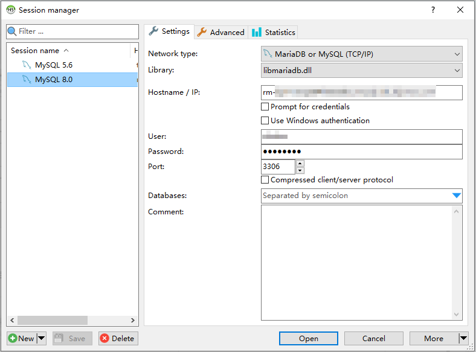

4. Click **Open**. If the connection information is correct, you can connect to the instance.

   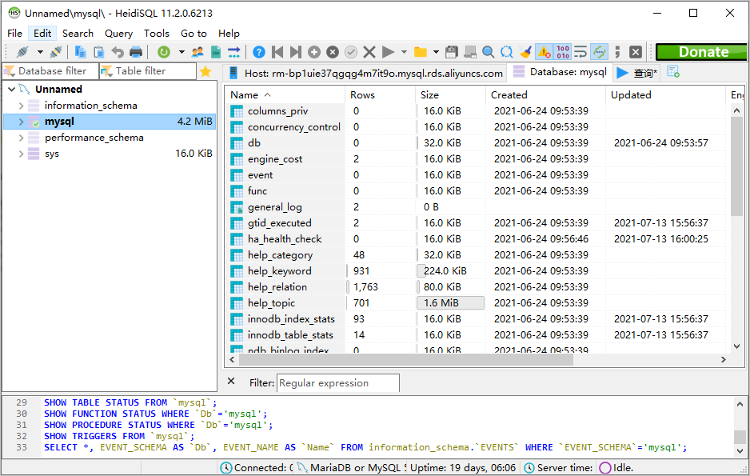

<a id="section-6"></a>

# 6.Instances

<a id="section-6-1"></a>

## 6.1. Create an instance

This topic describes how to create an ApsaraDB for RDS instance by using the Alibaba Cloud console.

**Prerequisites**

To create an instance, you must have an Alibaba Cloud account.

**Procedure**

1. Log on to the ApsaraDB RDS console.

2. In the left-side navigation pane, click **Instances**, and then click **Create Instance**.

3. Configure the following parameters.

   **Paramete**

   **Category**

   **Description**

   **r**

   **Organizat**

   The organization that will contain the instance.

   **ion**

   **Basic configura tions**

   **Resource**

   The resource set that will contain the instance.

   **set**

   The region where the instance is located. Services in different regions

   **Region**

   cannot communicate over the internal network. You cannot change the region after the instance is created.

   Supported modes include **Multi-AZ deployment** and **Single-AZ**

   **Deployme**

   **deployment**. You can select availability zones for the primary and

   **nt mode**

   secondary nodes.

   **Region and zone**

   **Primary**

   The availability zone for the instance's primary node.

   **AZ**

   The availability zone of the instance's secondary node. This is

   **Secondar**

   displayed only when the deployment mode is set to **Multi-AZ**

   **y AZ**

   **deployment**.

   **DB**

   The database engine type. Select **MySQL**.

   **engine**

   **Architect**

   The CPU architecture of the instance. If you receive an "unauthorized"

   **ure**

   message, ask your operations administrator to grant the required permissions to your account.

   The database engine version. The following versions are supported:

   **Engine**

   - 8.0

   **version**

   - 5.7

   The database instance series. For more information, see the **Instance**

   **Series**

   **Instance**

   **Types** chapter in **ApsaraDB for RDS Product Introduction**.

   **specificat ions**

   **Storage**

   The storage type for the instance. Select **local SSD**.

   **type**

   The instance type. Different instance types provide different maximum numbers of connections and IOPS. The actual values are shown on the console page. For more information, see the **Instance Types** chapter

   **Instance**

   in **ApsaraDB for RDS Product Introduction**.

   **type**

   Click **AI-Powered Instance Type Recommender** and describe your use case to the Apsara AI Assistant to get a recommendation that balances cost and performance.

   The amount of storage space for the instance. This space is used for

   **Storage**

   data, system files, binary log (binlog) files, and transaction files. For

   **space**

   more information, see the **Instance Types** chapter in **ApsaraDB for RDS Product Introduction**.

   ApsaraDB for RDS provides two types of connection endpoints:

   - **Public connection**: Allows you to access the database from the internet.

   **Network**

   - **Internal connection**: Allows you to access the database from the

   **connectio**

   internal Alibaba Cloud network.

   **n type**

   > **Important**
   >
   > You cannot change this setting after the instance is created.

   The network type for the instance. Supported types include:

   - **Classic network**: In a classic network, cloud services are not isolated. You must rely on the security group or whitelist policies of

   **Network**

   each service to block unauthorized access.

   **type**

   - **Virtual Private Cloud**: A Virtual Private Cloud (VPC) is an isolated network environment on Alibaba Cloud. You can customize route

   **Network**

   tables, IP address ranges, and gateways. A VPC is recommended for better security.

   Select the target VPC. This parameter is required if you set **Network**

   **VPC**

   **type** to **Virtual Private Cloud**.

   **VSwitch**

   The availability zone for the VSwitch. This parameter is required if you

   **AZ**

   set **Network type** to **Virtual Private Cloud**.

   Select a VSwitch within the VPC. This parameter is required if you set

   **VSwitch**

   **Network type** to **Virtual Private Cloud**.

   **IP**

   A list of IP addresses and CIDR blocks that are allowed to access the

   **whitelist**

   instance.

   The number of instances to create. You can create multiple instances

   **Quantity**

   at a time. The default value is 1.

   The name of the instance. The name must meet the following requirements:

   **Instance settings**

   - Must be 2 to 64 characters long.

   **Instance**

   - Must start with a letter or a Chinese character.

   **name**

   - Can contain only letters, digits, hyphens (-), underscores (_), and colons (:).

   - Must not start with http:// or https://.

4. On the right side of the page, review your settings in the **Configuration overview** panel.

   If your current quota is insufficient, click **Quota Management** to request an increase. For more information, see the "Quota management" chapter of the **Unified Cloud Management Platform User Guide**.

5. After you configure the parameters, click **Submit**.

<a id="section-6-2"></a>

## 6.2. View the details of an ApsaraDB RDS instance

This topic describes how to view the details of an ApsaraDB RDS instance, such as its basic information, internal network connection information, status, and configurations.

**Procedure**

1. Log on to the ApsaraDB RDS console.

2. Use one of the following methods to go to the **Basic Information** page of an RDS instance:

   - On the **Instances** page, click the ID of the instance to go to the **Basic Information** page.

   - On the **Instances** page, click **Manage** in the **Actions** column of the instance to go to the **Basic Information** page.

**References**

For more information about the mappings between MySQL versions of ApsaraDB RDS for MySQL and the MySQL community, see Release notes for AliSQL.

<a id="section-6-3"></a>

## 6.3. Restart an instance

This topic describes how to manually restart an ApsaraDB RDS instance. This applies if the number of connections exceeds the specified threshold or if an instance has performance issues.

**Prerequisites**

The instance is in the **Running** state.

**Procedure**

1. Log on to the ApsaraDB RDS console.

2. On the **Instance List** page, find the instance that you want to manage.

3. Click **Restart Instance** in the upper-right corner.

   > **Note**
   >
   > When you restart an instance, applications are disconnected from the
   >
   > instance. We recommend that you make appropriate service arrangements before you restart an instance. Proceed with caution.

4. In the Restart Instance message, click **Confirm**.

<a id="section-6-4"></a>

## 6.4. Change instance specifications

If the specifications of an ApsaraDB RDS for MySQL instance cannot meet your business requirements, you can change the instance specifications. This topic describes how to change the specifications, such as the instance type and storage capacity.

**Procedure**

1. Log on to the ApsaraDB RDS console.

2. In the left-side navigation pane of the **ApsaraDB RDS** console, click **Instances**. On the page that appears, click the ID of the instance that you want to manage or click **Manage** in the **Actions** column of the instance to go to the **Basic Information** page.

3. In the upper-right corner of the **Configuration Information** section, click **Change Specifications**.

4. On the **Change Specifications** page, configure the **Edition**, **Storage Type**, **Instance Type**, **Storage Capacity**, and **Switching Time** parameters.

   > **Note**
   >
   > If you set the **Switching Time** parameter to **Specified Time**, you must specify a point in time for the change.

5. Click **Submit**.

6. Confirm the changes and click **OK**.

<a id="section-6-5"></a>

## 6.5. Set a maintenance window

This topic describes how to set a maintenance window for an ApsaraDB RDS instance.

**Background information**

To ensure the stability of ApsaraDB RDS instances, the backend system performs maintenance of the instances at irregular intervals. The default maintenance window is from 02:00 to 06:00. You can set the maintenance window to the off-peak period of your business to avoid impact on business.

**Precautions**

- To ensure stability of the maintenance process, the instance changes to the **Maintaining Instance** state before the maintenance window. When the instance is in this state, access to data in the database and query operations such as performance monitoring are not affected. However, except for account and database management and IP address whitelist configuration, modification operations such as upgrade, downgrade, and restart are temporarily unavailable.

- You may encounter a network interruption during the maintenance window. Make sure that your application is configured to automatically reconnect to the instance.

**Procedure**

1. Log on to the ApsaraDB RDS console.

2. On the **Instance List** page, find the instance that you want to manage.

3. In the **Configuration Information** section, click **Configure** to the right of **Maintenance Window**.

4. Select a maintenance window and click **Save**.

   > **Note**
   >
   > The maintenance window is displayed in UTC+8.

<a id="section-6-6"></a>

## 6.6. Change the data replication mode

You can set the data replication mode between primary and secondary ApsaraDB RDS instances to improve database availability.

**Background information**

ApsaraDB RDS supports the following data replication modes:

- Semi-sync

  After an application-initiated update is complete on the primary instance, logs are synchronized to all secondary instances. This transaction is considered committed after at least one secondary instance has received the logs, regardless of whether the secondary instance finishes executing the updates specified in the logs.

  If the secondary instances are unavailable or a network exception occurs between the primary and secondary instances, semi-synchronous replication degrades to the asynchronous mode.

- Asynchronous

  When your application initiates a request to add, delete, or modify data, the primary instance responds to your application immediately after it completes the operation. At the same time, the primary instance starts to asynchronously replicate data to its secondary instances. During asynchronous data replication, the unavailability of secondary instances does not affect the operations on the primary instance. Data remains consistent even if the primary instance is unavailable.

**Procedure**

1. Log on to the ApsaraDB RDS console.

2. On the **Instance List** page, find the instance that you want to manage.

3. In the left-side navigation pane, click **Service Availability**.

4. In the upper-right corner of the **Availability Information** section, click **Change Data Replication Mode**.

5. In the dialog box that appears, select a data replication mode and click **OK**.

<a id="section-6-7"></a>

## 6.7. Release an instance

When an ApsaraDB RDS for MySQL instance is no longer needed due to business decommissioning, completion of testing, or architecture adjustments, you can manually release the instance through the console.

**Usage notes**

- Only instances in the **Running** state can be manually released.

- After an instance is released, the instance data is immediately deleted. We recommend that you back up your data before you release an instance.

**Procedure**

1. 

2. In the left-side navigation pane, click **Instance List**. Find the instance that you want to manage and click **Release an instance** in the **Operation** column.

3. In the dialog box that appears, read the risk warnings carefully, confirm that you backed up the data, and then click **Release**.

<a id="section-6-8"></a>

## 6.8. Update the minor engine version of an instance

ApsaraDB RDS for MySQL supports both automatic updates and manual updates to the minor engine version of an ApsaraDB RDS for MySQL instance. These updates improve performance, introduce new features, or fix known issues.

**Description**

By default, the minor engine version of your ApsaraDB RDS for MySQL instance is manually updated. You can log in to the ApsaraDB RDS console, go to the **Basic Information** page of your ApsaraDB RDS for MySQL instance, and then view the settings of **Automated Update of Minor Engine Version** in the Configuration Information section.

- **Automatic Upgrade**: Each time you log in to the ApsaraDB RDS console and view the basic information about your ApsaraDB RDS instance, the system queries the minor engine version of the ApsaraDB RDS instance. When a new minor engine version is released, the system automatically updates the minor engine version of your ApsaraDB RDS instance during the specified maintenance window. For more information, see Set a maintenance window.

- **Manual Upgrade**: Each time you log in to the ApsaraDB RDS console and view the basic information about your ApsaraDB RDS instance, the system queries the minor engine version of the ApsaraDB RDS instance. When a new minor engine version is released, the system does not automatically update the minor engine version of your ApsaraDB RDS instance. You can manually update the minor engine version on the **Basic Information** page. For more information, see Manually update the minor engine version.

**Usage notes**

- When you update the minor engine version of your ApsaraDB RDS instance, a transient disconnection that lasts approximately 30 seconds may occur. We recommend that you update the minor engine version during off-peak hours or make sure that your application is configured to automatically reconnect to the ApsaraDB RDS instance.

- After you update the minor engine version of your ApsaraDB RDS instance, you cannot roll the minor engine version of the ApsaraDB RDS instance back to the previous version.

- After you upgrade the specifications of your ApsaraDB RDS instance, the system updates the ApsaraDB RDS instance to the latest minor engine version.

**Change the settings for Automated Update of Minor Engine Version**

1. Log on to the ApsaraDB RDS console.

2. On the **Instance List** page, find the instance that you want to manage.

3. In the **Configuration Information** section of the Basic Information page, click **Settings** to the right of **Automated Update of Minor Engine Version**.

4. In the dialog box that appears, select **Manual Upgrade** and click **OK**.

**Manually update the minor version**

1. Log on to the ApsaraDB RDS console.

2. On the **Instance List** page, find the instance that you want to manage.

3. In the **Configuration Information** section of the page, click **Update Minor Engine Version**.

   > **Note**
   >
   > The **Upgrade Minor Engine Version** button is displayed only when a new minor engine version is available.

4. In the dialog box that appears, specify the Update Time parameter and click **OK**.

**FAQ**

**I updated the minor engine version of my ApsaraDB RDS instance but the MySQL version remains unchanged. Why?**

The minor engine version that you updated is the minor engine version of ApsaraDB RDS, but not the MySQL version. To view the minor engine version, you must run the  `show variables like '%rds_release_date%'`  command.

<a id="section-6-9"></a>

## 6.9. Configure instance parameters

This topic describes how to view and modify the values of some parameters and query parameter modification records in the console.

**Precautions**

- To ensure the stability of your instance, you can modify only some of the parameters in the console.

- When you modify a parameter value, refer to the **Modifiable Parameter Value** column on the **Modifiable Parameters** page.

- Some parameters require an instance restart to take effect. For more information, see the **Restart Required** column on the **Modifiable Parameters** page. Perform this operation during off-peak hours and ensure that your application has a reconnection mechanism.

**Configure parameters**

1. Log on to the ApsaraDB RDS console.

2. On the **Instance List** page, find the instance that you want to manage.

3. In the navigation pane on the left, click **Parameters**.

4. You can perform the following operations:

   Export parameters

   On the Editable Parameters tab, click **Export Parameters**. The parameter settings of the ApsaraDB RDS instance are exported as a TXT file to your computer.

   Modify parameters in a batch by importing a file

   <ol type="i">

   <li>

   After you modify parameters in the exported parameter file, click **Import Parameters** and paste the parameter settings to the field.

   </li>

   <li>

   Click **OK**.

   </li>

   <li>

   In the upper-right corner of the page, click **Apply Changes**.

   </li>

   </ol>

   > **Note**
   >
   > - If a modified parameter requires an instance restart to take effect, the system prompts you to restart the instance. Perform this operation during off-peak hours and ensure that your application has a reconnection mechanism.
   >
   > - If the parameter modifications have not been submitted, you can click **Cancel** to cancel the modifications.

   Modify a single parameter

   <ol type="i">

   <li>

   On the **Editable Parameters** tab, find the parameter that you want to modify and click the

   icon in the **Actual Value** column.

   

   </li>

   <li>

   Enter a new value based on the value range that is displayed.

   </li>

   <li>

   Click **OK**.

   </li>

   <li>

   In the upper-right corner of the page, click **Apply Changes**.

   > **Note**
   >
   > - If a modified parameter requires an instance restart to take effect, the system prompts you to restart the instance. Perform this operation during off-peak hours and ensure that your application has a reconnection mechanism.
   >
   > - If the parameter modifications have not been submitted, you can click **Cancel** to cancel the modifications.

   </li>

   </ol>

**View the parameter modification history**

1. Log on to the ApsaraDB RDS console.

2. On the **Instance List** page, find the instance that you want to manage.

3. In the navigation pane on the left of the page that appears, click **Parameters**.

4. Click the **Parameter Modification History** tab.

5. Select a time range and click **OK**.

**Appendix 1: Parameters that are synchronized to read-only instances**

When you modify the following parameters in a primary RDS for MySQL instance, the modification will automatically apply to the same parameters in the read-only instances of the primary instance.

- lower_case_table_names

  > **Note**
  >
  > You cannot modify this parameter if your ApsaraDB RDS instance runs MySQL 8.0.

- innodb_large_prefix

- loose_validate_password_length

- default_time_zone

- rpl_semi_sync_slave_enabled

> **Note**
>
> If you modify other parameters on a primary instance, you must manually apply the same modifications to its read-only instances.

**Appendix 2: List of modifiable parameters**

| Parameter | Maj or vers ion | Def ault valu e | Value range | Res tart req uire d | Description |
| --- | --- | --- | --- | --- | --- |
| auto_increment_i ncrement | 8.0, 5.7 | 1 | \[1-65535\] | No | The increment value for auto-increment columns. |
| auto_increment_o ffset | 8.0, 5.7 | 1 | \[1-65535\] | No | The offset value for auto-increment columns when auto-increment-increment is not equal to 1. |

<table>
  <tr>
    <td>autocommit</td>
    <td>5.7</td>
    <td>ON</td>
    <td>[ON|OFF]</td>
    <td>No</td>
    <td>Autocommit mode:<br>• If set to 1, all changes to tables take effect immediately.<br>• If set to 0, you must use COMMIT to accept a transaction or ROLLBACK to cancel it.<br>• If autocommit is 0 and you change it to 1, MySQL performs an autocommit for any open transaction.<br>Note<br>You cannot manually commit transactions in autocommit mode.To manually commit transactions, first disable autocommit mode for the database (<code> SET autocommit = </code> <code>OFF; </code>).</td>
  </tr>
  <tr>
    <td>automatic_sp_pri vileges</td>
    <td>8.0, 5.7</td>
    <td>ON</td>
    <td>[ON|OFF]</td>
    <td>No</td>
    <td>When this variable is set to 1 (the default), the server automatically grants the EXECUTE and ALTER ROUTINE privileges to the user who creates a stored procedure if the user cannot execute, alter, or drop the stored procedure. The ALTER ROUTINE privilege is required to drop a procedure. When the stored procedure is dropped, the server also automatically revokes these privileges from the creator. If automatic_sp_privileges is 0, the server does not automatically grant or revoke these privileges.</td>
  </tr>
  <tr>
    <td>avoid_temporal_u pgrade</td>
    <td>8.0, 5.7</td>
    <td>OFF</td>
    <td>[ON|OFF]</td>
    <td>No</td>
    <td>This variable controls whether ALTER TABLE implicitly upgrades temporal columns (TIME, DATETIME, and TIMESTAMP columns that do not support fractional seconds precision) that are in a pre-5.6.4 format. Upgrading such columns requires the table to be rebuilt, which prevents the use of fast alteration methods for the operation.</td>
  </tr>
  <tr>
    <td>back_log</td>
    <td>8.0, 5.7</td>
    <td>300 0</td>
    <td>[0-65535]</td>
    <td>Yes</td>
    <td>The number of outstanding connection requests that MySQL can have.</td>
  </tr>
  <tr>
    <td>binlog_cache_size</td>
    <td>8.0, 5.7</td>
    <td>209 715 2</td>
    <td>[4096-16777216]</td>
    <td>No</td>
    <td>The size of the cache that holds changes to the binary log for a transaction.</td>
  </tr>
  <tr>
    <td>binlog_checksum</td>
    <td>8.0, 5.7</td>
    <td>CRC 32</td>
    <td>[CRC32|NO NE]</td>
    <td>Yes</td>
    <td>The type of BINLOG_CHECKSUM_ALG.Includes a checksum for log events in the binary log. Possible values are NONE and CRC32. The default value is CRC32.</td>
  </tr>
  <tr>
    <td>binlog_order_com mits</td>
    <td>8.0, 5.7</td>
    <td>ON</td>
    <td>[ON|OFF]</td>
    <td>No</td>
    <td>When this variable is enabled on the primary server (the default), transactions are externalized in the same order as they are written to the binary log. If disabled, transactions can be committed in parallel. In some cases, disabling this variable may result in a performance increase.</td>
  </tr>
  <tr>
    <td>binlog_row_imag e</td>
    <td>8.0, 5.7</td>
    <td>full</td>
    <td>[full|minim al]</td>
    <td>No</td>
    <td>Specifies whether the binary log saves all columns or only the required columns in the binary log image.</td>
  </tr>
  <tr>
    <td>binlog_rows_quer y_log_events</td>
    <td>8.0, 5.7</td>
    <td>OFF</td>
    <td>[ON|OFF]</td>
    <td>No</td>
    <td>The binlog_rows_query_log_events system variable affects only row-based logging. When enabled, it causes the MySQL Server to write informational log events, such as row query log events, to its binary log. This information can be used for debugging and related purposes. For example, you can obtain the original query issued on the primary server when it cannot be reconstructed from the row updates.</td>
  </tr>
  <tr>
    <td>binlog_stmt_cach e_size</td>
    <td>8.0, 5.7</td>
    <td>327 68</td>
    <td>[4096-16777216]</td>
    <td>No</td>
    <td>The size of the statement cache for non-transactional storage engines that update the binary log.</td>
  </tr>
  <tr>
    <td>block_encryption _mode</td>
    <td>8.0, 5.7</td>
    <td>"aes -128-ecb"</td>
    <td>["aes-128-ecb"|"aes-192-ecb"|"aes-256-ecb"|"aes-128-cbc"|"aes-192-cbc"|"aes-256-cbc"]</td>
    <td>No</td>
    <td>This variable controls the block encryption mode for block-based algorithms such as AES. It affects the encryption for AES_ENCRYPT() and AES_DECRYPT().</td>
  </tr>
</table>

<table>
  <tr>
    <td>bulk_insert_buffe r_size</td>
    <td>8.0, 5.7</td>
    <td>419 430 4</td>
    <td>[0-42949672 95]</td>
    <td>No</td>
    <td>MyISAM uses a special tree-like cache to make bulk inserts such as INSERT...SELECT, INSERT... VALUES (...), (...), ..., and LOAD DATA INFILE faster when adding data to non-empty tables. This variable limits the size of the cache tree in bytes per thread. Setting it to 0 disables this optimization. The default value is 8 MB.</td>
  </tr>
  <tr>
    <td>character_set_file system</td>
    <td>8.0, 5.7</td>
    <td>bina ry</td>
    <td>[utf8|latin1 |gbk|binary]</td>
    <td>No</td>
    <td>The file system character set. This variable is used to interpret string literals that refer to file names, such as in the LOAD DATA INFILE and SELECT...INTO OUTFILE statements and the LOAD_FILE() function. These file names are converted from character_set_client to character_set_filesystem before the file is opened. The default value is binary, which means no conversion occurs. For systems that allow multi-byte file names, a different value may be more appropriate. For example, if your system uses UTF-8 to represent file names, set character_set_filesystem to 'utf8'.</td>
  </tr>
  <tr>
    <td>character_set_ser ver</td>
    <td>8.0, 5.7</td>
    <td>utf8</td>
    <td>[utf8|latin1 |gbk|gb18 030|utf8m b4]</td>
    <td>Yes</td>
    <td>The default character set for the server.</td>
  </tr>
  <tr>
    <td>collation_server</td>
    <td>8.0</td>
    <td>utf8 _gen eral _ci</td>
    <td>[utf8_gene ral_ci|utf8 mb4_0900 _ai_ci|utf8 mb4_gener al_ci]</td>
    <td>Yes</td>
    <td>The collation for the character set.Modify this parameter with caution. An incompatibility with the character_set_server parameter will cause the instance to fail to start.</td>
  </tr>
</table>

<table>
  <tr>
    <td>concurrent_insert</td>
    <td>8.0, 5.7</td>
    <td>1</td>
    <td>[0|1|2]</td>
    <td>No</td>
    <td>0: Disables concurrent inserts.<br>1: (Default) Enables concurrent inserts for MyISAM tables that have no holes.<br>2: Enables concurrent inserts for all MyISAM tables, even if they have holes.For tables with holes, new rows are inserted at the end of the table if the table is being used by another thread.Otherwise, MySQL acquires a normal write lock and inserts the row into a hole.</td>
  </tr>
  <tr>
    <td>connect_timeout</td>
    <td>8.0, 5.7</td>
    <td>10</td>
    <td>[1-3600]</td>
    <td>No</td>
    <td>The number of seconds that the mysqld server waits for a connection packet before responding with a Bad handshake error. The default value is 5 seconds for MySQL 5.1.23 and earlier, and 10 seconds thereafter. If clients frequently encounter errors such as "Lost connection to MySQL server at 'XXX', system error: errno", increasing the connect_timeout value may help.</td>
  </tr>
  <tr>
    <td>default_storage_e ngine</td>
    <td>8.0, 5.7</td>
    <td>Inno DB</td>
    <td>[InnoDB|in nodb]</td>
    <td>Yes</td>
    <td>The default storage engine for new tables.</td>
  </tr>
  <tr>
    <td>default_time_zon e</td>
    <td>8.0, 5.7</td>
    <td>SYS TEM</td>
    <td>[SYSTEM|-12:00|-11:00|-10:00|-9:00|-8:00|-7:00|-6:00|-5:00|-4:00|-3:00|-2:00|-1:00|\+0:0 0|\+1:00|\ +2:00|\+3: 00|\+4:00| \+5:00|\+5:30|\+5:45 |\+6:00|\+ 6:30|\+7:0 0|\+8:00|\ +9:00|\+1 0:00|\+11: 00|\+12:00 |\+13:00]</td>
    <td>Yes</td>
    <td>The default time zone for the database.</td>
  </tr>
  <tr>
    <td>default_week_for mat</td>
    <td>8.0, 5.7</td>
    <td>0</td>
    <td>[0-7]</td>
    <td>No</td>
    <td>The default mode value for the WEEK() function.</td>
  </tr>
  <tr>
    <td>delay_key_write</td>
    <td>8.0, 5.7</td>
    <td>ON</td>
    <td>[ON|OFF|A LL]</td>
    <td>No</td>
    <td>This option applies only to MyISAM tables. It can have one of the following values to affect how the DELAY_KEY_WRITE table option, which can be used in CREATE TABLE statements, is handled.<br>OFF: The DELAY_KEY_WRITE option is ignored.<br>ON: MySQL honors any DELAY_KEY_WRITE option specified in a CREATE TABLE statement. This is the default value.<br>ALL: All newly opened tables are treated as if they were created with the DELAY_KEY_WRITE option enabled.<br>Important<br>If you set this variable to ALL, you should not use the MyISAM tables from other programs, such as another MySQL server or myisamchk. Doing so can cause index corruption.</td>
  </tr>
  <tr>
    <td>delayed_insert_li mit</td>
    <td>8.0, 5.7</td>
    <td>100</td>
    <td>[1-42949672 95]</td>
    <td>No</td>
    <td>After inserting delayed_insert_limit delayed rows, the INSERT DELAYED handler thread checks for any pending SELECT statements. If there are any, it allows them to execute before continuing to insert delayed rows.</td>
  </tr>
  <tr>
    <td>delayed_insert_ti meout</td>
    <td>8.0, 5.7</td>
    <td>300</td>
    <td>[1-3600]</td>
    <td>No</td>
    <td>The number of seconds an INSERT DELAYED handler thread should wait for INSERT statements before terminating.</td>
  </tr>
  <tr>
    <td>delayed_queue_si ze</td>
    <td>8.0, 5.7</td>
    <td>100 0</td>
    <td>[1-42949672 95]</td>
    <td>No</td>
    <td>This is the limit on the number of rows to be queued per table when handling INSERT DELAYED statements. If the queue becomes full, any client that issues an INSERT DELAYED statement must wait until there is space in the queue again.</td>
  </tr>
  <tr>
    <td>disconnect_on_ex pired_password</td>
    <td>8.0, 5.7</td>
    <td>ON</td>
    <td>[ON|OFF]</td>
    <td>Yes</td>
    <td>This variable controls how the server handles clients with expired passwords.</td>
  </tr>
  <tr>
    <td>div_precision_incr ement</td>
    <td>8.0, 5.7</td>
    <td>4</td>
    <td>[0-30]</td>
    <td>No</td>
    <td>This variable indicates how many digits the scale of the result of a division operation performed with the / operator should be increased. The default value is<br>4. The minimum and maximum values are 0 and 30, respectively.</td>
  </tr>
  <tr>
    <td>end_markers_in_j son</td>
    <td>8.0, 5.7</td>
    <td>OFF</td>
    <td>[ON|OFF]</td>
    <td>No</td>
    <td>Specifies whether the optimizer JSON output should add end markers.</td>
  </tr>
  <tr>
    <td>eq_range_index_dive_limit</td>
    <td>8.0, 5.7</td>
    <td>100</td>
    <td>[0-42949672 95]</td>
    <td>No</td>
    <td>If the number of equality ranges for an index is greater than or equal to this number, the optimizer uses existing index statistics instead of performing an index dive. If set to 0, index dives are always used.</td>
  </tr>
  <tr>
    <td>event_scheduler</td>
    <td>8.0</td>
    <td>OFF</td>
    <td>[ON|OFF]</td>
    <td>No</td>
    <td>Enables the Event Scheduler. Possible values are ON, OFF, and DISABLED (which deactivates the Event Scheduler completely and prevents it from being activated at runtime).</td>
  </tr>
  <tr>
    <td>explicit_defaults_for_timestamp</td>
    <td>8.0, 5.7</td>
    <td>OFF</td>
    <td>[ON|OFF]</td>
    <td>No</td>
    <td>Specifies whether the default value for a TIMESTAMP column is the current timestamp.</td>
  </tr>
  <tr>
    <td>flush_time</td>
    <td>8.0, 5.7</td>
    <td>0</td>
    <td>[0-31536000]</td>
    <td>No</td>
    <td>If set to a non-zero value, all tables are closed every flush_time seconds to free up resources and synchronize unflushed data to disk. This option is best used only on systems with minimal resources.</td>
  </tr>
  <tr>
    <td>ft_max_word_len</td>
    <td>8.0, 5.7</td>
    <td>84</td>
    <td>[10-42949672 95]</td>
    <td>Yes</td>
    <td>The maximum length of a word to be included in a MyISAM FULLTEXT index.</td>
  </tr>
  <tr>
    <td>ft_min_word_len</td>
    <td>8.0, 5.7</td>
    <td>4</td>
    <td>[1-3600]</td>
    <td>Yes</td>
    <td>The minimum length of a word to be included in a FULLTEXT index.</td>
  </tr>
  <tr>
    <td>ft_query_expansi on_limit</td>
    <td>8.0, 5.7</td>
    <td>20</td>
    <td>[0-1000]</td>
    <td>Yes</td>
    <td>The number of top N matches to use when performing a full-text search with WITH QUERY EXPANSION.</td>
  </tr>
  <tr>
    <td>general_log</td>
    <td>8.0, 5.7</td>
    <td>OFF</td>
    <td>[ON|OFF]</td>
    <td>Yes</td>
    <td>Specifies whether the general query log is enabled. The destination for log output is controlled by the log_output system variable.</td>
  </tr>
  <tr>
    <td>group_concat_ma x_len</td>
    <td>8.0, 5.7</td>
    <td>102 4</td>
    <td>[4-18446744 07370954 752]</td>
    <td>No</td>
    <td>The maximum result length in bytes allowed for the GROUP_CONCAT() function. The default value is 1024 bytes.</td>
  </tr>
  <tr>
    <td>host_cache_size</td>
    <td>8.0, 5.7</td>
    <td>644</td>
    <td>[0-65535]</td>
    <td>No</td>
    <td>The size of the internal host cache.Setting the size to 0 disables the host cache. Changing the cache size at runtime implicitly causes a FLUSH HOSTS operation to clear the host cache and truncate the host_cache table.</td>
  </tr>
  <tr>
    <td>innodb_adaptive_flushing</td>
    <td>8.0, 5.7</td>
    <td>ON</td>
    <td>[ON|OFF]</td>
    <td>No</td>
    <td>Determines whether to dynamically adjust the rate of flushing dirty pages in the InnoDB buffer pool based on the workload. The purpose of dynamically adjusting the flush rate is to avoid bursts of I/O activity.</td>
  </tr>
  <tr>
    <td>innodb_adaptive_flushing_lwm</td>
    <td>8.0, 5.7</td>
    <td>10</td>
    <td>[0-70]</td>
    <td>No</td>
    <td>Defines a low watermark, representing a percentage of redo log capacity, at which adaptive flushing is enabled.</td>
  </tr>
  <tr>
    <td>innodb_adaptive_hash_index</td>
    <td>8.0, 5.7</td>
    <td>OFF</td>
    <td>[ON|OFF]</td>
    <td>No</td>
    <td>innodb_adaptive_hash_index is a parameter of the InnoDB storage engine used to enable or disable the adaptive hash index.</td>
  </tr>
  <tr>
    <td>innodb_adaptive_max_sleep_delay</td>
    <td>8.0, 5.7</td>
    <td>150 000</td>
    <td>[1-1000000]</td>
    <td>No</td>
    <td>innodb_thread_sleep_delay controls how long an InnoDB thread sleeps when there are no waiting events. This parameter allows InnoDB to automatically adjust the value of innodb_thread_sleep_delay based on the current workload to adapt to different load situations. As long as this value is not 0, automatic dynamic adjustment of the innodb_thread_sleep_delay value is enabled, with the maximum value specified by the innodb_adaptive_max_sleep_delay option. The value is in microseconds.This option can be very useful in busy systems, especially those with more than 16 InnoDB threads.<br>In practice, this option is most valuable in MySQL systems with hundreds or thousands of concurrent connections.</td>
  </tr>
  <tr>
    <td>innodb_autoexte nd_increment</td>
    <td>8.0, 5.7</td>
    <td>64</td>
    <td>[1-1000]</td>
    <td>No</td>
    <td>The increment size in megabytes for increasing the size of an auto-extending InnoDB system tablespace file when it becomes full. The default value is 64.</td>
  </tr>
  <tr>
    <td>innodb_autoinc_l ock_mode</td>
    <td>8.0, 5.7</td>
    <td>2</td>
    <td>[0|1|2]</td>
    <td>Yes</td>
    <td>The lock mode used for generating auto-increment values. The allowed values are:<br>0: traditional<br>1: consecutive<br>2: interleaved</td>
  </tr>
  <tr>
    <td>innodb_buffer_po ol_dump_at_shut down</td>
    <td>8.0, 5.7</td>
    <td>ON</td>
    <td>[ON|OFF]</td>
    <td>No</td>
    <td>Specifies whether to record the pages cached in the InnoDB buffer pool when the MySQL server is shut down, to shorten the warm-up process at the next restart. It is typically used with innodb_buffer_pool_load_at_startup. The innodb_buffer_pool_dump_pct option defines the percentage of most recently used buffer pool pages to be dumped.</td>
  </tr>
  <tr>
    <td>innodb_buffer_po ol_dump_pct</td>
    <td>8.0, 5.7</td>
    <td>25</td>
    <td>[1-100]</td>
    <td>No</td>
    <td>Specifies the percentage of most recently used pages to read and dump for each buffer pool. The value range is 1 to 100. The default value is 25. For example, if there are 4 buffer pools, each with 100 pages, and innodb_buffer_pool_dump_pct is set to 25, the 25 most recently used pages from each buffer pool will be dumped.</td>
  </tr>
  <tr>
    <td>innodb_buffer_po ol_instances</td>
    <td>8.0, 5.7</td>
    <td>{LE AST(DBIn stan ceCl ass Me mor y/10 737 418 24, 8)}</td>
    <td>[1-64]</td>
    <td>Yes</td>
    <td>The number of regions that the InnoDB buffer pool is divided into. For systems with buffer pools in the multi-gigabyte range, dividing the buffer pool into separate instances can improve concurrency by reducing contention as different threads read and write to cached pages. Each page stored in or read from the buffer pool is randomly assigned to one of the buffer pool instances using a hashing function. Each buffer pool instance manages its own free lists, flush lists, LRUs, and all other data structures connected to a buffer pool, and is protected by its own buffer pool mutex.</td>
  </tr>
</table>

<table>
  <tr>
    <td>innodb_buffer_po ol_load_at_startu p</td>
    <td>8.0, 5.7</td>
    <td>ON</td>
    <td>[ON|OFF]</td>
    <td>Yes</td>
    <td>Specifies whether to automatically warm up the buffer pool at MySQL server startup by loading the same pages that were previously saved in the InnoDB buffer pool. It is typically used with innodb_buffer_pool_dump_at_shutdown.</td>
  </tr>
  <tr>
    <td>innodb_change_b uffering</td>
    <td>8.0, 5.7</td>
    <td>all</td>
    <td>[none|inser ts|deletes| changes|p urges|all]</td>
    <td>No</td>
    <td>Specifies whether InnoDB performs change buffering, an optimization that delays write operations to secondary indexes so that I/O operations can be performed sequentially.</td>
  </tr>
  <tr>
    <td>innodb_change_b uffer_max_size</td>
    <td>8.0, 5.7</td>
    <td>25</td>
    <td>[0-50]</td>
    <td>No</td>
    <td>The maximum size of the InnoDB change buffer as a percentage of the total size of the buffer pool. You may need to increase this value for MySQL servers with heavy insert, update, and delete activity, or decrease it for MySQL servers with unchanging data used for reporting.</td>
  </tr>
  <tr>
    <td>innodb_checksu m_algorithm</td>
    <td>8.0, 5.7</td>
    <td>crc3 2</td>
    <td>[innodb|crc 32|none|st rict_innodb |strict_crc3 2|strict_no ne]</td>
    <td>No</td>
    <td>Specifies how to generate and verify checksums stored in the disk blocks of InnoDB tablespaces.</td>
  </tr>
  <tr>
    <td>innodb_cmp_per_index_enabled</td>
    <td>8.0, 5.7</td>
    <td>OFF</td>
    <td>[ON|OFF]</td>
    <td>No</td>
    <td>Enables compression-related statistics per index in the INFORMATION_SCHEMA.INNODB_CMP_PE R_INDEX table. Because the collection of these statistics can be expensive, enable this option only on development, test, or secondary instances during performance tuning related to InnoDB compressed tables.</td>
  </tr>
  <tr>
    <td>innodb_commit_c oncurrency</td>
    <td>8.0, 5.7</td>
    <td>0</td>
    <td>[0-1000]</td>
    <td>Yes</td>
    <td>The number of threads that can commit at the same time. A value of 0 (the default) allows any number of transactions to commit concurrently.</td>
  </tr>
  <tr>
    <td>innodb_compress ion_failure_thresh old_pct</td>
    <td>8.0, 5.7</td>
    <td>5</td>
    <td>[0-100]</td>
    <td>No</td>
    <td>Defines the compression failure rate threshold for a table, as a percentage, at which MySQL starts adding padding in compressed pages to avoid expensive compression failures. When this threshold is exceeded, MySQL begins to leave extra free space in each new compressed page, dynamically adjusting the amount of free space up to a percentage of the page size specified by innodb_compression_pad_pct_max. A value of zero disables the mechanism for monitoring compression efficiency and dynamically adjusting the padding amount.</td>
  </tr>
  <tr>
    <td>innodb_compress ion_level</td>
    <td>8.0, 5.7</td>
    <td>6</td>
    <td>[0-9]</td>
    <td>No</td>
    <td>Specifies the zlib compression level for InnoDB compressed tables and indexes.Higher values allow you to fit more data onto storage devices but incur more CPU overhead during compression. Lower values can reduce CPU overhead when storage space is not critical or you expect the data to be not particularly compressible.</td>
  </tr>
  <tr>
    <td>innodb_compress ion_pad_pct_max</td>
    <td>8.0, 5.7</td>
    <td>50</td>
    <td>[0-70]</td>
    <td>No</td>
    <td>Specifies the maximum percentage of free space that can be reserved within each compressed page to provide space for data and modification logs to be reorganized within the page when a compressed table or index is updated and the data may need to be recompressed. This applies only when innodb_compression_failure_threshold_p ct is set to a non-zero value and the compression failure rate exceeds the cutoff point.</td>
  </tr>
  <tr>
    <td>innodb_concurre ncy_tickets</td>
    <td>8.0, 5.7</td>
    <td>500 0</td>
    <td>[1-42949672 95]</td>
    <td>No</td>
    <td>Determines the number of threads that can enter InnoDB concurrently. A thread is placed in a queue when it tries to enter InnoDB if the number of threads has reached the concurrency limit. When a thread is permitted to enter InnoDB, it is given a number of "tickets" equal to the value of innodb_concurrency_tickets, and the thread can enter and leave InnoDB freely until it has used up its tickets. After that, the thread is again subject to the concurrency check (and possible queuing) the next time it tries to enter InnoDB. The default value is 5000.</td>
  </tr>
  <tr>
    <td>innodb_data_file_purge</td>
    <td>8.0</td>
    <td>ON</td>
    <td>[ON|OFF]</td>
    <td>No</td>
    <td>Specifies whether to enable the asynchronous file deletion mechanism.</td>
  </tr>
  <tr>
    <td>innodb_data_file_purge_interval</td>
    <td>8.0</td>
    <td>100</td>
    <td>[0-10000]</td>
    <td>No</td>
    <td>The interval for purging files, in milliseconds.</td>
  </tr>
  <tr>
    <td>innodb_data_file_purge_max_size</td>
    <td>8.0</td>
    <td>128</td>
    <td>[16-10737418 24]</td>
    <td>No</td>
    <td>The maximum number of files to purge per operation, in MB.</td>
  </tr>
  <tr>
    <td>innodb_deadlock_detect</td>
    <td>8.0, 5.7</td>
    <td>ON</td>
    <td>[ON|OFF]</td>
    <td>No</td>
    <td>This option is used to disable deadlock detection. In high-concurrency systems, deadlock detection can cause a slowdown when many threads are waiting for the same lock. Sometimes, it may be more efficient to disable deadlock detection and rely on the innodb_lock_wait_timeout setting for transaction rollback.</td>
  </tr>
  <tr>
    <td>innodb_disable_s ort_file_cache</td>
    <td>5.7</td>
    <td>ON</td>
    <td>[ON|OFF]</td>
    <td>No</td>
    <td>If enabled, disables page caching when InnoDB uses sort files.</td>
  </tr>
  <tr>
    <td>innodb_flush_met hod</td>
    <td>8.0, 5.7</td>
    <td>O_DI REC T</td>
    <td>[fsync|O_D SYNC|little sync|nosyn c|O_DIREC T|O_DIREC T_NO_FSY NC]</td>
    <td>Yes</td>
    <td>Defines the method used to flush data to InnoDB data files and log files, which can affect I/O throughput.</td>
  </tr>
  <tr>
    <td>innodb_flush_nei ghbors</td>
    <td>8.0, 5.7</td>
    <td>0</td>
    <td>[0|1|2]</td>
    <td>No</td>
    <td>Specifies whether flushing a page from the InnoDB buffer pool also flushes other dirty pages in the same extent.</td>
  </tr>
  <tr>
    <td>innodb_flush_syn c</td>
    <td>8.0, 5.7</td>
    <td>ON</td>
    <td>[ON|OFF]</td>
    <td>No</td>
    <td>The innodb_flush_sync parameter is enabled by default, which causes the innodb_io_capacity setting to be ignored during bursts of I/O activity at checkpoints. To adhere to the InnoDB background I/O activity limit defined by the innodb_io_capacity setting, disable innodb_flush_sync.</td>
  </tr>
  <tr>
    <td>innodb_ft_cache_size</td>
    <td>8.0, 5.7</td>
    <td>800 000 0</td>
    <td>[1600000-80000000]</td>
    <td>Yes</td>
    <td>The memory allocated for the InnoDB FULLTEXT search index cache, in bytes, which holds parsed documents in memory when an InnoDB FULLTEXT index is created. Index insertions and updates are committed to disk only when the innodb_ft_cache_size limit is reached. innodb_ft_cache_size defines the cache size on a per-table basis.</td>
  </tr>
  <tr>
    <td>innodb_ft_enable _diag_print</td>
    <td>8.0, 5.7</td>
    <td>OFF</td>
    <td>[ON|OFF]</td>
    <td>No</td>
    <td>Specifies whether to enable additional full-text search (FTS) diagnostic output.This option is primarily for advanced FTS debugging and is not of interest to most users. The output is printed to the error log and includes informational messages.</td>
  </tr>
  <tr>
    <td>innodb_ft_enable _stopword</td>
    <td>8.0, 5.7</td>
    <td>ON</td>
    <td>[ON|OFF]</td>
    <td>No</td>
    <td>When creating an InnoDB FULLTEXT index, specifies a set of stopwords to associate with it. If the innodb_ft_user_stopword_table option is set, stopwords are taken from that table.Otherwise, if the innodb_ft_server_stopword_table option is set, stopwords are taken from that table. Otherwise, the built-in default set of stopwords is used.</td>
  </tr>
  <tr>
    <td>innodb_ft_max_to ken_size</td>
    <td>8.0, 5.7</td>
    <td>84</td>
    <td>[10-84]</td>
    <td>Yes</td>
    <td>The maximum length of a word stored in an InnoDB FULLTEXT index.</td>
  </tr>
  <tr>
    <td>innodb_ft_min_to ken_size</td>
    <td>8.0, 5.7</td>
    <td>3</td>
    <td>[0-16]</td>
    <td>Yes</td>
    <td>The minimum length of a word stored in an InnoDB FULLTEXT index.</td>
  </tr>
  <tr>
    <td>innodb_ft_num_w ord_optimize</td>
    <td>8.0, 5.7</td>
    <td>200 0</td>
    <td>[0-10000]</td>
    <td>No</td>
    <td>The number of words to process for each OPTIMIZE TABLE operation on an InnoDB FULLTEXT index. Because a large-volume insert or update operation on a table with a full-text search index can require significant index maintenance to merge all changes, you might perform a series of OPTIMIZE TABLE statements, each one continuing where the previous one left off.</td>
  </tr>
  <tr>
    <td>innodb_ft_result_cache_limit</td>
    <td>8.0, 5.7</td>
    <td>200 000 000 0</td>
    <td>[1000000-42949672 95]</td>
    <td>No</td>
    <td>The InnoDB full-text search query result cache limit in bytes, per full-text search query or per thread. Intermediate and final InnoDB full-text search query results are processed in memory. Use innodb_ft_result_cache_limit to set a size limit on the full-text search query result cache to avoid excessive memory consumption in the event of very large InnoDB full-text search query results, such as millions or hundreds of millions of rows. Memory is allocated as needed while processing a full-text search query.If the result cache size limit is reached, an error is returned indicating that the query exceeded the maximum allowed memory.</td>
  </tr>
  <tr>
    <td>innodb_ft_sort_pll _degree</td>
    <td>8.0, 5.7</td>
    <td>2</td>
    <td>[1-16]</td>
    <td>Yes</td>
    <td>The number of threads used for parallel indexing and tokenizing of text in an InnoDB FULLTEXT index when building the search index.</td>
  </tr>
  <tr>
    <td>innodb_ft_total_c ache_size</td>
    <td>8.0, 5.7</td>
    <td>640 000 000</td>
    <td>[32000000 -16000000 00]</td>
    <td>Yes</td>
    <td>The total memory allocated for the InnoDB full-text search index cache for all tables, in bytes. Creating multiple tables with FULLTEXT search indexes can consume a significant portion of available memory.innodb_ft_total_cache_size defines a global memory limit for all full-text search indexes to help avoid excessive memory consumption. If an index operation reaches the global limit, a forced synchronization is triggered.</td>
  </tr>
  <tr>
    <td>innodb_io_capacit y</td>
    <td>8.0, 5.7</td>
    <td>200 00</td>
    <td>[0-18446744 07370955 1615]</td>
    <td>No</td>
    <td>The innodb_io_capacity parameter sets an upper limit on the number of I/O operations per second performed by InnoDB background tasks, such as flushing pages from the buffer pool and merging data from the change buffer.</td>
  </tr>
  <tr>
    <td>innodb_io_capacit y_max</td>
    <td>8.0, 5.7</td>
    <td>400 00</td>
    <td>[0-18446744 07370955 1615]</td>
    <td>No</td>
    <td>If flushing activity falls behind, InnoDB can flush at a higher rate than what innodb_io_capacity enforces. In this case, innodb_io_capacity_max defines an upper limit on the number of I/O operations per second performed by InnoDB background tasks.</td>
  </tr>
  <tr>
    <td>innodb_large_pre fix</td>
    <td>5.7</td>
    <td>OFF</td>
    <td>[ON|OFF]</td>
    <td>No</td>
    <td>Enabling this option allows index key prefixes to be longer than 767 bytes (up to 3072 bytes) for InnoDB tables that use the DYNAMIC and COMPRESSED row formats.</td>
  </tr>
  <tr>
    <td>innodb_lock_wait _timeout</td>
    <td>8.0, 5.7</td>
    <td>50</td>
    <td>[1-10737418 24]</td>
    <td>No</td>
    <td>The timeout in seconds an InnoDB transaction waits for a row lock before giving up. The default value is 50 seconds.</td>
  </tr>
  <tr>
    <td>innodb_log_check sums</td>
    <td>8.0, 5.7</td>
    <td>ON</td>
    <td>[ON|OFF]</td>
    <td>No</td>
    <td>Enables or disables checksums for redo log pages. innodb_log_checksums replaces innodb_log_checksum_algorithm.</td>
  </tr>
  <tr>
    <td>innodb_log_comp ressed_pages</td>
    <td>8.0, 5.7</td>
    <td>OFF</td>
    <td>[ON|OFF]</td>
    <td>No</td>
    <td>Specifies whether images of re-compressed pages are written to the redo log. Re-compression can occur when changes are made to compressed data.</td>
  </tr>
  <tr>
    <td>innodb_log_file_si ze</td>
    <td>8.0, 5.7</td>
    <td>{LE AST(DBIn stan ceCl ass Me mor y/6, 157 286 400 0)}</td>
    <td>[4194304-10737418 2400]</td>
    <td>Yes</td>
    <td>Defines the size in bytes of each log file in a log group.</td>
  </tr>
  <tr>
    <td>innodb_lru_scan_depth</td>
    <td>8.0, 5.7</td>
    <td>{LE AST(DBIn stan ceCl ass Me mor y/10 485 76/8, 819 2)}</td>
    <td>[100-18446744 07370955 1615]</td>
    <td>No</td>
    <td>A parameter that influences the algorithm and heuristics for the flush operation of the InnoDB buffer pool. It is intended for performance experts who tune I/O-intensive workloads. It specifies how far down the buffer pool LRU page list the page cleaner thread scans for dirty pages to flush for each buffer pool instance. This is a background operation that is performed once per second.</td>
  </tr>
  <tr>
    <td>innodb_max_dirty _pages_pct</td>
    <td>8.0, 5.7</td>
    <td>75</td>
    <td>[0-99]</td>
    <td>No</td>
    <td>This is an integer in the range from 0 to<br>100. The default value is 90 for the built-in InnoDB and 75 for the InnoDB plugin.The main thread in InnoDB tries to write pages from the buffer pool so that the percentage of dirty (not yet written) pages does not exceed this value.</td>
  </tr>
  <tr>
    <td>innodb_max_dirty _pages_pct_lwm</td>
    <td>8.0, 5.7</td>
    <td>10</td>
    <td>[0-99]</td>
    <td>No</td>
    <td>Defines a low watermark that represents a percentage of dirty pages at which pre-flushing is enabled to control the dirty page ratio. The default value of 0 disables pre-flushing behavior entirely.</td>
  </tr>
  <tr>
    <td>innodb_max_purg e_lag</td>
    <td>8.0, 5.7</td>
    <td>0</td>
    <td>[0-42949672 95]</td>
    <td>No</td>
    <td>Defines the maximum length of the purge queue. The default value of 0 means no limit (no delay).</td>
  </tr>
  <tr>
    <td>innodb_max_purg e_lag_delay</td>
    <td>8.0, 5.7</td>
    <td>0</td>
    <td>[0-10000000]</td>
    <td>No</td>
    <td>Specifies the maximum delay in microseconds for the delay imposed by the innodb_max_purge_lag configuration option. A non-zero value imposes an upper limit on the delay period based on a formula derived from the innodb_max_purge_lag value. The default value of zero means no upper limit is imposed on the delay interval.</td>
  </tr>
  <tr>
    <td>innodb_max_und o_log_size</td>
    <td>8.0, 5.7</td>
    <td>107 374 182 4</td>
    <td>[10485760 -18446744 07370955 1615]</td>
    <td>No</td>
    <td>Defines the threshold size for an undo tablespace. If an undo tablespace exceeds the threshold, it can be marked for truncation when innodb_undo_log_truncate is enabled.The default value is 1073741824 bytes (1024 MiB).</td>
  </tr>
  <tr>
    <td>innodb_monitor_disable</td>
    <td>8.0</td>
    <td>Non e</td>
    <td>all</td>
    <td>No</td>
    <td>Disables InnoDB metrics counters. You can query counter data using the INFORMATION_SCHEMA.INNODB_METRIC S table.</td>
  </tr>
  <tr>
    <td>innodb_monitor_e nable</td>
    <td>8.0</td>
    <td>Non e</td>
    <td>all</td>
    <td>No</td>
    <td>Enables InnoDB monitor output. When enabled, InnoDB generates detailed runtime information that can be used for performance analysis and troubleshooting. You can view the output using the SHOW ENGINE INNODB STATUS command.</td>
  </tr>
  <tr>
    <td>innodb_old_block s_pct</td>
    <td>8.0, 5.7</td>
    <td>37</td>
    <td>[5-95]</td>
    <td>No</td>
    <td>(InnoDB plugin only) Specifies the approximate percentage of the InnoDB buffer pool to be used for the old block sublist. The value range is 5 to 95. The default value is 37 (i.e., 3/8 of the pool).</td>
  </tr>
  <tr>
    <td>innodb_old_block s_time</td>
    <td>8.0, 5.7</td>
    <td>100 0</td>
    <td>[0-1024]</td>
    <td>No</td>
    <td>(InnoDB plugin only) Specifies how long in milliseconds a block inserted into the old sublist must stay there after its first access before it can be moved to the new sublist. The default value is 0: a block inserted into the old sublist moves immediately to the new sublist on its first access, regardless of how long after insertion the access occurs. If the value is greater than 0, blocks remain in the old sublist until an access occurs at least that many milliseconds after the first access.<br>Unit: milliseconds.</td>
  </tr>
  <tr>
    <td>innodb_online_alt er_log_max_size</td>
    <td>8.0, 5.7</td>
    <td>134 217 728</td>
    <td>[13421772 8-21474836 47]</td>
    <td>No</td>
    <td>The maximum size of the modification log file for online index creation.</td>
  </tr>
  <tr>
    <td>innodb_open_files</td>
    <td>8.0, 5.7</td>
    <td>{LE AST(DBIn stan ceCl assC PU* 500, 800 0)}</td>
    <td>[1-8192]</td>
    <td>Yes</td>
    <td>This variable is relevant only when using multiple InnoDB tablespaces. It specifies the maximum number of .ibd files that MySQL can keep open at one time.</td>
  </tr>
  <tr>
    <td>innodb_optimize_fulltext_only</td>
    <td>8.0, 5.7</td>
    <td>OFF</td>
    <td>[ON|OFF]</td>
    <td>No</td>
    <td>Changes how OPTIMIZE TABLE operates on InnoDB tables, to be temporarily enabled during maintenance operations on InnoDB tables that have a FULLTEXT index.</td>
  </tr>
</table>

<table>
  <tr>
    <td>innodb_page_cle aners</td>
    <td>8.0, 5.7</td>
    <td>{MI N(In stan ceM emo ryIn GB, 8)}</td>
    <td>[1-64]</td>
    <td>Yes</td>
    <td>The number of page cleaner threads that flush dirty pages from buffer pool instances. Page cleaner threads perform flush list and LRU flushing. A single page cleaner thread was introduced in MySQL 5.6 to offload buffer pool flushing work from the InnoDB main thread. In MySQL 5.7, InnoDB provides support for multiple page cleaner threads. A value of 1 maintains the pre-MySQL 5.7 configuration, where there is one page cleaner thread. When there are multiple page cleaner threads, buffer pool flushing tasks for each buffer pool instance are dispatched to idle page cleaner threads. In MySQL 5.7, the default value of innodb_page_cleaners was changed from 1 to 4. If the number of page cleaner threads exceeds the number of buffer pool instances, extra threads will be idle and will not consume CPU resources. The innodb_page_cleaners variable is dynamic and can be changed online.</td>
  </tr>
  <tr>
    <td>innodb_print_all_deadlocks</td>
    <td>8.0, 5.7</td>
    <td>OFF</td>
    <td>[OFF|ON]</td>
    <td>No</td>
    <td>Prints all deadlock information to the MySQL error log (off by default).</td>
  </tr>
  <tr>
    <td>innodb_purge_ba tch_size</td>
    <td>8.0, 5.7</td>
    <td>300</td>
    <td>[1-5000]</td>
    <td>Yes</td>
    <td>Represents the granularity of the change that triggers a purge operation (flushing changed buffer pool blocks to disk), in units of redo log records.</td>
  </tr>
  <tr>
    <td>innodb_purge_rse g_truncate_frequ ency</td>
    <td>8.0, 5.7</td>
    <td>128</td>
    <td>[1-128]</td>
    <td>No</td>
    <td>Defines the frequency at which the purge system releases rollback segments as a number of times purge is invoked. The undo tablespace cannot be truncated until the rollback segments are released. Typically, the purge system releases rollback segments every 128 times purge is invoked. The default value is 128. Decreasing this value increases the frequency at which the purge thread releases rollback segments.</td>
  </tr>
  <tr>
    <td>innodb_purge_thr eads</td>
    <td>8.0, 5.7</td>
    <td>{MI N(In stan ceM emo ryIn GB, 8)}</td>
    <td>[1-32]</td>
    <td>Yes</td>
    <td>The number of background threads dedicated to InnoDB purge operations.</td>
  </tr>
  <tr>
    <td>innodb_random_r ead_ahead</td>
    <td>8.0, 5.7</td>
    <td>OFF</td>
    <td>[ON|OFF]</td>
    <td>No</td>
    <td>Enables the random read-ahead technique to optimize InnoDB I/O.</td>
  </tr>
  <tr>
    <td>innodb_read_ahe ad_threshold</td>
    <td>8.0, 5.7</td>
    <td>56</td>
    <td>[0-1024]</td>
    <td>No</td>
    <td>(InnoDB plugin only) Controls the sensitivity of InnoDB for linear read-ahead, which is used to prefetch pages into the buffer pool. If InnoDB reads at least innodb_read_ahead_threshold pages sequentially from an extent (64 pages), it initiates an asynchronous read of the entire subsequent extent.</td>
  </tr>
  <tr>
    <td>innodb_read_io_t hreads</td>
    <td>8.0, 5.7</td>
    <td>4</td>
    <td>[1-64]</td>
    <td>Yes</td>
    <td>(InnoDB plugin only) The number of I/O threads for InnoDB read operations. The default value is 4.</td>
  </tr>
  <tr>
    <td>innodb_rollback_on_timeout</td>
    <td>8.0, 5.7</td>
    <td>OFF</td>
    <td>[OFF|ON]</td>
    <td>Yes</td>
    <td>By default, InnoDB rolls back only the last statement on a transaction timeout.If --innodb_rollback_on_timeout is specified, a transaction timeout causes InnoDB to abort and roll back the entire transaction (the same behavior as in MySQL 4.1). This variable was added in MySQL 5.1.15.</td>
  </tr>
  <tr>
    <td>innodb_rollback_s egments</td>
    <td>8.0, 5.7</td>
    <td>128</td>
    <td>[1-128]</td>
    <td>No</td>
    <td>Defines the number of rollback segments used by InnoDB.</td>
  </tr>
  <tr>
    <td>innodb_sort_buffe r_size</td>
    <td>8.0, 5.7</td>
    <td>104 857 6</td>
    <td>[65536-67108864]</td>
    <td>Yes</td>
    <td>Specifies the size of the sort buffer used for sorting data during the creation of an InnoDB index. The specified size defines the amount of data read into memory for internal sorting and then written out to disk. This process is called a "run".During the merge phase, a pair of buffers of the specified size are read and merged. A larger setting results in fewer runs and merges.</td>
  </tr>
  <tr>
    <td>innodb_spin_wait _delay</td>
    <td>8.0, 5.7</td>
    <td>6</td>
    <td>[0-42949672 95]</td>
    <td>No</td>
    <td>The maximum delay for a spin-lock poll.The underlying implementation of this mechanism varies by hardware and operating system combination, so the delay does not correspond to a fixed time interval.</td>
  </tr>
  <tr>
    <td>innodb_stats_aut o_recalc</td>
    <td>8.0, 5.7</td>
    <td>ON</td>
    <td>[ON|OFF]</td>
    <td>No</td>
    <td>Causes InnoDB to automatically recalculate persistent statistics after a significant change in the data in a table.The threshold is 10% of the number of rows in the table. This setting applies to tables created when the innodb_stats_persistent option is enabled. You can also configure automatic statistics recalculation by specifying STATS_PERSISTENT = 1 in a CREATE TABLE or ALTER TABLE statement. The amount of sampled data for generating statistics is controlled by the innodb_stats_persistent_sample_pages configuration option.</td>
  </tr>
  <tr>
    <td>innodb_stats_met hod</td>
    <td>8.0, 5.7</td>
    <td>nulls _equ al</td>
    <td>[nulls_equ al|nulls_un equal|nulls _ignored]</td>
    <td>No</td>
    <td>How the server treats NULL values when collecting statistics on the distribution of index values for an InnoDB table. This variable has three possible values: nulls_equal, nulls_unequal, and nulls_ignored. For nulls_equal, all NULL index values are considered equal and form a single value group of a size equal to the number of NULL values. For nulls_unequal, NULL values are considered unequal, and each NULL forms a distinct value group of size 1.For nulls_ignored, NULL values are ignored.</td>
  </tr>
  <tr>
    <td>innodb_stats_on_metadata</td>
    <td>8.0, 5.7</td>
    <td>OFF</td>
    <td>[ON|OFF]</td>
    <td>No</td>
    <td>This option applies only when optimizer statistics are configured to be non-persistent. Optimizer statistics are not persisted to disk when innodb_stats_persistent is disabled or when individual tables are created or altered with stats_persistent=0.</td>
  </tr>
  <tr>
    <td>innodb_stats_per sistent</td>
    <td>8.0, 5.7</td>
    <td>ON</td>
    <td>[ON|OFF]</td>
    <td>No</td>
    <td>Specifies whether InnoDB index statistics are persisted to disk. Otherwise, statistics may be recalculated frequently, which can lead to changes in query execution plans. This setting is stored with each table when it is created. You can set innodb_stats_persistent at a global level before creating a table, or use the STATS_PERSISTENT clause of the CREATE TABLE and ALTER TABLE statements to override the system-wide setting and configure persistent statistics for individual tables.</td>
  </tr>
  <tr>
    <td>innodb_stats_per sistent_sample_p ages</td>
    <td>8.0, 5.7</td>
    <td>20</td>
    <td>[0-42949672 95]</td>
    <td>No</td>
    <td>The number of index pages to sample when estimating cardinality and other statistics for an index column, such as those calculated by ANALYZE TABLE.Increasing this value can improve the accuracy of index statistics, which can lead to better query execution plans, but increases the I/O load during the execution of ANALYZE TABLE for an InnoDB table.</td>
  </tr>
  <tr>
    <td>innodb_stats_sa mple_pages</td>
    <td>5.7</td>
    <td>8</td>
    <td>[1-42949672 96]</td>
    <td>No</td>
    <td>(InnoDB plugin only) The number of index pages used for index distribution statistics, such as those calculated by ANALYZE TABLE. The default value is 8.</td>
  </tr>
  <tr>
    <td>innodb_stats_tran sient_sample_pag es</td>
    <td>8.0, 5.7</td>
    <td>8</td>
    <td>[1-42949672 95]</td>
    <td>No</td>
    <td>The number of index pages to sample when estimating cardinality and other statistics for an index column, such as those calculated by ANALYZE TABLE. The default value is 8. Increasing this value can improve the accuracy of index statistics, which can lead to better query execution plans, but increases the I/O load when opening an InnoDB table or recalculating statistics.</td>
  </tr>
  <tr>
    <td>innodb_status_ou tput</td>
    <td>8.0, 5.7</td>
    <td>OFF</td>
    <td>[ON|OFF]</td>
    <td>No</td>
    <td>Enables or disables periodic output from the standard InnoDB Monitor. It is also used in conjunction with innodb_status_output_locks to enable or disable periodic output from the InnoDB Lock Monitor.</td>
  </tr>
  <tr>
    <td>innodb_status_ou tput_locks</td>
    <td>8.0, 5.7</td>
    <td>OFF</td>
    <td>[ON|OFF]</td>
    <td>No</td>
    <td>Enables or disables the InnoDB Lock Monitor. When enabled, the InnoDB Lock Monitor prints additional information about locks in the SHOW ENGINE INNODB STATUS output and in periodic output printed to the MySQL error log.The periodic output of the InnoDB Lock Monitor is printed as part of the standard InnoDB Monitor output. Therefore, the standard InnoDB Monitor must be enabled for the InnoDB Lock Monitor to periodically print data to the MySQL error log.</td>
  </tr>
  <tr>
    <td>innodb_strict_mo de</td>
    <td>8.0, 5.7</td>
    <td>OFF</td>
    <td>[ON|OFF]</td>
    <td>No</td>
    <td>(InnoDB plugin only) Specifies whether InnoDB returns errors instead of warnings for certain conditions, similar to strict SQL mode. The default value is OFF. For a list of affected conditions, see InnoDB Strict Mode.</td>
  </tr>
  <tr>
    <td>innodb_sync_arra y_size</td>
    <td>8.0, 5.7</td>
    <td>128</td>
    <td>[1-1024]</td>
    <td>Yes</td>
    <td>Defines the size of the mutex/lock wait array. Increasing this value splits the internal data structure used for coordinating threads, which can improve concurrency for workloads with many waiting threads. This setting must be configured at MySQL instance startup and cannot be changed afterward. It is recommended to increase this value for workloads that frequently produce many waiting threads, typically greater than 768.</td>
  </tr>
  <tr>
    <td>innodb_sync_spin _loops</td>
    <td>8.0, 5.7</td>
    <td>• 8.0: 1 0 0<br>• 5.7: 3 0</td>
    <td>[0-42949672 95]</td>
    <td>No</td>
    <td>The number of times a thread waits for an InnoDB mutex to be released before the thread is suspended.</td>
  </tr>
  <tr>
    <td>innodb_table_loc ks</td>
    <td>8.0, 5.7</td>
    <td>ON</td>
    <td>[ON|OFF]</td>
    <td>No</td>
    <td>If autocommit = 0, InnoDB honors LOCK TABLES; MySQL does not return from LOCK TABLES ... WRITE until all other threads have released their locks on the table. The default value of innodb_table_locks is 1, which means that if autocommit = 0, LOCK TABLES causes InnoDB to lock the table internally.</td>
  </tr>
  <tr>
    <td>innodb_thread_co ncurrency</td>
    <td>8.0, 5.7</td>
    <td>0</td>
    <td>[0-1000]</td>
    <td>No</td>
    <td>InnoDB tries to keep the number of operating system threads running concurrently within InnoDB less than or equal to the limit given by this variable.Once the number of threads reaches this limit, additional threads are placed in a waiting state, queued for execution (FIFO queue).</td>
  </tr>
  <tr>
    <td>innodb_thread_sl eep_delay</td>
    <td>8.0, 5.7</td>
    <td>100 00</td>
    <td>[0-1000000]</td>
    <td>No</td>
    <td>The time in microseconds (usec) that an InnoDB thread sleeps before joining the InnoDB queue. A value of 0 disables sleep.</td>
  </tr>
  <tr>
    <td>innodb_undo_log_truncate</td>
    <td>5.7</td>
    <td>OFF</td>
    <td>[ON|OFF]</td>
    <td>No</td>
    <td>When enabled, undo tablespaces that exceed the threshold defined by innodb_max_undo_log_size are marked for truncation.</td>
  </tr>
  <tr>
    <td>innodb_write_io_t hreads</td>
    <td>8.0, 5.7</td>
    <td>4</td>
    <td>[1-64]</td>
    <td>Yes</td>
    <td>(InnoDB plugin only) The number of I/O threads for write operations in InnoDB.The default value is 4.</td>
  </tr>
  <tr>
    <td>interactive_timeo ut</td>
    <td>8.0, 5.7</td>
    <td>720 0</td>
    <td>[10-86400]</td>
    <td>No</td>
    <td>The number of seconds the server waits for activity on an interactive connection before closing it. An interactive client is defined as a client that connects to mysql_real_connect() using the CLIENT_INTERACTIVE option.<br>Unit: seconds.</td>
  </tr>
  <tr>
    <td>join_buffer_size</td>
    <td>8.0, 5.7</td>
    <td>{LE AST(DBIn stan ceCl ass Me mor y/10 485 76* 128, 262 144)}</td>
    <td>[128-42949672 95]</td>
    <td>No</td>
    <td>The minimum size of the buffer used for plain index scans, range index scans, and joins that do not use indexes and thus perform full table scans.</td>
  </tr>
  <tr>
    <td>key_cache_age_t hreshold</td>
    <td>8.0, 5.7</td>
    <td>300</td>
    <td>[100-42949672 95]</td>
    <td>No</td>
    <td>This value controls the demotion of buffers from the hot sublist to the warm sublist of the key cache. A lower value causes demotion to happen faster. The minimum value is 100. The default value is 300.<br>Unit: seconds.</td>
  </tr>
  <tr>
    <td>key_cache_block_size</td>
    <td>8.0, 5.7</td>
    <td>102 4</td>
    <td>[512-16384]</td>
    <td>No</td>
    <td>The size in bytes of blocks in the key cache. The default value is 1024.<br>Unit: bytes.</td>
  </tr>
  <tr>
    <td>key_cache_divisio n_limit</td>
    <td>8.0, 5.7</td>
    <td>100</td>
    <td>[1-100]</td>
    <td>No</td>
    <td>The division point between the hot and warm sublists of the key cache buffer list. The value is the percentage of the buffer list to be used for the warm sublist. The allowed value range is 1 to<br>100. The default value is 100.</td>
  </tr>
  <tr>
    <td>lc_time_names</td>
    <td>8.0, 5.7</td>
    <td>en_US</td>
    <td>[ja_JP|pt_B R|en_US]</td>
    <td>No</td>
    <td>This variable specifies the locale that controls the language used to display day and month names and abbreviations. This variable affects the output of the DATE_FORMAT(), DAYNAME(), and MONTHNAME() functions. The locale name is a POSIX-style value, such as 'ja_JP' or 'pt_BR'. The default value is 'en_US', regardless of the system's locale.</td>
  </tr>
  <tr>
    <td>local_infile</td>
    <td>8.0, 5.7</td>
    <td>ON</td>
    <td>[ON|OFF]</td>
    <td>No</td>
    <td>This variable controls the server-side LOCAL capability for LOAD DATA statements.</td>
  </tr>
  <tr>
    <td>lock_wait_timeou t</td>
    <td>8.0, 5.7</td>
    <td>315 360 00</td>
    <td>[1-10737418 24]</td>
    <td>No</td>
    <td>This variable specifies the timeout in seconds for attempts to acquire metadata locks. The allowed value range is from 1 to 31536000 (1 year). The default value is 31536000.</td>
  </tr>
  <tr>
    <td>log_error_verbosi ty</td>
    <td>8.0, 5.7</td>
    <td>2</td>
    <td>[1-3]</td>
    <td>No</td>
    <td>The log_error_verbosity system variable specifies the verbosity level for handling events intended for the error log.</td>
  </tr>
  <tr>
    <td>log_queries_not_using_indexes</td>
    <td>8.0, 5.7</td>
    <td>OFF</td>
    <td>[ON|OFF]</td>
    <td>No</td>
    <td>Specifies whether to log queries that do not use indexes to the slow query log.</td>
  </tr>
  <tr>
    <td>log_slow_admin_s tatements</td>
    <td>8.0, 5.7</td>
    <td>OFF</td>
    <td>[ON|OFF]</td>
    <td>No</td>
    <td>Includes slow administrative statements among the statements written to the slow query log.</td>
  </tr>
  <tr>
    <td>log_throttle_queri es_not_using_ind exes</td>
    <td>8.0, 5.7</td>
    <td>0</td>
    <td>[0-42949672 95]</td>
    <td>No</td>
    <td>If log_queries_not_using_indexes is enabled, the log_throttle_queries_not_using_indexes variable limits the number of such queries that can be written to the slow query log per minute.</td>
  </tr>
  <tr>
    <td>long_query_time</td>
    <td>8.0, 5.7</td>
    <td>1</td>
    <td>[0.1-31536000]</td>
    <td>No</td>
    <td>If a query takes longer than this many seconds, the server increments the Slow_queries status variable. If the slow query log is enabled, the query is logged to the slow query log file. Unit: seconds.</td>
  </tr>
  <tr>
    <td>loose_ccl_queue_bucket_count</td>
    <td>8.0, 5.7</td>
    <td>4</td>
    <td>[1-64]</td>
    <td>No</td>
    <td>The number of groups when using the CCL queue.</td>
  </tr>
  <tr>
    <td>loose_ccl_queue_bucket_size</td>
    <td>8.0, 5.7</td>
    <td>64</td>
    <td>[1-4096]</td>
    <td>No</td>
    <td>The maximum concurrency allowed when using the CCL queue.</td>
  </tr>
  <tr>
    <td>loose_ccl_queue_hot_delete</td>
    <td>8.0</td>
    <td>OFF</td>
    <td>[ON|OFF]</td>
    <td>No</td>
    <td>Specifies whether to enter the CCL queue for a single delete operation under certain conditions.</td>
  </tr>
  <tr>
    <td>loose_ccl_queue_hot_update</td>
    <td>8.0</td>
    <td>OFF</td>
    <td>[ON|OFF]</td>
    <td>No</td>
    <td>Specifies whether to enter the CCL queue for a single update operation under certain conditions.</td>
  </tr>
  <tr>
    <td>loose_collation_s erver</td>
    <td>5.7</td>
    <td>utf8 _gen eral _ci</td>
    <td>[utf8_bin|u tf8_general _ci|latin1_b in|latin1_g eneral_ci|g bk_chinese _ci|gbk_bin |utf8mb4_general_ci| utf8mb4_bi n]</td>
    <td>Yes</td>
    <td>The default collation for the server.</td>
  </tr>
  <tr>
    <td>loose_connection _control_failed_co nnections_thresh old</td>
    <td>8.0</td>
    <td>3</td>
    <td>[0-21474836 47]</td>
    <td>No</td>
    <td>None.</td>
  </tr>
  <tr>
    <td>loose_connection _control_max_con nection_delay</td>
    <td>8.0</td>
    <td>200 0</td>
    <td>[1000-21474836 47]</td>
    <td>No</td>
    <td>None.</td>
  </tr>
  <tr>
    <td>loose_connection _control_min_con nection_delay</td>
    <td>8.0</td>
    <td>100 0</td>
    <td>[1000-21474836 47]</td>
    <td>No</td>
    <td>None.</td>
  </tr>
  <tr>
    <td>loose_ignore_ind ex_hint_error</td>
    <td>8.0</td>
    <td>OFF</td>
    <td>[ON|OFF]</td>
    <td>No</td>
    <td>Controls whether to ignore index hint errors.</td>
  </tr>
  <tr>
    <td>loose_information _schema_stats_e xpiry</td>
    <td>8.0</td>
    <td>864 00</td>
    <td>[0-31536000]</td>
    <td>No</td>
    <td>The number of seconds before the mysqld server retrieves data from the storage engine and replaces the data in the cache.</td>
  </tr>
  <tr>
    <td>loose_innodb_dat a_file_purge</td>
    <td>5.7</td>
    <td>ON</td>
    <td>[ON|OFF]</td>
    <td>No</td>
    <td>Performs data file purging gradually.</td>
  </tr>
  <tr>
    <td>loose_innodb_dat a_file_purge_inter val</td>
    <td>5.7</td>
    <td>100</td>
    <td>[0-10000]</td>
    <td>No</td>
    <td>The time interval in milliseconds between each data file purge operation.</td>
  </tr>
  <tr>
    <td>loose_innodb_dat a_file_purge_max _size</td>
    <td>5.7</td>
    <td>512</td>
    <td>[16-10737418 24]</td>
    <td>No</td>
    <td>The maximum size in MB for each data file purge operation.</td>
  </tr>
  <tr>
    <td>loose_innodb_log _optimize_ddl</td>
    <td>8.0, 5.7</td>
    <td>• 8.2: O N<br>• 5.7: O FF</td>
    <td>[ON|OFF]</td>
    <td>No</td>
    <td>Reduces redo logging when creating an index or rebuilding a table locally.Setting this to OFF can avoid delays caused by page flushing and allow for concurrent backups.</td>
  </tr>
  <tr>
    <td>loose_innodb_log _write_ahead_siz e</td>
    <td>8.0</td>
    <td>409 6</td>
    <td>[512-16384]</td>
    <td>No</td>
    <td>The unit size for the write-ahead log to avoid read-on-write. It should match the OS cache block I/O size.</td>
  </tr>
  <tr>
    <td>loose_innodb_nu ma_interleave</td>
    <td>8.0, 5.7</td>
    <td>ON</td>
    <td>[ON|OFF]</td>
    <td>Yes</td>
    <td>Enables the NUMA interleaved memory policy for allocating the InnoDB buffer pool. When innodb_numa_interleave is enabled, the NUMA memory policy of the mysqld process is set to MPOL_interleave. After the InnoDB buffer pool is allocated, the NUMA memory policy is set back to MPOL_DEFAULT. For the innodb_numa_interleave option to be available, MySQL must be compiled on a NUMA-enabled Linux system.</td>
  </tr>
  <tr>
    <td>loose_innodb_par allel_read_thread s</td>
    <td>8.0</td>
    <td>1</td>
    <td>[0-256]</td>
    <td>No</td>
    <td>The number of threads for parallel reads.</td>
  </tr>
  <tr>
    <td>loose_innodb_rds _faster_ddl</td>
    <td>8.0, 5.7</td>
    <td>ON</td>
    <td>[ON|OFF]</td>
    <td>No</td>
    <td>A feature switch for faster DDL.</td>
  </tr>
  <tr>
    <td>loose_innodb_rds _flashback_task_enabled</td>
    <td>8.0</td>
    <td>OFF</td>
    <td>[ON|OFF]</td>
    <td>No</td>
    <td>Specifies whether to roll forward new read views by default.</td>
  </tr>
  <tr>
    <td>loose_internal_tm p_disk_storage_e ngine</td>
    <td>5.7</td>
    <td>INN ODB</td>
    <td>[INNODB|M YISAM]</td>
    <td>No</td>
    <td>The storage engine for on-disk internal temporary tables.</td>
  </tr>
  <tr>
    <td>loose_innodb_und o_retention</td>
    <td>8.0</td>
    <td>900</td>
    <td>[0-42949672 95]</td>
    <td>No</td>
    <td>The retention period for undo records in seconds. Undo records older than this period cannot be queried. If `loose_innodb_rds_flashback_task_enabl ed` is set to OFF, you must also set this parameter to 0.</td>
  </tr>
  <tr>
    <td>loose_innodb_und o_space_reserved _size</td>
    <td>8.0</td>
    <td>0</td>
    <td>[0-42949672 95]</td>
    <td>No</td>
    <td>The size of the reserved undo tablespace in MB. When the loose_innodb_undo_retention parameter is non-zero, this space is used to retain as many undo records as possible.</td>
  </tr>
  <tr>
    <td>loose_innodb_und o_space_supremu m_size</td>
    <td>8.0</td>
    <td>102 40</td>
    <td>[0-42949672 95]</td>
    <td>No</td>
    <td>The maximum disk space that the undo tablespace can occupy, in MB. When the occupied space exceeds this value, the loose_innodb_undo_retention parameter is ignored, and undo records are forcibly purged.</td>
  </tr>
  <tr>
    <td>loose_max_execu tion_time</td>
    <td>5.7</td>
    <td>0</td>
    <td>[0-42949672 95]</td>
    <td>No</td>
    <td>If the execution time exceeds this value, the statement execution is interrupted.</td>
  </tr>
  <tr>
    <td>loose_max_state ment_time</td>
    <td>5.7</td>
    <td>0</td>
    <td>[0-42949672 95]</td>
    <td>No</td>
    <td>If the execution time exceeds this value, the statement execution is interrupted.</td>
  </tr>
  <tr>
    <td>loose_multi_block s_ddl_count</td>
    <td>8.0</td>
    <td>0</td>
    <td>[0-1024]</td>
    <td>No</td>
    <td>The page number of multiple blocks at a time in some DDL queries.</td>
  </tr>
  <tr>
    <td>loose_opt_rds_en able_show_slave_lag</td>
    <td>8.0, 5.7</td>
    <td>ON</td>
    <td>[ON|OFF]</td>
    <td>No</td>
    <td>If ON, the <code> show slave lag </code> command is allowed.</td>
  </tr>
  <tr>
    <td>loose_opt_rds_las t_error_gtid</td>
    <td>8.0, 5.7</td>
    <td>ON</td>
    <td>[ON|OFF]</td>
    <td>No</td>
    <td>If ON, displays <code> Last_SQL_Error_Gtid </code> in the output of <code> show slave status </code>.</td>
  </tr>
  <tr>
    <td>loose_optimizer_s witch</td>
    <td>5.7</td>
    <td>inde x_m erge =on,ind ex_mer ge_u nion =on,ind ex_mer ge_s o<br>rt_u nion =on,ind ex_mer ge_i nter secti on= on,e ngin e_co n<br>ditio n_p ush dow n=o n,in dex_con ditio n_p ush dow n=o n,mr r<br>=on,mrr _cos t_ba sed =on,bloc k_ne sted _loo p=o n,ba tche d _key _acc ess =off,mat erial izati on= on,s emij oin= on,l oo<br>sesc an= on,fi rstm atch =on,sub quer y_m ateri aliza tion _c<br>ost_base d=o n, use_inde x_ex tens ions =on</td>
    <td>.*</td>
    <td>No.</td>
    <td>The optimizer_switch parameter controls the optimizer behavior.</td>
  </tr>
  <tr>
    <td>loose_optimizer_t race</td>
    <td>8.0, 5.7</td>
    <td>ena bled =off,one _line =off</td>
    <td>.*</td>
    <td>No</td>
    <td>The optimizer_trace system variable has these switch options: enabled and one_line.</td>
  </tr>
</table>

<table>
  <tr>
    <td>loose_optimizer_t race_features</td>
    <td>8.0, 5.7</td>
    <td>gree dy_s earc h=o n,ra nge_opti mize r=o n,dy nam ic_ra nge =on,rep eate d_su bsel ect =on</td>
    <td>.*</td>
    <td>No</td>
    <td>Use the optimizer_trace_features system variable to exclude these features from the trail.</td>
  </tr>
  <tr>
    <td>loose_password_history</td>
    <td>8.0</td>
    <td>0</td>
    <td>[0-10]</td>
    <td>No</td>
    <td>None.</td>
  </tr>
  <tr>
    <td>loose_performanc e_point_iostat_int erval</td>
    <td>5.7</td>
    <td>2</td>
    <td>[0-60]</td>
    <td>No</td>
    <td>The collection interval for IO statistics, in milliseconds.</td>
  </tr>
  <tr>
    <td>loose_performanc e_point_iostat_vol ume_size</td>
    <td>5.7</td>
    <td>100 00</td>
    <td>[0-100000]</td>
    <td>Yes</td>
    <td>The maximum capacity for collecting IO statistics, in slots.</td>
  </tr>
  <tr>
    <td>loose_performanc e_point_lock_rwlo ck_enabled</td>
    <td>5.7</td>
    <td>ON</td>
    <td>[ON|OFF]</td>
    <td>No</td>
    <td>Enables or disables the performance optimization feature for read/write locks.</td>
  </tr>
  <tr>
    <td>loose_performanc e_schema_accou nts_size</td>
    <td>8.0, 5.7</td>
    <td>100 00</td>
    <td>[-1, 1048576]</td>
    <td>Yes</td>
    <td>The number of rows in the accounts table. If this variable is 0, Performance Schema does not maintain connection statistics in the accounts table or status variable information in the status_by_account table.</td>
  </tr>
  <tr>
    <td>loose_performanc e_schema_digest s_size</td>
    <td>8.0, 5.7</td>
    <td>100 00</td>
    <td>[-1-1048576]</td>
    <td>Yes</td>
    <td>The maximum number of rows in the events_statements_summary_by_digest table. If this value is exceeded, Performance Schema cannot instrument the digests and increments the Performance_schema_digest_lost status variable.</td>
  </tr>
  <tr>
    <td>loose_performanc e_schema_error_size</td>
    <td>8.0</td>
    <td>0</td>
    <td>[0-1048576]</td>
    <td>Yes</td>
    <td>The number of detected server error codes. The default value is the actual number of server error codes. Although this value can be set to any number between 0 and the maximum, its intended use is to be set to the default value (to detect all errors) or 0 (to detect no errors).</td>
  </tr>
  <tr>
    <td>loose_performanc e_schema_hosts_size</td>
    <td>8.0, 5.7</td>
    <td>100 00</td>
    <td>[-1-1048576]</td>
    <td>Yes</td>
    <td>The number of rows in the hosts table. If this variable is 0, Performance Schema does not maintain connection statistics in the hosts table or status variable information in the status_by_host table.</td>
  </tr>
  <tr>
    <td>loose_performanc e_schema_max_c ond_instances</td>
    <td>8.0, 5.7</td>
    <td>10,0 00</td>
    <td>[-1, 1048576]</td>
    <td>Yes</td>
    <td>The maximum number of instrumented conditional objects.</td>
  </tr>
  <tr>
    <td>loose_performanc e_schema_max_fi le_instances</td>
    <td>8.0, 5.7</td>
    <td>100 0</td>
    <td>[-1-1048576]</td>
    <td>Yes</td>
    <td>The maximum number of instrumented file objects.</td>
  </tr>
  <tr>
    <td>loose_performanc e_schema_max_i ndex_stat</td>
    <td>8.0, 5.7</td>
    <td>100 00</td>
    <td>[-1, 1048576]</td>
    <td>Yes</td>
    <td>The maximum number of indexes for which Performance Schema maintains performance statistics. If this maximum is exceeded, index statistics are lost.Performance Schema then increments the Performance_schema_index_stat_lost status variable. The default value is autosized based on the value of performance_schema_max_table_instanc es.</td>
  </tr>
  <tr>
    <td>loose_performanc e_schema_max_metadata_locks</td>
    <td>8.0, 5.7</td>
    <td>10,0 00</td>
    <td>[-1-1048576]</td>
    <td>Yes</td>
    <td>The maximum number of metadata locks that can be instrumented. This value controls the size of the metadata_locks table. If a metadata lock cannot be instrumented because this maximum value is exceeded, Performance Schema increases the Performance_schema_metadata_lock_los t status variable.</td>
  </tr>
  <tr>
    <td>loose_performanc e_schema_max_mutex_instances</td>
    <td>8.0, 5.7</td>
    <td>100 00</td>
    <td>[-1-10485760 0]</td>
    <td>Yes</td>
    <td>The maximum number of instrumented mutex objects.</td>
  </tr>
  <tr>
    <td>loose_performanc e_schema_max_p repared_stateme nts_instances</td>
    <td>8.0, 5.7</td>
    <td>100 0</td>
    <td>[-1, 4194304]</td>
    <td>Yes</td>
    <td>The maximum number of rows in the prepared_statements_instances table. If a prepared statement cannot be instrumented because this maximum is exceeded, Performance Schema increases the Performance_schema_prepared_stateme nts_lost status variable.</td>
  </tr>
  <tr>
    <td>loose_performanc e_schema_max_p rogram_instances</td>
    <td>8.0, 5.7</td>
    <td>100 00</td>
    <td>[-1-1048576]</td>
    <td>Yes</td>
    <td>The maximum number of stored programs for which Performance Schema maintains statistics. If this maximum is exceeded, Performance Schema increases the Performance_schema_program_lost status variable.</td>
  </tr>
  <tr>
    <td>loose_performanc e_schema_max_r wlock_instances</td>
    <td>8.0, 5.7</td>
    <td>100 00</td>
    <td>[-1-10485760 0]</td>
    <td>Yes</td>
    <td>The maximum number of instrumented read/write lock (rwlock) objects.</td>
  </tr>
  <tr>
    <td>loose_performanc e_schema_max_s ocket_instances</td>
    <td>8.0, 5.7</td>
    <td>100 0</td>
    <td>[-1, 1048576]</td>
    <td>Yes</td>
    <td>The maximum number of instrumented socket objects.</td>
  </tr>
  <tr>
    <td>loose_performanc e_schema_max_t able_handles</td>
    <td>8.0, 5.7</td>
    <td>100 00</td>
    <td>[-1, 1,048,576]</td>
    <td>Yes</td>
    <td>The maximum number of open table objects. This value controls the size of the table_handles table. If this maximum value is exceeded, Performance Schema cannot instrument the table handles. As a result, Performance Schema increases the Performance_schema_table_handles_lost status variable.</td>
  </tr>
  <tr>
    <td>loose_performanc e_schema_max_t able_instances</td>
    <td>8.0, 5.7</td>
    <td>100 0</td>
    <td>[-1, 1048576]</td>
    <td>Yes</td>
    <td>The maximum number of instrumented table objects.</td>
  </tr>
  <tr>
    <td>loose_performanc e_schema_max_t able_lock_stat</td>
    <td>8.0, 5.7</td>
    <td>100 00</td>
    <td>[-1-1048576]</td>
    <td>Yes</td>
    <td>The maximum number of tables for which Performance Schema maintains table lock statistics. If table lock statistics are lost because this maximum value is exceeded, Performance Schema increments the `Performance_schema_table_lock_stat_lo st` status variable.</td>
  </tr>
  <tr>
    <td>loose_performanc e_schema_max_t hread_instances</td>
    <td>8.0, 5.7</td>
    <td>100 00</td>
    <td>[-1-1048576]</td>
    <td>Yes</td>
    <td>The maximum number of instrumented thread objects. This value controls the size of the threads table. If a thread cannot be instrumented because this maximum value is exceeded, Performance Schema increases the Performance_schema_thread_instances_l ost status variable.</td>
  </tr>
  <tr>
    <td>loose_performanc e_schema_setup_actors_size</td>
    <td>8.0, 5.7</td>
    <td>100 00</td>
    <td>[-1, 1048576]</td>
    <td>Yes</td>
    <td>Number of rows in the setup_actors table.</td>
  </tr>
  <tr>
    <td>loose_performanc e_schema_setup_objects_size</td>
    <td>8.0, 5.7</td>
    <td>100 00</td>
    <td>[-1-1048576]</td>
    <td>Yes</td>
    <td>The number of rows in the setup_objects table.</td>
  </tr>
  <tr>
    <td>loose_performanc e_schema_users_size</td>
    <td>8.0, 5.7</td>
    <td>100 00</td>
    <td>[-1, 1048576]</td>
    <td>Yes</td>
    <td>The number of rows in the users table. If this variable is 0, Performance Schema does not maintain connection statistics in the users table or status variable information in the status_by_user table.</td>
  </tr>
  <tr>
    <td>loose_rds_audit_max_sql_size</td>
    <td>5.7</td>
    <td>819 2</td>
    <td>[0-32768]</td>
    <td>No</td>
    <td>The maximum size of an SQL statement in the RDS audit log.</td>
  </tr>
  <tr>
    <td>loose_rds_check_core_file_enabled</td>
    <td>5.7</td>
    <td>ON</td>
    <td>[ON|OFF]</td>
    <td>No</td>
    <td>Enable core file checking.</td>
  </tr>
  <tr>
    <td>loose_polarscale_parallel_computin g_ct_limit_high</td>
    <td>8.0</td>
    <td>500 000</td>
    <td>[0-10000000]</td>
    <td>No</td>
    <td>Pipeline control high-water mark.</td>
  </tr>
  <tr>
    <td>loose_polarscale_parallel_computin g_ct_limit_low</td>
    <td>8.0</td>
    <td>500 00</td>
    <td>[0-2000000]</td>
    <td>No</td>
    <td>Pipeline control low watermark.</td>
  </tr>
  <tr>
    <td>loose_polarscale_parallel_computin g_order_row_num</td>
    <td>8.0</td>
    <td>100, 000</td>
    <td>[10-10000000]</td>
    <td>No</td>
    <td>A pipeline exchange unit for the parallel sort operator.</td>
  </tr>
  <tr>
    <td>loose_polarscale_parallel_computin g_read_consisten t</td>
    <td>8.0</td>
    <td>1</td>
    <td>[0|1]</td>
    <td>No</td>
    <td>Enable shared ReadView: 0 (Disable), 1 (Enable).</td>
  </tr>
  <tr>
    <td>loose_polarscale_parallel_computin g_row_num</td>
    <td>8.0</td>
    <td>100 00</td>
    <td>[10-200000]</td>
    <td>No</td>
    <td>The unit that flows through the parallel read operator pipeline.</td>
  </tr>
  <tr>
    <td>loose_polarscale_parallel_computin g_switch</td>
    <td>8.0</td>
    <td>1</td>
    <td>[0|1]</td>
    <td>No</td>
    <td>Enable parallel computing: 0 (disabled), 1 (enabled).</td>
  </tr>
  <tr>
    <td>loose_polarscale_parallel_computin g_thread_num</td>
    <td>8.0</td>
    <td>32</td>
    <td>[1-128]</td>
    <td>No</td>
    <td>The degree of parallelism parameter.</td>
  </tr>
  <tr>
    <td>loose_polarscale_parallel_computin g_trace</td>
    <td>8.0</td>
    <td>0</td>
    <td>[0|1]</td>
    <td>No</td>
    <td>Enable trace: 0 (disabled), 1 (enabled).</td>
  </tr>
  <tr>
    <td>loose_rds_audit_l og_event_buffer_size</td>
    <td>8.0</td>
    <td>204 8</td>
    <td>[0-32768]</td>
    <td>No</td>
    <td>The maximum SQL size in the RDS audit log.</td>
  </tr>
  <tr>
    <td>loose_rds_kill_con nections</td>
    <td>8.0, 5.7</td>
    <td>20</td>
    <td>[0-18446744 07370955 1615]</td>
    <td>No</td>
    <td>Additional connections for the user in rds_user_with_kill_option.</td>
  </tr>
  <tr>
    <td>loose_rds_set_co nnection_id_enab led</td>
    <td>5.7</td>
    <td>ON</td>
    <td>[ON|OFF]</td>
    <td>No</td>
    <td>A patch for the Proxy connection ID.</td>
  </tr>
  <tr>
    <td>loose_recycle_bin</td>
    <td>8.0, 5.7</td>
    <td>OFF</td>
    <td>[OFF|ON]</td>
    <td>No</td>
    <td>The switch for the recycle bin.</td>
  </tr>
  <tr>
    <td>loose_recycle_bin _retention</td>
    <td>8.0, 5.7</td>
    <td>604 800</td>
    <td>[86400-1209600]</td>
    <td>No</td>
    <td>The retention period for the recycle bin, in seconds.</td>
  </tr>
  <tr>
    <td>loose_recycle_sch eduler</td>
    <td>8.0, 5.7</td>
    <td>OFF</td>
    <td>[OFF|ON]</td>
    <td>No</td>
    <td>Enables or disables the cleanup thread.</td>
  </tr>
  <tr>
    <td>loose_sql_safe_up dates</td>
    <td>8.0, 5.7</td>
    <td>Off</td>
    <td>[ON|OFF]</td>
    <td>No</td>
    <td>If this variable is enabled, an error occurs if an UPDATE or DELETE statement omits a key in the WHERE or LIMIT clause.</td>
  </tr>
  <tr>
    <td>loose_thread_poo l_enabled</td>
    <td>8.0, 5.7</td>
    <td>ON</td>
    <td>[ON|OFF]</td>
    <td>No</td>
    <td>Enable or disable the thread pool.</td>
  </tr>
  <tr>
    <td>loose_thread_poo l_oversubscribe</td>
    <td>8.0, 5.7</td>
    <td>32</td>
    <td>[10-64]</td>
    <td>No</td>
    <td>The number of additional active worker threads allowed per group.</td>
  </tr>
  <tr>
    <td>loose_thread_poo l_size</td>
    <td>8.0, 5.7</td>
    <td>4</td>
    <td>[1-16]</td>
    <td>No</td>
    <td>The number of thread groups in the thread pool.</td>
  </tr>
  <tr>
    <td>loose_validate_pa ssword_check_us er_name</td>
    <td>5.7</td>
    <td>ON</td>
    <td>[ON|OFF]</td>
    <td>No</td>
    <td>When set to ON, the password can be set to the current username.</td>
  </tr>
  <tr>
    <td>loose_validate_pa ssword_length</td>
    <td>8.0, 5.7</td>
    <td>8</td>
    <td>• 8.0: [1-32]<br>• 5.7: [0-256]</td>
    <td>No</td>
    <td>The minimum password length. For example, a value of 8 requires the password to be at least 8 characters long.</td>
  </tr>
  <tr>
    <td>loose_validate_pa ssword_mixed_ca se_count</td>
    <td>8.0, 5.7</td>
    <td>1</td>
    <td>• 8.0: [0-32]<br>• 5.7: [0-256]</td>
    <td>No</td>
    <td>If the password policy is medium or stronger, validate_password requires a minimum number of lowercase and uppercase characters. A password must contain at least this number of lowercase characters and at least this number of uppercase characters.</td>
  </tr>
  <tr>
    <td>loose_validate_pa ssword_number_c ount</td>
    <td>8.0, 5.7</td>
    <td>1</td>
    <td>• 8.0: [0-32]<br>• 5.7: [0-256]</td>
    <td>No</td>
    <td>The number of digits that the password must contain.</td>
  </tr>
</table>

<table>
  <tr>
    <td>loose_validate_pa ssword_policy</td>
    <td>5.7</td>
    <td>1</td>
    <td>[0|1|2]</td>
    <td>No</td>
    <td>This parameter controls the MySQL password policy. It accepts the numeric values 0, 1, and 2, or the corresponding symbolic values LOW, MEDIUM, and STRONG.<br>The 0 or LOW policy is the loosest. It requires passwords to contain at least one character and meet the minimum length specified by validate_password_length.<br>The 1 or MEDIUM policy requires passwords to contain at least one lowercase letter, one uppercase letter, one digit, and one special character.Passwords must also meet the minimum length specified by validate_password_length.<br>The 2 or STRONG policy is the strictest.It requires passwords to contain at least one lowercase letter, one uppercase letter, one digit, and one special character. Passwords must also meet the minimum length specified by validate_password_length. This policy also checks whether the password is in the dictionary file.</td>
  </tr>
  <tr>
    <td>loose_validate_pa ssword_special_c har_count</td>
    <td>8.0, 5.7</td>
    <td>1</td>
    <td>• 8.0: [0-32]<br>• 5.7: [0-256]</td>
    <td>No</td>
    <td>The number of special characters that the password must contain.</td>
  </tr>
  <tr>
    <td>low_priority_upda tes</td>
    <td>8.0, 5.7</td>
    <td>0</td>
    <td>[0|1]</td>
    <td>No</td>
    <td>If set to 1, all INSERT, UPDATE, DELETE, and LOCK TABLE WRITE statements wait until no pending SELECT or LOCK TABLE READ statements exist on the affected table. This affects only storage engines that use only table-level locking, such as MyISAM, MEMORY, and MERGE. This variable was formerly named sql_low_priority_updates.</td>
  </tr>
  <tr>
    <td>lower_case_table _names</td>
    <td>5.7</td>
    <td>1</td>
    <td>[0|1]</td>
    <td>Yes</td>
    <td>If this parameter is set to 1, table names are stored in lowercase on the disk, and name comparisons are not case-sensitive. If you use a case-insensitive file system, set this parameter to 2.</td>
  </tr>
  <tr>
    <td>master_verify_ch ecksum</td>
    <td>8.0, 5.7</td>
    <td>OFF</td>
    <td>[ON|OFF]</td>
    <td>No</td>
    <td>Enabling this variable causes the primary server to check checksums when reading from the binary log. By default, this variable is disabled. When disabled, the primary server verifies events using the event length in the binary log to ensure that only complete events are read.</td>
  </tr>
  <tr>
    <td>max_allowed_pac ket</td>
    <td>8.0, 5.7</td>
    <td>107 374 182 4</td>
    <td>[16384-10737418 24]</td>
    <td>No</td>
    <td>The maximum size of one packet, or any generated or intermediate string.<br>Unit: bytes.</td>
  </tr>
  <tr>
    <td>max_binlog_cach e_size</td>
    <td>8.0, 5.7</td>
    <td>184 467 440 737 095 475 20</td>
    <td>[4096-18446744 07370954 7520]</td>
    <td>No</td>
    <td>The max_binlog_cache_size parameter sets the size of the transaction cache.The session visibility of max_binlog_cache_size matches the visibility of the binlog_cache_size system variable.</td>
  </tr>
  <tr>
    <td>max_binlog_stmt _cache_size</td>
    <td>8.0, 5.7</td>
    <td>184 467 440 737 095 475 20</td>
    <td>[4096-18446744 07370954 7520]</td>
    <td>No</td>
    <td>If non-transactional statements in a transaction require more memory than this value, the server generates an error.The minimum value is 4096. The maximum and default value is 4 GB on 32-bit platforms and 16 EB (exabytes) on 64-bit platforms.</td>
  </tr>
  <tr>
    <td>max_connect_err ors</td>
    <td>8.0, 5.7</td>
    <td>100</td>
    <td>[0-42949672 95]</td>
    <td>No</td>
    <td>If the number of consecutive, interrupted connection requests from a host exceeds this value, the server blocks that host from making further connections. To unblock a blocked host, flush the host cache.</td>
  </tr>
  <tr>
    <td>max_error_count</td>
    <td>8.0, 5.7</td>
    <td>64</td>
    <td>[0-65535]</td>
    <td>No</td>
    <td>The maximum number of error, warning, and informational messages stored for the SHOW ERRORS and SHOW WARNINGS statements. This value is the same as the number of condition areas in the diagnostics area. Therefore, it is also the number of conditions that can be checked using GET DIAGNOSTICS.</td>
  </tr>
  <tr>
    <td>max_execution_ti me</td>
    <td>8.0</td>
    <td>0</td>
    <td>[0-42949672 95]</td>
    <td>No</td>
    <td>If the running time exceeds this value, the statement is interrupted.</td>
  </tr>
  <tr>
    <td>max_heap_table_size</td>
    <td>8.0, 5.7</td>
    <td>671 088 64</td>
    <td>[16384-18446744 07370954 752]</td>
    <td>No</td>
    <td>This variable sets the maximum size for user-created MEMORY tables. The value of this variable is used to calculate the MAX_ROWS value for MEMORY tables.Setting this variable has no effect on any existing MEMORY tables unless the table is recreated using a CREATE TABLE statement or modified using an ALTER TABLE or TRUNCATE TABLE statement. A server restart also sets the maximum size of existing MEMORY tables to the global max_heap_table_size value.</td>
  </tr>
</table>

<table>
  <tr>
    <td>max_join_size</td>
    <td>8.0, 5.7</td>
    <td>• 8.0: 1 8 4 4 6 7 4 4 0 7 3 7 0 9 5 5 1 6 1 5<br>• 5.7: 1 8 4 4 6 7 4 4 0 7 3 7 0 9 5 0 0 0 0 0</td>
    <td>[1-18446744 07370955 1615]</td>
    <td>No</td>
    <td>Disallows statements that are likely to examine more than max_join_size rows for a single-table statement or more than max_join_size row combinations for a multi-table statement. It also disallows statements that might perform more than max_join_size disk lookups. Set this value to catch statements that do not use keys properly and would likely take a long time to execute. Set this variable if users tend to run joins that are missing a WHERE clause, take a long time, or return millions of rows.</td>
  </tr>
  <tr>
    <td>max_length_for_s ort_data</td>
    <td>8.0, 5.7</td>
    <td>102 4</td>
    <td>[0-838860]</td>
    <td>No</td>
    <td>The cutoff point for the index value size.This determines which file sorting algorithm to use.</td>
  </tr>
  <tr>
    <td>max_points_in_ge ometry</td>
    <td>8.0, 5.7</td>
    <td>655 36</td>
    <td>[3-1048576]</td>
    <td>No</td>
    <td>The maximum value of the points_per_circle parameter in the ST_Buffer_Strategy() function.</td>
  </tr>
  <tr>
    <td>max_prepared_st mt_count</td>
    <td>8.0, 5.7</td>
    <td>163 82</td>
    <td>[0-1048576]</td>
    <td>No</td>
    <td>This variable limits the total number of prepared statements on the server.</td>
  </tr>
  <tr>
    <td>max_seeks_for_k ey</td>
    <td>8.0, 5.7</td>
    <td>184 467 440 737 095 000 00</td>
    <td>[1-18446744 07370955 1615]</td>
    <td>No</td>
    <td>Limits the assumed number of seeks when looking up rows by key. The MySQL optimizer assumes that when scanning an index, the number of key seeks required to find matching rows does not exceed this value, regardless of the actual cardinality of the index. Set this parameter to a low value, such as 100, to force MySQL to prefer indexes over table scans.</td>
  </tr>
  <tr>
    <td>max_sort_length</td>
    <td>8.0, 5.7</td>
    <td>102 4</td>
    <td>[4-8388608]</td>
    <td>No</td>
    <td>The number of bytes to use when sorting data values. The server uses only the first max_sort_length bytes of each value and ignores the rest. Therefore, for GROUP BY, ORDER BY, and DISTINCT operations, values that differ only after the first max_sort_length bytes are considered equal.</td>
  </tr>
  <tr>
    <td>max_sp_recursio n_depth</td>
    <td>8.0, 5.7</td>
    <td>0</td>
    <td>[0-255]</td>
    <td>No</td>
    <td>The number of times a stored procedure can be called recursively. The default value is 0, which completely disables recursion. The maximum value is 255.</td>
  </tr>
  <tr>
    <td>max_write_lock_c ount</td>
    <td>8.0, 5.7</td>
    <td>102 400</td>
    <td>[1-102400]</td>
    <td>No</td>
    <td>After this number of write locks, some read locks are allowed to run in between.</td>
  </tr>
  <tr>
    <td>metadata_locks_c ache_size</td>
    <td>5.7</td>
    <td>102 4</td>
    <td>[1-1048576]</td>
    <td>No</td>
    <td>The size of the metadata lock cache. The server uses this cache to avoid creating and destroying synchronization objects.This is especially helpful on systems where these operations are expensive, such as Windows XP.</td>
  </tr>
  <tr>
    <td>min_examined_ro w_limit</td>
    <td>8.0, 5.7</td>
    <td>0</td>
    <td>[0-42949672 95]</td>
    <td>No</td>
    <td>Queries that examine fewer rows than this value are not recorded in the slow query log.</td>
  </tr>
  <tr>
    <td>myisam_sort_buff er_size</td>
    <td>8.0, 5.7</td>
    <td>262 144</td>
    <td>[262144-16777216]</td>
    <td>No</td>
    <td>The size of the buffer that is allocated when sorting MyISAM indexes with REPAIR TABLE or creating indexes with CREATE INDEX or ALTER TABLE.</td>
  </tr>
  <tr>
    <td>mysql_native_pas sword_proxy_use rs</td>
    <td>8.0, 5.7</td>
    <td>OFF</td>
    <td>[ON|OFF]</td>
    <td>No</td>
    <td>This variable controls whether the mysql_native_password built-in authentication plugin supports proxy users. It has no effect unless the check_proxy_users system variable is enabled.</td>
  </tr>
  <tr>
    <td>net_buffer_length</td>
    <td>8.0, 5.7</td>
    <td>163 84</td>
    <td>[1024-1048576]</td>
    <td>No</td>
    <td>Each client thread is associated with a connection buffer and a result buffer.Both start at the size specified by net_buffer_length, but expand up to max_allowed_packet bytes as needed.After each SQL statement, the result buffer shrinks to the size of net_buffer_length.</td>
  </tr>
  <tr>
    <td>net_read_timeout</td>
    <td>8.0, 5.7</td>
    <td>30</td>
    <td>[1-18446744 07370955 1615]</td>
    <td>No</td>
    <td>The number of seconds to wait for more data from a connection before aborting the read.</td>
  </tr>
  <tr>
    <td>net_retry_count</td>
    <td>8.0, 5.7</td>
    <td>10</td>
    <td>[1-42949672 95]</td>
    <td>No</td>
    <td>The number of retries for an interrupted read or write on a communication port before the operation is aborted.</td>
  </tr>
  <tr>
    <td>net_write_timeou t</td>
    <td>8.0, 5.7</td>
    <td>60</td>
    <td>[1-18446744 07370955 1615]</td>
    <td>No</td>
    <td>The number of seconds to wait for a block to be written to a connection before aborting the write.</td>
  </tr>
  <tr>
    <td>ngram_token_siz e</td>
    <td>8.0, 5.7</td>
    <td>2</td>
    <td>[0-20]</td>
    <td>Yes</td>
    <td>Specifies the n-gram token size for the n-gram full-text resolver. The ngram_token_size option is read-only and can be modified only at startup. The default value is 2 (bigram). The maximum value is 10.</td>
  </tr>
  <tr>
    <td>old_passwords</td>
    <td>5.7</td>
    <td>0</td>
    <td>[0|2]</td>
    <td>No</td>
    <td>This variable controls the password hashing method that the PASSWORD() function uses. It also affects password hashing for CREATE USER and GRANT statements that specify a password with the IDENTIFIED BY clause.</td>
  </tr>
  <tr>
    <td>open_files_limit</td>
    <td>8.0, 5.7</td>
    <td>655 35</td>
    <td>[1-18446744 07370955 1615]</td>
    <td>Yes</td>
    <td>If this value is not 0, mysqld uses this value to reserve file descriptors with setrlimit().</td>
  </tr>
  <tr>
    <td>optimizer_prune_l evel</td>
    <td>8.0, 5.7</td>
    <td>1</td>
    <td>[0|1]</td>
    <td>No</td>
    <td>Controls the heuristics applied during query optimization to prune less promising partial plans from the optimizer's search space. A value of 0 disables the heuristics, causing the optimizer to perform an exhaustive search. A value of 1 causes the optimizer to prune plans based on the number of rows retrieved by intermediate plans.</td>
  </tr>
  <tr>
    <td>optimizer_search _depth</td>
    <td>8.0, 5.7</td>
    <td>62</td>
    <td>[0-62]</td>
    <td>No</td>
    <td>Specifies the maximum search depth for the query optimizer. A value larger than the number of relations in the query produces a better query plan, but takes longer to generate the execution plan. A value smaller than the number of relations in the query returns an execution plan faster, but the resulting plan may be far from optimal. If set to 0, the system automatically selects a reasonable value.</td>
  </tr>
  <tr>
    <td>optimizer_trace_li mit</td>
    <td>8.0, 5.7</td>
    <td>1</td>
    <td>[0-42949672 95]</td>
    <td>No</td>
    <td>The maximum number of displayed optimizer traces.</td>
  </tr>
  <tr>
    <td>optimizer_trace_max_mem_size</td>
    <td>8.0, 5.7</td>
    <td>163 84</td>
    <td>[0-42949672 95]</td>
    <td>No</td>
    <td>The maximum cumulative size of stored optimizer traces.</td>
  </tr>
  <tr>
    <td>optimizer_trace_o ffset</td>
    <td>8.0, 5.7</td>
    <td>-1</td>
    <td>[-21474836 48-21474836 47]</td>
    <td>No</td>
    <td>The display offset for the optimizer trail.</td>
  </tr>
  <tr>
    <td>opt_indexstat</td>
    <td>8.0</td>
    <td>OFF</td>
    <td>[ON|OFF]</td>
    <td>Yes</td>
    <td>Specifies whether to enable index statistics.</td>
  </tr>
  <tr>
    <td>opt_tablestat</td>
    <td>8.0</td>
    <td>OFF</td>
    <td>[ON|OFF]</td>
    <td>Yes</td>
    <td>Specifies whether to enable statistics collection for tables.</td>
  </tr>
  <tr>
    <td>performance_poi nt_iostat_interval</td>
    <td>8.0</td>
    <td>2</td>
    <td>[0-60]</td>
    <td>No</td>
    <td>The interval for collecting I/O statistics, in milliseconds.</td>
  </tr>
  <tr>
    <td>performance_poi nt_iostat_volume _size</td>
    <td>8.0</td>
    <td>100 00</td>
    <td>[0-100000]</td>
    <td>Yes</td>
    <td>The maximum capacity for I/O statistics collection. The unit is the number of slots.</td>
  </tr>
  <tr>
    <td>performance_poi nt_lock_rwlock_e nabled</td>
    <td>8.0</td>
    <td>ON</td>
    <td>[ON|OFF]</td>
    <td>No</td>
    <td>Enables or disables the performance optimization feature for read/write locks.</td>
  </tr>
  <tr>
    <td>performance_sch ema</td>
    <td>8.0, 5.7</td>
    <td>{LE AST(DBIn stan ceCl ass Me mor y/85 899 345 92, 1)}</td>
    <td>[0-1]</td>
    <td>Yes</td>
    <td>Specifies whether to enable the performance schema. At server startup, set this variable to 1 to enable it or 0 to disable it.</td>
  </tr>
  <tr>
    <td>preload_buffer_si ze</td>
    <td>8.0, 5.7</td>
    <td>327 68</td>
    <td>[1024-10737418 24]</td>
    <td>No</td>
    <td>The size of the buffer allocated for preloading indexes.</td>
  </tr>
  <tr>
    <td>query_alloc_block _size</td>
    <td>8.0, 5.7</td>
    <td>819 2</td>
    <td>[1024-16384]</td>
    <td>No</td>
    <td>The size of memory blocks that are allocated when objects are created during statement parsing and execution.<br>Unit: bytes.</td>
  </tr>
  <tr>
    <td>query_cache_limi t</td>
    <td>5.7</td>
    <td>104 857 6</td>
    <td>[1-1048576]</td>
    <td>No</td>
    <td>Do not cache results larger than this number of bytes.</td>
  </tr>
  <tr>
    <td>query_cache_min _res_unit</td>
    <td>5.7</td>
    <td>102 4</td>
    <td>[512-18446744 07370955 1608]</td>
    <td>No</td>
    <td>The minimum size, in bytes, of a block allocated by the query cache.</td>
  </tr>
  <tr>
    <td>query_cache_size</td>
    <td>5.7</td>
    <td>0</td>
    <td>[0-10485760 000]</td>
    <td>No</td>
    <td>The amount of memory allocated for the query cache. A default value of 0 disables the query cache. Allowed values are multiples of 1024. Other values are rounded to the nearest multiple.<br>Unit: bytes.</td>
  </tr>
  <tr>
    <td>query_cache_typ e</td>
    <td>5.7</td>
    <td>0</td>
    <td>[0|1|2]</td>
    <td>Yes</td>
    <td>0: Does not cache or retrieve results.<br>1: Caches all results except for SELECT SQL_NO_CACHE queries.<br>2: Caches only SELECT SQL_CACHE ...queries.</td>
  </tr>
  <tr>
    <td>query_cache_wlo ck_invalidate</td>
    <td>5.7</td>
    <td>OFF</td>
    <td>[ON|OFF]</td>
    <td>No</td>
    <td>Normally, when a client acquires a write lock on a MyISAM table, other clients are not blocked from reading from the table if the query result is in the query cache.Setting this variable to ON causes a write lock to invalidate any queries in the query cache that reference the table.This forces other clients that attempt to access the table to wait while the lock is in effect.</td>
  </tr>
  <tr>
    <td>query_prealloc_si ze</td>
    <td>8.0, 5.7</td>
    <td>819 2</td>
    <td>[8192-1048576]</td>
    <td>No</td>
    <td>The size of the persistent buffer used for statement parsing and execution. This buffer is not released between statements. For complex queries, a larger query_prealloc_size value can improve performance by reducing the need for the server to allocate memory during query execution.<br>Unit: bytes.</td>
  </tr>
  <tr>
    <td>range_alloc_block _size</td>
    <td>8.0, 5.7</td>
    <td>409 6</td>
    <td>[4096-18446744 07370955 1615]</td>
    <td>No</td>
    <td>The size of the block allocated during range optimization.</td>
  </tr>
  <tr>
    <td>range_optimizer_max_mem_size</td>
    <td>8.0, 5.7</td>
    <td>838 860 8</td>
    <td>[0-18446744 07370955 1615]</td>
    <td>No</td>
    <td>The memory limit for the range optimizer. A value of 0 means no limit. If the optimizer considers an execution plan that uses the range access method, it estimates the required memory. If the estimate exceeds this limit, the optimizer discards the plan and considers other plans.</td>
  </tr>
  <tr>
    <td>rds_reserved_con nections</td>
    <td>5.7</td>
    <td>512</td>
    <td>[0-512]</td>
    <td>No</td>
    <td>The connections reserved for maintenance users.</td>
  </tr>
</table>

<table>
  <tr>
    <td>read_buffer_size</td>
    <td>8.0, 5.7</td>
    <td>{LE AST(DBIn stan ceCl ass Me mor y/10 485 76* 128, 262 144)}</td>
    <td>[8200-21474795 52]</td>
    <td>No</td>
    <td>Each thread that performs a sequential scan of a MyISAM table allocates a buffer of this size in bytes for each table it scans. If the value is not a multiple of 4 KB, it is rounded to the nearest multiple of 4 KB.</td>
  </tr>
  <tr>
    <td>relay_log_recover y</td>
    <td>8.0, 5.7</td>
    <td>OFF</td>
    <td>[ON|OFF]</td>
    <td>Yes</td>
    <td>If enabled, this variable activates the automatic relay log recovery feature as soon as the server starts. This global variable is read-only at runtime.</td>
  </tr>
  <tr>
    <td>session_track_gti ds</td>
    <td>8.0, 5.7</td>
    <td>OFF</td>
    <td>[OFF|OWN_GTID|ALL_GTIDS]</td>
    <td>No</td>
    <td>Controls the tracker that catches Global Transaction Identifiers (GTIDs) and returns them in the OK packet.Depending on the value of this option, the tracker catches the specified GTID at the end of a transaction and appends it to the OK packet.</td>
  </tr>
  <tr>
    <td>sha256_password _proxy_users</td>
    <td>8.0, 5.7</td>
    <td>OFF</td>
    <td>[ON|OFF]</td>
    <td>No</td>
    <td>This variable controls whether the built-in sha256_password authentication plug-in supports proxy users. It has no effect unless the check_proxy_users system variable is enabled.</td>
  </tr>
  <tr>
    <td>show_compatibili ty_56</td>
    <td>5.7</td>
    <td>OFF</td>
    <td>[ON|OFF]</td>
    <td>No</td>
    <td>The INFORMATION_SCHEMA contains tables with information about system and status variables. The Performance Schema tables are designed to replace the INFORMATION_SCHEMA tables.These tables have been deprecated since MySQL 5.7.6 and will be removed in a future MySQL version.</td>
  </tr>
  <tr>
    <td>show_old_tempor als</td>
    <td>8.0, 5.7</td>
    <td>OFF</td>
    <td>[ON|OFF]</td>
    <td>No</td>
    <td>Specifies whether the SHOW CREATE TABLE output includes comments to mark temporal columns that use a format from before version 5.6.4. This format applies to TIME, DATETIME, and TIMESTAMP columns that do not support fractional-seconds precision. This variable is disabled by default. If enabled, the SHOW CREATE TABLE output includes comments that mark these temporal columns.</td>
  </tr>
  <tr>
    <td>slave_net_timeou t</td>
    <td>8.0, 5.7</td>
    <td>60</td>
    <td>[15-300]</td>
    <td>No</td>
    <td>The number of seconds a secondary server waits for more data from the primary server. If this timeout is exceeded, the secondary server considers the connection broken, stops reading, and attempts to reconnect.</td>
  </tr>
  <tr>
    <td>slave_parallel_typ e</td>
    <td>8.0, 5.7</td>
    <td>LOG ICAL _CL OCK</td>
    <td>[DATABAS E|LOGICAL _CLOCK]</td>
    <td>Yes</td>
    <td>This variable specifies the policy that determines which transactions to execute in parallel on the secondary server. This variable has no effect on a secondary server if multi-threading is disabled. When slave_preserve_commit_order=1, only LOGICAL_CLOCK can be used.</td>
  </tr>
  <tr>
    <td>slave_type_conve rsions</td>
    <td>8.0, 5.7</td>
    <td>Non e</td>
    <td>[Supports spaces and the following values: ALL_LOSSY | ALL_NON_L OSSY | ALL_SIGNE D | ALL_UNSIG NED]</td>
    <td>Yes</td>
    <td>Controls the type conversion patterns on the secondary server when using row-based replication.</td>
  </tr>
  <tr>
    <td>slow_launch_time</td>
    <td>8.0, 5.7</td>
    <td>2</td>
    <td>[1-1024]</td>
    <td>No</td>
    <td>If creating a thread takes longer than this value in seconds, the server increases the Slow_launch_threads status variable.</td>
  </tr>
  <tr>
    <td>slow_query_log</td>
    <td>8.0, 5.7</td>
    <td>ON</td>
    <td>[ON|OFF]</td>
    <td>No</td>
    <td>Specifies the initial state of the slow query log. Using the --slow-query-log option with no value or a value of 1 enables the log. Not using the option, or using it with a value of 0, disables the log.</td>
  </tr>
  <tr>
    <td>sort_buffer_size</td>
    <td>8.0, 5.7</td>
    <td>262 144</td>
    <td>[32768-42949672 95]</td>
    <td>No</td>
    <td>Each session that must perform a sort allocates a buffer of this size.</td>
  </tr>
  <tr>
    <td>sql_mode</td>
    <td>8.0, 5.7</td>
    <td>ONL Y_F ULL_GRO UP_BY,S TRIC T_T RAN S_T ABL ES,N O_Z ERO _IN_<br>DAT E,N O_Z ERO _DA TE,E RRO R_F OR_DIVI SIO N_B Y_Z ERO,NO_EN<br>GIN E_S UBS TITU TIO N</td>
    <td>(REAL_AS_FLOAT|PIP ES_AS_CO NCAT|ANSI _QUOTES|I GNORE_SP ACE|ONLY_FULL_GRO UP_BY|NO_UNSIGNED _SUBTRAC TION|NO_D IR_IN_CRE ATE|ANSI| NO_AUTO_VALUE_ON _ZERO|NO_BACKSLAS H_ESCAPE S|STRICT_T RANS_TAB LES|STRIC T_ALL_TAB LES|NO_ZE RO_IN_DAT E|NO_ZER O_DATE|AL LOW_INVA LID_DATES |ERROR_F OR_DIVISI ON_BY_ZE RO|TRADIT IONAL|HIG H_NOT_PR ECEDENCE |NO_ENGIN E_SUBSTIT UTION|PAD _CHAR_TO _FULL_LEN GTH) (,REAL_AS_FLOAT|,PIP ES_AS_CO NCAT|,ANS I_QUOTES|, IGNORE_SP ACE|,ONLY _FULL_GRO UP_BY|,NO _UNSIGNE D_SUBTRA CTION|,NO _DIR_IN_C REATE|,AN SI|,NO_AUT O_VALUE_ON_ZERO|, NO_BACKS LASH_ESC APES|,STRI CT_TRANS_TABLES|,S TRICT_ALL _TABLES|, NO_ZERO_I N_DATE|,N O_ZERO_D ATE|,ALLO W_INVALID _DATES|,E RROR_FOR _DIVISION_BY_ZERO|, TRADITION AL|,HIGH_NOT_PREC EDENCE|,N O_ENGINE_SUBSTITUT ION|,PAD_CHAR_TO_FULL_LENG TH)*</td>
    <td>No</td>
    <td>Defines the SQL syntax that MySQL supports and the types of data validation checks to perform.</td>
  </tr>
  <tr>
    <td>stored_program_cache</td>
    <td>8.0, 5.7</td>
    <td>256</td>
    <td>[16-524288]</td>
    <td>No</td>
    <td>Sets a soft upper limit on the number of cached stored procedures and stored functions for each connection. The server maintains two separate caches, one for stored procedures and one for stored functions. The value of this variable specifies the size of each cache.</td>
  </tr>
  <tr>
    <td>sync_master_info</td>
    <td>8.0, 5.7</td>
    <td>100 00</td>
    <td>[0-18446744 07370955 1615]</td>
    <td>No</td>
    <td>The effect of this variable on a secondary server during replication depends on whether the master_info_repository parameter is set to FILE or TABLE.</td>
  </tr>
  <tr>
    <td>sync_relay_log_in fo</td>
    <td>8.0, 5.7</td>
    <td>100 00</td>
    <td>[0-18446744 07370955 1615]</td>
    <td>No</td>
    <td>Setting this variable takes immediate effect on all replication channels, including running channels.</td>
  </tr>
  <tr>
    <td>table_definition_c ache</td>
    <td>8.0, 5.7</td>
    <td>{LE AST(DBIn stan ceCl ass Me mor y/10 737 418 24* 512, 204 8)<br>}</td>
    <td>[400-524288]</td>
    <td>No</td>
    <td>Specifies the number of table definitions from .frm files that can be stored in the definition cache. If you use many tables, create a larger table definition cache to open tables faster. Unlike the standard table cache, the table definition cache uses less space and no file descriptors.The minimum and default values are both 400.</td>
  </tr>
  <tr>
    <td>table_open_cach e</td>
    <td>8.0, 5.7</td>
    <td>{LE AST(DBIn stan ceCl ass Me mor y/10 737 418 24* 256, 204 8)<br>}</td>
    <td>[1-524288]</td>
    <td>No</td>
    <td>The number of open tables for all threads. Increasing this value increases the number of file descriptors that mysqld requires. Check the Opened_tables status variable to determine whether to increase the table cache. For more information, see Server Status Variables. If the Opened_tables value is large and you do not use FLUSH TABLES often, increase the table_open_cache variable value. The FLUSH TABLES command simply closes and reopens all tables.</td>
  </tr>
  <tr>
    <td>table_open_cach e_instances</td>
    <td>8.0, 5.7</td>
    <td>{LE AST(DBIn stan ceCl ass Me mor y/10 737 418 24, 16)}</td>
    <td>[1-64]</td>
    <td>Yes</td>
    <td>The number of open table cache instances. To improve scalability by reducing contention between sessions, the open table cache can be partitioned into several smaller cache instances. The size of each instance is `table_open_cache /table_open_cache_instances`. A session only needs to lock one instance to access it for DML statements. This segments cache access into instances and improves performance for operations that use the cache when many sessions access tables. DDL statements still need to lock the entire cache, but these statements are much less frequent than DML statements.</td>
  </tr>
  <tr>
    <td>temptable_max_r am</td>
    <td>8.0</td>
    <td>107 374 182 4</td>
    <td>[2097152-10737418 2400]</td>
    <td>No</td>
    <td>The maximum amount of memory in bytes that the TempTable storage engine can allocate from RAM before storing data to disk.</td>
  </tr>
</table>

<table>
  <tr>
    <td>thread_cache_siz e</td>
    <td>8.0, 5.7</td>
    <td>• 8.0: 1 0 0<br>• 5.7: 2 5 6</td>
    <td>[0-16384]</td>
    <td>No</td>
    <td>Specifies how many threads the server should cache for reuse. When a client disconnects, its thread is placed in the cache if the number of cached threads is less than thread_cache_size. Thread requests are fulfilled by reusing threads from the cache when possible. A new thread is created only when the cache is empty. If you have many new connections, increase this variable to improve performance. This setting usually does not offer a significant performance improvement with a good thread implementation. However, if your server receives hundreds of connections per second, set thread_cache_size high enough to ensure most new connections use cached threads. Check the difference between the Connections and Threads_created status variables to see how efficient the thread cache is.</td>
  </tr>
  <tr>
    <td>thread_stack</td>
    <td>8.0, 5.7</td>
    <td>262 144</td>
    <td>[131072-18446744 07370955 1615]</td>
    <td>Yes</td>
    <td>The stack size for each thread. The default value is 192 KB, or 256 KB for 64-bit systems. This size is sufficient for normal operations. If the thread stack size is too small, it limits the server's ability to handle complex SQL statements, deep recursion in stored procedures, and other memory-consuming operations.</td>
  </tr>
  <tr>
    <td>tls_version</td>
    <td>8.0, 5.7</td>
    <td>TLS v1.2</td>
    <td>[TLSv1,TLS v1.1,TLSv1.2|TLSv1,T LSv1.1|TLS v1.2]</td>
    <td>Yes</td>
    <td>The protocols that the server permits for encrypted connections. The value is a comma-separated list of one or more protocol names. The SSL library used to compile MySQL determines the available protocols.</td>
  </tr>
  <tr>
    <td>tmp_table_size</td>
    <td>8.0, 5.7</td>
    <td>209 715 2</td>
    <td>[262144-13421772 8]</td>
    <td>No</td>
    <td>The maximum size of a temporary table in internal memory.</td>
  </tr>
  <tr>
    <td>transaction_alloc _block_size</td>
    <td>8.0, 5.7</td>
    <td>819 2</td>
    <td>[1024-131072]</td>
    <td>No</td>
    <td>Increases the amount of memory, in bytes, for each transaction memory pool.For more information, see the description of transaction_prealloc_size.</td>
  </tr>
  <tr>
    <td>transaction_isolat ion</td>
    <td>8.0, 5.7</td>
    <td>REA D-COM MITT ED</td>
    <td>[READ-UNCOMMIT TED|READ-COMMITTE D|REPEATA BLE-READ|SERI ALIZABLE]</td>
    <td>No</td>
    <td>The default transaction isolation level.</td>
  </tr>
  <tr>
    <td>transaction_preal loc_size</td>
    <td>8.0, 5.7</td>
    <td>409 6</td>
    <td>[1024-131072]</td>
    <td>No</td>
    <td>Each transaction has a memory pool to allocate various transaction-related memory. The initial size of the pool is transaction_prealloc_size bytes. For each allocation that fails because of an out of memory error, the pool increases by transaction_alloc_block_size bytes. When a transaction ends, the pool is truncated to transaction_prealloc_size bytes.</td>
  </tr>
  <tr>
    <td>updatable_views_with_limit</td>
    <td>8.0, 5.7</td>
    <td>YES</td>
    <td>YES | NO</td>
    <td>No</td>
    <td>This variable controls whether a view can be updated with a `LIMIT` clause if the view does not contain all columns of the primary key from the underlying table. (Such updates are typically generated by GUI tools). An update can be an `UPDATE` or `DELETE` statement.Here, the primary key refers to a primary key or a unique index in which no column can contain `NULL`.</td>
  </tr>
  <tr>
    <td>wait_timeout</td>
    <td>8.0, 5.7</td>
    <td>864 00</td>
    <td>[1-31536000]</td>
    <td>No</td>
    <td>The number of seconds the server waits for activity before closing a non-interactive connection.</td>
  </tr>
</table>

<a id="section-6-10"></a>

## 6.10. Read-only instances

<a id="section-6-10-1"></a>

### 6.10.1. Overview of read-only instances

ApsaraDB RDS for MySQL allows you to create read-only instances. In scenarios where an instance has a small number of write requests but a large number of read requests, you can create read-only instances to distribute database access loads away from the primary instance. This topic describes the features and limits of read-only instances.

To scale up the reading capability and distribute database access loads, you can create one or more read-only instances in a region. Read-only instances can increase the application throughput when a large amount of data is being read.

A read-only instance with a single physical node and no backup node uses the native replication capability of MySQL to synchronize changes from the primary instance to all its read-only instances. Read-only instances must be in the same region as the primary instance but do not have to be in the same zone as the primary instance. The following figure shows the topology of read-only instances.

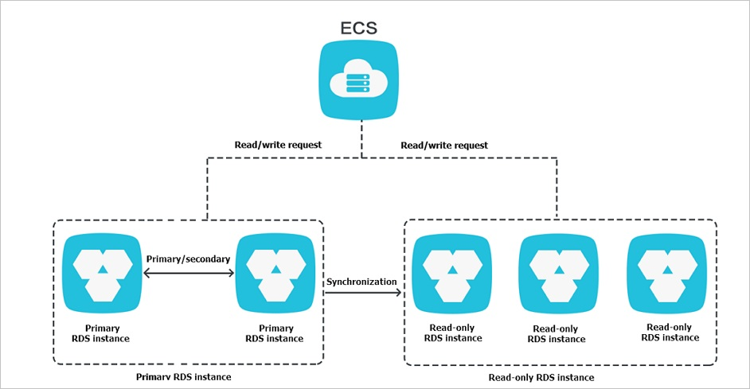

**Read-only instances have the following features**:

- Specifications of a read-only instance can be different from those of the primary instance and can be changed at any time. This facilitates elastic scaling.

- Read-only instances do not require account or database maintenance. Account and database information is synchronized from the primary instance.

- The whitelists of read-only instances can be independently configured.

- System performance monitoring is provided.

  ApsaraDB RDS provides up to 20 system performance monitoring views, including those for disk capacity, IOPS, connections, CPU utilization, and network traffic. You can view the load of instances.

- ApsaraDB RDS provides a variety of optimization recommendations, such as storage engine check, primary key check, large table check, and check for excessive indexes and missing indexes. You can optimize your databases based on the optimization recommendations and specific applications.

<a id="section-6-10-2"></a>

### 6.10.2. Create a read-only instance

You can create read-only instances of different specifications based on your business requirements.

**Precautions**

- A maximum of five read-only instances can be created for a primary instance.

- Backup settings and temporary backup are not supported.

- Instance restoration is not supported.

- Data migration to read-only instances is not supported.

- Database creation and deletion are not supported.

- Account creation, deletion, authorization, and password changes are not supported.

- After a read-only instance is created, you cannot restore data by directly overwriting the primary instance with a backup set.

**Procedure**

1. Log on to the ApsaraDB RDS console.

2. On the **Instance List** page, find the instance that you want to manage.

3. In the **Distributed by Instance Role** section on the right side of the **Basic Information** page, click **Create Read-only Instance**.

4. On the **Create Read-only RDS Instance** page, configure the read-only instance parameters.

   <table>
     <tr>
       <th>Section</th>
       <th>Parameter</th>
       <th>Description</th>
     </tr>
     <tr>
       <td>Region</td>
       <td>Region</td>
       <td>The region in which you want to create the read-only instance.</td>
     </tr>
     <tr>
       <td rowspan="5">Specifications</td>
       <td>Database Engine</td>
       <td>The database engine of the read-only instance, which is the same as that of the primary instance and cannot be changed.</td>
     </tr>
     <tr>
       <td>Engine Version</td>
       <td>The version of the database engine, which is the same as that of the primary instance and cannot be changed.</td>
     </tr>
     <tr>
       <td>Edition</td>
       <td>Set the value to <strong>Read-only</strong>.</td>
     </tr>
     <tr>
       <td>Instance Type</td>
       <td>The instance type of the read-only instance. The instance type of the read-only instance can be different from that of the primary instance, and can be changed at any time to facilitate flexible upgrade and downgrade.</td>
     </tr>
     <tr>
       <td>Storage Capacity</td>
       <td>The storage capacity of the read-only instance.To ensure sufficient I/O throughput for data synchronization, we recommend that you select at least the same instance type and storage capacity as the primary instance for the read-only instance. Valid values: 20 to 6000. Unit: GB. The value is in 1 GB increments.</td>
     </tr>
     <tr>
       <td rowspan="3">Network Type</td>
       <td>Network Type</td>
       <td>The network type of the read-only instance. This must be the same as that of the primary instance and cannot be changed.</td>
     </tr>
     <tr>
       <td>VPC</td>
       <td>The VPC in which you want to create the read-only instance.</td>
     </tr>
     <tr>
       <td>vSwitch</td>
       <td>The vSwitch in the VPC.</td>
     </tr>
   </table>

5. Click **Submit**.

<a id="section-6-10-3"></a>

### 6.10.3. View details of read-only instances

This topic describes how to view details of read-only instances. You can go to the Basic Information page of a read-only instance from the Instances page or from the read-only instance list of the primary instance. Read-only instances are managed in the same manner as primary instances. The Basic Information page shows the management operations that can be performed.

**View details of a read-only instance from the Instances page**

1. Log on to the ApsaraDB RDS console.

2. On the **Instances** page, click the ID of a read-only instance. The **Basic Information** page appears.

   > **Note**
   >
   > In the instance list, **Instance Role** of read-only instances is displayed as
   >
   > **Read-only Instance**.

**View details of a read-only instance from the Basic Information page of the primary instance**

1. Log on to the ApsaraDB RDS console.

2. On the **Instance List** page, find the instance that you want to manage.

3. On the **Basic Information** page, move the pointer over the number below **Read-only Instances** in the **Distributed by Instance Role** section. The ID of the read-only instance is displayed.

4. Click the ID of the read-only instance to go to the Basic Information page of the read-only instance.

<a id="section-6-11"></a>

## 6.11. Manage instances in the recycle bin

This topic describes how to recreate or destroy an ApsaraDB RDS instance in the recycle bin.

**Description**

All ApsaraDB RDS for MySQL instances, except for the following instances, are moved to the recycle bin after they are manually released:

- Instances that are manually released within seven days after they are created.

- **Read-only instances** and **Enterprise Edition instances**.

**Recreate an instance**

If you manually release an ApsaraDB RDS instance that runs for more than seven days, backup files of the instance are retained for another eight days. Within the eight-day retention period, you can create another instance and restore data from the backup files to the new instance. After the eight-day retention period elapses, the backup files of the instance are deleted.

1. Log on to the ApsaraDB RDS console.

2. In the upper-left corner of the page, select an organization. In the left-side navigation pane, click **Locked Instances**.

3. Find the released instance and click **Rebuild** in the Actions column.

4. On the **Restore Instance** page, select **Storage Capacity** and **Network Type** for the new instance and click **Submit**.

   > **Note**
   >
   > - If you set **Network Type** to **VPC**, you must configure a **virtual private cloud (VPC)** and a **vSwitch**.
   >
   > - Other configurations remain the same as the original instance and cannot be changed.

**Destroy an instance**

You can destroy an ApsaraDB RDS instance that is no longer needed in the recycle bin.

> **Warning**
>
> After you destroy an ApsaraDB RDS instance, **all** the backup files of the
>
> instance are destroyed, including regular data backup files, archived backup files, and log backup files. The destroyed backup files **cannot be restored**. Proceed with caution.

1. Log on to the ApsaraDB RDS console.

2. In the upper-left corner of the page, select an organization. In the left-side navigation pane, click **Locked Instances**.

3. Find the released instance and click **Destroy** in the Actions column. In the message that appears, click **Confirm**.

<a id="section-6-12"></a>

## 6.12. Manage tags

If you have a large number of instances, you can create multiple tags and add the tags to the instances. Then, you can query instances by tag. This topic describes how to manage tags.

**Usage notes**

- A tag consists of a key-value pair. Each key must be unique for an Alibaba Cloud account in a region. This limit does not apply to the values of keys.

- You can add up to 20 tags to an instance.

- If a tag is removed from an instance and is not added to other instances, the tag is automatically deleted.

**Add tags**

1. Log on to the ApsaraDB RDS console.

2. On the **Instances** page, find the required instance and click the  icon in the **Tag**

   column.

3. In the **Edit Tags** dialog box, enter the tag key and tag value and click **OK**.

**Search for an instance by tag**

1. Log on to the ApsaraDB RDS console.

2. On the **Instances** page, click **Advanced Filter**.

3. You can search for your instance by **Instance ID /Name**, **VIP**, and **Tag Filtering**. Select a tag from the **Filter by Tag** drop-down list.

4. After you select a tag, the instance list displays all instances that are bound with the tag.

**View the tags that are added to an instance**

1. Log on to the ApsaraDB RDS console.

2. On the **Instances** page, if a small number of tags are added to an instance, the corresponding tags are displayed in the Tag column. If a large number of tags are added to

   an instance, move the pointer over the  icon in the **Tag** column to view all the tags that

   are added to the instance.

**Remove a tag**

1. Log on to the ApsaraDB RDS console.

2. On the **Instances** page, find the required instance and click the  icon in the **Tag**

   column.

3. In the **Edit Tags** dialog box, click the  icon to the right of the tag and click **OK**.

<a id="section-7"></a>

# 7.Accounts

<a id="section-7-1"></a>

## 7.1. Language Detection

Detect the language of the input text. Supports automatic recognition of 23 languages. Best suited to short text such as search queries, product titles, and chat messages. Synchronous.

**Endpoint**

```text
POST /ai/text/marco/language-detection
```

**Use cases**

- Cross-border search -- detect the buyer's search-query language and route to the matching index.

- Title preprocessing -- detect source language automatically before calling the Text Translation API, so callers do not need to pass  `SourceLanguage` .

- Chat routing -- forward users to native-language agents based on detected language.

**Quick start**

```python
import json

data = json.dumps({ "SourceText": "Hello world" })
result = make_signed_request("/ai/text/marco/language-detection", data)
print(result["Data"]["DetectedLanguage"])  # en
```

**Request parameters**

| Parameter | Type | Required | Description |
| --- | --- | --- | --- |
| <code>SourceText</code> | String | Yes | Text to identify. Up to ~1024 characters recommended; very short inputs (single tokens) have lower accuracy. |

**Response fields**

| Field | Type | Description |
| --- | --- | --- |
| <code>Code</code> | String | Business status. <code> Success </code> when OK; otherwise see Error codes. |
| <code>Message</code> | String | Business message. |
| <code>RequestId</code> | String | Unique request identifier. |
| <code>Success</code> | Boolean | Whether the call succeeded. |
| <code>Data.DetectedLanguage</code> | String | Detected language code; see "Supported languages" below. |
| <code>Data.UsageMap.RequestCount</code> | Number | Request count for billing reconciliation. |

**Response example**

```json
{
  "Code": "Success",
  "Message": "ok",
  "RequestId": "21570000-0000-0000-0000-000000000001",
  "Success": true,
  "Data": {
    "DetectedLanguage": "en",
    "UsageMap": { "RequestCount": 1 }
  }
}
```

**Supported languages (23)**

Arabic ( `ar` ), Bengali ( `bn` ), German ( `de` ), English ( `en` ), Spanish ( `es` ), French ( `fr` ), Hebrew ( `he` ), Indonesian ( `id` ), Italian ( `it` ), Japanese ( `ja` ), Korean ( `ko` ), Malay ( `ms` ), Dutch ( `nl` ), Polish ( `pl` ), Portuguese ( `pt` ), Russian ( `ru` ), Thai ( `th` ), Turkish ( `tr` ), Ukrainian ( `uk` ), Urdu ( `ur` ), Vietnamese ( `vi` ), Chinese Simplified ( `zh` ), Chinese Traditional ( `zh-tw` ).

**Error codes**

Common error codes:  `InvalidParameter`  (missing or empty  `SourceText` ),  `InternalError` (system busy). See Error codes for the full reference.

**What's next**

- Text Translation API -- translate plain text.

- Text Correction API -- spelling correction.

<a id="section-7-2"></a>

## 7.2. Reset the password of a database account

You can reset the password of your database account in the ApsaraDB RDS console.

**Prerequisites**

- The ApsaraDB RDS instance is in the **Running** state.

- A database account is created. For information about how to create a database account, see Create an account.

**Procedure**

1. Log on to the ApsaraDB RDS console.

2. On the **Instance List** page, find the instance that you want to manage.

3. In the left-side navigation pane, click **Accounts**.

4. Find the account that you want to manage and click **Reset Password** in the Actions column.

5. In the dialog box that appears, enter and confirm the new password, and then click **OK**.

   > **Note**
   >
   > The password must meet the following requirements:
   >
   > - It can be 8 to 32 characters in length.
   >
   > - It must contain at least three of the following character types: uppercase letters, lowercase letters, digits, and special characters.
   >
   > - The following special characters are supported:  `!@#$%^&*()_+-=` .

<a id="section-7-3"></a>

## 7.3. Product Material Optimization Pro

The **best-quality** tier of the one-click cross-platform material optimization service. Given a 1688 product URL, produce TEMU-ready titles, attributes, hero images, SKU images, detail images, and copy. Uses the official *Best Quality* workflow: full AI capability stack, preserves and localizes brand marketing assets, and emits category-specific assets (e.g., size charts) for apparel. Asynchronous.

**Endpoints**

**Submit optimization task**

```text
POST /ai/material/optimization/pro
```

**Query optimization result**

```text
POST /ai/material/optimization/pro/result
```

**Use cases**

- High ASP, brand merchants, apparel / accessories / beauty / home -- categories that rely on marketing assets.

- Multi-language, multi-market localization.

- Scenarios needing category-specific assets (size chart, package weight/dimensions).

**Workflow**

The official *Best Quality* workflow:

1. Parse the 1688 product URL, extract all assets, diagnose gaps.

2. LLM compliance filtering, SEO keyword optimization, five-point bullets, multi-language localized rewrite.

3. Images: invoke smart element detection / matting / removal / image translation Pro /expansion / smart crop / upscale; remove non-compliant elements while **preserving and rewriting marketing copy**.

4. Category-specific assets: apparel size charts, package weight/dimensions, etc.

5. Output a standardized material package via API and / or Excel export.

**Request parameters**

Pro and Lite share the same 31-field schema; the difference is the server-side workflow. See the Smart Image Generation API for the full schema. Pro typically enables  `Ability= [1,2,3,4,5,6,7]`  -- all 7 atomic capabilities.

**Response fields (query)**

Pro adds the following fields on top of Lite:

| Field | Type | Description |
| --- | --- | --- |
| <code>Data.Result.BulletPoints</code> | String\[\] | Five-point bullets for detail-page selling points. |
| <code>Data.Result.SizeChart</code> | Object | Apparel size chart (when applicable); fields include size /bust / waist / length. |
| <code>Data.Result.PackageInfo</code> | Object | Package weight / dimension info (when applicable). |
| <code>Data.Result.TranslatedImag</code><br><code>es</code> | Object\[\] | Marketing images localized through Image Translation Pro. |

Shared fields ( `Status` ,  `Images` ,  `Title` ,  `Attributes` ,  `CategoryPath` ,  `UsageMap` ) are the same as Lite.

**Error codes**

See Error codes.

**What's next**

- Product Material Optimization Lite -- lowest-cost tier.

- Smart Image Generation API -- detailed field schema for the 7 atomic capabilities.

<a id="section-7-4"></a>

## 7.4. Modify the permissions of an account

You can modify the authorized databases and read/write permissions of standard accounts in the ApsaraDB RDS console based on your business requirements. **The permissions of a privileged account can only be reset to the default settings but cannot be modified.**

**Procedure**

1. 

2. 

3. In the left-side navigation pane, click **Accounts**.

4. Find the account that you want to manage and click **Change Permissions** in the **Actions** column.

5. In the panel that appears, adjust the account permissions and click **OK**.

   - Add or remove authorized databases: Select databases and click **>** or **<**.

   - Set read/write permissions: In the **Authorized Databases** section, you can set the permissions to **Read/Write (DDL + DML)**, **Read-Only**, **DDL Only**, or **DML Only**.

     If you want to grant the same permissions on multiple databases to the account at a time, click the corresponding permission next to **Set All to** in the upper-right corner of the right-side box.

**Accounts and permissions**

**Accou**

**Permi**

**nt**

**ssion**

**Operation**

**type**

**type**

SELECT

INSERT

UPDATE

DELETE

CREATE

DROP

RELOAD

PROCESS

REFERENCES

INDEX

CREATE

**Privil**

LOCK

REPLICATION

ALTER

TEMPORARY

EXECUTE

**eged**

TABLES

SLAVE

None

TABLES

**accou nt**

REPLICATION

CREATE

CREATE

ALTER

SHOW VIEW

CLIENT

VIEW

ROUTINE

ROUTINE

CREATE

EVENT

TRIGGER

None

None

USER

LOCK

REPLICATION

SELECT

SHOW VIEW

PROCESS

TABLES

SLAVE

**Read-Only**

REPLICATION

None

None

None

None

CLIENT

SELECT

INSERT

UPDATE

DELETE

CREATE

CREATE

DROP

REFERENCES

INDEX

ALTER

TEMPORARY TABLES

LOCK

CREATE

CREATE

**Read/**

EXECUTE

SHOW VIEW

TABLES

VIEW

ROUTINE

**Write (DDL + DML)**

ALTER

REPLICATION

EVENT

TRIGGER

PROCESS

ROUTINE

SLAVE

**Stand ard**

REPLICATION

None

None

None

None

**accou**

CLIENT

**nt**

CREATE

CREATE

DROP

INDEX

ALTER

TEMPORARY TABLES

LOCK

CREATE

CREATE

ALTER

**DDL**

SHOW VIEW

TABLES

VIEW

ROUTINE

ROUTINE

**Only**

REPLICATION

REPLICATION

CLIENT

PROCESS

SLAVE

None

None

CREATE

SELECT

INSERT

UPDATE

DELETE

TEMPORARY TABLES

**DML**

LOCK

**Only**

EXECUTE

SHOW VIEW

EVENT

TRIGGER

TABLES

REPLICATION

REPLICATION

PROCESS

None

None

SLAVE

CLIENT

<a id="section-7-5"></a>

## 7.5. Product Material Optimization Lite

The **lowest-cost** tier of the one-click cross-platform material optimization service. Given a 1688 product URL, produce TEMU-ready titles, attributes, hero images, SKU images, detail images, and copy. Uses the official *Lowest Cost* workflow: filtering and light processing, no high-cost image translation. Asynchronous.

**Endpoints**

**Submit optimization task**

```text
POST /ai/material/optimization/lite
```

**Query optimization result**

```text
POST /ai/material/optimization/lite/result
```

**Use cases**

- Cross-border listing: 1688 → TEMU broad assortment publishing.

- High-SKU bulk listing, entry-level AI processing in ERP/SaaS pipelines.

- High daily volume but lower marketing performance bar.

- Filter out watermark / non-compliant images and pick clean originals; skip AI generation.

**Workflow**

The end-to-end *Lowest Cost* workflow:

1. Parse the 1688 product URL: extract title / SKU / hero image / detail images / attributes.

2. Filter text and apply SEO optimization against the TEMU blacklist and compliance rules.

3. Detect watermark / logo / Chinese copy in images; **prefer clean originals and skip image translation** (high-converting marketing-text images may be filtered out).

4. Apply category matching, attribute filling, and multi-language localization to the target platform.

5. Output a standardized material package; delivered via API and / or Excel export.

**Request parameters**

Lite and Pro share the same 31-field schema; the difference is the server-side workflow. Core fields below; for the full schema see the Smart Image Generation API.

| Parameter | Type | Required | Description |
| --- | --- | --- | --- |
| <code>ImageUrl</code> | String | Yes | Image URL (or 1688 product URL parsed by the server). Resolution &gt; 512×512; long side ≤ 1920; short side ≤ 1080; size ≤ 5 MB; png / jpeg / jpg / bmp /webp. |
| <code>Ability</code> | Number\[\] | Yes | AI capabilities to invoke: 1=element detection, 2=smart matting, 3=smart removal, 4=image translation Pro, 5=image expansion, 6=smart crop, 7=upscale. Lite typically omits 4. |
| <code>TargetPlatform</code> | String | Yes | Target listing platform.Only <code> TEMU </code> is supported today. |
| <code>TargetLanguage</code> | String | No | Target language for text localization. |

All other parameters ( `ObjectDetectElements` ,  `NonobjectDetectElements` ,  `IsFilter` ,  `BackGroundType` ,  `TargetWidth` ,  `TargetHeight` ,  `UpscaleFactor` , etc.) carry the same semantics as in the Smart Image Generation API.

**Response fields (query)**

| Field | Type | Description |
| --- | --- | --- |
| <code>Data.Status</code> | String | Task state: <code> RUNNING </code>, <code> COMPLETED </code>, <code> FAILED </code>. |
| <code>Data.Result.Images</code> | Object\[\] | Processed image list (hero, SKU, detail). |
| <code>Data.Result.Title</code> | String | SEO-optimized title. |
| <code>Data.Result.Attributes</code> | Object\[\] | Target-platform attribute fills. |
| <code>Data.Result.CategoryPath</code> | String | Matched category path on the target platform. |
| <code>Data.Result.UsageMap.Proce</code><br><code>ssedImageCount</code> | Number | Images processed (for billing reconciliation). |

**Lite vs Pro**

| Dimension | Lite (this API) | Pro |
| --- | --- | --- |
| Workflow | Lowest Cost | Best Quality |
| Marketing copy in images | Images with marketing copy filtered out | Preserved and rewritten |
| Image Translation Pro | Not invoked | Invoked |
| Category-specific assets | None | Yes (size charts, etc.) |
| Best fit | Broad assortment, low ASP, high velocity | Brand, high ASP, high conversion |

**Error codes**

See Error codes.

**What's next**

- Product Material Optimization Pro -- best-quality tier.

- Smart Image Generation API -- detailed field schema for the 7 atomic capabilities.

<a id="section-8"></a>

# 8.Category Match

LLM-based cross-platform category matching. Given source-platform product info, automatically pick the best category on the target listing platform and return the full path, a confidence score, and the rationale. Synchronous. Only  `TEMU`  is supported today.

**Endpoint**

```text
POST /ai/material/category/match
```

**Use cases**

- Merchants relisting sourced goods need to map to the correct node in the target platform's category tree.

- Top sellers' internal bulk pipelines, ERP / SaaS-driven publishing, fast SMB single-item listing.

**Effect showcase**

| Case | Example image |
| --- | --- |
| 1688 USB fan → TEMU "Home Appliances &gt; Heating, Cooling &amp; Air Quality Appliances &gt; Fans &gt; USB Fans" | USB fan case |
| 1688 bracelet → TEMU "Clothing, Shoes &amp; Jewelry &gt; Women's Fashion &gt; Women's Accessories &gt; Women's Fashion Bracelets..." | Bracelet case |

**Request parameters**

| Parameter | Type | Required | Description |
| --- | --- | --- | --- |
| <code>ProductTitle</code> | String | Yes | Product title. |
| <code>SourceCategory</code> | String | Yes | Source-platform category (e.g., full 1688 category path). |
| <code>ProductDescription</code> | String | No | Product description. |
| <code>SkuInfo</code> | String | No | SKU information. |
| <code>ProductAttributes</code> | Object | No | Product attribute key-value pairs. |
| <code>TargetPlatform</code> | String | Yes | Listing platform. Only <code> TEMU </code> today. |

**Response fields**

| Field | Type | Description |
| --- | --- | --- |
| <code>Data.CategoryPath</code> | String | Full category path on the target platform, separated by <code> &gt; </code>. |
| <code>Data.CategoryName</code> | String | Leaf category name. |
| <code>Data.Confidence</code> | Number | Confidence score (0-100).Recommend human review below 70. |
| <code>Data.Reason</code> | String | Match rationale. |

**Response example**

```json
{
  "Code": "Success",
  "Data": {
    "CategoryPath": "Home Appliances > Heating, Cooling & Air Quality > Fans > USB Fans
",
    "CategoryName": "USB Fans",
    "Confidence": 95,
    "Reason": "Title contains USB / fan keywords; source category is synonymous."
  }
}
```

**Error codes**

See Error codes.

**What's next**

- Category Attribute Match API -- fill required attributes within the matched category.

<a id="section-8-1"></a>

## 8.1. Category Attribute Match

Multimodal-LLM-based cross-platform category-attribute filling. Given source-platform product info (title, source category, description, SKU, attributes, up to 10 images), match the precise target-platform category and fill every required attribute, with a per-attribute confidence and rationale. Synchronous.

**Endpoint**

```text
POST /ai/material/category/attribute
```

**Use cases**

- 1688 → TEMU cross-platform listing where platform categories differ significantly and have complex hierarchical relations (material → wood species → density).

- Top sellers' bulk publishing, ERP / SaaS integrations, fast SMB single-item listing.

**Request parameters**

| Parameter | Type | Required | Description |
| --- | --- | --- | --- |
| <code>ProductTitle</code> | String | Yes | Product title. |
| <code>SourceCategory</code> | String | Yes | Source-platform category path. |
| <code>ProductDescription</code> | String | No | Product description. |
| <code>SkuInfo</code> | Object\[\] | No | SKU list (spec + price per item). |
| <code>ProductAttributes</code> | Object | No | Source-platform attribute key-value pairs. |
| <code>ImageUrls</code> | String\[\] | No | Up to 10 image URLs.The multimodal model infers attributes from images. |
| <code>TargetPlatform</code> | String | Yes | Listing platform. Only <code> TEMU </code> today. |

**Response fields**

| Field | Type | Description |
| --- | --- | --- |
| <code>Data.CategoryPath</code> | String | Matched precise category path on the target platform. |
| <code>Data.Attributes</code> | Object\[\] | Filled attributes. Each item has <code> Name </code>, <code> Value </code>, <code> Confidence </code> (0-100), <code> Reason </code>, and <code> SourceMatched </code> (whether the value reused a source-platform attribute). |

**Response example**

```json
{
  "Code": "Success",
  "Data": {
    "CategoryPath": "Home Appliances > Fans > USB Fans",
    "Attributes": [
      { "Name": "Battery Type", "Value": "Lithium-Ion", "Confidence": 92, "Reason": "Title and image both indicate rechargeable", "SourceMatched": false },
      { "Name": "Connectivity",  "Value": "USB Type-C",  "Confidence": 88, "Reason": "Port visible in image",                  "SourceMatched": true  }
    ]
  }
}
```

**Error codes**

See Error codes.

**What's next**

- Category Match API -- category match alone.

<a id="section-8-2"></a>

## 8.2. Smart Matting

Automatically detect the salient subject and separate it from the background. Supports transparent / white / custom-color output. Accuracy > 95% for hard cases (hair, translucent objects, fur). Synchronous.

**Endpoint**

```text
POST /ai/image/matting
```

**Capability cover**

Smart Matting cover

**Effect comparison**

| Original | After matting |
| --- | --- |
| Original 1 | After matting 1 |
| Original 2 | After matting 2 |

**Use cases**

- Asset retouching -- swap backgrounds, add shadows after isolating the subject.

- Bulk asset processing -- batch background swaps for ads and posters.

**Core capabilities**

- **Precise subject detection** -- > 95% accuracy on hair, transparent, and fur cases.

- **Smart edge refinement** -- handles aliased and semi-transparent regions (smoke, glass) with natural transitions.

- **Multi-format output** -- transparent PNG, white background, or custom background color.

**Request parameters**

| Parameter | Type | Required | Description |
| --- | --- | --- | --- |
| <code>ImageUrl</code> | String | Yes | Image URL. Resolution &gt; 512×512; long side ≤ 1920; short side ≤ 1080; size ≤ 5 MB; png / jpeg / jpg / bmp /webp. |
| <code>BackGroundType</code> | String | Yes | Background type: <code>WHITE_BACKGROUND</code>, <code> TRANSPARENT </code>, or <code>CUSTOM_COLOR</code> (combined with <code> BackGroundColor </code>). |
| <code>BackGroundColor</code> | String | No | Custom background color, 6-digit hex RGB (e.g., <code> FF5733 </code>). Only when <code>BackGroundType=CUS</code> <code>TOM_COLOR </code>. |

**Response fields**

| Field | Type | Description |
| --- | --- | --- |
| <code>Data.ImageUrl</code> | String | Matted image URL (signed OSS link). |
| <code>Data.UsageMap.ProcessedIma</code><br><code>geCount</code> | Number | Images processed (for billing). |

**Error codes**

Common:  `InvalidParameter`  (image exceeds limits),  `DownstreamUnavailable`  (image download failed). See Error codes.

**What's next**

- Smart Image Generation API -- orchestrate matting with the other 6 capabilities asynchronously.

<a id="section-9"></a>

# 9.Size Chart Extraction

Use a multimodal LLM to extract structured size-chart and package-dimension data from images.  `ColumnNameList`  targets specific columns (e.g., Size, Bust, Length) for precise extraction;  `LanguageModel`  controls output language (Chinese, English, or original). Asynchronous: submit, then poll.

**Endpoints**

**Submit extraction task**

```text
POST /ai/image/size-chart/extraction
```

**Query extraction result**

```text
POST /ai/image/size-chart/extraction/result
```

**Input example**

Size chart input example

**Use cases**

- Apparel category size-chart text-ification.

- Bulk structuring of package weight / dimension info.

**Request parameters (submit)**

| Parameter | Type | Required | Description |
| --- | --- | --- | --- |
| <code>ImageUrl</code> | String | Yes | URL of the image containing the size chart. |
| <code>ColumnNameList</code> | String\[\] | No | Target columns to extract (e.g., <code>["Size", "Bust",</code> <code>"Length"] </code>). Omit to extract all columns. |
| <code>LanguageModel</code> | String | No | Output language: <code> cn </code> or <code> en </code>. Omit to keep the original language. |

**Request parameters (query)**

| Parameter | Type | Required | Description |
| --- | --- | --- | --- |
| <code>TaskId</code> | String | Yes | Task ID returned by the submit endpoint. |

**Response fields (query)**

The response carries the raw multimodal-model structure (snake_case), which differs from the PascalCase convention used elsewhere:

```json
{
  "Code": "Success",
  "Data": {
    "message": {
      "<ImageUrl>": {
        "size_chart": [
          {
            "Weight":  { "unit": "kg", "upper_value": 47.5, "lower_value": 40 },
            "Length":  { "unit": "CM", "value": 81 },
            "Size":    { "value": "S" },
            "Waist (stretched)": { "unit": "CM", "value": 58 }
          }
        ],
        "intersection_attributes": ["Size", "Length", "Waist (stretched)", "Weight"],
        "size_chart_attributes":   ["Size", "Length", "Waist (stretched)", "Weight"]
      }
    },
    "usageMap": { "ProcessedImageCount": 1 }
  }
}
```

Main fields:  `message.<ImageUrl>.size_chart`  (extracted rows),  `intersection_attributes` (columns intersecting  `ColumnNameList` ),  `size_chart_attributes`  (columns actually detected),  `usageMap.ProcessedImageCount`  (usage).

**Error codes**

See Error codes.

**What's next**

- Size Chart Detection API -- screen images first to save cost before extraction.

<a id="section-9-1"></a>

## 9.1. Change the endpoint and port number of an instance

This topic describes how to view and change the endpoint and port number of an ApsaraDB RDS instance.

**View the endpoint and port number**

1. Log on to the ApsaraDB RDS console.

2. On the **Instance List** page, find the instance that you want to manage.

3. In the **Basic Information** section, view the internal and public endpoints and port numbers.

**Change the endpoint and port number of an instance**

1. Log on to the ApsaraDB RDS console.

2. On the **Instance List** page, find the instance that you want to manage.

3. In the left-side navigation pane, click **Database Connection**.

4. In the upper-right corner of the Database Connection section, click **Change Endpoint**.

5. In the dialog box that appears, set Connection Type, Endpoint, and Port, and then click **OK**.

   > **Note**
   >
   > - The prefix of an endpoint must be 8 to 64 characters in length and can contain letters, digits, and hyphens (-). It must start with a lowercase letter.
   >
   > - The port number must be a value within the range of 1000 to 5999.

<a id="section-9-2"></a>

## 9.2. Apply for and release an internal endpoint or a public endpoint for an instance

ApsaraDB RDS supports two types of endpoints: internal endpoints and public endpoints. The initial endpoint type of an ApsaraDB RDS instance depends on the network environment selected during instance creation. You can dynamically adjust the network access policies based on your business requirements. This ensures data security and enhances connection flexibility.

**Apply for an internal endpoint or a public endpoint**

If you set **Network Connection Type** to **Public network connection** when you create an ApsaraDB RDS instance, the database system assigns a public endpoint to the instance, and you can apply for an internal endpoint. Otherwise, the database system assigns an internal endpoint to the instance, and you can apply for a public endpoint.

1. 

2. 

3. In the left-side navigation pane, click **Database Connection**.

4. Apply for a public or internal endpoint based on your business requirements, and then click **OK**.

   - To apply for a public endpoint, click **Apply for Public Endpoint**.

   - To apply for an internal endpoint, click **Apply for Internal Endpoint**.

**Release an internal endpoint or a public endpoint**

If an endpoint is no longer needed, you can release the endpoint to ensure instance security.

1. 

2. 

3. In the left-side navigation pane, click **Database Connection**.

4. Release a public or internal endpoint based on your business requirements, and then click **OK**.

   - To release a public endpoint, click **Release Public Endpoint**.

   - To release an internal endpoint, click **Release Internal Endpoint**.

**FAQ**

- Can I change the endpoints and port numbers of my ApsaraDB RDS instance?

  You can change only the prefixes and port numbers of the endpoints. For more information, see Change the endpoint and port number of an instance.

- Can I set the endpoints of my ApsaraDB RDS instance to static IP addresses?

  No, you cannot set the endpoints of your ApsaraDB RDS instance to static IP addresses. Both primary/secondary switchovers and specification changes may cause changes to the IP addresses. We recommend that you connect to your ApsaraDB RDS instance by using an endpoint. This allows you to minimize the impact on your workloads and eliminates the need to modify the configuration data on your application.

- How do I connect to my ApsaraDB RDS instance by using a public endpoint?

  For more information, see Connect to an ApsaraDB RDS for MySQL instance.

<a id="section-9-3"></a>

## 9.3. Use DMS to log on to an ApsaraDB RDS instance

This topic describes how to use Data Management (DMS) to log on to an ApsaraDB RDS instance.

**Prerequisites**

An IP address whitelist is configured. For more information about how to configure an IP address whitelist, see Configure an IP address whitelist.

**Procedure**

1. Log on to the ApsaraDB RDS console.

2. On the **Instance List** page, find the instance that you want to manage.

3. Click **Log On to DB** in the upper-right corner of the page.

4. In the **Login instance** dialog box of the **DMS** console, check values of **Database type**, **Instance Area**, and **Connection string address**. If the information is correct, enter **Database account** and **Database password**, as shown in the following figure.

   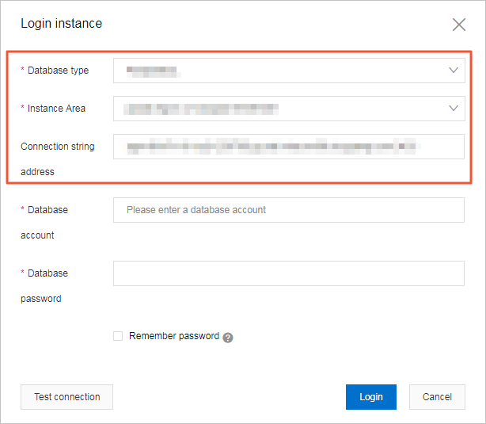

   | Parameter | Description |
   | --- | --- |
   | Database type | The engine of the database. By default, the engine of the database to be connected is displayed. |
   | Instance Area | The region where the instance is deployed. By default, the region of the current instance is displayed. |
   | Connection string address | The endpoint of the instance. By default, the endpoint of the current instance is displayed. |
   | Database account | The account of the database to be connected. |
   | Database password | The password of the account used to connect to the database. |

5. Click **Login**.

   > **Note**
   >
   > If you want the browser to remember the password, select **Remember**
   >
   > **password** before you click **Login**.

<a id="section-9-4"></a>

## 9.4. Configure the hybrid access solution for an instance

This topic describes how to configure the hybrid access solution for an ApsaraDB RDS instance. This solution allows you to retain both the classic network endpoint and Virtual Private Cloud (VPC) endpoint of your ApsaraDB RDS instance. This way, you can migrate your ApsaraDB RDS instance from the classic network to a VPC without network interruptions.

**Background information**

When you migrate your ApsaraDB RDS instance from the classic network to a VPC, the internal classic network endpoint of the instance changes to the internal VPC endpoint. In this case, the endpoint remains unchanged, but the IP address that is bound to the endpoint changes. This change causes a network interruption of 30 seconds or less, and Elastic Compute Service (ECS) instances located in the classic network can no longer connect to your ApsaraDB RDS instance over an internal network. To facilitate a smooth migration, ApsaraDB RDS provides the hybrid access solution.

Hybrid access refers to the ability of your ApsaraDB RDS instance to be connected by both ECS instances located in the classic network and ECS instances located in a VPC. During the validity period of the hybrid access solution, ApsaraDB RDS retains the internal classic network endpoint and generates an internal VPC endpoint. This prevents network interruptions when you migrate your instance from the classic network to a VPC.

For security and performance purposes, we recommend that you use only the internal VPC endpoint. You must specify a validity period for the hybrid access solution. When the validity period expires, ApsaraDB RDS releases the internal classic network endpoint and applications are unable to use the endpoint to connect to your instance. Therefore, you must add the internal VPC endpoint to your applications before the validity period expires. This ensures a smooth migration and prevents interruptions to your workloads.

For example, assume that a company uses the hybrid access solution to migrate its ApsaraDB RDS instance from the classic network to a VPC. During the validity period of the hybrid access solution, some applications use the internal VPC endpoint to connect to the ApsaraDB RDS instance, whereas the others continue to use the internal classic network endpoint to connect to the instance. When all applications of the company can use the internal VPC endpoint to connect to the instance, the internal classic network endpoint can be released. The following figure demonstrates the scenario.

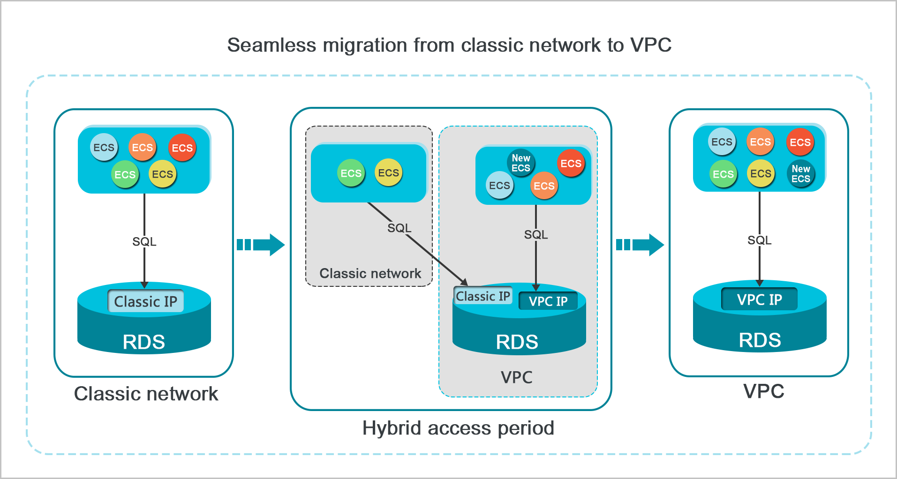

**Limits**

During the validity period of the hybrid access solution, your ApsaraDB RDS instance has the following limits:

- The network type of the instance cannot be changed to classic network.

- The instance cannot be migrated to another zone.

**Prerequisites**

- The ApsaraDB RDS instance resides in the classic network.

- Available VPCs and vSwitches exist in the zone where the ApsaraDB RDS instance resides.

- Your ApsaraDB RDS instance provides an internal endpoint. If no internal endpoint exists, you must apply for one. For more information, see Apply for and release an internal endpoint or a public endpoint for an instance.

**Change the network type from classic network to VPC**

1. Log on to the ApsaraDB RDS console.

2. On the **Instance List** page, find the instance that you want to manage.

3. In the left-side navigation pane, click **Database Connection**.

4. On the Instance Connection tab, click **Switch to VPC**.

5. In the Switch to VPC dialog box, select a VPC and a vSwitch and specify whether to retain the classic network endpoint. Clear or select the **Reserve Original Classic Network Endpoint** check box based on the details described in the following table.

   | Action | Description |
   | --- | --- |
   | Clear the Reserve Original Classic Network Endpoint check box | The classic network endpoint is not retained and changes to a VPC endpoint.<br>When you change the network type from classic network to VPC, a network interruption of 30 seconds occurs. When this occurs, ECS instances located in the classic network are disconnected from your ApsaraDB RDS instance. |
   | Select the Reserve Original Classic Network Endpoint check box | The classic network endpoint is retained, and a new VPC endpoint is generated. In this case, your ApsaraDB RDS instance runs in hybrid access mode. Both ECS instances located in the classic network and ECS instances located in the selected VPC can access your ApsaraDB RDS instance over an internal network.<br>When you change the network type from classic network to VPC, no network interruptions occur. ECS instances located in the classic network are still connected with your ApsaraDB RDS instance until the classic network endpoint expires.<br>Specify the expiration date of the classic network endpoint. Before the classic network endpoint expires, you must add the new VPC endpoint to your applications that run on the ECS instances located in the selected VPC. This allows ApsaraDB RDS to migrate your workloads to the selected VPC without network interruptions. |

6. Add the internal IP addresses of ECS instances located in the selected VPC to an IP address whitelist of the VPC network type. This allows the ECS instances to connect to your ApsaraDB RDS instance over an internal network. If no IP address whitelists of the VPC network type are available, create one. For more information, see Configure an IP address whitelist.

**Change the expiration date of the internal classic network endpoint**

During the validity period of the hybrid access solution, you can change the expiration date of the classic network endpoint based on your business requirements. The expiration date is immediately recalculated starting from the day when you make the change. For example, assume that the classic network endpoint is configured to expire on August 18, 2017. On August 15, 2017, you increase the validity period of the classic network endpoint by 14 days. In this case, ApsaraDB RDS releases the classic network endpoint on August 29, 2017.

To change the expiration date, perform the following operations:

1. Log on to the ApsaraDB RDS console.

2. On the **Instance List** page, find the instance that you want to manage.

3. In the left-side navigation pane, click **Database Connection**.

4. Click **Change Expiration Time**.

5. In the **Change Expiration Time** dialog box, select an expiration date and click **OK**.

<a id="section-9-5"></a>

## 9.5. Change the network type of an instance

This topic describes how to change the network type of an ApsaraDB RDS instance between the classic network and Virtual Private Cloud (VPC).

**Background information**

- Classic network: ApsaraDB RDS instances in the classic network are not isolated. To block unauthorized access to these instances, you must configure whitelists.

- VPC: A VPC is an isolated network environment that provides better security than the classic network. It allows you to customize route tables, CIDR blocks, and gateways. In addition, you can connect your data centers to Alibaba Cloud VPCs through Express Connect circuits or VPN connections, creating a virtual data center to facilitate the migration of applications to the cloud.

**Change the network type from VPC to classic network**

**Usage notes**

- After you change the network type from VPC to classic network, the internal endpoint of your ApsaraDB RDS instance remains unchanged. However, the IP address that is associated with the internal endpoint changes.

- After you change the network type from VPC to classic network, Elastic Compute Service (ECS) instances located in the same VPC as your ApsaraDB RDS instance can no longer connect to your ApsaraDB RDS instance by using the internal endpoint. You must update the endpoint for the applications deployed on the ECS instances.

- When you change the network type, a network interruption of 30 seconds may occur. To avoid business interruption, we recommend that you change the network type during off-peak hours or make sure that your application is configured to automatically reconnect to the instance.

**Procedure**

1. 

2. 

3. In the left-side navigation pane, click **Database Connection**.

4. On the right side of the page, click **Switch to Classic Network**.

5. In the message that appears, click **OK**.

**Change the network type from classic network to VPC**

1. 

2. 

3. In the left-side navigation pane, click **Database Connection**.

4. On the right side of the page, click **Switch to VPC**.

5. In the dialog box that appears, select a VPC and a switch, specify whether to **Retain Original Classic Network Endpoint**, and then click **OK**.

   For more information about **Retain Original Classic Network Endpoint**, see Configure the hybrid access solution for an instance.

<a id="section-9-6"></a>

## 9.6. Change the VPC and vSwitch for an instance

When your business network plan changes or you need to adjust the network environment of an ApsaraDB RDS instance, you can change the virtual private cloud (VPC) and vSwitch for the instance in the console.

**Prerequisites**

The instance is deployed in a VPC.

**Precautions**

- **Transient network disconnections**: The switching process causes a transient network disconnection of approximately 30 seconds. Ensure that your applications have an automatic reconnection mechanism and perform this operation during off-peak hours.

- **VIP changes**: The virtual IP (VIP) changes after the switching. You must use the endpoint to access the instance. Do not use an IP address for direct connection.

- **Cache clearing**: You must clear the client cache promptly after the VIP changes. Otherwise, the database may become read-only, and write operations will fail.

- **Associated services**: Data Management Service (DMS) and Data Transmission Service (DTS) may be briefly affected by a VIP change. They will automatically recover after the switching is complete. No manual intervention is required.

**Procedure**

1. 

2. 

3. In the left-side navigation pane, click **Database Connection**. On the page that appears, click **Switch vSwitch**.

4. Select a VPC and a vSwitch, and then click **OK**.

5. In the message that appears, click **OK**.

<a id="section-10"></a>

# 10.Database proxy

<a id="section-10-1"></a>

## 10.1. Configure a dedicated proxy

The dedicated proxy for ApsaraDB RDS for MySQL is a database middleware service built on isolated computing resources. It supports features such as read/write splitting, a connection pool, and consistency level control. The proxy endpoint remains stable for the lifetime of the proxy service, reducing the impact of backend topology changes on your application's connection configuration. By using dedicated proxy resources, you can reduce the risk of multi-tenant interference, scale specifications on demand, and improve both operational efficiency and concurrency.

**Use cases**

- Distribute read/write workloads: When your application has significantly more read operations than write operations, you can automatically route read requests to read-only instances to reduce the load on the primary instance.

- Achieve elastic scaling with zero application changes: During high-traffic events like sales promotions, you can dynamically add or remove read-only instances without changing your application's connection configuration.

- Meet high-performance and high-stability requirements: If you require resource isolation, high concurrency capacity, and stability for the proxy layer, a dedicated proxy avoids the resource contention risks associated with a shared proxy.

**Usage notes**

| Category | Constraint | Description |
| --- | --- | --- |
| Connection model | 1:N backend connection | A single proxy connection simultaneously consumes one backend connection from the primary instance and one from each read-only instance. The total number of effective connections is limited by the instance with the lowest specifications. We recommend using the same specifications for the primary and read-only instances before enabling the proxy. |
| Parameter consistency | max_prepared_stmt_count | This parameter must have the same value on the primary instance and all read-only instances. Otherwise, prepared statement execution may fail. |
| Feature limitations | SSL/compression protocol | SSL encryption and the MySQL compression protocol are not supported. |
| Routing behavior | Multi-statements/stored procedure | After you execute these types of statements, all subsequent requests on the current connection are routed to the primary instance. To resume read/write splitting, you must disconnect and reconnect. |
| Routing behavior | Hint syntax | • The proxy supports<code> /*FORCE_MASTER*/ </code>and<code> /*FORCE_SLAVE*/ </code> hints. These hints take precedence over the consistency level and transaction binding.<br>• Do not include environment variable statements, such as<code> set names utf8 </code>, in a hint. Doing so can cause routing errors. |
| Load distribution | Adding or restarting a read-only instance | The system does not automatically migrate existing connections to a new read-only instance. Only new connections participate in load balancing with the new instance. To apply the change immediately, restart your application or refresh its connection pool. |
| Consistency | Non-transactional reads | In read/write splitting mode, the proxy does not guarantee strong consistency for read requests outside of a transaction. If you require strict read consistency, wrap the relevant operations in a transaction. |
| Monitoring differences | show processlist | Executing this command through the proxy endpoint returns a consolidated view of sessions from all backend instances. |

**Enable dedicated proxy**

1. 

2. 

3. In the left-side navigation pane, click **Database Proxy**.

4. Click **Enable Now**.

**Modify proxy endpoint and port**

After you enable the dedicated proxy for your ApsaraDB RDS for MySQL instance, your application must connect to the database through the proxy endpoint.

1. 

2. 

3. In the left-side navigation pane, click **Database Proxy**.

4. On the **Proxy Service** tab, click **Modify Address** or **Modify Port**.

   The dedicated proxy currently provides one proxy endpoint, and the read/write splitting

   feature is bound to this endpoint. Click the copy icon  to copy the proxy endpoint to your

   clipboard.

5. Click **OK**.

**Change proxy instance specification**

1. 

2. 

3. In the left-side navigation pane, click **Database Proxy**.

4. On the **Proxy Service** tab, set the **Single-node Proxy Instance Specification CPU (Cores)** parameter, and under **Adjustment Plan**, click **Apply**.

   *The recommended number of proxy nodes is 1/8 of the total CPU cores of the primary instance and all its read-only instances, rounded up. For example, if the primary instance has 8 CPU cores and a read-only instance has 4 CPU cores, the recommended number of proxies is ⌈(8 + 4) / 8⌉ = 2.*

**Disable proxy service**

1. 

2. 

3. In the left-side navigation pane, click **Database Proxy**.

4. In the upper-right corner of the page, click **Disable Proxy Service**.

5. Click **OK**.

   > **Important**
   >
   > After you disable the dedicated proxy service, the proxy endpoint becomes unavailable, **but the primary instance endpoint is not affected**. If you re-enable the service, the system assigns a new proxy endpoint. Before disabling the service, switch your application to the primary instance endpoint or another available connection method.

<a id="section-10-2"></a>

## 10.2. Configure a connection pool

If connections such as short-lived connections are frequently established between your application and ApsaraDB RDS for MySQL instance or the maximum number of connections that is allowed to the ApsaraDB RDS for MySQL instance is reached, you can use connection pooling of the database proxy feature. Connection pooling can reduce the frequency at which your application connects to the ApsaraDB RDS for MySQL instance, the main thread overhead of the ApsaraDB RDS for MySQL instance, and the total number of connections to the ApsaraDB RDS for MySQL instance. This topic describes the connection pooling feature of the ApsaraDB RDS for MySQL database proxy. This feature does not affect the connection pooling feature on the client side. If your client already supports connection pooling, you can choose not to use the connection pooling feature of the database proxy.

**Select connection pooling**

ApsaraDB RDS for MySQL supports transaction-level connection pooling and session-level connection pooling. You can determine whether to use connection pooling and the type of connection pooling based on your business requirements.

| Connection pooling type | Scenario |
| --- | --- |
| Transaction-level connection pooling | Short-lived connections are required in workloads, connections are frequently established, and the number of connections reaches the maximum number of connections supported by an ApsaraDB RDS for MySQL instance. Transaction-level connection pooling helps reduce main thread overhead and the total number of connections. |
| Session-level connection pooling | Short-lived connections are required in workloads, and connections are frequently established. However, the limits on transaction-level connection pooling affect your workloads. Session-level connection pooling only reduces main thread overhead. |
| Connection pooling disabled | Persistent connections are required in workloads, a small number of connections are established, and connection pools, such as Druid, DBCP, c3p0, and HikariCP, are used in your applications. |

The following table describes the differences in working principles between transaction-level connection pooling and session-level connection pooling.

| Type | Sessions share backend connections | Time when backend connection s are used | Time when backend connections are reclaimed | Mapping between sessions and backend connections |
| --- | --- | --- | --- | --- |
| Transa ction-level | Yes | A transaction is being processed. | A transaction is complete.The session may not end. | N:1 |
| Sessio n-level | No | A session is being established | A session ends. | N:N |

**Prerequisites**

The database proxy feature is enabled for your ApsaraDB RDS for MySQL instance.

**Usage notes**

- After the connection pooling type is changed, the modification takes effect only for new connections.

- The connection pooling feature does not support IP-specific permissions for an account. If you enable the connection pooling feature and grant access permissions on a database or a table to an account that uses different IP addresses, a permission error may occur. For example, an account has permissions on database_a when it logs in from the 192.xx.xx.1 IP address, but the account does not have permissions on database_a when it logs in from the 192.xx.xx.2 IP address. In this case, permission errors may occur when the existing connections are reused.

- The connection pooling feature cannot solve the problem of connection accumulation that is caused by a large number of slow SQL queries. We recommend that you optimize related SQL statements or troubleshoot the issue on the ApsaraDB RDS for MySQL instance.

**Procedure**

1. 

2. 

3. In the left-side navigation pane, click **Database Proxy**.

4. On the **Proxy Service** tab, configure the Connection Pool parameter. The following options are available:

   - Disable (default value)

   - Enable Transaction Connection Pool

   - Enable Session Connection Pool

<a id="section-10-3"></a>

## 10.3. Set the consistency level

ApsaraDB RDS for MySQL uses Binlog replication to synchronize data between the primary node and read-only nodes. When a transaction is committed on the primary node, the generated Binlog event is sent to the read-only nodes. The read-only nodes then apply this event to synchronize with the primary node. Although Binlog-based replication ensures eventual consistency, data on read-only nodes may lag under high concurrency or heavy loads, which can lead to inconsistent reads. To address data inconsistency, the ApsaraDB RDS for MySQL database proxy offers three consistency levels: eventual consistency, session consistency, and global consistency.

**Choose a consistency level**

- The higher the consistency level (global consistency > session consistency > eventual consistency), the lower the read/write splitting performance.

- In most cases, session consistency is recommended. It has a minor performance impact and is suitable for most use cases.

- If your application requires strong consistency across different sessions and has a low write workload, you can choose global consistency.

| Consist ency level | Impact on performanc e | Consisten cy strength | Consistency scope | Use cases |
| --- | --- | --- | --- | --- |
| Eventual consiste ncy (default) | None | Low | Consistent final state | For applications with weak consistency requirements that aim to reduce the load on the primary node by offloading more read requests to read-only nodes. |
| Session consiste ncy | Medium | Medium | Consistent within a single session | For applications that have consistency dependencies within a single session. |
| Global consiste ncy | High | High | Consistent across sessions | For read-heavy applications that have consistency dependencies between different sessions. |

**Prerequisites**

The database proxy is enabled.

**Usage notes**

- When using session consistency or global consistency, the proxy waits for data positions to synchronize (up to the consistent read timeout), which can increase application latency.

- If a read-only node experiences replication lag, using global consistency can route more read requests to the primary node. This increases the load on the primary node and can further increase application latency.

**Procedure**

1. 

2. 

3. In the left-side navigation pane, click **Database Proxy**.

4. On the **Proxy Service** tab, set the **Consistency Level**.

   - Eventual Consistency (default)

   - Enable Session Consistency

   - Enable Global Consistency

<a id="section-10-4"></a>

## 10.4. Read/write splitting

<a id="section-10-4-1"></a>

### 10.4.1. Enable read/write splitting

This topic describes the read/write splitting feature. This feature allows ApsaraDB RDS to route read and write requests to the primary and read-only instances based on the dedicated proxy endpoint (also called read/write splitting endpoint).

**Prerequisites**

- The database proxy or dedicated proxy feature is enabled. For more information, see Enable dedicated proxy or Enable dedicated proxy.

- At least one read-only instance is created. For more information about how to create a read-only instance, see Create a read-only instance.

**Background information**

If your database system receives a large number of read requests and a small number of write requests, a single primary ApsaraDB RDS instance may fail to process read requests and your workloads may be interrupted. In this case, you can create one or more read-only ApsaraDB RDS instances to offload read requests from the primary instance and increase the read capability of your database system. For more information, see Create a read-only instance.

After you create read-only instances, you can enable read/write splitting. In this case, a read/write splitting endpoint is provided. After you add the endpoint to your application, write requests are routed to the primary instance and read requests are routed to the read-only instances.

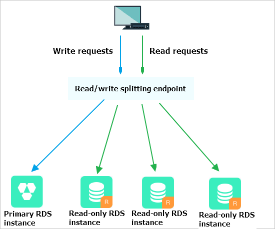

**Differences between the read/write splitting endpoint and the internal and public endpoints**

After you enable read/write splitting and add the read/write splitting endpoint to your application, all requests are first routed to this endpoint, and then to the primary and read-only instances based on the request types and the read weights of these instances.

If the internal or public endpoint of the primary instance is added to your application, all requests are routed to the primary instance. To implement read/write splitting, you must add the endpoints and read weights of the primary and read-only instances to your application.

**Logic to route requests**

- The following requests are routed only to the primary instance:

  - All requests that are used to execute DML statements such as INSERT, UPDATE, DELETE, and SELECT FOR UPDATE.

  - All requests that are used to execute DDL statements, such as the DDL statements that are used to create databases or tables, delete databases or tables, and change schemas or permissions.

  - All requests that are encapsulated in transactions.

  - Requests that are used to call user-defined functions.

  - Requests that are used to run stored procedures.

  - Requests that are used to execute EXECUTE statements.

  - Requests that are used to run multi-statement queries. For more information, see Multi-statement.

  - Requests that involve temporary tables.

  - Requests that are used to execute SELECT last_insert_id() statements.

  - All requests that are used to query or reconfigure user variables.

  - Requests that are used to execute SHOW PROCESSLIST statements.

  - Requests that are used to execute KILL statements in SQL. These statements are different from the KILL commands in Linux.

- The following requests are routed to the primary instance or its read-only instances:

  - Read requests that are not encapsulated in transactions.

  - Requests that are used to execute COM_STMT_EXECUTE statements.

- The following requests are routed to all the instances:

  - All requests that are used to modify system variables.

  - Requests that are used to execute USE statements.

  - Requests that are used to execute COM_STMT_PREPARE statements.

  - Requests that are used to execute COM_CHANGE_USER, COM_QUIT, and COM_SET_OPTION statements.

**Benefits**

- Easier maintenance by using a unified endpoint

  If you do not enable the read/write splitting feature, you must add the endpoints of the primary and read-only instances to your application. This way, your database system routes write requests to the primary instance and read requests to the read-only instances.

  If you enable the read/write splitting feature, you can use a dedicated proxy endpoint to implement read/write splitting. After your application is connected to this endpoint, your database system routes read and write requests to the primary and read-only instances based on the read weights of these instances. This reduces maintenance costs.

  You can also create read-only instances to improve the read capability of your database system. You do not need to modify the configuration data on your application.

- Higher performance and lower maintenance costs by using a native link

  You can build your own proxy layer on the cloud to implement read/write splitting. In this case, data needs to be parsed and forwarded by multiple components before the data reaches your database system. As a result, response latencies increase. The read/write splitting feature is embedded in the ApsaraDB RDS ecosystem to reduce response latencies, increase processing speeds, and reduce maintenance costs.

- Ideal in a variety of use scenarios based on configurable read weights and thresholds

  You can specify the read weights of the primary and read-only instances. You can also specify the latency threshold for data replication to the read-only instances.

- High availability based on instance-level health checks

  The read/write splitting feature enables ApsaraDB RDS to actively check the health status of the primary and read-only instances. If a read-only instance unexpectedly breaks down or its data replication latency exceeds the specified threshold, ApsaraDB RDS stops routing read requests to the instance. ApsaraDB RDS redirects read requests that are destined for the faulty read-only instance to healthy instances in your database system. This ensures service availability in the event of faults on individual read-only instances. After the faulty read-only instance is recovered, ApsaraDB RDS resumes routing read requests to the instance.

  > **Note**
  >
  > To avoid single points of failure (SPOFs), we recommend that you create at
  >
  > least two read-only instances.

**Precautions**

- When you change the specifications of your ApsaraDB RDS instance or its read-only instances, a service interruption may occur.

- After you create a read-only instance, only the requests over new connections can be routed to the read-only instance.

- The dedicated proxy endpoint does not support SSL encryption.

- The dedicated proxy endpoint does not support compression.

- If a dedicated proxy endpoint is used to connect to your database system, all the requests that are encapsulated in transactions are routed to the primary instance.

- If a dedicated proxy endpoint is used to implement read/write splitting, the read consistency of the requests that are not encapsulated in transactions cannot be ensured. If you require read consistency for these requests, you can encapsulate these requests in transactions.

- If a dedicated proxy endpoint is used for connection, the  `SHOW PROCESSLIST`  statement returns a result set for each query. The result set consists of the query results from the primary and read-only instances.

- If the short-lived connection optimization feature is enabled, the  `SHOW PROCESSLIST` statement may return idle connections.

- If you execute multi-statements or stored procedures, the read/write splitting feature is disabled and all subsequent requests over the current connection are routed to the primary ApsaraDB RDS instance. To enable the read/write splitting feature again, you must close the current connection and establish a new connection.

- The dedicated proxy feature supports the  `/*FORCE_MASTER*/`  and  `/*FORCE_SLAVE*/` hints. However, requests that contain hints have the highest route priorities and are not constrained by consistency or transaction limits. Before you use these hints, you must check whether these hints are suitable for your workloads. A hint cannot contain statements that change environment variables. An example is  `/*FORCE_SLAVE*/ set names utf8;` . Otherwise, an error may occur in the subsequent procedure.

**Prerequisite**

A read-only instance is created for the primary instance. For more information, see Create a read-only instance.

**Enable read/write splitting**

1. Log on to the ApsaraDB RDS console.

2. On the **Instance List** page, find the instance that you want to manage.

3. In the left-side navigation pane, click **Database Proxy**.

4. On the **Read/Write Splitting** tab, click **Enable now**.

5. Configure the parameters described in the following table.

   | Paramete r | Description |
   | --- | --- |
   | Latency Threshold | The maximum latency that is allowed for data replication from the primary instance to its read-only instances. If the latency of data replication to a read-only instance exceeds the specified threshold, ApsaraDB RDS stops routing read requests to the instance. This applies even if the instance has a high read weight.<br>Valid values: 0 to 7200. Unit: seconds. The read-only instances may replicate data from the primary instance at a specific latency due to SQL statement execution limits.We recommend that you set this parameter to a value that is greater than or equal to 30. |
   | Read Weight Distributi on | The read weight of each instance in your database system. A higher read weight indicates more read requests to process. For example, assume that your primary instance has three attached read-only instances, and the read weights of the primary and read-only instances are 0, 100, 200, and 200. In this case, your primary instance processes only write requests, and the three read-only instances process all of the read requests at a ratio of 1:2:2.<br>• <strong>Automatic Distribution</strong>: Your database system assigns a read weight to each instance based on the instance specifications. After you create a read-only instance, your database system assigns a read weight to the read-only instance and adds the read-only instance to the read/write splitting link.<br>• <strong>Customized Distribution</strong>: You must manually specify the read weight of each instance. Valid values: 0 to 10000. After you create a read-only instance, ApsaraDB RDS sets the read weight of the read-only instance to 0. You must manually modify the read weight of the created read-only instance. |

6. Click **OK**.

<a id="section-10-4-2"></a>

### 10.4.2. Configure read/write splitting

This topic describes how to configure the latency threshold and specify read weights for an ApsaraDB RDS instance in the ApsaraDB RDS console.

**Prerequisites**

Read/write splitting is enabled. For more information, see Enable read/write splitting.

**Procedure**

1. Log on to the ApsaraDB RDS console.

2. On the **Instance List** page, find the instance that you want to manage.

3. In the left-side navigation pane, click **Database Proxy**.

4. On the **Read/Write Splitting** tab, click **Configure Read/Write Splitting**.

5. Configure the parameters described in the following table.

   | Paramete r | Description |
   | --- | --- |
   | Latency Threshold | The maximum latency that is allowed for data replication from the primary instance to the read-only instances. If the latency at which a read-only instance replicates data from the primary instance exceeds the value of this parameter, the system no longer routes read requests to the read-only instance regardless of the read weight of the read-only instance.<br>Valid values: 0 to 7200. Unit: seconds. The read-only instances may replicate data from the primary instance at a specific latency. The latency varies based on the statuses of the SQL statements that are executed. We recommend that you set this parameter to a value that is greater than or equal to 30. |
   | Read Weight Distributi on | The method that is used to assign read weights. A higher read weight indicates that more read requests need to be processed. For example, three read-only instances are attached to the primary instance, the read weight of the primary instance is 0, and the read weights of the three read-only instances are 100, 200, and 200. In this case, the primary instance processes only write requests, and the three read-only instances process all read requests based on the 1:2:2 ratio.<br>• <strong>Automatic Distribution</strong>: The system automatically assigns a read weight to each instance in your database system based on the specifications of each instance.After you create a read-only instance, the system automatically assigns a read weight to the read-only instance and adds the read-only instance to the read/write splitting link.<br>• <strong>Customized Distribution</strong>: You must specify a read weight for each instance in your database system. Valid values: 0 to 10000. After you create a read-only instance, ApsaraDB RDS sets the read weight of the read-only instance to 0 by default. You must manually modify the read weight of the created read-only instance. |

6. Click **OK**.

<a id="section-10-4-3"></a>

### 10.4.3. Disable read/write splitting

This topic describes how to disable the read/write splitting feature of an ApsaraDB RDS instance in the ApsaraDB RDS console.

**Prerequisites**

Read/write splitting is enabled. For more information, see Enable read/write splitting.

**Procedure**

1. Log on to the ApsaraDB RDS console.

2. On the **Instance List** page, find the instance that you want to manage.

3. In the left-side navigation pane, click **Instance List**. On the Instance List page, find the instance that you want to manage and click the ID of the instance or click **Management** in the **Operation** column to go to the **Basic Information** page.

4. On the **Read/Write Splitting** tab, click **Disable Read/Write Splitting**.

5. In the message that appears, click **Confirm**.

<a id="section-11"></a>

# 11.Monitoring and alerts

<a id="section-11-1"></a>

## 11.1. View monitoring data

ApsaraDB RDS for MySQL allows you to view performance monitoring data for system resources, engines, and deployments to track the running status of instances.

**Procedure**

1. Log on to the ApsaraDB RDS console.

2. On the **Instance List** page, find the instance that you want to manage.

3. In the left-side navigation pane, click **Monitoring and Alerts**.

4. On the **Monitoring and Alerts** page, select **Resource Monitoring**, **Engine Monitoring**, or **Deploy Monitoring**, and then specify a time range to view the corresponding monitoring data. The following table describes each monitoring item.

   **Resource monitoring**

   | Monitoring item | Description |
   | --- | --- |
   | Disk Space | The disk space usage of the instance, including the total disk, data, log, temporary file, and system file space usage. Unit: MB. |
   | IOPS | The number of I/O requests per second for the instance. Unit: requests/s. |
   | Total Connections | The current connection status of the instance, showing the number of active and total connections. |
   | CPU Utilization and Memory Usage | The CPU and memory utilization of the instance, excluding the resources that the operating system occupies. |
   | Network Traffic | The inbound and outbound traffic per second for the instance. Unit: KB/s. |

   **Engine monitoring**

   | Monitoring item | Description |
   | --- | --- |
   | Transactions per Second (TPS)/Queries per Second (QPS) | The average number of transactions per second and the average number of SQL statements executed per second. |
   | InnoDB Buffer Pool Read Hit Ratio, Usage Ratio, and Dirty Block Ratio | The read hit ratio, usage, and dirty block ratio of the InnoDB buffer pool. |
   | InnoDB Read/Write Volume | The amount of data that InnoDB reads and writes per second. Unit: KB. |
   | InnoDB Buffer Pool Requests | The number of read and write operations that InnoDB performs per second. |
   | InnoDB Log Reads/Writes/fsync Operations | The number of physical writes to the log file, the number of log write requests, and the number of completed fsync operations to the log file per second for InnoDB. |
   | Temporary Tables Automatically Created on Hard Disk when MySQL Statements are Executed | The number of temporary tables that the database automatically creates on disk when it executes SQL statements. |
   | MySQL_COMDML | The number of SQL statements that the database executes per second, including:<br>Insert, Delete, Insert_Select, Replace, Replace_Select, Select, and Update. |
   | MySQL_RowDML | The number of row-level operations that InnoDB performs per second, including:<br>• The number of physical writes to the log file per second.<br>• The number of rows read, inserted, updated, and deleted from InnoDB tables per second. |
   | MyISAM Reads and Writes | The number of operations that MyISAM performs per second, including:<br>• The number of read and write operations from the buffer pool per second.<br>• The number of read and write operations from the disk per second. |
   | MyISAM Key Buffer Read/Write/Usage Ratio | The average usage, read hit ratio, and write hit ratio of the MyISAM Key Buffer per second. |
   | MySQL Thread Status | The thread status information of the MySQL instance, including the number of currently connected threads (Threads_connected) and the number of active threads executing queries (Threads_running). |
   | Redo Log Size Written by InnoDB per second | The amount of data that the InnoDB storage engine writes to the redo log per second. This metric evaluates the transaction write frequency and data change intensity. Unit: bytes/s. |
   | MySQL_ROW_LOCK | The InnoDB row lock statistics. This metric evaluates lock contention. |
   | MySQL_SelectScan | The query scan statistics that MySQL executes per second. This metric evaluates whether queries use indexes effectively. |

   **Deployment monitoring**

   | Monitoring item | Description |
   | --- | --- |
   | Replication Thread Status of Secondary Instances | The replication thread status of the secondary node, including:<br>• I/O thread: 1 indicates a normal status, and 0 indicates a lost thread.<br>• SQL thread: 1 indicates a normal status, and 0 indicates a lost thread. |
   | Replication Latency of Secondary Instances | The replication latency of the secondary node. Unit: seconds. |

<a id="section-11-2"></a>

## 11.2. Configure an alert rule

This topic describes how to create alert rules in the ApsaraDB RDS console. This allows you to identify and handle exceptions at the earliest opportunity.

**Procedure**

1. Log on to the ApsaraDB RDS console.

2. In the left-side navigation pane, click **Instance List**. On the Instance List page, find the instance that you want to manage and click the ID of the instance or click **Management** in the **Operation** column to go to the **Basic Information** page.

3. In the left-side navigation pane, click **Monitoring and Alerts**.

4. On the **Alerts** tab, click **Alert Rule Settings**.

5. On the **Alert Rule** page, click **Create an alert rule**.

6. In the **Create an alert rule** panel, configure the parameters described in the following table and click **OK**.

   | Parameter | Description |
   | --- | --- |

   <table>
     <tr>
       <td>Cloud product selection</td>
       <td>Select <strong>ApsaraDB RDS</strong> or <strong>ApsaraDB RDS (New)</strong>.<br>Note<br>For old links, the MySQL, SQL Server, PolarDB O, and PostgreSQL engines are supported, the namespace of monitoring data is acs_rds_dashboard, and the data collection period varies from 60 to 300 seconds. For new links, only the MySQL, PolarDB O, and PostgreSQL engines are supported. acs_rds_dashboard is also used as the namespace of monitoring data, but a more stable data collection period of 60 seconds is provided.</td>
     </tr>
     <tr>
       <td>Resource scope</td>
       <td>The resources to which the alert rule applies. Valid values:<br>• <strong>Instance dimension</strong>: Select one or more instances in the resource set of the current organization.<br>• <strong>Resource set dimension</strong>: Select a resource set in the current organization and region.<br>• <strong>Apply grouping dimensions</strong>: Select an application group in the current organization and region.<br>• <strong>All resources</strong>: The alert rule applies to all resources of the specified cloud service.</td>
     </tr>
     <tr>
       <td>Resource Selection</td>
       <td>The resources to be associated with the alert rule. Select one or more resources based on the selected resource scope.</td>
     </tr>
     <tr>
       <td>Alarm rule description</td>
       <td>The trigger conditions of the alert rule. If the monitoring data meets the specified conditions, the alert rule is triggered.<br>To configure the trigger conditions, perform the following steps:<br>i. Click <strong>Rule description</strong>.<br>ii. In the <strong>Rule description</strong> panel, configure the <strong>Rule name</strong>, <strong>Monitoring</strong> <strong>Metrics</strong>,<strong> Metric dimension</strong>, and <strong>Threshold</strong> <strong>and alarm level</strong> parameters.<br>Note<br>The Metric dimension parameter is displayed only if you set the Resource scope parameter to <strong>Instance dimension</strong>.<br>iii. Click <strong>Confirm</strong>.</td>
     </tr>
     <tr>
       <td>Silence channel period</td>
       <td>The mute period after which Cloud Monitor resends an alert notification before the alert is cleared. Valid values: <strong>5 minutes</strong>, <strong>15 minutes</strong>, <strong>30</strong> <strong>minutes</strong>, <strong>1 hour</strong>, <strong>3 hours</strong>, <strong>6 hours</strong>, <strong>12 hours</strong>, and <strong>24 hours</strong>.<br>An alert is triggered if the conditions of an alert rule are met. Cloud Monitor does not resend an alert notification when the alert is triggered within the mute period. If the alert is not cleared after the mute period ends, Cloud Monitor resends alert notifications.<br>For example, if you set the <strong>Silence channel period</strong> parameter to <strong>12</strong> <strong>hours</strong>, Cloud Monitor resends alert notifications only if the alert still persists after 12 hours.</td>
     </tr>
     <tr>
       <td>Effective time</td>
       <td>The period during which the alert rule takes effect. Cloud Monitor checks whether the monitoring data triggers the alert rule only during the effective period.</td>
     </tr>
     <tr>
       <td>Alarm callback</td>
       <td>The callback URL to which Cloud Monitor sends alert notifications by using the POST request method.<br>Note<br>The callback URL must be accessible for Cloud Monitor. You can enter only an HTTP URL. IP addresses are not supported.</td>
     </tr>
     <tr>
       <td>No data processing method</td>
       <td>Specify how Cloud Monitor acts when no alert is triggered. Valid values:<br>• <strong>No processing</strong>: Cloud Monitor does not perform any operations when no alert is triggered.<br>• <strong>Send no data alarm</strong>: Cloud Monitor sends the corresponding notifications to contacts when no alert is triggered.</td>
     </tr>
     <tr>
       <td>Alarm contact</td>
       <td>The alert contacts or alert contact groups to which Cloud Monitor sends alert notifications.<br>By default, the value of this parameter is a dummy user used to test whether the alert rule is effective.</td>
     </tr>
   </table>

<a id="section-12"></a>

# 12.Cloud Monitor

<a id="section-12-1"></a>

## 12.1. View performance metrics

PolarDB for MySQL V2.0 provides rich performance metrics and second-level monitoring frequency, which allow you to easily track the status of clusters and address operational challenges.

**View the dashboard**

1. Log in to the PolarDB for MySQL V2.0 console.

2. On the **Instances Using Local Disks** page, find the cluster that you want to manage and click its ID.

3. In the left-side navigation pane, click **CloudMonitor**.

4. You can view metrics related to **computing resources**, **disks**, **networks**, **deadlocks**, and **read-only instances**. View performance metrics

**View monitoring information**

1. Log in to the PolarDB for MySQL V2.0 console.

2. In the left-side navigation pane, click **CloudMonitor**.

3. In the **time granularity** drop-down list, select **1 Minute** or **1 Hour** (default value) as the data collection interval.

<a id="section-12-2"></a>

## 12.2. Alert history

After an alert is triggered, you can view its history. You can also export and download the alert history for local data analytics.

**Procedure**

1. Log on to the ApsaraDB for Tair (Redis-compatible) console.

2. On the **Instance List** page, click the ID of the instance.

3. In the navigation pane on the left, click **Cloud Monitor** and choose **Alert Service** > **Alert History**.

4. (Optional) On the **Alert History** page, filter the alert history by **Rule ID**, **Rule Name**, **Alert Level**, and time.

5. On the Alert History page, you can perform the following tasks.

   | Task | Procedure |
   | --- | --- |
   | View alert history | In the <strong>Alert History</strong> list, view the <strong>Product Name</strong>, <strong>Affected</strong> <strong>Instance</strong>, <strong>Time</strong>, <strong>Rule Name</strong>, <strong>Status</strong>, <strong>Level</strong>, and <strong>Notification</strong> <strong>Recipient</strong>. Click the rule name to view the details of the alert rule.<br>Note<br>By default, you can query alert history data from the last 2 days. |
   | Export alert history | i. On the <strong>Alert History</strong> page, clickin the upper-right<br>corner.<br>ii. In the <strong>Export Task</strong> dialog box, set <strong>Time Range</strong> and <strong>Task</strong> <strong>Name</strong>. Then, click <strong>OK</strong>. |

<a id="section-12-3"></a>

## 12.3. Alert rules

<a id="section-12-3-1"></a>

### 12.3.1. Create an alert rule

Create an alert rule that triggers alerts for a cloud service based on specified metric thresholds and promptly notifies relevant users.

**Background information**

During its effective period, an alert rule checks at a default detection frequency if a metric exceeds the specified threshold. If a metric exceeds the threshold and becomes abnormal, an alert is sent to the specified alert contacts or other alert processing platforms.

> **Note**
>
> The minimum alert detection frequency is once per minute.

**Procedure**

1. Log on to the ApsaraDB for Tair (Redis-compatible) console.

2. On the **Instance List** page, click the ID of the instance.

3. In the navigation pane on the left, click **CloudMonitor**, and then choose **Alert Service** > **Alert Rules**.

4. Above the list, click **Create Alert Rule**.

5. In the **Create Alert Rule** panel, set the parameters as needed.

   | Parameter | Description |
   | --- | --- |
   | Cloud Service Selection | This is set by default and does not need to be selected. |
   | Resource Scope | The scope of resources associated with the alert rule. The following types are supported. The available scope types may vary by cloud service.<br>• <strong>Instance</strong>: Select one or more target instances from the resource set of the current organization.<br>• <strong>Resource Set</strong>: Select a target resource set in the current organization and region.<br>• <strong>Application Group</strong>: Select an application group in the current organization and region.<br>• <strong>All Resources</strong>: This option is not supported by default. |
   | Resource Selection | Based on the selected <strong>Resource Scope</strong>, select a specific resource instance, resource set, or application group. |
   | Alert Rule Description | The main body of the alert rule. The rule is triggered when monitoring data meets the alert conditions.<br>To set the rule description:<br>i. Click <strong>Create Alert Rule</strong>.<br>ii. In the <strong>Create Alert Rule</strong> panel, set the <strong>Rule Name</strong>, <strong>Metric Dimension</strong>, <strong>Monitoring Metric</strong>, <strong>Threshold, AndAlert Level</strong>.<br>Note<br>The Metric Dimension parameter is displayed only when Resource Scope is set to <strong>Instance</strong>.<br>iii. Click <strong>Confirm</strong>. |
   | Mute For | The interval at which to resend an alert notification if the alert is not resolved.Valid values: <strong>5 Minutes</strong>, <strong>15 Minutes</strong>, <strong>30 Minutes</strong>, <strong>1 Hour</strong>, <strong>3 Hours</strong>, <strong>6 Hours</strong>, <strong>12 Hours</strong>, and <strong>24 Hours</strong>.<br>When a metric exceeds the alert threshold, an alert is triggered. If the metric continues to exceed the threshold during the mute period, no more alert notifications are sent. If the metric has not recovered after the mute period, CloudMonitor sends another alert notification.<br>For example, if <strong>Mute For</strong> is set to <strong>12 Hours</strong>, CloudMonitor sends another alert notification if the metric that exceeded the threshold has not recovered 12 hours after the first alert was triggered. |
   | Effective Period | The period during which the alert rule is active. The rule only checks if monitoring data exceeds the alert threshold during this period. |
   | Alert Callback | A webhook address that receives alert messages pushed by CloudMonitor through POST requests.<br>Note<br>The webhook address must be a domain name accessible to CloudMonitor.Only the HTTP protocol is supported. You cannot enter an IP address. |
   | No Data Handling Method | The method for handling alerts when there is no monitoring data.<br>• Do Nothing<br>• Send No-data Alert |
   | Alert Contact | Select the user group or user to whom alert messages are sent.<br>The default alert contact group for an Alibaba Cloud account is an empty group.You can use it to test the validity of an alert rule. |

6. Click **OK**.

**Rule description parameters**

| Parameter | Description |
| --- | --- |
| Rule Name | Enter a name for the alert rule. |
| Monitoring Metric | From all the metrics available for the selected cloud service, select the target metric. For more information about the metrics for each cloud service, see the relevant monitoring documentation. |
| Metric Dimension | Refers to dimensions other than the instance ID. This parameter is displayed only when Resource Scope is set to <strong>Instance</strong>. |
| <strong>Threshold</strong> <strong>And</strong> Alert Level (unit: %) | • The alert levels are <strong>Critical</strong>, <strong>Warning</strong>, and <strong>Info</strong>.<br>• The aggregation method for monitoring data can be <strong>Average</strong>, <strong>Minimum</strong>, or <strong>Maximum</strong>.<br>• You can set the monitoring data epoch to <strong>1 Consecutive Epoch</strong>, <strong>5</strong> <strong>Consecutive Epochs</strong>, <strong>10 Consecutive Epochs</strong>, <strong>15 Consecutive Epochs</strong>, <strong>30</strong> <strong>Consecutive Epochs</strong>, or <strong>60 Consecutive Epochs</strong>.<br>• The comparison operator between the actual monitoring data and the alert threshold. Supported operators include “<strong>&gt;</strong>”, “ <strong>&gt;=</strong>”, “<strong>&lt;</strong>”, “<strong>&lt;=</strong> ”, “<strong>=</strong>”, “<strong>!=</strong>”, “<strong>Day-on-day Increase</strong>”, “<strong>Day-on-day Decrease</strong>”, “<strong>Period-on-period</strong> <strong>Increase”</strong>, <strong>“period-on-period Decrease”</strong>, <strong>“increase From Last Period”</strong>, and <strong>“decrease From Last Period”</strong>. You can also set a threshold and the number of times it must be met to trigger an alert. |

**Example configuration**

This example creates an alert rule named "example" for an Elastic Compute Service (ECS) instance to monitor its CPU utilization. The rule triggers a Critical alert if the maximum CPU utilization is greater than or equal to 70% for three occurrences within five detection periods.

The following figure shows the rule description configuration for this scenario.


<a id="section-12-3-2"></a>

### 12.3.2. Manage alert rules

From the list of alert rules, you can modify, enable, disable, and delete rules.

**Procedure**

1. Log on to the ApsaraDB for Tair (Redis-compatible) console.

2. On the **Instance List** page, click the ID of the instance.

3. In the navigation pane on the left, click **Cloud Monitor** and then choose **Alert Service** > **Alert Rules**.

4. Find the desired alert rule and perform the required operation.

   | Task | Procedure |
   | --- | --- |
   | View alert rule details | In the <strong>Operation</strong> column of the target alert rule, click <strong>Details</strong> to view the rule details on the <strong>Alert Rule/Alert History/Faulty Resources</strong> panel. |
   | Check rule validity | In the <strong>Validity</strong> column of the target alert rule, click <strong>Click To Inspect</strong>. The inspection result is displayed in the Validity column.<br>Note<br>• If the inspection result is abnormal, click <strong>Detection Result</strong>. In the panel that appears, view the results for <strong>Alert Rule Execution</strong> <strong>Anomaly Detection</strong>, <strong>Alert Rule Load Detection</strong>, <strong>Invalid Alert</strong> <strong>Rule Detection</strong>, and <strong>Alert Rule Callback Detection</strong>.<br>• Click <strong>Re-detect</strong> to check the rule validity again. |
   | View rule execution records | In the <strong>Rule Execution Record</strong> column of the target alert rule, click <strong>View</strong> <strong>Rule Execution Record</strong>. On the <strong>Alert Rule Execution Record</strong> panel, filter the execution records by time range. |
   | Modify an alert rule | i. In the <strong>Operation</strong> column of the target alert rule, click <strong>Edit.</strong><br>ii. On the <strong>Modify Alert Rule</strong> panel, modify the alert rule. For more information about the configuration parameters, see Create an alert rule.<br>iii. After you finish the modification, click <strong>OK</strong>. |
   | Disable an alert rule | Disable alert rules when you manually stop a cloud product for maintenance or an upgrade. This prevents unnecessary alert notifications.<br>Note<br>Before disabling an alert rule, make sure that its <strong>Status</strong> is <strong>Normal</strong>.<br>• Disable a single rule<br>a. In the <strong>Operation</strong> column of the target alert rule, click theicon, and then click <strong>Disable.</strong><br>b. In the <strong>Disable Alert Rule</strong> dialog box, click <strong>OK.</strong><br>• Disable rules in a batch<br>a. Select the check boxes next to the target alert rules, and then click <strong>Disable</strong> in the lower-left corner of the list.<br>b. In the <strong>Disable Alert Rule</strong> dialog box, click <strong>OK</strong>. |
   | Enable an alert rule | After you finish the maintenance or upgrade of a cloud product, re-enable the disabled alert rules.<br>Note<br>Before enabling an alert rule, make sure that its <strong>Status</strong> is <strong>Disabled</strong>.<br>• Enable a single rule<br>a. In the <strong>Operation</strong> column of the target alert rule, click <strong>Enable.</strong><br>b. In the <strong>Enable Alert Rule</strong> dialog box, click <strong>OK.</strong><br>• Enable rules in a batch<br>a. Select the check boxes next to the target alert rules, and then click <strong>Enable</strong> in the lower-left corner of the list.<br>b. In the <strong>Enable Alert Rule</strong> dialog box, click <strong>OK</strong>. |
   | Delete an alert rule | • Delete a single rule<br>a. In the Operation column of the target alert rule, click theicon, and then click <strong>Delete</strong>.<br>b. In the <strong>Delete Alert Rule</strong> dialog box, click <strong>OK</strong>.<br>• Delete rules in a batch<br>a. Select the check boxes next to the target alert rules, and then click Delete in the lower-left corner of the list.<br>b. In the <strong>Delete Alert Rule</strong> dialog box, click <strong>OK</strong>. |

<a id="section-13"></a>

# 13.Data security

<a id="section-13-1"></a>

## 13.1. Configure an IP address whitelist

After you create an ApsaraDB RDS instance, you must add the IP addresses or CIDR blocks that are allowed to access the instance to the IP address whitelist of the instance to ensure database security and reliability.

**Background information**

Whitelists make your ApsaraDB RDS instance more secure. We recommend that you maintain whitelists on a regular basis. When you configure IP address whitelists for your ApsaraDB RDS instance, the workloads on the instance are not affected.

You can configure a whitelist in two modes:

- Configure an IP address whitelist: Add IP addresses to allow only specified origins to connect to the ApsaraDB RDS instance.

- Configure an Elastic Compute Service (ECS) security group: Add an ECS security group for the ApsaraDB RDS instance to allow all ECS instances in the security group to connect to the ApsaraDB RDS instance.

**Usage notes**

- **Default group restrictions**: The default whitelist group ( `default` ) can be modified or cleared, but it cannot be deleted.

- **Quantity limits**: A maximum of 1,000 IP addresses or CIDR blocks can be added to a whitelist. If you want to add a large number of IP addresses, we recommend that you merge them into CIDR blocks (such as  `192.168.1.0/24` ) to reduce the number of entries.

- **Format requirements**: You must separate multiple IP addresses or CIDR blocks with commas (,). Do not include spaces before or after the commas.

- **Override mechanism**: After you add any new IP address to the  `default`  group, the system automatically removes the default deny rule  `127.0.0.1` .

- **Prerequisites for network connectivity**: If you want to connect an ECS instance to an ApsaraDB RDS instance by using an internal endpoint, make sure that the two instances are in the same region and have the same network type (such as VPC). Otherwise, the connection fails.

**Configure a standard IP address whitelist**

1. 

2. 

3. In the left-side navigation pane, click **Data Security**.

4. On the **Whitelist Settings** tab, click **Modify**.

   > **Note**
   >
   > Click **Create Whitelist** to create a custom group.

5. In the **Modify Whitelist** dialog box, enter the IP addresses or CIDR blocks that are allowed to connect to your ApsaraDB RDS instance, and then click **OK**. Then, click OK to save the configuration.

   - If you enter a CIDR block such as 10.10.10.0/24, all IP addresses in the 10.10.10.XX range can access your ApsaraDB RDS instance.

   - If you click **Add Internal IP Addresses of ECS Instances**, the IP addresses of all ECS instances that are created within the current Alibaba Cloud account appear. Then, you can select the IP addresses and add them to an IP address whitelist.

<a id="section-13-2"></a>

## 13.2. Configure SSL encryption

This topic describes how to make data transmission more secure by configuring Secure Sockets Layer (SSL) encryption. You must enable SSL encryption and install SSL certificates that are issued by certificate authorities (CAs) to the required applications. SSL is used to encrypt connections at the transport layer and enhance the security and integrity of the transmitted data. However, SSL encryption increases the round-trip time.

**Prerequisites**

Your ApsaraDB RDS instance runs one of the following MySQL versions and RDS editions:

- MySQL 8.0 on RDS High-availability Edition (with local SSDs)

- MySQL 5.7 on RDS High-availability Edition (with local SSDs)

**Usage notes**

- An SSL certificate remains valid for one year. Before the used SSL certificate expires, you must update the validity period of the SSL certificate. If you do not update the expired SSL certificate, the RDS instance still runs as expected and no security risks occur. However, your application cannot establish encrypted connections to the RDS instance. When the certificate is about to expire, Alibaba Cloud will notify you by sending emails or internal messages. You can view the internal messages on the Event Center page.

- SSL encryption may cause a sharp increase in CPU utilization. We recommend that you enable SSL encryption only if you want to encrypt the connections that are established to the public endpoint of your RDS instance. In most cases, connections that are established to the internal endpoint of your cluster are secure and do not require SSL encryption.

- SSL encryption is not supported for the connections to the read/write splitting endpoint of your RDS instance.

- If you disable SSL encryption, your RDS instance restarts. Proceed with caution.

**Enable SSL encryption**

1. Log on to the ApsaraDB RDS console.

2. In the left-side navigation pane, click **Instances**. On the Instances page, find the instance that you want to manage and click the ID of the instance or click **Manage** in the **Actions** column to go to the **Basic Information** page.

3. In the left-side navigation pane, click **Data Security**.

4. Click the **SSL** tab.

5. In the **SSL Settings** section, turn on **SSL Encryption**.

6. In the **Configure SSL Encryption** dialog box, select the endpoint for which you want to enable SSL encryption and click **OK**.

7. Click Download CA Certificate to download the SSL CA certificate files in a compressed package.

   The file that you downloaded is a package that contains the following files:

   - P7B file: contains the server CA certificate that can be imported into a Windows operating system.

   - PEM file: a CA certificate file that is used for an operating system or application that is not Windows-based.

   - JKS file: an SSL certificate file that is stored in the Java-supported truststore. You can use this file to import the SSL certificate files from an SSL certificate chain into Java-based applications. The default password is apsaradb.

     > **Note**
     >
     > If the JKS file is used in Java, you must modify the default JDK security configuration in JDK 7 and JDK 8. Open the  `/jre/lib/security/java.security`  file on the host where your application resides and modify the following configurations:
     >
     > ```text
     > jdk.tls.disabledAlgorithms=SSLv3, RC4, DH keySize < 224
     > jdk.certpath.disabledAlgorithms=MD2, RSA keySize < 1024
     > ```
     >
     > If you do not modify these configurations, the following error is reported. In most cases, other similar errors are also caused by invalid Java security configurations:
     >
     > ```text
     > javax.net.ssl.SSLHandshakeException: DHPublicKey does not comply to algorithm constraints
     > ```

**Configure an SSL certificate**

After SSL encryption is enabled, you must configure an SSL certificate on your application or client to connect to your RDS instance. In this topic, MySQL Workbench and Navicat are used as examples. If you want to use other applications or clients, see the related instructions.

Perform the following steps to configure an SSL certificate on MySQL Workbench:

1. Start MySQL Workbench.

2. Choose **Database > Manage Connections**.

3. In the **Connection** section, click the **SSL** tab and configure the following parameters.

   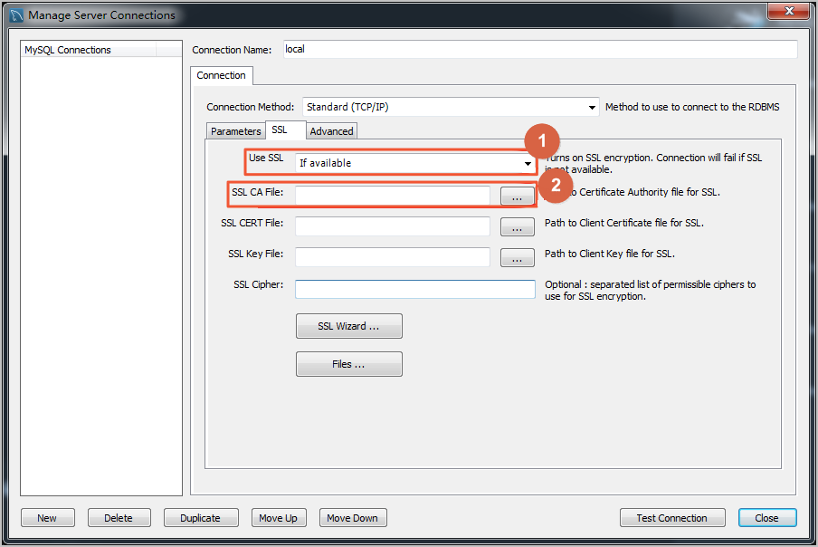

   ①: Enable **Use SSL**.

   ②: Import the SSL CA certificate file.

Configure a certificate on Navicat

1. Start Navicat.

2. Right-click the database and select **Edit Connection**.

3. Click the **SSL** tab. Select the path of the PEM-formatted CA certificate and complete the required settings based on the following figure.

4. Click **OK**.

   > **Note**
   >
   > If the  `connection is being used`  error message is displayed, the previous session remains connected. In this case, you must restart Navicat.

5. Double-click the database to test whether the database is connected.

**Update the validity period of an SSL CA certificate**

> **Note**
>
> The **Update Validity** operation causes your RDS instance to restart. Proceed with caution.

1. Log on to the ApsaraDB RDS console.

2. In the left-side navigation pane, click **Instances**. On the Instances page, find the instance that you want to manage and click the ID of the instance or click **Manage** in the **Actions** column to go to the **Basic Information** page.

3. In the left-side navigation pane, click **Data Security**.

4. Click the **SSL** tab.

5. Click **Update Validity**.

**Disable SSL encryption**

> **Note**
>
> - When you disable SSL encryption, your RDS instance restarts. In this case, the system triggers a primary/secondary switchover to reduce the impacts on your workloads. We still recommend that you disable SSL encryption during off-peak hours.
>
> - Disabling SSL encryption enhances access performance but reduces security for the RDS instance. We recommend that you disable SSL encryption only in secure environments.

1. Log on to the ApsaraDB RDS console.

2. In the left-side navigation pane, click **Instances**. On the Instances page, find the instance that you want to manage and click the ID of the instance or click **Manage** in the **Actions** column to go to the **Basic Information** page.

3. In the left-side navigation pane, click **Data Security**.

4. Click the **SSL** tab.

5. In the **SSL Settings** section, turn off **SSL Encryption**. In the message that appears, click **OK**.

<a id="section-13-3"></a>

## 13.3. Configure TDE

Transparent Data Encryption (TDE) allows you to perform real-time I/O encryption and decryption on data files. Data is encrypted before it is written to the disk and is decrypted when it is read from the disk to the memory. After you enable TDE for your RDS instance, the size of data files in your RDS instance does not increase. You can use TDE without the need to modify the configurations of your application.

**Prerequisites**

- Your ApsaraDB RDS instance runs the RDS High-availability Edition with local disks.

- Key Management Service (KMS) is activated. If KMS is not activated, you can activate it as prompted when you enable TDE.

**Background information**

The key that is used for TDE is created and managed by KMS. ApsaraDB RDS does not provide the key or certificates that are required for TDE. In some zones, you can use an automatically generated key or a custom key that is generated from your own key material. After you select a key, you must authorize your RDS instance to use that key.

**Usage notes**

- When TDE is being enabled, your ApsaraDB RDS instance is restarted and all services are disconnected. Make appropriate service arrangements before you enable TDE. Proceed with caution.

- After you enable TDE, you cannot disable TDE.

- After you enable TDE, you cannot change the key that is used for TDE.

- After you enable TDE, you must decrypt the data on your RDS instance if you want to restore the data to an on-premises database. For more information, see Decrypt a table.

- After you enable TDE, the CPU utilization of your RDS instance significantly increases.

- If you use an existing custom key for TDE, take note of the following information:

  - If you disable the key, configure a plan to delete the key, or delete the key material, the key becomes unavailable.

  - If your RDS instance restarts after you revoke the key, your RDS instance becomes unavailable.

  - You must use an Alibaba Cloud account or an account to which the AliyunSTSAssumeRoleAccess policy is attached.

  > **Note**
  >
  > For more information, see topics about key management in **Key Management Service > User Guide**.

**Use a key that is automatically generated by Alibaba Cloud**

1. Log on to the ApsaraDB RDS console.

2. In the left-side navigation pane, click **Instances**. On the Instances page, find the instance that you want to manage and click the ID of the instance or click **Manage** in the **Actions** column to go to the **Basic Information** page.

3. In the left-side navigation pane, click **Data Security**.

4. Click the **TDE** tab.

5. In the **TDE Settings** section, turn on **TDE Status**.

6. In the dialog box that appears, select **Use Automatically Generated Key** and click **OK**.

   > **Note**
   >
   > If the instance runs MySQL 5.7 on RDS High-availability Edition, you can select one of the following encryption methods:
   >
   > - SM4 encryption
   >
   > - AES_256_CBC encryption

**Use an existing custom key**

1. Log on to the ApsaraDB RDS console.

2. In the left-side navigation pane, click **Instances**. On the Instances page, find the instance that you want to manage and click the ID of the instance or click **Manage** in the **Actions** column to go to the **Basic Information** page.

3. In the left-side navigation pane, click Data Security.

4. Click the **TDE** tab.

5. In the **TDE Settings** section, turn on **TDE Status**.

6. In the dialog box that appears, select **Use an existing custom key** and click **OK**.

   > **Note**
   >
   > If you do not have a custom key, you need to click **go to the KMS console** to create a CMK and import your own key material. For more information, see the **Create a key** section in **Key Management ServiceKey Management Service > User Guide**.

**Encrypt a table**

Log in to the database and execute the following statement to encrypt a table:

- MySQL 5.7 or MySQL 8.0

  ```sql
  alter table <tablename> encryption='Y';
  ```

**Decrypt a table**

Execute the following statement to decrypt a table that is encrypted by using TDE:

- MySQL 5.7 or MySQL 8.0

  ```sql
  alter table <tablename> encryption='N';
  ```

**FAQ**

- After I enable TDE, can I use common database tools such as Navicat?

  Yes, after you enable TDE, you can use common database tools such as Navicat.

- After I enable TDE, why is my data still in plaintext?

  After you enable TDE, your data is stored in ciphertext. However, when the data is queried, it is decrypted and loaded in plaintext to the memory. A: TDE encrypts backup files to prevent data leaks. Before you restore the data of your ApsaraDB RDS instance from an encrypted backup file to your computer, you must decrypt the file. For more information, see the "Decrypt a table" section of this topic.

<a id="section-13-4"></a>

## 13.4. Use the SQL audit feature

This topic describes how to use the SQL audit feature on an ApsaraDB RDS for MySQL instance. You can use the SQL audit feature to view the details about the SQL statements that are executed on your ApsaraDB RDS instance and audit the SQL statements on a regular basis. The SQL audit feature does not affect instance performance.

**Background information**

> **Important**
>
> You cannot view records generated before you enable the SQL audit feature.

You can view the incremental data of your ApsaraDB RDS for MySQL instance in SQL audit logs or binary logs. However, these two methods differ in the following aspects:

- **SQL audit logs** are similar to audit logs in MySQL. They record all DML and DDL operations by using network protocol analysis. SQL audit does not parse the actual parameter values. If a large number of SQL statements are executed to query data, a small amount of data may be lost. The incremental data obtained by using this method may be inaccurate.

- **Binary logs** record all add, delete, and modify operations that are performed in the database and the incremental data that is used to restore data. Binary logs are temporarily stored in your instance after they are generated. The system transfers full binary log files to an Object Storage Service (OSS) bucket on a regular basis. The binary log files are stored in the OSS bucket for seven days. If data is being written to a binary log file, the file cannot be transferred. Therefore, after you click **Upload Binlogs** on the **Backup and Restoration** page, some binary log files are not uploaded to the OSS bucket. You can use this method to obtain accurate incremental data. However, you cannot use this method to obtain real-time logs.

**Usage notes**

- By default, SQL audit is enabled.

- SQL audit logs are retained for seven days.

- The retention period of SQL audit log files is one hour. The system automatically deletes the SQL audit log files that are stored for longer than one hour.

- In the SQL audit feature, the maximum length of a single SQL statement is 4 KB.

**Disable the SQL audit feature**

If you no longer require the SQL audit feature, you can disable the feature to reduce costs.

1. Log on to the ApsaraDB RDS console.

2. On the **Instance List** page, find the instance that you want to manage.

3. In the left-side navigation pane, click **Data Security**.

4. Click the **SQL Audit** tab.

5. Click **Export File** to export the SQL audit logs to your on-premises machine.

6. After the logs are exported, click **Disable SQL Auditing**.

7. In the message that appears, click **OK**.

   > **Important**
   >
   > After the SQL audit feature is disabled, all SQL audit logs, including historical SQL audit logs, are deleted. Before you disable the SQL audit feature, we recommend that you export the SQL audit logs to your on-premises machine.

**Enable the SQL audit feature**

1. Log on to the ApsaraDB RDS console.

2. On the **Instance List** page, find the instance that you want to manage.

3. In the left-side navigation pane, click **Data Security**.

4. Click the **SQL Audit** tab.

5. Click **Enable SQL Auditing**.

6. In the message that appears, click **OK**.

   After you enable the SQL audit feature, you can query SQL statements based on filter criteria such as the time, database, user, and keyword.

**Change the storage location of audit logs**

By default, audit logs are stored in SLS-inner. You can switch them to an accessible SLS-PUB based on your business requirements.

1. Log on to the ApsaraDB RDS console.

2. On the **Instance List** page, find the instance that you want to manage.

3. In the left-side navigation pane, click **Data Security**.

4. Click the **SQL Audit** tab.

5. Turn on the Enable Log Storage to SLS-PUB switch and click **OK**.

   > **Important**
   >
   > The change cannot be reversed. Proceed with caution.

<a id="section-14"></a>

# 14.Service availability

<a id="section-14-1"></a>

## 14.1. Switch workloads between primary and secondary ApsaraDB RDS instances

This topic describes how to switch workloads between a primary ApsaraDB RDS for MySQL instance and its secondary instance. ApsaraDB RDS for MySQL supports both manual switchover and automatic switchover. After a switchover is complete, the primary ApsaraDB RDS for MySQL instance becomes the secondary instance.

**Feature overview**

ApsaraDB RDS for MySQL supports both manual switchover and automatic switchover.

- **Automatic switchover**: By default, the automatic switchover feature is enabled. If the primary ApsaraDB RDS for MySQL instance becomes faulty, ApsaraDB RDS automatically switches workloads over to the secondary instance.

- **Manual switchover**: You can manually switch workloads between the primary and secondary ApsaraDB RDS for MySQL instances at any time.

**Usage notes**

- Data is synchronized between the primary and secondary ApsaraDB RDS instances in real time. The secondary instance serves only as a read-only instance or standby. We recommend that you do not modify the data of the secondary instance. If you modify the data of the secondary instance, the data of the primary instance may be accidentally deleted or overwritten, which may irreparably impact your workloads.

- If the secondary ApsaraDB RDS instance serves as a read-only instance, the secondary instance serves as the new primary instance after a primary/secondary switchover. We recommend that you plan the read and write workloads for the new primary instance before the switchover. We recommend that you reserve and plan resources in advance.

- During a switchover, your services may be interrupted. Make sure that your application is configured to automatically reconnect to the instance.

- If the primary ApsaraDB RDS instance is attached with read-only instances, the read-only instances need to re-establish the connections that are used for data replication and synchronize incremental data after a switchover. As a result, data synchronization to the read-only instances has a latency of a few minutes.

**Manually perform a primary/secondary switchover**

1. Log on to the ApsaraDB RDS console.

2. On the **Instance List** page, find the instance that you want to manage.

3. In the left-side navigation pane, click **Service Availability**.

4. On the right side of the page, click **Switch Primary/Secondary Instance**.

   > **Note**
   >
   > You may encounter one or two service interruptions during a switchover. Make sure that your application is configured to automatically reconnect to the instance.

5. In the dialog box that appears, configure the switchover time (**Switch Immediately** or **Within Specified Time RangeCurrent Settings**), and then click **OK**.

<a id="section-14-2"></a>

## 14.2. Change the data replication mode

ApsaraDB RDS for MySQL allows you to change the data replication mode between the primary and secondary instances to meet the database availability and performance requirements of different business scenarios.

**Prerequisites**

The instance series is the High-Availability Edition.

**Data replication modes**

ApsaraDB RDS for MySQL supports the following two data replication modes:

- **Semi-synchronous**

  After the primary instance completes an update initiated by an application, it synchronously transmits logs to the secondary instance. The transaction commits once the secondary instance receives the log, without waiting for the secondary instance to apply the logs.

  When the secondary instance becomes unavailable or a network exception occurs between the primary and secondary instances, the semi-synchronous mode falls back to the asynchronous mode.

  Applicable scenario: We recommend the semi-synchronous mode for services that require high data consistency.

- **Asynchronous**

  When an application initiates an update request, the primary instance responds immediately after completing the operation and asynchronously replicates data to the secondary instance. The unavailability of the secondary instance does not affect operations on the primary instance. When the primary instance becomes unavailable, data inconsistency between the primary and secondary instances may occur briefly.

  Applicable scenario: You can select the asynchronous mode for services that require high response speed.

**Procedure**

1. Log on to the ApsaraDB RDS console.

2. On the **Instance List** page, find the instance that you want to manage.

3. In the left-side navigation pane, click **Service Availability**.

4. On the right side of the page, click **Change Data Replication Mode**.

5. In the pop-up dialog box, select a data replication mode and click **OK** twice in succession.

<a id="section-15"></a>

# 15.Database backup and restoration

<a id="section-15-1"></a>

## 15.1. Configure automatic backup

Automatic backup of ApsaraDB RDS supports full physical backups. ApsaraDB RDS automatically backs up data based on pre-configured policies. This topic describes how to configure a policy for automatic backup.

**Procedure**

1. Log on to the ApsaraDB RDS console.

2. In the left-side navigation pane, click **Instances**. On the Instance List page, find the instance that you want to manage and click the ID of the instance or click **Management** in the **Operation** column to go to the **Basic Information** page.

3. In the left-side navigation pane, click **Backup and Restoration**.

4. Click the **Backup Settings** tab.

5. Click **Edit** and configure the following parameters.

   > **Note**
   >
   > To ensure data security, the system compares the new backup cycle and time with the original settings and selects the most recent point in time to back up the data. Therefore, the next backup may still be performed based on the original backup cycle and time. For example, assume that the scheduled backup cycle and time are set to 19:00-20:00 every Wednesday. If you modify the backup cycle and time to 19:00-20:00 every Thursday before the scheduled backup occurs, the system still backs up data at the original scheduled time of 19:00-20:00 on Wednesday.

   | Parameter | Description |
   | --- | --- |
   | Data Retention Period | The number of days for which data backup files are retained. Valid values: 7 to 730. Default value: 7. |
   | Backup Cycle | The backup cycle. You can select one or more days within a week. |
   | Backup Time | A period of time within a day. Unit: hours. We recommend that you back up data during off-peak hours. |
   | Retention Period | The retention period of regular backup (hot backup) and whether to retain the data for a long time before the instance is released.<br>Note<br>Data backup sets that are retained for more than 730 days will be automatically converted to archived backups (cold backup). The retention period of archived backups is at least 30 days. |
   | Log Backup | Specifies whether to enable log backup.<br>Important<br>If you disable log backup, all the log backup files are deleted and you cannot restore data to a specific point in time. |
   | Log Backup Retention Period | The number of days for which log backup files are retained. Valid values: 7 to 730. Default value: 7. |

6. Click **Save**.

<a id="section-15-2"></a>

## 15.2. Manually back up an instance

Manual backup of ApsaraDB RDS supports both full physical and logical backups. This topic describes how to manually back up an ApsaraDB RDS instance.

**Procedure**

1. Log on to the ApsaraDB RDS console.

2. On the **Instance List** page, find the instance that you want to manage.

3. Click **Back Up Instance** in the upper-right corner.

4. In the dialog box that appears, set the backup mode and backup policy and then click **OK**.

   > **Note**
   >
   > The following backup modes are available:
   >
   > - Physical backup: directly backs up all files in all databases.
   >
   > - Logical backup: extracts data from the databases by using SQL statements and backs up the data in the text format. If you select logical backup, you must select one of the following backup policies:
   >
   >   - Instance Backup: backs up the entire instance.
   >
   >   - Single-Database Backup: backs up one of the databases on the instance.

<a id="section-15-3"></a>

## 15.3. Download data backup files and log backup files

This topic describes how to download unencrypted data backup files and log backup files in the ApsaraDB RDS console to archive the files and restore data to an on-premises database.

**Limits**

| Database engine | Download of data backup files | Download of log backup files |
| --- | --- | --- |
| MySQL 5.7 on RDS High-availability Edition | Supported | Supported |
| MySQL 8.0 on RDS High-availability Edition | Supported | Supported |

**Procedure**

1. Log on to the ApsaraDB RDS console.

2. In the left-side navigation pane, click **Instances**. On the Instances page, click the ID of the instance that you want to manage, or click **Manage** in the **Actions** column to go to the **Basic Information** page.

3. In the left-side navigation pane, click **Backup and Restoration**.

4. Click the Data Backup or Log Backup tab.

   - To download data backup files, click the **Data Backup** tab.

   - To download log backup files, click the **Log Backup** tab.

5. Select a time range to which you want to restore the instance.

6. Find the data backup file or log backup file that you want to download, and click **Download Instance Backup** or **Download** in the **Actions** column.

   > **Note**
   >
   > - If the Download button is unavailable, check whether the requirements in the Limits section are met.
   >
   > - If you want to download data backup file and use the backup file to restore data, we recommend that you select the data backup file created closest to the point in time when the required data exists.
   >
   > - If the log backup file is used to restore the data of your RDS instance to an on-premises database, take note of the following items:
   >
   >   - The instance ID of the log backup file must be the same as the instance ID of the backup set that you select.
   >
   >   - The start time of the log backup file must be later than the end time of the backup set that you select and earlier than the point in time to which you want to restore the data of your RDS instance.

7. In the dialog box that appears, click **Download**.

   | Download method | Description |
   | --- | --- |
   | Download button | Use a browser to download the backup file. |
   | Download URL | Copy the download URL. If you want to use other tools to download the file, use this method. |

   > **Note**
   >
   > If you use a Linux operating system, you can run the following command to download the file:
   >
   > ```bash
   > wget -c '<Download URL of the backup file>' -O <File name>
   > ```
   >
   > - The -c option enables resumable download.
   >
   > - The -O option saves the downloaded file by using a specified name. We recommend that you use the file name contained in the download URL.
   >
   > - If the URL contains more than one parameter, we recommend that you enclose the URL in a pair of single quotation marks (').
   >
   > 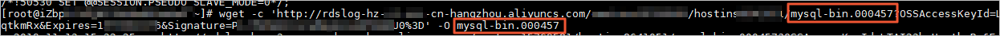
   >
   > 

<a id="section-15-4"></a>

## 15.4. Upload binlogs

**Background information**

This topic describes how to upload binlog files to Object Storage Service (OSS).

**Procedure**

1. Log on to the ApsaraDB RDS console.

2. On the **Instance List** page, find the instance that you want to manage.

3. In the left-side navigation pane, click **Backup and Restoration** to go to the **Backup and Restoration** page.

4. In the upper-right corner of the page, click **Upload Binlogs**.

5. In the message that appears, click **Confirm**.

<a id="section-15-5"></a>

## 15.5. Database recovery

Database recovery is the process of creating a new clone instance by copying the data and settings from a primary instance. A clone instance is primarily used to recover the primary instance's data or to create multiple identical instances.

**Prerequisites**

When you create a clone instance, the primary instance must meet the following conditions:

- The primary instance is in the **Running** state.

- No migration tasks are in progress.

- Both data backup and log backup are enabled.

- To clone an instance from a backup set, the primary instance must have at least one completed backup set.

**Background information**

You can create a clone instance from a backup set or to a specific point in time.

- A clone instance copies only the content of the primary instance, not the content of any read-only instances associated with the primary instance. The copied content includes the database information, account information, and instance settings of the primary instance, such as whitelist, backup, parameter, and threshold alert settings.

- The clone instance must have the same database type as the primary instance. However, other settings can differ, such as series, availability zone, network type, instance specification, and storage space. When creating a clone instance to restore data, select an instance specification and storage space larger than those of the primary instance to prevent long recovery times caused by performance limitations.

- The clone instance must have the same account type as the primary instance, but you can change the account passwords for the clone instance.

**Procedure**

1. 

2. On the **Instance List** page, find the instance that you want to manage.

3. In the left-side navigation pane, click **Backup and Recovery**.

4. In the backup list, find the target backup set, click **Restore** in the **Actions** column, and then click **OK** in the confirmation dialog box.

5. On the **RDS Restore** page, set the following parameters.

   **Category**

   **Parameter**

   **Description**

   Regions are isolated, and their internal networks are not

   **Region**

   interconnected. The region cannot be changed after the instance is created.

   Select **Multi-AZ deployment** or **Single-AZ deployment**. For

   **Deploymen**

   Multi-AZ deployments, you can specify the availability zones for the

   **t mode**

   primary and secondary nodes.

   **Region and zone**

   **Primary**

   The availability zone where the primary node of the instance is

   **availability**

   located.

   **zone**

   **Secondary**

   The availability zone where the secondary node of the instance is

   **availability**

   located. This parameter is available only if you select **Multi-AZ**

   **zone**

   **deployment**.

   The method for restoring the primary instance's data. Valid values:

   **Restore**

   - **By point in time**

   **method**

   - **By backup set**

   **Database**

   **Restore**

   Select the point in time to restore to. This parameter is required if

   **recovery**

   **time**

   **Restore method** is set to **By point in time**.

   Select the backup set to restore from. This parameter is required if

   **Backup set**

   **Restore method** is set to **By backup set**.

   **Instance**

   The name of the clone instance.

   **name**

   **Database type**

   The type of the database. This parameter cannot be modified.

   **Database**

   The version of the database. This parameter cannot be modified.

   **version**

   **Instance**

   **Series**

   The series of the database. See the console for available options.

   **configurat ion**

   **Storage**

   The storage type of the database. See the console for available

   **type**

   options.

   **Instance**

   The specification of the clone instance. To avoid long recovery

   **specificatio**

   times, select an instance specification and storage space larger

   **n**

   than those of the primary instance.

   Storage space includes space for data, system files, binlog files, and transaction files. See the console for the available storage space.

   **Storage**

   For certain instance specifications with dedicated resources, such as

   **space**

   those with dedicated local SSDs, the storage space is determined by the instance specification.

   RDS instances support the following network types:

   - **classic network**: Access control relies on security groups and whitelists.

   **Network type**

   - **Virtual Private Cloud**: A Virtual Private Cloud (VPC) allows you to build an isolated network environment on Alibaba Cloud. VPCs support custom route tables, IP address ranges, and gateways. We recommend that you use a VPC for enhanced security.

   **Network settings**

   Select the target VPC. Required when **Network type** is set to **Virtual Private Cloud**.

   **VPC**

   Select a vSwitch in the VPC. Required when **Network type** is set to

   **vSwitch**

   **Virtual Private Cloud**.

6. Configure the parameters and click **Submit**.

<a id="section-16"></a>

# 16.CloudDBA

<a id="section-16-1"></a>

## 16.1. Introduction to DAS

Database Autonomy Service (DAS) is a cloud service that uses machine learning and expert experience to automate perception, healing, optimization, O&M, and security for databases. DAS simplifies database management and prevents service failures that are caused by manual operations. This way, DAS helps ensure that the database service of users runs in a stable, secure, and efficient manner.

**Features**

ApsaraDB RDS for MySQL leverages the core capabilities of DAS to deeply integrate intelligent diagnostics and autonomy services into the ApsaraDB RDS console. It offers the following features to provide a one-stop database management experience:

- Perform quick diagnostics

  Allows you to view resource usage, basic instance information, and a comprehensive performance overview. You can also initiate diagnostics to quickly identify database anomalies.

- Session Management

  Supports real-time monitoring, analysis, and intervention of active sessions on database instances. It allows you to view abnormal sessions (such as long-running uncommitted transactions), export or terminate sessions, and integrate with autonomous capabilities like 10-second SQL analysis, SQL throttling, and SQL optimization. These features help you quickly locate performance bottlenecks, blocking sources, and high-risk operations to ensure stable and efficient database operation.

- Real-time monitoring

  Allows you to view visualized charts and tables generated from key operational metrics collected at high frequencies. This feature is designed to help database administrators (DBAs) and developers gain insights into the real-time loads of database instances, quickly locate the root cause of performance jitters, and assess the resource usage of database instances.

- Lock analysis

  When database issues such as deadlocks, transaction blocking, or metadata lock (MDL) waits occur, you can use the lock analysis feature to visually diagnose lock-wait relationships. This helps quickly identify the root cause of blocking and the dependency chain, which significantly improves troubleshooting efficiency and ensures the stability and high availability of database services.

- Storage Analysis

  Allows you to view the storage usage and the number of remaining days for which storage is available on a database instance. This feature also allows you to view the storage usage of a specified table, tablespace fragments, and diagnostic results on the database.

- Dashboard

  Allows you to view performance metrics, such as TPS, QPS, and throughput, of an instance. You can view performance metrics in different ways. For example, you can view the performance metrics within a specific time period, compare performance metrics collected during different time periods, or customize the performance metrics you want to view.

- View slow query logs Allows you to view slow query log trends, statistical information, and execution details. It also provides optimization recommendations and allows you to export historical data, helping you quickly locate and resolve performance bottlenecks.

- Diagnostic reports

  Allows you to generate instance health assessment reports manually or on a schedule. By analyzing health scores, slow SQL queries, and resource bottlenecks, this feature identifies potential risks and assists with manual troubleshooting and performance optimization. Currently, this feature can only assess the status of database instances and display the identified issues. It does not provide any optimization suggestions. You need to troubleshoot the issues based on the generated report.

<a id="section-16-2"></a>

## 16.2. Diagnostics and analysis

<a id="section-16-2-1"></a>

### 16.2.1. Perform quick diagnostics

After you log in to the ApsaraDB RDS console and go to the Diagnostics page of Database Autonomy Service (DAS), you can view resource usage, basic instance information, and a comprehensive performance overview. You can also initiate diagnostics to quickly identify database anomalies.

**Procedure**

1. 

2. 

3. In the left-side navigation pane, choose **Autonomy Services > Diagnostics**.

4. On the **Diagnostics** tab, you can view the following information.

   - Current resource usage: You can view the CPU, memory, IOPS, storage, and connection usage of the current instance.

   - Database basic information: You can view the database engine, source, and specifications of the current instance.

   - Database performance: You can view the risks, alerts, slow SQL queries, and deadlocks related to the current instance within the specified time period. This helps you quickly identify anomalies.

     > **Note**
     >
     > You can click **Create Reports** in the upper-right corner of the database view to diagnose the database. After the diagnostic is complete, you can click **View History** to view the historical diagnostics.

<a id="section-16-2-2"></a>

### 16.2.2. Session Management

After you log in to the ApsaraDB RDS console and navigate to the Session Management page of Database Autonomy Service (DAS), you can perform real-time monitoring, analysis, and intervention of active sessions on database instances. It allows you to view abnormal sessions (such as long-running uncommitted transactions), export or terminate sessions, and integrate with autonomous capabilities like 10-second SQL analysis, SQL throttling, and SQL optimization. These features help you quickly locate performance bottlenecks, blocking sources, and high-risk operations to ensure stable and efficient database operation.

**Procedure**

1. 

2. 

3. In the left-side navigation pane, choose **Autonomy Services > Diagnostics**. On the **Session Management** tab, perform the following operations:

   **Instance sessions**

   - **View abnormal sessions**

     - Click **Anomaly Detection**. In the pop-up dialog box, you can view abnormal sessions that the system identifies, including sessions that have not submitted transactions for a long period of time and sessions that occupy excessive resources.

     - You can click **Optimize** or **End** to handle these sessions.

   - **View key metrics**

     Move the pointer over **Active session**, **Maximum Execution Duration**, **CPU Utilization**, or **Connection Usage** to view the detailed information and trend in the pop-up window.

   - **Other core features**

     - **10s SQL analysis**: Click **10s SQL Analysis** in the upper-right corner to view SQL execution statistics, slow SQL queries, and SQL overview information within the previous 10 seconds, helping you identify transient performance issues.

     - **SQL throttling**: Click **SQL Throttling** to go to the **SQL Throttling** page. On this page, you can configure throttling rules to automatically throttle abnormal or high-load SQL queries to prevent system exhaustion. For more information, see the **SQL throttling** section.

     - **Optimization**: Click **Optimize** to optimize the sessions of the desired instance. For more information, see the **SQL optimization** section.

     - **Export active sessions**.

     - **End sessions**: To terminate a session, you must enter the database account and password for authentication. You can also use a database account with the permissions to terminate the sessions created by using other database accounts, such as a privileged account.

       > **Note**
       >
       > - In the **User** column of a session, you can view the database account that is used to create the session.
       >
       > - Click **End Session History** to query the operation records of all terminated sessions, including the task ID, start time, and end time. This facilitates tracing and auditing.

   **Session statistics**

   - **View session statistics**

     You can view summarized session information by user, access source, or database, including the total number of sessions, the total number of ongoing sessions, and the longest session duration.

   - **Export session statistics**

     You can export session statistics by summary, user, access source, or database.

<a id="section-16-2-3"></a>

### 16.2.3. Real-time monitoring

After you log in to the ApsaraDB RDS console and navigate to the instance performance page of Database Autonomy Service (DAS), you can view visualized charts and tables generated from key operational metrics collected at high frequencies. This feature is designed to help database administrators (DBAs) and developers gain insights into the real-time loads of database instances, quickly locate the root cause of performance jitters, and assess the resource usage of database instances.

**Procedure**

1. 

2. 

3. In the left-side navigation pane, choose **Autonomy Services > Diagnostics**. Click the **Real-time Monitoring** tab. The system automatically loads real-time data. You can switch between the **Real-time Charts** and **Real-time Tables** views. For more information, see **View switching and advanced operations** in this topic.

**Core metric interpretation**

Based on the console interface (this topic uses MySQL as an example; metrics for databases such as PostgreSQL may differ, so refer to the actual display in the console), real-time performance covers the following four monitoring dimensions. The following table below provides a detailed explanation of each metric along with O&M recommendations:

**BInstance basic instance information overview**

| Modu le | Metric | Description and O&amp;M recommendations |
| --- | --- | --- |
| Serve r Iinfor matio n | Version/Uptime | Displays the database kernel version (such as <code> 8.0.36 </code>) and the cumulative uptime of the instance. Use this information to verify environment consistency and instance stability. |
| Conn ection Iinfor matio n | Maximum Cconnections/Cu rrent Cconnections/Act ive Cconnections | • Format example: <code> 1200 / - / 3 </code>.<br>• Maximum Cconnections: Tthe maximum number of connections that the instance allows.<br>• Current Cconnections: Tthe total number of established TCP connections.<br>• Active Cconnections: Tthe number of connections that are currently executing SQL statements.<br>Note<br>If the number of current connections approaches the upper limit, watch for connection storms. If the number of active connections is much lower than the number of current connections, a large number of idle connections may be consuming resources. |
| Buffer Pool | Total Ppages/IdleFree pPage Percentageratio/Dirty Ppage Percentageratio | Displays the InnoDB buffer pool status.<br>• Idle PFree page Percentageratio: Iindicates the remaining memory space.<br>• Dirty Ppage Percentageratio: Iindicates the volume of data pending flush to disk. A high percentageratio may reduce flush efficiency and cause I/O jitter. |

**Throughput, load, and deep engine metrics**

| Categ ory | Metric name | Description | O&amp;M analysis and recommendations |
| --- | --- | --- | --- |
| Throu ghput | QPS \| TPS | • QPS: The average number of SQL statements executed per second.<br>• TPS: The average number of transactions per second. | Trend analysis: A sudden increase typically corresponds to a business peak.<br>Exception troubleshooting: If QPS or TPS drops while CPU usage rises, lock waits or slow SQL query blocking usually exists. |
| DML distrib ution | DML Eexecutio ns count | • select: The number of SELECT statements executed per second.<br>• insert: The number of INSERT statements executed per second.<br>• update: The number of UPDATE statements executed per second.<br>• delete: The number of DELETE statements executed per second. | Business profiling: Identify whether the workload is read-heavy or write-heavy to help formulate an index optimization policy, such as adjusting the read/write splitting architecture. |
| Conne ction sessio ns | Connectio ns | • Active Sessionsconnections: The number of open connections that are in an active statuse.<br>• Total Cconnections: The total number of open connections. | Bottleneck identification: Monitor the peaks of active connections. If the number of active sessionconnections remains high for an extended period, check for long-running transactions or unreleased application connections. |
| Cache efficie ncy | InnoDB CacheBuff er Pool | • Cache Hhit Rratio: The ratioproportion of data read from memory.<br>• Cache Uusage: The occupancy ratio of the buffer pool. | Performance key: The hit ratio should be close to 100%. A low hit ratio means that a large number of requests fall through to the disk (physical reads), which causes a sharp performance drop.Consider increasing the buffer pool size or optimizing SQL queries. |
| Data access | InnoDB Raccessed rows | • rows_read: The number of InnoDB rows read per second.<br>• rows_inserted: The number of InnoDB rows inserted per second.<br>• rows_updated: The number of InnoDB rows updated per second.<br>• rows_deleted: The number of InnoDB rows deleted per second. | Index optimization: If <code> rows_read </code> is extremely high but the returned result set is small, a full table scan exists and you must add an appropriate index. |
| I/O reads and writes | Logical Rreads/and pPhysical Rreads | • Logical Rreads: The number of logical reads per second (read from the buffer pool).<br>• Physical Rreads: The number of physical reads per second (read from the disk). | I/O bottleneck: A surge in physical reads severely degrades performance and typically results from cold data access, an insufficient buffer pool, or missing indexes. |
| Lock conte ntion | Average Lrow lock Thold time for InnoDB Row-level Locking | The unit is typically milliseconds (ms), which reflects the average time to acquire a lock. | Concurrency conflicts: A higher value indicates more intense contention between transactions, which may cause timeout errors on the application side. |
| Lock waits | WInnoDB row lock waits for InnoDB Row-level Locking | • Average Waits for InnoDB Rrow-level Llocking waits: The average number of row lock waits within the statistics period.<br>• Current Waits for InnoDB Rrow-level Llocking waits: The number of row lock waits at the current moment. | Blocking source: If this curve is not zero, blocking exists. Use the session management feature to locate the blocker and terminate the abnormal session. |
| Temp orary resour ces | Temporary Ttables and Ffiles | • Temporary Ttables: The number of temporary tables created.<br>• Temporary Ffiles: The number of temporary files created. | SQL optimization: Frequent creation of on-disk temporary files severely degradesslows down SQL performancequeries. This typically occurs because <code> sort_buffer_size </code> is insufficient or a lack ofmissing indexes prevents index-based sorting. |
| Excep tion monit oring | Slow Qqueries | Slow Qqueries: The difference in the number of slow queries between two adjacent collection points, which represents the slow query increment within that time period. | Root cause correlation: A sudden increase in slow queries often directly causes CPU spikes and slow responses.Capture the slow query log immediately for analysis. |
| Netwo rk bandw idth | Network Ttraffic | Total Ttraffic, Iinbound Ttraffic, and Ooutbound Ttraffic. | Bandwidth limits: If outbound traffic reaches the instance bandwidth limit, connection timeouts or packet loss occur. If inbound traffic is abnormal, check for large field writes or potential attacks. |

**View switching and advanced operations**

- **Comparison between real-time charts and real-time tables**

  - **Real-time charts**: Suitable for observing trends, peaks and valleys, and correlations between multiple metrics (for example, whether CPU usage rises synchronously when QPS increases).

  - **Real-time tables**: Suitable for viewing exact metric values at a specific point in time, which facilitates baseline data recording and detailed data comparison. Each row in the table represents a sampling point in time, and each column corresponds to the specific value of a metric.

  - **Data download**: On the **Real-time Tables** tab, click the **Download** button in the upper-right corner of the page to export the current report data to your local device.

    > **Note**
    >
    > Some database engines (MongoDB and Redis) do not support the report download feature. The actual availability depends on what the console displays.

- **Parameter description**

  Click **Metric Description** in the upper-left corner of the page to view the specific definition of each metricmonitoring item, allowing you towhich helps you interpret data more accurately.

- **Pause and resume**

  The upper-right corner displays the remaining refresh count. You can manually control the automatic refresh frequency of the page, or click **Pause** to freeze the statuse at a specific moment for detailed analysis during troubleshooting.

**Usage recommendations**

- Establish a baseline: During stable business periods, observe and record normal QPS, TPS, and CPU usage as a benchmark for subsequent fault comparison.

- Perform correlation analysis: Avoid viewing a single metric in isolation. For example, when QPS drops, immediately check whether InnoDB row lock waits increase or slow queries increase, and observe forwhether physical reads show abnormal fluctuations in physical reads.

- Watch for spikes: Sudden spikes in charts typically correspond to specific business events (such as scheduled jobs starts or flash sales). Cross-referencing the timestampCorrelating the point in time with business logs helps you quickly locate the issue.

<a id="section-16-2-4"></a>

### 16.2.4. Lock analysis

When database issues such as deadlocks, transaction blocking, or metadata lock waits occur, you can use the lock analysis feature provided by Database Autonomy Service (DAS) to visually diagnose lock-wait relationships. This helps quickly identify the root cause of blocking and the dependency chain, which significantly improves troubleshooting efficiency and ensures the stability and high availability of database services.

**Introduction**

The lock analysis feature allows you to perform multi-dimensional analysis on deadlocks, transaction blocking, and metadata lock waits on a database instance.

- **Recent deadlock analysis**: DAS analyzes the most recent deadlock log in the output of the  `SHOW ENGINE INNODB STATUS`  statement. If multiple deadlocks have occurred, DAS analyzes only the most recent deadlock.

- **Other lock analysis**: DAS analyzes the metadata lock and transaction blocking in the current sessions of your database instance in real time based on the data in  `information_schema`  and  `performance_schema` .

  - Metadata lock analysis: DAS deduces the lock wait relationships and generates the corresponding diagram based on the data in tables such as the  `information_schema.processlist`  table.

  - Transaction blocking analysis: DAS analyzes the transaction blocking relationship and generates the corresponding diagram based on the data in the  `information_schema.processlist` ,  `information_schema.innodb_trx` , and  `information_schema.innodb_lock_waits`  or  `performance_schema.data_lock_waits` tables. Data in the information_schema.innodb_lock_waits table is used for database instances that run MySQL 5.6 or MySQL 5.7, and data in the performance_schema.data_lock_waits table is used for database instances that run MySQL 8.0.

**Procedure**

1. 

2. 

3. In the left-side navigation pane, click **Autonomy Service > Diagnostics**. On the **Lock Analysis** tab:

   **Deadlock analysis**

   <ol type="i">

   <li>

   **Analyze the most recent deadlock**

   On the **Recent Deadlock Analysis** tab, click **Create Analysis Task**.

   > **Note**
   >
   > If multiple deadlocks have occurred, DAS analyzes only the most recent deadlock and retains the deadlock data.

   </li>

   <li>

   **View details**

   <ol type="a">

   <li>

   After the diagnostic task is complete, select a time range and click **View Details** in the **Details** column of the diagnostic task list under recent deadlock analysis to view the results of deadlock diagnostic tasks that were triggered during the time range.

   </li>

   <li>

   In the panel that appears, you can view the deadlock details.

   </li>

   </ol>

   </li>

   </ol>

   **Other lock analysis**

   <ol type="i">

   <li>

   **Initiate other lock analysis and diagnostics**

   On the **Recent Deadlock Analysis** tab, click **Create Analysis Task**.

   </li>

   <li>

   **View details**

   <ol type="a">

   <li>

   Click the  icon before an analysis result to expand the metadata lock wait and

   transaction blocking analysis information.

   </li>

   <li>

   Click **View Details**. The details of the transaction lock are displayed.

   </li>

   </ol>

   </li>

   </ol>

<a id="section-16-2-5"></a>

### 16.2.5. Storage Analysis

After you log in to the ApsaraDB RDS console and navigate to the Storage Analysis page of Database Autonomy Service (DAS), you can view the storage usage and the number of remaining days for which storage is available on a database instance. This feature also allows you to view the storage usage of a specified table, tablespace fragments, and diagnostic results on the database.

**Procedure**

1. 

2. 

3. In the left-side navigation pane, choose **Autonomy Services > Diagnostics**. On the **Storage Analysis** tab, you can perform the following operations:

   - On the **Storage Analysis** tab, click the **Storage Overview** tab. You can view data such as the storage overview, exception list, storage trend, and tablespaces.

   - On the **Storage Analysis** tab, click the **Data Space** tab. You can view the storage usage of each database and tablespace.

     Click the name of a tablespace to view the fields and indexes of the tablespace.

<a id="section-16-3"></a>

## 16.3. Dashboard

After you log in to the ApsaraDB RDS console and navigate to the Dashboard page of Database Autonomy Service (DAS), you can view performance metrics, such as TPS, QPS, and throughput, of the instance. You can view performance metrics in different ways. For example, you can view the performance metrics within a specific time period, compare performance metrics collected during different time periods, or customize the performance metrics you want to view.

**Procedure**

1. 

2. 

3. In the left-side navigation pane, choose **Autonomy Services > Dashboard**.

   - On the **Performance Trends** tab, you can view the trends of changes in the TPS, QPS, and sessions. You can also click **More Metrics** to customize the metrics you want to view.

     > **Note**
     >
     > Click the
     >
     > icon next to the name of a metric to view its description.
     >
     > 

   - On the **Performance Trend Comparison** tab, select two time periods to compare the performance metrics collected within the specified time periods.

   - On the **Custom Charts** tab, you can centrally display and manage the desired performance metrics in one chart by customizing performance charts. This simplifies troubleshooting.

     > **Note**
     >
     > You must create a dashboard if this is the first time you use **custom charts**.

<a id="section-16-4"></a>

## 16.4. View slow query logs

After you log in to the ApsaraDB RDS console and navigate to the Slow Query Logs page of Database Autonomy Service (DAS), you can view slow query log trends, statistical information, and execution details. It also provides optimization recommendations and allows you to export historical data, helping you quickly locate and resolve performance bottlenecks.

**Procedure**

1. 

2. 

3. In the left-side navigation pane, choose **Autonomy Services > Slow Query Logs**.

   - In the **Slow Log Trend** section, view the slow query log trend of the instance.

   - Click the **Slow Log Statistics** tab to view slow log details for a specified time range and optimize the slow SQL statements.

     - The instances of some database types do not support the SQL optimization feature. Refer to the actual features available in the console.

     - For the instances of ApsaraDB RDS for MySQL and PolarDB for MySQL Primary/Secondary Edition, click the **Optimize** button in the Actions column of the slow SQL record that you want to mange. The record is highlighted in blue to help you quickly locate the SQL statement being analyzed in a large number of slow SQL statements. This highlight persists after you close the optimization window and automatically shifts to the new record when you optimize another slow SQL statement.

       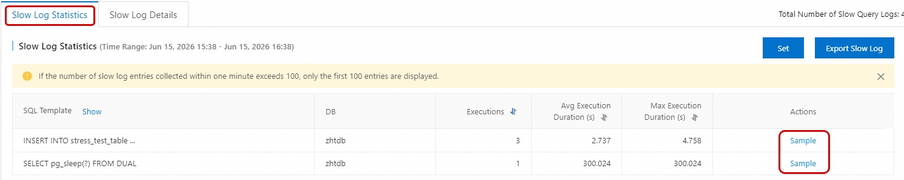

   - Click the **Slow Log Details** tab to view the execution details of slow query logs.

     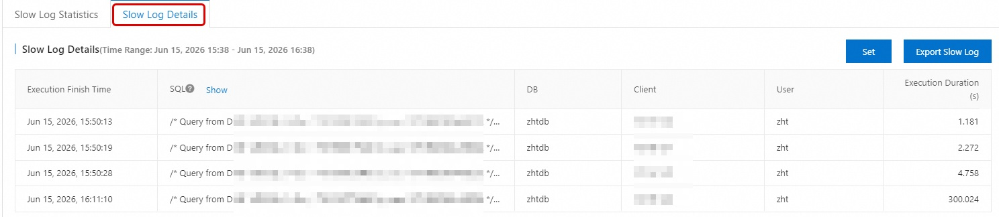

<a id="section-16-5"></a>

## 16.5. Diagnostic reports

After you log in to the ApsaraDB RDS console and navigate to the Diagnostic Reports page of Database Autonomy Service (DAS), you can generate operational status assessment reports of the instance manually or at a scheduled time. By analyzing health scores, slow SQL queries, and resource bottlenecks, this feature identifies potential risks and assists with manual troubleshooting and performance optimization. Currently, this feature can only assess the status of database instances and display the identified issues. It does not provide any optimization suggestions. You need to troubleshoot the issues based on the generated reports.

**Suggestions**

- Periodically generate diagnostic reports: We recommend that you configure the system to automatically generate daily diagnostic reports for production instances and formulate performance baselines.

- Use slow SQL query optimization: Pay close attention to the top 10 slow SQL queries and high-risk SQL queries, and optimize them promptly.

- Focus on changes in health scores: If the health score consistently drops, check resource configurations or look for performance bottlenecks caused by business growth.

**Procedure**

1. 

2. 

3. In the left-side navigation pane, choose **Autonomy Services > Diagnostic Reports**. On this page, you can perform the following operations:

   **Manually initiate a diagnostic**

   Click **Create Reports**. In the dialog box that appears, select a time range (Last 1 Hour, Last 3 Hours, Last 6 Hours, Last 12 Hours, or Last 24 Hours) and click **Confirmation**. The system immediately starts the diagnostic task.

   **Automatically generate diagnostic reports at a scheduled time**

   Click **Auto-generating Report Settings**, select **Scheduled Trigger**, select days and a specific time, and then click **OK**.

   > **Note**
   >
   > Due to system scheduling and resource usage, diagnostic reports may be generated with a delay. The actual time prevails.

   **View diagnostic report details**

   The list on the page shows all available diagnostic reports. Click **View Report** in the Actions column of a diagnostic report to go to the details page. The report displays the following information: instance health status, active sessions, top 10 slow SQL queries, high-risk SQL queries, top 5 tablespaces, redundant indexes, lock analysis, and performance trends.

   In the upper-right corner of the diagnostic report page, click **Deduction Details** to view the health score deduction details.

   **Download a diagnostic report**

   Click **View Report** to go to the diagnostic report details page. Then, click **Download** to download the report to your on-premises machine for archiving or sharing.

<a id="section-17"></a>

# 17.Log management

ApsaraDB RDS lets you query error logs, slow query log details, slow query log summaries, and primary/secondary switchover logs in the console for troubleshooting and performance analysis.

**Procedure**

1. Log on to the ApsaraDB RDS console.

2. On the **Instance List** page, find the instance that you want to manage.

3. In the left-side navigation pane, click **log management**.

4. On the **log management** page, select the tab for the desired log type, set a custom time range, and then click **OK**. The following table describes the supported log types.

   | Log type | Description |
   | --- | --- |
   | Error log | Records database errors from the last 15 days. |
   | Slow query log details | Records SQL statements from the last 15 days that took longer than 1 second to execute. Similar statements are deduplicated. You can view and export the log data for any 7-day period within this time frame. |
   | Slow query log summary | Aggregates statistics for SQL statements from the last 15 days that took longer than 1 second to execute. You can view these statistics for any 7-day period within this time frame. |
   | Primary/second ary switchover log | Records switchovers between primary and secondary instances. This feature is available only for MySQL High-availability Edition instances. |

<a id="section-18"></a>

# 18.Use mysqldump to migrate MySQL data

This topic describes how to use mysqldump to migrate data from an on-premises database to an ApsaraDB RDS for MySQL instance.

**Prerequisites**

An ECS instance is created.

**Background information**

mysqldump is easy to use but requires extensive downtime. This tool is suitable for scenarios where the amount of data is small or extensive downtime is allowed.

ApsaraDB RDS for MySQL is fully compatible with the native database service. The procedure of migrating data from the original database to an ApsaraDB RDS for MySQL instance is similar to that of migrating data from one MySQL server to another.

Before you migrate data, you must create an account that is used to migrate data from the on-premises MySQL database. You must grant the read and write permissions on the on-premises MySQL databases to the account.

**Procedure**

1. Run the following command to create a migration account for the on-premises database:

   ```text
    CREATE USER 'username'@'host' IDENTIFIED BY 'password'; 
   ```

   Parameter description:

   - username: the name of the account to be created.

   - host: the host from which the account is authorized to log on to the on-premises MySQL database. If you want to allow access from a local host, set this parameter to **localhost**. If you want to allow access from all hosts, set this parameter to a percent sign (**%**).

   - password: the password of the account.

   For example, you can run the following command to create an account with the username **William** and the password **Changme123**. The account is authorized to log on to the on-premises MySQL database from all hosts.

   ```text
    CREATE USER 'William'@'%' IDENTIFIED BY 'Changme123'; 
   ```

2. Run the following command to grant permissions to the migration account in the on-premises database:

   ```sql
    GRANT SELECT ON databasename.tablename TO 'username'@'host' WITH GRANT OPTION; GRANT 
   ```

```text
REPLICATION SLAVE ON databasename.tablename TO 'username'@'host' WITH GRANT 
```


```text
OPTION;  GRANT REPLICATION SLAVE ON databasename.tablename TO 'username'@'host' WITH 
GRANT OPTION; 
```

Parameter description:

- privileges: the operation permissions granted to the account, such as SELECT, INSERT, and UPDATE. To authorize the account to perform all operations, set this parameter to **ALL**.

- databasename: the name of the on-premises MySQL database. If you want to grant all database permissions to the account, set this parameter to an asterisk (**\***).

- tablename: the name of the table whose data you want to migrate. If you want to grant all table permissions to the account, set this parameter to an asterisk (**\***).

- username: the name of the account.

- host: the host from which the account is authorized to log on to the on-premises MySQL database. If you want to allow access from a local host, set this parameter to **localhost**. If you want to allow access from all hosts, set this parameter to a percent sign (**%**).

- WITH GRANT OPTION: authorizes the account to use the GRANT statement. This parameter is optional.

For example, you can execute the following statement to grant all permissions on tables and databases to the **William** account. The account is authorized to log on to the database from all hosts.

```sql
 GRANT ALL ON *. * TO 'William'@'%'; 
```

3. Use the data export tool of mysqldump to export data from the database as a data file.

   > **Important**
   >
   > Do not update data during data export. In this step, only data is
   >
   > exported. Stored procedures, triggers, and functions are not exported.

   ```text
     mysqldump -h localIp -u userName -p --opt --default-character-set=utf8 --hex-blob 
   dbName --skip-triggers > /tmp/dbName.sql 
   ```

   Parameter description:

   - localIp: the IP address of the host where the on-premises MySQL database resides.

   - userName: the account that is used to migrate data from the on-premises MySQL database.

   - dbName: the name of the on-premises MySQL database.

   - /tmp/dbName.sql: the name of the exported data file.

4. Use mysqldump to export stored procedures, triggers, and functions.

   > **Important**
   >
   > Skip this step if no stored procedures, triggers, or functions are used
   >
   > in the database. When stored procedures, triggers, and functions are exported, you must remove the DEFINER to ensure compatibility with ApsaraDB RDS for MySQL.

   ```text
     mysqldump -h localIp -u userName -p --opt --default-character-set=utf8 --hex-blob 
   dbName -R | sed -e 's/DEFINER[ ]*=[ ]*[^*]*\*/\*/' > /tmp/triggerProcedure.sql 
   ```

   Parameter description:

   - localIp: the IP address of the host where the on-premises MySQL database resides.

   - userName: the account that is used to migrate data from the on-premises MySQL database.

   - dbName: the name of the on-premises MySQL database.

   - /tmp/triggerProcedure.sql: the name of the exported stored procedure file.

5. Upload the data file and stored procedure file to the ECS instance. In this example, the files are uploaded to the following paths:

   ```text
    /tmp/dbName.sql 
    /tmp/triggerProcedure.sql 
   ```

6. Log on to the ECS console and import both the data file and the stored procedure file to the destination ApsaraDB RDS for MySQL instance.

   > **Note**
   >
   > For information about how to log on to the ECS instance, see topics in the
   >
   > **Connect to an instance** section of ECS User Guide.

   ```text
     mysql -h intranet4example.mysql.rds.aliyuncs.com –u userName -p dbName < 
   /tmp/dbName.sql 
     mysql -h intranet4example.mysql.rds.aliyuncs.com -u userName -p dbName < 
   /tmp/triggerProcedure.sql 
   ```

   Parameter description:

   - intranet4example.mysql.rds.aliyuncs.com: the endpoint of the ApsaraDB RDS for MySQL instance. An internal endpoint is used in this example.

   - userName: the migration account of the ApsaraDB RDS for MySQL database.

   - dbName: the name of the on-premises MySQL database from which you want to import data.

   - /tmp/dbName.sql: the name of the data file that you want to import.

   - /tmp/triggerProcedure.sql: the name of the stored procedure file that you want to import.
