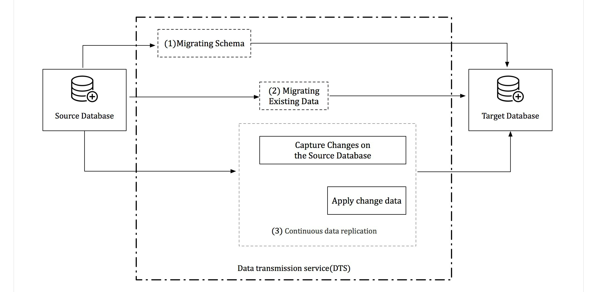
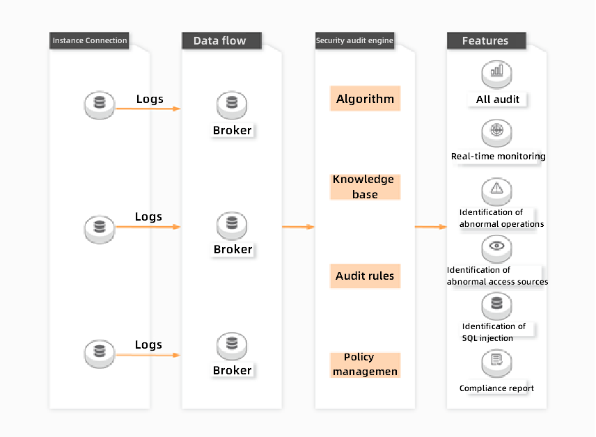
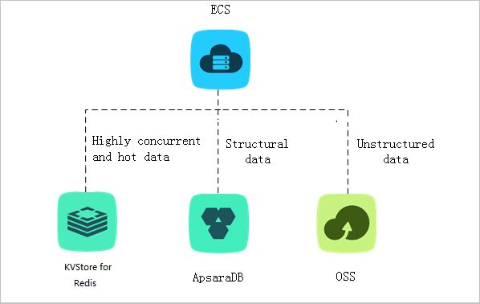
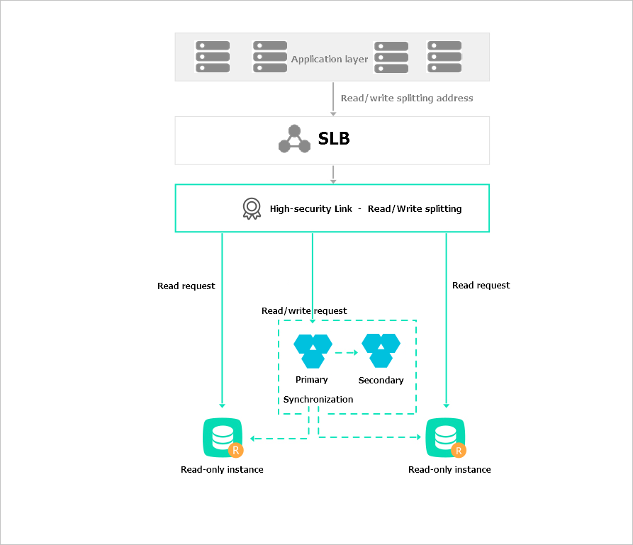
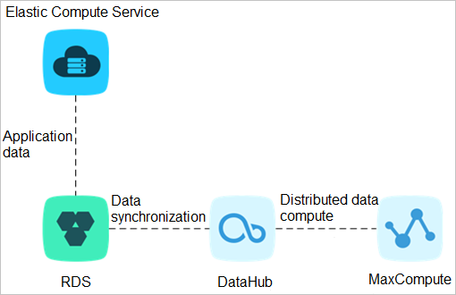

Alibaba Cloud  
Apsara Stack  
ApsaraDB for RDS  
Product Introduction  
Product Version: v3.18.6-2607  
Document Version: 20260831

**Table of Contents**

- [1.Features](#section-1)
- [2.Benefits](#section-2)
    - [2.1. Ease of use](#section-2-1)
    - [2.2. High performance](#section-2-2)
    - [2.3. High security](#section-2-3)
    - [2.4. High reliability](#section-2-4)
- [3.Scenarios](#section-3)
    - [3.1. Diverse data storage](#section-3-1)
    - [3.2. Read/write splitting](#section-3-2)
    - [3.3. Big data analysis](#section-3-3)
- [4.Functions and features](#section-4)
- [5.Instance types](#section-5)

<a id="section-1"></a>

# 1.Features

ApsaraDB RDS supports four database engines: MySQL, SQL Server, PolarDB, and PostgreSQL. You can create database instances based on these database engines to meet your business requirements.

**ApsaraDB RDS with different database engines**

- ApsaraDB RDS for MySQL is developed based on AliSQL and provides excellent performance. ApsaraDB RDS for MySQL is a tried and tested solution that handled the high-volume concurrent traffic during Double 11. ApsaraDB RDS for MySQL supports deployment with mixed x86 and ARM clusters. It integrates basic features such as whitelist configuration, backup and restoration, Transparent Data Encryption (TDE), data migration, and management for instances, accounts, and databases. ApsaraDB RDS for MySQL also provides the following advanced features:

  - **Read-only instance:** In scenarios where ApsaraDB RDS for MySQL handles a small number of write requests but a large number of read requests, you can create read-only instances to scale up reading capabilities and increase the application throughput.

  - **Read/write splitting:** The read/write splitting feature provides a read/write splitting endpoint. This endpoint enables automatic read/write splitting for a primary instance and all of its read-only instances. An application can connect to the read/write splitting endpoint to read and write data. Write requests are routed to the primary instance while read requests are routed to read-only instances based on their weights. To scale up reading capabilities of the system, you need only to add more read-only instances.

- ApsaraDB RDS for PostgreSQL is an advanced open source database service that is fully compatible with SQL and supports a diverse range of data formats such as JSON, IP, and geometric data. In addition to support for features such as transactions, subqueries, multi-version concurrency control (MVCC), and data integrity check, ApsaraDB RDS for PostgreSQL provides a series of features including high availability, backup, and restoration to ease operations and maintenance loads.

- ApsaraDB RDS for SQL Server provides strong support for a variety of enterprise applications under the high-availability architecture. ApsaraDB RDS for SQL Server can also restore data to a specific point in time. ApsaraDB RDS for SQL Server provides basic features such as whitelist configuration, backup and restoration, transparent data encryption, data migration, and management for instances, accounts, and databases.

- PolarDB is a stable, secure, and scalable enterprise-class relational database service. PolarDB is developed based on PostgreSQL and offers enhanced performance, application solutions, and compatibility. PolarDB also provides the capability of directly running Oracle applications. You can run a variety of enterprise applications on PolarDB stably at low costs.

**Scheduling service**

The scheduling service allocates and integrates underlying ApsaraDB RDS resources when you create and migrate instances. When you create an instance by using the ApsaraDB RDS console or an API operation, the scheduling service calculates the most suitable host to carry traffic to and from the instance. The scheduling service also allocates and integrates the underlying resources required to migrate ApsaraDB RDS instances. After instances are repeatedly created, deleted, or migrated, the scheduling service calculates the degree of resource fragmentation. In addition, it integrates resources on a regular basis to improve the service carrying capacity.

**Data link service**

ApsaraDB RDS provides all data link services, including Domain Name System (DNS) and Server Load Balancer (SLB).

- The DNS module can dynamically resolve domain names to IP addresses. Therefore, IP address changes do not affect the performance of ApsaraDB RDS instances. After the domain name of an ApsaraDB RDS instance is configured in the connection pool, the ApsaraDB RDS instance can be accessed even if its corresponding IP address changes.

  For example, assume that the domain name of an ApsaraDB RDS instance is **test.rds.aliyun.com**, and its corresponding IP address is **10.10.10.1**. The instance can be accessed when **test.rds.aliyun.com** or **10.10.10.1** is configured in the connection pool of a program.

  After this ApsaraDB RDS instance is migrated or its version is updated, the IP address may change to **10.10.10.2**. If the domain name **test.rds.aliyun.com** is configured in the connection pool, the instance can still be accessed. However, if the IP address **10.10.10.1** is configured in the connection pool, the instance is no longer accessible.

- The SLB module provides both the internal and public IP addresses of an ApsaraDB RDS instance. Therefore, server changes do not affect the performance of the instance.

  For example, assume that the internal IP address of an ApsaraDB RDS instance is **10.1.1.1**, and the corresponding Proxy module or DB Engine runs on **192.168.0.1**. The SLB module typically redirects all traffic destined for **10.1.1.1** to **192.168.0.1**. If **192.168.0.1** fails, another server in the hot standby state with the IP address **192.168.0.2** takes over for the initial server. In this case, the SLB module redirects all traffic destined for **10.1.1.1** to **192.168.0.2**, and the ApsaraDB RDS instance continues to provide services normally.

**Specification change**

When you change the specifications of an ApsaraDB RDS instance, the system automatically performs the following operations in the background:

1. Apply for resources required for the new instance.

2. Synchronize full data and incremental data from the original instance to the new instance.

3. When data synchronization is close to completion, set the original instance to the read-only state until all data is synchronized. After data synchronization is complete, disassociate the proxy IP address from the original instance and associates the proxy IP address with the new instance in the SLB backend.

4. Release the original instance and change the state of the new instance to running.

**Backup and restoration service**

ApsaraDB RDS can back up databases anytime and restore them to a point in time based on backup policies, which makes data more traceable.

- The Backup module compresses and uploads data and logs on both the primary and secondary nodes. By default, ApsaraDB RDS uploads backup files to Object Storage Service (OSS). When the secondary node runs normally, backups are always created on the secondary node. This way, the services on the primary node are not affected. When the secondary node is unavailable or damaged, the Backup module creates backups on the primary node. ApsaraDB RDS supports the following backup methods:

  - Physical backup: directly backs up all files in all databases.

  - Logical backup: extracts data from the databases by using SQL statements and backs up the data in the text format.

- The Restoration module restores backup files from OSS to a destination node by using the following features:

  - Primary node rollback: rolls back the primary node to a specific point in time when an operation error occurs.

  - Secondary node repair: creates another secondary node to reduce risks when an irreparable fault occurs on the secondary node.

  - Read-only instance creation: creates a read-only instance from backup files.

- The Storage module uploads, dumps, and downloads backup files. All backup data is uploaded to OSS for storage. You can obtain temporary links to download the data. In specific scenarios, the Storage module allows you to dump backup files from OSS to Archive Storage for more cost-effective and longer-term offline storage.

**Monitoring service**

ApsaraDB RDS provides multilevel monitoring services across the physical, network, and application layers to ensure service availability.

- The Service module tracks the status of services. For example, the Service module monitors whether other cloud services on which ApsaraDB RDS depends are running normally, such as SLB and OSS. The monitored metrics include features and response time. The Service module also uses logs to determine whether the internal services of ApsaraDB RDS are running normally.

- The Network module tracks the network status. The module monitors the connectivity between Elastic Compute Service (ECS) and ApsaraDB RDS and between physical servers of ApsaraDB RDS. It also monitors the packet loss rates on vRouters and vSwitches.

- The OS module tracks the statuses of hardware and OS kernel.

  - Hardware maintenance: The OS module constantly checks the operating status of the CPU, memory, motherboard, and storage device. It can predict faults and submit repair reports when it determines a fault is likely to occur.

  - OS kernel monitoring: The OS module tracks all database calls and analyzes the causes of slow calls or call errors based on the kernel status.

- The Instance module collects the following information about ApsaraDB RDS instances:

  - Availability information

  - Capacity and performance metrics

  - SQL execution records

**High-availability service**

The high-availability (HA) service uses the Detection, Repair, and Notice modules and a variety of HA polices to ensure the availability of data link services. It also processes internal database exceptions.

- The Detection module checks whether the primary and secondary nodes of the DB Engine are providing services normally. An HA node uses heartbeat information taken at 8 to 10 second intervals to determine the health status of the primary node. This information, along with the health status of secondary nodes and heartbeat information from other HA nodes, provides a reference for the Detection module. All this information helps the module prevent improper judgment caused by exceptions such as network jitter. Failover can be completed within a short time.

- The Repair module maintains the replication relationship between the primary and secondary nodes of the DB Engine. It can also correct errors that occur on the nodes during daily operations.

  - It can automatically restore primary/secondary replication after a disconnection.

  - It can automatically repair table-level damage to the primary or secondary node.

  - It can save and automatically repair the primary or secondary node when the node fails.

- The Notice module informs the SLB or Proxy module of status changes to the primary and secondary nodes to ensure that you always access the correct node.

  For example, assume that the Detection module discovers issues with the primary node and instructs the Repair module to resolve these issues. If the Repair module fails to resolve an issue, it instructs the Notice module to perform traffic switchover. The Notice module forwards the switching request to the SLB or Proxy module. Then, all traffic is redirected to the secondary node. Meanwhile, the Repair module creates another secondary node on a different physical server and synchronizes this change back to the Detection module. The Detection module rechecks the health status of the instance.

- Each HA policy defines a combination of service priorities and data replication modes to meet your business requirements. The following service priorities are available:

  - Recovery time objective (RTO): The database preferentially restores services to maximize the availability time. Use the RTO policy if you require longer database uptime.

  - Recovery point objective (RPO): The database preferentially ensures data reliability to minimize data loss. Use the RPO policy if you require high data consistency.

  The following data replication modes are available:

  - Synchronous

    - After an update that is initiated by your application is complete on the primary instance, the related log is synchronized to all the secondary instances. The transaction that is used to perform the update is considered committed only after at least one of the secondary instances receives and stores the log.

    - In synchronous mode, data replication remains synchronous and cannot be demoted to the asynchronous mode.

    - Synchronous replication is supported only when your database system consists of three or more instances. This means that only Enterprise Edition supports the synchronous mode. In addition, if the primary instance runs the Enterprise Edition, you cannot change the data replication mode.

  - Semi-synchronous

    After an update that is initiated by your application is complete on the primary instance, the related log is synchronized to all the secondary instances. The transaction that is used to perform the update is considered committed after the secondary instances receive the log. Your database system does not need to wait for the secondary instances to replay the log.

    If the secondary instances are unavailable or a network interruption occurs between the primary and secondary instances, the semi-synchronous mode is demoted to the asynchronous mode.

  - Asynchronous

    When your application initiates a request to add, delete, or modify data, the primary instance responds to your application immediately after it completes the requested operation. At the same time, the primary instance asynchronously replicates data to the secondary instances. In asynchronous mode, the unavailability of the secondary instances does not interrupt the workloads on the primary instance. However, the unavailability of the primary instance may cause data inconsistencies between the primary and secondary instances.

You can select different combinations of service priorities and data replication modes to improve availability based on your business requirements.

**Data migration service**

ApsaraDB RDS provides Data Transmission Service (DTS) to help you migrate databases.

DTS provides three migration methods: schema migration, full migration, and incremental migration.

- Schema migration

  DTS migrates the schema definitions of migration objects to the destination instance. Tables, views, triggers, stored procedures, and stored functions can be migrated in this mode.

- Full migration

  DTS migrates all data of migration objects from the source database to the destination instance.

  > **Important**
  >
  > For data consistency purposes, non-transaction tables that do not
  >
  > have primary keys are locked during a full migration. You cannot write data to locked tables. The lock duration is determined by the data volume in the tables. The tables are unlocked only after they are fully migrated.

- Incremental migration

  DTS synchronizes data changes made in the migration process to the destination instance.

  > **Important**
  >
  > If a DDL operation is performed when data is migrated, schema
  >
  > changes are not synchronized to the destination instance.



**Dedicated instance family**

The dedicated instance family of ApsaraDB RDS is more stable than other instance families because computing power, storage, and I/O resources are reserved for exclusive use by dedicated instances. In the dedicated instance family, dedicated host instance types have the highest specifications. A dedicated host instance occupies all resources of the physical host on which the instance is deployed.

- Resource isolation: To maintain stable computing performance, ApsaraDB RDS isolates computing resources among different instances. Dedicated instances are assigned exclusive CPU threads. This ensures that dedicated instances are not affected by the behavior of other instances on the physical host.

- Reserved storage: Dedicated instances have reserved storage and can provide more stable performance than general-purpose instances. If the disks on a host fail, dedicated instances can use the dual-node hot standby feature to switch over workloads to the other host without affecting user operations.

**Read/write splitting**

- Easier maintenance by using a unified endpoint

  If you do not enable the read/write splitting feature, you must add the endpoints of the primary and read-only instances to your application. This way, your database system routes write requests to the primary instance and read requests to the read-only instances.

  If you enable the read/write splitting feature, you can use a dedicated proxy endpoint to implement read/write splitting. After your application is connected to this endpoint, your database system routes read and write requests to the primary and read-only instances based on the read weights of these instances. This reduces maintenance costs.

  You can also create read-only instances to improve the read capability of your database system. You do not need to modify the configuration data on your application.

- Higher performance and lower maintenance costs by using a native link

  You can build your own proxy layer on the cloud to implement read/write splitting. In this case, data must be parsed and forwarded by multiple components before the data reaches your database system. As a result, response latencies increase. The read/write splitting feature is embedded in the ApsaraDB RDS ecosystem to reduce response latencies, increase processing speeds, and reduce maintenance costs.

- Ideal in a variety of use scenarios based on configurable read weights and thresholds

  You can specify the read weights of the primary and read-only instances. You can also specify the latency threshold for data replication to the read-only instances.

- High availability based on instance-level health checks

  The read/write splitting feature automatically checks the health status of the primary and read-only instances. If a read-only instance unexpectedly breaks down or its data replication latency exceeds the specified threshold, ApsaraDB RDS stops routing read requests to the instance. ApsaraDB RDS redirects read requests that are destined for the faulty read-only instance to healthy instances in your database system. This ensures service availability in the event of faults on individual read-only instances. After the faulty read-only instance is recovered, ApsaraDB RDS resumes routing read requests to the instance.

  > **Note**
  >
  > To avoid single points of failure (SPOFs), we recommend that you create at
  >
  > least two read-only instances.

**Data security**

ApsaraDB RDS provides multiple network security features such as Virtual Private Cloud (VPC) and whitelists to ensure data security.

- VPC provides network isolation protection at the TCP layer.

- Anti-DDoS is supported to monitor and guard against Distributed-Denial-of-Service (DDoS) attacks.

- More than 1,000 IP addresses can be added to whitelists to prevent unauthorized access.

- Password authentication ensures secure and reliable access.

**SQL optimization technology**

Automatic SQL optimization is a core feature provided by Database Autonomy Service (DAS). It uses autonomous capabilities to implement closed-loop SQL optimization.

- This feature detects workload exceptions, identifies database business changes, and identifies and locates problematic SQL statements. These statements include new slow SQL statements, SQL statements whose performance deteriorates, and inefficient SQL statements.

- For problematic SQL statements, this feature automatically uses the SQL diagnostics and optimization feature to generate optimization suggestions, such as creating optimal indexes, rewriting SQL statements, and recommending engines.

- This feature automatically assesses risks for optimization suggestions. It automatically generates canary release plans and orchestrates optimization tasks based on instance loads and profiles.

- This feature automatically selects maintenance windows and completes updates based on canary release plans. Indexes can be automatically released and updated.

- This feature tracks the optimization effect of updates from multiple dimensions and comprehensively assesses performance regression risks in real time. If the assessment result meets the expectation, optimization benefits are automatically calculated. Otherwise, the updates are automatically rolled back.

**SQL Audit**

SQL Audit performs comprehensive and accurate audit on all database operations that are recorded. This feature provides real-time alerts for databases risks and generates compliance reports to improve the security of data assets.



SQL Audit can record all DML and DDL operations and provides a built-in security engine to audit database operations in real time.

- Detects attacks and threats in real time to identify security risks.

- Identifies high-risk operations by using a variety of intelligent algorithms and models.

- Automatically identifies new or abnormal access sources.

<a id="section-2"></a>

# 2.Benefits

<a id="section-2-1"></a>

## 2.1. Ease of use

ApsaraDB RDS is a ready-to-use service that provides features such as on-demand upgrade, easy management, high transparency, and high compatibility.

**Ready-to-use**

You can use API operations to create ApsaraDB RDS instances of your desired instance type.

**On-demand upgrade**

When the database load or data volume changes, you can upgrade an ApsaraDB RDS instance by changing its instance type. The upgrades do not interrupt the data link service.

**Transparency and compatibility**

You can easily use ApsaraDB RDS in the same way as native database engines without the need to acquire new knowledge. ApsaraDB RDS is compatible with your existing programs and tools. Data can be migrated to ApsaraDB RDS by using ordinary import and export tools.

**Easy management**

You can add, delete, restart, back up, and restore databases by using the Apsara Uni-manager Management Console.

<a id="section-2-2"></a>

## 2.2. High performance

ApsaraDB RDS provides parameter optimization, SQL optimization, and high-end backend hardware to implement high performance.

**Parameter optimization**

All the parameters of ApsaraDB RDS instances are optimized based on years of production. Professional database administrators continue to optimize ApsaraDB RDS instances over their lifecycles to ensure that ApsaraDB RDS runs at peak efficiency.

**SQL optimization**

ApsaraDB RDS locks inefficient SQL statements and provides recommendations to optimize code.

<a id="section-2-3"></a>

## 2.3. High security

ApsaraDB RDS implements DDoS attack prevention, access control, system security, and Transparent Data Encryption (TDE) to ensure the security of databases.

**DDoS attack prevention**

> **Note**
>
> You must activate Apsara Stack security services to use this feature.

When you access an ApsaraDB RDS instance from the Internet, the instance is vulnerable to DDoS attacks. When a DDoS attack is detected, the ApsaraDB RDS security system first scrubs the inbound traffic. If traffic scrubbing is not sufficient or if the blackhole triggering threshold is reached, blackhole filtering is triggered.

**Access control**

You can configure an IP address whitelist for ApsaraDB RDS to allow access for specified IP addresses and deny access for all others.

Each account can view and manage only their own respective databases.

**System security**

ApsaraDB RDS is protected by several layers of firewalls capable of blocking a variety of attacks to ensure data security.

You cannot directly log on to ApsaraDB RDS servers. Only the ports required for specific database services are provided.

ApsaraDB RDS servers cannot initiate an external connection. They can only receive access requests.

**TDE**

TDE can be used to perform real-time I/O encryption and decryption on instance data files. Data is encrypted before it is written to disks and decrypted before it is read from disks to the memory. TDE does not increase the size of data files. Developers do not need to modify their applications before they use the TDE feature.

<a id="section-2-4"></a>

## 2.4. High reliability

ApsaraDB RDS provides hot standby, multi-copy redundancy, data backup, and data restoration to implement high reliability.

**Hot standby**

ApsaraDB RDS adopts a hot standby architecture. If the primary server fails, services fail over to the secondary server within seconds. Applications that run on the servers are not affected by the failover process and can continue to run normally.

**Data backup**

ApsaraDB RDS provides an automatic backup mechanism. You can select a time range to perform backups or initiate temporary backups to meet your business requirements.

**Data restoration**

Data can be restored from backup sets or previous points in time by using cloned instances. After data is verified, the data can be migrated back to the primary ApsaraDB RDS instance.

<a id="section-3"></a>

# 3.Scenarios

<a id="section-3-1"></a>

## 3.1. Diverse data storage

ApsaraDB RDS provides persistent caching and multi-structure data storage.

ApsaraDB RDS works with products such as ApsaraDB for Redis and Object Storage Service (OSS) to meet requirements in diverse storage scenarios, as shown in Diverse data storage.

Figure 1. Diverse data storage



**Persistent caching**

You can use ApsaraDB RDS together with KVStore for Redis to build a high-throughput, low-latency storage solution. Compared with ApsaraDB RDS, ApsaraDB caching products feature:

- Fast response: The latency of KVStore for Redis requests is typically within a few milliseconds.

- High QPS: The cache supports a higher queries per second (QPS) rate than ApsaraDB RDS.

**Multi-structure data storage**

OSS is a massive, secure, cost-effective, and highly reliable cloud storage service provided by Alibaba Cloud. You can combine ApsaraDB RDS with OSS to build a multi-type data storage solution. For example, in forum scenarios, you can store user profile pictures and post images in OSS to reduce the storage pressure on ApsaraDB RDS.

<a id="section-3-2"></a>

## 3.2. Read/write splitting

This feature allows you to split read and write requests across different instances to expand the processing capability of the system.

ApsaraDB RDS for MySQL allows you to directly attach read-only instances to ApsaraDB RDS to reduce read pressure on the primary instance. The primary and read-only instances of ApsaraDB RDS for MySQL each have their own endpoints. After you enable read/write splitting, the system offers a read/write splitting endpoint. This endpoint associates the primary instance with all of its read-only instances to implement automatic read/write splitting, which allows applications to send all read and write requests to a single endpoint.

Write requests are routed to the primary instance, and read requests are routed to each read-only instance based on their weights. You can scale up the processing capability of the system by adding more read-only instances, without the need to modify applications. The Read/write splitting figure shows the read/write splitting process.

Figure 1. Read/write splitting



<a id="section-3-3"></a>

## 3.3. Big data analysis

You can import data from ApsaraDB RDS to MaxCompute to enable large-scale data computing.

MaxCompute is used to store and compute batches of structured data. It provides various data warehouse solutions as well as big data analysis and modeling services, as shown in the Big data analysis diagram figure.

Figure 1. Big data analysis diagram



<a id="section-4"></a>

# 4.Functions and features

This topic describes the features of ApsaraDB RDS to help you understand its capabilities.

**Feature category**

**Description**

Create instances

You can create an ApsaraDB RDS instance.

You can restart instances to quickly restore them to a normal

Restart instances

state.

If the current instance configuration does not meet your application requirements, or if the resources are over-

Change

provisioned or under-provisioned, you can change the

configurations

instance configuration, such as the specification or storage capacity.

The default maintenance window is 02:00 to 06:00. We

Set maintenance

recommend that you set the maintenance window to off-peak

windows

hours to minimize potential impacts on your business during maintenance.

Instance management

After you delete all databases within an instance, you can

Release instances

release the instance to reclaim resources.

You can add or delete read-only instances. When your

Read-only

database receives a large number of concurrent read

instances

requests, read-only instances can offload read traffic from the primary instance.

You can create tags, bind them to instances for classification,

Tag management

and filter instances by tag.

To ensure high availability (HA) of databases, ApsaraDB RDS provides the primary/secondary node switchover feature. The

Primary/secondary

system automatically switches workloads to the secondary

node switchover

node when the primary node becomes unavailable. You can also manually switch to the secondary node when needed.

You can create either privileged accounts or standard

Create accounts

accounts.

Reset accounts

You can reset passwords on the console.

Database account

Delete accounts

You can delete database accounts on the console.

management

After an account is locked, it cannot be used to log in to the

Lock accounts

database by any means.

Create databases

You can create databases in instances.

Database management

Delete databases

You can delete databases in instances.

You can view the internal and public endpoints of ApsaraDB

View endpoints

RDS instances on the console.

ApsaraDB RDS supports public network access. If your

Enable public

application host and database instance are in different virtual

endpoints

private clouds (VPCs), you can access the database over the public network.

Database connection

Modify endpoints

You can modify the internal and public endpoints of instances.

Log in to ApsaraDB RDS

You can log in to databases of ApsaraDB RDS instances

databases via

through Alibaba Cloud Data Management Service (DMS).

DMS

View monitoring

You can view instance resource monitoring data through the

data

ApsaraDB RDS management console.

Monitoring and alert

Set alert rules

You can create alert rules through the console.

View monitoring

You can view CloudMonitor metrics to quickly locate O&M

dashboards

issues.

You can create alert rules. CloudMonitor trigger alerts based

Set alert rules

on specified cloud service monitoring metric thresholds and

Monitoring

notifies relevant users promptly.

You can view alert history by cloud product, cloud service

View alert history

instance, alert level, or more. You can export and download alert history for local data analysis.

You can set allowlists to enhance database security and

Set IP allowlists

stability.

You can enable Secure Sockets Layer (SSL) encryption and

Set SSL

install the SSL CA certificate on required application services

encryption

to improve link security.

Data security

Set Transparent

TDE performs real-time I/O encryption and decryption on data

Data Encryption

files. Data is encrypted before written to disk and decrypted

(TDE)

when read into memory.

SQL audit

You can view SQL details and perform SQL audits.

You can configure automatic backups for ApsaraDB RDS by setting backup policies to adjust the data backup and log backup cycles. You can also manually back up ApsaraDB RDS data.

Back up data

Backup and restoration

Download data

ApsaraDB RDS allows you to download unencrypted data

backups and log

backups and log backups for archiving or restoring to local

backups

databases.

You can restore data to a new instance to replicate the exact

Restore backups

content of the primary instance, including instance data and settings.

You can search instance error logs, slow query logs, and

Log

Search logs

primary/secondary switchover logs for troubleshooting and

management

analysis.

Modifiable

You can modify parameter values.

parameters

Database kernel parameter

Parameter

settings

modification

You can view parameter modification history.

history

One-click

This feature diagnoses instances and provides visualized

diagnosis

diagnosis results.

Slow SQL

You can view slow query log trends and statistics.

This feature monitors the basic performance metrics and its

Performance trend

running trend of an ApsaraDB RDS instance over a specific

CloudDBA

period, including CPU utilization and memory usage.

Real-time

You can view instance performance in real time, including CPU

performance

utilization and memory usage.

<table>
  <tr>
    <td rowspan="2">Recycle bin</td>
    <td>Restore instances</td>
    <td>ApsaraDB RDS provides an instance-level recycle bin. After you delete an instance, you can restore it from the recycle bin.You can also modify the retention period for instances in the recycle bin.</td>
  </tr>
  <tr>
    <td>Destroy instances</td>
    <td>When you destroy an instance, the system destroys all backups except cross-region backups, including regular data backups, log backups, and permanent backups.</td>
  </tr>
</table>

<a id="section-5"></a>

# 5.Instance types

Instances of different editions, engine versions, and instance types each perform differently from one another.

**IOPS**

The maximum IOPS of an ApsaraDB RDS instance that uses local SSDs varies based on the instance type. The maximum IOPS of an ApsaraDB RDS instance that uses standard SSDs or enhanced SSDs (ESSDs) varies based on the instance type and storage capacity. The following formula can be used to calculate the IOPS of an ApsaraDB RDS instance that uses standard SSDs or ESSDs. The storage capacity is measured in GB.

```text
min{1800 + 30 × Storage capacity, 25000}
```

> **Note**
>
> If the throughput of an RDS instance reaches the upper limit, the IOPS of the
>
> instance also decreases.

**ApsaraDB RDS for MySQL (High-availability Edition with local SSDs)**

<table>
  <tr>
    <th rowspan="2">RDS edition</th>
    <th rowspan="2">Instanc e family</th>
    <th rowspan="2">Instance type</th>
    <th rowspan="2">CPU and memory specificat ions</th>
    <th rowspan="2">Maxim um numb er of conne ctions</th>
    <th colspan="2">Storage</th>
  </tr>
  <tr>
    <td>Maxim um IOPS</td>
    <td>Storage capacity</td>
  </tr>
  <tr>
    <td rowspan="6"></td>
    <td rowspan="6">General-</td>
    <td>MySQL 5.6, MySQL 5.7, and MySQL 8.0<br>rds.mysql.t1.small</td>
    <td>1 core, 1 GB</td>
    <td>300</td>
    <td>600</td>
    <td rowspan="6">5 GB to 2,000 GB</td>
  </tr>
  <tr>
    <td>MySQL 5.6, MySQL 5.7, and MySQL 8.0<br>rds.mysql.s1.small</td>
    <td>1 core, 2 GB</td>
    <td>600</td>
    <td>1,000</td>
  </tr>
  <tr>
    <td>MySQL 5.6, MySQL 5.7, and MySQL 8.0<br>rds.mysql.s2.large</td>
    <td>2 cores, 4 GB</td>
    <td>1,200</td>
    <td>2,000</td>
  </tr>
  <tr>
    <td>MySQL 5.6, MySQL 5.7, and MySQL 8.0<br>rds.mysql.s2.xlarge</td>
    <td>2 cores, 8 GB</td>
    <td>2,000</td>
    <td>4,000</td>
  </tr>
  <tr>
    <td>MySQL 5.6, MySQL 5.7, and MySQL 8.0<br>rds.mysql.s3.large</td>
    <td>4 cores, 8 GB</td>
    <td>2,000</td>
    <td>5,000</td>
  </tr>
  <tr>
    <td colspan="4"></td>
  </tr>
  <tr>
    <td rowspan="14">High-availabil ity Edition</td>
    <td rowspan="7">purpose instance family</td>
    <td colspan="4"></td>
    <td rowspan="4"></td>
  </tr>
  <tr>
    <td>MySQL 5.6, MySQL 5.7, and MySQL 8.0<br>rds.mysql.m1.medi um</td>
    <td>4 cores, 16 GB</td>
    <td>4,000</td>
    <td>7,000</td>
  </tr>
  <tr>
    <td>MySQL 5.6, MySQL 5.7, and MySQL 8.0<br>rds.mysql.c1.large</td>
    <td>8 cores, 16 GB</td>
    <td>4,000</td>
    <td>8,000</td>
  </tr>
  <tr>
    <td>MySQL 5.6, MySQL 5.7, and MySQL 8.0<br>rds.mysql.c1.xlarge</td>
    <td>8 cores, 32 GB</td>
    <td>8,000</td>
    <td>12,000</td>
  </tr>
  <tr>
    <td>MySQL 5.6, MySQL 5.7, and MySQL 8.0<br>rds.mysql.c2.xlarge</td>
    <td>16 cores, 64 GB</td>
    <td>16,000</td>
    <td>14,000</td>
    <td rowspan="3">5 GB to 3,000 GB</td>
  </tr>
  <tr>
    <td>MySQL 5.6, MySQL 5.7, and MySQL 8.0<br>rds.mysql.c2.xlp2</td>
    <td>16 cores, 96 GB</td>
    <td>24,000</td>
    <td>16,000</td>
  </tr>
  <tr>
    <td>MySQL 5.6 and MySQL 5.7<br>rds.mysql.c2.2xlarg e</td>
    <td>16 cores, 128 GB</td>
    <td>32,000</td>
    <td>16,000</td>
  </tr>
  <tr>
    <td rowspan="7">Dedicat ed instance family</td>
    <td>MySQL 5.6, MySQL 5.7, and MySQL 8.0<br>mysql.x4.large.2</td>
    <td>4 cores, 16 GB</td>
    <td>2,500</td>
    <td>4,500</td>
    <td>50 GB to 1,000 GB</td>
  </tr>
  <tr>
    <td>MySQL 5.6, MySQL 5.7, and MySQL 8.0<br>mysql.x4.xlarge.2</td>
    <td>8 cores, 32 GB</td>
    <td>5,000</td>
    <td>9,000</td>
    <td rowspan="3">500 GB to 3,000 GB</td>
  </tr>
  <tr>
    <td>MySQL 5.6, MySQL 5.7, and MySQL 8.0<br>mysql.x4.2xlarge.2</td>
    <td>16 cores, 64 GB</td>
    <td>10,000</td>
    <td>18,000</td>
  </tr>
  <tr>
    <td>MySQL 5.6, MySQL 5.7, and MySQL 8.0<br>mysql.x4.4xlarge.2</td>
    <td>32 cores, 128 GB</td>
    <td>20,000</td>
    <td>36,000</td>
  </tr>
  <tr>
    <td>MySQL 5.6, MySQL 5.7, and MySQL 8.0<br>mysql.x8.medium.2</td>
    <td>2 cores, 16 GB</td>
    <td>2,500</td>
    <td>4,500</td>
    <td rowspan="3">50 GB to 1,000 GB</td>
  </tr>
  <tr>
    <td>MySQL 5.6, MySQL 5.7, and MySQL 8.0<br>mysql.x8.large.2</td>
    <td>4 cores, 32 GB</td>
    <td>5,000</td>
    <td>9,000</td>
  </tr>
  <tr>
    <td colspan="4"></td>
  </tr>
  <tr>
    <td rowspan="8"></td>
    <td rowspan="6"></td>
    <td></td>
    <td></td>
    <td></td>
    <td></td>
    <td rowspan="2"></td>
  </tr>
  <tr>
    <td colspan="4"></td>
  </tr>
  <tr>
    <td>MySQL 5.6, MySQL 5.7, and MySQL 8.0<br>mysql.x8.xlarge.2</td>
    <td>8 cores, 64 GB</td>
    <td>10,000</td>
    <td>18,000</td>
    <td rowspan="2">500 GB to 3,000 GB</td>
  </tr>
  <tr>
    <td>MySQL 5.6, MySQL 5.7, and MySQL 8.0<br>mysql.x8.2xlarge.2</td>
    <td>16 cores, 128 GB</td>
    <td>20,000</td>
    <td>36,000</td>
  </tr>
  <tr>
    <td>MySQL 5.6, MySQL 5.7, and MySQL 8.0<br>mysql.x8.4xlarge.2</td>
    <td>32 cores, 256 GB</td>
    <td>40,000</td>
    <td>72,000</td>
    <td rowspan="2">1,000 GB to 6,000 GB</td>
  </tr>
  <tr>
    <td>MySQL 5.6, MySQL 5.7, and MySQL 8.0<br>mysql.x8.8xlarge.2</td>
    <td>64 cores, 512 GB memory</td>
    <td>80,000</td>
    <td>144,000</td>
  </tr>
  <tr>
    <td rowspan="2">Dedicat ed host instance family</td>
    <td>MySQL 5.6, MySQL 5.7, and MySQL 8.0<br>rds.mysql.st.v52</td>
    <td>90 cores, 720 GB</td>
    <td>150,00 0</td>
    <td>140,000</td>
    <td rowspan="2">1,000 GB to 6,000 GB</td>
  </tr>
  <tr>
    <td>MySQL 5.6 and MySQL 5.7<br>rds.mysql.st.h43</td>
    <td>60 cores, 470 GB</td>
    <td>150,00 0</td>
    <td>120,000</td>
  </tr>
</table>

**ApsaraDB RDS for MySQL (Enterprise Edition with local SSDs)**

<table>
  <tr>
    <th rowspan="2">RDS edition</th>
    <th rowspan="2">Instanc e family</th>
    <th rowspan="2">Instance type</th>
    <th rowspan="2">CPU and memory specificat ions</th>
    <th rowspan="2">Maxim um numb er of conne ctions</th>
    <th colspan="2">Storage</th>
  </tr>
  <tr>
    <td>Maxim um IOPS</td>
    <td>Storage capacity</td>
  </tr>
  <tr>
    <td rowspan="4"></td>
    <td rowspan="4"></td>
    <td>MySQL 5.7<br>mysql.n2.small.25</td>
    <td>1 core, 2 GB</td>
    <td>600</td>
    <td>1,000</td>
    <td>1,000 GB to 6,000 GB</td>
  </tr>
  <tr>
    <td>MySQL 5.7<br>mysql.n2.medium.2 5</td>
    <td>2 cores, 4 GB</td>
    <td>1,200</td>
    <td>2,000</td>
    <td rowspan="3"></td>
  </tr>
  <tr>
    <td>MySQL 5.7<br>mysql.n4.medium.2 5</td>
    <td>2 cores, 8 GB</td>
    <td>2,000</td>
    <td>4,000</td>
  </tr>
  <tr>
    <td colspan="4"></td>
  </tr>
  <tr>
    <td rowspan="15">Enterpri se Edition</td>
    <td rowspan="7">General-purpose instance family</td>
    <td colspan="4"></td>
    <td rowspan="5">5 GB to 2,000 GB</td>
  </tr>
  <tr>
    <td>MySQL 5.7<br>mysql.n2.large.25</td>
    <td>4 cores, 8 GB</td>
    <td>2,000</td>
    <td>5,000</td>
  </tr>
  <tr>
    <td>MySQL 5.7<br>mysql.n4.large.25</td>
    <td>4 cores, 16 GB</td>
    <td>4,000</td>
    <td>7,000</td>
  </tr>
  <tr>
    <td>MySQL 5.7<br>mysql.n2.xlarge.25</td>
    <td>8 cores, 16 GB</td>
    <td>4,000</td>
    <td>8,000</td>
  </tr>
  <tr>
    <td>MySQL 5.7<br>mysql.n4.xlarge.25</td>
    <td>8 cores, 32 GB</td>
    <td>8,000</td>
    <td>12,000</td>
  </tr>
  <tr>
    <td>MySQL 5.7<br>mysql.n4.2xlarge.2 5</td>
    <td>16 cores, 64 GB</td>
    <td>16,000</td>
    <td>14,000</td>
    <td rowspan="2">5 GB to 3,000 GB</td>
  </tr>
  <tr>
    <td>MySQL 5.7<br>mysql.n8.2xlarge.2 5</td>
    <td>16 cores, 128 GB</td>
    <td>32,000</td>
    <td>16,000</td>
  </tr>
  <tr>
    <td rowspan="4">Dedicat ed instance family (with a large number of cores)</td>
    <td>MySQL 5.7<br>mysql.x4.large.25</td>
    <td>4 cores, 16 GB</td>
    <td>2,500</td>
    <td>4,500</td>
    <td>50 GB to 1,000 GB</td>
  </tr>
  <tr>
    <td>MySQL 5.7<br>mysql.x4.xlarge.25</td>
    <td>8 cores, 32 GB</td>
    <td>5,000</td>
    <td>9,000</td>
    <td rowspan="2">500 GB to 3,000 GB</td>
  </tr>
  <tr>
    <td>MySQL 5.7<br>mysql.x4.2xlarge.2 5</td>
    <td>16 cores, 64 GB</td>
    <td>10,000</td>
    <td>18,000</td>
  </tr>
  <tr>
    <td>MySQL 5.7<br>mysql.x4.4xlarge.2 5</td>
    <td>32 cores, 128 GB</td>
    <td>20,000</td>
    <td>36,000</td>
    <td>1,000 GB to 3,000 GB</td>
  </tr>
  <tr>
    <td rowspan="4">Dedicat ed instance family (with a large memory capacity</td>
    <td>MySQL 5.7<br>mysql.x8.medium.2 5</td>
    <td>2 cores, 16 GB</td>
    <td>2,500</td>
    <td>4,500</td>
    <td rowspan="2">50 GB to 1,000 GB</td>
  </tr>
  <tr>
    <td>MySQL 5.7<br>mysql.x8.large.25</td>
    <td>4 cores, 32 GB</td>
    <td>5,000</td>
    <td>9,000</td>
  </tr>
  <tr>
    <td>MySQL 5.7<br>mysql.x8.xlarge.25</td>
    <td>8 cores, 64 GB</td>
    <td>10,000</td>
    <td>18,000</td>
    <td rowspan="2">500 GB to 3,000 GB</td>
  </tr>
  <tr>
    <td colspan="4"></td>
  </tr>
  <tr>
    <td rowspan="5"></td>
    <td rowspan="3">)</td>
    <td colspan="4"></td>
    <td rowspan="2"></td>
  </tr>
  <tr>
    <td>MySQL 5.7<br>mysql.x8.2xlarge.2 5</td>
    <td>16 cores, 128 GB</td>
    <td>20,000</td>
    <td>36,000</td>
  </tr>
  <tr>
    <td>MySQL 5.7<br>mysql.x8.4xlarge.2 5</td>
    <td>32 cores, 256 GB</td>
    <td>40,000</td>
    <td>72,000</td>
    <td>1,000 GB to 3,000 GB</td>
  </tr>
  <tr>
    <td rowspan="2">Dedicat ed host instance family</td>
    <td>MySQL 5.7<br>mysql.st.8xlarge.25</td>
    <td>60 cores, 470 GB</td>
    <td>100,00 0</td>
    <td>120,000</td>
    <td rowspan="2">1,000 GB to 6,000 GB</td>
  </tr>
  <tr>
    <td>MySQL 5.7<br>mysql.st.12xlarge.2 5</td>
    <td>90 cores, 720 GB</td>
    <td>150,00 0</td>
    <td>140,000</td>
  </tr>
</table>

**Read-only ApsaraDB RDS for MySQL instances (with local SSDs)**

<table>
  <tr>
    <th rowspan="2">Instance role</th>
    <th rowspan="2">Instance family</th>
    <th rowspan="2">Instance type</th>
    <th rowspan="2">CPU and memory specificati ons</th>
    <th rowspan="2">Maxi mum numb er of conne ctions</th>
    <th colspan="2">Storage</th>
  </tr>
  <tr>
    <td>Maxi mum IOPS</td>
    <td>Storage capacity</td>
  </tr>
  <tr>
    <td rowspan="7"></td>
    <td rowspan="7">General-purpose instance family</td>
    <td>MySQL 5.6, MySQL 5.7, and MySQL 8.0<br>rds.mysql.t1.small</td>
    <td>1 core, 1 GB</td>
    <td>300</td>
    <td>600</td>
    <td rowspan="7">5 GB to 2,000 GB</td>
  </tr>
  <tr>
    <td>MySQL 5.6, MySQL 5.7, and MySQL 8.0<br>rds.mysql.s1.small</td>
    <td>1 core, 2 GB</td>
    <td>600</td>
    <td>1,000</td>
  </tr>
  <tr>
    <td>MySQL 5.6, MySQL 5.7, and MySQL 8.0<br>rds.mysql.s2.large</td>
    <td>2 cores, 4 GB</td>
    <td>1,200</td>
    <td>2,000</td>
  </tr>
  <tr>
    <td>MySQL 5.6, MySQL 5.7, and MySQL 8.0<br>rds.mysql.s2.xlarge</td>
    <td>2 cores, 8 GB</td>
    <td>2,000</td>
    <td>4,000</td>
  </tr>
  <tr>
    <td>MySQL 5.6, MySQL 5.7, and MySQL 8.0<br>rds.mysql.s3.large</td>
    <td>4 cores, 8 GB</td>
    <td>2,000</td>
    <td>5,000</td>
  </tr>
  <tr>
    <td>MySQL 5.6, MySQL 5.7, and MySQL 8.0<br>rds.mysql.m1.mediu m</td>
    <td>4 cores, 16 GB</td>
    <td>4,000</td>
    <td>7,000</td>
  </tr>
  <tr>
    <td colspan="4"></td>
  </tr>
  <tr>
    <td rowspan="13">Read-only instance</td>
    <td rowspan="5"></td>
    <td colspan="4"></td>
    <td rowspan="3"></td>
  </tr>
  <tr>
    <td>MySQL 5.6, MySQL 5.7, and MySQL 8.0<br>rds.mysql.c1.large</td>
    <td>8 cores, 16 GB</td>
    <td>4,000</td>
    <td>8,000</td>
  </tr>
  <tr>
    <td>MySQL 5.6, MySQL 5.7, and MySQL 8.0<br>rds.mysql.c1.xlarge</td>
    <td>8 cores, 32 GB</td>
    <td>8,000</td>
    <td>12,000</td>
  </tr>
  <tr>
    <td>MySQL 5.6, MySQL 5.7, and MySQL 8.0<br>rds.mysql.c2.xlarge</td>
    <td>16 cores, 64 GB</td>
    <td>16,000</td>
    <td>14,000</td>
    <td rowspan="2">5 GB to 3,000 GB</td>
  </tr>
  <tr>
    <td>MySQL 5.6, MySQL 5.7, and MySQL 8.0<br>rds.mysql.c2.xlp2</td>
    <td>16 cores, 96 GB</td>
    <td>24,000</td>
    <td>16,000</td>
  </tr>
  <tr>
    <td rowspan="8">Dedicate d instance family</td>
    <td>MySQL 5.6, MySQL 5.7, and MySQL 8.0<br>mysqlro.x4.large.1</td>
    <td>4 cores, 16 GB</td>
    <td>2,500</td>
    <td>4,500</td>
    <td rowspan="2">50 GB to 1,000 GB</td>
  </tr>
  <tr>
    <td>MySQL 5.6, MySQL 5.7, and MySQL 8.0<br>mysqlro.x4.xlarge.1</td>
    <td>8 cores, 32 GB</td>
    <td>5,000</td>
    <td>9,000</td>
  </tr>
  <tr>
    <td>MySQL 5.6, MySQL 5.7, and MySQL 8.0<br>mysqlro.x4.2xlarge.1</td>
    <td>16 cores, 64 GB</td>
    <td>10,000</td>
    <td>18,000</td>
    <td rowspan="2">500 GB to 3,000 GB</td>
  </tr>
  <tr>
    <td>MySQL 5.6, MySQL 5.7, and MySQL 8.0<br>mysqlro.x4.4xlarge.1</td>
    <td>32 cores, 128 GB</td>
    <td>20,000</td>
    <td>36,000</td>
  </tr>
  <tr>
    <td>MySQL 5.6, MySQL 5.7, and MySQL 8.0<br>mysqlro.x8.medium.1</td>
    <td>2 cores, 16 GB</td>
    <td>2,500</td>
    <td>4,500</td>
    <td rowspan="2">50 GB to 1,000 GB</td>
  </tr>
  <tr>
    <td>MySQL 5.6, MySQL 5.7, and MySQL 8.0<br>mysqlro.x8.large.1</td>
    <td>4 cores, 32 GB</td>
    <td>5,000</td>
    <td>9,000</td>
  </tr>
  <tr>
    <td>MySQL 5.6, MySQL 5.7, and MySQL 8.0<br>mysqlro.x8.xlarge.1</td>
    <td>8 cores, 64 GB</td>
    <td>10,000</td>
    <td>18,000</td>
    <td rowspan="2">500 GB to 3,000 GB</td>
  </tr>
  <tr>
    <td colspan="4"></td>
  </tr>
  <tr>
    <td rowspan="6"></td>
    <td rowspan="4"></td>
    <td colspan="4"></td>
    <td rowspan="2">3,000 GB</td>
  </tr>
  <tr>
    <td>MySQL 5.6, MySQL 5.7, and MySQL 8.0<br>mysqlro.x8.2xlarge.1</td>
    <td>16 cores, 128 GB</td>
    <td>20,000</td>
    <td>36,000</td>
  </tr>
  <tr>
    <td>MySQL 5.6, MySQL 5.7, and MySQL 8.0<br>mysqlro.x8.4xlarge.1</td>
    <td>32 cores, 256 GB</td>
    <td>40,000</td>
    <td>72,000</td>
    <td rowspan="2">1,000 GB to 6,000 GB</td>
  </tr>
  <tr>
    <td>MySQL 5.6, MySQL 5.7, and MySQL 8.0<br>mysqlro.x8.8xlarge.1</td>
    <td>64 cores, 512 GB</td>
    <td>80,000</td>
    <td>144,00 0</td>
  </tr>
  <tr>
    <td rowspan="2">Dedicate d host instance family</td>
    <td>MySQL 5.6, MySQL 5.7, and MySQL 8.0<br>rds.mysql.st.v52</td>
    <td>90 cores, 720 GB</td>
    <td>150,00 0</td>
    <td>140,00 0</td>
    <td rowspan="2">1,000 GB to 6,000 GB</td>
  </tr>
  <tr>
    <td>MySQL 5.6 and MySQL 5.7<br>rds.mysql.st.h43</td>
    <td>60 cores, 470 GB</td>
    <td>100,00 0</td>
    <td>120,00 0</td>
  </tr>
</table>

**ApsaraDB RDS for PostgreSQL (High-availability Edition with local SSDs)**

<table>
  <tr>
    <th>RDS edition</th>
    <th>Instance family</th>
    <th>Instance type</th>
    <th>CPU and memory specificati ons</th>
    <th>Maximum number of connectio ns</th>
    <th>Maximum IOPS</th>
    <th>Storage capacity</th>
  </tr>
  <tr>
    <td rowspan="3"></td>
    <td rowspan="3">Dedicated instance family (with a large memory capacity)</td>
    <td>PostgreSQL 9.4 and PostgreSQL 10.0<br>pg.x8.medi um.2</td>
    <td>2 cores, 16 GB</td>
    <td>2,500</td>
    <td>4,500</td>
    <td rowspan="3"></td>
  </tr>
  <tr>
    <td>9.4 and 10.0<br>pg.x8.large.2</td>
    <td>4 CPU cores, 32 GB memory</td>
    <td>5,000</td>
    <td>9,000</td>
  </tr>
  <tr>
    <td colspan="4"></td>
  </tr>
  <tr>
    <td rowspan="8">• High-availabili ty Edition<br>• Read-only instance</td>
    <td rowspan="3"></td>
    <td colspan="4"></td>
    <td rowspan="8">20 GB to 6,000 GB<br>The storage capacity increases in increments of 5 GB.</td>
  </tr>
  <tr>
    <td>PostgreSQL 9.4 and PostgreSQL 10.0<br>pg.x8.xlarg e.2</td>
    <td>8 cores, 64 GB</td>
    <td>10,000</td>
    <td>18,000</td>
  </tr>
  <tr>
    <td>PostgreSQL 9.4 and PostgreSQL 10.0<br>pg.x8.2xlar ge.2</td>
    <td>16 cores, 128 GB</td>
    <td>12,000</td>
    <td>36,000</td>
  </tr>
  <tr>
    <td rowspan="4">Dedicated instance family (with a large number of cores)</td>
    <td>PostgreSQL 9.4 and PostgreSQL 10.0<br>pg.x4.large.2</td>
    <td>4 cores, 16 GB</td>
    <td>2,500</td>
    <td>4,500</td>
  </tr>
  <tr>
    <td>PostgreSQL 9.4 and PostgreSQL 10.0<br>pg.x4.xlarg e.2</td>
    <td>8 cores, 32 GB</td>
    <td>5,000</td>
    <td>9,000</td>
  </tr>
  <tr>
    <td>PostgreSQL 9.4 and PostgreSQL 10.0<br>pg.x4.2xlar ge.2</td>
    <td>16 cores, 64 GB</td>
    <td>10,000</td>
    <td>18,000</td>
  </tr>
  <tr>
    <td>PostgreSQL 9.4 and PostgreSQL 10.0<br>pg.x4.4xlar ge.2</td>
    <td>32 cores, 128 GB</td>
    <td>12,000</td>
    <td>36,000</td>
  </tr>
  <tr>
    <td>Dedicated host instance family</td>
    <td>PostgreSQL 9.4 and PostgreSQL 10.0<br>rds.pg.st.h 43</td>
    <td>60 cores, 470 GB</td>
    <td>12,000</td>
    <td>50,000</td>
  </tr>
</table>

**ApsaraDB RDS for PostgreSQL (High-availability Edition with standard SSDs or ESSDs)**

<table>
  <tr>
    <th>RDS edition</th>
    <th>Instanc e family</th>
    <th>Instance type</th>
    <th>CPU and memory specification s</th>
    <th>Maximu m number of connect ions</th>
    <th>Maxi mum IOPS</th>
    <th>Storage capacity</th>
  </tr>
  <tr>
    <td rowspan="9"></td>
    <td rowspan="2">General-purpose instance family</td>
    <td>PostgreSQL 10.0, PostgreSQL 11.0, PostgreSQL 12.0, and PostgreSQL 13.0<br>pg.n2.small.2c</td>
    <td>1 core, 2 GB</td>
    <td>200</td>
    <td rowspan="9"></td>
    <td rowspan="9"></td>
  </tr>
  <tr>
    <td>PostgreSQL 10.0, PostgreSQL 11.0, PostgreSQL 12.0, and PostgreSQL 13.0<br>pg.n2.medium.2c</td>
    <td>2 cores, 4 GB</td>
    <td>100</td>
  </tr>
  <tr>
    <td rowspan="7"></td>
    <td>PostgreSQL 10.0, PostgreSQL 11.0, PostgreSQL 12.0, and PostgreSQL 13.0<br>pg.x4.medium.2c</td>
    <td>2 cores, 8 GB</td>
    <td>800</td>
  </tr>
  <tr>
    <td>PostgreSQL 10.0, PostgreSQL 11.0, PostgreSQL 12.0, and PostgreSQL 13.0<br>pg.x8.medium.2c</td>
    <td>2 cores, 16 GB</td>
    <td>1,600</td>
  </tr>
  <tr>
    <td>PostgreSQL 10.0, PostgreSQL 11.0, PostgreSQL 12.0, and PostgreSQL 13.0<br>pg.x2.large.2c</td>
    <td>4 cores, 8 GB</td>
    <td>800</td>
  </tr>
  <tr>
    <td>PostgreSQL 10.0, PostgreSQL 11.0, PostgreSQL 12.0, and PostgreSQL 13.0<br>pg.x4.large.2c</td>
    <td>4 cores, 16 GB</td>
    <td>1,600</td>
  </tr>
  <tr>
    <td>PostgreSQL 10.0, PostgreSQL 11.0, PostgreSQL 12.0, and PostgreSQL 13.0<br>pg.x8.large.2c</td>
    <td>4 cores, 32 GB</td>
    <td>3,200</td>
  </tr>
  <tr>
    <td>PostgreSQL 10.0, PostgreSQL 11.0, PostgreSQL 12.0, and PostgreSQL 13.0<br>pg.x2.xlarge.2c</td>
    <td>8 cores, 16 GB</td>
    <td>1,600</td>
  </tr>
  <tr>
    <td colspan="3"></td>
  </tr>
  <tr>
    <td rowspan="10">High-availabili ty Edition</td>
    <td rowspan="10">Dedicate</td>
    <td colspan="3"></td>
    <td rowspan="10">IOPS</td>
    <td rowspan="10">20 GB to 6,000 GB</td>
  </tr>
  <tr>
    <td>PostgreSQL 10.0, PostgreSQL 11.0, PostgreSQL 12.0, and PostgreSQL 13.0<br>pg.x4.xlarge.2c</td>
    <td>8 cores, 32 GB</td>
    <td>3,200</td>
  </tr>
  <tr>
    <td>PostgreSQL 10.0, PostgreSQL 11.0, PostgreSQL 12.0, and PostgreSQL 13.0<br>pg.x8.xlarge.2c</td>
    <td>8 cores, 64 GB</td>
    <td>6,400</td>
  </tr>
  <tr>
    <td>PostgreSQL 10.0, PostgreSQL 11.0, PostgreSQL 12.0, and PostgreSQL 13.0<br>pg.x2.3large.2c</td>
    <td>12 cores, 24 GB</td>
    <td>2,400</td>
  </tr>
  <tr>
    <td>PostgreSQL 10.0, PostgreSQL 11.0, PostgreSQL 12.0, and PostgreSQL 13.0<br>pg.x4.3large.2c</td>
    <td>12 cores, 48 GB</td>
    <td>4,800</td>
  </tr>
  <tr>
    <td>PostgreSQL 10.0, PostgreSQL 11.0, PostgreSQL 12.0, and PostgreSQL 13.0<br>pg.x8.3large.2c</td>
    <td>12 cores, 96 GB</td>
    <td>9,600</td>
  </tr>
  <tr>
    <td>PostgreSQL 10.0, PostgreSQL 11.0, PostgreSQL 12.0, and PostgreSQL 13.0<br>pg.x2.2xlarge.2c</td>
    <td>16 cores, 32 GB</td>
    <td>3,200</td>
  </tr>
  <tr>
    <td>PostgreSQL 10.0, PostgreSQL 11.0, PostgreSQL 12.0, and PostgreSQL 13.0<br>pg.x4.2xlarge.2c</td>
    <td>16 cores, 64 GB</td>
    <td>6,400</td>
  </tr>
  <tr>
    <td>PostgreSQL 10.0, PostgreSQL 11.0, PostgreSQL 12.0, and PostgreSQL 13.0<br>pg.x8.2xlarge.2c</td>
    <td>16 cores, 128 GB</td>
    <td>12,800</td>
  </tr>
  <tr>
    <td colspan="3"></td>
  </tr>
  <tr>
    <td rowspan="11"></td>
    <td rowspan="11">Dedicate d instance family</td>
    <td colspan="3"></td>
    <td rowspan="11"></td>
    <td rowspan="11"></td>
  </tr>
  <tr>
    <td>PostgreSQL 10.0, PostgreSQL 11.0, PostgreSQL 12.0, and PostgreSQL 13.0<br>pg.x2.3xlarge2c</td>
    <td>24 cores, 48 GB</td>
    <td>4,800</td>
  </tr>
  <tr>
    <td>PostgreSQL 10.0, PostgreSQL 11.0, PostgreSQL 12.0, and PostgreSQL 13.0<br>pg.x4.3xlarge.2c</td>
    <td>24 cores, 96 GB</td>
    <td>9,600</td>
  </tr>
  <tr>
    <td>PostgreSQL 10.0, PostgreSQL 11.0, PostgreSQL 12.0, and PostgreSQL 13.0<br>pg.x8.3xlarge.2c</td>
    <td>24 cores, 192 GB</td>
    <td>19,200</td>
  </tr>
  <tr>
    <td>PostgreSQL 10.0, PostgreSQL 11.0, PostgreSQL 12.0, and PostgreSQL 13.0<br>pg.x2.4xlarge.2c</td>
    <td>32 cores, 64 GB</td>
    <td>6,400</td>
  </tr>
  <tr>
    <td>PostgreSQL 10.0, PostgreSQL 11.0, PostgreSQL 12.0, and PostgreSQL 13.0<br>pg.x4.4xlarge.2c</td>
    <td>32 cores, 128 GB</td>
    <td>12,800</td>
  </tr>
  <tr>
    <td>PostgreSQL 10.0, PostgreSQL 11.0, PostgreSQL 12.0, and PostgreSQL 13.0<br>pg.x8.4xlarge.2c</td>
    <td>32 cores, 256 GB</td>
    <td>25,600</td>
  </tr>
  <tr>
    <td>PostgreSQL 10.0, PostgreSQL 11.0, PostgreSQL 12.0, and PostgreSQL 13.0<br>pg.x2.13large.2c</td>
    <td>52 cores, 104 GB</td>
    <td>10,400</td>
  </tr>
  <tr>
    <td>PostgreSQL 10.0, PostgreSQL 11.0, PostgreSQL 12.0, and PostgreSQL 13.0<br>pg.x4.13large.2c</td>
    <td>52 cores, 192 GB</td>
    <td>19,200</td>
  </tr>
  <tr>
    <td>PostgreSQL 10.0, PostgreSQL 11.0, PostgreSQL 12.0, and PostgreSQL 13.0<br>pg.x8.13large.2c</td>
    <td>52 cores, 384 GB</td>
    <td>38,400</td>
  </tr>
  <tr>
    <td colspan="3"></td>
  </tr>
  <tr>
    <td rowspan="7"></td>
    <td rowspan="7"></td>
    <td colspan="3"></td>
    <td rowspan="7"></td>
    <td rowspan="7"></td>
  </tr>
  <tr>
    <td>PostgreSQL 10.0, PostgreSQL 11.0, PostgreSQL 12.0, and PostgreSQL 13.0<br>pg.x2.8xlarge.2c</td>
    <td>64 cores, 128 GB</td>
    <td>12,800</td>
  </tr>
  <tr>
    <td>PostgreSQL 10.0, PostgreSQL 11.0, PostgreSQL 12.0, and PostgreSQL 13.0<br>pg.x4.8xlarge.2c</td>
    <td>64 cores, 256 GB</td>
    <td>25,600</td>
  </tr>
  <tr>
    <td>PostgreSQL 10.0, PostgreSQL 11.0, PostgreSQL 12.0, and PostgreSQL 13.0<br>pg.x8.8xlarge.2c</td>
    <td>64 cores, 512 GB</td>
    <td>51,200</td>
  </tr>
  <tr>
    <td>PostgreSQL 10.0, PostgreSQL 11.0, PostgreSQL 12.0, and PostgreSQL 13.0<br>pg.x2.13xlarge.2c</td>
    <td>104 cores, 192 GB</td>
    <td>19,200</td>
  </tr>
  <tr>
    <td>PostgreSQL 10.0, PostgreSQL 11.0, PostgreSQL 12.0, and PostgreSQL 13.0<br>pg.x4.13xlarge.2c</td>
    <td>104 cores, 384 GB</td>
    <td>38,400</td>
  </tr>
  <tr>
    <td>PostgreSQL 10.0, PostgreSQL 11.0, PostgreSQL 12.0, and PostgreSQL 13.0<br>pg.x8.13xlarge.2c</td>
    <td>104 cores, 768 GB</td>
    <td>76,800</td>
  </tr>
</table>

**ApsaraDB RDS for SQL Server (High-availability Edition with local SSDs)**

**Maxi**

**SQL**

**mum**

**Serve**

**Instanc**

**CPU and**

**numb**

**Maxi**

**RDS**

**Storage**

**r**

**e**

**Instance type**

**memory**

**er of**

**mum**

**edition**

**capacity**

**versi**

**family**

**capacity**

**conn**

**IOPS**

**on**

**ectio ns**

2008r2

2 cores,

2,500

4,500

250 GB

16 GB

mssql.x8.medium. 2

Dedicat

2008r2

4 cores,

ed

5,000

9,000

500 GB

32 GB

instance

mssql.x8.large.2

family

2008 R2

2008r2

8 cores,

10,00

18,00

1,000 GB

64 GB

0

0

mssql.x8.xlarge.2

mssql.x8.2xlarge.

16 cores,

20,00

36,00

2,000 GB

2

128 GB

0

0

Dedicat ed host

2008r2

30 cores,

64,00

20,00

2,000 GB

instance

220 GB

0

0

rds.mssql.st.d13

family

2012_ent_ha, 2016_ent_ha, and

2 cores, 8

2017_ent

GB

mssql.x4.medium. e2

2012_ent_ha, 2016_ent_ha, and

2 cores,

2017_ent

16 GB

mssql.x8.medium. e2

2012_ent_ha, 2016_ent_ha, and

4 cores,

2017_ent

16 GB

mssql.x4.large.e2

2012_ent_ha, 2016_ent_ha, and

4 cores,

2017_ent

32 GB

mssql.x8.large.e2

2012_ent_ha, 2016_ent_ha, and

8 cores,

2017_ent

32 GB

mssql.x4.xlarge.e 2

2012_ent_ha, 2016_ent_ha, and

8 cores,

2017_ent

64 GB

mssql.x8.xlarge.e 2

2012_ent_ha,

2012

2016_ent_ha, and

EE:

2017_ent

16 cores,

2012_

64 GB

mssql.x4.2xlarge.

ent_h

e2

a

Dedicat

2016

ed

EE:

instance

2016_

family

2012_ent_ha,

ent_h

2016_ent_ha, and

a

16 cores,

2017_ent

128 GB

2017

mssql.x8.2xlarge.

EE

e2

2012_ent_ha, 2016_ent_ha, and

24 cores,

2017_ent

96 GB

mssql.x4.3xlarge.

High-

e2

availabil ity Edition

2012_ent_ha, 2016_ent_ha, and

32 cores,

2017_ent

128 GB

mssql.x4.4xlarge. e2

For

2012_ent_ha,

more

2016_ent_ha, and

32 cores,

Unlimi

infor

20 GB to

2017_ent

256 GB

ted

matio

4,000 GB

mssql.x8.4xlarge.

n, see

e2

IOPS.

2012_ent_ha, 2016_ent_ha, and

56 cores,

2017_ent

480 GB

mssql.x8.7xlarge. e2

2012_ent_ha, 2016_ent_ha, and

64 cores,

2017_ent

256 GB

mssql.x4.8xlarge. e2

2012_ent_ha, 2016_ent_ha, and

64 cores,

2017_ent

512 GB

mssql.x8.8xlarge. e2

<table>
  <tr>
    <td rowspan="10"></td>
    <td colspan="4"></td>
    <td rowspan="10"></td>
    <td rowspan="10"></td>
    <td rowspan="10"></td>
  </tr>
  <tr>
    <td rowspan="9">2012 SE: 2012_std_ha<br>2016 SE: 2016_std_ha</td>
    <td rowspan="9">Dedicat ed instance family</td>
    <td>2012_std_ha and 2016_std_ha<br>mssql.x4.medium.s2</td>
    <td>2 cores, 8 GB</td>
  </tr>
  <tr>
    <td>2012_std_ha and 2016_std_ha<br>mssql.x8.medium.s2</td>
    <td>2 cores, 16 GB</td>
  </tr>
  <tr>
    <td>2012_std_ha and 2016_std_ha<br>mssql.x4.large.s2</td>
    <td>4 cores, 16 GB</td>
  </tr>
  <tr>
    <td>2012_std_ha and 2016_std_ha<br>mssql.x8.large.s2</td>
    <td>4 cores, 32 GB</td>
  </tr>
  <tr>
    <td>2012_std_ha and 2016_std_ha<br>mssql.x4.xlarge.s2</td>
    <td>8 cores, 32 GB</td>
  </tr>
  <tr>
    <td>2012_std_ha and 2016_std_ha<br>mssql.x8.xlarge.s2</td>
    <td>8 cores, 64 GB</td>
  </tr>
  <tr>
    <td>2012_std_ha and 2016_std_ha<br>mssql.x4.2xlarge.s 2</td>
    <td>16 cores, 64 GB</td>
  </tr>
  <tr>
    <td>2012_std_ha and 2016_std_ha<br>mssql.x8.2xlarge.s 2</td>
    <td>16 cores, 128 GB</td>
  </tr>
  <tr>
    <td>2012_std_ha and 2016_std_ha<br>mssql.x4.3xlarge.s 2</td>
    <td>24 cores, 96 GB</td>
  </tr>
</table>

**PolarDB (High-availability Edition)**

| RDS edition | Engine version | Instance family | Instance type | CPU and memory capacity | Maximu m number of connecti ons | Maximu m IOPS | Storage capacity |
| --- | --- | --- | --- | --- | --- | --- | --- |

11

1 core, 4

200

5,000

GB

polardb.x 4.small.2

11

2 cores,

400

10,000

polardb.x

8 GB

250 GB

4.mediu m.2

11

2 cores,

polardb.x

2,500

15,000

16 GB

8.mediu m.2

11

250 GB

4 cores,

2,500

20,000

to 500

16 GB

polardb.x

GB

4.large.2

The storage capacity increases

11

4 cores,

in

5,000

30,000

32 GB

polardb.x

incremen

8.large.2

ts of 5 GB.

11

500 GB

8 cores,

to 1,000

5,000

40,000

polardb.x

32 GB

GB

4.xlarge. 2

The storage capacity increases

11

in

8 cores,

10,000

60,000

polardb.x

incremen

64 GB

8.xlarge.

ts of 5

2

GB.

Dedicate d instance

11

family

16 cores,

10,000

80,000

polardb.x

64 GB

11

4.2xlarge

1,000 GB

.2

to 2,000 GB

The

11

storage

16 cores,

12,000

120,000

polardb.x

capacity

128 GB

8.2xlarge

increases

.2

in incremen ts of 5 GB.

11

2,000GB

32 cores,

to 3,000

12,000

160,000

polardb.x

128 GB

GB

4.4xlarge.2

The storage capacity increases

11

in

32 cores,

12,000

240,000

polardb.x

incremen

256 GB

8.4xlarge

ts of 5

.2

GB.

3,000 GB to 6,000 GB

The

11

storage

64 cores,

12,000

240,000

polardb.x

capacity

512 GB

8.12xlarg

increases

e.2

in incremen ts of 5 GB.

- High-availab ility

  Dedicate

  11

  Edition

  3,000 GB

  d host

  88 cores,

- Read-

  12,000

  450,000

  to 6,000

  polardb.x

  instance

  710 GB

  only

  GB

  8.12xlarg

  family

  instanc

  e.2

  e

  11.2

  2 cores,

  400

  10,000

  polardb.x

  8 GB

  4.mediu m.2

  250 GB

  11.2

  2 cores,

  2,500

  15,000

  polardb.x

  16 GB

  8.mediu m.2

  11.2

  4 cores,

  2,500

  20,000

  16 GB

  polardb.x

  250 GB

  4.large.2

  to 500 GB

  The

  11.2

  storage

  4 cores,

  5,000

  30,000

  capacity

  32 GB

  polardb.x

  increases

  8.large.2

  in incremen ts of 5 GB.

  500 GB

  11.2

  to 1,000

  8 cores,

  GB

  5,000

  40,000

  polardb.x

  32 GB

  4.xlarge.

  The

  2

  storage

  Dedicate

  capacity

  d

  increases

  11.2

  instance

  in

  8 cores,

  family

  incremen

  10,000

  60,000

  polardb.x

  64 GB

  ts of 5

  8.xlarge.

  GB.

  2

  11.2

  1,000 GB

  11.2

  to 2,000

  16 cores,

  10,000

  80,000

  GB

  polardb.x

  64 GB

  4.2xlarge

  The

  .2

  storage capacity increases

  11.2

  in

  16 cores,

  incremen

  12,000

  120,000

  polardb.x

  128 GB

  ts of 5

  8.2xlarge

  GB.

  .2

  2,000GB

  11.2

  to 3,000

  32 cores,

  GB

  12,000

  160,000

  polardb.x

  128 GB

  4.4xlarge

  The

  .2

  storage capacity increases in

  11.2

  incremen

  32 cores,

  12,000

  240,000

  ts of 5

  polardb.x

  256 GB

  GB.

  8.4xlarge.2

  3,000 GB

  11.2

  to 6,000

  64 cores,

  GB

  12,000

  240,000

  polardb.x

  512 GB

  8.8xlarge

  The

  .2

  storage capacity increases in incremen ts of 5

  Dedicate

  11.2

  GB.

  d host

  88 cores,

  12,000

  450,000

  polardb.x

  instance

  710 GB

  8.12xlarg

  family

  e.2
