Alibaba Cloud  
Apsara Stack  
ApsaraDB for Redis  
User Guide  
Product Version: v3.18.6-2607  
Document Version: 20260831

**Table of Contents**

- [1.Kernel version release notes](#section-1)
- [2.What is ?](#section-2)
- [3.Limits](#section-3)
- [4.Enhanced Edition and supported commands](#section-4)
    - [4.1. Performance-enhanced instances of Tair (Enterprise Edition)](#section-4-1)
    - [4.2. CAS and CAD commands](#section-4-2)
    - [4.3. TairString commands](#section-4-3)
    - [4.4. TairHash commands](#section-4-4)
    - [4.5. TairGIS commands](#section-4-5)
    - [4.6. TairBloom commands](#section-4-6)
    - [4.7. TairDoc commands](#section-4-7)
- [5.Instance types](#section-5)
- [6.Quick Start](#section-6)
    - [6.1. Get started with Tair (Redis OSS-compatible)](#section-6-1)
    - [6.2. Log in to the Tair (Redis OSS-compatible) console](#section-6-2)
    - [6.3. Create an instance](#section-6-3)
    - [6.4. Configure an IP address whitelist](#section-6-4)
    - [6.5. Connect to an instance](#section-6-5)
- [7.Instance management](#section-7)
    - [7.1. Change the password](#section-7-1)
    - [7.2. Configure an IP address whitelist](#section-7-2)
    - [7.3. Change configurations](#section-7-3)
    - [7.4. Manage nodes](#section-7-4)
    - [7.5. Convert to the cloud-native deployment mode](#section-7-5)
    - [7.6. Manage the number of shards](#section-7-6)
    - [7.7. Configure a maintenance window](#section-7-7)
    - [7.8. Migrate an instance across zones](#section-7-8)
    - [7.9. Migrate the network AZ](#section-7-9)
    - [7.10. Major version upgrade](#section-7-10)
    - [7.11. Update the minor version of an instance](#section-7-11)
    - [7.12. Configure SSL encryption](#section-7-12)
    - [7.13. Enable TDE](#section-7-13)
    - [7.14. Clear data](#section-7-14)
    - [7.15. Release an instance](#section-7-15)
    - [7.16. Manage the instance recycle bin](#section-7-16)
    - [7.17. Manage accounts](#section-7-17)
    - [7.18. Restart an instance](#section-7-18)
    - [7.19. Export the instance list](#section-7-19)
    - [7.20. Manage tags](#section-7-20)
    - [7.21. Use a Lua script](#section-7-21)
- [8.Connection guide](#section-8)
    - [8.1. View the endpoints of an instance](#section-8-1)
    - [8.2. Apply for an endpoint](#section-8-2)
    - [8.3. Change the endpoint](#section-8-3)
    - [8.4. Use the direct connection mode to connect to a cluster instance](#section-8-4)
    - [8.5. Use a client](#section-8-5)
    - [8.6. Use redis-cli](#section-8-6)
- [9.Performance monitoring](#section-9)
    - [9.1. View monitoring data](#section-9-1)
- [10.Cloud Monitor](#section-10)
    - [10.1. View performance metrics](#section-10-1)
    - [10.2. Historical alerts](#section-10-2)
    - [10.3. Alert rules](#section-10-3)
        - [10.3.1. Create an alert rule](#section-10-3-1)
        - [10.3.2. Manage alert rules](#section-10-3-2)
- [11.Parameter management](#section-11)
    - [11.1. Set parameters](#section-11-1)
    - [11.2. Use parameter templates](#section-11-2)
- [12.Backup and recovery](#section-12)
    - [12.1. Automatically back up data](#section-12-1)
    - [12.2. Manual backup](#section-12-2)
    - [12.3. Download backup files](#section-12-3)
    - [12.4. Restore data](#section-12-4)
    - [12.5. Clone an instance](#section-12-5)
- [13.CloudDBA](#section-13)
    - [13.1. Performance trends](#section-13-1)
    - [13.2. Top key statistics](#section-13-2)
    - [13.3. Add a performance trend chart](#section-13-3)
    - [13.4. View performance metrics in real time](#section-13-4)
    - [13.5. Instance sessions](#section-13-5)
    - [13.6. Slow queries](#section-13-6)
    - [13.7. Use the offline key analysis feature](#section-13-7)
    - [13.8. Perform diagnostics on an instance](#section-13-8)
- [14.Alert settings](#section-14)
- [15.SQL audit logs](#section-15)
- [16.Appendix](#section-16)
    - [16.1. Authorize a tenant organization to access SLB](#section-16-1)

<a id="section-1"></a>

# 1.Kernel version release notes

This topic describes the kernel version release notes of Tair (Redis OSS-compatible).

> **Note**
>
> For more information about detailed updates and version differences, see the **Tair (Redis OSS-compatible)** section in **Hotfix release notes**.

**Release date: 2026-07-30**

v3.18.6r-paas-kvstore-hotfeature-SP003 provides a new kernel version upgrade for Tair (Redis OSS-compatible).

<table>
  <tr>
    <th>Service</th>
    <th>Deployment mode</th>
    <th>Version/Engine</th>
    <th>Minor engine version</th>
  </tr>
  <tr>
    <td rowspan="6">Tair (Redis OSS-compatible)</td>
    <td>Cloud native</td>
    <td>Enterprise Edition 7.0</td>
    <td>26.5.0.0</td>
  </tr>
  <tr>
    <td>Classic</td>
    <td>Community Edition 7.0</td>
    <td>0.2.13</td>
  </tr>
  <tr>
    <td>Classic</td>
    <td>Enterprise Edition 5.0</td>
    <td>5.0.72</td>
  </tr>
  <tr>
    <td>Classic</td>
    <td>Community Edition 6.0</td>
    <td>0.2.28</td>
  </tr>
  <tr>
    <td>Classic</td>
    <td>Community Edition 5.0</td>
    <td>5.2.28</td>
  </tr>
  <tr>
    <td>Classic</td>
    <td>Community Edition 4.0</td>
    <td>1.9.20</td>
  </tr>
</table>

<a id="section-2"></a>

# 2.What is ?

Tair (Redis OSS-compatible) is a Redis-compatible database service that supports master-replica and cluster architectures for high-throughput, low-latency workloads.

**Key features**

- Cloud-native instances support later Redis versions and offer flexible architecture configurations.

- Tair (Enterprise Edition) extends Redis Open-Source Edition with advanced key-value caching capabilities.

- Supports strings, lists, sets, sorted sets, hashes, streams, transactions, Pub/Sub, and more.

**Instance editions**

| Instance edition | Overview |
| --- | --- |
| Redis Open-Source Edition | A high-performance caching service fully compatible with open-source Redis.Supports master-replica, cluster, and read/write splitting architectures. |
| Tair (Enterprise Edition) | Uses a multi-threaded model with proprietary Tair data structures for scenarios that require capabilities beyond standard Redis. |
| Cloud-native Edition | Compatible with Redis 7.0. Offers flexible replica management, single-replica mode, higher-specification clusters, and read/write splitting. |

<a id="section-3"></a>

# 3.Limits

| Item | Description |
| --- | --- |
| LIST data type | The number of lists is unlimited. The size of each element in the list must be 512 MB or less. We recommend that you set the number of elements in a list to a value less than 8,192. The value length is 1 MB or less. |
| SET data type | The number of sets is unlimited. The size of each element is 512 MB or less. We recommend that you set the number of elements in a set to a value less than 8,192. The value length is 1 MB or less. |
| SORTED SET data type | The number of sorted sets is unlimited. The size of each element is 512 MB or less. We recommend that you set the number of elements in a sorted set to a value less than 8,192. The value length is 1 MB or less. |
| HASH data type | The number of fields is unlimited. The size of each element in a hash table is 512 MB or less. We recommend that you set the number of elements in a hash table to a value less than 8,192. The value length is 1 MB or less. |
| Number of databases (DBs) | A single instance supports a maximum of 256 databases. |
| Policy to delete expired data | • Two expiration policies are supported, which are active expiration and passive expiration. In active expiration, the system periodically detects and deletes expired keys in the background. This policy does not ensure timeliness.<br>• In passive expiration, the system detects and deletes expired keys when you access these keys.<br>Note In versions earlier than Redis 4.0, network jitter may occur due to high resource consumption caused by the deletion of large keys. |
| Mechanism to recycle idle connections | KVStore for Redis does not automatically recycle idle connections. You can manage the connections. |
| Policy for data persistence | KVStore for Redis sets appendfsync everysec. This configuration synchronizes append-only logs once every second. |

<a id="section-4"></a>

# 4.Enhanced Edition and supported commands

<a id="section-4-1"></a>

## 4.1. Performance-enhanced instances of Tair (Enterprise Edition)

Tair (Enterprise Edition) performance-enhanced instances of Tair (Redis OSS-compatible) are suitable for scenarios that require high concurrency, a large number of read and write operations on hot data, and high performance. Performance-enhanced instances support multi-threading and integrate multiple Redis modules.

**Benefits**

| Item | Description |
| --- | --- |
| Performance | • Provides read and write performance three times that of Redis Open-Source Edition instances with the same specifications. Performance-enhanced instances are suitable for scenarios that require high-frequency read and write requests for hot data.<br>• Responds much faster when processing a large number of queries per second (QPS) compared with open source Redis.<br>• Ensures stable performance in high-concurrency scenarios and mitigates connection issues that are caused by traffic spikes during peak hours.<br>• Runs full and incremental data synchronization tasks in I/O threads to accelerate synchronization. |
| Proprietary modules | Integrates multiple proprietary Redis modules, including CAS and CAD commands, TairString commands, TairHash commands, TairGIS commands, TairBloom commands, and TairDoc commands. This extends the applicability of Redis and simplifies business development in complex scenarios. |
| Compatibility | Fully compatible with native Redis. You do not need to modify the application code to switch from open source Redis databases to performance-enhanced instances. |
| Scalability | Supports the master-replica and cluster architectures. You can scale up the specifications of an instance, or upgrade an instance to a cluster instance as needed. |

**Scenarios**

Suitable for scenarios such as live streaming, flash sales, and online education. Example:

| Issue | Description |
| --- | --- |
| Redis Open-Source Edition is not suitable for scenarios that require high queries per second (QPS). | A business system can handle 200,000 QPS or higher for some cached hotkeys. The standard master-replica instances of Redis Open-Source Edition cannot maintain high performance during peak hours.<br>Performance-enhanced instances of Tair (Enterprise Edition) that use the master-replica architecture can handle requests for popular commodities and provide an excellent user experience. This eliminates performance bottlenecks. |
| You want to use the current master-replica architecture and improve performance. | Cluster instances have specific limits. Therefore, the current master-replica architecture is retained.<br>Performance-enhanced instances that use the master-replica architecture can improve performance and keep the current architecture unchanged. This eliminates the limits brought by cluster instances after you upgrade the instance to a cluster instance. Therefore, you do not need to adjust your business. |
| Self-managed Redis clusters contain a great number of shards, which increase the cost and degrade the performance. | Due to business growth, the number of shards increases. As a result, the management and maintenance costs increase and the performance decreases.<br>Performance-enhanced cluster instances provide high performance and maintain only one third of the number of shards compared with self-managed Redis clusters. This reduces performance loss. Tair (Redis OSS-compatible) provides various features to help you manage clusters. |

**Performance comparison**

- Redis Open-Source Edition instances and open source Redis use a single-threaded model. Each data shard supports 80,000 to 100,000 QPS.

- Performance-enhanced instances use a multi-threaded model. In this model, I/O threads, worker threads, and auxiliary threads handle requests in parallel. The performance of a data shard of a performance-enhanced instance is three times the performance of a data shard of a Redis Open-Source Edition instance.

The following table compares the applicable scenarios of Redis Open-Source Edition instances and Tair (Enterprise Edition) performance-enhanced instances in different architectures.

**Instance**

**Architecture**

**Description**

**edition**

Redis Open-

Redis Open-Source Edition instances cannot be used to process

Source Edition

more than 100,000 QPS on a single data shard.

Tair

Performance-enhanced instances can be used to process more

(Enterprise

Standard

than 100,000 QPS on a single data shard.

Edition)

master-replica architecture

<table>
  <tr>
    <td rowspan="2">Cluster architecture</td>
    <td>Redis Open-Source Edition</td>
    <td>A cluster instance of Redis Open-Source Edition contains multiple data shards. Each data shard provides performance similar to that of a master-replica instance. If a data shard stores hot data and receives a large number of concurrent requests for hot data, the read and write operations on the other data that is stored on the data shard may be affected. As a result, the performance of the data shard deteriorates.</td>
  </tr>
  <tr>
    <td>Tair (Enterprise Edition)</td>
    <td>Performance-enhanced instances provide high performance in read/write operations on hot data and reduce maintenance costs.</td>
  </tr>
</table>

<a id="section-4-2"></a>

## 4.2. CAS and CAD commands

This topic describes the commands introduced in Tair (Enterprise Edition) performance-enhanced instances of Tair (Redis OSS-compatible) to enhance string functionality. These commands include Compare And Set (CAS) and Compare And Delete (CAD).

**Prerequisites**

The following conditions must be met for TairHash commands to take effect:

- The instance is a performance-enhanced instance of Tair (Enterprise Edition).

- The Redis strings that you want to manage are stored on the performance-enhanced instance.

  > **Note**
  >
  > You can manage Redis strings and TairStrings on a performance-enhanced instance. However, CAS and CAD commands are applicable only to Redis strings.

**Supported commands**

Table 1. Commands that enhance string functionality

| Command | Syntax | Description |
| --- | --- | --- |
| CAS | CAS &lt;key&gt; &lt;oldvalue&gt; &lt;newvalue&gt; | Changes the value of a specified key to newvalue if the existing value of the key matches the oldvalue parameter. If the existing value of the key does not match the oldvalue parameter, the value is not changed.<br>Note<br>The CAS command applies only to Redis strings.To change TairString values, run the EXCAS command. |
| CAD | CAD &lt;key&gt; &lt;value&gt; | Deletes a specified key if the existing value of the key matches the oldvalue parameter. If the existing value of the key does not match the oldvalue parameter, the key is not deleted.<br>Note<br>The CAD command applies only to Redis strings.To delete TairString keys, run the EXCAD command. |

**CAS**

- Syntax

  CAS &lt;key> &lt;oldvalue> &lt;newvalue>

- Time complexity

  O(1)

- Command description

  This command can be used to change the value of a specified key to a new value if the existing value of the key matches a specified value. If the existing value of the key does not match the specified value, the value is not changed.

- Parameters and options

  | Parameter/option | Description |
  | --- | --- |
  | key | The key of the Redis string that you want to manage by using the command. |
  | oldvalue | The specified value that you want to compare with the existing value of the key. |
  | newvalue | The new value to which you want to change the existing value of the key if the existing value matches the specified value. |

- Output

  - If the operation is successful, a value of 1 is returned.

  - If the key does not exist, a value of -1 is returned.

  - If the operation fails, a value of 0 is returned.

  - Otherwise, an error message is returned.

- Example

  ```text
  127.0.0.1:6379> SET foo bar
  OK
  127.0.0.1:6379> CAS foo baa bzz
  (integer) 0
  127.0.0.1:6379> GET foo
  "bar"
  127.0.0.1:6379> CAS foo bar bzz
  (integer) 1
  127.0.0.1:6379> GET foo
  "bzz"
  ```

**CAD**

- Syntax

  CAD &lt;key> &lt;value>

- Time complexity

  O(1)

- Command description

  This command can be used to delete a specified key if the existing value of the key matches a specified value. If the existing value of the key does not match the specified value, the key is not deleted.

- Parameters and options

  | Parameter/option | Description |
  | --- | --- |
  | key | The key of the Redis string that you want to manage by using the command. |
  | value | The specified value that you want to compare with the existing value of the key. |

- Output

  - If the operation is successful, a value of 1 is returned.

  - If the key does not exist, a value of -1 is returned.

  - If the operation fails, a value of 0 is returned.

  - Otherwise, an error message is returned.

- Example

  ```text
  127.0.0.1:6379> SET foo bar
  OK
  127.0.0.1:6379> CAD foo bzz
  (integer) 0
  127.0.0.1:6379> CAD not-exists xxx
  (integer) -1
  127.0.0.1:6379> CAD foo bar
  (integer) 1
  127.0.0.1:6379> GET foo
  (nil)
  ```

<a id="section-4-3"></a>

## 4.3. TairString commands

This topic describes the commands that TairString data supports.

**TairString overview**

TairString is a string data structure with a built-in version number. While a Redis string consists only of a key and a value, TairString carries a version number in addition to a key and a value making it ideal for, scenarios such as optimistic locking. Built upon the increment and decrement features of Redis strings, TairString supports boundary settings. You can limit the results of **INCRBY** and **INCRBYFLOAT** to a specified range. If the result exceeds the range, the system returns an error.

Key features:

- Values carry version numbers.

- You can set a change range when using **INCRBY** and **INCRBYFLOAT** to increment data.

> **Warning**
>
> TairString and native Redis strings are two different data structures. Do not mix their commands.

**Prerequisites**

The commands described in this topic take effect only when the following conditions are met.

- The Redis instances are Performance-enhanced instances of KVStore for Redis Enhanced Edition (Tair).

- The operation targets TairString data in a performance-enhanced instance.

  > **Note**
  >
  > A performance-enhanced instance supports both Redis strings (native Redis strings) and TairStrings. The commands in this topic do not apply to Redis strings.

**Command list**

Table 1. TairString commands

| Command | Syntax | Description |
| --- | --- | --- |
| EXSET | EXSET &lt;key&gt; &lt;value&gt; \[EX time\] \[PX time\] \[EXAT time\] \[PXAT time\] \[NX \| XX\] \[VER version \| ABS version\] | Save a value to a key. |
| EXGET | EXGET &lt;key&gt; | Return the value and version of a TairString. |
| EXSETVER | EXSETVER &lt;key&gt; &lt;version&gt; | Set the version of a key directly. |
| EXINCRBY | EXINCRBY &lt;key&gt; &lt;num&gt; \[EX time\] \[PX time\] \[EXAT time\] \[EXAT time\] \[PXAT time\] \[NX \| XX\] \[VER version \| ABS version\] \[MIN minval\] \[MAX maxval\] | Increment or decrement the value of a key. The value of num is of the long type. |
| EXINCRBYFLOAT | EXINCRBYFLOAT &lt;key&gt; &lt;num&gt; \[EX time\] \[PX time\] \[EXAT time\] \[EXAT time\] \[PXAT time\] \[NX \| XX\] \[VER version \| ABS version\] \[MIN minval\] \[MAX maxval\] | Increment or decrement the value of a key. The value of num is of the double type. |
| EXCAS | EXCAS &lt;key&gt; &lt;newvalue&gt; &lt;version&gt; | Update the value of a key based on a specified version. The update succeeds only when the version in the engine matches the specified version. If the update fails, the system returns the old value and version. |
| EXCAD | EXCAD &lt;key&gt; &lt;version&gt; | Delete a key when the specified version matches the version in the engine. If the versions do not match, the deletion fails. |
| DEL | DEL &lt;key&gt; \[key ...\] | Uses the native Redis DEL command to delete one or more TairString entries. |

**EXSET**

- Syntax

  EXSET &lt;key> &lt;value> [EX time] [PX time] [EXAT time] [EXAT time] [PXAT time] [NX | XX] [VER version | ABS version]

- Time complexity

  O(1)

- Command description

  Save a value to a key.

- Parameters and options

  | Parameter or option | Description |
  | --- | --- |
  | key | The key of the TairString. This parameter specifies the TairString that the command targets. |
  | value | The value to set for the key. |
  | EX | The relative timeout of the key, in seconds. A value of 0 indicates that the key expires immediately. |
  | EXAT | The absolute timeout of the key, in seconds. A value of 0 indicates that the key expires immediately. |
  | PX | The relative timeout of the key, in milliseconds. A value of 0 indicates that the key expires immediately. |
  | PXAT | The absolute timeout of the key, in milliseconds. A value of 0 indicates that the key expires immediately. |
  | NX | Write the value only when the key does not exist. |
  | XX | Write the value only when the key exists. |
  | VER | The version number.<br>• If the key exists, the system compares the specified version number with the current version number:<br>• If the version numbers are equal, the system writes the value and increments the version number by 1.<br>• If the version numbers are not equal, the system returns an error.<br>• If the key does not exist or the current version number of the key is 0, the system ignores the specified version number, sets the value directly, and changes the version number to 1 after the operation succeeds. |
  | ABS | The absolute version number. After you set this option, the system writes the value and overwrites the current version number of the key with the specified value, regardless of the current version number. |

- Return values

  - Success: OK.

  - Other cases: The system returns an error.

- Examples

  ```text
  127.0.0.1:6379> EXSET foo bar XX
  (nil)
  127.0.0.1:6379> EXSET foo bar NX
  OK
  127.0.0.1:6379> EXSET foo bar NX
  (nil)
  127.0.0.1:6379> EXGET foo
  1) "bar"
  2) (integer) 1
  127.0.0.1:6379> EXSET foo bar1 VER 10
  (error) ERR update version is stale
  127.0.0.1:6379> EXSET foo bar1 VER 1
  OK
  127.0.0.1:6379> EXGET foo
  1) "bar1"
  2) (integer) 2
  127.0.0.1:6379> EXSET foo bar2 ABS 100
  OK
  127.0.0.1:6379> EXGET foo
  1) "bar2"
  2) (integer) 100
  ```

**EXGET**

- Syntax

  EXGET &lt;key>

- Time complexity

  O(1)

- Command description

  Retrieve the value and version of a TairString.

- Parameters and options

  key: The key of the TairString. This parameter specifies the TairString that the command targets.

- Return values

  - Success: The system returns the value and version.

  - Other cases: The system returns an error.

- Examples

  ```text
  127.0.0.1:6379> EXSET foo bar ABS 100
  OK
  127.0.0.1:6379> EXGET foo
  1) "bar"
  2) (integer) 100
  127.0.0.1:6379> DEL foo
  (integer) 1
  127.0.0.1:6379> EXGET foo
  (nil)
  ```

**EXSETVER**

- Syntax

  EXSETVER &lt;key> &lt;version>

- Time complexity

  O(1)

- Command description

  Set the version of a key directly.

- Parameters and options

  | Parameter or option | Description |
  | --- | --- |
  | key | The key of the TairString. This parameter specifies the TairString that the command targets. |
  | version | The version number to set. |

- Return values

  - Success: 1.

  - Key does not exist: 0.

  - Other cases: The system returns an error.

- Examples

  ```text
  127.0.0.1:6379> EXSET foo bar
  OK
  127.0.0.1:6379> EXGET foo
  1) "bar"
  2) (integer) 1
  127.0.0.1:6379> EXSETVER foo 2
  (integer) 1
  127.0.0.1:6379> EXGET foo
  1) "bar"
  2) (integer) 2
  127.0.0.1:6379> EXSETVER not-exists 0
  (integer) 0
  ```

**EXINCRBY**

- Syntax

  EXINCRBY |EXINCRBY &lt;key> &lt;num> [EX time] [PX time] [EXAT time] [EXAT time] [PXAT time] [NX | XX] [VER version | ABS version] [MIN minval] [MAX maxval]

- Time complexity

  O(1)

- Command description

  Increment or decrement the value of a TairString. The value of num must be of a long type.

- Parameters and options

  | Parameter or option | Description |
  | --- | --- |
  | key | The key of the TairString. This parameter specifies the TairString that the command targets. |
  | num | The increment value for the TairString. The value must be an integer. |
  | EX | The relative timeout period of the key, in seconds. A value of 0 indicates that the key expires immediately. |
  | EXAT | The absolute timeout period of the key, in seconds. A value of 0 indicates that the key expires immediately. |
  | PX | The relative timeout period of the key, in milliseconds. A value of 0 indicates that the key expires immediately. |
  | PXAT | The absolute timeout period of the key, in milliseconds. A value of 0 indicates that the key expires immediately. |
  | NX | Write the value only when the key does not exist. |
  | XX | Write the value only when the key exists. |
  | VER | The version number.<br>• If the key exists, the system compares the specified version number with the current version number:<br>• If the version numbers are equal, the system increments the value and increases the version number by 1.<br>• If the version numbers are not equal, the system returns an error.<br>• If the key does not exist or the current version number of the key is 0, the system ignores the specified version number, increments the value, and sets the version number to 1 after the operation succeeds. |
  | ABS | The absolute version number. After you set this option, the system increments the value and overwrites the version number of the key with the specified value, regardless of the current version number of the key. |
  | MIN | The minimum value of the TairString. |
  | MAX | The maximum value of the TairString. |

- Return values

  - Success: The current value of the TairString.

  - Other cases: The system returns an error.

- Examples

  ```text
  127.0.0.1:6379> EXINCRBY foo 100
  (integer) 100
  127.0.0.1:6379> EXINCRBY foo 100 MAX 150
  (error) ERR increment or decrement would overflow
  127.0.0.1:6379> FLUSHALL
  OK
  127.0.0.1:6379> EXINCRBY foo 100
  (integer) 100
  127.0.0.1:6379> EXINCRBY foo 100 MAX 150
  (error) ERR increment or decrement would overflow
  127.0.0.1:6379> EXINCRBY foo 100 MAX 300
  (integer) 200
  127.0.0.1:6379> EXINCRBY foo 100 MIN 500
  (error) ERR increment or decrement would overflow
  127.0.0.1:6379> EXINCRBY foo 100 MIN 500 MAX 100
  (error) ERR min or max is specified, but not valid
  127.0.0.1:6379> EXINCRBY foo 100 MIN 50
  (integer) 300
  ```

**EXINCRBYFLOAT**

- Syntax

  EXINCRBYFLOAT |EXINCRBYFLOAT &lt;key> &lt;num> [EX time] [PX time] [EXAT time] [EXAT time] [PXAT time] [NX | XX] [VER version | ABS version] [MIN minval] [MAX maxval]

- Time complexity

  O(1)

- Command description

  Increment or decrement the value of a TairString. The value of num must be a double-precision floating-point number.

- Parameters and options

  | Parameter or option | Description |
  | --- | --- |
  | key | The key of the TairString. This parameter specifies the TairString on which the command operates. |
  | num | The increment value for the TairString. The value must be a floating-point number. |
  | EX | The relative timeout period of the key, in seconds. A value of 0 indicates that the key expires immediately. |
  | EXAT | The absolute timeout period of the key, in seconds. A value of 0 indicates that the key expires immediately. |
  | PX | The relative timeout period of the key, in milliseconds. A value of 0 indicates that the key expires immediately. |
  | PXAT | The absolute timeout period of the key, in milliseconds. A value of 0 indicates that the key expires immediately. |
  | NX | Writes the value only when the key does not exist. |
  | XX | Writes the value only when the key exists. |
  | VER | The version number.<br>• If the key exists, the system compares the specified version number with the current version number:<br>• If the version numbers are equal, the system increments the value and increases the version number by 1.<br>• If the version numbers are not equal, the system returns an error.<br>• If the key does not exist or the current version number of the key is 0, the system ignores the specified version number, increments the value, and sets the version number to 1 after the operation succeeds. |
  | ABS | The absolute version number. After you set this option, the system increments the value and overwrites the version number of the key with the specified value, regardless of the current version number of the key. |
  | MIN | The minimum value of the TairString. |
  | MAX | The maximum value of the TairString. |

- Return values

  - Success: The current value of the TairString.

  - Other cases: The system returns an error.

- Examples

  ```text
  127.0.0.1:6379> EXSET foo 100
  OK
  127.0.0.1:6379> EXINCRBYFLOAT foo 10.123
  "110.123"
  127.0.0.1:6379> EXINCRBYFLOAT foo 20 MAX 100
  (error) ERR increment or decrement would overflow
  127.0.0.1:6379> EXINCRBYFLOAT foo 20 MIN 100
  "130.123"
  127.0.0.1:6379> EXGET foo
  1) "130.123"
  2) (integer) 3
  ```

**EXCAS**

- Syntax

  EXCAS &lt;key> &lt;newvalue> &lt;version>

- Time complexity

  O(1)

- Command description

  The system updates the value of the key to a new value only when the specified version matches the current version of the key. If the versions do not match, the system does not modify the value.

- Parameters and options

  | Parameter or option | Description |
  | --- | --- |
  | key | The key of the TairString. This parameter specifies the TairString that the command targets. |
  | newvalue | The system updates the value to the new value when the specified version matches the current version of the key. |
  | version | The version number to compare with the current version of the key. |

- Return values

  - Success: ["OK", "", version]. The empty string "" in the middle of the return value is a meaningless placeholder, and version is the current version of the key.

  - Failure: ["ERR update version is stale", value, version]. The value and version fields contain the current value and version of the key.

  - Other cases: The system returns an error.

- Examples

  ```text
  127.0.0.1:6379> EXSET foo bar
  OK
  127.0.0.1:6379> EXCAS foo bzz 1
  1) OK
  2)
  3) (integer) 2
  127.0.0.1:6379> EXGET foo
  1) "bzz"
  2) (integer) 2
  127.0.0.1:6379> EXCAS foo bee 1
  1) ERR update version is stale
  2) "bzz"
  3) (integer) 2
  ```

**EXCAD**

- Syntax EXCAD &lt;key> &lt;version>

- Time complexity

  O(1)

- Command description

  The system deletes the key only when the specified version matches the current version of the key.

- Parameters and options

  | Parameter or option | Description |
  | --- | --- |
  | key | The key of the TairString. This parameter specifies the TairString that the command targets. |
  | newvalue | The system updates the value to the new value when the specified version matches the current version of the key. |
  | version | The version number to compare with the current version of the key. |

- Return values

  - Success: 1.

  - The key does not exist: -1.

  - Failure: 0.

  - Other cases: The system returns an error.

- Examples

  ```text
  127.0.0.1:6379> EXSET foo bar
  OK
  127.0.0.1:6379> EXGET foo
  1) "bar"
  2) (integer) 1
  127.0.0.1:6379> EXCAD not-exists 1
  (integer) -1
  127.0.0.1:6379> EXCAD foo 0
  (integer) 0
  127.0.0.1:6379> EXCAD foo 1
  (integer) 1
  127.0.0.1:6379> EXGET foo
  (nil)
  ```

<a id="section-4-4"></a>

## 4.4. TairHash commands

This topic describes the commands supported by a TairHash.

**TairHash overview**

A TairHash is a hash that allows you to specify the expiration time and version number of a field. TairHash and Redis Hash support a variety of data interfaces and provide high performance in data processing. However, Redis Hash allows you to specify expiration times only for keys. TairHash allows you to specify expiration times for both keys and fields. You can also use TairHash to specify the version numbers of fields. TairHash is flexible and can help simplify business development in most scenarios. TairHash uses the efficient active expiration algorithm to check the expiration times of fields and delete expired fields. This process does not increase the database response time.

TairHashes have the following features:

- TairHash allows you to specify expiration times and version numbers for fields.

- The active expiration and passive expiration algorithms can be used on fields.

- TairHash provides a similar syntax to Redis Hash.

- TairHashes support efficient active expiration policies. However, this can increase memory consumption to some extent.

> **Warning**
>
> TairHashes and native Redis hashes are two different data types. The commands that are supported by TairHashes and native Redis hashes are not interchangeable.

**Prerequisites**

The following conditions must be met for TairHash commands to take effect:

- Performance-enhanced instances of KVStore for Redis Enhanced Edition (Tair) are used.

- The TairHash data that you want to manage is stored on the performance-enhanced instance.

  > **Note**
  >
  > You can manage both native Redis hashes and TairHashes on the performance-enhanced instance. However, native Redis hashes do not support the TairHash commands that are described in this topic.

**Commands**

Table 1. TairHash commands

| Command | Syntax | Description |
| --- | --- | --- |
| EXHSET | EXHSET &lt;key&gt; &lt;field&gt; &lt;value&gt; \[EX time\] \[EXAT time\] \[PX time\] \[PXAT time\] \[NX/XX\] \[VER/ABS version\] \[NOACTIVE\] | Adds a field to a specified TairHash. If the key does not exist, a key for the TairHash is created. If the field has an existing a value, this command overwrites the value of the field. When you run this command, the system uses the passive expiration algorithm to delete expired fields. |
| EXHMSET | EXHMSET &lt;key&gt; &lt;field&gt; &lt;value&gt; \[field value...\] | Sets specified fields to values in a TairHash that matches a specified key. If the key does not exist, a key for the TairHash is created. If the field has an existing value, this command overwrites the value of the field. When you run this command, fields are expired and deleted by using the passive expiration mechanism. |
| EXHPEXPIR EAT | EXHPEXPIREAT &lt;key&gt; &lt;field&gt; &lt;milliseconds-timestamp&gt; \[VER/ABS version\] \[NOACTIVE\] | Specifies the absolute expiration time of a field in a specified TairHash. Unit: milliseconds. When you run this command, fields are expired and deleted by using the passive expiration mechanism. |
| EXHPEXPIR E | EXHPEXPIRE &lt;key&gt; &lt;field&gt; &lt;milliseconds&gt; \[NOACTIVE\] | Specifies the relative expiration time of a field in a TairHash that matches a specified key. Unit: milliseconds. When you run this command, fields are expired and deleted by using the passive expiration mechanism. |
| EXHEXPIRE AT | EXHEXPIREAT &lt;key&gt; &lt;field&gt; &lt;timestamp&gt; \[NOACTIVE\] | Specifies the absolute expiration time of a field in a specified TairHash. Unit: seconds. When you run this command, fields are expired and deleted by using the passive expiration mechanism. |
| EXHEXPIRE | EXHEXPIRE &lt;key&gt; &lt;field&gt; &lt;seconds&gt; \[NOACTIVE\] | Specifies the relative expiration time of a field in a TairHash that matches a specified key. Unit: seconds. When you run this command, fields are expired and deleted by using the passive expiration mechanism. |
| EXHPTTL | EXHPTTL &lt;key&gt; &lt;field&gt; | Retrieves the remaining expiration time of a field in a specified TairHash. Unit: milliseconds. When you run this command, fields are expired and deleted by using the passive expiration mechanism. |
| EXHTTL | EXHTTL &lt;key&gt; &lt;field&gt; | Retrieves the remaining expiration time of a field in a specified TairHash. Unit: seconds. When you run this command, fields are expired and deleted by using the passive expiration mechanism. |
| EXHVER | EXHVER &lt;key&gt; &lt;field&gt; | Retrieves the current version number of a field in a specified TairHash. When you run this command, fields are expired and deleted by using the passive expiration mechanism. |
| EXHSETVE R | EXHSETVER &lt;key&gt; &lt;field&gt; &lt;version&gt; | Sets the version number of a field in a specified TairHash. When you run this command, fields are expired and deleted by using the passive expiration mechanism. |
| EXHINCRBY | EXHINCRBY &lt;key&gt; &lt;field&gt; &lt;num&gt; \[EX time\] \[EXAT time\] \[PX time\] \[PXAT time\] \[VER/ABS version\] \[MIN minval\] \[MAX maxval\] | Increases the field value in a specified TairHash by an integer. If the specified key does not exist, a TairHash is created.If the specified field does not exist, this command adds the field and sets the value of the field to 0 before a TairHash is created. You can also run the EX, EXAT, PX, or PXAT command to specify the expiration time for the field. When you run this command, fields are expired and deleted by using the passive expiration mechanism.<br>Note<br>To add a field that does not expire, you can run this command without the need to specify an expiration time. |
| EXHINCRBY FLOAT | EXHINCRBYFLOAT &lt;key&gt; &lt;field&gt; &lt;value&gt; \[EX time\] \[EXAT time\] \[PX time\] \[PXAT time\] \[VER/ABS version\] \[MIN minval\] \[MAX maxval\] | Increases the value of a field in a specified TairHash by a floating-point number. If the specified key does not exist, a TairHash is created. If the specified field does not exist, this command adds the field and sets the value of the field to 0 before a TairHash is created. You can also run the EX, EXAT, PX, or PXAT command to specify the expiration time for the field. When you run this command, fields are expired and deleted by using the passive expiration mechanism.<br>Note<br>To add a field that does not expire, you can run this command without the need to specify an expiration time. |
| EXHGET | EXHGET &lt;key&gt; &lt;field&gt; | Retrieves the value of a specified field in a specified TairHash. If the specified key or field does not exist, a value of nil is returned. When you run this command, fields are expired and deleted by using the passive expiration mechanism. |
| EXHGETWI THVER | EXHGETWITHVER &lt;key&gt; &lt;field&gt; | Retrieves the value and version number of a field in a specified TairHash. If the specified key or field does not exist, a value of nil is returned. When you run this command, fields are expired and deleted by using the passive expiration mechanism. |
| EXHMGET | EXHMGET &lt;key&gt; &lt;field&gt; \[field ...\] | Retrieves multiple field values in a specified TairHash in each query if the key of a specified TairHash matches the specified key. If the specified key or field does not exist, a value of nil is returned.When you run this command, fields are expired and deleted by using the passive expiration mechanism. |
| EXHMGET WITHVER | EXHMGETWITHVER &lt;key&gt; &lt;field&gt; \[field...\] | Retrieves the values and version numbers of multiple fields in a specified TairHash.If the specified key or field does not exist, a value of nil is returned. When you run this command, fields are expired and deleted by using the passive expiration mechanism. |
| EXHDEL | EXHDEL &lt;key&gt; &lt;field&gt; &lt;field&gt; &lt;field&gt;... | Deletes a field from a specified TairHash.If the specified key or field does not exist, a value of 0 is returned. If the field is deleted, a value of 1 is returned. When you run this command, fields are expired and deleted by using the passive expiration mechanism. |
| EXHLEN | EXHLEN &lt;key&gt; \[noexp\] | Retrieves the number of fields in a specified TairHash. The returned value may include the number of expired fields that are not deleted. If you want to query only the number of fields that are not expired, you can set the noexp parameter. |
| EXHEXISTS | EXHEXISTS &lt;key&gt; &lt;field&gt; | Checks whether a field exists in a TairHash that matches a specified key.When you run this command, fields are expired and deleted by using the passive expiration mechanism. |
| EXHSTRLE N | EXHSTRLEN &lt;key&gt; &lt;field&gt; | Retrieves the length of a field value in a specified TairHash. When you run this command, fields are expired and deleted by using the passive expiration mechanism. |
| EXHKEYS | EXHKEYS &lt;key&gt; | Retrieves all fields in a specified TairHash.Expired fields are filtered out in the returned results. To reduce response time, the system does not delete the expired fields while the system runs the command. |
| EXHVALS | EXHVALS &lt;key&gt; | Retrieves all field values in a specified TairHash. Expired fields are filtered out in the returned results. To reduce response time, the system does not delete the expired fields while the system runs the command. |
| EXHGETAL L | EXHGETALL &lt;key&gt; | Retrieves all fields and associated values in a specified TairHash. Expired fields are filtered out in the returned results. To reduce response time, the system does not delete the expired fields while the system runs the command. |
| EXHSCAN | EXHSCAN &lt;key&gt; &lt;op&gt; &lt;subkey&gt; \[MATCH pattern\] \[COUNT count\] | Scans TairHashes that match a specified key. You can set the op parameter to values such as &gt;, &gt;=, &lt;, &lt;=, ==, ^, and $. This op parameter specifies a scan method. You can also set the MATCH parameter to specify a regular expression and filter out subkeys. The COUNT parameter limits the number of returned values. If you do not set the COUNT parameter, the default value is set to 10.Expired fields are filtered out in the returned results. To reduce response time, the system does not delete the expired fields while the system runs the command. |
| DEL | DEL &lt;key&gt; \[key ...\] | Deletes one or more TairHash keys. |

**EXHSET**

- Syntax

  EXHSET &lt;key> &lt;field> &lt;value> [EX time] [EXAT time] [PX time] [PXAT time] [NX | XX] [VER/ABS version] [NOACTIVE]

- Time complexity

  O(1)

- Description This command is used to add a field to the TairHash that matches a specified key. If the key does not exist, the key is created. If the field already exists, this command overwrites the current value of the field.

- Parameters and options

  | Parameter or option | Description |
  | --- | --- |
  | key | The key of the TairHash that you want to manage. |
  | field | An element of the TairHash. A TairHash key can be mapped to multiple fields. |
  | value | The value of the specified field. A field can have only one value. |
  | EX | The relative expiration time of the field. Unit: seconds. A value of 0 indicates that the field does not expire. |
  | EXAT | The absolute expiration time of the field. Unit: seconds. A value of 0 indicates that the field does not expire. |
  | PX | The relative expiration time of the field. Unit: milliseconds. A value of 0 indicates that the field does not expire. |
  | PXAT | The absolute expiration time of the field. Unit: milliseconds. A value of 0 indicates that the field does not expire. |
  | NX | Specifies that the value is written only if the field does not exist. |
  | XX | Specifies that the value is written only if the field exists. |
  | VER | The version number.<br>• If the specified field exists, the version number specified by this parameter is matched with the current version number:<br>• If the version numbers match, the system continues running the command and increases the version number by 1.<br>• If the version numbers do not match, an error message is returned.<br>• If the specified field does not exist or the current version number of the field is 0, this parameter is ignored. The specified value is written to the field, and then the version number is set to 1. |
  | ABS | The absolute version number of the field. If you set this parameter, the system forcibly writes the specified value to the field regardless of whether the field has a value. Then, the version number is set to the specified ABS value when a field is added. |
  | NOACTIVE | When you set the EX, EXAT, PX, or PXAT parameter, you can set the NOACTIVE parameter to disable the active expiration policy for the field. This allows you to reduce the memory consumption. |

- Return values

  - 1: A new field is created and a value is set.

  - 0: The field has a value and the specified value overwrites the current value.

  - -1: The XX parameter is set but the specified field does not exist.

  - -1: The NX parameter is set and the specified field exists.

  - An error message that contains "ERR update version is stale" is returned. The message indicates that the value of the VER parameter does not match the current version number.

  - Otherwise, an exception is returned.

**EXHGET**

- Syntax

  EXHGET &lt;key> &lt;field>

- Time complexity

  O(1)

- Description

  This command is used to retrieve a value associated with the specified field in a TairHash that matches a specified key.

- Parameters and options

  | Parameter or option | Description |
  | --- | --- |
  | key | The key of the TairHash that you want to manage. |
  | field | An element of the TairHash. A TairHash key can be mapped to multiple fields. |

- Return values

  - If the field exists and the operation is successful, the value of the field is returned.

  - nil: the key or field does not exist.

  - Otherwise, an exception is returned.

**EXHMSET**

- Syntax

  EXHMSET &lt;key> &lt;field> &lt;value> [field value...]

- Time complexity

  O(1)

- Description This command is used to set specified fields to values in a TairHash that matches a specified key. If the key does not exist, a key for the TairHash is created. If the field has an existing value, this command overwrites the value of the field.

- Parameters and options

  | Parameter or option | Description |
  | --- | --- |
  | key | The key of the TairHash that you want to manage. |
  | field | An element of the TairHash. A TairHash key can be mapped to multiple fields. |
  | value | The value of the specified field. A field can have only one value. |

- Return values

  - If the operation is successful, OK is returned.

  - Otherwise, an exception is returned.

**EXHPEXPIREAT**

- Syntax

  EXHPEXPIREAT &lt;key> &lt;field> &lt;milliseconds-timestamp> [VER/ABS version] [NOACTIVE]

- Time complexity

  O(1)

- Description

  This command is used to specify the absolute expiration time of a field in a TairHash that matches a specified key. Unit: milliseconds.

- Parameters and options

  | Parameter or option | Description |
  | --- | --- |
  | key | The key of the TairHash that you want to manage. |
  | field | An element of the TairHash. A TairHash key can be mapped to multiple fields. |
  | milliseconds-timestamp | The UNIX timestamp. Unit: milliseconds. |
  | VER | The version number.<br>• If the specified field exists, the version number specified by this parameter is matched with the current version number:<br>• If the version numbers match, the system continues running the command and increases the version number by 1.<br>• If the version numbers do not match, an error message is returned.<br>• If the specified field does not exist or the current version number of the field is 0, this parameter is ignored. The specified value is written to the field, and then the version number is set to 1. |
  | ABS | The absolute version number of the field. If you set this parameter, the system forcibly writes the specified value to the field regardless of whether the field has a value. Then, the version number is overwritten with the specified ABS value. |
  | NOACTIVE | When you set the EX, EXAT, PX, or PXAT parameter, you can set the NOACTIVE parameter to disable the active expiration policy for the field. This allows you to reduce the memory consumption. |

- Return values

  - 1: The field exists and a value is set.

  - 0: The field does not exist.

  - Otherwise, an exception is returned.

**EXHPEXPIRE**

- Syntax

  EXHPEXPIRE &lt;key> &lt;field> &lt;milliseconds> [VER/ABS version] [NOACTIVE]

- Time complexity

  O(1)

- Description

  This command is used to specify the relative expiration time of a field in a TairHash that matches a specified key. Unit: milliseconds.

- Parameters and options

  | Parameter or option | Description |
  | --- | --- |
  | key | The key of the TairHash that you want to manage. |
  | field | An element of the TairHash. A TairHash key can be mapped to multiple fields. |
  | milliseconds | The relative expiration time of the specified field. Unit: milliseconds. |
  | VER | The version number.<br>• If the specified field exists, the version number specified by this parameter is matched with the current version number:<br>• If the version numbers match, the system continues running the command and increases the version number by 1.<br>• If the version numbers do not match, an error message is returned.<br>• If the specified field does not exist or the current version number of the field is 0, this parameter is ignored. The specified value is written to the field, and then the version number is set to 1. |
  | ABS | The absolute version number of the field. If you set this parameter, the system forcibly writes the specified value to the field regardless of whether the field has a value. Then, the version number is overwritten with the specified ABS value. |
  | NOACTIVE | When you set the EX, EXAT, PX, or PXAT parameter, you can set the NOACTIVE parameter to disable the active expiration policy for the field. This allows you to reduce the memory consumption. |

- Return values

  - 1: The field exists and a value is set.

  - 0: The field does not exist.

  - Otherwise, an exception is returned.

**EXHEXPIREAT**

- Syntax

  EXHEXPIREAT &lt;key> &lt;field> &lt;timestamp> [VER/ABS version] [NOACTIVE]

- Time complexity

  O(1)

- Description

  This command is used to specify the absolute expiration time of a field in a TairHash that matches a specified key. Unit: seconds.

- Parameters and options

  | Parameter or option | Description |
  | --- | --- |
  | key | The key of the TairHash that you want to manage. |
  | field | An element of the TairHash. A TairHash key can be mapped to multiple fields. |
  | timestamp | The UNIX timestamp. Unit: seconds. |
  | VER | The version number.<br>• If the specified field exists, the version number specified by this parameter is matched with the current version number:<br>• If the version numbers match, the system continues running the command and increases the version number by 1.<br>• If the version numbers do not match, an error message is returned.<br>• If the specified field does not exist or the current version number of the field is 0, this parameter is ignored. The specified value is written to the field, and then the version number is set to 1. |
  | ABS | The absolute version number of the field. If you set this parameter, the system forcibly writes the specified value to the field regardless of whether the field has a value. Then, the version number is overwritten with the specified ABS value. |
  | NOACTIVE | When you set the EX, EXAT, PX, or PXAT parameter, you can set the NOACTIVE parameter to disable the active expiration policy for the field. This allows you to reduce the memory consumption. |

- Return values

  - 1: the field exists and a value is set.

  - 0: the field does not exist.

  - Otherwise, an exception is returned.

**EXHEXPIRE**

- Syntax

  EXHEXPIRE &lt;key> &lt;field> &lt;seconds>

- Time complexity

  O(1)

- Description

  This command is used to specify the relative expiration time of a field in a TairHash that matches a specified key. Unit: seconds.

- Parameters and options

  | Parameter or option | Description |
  | --- | --- |
  | key | The key of the TairHash that you want to manage. |
  | field | An element of the TairHash. A TairHash key can be mapped to multiple fields. |
  | seconds | The relative expiration time of the specified field. Unit: seconds. |
  | VER | The version number.<br>• If the specified field exists, the version number specified by this parameter is matched with the current version number:<br>• If the version numbers match, the system continues running the command and increases the version number by 1.<br>• If the version numbers do not match, an error message is returned.<br>• If the field does not exist or the current version number of the field is 0, the system ignores the specified version number and proceeds with the operation.After the operation succeeds, the system sets the version number to 1. |
  | ABS | If the specified field does not exist or the current version number of the field is 0, this parameter is ignored. The specified value is written to the field, and then the version number is set to 1. |
  | NOACTIVE | When you set the EX, EXAT, PX, or PXAT parameter, you can set the NOACTIVE parameter to disable the active expiration policy for the field. This allows you to reduce the memory consumption. |

- Return values

  - 1: The field exists and a value is set.

  - 0: The field does not exist.

  - Otherwise, an exception is returned.

**EXHPTTL**

- Syntax

  EXHPTTL &lt;key> &lt;field>

- Time complexity

  O(1)

- Description

  This command is used to retrieve the remaining expiration time of a field in a TairHash that matches a specified key. Unit: milliseconds.

- Parameters and options

  | Parameter or option | Description |
  | --- | --- |
  | key | The key of the TairHash that you want to manage. |
  | field | An element of the TairHash. A TairHash key can be mapped to multiple fields. |

- Return values

  - -2: The specified key or field does not exist.

  - -1: The specified field exists but the TTL value is not specified.

  - The expiration time of the field is returned if the field exists and the expiration time of the field is specified. Unit: milliseconds.

  - Otherwise, an exception is returned.

**EXHTTL**

- Syntax

  EXHTTL &lt;key> &lt;field>

- Time complexity

  O(1)

- Description

  This command is used to retrieve the remaining expiration time of a field in a TairHash that matches a specified key. Unit: seconds.

- Parameters and options

  | Parameter or option | Description |
  | --- | --- |
  | key | The key of the TairHash that you want to manage. |
  | field | An element of the TairHash. A TairHash key can be mapped to multiple fields. |

- Return values

  - -2: The specified key or field does not exist.

  - -1: The specified field exists but the TTL value is not specified.

  - The expiration time of the field is returned if the field exists and the expiration time of the field is specified. Unit: seconds.

  - Otherwise, an exception is returned.

**EXHVER**

- Syntax

  EXHVER &lt;key> &lt;field>

- Time complexity

  O(1)

- Description

  This command is used to retrieve the current version number of a field in a TairHash that matches a specified key.

- Parameters and options

  | Parameter or option | Description |
  | --- | --- |
  | key | The key of the TairHash that you want to manage. |
  | field | An element of the TairHash. A TairHash key can be mapped to multiple fields. |

- Return values

  - -1: The specified key does not exist.

  - -2: The specified field does not exist.

  - The version number of the specified field is returned if the operation is successful.

  - Otherwise, an exception is returned.

**EXHSETVER**

- Syntax

  EXHSETVER &lt;key> &lt;field> &lt;version>

- Time complexity

  O(1)

- Description

  This command is used to set the current version number of a field in a TairHash that matches a specified key.

- Parameters and options

  | Parameter or option | Description |
  | --- | --- |
  | key | The key of the TairHash that you want to manage. |
  | field | An element of the TairHash. A TairHash key can be mapped to multiple fields. |

- Return values

  - 0: The specified TairHash or field does not exist.

  - 1: The version number is specified.

  - Otherwise, an exception is returned.

**EXHINCRBY**

- Syntax

  EXHINCRBY &lt;key> &lt;field> &lt;num> [EX time] [EXAT time] [PX time] [PXAT time] [VER/ABS version] [MIN minval] [MAX maxval]

- Time complexity

  O(1)

- Description

  This command is used to increase the value of a field by num in a TairHash that matches a specified key. The value of the num parameter must be an integer. If the specified TairHash does not exist, a TairHash is created. If the specified field does not exist, this command adds the field and sets the value of the field to 0 before creating a TairHash. When you run this command, the system uses the passive expiration algorithm to delete expired fields.

- Parameters and options

  | Parameter or option | Description |
  | --- | --- |
  | key | The key of the TairHash that you want to manage. |
  | field | An element of the TairHash. A TairHash key can be mapped to multiple fields. |
  | num | The integer by which you want to increase a specified field value. |
  | EX | The relative expiration time of the field in seconds. A value of 0 indicates that the field does not expire. |
  | EXAT | The absolute expiration time of the field in seconds. A value of 0 indicates that the field does not expire. |
  | PX | The relative expiration time of the field in milliseconds. A value of 0 indicates that the field does not expire. |
  | PXAT | The absolute expiration time of the field in milliseconds. A value of 0 indicates that the field does not expire. |
  | VER | The version number.<br>• If the specified field exists, the version number specified by this parameter is matched with the current version number:<br>• If the version numbers match, the TairHash is increased by num and the version number is increased by 1.<br>• If the version numbers do not match, an error message is returned.<br>• If the value of the VER parameter is 0, you do not need to check the version number. |
  | ABS | The absolute version number of the field. If you set this parameter, the system forcibly increases the TairHash by num regardless of whether the field has a value.Then, the version number is overwritten with the specified ABS value. The value of this parameter must not be 0. |
  | MIN | The minimum value of the field. If the specified value is smaller than this lower limit, an exception is returned. |
  | MAX | The maximum value of the field. If the specified value is larger than this upper limit, an exception is returned. |
  | NOACTIVE | When you set the EX, EXAT, PX, or PXAT parameter, you can set the NOACTIVE parameter to disable the active expiration policy for the field. This allows you to reduce the memory consumption. |

  > **Note**
  >
  > To add a field that does not expire, you can run this command without the need to specify an expiration time.

- Return values

  - The value increased by num is returned if the operation is successful.

  - Otherwise, an exception is returned.

**EXHINCRBYFLOAT**

- Syntax

  EXHINCRBYFLOAT &lt;key> &lt;field> &lt;num> [EX time] [EXAT time] [PX time] [PXAT time] [VER/ABS version] [MIN minval] [MAX maxval]

- Time complexity

  O(1)

- Description

  This command is used to increase a specified field value by num in a TairHash that matches a specified key. The value of the num parameter must be a floating-point number. If the specified TairHash does not exist, a TairHash is created. If the specified field does not exist, this command adds the field and sets the value of the field to 0 before creating a TairHash. When you run this command, the system uses the passive expiration algorithm to delete expired fields.

- Parameters and options

  | Parameter or option | Description |
  | --- | --- |
  | key | The key of the TairHash that you want to manage. |
  | field | An element of the TairHash. A TairHash key can be mapped to multiple fields. |
  | num | The increment (a floating-point number) to be added to the specified field value. |
  | EX | The relative expiration time of the field in seconds. A value of 0 indicates that the field does not expire. |
  | EXAT | The absolute expiration time of the field in seconds. A value of 0 indicates that the field does not expire. |
  | PX | The relative expiration time of the field in milliseconds. A value of 0 indicates that the field does not expire. |
  | PXAT | The absolute expiration time of the field in milliseconds. A value of 0 indicates that the field does not expire. |
  | VER | The version number.<br>• If the specified field exists, the version number specified by this parameter is matched with the current version number:<br>• If the version numbers match, the TairHash is increased by num and the version number is increased by 1.<br>• If the version numbers do not match, an error message is returned.<br>• If the value of the VER parameter is 0, you do not need to check the version number. |
  | ABS | The absolute version number of the field. If you set this parameter, the system forcibly increases the TairHash by num regardless of whether the field has a value.Then, the version number is overwritten with the specified ABS value. The value of this parameter must not be 0. |
  | MIN | The minimum value of the field. If the specified value is smaller than this lower limit, an exception is returned. |
  | MAX | The maximum value of the field. If the specified value is larger than this upper limit, an exception is returned. |
  | NOACTIVE | When you set the EX, EXAT, PX, or PXAT parameter, you can set the NOACTIVE parameter to disable the active expiration policy for the field. This allows you to reduce the memory consumption. |

  > **Note**
  >
  > To add a field that does not expire, you can run this command without the need to specify an expiration time.

- Return values

  - The value increased by num is returned if the operation is successful.

  - Otherwise, an exception is returned.

**EXHGETWITHVER**

- Syntax

  EXHGETWITHVER &lt;key> &lt;field>

- Time complexity

  O(1)

- Description

  This command is used to retrieve the value and version number of a field in a TairHash that matches a specified key.

- Parameters and options

  | Parameter or option | Description |
  | --- | --- |
  | key | The key of the TairHash that you want to manage. |
  | field | An element of the TairHash. A TairHash key can be mapped to multiple fields. |

- Return values

  - The value and version number of the field are returned if the field exists and the operation is successful.

  - nil: the key or field does not exist.

  - Otherwise, an exception is returned.

**EXHMGET**

- Syntax

  EXHMGET &lt;key> &lt;field> [field ...]

- Time complexity

  O(1)

- Description

  This command is used to retrieve multiple field values in a TairHash that matches a specified key.

- Parameters and options

  | Parameter or option | Description |
  | --- | --- |
  | key | The key of the TairHash that you want to manage. |
  | field | An element of the TairHash. A TairHash key can be mapped to multiple fields. |

- Return values

  - nil: The key does not exist.

  - An array is returned if the specified key and fields exist. Each element in the array corresponds to a field value.

  - An array is returned if the specified key exists but some fields do not exist. Each element in the array corresponds to a field value. The elements of the non-existing fields are displayed as nil.

  - Otherwise, an exception is returned.

**EXHMGETWITHVER**

- Syntax

  EXHMGETWITHVER &lt;key> &lt;field> [field ...]

- Time complexity

  O(1)

- Description This command is used to retrieve the values and version numbers of multiple fields in a TairHash that matches a specified key.

- Parameters and options

  | Parameter or option | Description |
  | --- | --- |
  | key | The key of the TairHash that you want to manage. |
  | field | An element of the TairHash. A TairHash key can be mapped to multiple fields. |

- Return values

  - nil: The key does not exist.

  - An array is returned if the specified key and fields exist. Each element in the array corresponds to a field value and a version number.

  - An array is returned if the specified key exists but some fields do not exist. Each element in the array corresponds to a field value and a version number. The elements of the fields that do not exist are displayed as nil.

  - Otherwise, an exception is returned.

**EXHDEL**

- Syntax

  EXHDEL &lt;key> &lt;field> &lt;field> &lt;field> ...

- Time complexity

  O(1)

- Description

  This command is used to delete a field from a TairHash that matches a specified key.

- Parameters and options

  | Parameter or option | Description |
  | --- | --- |
  | key | The key of the TairHash that you want to manage. |
  | field | An element of the TairHash. A TairHash key can be mapped to multiple fields. |

- Return values

  - 0: The specified key or field does not exist.

  - 1: The operation is successful.

  - Otherwise, an exception is returned.

**EXHLEN**

- Syntax EXHLEN &lt;key> [noexp]

- Time complexity

  O(1)

- Description

  This command is used to retrieve the number of fields in a TairHash that matches a specified key. The returned value may include the number of expired fields that are not deleted.

- Parameters and options

  | Parameter or option | Description |
  | --- | --- |
  | key | The key of the TairHash that you want to manage. |
  | noexp | By default, the <strong>EXHLEN</strong>command does not delete or filter out expired fields.Therefore, the results may include the number of expired fields that are not deleted. If you want to query only the number of fields that are not expired, you can set the noexp parameter. When you set the noexp parameter:<br>• The response time of the <strong>EXHLEN</strong> command is based on the size of the Tairhash, because the system scans all TairHashes.<br>• The result of the <strong>EXHLEN</strong> command does not include the number of expired fields that are not deleted. |

- Return values

  - 0: The specified key or field does not exist.

  - The number of fields in the TairHash is returned if the operation is successful.

  - Otherwise, an exception is returned.

**EXHEXISTS**

- Syntax

  EXHEXISTS &lt;key> &lt;field>

- Time complexity

  O(1)

- Description

  This command is used to check whether a field exists in a TairHash that matches a specified key.

- Parameters and options

  | Parameter or option | Description |
  | --- | --- |
  | key | The key of the TairHash that you want to manage. |
  | field | An element of the TairHash. A TairHash key can be mapped to multiple fields. |

- Return values

  - 0: The specified key or field does not exist.

  - 1: The specified field exists.

  - Otherwise, an exception is returned.

**EXHSTRLEN**

- Syntax

  EXHSTRLEN &lt;key> &lt;field>

- Time complexity

  O(1)

- Description

  This command is used to retrieve the length of a field value in a TairHash that matches a specified key.

- Parameters and options

  | Parameter or option | Description |
  | --- | --- |
  | key | The key of the TairHash that you want to manage. |
  | field | An element of the TairHash. A TairHash key can be mapped to multiple fields. |

- Return values

  - 0: The specified key or field does not exist.

  - The length of the specified field value is returned if the operation is successful.

  - Otherwise, an exception is returned.

**EXHKEYS**

- Syntax

  EXHKEYS &lt;key>

- Time complexity

  O(1)

- Description

  This command is used to retrieve all fields in a TairHash that matches a specified key.

- Parameters and options

  | Parameter or option | Description |
  | --- | --- |
  | key | The key of the TairHash that you want to manage. |

- Return values

  - If the specified key does not exist, an empty array is returned.

  - If the specified key exists, an array is returned. Each element in the array corresponds to a field.

  - Otherwise, an exception is returned.

**EXHVALS**

- Syntax

  EXHVALS &lt;key>

- Time complexity

  O(1)

- Description

  This command is used to retrieve all field values in a TairHash that matches a specified key.

- Parameters and options

  | Parameter or option | Description |
  | --- | --- |
  | key | The key of the TairHash that you want to manage. |

- Return values

  - If the specified key does not exist, an empty array is returned.

  - If the specified key exists, an array is returned. Each element in the array corresponds to a field value.

  - Otherwise, an exception is returned.

**EXHGETALL**

- Syntax

  EXHGETALL &lt;key>

- Time complexity

  O(1)

- Description

  This command is used to retrieve all fields and their values in a TairHash that matches a specified key.

- Parameters and options

  | Parameter or option | Description |
  | --- | --- |
  | key | The key of the TairHash that you want to manage. |

- Return values

  - If the specified key does not exist, an empty array is returned.

  - If the specified key exists, an array is returned. Each element in the array corresponds to a field-value pair.

  - Otherwise, an exception is returned.

**EXHSCAN**

- Syntax

  EXHSCAN &lt;key> &lt;op> &lt;subkey> [MATCH pattern] [COUNT count]

- Time complexity

  O(1), O(N)

- Description

  This command is used to scan TairHashes that match a specified key.

- Parameters and options

  | Parameter or option | Description |
  | --- | --- |
  | key | The key of the TairHash that you want to manage. |
  | op | The position from which a scan starts. Valid values:<br>• &gt;: specifies that the scan starts from the first field with the value of the key greater than the subkey.<br>• &gt;=: specifies that the scan starts from the first field with the value of the key greater than or equal to the subkey.<br>• &lt;: specifies that the scan starts from the first field with the value of the key smaller than the subkey.<br>• &lt;=: specifies that the scan starts from the first field with the value of the key smaller than or equal to the subkey.<br>• ==: specifies that the scan starts from the first field with the value of the key equal to the subkey.<br>• ^: specifies that the scan starts from the first field.<br>• $: specifies that the scan starts from the last field. |
  | subkey | Specifies the position from which a scan starts. This parameter is set together with the op parameter. If op is set to ^ or $, this parameter does not take effect. |
  | MATCH | The criteria used to filter the scanning result. |

- Return values

  - If the specified key does not exist, an empty array is returned.

  - If the specified key exists, an array is returned. Each element in the array corresponds to a field-value pair.

  - Otherwise, an exception is returned.

<a id="section-4-5"></a>

## 4.5. TairGIS commands

A TairGIS is a data structure that uses R-tree indexes and supports APIs related to a geographic information system (GIS). Compared with native Redis GEO commands that allow you to use GeoHash and Redis Sorted Set to query points, TairGIS provides more features by allowing you to query points, linestrings, and polygons.

**Prerequisites**

- Performance-enhanced instances of Tair (Enterprise Edition) are used.

- The TairGIS data that you want to manage is stored on the performance-enhanced instance.

**Main features**

- R-tree indexes for query and storage.

- Line and polygon queries, including queries for the intersection of sets.

- Supports Redis-native GEO commands.

**Supported commands**

Table 1. TairGIS commands

| Command | Syntax | Description |
| --- | --- | --- |
| GIS.ADD | <code>GIS.ADD &lt;area&gt;</code><br><code>&lt;polygonName&gt; &lt;polygonWkt&gt;</code><br><code>[&lt;polygonName&gt; &lt;polygonWkt&gt;</code><br><code>...]</code> | Adds one or more specified polygons to a specified area. The polygons are described in well-known text (WKT).<br>Note<br>WKT is a text markup language for representing vector geometry objects on a map, spatial reference systems of spatial objects, and transformations between spatial reference systems. |
| GIS.GET | <code>GIS.GET &lt;area&gt;</code><br><code>&lt;polygonName&gt;</code> | Retrieves the WTK of a specific polygon within a specific area. |
| GIS.GETALL | <code>GIS.GETALL &lt;area&gt;</code><br><code>[WITHOUTWKT]</code> | Queries all polygons in a specified area and returns the names and WKT information of the polygons. |
| GIS.DEL | <code>GIS.DEL &lt;area&gt;</code><br><code>&lt;polygonName&gt;</code> | Deletes a specified polygon from a specific area. |
| DEL | <code>DEL &lt;key&gt; [key ...]</code> | Deletes one or more TairGIS keys. This is a native Redis command. |
| GIS.CONTAIN S | <code>GIS.CONTAINS &lt;area&gt;</code><br><code>&lt;polygonWkt&gt; [WITHOUTWKT]</code> | Checks whether a polygon in a specified area contains a specified point, line, or plane. |
| GIS.INTERSEC TS | <code>GIS.INTERSECTS &lt;area&gt;</code><br><code>&lt;polygonWkt&gt;</code> | Queries the intersection relationship between a polygon in a specified area and a specified point, line, or plane. |
| GIS.SEARCH | <code>GIS.SEARCH [RADIUS</code><br><code>longitude latitude distance</code><br><code>m&#124;km&#124;ft&#124;mi] [MEMBER field</code><br><code>distance m&#124;km&#124;ft&#124;mi] [GEOM</code><br><code>geom] [COUNT count]</code><br><code>[ASC&#124;DESC] [WITHDIST]</code><br><code>[WITHOUTWKT]</code> | Queries the points within a specific area that are located within a specific radius of a specific longitude and latitude position. |
| GIS.WITHIN | <code>GIS.WITHIN &lt;area&gt;</code><br><code>&lt;polygonWkt&gt; [WITHOUTWKT]</code> | Retrieves points, lines, or planes within a specified polygon in an area. |

**Common parameters**

| Parameter | Description |
| --- | --- |
| area | The geometric area in which you want to manage the data. |
| PolygonName | The name of the polygon that you want to manage. |
| polygonWkt | The description of a polygon, which is described by using WKT. The following types are supported:<br>• POINT: the WKT information that describes a point, such as 'POINT (30 11)'.<br>• LINESTRING: the WKT information that describes a line, such as 'LINESTRING (30 10, 40 40)'.<br>• POLYGON: the WKT information that describes a polygon, such as 'POLYGON ((31 20, 29 20, 29 21, 31 31))'.<br>Note<br>MULTIPOINT, MULTILINESTRING, MULTIPOLYGON, GEOMETRY, or COLLECTION is not supported. |
| WITHOUTWKT | Specifies whether to return the WKT information of a polygon. If you run the GIS.GETALL, GIS.CONTAINS, GIS.SEARCH, or GIS.WITHIN command and specify the WITHOUTWKT parameter, the WKT information of the polygon is not returned. |

**GIS.ADD**

- Syntax

  GIS.ADD &lt;area> &lt;polygonName> &lt;polygonWkt> [&lt;polygonName> &lt;polygonWkt>...]

- Time complexity that indicates the trend of statement execution duration as the data size increases O(log n)

- Command description

  Adds one or more polygons to an area. The polygons are described in well-known text (WKT).

- Output

  - If the operation is successful, the number of successful inserts and updates are returned.

  - Otherwise, an error message is returned.

- Example

  ```text
  127.0.0.1:6379> GIS.ADD hangzhou campus 'POLYGON ((30 10, 40 40, 20 40, 10 20, 30 10)
  )'
  (integer) 1
  ```

**GIS.GET**

- Syntax

  ```text
  GIS.GET <area> <polygonName>
  ```

- Time complexity

  O(1)

- Command description

  Retrieves the WTK of a specific polygon within a specific area.

- Output

  - If the operation is successful, the WKT information of the polygon is returned.

  - If the specified area or polygon name does not exist, a value of nil is returned.

  - Otherwise, an error message is returned.

- Examples

  ```text
  127.0.0.1:6379> GIS.ADD hangzhou campus 'POLYGON ((30 10, 40 40, 20 40, 10 20, 30 10)
  )'
  (integer) 1
  127.0.0.1:6379> GIS.GET hangzhou campus
  "POLYGON((30 10,40 40,20 40,10 20,30 10))"
  127.0.0.1:6379> GIS.GET hangzhou not-exists
  (nil)
  127.0.0.1:6379> GIS.GET not-exists campus
  (nil)
  ```

**GIS.GETALL**

- Syntax

  ```text
  GIS.GETALL <area> [WITHOUTWKT]
  ```

- Time complexity

  O(n)

- Command description Queries all polygons in a specified area and returns the names and WKT information of the polygons. If you specify the WITHOUTWKT parameter, only the names of the polygons are returned.

- Output

  - If the operation is successful, the names and WKT information of the polygons are returned. If you specify the WITHOUTWKT parameter, only the names of the polygons are returned.

  - If the area does not exist, nil is returned.

  - Otherwise, an error message is returned.

- Examples

  ```text
  127.0.0.1:6379> GIS.ADD hangzhou campus 'POLYGON ((30 10, 40 40, 20 40, 10 20, 30 10)
  )'
  (integer) 1
  127.0.0.1:6379> GIS.GETALL hangzhou
  1) "campus"
  2) "POLYGON((30 10,40 40,20 40,10 20,30 10))"
  127.0.0.1:6379> GIS.GETALL hangzhou WITHOUTWKT
  1) "campus"
  ```

**GIS.DEL**

- Syntax

  GIS.DEL &lt;area> &lt;polygonName>

- Time complexity

  O(log n)

- Command description

  Deletes a specified polygon from a specific area.

- Output

  - If the operation is successful, OK is returned.

  - If the specified area or polygon name does not exist, a value of nil is returned.

  - Otherwise, an error message is returned.

- Examples

  ```text
  127.0.0.1:6379> GIS.ADD hangzhou campus 'POLYGON ((30 10, 40 40, 20 40, 10 20, 30 10)
  )'
  (integer) 1
  127.0.0.1:6379> GIS.GET hangzhou campus
  "POLYGON((30 10,40 40,20 40,10 20,30 10))"
  127.0.0.1:6379> GIS.DEL hangzhou not-exists
  (nil)
  127.0.0.1:6379> GIS.DEL not-exists campus
  (nil)
  127.0.0.1:6379> GIS.DEL hangzhou campus
  OK
  127.0.0.1:6379> GIS.GET hangzhou campus
  (nil)
  ```

**GIS.CONTAINS**

- Syntax

  GIS.CONTAINS &lt;area> &lt;polygonWkt>

- Time complexity

  - Optimal time complexity: 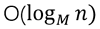

  - Least desirable time complexity: log(n)

- Command description

  Checks whether a polygon in a specified area contains a specified point, line, or plane.

- Output

  - If the operation is successful, the name and WKT information of the specified polygon that contains the specified point, line, or plane are returned. If you specify the WITHOUTWKT parameter, only the names of the polygons are returned.

  - If the area does not exist, nil is returned.

  - Otherwise, an error message is returned.

- Examples

  ```text
  127.0.0.1:6379> GIS.ADD hangzhou campus 'POLYGON ((30 10, 40 40, 20 40, 10 20, 30 10)
  )'
  (integer) 1
  127.0.0.1:6379> GIS.CONTAINS hangzhou 'POINT (30 11)'
  1) "0"
  2) 1) "campus"
     2) "POLYGON((30 10,40 40,20 40,10 20,30 10))"
  127.0.0.1:6379> GIS.CONTAINS hangzhou 'LINESTRING (30 10, 40 40)'
  1) "0"
  2) 1) "campus"
     2) "POLYGON((30 10,40 40,20 40,10 20,30 10))"
  127.0.0.1:6379> GIS.CONTAINS hangzhou 'POLYGON ((31 20, 29 20, 29 21, 31 31))'
  1) "0"
  2) 1) "campus"
     2) "POLYGON((30 10,40 40,20 40,10 20,30 10))"
  ```

**GIS.INTERSECTS**

- Syntax

  GIS.INTERSECTS &lt;area> &lt;polygonWkt>

- Time complexity

  - Optimal time complexity: 

  - Least desirable time complexity: log(n)

- Command description

  This command queries the intersection relationship between a polygon in a specified area and a specified point, line, or plane.

- Output

  - If the operation is successful, the name and WKT information of the specified polygon that intersects with the specified point, line, or plane are returned.

  - If the area does not exist, nil is returned.

  - Otherwise, an error message is returned.

- Examples

  ```text
  127.0.0.1:6379> GIS.ADD hangzhou campus 'POLYGON ((30 10, 40 40, 20 40, 10 20, 30 10)
  )'
  (integer) 1
  127.0.0.1:6379> GIS.INTERSECTS hangzhou 'POINT (30 11)'
  1) "0"
  2) 1) "campus"
     2) "POLYGON((30 10,40 40,20 40,10 20,30 10))"
  127.0.0.1:6379> GIS.INTERSECTS hangzhou 'LINESTRING (30 10, 40 40)'
  1) "0"
  2) 1) "campus"
     2) "POLYGON((30 10,40 40,20 40,10 20,30 10))"
  127.0.0.1:6379> GIS.INTERSECTS hangzhou 'POLYGON ((30 10, 40 40, 20 40, 10 20, 30 10)
  )'
  1) "0"
  2) 1) "campus"
     2) "POLYGON((30 10,40 40,20 40,10 20,30 10))"
  127.0.0.1:6379>
  ```

**GIS.SEARCH**

- Syntax

  ```text
  GIS.SEARCH [RADIUS longitude latitude distance m|km|ft|mi]
  [MEMBER field distance m|km|ft|mi]
  [GEOM geom]
  [COUNT count]
  [ASC|DESC]
  [WITHDIST]
  [WITHOUTWKT]
  ```

- Time complexity

  - Optimal time complexity: 

  - Least desirable time complexity: log(n)

- Command description

  Queries the points within a specific area that are located within a specific radius of a specific longitude and latitude position. Valid values:

  - RADIUS: searches points by the longitude, latitude, and radius. Specify the parameter values in the following order: longitude, latitude, radius, and radius unit. Example:  `RADIUS 15 37 200 km` .

  - MEMBER: searches points by the latitude and longitude from an existing polygon, and a specified radius. Specify the parameter values in the following order: polygon name, radius, and radius unit. Example:  `MEMBER Agrigento 100 km` .

  - GEOM: specifies the search range in the WKT format for a random polygon. Example:  `GIS.SEARCH Sicily "POINT (13.361389 38.115556)"` .

  - COUNT: the maximum number of entries that can be returned. Example:  `COUNT 3` .

  - ASC|DESC: sorts returned entries by distance. For example, ASC indicates that the entries are sorted from nearest to farthest from the center.

  - WITHDIST: specifies whether to return the distance.

  - WITHOUTWKT: specifies whether to return the WKT information of a polygon.

- Output

  - If the operation is successful, the name and WKT information of the specified polygon are returned.

  - If the area does not exist, nil is returned.

  - Otherwise, an error message is returned.

- Examples

  ```text
  127.0.0.1:6379> GIS.ADD Sicily "Palermo" "POINT (13.361389 38.115556)" "Catania" "POI
  NT(15.087269 37.502669)"
  (integer) 2
  127.0.0.1:6379> GIS.SEARCH Sicily RADIUS 15 37 200 km WITHDIST
  1) "2"
  2) 1) "Palermo"
     2) "POINT(13.361389 38.115556)"
     3) "190.4424"
     4) "Catania"
     5) "POINT(15.087269 37.502669)"
     6) "56.4413"
  127.0.0.1:6379> GIS.SEARCH Sicily RADIUS 15 37 200 km WITHDIST WITHOUTWKT
  1) "2"
  2) 1) "Palermo"
     2) "190.4424"
     3) "Catania"
     4) "56.4413"
  127.0.0.1:6379> GIS.SEARCH Sicily RADIUS 15 37 200 km WITHDIST WITHOUTWKT ASC
  1) "2"
  2) 1) "Catania"
     2) "56.4413"
     3) "Palermo"
     4) "190.4424"
  127.0.0.1:6379> GIS.SEARCH Sicily RADIUS 15 37 200 km WITHDIST WITHOUTWKT ASC COUNT 11) "2"
  2) 1) "Catania"
     2) "56.4413"
  127.0.0.1:6379> GIS.ADD Sicily "Agrigento" "POINT (13.583333 37.316667)"
  (integer) 1
  127.0.0.1:6379> GIS.SEARCH Sicily MEMBER Agrigento 100 km
  1) "2"
  2) 1) "Palermo"
     2) "POINT(13.361389 38.115556)"
     3) "Agrigento"
     4) "POINT(13.583333 37.316667)"
  ```

**GIS.WITHIN**

- Syntax

  ```text
  GIS.WITHIN <area> <polygonWkt> [WITHOUTWKT]
  ```

- Time complexity

  - Optimal time complexity: 

  - Least desirable time complexity: log(n)

- Command description

  This command retrieves points, lines, or planes within a specified polygon in an area. If you specify the WITHOUTWKT parameter, only the names of the polygons are returned.

- Output

  - If the operation is successful, the name and WKT information of the polygon are returned.

  - If no data is found, a value of null is returned.

  - Otherwise, an error message is returned.

- Examples

  ```text
  127.0.0.1:6379> GIS.ADD hangzhou campus 'POINT (30 10)'
  (integer) 1
  127.0.0.1:6379> GIS.ADD hangzhou campus1 'LINESTRING (30 10, 40 40)'
  (integer) 1
  127.0.0.1:6379> GIS.WITHIN hangzhou 'POLYGON ((30 10, 40 40, 20 40, 10 20, 30 10))'
  1) "2"
  2) 1) "campus"
     2) "POINT(30 10)"
     3) "campus1"
     4) "LINESTRING(30 10,40 40)"
  ```

<a id="section-4-6"></a>

## 4.6. TairBloom commands

This topic describes the commands that TairBloom data supports.

**TairBloom overview**

TairBloom is a dynamically scalable Bloom filter. First, it is a space-efficient probabilistic data structure that uses minimal memory to check for element existence. Second, it supports dynamic scaling while maintaining a stable false positive rate.

Traditional Redis data structures such as Hash, Set, and String Bitset can implement similar features. However, these implementations either consume excessive memory or cannot scale dynamically while keeping the false positive rate constant. Therefore, TairBloom is ideal for business scenarios that require efficient existence checks on large datasets and tolerate a certain false positive rate. Applications can directly use the Bloom filter interfaces that TairBloom provides without secondary encapsulation or local implementation of Bloom filter features.

Key features:

- Low memory usage.

- Dynamic scaling.

- Customizable false positive rate that remains constant during scaling.

**Prerequisites**

The commands described in this topic take effect only when the following conditions are met.

- The Redis instances are Performance-enhanced instances of KVStore for Redis Enhanced Edition (Tair).

- The operation targets TairBloom data in a performance-enhanced instance.

**Command list**

Table 1. TairBloom commands

| Command | Syntax | Description |
| --- | --- | --- |
| BF.RESERVE | BF.RESERVE &lt;key&gt; &lt;error_rate&gt; &lt;capacity&gt; | Create an empty TairBloom filter with the specified capacity and error rate. |
| BF.ADD | BF.ADD &lt;key&gt; &lt;item&gt; | Add an item to the TairBloom filter specified by the key. |
| BF.MADD | BF.MADD &lt;key&gt; &lt;item&gt; \[item...\] | Add multiple items to the TairBloom filter specified by the key at a time. |
| BF.EXISTS | BF.EXISTS &lt;key&gt; &lt;item&gt; | Check whether an item exists in the TairBloom filter specified by the key. |
| BF.MEXISTS | BF.MEXISTS &lt;key&gt; &lt;item&gt; \[item...\] | Check whether multiple items exist in the TairBloom filter specified by the key at a time. |
| BF.INSERT | BF.INSERT &lt;key&gt; \[CAPACITY cap\] \[ERROR error\] \[NOCREATE\] ITEMS &lt;item...&gt; | Add multiple items to the TairBloom filter specified by the key at a time. You can specify the capacity and error rate during addition and control whether the system automatically creates the TairBloom filter if it does not exist. |
| BF.DEBUG | BF.DEBUG &lt;key&gt; | View the internal information of the TairBloom filter specified by the key, such as the current number of layers, the number of items in each layer, and the error rate. |
| DEL | DEL &lt;key&gt; \[key ...\] | Use the native Redis DEL command to delete one or more TairBloom filters.<br>Note<br>You cannot delete individual items from a TairBloom filter. You can use the DEL command to delete the entire TairBloom filter. |

**BF.RESERVE**

- Syntax

  BF.RESERVE &lt;key> &lt;error_rate> &lt;capacity>

- Time complexity

  O(1)

- Command description

  Create an empty TairBloom filter with the specified capacity and error rate.

- Parameters and options

  | Parameter or option | Description |
  | --- | --- |
  | key | The key of the TairBloom filter. This key specifies the TairBloom filter that the command targets. |
  | error_rate | The expected false positive rate. This value must be between 0 and 1. A smaller value increases both the memory usage and the CPU utilization of the TairBloom filter. |
  | capacity | The initial capacity of the TairBloom filter. This value specifies the expected number of items to add to the TairBloom filter.<br>When the actual number of added items exceeds this value, the TairBloom filter scales out automatically. This process degrades performance. The performance degradation decreases linearly as the number of items grows exponentially, because the TairBloom filter scales out by adding more Bloom filter layers. Each additional layer may require queries to traverse multiple Bloom filter layers, and each layer has twice the capacity of the previous layer. Therefore, if your application is highly sensitive to performance, you must fully evaluate the number of items to add to the TairBloom filter before use to avoid scaling operations. |

- Return values

  - Success: OK.

  - Other cases: The system returns the corresponding error message.

**BF.ADD**

- Syntax

  BF.ADD &lt;key> &lt;item>

- Time complexity

  O(log N), where N is the number of layers in the TairBloom filter.

- Command description

  Add an item to the TairBloom filter specified by the key.

- Parameters and options

  | Parameter or option | Description |
  | --- | --- |
  | key | The key of the TairBloom filter. This key specifies the TairBloom filter that the command targets. |
  | item | The item to add to the TairBloom filter. |

- Return values

  - The item definitely does not exist: 1.

  - The item may already exist: 0.

  - Other cases: The system returns the corresponding error message.

**BF.MADD**

- Syntax

  BF.MADD &lt;key> &lt;item> [item...]

- Time complexity

  O(log N), where N is the number of layers in the TairBloom filter.

- Command description

  Add multiple items to the TairBloom filter specified by the key.

- Parameters and options

  | Parameter or option | Description |
  | --- | --- |
  | key | The key of the TairBloom filter. This key specifies the TairBloom filter that the command targets. |
  | item | The items to add to the TairBloom filter. You can specify multiple items. |

- Return values

  - Success: The system returns an array where each element is 1 or 0. An element value is 1 if the corresponding item definitely does not exist, and 0 if the item may already exist.

  - Other cases: The system returns the corresponding error message.

**BF.EXISTS**

- Syntax

  BF.EXISTS &lt;key> &lt;item>

- Time complexity

  O(log N), where N is the number of layers in the TairBloom filter.

- Command description Check whether an item exists in the TairBloom filter specified by the key.

- Parameters and options

  | Parameter or option | Description |
  | --- | --- |
  | key | The key of the TairBloom filter. This key specifies the TairBloom filter that the command targets. |
  | item | The item to query. |

- Return values

  - The item definitely does not exist: 0.

  - The item may exist: 1.

  - Other cases: The system returns the corresponding error message.

**BF.MEXISTS**

- Syntax

  BF.MEXISTS &lt;key> &lt;item> [item...]

- Time complexity

  O(log N), where N is the number of layers in the TairBloom filter.

- Command description

  Check whether multiple items exist in the TairBloom filter specified by the key.

- Parameters and options

  | Parameter or option | Description |
  | --- | --- |
  | key | The key of the TairBloom filter. This key specifies the TairBloom filter that the command targets. |
  | item | The items to query. You can specify multiple items. |

- Return values

  - Success: The system returns an array where each element in the array is 1 or 0. An element value is 1 if the corresponding item definitely does not exist, and 0 if the item may already exist.

  - Other cases: The system returns the corresponding error message.

**BF.INSERT**

- Syntax

  BF.INSERT &lt;key> [CAPACITY cap] [ERROR error] [NOCREATE] ITEMS &lt;item...>

- Time complexity

  O(log N), where N is the number of layers in the TairBloom filter.

- Command description

  Add multiple items to the TairBloom filter specified by the key in a single operation. You can specify the capacity and error rate, and control whether the system automatically creates the TairBloom filter if it does not exist.

- Parameters and options

  | Parameter or option | Description |
  | --- | --- |
  | key | The key of the TairBloom filter. This key specifies the TairBloom filter that the command targets. |
  | CAPACITY | The expected capacity of the TairBloom filter, which is the number of items that you expect to add. The system ignores this value if the TairBloom filter already exists.<br>When the actual number of added items exceeds this value, the TairBloom filter automatically expands. This expansion causes performance degradation. The degradation increases linearly as the number of items grows exponentially, because the TairBloom filter expands by adding layers to the Bloom filter. Each additional layer may require the system to traverse multiple Bloom filter layers during queries, and each layer has twice the capacity of the previous layer.Therefore, if your application is highly sensitive to performance, you must fully evaluate the number of items to add before use to avoid scaling operations. |
  | ERROR | The expected false positive rate. The system ignores this value if the TairBloom filter already exists. The value must be between 0 and 1. A smaller value increases the memory usage and CPU utilization of the TairBloom filter. |
  | NOCREATE | After setting this option, the system does not automatically create the TairBloom filter if it does not exist. You cannot set this parameter together with CAPACITY and ERROR. |
  | ITEMS | All items to add to the TairBloom filter. |

- Return values

  - Success: The system returns an array where each element in the array is 1 or 0. An element value is 1 if the corresponding item definitely does not exist, and 0 if the item may already exist.

  - Other cases: The system returns the corresponding error message.

**BF.DEBUG**

- Syntax

  BF.DEBUG &lt;key>

- Time complexity

  O(log N), where N is the number of layers in the TairBloom filter.

- Command description

  View the internal information of the TairBloom filter specified by the key, such as the current number of layers, the number of items in each layer, and the error rate.

- Parameters and options

  | Parameter or option | Description |
  | --- | --- |
  | key | The key of the TairBloom filter. This key specifies the TairBloom filter that the command targets. |

- Return values

  - Success: The system returns an array where. Each element in the array is 1 or 0. An element value is 1 if the corresponding item definitely does not exist, and 0 if the item may already exist.If an item definitely does not exist, the element value is 1. If an item may already exist, the element value is 0.

  - Other cases: The system returns the corresponding error message.

**Memory usage test results**

| Capacity (number of elements) | False positive: 0.01 | False positive: 0.001 | False positive: 0.0001 |
| --- | --- | --- | --- |
| 100000 | 0.12 MB | 0.25 MB | 0.25 MB |
| 1000000 | 2 MB | 2 MB | 4 MB |
| 10000000 | 16 MB | 32 MB | 32 MB |
| 100000000 | 128 MB | 256 MB | 256 MB |
| 1000000000 | 2 GB | 2 GB | 4 GB |

<a id="section-4-7"></a>

## 4.7. TairDoc commands

This topic describes the commands that TairDoc data supports.

**TairDoc overview**

TairDoc is a document data structure that supports the creation, deletion, modification, and querying of JSON data.

Key features:

- Fully support the JSON standard.

- Fully compatible with RedisJSON.

- Support both JSONPointer and JSONPath syntax.

- Store documents as binary trees to enable fast access to sub-elements of JSON data.

- Support conversion from JSON to XML or YAML format.

**Prerequisites**

Note that the commands described in this topic take effect only when the following conditions are met.

- The Redis instances are Performance-enhanced instances of KVStore for Redis Enhanced Edition (Tair).

- The operation targets TairDoc data in an enhanced performance edition instance.

**Command list**

Table 1. TairDoc commands

| Command | Syntax | Description |
| --- | --- | --- |
| JSON.SET | JSON.SET &lt;key&gt; &lt;path&gt; &lt;json&gt; \[NX or XX\] | Store a JSON value at the specified path of a key.For a key that does not exist, the path must be root. For an existing key, if the path exists, this command replaces the current JSON value. |
| JSON.GET | JSON.GET &lt;key&gt; \[PATH\] \[FORMAT &lt;XML/YAML&gt;\] \[ROOTNAME &lt;root&gt;\] \[ARRNAME &lt;arr&gt;\] | Retrieve the JSON data stored at the specified path of a TairDoc key. |
| JSON.DEL | JSON.DEL &lt;key&gt; \[path\] | Delete the JSON data at the specified path. If no path is specified, this command deletes the key.The command ignores non-existent keys and non-existent paths. |
| JSON.TYPE | JSON.TYPE &lt;key&gt; \[path\] | Retrieve the type of the value at the specified path. |
| JSON.NUMINC RBY | JSON.NUMINCRBY &lt;key&gt; \[path\] &lt;value&gt; | Increment the value at the specified path by a specified value. The path must exist, and both the value at the path and the increment value must be of the int or double type. |
| JSON.STRAPP END | JSON.STRAPPEND &lt;key&gt; \[path\] &lt;json-string&gt; | Append the string in json-string to the string value at the specified path. If no path is specified, the default path is root. |
| JSON.STRLEN | JSON.STRLEN &lt;key&gt; \[path\] | Retrieve the length of the value at the specified path. If no path is specified, the default path is root. |
| JSON.ARRAPP END | JSON.ARRAPPEND &lt;key&gt; &lt;path&gt; &lt;json&gt; \[&lt;json&gt; ...\] | Append one or more JSON values to the end of the array at the specified path. |
| JSON.ARRPOP | JSON.ARRPOP &lt;key&gt; &lt;path&gt; \[index\] | Remove and return the element at the specified index in the array at the given path. |
| JSON.ARRINS ERT | JSON.ARRINSERT &lt;key&gt; &lt;path&gt; &lt;index&gt; &lt;json&gt; \[&lt;json&gt; ...\] | Insert one or more JSON values into the array at the specified path, shifting existing elements to higher indices. |
| JSON.ARRLEN | JSON.ARRLEN &lt;key&gt; \[path\] | Retrieve the length of the array at the specified path. |
| JSON.ARRTRI M | JSON.ARRTRIM &lt;key&gt; &lt;path&gt; &lt;start&gt; &lt;stop&gt; | Trim the array to the range specified by start and stop. |
| DEL | DEL &lt;key&gt; \[key ...\] | Use the native Redis DEL command to delete one or more TairDoc keys. |

**JSON.SET**

- Syntax

  JSON.SET &lt;key> &lt;path> &lt;json> [NX | XX]

- Time complexity

  O(N)

- Command description

  This command stores a JSON value at the specified path of a key. If the key does not exist, the path must be root. If the key exists and the path exists, this command replaces the current JSON value.

- Parameters and options

  | Parameter or option | Description |
  | --- | --- |
  | key | The key of the TairDoc. This parameter specifies the TairDoc that the command targets. |
  | path | The path of the TairDoc.<br>• If the key does not exist, the path must be root.<br>• If the key exists and the path exists, the command replaces the current JSON value. |
  | json | If the key exists and the path exists, the command replaces the current JSON data in the TairDoc with the specified JSON value. |
  | NX | The command writes the value only if the path does not exist. |
  | XX | The command writes the value only if the path exists. |

- Return values

  - Success: OK.

  - Failure when NX or XX is specified: null.

  - Other cases: The command returns the corresponding error message.

- Examples

  ```text
  127.0.0.1:6379> JSON.SET doc . '{"foo": "bar", "baz" : 42}'
  OK
  127.0.0.1:6379> JSON.SET doc .foo '"flower"'
  OK
  127.0.0.1:6379> JSON.GET doc .foo
  "flower"
  127.0.0.1:6379> JSON.SET doc .not-exists 123 XX

  127.0.0.1:6379> JSON.SET doc .not-exists 123 NX
  OK
  127.0.0.1:6379> JSON.GET doc .not-exists
  123
  ```

**JSON.GET**

- Syntax

  JSON.GET &lt;key> &lt;path> [FORMAT &lt;XML | YAML>] [ROOTNAME &lt;root>] [ARRNAME &lt;arr>]

- Time complexity

  O(N)

- Command description

  This command retrieves the JSON data stored at the specified path of a TairDoc.

- Parameters and options

  | Parameter or option | Description |
  | --- | --- |
  | key | The key of the TairDoc. This parameter specifies the TairDoc that the command targets. |
  | path | The path of the TairDoc. |
  | FORMAT | The format of the returned JSON data. Valid values: XML and YAML. |
  | ROOTNAME | The tag name of the root element in the XML syntax. |
  | ARRNAME | The tag name of the array element in the XML syntax. |

- Return values

  - Success: The command returns the JSON data stored at the specified path.

  - Other cases: The command returns the corresponding error message.

- Examples

  ```xml
  127.0.0.1:6379> JSON.SET doc . '{"foo": "bar", "baz" : 42}'
  OK
  127.0.0.1:6379> JSON.GET doc
  {"foo":"bar","baz":42}
  127.0.0.1:6379> JSON.GET doc .foo
  "bar"
  127.0.0.1:6379> JSON.GET doc .not-exists
  ERR pointer illegal or array index error or object type is not array or map

  127.0.0.1:6379> JSON.GET doc . format xml
  <?xml version="1.0" encoding="UTF-8"?><root><foo>bar</foo><baz>42</baz></root>
  127.0.0.1:6379> JSON.GET doc . format xml rootname ROOT arrname ARRAY
  <?xml version="1.0" encoding="UTF-8"?><ROOT><foo>bar</foo><baz>42</baz></ROOT>
  127.0.0.1:6379> JSON.GET doc . format yaml

  foo: bar
  baz: 42
  ```

**JSON.DEL**

- Syntax

  JSON.DEL &lt;key> [path]

- Time complexity

  O(N)

- Command description

  This command deletes the JSON data at the specified path. If you do not specify a path, the command deletes the key. The command ignores nonexistent keys and paths.

- Parameters and options

  | Parameter or option | Description |
  | --- | --- |
  | key | The key of the TairDoc. This parameter specifies the TairDoc that the command targets. |
  | path | The path of the TairDoc. |

- Return values

  - Success: 1.

  - Failure: 0.

  - Other cases: The command returns the corresponding error message.

- Examples

  ```text
  127.0.0.1:6379> JSON.SET doc . '{"foo": "bar", "baz" : 42}'
  OK
  127.0.0.1:6379> JSON.DEL doc .foo
  1
  127.0.0.1:6379> JSON.DEL doc .not-exists
  ERR old item is null for remove or replace

  127.0.0.1:6379> JSON.DEL not-exists
  0
  127.0.0.1:6379> JSON.GET doc
  {"baz":42}
  127.0.0.1:6379> JSON.DEL doc
  1
  127.0.0.1:6379> JSON.GET doc

  127.0.0.1:6379>
  ```

**JSON.TYPE**

- Syntax

  JSON.TYPE &lt;key> [path]

- Time complexity

  O(N)

- Command description

  This command returns the type of the value at the specified path.

- Parameters and options

  | Parameter or option | Description |
  | --- | --- |
  | key | The key of the TairDoc. This parameter specifies the TairDoc that the command targets. |
  | path | The path of the TairDoc. |

- Return values

  - Success: The command returns the queried type. Possible results include "boolean", "null", "number", "string", "array", "object", "raw", "reference", and "const".

  - Nonexistent key or path: null.

  - Other cases: The command returns the corresponding error message.

- Examples

  ```text
  127.0.0.1:6379> JSON.SET doc . '{"foo": "bar", "baz" : 42}'
  OK
  127.0.0.1:6379> JSON.TYPE doc
  object
  127.0.0.1:6379> JSON.TYPE doc .foo
  string
  127.0.0.1:6379> JSON.TYPE doc .baz
  number
  127.0.0.1:6379> JSON.TYPE doc .not-exists

  127.0.0.1:6379>
  ```

**JSON.NUMINCRBY**

- Syntax

  JSON.NUMINCRBY &lt;key> [path] &lt;value>

- Time complexity

  O(N)

- Command description

  This command increments the value at the specified path by a specified value. The path must exist, and both the value at the path and the specified value must be of the int or double type.

- Parameters and options

  | Parameter or option | Description |
  | --- | --- |
  | key | The key of the TairDoc. This parameter specifies the TairDoc that the command targets. |
  | path | The path of the TairDoc. |
  | value | The numeric value to add to the value at the path. |

- Return values

  - Success: The command returns the updated value at the path.

  - Other cases: The command returns the corresponding error message.

- Examples

  ```text
  127.0.0.1:6379> JSON.SET doc . '{"foo": "bar", "baz" : 42}'
  OK
  127.0.0.1:6379> JSON.NUMINCRBY doc .baz 1
  43
  127.0.0.1:6379> JSON.NUMINCRBY doc .baz 1.5
  44.5
  127.0.0.1:6379> JSON.NUMINCRBY doc .foo 1
  ERR node not exists or not number type

  127.0.0.1:6379> JSON.NUMINCRBY doc .not-exists 1
  ERR node not exists or not number type

  127.0.0.1:6379>
  ```

**JSON.STRAPPEND**

- Syntax

  JSON.STRAPPEND &lt;key> [path] &lt;json-string>

- Time complexity

  O(N)

- Command description

  This command appends the specified json-string to the string value at the path. If you do not specify a path, the command uses the root path by default.

- Parameters and options

  | Parameter or option | Description |
  | --- | --- |
  | key | The key of the TairDoc. This parameter specifies the TairDoc that the command targets. |
  | path | The path of the TairDoc. |
  | json-string | The string to append to the value at the path. |

- Return values

  - Success: The command returns the length of the updated string at the path.

  - The key does not exist: -1.

  - Other cases: The command returns the corresponding error message.

- Examples

  ```text
  127.0.0.1:6379> JSON.SET doc . '{"foo": "bar", "baz" : 42}'
  OK
  127.0.0.1:6379> JSON.STRAPPEND doc .foo rrrrr
  8
  127.0.0.1:6379> JSON.GET doc .foo
  "barrrrrr"
  127.0.0.1:6379> JSON.STRAPPEND doc .not-exists
  ERR node not exists or not string type

  127.0.0.1:6379> JSON.STRAPPEND not-exists abc
  -1
  ```

**JSON.STRLEN**

- Syntax

  JSON.STRLEN &lt;key> [path]

- Time complexity

  O(N)

- Command description

  This command returns the length of the value at the path. If you do not specify a path, the command uses the root path by default.

- Parameters and options

  | Parameter or option | Description |
  | --- | --- |
  | key | The key of the TairDoc. This parameter specifies the TairDoc that the command targets. |
  | path | The path of the TairDoc. |

- Return values

  - Success: The command returns the length of the value at the path.

  - The key does not exist: -1.

  - Other cases: The command returns the corresponding error message.

- Examples

  ```text
  127.0.0.1:6379> JSON.SET doc . '{"foo": "bar", "baz" : 42}'
  OK
  127.0.0.1:6379> JSON.STRLEN doc .foo
  3
  127.0.0.1:6379> JSON.STRLEN doc .baz
  ERR node not exists or not string type

  127.0.0.1:6379> JSON.STRLEN not-exists
  -1
  ```

**JSON.ARRAPPEND**

- Syntax

  JSON.ARRAPPEND &lt;key> &lt;path> &lt;json> [&lt;json> ...]

- Time complexity

  O(M\*N), where M is the number of JSON elements to insert and N is the number of elements in the array.

- Command description

  This command appends one or more JSON values to the end of the array at the specified path.

- Parameters and options

  | Parameter or option | Description |
  | --- | --- |
  | key | The key of the TairDoc. This parameter specifies the TairDoc that the command targets. |
  | path | The path of the TairDoc. |
  | json | The data to insert. |

- Return values

  - Success: The command returns the number of elements in the array after the operation.

  - The key does not exist: -1.

  - Other cases: The command returns the corresponding error message.

- Examples

  ```text
  127.0.0.1:6379> JSON.SET doc . '{"id": [1,2,3]}'
  OK
  127.0.0.1:6379> JSON.GET doc .id
  [1,2,3]
  127.0.0.1:6379> JSON.ARRAPPEND doc .id null false true
  6
  127.0.0.1:6379> JSON.GET doc .id
  [1,2,3,null,false,true]
  127.0.0.1:6379> JSON.GET doc .id.2
  3
  127.0.0.1:6379> JSON.ARRAPPEND not-exists .a 1
  -1
  ```

**JSON.ARRPOP**

- Syntax

  JSON.ARRPOP &lt;key> &lt;path> [index]

- Time complexity O(M\*N), where M is the number of child elements in the key and N is the number of elements in the array.

- Command description

  This command removes and returns the element at the specified index in the array at the specified path.

- Parameters and options

  | Parameter or option | Description |
  | --- | --- |
  | key | The key of the TairDoc. This parameter specifies the TairDoc that the command targets. |
  | path | The path of the TairDoc. |
  | index | The index of the array. If you do not specify this parameter, the command uses the last element by default. A negative value indicates reverse indexing. |

- Return values

  - Success: The command returns the corresponding node of the array.

  - The array is empty: 'ERR array index outflow'.

  - Other cases: The command returns the corresponding error message.

- Examples

  ```text
  127.0.0.1:6379> JSON.SET doc . '{"id": [1,2,3]}'
  OK
  127.0.0.1:6379> JSON.ARRPOP doc .id 1
  2
  127.0.0.1:6379> JSON.GET doc .id
  [1,3]
  127.0.0.1:6379> JSON.ARRPOP doc .id -1
  3
  127.0.0.1:6379> JSON.GET doc .id
  [1]
  127.0.0.1:6379> JSON.ARRPOP doc .id 10
  ERR array index outflow

  127.0.0.1:6379> JSON.ARRPOP doc .id
  1
  127.0.0.1:6379> JSON.ARRPOP doc .id
  ERR array index outflow

  127.0.0.1:6379>
  ```

**JSON.ARRINSERT**

- Syntax

  JSON.ARRINSERT &lt;key> &lt;path> &lt;index> &lt;json> [&lt;json> ...]

- Time complexity

  O(M\*N), where M is the number of elements (json) to insert and N is the number of elements in the array.

- Command description

  This command inserts JSON values into the array at the specified path and shifts the existing elements backward.

- Parameters and options

  | Parameter or option | Description |
  | --- | --- |
  | key | The key of the TairDoc. This parameter specifies the TairDoc that the command targets. |
  | path | The path of the TairDoc. |
  | index | The index of the array. If you do not specify this parameter, the command uses the last element by default. A negative value indicates reverse indexing. |
  | json | The data to insert. |

- Return values

  - Success: The command returns the number of elements in the array after the operation.

  - The array is empty: 'ERR array index outflow'.

  - Other cases: The command returns the corresponding error message.

- Examples

  ```text
  127.0.0.1:6379> JSON.SET doc . '{"id": [2,3,5]}'
  OK
  127.0.0.1:6379> JSON.ARRINSERT doc .id 0 0 1
  5
  127.0.0.1:6379> JSON.GET doc .id
  [0,1,2,3,5]
  127.0.0.1:6379> JSON.ARRINSERT doc .id 4 4
  6
  127.0.0.1:6379> JSON.GET doc .id
  [0,1,2,3,4,5]
  127.0.0.1:6379>
  ```

**JSON.ARRLEN**

- Syntax

  JSON.ARRLEN &lt;key> [path]

- Time complexity

  O(N)

- Command description This command returns the length of the array at the specified path.

- Parameters and options

  | Parameter or option | Description |
  | --- | --- |
  | key | The key of the TairDoc. This parameter specifies the TairDoc that the command targets. |
  | path | The path of the TairDoc. |

- Return values

  - Success: The length of the array.

  - The key does not exist: -1.

  - Other cases: The command returns the corresponding error message.

- Examples

  ```text
  127.0.0.1:6379> JSON.SET doc . '{"id": [2,3,5]}'
  OK
  127.0.0.1:6379> JSON.ARRLEN doc .id
  3
  127.0.0.1:6379> JSON.ARRLEN not-exists
  -1
  ```

**JSON.ARRTRIM**

- Syntax

  JSON.ARRTRIM &lt;key> &lt;path> &lt;start> &lt;stop>

- Time complexity

  O(N)

- Command description

  This command trims an array to the range specified by start and stop.

- Parameters and options

  | Parameter or option | Description |
  | --- | --- |
  | key | The key of the TairDoc. This parameter specifies the TairDoc that the command targets. |
  | path | The path of the TairDoc. |
  | start | The start position of the trim. The value is a zero-based index, and the trimmed array includes the element at this position. |
  | stop | The stop position of the trim. The value is a zero-based index, and the trimmed array includes the element at this position. |

- Return values

  - Success: The length of the array after the operation.

  - The key does not exist: -1.

  - Other cases: The command returns the corresponding error message.

- Examples

  ```text
  127.0.0.1:6379> JSON.SET doc . '{"id": [1,2,3,4,5,6]}'
  OK
  127.0.0.1:6379> JSON.ARRTRIM doc .id 3 4
  2
  127.0.0.1:6379> JSON.GET doc .id
  [4,5]
  127.0.0.1:6379> JSON.ARRTRIM doc .id 3 4
  ERR array index outflow

  127.0.0.1:6379> JSON.ARRTRIM doc .id -2 -5
  ERR array index outflow

  127.0.0.1:6379>
  ```

**JSONPointer and JSONPath**

TairDoc supports a subset of JSONPath syntax in addition to JSONPointer. The following examples illustrate this support:

| JSONPointer | JSONPath |
| --- | --- |
| <code>127.0.0.1:6379&gt; JSON.SET doc .</code><br><code>'{"foo": "bar", "baz" : [1,2,3]}'</code><br><code>OK</code><br><code>127.0.0.1:6379&gt; JSON.GET doc .foo</code><br><code>"bar"</code><br><code>127.0.0.1:6379&gt; JSON.GET doc .baz[0]</code><br><code>1</code> | <code>127.0.0.1:6379&gt; JSON.SET doc ""</code><br><code>'{"foo": "bar", "baz" : [1,2,3]}'</code><br><code>OK</code><br><code>127.0.0.1:6379&gt; JSON.GET doc /foo</code><br><code>"bar"</code><br><code>127.0.0.1:6379&gt; JSON.GET doc /baz/0</code><br><code>1</code> |

The following table describes the compatibility details.

<table>
  <tr>
    <th>Compatibility item</th>
    <th>JSONPath</th>
    <th>JSONPointer</th>
  </tr>
  <tr>
    <td>Root element</td>
    <td>.</td>
    <td>""</td>
  </tr>
  <tr>
    <td>Element retrieval</td>
    <td>.a.b.c</td>
    <td>/a/b/c</td>
  </tr>
  <tr>
    <td>Array</td>
    <td>.a[2]</td>
    <td>/a/2</td>
  </tr>
  <tr>
    <td rowspan="2">Full retrieval</td>
    <td>.a["b.c"]</td>
    <td>/a/b.c</td>
  </tr>
  <tr>
    <td>.a['b.c']</td>
    <td>/a/b.c</td>
  </tr>
</table>

<a id="section-5"></a>

# 5.Instance types

Tair (Redis OSS-compatible) provides Redis Open-Source Edition instances and Tair (Enterprise Edition) performance-enhanced instances. Redis Open-Source Edition instances support the standard, cluster, and read/write splitting architectures. Tair (Enterprise Edition) instances support the standard and cluster architectures. This topic describes the specifications of different instance types, such as memory capacity, maximum number of connections, and maximum bandwidth value.

**Comparison between general-purpose and dedicated specifications**

| Specificatio n type | Features | Scenarios |
| --- | --- | --- |
| Dedicated specifications | • Each cluster of a dedicated specification exclusively uses its allocated computing resources, such as CPU.<br>• It does not share computing resources with other clusters on the same server.This ensures more stable and reliable performance. | Scenarios that require high performance stability and use databases as the core system, such as finance, e-commerce, government affairs, and medium-to-large Internet businesses. |
| General-purpose specifications | • Different clusters on the same server share and use idle computing resources, such as CPU.<br>• Reusing computing resources provides economies of scale and is more cost-effective. | Scenarios where cost reduction and high cost-effectiveness are priorities. |

**Bandwidth description**

- If network resources are sufficient, the bandwidth of a Tair (Redis OSS-compatible) instance is unlimited. However, if network resources are insufficient, the bandwidth is limited.

- The maximum total bandwidth for a cluster instance is 2,048 MB/s. The bandwidth does not increase beyond this limit, even if you select an instance type with more shards. We recommend that the total bandwidth does not exceed 25 Gbps.

- The bandwidth value applies to the upstream and downstream bandwidths. For example, if the bandwidth of an instance is 10 MB/s, the upstream and downstream bandwidths of the instance are both 10 MB/s.

- The bandwidth values in the following tables are the internal bandwidths of the Tair (Redis OSS-compatible) instances of different editions. The Internet bandwidth is determined by the internal bandwidth and is limited by the bandwidth of the connection between a Tair (Redis OSS-compatible) instance and the client. We recommend that you connect to the instance over an internal network to maximize performance.

**Cloud-native Edition**

The following tables list the specifications for a single shard. The total capacity of an instance is calculated using the following formula: Shard Specification × Number of Shards. The number of shards can range from 2 to 128.

**Shard specifications for the standard architecture and the direct connection mode of the cluster architecture**

| Specificat ion name | Specificat ion code (for API use) | CPU cores | Memory (GB) | Enterpris e SSD (GB) | Bandwidt h | Maximu m connecti ons | Referenc e QPS |
| --- | --- | --- | --- | --- | --- | --- | --- |
| 1 GB | tair.rdb.1 g | 10 | 1 | 5 | 768 Mbps (96 MB/s) | 30,000 | 300,000 |
| 2 GB | tair.rdb.2 g | 10 | 2 | 10 | 768 Mbps (96 MB/s) | 30,000 | 300,000 |
| 4 GB | tair.rdb.4 g | 10 | 4 | 20 | 768 Mbps (96 MB/s) | 40,000 | 300,000 |
| 8 GB | tair.rdb.8 g | 10 | 8 | 40 | 768 Mbps (96 MB/s) | 40,000 | 300,000 |
| 16 GB | tair.rdb.1 6g | 10 | 16 | 80 | 768 Mbps (96 MB/s) | 40,000 | 300,000 |
| 24 GB | tair.rdb.2 4g | 10 | 24 | 120 | 768 Mbps (96 MB/s) | 50,000 | 300,000 |
| 32 GB | tair.rdb.3 2g | 10 | 32 | 160 | 768 Mbps (96 MB/s) | 50,000 | 300,000 |
| 64 GB | tair.rdb.6 4g | 10 | 64 | 320 | 768 Mbps (96 MB/s) | 50,000 | 300,000 |

**Shard specifications for the proxy mode of the cluster architecture and the read/write splitting architecture**

| Specificat ion name | Specificat ion code (for API use) | CPU cores | Memory (GB) | Enterpris e SSD (GB) | Bandwidt h | Maximu m connecti ons | Referenc e QPS |
| --- | --- | --- | --- | --- | --- | --- | --- |
| 1 GB | tair.rdb.w ith.proxy.1g | 11 | 1 | 5 | 768 Mbps (96 MB/s) | 30,000 | 300,000 |
| 2 GB | tair.rdb.w ith.proxy.2g | 11 | 2 | 10 | 768 Mbps (96 MB/s) | 30,000 | 300,000 |
| 4 GB | tair.rdb.w ith.proxy.4g | 11 | 4 | 20 | 768 Mbps (96 MB/s) | 40,000 | 300,000 |
| 8 GB | tair.rdb.w ith.proxy.8g | 11 | 8 | 40 | 768 Mbps (96 MB/s) | 40,000 | 300,000 |
| 16 GB | tair.rdb.w ith.proxy.16g | 11 | 16 | 80 | 768 Mbps (96 MB/s) | 40,000 | 300,000 |
| 24 GB | tair.rdb.w ith.proxy.24g | 11 | 24 | 120 | 768 Mbps (96 MB/s) | 50,000 | 300,000 |
| 32 GB | tair.rdb.w ith.proxy.32g | 11 | 32 | 160 | 768 Mbps (96 MB/s) | 50,000 | 300,000 |
| 64 GB | tair.rdb.w ith.proxy.64g | 11 | 64 | 320 | 768 Mbps (96 MB/s) | 50,000 | 300,000 |

**Classic Edition**

**Enterprise Edition (performance-enhanced)**

Table 1. Standard master-replica instances

| Specifications | InstanceClass value (used in API operations) | I/O threads | Maximum connectio ns | Total bandwidt h (MB/s) |
| --- | --- | --- | --- | --- |
| 256 MB master-replica performance-enhanced instance | redis.amber.master.micro.multith read | 6 | 30,000 | 10 |
| 512 MB Master-replica performance-enhanced instance | redis.amber.master.2xmicro.mult ithread | 6 | 30,000 | 10 |
| 1 GB master-replica performance-enhanced instance | redis.amber.master.small.multith read | 6 | 30,000 | 96 |
| 2 GB master-replica performance-enhanced instance | redis.amber.master.mid.multithre ad | 6 | 30,000 | 96 |
| 4 GB master-replica performance-enhanced instance | redis.amber.master.stand.multith read | 6 | 30,000 | 96 |
| 8 GB master-replica performance-enhanced instance | redis.amber.master.large.multithr ead | 6 | 30,000 | 96 |
| 16 GB master-replica performance-enhanced instance | redis.amber.master.2xlarge.multi thread | 6 | 30,000 | 96 |
| 32 GB master-replica performance-enhanced instance | redis.amber.master.4xlarge.multi thread | 6 | 30,000 | 96 |
| 64 GB master-replica performance-enhanced instance | redis.amber.master.8xlarge.multi thread | 6 | 30,000 | 96 |

Table 2. Cluster instances

| Specifications | InstanceClass value (used in API operations) | I/O threa ds | Shar ds | Maxi mum conn ectio ns | Band widt h per shar d | Total band widt h (MB/s) |
| --- | --- | --- | --- | --- | --- | --- |
| 2 GB cluster performance-enhanced instance (2 shards) | redis.amber.logic.shardin g.1g.2db.0rodb.6proxy.m ultithread | 6 | 2 | 50,00 0 | 96 | 192 |
| 4 GB cluster performance-enhanced instance (2 shards) | redis.amber.logic.shardin g.2g.2db.0rodb.6proxy.m ultithread | 6 | 2 | 50,00 0 | 96 | 192 |
| 8 GB cluster performance-enhanced instance (4 shards) | redis.amber.logic.shardin g.2g.4db.0rodb.12proxy.multithread | 6 | 4 | 120,0 00 | 96 | 384 |
| 16 GB cluster performance-enhanced instance (8 shards) | redis.amber.logic.shardin g.2g.8db.0rodb.24proxy.multithread | 6 | 8 | 240,0 00 | 96 | 768 |
| 32 GB cluster performance-enhanced instance (8 shards) | redis.amber.logic.shardin g.4g.8db.0rodb.24proxy.multithread | 6 | 8 | 240,0 00 | 96 | 768 |
| 64 GB cluster performance-enhanced instance (8 shards) | redis.amber.logic.shardin g.8g.8db.0rodb.24proxy.multithread | 6 | 8 | 240,0 00 | 96 | 768 |
| 32 GB cluster performance-enhanced instance (16 shards) | redis.amber.logic.shardin g.2g.16db.0rodb.48proxy.multithread | 6 | 16 | 480,0 00 | 96 | 1,536 |
| 64 GB cluster performance-enhanced instance (16 shards) | redis.amber.logic.shardin g.4g.16db.0rodb.48proxy.multithread | 6 | 16 | 480,0 00 | 96 | 1,536 |
| 128 GB cluster performance-enhanced instance (16 shards) | redis.amber.logic.shardin g.8g.16db.0rodb.48proxy.multithread | 6 | 16 | 480,0 00 | 96 | 1,536 |
| 256 GB cluster performance-enhanced instance (16 shards) | redis.amber.logic.shardin g.16g.16db.0rodb.48prox y.multithread | 6 | 16 | 480,0 00 | 96 | 1,536 |
| 512 GB cluster performance-enhanced instance (32 shards) | redis.amber.logic.shardin g.16g.32db.0rodb.96prox y.multithread | 6 | 32 | 500,0 00 | 96 | 2,048 |
| 1,024 GB cluster performance-enhanced instance (64 shards) | redis.amber.logic.shardin g.16g.64db.0rodb.192pro xy.multithread | 6 | 64 | 500,0 00 | 96 | 2,048 |
| 2,048 GB cluster performance-enhanced instance (128 shards) | redis.amber.logic.shardin g.16g.128db.0rodb.384pr oxy.multithread | 6 | 128 | 500,0 00 | 96 | 2,048 |
| 4,096 GB cluster performance-enhanced instance (256 shards) | redis.amber.logic.shardin g.16g.256db.0rodb.768pr oxy.multithread | 6 | 256 | 500,0 00 | 96 | 2,048 |
| 8,192 GB cluster performance-enhanced instance (256 shards) | redis.amber.logic.shardin g.32g.256db.0rodb.768pr oxy.multithread | 6 | 256 | 500,0 00 | 96 | 2,048 |

**Community Edition**

Table 3. Standard master-replica instances

| Specification s | InstanceClass value (used in API operations) | Maximum connections | Total bandwidth (MB/s) | Processing capacity |
| --- | --- | --- | --- | --- |
| 256 MB master-replica instance | redis.master.micro.default | 10,000 | 10 | 1 core |
| 512 MB master-replica instance | redis.master.2xmicro.defa ult | 10,000 | 10 | 1 core |
| 1GB master-replica instance | redis.master.small.default | 10,000 | 10 | 1 core |
| 2 GB master-replica instance | redis.master.mid.default | 10,000 | 16 | 1 core |
| 4 GB master-replica instance | redis.master.stand.default | 10,000 | 24 | 1 core |
| 8 GB master-replica instance | redis.master.large.default | 10,000 | 24 | 1 core |
| 16 GB master-replica instance | redis.master.2xlarge.defa ult | 10,000 | 32 | 1 core |
| 32 GB master-replica instance | redis.master.4xlarge.defa ult | 10,000 | 32 | 1 core |
| 64 GB master-replica instance | redis.master.8xlarge.defa ult | 10,000 | 48 | 1 core |

Table 4. Cluster instances

| Specification s | InstanceClass value (used in API operations) | Shar ds | Maximu m connect ions | Total bandwi dth (MB/s) | Process ing capacit y |
| --- | --- | --- | --- | --- | --- |
| 16 GB cluster instance | redis.logic.sharding.2g.8db.0rodb.8pr oxy.default | 8 | 80,000 | 768 | 8 cores |
| 32 GB cluster instance | redis.logic.sharding.4g.8db.0rodb.8pr oxy.default | 8 | 80,000 | 768 | 8 cores |
| 64 GB cluster instance | redis.logic.sharding.8g.8db.0rodb.8pr oxy.default | 8 | 80,000 | 768 | 8 cores |
| 128 GB cluster instance | redis.logic.sharding.8g.16db.0rodb.16 proxy.default | 16 | 160,000 | 1,536 | 16 cores |
| 256 GB cluster instance | redis.logic.sharding.16g.16db.0rodb.1 6proxy.default | 16 | 160,000 | 1,536 | 16 cores |
| 512 GB cluster instance | redis.logic.sharding.16g.32db.0rodb.3 2proxy.default | 32 | 320,000 | 2,048 | 32 cores |
| 1 TB cluster instance | redis.logic.sharding.16g.64db.0rodb.6 4proxy.default | 64 | 500,000 | 2,048 | 64 cores |
| 2 TB cluster instance | redis.logic.sharding.16g.128db.0rodb.128proxy.default | 128 | 500,000 | 2,048 | 128 cores |
| 4 TB cluster instance | redis.logic.sharding.16g.256db.0rodb.256proxy.default | 256 | 500,000 | 2,048 | 256 cores |

Table 5. Read/write splitting instances

| Specifications | InstanceClass value (used in API operations) | Read replic as | Maximu m connecti ons | Total band width | QPS |
| --- | --- | --- | --- | --- | --- |
| 1 GB read/write splitting instance (1 shard and 1 read replica) | redis.logic.splitrw.small.1db.1rodb.4proxy.defau lt | 1 | 20,000 | 96 | 200,000 |
| 2 GB read/write splitting instance (1 shard and 1 read replica) | redis.logic.splitrw.mid.1 db.1rodb.4proxy.default | 1 | 20,000 | 192 | 200,000 |
| 4 GB Read-Write Splitting Edition (1 node, 1 read-only node) | redis.logic.splitrw.stand.1db.1rodb.4proxy.defau lt | 1 | 20,000 | 192 | 200,000 |
| 8 GB read/write splitting instance (1 shard and 1 read replica) | redis.logic.splitrw.large.1db.1rodb.4proxy.defau lt | 1 | 20,000 | 192 | 200,000 |
| 16 GB read/write splitting instance (1 shard and 1 read replica) | redis.logic.splitrw.2xlar ge.1db.1rodb.4proxy.de fault | 1 | 20,000 | 192 | 200,000 |
| 32 GB read/write splitting instance (1 shard and 1 read replica) | redis.logic.splitrw.4xlar ge.1db.1rodb.4proxy.de fault | 1 | 20,000 | 192 | 200,000 |
| 64 GB read/write splitting instance (1 shard and 1 read replica) | redis.logic.splitrw.8xlar ge.1db.1rodb.4proxy.de fault | 1 | 20,000 | 192 | 200,000 |
| 1 GB read/write splitting instance (1 shard and 3 read replicas) | redis.logic.splitrw.small.1db.3rodb.4proxy.defau lt | 3 | 40,000 | 192 | 400,000 |
| 2 GB read/write splitting instance (1 shard and 3 read replicas) | redis.logic.splitrw.mid.1 db.3rodb.4proxy.default | 3 | 40,000 | 384 | 400,000 |
| 4 GB Read/Write Splitting Edition (1 primary node and 3 read-only nodes) | redis.logic.splitrw.stand.1db.3rodb.4proxy.defau lt | 3 | 40,000 | 384 | 400,000 |
| 8 GB read/write splitting instance (1 shard and 3 read replicas) | redis.logic.splitrw.large.1db.3rodb.4proxy.defau lt | 3 | 40,000 | 384 | 400,000 |
| 16 GB read/write splitting instance (1 shard and 3 read replicas) | redis.logic.splitrw.2xlar ge.1db.3rodb.4proxy.de fault | 3 | 40,000 | 384 | 400,000 |
| 32 GB read/write splitting instance (1 shard and 3 read replicas) | redis.logic.splitrw.4xlar ge.1db.3rodb.4proxy.de fault | 3 | 40,000 | 384 | 400,000 |
| 64 GB read/write splitting instance (1 shard and 3 read replicas) | redis.logic.splitrw.8xlar ge.1db.3rodb.4proxy.de fault | 3 | 40,000 | 384 | 400,000 |
| 1 GB read/write splitting instance (1 shard and 5 read replicas) | redis.logic.splitrw.small.1db.5rodb.6proxy.defau lt | 5 | 60,000 | 288 | 600,000 |
| 2 GB read/write splitting instance (1 shard and 5 read replicas) | redis.logic.splitrw.mid.1 db.5rodb.6proxy.default | 5 | 60,000 | 576 | 600,000 |
| 4 GB read/write splitting instance (1 shard and 5 read replicas) | redis.logic.splitrw.stand.1db.5rodb.6proxy.defau lt | 5 | 60,000 | 576 | 600,000 |
| 8 GB read/write splitting instance (1 shard and 5 read replicas) | redis.logic.splitrw.large.1db.5rodb.6proxy.defau lt | 5 | 60,000 | 576 | 600,000 |
| 16 GB read/write splitting instance (1 shard and 5 read replicas) | redis.logic.splitrw.2xlar ge.1db.5rodb.6proxy.de fault | 5 | 60,000 | 576 | 600,000 |
| 32 GB read/write splitting instance (1 shard and 5 read replicas) | redis.logic.splitrw.4xlar ge.1db.5rodb.6proxy.de fault | 5 | 60,000 | 576 | 600,000 |
| 64 GB read/write splitting instance (1 shard and 5 read replicas) | redis.logic.splitrw.8xlar ge.1db.5rodb.6proxy.de fault | 5 | 60,000 | 576 | 600,000 |

<a id="section-6"></a>

# 6.Quick Start

<a id="section-6-1"></a>

## 6.1. Get started with Tair (Redis OSS-compatible)

This topic helps you understand how to create and manage a Tair (Redis OSS-compatible) instance, and describes all operations that you can perform on an instance from instance creation to database login.

Go to the topic that you are interested in:

- Log in to the Tair (Redis OSS-compatible) console

  This topic describes how to log in to the Tair (Redis OSS-compatible) console.

- Create an instance

  Tair (Redis OSS-compatible) supports the classic network and Virtual Private Cloud (VPC). You can create Tair (Redis OSS-compatible) instances in these networks.

- Configure a whitelist

  Before you use an instance, add IP addresses or CIDR blocks that are required for accessing your database to the whitelist of the instance to improve the security and stability of the database.

- Change the password (optional)

  If you do not specify a password when you create the instance, specify a password on the **Instance Information** page.

- Connect to the instance

  To connect to the instance, you can use a Redis-compatible client or use the redis-cli command-line utility of Redis.

<a id="section-6-2"></a>

## 6.2. Log in to the Tair (Redis OSS-compatible) console

This topic describes how to log in to the Tair (Redis OSS-compatible) console.

**Prerequisites**

- The URL of the Apsara Uni-manager Management Console is obtained from the deployment personnel before you log on to the Apsara Uni-manager Management Console.

- We recommend that you use the Google Chrome browser.

**Procedure**

1. Enter the URL of the Apsara Uni-manager Management Console in the address bar of your browser and press the Enter key.

2. Enter your username and password.

   You can obtain the username and password that are used to log on to the Apsara Uni-manager Management Console from the operations administrator.

   > **Note**
   >
   > The first time you log on to the Apsara Uni-manager Management Console, you must change the password of your account as prompted. The password must be 8 to 20 characters in length and contain at least two of the following character types:
   >
   > - Letters
   >
   > - Digits
   >
   > - Special characters such as exclamation points (!), at signs (@), number signs (#), dollar signs ($), and percent signs (%).

3. Click **Log On**.

4. If multi-factor authentication (MFA) is enabled for your account, perform the corresponding operations in the following scenarios:

   - Scenario 1: You log on to the Apsara Uni-manager Management Console for the first time after MFA is enabled by the administrator.

     <ol type="a">

     <li>

     On the Bind Virtual MFA Device page, bind an MFA device as prompted.

     </li>

     <li>

     Re-enter the username and password as described in Step 2 and click **Log On**.

     </li>

     </ol>

     <ol type="i" start="100">

     <li>

     Enter the six-digit MFA verification code and click **Authenticate**.

     </li>

     </ol>

   - Scenario 2: You have enabled MFA and bound an MFA device.

     Enter a six-digit MFA verification code and click **Authenticate**.

     > **Note**
     >
     > For more information about how to bind an MFA device and enable MFA, see the **Manage MFA** topic in **Apsara Uni-manager Management Console User Guide**.

5. In the top navigation bar, choose **Products > Database Services > Tair (Redis OSS-compatible)**.

<a id="section-6-3"></a>

## 6.3. Create an instance

This section describes how to create an instance in the console.

**Procedure**

1. Log in to the Tair (Redis OSS-compatible) console.

2. In the left-side navigation pane, click **Instance List**.

3. In the upper-left corner of the page, click **Create an instance**.

4. Configure instance parameters. The following tables describe the parameters by deployment mode.

   Table 1. Configure the parameters for deploying an instance in **Classic** mode

   | Section | Paramete r | Description |
   | --- | --- | --- |

   **Organizat**

   The organization to which the instance belongs.

   **ion**

   **Basic**

   The resource set to which the instance belongs.

   **Configura tion**

   **Resource**

   > **Important**

   **Set**

   > After you select a resource set, the instance is accessible only to the members in the resource set.

   **Region**

   The region in which you want to deploy the instance.

   **Region**

   **Zone**

   The zone in which you want to create the instance. If you specify two

   **Type**

   zones, zone-disaster recovery can be implemented.

   - **Community Edition**: This edition is compatible with open source Redis and provides high performance.

   - **Enterprise Edition**: This edition is developed based on Community Edition. The read/write performance of this edition can be up to

   **Version**

   three times that of Community Edition. It is integrated with multiple

   **Type**

   in-house Redis modules to improve the applicability of Redis. For more information, see Performance-enhanced instances of Tair (Enterprise Edition).

   The chip architecture of the machine to which the instance belongs.

   **Chip**

   > **Note**

   **Architect ure**

   > If you do not have permissions to select an option, contact the operations administrator to grant the permissions to your account.

   **Engine**

   The engine version of the instance. Valid values: 4.0, 5.0, 6.0, and 7.0.

   **Version**

   **Specificat ion**

   - **Standard Edition**: adopts a master-replica architecture, provides

   **Configura**

   high-performance caching services, and ensures the high availability

   **tion**

   of data.

   - **Cluster Edition**: eliminates bottlenecks that are caused by the single-threaded model. You can use high-performance cluster instances to process large-capacity workloads.

   - **Read/Write Splitting**: ensures high availability and high performance, and supports multiple specifications. The read/write

   **Architect**

   splitting architecture allows a large number of concurrent requests

   **ure Type**

   to read hot data from read replicas. This reduces the loads on the master node and minimizes O&M costs.

   > **Note**
   >
   > The **Read/Write Splitting** architecture is supported only by Community Edition.

   **High Availability** is automatically selected and cannot be changed.

   **Node**

   One master node and one replica node are used to ensure high

   **Type**

   availability in active-active mode.

   - **General-Purpose Specification**: Multiple instances share the resources of the same server and can dynamically reuse idle computing resources such as CPU cores. This offers higher cost-

   **Instance**

   effectiveness.

   **type**

   - **Dedicated Specification**: The instance exclusively occupies computing resources, such as CPU cores, to ensure resource isolation, stability, and high performance.

   The instance type.

   **Instance**

   The maximum number of connections and maximum internal

   **Specificat**

   bandwidth vary based on the instance type. For more information, see

   **ion**

   Instance types.

   - Classic Network: Cloud services in the classic network are not isolated. Unauthorized access to a cloud service is blocked by using security groups or whitelists.

   - Virtual Private Cloud (VPC): A virtual private cloud (VPC) is an isolated network environment on Apsara Stack. You can customize the route tables, CIDR blocks, and gateway of a VPC. You can also migrate applications to the cloud without service interruption. You

   **Network**

   can use an Express Connect circuit or a VPN to connect self-

   **Type**

   managed data centers to cloud resources in a VPC.

   > **Note**
   >
   > Before you can select VPC, you must create a VPC. For more information, see **Create a VPC** and **Create a vSwitch** in **VPC User Guide**.

   - **IPv4**: assigns an IPv4 address to the instance. This option is suitable for IPv4 networks.

   - **IPv4/IPv6 Dual-Stack**: assigns IPv4 and IPv6 addresses to the instance. This option is suitable for hybrid networks in which both IPv4 and IPv6 clients need to access the instance. If you select this option, you must configure an IPv6 address whitelist to limit the IPv6 addresses that can access the instance.

   **IP Type**

   > **Note**
   >
   > - To configure this parameter, you must enable IPv6 first. For more information, see the Enable the IPv6 switch section in the **O&M Guide**.
   >
   > - If the system prompts that you are not authorized, see Authorize a tenant organization to access SLB.

   Select the VPC in which the instance is deployed.

   **Virtual Private**

   > **Note**

   **Cloud**

   > When **Network Type** is set to **Virtual Private Cloud (VPC)**, you

   **(VPC)**

   > must specify this parameter.

   Select a vSwitch in the VPC.

   > **Note**

   **VSwitch**

   > When **Network Type** is set to **Virtual Private Cloud (VPC)**, you must specify this parameter.

   **Network**

   Add IPv4 addresses that are allowed to access the instance.

   > **Note**

   **IPv4 Whitelist**

   > We recommend that you use private CIDR blocks defined in RFC 1918 for the VPC, such as 10.0.0.0/8, 172.16.0.0/12, or 192.168.0.0/16.

   Add IPv6 addresses that are allowed to access the instance.

   > **Note**
   >
   > Take note of the following requirements when you add addresses to the IPv6 whitelist:
   >
   > - An IPv6 address consists of eight segments of hexadecimal numbers separated by colons (:). Each segment consists of four characters. Example: 2001:0db8:0000:0000:0000:0000:0000:0001. Shorthand notation is supported, such as 2001:db8::1. Consecutive zero segments can be replaced by "::" only once.
   >
   > - The prefix length is required. It must be an integer from 0

   **IPv6**

   > to 128 and specified in the format of /prefix length.

   **Whitelist**

   > Example: 2001:db8::/32.
   >
   > - fc00::/7 is a unique local address similar to IPv4 CIDR blocks starting with 192.168. It can be used only for private networks. We recommend that you use this address.
   >
   > - ::/0 specifies all IPv6 addresses. We recommend that you do not use it in production environments.
   >
   > - fe80::/10 is a link-local address similar to IPv4 addresses starting with 169.254. It is used for automatic configuration and direct communication of devices in LANs. We recommend that you do not use it.

   The name of the instance. Specify a descriptive name that helps you identify the instance.

   **Instance**

   - The name must be 2 to 128 characters in length.

   **Name**

   - The name can contain letters, digits, underscores (_), and hyphens (-) and must start with a letter.

   **Set Password**

   Select **Set Now** or **Configure After Creation**.

   The password used to access the instance. The password must meet the following requirements:

   **Configure Password**

   - The password must be 8 to 32 characters in length

   **Logon**

   - It must contain at least three of the following character types:

   **Password**

   uppercase letters, lowercase letters, digits, and special characters.

   - The password can contain the following special characters: ! @ # $ % ^ & \* ( ) _ + - =

   **Confirm**

   Enter the specified password again.

   **Password**

   **Instance**

   **Quantity**

   The default value is 1. You can create multiple instances that have the

   **Settings**

   **to Create**

   same configurations at a time.

   Table 2. Configure the parameters for deploying an instance in **cloud-native** mode

   **Paramete**

   **Section**

   **Description**

   **r**

   **Deployme**

   **Deploym**

   Select **Cloud Native**.

   **nt Mode**

   **ent Mode**

   **Organizat**

   The organization to which the instance belongs.

   **ion**

   **Basic**

   The resource set to which the instance belongs.

   **Configura tion**

   **Resource**

   > **Important**

   **Set**

   > After you select a resource set, the instance is accessible only to the members in the resource set.

   **Region**

   The region in which you want to deploy the instance.

   **Region**

   **Zone**

   The zone in which you want to create the instance. If you specify

   **Type**

   multiple zones, zone-disaster recovery can be implemented.

   **Version**

   The value is fixed to **Enterprise Edition**.

   **Type**

   The chip architecture of the machine to which the instance belongs.

   **Chip**

   > **Note**

   **Architect ure**

   > If you do not have permissions to select an option, contact the operations administrator to grant the permissions to your account.

   **Engine**

   The engine version of the instance. Redis 7.0 is supported.

   **Version**

   - **Standard Edition**: adopts a master-replica architecture, provides high-performance caching services, and ensures the high availability of data.

   **Architect ure Type**

   - **Cluster Edition**: eliminates bottlenecks that are caused by the single-threaded model. You can use high-performance cluster instances to process large-capacity workloads.

   - **High Availability**: One master node and multiple replica nodes are deployed to ensure high availability.

   - **Single Node**: In single-node deployment mode, only one database node is deployed. No replica node is deployed to synchronize data in real time.

   **Node Type**

   > **Note**

   **Specificat**

   > The dual-zone deployment mode does not support single-node

   **ion**

   > instances. If you need single-node instances, select the single-

   **Configura**

   > zone deployment mode and set Architecture Type to Standard

   **tion**

   > Edition.

   **Proxy Mode**: The proxy mode allows you to manage instances that use the cluster architecture in the same manner as you manage instances that use the standard master-replica architecture. The proxy

   **Connecti**

   mode also supports advanced features.

   **on Mode**

   **Direct Connection Mode**: You can connect to and manage the instances in the same manner as you manage cloud-native instances that use the cluster architecture.

   The instance type.

   If the **cluster mode** is disabled, the instance uses the standard

   **Shard**

   master-replica architecture. In this case, the **shard specifications** are

   **Specificat**

   equivalent to the instance specifications. If the **cluster mode** is

   **ion**

   enabled, the instance contains multiple shards. You can specify the number of shards.

   - If the **cluster mode** is disabled, a value of 1 is displayed and the value cannot be changed. A value of 1 indicates that the instance uses the standard master-replica architecture.

   - If the **cluster mode** is enabled, the number of shards is displayed. The instance storage capacity can be calculated by using the

   **Number**

   following formula: Storage capacity = Storage capacity per shard ×

   **of Shards**

   Number of shards.

   For example, an instance has four shards and the storage capacity of each shard is 2 GB. In this case, the storage capacity of the instance is 8 GB.

   **Read/Writ**

   By default, **Disable** is selected. You can enable this feature based on

   **e**

   your business requirements.

   **Splitting**

   **Configura tion:**

   The number of nodes. The default value is 2. A maximum of 10 nodes

   **Node**

   can be added.

   **Count |**

   The instance contains one master node and one replica node. After

   **Read/Writ**

   read/write splitting is enabled, the replica node processes read

   **e**

   queries.

   **Splitting**

   **Total Nodes**

   > **Note**
   >
   > If you set the Total Nodes parameter to 3 for a cluster instance, each shard is distributed across three nodes.

   - Classic Network: Cloud services in the classic network are not isolated. Unauthorized access to a cloud service is blocked by using security groups or whitelists.

   - Virtual Private Cloud (VPC): A virtual private cloud (VPC) is an isolated network environment on Apsara Stack. You can customize the route table, CIDR block, and gateway of a VPC. You can also migrate applications to the cloud without service interruption. You

   **Network**

   can use an Express Connect circuit or a VPN to connect self-

   **Type**

   managed data centers to cloud resources in a VPC.

   > **Note**
   >
   > Before you can select VPC, you must create a VPC. For more information, see **Create a VPC** and **Create a vSwitch** in **VPC User Guide**.

   - **IPv4**: assigns an IPv4 address to the instance. This option is suitable for IPv4 networks.

   - **IPv4/IPv6 Dual-Stack**: assigns IPv4 and IPv6 addresses to the instance. This option is suitable for hybrid networks in which both IPv4 and IPv6 clients need to access the instance. If you select this option, you must configure an IPv6 address whitelist to limit the IPv6 addresses that can access the instance.

   **IP Type**

   > **Note**
   >
   > To configure this parameter, enable the IPv6 switch first. For more information, see the Enable the IPv6 switch section in **O&M Guide**.

   Select the VPC in which the instance is deployed.

   **Virtual Private**

   > **Note**

   **Cloud**

   > When **Network Type** is set to **Virtual Private Cloud (VPC)**, you

   **(VPC)**

   > must specify this parameter.

   Select a vSwitch in the VPC.

   > **Note**

   **VSwitch**

   > When **Network Type** is set to **Virtual Private Cloud (VPC)**, you must specify this parameter.

   Add IPv4 addresses that are allowed to access the instance.

   > **Note**

   **IPv4 Whitelist**

   > We recommend that you use private CIDR blocks defined in RFC 1918 for the VPC, such as 10.0.0.0/8, 172.16.0.0/12, or 192.168.0.0/16.

   **Network**

   Add IPv6 addresses that are allowed to access the instance.

   > **Note**
   >
   > Take note of the following requirements when you add addresses to the IPv6 whitelist:
   >
   > - An IPv6 address consists of eight segments of hexadecimal numbers separated by colons (:). Each segment consists of four characters. Example: 2001:0db8:0000:0000:0000:0000:0000:0001. Shorthand notation is supported, such as 2001:db8::1. Consecutive zero segments can be replaced by "::" only once.
   >
   > - The prefix length must be specified, which is an integer from 0 to 128, following a forward slash (/). Example: 2001:db8::/32.
   >
   > - fc00::/7 is a unique local address similar to IPv4 CIDR blocks starting with 192.168. It can be used only for private networks. We recommend that you use this address.
   >
   > - ::/0 specifies all IPv6 addresses. We recommend that you do not use it in production environments.

   **IPv6**

   > - fe80::/10 is a link-local address similar to IPv4 addresses

   **Whitelist**

   > starting with 169.254. It is used for automatic configuration and direct communication of devices in LANs. We recommend that you do not use it.

   The name of the instance. Specify a descriptive name that helps you identify the instance.

   **Instance**

   - The name must be 2 to 128 characters in length.

   **Name**

   - The name can contain letters, digits, underscores (_), and hyphens (-) and must start with a letter.

   **Set**

   Select **Set Now** or **Configure After Creation**.

   **Password**

   **Configure Password**

   The password used to access the instance. The password must meet the following requirements:

   - The password must be 8 to 32 characters in length.

   **Logon**

   - The password must contain at least three of the following character

   **Password**

   types: uppercase letters, lowercase letters, digits, and special characters.

   - It can contain the following special characters: ! @ # $ % ^ & \* ( ) _ + - =

   **Confirm**

   Enter the specified password again.

   **Password**

   **Instance**

   **Quantity**

   The default value is 1. You can create multiple instances that have the

   **Settings**

   **to Create**

   same configurations at a time.

5. Before you create the instance, check its overall configuration in the **Configuration Overview** section on the right side of the page to ensure that it meets your requirements.

   If the quota is insufficient, click **Quota Management** to configure the quota. For more information, see **Quota management** in **Apsara Uni-manager Management Console User Guide**.

6. After you configure the configuration, click **Submit**.

<a id="section-6-4"></a>

## 6.4. Configure an IP address whitelist

Before you use a Tair (Redis OSS-compatible) instance, add IP addresses or CIDR blocks that are used to access the database to the whitelist of the instance to improve the security and stability of the database.

**Background information**

> **Note**
>
> A properly configured whitelist can enhance the security of your instance. We recommend that you perform regular maintenance on your whitelists.

**Procedure**

1. Log in to the Tair (Redis OSS-compatible) console.

2. On the **Instances** page, find the desired instance and click its ID.

3. In the left-side navigation tree, click **Security Settings**.

4. Click **Add a whitelist Group** above the list.

5. In the **New name adding list groups (up to 50 groups supported)** panel, configure the following parameters.

   | Parameter | Description |
   | --- | --- |
   | Group name | The group name must be 2 to 32 characters in length. It can contain lowercase letters, digits, and underscores (_). It must start with a lowercase letter and end with a lowercase letter or a digit. |
   | Type | You can select <strong>IPv4</strong> or <strong>IPv6</strong>.<br>Note<br>IPv6 is supported only by Cloud-native Edition V7.0 and Community Edition V7.0. |
   | Whitelist within a group | • Take note of the following requirements when you add IP addresses to the whitelist:<br>• Separate multiple IP addresses with commas (,). A maximum of 1,000 unique IP addresses can be added.<br>• You can specify IP addresses in the following formats:<br>• IPv4: 10.23.12.24 (specific IPv4 address) or 10.23.12.24/24 (CIDR block with a prefix length ranging from 1 to 32).<br>• IPv6: 2001:db8::1 (specific IPv6 address) or 2001:db8::/32 (CIDR block with a prefix length ranging from 1 to 128).<br>Note<br>If you enter a CIDR block whose prefix length is 0, such as 0.0.0.0/0 or ::/0, all IP addresses are allowed to access the instance. This poses a high security risk.Proceed with caution.Examples<br>• Allow a single IPv6 address: 2001:db8:85a3::8a2e:370:7334<br>• Allow an IPv6 CIDR block: 240e:390:a100::/44<br>• Allow all IP addresses (high risk):::/0 or 0.0.0.0/0 |
   | Import file (.txt) | You can import IP addresses in batches. |
   | Load the private IP addresses of ECS instances | i. Select <strong>Import ECS Internal IP Address</strong>.<br>ii. Select IP addresses based on your business requirements.<br>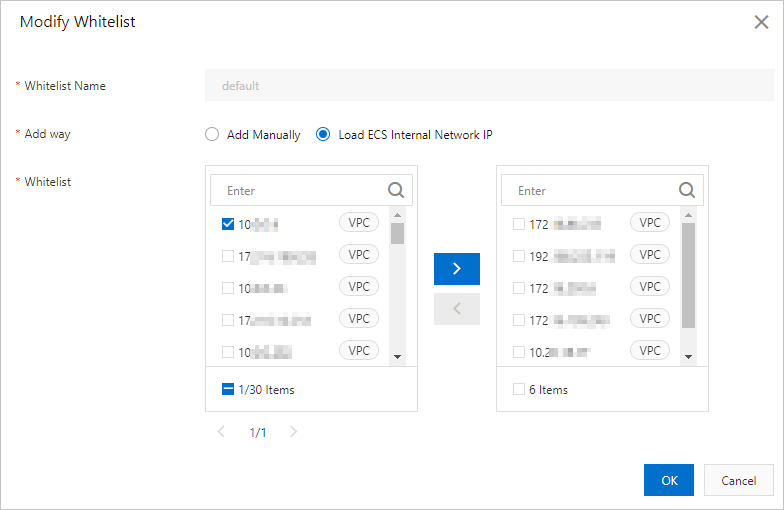<br>Note<br>To find the Elastic Compute Service (ECS) instance to which a specific IP address is assigned, you can move the pointer over the IP address. Then, the system displays the ID and name of the ECS instance to which the IP address is assigned. |

6. Click **OK**.

<a id="section-6-5"></a>

## 6.5. Connect to an instance

This topic describes how to connect to a Tair (Redis OSS-compatible) cluster instance by using redis-cli.

> **Note**
>
> For more information about other connection methods, see Connection guide.

**Prerequisites**

- The ECS instance and KVStore for Redis instance are deployed in the same classic network or virtual private cloud (VPC).

- The private IP address of the ECS instance is added to the whitelist of the KVStore for Redis instance. For more information, see Configure a whitelist.

- The ECS instance runs a Linux operating system and open source Redis is installed. For more information, see Redis official website.

**Procedure**

1. Log on to the CLI of the ECS instance and run the following command to connect to the Redis instance:

   ```text
   src/redis-cli -h <hostname> -p <port>
   ```

   Table 1. Parameters

   | Parameter | Description |
   | --- | --- |
   | &lt;hostname&gt; | The internal endpoint of the KVStore for Redis instance. You can find the endpoint in the <strong>Connection Information</strong> section on the <strong>Instance Information</strong> page. |
   | &lt;port&gt; | The service port number of the KVStore for Redis instance. Default value: 6379. |

   Example

   ```text
   src/redis-cli -h r-bp1zxszhcgatnx****.redis.rds.aliyuncs.com -p 6379
   ```

2. Run the following command to verify the password:

   ```text
   AUTH <password>
   ```

   &lt;password>: the password that you specify when you create the instance. If you forget your password, you can reset the password. For more information, see Change the password.

   Example:

   ```text
   AUTH testaccount:Rp829dlwa
   ```

   If the password verification is successful, the following result is returned:

   ```text
   OK
   ```

<a id="section-7"></a>

# 7.Instance management

<a id="section-7-1"></a>

## 7.1. Change the password

If you forget your password, need to change your password, or have not set a password for an instance, you can set a new password for the instance.

**Procedure**

1. Log in to the Tair (Redis OSS-compatible) console.

2. On the **Instance List** page, click the ID of the instance.

3. On the **Account Management** page, click **Reset Password**.

4. In the dialog box that appears, enter the current password and a new password.

   > **Note**
   >
   > - If you forget your password, you can click **Forgot password** in the Change Password dialog box and enter a new password.
   >
   > - The password must be 9 to 30 characters in length.
   >
   > - The password must contain at least three of the following types of characters: uppercase letters, lowercase letters, digits, and special characters. The supported special characters include  `! @ # $ % ^ & * ( ) _ + - =`
   >
   > - The password must not contain keywords such as admin or password.

5. Click **OK**.

<a id="section-7-2"></a>

## 7.2. Configure an IP address whitelist

Before you use a Tair (Redis OSS-compatible) instance, add IP addresses or CIDR blocks that are used to access the database to the whitelist of the instance to improve the security and stability of the database.

**Background information**

> **Note**
>
> Whitelists can be used to improve the access security of Tair (Redis OSS-compatible) instances. We recommend that you maintain whitelists on a regular basis.

**Procedure**

1. Log in to the Tair (Redis OSS-compatible) console.

2. On the **Instances** page, find the desired instance and click its ID.

3. In the left-side navigation pane, click **Whitelist Settings**.

4. Find the desired whitelist group and click Modify.**Modify**

   > **Note**
   >
   > You can also click **Add Whitelist** to create a whitelist. The name of a whitelist must be 2 to 32 characters in length and can contain lowercase letters, digits, and underscores (_). It must start with a lowercase letter and end with a lowercase letter or digit.

5. In the panel that appears, perform one of the following operations.

   | Operation | Procedure |
   | --- | --- |
   | Manually modify the whitelist | Enter IP addresses or CIDR blocks.<br>Figure 1. Manually modify the whitelist<br>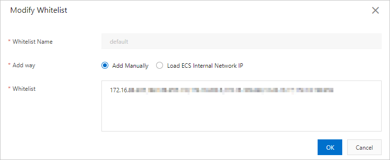<br>Note<br>• Separate multiple IP addresses with commas (,). A maximum of 1,000 unique IP addresses can be added. Supported formats are individual IP addresses such as 10.23.12.24 and CIDR blocks such as 10.23.12.24/24. In the preceding example, /24 indicates the subnet mask that specifies the length of the IP address prefix. An IP address prefix can be 1 to 32 bits in length.<br>• If you enter CIDR blocks that have a prefix length of 0 such as 0.0.0.0/0 and 127.0.0.1/0, all IP addresses are allowed to access the instance. This poses a high security risk. Proceed with caution. |

   <table>
     <tr>
       <td>Add private IP addresses of ECS instances to the whitelist</td>
       <td>i. Select <strong>Import ECS Internal IP Address</strong>.<br>ii. Select IP addresses based on your business requirements.<br>Figure 2. Select private IP addresses of ECS instances<br><br>Note<br>To find the ECS instance to which a specific IP address is assigned, you can move the pointer over the IP address. Then, the system displays the ID and name of the ECS instance to which the IP address is assigned.</td>
     </tr>
     <tr>
       <td>Remove all IP addresses from the whitelist</td>
       <td>To remove all IP addresses from the whitelist but retain the whitelist, click <strong>Delete</strong>.</td>
     </tr>
   </table>

6. Click **OK**.

<a id="section-7-3"></a>

## 7.3. Change configurations

This topic describes how to change the configurations of a Tair (Redis OSS-compatible) instance.

**Precautions**

- Business impact: After a configuration change, the system automatically performs data migration and switchover. Brief connection interruptions of a few seconds may occur during the switchover.

- Execution timing: To avoid impact on your business, we strongly recommend that you perform this operation during off-peak periods.

- Prerequisites: Make sure that your applications support automatic reconnection to handle transient connection interruptions.

**Procedure**

1. Log in to the Tair (Redis OSS-compatible) console.

2. On the **Instance Lists** page, find the target instance and click **Change cConfigurations** in the **Operation**Actions column.

3. On the pop-up page that appears, select the required configurations.

   | Configuration | Description |
   | --- | --- |
   | Version Type | You can select <strong>Enterprise Edition</strong> or <strong>Community Edition</strong>.<br>Note<br>Only Community Edition 5.0 instances support this parameter. |
   | Chip Aarchitecture | Select the target chip type. |
   | Architecture Type | Select the architecture type of the instance.<br>• <strong>Standard Edition</strong>: Uses a primary/secondary architecture to provide high-performance cache services and ensure high data reliability.<br>• <strong>Cluster Edition</strong>: Overcomes the single-thread bottleneck of Redis to meet the requirements of large capacity and high performance.<br>• <strong>Read/Write Splitting</strong>: Provides highly available, high-performance, and highly flexible read/write splitting services to handle centralized hot data and high-concurrency read requests, minimizing O&amp;M costs. |
   | Instance Type | Select the instance type.<br>Different instance types provide different maximum connections and maximum internal bandwidth. |
   | Maximum Bbandwidth Cchange Ppolicy | You can select <strong>Same as new specification</strong> or <strong>Keep current maximum</strong> <strong>bandwidth</strong>.<br>Note<br>Only the <strong>Classic</strong> deployment mode supports this configuration. |

4. Click **Submit**.

**Additional information**

- Configuration change duration: The time required depends on the data volume of the instance and the network conditions, typically ranging from a few minutes to tens of minutes.

- Monitoring: After athe configuration change, we recommend that you immediately check the monitoring metrics of the instance, such as CPU utilization, connections, and latency, to ensure that the new configuration meets your business expectations.

<a id="section-7-4"></a>

## 7.4. Manage nodes

This topic describes how to enable the read/write splitting feature and modify the number of replica nodes on the Node Management page.

**Prerequisites**

The instance meets the following requirements:

- The instance is deployed in cloud-native mode. You can perform this operation on a classic instance only after it is converted into a cloud-native instance.

- The instance uses the master-replica architecture to ensure high availability.

**Enable read/write splitting**

1. Log in to the Tair (Redis OSS-compatible) console.

2. On the **Instance List** page, click the ID of the instance.

3. In the left-side navigation pane, click **Node Management**.

4. Turn on **Read/write splitting**.

5. In the dialog box that appears, confirm the instance configurations.

6. Click **OK**.

**Add or remove replica nodes**

1. Log in to the Tair (Redis OSS-compatible) console.

2. On the **Instance List** page, click the ID of the instance.

3. In the left-side navigation pane, click **Node Management**.

4. In the **Node distribution (zone)** section, click **Modify**.

5. In the panel that appears, increase or decrease the number of replica nodes.

6. Click **OK**.

<a id="section-7-5"></a>

## 7.5. Convert to the cloud-native deployment mode

A **cloud-native** instance is compatible with later Redis versions and supports more flexible architecture configurations. This topic describes how to convert a **classic** instance into a **cloud-native** instance.

> **Important**
>
> - When you change the configurations of an instance, the instance may experience one intermittent disconnection that lasts up to 30 seconds. Make sure that your application can automatically reconnect to the instance.
>
> - To synchronize incremental data from the original instance to the new instance and prevent dual writes caused by Domain Name System (DNS) caching, the instance remains read-only for up to 1 minute during the configuration change. This ensures data consistency between the new instance and the original instance. If a large amount of data is written to the instance, the instance may remain read-only for an extended period of time. Therefore, we recommend that you perform the configuration change during off-peak hours.

**Usage notes**

- After the conversion, the instance information, such as the instance ID, endpoints, IP address whitelists, accounts, and account passwords remain unchanged. Data in the instance is not lost.

- Currently, only Tair (Redis OSS-compatible) instances that run Redis 5.0 (Enterprise Edition) can be converted into cloud-native instances. If the original instance is of another version, you must upgrade the instance to Redis 5.0 (Enterprise Edition) before you perform a conversion.

  > **Note**
  >
  > If a Tair (Redis OSS-compatible) instance that runs Redis 5.0 (Enterprise Edition) has a public endpoint, it cannot be converted into a cloud-native instance.

**Procedure**

1. Log in to the Tair (Redis OSS-compatible) console.

2. On the **Instance List** page, click the ID of the instance.

3. In the upper-right corner of the Instance Information page, click **Cloud Native**.

4. On the page that appears, configure the Chip Architecture, Instance Type, and Shard Count parameters.

5. Click **Submit**. Wait until the instance status changes to **Running**, which indicates that the conversion is successful.

<a id="section-7-6"></a>

## 7.6. Manage the number of shards

This topic describes how to increase or decrease the number of shards.

**Usage notes**

- You can adjust the number of shards only in a cluster instance. You cannot adjust the number of shards in a standard instance.

- The total number of shards for an instance must be at least two. The maximum number of shards that can be managed per operation is 64.

- When you add shards to an instance, the instance automatically redistributes data across all shards. However, if only a few shards are added at a time, data redistribution is slowed own and the scale-out efficiency is compromised. We recommend that you add at least one-sixth of the current total number of shards (rounded up) to an instance at a time. Examples:

  - If the instance has 8 shards, we recommend that you add at least 2 shards (8/6 = 1.33, which is rounded up to 2).

  - If the instance has 64 shards, we recommend that you add at least 11 shards.

  - If the instance has 100 shards, we recommend that you add at least 17 shards.

**Procedure**

1. Log in to the Tair (Redis OSS-compatible) console.

2. On the **Instance List** page, click the ID of the instance.

3. In the upper-right corner of the page, click **Slice adjustment** and select **Increase the number of shards** or **Reduce the number of shards** based on your business requirements.

   - Add shards

     <ol type="a">

     <li>

     Click **Increase the number of shards**. In the panel that appears, specify the number of shards. You can add 1 to 64 shards.

     </li>

     <li>

     Click **OK**.

     </li>

     </ol>

   - Remove shards

     > **Important**
     >
     > After you remove shards from a cluster instance, the total storage capacity and performance of the instance decrease, and your application is disconnected from the shards. Proceed with caution. To perform this operation, make sure that the application can automatically reconnect to the cluster instance.

     <ol type="a">

     <li>

     Enter the number of shards to be removed and select a removal policy.

     You can select **Execute Now** or **Execute within Maintenance Window** (recommended).

     </li>

     <li>

     Click **OK**. The shards are immediately removed and the data is automatically migrated to other shards.

     </li>

     </ol>

<a id="section-7-7"></a>

## 7.7. Configure a maintenance window

You can modify the default maintenance window to perform maintenance on Tair (Redis OSS-compatible) instances during off-peak hours.

**Background information**

To ensure the stability of Tair (Redis OSS-compatible) instances on the Alibaba Cloud platform, the backend system irregularly maintains instances and servers.

To guarantee the stability of the maintenance process, instances enter the Maintaining Instance state before the preset maintenance window on the day of maintenance. While an instance is in this state, data in the database can still be accessed and performance monitoring data can be queried. However, change-related operations such as configuration change are temporarily unavailable for the instance in the console.

> **Note**
>
> During the preset maintenance window, instances may be disconnected in the process of maintenance. We recommend that you set the maintenance window to a period during off-peak hours.

**Procedure**

1. Log in to the Tair (Redis OSS-compatible) console.

2. On the **Instances** page, click the ID of the desired instance.

3. In the Basic Information section, click **Settings** on the right of **Maintenance Window**.

4. Select a time period for maintenance and click **Save**.

   > **Note**
   >
   > The time periods are in UTC+8.

<a id="section-7-8"></a>

## 7.8. Migrate an instance across zones

This topic describes how to migrate an instance across zones in the same region. After an instance is migrated to a different zone, the attributes, specifications, and endpoints of the instance remain unchanged.

**Prerequisites**

- Transparent data encryption (TDE) is disabled for the instance.

- The source and destination zones belong to the same region.

- If the instance is deployed in a virtual private cloud (VPC), make sure that a vSwitch is created in the destination zone before you migrate the instance. For more information, see **Create a VPC** and **Create a vSwitch** in **VPC User Guide**.

- The instance does not have a public endpoint. If you have applied for a public endpoint for the instance, release the public endpoint before you migrate the instance.

**Usage notes**

- If the instance resides in a VPC, the destination zone must also belong to the same VPC.

- The amount of time required for the migration varies based on factors such as the network conditions, task queue status, and data volume. We recommend that you migrate the instance during off-peak hours.

- During the migration, the instance is disconnected for about 30 seconds. Make sure that your application can automatically reconnect to the instance.

**Procedure**

1. Log in to the Tair (Redis OSS-compatible) console.

2. On the **Instance List** page, click the ID of the instance.

3. In the **Basic Information** section, click **Migrate zones**.

4. On the **Migrate zones** page, configure the following parameters based on the network type of the instance.

   - VPC

     | Parameter | Description |
     | --- | --- |
     | Zone type | Select a zone type, which can be Single Zone or Dual Zone. |
     | After switching, the primary zone | The destination primary zone. |
     | Switch backup zone | The destination secondary zone.<br>Note<br>This parameter is available only when Dual Zone is selected. |
     | VSwitch after switching | The destination vSwitch. |
     | Switching time | Select the time when you want to start the migration. Valid values:<br>• <strong>Switch now</strong>: The system starts the migration immediately after you configure the parameters.<br>• <strong>Switchover within the maintenance period</strong>: The system starts the migration within the maintenance window. For more information, see Configure a maintenance window. |

   - Classic network

     | Parameter | Description |
     | --- | --- |
     | Zone type | Select a zone type, which can be Single Zone or Dual Zone. |
     | After switching, the primary zone | The destination primary zone. |
     | Switch backup zone | The destination secondary zone.<br>Note<br>This parameter is available only when Dual Zone is selected. |
     | Switching time | Select the time when you want to start the migration. Valid values:<br>• <strong>Switch now</strong>: The system starts the migration immediately after you configure the parameters.<br>• <strong>Switchover within the maintenance period</strong>: The system starts the migration within the maintenance window. For more information, see Configure a maintenance window. |

5. Click **OK**.

   After the migration is complete, you can view the migration details in the Zone field of the Basic Information section.

<a id="section-7-9"></a>

## 7.9. Migrate the network AZ

You can migrate the network of an instance to another availability zone (AZ) within the same region. After you migrate the network AZ, all attributes and specifications of the instance remain unchanged.

**Precautions**

- The switchover process disconnects existing database connections. Make sure that your applications have an automatic reconnection mechanism.

- Perform the migration during off-peak hours to avoid other failures.

- Follow this operation sequence: switch the primary and secondary data roles first, verify data availability, and then migrate the network AZ.

- Verify that the target AZ has sufficient network resources and that the security group and allowlist policies allow application access from the new data center.

**Procedure**

1. Log in to the Tair (Redis OSS-compatible) console.

2. On the **Instance List** page, click the ID of the instance.

3. In the **Basic Information** section, click **Migrate Network AZ**.

4. On the **Migrate Network AZ** page, configure the following parameters.

   - VPC

     | Parameter | Description |
     | --- | --- |
     | Target AZ for Instance Network | The target network AZ. |
     | vSwitch After Switchover | The targetvSwitch. |
     | Switching Time | Select the time to start the network AZ migration.<br>• <strong>Switch Now</strong>: The system starts the network AZ migration immediately after you complete the parameter configuration.<br>• <strong>Switch Within Maintenance Window</strong>: The system migrates the network AZ during the maintenance window. For more information about how to set the maintenance window, see Configure a maintenance window. |

   - Classic network

     | Parameter | Description |
     | --- | --- |
     | Target AZ for Instance Network | The target network AZ. |
     | Switching Time | Select the time to start the network AZ migration.<br>• <strong>Switch Now</strong>: The system starts the network AZ migration immediately after you complete the parameter configuration.<br>• <strong>Switch Within Maintenance Window</strong>: The system migrates the network AZ during the maintenance window. For more information about how to set the maintenance window, see Configure a maintenance window. |

5. Click **OK**.

<a id="section-7-10"></a>

## 7.10. Major version upgrade

Tair (Redis OSS-compatible) instances of later versions typically provide higher performance, enhanced security and stability, and more features. In addition, later versions generally receive more technical support. If you want to use a later version, you can upgrade the major version of your instance in the console, rather than creating an additional instance.

**Upgrade impacts**

- When you apply for resources, upgrade the replica node, or synchronize data, your Tair (Redis OSS-compatible) service remains available.

- When you switch your workloads from the original instance over to a new instance or from the master node over to a replica node in the original instance, you may experience transient connections that last for a few seconds. The original instance remains in the read-only state for up to 60 seconds until all data is synchronized. We recommend that you upgrade the original instance during off-peak hours.

- After the upgrade is complete, the instance ID, endpoints, data, whitelists, accounts, and account passwords remain unchanged. Make sure that your application can automatically reconnect to your instance.

**Usage notes**

- If Data Transmission Service (DTS) tasks are created for the instance for which you want to upgrade the major version, the upgrade fails. Stop the DTS tasks and try again.

- If you upgrade the major version of a classic cluster instance that has a private endpoint, release the private endpoint and try again.

- For a cloud-native cluster instance in direct connection mode, the major version cannot be upgraded.

- If the classic network endpoint of the instance is not released, the upgrade may fail. Release the classic network endpoint and try again. After you release the classic network endpoint, you cannot reapply for it. We recommend that you use a virtual private network (VPC) for faster transmission and higher security.

- If you upgrade the major version of an instance, the memory usage of the instance may change slightly in the range of approximately -10% to 10%. The specific change depends on the differences in how different versions store metadata. We recommend that you make sure that the memory usage of the instance is less than 80% before you upgrade the major version. This prevents the memory usage of the instance from reaching a high level after the major version is upgraded.

**Procedure**

1. Log in to the Tair (Redis OSS-compatible) console.

2. On the **Instance List** page, click the ID of the instance.

3. In the Configuration Information section of the **Instance Information** page, click **Update** next to **Version** and then select **Major Update**.

   > **Note**
   >
   > If the **Major Update** menu item is dimmed, the major version of the instance cannot be upgraded.

4. In the **Major Update** dialog box, specify the destination version and the time when you want to perform the upgrade.

   > **Note**
   >
   > During instance upgrades or master-replica switchovers, an instance experiences transient connections that last for a few seconds and remains read-only for up to 60 seconds. To minimize impacts, we recommend that you select **Execution within maintenance time**. This way, the system performs the operation during the maintenance window.

5. Click **OK**.

<a id="section-7-11"></a>

## 7.11. Update the minor version of an instance

Tair (Redis OSS-compatible) continuously optimizes the kernel and fixes security vulnerabilities to improve service stability. You can update an instance to the latest minor version with a few clicks in the Tair (Redis OSS-compatible) console.

**Background information**

> **Note**
>
> - We recommend that you upgrade instance versions during off-peak hours and ensure that your application supports automatic reconnection.
>
> - The system automatically checks the kernel version of an instance. If the current version is the latest, the **Minor Version Upgrade** button in the upper-right corner of the **Basic Information** section for this instance will appear dimmed.

**Procedure**

1. Log in to the Tair (Redis OSS-compatible) console.

2. On the **Instances** page, click the ID of the desired instance.

3. On the **Instance Information** page, click **Minor Version Upgrade** in the upper-right corner of the **Basic Information** section.

4. In the **Minor Version Upgrade** dialog box that appears, click **Upgrade Now**. On the **Instance Information** page, the instance status will become Upgrading a minor version. When the instance status returns to Available, the upgrade has been completed.

<a id="section-7-12"></a>

## 7.12. Configure SSL encryption

To improve the security of traces, you can enable Secure Sockets Layer (SSL) encryption and then install the SSL CA certificate in your application service. SSL encryption encrypts network connections at the transport layer to enhance communication data security while ensuring data integrity.

**Precautions**

- This operation restarts the instance, which may cause brief connection interruptions of a few seconds. Perform this operation during off-peak periods and make sure that your application has a reconnection mechanism.

- SSL encryption and decryption consume CPU resources, which may increase the CPU utilization of the instance and slightly increase read and write latency. Make sure that the current CPU usage of the instance has sufficient buffer space.

- Enabling SSL encryption increases the handshake latency during connection establishment and may increase the overall network response time. Enable SSL encryption only when necessary.

- The cloud certificate is valid for one year. The system sends reminders through multiple channels before expiration and automatically updates the certificate. You can configure a scheduled time to customize the update window.

**Prerequisites**

- The instance must be one of the following types:

  - Tair (Redis OSS-compatible) Classic Edition cluster architecture instances (4.0, 5.0, 6.0, and 7.0).

  - Tair (Redis OSS-compatible) Cloud Native Edition 7.0 instances.

- For Cloud Native Edition 7.0 instances, you must first enable the TLS encryption switch. For more information, see the **Enable the Tair (Redis OSS-compatible) TLS (SSL) encryption switch** section in the ***ApsaraDB for Tair (Redis OSS-compatible) O&M Gu ide***.

**Procedure**

**Step 1**

1. Log in to the Tair (Redis OSS-compatible) console.

2. On the **Instance List** page, click the ID of the instance.

3. In the left-side navigation pane, click **TLS Settings (SSL)**.

**Step 2**

Select the configuration method based on the instance type.

**Cloud Native Edition instances**

This section applies to Cloud Native Edition 7.0 instances.

**Usage limits**

- Connection interruption risk: After you enable the required (forceful encryption) mode, the system immediately rejects all plaintext connection requests that do not use SSL/TLS. Make sure that all client applications have completed certificate configuration and connection string updates. Otherwise, a large number of business connections will fail.

- Performance overhead alert: Forceful Transport Layer Security (TLS) encryption increases CPU computing overhead, which may increase the CPU utilization of the instance and slightly increase read and write latency. Evaluate the current CPU usage of the instance before you enable this feature and reserve sufficient performance buffer space.

- Compatibility requirements: Cloud Native Edition 7.0 supports only TLS 1.2 and later versions. If the client or driver does not support TLS 1.2 or later, the system cannot establish a connection. Upgrade the client in this case.

1. On the **TLS Settings (SSL)** page, configure the following parameters.

   | Name | Description |
   | --- | --- |
   | Select Configuration Mode | • <strong>Simple Mode</strong>: You do not need to configure client certificates or other information. This mode applies to basic SSL encryption requirements and enables quick configuration.<br>• <strong>Complete Mode</strong>: You must configure access control lists (ACLs) and certificates. This mode provides the highest security level.<br>Note<br>You must select the minimum TLS version. The default version is TLSv1.2.TLSv1, TLSv1.1, and TLSv1.3 are also supported. |
   | Select Certificate Type | Select the source of the SSL certificate. Use a cloud certificate for better security and convenience. |
   | Select Connection String to Protect | Select a database connection string for whichto enable SSL encryption. You can select an intranet connection string. |

2. Click **Enable SSL Encryption**.

   > **Note**
   >
   > - After you complete the operation, wait for a period of time before the system displays the result.
   >
   > - You can also click buttons such as **Modify Expiry**, **Download CA Certificate**, and **Version Name** to perform related operations.
   >
   >   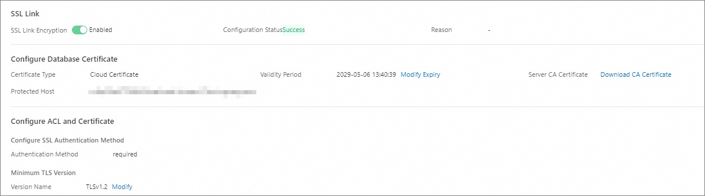

**Classic Edition cluster architecture instances**

This section applies to Classic Edition cluster architecture 4.0, 5.0, 6.0, and 7.0 instances.

1. On the **TLS Settings (SSL)** page, turn on the switch next to **SSL Certificate Information**.

   > **Note**
   >
   > If the system prompts that the version is not supported, upgrade the minor version. For more information, see Upgrade the minor version.

2. Complete the activation.

   - After you complete the operation, wait for a period of time before the system displays the result.

   - You can also click buttons such as **Update Certificate** and **Download CA Certificate** in the upper-right corner to perform related operations.

   - The default minimum TLS version is TLSv1.2. TLSv1 and TLSv1.1 are also supported.

**Disable SSL encryption**

1. Log in to the Tair (Redis OSS-compatible) console.

2. On the **Instance List** page, click the ID of the instance.

3. In the left-side navigation pane, click **TLS Settings (SSL)**.

4. On the **TLS Settings (SSL)** page, turn off the switch to disable SSL encryption.

<a id="section-7-13"></a>

## 7.13. Enable TDE

Tair (Redis OSS-compatible) provides the transparent data encryption (TDE) feature. This feature allows you to encrypt and decrypt Redis Database (RDB) files. You can enable TDE in the console to allow the system to encrypt and decrypt RDB files. This improves data security and compliance.

**Prerequisites**

- The instance is a Tair (Enterprise Edition) instance.

- Key Management Service (KMS) is activated.

**Background**

The TDE feature for Tair (Redis OSS-compatible) encrypts RDB data files before writing them to disk and decrypts them when reading them into memory. This feature does not require additional storage space or changes to your client applications.

Figure 1. TDE encryption

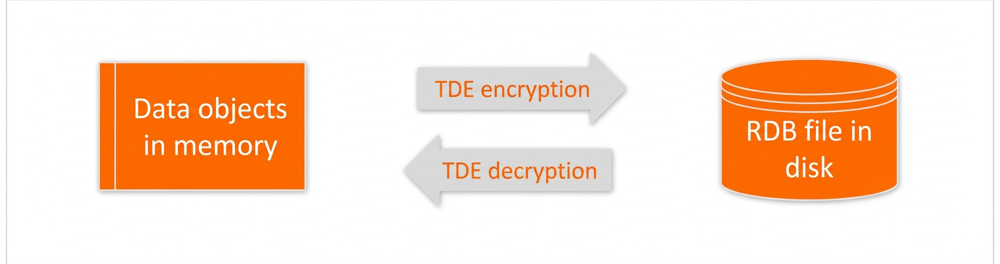

**Impacts**

You cannot disable TDE after it is enabled. You must evaluate the impacts on your business before you enable TDE. Take note of the following impacts:

- Cache analysis is not supported.

- After TDE is enabled for an instance, instance data cannot be migrated or synchronized by using Data Transmission Service (DTS) or redis-shake.

**Precautions**

- TDE can be enabled for an instance but not for a key or a database.

- TDE encrypts RDB files that are written to disks, such as dump.rdb.

- KMS generates and manages the keys used by TDE. Tair (Redis OSS-compatible) does not provide keys or certificates required for encryption.

**Procedure**

1. Log in to the Tair (Redis OSS-compatible) console.

2. On the **Instances** page, click the ID of the desired instance.

3. In the left-side navigation pane, click **TDE**.

4. Turn on **TDE Status** to enable TDE.

5. In the dialog box that appears, select **Use Automatically Generated Key** or **Use Custom Key** and then click **OK**.

   Figure 1. Select the key type for enabling TDE

   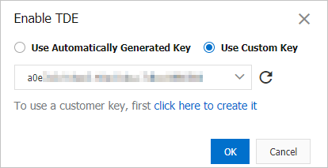

   > **Note**
   >
   > - The first time you enable TDE for an instance within your Alibaba Cloud account, follow the instructions on the page to assign the **AliyunRdsInstanceEncryptionDefaultRole** role to Tair (Redis OSS-compatible). Tair (Redis OSS-compatible) can access KMS resources only after it assumes the role.
   >
   > - For information about how to create a custom key, see **Create a CMK** in **User Guide** of **KMS**.

   After the instance state changes from **Modifying TDE** to **Running**, TDE is enabled.

<a id="section-7-14"></a>

## 7.14. Clear data

You can delete all data or expired data of a Tair (Redis OSS-compatible) instance in the Tair (Redis OSS-compatible) console.

**Procedure**

1. Log in to the Tair (Redis OSS-compatible) console.

2. On the **Instances** page, click the ID of the desired instance.

3. In the upper-right corner of the **Instance Information** page, click **Clear Data**.

4. In the dialog box that appears, select the data that you want to clear.

   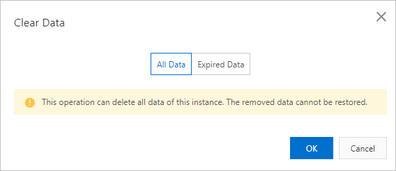

   - **All Data**: runs the **FLUSHALL** command to clear all data of the instance. Cleared data cannot be restored.

   - **Expired Data**: runs the **SCAN** command to batch clear all expired data of the instance. Cleared data cannot be restored. You can select **Update Now** or Update During Maintenance. For more information, see Configure a maintenance window.

   > **Warning**
   >
   > Data clearing takes effect immediately and cleared data cannot be restored. This may affect your business. Proceed with caution. We recommend that you back up the data of your instance before you clear data. For more information, see Back up data manually.

5. Click **OK**.

   > **Note**
   >
   > If you select **All Data**, you can specify whether to back up the data after you click **OK**.

<a id="section-7-15"></a>

## 7.15. Release an instance

You can release a Tair instance at any time. This topic describes the procedure for releasing a Tair instance.

**Procedure**

1. Log in to the Tair (Redis OSS-compatible) console.

2. On the **Instances** page, find the target instance and choose **Release** in the **Actions** column.

   > **Warning**
   >
   > Back up your data before you release the instance. Proceed with caution.

3. In the **Release Instance** dialog box, click **Release**.

   After an instance is released, it is retained in the recycle bin for a period of time. You can unlock or rebuild the instance from the recycle bin. For more information, see Instance Recycle Bin.

<a id="section-7-16"></a>

## 7.16. Manage the instance recycle bin

The instance recycle bin displays released instances and supports operations such as restoring and immediately destroying instances.

**Precautions**

- Released instances are kept in the recycle bin for 7 days. They will be permanently destroyed and unrecoverable after this period.

- The system restores an instance by cloning the data of the original instance and creating a new instance, rather than recovering the original instance.

- Original data remains intact after restoration, but the endpoint (domain name) may change. Verify the new endpoint and update your client configurations once restoration is complete.

- The system does not automatically restore the public endpoint.

**Procedure**

1. Log in to the Tair (Redis OSS-compatible) console.

2. In the left-side navigation pane, click **Recycle Bin**.

3. In the instance list on the Recycle Bin page, perform the **Recovery** or **Destroy now** operation.

   - **Recovery**: The system restores all data and partial configurations (such as the port number) of the original instance to a newly created instance. However, you must reconfigure parameters, such as **Availability Zone**, **Network Type**, and **IP Type**.

     > **Note**
     >
     > If **Network Type** is set to **VPC**, you must also configure the VPC and vSwitch.

   - **Destroy now**: The system permanently deletes the instance and its data backup.

     > **Warning**
     >
     > Destroying an instance also destroys all backups of that instance, including regular data backups, archive backups, and log backups. This operation is irreversible. Proceed with caution.

<a id="section-7-17"></a>

## 7.17. Manage accounts

Tair (Redis OSS-compatible) allows you to create up to 20 database accounts for an instance. You can grant appropriate permissions to these accounts based on their usage to enable more flexible management of the instance and help minimize the risk of accidental operations.

**Prerequisites**

The engine version of the instance is Redis 4.0 or later.

> **Note**
>
> If the engine version of the instance is not Redis 4.0, only the default account that is created when you create the instance is available. For information about how to change the password of the default account, see Change the password.

**Background information**

You can create accounts, delete accounts, reset the password, and change the permissions. After an account is created, you can use this account to log on to the database and use the command-line tool to perform operations on the database with the account and granted permissions.

**Create an account**

1. Log in to the Tair (Redis OSS-compatible) console.

2. On the **Instances** page, click the ID of the desired instance.

3. On the **Instance Information** page, click **Account Management** in the left-side navigation pane.

   > **Note**
   >
   > If Account Management is unavailable for an instance of Redis 4.0 or later, update the minor version of the instance.

4. In the upper-right corner of the **Account Management** page, click **Create**.

5. In the dialog box that appears, configure the required parameters and click **OK**. The following table describes the parameters.

   | Parameter | Description |
   | --- | --- |
   | Account | The account name must be 1 to 16 characters in length. The name can contain lowercase letters, digits, and underscores (_) and must start with a letter. |
   | Privilege | Specify the permissions that are granted to the account. Valid values: Read-only, Read/Write, and Replicate. If you select Replicate, you can run the SYNC and PSYNC commands after you connect to the instance by using your account.<br>Note<br>You can create accounts that have the replicate permissions only for standard instances of Redis 4.0 or later. |
   | Password | Specify a password for the account. The password must be 8 to 32 characters in length. The password must contain at least three of the following types of characters: uppercase letters, lowercase letters, digits, and special characters. The following special characters are supported: <code> ! @ # $ % ^ &amp; * ( ) + - = _ </code> |
   | Confirm Password | Enter the password again. |
   | Description | The description of the account. |

<a id="section-7-18"></a>

## 7.18. Restart an instance

You can restart an instance from the Instance List page of the console.

**Procedure**

1. Log in to the Tair (Redis OSS-compatible) console.

2. In the **Actions** column corresponding to the desired instance, choose

   **> Restart**

   

   **Instance**.

   > **Warning**
   >
   > During the restart, the instance may be disconnected for a few seconds. We recommend that you restart your instance during off-peak hours and make sure that your application can automatically reconnect to the instance.

3. In the dialog box that appears, select a restart time and click **OK**.

   - Restart Now: restarts the instance immediately after you click OK.

   - Restart Within Maintenance Window: restarts the instance within the preset maintenance window.

<a id="section-7-19"></a>

## 7.19. Export the instance list

You can export the instance list from the console to manage the instances offline.

**Procedure**

1. Log in to the Tair (Redis OSS-compatible) console.

2. In the upper-right corner of the **Instances** page, click the **Export Instances** icon.

3. In the **Export Instance List** dialog box, select the columns to export and click **OK**.

   > **Note**
   >
   > After you click **OK**, the browser begins to download the CSV file. You can use Excel or a text editor to view this file.

<a id="section-7-20"></a>

## 7.20. Manage tags

If you have a large number of instances, you can create multiple tags and add different tags to different instances to classify and filter the instances by tag.

**Precautions**

- A tag consists of a key-value pair. Each key must be unique for an Alibaba Cloud account in a region. This limit does not apply to key values.

  > **Note**
  >
  > A key can have zero to multiple values.

- You can add up to 20 tags to an instance.

- You can add or remove up to 20 tags at a time.

**Create tags**

1. Log in to the Tair (Redis OSS-compatible) console.

2. Perform one of the following steps to create tags for one or more instances:

   - Create tags for a single instance

     In the **Tag** column corresponding to the instance for which you want to add tags, click the

      icon.

   - Create tags for multiple instances

     Select the instances and click **Batch Add Tags** below the instance list.

3. Enter a tag key and a tag value in the fields below **Tag Key** and **Tag Value**.

   If you want to add an existing tag, click the corresponding field and select an existing tag key and tag value from the drop-down list.

4. Click **OK**.

**Filter instances by tag**

1. Log in to the Tair (Redis OSS-compatible) console.

2. On the **Instances** page, click **Advanced Filter**.

3. On the right side of **Filter by Tag**, select a **tag key** and a **tag value** from the drop-down list.

   > **Note**
   >
   > - After you create a tag or update an existing tag, you must refresh the page to view the updated tag list.
   >
   > - To clear a filter condition, click the
   >
   >   icon next to the selected tag.
   >
   >   

4. Click **Search**.

**Add or remove tags**

1. Log in to the Tair (Redis OSS-compatible) console.

2. In the **Tag** column corresponding to the instance that you want to manage, click the 

   icon.

3. In the dialog box that appears, click the

   icon next to the tag that you want to remove.

   

   > **Note**
   >
   > - You can remove up to 20 tags at a time.
   >
   > - If you remove a tag from all instances to which the tag is added, the tag is automatically deleted.
   >
   > - An instance keeps running when you remove tags from the instance. After all tags of an instance are removed, the instance cannot be filtered by tag.

4. Click **OK**.

<a id="section-7-21"></a>

## 7.21. Use a Lua script

Tair (Redis OSS-compatible) instances support Lua-related commands.

**Support for Lua commands**

Lua scripts improve the performance of Tair (Redis OSS-compatible). With support for the Lua environment, Tair (Redis OSS-compatible) can perform check-and-set (CAS) operations, allowing you to combine and run multiple commands in an efficient manner.

> **Note**
>
> If an error message indicating a failure to run the EVAL command is returned, such as  `ERR command eval not support for normal user` , update the minor version. During the update, the instance may be disconnected and become read-only for a few seconds. We recommend that you update the minor version during off-peak hours.

**Limits on Lua scripts**

To ensure that all operations within a script occur within the same hash slot, Tair (Redis OSS-compatible) cluster instances impose the following restrictions on Lua scripts:

- Lua scripts use the **redis.call or redis.pcall** function to run Redis commands. For Redis commands, all keys must be specified by using the KEYS array, which cannot be replaced by Lua variables. If you do not use the KEYS array to specify the keys, the following error message is returned:

  ```text
  -ERR bad lua script for redis cluster, all the keys that the script uses should be passed using the KEYS array\r\n
  ```

- All keys that a script uses must be allocated to the same hash slot. Otherwise, the following error message is returned:

  ```text
  -ERR eval/evalsha command keys must be in same slot\r\n
  ```

- Keys must be included in all the commands that you want to run. Otherwise, the following error message is returned:

  ```text
  -ERR for redis cluster, eval/evalsha number of keys can't be negative or zero\r\n
  ```

- The following Pub/Sub commands are not supported: **PSUBSCRIBE**, **PUBSUB**, **PUBLISH**, **PUNSUBSCRIBE**, **SUBSCRIBE**, and **UNSUBSCRIBE**.

- The UNPACK function is not supported.

> **Note**
>
> If you do not want to impose the preceding limits but can make sure that all operations are performed in the same hash slot in the code, you can set the script_check_enable parameter to 0 in the console to disable the backend script check.

<a id="section-8"></a>

# 8.Connection guide

<a id="section-8-1"></a>

## 8.1. View the endpoints of an instance

You can view the internal and public endpoints of instances in the Tair (Redis OSS-compatible) console.

**Usage notes**

- The virtual IP address (VIP) of a Tair (Redis OSS-compatible) instance may change when you maintain or modify the instance. To ensure that the connections to the instance are not interrupted, we recommend that you connect to the endpoint of the Tair (Redis OSS-compatible) instance.

- For more information about how to apply for a public endpoint, see Apply for an endpoint.

**Procedure**

1. Log in to the Tair (Redis OSS-compatible) console.

2. On the **Instance List** page, click the ID of the instance.

3. In the **Connection Information** section, you can view the private and public endpoints of the instance.

   > **Note**
   >
   > By default, a Tair (Redis OSS-compatible) instance comes only with a private endpoint. You need to manually apply for a public endpoint if you want to connect to the instance over the Internet. For more information, see Apply for an endpoint.

**Enable or disable IPv6**

1. Log in to the Tair (Redis OSS-compatible) console.

2. On the **Instance List** page, click the ID of the instance.

3. In the Connection Information section, turn on or off the switch in the **Whether IPv6 is applied** column.

   > **Important**
   >
   > After you disable IPv6, the services that access the database by using an IPv6 address are disconnected from the database. This causes business interruptions. Therefore, before you disable IPv6, make sure that no service is connected to the database through an IPv6 address.

4. Click **OK**.

<a id="section-8-2"></a>

## 8.2. Apply for an endpoint

This topic describes how to apply for an endpoint for a Tair (Redis OSS-compatible) cluster instance.

**Procedure**

1. Log in to the Tair (Redis OSS-compatible) console.

2. On the **Instance List** page, click the ID of the instance.

3. In the **Connection Information** section, select **Network** and click **redis.detail.info.apply_link_host** in the **Actions** column.

4. In the dialog box that appears, enter a custom endpoint and a port number, and click OK.

   > **Note**
   >
   > - The custom endpoint must be 8 to 64 characters in length and can contain letters and digits. The endpoint must start with a lowercase letter.
   >
   > - The custom port number ranges from 1024 to 65535. The default value is 6379.
   >
   > - After you apply for an endpoint for a Tair (Redis OSS-compatible) cluster instance, you must add the endpoint to the IP address whitelist of the cluster instance. This way, you can connect to the cluster instance. For more information, see Configure a whitelist.

5. On the **Instance Information** page, view the endpoint in the **Connection Information** section.

   > **Note**
   >
   > If you no longer need an endpoint, click **redis.detail.info.release_link_host** next to the endpoint to release the endpoint.

<a id="section-8-3"></a>

## 8.3. Change the endpoint

Tair (Redis OSS-compatible) allows you to modify internal and public endpoints for instances. When changing the KVStore for Redis instance, you can change the endpoint of the new instance to the endpoint of the original instance without modifying the application.

**Prerequisites**

The instance is in the Running state.

**Procedure**

1. Log in to the Tair (Redis OSS-compatible) console.

2. On the **Instance List** page, click the ID of the instance.

3. On the **Instance Information** page, click **Modify Public Endpoint** in the **Connection Information** section.

4. In the Modify Public Endpoint dialog box, set the following parameters:

   | Parameter | Description |
   | --- | --- |
   | Connection type | Select <strong>Internal Endpoint</strong> or <strong>Public Endpoint</strong>. |
   | Endpoint | Set the prefix of the endpoint.<br>• The endpoint can contain lowercase letters and digits.<br>• The name must start with a lowercase letter.<br>• It must be 8 to 64 characters in length. |
   | Port | Specify a port number. Valid value: 1024 to 65535.<br>Note<br>It takes about 10 minutes for the modified port number of the public endpoint to take effect. You can refresh the page to view the latest port number information. |

5. In the **Modify Public Endpoint** dialog box, modify **Connection Type**, **Endpoint**, and **Port**, and then click **OK**.

   > **Note**
   >
   > - The custom endpoint prefix must be 8 to 64 characters in length and can contain lowercase letters and digits. It must start with a lowercase letter.
   >
   > - The custom port number ranges from 1024 to 65535. The default value is 6379.

<a id="section-8-4"></a>

## 8.4. Use the direct connection mode to connect to a cluster instance

If you have applied for a private endpoint for a Tair (Redis OSS-compatible) cluster instance, you can seamlessly migrate the native Redis cluster architecture to the cluster instance. The private endpoints of Tair (Redis OSS-compatible) cluster instances support the native Redis Cluster protocol. In direct connection mode, a client can directly connect to the data server, resulting in fast response from Tair (Redis OSS-compatible).

**Prerequisites**

- A private endpoint has been applied for a Tair (Redis OSS-compatible) cluster instance. For more information, see Apply for an endpoint.

- The client IP address is added to the IP address whitelist of the cluster instance. For more information, see Configure a whitelist.

- Clients that support the Redis Cluster protocol are used, such as Jedis and PhpRedis.

  > **Note**
  >
  > - If you use a client that does not support the Redis Cluster protocol, you may be unable to obtain data because the client cannot redirect your request to the correct shard.
  >
  > - You can obtain a list of clients that support the Redis Cluster protocol from the Clients page on the Redis official website.

- The Elastic Compute Service (ECS) instance on which the client is deployed and the cluster instance belong to the same virtual private cloud (VPC).

**Background information**

When you enable the direct connection mode for a cluster instance, Tair (Redis OSS-compatible) allocates a virtual IP address (VIP) to the master node of each data shard in the cluster instance. Before the client sends the first request to a private endpoint, the client uses a Domain Name System (DNS) server to resolve the private endpoint. The resolution result is the VIP of a random data shard in the cluster instance. The client can use this VIP to manage cluster instance data based on the Redis Cluster protocol. The following figure shows the architecture of a cluster instance in direct connection mode.

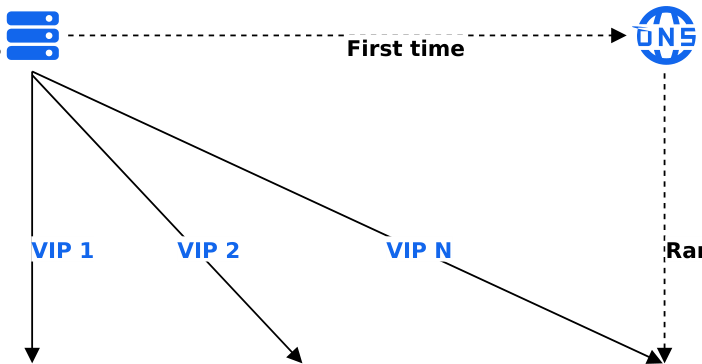

ECS

DNS

**Random V**

**Data Shard 1**

**Data Shard 2**

**Data Shard N**

Master 1

Master 2

Master N

...

HA

HA

HA

Replica 1

Replica 2

Replica N

**Usage notes**

- Instances of different architectures provide different levels of support for native Redis commands. For example, the cluster architecture has limits on Lua scripts.

- In direct connection mode, you can use the **SELECT** command to switch databases. However, some Redis Cluster clients, such as StackExchange.Redis, do not support the **SELECT** command. If you use these clients, only database 0 is available.

- Private endpoints can be accessed only over the Alibaba Cloud internal network.

- The direct connection mode is available only for the Cluster Edition.

**redis-cli**

Use a private endpoint to connect to a cluster instance from redis-cli.

> **Important**
>
> When you use a private endpoint to connect to a cluster instance from redis-cli, you must add the -c parameter to the command. Otherwise, the connection fails.

```text
./redis-cli -h r-bp1zxszhcgatnx****.redis.rds.aliyuncs.com -p 6379 -c
```

Verify the password of your database account.

```text
AUTH testaccount:Rp829dlwa
```

For more information about redis-cli, see Use redis-cli to connect to an instance.

**Jedis**

In this example, Jedis 4.3.0 is used. For more information, visit GitHub.

- Custom connection pool (recommended)

  ```java
  import redis.clients.jedis.*;
  import java.util.HashSet;
  import java.util.Set;

  public class DirectTest {
      private static final int DEFAULT_TIMEOUT = 2000;
      private static final int DEFAULT_REDIRECTIONS = 5;
      private static final ConnectionPoolConfig config = new ConnectionPoolConfig();

      public static void main(String args[]) {
          // Specify the maximum number of connections. In direct connection mode, the client directly connects to a shard of a cluster instance. Therefore, the following requirement must be met: Number of clients × Value of MaxTotal < Maximum number of connections to a single shard. 
          config.setMaxTotal(30);
          // Specify the maximum number of idle connections based on your business needs. 
          config.setMaxIdle(20);
          config.setMinIdle(15);

          // Specify the private endpoint that is allocated to the cluster instance. String host = "r-bp1xxxxxxxxxxxx.redis.rds.aliyuncs.com";
          int port = 6379;
          // Specify the password that is used to connect to the cluster instance. String password = "xxxxx";

          Set<HostAndPort> jedisClusterNode = new HashSet<HostAndPort>();
          jedisClusterNode.add(new HostAndPort(host, port));
          JedisCluster jc = new JedisCluster(jedisClusterNode, DEFAULT_TIMEOUT, 
  DEFAULT_TIMEOUT, DEFAULT_REDIRECTIONS,
              password, "clientName", config);

          jc.set("key", "value");
          jc.get("key");

          jc.close();     // If the application exits and you want to destroy the 
  resources, call this method. This way, the connection is closed, and the resources are released. 
      }
  }
  ```

- Default connection pool

  ```java
  import redis.clients.jedis.ConnectionPoolConfig;
  import redis.clients.jedis.HostAndPort;
  import redis.clients.jedis.JedisCluster;
  import java.util.HashSet;
  import java.util.Set;

  public class DirectTest{
      private static final int DEFAULT_TIMEOUT = 2000;
      private static final int DEFAULT_REDIRECTIONS = 5;
      private static final ConnectionPoolConfig DEFAULT_CONFIG = new 
  ConnectionPoolConfig();

      public static void main(String args[]){

          // Specify the private endpoint that is allocated to the cluster instance. String host = "r-bp1xxxxxxxxxxxx.redis.rds.aliyuncs.com";
          int port = 6379;
          String password = "xxxx";

          Set<HostAndPort>  jedisClusterNode = new HashSet<HostAndPort>();
          jedisClusterNode.add(new HostAndPort(host, port));

          JedisCluster jc = new JedisCluster(jedisClusterNode, DEFAULT_TIMEOUT, 
  DEFAULT_TIMEOUT,
              DEFAULT_REDIRECTIONS,password, "clientName", DEFAULT_CONFIG);

          jc.set("key","value");
          jc.get("key");

          jc.close();     // If the application exits and you want to destroy the 
  resources, call this method. This way, the connection is closed, and the resources are released. 
      }
  }
  ```

**PhpRedis**

In this example, PhpRedis 5.3.7 is used. For more information, visit GitHub.

```php
<?php// Specify the private endpoint and the port number that are used to connect to the cluster instance. $array = ['r-bp1xxxxxxxxxxxx.redis.rds.aliyuncs.com:6379'];
 // Specify the password that is used to connect to the cluster instance. $pwd = "xxxx"
;
 
 // Use the password to connect to the cluster instance. $obj_cluster = new RedisCluster(NULL, $array, 1.5, 1.5, true, $pwd);
 
 // Display the result of the connection. var_dump($obj_cluster);
 
 if ($obj_cluster->set("foo", "bar") == false) {
     die($obj_cluster->getLastError());
 }
 $value = $obj_cluster->get("foo");
 echo $value;
 ?>
```

**redis-py**

In this example, Python 3.9 and redis-py 4.4.1 are used. For more information, visit GitHub.

```text
# !/usr/bin/env python# -*- coding: utf-8 -*-from redis.cluster import RedisCluster
# Replace the values of the host and port parameters with the endpoint and port number of the cluster instance. 
host = 'r-bp10noxlhcoim2****.redis.rds.aliyuncs.com'
port = 6379# Replace the values of the user and pwd parameters with the username and password that are used to connect to the cluster instance. 
user = 'testaccount'
pwd = 'Rp829dlwa'
rc = RedisCluster(host=host, port=port, username=user, password=pwd)
# You can perform operations on the cluster instance after the connection is established. For example, you can run the following code to call the SET and GET methods. 
rc.set('foo', 'bar')
print(rc.get('foo'))
```

**Spring Data Redis**

The following sample project is created by using Maven. You can also manually download the Lettuce or Jedis client.

1. Add the following Maven dependencies:

   ```xml
   <?xml version="1.0" encoding="UTF-8"?>
   <project xmlns="http://maven.apache.org/POM/4.0.0" 
   xmlns:xsi="http://www.w3.org/2001/XMLSchema-instance"
            xsi:schemaLocation="http://maven.apache.org/POM/4.0.0 
   https://maven.apache.org/xsd/maven-4.0.0.xsd">
       <modelVersion>4.0.0</modelVersion>
       <parent>
           <groupId>org.springframework.boot</groupId>
           <artifactId>spring-boot-starter-parent</artifactId>
           <version>2.4.2</version>
           <relativePath/> <!-- lookup parent from repository -->
       </parent>
       <groupId>com.aliyun.tair</groupId>
       <artifactId>spring-boot-example</artifactId>
       <version>0.0.1-SNAPSHOT</version>
       <name>spring-boot-example</name>
       <description>Demo project for Spring Boot</description>
       <properties>
           <java.version>1.8</java.version>
       </properties>
       <dependencies>
           <dependency>
               <groupId>org.springframework.boot</groupId>
               <artifactId>spring-boot-starter-web</artifactId>
           </dependency>
           <dependency>
               <groupId>org.springframework.boot</groupId>
               <artifactId>spring-boot-starter-test</artifactId>
               <scope>test</scope>
           </dependency>
           <dependency>
               <groupId>org.springframework.boot</groupId>
               <artifactId>spring-boot-starter-data-redis</artifactId>
           </dependency>
           <dependency>
               <groupId>redis.clients</groupId>
               <artifactId>jedis</artifactId>
           </dependency>
           <dependency>
               <groupId>io.lettuce</groupId>
               <artifactId>lettuce-core</artifactId>
               <version>6.3.0.RELEASE</version>
           </dependency>
           <dependency>
               <groupId>io.netty</groupId>
               <artifactId>netty-transport-native-epoll</artifactId>
               <version>4.1.100.Final</version>
               <classifier>linux-x86_64</classifier>
           </dependency>
       </dependencies>
       <build>
           <plugins>
               <plugin>
                   <groupId>org.springframework.boot</groupId>
                   <artifactId>spring-boot-maven-plugin</artifactId>
               </plugin>
           </plugins>
       </build>
   </project>
   ```

2. Enter the following code in the Spring Data Redis editor and modify the code based on the comments.

   In this example, Spring Data Redis 2.4.2 is used.

   - (Recommended) Spring Data Redis with Jedis

     ```text
     @Bean
          JedisConnectionFactory redisConnectionFactory() {
              List<String> clusterNodes = Arrays.asList("r-
     bp10noxlhcoim2****.redis.rds.aliyuncs.com:6379");
              RedisClusterConfiguration redisClusterConfiguration = new 
     RedisClusterConfiguration(clusterNodes);
              redisClusterConfiguration.setUsername("user");
              redisClusterConfiguration.setPassword("password");
            
      
              JedisPoolConfig jedisPoolConfig = new JedisPoolConfig();
              // Specify the maximum number of idle connections. In direct connection mode, the client directly connects to a shard of a cluster instance. Therefore, the following requirement must be met: Number of clients × Value of MaxTotal < Maximum number of connections to a single shard. 
              jedisPoolConfig.setMaxTotal(30);
              // Specify the maximum number of idle connections based on your business needs. 
              jedisPoolConfig.setMaxIdle(20);
              // Disable testOn[Borrow|Return] to prevent generating additional ping 
     commands.
              jedisPoolConfig.setTestOnBorrow(false);
              jedisPoolConfig.setTestOnReturn(false);
      
              return new JedisConnectionFactory(redisClusterConfiguration, 
     jedisPoolConfig);
          }
     ```

   - Spring Data Redis With Lettuce

     > **Important**
     >
     > - The default configurations of Lettuce may cause issues such as increased application latency and inaccessibility when the instance is changed.
     >
     > - The version of Lettuce must be 6.3.0.RELEASE or later.

     ```text
          /**
          * Enable TCP keepalive and configure the following three parameters:
          *  TCP_KEEPIDLE = 30
          *  TCP_KEEPINTVL = 10
          *  TCP_KEEPCNT = 3
          */private static final int TCP_KEEPALIVE_IDLE = 30;

         /**
          * You can use the TCP_USER_TIMEOUT parameter to avoid scenarios in which Lettuce remains stuck in a continuous timeout loop during a failure or crash event. 
          * refer: https://github.com/lettuce-io/lettuce-core/issues/2082
          */private static final int TCP_USER_TIMEOUT = 30;

         @Beanpublic LettuceConnectionFactory redisConnectionFactory() {
             List<String> clusterNodes = Arrays.asList("r-
     bp10noxlhcoim2****.redis.rds.aliyuncs.com:6379");
             RedisClusterConfiguration redisClusterConfiguration = new 
     RedisClusterConfiguration(clusterNodes);
             redisClusterConfiguration.setUsername("user");
             redisClusterConfiguration.setPassword("password");

             // Config TCP KeepAliveSocketOptions socketOptions = 
     SocketOptions.builder()
                 .keepAlive(KeepAliveOptions.builder()
                     .enable()
                     .idle(Duration.ofSeconds(TCP_KEEPALIVE_IDLE))
                     .interval(Duration.ofSeconds(TCP_KEEPALIVE_IDLE / 3))
                     .count(3)
                     .build())
                 .tcpUserTimeout(TcpUserTimeoutOptions.builder()
                     .enable()
                     .tcpUserTimeout(Duration.ofSeconds(TCP_USER_TIMEOUT))
                     .build())
                 .build();

             ClusterTopologyRefreshOptions topologyRefreshOptions = 
     ClusterTopologyRefreshOptions.builder()
                 .enablePeriodicRefresh(Duration.ofSeconds(60))
                 .dynamicRefreshSources(false)
                 .enableAllAdaptiveRefreshTriggers() 
                 .adaptiveRefreshTriggersTimeout(Duration.ofSeconds(15)).build();

             LettuceClientConfiguration lettuceClientConfiguration = 
     LettuceClientConfiguration.builder().
                 clientOptions(ClusterClientOptions.builder()
                     .socketOptions(socketOptions)
                     .validateClusterNodeMembership(false) 
                     .topologyRefreshOptions(topologyRefreshOptions).build()).build();

             return new LettuceConnectionFactory(redisClusterConfiguration, 
     lettuceClientConfiguration);
         }
     ```

**.Net**

In this example, .NET 6.0 and StackExchange.Redis 2.6.90 are used.

```csharp
using StackExchange.Redis;

class RedisConnSingleton {
    // Specify the endpoint, port number, username, and password that are used to connect to the cluster instance. private static ConfigurationOptions configurationOptions = 
ConfigurationOptions.Parse("r-
bp10noxlhcoim2****.redis.rds.aliyuncs.com:6379,user=testaccount,password=Rp829dlwa,connec
imeout=2000");
    //the lock for singletonprivate static readonly object Locker = new object();
    //singletonprivate static ConnectionMultiplexer redisConn;
    //singletonpublic static ConnectionMultiplexer getRedisConn()
    {
        if (redisConn == null)
        {
            lock (Locker)
            {
                if (redisConn == null || !redisConn.IsConnected)
                {
                    redisConn = ConnectionMultiplexer.Connect(configurationOptions);
                }
            }
        }
        return redisConn;
    }
}

class Program
{
    static void Main(string[] args)
    {
        ConnectionMultiplexer cm = RedisConnSingleton.getRedisConn();
        var db = cm.GetDatabase();
        db.StringSet("key", "value");
        String ret = db.StringGet("key");
        Console.WriteLine("get key: " + ret);
    }
}
```

**node-redis**

In this example, Node.js 19.4.0 and node-redis 4.5.1 are used.

```javascript
import { createCluster } from 'redis';

// Specify the port number, endpoint, account, and password that are used to connect tothe cluster instance. // After you supply the username and password for the url parameter, you must also supply the global username and password for the defaults parameter. 
// The global username and password are used to authenticate the remaining nodes. If the remaining nodes are not authenticated, an NOAUTH error occurs. const cluster = create
Cluster({
    rootNodes: [{
        url: 'redis://testaccount:Rp829dlwa@r-
bp10noxlhcoim2****.redis.rds.aliyuncs.com:6379'
    }],
    defaults: {
        username: 'testaccount',
        password: 'Rp829dlwa'
    }
});

cluster.on('error', (err) => console.log('Redis Cluster Error', err));

await cluster.connect();

await cluster.set('key', 'value');
const value = await cluster.get('key');
console.log('get key: %s', value);

await cluster.disconnect();
```

**Go-redis**

In this example, Go 1.19.7 and go-redis 9.5.1 are used.

> **Important**
>
> Please use go-redis 9.0 or later.

```go
package main

import (
 "context""fmt""github.com/go-redis/redis/v9"
)

var ctx = context.Background()

func main() {
 rdb := redis.NewClusterClient(&redis.ClusterOptions{
  Addrs:    []string{"r-bp10noxlhcoim2****.redis.rds.aliyuncs.com:6379"},
  Username: "testaccount",
  Password: "Rp829dlwa",
 })

 err := rdb.Set(ctx, "key", "value", 0).Err()
 if err != nil {
  panic(err)
 }

 val, err := rdb.Get(ctx, "key").Result()
 if err != nil {
  panic(err)
 }
 fmt.Println("key", val)
}
```

**Lettuce**

> **Important**
>
> - The default configurations of Lettuce may cause issues such as increased application latency and inaccessibility when the instance is changed.
>
> - The version of Lettuce must be 6.3.0.RELEASE or later.

1. Add the following Maven dependencies:

   ```xml
           <dependency>
               <groupId>io.lettuce</groupId>
               <artifactId>lettuce-core</artifactId>
               <version>6.3.0.RELEASE</version>
           </dependency>
           <dependency>
               <groupId>io.netty</groupId>
               <artifactId>netty-transport-native-epoll</artifactId>
               <version>4.1.65.Final</version>
               <classifier>linux-x86_64</classifier>
           </dependency>
   ```

2. Add the following code and modify the code based on the comments:

   ```java
   import io.lettuce.core.RedisURI;
   import io.lettuce.core.SocketOptions;
   import io.lettuce.core.cluster.ClusterClientOptions;
   import io.lettuce.core.cluster.ClusterTopologyRefreshOptions;
   import io.lettuce.core.cluster.RedisClusterClient;
   import io.lettuce.core.cluster.api.StatefulRedisClusterConnection;

   import java.time.Duration;

   public class ClusterDemo {
       /**
        * Enable TCP keepalive and configure the following three parameters:
        *  TCP_KEEPIDLE = 30
        *  TCP_KEEPINTVL = 10
        *  TCP_KEEPCNT = 3
        */private static final int TCP_KEEPALIVE_IDLE = 30;

       /**
        * The TCP_USER_TIMEOUT parameter can avoid situations where Lettuce remains stuck in a continuous timeout loop during a failure or crash event. 
        * refer: https://github.com/lettuce-io/lettuce-core/issues/2082
        */private static final int TCP_USER_TIMEOUT = 30;

       public static void main(String[] args) throws Exception {
           // Replace the values of host, port, and password with the actual instance information. String host = "r-bp1ln3c4kopj3l****.redis.rds.aliyuncs.com";
           int port = 6379;
           String password = "Da****3";

           RedisURI redisURI = RedisURI.Builder.redis(host)
                   .withPort(port)
                   .withPassword(password)
                   .build();

           ClusterTopologyRefreshOptions refreshOptions = 
   ClusterTopologyRefreshOptions.builder()
                   .enablePeriodicRefresh(Duration.ofSeconds(60))
                   .dynamicRefreshSources(false)
                   .enableAllAdaptiveRefreshTriggers() 
                   .adaptiveRefreshTriggersTimeout(Duration.ofSeconds(15)).build();

           // Config TCP KeepAliveSocketOptions socketOptions = SocketOptions.builder()
                   .keepAlive(SocketOptions.KeepAliveOptions.builder()
                           .enable()
                           .idle(Duration.ofSeconds(TCP_KEEPALIVE_IDLE))
                           .interval(Duration.ofSeconds(TCP_KEEPALIVE_IDLE/3))
                           .count(3)
                           .build())
                   .tcpUserTimeout(SocketOptions.TcpUserTimeoutOptions.builder()
                           .enable()
                           .tcpUserTimeout(Duration.ofSeconds(TCP_USER_TIMEOUT))
                           .build())
                   .build();

           RedisClusterClient redisClient = RedisClusterClient.create(redisURI);
           redisClient.setOptions(ClusterClientOptions.builder()
                   .socketOptions(socketOptions)
                   .validateClusterNodeMembership(false) 
                   .topologyRefreshOptions(refreshOptions).build());

           StatefulRedisClusterConnection<String, String> connection = 
   redisClient.connect();
           connection.sync().set("key", "value");
           System.out.println(connection.sync().get("key"));
       }
   }
   ```

3. Run the preceding code. The following output is expected upon successful completion:

   ```text
   value
   ```

The following table describes Lettuce-related parameters.

| Parameter | Default configura tion | Description | Modified configuration |
| --- | --- | --- | --- |
| enablePeriodicRefr esh(Duration refreshPeriod) | Disabled | If you enable this option, the cluster topology will be periodically refreshed. | We recommend that you set the refresh period to 60 seconds.<br>Enabling this option ensures that even inactive persistent connections can maintain an up-to-date view of the local topology. |
| dynamicRefreshSo urces(boolean dynamicRefreshSo urces) | true | If this parameter is set to true, all nodes returned by the Cluster Nodes command are used to refresh the cluster topology. If this parameter is set to false, the specified node endpoint is used. | We recommend that you set this parameter to false unless otherwise required.<br>If you set this parameter to true, the CLUSTER NODES command is sent to all nodes, which increases the load on the server. In addition, during configuration changes, using endpoints to update the topology is typically faster and more reliable. |
| enableAllAdaptiveR efreshTriggers() | Disabled | If you enable this option, the cluster topology will be automatically refreshed when a MOVED message is received. | This option must be enabled.<br>Enabling this option ensures that Lettuce can promptly update the local topology after a topology change. |
| adaptiveRefreshTri ggersTimeout(Dura tion timeout) | 30s | Limits the frequency of cluster topology refreshes to allow only one refresh within the specified timeout period. | We recommend that you set this parameter to 15s.<br>Topology changes across multiple nodes in a cluster are not atomic. As a result, the first topology refresh triggered by Lettuce may fail. A quick subsequent refresh helps ensure that the topology is updated correctly. When the number of applications is small, fewer clients send the CLUSTER NODES command at the same time. In this case, you can appropriately reduce this value to achieve faster convergence of the topology table. |
| validateClusterNod eMembership(bool ean validateClusterNod eMembership) | true | During a topology change, Lettuce uses MOVED to redirect commands to the correct nodes. After this parameter is set to true, commands can be redirected only to nodes that are explicitly listed in the CLUSTER NODES command output. | This parameter must be set to false.<br>Setting this parameter to false allows access to newly added nodes before local topology refreshes are completed after a cluster topology change. |

<a id="section-8-5"></a>

## 8.5. Use a client

Tair (Redis OSS-compatible) is fully compatible with open source Redis. You can connect to Tair (Redis OSS-compatible) in the same way as you connect to open source Redis. Therefore, you can use any client that is compatible with the Redis protocol to connect to a Tair (Redis OSS-compatible) instance. This topic provides sample code on how to connect to a Tair (Redis OSS-compatible) instance by using common clients.

**Prerequisites**

The private IP address of your Elastic Compute Service (ECS) instance or the public IP address of your on-premises host is added to an IP address whitelist of the instance. For more information, see Configure whitelists.

**Obtain connection information**

When you use a client to connect to an instance, you must obtain the connection information described in the following table and specify the information in the code.

| Item | Description |
| --- | --- |
| Instance endpoint | You can find the endpoint in the <strong>Connection Information</strong> section on the <strong>Instance Information</strong> page.<br>Note<br>Tair (Redis OSS-compatible) instances support multiple endpoint types. We recommend that you use VPC endpoints for higher security and lower network latency. |
| Port number | The default port number is 6379. |
| Instance account (optional for specific clients) | By default, a Tair (Redis OSS-compatible) instance provides a database account that is named after the instance ID, such as r-bp10noxlhcoim2\*\*\*\*. |
| Password | The password is specified when you create the instance. If you forget your password, you can reset the password. For more information, see Change the password. |

**Common types of clients**

For a complete list of supported clients, see Redis Clients.

- Jedis client

- PhpRedis client

- redis-py client

- C or C++ client

- .NET client

- node-redis client

- C# client StackExchange.Redis

**Jedis client**

1. Download and install the Jedis client. For more information, see Getting started.

2. Select a connection method based on your business requirements.

   - JedisPool-based connection (recommended)

     <ol type="a">

     <li>

     Launch the Eclipse client, create a project, and then add the following dependency to the pom file:

     ```xml
     <dependency>
     <groupId>redis.clients</groupId>
     <artifactId>jedis</artifactId>
     <version>2.7.2</version>
     <type>jar</type>
     <scope>compile</scope>
     </dependency>
     ```

     </li>

     <li>

     Enter the following code in the project to add the related applications:

     ```java
     import org.apache.commons.pool2.PooledObject;
     import org.apache.commons.pool2.PooledObjectFactory;
     import org.apache.commons.pool2.impl.DefaultPooledObject;
     import org.apache.commons.pool2.impl.GenericObjectPoolConfig;
     import redis.clients.jedis.HostAndPort;
     import redis.clients.jedis.Jedis;
     import redis.clients.jedis.JedisPool;
     import redis.clients.jedis.JedisPoolConfig;
     ```

     </li>

     </ol>

     <ol type="i" start="100">

     <li>

     Enter the following code in the project based on the Jedis client version and modify the code based on the comments.

     > **Note**
     >
     > For information about how to obtain the endpoint and password of an instance, see Obtain connection information.

     - Jedis 2.7.2

       ```text
       JedisPoolConfig config = new JedisPoolConfig();
       // The maximum number of idle connections. You can set this parameter based on your requirements. Make sure that the specified maximum number of idle connections does not exceed the maximum number of connections that the instance supports.
       config.setMaxIdle(200);
       // The maximum number of connections. You can set this parameter based on your requirements. Make sure that the specified maximum number of connections does not exceed the maximum number of connections that the instance supports.
       config.setMaxTotal(300);
       config.setTestOnBorrow(false);
       config.setTestOnReturn(false);
       String host = "*.aliyuncs.com";
       String password = "Password";
       JedisPool pool = new JedisPool(config, host, 6379, 3000, password);
       Jedis jedis = null;
       try {
       jedis = pool.getResource();
       /// ... do stuff here ... for example
       jedis.set("foo", "bar");
       String foobar = jedis.get("foo");
       jedis.zadd("sose", 0, "car");
       jedis.zadd("sose", 0, "bike");
       Set<String> sose = jedis.zrange("sose", 0, -1);
       } finally {
       if (jedis != null) {
       jedis.close();
       }
       }
       /// ... when closing your application:
       pool.destroy();
       ```

     - Jedis 2.6 or Jedis 2.5

       ```text
       JedisPoolConfig config = new JedisPoolConfig();
       // The maximum number of idle connections. You can set this parameter based on your requirements. Make sure that the specified maximum number of idle connections does not exceed the maximum number of connections that the instance supports.
       config.setMaxIdle(200);
       // The maximum number of connections. You can set this parameter based on your requirements. Make sure that the specified maximum number of connections does not exceed the maximum number of connections that the instance supports.
       config.setMaxTotal(300);
       config.setTestOnBorrow(false);
       config.setTestOnReturn(false);
       String host = "*.aliyuncs.com";
       String password = "Password";
       JedisPool pool = new JedisPool(config, host, 6379, 3000, password);
       Jedis jedis = null;
       boolean broken = false;
       try {
            jedis = pool.getResource();
            /// ... do stuff here ... for example
            jedis.set("foo", "bar");
            String foobar = jedis.get("foo");
            jedis.zadd("sose", 0, "car");
            jedis.zadd("sose", 0, "bike");
            Set<String> sose = jedis.zrange("sose", 0, -1);
       } 
       catch(Exception e)
       {
            broken = true;
       } finally {
       if (broken) {
            pool.returnBrokenResource(jedis);
       } else if (jedis != null) {
            pool.returnResource(jedis);
        }
       }
       ```

     </li>

     </ol>

   - Single Jedis connection (not recommended because a client cannot automatically reconnect to the instance after a connection times out)

     Launch the Eclipse client, create a project, enter the following code, and then modify the code based on the comments.

     > **Note**
     >
     > For information about how to obtain the endpoint and password of an instance, see Obtain connection information.

     ```java
     import redis.clients.jedis.Jedis;
     public class jedistest {
     public static void main(String[] args) {
     try {
          String host = "xx.kvstore.aliyuncs.com";// You can find the endpoint in the console.
          int port = 6379;
          Jedis jedis = new Jedis(host, port);
          // Specify the authentication information.
          jedis.auth("password");//password
          String key = "redis";
          String value = "aliyun-redis";
          // Select a database. Default value: 0.
          jedis.select(1);
          // Specify a key.
          jedis.set(key, value);
          System.out.println("Set Key " + key + " Value: " + value);
          // Obtain the configured key and value.
          String getvalue = jedis.get(key);
          System.out.println("Get Key " + key + " ReturnValue: " + getvalue);
          jedis.quit();
          jedis.close();
     } 
     catch (Exception e) {
      e.printStackTrace();
      }
     }
     }
     ```

3. Run the project. Eclipse may return the following result. The result indicates that the client is connected to the instance.

   ```text
   Set Key redis Value aliyun-redis
   Get Key redis ReturnValue aliyun-redis
   ```

**PhpRedis client**

1. Download and install the PhpRedis client. For more information, see PhpRedis.

2. Enter the following code in the PHP editor and modify the code based on the comments.

   > **Note**
   >
   > For information about how to obtain the endpoint, account, and password of an instance, see Obtain connection information.

   ```php
   <?php
    /* Replace the parameter values with the endpoint and port number of the instance. */
    $host = "r-bp10noxlhcoim2****.redis.rds.aliyuncs.com";
    $port = 6379;
    /* Replace the following parameter values with the ID and password of the instance. 
   */
    $user = "test_username";
    $pwd = "test_password";
    $redis = new Redis();
    if ($redis->connect($host, $port) == false) {
            die($redis->getLastError());
      }
    if ($redis->auth($pwd) == false) {
            die($redis->getLastError());
     }
     /* You can manage the database after you pass authentication. For more information,visit https://github.com/phpRedis/phpredis. */
    if ($redis->set("foo", "bar") == false) {
            die($redis->getLastError());
    }
    $value = $redis->get("foo");
    echo $value;
    ?>
   ```

3. Run the preceding code to connect to the instance.

   For more information, see PhpRedis.

**redis-py client**

1. Download and install the redis-py client. For more information, see redis-py.

2. Enter the following code in the Python editor and modify the code based on the comments.

   > **Note**
   >
   > For information about how to obtain the endpoint and password of an instance, see Obtain connection information.

   ```python
   #!/usr/bin/env python
   #-*- coding: utf-8 -*-
   import redis
   # Replace the value of the host parameter with the endpoint of the instance, and replace the value of the port parameter with the port number. 
   host = 'localhost'
   port = 6379
   # Replace the value of the pwd parameter with the password of the instance.
   pwd = 'test_password'
   r = redis.StrictRedis(host=host, port=port, password=pwd)
   # You can perform database operations after you establish a connection. For more information, visit https://github.com/andymccurdy/redis-py.
   r.set('foo', 'bar');
   print r.get('foo')
   ```

3. Run the preceding code to connect to the instance.

**C or C++ client**

1. Run the following commands to download, compile, and install the C client:

   ```bash
   git clone https://github.com/redis/hiredis.git
   cd hiredis
   make
   sudo make install
   ```

2. Enter the following code in the C or C++ editor and modify the code based on the comments.

   > **Note**
   >
   > For information about how to obtain the endpoint and password of an instance, see Obtain connection information.

   ```cpp
   #include <stdio.h>
   #include <stdlib.h>
   #include <string.h>
   #include <hiredis.h>
   int main(int argc, char **argv) {
   unsigned int j;
   redisContext *c;
   redisReply *reply;
   if (argc < 4) {
           printf("Usage: example xxx.kvstore.aliyuncs.com 6379 instance_id 
   password\n");
           exit(0);
   }
   const char *hostname = argv[1];
   const int port = atoi(argv[2]);
   const char *instance_id = argv[3];
   const char *password = argv[4];
   struct timeval timeout = { 1, 500000 }; // 1.5 seconds
   c = redisConnectWithTimeout(hostname, port, timeout);
   if (c == NULL || c->err) {
   if (c) {
           printf("Connection error: %s\n", c->errstr);
           redisFree(c);
   } else {
           printf("Connection error: can't allocate redis context\n");
   }
   exit(1);
   }
   /* AUTH */
   reply = redisCommand(c, "AUTH %s", password);
   printf("AUTH: %s\n", reply->str);
   freeReplyObject(reply);
   /* PING server */
   reply = redisCommand(c,"PING");
   printf("PING: %s\n", reply->str);
   freeReplyObject(reply);
   /* Set a key */
   reply = redisCommand(c,"SET %s %s", "foo", "hello world");
   printf("SET: %s\n", reply->str);
   freeReplyObject(reply);
   /* Set a key using binary safe API */
   reply = redisCommand(c,"SET %b %b", "bar", (size_t) 3, "hello", (size_t) 5);
   printf("SET (binary API): %s\n", reply->str);
   freeReplyObject(reply);
   /* Try a GET and two INCR */
   reply = redisCommand(c,"GET foo");
   printf("GET foo: %s\n", reply->str);
   freeReplyObject(reply);
   reply = redisCommand(c,"INCR counter");
   printf("INCR counter: %lld\n", reply->integer);
   freeReplyObject(reply);
   /* again ... */
   reply = redisCommand(c,"INCR counter");
   printf("INCR counter: %lld\n", reply->integer);
   freeReplyObject(reply);
   /* Create a list of numbers, from 0 to 9 */
   reply = redisCommand(c,"DEL mylist");
   freeReplyObject(reply);
   for (j = 0; j < 10; j++) {
           char buf[64];
           snprintf(buf,64,"%d",j);
           reply = redisCommand(c,"LPUSH mylist element-%s", buf);
           freeReplyObject(reply);
       }
   /* Let's check what we have inside the list */
   reply = redisCommand(c,"LRANGE mylist 0 -1");
   if (reply->type == REDIS_REPLY_ARRAY) {
           for (j = 0; j < reply->elements; j++) {
           printf("%u) %s\n", j, reply->element[j]->str);
   }
   }
   freeReplyObject(reply);
   /* Disconnects and frees the context */
   redisFree(c);
   return 0;
   }
   ```

3. Compile the preceding code.

   ```text
   gcc -o example -g example.c -I /usr/local/include/hiredis -lhiredis
   ```

4. Perform a test run and connect to the instance.

   ```text
    example xxx.kvstore.aliyuncs.com 6379 instance_id password
   ```

**.NET client**

> **Warning**
>
> If you need to switch over to a different database or select a database from multiple databases in a cluster instance, you must set the **cluster_compat_enable** parameter to 0 to disable the support for the Redis Cluster syntax, and then restart the client. Otherwise, the following error message is returned:  `Multiple databases are not supported on this server; cannot switch to database` . For more information, see Parameter configuration.

1. Run the following command to download the .NET client:

   ```bash
    git clone https://github.com/ServiceStack/ServiceStack.Redis
   ```

2. Create a .NET project in the .NET client.

3. Add a reference. The referenced file is stored in the library file directory ServiceStack.Redis/lib/tests.

4. Enter the following code in the .NET project and modify the code based on the comments. For more information, see ServiceStack.Redis.

   > **Note**
   >
   > For information about how to obtain the endpoint and password of an instance, see Obtain connection information.

   ```csharp
   using System;
    using System.Collections.Generic;
    using System.Linq;
    using System.Text;
    using System.Threading.Tasks;
    using ServiceStack.Redis;
    namespace ServiceStack.Redis.Tests
    {
            class Program
    {
    public static void RedisClientTest()
    {
            string host = "127.0.0.1";/* The host address.*/
            string password = "password";/* The password. */
            RedisClient redisClient = new RedisClient(host, 6379, password);
            string key = "test-aliyun";
            string value = "test-aliyun-value";
            redisClient.Set(key, value);
            string listKey = "test-aliyun-list";
            System.Console.WriteLine("set key " + key + " value " + value);
            string getValue = 
   System.Text.Encoding.Default.GetString(redisClient.Get(key));
            System.Console.WriteLine("get key " + getValue);
            System.Console.Read();
    }
    public static void RedisPoolClientTest()
    {
            string[] testReadWriteHosts = new[] {
            "redis://password@127.0.0.1:6379"/* redis://password@endpoint:port */
    };
    RedisConfig.VerifyMasterConnections = false;// This parameter is required.
    PooledRedisClientManager redisPoolManager = new PooledRedisClientManager(10/*Number of connection pools*/, 10/*Timeout period of connection pools*/, testReadWriteHosts);
    for (int i = 0; i < 100; i++){
            IRedisClient redisClient = redisPoolManager.GetClient();// Create a client object.
            RedisNativeClient redisNativeClient = (RedisNativeClient)redisClient;
            redisNativeClient.Client = null;// Tair (Redis OSS-compatible) does not support the CLIENT SETNAME command. Set Client to null.
    try
    {
            string key = "test-aliyun1111";
            string value = "test-aliyun-value1111";
            redisClient.Set(key, value);
            string listKey = "test-aliyun-list";
            redisClient.AddItemToList(listKey, value);
            System.Console.WriteLine("set key " + key + " value " + value);
            string getValue = redisClient.GetValue(key);
            System.Console.WriteLine("get key " + getValue);
            redisClient.Dispose();//
    }catch (Exception e)
    {
            System.Console.WriteLine(e.Message);
    }
    }
            System.Console.Read();
    }
    static void Main(string[] args)
    {
            // Use the single-connection mode.
            RedisClientTest();
            // Use the connection pool mode.
            RedisPoolClientTest();
    }
    }
    }
   ```

**node-redis client**

1. Download and install the node-redis client.

   ```text
   npm install hiredis redis
   ```

2. Enter the following code in the node-redis client and modify the code based on the comments.

   > **Note**
   >
   > For information about how to obtain the endpoint and password of an instance, see Obtain connection information.

   ```text
    var redis = require("redis"),
    client = redis.createClient(<port>, <"host">, {detect_buffers: true});
    client.auth("password", redis.print)
   ```

   Parameters:

   - &lt;port>: the service port number of the instance. The default port number is 6379.

   - <"host">: the endpoint of the instance.

   Configuration example:

   ```text
   var redis = require("redis"),
   client = redis.createClient(6379, "r-abcdefg.redis.rds.aliyuncs.com", 
   {detect_buffers: true});
   client.auth("password", redis.print)
   ```

3. Run the preceding code to connect to the instance.

4. Use the database.

   ```javascript
   // Write data.
    client.set("key", "OK");
    // Query data on the instance. The returned data is of the STRING type.
    client.get("key", function (err, reply) {
    console.log(reply.toString()); // print `OK`
    });
    // If the input parameter is a buffer, the returned value is also a buffer.
    client.get(new Buffer("key"), function (err, reply) {
    console.log(reply.toString()); // print `<Buffer 4f 4b>`
    });
    client.quit();
   ```

**C# client StackExchange.Redis**

> **Warning**
>
> If you need to switch over to a different database or select a database from multiple databases in a cluster instance, you must set the **cluster_compat_enable** parameter to 0 to disable the support for the Redis Cluster syntax, and then restart the client. Otherwise, the following error message is returned:  `RedisCommandException: Multiple databases are not supported on this server; cannot switch to database: 1` . For more information, see Parameter configuration.

1. Download and install the StackExchange.Redis client.

2. Add a reference.

   ```text
   using StackExchange.Redis;
   ```

3. Initialize ConnectionMultiplexer.

   ConnectionMultiplexer is the core of StackExchange.Redis. ConnectionMultiplexer is shared and reused in the entire application. You must use ConnectionMultiplexer as a singleton. ConnectionMultiplexer is initialized in the following method.

   > **Note**
   >
   > - For information about how to obtain the endpoint and password of an instance, see Obtain connection information.
   >
   > - ConfigurationOptions contains multiple options, such as keepAlive, connectRetry, and name. For more information, see ConfigurationOptions.

   ```text
    // redis config
    private static ConfigurationOptions configurationOptions = 
   ConfigurationOptions.Parse("127.0.0.1:6379,password=xxx,connectTimeout=2000");
     //the lock for singleton
    private static readonly object Locker = new object();
     //singleton
    private static ConnectionMultiplexer redisConn;
    //singleton
    public static ConnectionMultiplexer getRedisConn()
    {
        if (redisConn == null)
        {
            lock (Locker)
            {
                if (redisConn == null || !redisConn.IsConnected)
                {
                    redisConn = ConnectionMultiplexer.Connect(configurationOptions);
                }
            }
        }
        return redisConn;
    }
   ```

4. GetDatabase() returns a lightweight object. You can obtain this object from the ConnectionMultiplexer object.

   ```text
    redisConn = getRedisConn();
    var db = redisConn.GetDatabase();
   ```

5. You can use the client to perform database operations.

   > **Note**
   >
   > The following examples demonstrate the commands for common data types, which are slightly different from the Redis-native commands.

   - String

     ```csharp
     //set get
     string strKey = "hello";
     string strValue = "world";
     bool setResult = db.StringSet(strKey, strValue);
     Console.WriteLine("set " + strKey + " " + strValue + ", result is " + setResult);
     //incr
     string counterKey = "counter";
     long counterValue = db.StringIncrement(counterKey);
     Console.WriteLine("incr " + counterKey + ", result is " + counterValue);
     //expire
     db.KeyExpire(strKey, new TimeSpan(0, 0, 5));
     Thread.Sleep(5 * 1000);
     Console.WriteLine("expire " + strKey + ", after 5 seconds, value is " + db.StringGet(strKey));
     //mset mget
     KeyValuePair<RedisKey, RedisValue> kv1 = new KeyValuePair<RedisKey, RedisValue>("key1", "value1");
     KeyValuePair<RedisKey, RedisValue> kv2 = new KeyValuePair<RedisKey, RedisValue>("key2", "value2");
     db.StringSet(new KeyValuePair<RedisKey, RedisValue>[] {kv1,kv2});            
     RedisValue[] values = db.StringGet(new RedisKey[] {kv1.Key, kv2.Key});
     Console.WriteLine("mget " + kv1.Key.ToString() + " " + kv2.Key.ToString() + ", result is " + values[0] + "&&" + values[1]);
     ```

   - Hash

     ```csharp
     string hashKey = "myhash";
     //hset
     db.HashSet(hashKey,"f1","v1");
     db.HashSet(hashKey,"f2", "v2");
     HashEntry[] values = db.HashGetAll(hashKey);
     //hgetall
     Console.Write("hgetall " + hashKey + ", result is");
     for (int i = 0; i < values.Length;i++) 
     {
       HashEntry hashEntry = values[i];
       Console.Write(" " + hashEntry.Name.ToString() + " " + 
     hashEntry.Value.ToString());
     }
     Console.WriteLine();
     ```

   - List

     ```csharp
     //list key
     string listKey = "myList";
     //rpush
     db.ListRightPush(listKey, "a");
     db.ListRightPush(listKey, "b");
     db.ListRightPush(listKey, "c");
     //lrange
     RedisValue[] values = db.ListRange(listKey, 0, -1);
     Console.Write("lrange " + listKey + " 0 -1, result is ");
     for (int i = 0; i < values.Length; i++)
     {
      Console.Write(values[i] + " ");
     }
     Console.WriteLine();
     ```

   - Set

     ```csharp
     //set key
     string setKey = "mySet";
     //sadd
     db.SetAdd(setKey, "a");
     db.SetAdd(setKey, "b");
     db.SetAdd(setKey, "c");
     //sismember
     bool isContains = db.SetContains(setKey, "a");
     Console.WriteLine("set " + setKey + " contains a is " + isContains );
     ```

   - Sorted Set

     ```csharp
     string sortedSetKey = "myZset";
     //sadd
     db.SortedSetAdd(sortedSetKey, "xiaoming", 85);
     db.SortedSetAdd(sortedSetKey, "xiaohong", 100);
     db.SortedSetAdd(sortedSetKey, "xiaofei", 62);
     db.SortedSetAdd(sortedSetKey, "xiaotang", 73);
     //zrevrangebyscore
     RedisValue[] names = db.SortedSetRangeByRank(sortedSetKey, 0, 2, Order.Ascending);
     Console.Write("zrevrangebyscore " + sortedSetKey + " 0 2, result is ");
     for (int i = 0; i < names.Length; i++)
     {
       Console.Write(names[i] + " ");
     }
     Console.WriteLine();
     ```

<a id="section-8-6"></a>

## 8.6. Use redis-cli

The redis-cli tool is a command-line interface (CLI) of open source Redis. You can use redis-cli to connect to a Tair (Redis OSS-compatible) instance and manage data.

**Prerequisites**

- An Elastic Compute Service (ECS) instance and a Tair (Redis OSS-compatible) instance are created in the classic network.

- The private IP address of the ECS instance is added to the whitelist of the Tair (Redis OSS-compatible) instance. For more information, see Configure an IP address whitelist.

- The ECS instance runs Linux and open source Redis is installed. For more information, see Redis official website.

**Procedure**

1. Log in to the CLI of the ECS instance and run the following command to connect to the Tair (Redis OSS-compatible) instance:

   ```text
   src/redis-cli -h <hostname> -p <port>
   ```

   Table 1. Parameters

   | Parameter | Method to obtain the value |
   | --- | --- |
   | &lt;hostname&gt; | The internal endpoint of the Tair (Redis OSS-compatible) instance. You can find the endpoint in the <strong>Connection Information</strong> section on the <strong>Instance</strong> <strong>Information</strong> page. |
   | &lt;port&gt; | The service port of the Tair (Redis OSS-compatible) instance. Default value: 6379. |

   Example:

   ```text
   src/redis-cli -h r-bp1zxszhcgatnx****.redis.rds.aliyuncs.com -p 6379
   ```

2. Run the following command to complete password-based authentication:

   ```text
   AUTH <password>
   ```

   &lt;password>: the password that you specify when you create the instance. If you forget your password, you can reset the password. For more information, see Change the password.

   Example:

   ```text
   AUTH testaccount:Rp829dlwa
   ```

   After you pass the authentication, the following result is returned:

   ```text
   OK
   ```

<a id="section-9"></a>

# 9.Performance monitoring

<a id="section-9-1"></a>

## 9.1. View monitoring data

You can query the monitoring data of a KVStore for Redis instance for a specified period within the last month.

**Procedure**

1. Log in to the Tair (Redis OSS-compatible) console.

2. On the **Instance List** page, click the ID of the instance.

3. In the left-side navigation pane, click **Performance Monitoring**.

4. Perform the following operations based on the architecture of the instance:

   - If the instance uses the master-replica architecture, you need only to focus on the metrics of the master node.

   - If the instance uses the cluster or read/write splitting architecture, you have the following options:

     - On the **All** tab, you can view the overall performance of the instance. Metrics on the All tab show the aggregated monitoring data of replica nodes or read replicas. Different metrics use different methods to aggregate values, such as average or sum. For example, the CPU utilization on the All tab is the average of all replica nodes or read replicas.

     - On the **Data Node** tab, you can view the metrics of each data node.

     If your instance has proxy nodes, you can view the overall performance of the proxy nodes on the **All** tab and view the metrics of each proxy node on the **Proxy Node** tab.

   > **Note**
   >
   > - You can query the monitoring data within the previous month. The maximum time range that you can specify is seven days.
   >
   > - To ensure a smooth and efficient performance monitoring experience and prevent negative impacts on your instance, the granularity of data displayed in the trend charts varies based on the time range that you specify.
   >
   > - For read/write splitting instances, the metrics of read replicas are not aggregated.

<a id="section-10"></a>

# 10.Cloud Monitor

<a id="section-10-1"></a>

## 10.1. View performance metrics

Cloud Monitor provides a variety of performance metrics and collects metrics at an interval of a few seconds. This allows you to learn about the status of clusters or instances in a fine-grained manner and helps you quickly locate O&M issues.

**Procedure**

1. Log in to the Apsara Uni-manager Management Console.

2. In the top navigation bar, choose **Products > Database Services** and select a database service.

3. You can use one of the following methods to view metrics collected by Cloud Monitor.

   <ol type="i">

   <li>

   Method 1

   <ol type="a">

   <li>

   On the instance or cluster list page, click the ID of the desired instance or cluster.

   </li>

   <li>

   In the left-side navigation pane, click **Cloud Monitoring**.

   </li>

   </ol>

   </li>

   <li>

   Method 2

   <ol type="a">

   <li>

   On the instance or cluster list page, find the desired instance or cluster and click the

   

   icon in the Monitoring column.

   </li>

   <li>

   View the metrics.

   </li>

   </ol>

   </li>

   </ol>

4. You can select the metrics you want to view based on your business requirements. For more information, see the **Metrics** topic in **Cloud Monitor User Guide**.

   > **Note**
   >
   > In the time granularity drop-down list, select a time range from **Last 1 Minute** to **Last 30 Days** to view the monitoring data within the specified time period.

<a id="section-10-2"></a>

## 10.2. Historical alerts

You can view historical alerts. You can also export and download historical alerts to your on-premises machine for data analysis.

**Procedure**

1. Log in to the Apsara Uni-manager Management Console.

2. In the top navigation bar, choose **Products > Database Services** and select a database service.

3. On the instance or cluster list page, click the ID of the desired instance or cluster.

4. In the left-side navigation pane, click **Cloud Monitoring** and choose **Alarm service** > **Alarm history**.

5. Optional. On the **Alarm history** tab, you can filter historical alerts by **Rule ID**, **Rule name**, **Alarm level** and time.

6. On the Alarm history tab, you can perform the following operations.

   | Operation | Procedure |
   | --- | --- |
   | View historical alerts | On the <strong>Alarm history</strong> tab, view the information about historical alerts in the following columns: <strong>Product Name</strong>, <strong>Faulty</strong> <strong>instance</strong>, <strong>Occurrence time</strong>, <strong>Rule name</strong>, <strong>Status</strong>, <strong>Grade</strong>, and <strong>Notification object</strong>. Find a historical alert that you want to view and click the rule name in the Rule name column to view the details of the alert rule.<br>Note<br>By default, you can query historical alerts within the previous two days. |
   | Export historical alerts | i. On the <strong>Alarm history</strong> tab, click theicon in the upper-<br>right corner to export historical alerts.<br>ii. In the <strong>Export task</strong> dialog box, configure the <strong>Time Selection</strong> and <strong>Task name</strong> parameters and click <strong>OK</strong>. |

<a id="section-10-3"></a>

## 10.3. Alert rules

<a id="section-10-3-1"></a>

### 10.3.1. Create an alert rule

You can create alert rules for cloud services that are connected to Cloud Monitor. Cloud Monitor generates alerts and sends notifications when the values of the metrics of these cloud services exceed the specified thresholds.

**Background information**

During the validity period of an alert rule, Cloud Monitor checks whether the metric values of cloud services exceed the specified thresholds at the default monitoring frequency. If a metric value exceeds the threshold, Cloud Monitor sends alert notifications to the specified contacts or alert processing platforms.

> **Note**
>
> The minimum monitoring frequency is once per minute.

**Procedure**

1. Log in to the Apsara Uni-manager Management Console.

2. In the top navigation bar, choose **Products > Database Services** and select a database service.

3. On the instance or cluster list page, click the ID of the desired instance or cluster.

4. In the left-side navigation pane, click **Cloud Monitoring** and choose **Alarm service** > **Alarm rules**.

5. On the Alarm rules tab, click **Create an alert rule**.

6. In the **Create an alert rule** panel, configure the following parameters.

   | Parameter | Description |
   | --- | --- |
   | Cloud product selection | The default value is used. You do not need to specify this parameter. |
   | Resource scope | The type of resources to be associated with the alert rule. The supported resource types vary based on cloud services. Valid values:<br>• <strong>Instance dimension</strong>: Select one or more instances in the resource set of the current organization.<br>• <strong>Resource set dimension</strong>: Select a resource set in the current organization and region.<br>• <strong>Apply grouping dimensions</strong>: Select an application group in the current organization and region.<br>• <strong>All resources</strong>: By default, you cannot select this option. |
   | Resource Selection | The resources to be associated with the alert rule. Select one or more resources based on the selected resource type. |
   | Alarm rule description | The trigger conditions of the alert rule. If the monitoring data meets the specified conditions, the alert rule is triggered.<br>To configure the trigger conditions, perform the following steps:<br>i. Click <strong>Rule description</strong>.<br>ii. In the <strong>Rule description</strong> panel, configure the <strong>Rule name</strong>, <strong>Monitoring</strong> <strong>Metrics</strong>, <strong>Metric dimension</strong>, and <strong>Threshold and alarm level</strong> parameters.<br>Note<br>The Metric dimension parameter is displayed only if you set the Resource scope parameter to <strong>Instance dimension</strong>.<br>iii. Click <strong>OK</strong>. |
   | Silence channel period | The mute period after which Cloud Monitor resends an alert notification before the alert is cleared. Valid values: <strong>5 minutes</strong>, <strong>15 minutes</strong>, <strong>30 minutes</strong>, <strong>1 hour</strong>, <strong>3 hours</strong>, <strong>6 hours</strong>, <strong>12 hours</strong>, and <strong>24 hours</strong>.<br>An alert is triggered if the conditions of an alert rule are met. Cloud Monitor does not resend an alert notification when the alert is triggered within the mute period. If the alert is not cleared after the mute period ends, Cloud Monitor resends the alert notification.<br>For example, if you set the <strong>Silence channel period</strong> parameter to <strong>12 hours</strong>, Cloud Monitor resends alert notifications only if the alert still persists after 12 hours. |
   | Effective time | The period during which the alert rule is effective. Cloud Monitor checks whether the monitoring data can trigger the alert rule only during the effective period. |
   | Alarm callback | The callback URL to which Cloud Monitor sends alert notifications by using the POST method.<br>Note<br>Cloud Monitor sends HTTP POST requests to push alert notifications to the specified URL. Only HTTP URLs are supported. IP addresses are not supported. |
   | No data processing method | The method that is used to handle alerts when no monitoring data is available.Valid values:<br>• No processing<br>• Send no data alarm |
   | Alarm contact | The alert contacts or alert contact groups to which Cloud Monitor sends alert notifications.<br>By default, the value of this parameter is a dummy user used to test whether the alert rule is effective. |

7. Click **OK**.

**Parameters in the Rule description panel**

| Parameter | Description |
| --- | --- |
| Rule name | The name of the alert rule. |
| Monitoring Metrics | The metric of the cloud service that you want to monitor. For more information about the metrics of cloud services, see the "Metrics" topic. |
| Metric dimension | The metric dimensions other than the instance ID. This parameter is displayed only if you set the Resource scope parameter to <strong>Instance dimension</strong>. |
| Threshold and alarm level (Unit: %) | • Valid values of the alert level: <strong>Emergency</strong>, <strong>Warning</strong>, and <strong>Ordinary</strong>.<br>• Valid values of the aggregate value type: <strong>Average</strong>, <strong>Minimum value</strong>, and <strong>Maximum</strong>.<br>• Valid values of the monitoring cycle: <strong>Continuous</strong>, <strong>5 cycles</strong>, <strong>10 cycles</strong>, <strong>15</strong> <strong>cycles</strong>, <strong>30 cycles</strong>, and <strong>60 cycles</strong>.<br>• Valid values of the comparison method: <strong>&gt;</strong>, <strong>&gt;=</strong>, <strong>&lt;</strong>, <strong>&lt;=</strong>, <strong>=</strong>, <strong>!=</strong>, <strong>Year-on-year rise</strong> <strong>from yesterday</strong>, <strong>Year-on-year decline from yesterday</strong>, <strong>Up from the</strong> <strong>previous cycle</strong>, <strong>Cycle down</strong>, <strong>Greater than the previous period</strong>, and <strong>Lower</strong> <strong>than the previous cycle</strong>. You also need to set an alert threshold and a trigger count. An alert is generated if the monitoring data reaches the specified threshold for the specified number of times at a specific interval. |

**Example**

Create an alert rule named example to monitor the CPU utilization of a database instance. If the maximum CPU utilization reaches or exceeds 70% three times within five cycles, an alert of the Emergency level is triggered.

The following figure shows the settings in the Rule description panel.


<a id="section-10-3-2"></a>

### 10.3.2. Manage alert rules

You can modify, disable, enable, and delete alert rules on the Alarm rules tab in the console.

**Procedure**

1. Log in to the Apsara Uni-manager Management Console.

2. In the top navigation bar, choose **Products > Database Services** and select a database service.

3. On the instance or cluster list page, click the ID of the desired instance or cluster.

4. In the left-side navigation pane, click **Cloud Monitoring** and choose **Alarm service** > **Alarm rules**.

5. Find the alert rule that you want to manage and perform operations. The following table describes the supported operations.

   | Operation | Procedure |
   | --- | --- |
   | View the details of an alert rule | Find the alert rule that you want to manage and click <strong>Details</strong> in the <strong>Operation</strong> column. In the <strong>Alert rule details</strong> panel, view the details of the alert rule. |
   | Check the validity of an alert rule | Find the alert rule that you want to check and click <strong>Click inspection</strong> in the <strong>Effectiveness</strong> column. You can view the check result in the Effectiveness column.<br>Note<br>• If the check result is abnormal, click <strong>Test results</strong>. In the dialog box that appears, you can view the following items: <strong>Alert rule</strong> <strong>execution exception detection</strong>, <strong>Alert rule loading detection</strong>, <strong>Invalid alarm rule detection</strong>, and <strong>Alert rule callback</strong> <strong>detection</strong>.<br>• Click <strong>Re-detection</strong> to re-check the validity of the alert rule. |
   | View the execution records of an alert rule | Find the alert rule that you want to view and click <strong>View rule execution</strong> <strong>records</strong> in the <strong>Rule Execution record</strong> column. In the <strong>Alarm rule execution</strong> <strong>record</strong> panel, you can view execution records within the specified time range. |
   | Modify an alert rule | i. Find the alert rule that you want to manage and click <strong>Edit</strong> in the <strong>Operation</strong> column<strong>.</strong><br>ii. In the <strong>Modify alarm rules</strong> panel, modify the parameters of the alert rule.For more information about the parameters, see <strong>Create an alert rule</strong>.<br>iii. After you modify the alert rule, click <strong>OK</strong>. |
   | Disable one or more alert rules | If you want to suspend a cloud service for maintenance or upgrade purposes, you can disable the alert rules that are associated with the cloud service. This way, manual operations on the service do not trigger Cloud Monitor to send alert notifications.<br>Note<br>Make sure that the <strong>Status</strong> column of the alert rule displays <strong>Normal</strong> before you disable the alert rule.<br>• Disable a single alert rule<br>a. Move the pointer over theicon in the <strong>Operation</strong> column of the alert rule and click <strong>Disable</strong>.<br>b. In the <strong>Disable alarm rules</strong> message, click <strong>OK.</strong><br>• Disable multiple alert rules at a time<br>a. Select the alert rules that you want to disable and click <strong>Disable</strong> below the alert rule list.<br>b. In the <strong>Disable alarm rules</strong> message, click <strong>OK</strong>. |
   | Enable one or more alert rules | After you maintain or upgrade a cloud service, you can enable all disabled alert rules.<br>Note<br>Make sure that the status of the alert rule that you want to disable is <strong>Disabled</strong>.<br>• Enable an alert rule<br>a. Find the alert rule that you want to enable and click <strong>Enable</strong> in the <strong>Operation</strong> column.<br>b. In the <strong>Enable alarm rules</strong> message, click <strong>OK</strong>.<br>• Enable multiple alert rules at a time<br>a. Select the alert rules that you want to enable and click <strong>Enable</strong> below the alert rule list.<br>b. In the <strong>Enable alarm rules</strong> message, click <strong>OK</strong>. |
   | Delete one or more alert rules | • Delete an alert rule<br>a. Move the pointer over theicon in the Operation column of the alert rule and click <strong>Delete</strong>.<br>b. In the <strong>Delete alarm rules</strong> message, click <strong>OK</strong>.<br>• Delete multiple alert rules at a time<br>a. Select the alert rules that you want to delete and click Delete below the alert rule list.<br>b. In the <strong>Delete alarm rules</strong> message, click <strong>OK</strong>. |

<a id="section-11"></a>

# 11.Parameter management

<a id="section-11-1"></a>

## 11.1. Set parameters

Tair (Redis OSS-compatible) allows you to customize some instance parameters. This topic describes the relevant parameters and provides general methods for modifying parameter values in the console.

**Precautions**

- To ensure the stable operation of Redis instances, the system exposes only a subset of parameters. If a parameter is not listed in this topic, it cannot be configured.

- The system automatically restarts an instance after you submit changes to certain parameters. Brief connection interruptions of a few seconds may occur during the restart. When you configure parameters in the console, check the **Restart and Take Effect** column for the target parameter.

**Procedure**

1. Log in to the Tair (Redis OSS-compatible) console.

2. On the **Instance List** page, click the ID of the instance.

3. In the left-side navigation pane of the **Instance Information** page, click **System Parameters**.

4. Modify target parameters on the **System Parameters** tab.

   The system supports the following three methods for modifying parameters. For descriptions of parameters and parameter values, see Appendix: Parameter descriptions.

   > **Warning**
   >
   > The system automatically restarts the instance after you submit changes to certain parameters. Brief connection interruptions of a few seconds may occur during the restart Exercise caution when you perform this operation. For more information, see the **Restart and Take Effect** column for the target parameter.

   - Modify a single parameter:

     <ol type="a">

     <li>

     Find the target parameter and click **Modify** in the **Operation** column.

     </li>

     <li>

     Click **OK**.

     </li>

     </ol>

   - Modify parameters in batches:

     <ol type="a">

     <li>

     Click **Batch Modify**.

     </li>

     <li>

     Modify the parameter values in the **Running Value** column of the target parameters.

     </li>

     </ol>

     <ol type="i" start="100">

     <li>

     After modifications, click **Modify** at the bottom of the page.

     </li>

     </ol>

   - Import from a file:

     To apply the parameter configurations of another instance to the current instance, you can use this method. Before you use this feature, go to the **Parameter Settings** page of

     the source instance, click the  icon in the upper-right corner of the page, and

     download the parameter configuration file of the source instance.

     > **Note**
     >
     > Import the parameter configuration file into an instance that runs the same version and uses the same architecture. Otherwise, some parameters may not take effect.

     <ol type="a">

     <li>

     Click **Import from File**.

     </li>

     <li>

     In the **Batch Import** panel, click the  icon to upload the target file.

     </li>

     </ol>

     <ol type="i" start="100">

     <li>

     In the **Parameter Details** section, confirm and select the parameters that you want to modify.

     > **Note**
     >
     > You can turn on the **Display Only Changed Parameters** switch to quickly filter parameters whose values differ from the current **Running Value**.

     </li>

     <li value="500">

     Click **Modify**.

     </li>

     </ol>

**Appendix: Parameter descriptions**

Table 1. Parameter descriptions

| Parameter | Description |
| --- | --- |
| #no_loose_check-whitelist-always | After you enable password-free access over a Virtual Private Cloud (VPC), the system does not check whether the client IP address is in the Redis allowlist by default. If you set this parameter to yes, the allowlist remains effective in VPC password-free mode. Valid values:<br>• yes: Enables the feature.<br>• no: Disables the feature. The default value. |
| #no_loose_disabled-commands | Specify the commands to disable. Separate multiple commands with commas (,). You can disable the following commands: <strong>FLUSHALL</strong>, <strong>FLUSHDB</strong>, <strong>KEYS</strong>, <strong>HGETALL</strong>, <strong>EVAL</strong>, <strong>EVALSHA</strong>, and <strong>SCRIPT</strong>. |
| #no_loose_sentinel-enabled | Specify whether to enable or disable the Sentinel-compatible mode.Valid values:<br>• yes: Enable the mode.<br>• no: Disable the mode. The default value. |
| client-output-buffer-limit pubsub | Limit the output buffer for Pub/Sub clients. The parameter value format is <code> &lt;hard limit&gt; &lt;soft limit&gt; &lt;soft seconds&gt; </code>.<br>• hard limit: When the output buffer memory usage of a client reaches or exceeds the hard limit, the system disconnects the client. The unit of the hard limit value is bytes.<br>• soft limit and soft seconds: When the output buffer memory usage of a client reaches or exceeds the soft limit and this state persists for a duration equal to or greater than the number of seconds specified by soft seconds, the system disconnects the client. The unit of the soft limit value is bytes, and the unit of the soft seconds value is seconds. |
| dynamic-hz | Specify whether to enable or disable dynamic hz. Valid values:<br>• yes: Enable the feature. The default value.<br>• no: Disable the feature. |
| hash-max-ziplist-entries | A hash object uses ziplist encoding when it meets both of the following conditions:<br>1. The byte length of both the key and the value in each key-value pair stored in the hash object is less than the value of hash-max-ziplist-value.<br>2. The number of key-value pairs stored in the hash object is less than the value of hash-max-ziplist-entries. |
| hash-max-ziplist-value | A hash object uses ziplist encoding when it meets both of the following conditions:<br>1. The byte length of both the key and the value in each key-value pair stored in the hash object is less than the value of hash-max-ziplist-value.<br>2. The number of key-value pairs stored in the hash object is less than the value of hash-max-ziplist-entries. |
| hotkey-threshold | The QPS threshold for hot keys in the Top Key statistics feature.The default value is 5000, and the valid range is \[100-65535\]. |
| hz | Set the execution frequency of Redis background tasks, such as the task to clear expired keys. The valid range is 1 to 500, and the default value is 10, which means the system executes the tasks 10 times per second. A higher value increases CPU resource consumption but also increases the cleanup frequency when many expired keys exist, and enables Redis to handle timeouts more accurately. We recommend that you do not set this value above 100. |
| lazyfree-lazy-eviction | Specify whether to enable the lazy free-based eviction feature.Valid values:<br>• yes: Enable the feature.<br>• no: Disable the feature. The default value. |
| lazyfree-lazy-expire | Specify whether to enable the lazy free-based expired key deletion feature. Valid values:<br>• yes: Enable the feature. The default value.<br>• no: Disable the feature. |
| lazyfree-lazy-server-del | Specify whether the <strong>DEL</strong> command deletes data asynchronously based on lazy free. Valid values:<br>• yes: Enable the feature. The default value.<br>• no: Disable the feature. |
| list-compress-depth | The number of uncompressed nodes at each end of a list. Valid values: 0 to 65535.<br>• 0: Do not compress any nodes. The default value.<br>• 1: Keep one node at each end of the list uncompressed and compress the nodes in the middle.<br>• 2: Keep two nodes at each end of the list uncompressed and compress the nodes in the middle.<br>• 3: Keep three nodes at each end of the list uncompressed and compress the nodes in the middle.<br>• The pattern continues for higher values. |
| list-max-ziplist-size | • A positive value limits the ziplist length on each quicklist node by the number of data items. For example, when you set this parameter to 5, the ziplist on each quicklist node contains a maximum of 5 data items.<br>• A negative value limits the ziplist length on each quicklist node by the number of occupied bytes. In this case, the value must be one of the following five values from -1 to -5:<br>• -5: The ziplist size on each quicklist node cannot exceed 64 KB (1 KB = 1024 bytes).<br>• -4: The ziplist size on each quicklist node cannot exceed 32 KB.<br>• -3: The ziplist size on each quicklist node cannot exceed 16 KB.<br>• -2: The ziplist size on each quicklist node cannot exceed 8 KB.This is the Redis default value.<br>• -1: The ziplist size on each quicklist node cannot exceed 4 KB. |

<table>
  <tr>
    <td>maxmemory-policy</td>
    <td>Set the eviction policy that Redis uses when the cache is full. You can choose from the following eight policies. LRU (least recently used), LFU (least frequently used), and volatile-ttl all use approximate random algorithms.<br>• volatile-lru: Evict the least recently used key only from keys that have an expire set.<br>• allkeys-lru: Prioritize evicting the least recently used key.<br>• volatile-lfu: Evict the least frequently used key only from keys that have an expire set.<br>• allkeys-lfu: Prioritize evicting the least frequently used key.<br>• volatile-random: Randomly evict keys only from keys that have an expire set.<br>• allkeys-random: Randomly evict keys.<br>• volatile-ttl: Evict the key with the shortest time to live (TTL) only from keys that have an expire set.<br>• noeviction: Do not evict any key and return an error on write operations.</td>
  </tr>
  <tr>
    <td>notify-keyspace-events</td>
    <td>The value of notify-keyspace-events can be any combination of the following characters. This parameter specifies the types of notifications that the server sends.<br>• Character: Notifications sent.<br>• K: Keyspace notifications. All notifications use the __keyspace@&lt;db&gt;__ prefix.<br>• E: Keyevent notifications. All notifications use the __keyevent@&lt;db&gt;__ prefix.<br>• g: Notifications for generic commands that are not type-specific, such as DEL, EXPIRE, and RENAME.<br>• l: Notifications for list commands.<br>• s: Notifications for set commands.<br>• h: Notifications for hash commands.<br>• z: Notifications for sorted set commands.<br>• x: Expired key events. The server sends a notification each time it deletes an expired key.<br>• e: Eviction events. The server sends a notification each time it evicts a key due to the maxmemory policy.<br>• A: An alias for the parameter g$lshzxe.</td>
  </tr>
  <tr>
    <td>set-max-intset-entries</td>
    <td>A set uses intset encoding when the data in the set meets the following conditions:<br>1. All data in the set consists of integer objects.<br>2. All integers are base-10 integers within the range of 64-bit signed integers.</td>
  </tr>
  <tr>
    <td>slowlog-log-slower-than</td>
    <td>Specify whether to record slow query logs:<br>• A negative value disables logging for all operations.<br>• A value of 0 enables logging for all operations.<br>• A positive value enables logging only for operations whose execution time exceeds the specified value.<br>The unit is microseconds (μs). Valid values: 0 to 10000000. Default value: 10000.</td>
  </tr>
  <tr>
    <td>slowlog-max-len</td>
    <td>The maximum number of slow query log entries to retain. Valid values: 100 to 10000. Default value: 1024.</td>
  </tr>
  <tr>
    <td>stream-node-max-bytes</td>
    <td>The maximum memory that each macro node in a stream can occupy. Valid values: 0 to 999,999,999,999,999. A value of 0 indicates no limit.</td>
  </tr>
  <tr>
    <td>stream-node-max-entries</td>
    <td>The maximum number of entries that each macro node in a stream can store. Valid values: 0 to 999,999,999,999,999. A value of 0 indicates no limit.</td>
  </tr>
  <tr>
    <td>timeout</td>
    <td>Close a client connection when the idle duration reaches the specified value. The unit is seconds (s). Valid values: 0 to 100000.A value of 0 disables this feature.</td>
  </tr>
  <tr>
    <td>zset-max-ziplist-entries</td>
    <td>A sorted set uses ziplist encoding when it meets both of the following conditions:<br>1. The byte length of both the key and the value in each key-value pair stored in the sorted set is less than the value of zset-max-ziplist-value.<br>2. The number of key-value pairs stored in the sorted set is less than the value of zset-max-ziplist-entries.</td>
  </tr>
  <tr>
    <td>zset-max-ziplist-value</td>
    <td>A sorted set uses ziplist encoding when it meets both of the following conditions:<br>1. The byte length of both the key and the value in each key-value pair stored in the sorted set is less than the value of zset-max-ziplist-value.<br>2. The number of key-value pairs stored in the sorted set is less than the value of zset-max-ziplist-entries.</td>
  </tr>
  <tr>
    <td>list-max-ziplist-entries</td>
    <td>A list uses ziplist encoding when it meets both of the following conditions:<br>1. The byte length of each element stored in the list is less than the value of list-max-ziplist-value.<br>2. The number of elements stored in the list is less than the value of list-max-ziplist-entries.</td>
  </tr>
  <tr>
    <td>list-max-ziplist-value</td>
    <td>A list uses ziplist encoding when it meets both of the following conditions:<br>1. The byte length of each element stored in the list is less than the value of list-max-ziplist-value.<br>2. The number of elements stored in the list is less than the value of list-max-ziplist-entries.</td>
  </tr>
  <tr>
    <td>cluster_compat_enable</td>
    <td>Specify whether to enable or disable native Redis cluster syntax compatibility. Valid values:<br>• 0: Disable the feature.<br>• 1: Enable the feature. The default value.</td>
  </tr>
  <tr>
    <td>script_check_enable</td>
    <td>Check whether the keys involved in a Lua script reside in the same slot. Valid values:<br>• 0: Disable the check.<br>• 1: Enable the check. The default value.</td>
  </tr>
  <tr>
    <td>ptod_enabled</td>
    <td>Control whether to pass through the real IP address of the client to the underlying database through the proxy layer.<br>• 0: Disable passthrough.<br>• 1: Enables passthrough. The default value.</td>
  </tr>
</table>

> **Note**
>
> You cannot customize the  `maxclients`  parameter, which adjusts the maximum number of connections for Redis data nodes. The default value is 10000.

<a id="section-11-2"></a>

## 11.2. Use parameter templates

This topic describes how to use a parameter template to configure the parameters of multiple instances at a time.

**Create a custom parameter template**

1. Log in to the Tair (Redis OSS-compatible) console.

2. In the left-side navigation pane, click **Parameter Templates**.

3. Click **Create a parameter Template** in the upper-left corner.

4. Configure the following parameters.

   | Parameter | Description |
   | --- | --- |
   | Template name | The name of the template. The name must be 8 to 64 characters in length and can contain letters, digits, periods (.), and underscores (_). It must start with a letter and cannot contain Chinese characters. |
   | Organization | Select the organization to which the parameter template belongs for permission isolation and management. |
   | Resource Set | Select the resource set to which the parameter template belongs for grouped resource management. |
   | Instance Architecture Type | The system supports the Standard edition and the Cluster/Read-write splitting edition. |
   | Database engine | Select Redis. |
   | Database version | The system supports versions 4.0, 5.0, 6.0, and 7.0. |
   | Description | Enter remarks about the template for subsequent management. The description can be 0 to 200 characters in length. |
   | Add configuration | Add additional parameter names and values. |

5. Click **OK**.

**Apply a parameter template**

1. Log in to the Tair (Redis OSS-compatible) console.

2. In the left-side navigation pane, click **Parameter Templates**.

3. Find the template that you want to apply and click **Apply to an instances** in the **Operation** column.

4. Select the instances to which you want to apply the parameter template from the instance list on the left side, click

   to move the instance to the right side, and then verify the

   

   parameter changes.

   > **Important**
   >
   > When you apply a parameter template to multiple instances, make sure that the parameters are applicable to the target instances. Proceed with caution.

5. Click **OK**.

**Clone a parameter template**

1. Log in to the Tair (Redis OSS-compatible) console.

2. In the left-side navigation pane, click **Parameter Templates**.

3. Click **Clone** in the **Operation** column of a parameter template and configure the following parameters.

   | Parameter | Description |
   | --- | --- |
   | Template name | The name of the template. The name must be 8 to 64 characters in length and can contain letters, digits, periods (.), and underscores (_). It must start with a letter and cannot contain Chinese characters. |
   | Description | Enter remarks about the template for subsequent management. The description can be 0 to 200 characters in length. |
   | Add configuration | By default, the system retains the configuration items from the original parameter template. You can reconfigure the items as needed.<br>Note<br>• To add a parameter, click <strong>Add configuration</strong>.<br>• To modify the value of a parameter, enter a new value in the <strong>Configuration value</strong> field on the right side of the parameter.<br>• To delete a parameter, click <strong>Delete</strong> on the right side of the parameter. |

4. Click **OK**.

**What to do next**

In addition to the preceding operations, you can perform the following operations:

1. Log in to the Tair (Redis OSS-compatible) console.

2. In the left-side navigation pane, click **Parameter Templates**.

3. You can perform the following operations on a parameter template:

   - View a parameter template.

     Click **View** in the **Operation** column of a parameter template to view the basic information and parameter information of the template.

   - Delete a parameter template.

     > **Note**
     >
     > Deleting a parameter template does not affect the instances to which the template is already applied.

     Click **Delete** in the **Operation** column of a parameter template. In the message that appears, click **OK**.

<a id="section-12"></a>

# 12.Backup and recovery

<a id="section-12-1"></a>

## 12.1. Automatically back up data

An increasing number of applications use Tair (Redis OSS-compatible) for persistent storage. In this case, an automatic backup mechanism is required to back up data on a regular basis so that you can restore data if user errors occur. Tair (Redis OSS-compatible) uses database backup (RDB) snapshots to back up data on replica nodes. The backup process does not have negative impacts on the performance of your instance. You can configure a custom backup policy in the console.

**Procedure**

1. Log in to the Tair (Redis OSS-compatible) console.

2. On the **Instance List** page, click the ID of the instance.

3. In the left-side navigation pane, click **Backup and Recovery**.

4. Click **Backup Settings** in the upper-right corner.

5. Configure the backup cycle and backup time.

   - **Retention Days**: You can set the retention period of backup files to a value between 7 and 730 days. Set an appropriate retention period because a longer retention period consumes more backup storage capacity.

   - **Backup Cycle**: You can select one or more days in a week. By default, one backup is created per day.

   - **Backup Time**: You can specify a period of time in hours within a day. We recommend that you back up data during off-peak hours.

6. Click **OK**.

<a id="section-12-2"></a>

## 12.2. Manual backup

You can initiate a manual backup task in the console at any time.

**Procedure**

1. Log in to the Tair (Redis OSS-compatible) console.

2. On the **Instance List** page, click the ID of the instance.

3. In the left-side navigation pane, click **Backup and Recovery**.

4. Click **Create Backup** in the upper-right corner of the page.

5. Click **OK**.

   > **Note**
   >
   > You can view the completed backup data on the **Backup Settings** page. The retention period for backup data ranges from 7 to 730 days. Configure the retention days appropriately.

<a id="section-12-3"></a>

## 12.3. Download backup files

To archive backup files for a long period, you can copy the URLs in the console and download the database backup files to an on-premises machine.

**Procedure**

1. Log in to the Tair (Redis OSS-compatible) console.

2. On the **Instance List** page, click the ID of the instance.

3. In the left-side navigation pane, click **Backup and Recovery**.

4. Find the backup file that you want to download and click **Download** in the Actions column.

   > **Note**
   >
   > For a cluster instance, you must download the backup file for each data shard at the same point in time to ensure data consistency.

<a id="section-12-4"></a>

## 12.4. Restore data

Tair (Redis OSS-compatible) allows you to restore data from a specified backup set to the current KVStore for Redis instance.

**Prerequisites**

The instance must be a master-replica or cluster instance.

**Procedure**

1. Log in to the Tair (Redis OSS-compatible) console.

2. On the **Instance List** page, click the ID of the instance.

3. In the left-side navigation pane, click **Backup and Recovery**.

4. Perform one of the following operations based on the architecture of your KVStore for Redis instance:

   - Master-replica instance: Find the backup set that you want to restore and click **Restore Data** in the **Actions** column.

   - Cluster instance: Select the backup sets of all data shards that were generated at the same point in time and click **Restore Data** in the upper-right corner.

   > **Warning**
   >
   > Risks may occur when you restore data. Proceed with caution. Verify the data that you want to restore before you restore the data.

5. In the message that appears, read the content and click Continue.

   You can also restore backup data by cloning an instance. For more information, see Clone an instance.

<a id="section-12-5"></a>

## 12.5. Clone an instance

Tair (Redis OSS-compatible) allows you to create an instance from a specified backup set. The data in the new instance is the same as the data in the backup set. This feature can be applied in scenarios such as data recovery, quick workload deployment, and data verification.

**Prerequisites**

The instance must be a master-replica or cluster instance.

**Procedure**

1. Log in to the Tair (Redis OSS-compatible) console.

2. On the **Instance List** page, click the ID of the instance.

3. In the left-side navigation pane, click **Backup and Recovery**.

4. Find the backup set that you want to restore and click **Clone Instance** in the Actions column.

   > **Note**
   >
   > For a cluster instance, you must select the backup file for each data shard at the same point in time.

5. In the message that appears, click **OK**.

6. On the Restore Instance page, configure the parameters and click Submit.

   > **Note**
   >
   > For more information about the configurations of the new instance, see Create an instance.

<a id="section-13"></a>

# 13.CloudDBA

<a id="section-13-1"></a>

## 13.1. Performance trends

CloudDBA provides the performance trends feature that allows you to monitor the basic performance of a KVStore for Redis instance and the operational trends within a specified period of time. The performance trends include the CPU utilization, memory usage, queries per second (QPS), total connections, response time, data transfer, and key hit ratio.

**Procedure**

1. Log in to the Tair (Redis OSS-compatible) console.

2. On the **Instance List** page, click the ID of the instance.

3. In the left-side navigation pane, choose **CloudDBA > Performance Trends**.

4. Use the following methods to view performance trends.

   > **Note**
   >
   > If the KVStore for Redis instance uses a cluster architecture, the Performance Trends page displays the information about the nodes. The performance data during the last 1 hour is displayed. If you click the node ID, you can view the details of a specified node.

   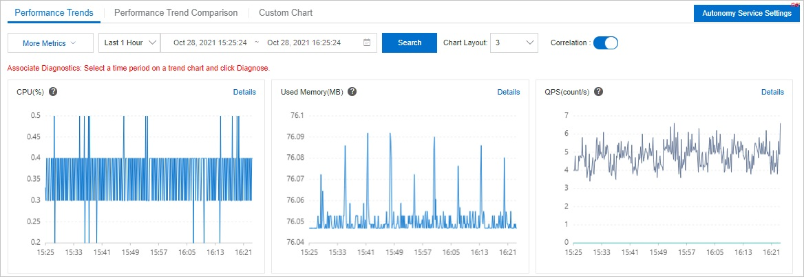

   - **Performance trends**

     On the **Performance Trends** tab, specify a time range, select desired metrics, and then click **Search**.

     > **Note**
     >
     > - By default, **Correlation** is enabled. If you move the pointer over the CPU chart to view the CPU metric of the instance at 09:00, other charts also display other metrics of the instance at 09:00.
     >
     > - To view the definition of the performance metric and the performance trend, click **Definition?** and **Details** in the upper-right corner of the chart.

   - **Performance trend comparison**

     To compare the performance trends within two periods of time, click the **Performance Trend Comparison** tab, specify two periods of time, select desired metrics, and then click **Search**.

   - **Custom chart**

     The preceding two methods display the basic performance metrics of a KVStore for Redis instance. If you want to display only basic metrics, you can configure custom performance trend charts. For more information, see Add a performance trend chart.

<a id="section-13-2"></a>

## 13.2. Top key statistics

When the memory usage or CPU usage of Tair and Redis increases, you can use the **Top Key Statistics** feature to quickly identify large keys and hotkeys. This feature displays real-time and historical information about large keys and hotkeys in your instance, including keys with many elements and frequently accessed hotkeys, to help you effectively resolve instance performance issues.

**Statistical ranking mechanisms for large keys and hotkeys**

To avoid additional resource consumption on the database, this feature only collects statistics on keys that have been operated on (read or written) by clients, and only retains and displays the top number of each key type, rather than scanning all keys in the database in real time. Additionally, after an instance restart or HA switch, the previously collected top key information will be cleared, and statistics will start over. **Therefore, keys that have not been operated on for a long time may not be included in the statistics**. To understand the memory usage, quantity distribution, and other information of all keys in the database, use the offline full key analysis feature.

| Key type | Statistical mechanism | Display description |
| --- | --- | --- |
| Hotkeys | A key is recorded as a hotkey when its QPS exceeds 5,000.<br>You can customize the QPS threshold by setting the parameter <code> hotkey-</code><code>threshold </code>. | At the same time, the system displays up to the top 50 hotkeys and their precise QPS in real time. |
| Large keys (keys with a large number of elemen ts) | A key is considered a large key when its string length (for String type only) or the number of elements (such as the number of fields in a Hash, the number of members in a Set) reaches or exceeds the threshold (default 2000).<br>Note<br>This feature is supported only for instances that run Redis 5.0 or later. | The system displays up to the top three large keys for each data type. When keys have the same number of elements, the key that was written first is displayed with higher priority. |

This feature supports the following data structures:

- Native Redis data structures: String, List, Hash, Set, Zset, and Stream.

- Self-developed Tair data structures: TairString, TairHash, TairGIS, TairBloom, TairDoc, TairCpc, TairZset, TairRoaring, TairTS, and TairSearch.

**Procedure**

1. Log in to the Tair (Redis OSS-compatible) console.

2. On the **Instance List** page, click the ID of the instance.

3. In the left-side navigation pane, choose **CloudDBA > Top Key Statistics**.

4. Query real-time data or historical data based on your business requirements.

   - If the instance is a cluster instance or a read/write splitting instance, you can select a node from the **Current Node** drop-down list.

   - When you query historical data, you can query large key and hotkey information from the last four days, with a maximum query time range of three hours.

   - You can customize the QPS threshold by setting the parameter  `hotkey-threshold` .

<a id="section-13-3"></a>

## 13.3. Add a performance trend chart

The default performance trends tab displays the basic performance metrics of a KVStore for Redis instance. You can add a chart that contains only specified performance metrics to analyze the performance trends of your instances. This topic describes how to add a performance trend chart to a dashboard for KVStore for Redis instances.

**Procedure**

1. Log in to the Tair (Redis OSS-compatible) console.

2. On the **Instance List** page, click the ID of the instance.

3. In the left-side navigation pane, choose **CloudDBA > Performance Trends**.

4. Click the **Custom Chart** tab.

5. Click **Add Monitoring Dashboard**. In the Create Monitoring Dashboard dialog box, enter a dashboard name and click **OK**.

6. Click **Add Chart** or **Add Monitoring Chart**. Select the metrics that you want to add and click **OK**

   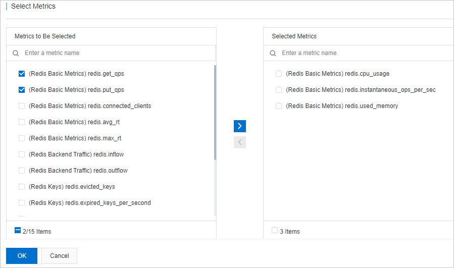

7. **(Optional)** You can view, modify, and delete monitoring dashboards.

   - View a monitoring dashboard Select the monitoring dashboard that you want to view, specify a time range, and then click **Search**.

   - Modify a monitoring dashboard

     Click the following icons to modify or delete a chart in the monitoring dashboard.

     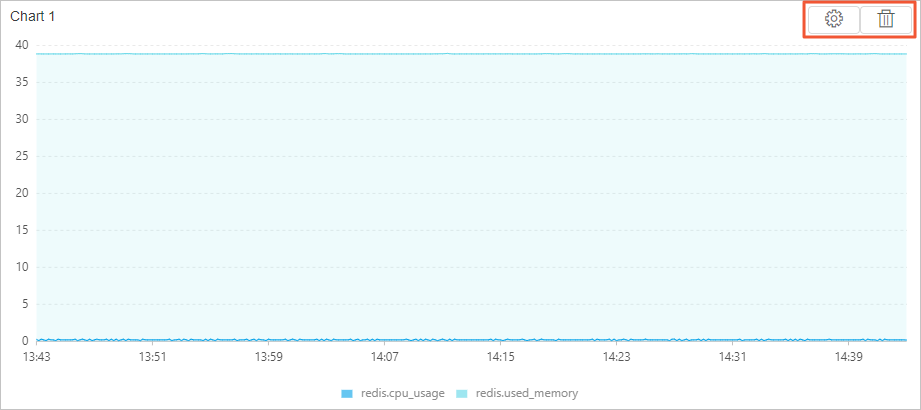

   - Delete a monitoring dashboard

     Choose **Operate Dashboard > Delete Monitoring Dashboard**.

<a id="section-13-4"></a>

## 13.4. View performance metrics in real time

CloudDBA allows you to view the performance metrics of KVStore for Redis instances in real time. The performance metrics include information about CPU utilization, memory usage, queries per second (QPS), network traffic, servers, keys, clients, and connections.

**Procedure**

1. Log in to the Tair (Redis OSS-compatible) console.

2. On the **Instance List** page, click the ID of the instance.

3. In the left-side navigation pane, choose **CloudDBA > Real-time Performance**.

4. Select a view based on your business requirements.

   In the upper part of the page, performance metrics are displayed in real time. The metrics include information about the server, keys, memory, clients, and connections. The details about the performance metrics are displayed in **Real-time Charts** and **Real-time Tables**.

   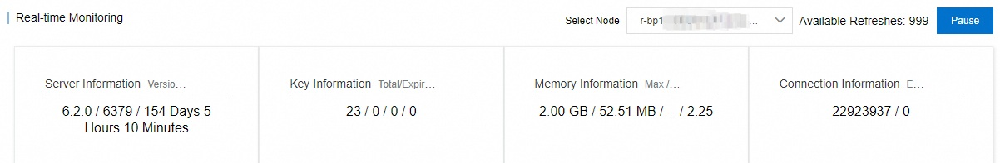

   > **Note**
   >
   > The metrics are automatically updated every 5 minutes. Therefore, you can view real-time changes in performance. The remaining updating times are displayed in the upper-right corner. To stop updating the performance metrics, you can click **Pause**.

   | View | Description |
   | --- | --- |
   | Real-time Charts | Displays the real-time performance metrics of the instance in curve charts, such as keys, key hit information, key hit ratio, CPU utilization, memory usage, QPS, and network traffic.<br>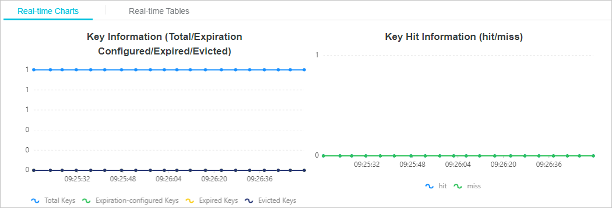 |
   | Real-time Tables | Displays the information about keys, QPS, memory usage, CPU utilization, network traffic, clients, and connections. The table can display up to 999 records. A new record is added to the table every 5 seconds.<br>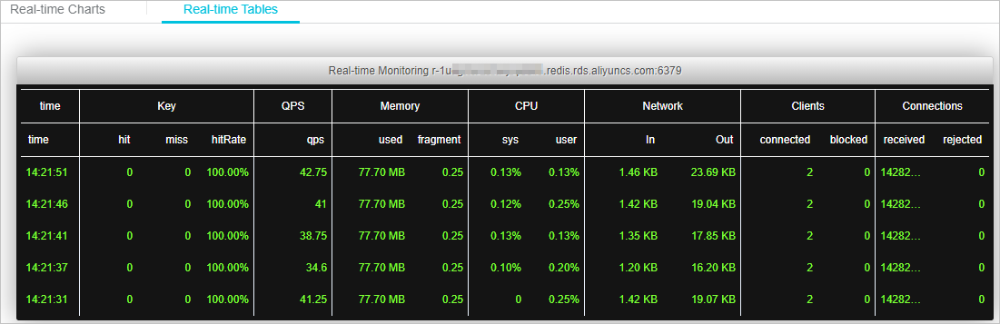 |

<a id="section-13-5"></a>

## 13.5. Instance sessions

Instance sessions allow you to view the statistics for sessions between a KVStore for Redis instance and clients in real time. These statistics include clients, commands that were run, and connection durations. You can also close abnormal sessions based on your business requirements.

**Procedure**

1. Log in to the Tair (Redis OSS-compatible) console.

2. On the **Instance List** page, click the ID of the instance.

3. In the left-side navigation pane, choose **CloudDBA > Instance Sessions**.

4. Perform the following operations to manage your instance sessions:

   - View sessions: By default, the details of all sessions are displayed. You can move the pointer over a specific parameter name to view its information.

     > **Note**
     >
     > - You can enter keywords in the search box to filter sessions.
     >
     > - To refresh instance sessions, click **Refresh** in the upper-left corner or enable **Auto Refresh**. If you enable auto-refresh, the system automatically refreshes the page every 30 seconds.

   - Close sessions: You can close the specified one or more sessions at a time or close all sessions. To close one or more sessions at a time, select the specified session or press the Shift key and select multiple sessions, and then click **Kill Selected** in the upper-right corner. To close all sessions, click **Kill All**.

     > **Warning**
     >
     > To prevent unexpected consequences, we recommend that you do not close system-level sessions.

   - View session statistics: Session statistics record the total number of clients, active clients, and source IP addresses involved in instance sessions.

     > **Note**
     >
     > In the **Statistics by Source** table, click the icon next to the source IP address to modify the source alias. In the Total Sessions column, click a value to view the details of source IP addresses.

<a id="section-13-6"></a>

## 13.6. Slow queries

Slow queries reduce the stability of KVStore for Redis instances. To monitor and analyze slow queries, you can view the details about slow query logs in CloudDBA.

**Procedure**

1. Log in to the Tair (Redis OSS-compatible) console.

2. On the **Instance List** page, click the ID of the instance.

3. In the left-side navigation pane, choose **Slow Queries**.

4. Query the details about the slow query logs.

   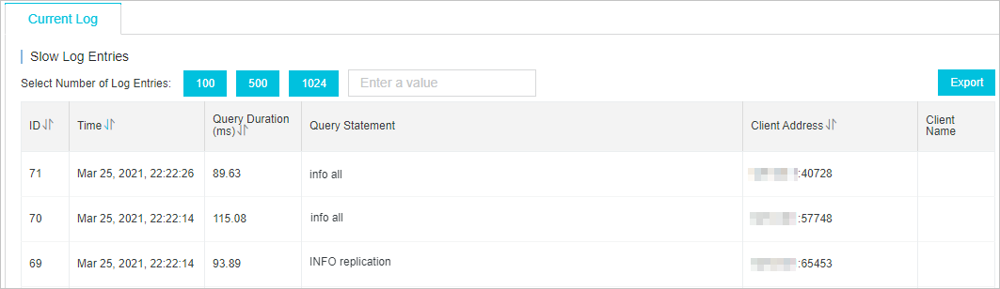

   > **Note**
   >
   > You can select the number of log entries to be displayed or enter keywords in the search box to filter log entries.

<a id="section-13-7"></a>

## 13.7. Use the offline key analysis feature

By using the offline key analysis feature to analyze backup files of a KVStore for Redis instance, you can identify big keys (large keys) in the instance and gain insights into key-related aspects, such as the memory usage, distribution, and expiration time of keys. You can optimize the instance based on the analysis results. This feature helps you resolve issues such as insufficient memory and performance degradation that are caused by the skewed distribution of keys.

**Procedure**

1. Log in to the Tair (Redis OSS-compatible) console.

2. On the **Instance List** page, click the ID of the instance.

3. In the left-side navigation pane, choose **CloudDBA > Offline Key Analysis**.

   By default, the analysis results of the last day are displayed. You can specify another time range based on your requirements.

4. On the page that appears, click **Analyze**.

   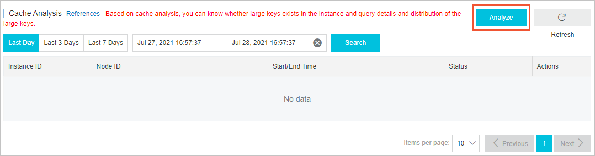

5. In the dialog box that appears, specify the Node and Analysis Method parameters.

   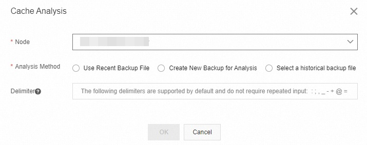

   | Parameter | Description |
   | --- | --- |
   | Select a node for analysis | The ID of the node on which you want to perform cache analysis.<br>Note<br>You can select an instance or a node for analysis. If you select an instance that contains more than eight nodes, the system analyzes only the top eight nodes that have the highest memory usage. |
   | Analysis Method | The method that you want to use to analyze the cache. Valid values: <strong>Use</strong> <strong>Previous Backup File</strong> and <strong>Create a new backup and use the latest</strong> <strong>backup for analysis</strong>. |

6. Click **OK**.

   The system performs analysis and displays the analysis status. You can click **Refresh** to update the analysis status.

7. Find the completed analysis task and click **Details** in the **Actions** column to view the detailed results.

   - **Basic information**: displays the basic information of the instance such as the basic attributes and the cache analysis method.

     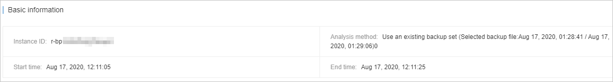

   - **Related node**: displays the memory usage and key statistics on each node of the instance.

     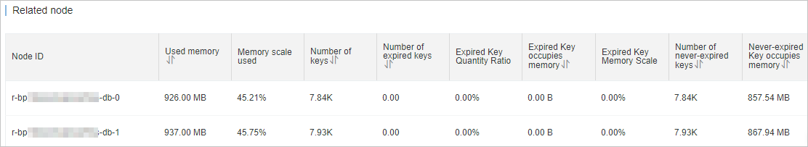

     > **Note**
     >
     > If you select a cluster instance from the Select a node for analysis drop-down list, you can view node information in the **Relevant Nodes** section and select a node in the Details section of the **Details** page.

   - **Details**: displays the details about the instance or node, such as the memory usage and distribution of keys, memory usage and distribution of elements in keys, distribution of key expiration time, and ranking of large keys.

     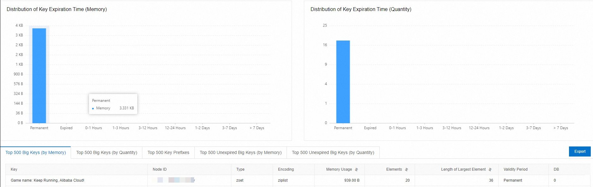

<a id="section-13-8"></a>

## 13.8. Perform diagnostics on an instance

Tair (Redis OSS-compatible) integrates the diagnostic report feature of Database Autonomy Service (DAS). This feature allows you to create a diagnostic report to evaluate the status of an instance within a specific period of time. Diagnostic reports collect metrics such as the performance level, skewed request distribution, and slow query logs to help you identify exceptions in the instance.

**Procedure**

1. Log in to the Tair (Redis OSS-compatible) console.

2. On the **Instance List** page, click the ID of the instance.

3. In the left-side navigation pane, choose **CloudDBA > Diagnostic Reports**.

4. Click **Create Reports**.

5. In the dialog box that appears, specify a time range for which you want to create a diagnostic report and click **OK**.

   > **Note**
   >
   > The time range cannot exceed one day. If you specify a shorter time range for diagnostics, more detailed statistics are collected in the diagnostic report.

6. Refresh the Diagnostic Report page to view the progress of the diagnostics task. After the diagnostic report is created, click **View Report** in the **Actions** column.

   The diagnostic report displays basic information such as the ID, specifications, type, and zone of the instance. It also provides statistics on key performance metrics of the instance and its status. The report also displays the top 10 data nodes that receive the greatest number of slow queries and provides information about the slow queries.

<a id="section-14"></a>

# 14.Alert settings

You can set alert rules for an KVStore for Redis instance based on the performance monitoring data of the instance. If a performance data change triggers an alert rule, you can immediately receive an alert notification.

**Background information**

Monitoring and alerting are implemented through CloudMonitor. CloudMonitor enables you to set metrics and contacts. When the alert rules of a metric are triggered, CloudMonitor will notify all members of the alert contact group. You can maintain contact groups for alert metrics to ensure that the contacts are notified in a timely manner when alerts are reported.

**Procedure**

1. Log on to the Tair (Redis OSS-Compatible) console.

2. On the **Instance List** page, click the ID of the instance.

3. On the **Instance Information** page, click **Alarm Settings** in the left-side navigation pane.

4. On the **Alarm Settings** page, click **Alarm Settings** in the upper-right corner to go to the **CloudMonitor** console.

5. On the **Alarm Rules** page, click **Create Alarm Rule**.

6. Configure required parameters and click **OK**.

   > **Note**
   >
   > After an alert rule has been created, you can modify, disable, and delete
   >
   > the alert rule on the **Alarm Rules** page of the CloudMonitor console. You can also view the alert history on the page.

<a id="section-15"></a>

# 15.SQL audit logs

This topic describes how to use the SQL audit feature of Tair (Redis OSS-compatible). You can use the SQL audit feature to view the details about the SQL statements that are executed on your instance and audit the SQL statements on a regular basis.

**Usage notes**

- The retention period of SQL audit log files is 30 days.

- The retention period of SQL audit log files that are exported is two days. PolarDB for MySQL V2.0 automatically deletes the SQL audit log files that are stored for longer than two days.

> **Note**
>
> If you no longer require audit logs, you can click **Disable Audit** in the upper-left corner. You can also enable or disable SQL read audit logs and write audit logs separately.

**View SQL audit information**

1. Log in to the Tair (Redis OSS-compatible) console.

2. On the **Instance List** page, click the ID of the desired instance or click **Management** in the **Operation** column to go to the **Instance Information** page.

3. In the left-side navigation pane, click **Audit log**.

   On the Audit log page, you can query SQL statements by specifying the time range, database user, keyword, client IP address, or execution duration. You can also sort SQL statements by execution duration in descending order.

**Export SQL audit log files**

1. Log in to the Tair (Redis OSS-compatible) console.

2. On the **Instance List** page, click the ID of the desired instance or click **Management** in the **Operation** column to go to the **Instance Information** page.

3. In the left-side navigation pane, click **Audit log**.

4. Move the pointer over **More** and click **Create Export Task**. In the message that appears, click **OK** to export SQL audit log files within the specified time range.

   After the SQL audit log files are exported, you can click **Export List** to view the files.

<a id="section-16"></a>

# 16.Appendix

<a id="section-16-1"></a>

## 16.1. Authorize a tenant organization to access SLB

This topic describes how to grant a tenant organization the permissions to access Server Load Balancer (SLB) and helps you efficiently resolve related issues.

> **Important**
>
> If you need to create and use IPv6 addresses for your business, you must ensure that the current tenant organization has explicitly granted database services the permissions to access SLB. If such permissions are not granted, IPv6 addresses cannot be created.

**Procedure**

1. Log in to the Apsara Uni-manager Management Console.

2. In the top navigation bar, click **Configurations**.

3. In the left-side navigation pane, click **Service-linked Roles**.

4. On the Service-linked Roles page, click **Create Service-linked Role** in the upper-left corner.

   Select **Server Load Balancer** for the **Service Name** parameter, and select the organization to which you want to grant permissions for the **Authorized Organization Name** parameter.

5. Click **OK**.
